# 黑客社会工程学攻击档案袋2

陈威（Vim0x0n）

## 前言

我与社会工程学的结识，是因为 08 年非安全《黑客手册》出版的那本《黑客社会工程学攻击1》（以下简称“社1”）。当时的我还在关注免杀方面的技术，自从看完社1后便深深地爱上了社会工程学。

慢慢地，随着阅历的增长，所见识的东西也越来越多。等到 2010 年时再回头看社1，却发现自己已经没有了 08 年阅读此书时那种激动的感觉，取而代之的是一种平淡。那天翻那本书时就像翻杂志一样，觉得书里的东西已没有了那种吸引力。

我问自己为什么会这样？为什么一本曾经能让我通宵达旦阅读的书，后来就成了一本杂志？反复思考之后得出了一个结论：书里的内容是死的，也许在 08 年属于新技术，但那些技术到了现在已经随处可见，甚至早已过时。更重要的是，社会工程学是一门思维与心之间的对抗，而不是理论化的纸上谈兵。而社1中写的内容更多则是理论化的知识，没有那种惊心动魄或者可以提起人胃口的经典案例。也正因为这些，才会使我变得对它有了些不屑一顾的感觉。

后来，我阅读了著名黑客——凯文·米特尼克所著的《欺骗的艺术》。我被书中的精彩案例与凯文·米特尼克的智慧所折服，在阅读入迷时还会为他的绝妙思路拍手叫好，读完整本书还是一副意犹未尽的样子。可直到我在整理书中的技巧、想做些笔记时，却发现一个很严重的问题——书中的一些内容与我们的国情并不相符，或者可以说根本不适合我们中国的国情。若是一个社会工程学的初学者去阅读此书，你会发现书中所描述的案例离你都很遥远，甚至遥不可及。即使你很认真地读完全书，也未必能学到很多有用的技巧，能学到的依然只是一些很理论化的东西，因为你根本没有机会去实践书中所说的那些技巧。

再后来，我上网去搜索关于社会工程学的文章，却发现网上有的全是介绍狭义社会工程学的文章。更可笑的是，一些文章中描述的社会工程学仅仅是简单地将目标个人信息放到百度一搜，能找到对方曾在网上留下的信息就算社工完成；若对方没有在网上留下一点信息，那么他的社工就失败了。也就是因为这些狭义社会工程学的文章越来越多，使得那些刚入门的新人及皮毛都不懂的外行人眼里，对社会工程学产生了一个错误定义：社会工程学就是人肉搜索。

每当看到这样的文章时，我多希望能够立刻去纠正他们对社会工程学的看法，但后来发现这一切都是徒劳的。因为“社会工程学等同于人肉搜索”这样一个错误定义已在他们脑海里形成了一种固定模式，就像古时的“重男轻女”思想一样，早已根深蒂固，没那么容易改动了。

直到几个月前在某群跟 LoveAngel 聊天。当我们聊到社会工程学这个话题时，我问他最近有没有准备出社工方面的新书，他却告诉我这类书偏向于高智商创作，创作很难，想写得好更是难上加难。再加上国内的社工技术水平普遍不是很高，所以没人会想写这方面的内容。即使有，也最多只能是几篇文章，想出本社工方面的好书并不太现实。之后他还问我是否有写社工书这方面的意向，我当时当场就回绝了他。我觉得以我的水平想出书是不可能的事情，就算出了，到时辛辛苦苦写的内容没被人表扬不说，要是还被人喷了一脸口水，那岂不是得不偿失？

但后来回家翻了翻曾经的那些过程记录与笔记，觉得其实自己还是可以尝试一下的。在思考再三后我跟 LoveAngel 说，我愿意试着写一本看看。

- 我想看看我自己的能力已达到了怎样的水平；
- 我想通过自己的这些社会工程学经验与一些技巧，来告诉那些对社会工程学有错误定义的人：社会工程学≠人肉搜索！

## 社会工程师档案

姓名：陈威（网络 ID：Vim0x0n）  
年龄：不详  
职业：不详  
网络身份：网络安全攻防研究室网站站长、国内多家黑客网络安全杂志自由撰稿人  
WebSite：http://www.91ri.org

特别感谢：封底手绘 张佳音

- 出品人：非安全
- 作者：陈威【Vim0x0n】
- 主编：LoveAngel
- 编辑：Python、LCX、LoveAngel、Vxer、浪迹天涯10086、张宇
- 特约编审：风狼雨、XApache、小龙猪
- 光盘编辑：猎哥靓
- 美术设计：柳絮
- 校对：小斐
- 网站：www.nohack.me
- 网站编辑/管理：Cass
- 发行：田凌琪、李琳
- 邮购：速递小子 924073360（QQ）
- 形式：1CD + 1书册，手册仅随光盘一同赠送，不得单独销售。
- 版权声明：图文版权所有，未经同意，不得转载。
- 投稿信箱：nohack@21cn.com
- 邮购查询：hope_wym@sina.com
- 淘宝专卖店：taobao.nohack.me

## Contents 目录

- 前言 ................................................................ 1
- 第1章 你好，社会工程学 ...................................... 12
  - 1.1 什么是社会工程学 ...................................... 13
    - 1.1.1 人为因素的威胁 .................................... 13
  - 1.2 社会工程学与常规渗透测试技术的区别 .............. 17
- 第2章 反击入侵者 ............................................ 19
  - 2.1 网站被黑了！ .......................................... 20
  - 2.2 无所不知的搜索引擎 .................................. 23
    - 2.2.1 Google Hacking! .................................. 23
    - 2.2.2 关键字 + 语法 = Google Hacking .................. 25
- 第3章 SNS，信息泄露的重灾区 ................................ 27
  - 3.1 最大的泄密者 .......................................... 28
    - 3.1.1 生活泄密王之——空间说说 .......................... 30
    - 3.1.2 生活泄密王之——朋友网 ............................ 32
  - 3.2 网络与现实 ............................................ 33
    - 3.2.1 百度ID ............................................ 36
    - 3.2.2 人多力量大 ........................................ 37
    - 3.2.3 公共接口还是泄露隐私接口？ ...................... 40
  - 3.3 你在哪？做了什么？我都知道！ ........................ 42
    - 3.3.1 随时随地泄露隐私 ................................ 42
- 第4章 “十面埋伏”：泄密无处不在 ............................ 45
  - 4.1 Whois 信息查询 ....................................... 46
  - 4.2 网站备案查询 ......................................... 49
  - 4.3 Alexa 的注册信息查询 ................................. 52
- 第5章 通用密码：条条大路通罗马 .............................. 55
  - 5.1 莫名来电 ............................................. 56
  - 5.2 泄密门 ............................................... 59
  - 5.3 公开的密码查询网站 ................................... 64
  - 5.4 流传在地下的数据库 ................................... 68
  - 5.5 过程分析 ............................................. 71
    - 5.5.1 狭义社会工程学与广义社会工程学 ................. 73
    - 5.5.2 识破伪社会工程师 ................................. 74
  - 5.6 后记 ................................................. 75
- 第6章 人太脆弱了 ............................................ 77
  - 6.1 只是一个玩笑 ......................................... 78
  - 6.2 闲来无事 ............................................. 78
  - 6.3 制定计划 ............................................. 83
  - 6.4 知己知彼百战不殆 ..................................... 87
  - 6.5 峰回路转 ............................................. 94
  - 6.6 帮帮我好吗 .......................................... 101
  - 6.7 过程分析 ............................................ 106
- 第7章 渗透测试中的社会工程学 ............................... 109
  - 7.1 星期二 .............................................. 110
  - 7.2 测试者的阴谋 ........................................ 115
  - 7.3 老大的夺命连环 Call ................................ 123
  - 7.4 客服也不是好忽悠的 .................................. 129
  - 7.5 从一张图片中找出蛛丝马迹 ............................ 134
  - 7.6 另类的密码 .......................................... 141
  - 7.7 密码之谜 ............................................ 148
  - 7.8 过程分析 ............................................ 161
- 第8章 无线 Hacking 与社会工程学 ............................ 165
  - 8.1 “奇想”的源代码 ..................................... 166
  - 8.2 合作者的阴谋 ........................................ 169
  - 8.3 姜太公钓鱼愿者上钩 .................................. 177
  - 8.4 入侵咖啡厅的监控探头 ................................ 183
  - 8.5 无线黑客社工师 ...................................... 190
  - 8.6 晴天霹雳 ............................................ 204
  - 8.7 过程分析 + 如何锻炼你的观察力 ...................... 205
- 第9章 商业间谍 ............................................. 216
  - 9.1 “希望”公司的新型医疗产品 .......................... 216
  - 9.2 一份旧的企业员工联系表 .............................. 217
  - 9.3 秘点邮箱 ............................................ 228
  - 9.4 气质型商业间谍 ...................................... 235
  - 9.5 豪门餐厅的鸿门宴 .................................... 240
  - 9.6 束手无策 ............................................ 244
  - 9.7 过程分析 ............................................ 246
  - 9.8 加强员工信息安全意识迫在眉睫 ........................ 248
  - 9.9 前台员工贪吃引发的“血案” .......................... 249
- 第10章 社会工程学与高级持续性威胁（APT攻击） ............. 254
  - 10.1 冯轩的故事 ......................................... 254
  - 10.2 夜虎行动 ........................................... 257
  - 10.3 HR 的新浪微博 ...................................... 264
  - 10.4 六度人脉 ........................................... 269
  - 10.5 引导式攻击 ......................................... 275
  - 10.6 神秘的文件名伪装手法——RTLO ....................... 283
  - 10.7 物理隔离的杀手——摆渡攻击 .......................... 293
  - 10.8 APT 攻击过程分析 ................................... 299
- 后记 ....................................................... 302

## 光盘目录

- **社会工程学电影**：防火墙、36Hours、七宗罪、剑鱼行动
- **小游戏**：躲避掉下来的雪球
- **浏览器**：Firefox、Safari、Chrome、Opera

## 免责声明

> 本书旨在帮助企业能够及时发现并抵御社会工程学攻击，提高企业与个人的信息安全意识。书中内容纯属虚构，请勿对号入座。

## 鸣谢

- 白云 http://www.wooyun.org
- 网络安全攻防研究所 http://www.91ri.org
- Anywlan http://forum.anywlan.com
- 网络尖刀 http://www.mcbarp.com/
- PHPChina http://www.phpchina.com/
- 红黑大战 http://bbs.2cto.com/
- xmd5 http://www.xmd5.com/
- 游戏网 http://www.youxia.org/
- 法客论坛 http://sb.f4ck.net
- 猪哥靓 http://www.zhu.cm/
- 黑客燎原猪 http://www.cn-hack.net
- 黑客安全吧 http://www.mvhack58.com
- 包子铺 http://buns.hacksoft.org/
- T00ls https://www.t00ls.net/
- FreeBuf https://www.freebuf.com/
- shuichon http://www.nfcous.com/
- zzitt http://www.xcopys.com/
- 51cto http://www.51cto.com/
- smallrascal http://www.smallrascal.cn/smallrascal/
- 小木 http://4ngle.org/
- 队长 http://www.hackcmd.com/
- tSt http://www.wwwcr.net/
- geyibing http://www.bingsec.com/
- DarkRay http://www.blackh4t.org/
- 本人已出售 http://www.sishuiliunian.com/default.asp
- 黑色小亮 http://www.blackxl.org/
- Coolboy http://blog.cnnetsec.com/
- 妮恨 http://www.rmboy.com/
- hackest http://www.hackest.cn/index.php
- 假装纯情 http://www.am82.com/
- 夜鬼独饮 http://www.yunlousi.com/in/
- Migroom http://www.migroom.com/
- 『落陌』 http://www.bycat.org/
- 混世魔王 http://26836659.blogcn.com/
- 梧桐雨 http://wutongyu.info/
- 小可爱 http://www.ddosxp.net/
- 小王 http://www.5iadmin.com/
- 英雄 http://www.ownsec.com/
- Drk@Dis9Team http://www.91ri.net/
- Neeao http://www.neeao.com/
- homejun http://www.delphigear.cn/
- vl毕业生 http://bbs.vistu.com/forum.php
- 5hunz1 http://5hunz1.diandian.com/
- 物哲 http://bigpack.blogbus.com/
- cnbird http://blog.csdn.net/cnbird2008/
- txcbg http://hi.baidu.com/txcbg
- 夜紫 http://hi.baidu.com/no_hack
- 雨夜 http://hi.baidu.com/kr4l9
- 天翼 http://hi.baidu.com/rclnln
- 独孤小白 http://hi.baidu.com/canghaiwuhen
- 箫亭 http://hi.baidu.com/xiangshou_hack
- cc http://hi.baidu.com/beijigongjue
- x-bug security team http://www.x-bug.com
- Pang http://www.pzsafc.com/

## 第1章 你好，社会工程学

社会工程学构建了一个新概念工程学——Hello Social Engineer

### 1.1 什么是社会工程学

社会工程学是一种黑客攻击方法，利用欺骗等手段骗取对方信任，获取一些资料。国内的社会工程学通常和人肉搜索联系起来。

在这里给大家举例说明一下，就算一家公司能购买到最知名的防火墙、最强大的 IDS（入侵检测系统）或者 IDP（入侵侦测防御系统），并且从安保公司雇佣了最好的保安，但仍不能说这家公司的安全保密措施做到了极致。也许你接受了经验丰富的专家建议，使用了最先进的反病毒软件，补齐了操作系统的所有已知漏洞，但我不能保证该公司的一些机密信息不会因为某些原因而泄漏出去。

因为，是人总会有弱点的。

#### 1.1.1 人为因素的威胁

不知道你听说过那次代号为 Aurora（极光）的针对 Google 等公司的攻击行动吗？攻击者利用了 IE 的溢出漏洞，再配合社会工程技术，成功地突破了 Google 公司的层层防护，渗透进了他们的内部网络，史称“极光行动”。


事后站在社会工程学技术角度对此事进行了分析，总结如下：

- 对 Google 进行刺探工作，特定的 Google 员工成为攻击者的目标。
- 攻击者搜集该员工在 Facebook、Twitter、LinkedIn 和其它社交网站上发布的信息，对收集到的信息进行整理后得出关于该员工的相关信息。
- 接下来攻击者利用一个动态 DNS 供应商来建立一个托管伪造照片网站的 Web 服务器，并伪造了一封被该员工信任的人（与当事人有一定信任关系的人）所发送出的邮件。
- 该 Google 员工收到邮件后打开该信件，并点击邮件所附带的网络链接，进入了攻击者设下的恶意网站。
- 该恶意网站页面载入含有 shellcode 的 JavaScript 程序码，造成 IE 浏览器溢出，进而攻击者获得了该员工电脑的最高权限。
- 接下来攻击者通过 SSL 安全隧道与受害人的机器建立了连接，持续监听并最终获得了该雇员访问 Google 服务器的账号密码等敏感信息。
- 攻击者使用该员工的账号密码成功进入 Google 的邮件服务器，进而不断获取特定 Gmail 账户的邮件内容信息。

看到这里，你可能觉得不可思议。是的！你没有看错，也没有听错。目前被公认为全球规模最大的搜索引擎，配备了世界上最先进的防黑客设备，同时拥有超过 300 名安全工程师，已经达到了国家级情报机构的水准。但是这样一个安全实力强大的公司，却被社会工程师“轻易”地闯入！至少我认为，通过技术对 Google 进行渗透而拿到权限的几率，比中 500W 的几率还要低。

没有小说惊心动魄的剧情，也没有我们想象中那样复杂的过程。社会工程师只是收集了该员工在网络上所说过的话以及做过的事，通过整理该员工的相关信息，伪造了一封来自被攻击者所信任之人的邮件，再配合一个 IE 0day，轻松攻陷全球第二大科技公司——谷歌。

一个如此牛逼的公司都会因为人为因素而导致系统被入侵，现在你还觉得你的安全措施是严密的、牢不可破的吗？

相信读到这里你已经知道了什么是社会工程学，也知道一名专业的社会工程师有多牛逼了吧？

在这个网络信息安全产品越来越多的时代，想要利用技术手段来搞定一台服务器或者个人 PC 已经变得难上加难。但社会工程师则不一样，它利用的是人为因素的漏洞对目标实施攻击。二十世纪最受尊敬的科学家爱因斯坦曾这样说道：“只有两种事物是无穷尽的——宇宙和人类的愚蠢。”

社会工程学就是利用人们的愚蠢，或是普通人在信息安全实践上的无知，所实施的非常规攻击手段。

LoveAngel 乱语：这里我们首先了解了什么是社会工程学，以及通过对 Aurora 事件的分析，了解了社会工程师大致的攻击方法。文中内容虽然轻描淡写，短短几句话就把如此惊天地泣鬼神的事件描述了出来，但是当你成为社会工程学主角的时候，你就会了解到其中的奥妙。我们现在要做的就是静下心来，看完这本书。

### 专业术语解释

- **溢出**：溢出是程序设计者设计时不足所带来的错误。黑客可利用溢出制作相应的攻击程序。可以理解为程序就是一个杯子，黑客利用这个杯子自身存在的问题，将杯中的水变满，水自动溢出杯子，而溢出的水则是恶意指令。
- **0day**：0day 中的 0 表示 zero。早期的 0day 表示在软件发行后的 24 小时内就出现破解版。现在我们已经将这个含义引申至信息安全领域，信息安全领域的 0day 是指系统商在知晓并发布相关补丁前，就被某些人掌握或者公开的漏洞信息。

### 1.2 社会工程学与常规渗透测试技术的区别

常规渗透测试是作为外部审查的一部分而进行的。这种测试需要探查系统，以及发现操作系统和任何网络服务，并检查这些网络服务有无漏洞。

常规渗透测试主要是由安全人员使用扫描器来进行安全评估，最终目的是为了探测出目标系统存在的漏洞，从而利用漏洞进行攻击并拿下目标权限。往往这种攻击属于半自动化，总体来说攻击目标主要是针对主机操作系统、数据库、应用程序及网络设备等硬件。

社会工程学是一种通过对受害者心理弱点、本能反应、好奇心、信任、贪婪等心理陷阱进行利用，并实施诸如欺骗、伤害等危害手段的攻击方式。它并不能等同于一般的欺骗手法。一般情况下，社会工程师会利用身份冒充、伪造信息以及人性的弱点等对目标进行攻击。可以说渗透测试与社会工程学的目的都是一样的，都是为了获取自己想要的东西，只是攻击目标不同而已。最大的区别就是前者攻击的目标是机器，是那些没有思想的东西；而后者往往攻击的目标是人，是那些有思想、有欲望的人类。

LoveAngel 乱语：这里还是以谷歌为典型来举……例。至少在我的认知里，通过常规的渗透是搞不定它的。但是通过社会工程学却把它直接拿下。我觉得常规的渗透测试就像个男人，社会工程学就像个美女。硬的不行咱就来软的，可谓温柔乡，英雄冢。当然不排除你有 0day，这个就不在讨论范围之内了。

## 第2章 反击入侵者

说起社会工程学，虽然是社会现象，但黑客从社会工程师和心理学角度出发，整理了一些小黑客日常生活中口令、无线路由、权限等可攻击而无需技术接触等细节，围绕渗透和架构脆弱点进行讨论。现代黑客的搜索方式和形式具有代表性，各类论坛、搜索引擎和社工库中沉淀了大量相关信息。关于 Google Hacking 的工具和实践，文章也给出案例，说明通过搜索引擎可以发现目标系统中意外暴露的信息，并辅助后续渗透测试。

### 2.1 网站被黑了！

这天，张杰刚登录上 QQ，就听到了一阵“滴滴滴”的声音。同时桌面的右下角出现了一个熟悉的头像，在那不停地闪动着。张杰一看就知道是王彬那小子，心想，这小子艳福不浅，虽然是搞 IT 的，不过身边妹子多的是啊！这次八成又来炫耀自己最近泡了哪个妞。点开聊天信息一看，里面没有新妹子的照片，而是一个网址。而这个网址正是他们公司的网站地址。

张杰之前曾帮他们的公司网站做过渗透测试，并且将测试结果报告给了他们，但是他们公司领导对于此事好像漠不关心，此事也就搁置了。大概他们以为没有人会攻击他们这个小公司的网站吧。

王彬委屈地告诉张杰他们公司的网站被黑了，而且还被挂了一个奇丑无比的黑页。更可恶的是入侵者还把网站上的数据全部删除，由于种种原因数据无法恢复，惹得公司领导暴跳如雷。虽然事情最后还是解决了，但领导给王彬下达了命令，让他不管用什么方法，都要找到入侵者并给他点颜色看看，但他自己技术并不好，所以就想让张杰帮忙找到入侵者。

王彬请求张杰一定要弄到入侵者的相关资料，因为网站被黑的事情，王彬被领导臭骂了一顿，连季度奖金都泡汤了。这让王彬非常恼火，所以他想亲自把入侵者“绳之以法”。

张杰叹了口气，心想：唉，让你不听我的，不修复漏洞！这下好了吧！被领导骂了一顿就算了，连奖金都被扣了。唉，看在多年朋友的份上我就帮你一把吧，教训教训这个入侵者。

张杰虽然见过很多黑页，但是打开他们公司的网站一看，还是小小地震惊了下。网站用绿色字体写着：刺刀上带着思想，并挂上了所谓的黑客心声。如图 2-1-1。

在网页的最下方还写着一段蹩脚的英文，一看就知道是通过在线翻译器翻译过来的，大概的意思就是我是一名黑客，我的名字叫“hacklele”，这次的入侵纯属友情检测，你们的网站存在漏洞请快点修复！

一看网页就知道是一个非主流脚本小子干的好事，只会入侵这种满是漏洞的网站，再用所谓的友情检测的名义来删数据挂黑页，以此炫耀自己的皮毛功夫。

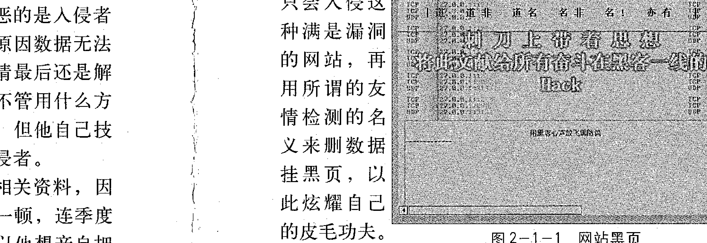

图 2-1-1 网站黑页

事到如今既然决定帮忙，那么今天我张杰就代表月亮来教训教训这个叫 hacklele 的脚本小子吧！

但是如何才能找到这个名为 hacklele 的脚本小子呢？张杰想了想，拍了一下脑袋自言自语道：Google Hacking。

> **LoveAngel 乱语：** 说到脚本小子，让我印象最深刻的就是黑榜排行榜，该排行榜就像武林中的江湖排名一般，根据能力（黑下的站点数量）进行排名，导致每天有成千上万的人不断地提交着自己黑下的网站，以此增加自己的排名。但是不知为何，后来黑榜就销声匿迹了。虽说网站已经不在，至少当时让很多人在技术层面上得到了提升：大多数黑客的成长都是从脚本小子开始，在掌握了一定的知识之后，然后进行质变。

### 专业术语解释

**脚本小子：** 是一个贬义词。用来描述以黑客自居并沾沾自喜的初学者。他们钦慕于黑客的能力与探索精神，但与黑客所不同的是，脚本小子通常只是对计算机系统有基础的了解与爱好，但并不注重程序语言、算法和数据结构的研究。虽然这些对于真正的黑客来说是必须具备的素质。他们常常从某些网站上复制脚本代码，然后到处粘贴，却并不一定明白它们的方法与原理，因此称之为脚本小子。

### 2.2 无所不知的搜索引擎

每当我们遇到问题时，经常听到一句话：“百度一下你就知道”！是的，百度，这个全球最大的中文搜索引擎在国人心中已经占据了一个至高无上的位置，在这个信息化发达的时代，可以说搜索引擎已经强大到你想知道什么只要上网，输入关键词后点击一个按钮就可以查到，真正做到了秀才不出门，便知天下事。

但是太强大也不是好事，搜索引擎依靠蜘蛛的力量每天抓取着上千万网页，无时无刻都穿梭在这个巨大的互联网世界中，它不仅能抓取网页，甚至能抓取由配置不当的服务器中泄露出的敏感数据，而那些敏感数据中可能就涉及到你们的隐私、照片、密码等。

今天我们就看看张杰是如何利用全球最大的搜索引擎：Google，从茫茫数据海中找出他想要的资料，也就是关于入侵者 hacklele 的资料！

#### 2.2.1 Google Hacking！

Google Hacking 的含义原指利用 Google 搜索引擎搜索信息来进行入侵的技术和行为，现指利用各种搜索引擎搜索信息来进行入侵的技术和行为；张杰这次则是在利用 Google Hacking 技术对入侵者的信息进行……

那么如何才能寻找到张杰需要的信息呢？有人说直接输入 hacklele 试试？好的，现在我们在 https://www.google.com.hk 中直接键入入侵者的 ID：hack-lele，试试会返回什么结果。结果如图 2-2-1 所示。很显然返回的结果并不理想，为什么我用的是最强大搜索引擎 Google 还是没有想要的东西呢？不着急，大家先来看一下 Google Hacking 的语法以及相关用法。

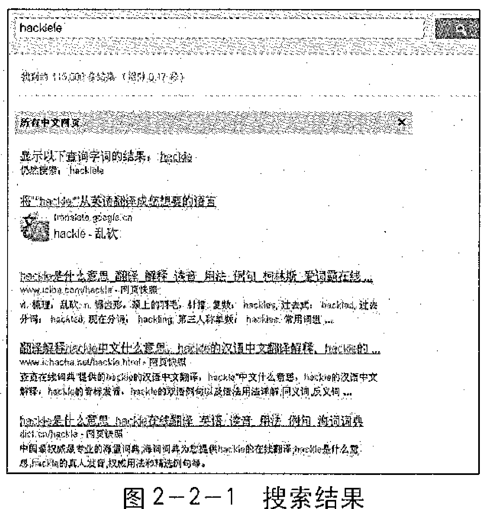

以上就是社会工程信息收集中最常用的 Google Hacking 搜索语法。大家仔细看看就会明白。说白了这些搜索语法都是一些很简短的英文单词，只要你阅读清楚了语法说明，多多使用即可掌握这些常用的搜索语法。

| 语法 | 说明 | 例子 |
|---|---|---|
| inurl: | 限定 URL 中包含关键词 | inurl:xxx |
| intitle: | 限定标题中包含关键词 | intitle:xxx |
| site: | 限定站点范围 | site:example.com |
| filetype: | 限定文件类型 | filetype:pdf |
| related: | 查找相关站点 | related:example.com |
| cache: | 查看缓存页面 | cache:example.com |

图 2-2-2 Google Hacking 基本语法

> LoveAngel 乱语：文中介绍的 Google Hacking 语法都是比较简单、比较基础的语法。如果想学习更多的组合应用，大家可以通过搜索引擎进一步学习。另外通过 Google Hacking 技术也衍生出了很多工具，其中最出名的就是“挖掘机”，这款工具可以根据关键词轻松找到想要的信息，可自行下载体验。

#### 2.2.2 关键字+语法=Google Hacking

张杰先通过 ID 来判断为什么入侵者要取 hacklele 这个名字。hacklele 这个 ID 可以拆分为 hack+lele，因为 hack 是一个单词，并且 hack 为英文 hacker（黑客）的简称。这里 lele 可以认为是一个代号，或者也可以认为是某个名字的缩写或小名。嗯，看来可以将这个 ID 解释为：黑客 lele，张杰自言自语道。

```text
intitle:hacklele 黑客
```

张杰尝试组合了搜索语法，在谷歌的搜索框内输入 intitle:hacklele 黑客，然后回车，这次只有 1 条搜索结果。如图 2-2-3。

点击搜索结果，IE 浏览器自动打开，在新的页面显示具体内容。在这个网页中张杰看到了他的论坛 UID：11519，如图 2-2-4。同时我们找到了 hacklele 给张杰留下的“线索”——他的 QQ 号码。

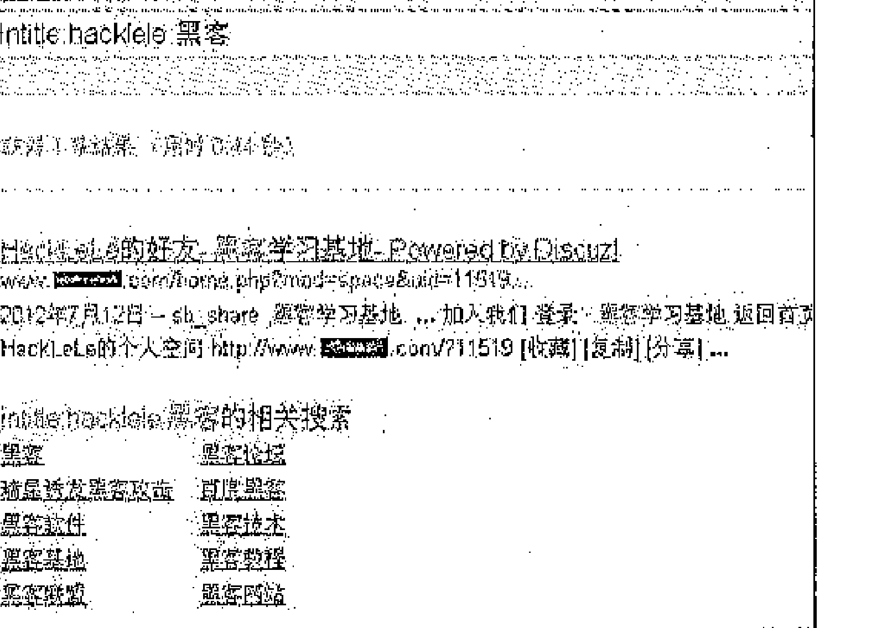

图 2-2-3 初步搜索结果

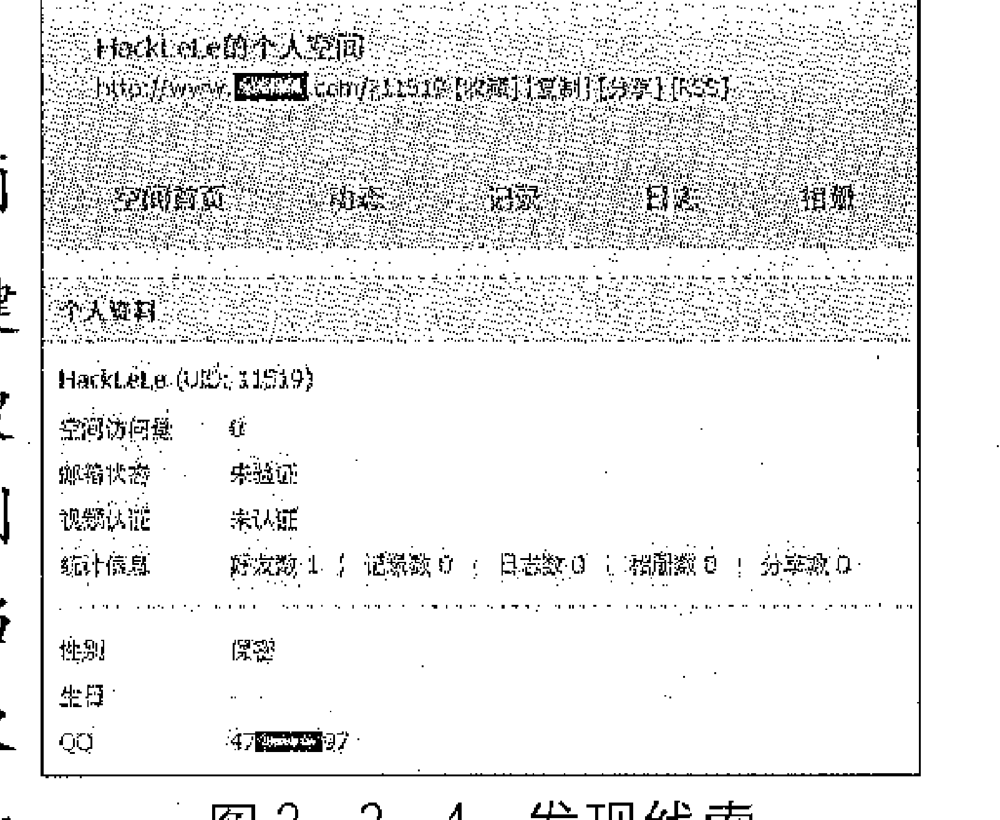

图 2-2-4 发现线索

> LoveAngel 乱语：简单的语法 + 正确的关键词，再配合威力强大的搜索引擎，轻轻松松就找到了入侵者留下的痕迹。当然我们并不能确定初次的搜索就能够获得有效的信息，但是这是最简单，也是最直接的方法。就连元芳都知道 Google Hacking。狄仁杰：“元芳，此事你怎么看？”元芳：“大人，此事必有引擎，我们要好好搜索一番。”后半句台词纯属本人添加，如有雷同，绝对抄袭。

## 第3章 SNS，信息泄露的重灾区

除了搜索引擎之外，SNS 应该是信息泄露的重大源地之一。Social Network Site Services 简称 SNS，中文译为社交性网络服务，专指帮助人们建立社会性网络的互联网应用服务。国内 SNS 主要分为两种模式，而类 Social Network Site 服务侧重于熟识的人（亲戚朋友）联系，例如 98、51 等平台为代表。

由于大多数 SNS 社区站都要求注册用户填写真实信息，甚至注册时要求上传身份证号码、毕业证书复印件、学历证书等，因此你一旦注册这些信息的真实性很难保障。而在这些 SNS 平台中，有很多人经常喜欢发布一些关于自己生活中的事情。你和朋友的旅行照片、你不经意说的一些话、你发表的那些感情经历、你和朋友在日常中的趣味话题等，都是很容易让犯罪分子进行分析的内容。换言之，即使你做这些都是很正常的行为，如果这些信息被有心人利用，那么很可能带来意想不到的麻烦。

正是，假如这些问题出现了，那么你会希望这些 SNS 网站提供怎样完善的安全保障。

### 3.1 最大的泄密者

张杰通过 Google Hacking 找到了入侵者的 QQ 号后，马上通过 QQ 的添加好友功能来看看该 QQ 能够发现什么更为有用的信息。如图 3-1-1。

> “已经找到那孙子的 QQ 号码了。”张杰兴奋地说道。  
> “你小子也够胆大的，敢在太岁头上动土，这次让我好好代表月亮教训教训你！”

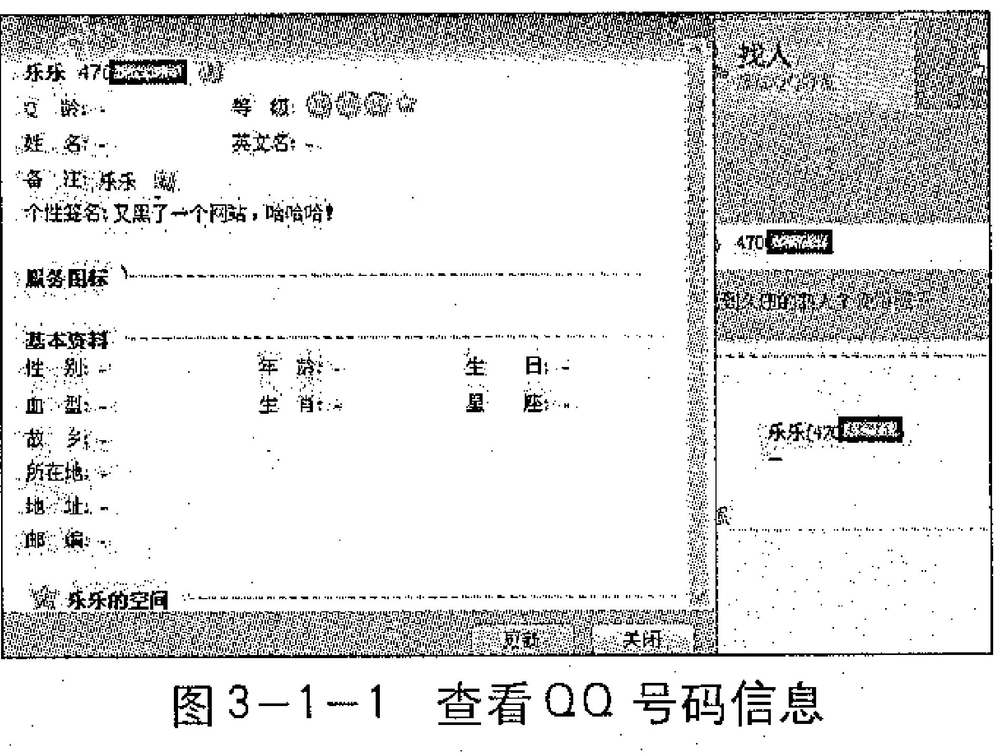

通过 QQ，在基本资料处看到一个微博地址。目测是那小子的个人微博，不过还是一步一步来，先看看 QQ 空间好了，暂且把微博丢在一边，反正它也跑不了！

张杰打开了自己的社工库，这里记载着曾经被他使用社会工程攻击的所有人的名单。此时，在这个库里又多了一个名叫 hacklele 的 txt 文件，将已经收集到的信息录入进去。

在记录好已经收集的资料后，张杰打开了 hacklele 的 QQ 空间，想从他的空间里得到一些关于这个脚本小子的个人信息。原想在空间里找找有价值的线索，却发现里面尽是一些被攻击的网站空间动态。如图 3-1-2。


> “没想到这小子黑站的频率还挺高，有点意思。”

张杰一边思考，一边继续翻阅着入侵者的 QQ 空间，留言板没东西，相册也没照片，咋办呢？看看“说说”里有没有什么可利用的线索。由于 QQ 空间被 hacklele 打扮得花里胡哨，张杰找了半天才在一个不起眼的地方找到了被“隐藏”的说说。

> LoveAngel 乱语：国内的社工一般都是以 QQ 为突破口。因为 QQ 的用户基数大，涉及面广。并且很多人都会在 QQ 的相关业务里填写自己真实的资料。所以通过对 QQ 的分析，比如空间、微博、积分兑换、个人中心等相关业务的查询，就能够分析出来目标的一个基本情况。建议各位把一些相关信息全部设置为仅自己可见，并且开通和使用限制登录等功能，让 QQ 泄露个人信息的几率最小化。另外随时记录收集到的资料，是一个社会工程师应该养成的良好习惯，你用记事本也好，Word 也好，记得随时保存。因为，你不知道会发生什么意外，机器就会重启、蓝屏甚至……

#### 3.1.1 生活泄密王之一——空间说说

hacklele 的空间说说几乎是每天更新 1—2 条。这小子是个空间控啊，这么喜欢随时随地分享自己干了什么？张杰仔细地查看了 hacklele 的说说，绝大部分都是在写自己今天又做了什么事，入侵了哪个网站，获得了谁的赞美。

通过对该空间说说的查看，一条“祝我自己 20 岁生日快乐”的说说引起了张杰的注意。

通过九型人格初步判断，这个名为 hacklele 的家伙应该是倾向于第三型人格——成就型，虽然他知道自己做的是错误的，但是他更认为我若没有成就，就没人爱我。好胜心强，所以总是做出这种平常人似乎无法做到的事情，通过入侵网站并破坏，来证明自己，希望自己被他人认同。对待这种人往往最简单，多认同他就很容易取得他们信任。

张杰继续一页一页地查看着说说，忽然他看到了一个经过压缩的短网址链接。如图 3-1-3。

虽然那个链接没有注明是什么链接，但是张杰突然有种异常的兴奋，因为多年的信息收集经验告诉他，如果一个网址被自动压缩成了短网址，那么一定是个很长的链接，而往往长链接都有重要用途，可能带着什么有趣的“小秘密”。

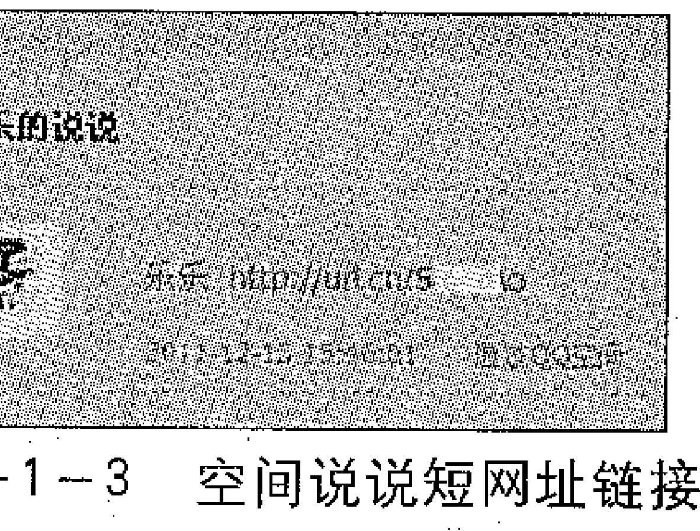

图 3-1-3 空间说说短网址链接

> LoveAngel 乱语：一般对于目标空间的任何链接我是都不会放过的，哪怕点开之后是个带病毒的网站我也会冒险看一下。因为我们要像 FBI 探员一样，不能放过任何蛛丝马迹。当然，遭遇病毒网站的几率应该不大，至少我个人觉得不会有哪个蛋疼的人会在自己的空间留下那种危险的东西；至于恶搞的网站倒是很有可能，心理素质承受能力比较差的同学要千万注意。

### 专业术语解释

**九型人格**：九型人格（Enneagram），或称作九柱性格学，是一种性格标签型分类，基本上把人的性格分成九类。阐明九型人格相关的图案称为九形图、九宫图、九柱图、九芒星等。以下是九型人格的主要类型，大家可以看一下自己属于哪种类型。

- **完美型**：完美者、改进型、捍卫原则型、秩序大使
- **全爱型**：成就他人者、助人型、博爱型、爱心大使
- **成就型**：成就者、实践型、实干型
- **艺术型**：浪漫者、艺术型、自我型
- **智慧型**：观察者、思考型、理智型
- **忠诚型**：寻求安全者、谨慎型、忠诚型
- **活跃型**：创造可能者、活跃型、享乐型
- **领袖型**：挑战者、权威型、领袖
- **和平型**：维持和谐者、和谐型、平淡型

#### 3.1.2 生活泄密王之一——朋友网

张杰打开那个短链接，发现是腾讯的朋友网。如图 3-1-4。

> “这可真是踏破铁鞋无觅处，得来全不费工夫啊！”张杰笑道。

这次除了名字，还获得了更多的个人信息，并且通过联系方式可以确定应该是同一个人。

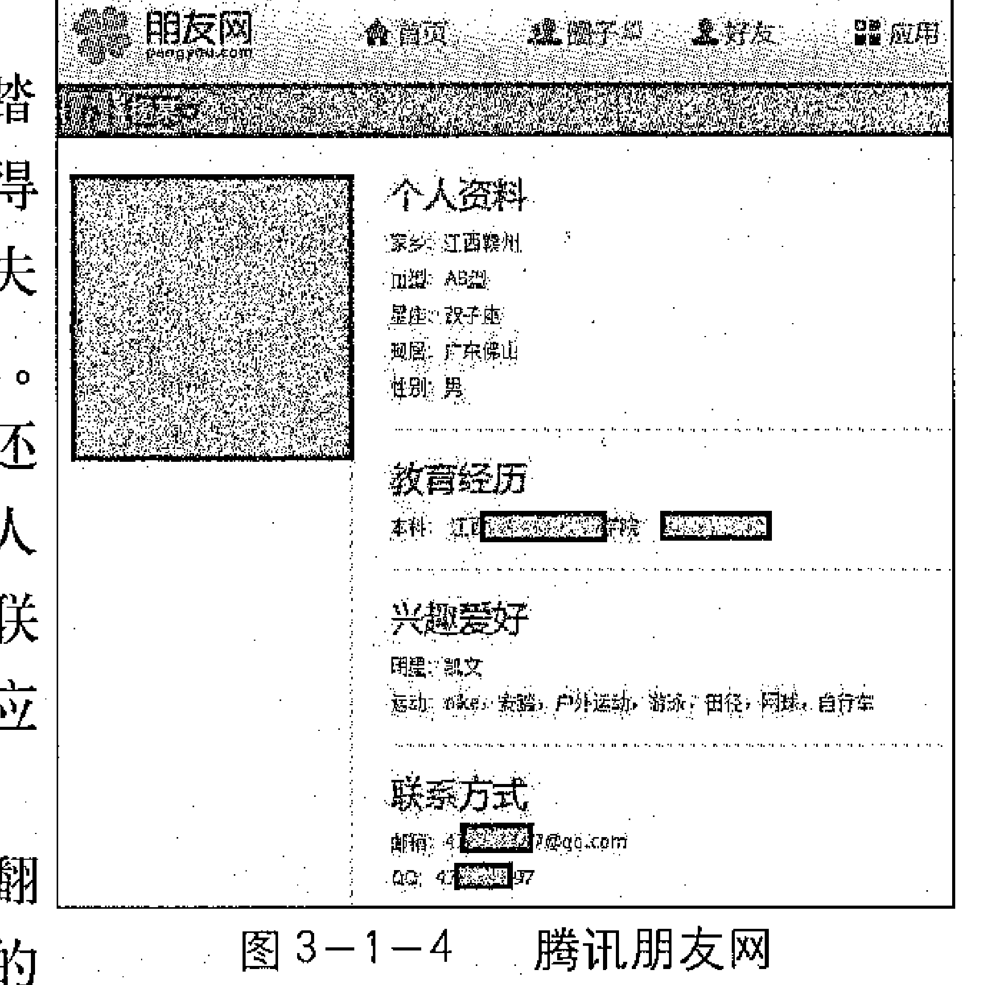

张杰仔细地翻阅这个“杨某”的资料。“杨某，杨某，难道是叫杨乐？”张杰心里默念，盯着电脑继续往下看。喜欢的明星，凯文？哎哟，看来也是个黑客技术爱好者。不过他的思想也够奇葩，名字写什么杨某，这么怕被人知道自己叫什么吗？还好朋友网的名字是不审核的，要是审核了这样肯定通不过！

通过朋友网，我们获得了杨某的照片、家乡、血型、星座、现居地等个人信息。当务之急还是先把新获得的资料记录下来……然后再开始更深入的社工。

> **@LoveAngel 乱语**：先是通过 QQ 空间让我们发现了杨某人的腾讯朋友网，再通过腾讯朋友网挖出了他的个人资料，在此“表扬”一下杨某人，资料填写得那叫一个详细……在此建议各位网友，在网上填写相关信息的时候，如无必要，切忌填写自己的真实信息。因为你不知道这些信息如果被别有用心的人所获得，会产生多大的麻烦，而且这些信息还是你自己亲手填写上去的。

### 3.2 网络与现实

看着已收集到的信息，张杰在思考着下一步自己还需要关于 hacklele 的哪些信息。如图 3-2-1。还是先去搜索引擎上找找这个 ID 还有没有别的信息！搜索什么关键字好呢？在已知的所有信息中，最常用的应该是 QQ 号。那就试试搜索 QQ 号吧！在一声响亮的回车之后，更多的资料出现在了屏幕上。如图 3-2-2。

www.xxx.tk？乐乐’s Blog？原来这小子还有个人博客和域名，也许能够在他的博客发现更多的有用信息。如图 3-2-3。

hacklele 的百度空间被张杰里里外外地翻了一遍，没有发现什么有价值的信息。空间内的大部分文章是以转载为主；虽然文章更新频繁，但是原创的技术文章少得可怜，由此初步判定 hacklele 的技术水平不高。

白兴奋一场，以为能找到更多的信息呢。不过也还好，知道了他所拥有域名：www.xxx.tk。既然他把 QQ 号作为百度 ID，那么现在可以考虑把 QQ 号作为一个新的常用 ID 来进行深度搜索。

此时张杰又想到了一个新的思路。那就是在收集完资料后，破解域名的管理密码来进行域名劫持攻击，以此来报复他一下。当然这是后话，根据当前所掌握的资料进行分析，他既然有百度 ID，并且还经常更新百度空间，所以现在的突破口就是通过对百度来获取更多的信息。

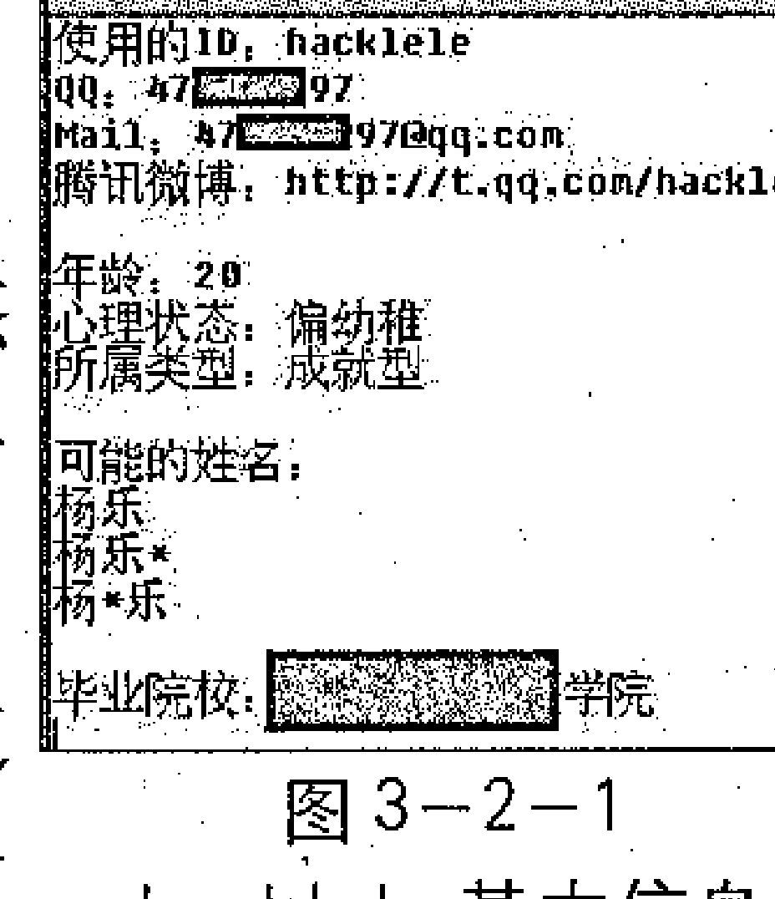

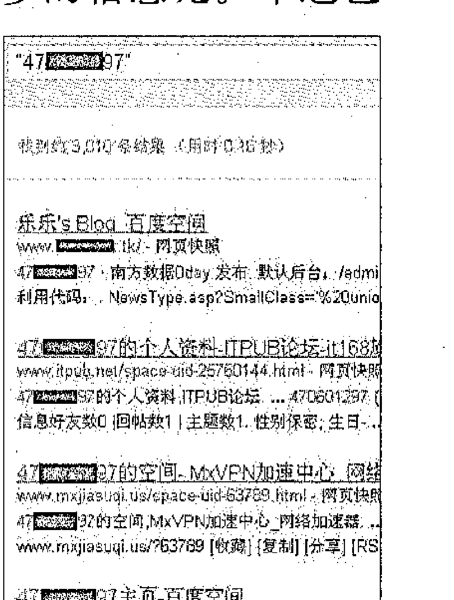

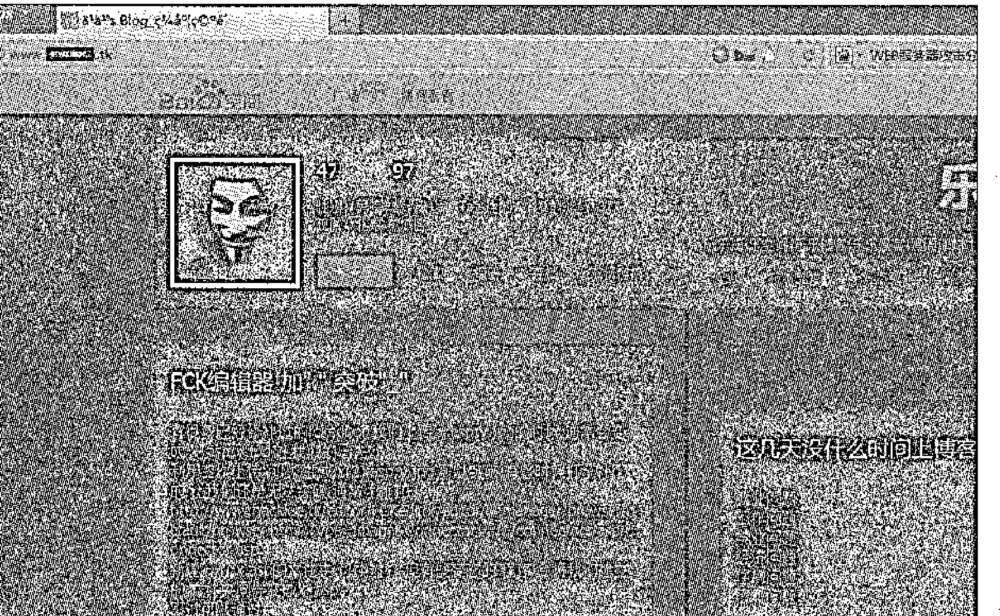

> LoveAngel 乱语：通过对 hacklele 的 QQ 号码进行搜索，得知了他还拥有个人博客以及域名。但是打开该域名之后才发现，原来使用的是百度的个人空间，域名只是设置了跳转。张杰通过对百度空间的查看，发现 hacklele 虽然文章更新得比较频繁，但是个人原创技术类文章几乎全无。推断出 hacklele 技术一般，而且这个百度空间是他经常使用的。接下来就是要深入挖掘 hacklele 的百度空间，看看能够找到更多的信息。其实很多人都会在百度空间上上传一些个人照片、私密资料的。就像我曾经在某人的百度空间上看到了他写给某人的一些情话……

### 专业术语解释

**tk 域名**是网络上最容易申请到的免费域名之一，由欧洲荷兰的 Dot TK 域名服务商提供域名服务。由于免费申请被滥用，在国内几大搜索引擎中被封杀，几乎失去了顶级域名所拥有的价值。

**域名劫持**是互联网攻击的一种方式，通过破解管理域名的邮箱账号来找回域名管理密码，或直接破解域名管理密码，最终目的是把目标网站域名解析到错误的地址，而达到无法访问正确目标网站的目的。

#### 3.2.1 百度ID

张杰先登录了自己的百度账号，在地址栏中把用户名替换成 hacklele 的百度 ID，得到链接：http://www.baidu.com/p/47xxxxx97，然后访问。如图 3-2-4。在 hacklele 的个人主页中，发现他常去的贴吧（喜欢的吧）有 7 个。如图 3-2-5。

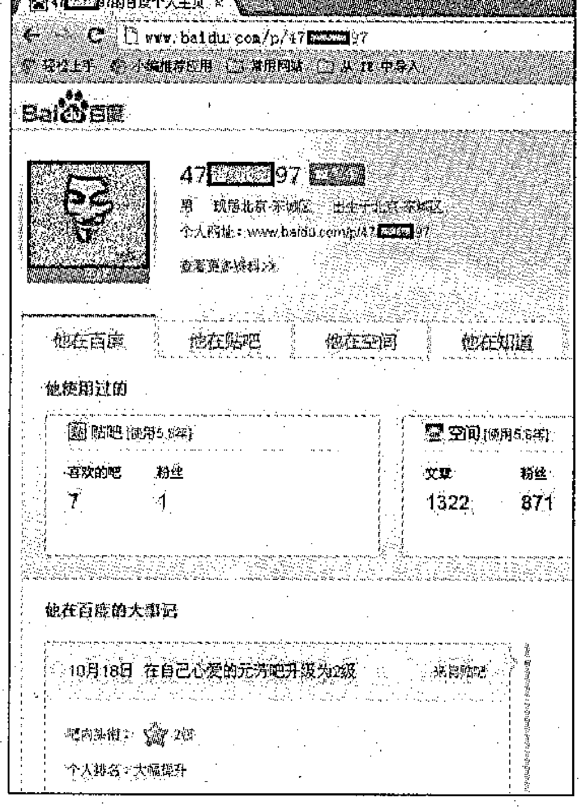

> “挺聪明，居然懂得把已发过的帖子隐藏起来呢？我还以为能傻傻地给我收集信息呢。”张杰的收集信息之路一直进行得很顺利，让他感觉很没挑战性，现在发现终于碰到了一点点的阻碍，顿时觉得这次的目标有点意思。如图 3-2-6。

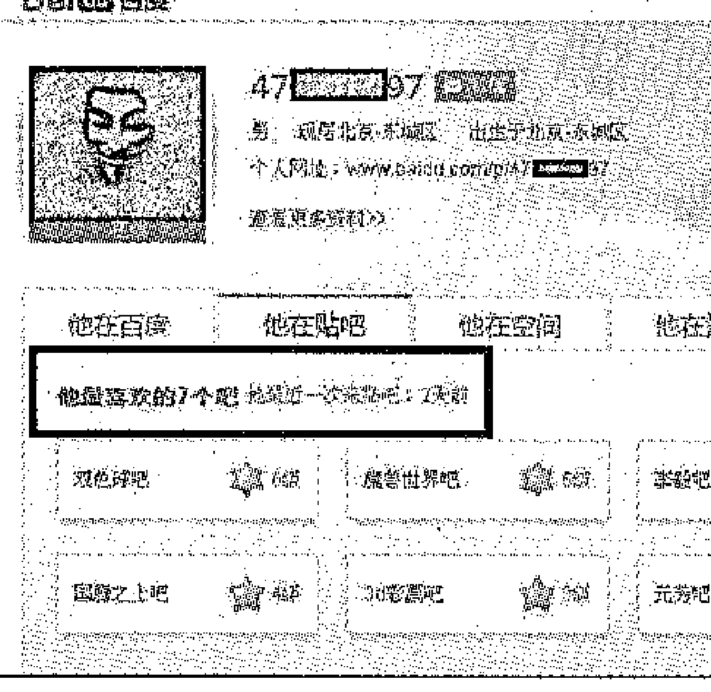


> **LoveAngel 乱语：** 国人使用百度空间作为个人空间的人还是很多的。第一是稳定，至少百度的服务器不会突然抽风。第二就是使用起来非常简单方便。既然是个人空间，肯定会涉及到一些个人信息、日志、相册等……

#### 3.2.2 人多力量大

“现在怎么看到他发过的帖子呢？”虽然张杰感觉自己的斗志被 hacklele 隐藏帖子这个行为给点燃了，不过被隐藏的帖子似乎没办法看到呀，难道要去黑了他的百度 ID？或者尝试绕过百度隐藏帖子的限制？

张杰在百度上找了很久的资料，也没有想到如何绕过隐藏限制。“算了，自己研究！我就不信这个小小的隐藏限制还能拦得住我？”说着，张杰拉起了袖子，似乎要大干一场的样子。

一个下午过去了，张杰仍在“啪啪啪”地敲着键盘，烟缸里的烟头也比早上多了几个，看来他依然没想出如何破解这个限制。

“按原理来说应该是没问题的啊！怎么还是不行？”张杰无奈挠了挠头，又点燃一支烟，深深地吸了一口。

“还是发群里问问吧，人多力量大！”如图3-2-7。

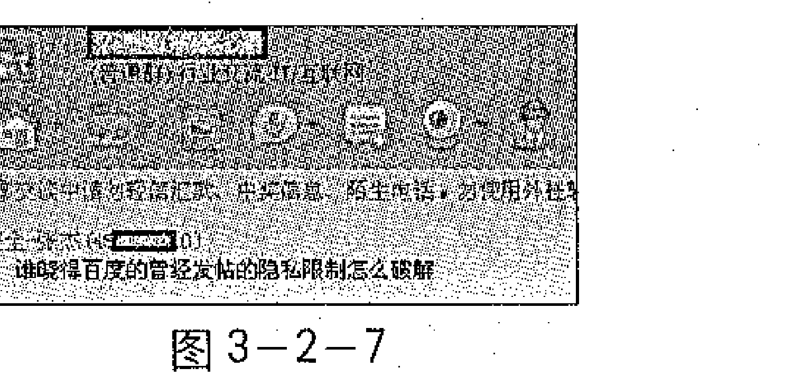

大约半个小时之后，群友发来了一个链接，张杰打开一看，是一个安全网站。在这个安全网站上，有人已经反映过百度贴吧其实存在隐私泄露问题，利用的是查看某人的过往发言链接，再利用百度的某公共查询接口，就可以获得他曾经的发言。如图3-2-8。

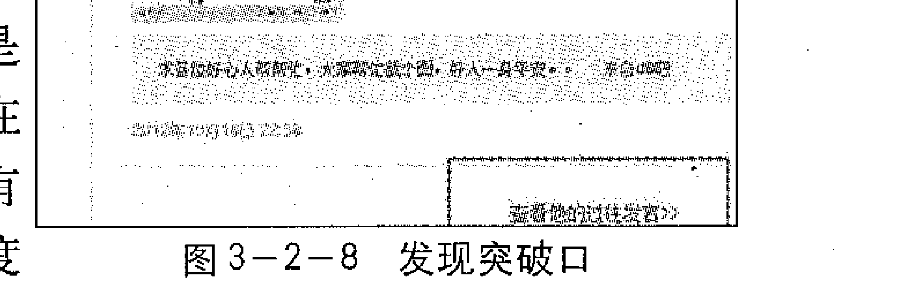

忽然有了突破性的发展，张杰兴奋地叫了起来：“太好了！踏破铁鞋无觅处，得来全不费工夫啊。早知道在群里吼一嗓子就解决了，我还在这纠结这么半天。”

但继续往下看时，张杰的表情慢慢凝住了。虽然看到了漏洞，不过这个漏洞似乎早已被百度的安全人员看到了，而且被直接忽略。理由是：那个所谓的“贴吧的历史贴隐藏限制突破方法”其实只是利用了百度贴吧公开的查询接口，并不算是漏洞。如图3-2-9。

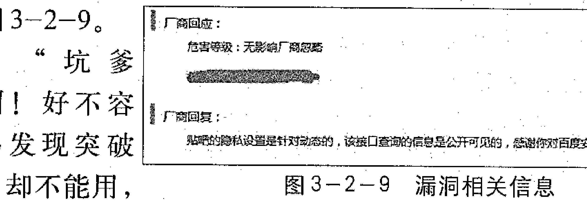

“坑爹啊！好不容易发现突破口却不能用，怎么做！”张杰突然有从天堂一瞬间掉到地狱里的感觉。“不对，这个问题的提交是有理有据的，难不成图片还是PS的不成？虽然被忽略，不过图片跟我想要的东西还是很像的，不如先试试再下结论。”

“文章里说随便打开一个ID，直接将滚动条拉到最下面，就能看见一个过往发言的链接。”张杰按照漏洞文章里说的，随便找了个ID想按图索骥，却没有找到图中所说的“过往发言”，只有一个更多帖子。如图3-2-10。

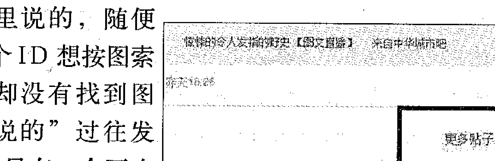

“我靠！难道官方人员说是无影响，私底下默默地修复了？”张杰感觉自己被忽悠了，难道要换思路不成？“不，凭多年跟安全人员打交道的经验，就算你修复了，肯定也还会有漏洞。”张杰心里默默想到。

✿LoveAngel 乱语：当有一些问题遇到暂时性阻碍无法解决的时候，可以借助第三方的帮助，例如QQ群。所谓人多力量大，众人拾柴火焰高，三个臭皮匠顶个诸葛亮。再有就是一些漏洞平台，例如乌云。在上面可以查询相关漏洞，这些漏洞没有利用方法，但是有可能让我们在迷茫中看到前进的方向，找到突破口。

#### 3.2.3 公共接口还是泄露隐私接口？

张杰继续沿着文章中所提到的思路想找出一些蛛丝马迹。“果然没修复完全啊！天无绝人之路！”张杰在另一个不常上线的ID找到了那个期待已久的“查看他的过往发言”。如图3-2-11。

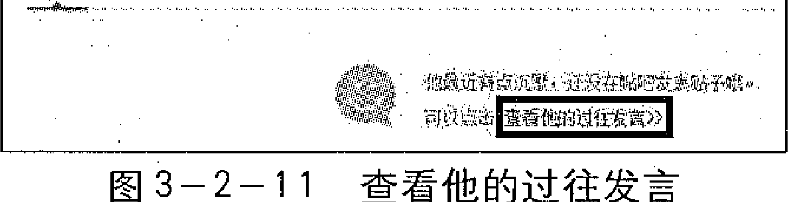

图3-2-11 查看他的过往发言

点开链接之后，按照文中所说将链接当中的un=xxx改成了想要查询的ID号。http://tieba.baidu.com/f/search/ures?ie=utf-8&un=47xxxxx97&from=prin，随着回车键的落下，张杰如愿以偿地看到了自己想要的信息。如图3-2-12、3-2-13。

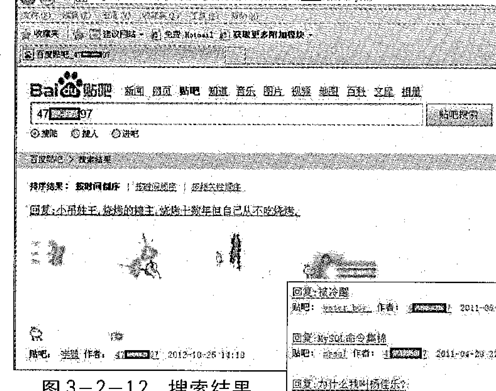

图3-2-12 搜索结果

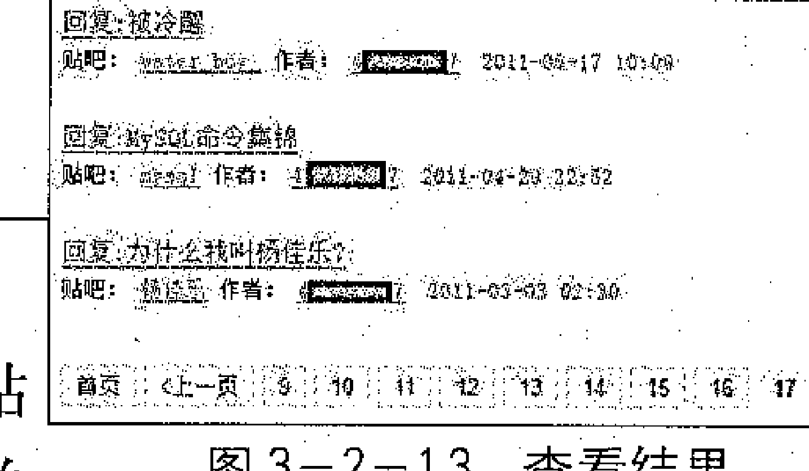

图3-2-13 查看结果

hacklele很大意，以为自己隐藏了所有的发帖记录就无法被人找到，张杰在hacklele的贴吧发言历史中找到了关于他的许多信息，甚至名字和家庭住址都被一一找到。如图3-2-14。

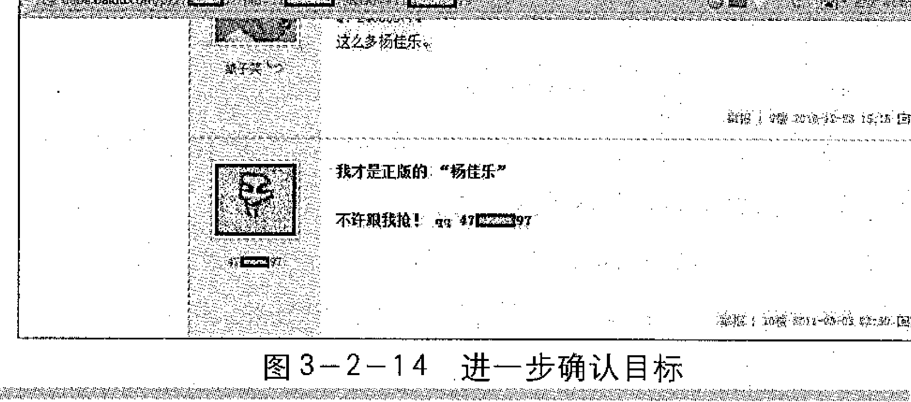

图3-2-14 进一步确认目标

✤LoveAngel 乱语：当我们在社工的时候，有些漏洞的利用我们要去耐心地寻找，文中的张杰就是通过耐心的寻找，才找到了能够让我们利用的突破口，不得不说社工靠的就是运气、思路和经验。也许你第一次就会轻松找到能够为我们所利用的突破口，但是如果运气不好的话，可能会很长时间没有进展，遇到这种情况，我们能做的就是坚持、坚持、再坚持。当你全身心专注去做某件事情的时候，你总能想到解决的办法。

### 3.3 你在哪？做了什么？我都知道！

> “原来叫杨佳乐，看来我之前的猜想的姓名组合杨*乐是正确的，总体说来百度贴吧让我收获颇丰啊，不仅弄到了他的名字，连家庭地址等重中之重的隐私信息都获得了！”

在将杨佳乐的地址和名字记录到hacklele.txt后，张杰就向之前文中提到的腾讯微博进发了。

#### 3.3.1 随时随地泄露隐私

杨佳乐的微博大部分是关于技术方面的内容，但在40多页的微博中还是找到了许多敏感信息。如图3-3-1、图3-3-2、图3-3-3。

张杰分别从图3-3-1和3-3-2中得到信息：杨佳乐是河北保定人，不过属于北漂一族，由于过于普通，一般。通过对图3-3-3所显示的地址，初步推断为公司地址，具体位置为朝阳区的某中心西楼。杨佳乐为了拓展业务还泄露了自己公司的电话号码，张杰通过对电话号码的查询确定了杨佳乐所在公司的具体位置在此楼的XOX室。

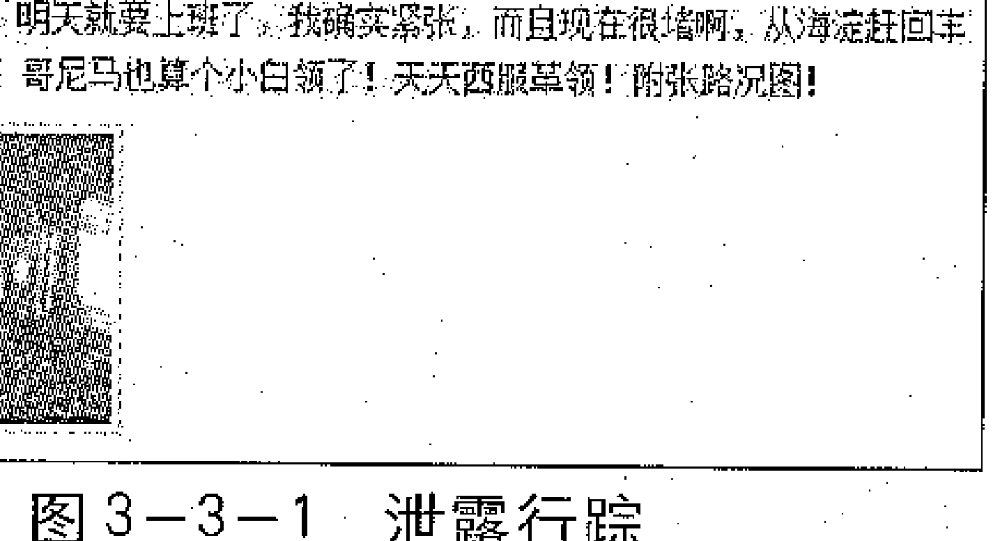

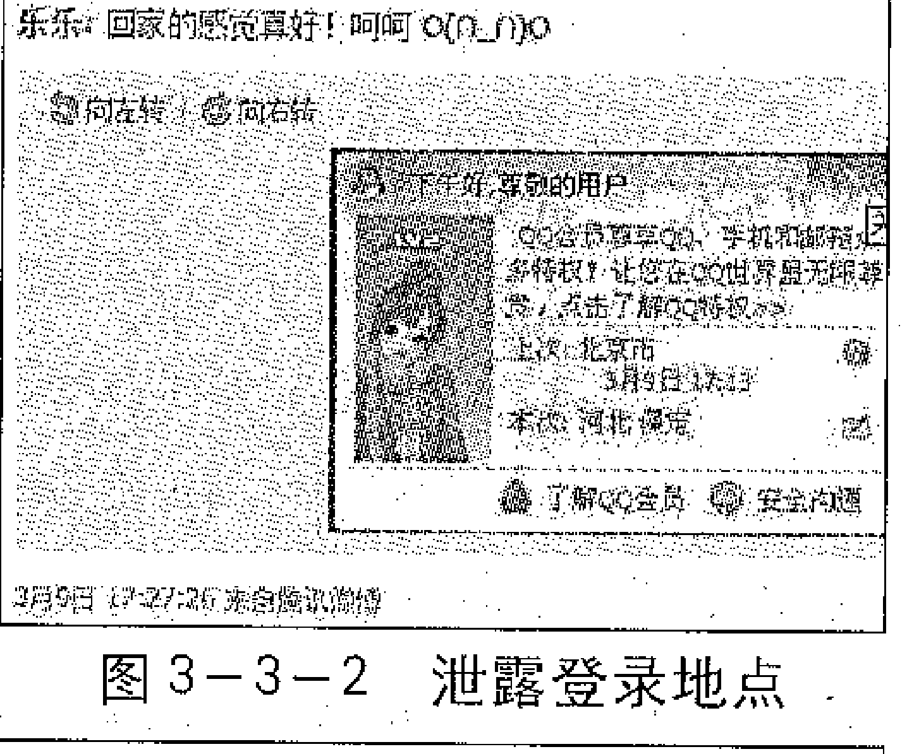

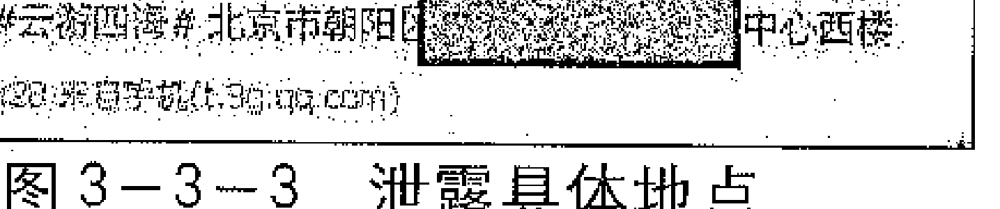

至此张杰已经获取到了关于杨佳乐的所有真实信息，接下来，他准备再通过现有的资料进行搜索，看能否收集到杨佳乐更多的信息，例如手机号码……

✤LoveAngel 乱语：看到这里，可能有人会问，你是怎么获得电话号码的？又是怎么确定公司具体位置的？我只能说，由于这部分内容涉及到泄露个人隐私，所以没有写得太明白。不过思路还是可以提供给大家，通过微博的内容，我们确定了hacklele的公司详细地址，然后文中也说了，为了拓展业务，他本人自己公布了公司的电话号码。至于如何确定位置，拨打该公司电话，向客服小姐询问相关业务以及公司具体地址，在询问过程中找寻机会询问杨佳乐是否为该公司员工，我相信热情的客服小姐一定会告诉你的。当然，如果你魅力足够大的话，把客服小姐聊成自己的女朋友也是可以的……

### 专业术语解释

微博即微博客（MicroBlog）的简称，是一个基于用户关系的信息分享、传播以及获取的平台。从09年8月开始新浪成为门户网站中第一个微博服务平台之后，截至2011年12月，中国微博用户总数达到2.5亿。在2012年的11月，可以说平均2-3个人就有1个人有属于自己的个人微博。玩微博，买的就是：随时随地分享身边的新鲜事儿。可有谁想过你在网络上过多地分享你的生活，会导致你的隐私严重泄露？而且最后还得承担由于自己的过于爱分享，而让“居心不良”的人随意收集你的个人信息。

## 第4章

## “十面埋伏”：泄密无处不在

> 网络，有人喜欢夸耀自己的经历，娱乐话题在网络上随意传播；有的人对陌生人毫无戒备，随意留下个人联系方式和住址；希望能吸引注意并得到存在感……可你是否想过，也许你泄露的信息被人盯上，而那个人不是别人，正是坏人盯上你的开始。

### 4.1 Whois 信息查询

张杰打开了杨佳乐的域名：www.xxx.tk，但是直接跳转到了百度空间，说明了杨佳乐对域名进行了解析，当访问该域名的时候自动跳转到百度空间。难道去黑他的百度ID吗？但是我还没掌握他的常用密码，不如先看看域名的Whois信息吧！

说着，张杰打开了Chinaz的域名Whois查询工具，但结果却似乎不尽人意。如图4-1-1。

Whois查询中并没有预想的那样显示出域名注册者的信息，如注册商、域名被创建、更新、删除的时间，甚至连管理者的邮箱都没有查到。怎么回事？难道工具出错了？显示的怎么是DOT TK官方信息？

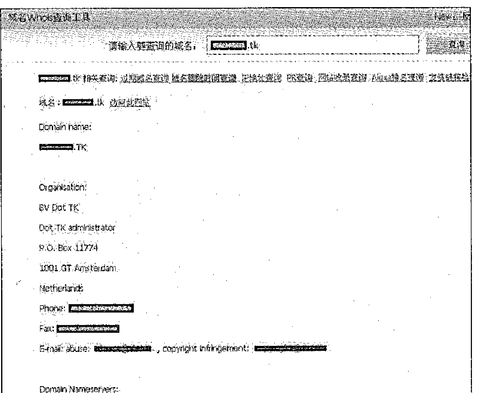

难道TK官方没给修改权限？还是说杨佳乐把域名的Whois信息改成了官方以此来防止信息泄露？知己知彼，百战百胜，我注册一个就知道了！

张杰打开浏览器在Dot Tk的网站上注册了一个名为：safezhangjie.tk的域名，在域名管理处找了半天也没有找到可以修改Whois信息的地方，只找到了修改解析操作页面。如图4-1-2。

> “看来跟我想的一样，唉，免费的域名就是不咋样，连个域名所属人都没办法更改。”张杰无奈地笑了笑。

“不过杨佳乐同学应该庆幸，否则说不定在Whois上又……”

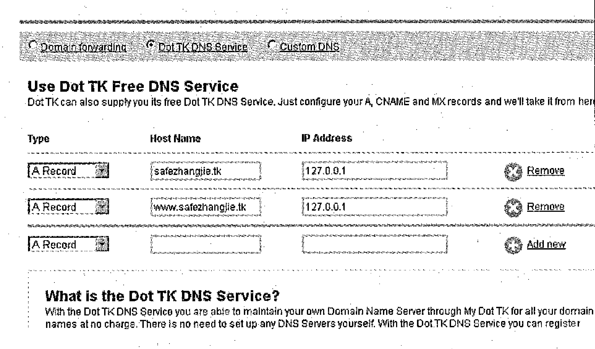

“既然Whois信息为空，还有哪里可以弄到更多关于他的资料呢？”张杰习惯性地点燃了一支烟，吞云吐雾起来。

每次遇到问题，手指一在键盘上闲下来的时候，嘴巴就闲不住。算了，先不搞了，搞了这么久常规信息，收集的思路和方法也用得差不多了，每当思路进到死胡同的时候还是休息一下比较好！张杰直接把烟灭了，转身向阳台走去。

> **LoveAngel 乱语：** 当我们发现目标有个人站点的时候，可以通过Whois查询该域名的注册信息，一般的域名注册者都会使用真实的注册信息来进行注册，但少数域名注册者会使用假的注册信息进行注册，当然这个注册信息在注册之后是可以多次修改的。但我们建议大家如果没有想卖这个域名的想法，尽量使用假的或者索性不填注册信息，这样你的资料就不容易被他人通过Whois查到了。

查询Whois建议大家到万网这样的大型域名注册商进行查询，因为他们是专业的域名注册商，数据更新得比Chinaz要快。作者本身就有这样的经历，在Chinaz查到的Whois信息与万网查到的不符，最后导致浪费了很多时间，最后证明万网查询结果是正确的，而Chinaz查询的是错误的。

### 专业术语解释

Whois（读作“Who is”，非缩写）是用来查询域名的IP以及所有者等信息的传输协议。简单说，Whois就是一个用来查询域名是否已经被注册，以及注册域名的详细信息的数据库（如域名所有人、域名注册商）。

### 4.2 网站备案查询

“我晕，光忙着帮王彬找黑客了，自己公司网站的任务还一点没做呢！据说昨天PR更新了，不晓得之前让朋友帮忙做的SEO有没有效果。”张杰想到公司的网站还没更新，刚离开椅子的屁股又重新回到了椅子的怀抱。他熟练地打开站长工具，麻利地键入了公司的域名，

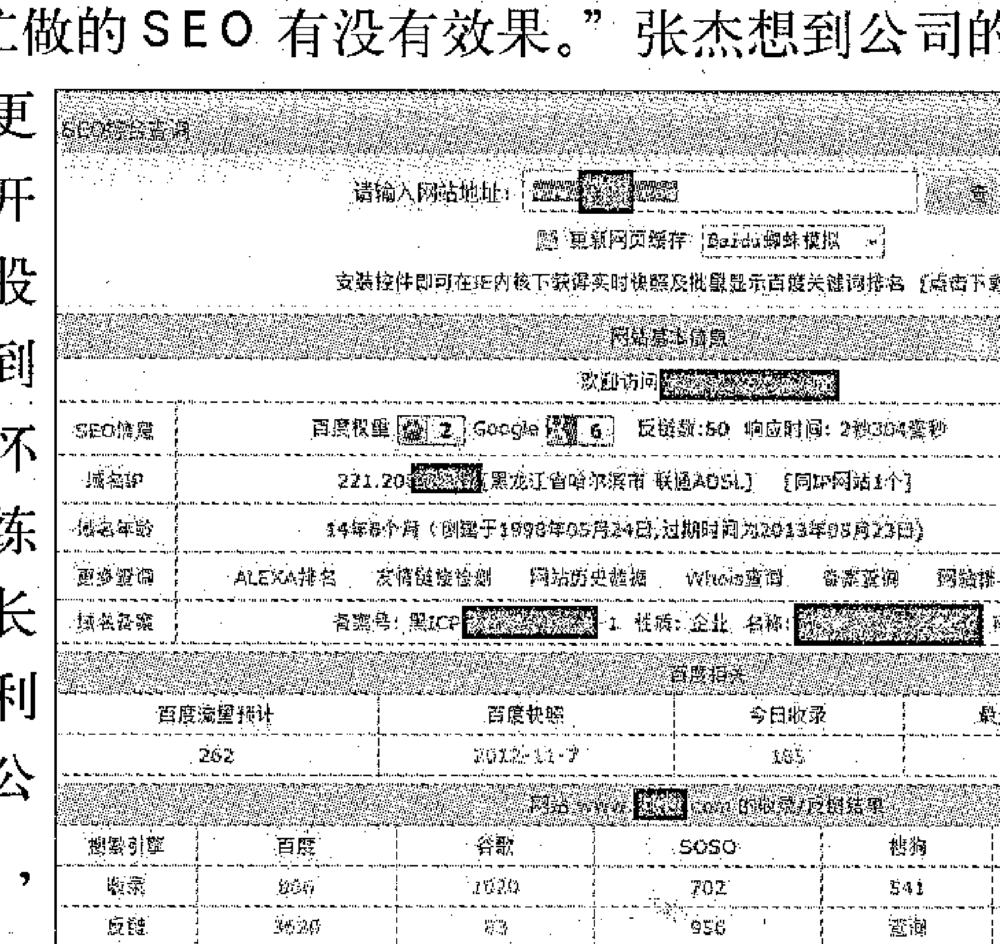

点击查询，关于公司网站的权重及收录信息很快地显示到了他的电脑屏幕上。如图4-2-1。

“不错！PR竟然上升到6了！”看着PR上升及网站的反链变得更多，以及公司网站权重提高了，心里暗暗地爽了一下，这下奖金到手了。张杰把目光从SEO信息栏移开，准备看看公司网站Alexa排名有没有上升，假如Alexa排名也有所上升，这个月也可以领到更多的奖金。

当他准备点击Alexa查询链接时，余光看到了在链接下面显示的域名备案信息。忽然，张杰似乎意识到了什么，将xxx.tk键入了网站备案查询的查询框内，但返回的信息却不是他想要的。如图4-2-2。

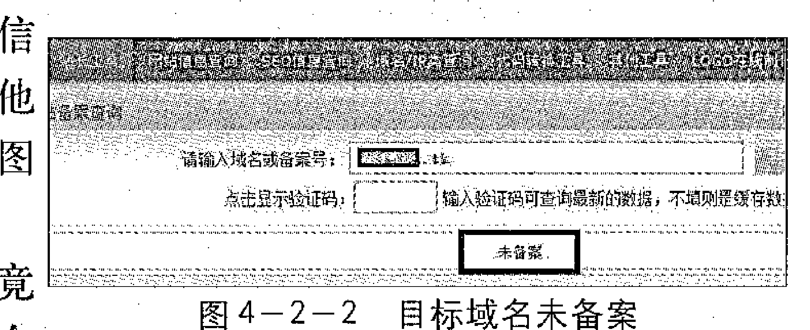

唉，我竟然奢望一个被所有搜索引擎唾弃的tk域名有备案，真是电脑用多了，连脑子都秀逗了！还是老老实实地查公司域名的Alexa排名去吧。

**LoveAngel乱语：** 张杰之所以去查询xxx.tk的备案信息，是因为他以为杨佳乐已经将xxx.tk这个域名进行了备案。假如杨佳乐备案了，那么张杰就可以通过查询域名的备案资料来获得更多关于杨佳乐的准确资料。虽然有可能查询的结果不尽人意，但是我们都要尝试一下，千里之堤毁于蚁穴，反正也就是几秒钟的时间，如果人品爆发，那就……你懂的。

### 专业术语解释

PR值全称为PageRank（网页级别），一共分为0-10 PR值。它是谷歌用来衡量一个网站好坏的重要标准之一。PR值越高说明该网站越受欢迎或越重要。

SEO（Search Engine Optimization）的中文意思是搜索引擎优化。通俗理解是：通过总结搜索引擎的排名规律，对网站进行合理优化，使你的网站在百度和Google的排名提高，让搜索引擎给你带来客户。

Alexa的网站排名是按照每个特定网站的被浏览率进行排名的。浏览率越大，Alexa排名越靠前。Alexa排名是目前用来评价某一网站访问量的一个指标。

备案是国家为加强互联网的监管而推出的规定。在中华人民共和国境内提供非经营性互联网信息服务，应当办理备案！未经备案，不得在中华人民共和国境内从事非经营性互联网信息服务。也就是说假如你想将数据放置在国内，就必须使用自己的真实资料来通过各个信管局进行备案。（网上是可以查询到一个网站是否已经备案及它的备案信息）

### 4.3 Alexa 的注册信息查询

这次的信息收集不是很顺利啊！算了，还是先查查Alexa排名吧，查完就去休息休息，折腾了一上午眼睛都疼了！

哎呦我去，PR增加了，Alexa排名反而下降了，这不科学啊！如图4-3-1。

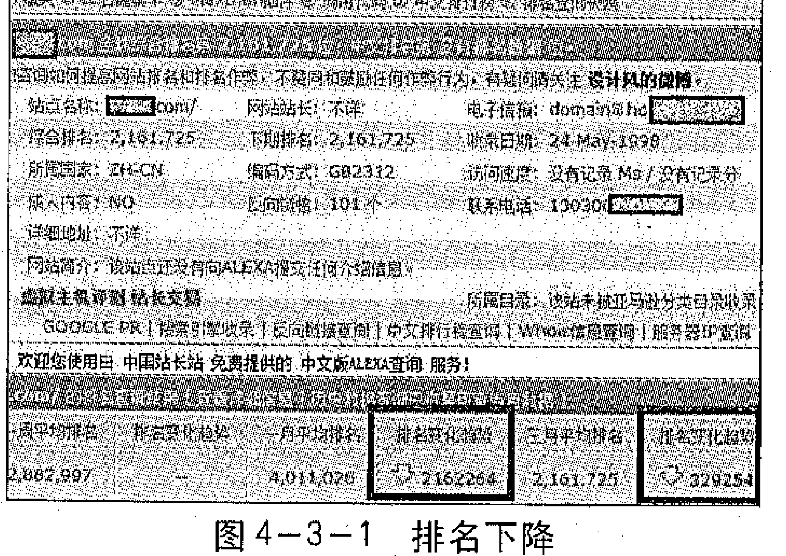

图4-3-1 排名下降

不管了，还是先出去休息一会儿。张杰再次离开椅子的怀抱走向阳台。“今天的阳光好温暖，好舒服。”张杰闭上眼，深深地吸了一口气。

“空气也不错，一直闷在房间里都快闷坏了，今天这么好的天气，下午约个妹子出去拥抱大自然，哈哈！”想到这，又闭上眼继续呼吸着新鲜的空气。

虽然张杰的身在阳台，但是心依然牵挂着如何找到更多关于杨佳乐的资料。他闭上眼，将今天上午的信息收集过程在脑海中重演，又操作一遍，看看信息收集的过程中自己是否有遗漏掉的地方。

突然，张杰想起了刚刚在查询Alexa的时候，返回页面上不仅有Alexa的排名信息，还有自己曾在注册公司的Alexa账号时所填写的邮箱和联系方式。假如杨佳乐也有注册这个Alexa账号，而且填了真实的联系方式，那么在Alexa排名查询是否也能查到他的联系方式呢？

想到这，张杰迅速地奔回了自己的房间，重新打开了Alexa查询网站，键入了xxx.tk。这次返回的查询结果没有让他失望。如图4-3-2。

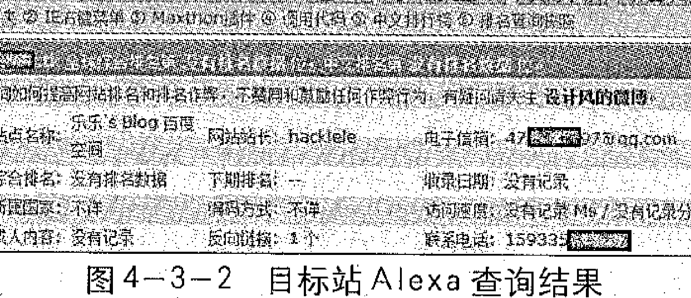

图4-3-2 目标站Alexa查询结果

“Yes! 电话到手！”张杰兴奋地拍了拍桌子。不过还是确定一下是不是他的电话，如果这个电话号码是他乱填的呢？在百度中直接搜索这个电话号码，结果显示这个电话归属地为河北保定市。如图4-3-3。

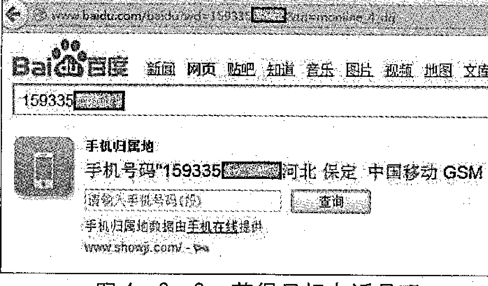

图4-3-3 获得目标电话号码

“皇天不负有心人啊，终于弄到了手机号码，这下能跟王彬交差了！”张杰心里盘算着：“一会儿把今天收集到的这些信息交给王彬，他们领导如果想处理这个入侵者，有了这些资料，想找到这个入侵者根本就是小事一桩。我的任务总算完成了！”

张杰将已收集到的资料重新整理了一遍，看王彬不在线就以离线的方式把整理好的资料发送给他。然后看了看表自言自语道：“又折腾我一个上午的时间！真麻烦，好在总算把这个入侵者找到了。现在先去吃个午饭，然后约个妹子开始我美好的周末吧！哈哈！”

**LoveAngel乱语：** 建议大家像张杰那样，在没有思路或者暂时进行不下去的时候，让你的屁股暂时离开椅子的怀抱，走到阳台或者窗户旁看看外面，如果有条件的话还可以晒晒太阳，放松你的眼睛，你的手指，还有你那聪明的大脑。也许在休息的某个瞬间你的灵感就到来了！当然，如果你家对面有个美女的话就更好了。别人我不知道，反正我站在窗户往外望去……那是一片春光无限，为啥？因为那是大学女生宿舍。

## 第5章

## 通用密码：条条大路通罗马

> 生活中的CSDN数据泄露事件后，大家或多或少都有了密码危机意识。某媒体曾披露一次小型泄密事件中，泄露用户密码包含纯数字密码、纯英文字母密码、纯中文密码和别人都在使用的“1234567890”，以及员工餐饮出现密码榜并高居榜首等。虽然这只是个案，但在计算机信息愈发普及的今天，密码安全已经成为每个人都应重视的一环。

### 5.1 莫名来电

张杰解决完hacklele的事情后心情好得不得了，边哼着小曲边把刚完成的香喷喷的蛋炒饭盛出锅。

“今天炒的蛋炒饭可是色香味俱全啊，就是不知道味道如何，尝尝先！”张杰看着自己做的炒饭口水都快流下来了，正准备试试炒饭的味道，他的电话忽然响了。

手机显示电话是来自哈尔滨，但号码是张杰从未见过的。是谁呢？知道我电话的人不多呀。张杰接起电话，但没有说话。

“喂！您好，是张杰张先生吗？”此时张杰更奇怪了，因为电话那头的声音他并不熟悉，可对方却能直接准确地报出张杰的名字。

“到底是谁呢？”张杰心里想。“是的！我是张杰，请问你是谁？找我有什么事吗？”

“你好，我是哈尔滨XX中介公司的，请问你淮河路江河小区的那套房子是否有出售意图？”

“中介？我从来没有在中介登记过出售房子啊？请问你们怎么知道我的电话号码呢？”

“如果您没有出售意图的话那我就不打扰了，再见！”

“你可以告诉我你们怎么搞到我电话号码的吗？”

“喂？喂？”

对方还没等张杰问完话就把电话挂了。看来是因为觉得张杰既然没有出售房子的意图，也就不再多费口舌了，所以直接挂了电话寻找下一个客户去了。

作为一个社会工程师，自己的资料竟然被一个中介公司得到，这让张杰感到很丢人。但他转念一想，一个中介公司可以得到一个如此注重个人信息安全的社会工程师的资料，那其他的普通网民们呢？想到这张杰就感觉后背阵阵发凉。

“算了，我还是先吃我的蛋炒饭好了，磨叽了那么久，饭都凉了。”张杰正准备继续完成喂饱肚子的艰巨任务，但电话又响了。“靠，吃个饭怎么这么多电话？”张杰看了看手机，屏幕上“王彬”两字在那不停地闪耀着。

张杰：“喂？王彬？你来感谢我的吗？不用客气，请我吃顿大餐就OK了。”

王彬：“是是，确实是来感谢你的！技术牛人就是不一样，一个上午就把那个小子搞定了！不过我还有点事要你帮忙！”

张杰：“还有事？那你说吧，不过恐怕今天没什么时间了，我约了妹子下午出去玩的！”

王彬：“这事对你来说小事一桩，你这么技术高超的牛人一下就能搞定！是这样，我们领导刚才给我打电话说让我不用管那事了，他已经在处理了。”

张杰：“那感情好，这样你不就省心了？”

王彬：“是省心了，但是我咽不下那口气啊！因为那小子我这个月奖金没了，我能这么轻易地了事吗？我刚才看了下你给我的关于他的资料，那小子叫杨佳乐是吧？”

张杰：“是的。怎么了？”

王彬：“我刚才还看到你给我的资料里有他的博客地址，好像是叫 xxx.tk 是吧？你帮我黑了吧！弄成那种我访问他的域名就可以显示我想要的内容那种！行不行？”

张杰：“晕，你啥时候也这么无聊了？我不干，我下午还有约呢，要干你自己干！”

王彬：“杰哥！再帮我一次吧！我明天请你吃饭，现在有电话进来，这事就这么定了啊。晚点聊！先挂了。”

没等张杰答应，王彬就已经把电话挂了。张杰无奈地挂了电话又看了看表，心想：“还有一个多小时，看在多年朋友的份上再帮他一把吧！不过一个多小时让我做到可以任意修改他的页面，这不是搞笑吗？他以为是拍好莱坞大片啊。算了，为了好好坑他一顿饭我就试试吧！”张杰三下五除二地把饭都扒拉到嘴里，又坐在了电脑前，准备彻底拿下 xxx.tk。

张杰坐在电脑前看着已经到手的资料却无从下手。

如果按社会工程的步骤来说，接下来就是尝试社工他本人或者他身边的人，虽然信息收集得差不多了，但是时间上比较紧迫，这可如何是好呢？

这时张杰忽然想起了刚刚那通由中介公司打来的电话。他们是怎么知道我的电话的，对了！昨天不是说某些大型技术网站的数据库泄露了，难道是我在那些网站注册的信息泄露了？”张杰边思考着这个问题边在百度上搜索着关于前几天某些大型技术网站数据库泄露的事件。

> ❀LoveAngel乱语：注册网站我有个习惯，要求写真名的时候，注册 Facebook 我就填袁脸书，注册 Yahoo 我就叫袁雅虎，注册 Baidu 我就写袁百度，注册 Google 我就写袁谷歌。今天接到个电话，问：是袁脸书小姐吗？我就知道，Facebook 的库被脱了……本笑话改编自网上笑话，纯属瞎编，请勿对号入座。

### 5.2 泄密门

不搜不知道，一搜吓一跳，这么久以来能让张杰这种久经网络的老手都吓到的恐怕只有这次泄密事件了。

从网上的报道来看，这次泄密的资料约有 6000 万条数据，也就是说有至少 6000 万的用户在本次泄密事件中中招。根据某安全网站爆料：除了此次泄密的 6000 万用户数据外，还有最少一个亿的用户资料已经泄密，但是没有在网络上被公开传播，仅在地下组织流传。“最少一个亿？”张杰看到这个报道后差点没惊得下巴掉下来，虽然他开始并不相信；但是看到了这些相关报道，他不得不接受这个已经发生了的现实。如图 5-2-1、5-2-2、5-2-3。

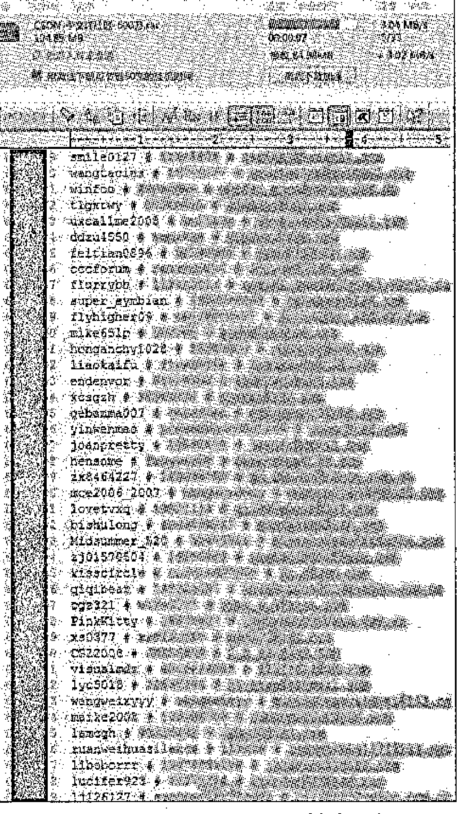

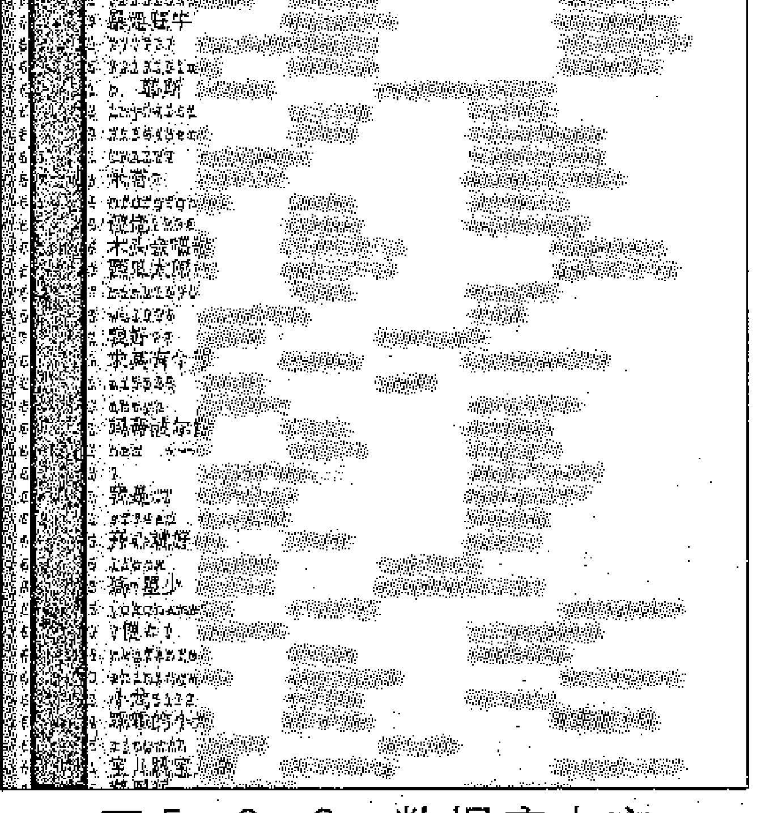

“没想到我才离开网络几天，就发生了这么大的事？这么多知名人士的账号都被盗取了？这些数据库泄露出来简直就是互联网的灾难啊！”

张杰赶紧在某安全技术网站搭建的“在线密码泄露查询网”（该站长动作快啊，把这热点抓住了），查了下自己的密码是否有泄露。结果其实张杰已经知道，但是还是让他吓了一下，自己的密码已经泄露。如图 5-2-4。

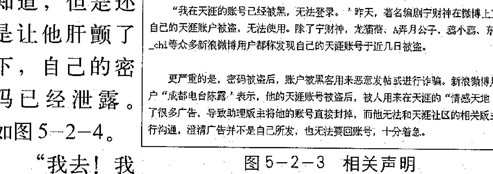


“我去！我的密码也泄露了？”张杰赶紧根据相关提示，登录自己常年混迹的论坛和网站，把密码统统修改了一遍。幸好发现得及时啊，不然被人搞了就名声不保了。

修改完密码后，张杰仔细地查看这关于此次数据库资料泄密的文章，他发现不仅是密码泄露，甚至连网站一些网购订单、房地产、网络游戏等数据库都被泄露了。

“难道他们就是通过这些泄密的数据库得到我的手机号码的？”虽然生米已经煮成熟饭，但是张杰还是怒火中烧，在心里对那些所谓的安全人员竖起了中指，嘴角露出了邪恶的招牌笑容。因为他想到，是不是可以从这次泄露出来的众多网站数据库中找到杨佳乐的密码。

并不是所有人都对密码泄露这种事情感到着急，他们并不把密码泄露或信息泄露当一回事。我猜杨佳乐也是一样，即使知道密码泄露了，他也最多只是改了像 QQ 这种经常用到的密码，至于那些不常用的论坛什么的估计不会修改。因为人都是有惰性的，而且是天生的。

张杰定了个闹钟以便提醒他该去约会了。如果 40 分钟内没搞定那就明天再说！和妹纸约会迟到的后果可是很严重的。

在百度找了很久，发现网络上那些公开的数据库下载地址已经无法被下载了。事情似乎闹得人尽皆知，影响范围很大，N 多下载地址都被封。不过功夫不负有心人，还是让他找到了一个 CSDN 数据库的下载地址。如图 5-2-5。

下载完成打开之后，他发现真的有 600 万之多的数据惨遭泄露。……

“先不管那么多，试试能不能找到杨佳乐的常用密码。”张杰打开搜索，键入了杨佳乐常用的几个 ID。


ID。“hacklele？不行！47xxxxx97？不行！邮箱试试？不行！”张杰输入了所有他找到的杨佳乐的所有 ID，发现都提示无法找到。“难不成我今天上午收集的信息都白费了？如果没错为什么找不到呢？”正当张杰疑惑不解的时候王彬又来电话了。

> **LoveAngel 乱语：**通过数据库泄露事件，希望大家能够提高安全意识。比如网上一些免费空间、网盘等资源，在注册时尽量避免填写真实的个人信息，更不要用你常用 ID 和密码进行注册。就算该站的数据库落入黑客之手，你也不会被殃及池鱼。前几天在网上看到一则新闻，就是有人专门打着“免费”照片空间的幌子吸引用户注册，从而收集用户的个人信息。大多数人在注册的时候，为了方便记忆，通常会使用相同的 ID 及密码。因此，当别有用心的人获得这些数据时，也就意味着你的个人信息已经赤裸裸地暴露了。所以，大家在注册不同的网站时，一定不要使用相同的 ID 和密码。切记，切记，不要因为怕麻烦而给自己带来更大的麻烦！

### 专业术语解释

**常用密码：**现在网上密码被盗的案例非常多，其中相当一部分账号被盗并不是因为电脑中毒，而是因为某个网站被黑客入侵，黑客从中得到了用户数据。

而很多人为了方便记忆，把 QQ 密码、邮箱密码、支付宝密码甚至网银密码都设置成一样的。我们把这种密码通称为常用密码。当然也可以从字面上来讲，也可以理解为经常用到的密码。

黑客得到用户数据库后，利用数据库中的密码顺藤摸瓜，尝试去登录 QQ 号、邮箱、支付宝、网银，从而盗取其中对黑客有价值的东西。

### 5.3 公开的密码查询网站

“张杰，你的密码是 zjsafe520 吧？”张杰刚接起电话就听见王彬洋洋得意的声音，不过能报出张杰这样高手的密码也确实值得王彬得意一阵子了。

“你是怎么知道我的密码的？”虽然张杰知道自己的密码已经泄露，但是没想到王彬竟然也知道了，并且还知道得这么快。

“你去群里看下发的那个网址，我刚才顺手查了下你的 ID 就知道了你的密码了。”王彬看在张杰今天帮了他大忙的情况下，也就不跟他绕圈子，直接告诉了他。

“群里？我看看。哦！看到了，我也去查查，先不跟你墨迹了，等我处理完那个杨佳乐再来跟你扯淡。”张杰看了下闹钟，还有 20 分钟。

打开网站后，光看网站的 Logo 就让张杰感到阵阵寒意。不管那么多，既然能查出我的密码，应该也能查到杨佳乐的密码吧。果不其然，根据提示输入了杨佳乐的信息后，点击完搜索一下按钮后，杨佳乐的密码就显示出来了。如图 5-3-1。

> “我靠，这么简单？竟然用自己的名字做密码？我怎么就没想到呢！”张杰显然被杨佳乐的密码吓到了。  
> “这让我情何以堪。不过仔细想想，这也是可以理解，很多人都这样，想当年我也是！但为什么只查出了一个密码？难道说他的密码都是通用的？不管了，先试试能不能登录他的百度 ID。”

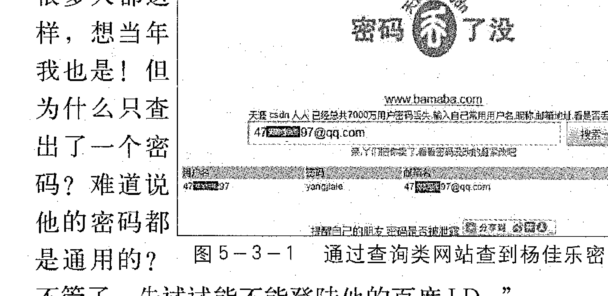

张杰打开百度，尝试用得到的密码进行登录。“密码错误？”张杰看到百度的提示显得有些沮丧。“按他百度空间的名字来说应该是这个邮箱没错，难道他把密码改了？”如图 5-3-2。

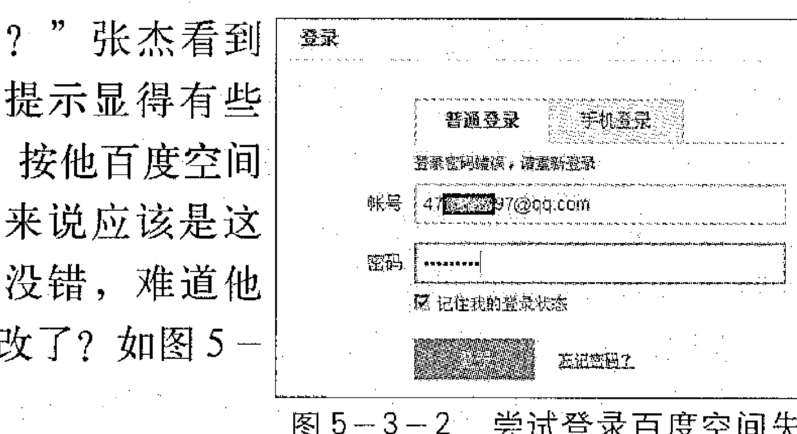

怎么办？对了！不是还有 QQ 密码、域名管理那些没尝试吗？可当张杰怀着忐忑的心情去尝试登录杨佳乐的 QQ 和域名，同样让他吃了闭门羹。如图 5-3-3、图 5-3-4。

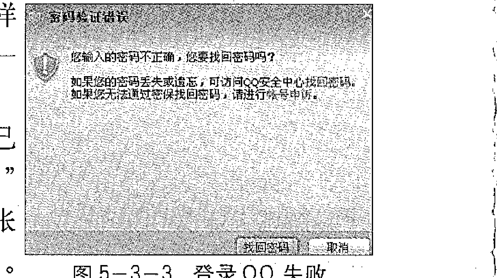

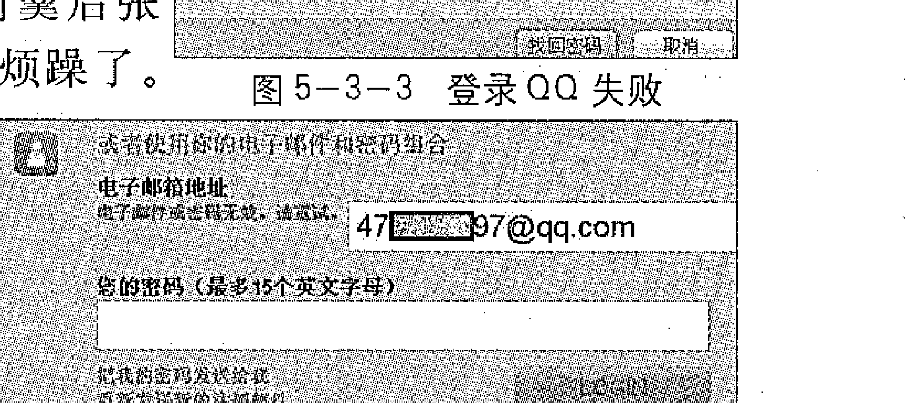

“真坑爹！难道他已经把密码都修改了！？”在吃了两个闭门羹后张杰的心开始有点烦躁了。“放松放松，不急，整理下思路！”

意识到自己的不耐烦后，张杰自我调节着心情。还有一个地方！假如那个地方也不行的话，那就说明他的密码已经全部修改过了。调整心情后的思路变宽了，他想到还没有尝试之前就在 Google 上找到的那个杨佳乐曾注册的黑客论坛。再次利用 Google 搜索引擎找到了那个论坛并尝试登录。还好，在这里张杰没有吃到闭门羹，成功地利用“yangjiale”这个密码登录论坛。如图 5-3-5。

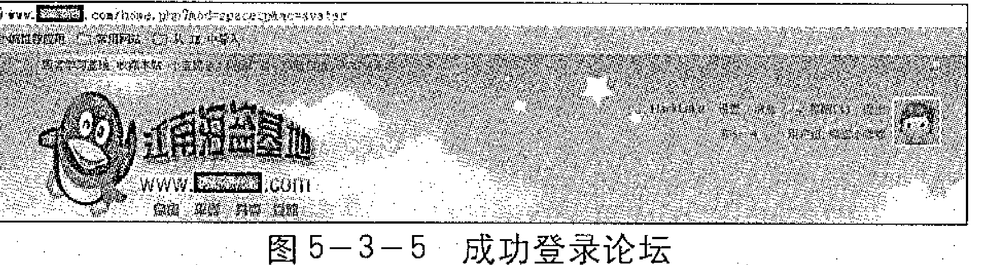

“终于成功登录进来了，说明这个密码是没有错的，那为什么百度、QQ、域名管理那边都登录不进去呢？难道说他还有别的密码？”

“有了思路就要尝试。”张杰回到百度登录处用“yangjiale”这个密码及他的常用 ID 进行组合尝试：“hackyangjiale”，“hackyjl”，“hack47xxxxx97”，“yangjiale47xxxxx97”，“yjl47xxxxx97”，“yjlhack”……

通过重新组合，得出 20 余个密码却依然无法破解，后来又尝试了用这些密码进行 QQ 登录及域名管理的登录，均以失败告终。

**LoveAngel乱语：**在数据库泄露事件之后，很多数据库查询类网站如雨后春笋般，瞬间充斥了互联网，这次泄密事件可谓是百年不遇的互联网灾难，N 多名人名站瞬间沦陷，这也从另外一个侧面真实地体现出互联网离我们并不遥远，现在任何事情都是全国联网，就算你不上网，你也难逃其“魔爪”。记得以前有位伟人说过：“计算机要从娃娃抓起”，看来这个预言已经实现了。

### 5.4 流传在地下的数据库

“只破解了一个小论坛的密码，怎么跟雇主交差？”张杰看了下闹钟，距离自己定下的时间只剩下不到 10 分钟，而现在的破解又陷入了僵局，现在时间不允许。张杰暂时先放弃拿下 xxx.tk 的想法，准备用最后一点时间去微博上看看这次密码泄露的最新动态。当他看到了一条微博，他又重新有了思路。如图 5-4-1。

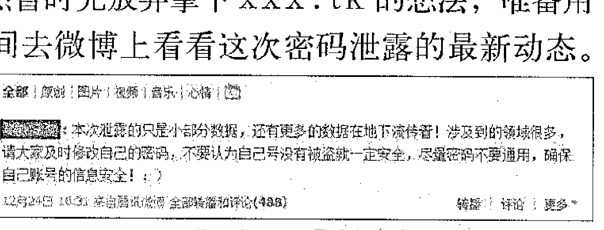

图 5-4-1 最新动态

地下还流传着其他的数据库？还涉及到很多领域？这时张杰忽然想到一个人，那就是前几个月在上海召开的某信息安全会议上刚认识的朋友。当时那个朋友给张杰展示了硬盘里的数据库，足足有上百 G 的数据，连国内一些数一数二的黑客网站的数据库都有，堪称“库王”。“找他试试？”在 QQ 上翻了大半天，终于找到了“库王”的 QQ，于是直接跟他说明了情况，请他帮忙查询一下是否能够找到杨佳乐在其他网站所用的密码。

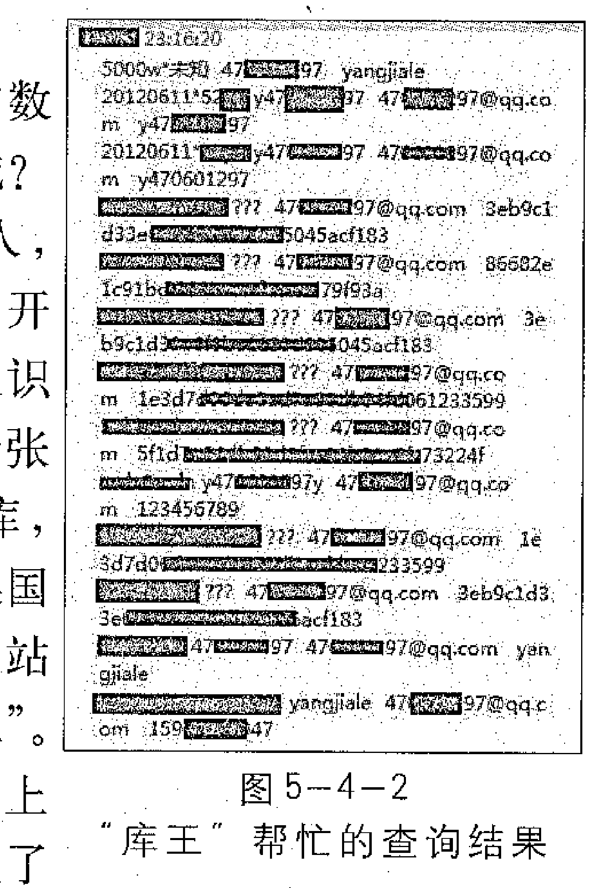

图 5-4-2 “库王”帮忙的查询结果

“库王”毫不吝啬，在张杰把那份 hacklele 的 txt 文档发给库王后，大约 3 分钟左右，“库王”就把在数据库中查询到的结果发给了张杰。如图 5-4-2。

“大神就是大神，百 G 数据真不是吃干饭的，一下就发来这么多信息。虽然大部分都是被 MD5 加密过的，但是总比没有好啊！”张杰谢过库王后，一边感叹着百 G 数据库的威力，一边在某 MD5 解密网上将已经查到的 MD5 值进行解密。

刚刚解密完所有的 MD5 值，闹钟就响了。这时的张杰迅速地将密码重新整理组合，然后顺利登录了杨佳乐的百度空间以及域名管理账号。如图 5-4-3、图 5-4-4、图 5-4-5。

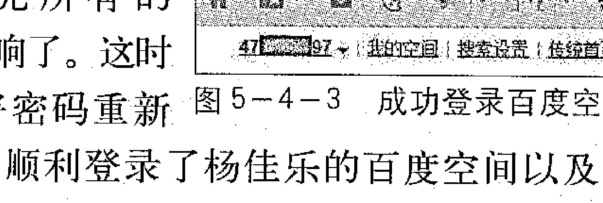

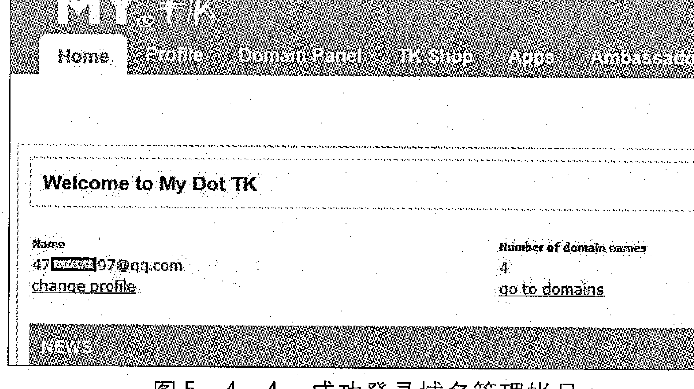

图 5-4-4 成功登录域名管理账号

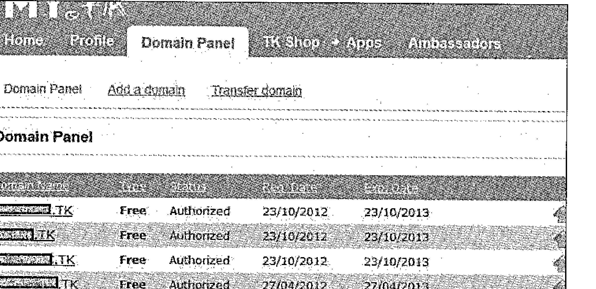

图 5-4-5 域名管理面板

……的遗憾就是没有拿下 QQ。

张杰成功地拿下了目标 xxx.tk，还顺手搞定了杨佳乐的百度账号。正兴奋得不行时，忽然看到手机的短信，相约的妹子已经给他发了好几条短信问他在哪里，刚才注意力太集中竟然没有听到短信声。

意识到自己已经迟到后，张杰迅速地将还没有整理好的结果发给雇主，并且在 QQ 上留言：密码都在这，你慢慢看！然后就狂奔下楼拦了部车去见妹子了。

> **LoveAngel 乱语：**“库王”硬盘里的数据库是一名合格的社会工程师所必备的利器，圈内称之为社工库。这些数据库一般都是通过各种手段获取的，再经过长年累月的收集，逐渐形成了一个庞大的社工资源仓库。这些数据在社工的时候，能够起到秒杀目标的效果。本文中就是一个很典型的案例，张杰通过“库王”手里的社工库，把目标诸多网络资源直接秒杀……

### 专业术语解释

MD5 为计算机安全领域广泛使用的一种散列函数，用以提供消息的完整性保护。MD5 的加密是不可逆的，安全性很强，一般应用在非绝密应用领域。但即便是应用在绝密领域内，MD5 也不失为一种非常优秀的中间技术。

**MD5解密：**现在的主流解密方法，通俗地说就是制作一个超大的字典，来记录常见字符串的 MD5 值；解密的时候，查数据库里 MD5 值对应的明文。数据库越大时，查到的可能性就越高。通常 8 位以内的字母数字组合，反向都可以查到。国内有几个规模比较大的 MD5 解密网站，具体网址请大家自行百度。

### 5.5 过程分析

现在我们来整理一下张杰这次狭义社会工程攻击的全过程。

张杰利用 Google Hacking 技术，找到了 hacklele 曾经注册过的论坛，并在这个论坛上找到了非常重要的线索：QQ 号。

然后通过 QQ 上的个人资料得到了 hacklele 的微博。在 Qzone 里得到了 hacklele 的出生日期，并通过 hacklele 发布的说说分析出他的性格，与此同时在 Qzone 找到 hacklele 的朋友网链接。在朋友网中找到 hacklele 的照片及姓名，最后通过 hacklele 的网名及得到的姓名分析他的真实姓名。

之后再次利用 Google 找到了 hacklele 的个人博客及百度空间，通过百度 ID 及利用百度贴吧的公共查询接口找到了 hacklele 的过往发言。在过往发言中找到他曾在某个贴吧的发帖信息，通过发帖内容得到真实姓名。

找到真实姓名后，张杰还回到腾讯微博中寻找信息，在腾讯微博中找到了许多有关 hacklele 的生活信息，确定了他的老家及工作位置后，通过对 Alexa 注册信息的查询，获得了 hacklele 的手机号码。至此张杰从网络上获取到了非常多关于入侵者 hacklele 的资料，并为之后的社工工作做了足够的铺垫。

最后在“库王”的帮助下顺利地获取到了 hacklele 的密码，并制作了字典对已查到的密码进行整理、组合，终于成功地破解了 hacklele 的域名管理密码及百度账号的密码，成功反击了入侵者。

至此，张杰同学通过狭义社会工程学的方法，利用收集到的信息来找到并反击入侵者的故事就结束了。但是我相信大家并不满足仅仅利用信息收集进行社会工程，但是不要着急，这是为了让大家对社会工程学有一个基本的了解，并且打下坚实的基础。接下来，我将为大家讲述真正的社会工程攻击的全过程，也就是我们所说的广义社会工程学。

等等！你不知道什么是狭义与广义社会工程学？那现在就由我来给你介绍一下吧！

#### 5.5.1 狭义社会工程学与广义社会工程学

社会工程学分为狭义社会工程学与广义社会工程学。

狭义社会工程学是现在国内大部分人所说的社会工程学，往往这些人所写的文章、说的话无非就是张口百度、Google 搜 ID，闭口就是数据库里查密码，从来不会与目标进行交互式行为。一旦目标在网络上没有留下任何讯息、资料以及密码信息，那么这些只懂得狭义社会工程学的人就会束手无策。

对于这些只懂得狭义社会工程学的人，我称他们为“伪社会工程师”。他们没有计划、没有针对性地来获取自己所想要的信息，只是单纯地利用网络来进行收集信息，与人肉搜索无异。

广义社会工程学是指社会工程师在掌握大量的相关专业知识的基础之上，在收集资料后，制定相关的计划并有针对性地向目标获取自己所需要的信息。与狭义社会工程学的最大区别在于，广义社会工程学的目的性强且拥有相关的专业知识，最重要的是他能利用自己已掌握的资料及术语与目标进行如交谈性质的沟通行为，并最终让目标在毫无防备的情况下将社会工程师所需要的东西“交”出来。

#### 5.5.2 识破伪社会工程师

伪社会工程师们每当通过网络收集到一些所谓的信息，为了证明自己的能力，他们就会在自己的博客、QQ 空间和 QQ 群里公布自己收集到的信息，洋洋得意地讲述着自己的所谓社会工程经历。部分伪社会工程师道德败坏，甚至将他人非常敏感的信息公之于众，例如目标的家人资料，甚至是一些不和谐的照片都予以公开，这是非常没有道德底线的行为！

而真正的社会工程师们则善于隐藏与伪装自己，他们即使成功地完成一次社会工程攻击也不会到处炫耀，因为他们有着自己的道德底线和职业素质，也遵守黑客守则中最重要的规则：不炫耀，不将自己的入侵事迹随意告诉他人。也就因为这样的低调，所以他们的身份才不容易被自己的目标识破。

试想一个每天总是与朋友们谈论自己事迹有多么厉害，而且自以为是的人。你觉得他会是一个能够在真正的社会工程中，可以伪装成任何身份来获取自己想要的资料的专业社会工程师吗？

以后如果你遇到任何一个所谓的社会工程师与你大谈社工经历，讲述自己是如何利用搜索引擎以及泄露的数据库查询到的密码来社工目标时，请你盯着他的双眼然后向他默默地竖起你的中指吧。

LoveAngel乱语：古人云：“低调”驶得万年船。

> 港片曰：出来混总是要还的。道理大家都明白，但是不是每个人都听得进去。如果你爱炫耀不低调，那你迟早会为你的愚蠢付出代价。如果有一天，你很不幸地遇到一位经验丰富的社会“攻城尸”，你因高调而留下的蛛丝马迹，最终都会被“攻城尸”给你来一个全方位的抽丝剥茧，继而庖丁解牛，直至体无完肤、摇摇欲坠。就像故事中的这位虚构人物杨佳乐，他为他的高调付出了代价。低调、有道德底线、具职业素养，是专业社会工程师不可或缺的基本职业要求。

### 5.6 后记

张杰见到妹子后，妹子说的第一句话是：“要么做 100 个俯卧撑，然后我再听你迟到的理由，看你的理由我再考虑要不要原谅你；要么今天你就自己去玩吧！”

结局大家都明白，再聪明的“攻城狮”也只能拜倒在妹纸的石榴裙下。男子汉大丈夫，能屈能伸，做 100 个俯卧撑算什么，10000 个都……不得不做。

还好，张杰今天伏案多时，腰椎颈椎有点酸痛，俯卧撑权当锻炼锻炼身体，活络一下筋骨，强身健体。结局算是完美的，成功地反击了入侵者，并进一步巩固。在于核心目标中的“社会工程师”的地位。

❀LoveAngel 乱语：当约会迟到的时候，最好先找一个花店，买上一束 MM 喜欢的花，然后再朝目的地飞奔而去。至少 MM 看到花之后怒火就会先消了一半，然后你再编造一个理由，那就是因为买花而耽误了点时间。虽然 MM 不太会相信，但是还是很管用的。但是奉劝各位男士，约会的时候还是不要迟到的好，因为不是每个 MM 都吃这一套的。

## 第6章 人太脆弱了

长时间从事最没有技术含量工作的人，出去后，可能连熟练操作电脑这件同样平凡、人人会做的事都不一定能做好。阅读完下面的案例后，也许你会觉得文中的目标看起来是那么生涩，那么你需要修正自己的判断。但事实就是这样，专业的社会工程师总是有办法让人迅速信任他，并在交互中不知不觉满足其需求。社工凭借这些技巧，可以从当时的目标那里套取出所有需要的消息。

### 6.1 只是一个玩笑

一个在网络上自称 Kill 的社会工程学爱好者，他在现实中是一个业绩优秀的销售员。他知道如何让客户接受他推销的产品，并且花钱购买，甚至不忘给他的服务态度做个好评。

在这个半娱乐半技术的黑客圈子中，有一群较为特殊的人，他们的行为介于无恶意的好奇和完全的破坏之间。这类人有着丰富的专业知识以及非常特别的黑客思维，喜欢用自己的技术来入侵系统与网络，但是并不破坏这些系统与网络，也不靠这些技术赚取金钱。

他们在入侵目标之后，会拿到一些例如管理员密码、敏感资料之类的东西，但是他们对那些敏感资料本身并不感兴趣。他们的行为仅仅是 Enjoy Hacking 和嘲讽那些自称自己系统是铜墙铁壁的人，而 Kill 就属于这较为特殊一类人中的一个。

### 6.2 闲来无事

Kill 今天早早地完成了销售任务，就直接溜回家了。打开电脑在微博上逛着逛着，忽然发现有个公司的网站管理员在与别人讨论一个问题时提到，自己建立的公司网站是坚不可破的，还放出大话说：“谁能够黑掉他的网站主页，自己就退位让贤，把自己的位置让出去。”如图 6-2-1。

看到这条微博后，Kill 置之一笑，自言自语道：“真是没道德底线，拿自己公司网站给人作为靶子，还如此自大地认为网站牢不可破，简直幼稚之极！”

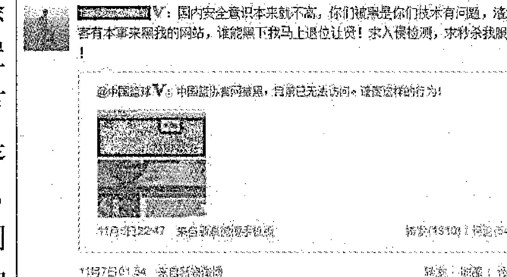

Kill 正准备把目光移到下条微博时，却发现那条颇具有挑衅味道的微博下方已经有了 20 多条评论。这么多评论，难道已经有人搞定了？结果到底如何呢？看看去！

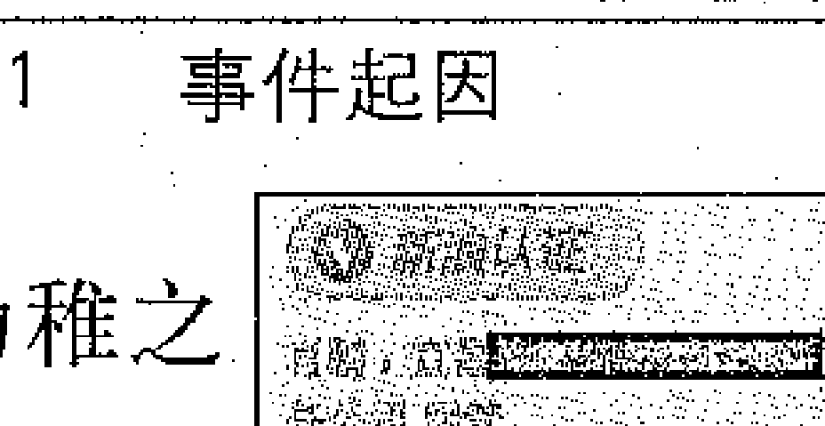

“有这么难么？”在那条微博的评论中，Kill 发现有不少技术爱好者已经向那个公司网站发起了挑战，不过检测结果似乎都不是很好。

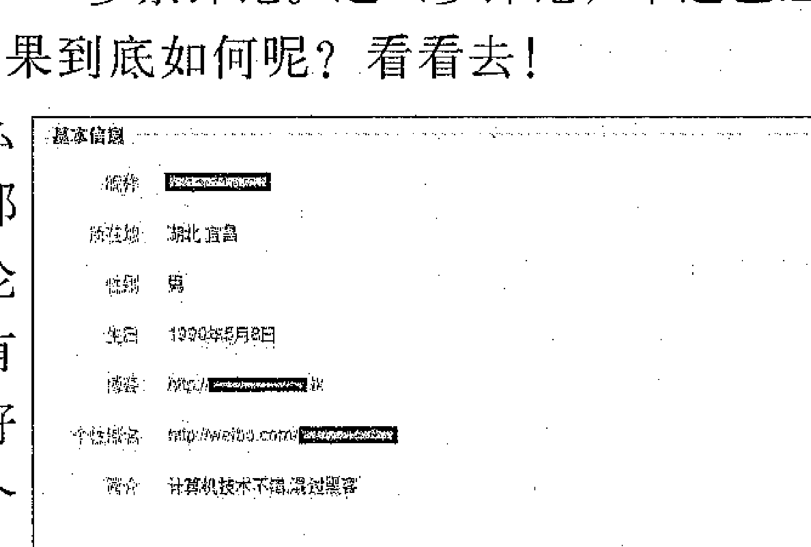

“这么多人都败下阵了，看来似乎很有挑战性啊？”Kill 顺手打开那人的微博主页，发现他的新浪认证资料是：肖鹏，宜昌市某公司的公司网管。在个人简介那栏还写着：计算机技术不错，混过黑客。如图 6-2-2、6-2-3。

“看来这小子自恃计算机不错，学过点技术所以如此嚣张么？一个公司网站能有多大能耐？反正今天也闲来无事，这么多人做检测，那我也插一脚吧。”说着 Kill 就打开了他们公司的网页，开始了手工检测，检测的同时也开启了常用的网站扫描工具试试扫描漏洞。

约莫半小时后，Kill 也败下阵来。“靠！全站静态！手工和扫描器找了大半天，除了图片文件目录别的什么都没找到！这小子是故意拿个全站静态的来整人吧？旁注一下？查询结果如图 6-2-4 所示，无法进行旁注攻击。”

“没有旁站，还是托管的服务器？前台静态，独立 IP，怎么办呢？先进行端口扫描吧！”

Kill 扫了一遍端口，发现除了 80 以外什么端口都没有开放。哟呵，难怪那么多人放弃了，虽然这个网站看似是个小公司，但是安全倒是做得不错。一般人看到这里通常就放弃了，小公司网站除非有特殊的原因，否则没人会专门来黑的。

Kill 此时整个人蹲在了自己的椅子上，准备要大干一场。难怪你丫敢在微博这么嚣张地说没人拿得下，确实不好搞啊。不过你很倒霉碰到我了，既然 Web 方面我奈何不了你，那我就来给你展示一下我的社会工程技术吧。”

Kill 新建了一个 txt 文本文档，就开始了这次社工之旅。

**LoveAngel 乱语：**看完本节，我的第一反应是“祸从口出”。不过，这个人到底是不是这家网站的管理员呢？因为他也可能是这网站的仇家。也就是说，他故意点燃大家的怒火，然后引火烧仇家，所以咱们不能凭一时的情绪就轻易下结论，免得上当。“祸从口出”源自晋朝时期的古文，在今天看来，这样的训诫仿佛也不过时。有时，为了逞口舌之快而得罪他人。我国几千年的文化传统，礼节繁多而琐碎，国人含蓄且内敛，比较讲面子，话出而不伤人，比较绕弯子；如果是急病遇到慢郎中，就耽误大事了。所以祸从口出，利弊皆有。当一个团队的工作氛围是大家说话都不兜圈子，那工作效率就会提高。也许有人会说，依情况而定吧，急事直接说，不急的事绕着弯子说。但人不是变形金刚，说变就变，人有不同的个性，不可能随意切换。小编觉得，还是应鼓励大家讲真话，也不要担心出错，不能让自我审查机制损害了我们的表达能力。

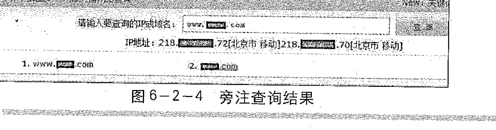

图 6-2-4 旁注查询结果

### 专业术语解释

**全站静态**：也叫静态网站，是指网站全部由 HTML 代码格式页面组成的网站，所有的内容包含在网页文件中。其中也分为真静态以及伪静态。

**真静态**：是指所有的内容都是预先设计好的，然后才发布到网站上。一般这样的网站内容更新都很慢，因为它们每次发布一个新网页都需要重新写网页。一般情况下真静态网站是不需要后台的。

**伪静态**：是相对真静态来讲的。通常我们为了更好地缓解服务器压力和增强搜索引擎的友好度，将文章内容生成静态页面。这样的网站更新内容时，只需要更新数据库，然后即可重新生成静态网页。一般情况下伪静态网页都是有后台的。

旁注是网络上比较流行的一种入侵方法，利用同一主机上面不同网站的漏洞得 WebShell，从而入侵目标网站。黑客轻而易举地通过其他“高危网站”来入侵你们的共同主机，然后黑掉你的网站。这就是黑客们津津乐道的“旁注”。

**WebShell**：“web”的含义是显然需要服务器开放 web 服务，“shell”的含义是取得对服务器某种程度上的操作权限。WebShell 常常被称为匿名用户（入侵者）通过网站端口对网站服务器的某种程度上的操作权限。由于 WebShell 大多是以动态脚本的形式出现，也有人称之为网站的后门工具。

端口扫描是指某些别有用心的人发送一组端口扫描消息，试图以此侵入某台计算机，并了解其提供的计算机网络服务类型（这些网络服务均与端口号相关）。端口扫描是计算机解密高手喜爱的一种方式。攻击者可以通过它了解到从哪里可探寻到攻击弱点。实质上，端口扫描包括向每个端口发送消息，一次只发送一个消息。接收到的回应类型表示是否在使用该端口，并且可由此探寻弱点。

### 6.3 制定计划

Kill 整理了他所获悉的资料后发现，目前掌握的情况还很少，除了微博和公司网址外，他还没有掌握别的信息。于是他开始了这次社工之旅的第一步：信息收集。

首先，Kill 制定了社工计划。他想：即使今天自己拿下肖鹏所在的公司网站，肖鹏也未必真的会退位让贤。肖鹏在微博上说的是黑掉他的网站，所以在他查阅了相关的法律法规后，他决定利用域名劫持技术来黑掉目标。

在制定完社工计划后，Kill 开始行动了。他首先将肖鹏的公司网站进行 Whois 查询，看看能不能进一步获取有价值的信息。查询结果如图 6-3-1 所示。

Kill 仔细查找，发现联系人那一栏是 xiaopeng，不正是肖鹏的拼音么。这下基本可以确定这个网站的负责人就是肖鹏，除非是难得一见的巧合。同时在 Whois 中，还有肖鹏的邮箱 maddcxx@gmail.com 及域名注册商的网站地址。

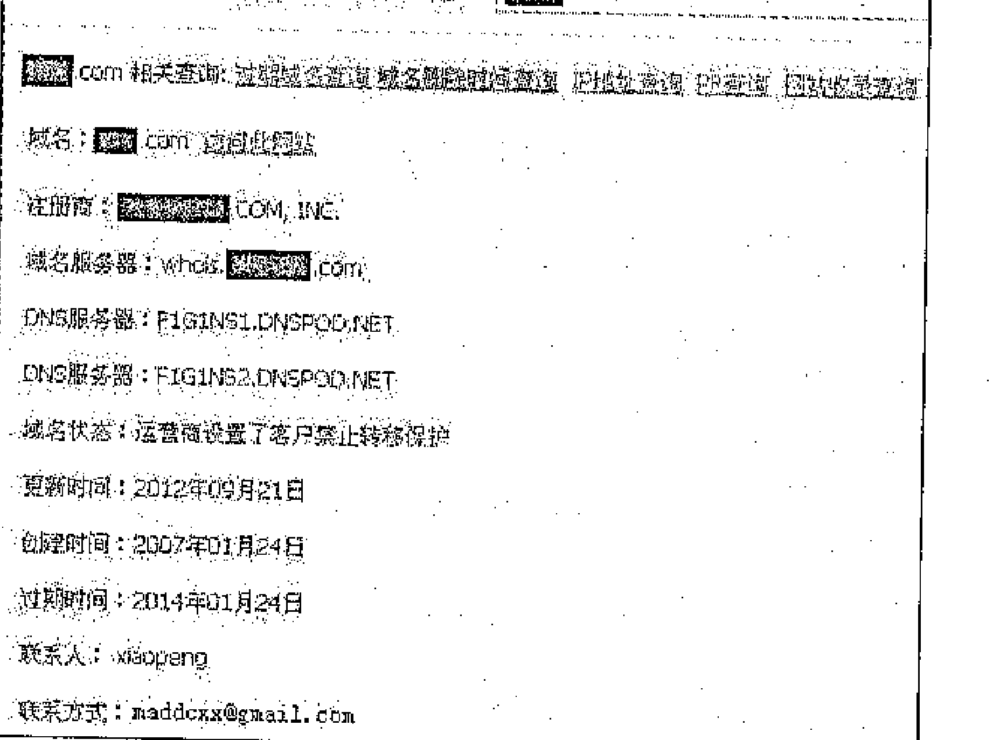

图 6-3-1 Whois 查询结果

既然是域名劫持，那么首选的攻击目标就是 DNS 服务商&服务器，攻击 DNS 服务商&服务器的方式有很多，比如：

- 利用 DDOS 攻击 DNS 服务器以造成无法解析；
- 直接入侵 DNS 服务器进行更改域名解析记录；
- 攻击 DNS 解析商网站，在后台直接将 IP 指向到黑客的服务器，使访客访问到黑客设定的服务器上；
- 欺骗 DNS 解析商客服，使 DNS 解析商客服将目标域名解析到黑客的服务器上。

使用第 1 种方法来进行攻击 DNS 服务器，不仅会造成目标网站无法访问，还有可能造成其他利用这个 DNS 解析的服务器也无法同时访问。这种方法太危险，破坏性很大。

使用第 2 种直接入侵 DNS 服务器进行更改域名不大现实，毕竟上面挂了至少上万个域名，想在短时间内轻易攻进去有点痴人说梦。

而第 3 种方式更不现实，因为这个 DNS 解析商号称国内最安全最稳定的 DNSPOD。DNSPOD 管理着 58 同城、暴风影音等大型网站的 DNS 解析记录，同时它还管理着将近 80 万个网站的 DNS 解析记录。即使给自己一个月的时间，以自己的能力攻破它也几乎是不可能的事情。

那么看来只能用第 4 种办法了：欺骗 DNS 解析商客服。不过这个办法有点危险，稍不注意就会露馅，还有没有更好的办法呢？

冥思苦想了很久，最后还是决定使用第 4 种办法。可是怎么才可以让客服信任我，相信我是网站的站长，并帮我把 IP 修改至我的服务器上呢？这个问题让 Kill 很苦恼。光想是没门的，不如先了解它的运作机制再来制定计划！

❀LoveAngel 乱语：思路很重要，当你在对目标进行社会工程攻击时，要知道下一步干什么。就如下棋、行军打仗一般，把能够想到的进攻路线全部罗列出来，然后根据实际情况迅速决断，选择一条最安全并且便捷的方法，避免浪费自己的时间。

### 专业术语解释

域名劫持是互联网攻击的一种方式，通过攻击域名解析服务器（DNS）或伪造域名解析服务器（DNS）的方法，把目标网站域名解析到错误的地址，从而达到无法访问目标网站的目的。

DDOS 是英文 Distributed Denial of Service 的缩写，意即“分布式拒绝服务”。那么什么又是拒绝服务（Denial of Service）呢？可以这么理解：凡是能导致合法用户不能够访问正常网络服务的行为都算是拒绝服务攻击。也就是说，拒绝服务攻击的目的非常明确，就是要阻止合法用户对正常网络资源的访问，从而达成攻击者不可告人的目的。

DNSPod 是目前国内最大的第三方免费 DNS 解析服务商，同时号称最稳定、最安全的 DNS 解析服务商，现已有近 80 万的用户在使用它。

### 6.4 知己知彼百战不殆

说干就干，Kill 打开了 DNSPOD 的网站主页，按照步骤将自己的博客域名添加到 DNSPOD 上。如图 6-4-1。

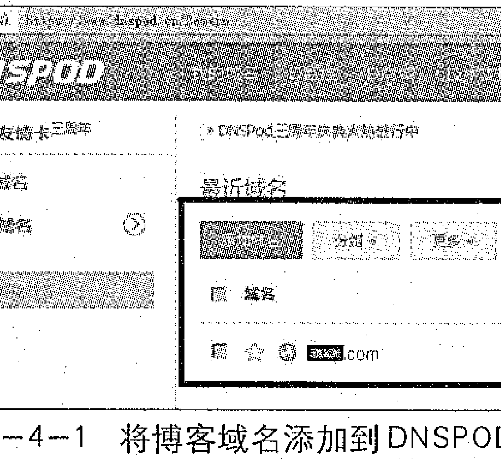

添加之后，Kill 就将自己伪装成一名攻击者，在不知道自己 DNSPOD 登录密码的情况下劫持自己的域名。

Kill 首先在账号处点击忘记密码的链接，尝试找回密码。如图 6-4-2。

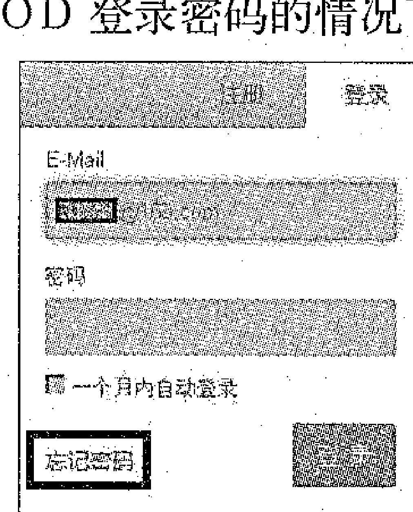

但找回密码的结果让 Kill 有些失望，因为 DNSPOD 是直接将密码发送至绑定的邮箱。如图 6-4-3。

“这可怎么办？”正当 Kill 无计可施的时候，他在找回密码的那个页面的右边看到一行小字：还是不行？联系技术支持。试试让网站客服来帮帮忙吧。Kill 打开了技术支持的链接，弹出了 DNSPOD 的企业 QQ。


图 6-4-3 找回密码功能无法成功利用

如图 6-4-4。“这么多客服？选哪位呢？”Kill 选了一个名字叫“微笑”的客服，心想既然叫这个名字，脾气应该比较好。为了不会因为 QQ 等级过低而被怀疑，所以 Kill 专门挂了一个用于社会工程攻击的 QQ 号。


图 6-4-4 联系技术客服

现在他将这个号的网名改为：微笑:) ，为的就是希望同一个网名可以给对方带来好感。

一开始 Kill 就申明自己打字很慢，潜意识里想告诉对方自己是个新手，希望对方能放松警惕。做这么大网站的客服，每天接触形形色色的人太多了，难免有跟我同样想利用社会工程技术干点坏事的人。

Kill 想先以找回管理邮箱的方式来试探客服的保密程度，所以 Kill 在说明完自己是个新手后，又编造了一个比较合理的理由，那就是自己的孩子给自己申请了许多邮箱，因为邮箱过多导致管理不过来，希望客服能帮助自己找到管理邮箱，也就是域名管理的登录名。如图 6-4-5。


图 6-4-5 开始忽悠

客服也很热情，在听完 Kill 所需要的帮助后马上就询问需要找回登录名的域名是什么！Kill 看到客服如此热情，马上将域名发给他。如图 6-4-6。

看到客服让他重新注册一个账户，就有种淡淡的忧伤，心想：“这还要你教？”但是没办法，还是要按客服的提示重新注册了一个账号。在添加域名时被提示：域名已经被其他账户添加，要取回域名才可以添加域名。如图 6-4-7。

又是只有通过邮箱来取回？怎么可以这样！如图 6-4-8。


图 6-4-6 继续忽悠


图 6-4-7 域名已被添加

Kill 看到想靠自己的力量取回域名似乎无望，于是又装起了小白去问客服如何处理。如图 6-4-9、6-4-10。


图 6-4-8 域名取回


图 6-4-9 再次忽悠客服 1


图 6-4-10 再次忽悠客服 2

但无论 Kill 如何编造谎言，客服依然连登录账号都不肯给，可 Kill 也不是吃素的。终于，在 Kill 的软磨硬泡下客服没办法应付了，于是将 QQ 转接到了技术人员，让技术人员处理。如图 6-4-11。


图 6-4-11 转接技术人员

可技术人员也表示只能通过 Whois 邮箱来帮助取回，就连提供账号中所填的资料都不可以。如图 6-4-12。Kill 没想到技术人员的态度比客服还要坚决，只肯使用 Whois 邮箱进行找回密码。没办法，只好先让技术发一封邮件到他的邮箱里。


图 6-4-13 邮件内容截图

Kill 将收到的邮件截图发给了 DNSPOD 的技术人员。如图 6-4-13。跟技术人员确认过邮件后，Kill 想：“已经验证过收到邮件了，他应该可以相信我了吧，是不是能把登录账号告诉我了呢？”可事实证明他把事情想得太简单了。即使在提供了收到的邮件后，DNSPOD 的技术人员仍然连登录账号也不给，只是要求直接回复邮件。如图 6-4-14。


图 6-4-12 忽悠技术人员

我下了如此大的功夫，并且在知道这个账号（Kill 自己的账号）这么多信息的情况下，连登录账号都没办法获得，更别说通过客服去修改我所想攻击的目标了。看来 DNSPOD 对用户资料的保密程度真的很好。


图 6-4-14 忽悠技术人员失败

Kill 看到自己花了这么大功夫一点进展也没有，显得有些沮丧。不过他很快振作起来，因为他又有了一个新主意：直接攻击域名服务提供商。

LoveAngel 乱语：让我们来回溯一下，在这节中“社会攻城狮”所利用的心理战术。首先，他把自己扮成一名天真的新手，让客服放松警惕。第二，他取了一个和客服同样的昵称——“微笑”，希望能让对方产生认同感……总结下来就是用弱势的姿态和目标“套磁”，和对方在最短的时间内建立起信任……只是从本节的结果来看，这样的招数最终没能奏效，因为对方也不是吃素的，他们具备了对付攻城狮们的丰富经验。

### 社工小知识

塑造友善的形象。通常，人们受到潜意识的影响，一般会比较容易喜欢一个“看起来与自己相似的人”；因为相似容易产生信任，有了信任后续的交谈与信息索取就将变得更加顺利。双方之间的谈话过程也可能因着彼此的相似变得积极自在。

Whois 邮箱就是在注册域名的时候填写的那个邮箱。通俗地来说，就是我们常说的密保邮箱，用于在找回密码时使用。Whois 邮箱可以通过 Whois 查询来获得，方法我们在前面已经介绍。忘记的同学请自行翻阅。文中 DNSPOD 的密码找回方式只能利用你域名注册时所填写的邮箱进行找回，所以建议大家在注册域名时使用真实的信息进行填写，免得在密码忘记时无法找回域名。

### 6.5 峰回路转

Kill 再次查询了 Whois 信息，在 Whois 信息中找到了域名提供商的网站。如图 6-5-1。

在与客服 QQ 进行详细的交谈后，Kill 熟悉了网站的注册会员及域名购买流程。他还发现一个很重要的事情，那就是这个网站必须使用会员 ID 登录，而这个 ID 是在注册时系统自动分配的。按常理来说，如果不是账号的管理者也就无从知道账号的 ID 是多少。也就是因为这样，所以账号 ID 被当做一种比较权威的身份认证方式。如图 6-5-2。

Kill 在网站的最下方找到了客服联系方式，这次没有继续用 QQ 来与他们交谈，而是使用拨打客服电话的方式。因为他觉得有时说话的语气和态度往往能决定此次社工的成败，而 QQ 则不能让人感觉到你说话的语气和态度，所以他决定选用直接拨打电话的方式。如图 6-5-3。

有备无患是 Kill 信奉的社工真理，他每次准备开始社会工程攻击前都会先想好他所要的信息。

在一番考虑后，他整理出了


他这次电话社工所需要得到的信息：

- 目标是否在该网站注册；
- 目标在网站的会员 ID；
- 提供什么样的资料可以找回密码。

整理好思路和心情后，Kill 拨打了互联 IDC 的总公司尾数为 68 的联系电话。

互联IDC客服（小张）：“喂，您好，我是互联IDC广州总公司的电话客服代表，您可以称呼我小张，请问有什么可以帮到您？”

Kill：“你好，能否帮忙查询一个域名是不是在你们这里注册的。我记得是在你们公司注册的，但是我输入正确的密码后却无法进入我的域名管理面板。”

互联IDC客服（小张）：“请问您的域名是多少？”

Kill：“我的域名是 xxx.com。”

互联IDC客服（小张）：“好的，请您稍等一下。”

互联IDC客服（小张）：“您好，经过查询，您的域名确实是我们这边注册的，您无法登录可能是因为您的密码错误了。”

Kill：“好的，我知道了，一会儿我再试试吧，谢谢。”

互联IDC客服（小张）：“不客气，感谢您的来电，再见！”

第 1 通电话，Kill 确认了域名的注册地确实是互联 IDC。在挂了电话之后，他又拨出了第 2 通电话到互联 IDC 公司，这次他拨打了尾数为 50 的那个号码。

互联IDC客服（小枫）：“喂，您好，我是互联IDC广州总公司的电话客服代表，您可以称呼我小枫，请问有什么可以帮到您？”

Kill：“你好，请问为什么我无法使用我的域名登录你们公司网站。”话音刚落，就听见电话那头的客服抖嗓一笑。

互联IDC客服（小枫）：“您好，我们的网站为了安全，只能使用您注册时网站分配给您的 ID 登录。”

Kill：“分配的 ID？我怎么不知道呀？我只知道我的域名注册邮箱是多少，这可怎么办？”

互联IDC客服（小枫）：“这……”

Kill 听到对方迟疑了，赶忙趁热打铁地说道：“公司里要开一个新项目，让我们制作一个网站，现在另外一个技术人员已经把网站本地搭建好了，他让我现在登录上去购买一个新域名。你可以帮我查查当时分配给我的会员 ID 是多少吗？”

Kill 告诉客服自己现在需要登录到网站上去买新域名，希望客服帮忙查询会员 ID。而客服一听 Kill 是想购买域名，马上就变得热情无比。

互联IDC客服（小枫）：“您的域名是多少，请告诉我一下，我试着帮您查询一下。”

Kill 看到客服的态度变得热情，他就知道有戏了：“我的域名是 xxx.com，麻烦你了！”

互联IDC客服（小枫）：“查到了，您的登录 ID 是 2xxxx2，您可以试着登录一下。”

这么轻易就到手了？对于突如其来的惊喜，Kill 以为在做梦，Kill 掐了自己一下。心里暗忖：如果利用他人的贪念来进行社工，倒不失为一个好办法。不过，Kill 并没有“喜形于色”，必须保持淡定的口吻。

Kill 尽量保持平静的口气：“登录成功了，谢谢你！”

互联IDC客服（小枫）：“不客气，您准备开什么样的网站呢？如果是商业类型的网站可以考虑 com 和 cn 域名，同时我司还有代备案的服务，只要提供公司的资料就可以帮您完成备案。”

Kill：“好的，我知道了，谢谢你，到时我需要备案的时候再联系你。我这边还有点事，先忙了，再见。”

客服似乎还沉浸在 Kill 的谎言中，依然滔滔不绝地讲着。他并不知道自己已经在不知不觉中掉进了社会工程师设下的陷阱，并透露了一个绝对不可以透露的用户信息。

第 2 通电话过后，Kill 获得了目标账户所使用的会员 ID。“既然已经拿到了会员 ID，接下来就要想办法弄到密码了。”这次 Kill 拨打给了尾号是 58 的电话。

互联IDC客服（经理MM）：“您好，我是互联IDC广州总公司的电话经理，请问有什么可以帮到您？”

“妹子？这就好说话了。声音还挺好听的，不晓得真人长得漂不漂亮。”前 2 通电话都是男客服接的，发现这次接电话是个 MM，Kill 就立马在心里 YY 起来。

Kill：“你好，我在你们这边注册的账户密码忘记了怎么办？”

互联IDC客服（经理MM）：“您好，您可以尝试在网站登录处找到一个找回密码的链接，您直接点击找回密码，密码就会发送到您的邮箱里了。”

Kill：“是这样的。我上个月刚刚进公司，经理给我分配的任务就是管理网站，之前公司的这个账户是另外一个技术人员管理的，账号绑定的是他的邮箱，现在他已经离开公司了。在他走之前，他只留下了网站的会员 ID 和密码，可是我用他提供的密码无法登录，你说怎么办呢？”

互联IDC客服（经理MM）：“您先提供一下您的登录 ID 及这个 ID 上所有的域名吧。”

Kill：“我的会员 ID 是 2xxxx2，这个 ID 上绑定了我们公司的域名，域名是 xxx.com。”

互联IDC客服（经理MM）：“您提供的 ID 与绑定的域名是正确的，但是域名登记的是个人域名。”

“个人？怎么会呢？”听到域名是以个人名义注册的，Kill 有些诧异。

互联IDC客服（经理MM）：“肖鹏，请你把这个人的证件发到我们的邮箱里。”

听 IDC 客服说需要将肖鹏的证件发送到他们的邮箱里，Kill 就明白怎么回事了。

Kill：“身份证吗？”

互联IDC客服（经理MM）：“对的。”

Kill：“这个账户真是我们公司的，肖鹏是我们老板。你让我发身份证给你，难道要我跟老板说把你的身份证拿来，域名密码我不知道是多少，我现在需要你的身份证。这不自己找老板骂吗？”

互联IDC客服（经理MM）：“不行，这里写的是个人，你必须提供个人的才可以。”

Kill：“可我总不能真去老板那里跟他要身份证吧？不如这样吧！我把我们公司的营业执照提供给你们，你就帮我修改一下登录密码吧，可以吗？你可以核对一下营业执照跟注册信息，执照上面有我们老板的名字。”

互联IDC客服（经理MM）：“如果你只提供给我营业执照，我能做的就是你告诉我需要修改什么信息我来帮你修改，但是账户资料和管理邮箱这些是不可以给你改的，只能等到你提供给我身份证才可以。”

Kill：“那如果我们网站的服务器迁移，修改 IP 是不是也得找你们？”

互联IDC客服（经理MM）：“是这样的。”

Kill：“好吧好吧，先谢谢你了。你把你的 QQ 号给我，通过 QQ 把营业执照发给你。”

互联IDC客服（经理MM）：“好的，那你加我 QQ：16*****52。”

LoveAngel乱语：3 通电话，估计也就十几块钱话费，包含了很多内容。想当年，社会工程师的祖师爷凯文·米特尼克也是利用电话拿下了不少大公司的服务器，工程师的能量不可小觑。在打电话之前，Kill 已经准备好了要问什么，这是事关成败的重要环节，不可或缺。

### 6.6 帮帮我好吗

Kill 挂了电话后就使用那个专门社工的号加了客服的 QQ，继续忽悠。如图 6-6-1。

“怎么才能得到他们公司的营业执照呢？”这个问题让 Kill 很苦恼，总不能开车去他们公司拿吧。

Kill 每当遇到无法解决的问题时，就喜欢去看看一些社工的案例，因为每次看这些案例的时候总能获得一些好的思路。

他在某个安全类网站上看到一篇讲述弗兰克·阿巴内尔利用社会工程学手段在 26 个国家共伪造了约 250 万美元支票的文章时，Kill 的灵感来了——伪造营业执照。


在经过一番处理之后，一个肖鹏公司的“营业执照”就出炉了。经过处理的图片就是不一样，已经达到了以假乱真的效果。Kill 将伪造的营业执照直接发给了 IDC 客服，并要求修改目标域名的 DNS 解析记录。如图 6-6-2。


“不能找回密码？”Kill 听客服说不肯帮忙找回密码，还以为之前的努力又白费了。不过当看到客服说需要改什么、提交营业执照就可以的时候，Kill 知道自己已经成功了。反正我就为了挂黑页，嗯！就这样干吧。但是接下来的对话让 Kill 差点崩溃。如图 6-6-3。

“这下死定了。”Kill 心想，“那个肖鹏好好的提交什么组织机构代码证，真是坏事！”


Kill 抄起电话又拨通了客服电话，他知道有的话用苍白的文字是表达不了的，还是得靠语气。

互联IDC客服（经理MM）：“您好，我是互联IDC广州总公司的电话经理，请问有什么可以帮到您？”

Kill：“你好，我是刚才给你发营业执照的那个。”

互联IDC客服（经理）：“哦，您好，还有什么事吗？”

Kill：“你就帮我改一下吧，我都给你提供营业执照了，难不成我还是骗子吗？”

互联IDC客服（经理）：“抱歉，按要求您必须提供组织机构代码证我才可以给您修改，要不然我们如何保证客户的资料安全？”

Kill：“这……我能理解你的意思，你这么做也是为我们客户的安全着想，可是那个组织机构代码证我真没办法弄到。我好不容易从前台那里弄到营业执照，现在你又说不行。”

Kill 说话的声音中都带着哭腔，好像受了多大委屈似的。

“就帮帮我吧，难道你忍心害我被炒鱿鱼吗？你看我营业执照都拿来了还能骗你不成？”当说完这些话后，只听电话那头一阵沉默。听到客服沉默了，Kill 知道自己已经把客服的同情心搞得泛滥了。

互联IDC客服（经理）：“好吧，你稍等，我帮你请示一下上级吧。”

Kill 一听客服这么说就知道有搞头，立刻收起了哭腔：“那好，先谢谢你！你也别挂，去请示吧，我在这里等着，真的很急。”

客服拿 Kill 没办法，只好把电话放在一边去请示上级。约莫过了 5 分钟，客服带来了好消息。

互联IDC客服（经理）：“您好，让您久等了，您在 QQ 上把您需要修改的东西发给我吧。”

Kill 一听客服说可以帮忙改，连说了 3 句谢谢后挂了电话。接着 Kill 要求客服将 IP 解析到他自己购买的服务器上，但客服说由于域名使用的不是域名提供商的 DNS 服务器，所以无法帮忙改 IP，只能先改 DNS 服务器然后再改 IP。如图 6-6-4。

Kill 自言自语道：“在接下来的两个小时之内，我一定算是这个世界上最有时间观念的人之一。”Kill 时不时看一下时间，短暂的 2、3 个小时，此刻却是如此漫长。煎熬的滋味弥漫着，但是又什么也不能做。3 个小时后，Kill 再次打开肖鹏的微博，发现之前那条“求入侵检测”的微博已经消失了，Kill 脸上浮起了胜利的笑容。不过，这种胜利的喜悦却不能和别人去分享，因为这是“工程师”们必须恪守的行为准则。


图6-6-4 成功忽悠客服

Kill 泡上一杯咖啡，双脚交叉搭在电脑桌的一角，经过一番斗智斗勇之后，整个人轻松下来。虽然没有人会知道，肖鹏的那条求助微博为什么会消失掉，但，肖鹏知道。

LoveAngel 乱语：首先要郑重声明：伪造营业执照是违法行为。文中只是为了体现社会工程师的某些手段，而且故事情节纯属虚构。请勿学习或者对号入座。社会工程师通过自己的手段成功忽悠了客服，让我们成功地钻了空子。这些空子是如何形成的？是我们可爱的客服亲手给我们搭建的。在客服的带领下，我们一步步地完成了我们想要做的事情，就好像社会工程师用无形的手在操控着这一切一样。话说回来，如果企业能够严格地遵守自己的规章制度，以及工作流程，那么社会工程师就会无所遁形。这不禁让我想起某位领导跟我说的一句话：按照流程操作，才是最安全的。小编觉得这本书很适合 ICP 提供商的客服们阅读，可以从一定程度上提高安全意识。

### 小知识

弗兰克·阿巴内尔与凯文·米特尼克一样，都是社会工程学方面的泰斗。他出生于 1948 年，现为美国安全顾问。年轻时通过社会工程学手段伪造支票、伪装身份、骗取信任与脱逃，被传为佳话，其经历被改编为小说《Catch Me If You Can》以及斯皮尔伯格的电影《逍遥法外》。

20 世纪 60 年代，从 16 岁开始的 5 年内，在 26 个国家伪造了 250 万美元的支票，从而被多个国家列为通缉犯。21 岁之前，据称冒充过至少 8 种身份，其中包括飞行员、医生、美国联邦监狱狱警等，并多次从拘留所逃脱。在美国被捕后，服刑不满 5 年即被释放，出狱后担任美国联邦调查局研究院和外地办事处的顾问与讲师，专门帮助联邦调查局探员调查经济欺诈案件。

### 6.7 过程分析

Kill 在利用社工攻击 DNSPOD 前，先以一个正常用户身份注册了网站，并以一个忘记自己密码身份的用户找到了客服。

通过把自己的网名修改成与客服相似的网名，在客服的潜意识中建立好感，为下面的交流做铺垫。之后再声称自己打字速度慢，作为理由暗示对方自己是一个新手，让对方放松警惕。

在与客服的交谈中，不直接告诉客服他想要找回自己账号的密码，而是编造了一个谎言：由于邮箱过多，忘记了管理邮箱是什么，希望客服帮忙提供自己的管理邮箱账号。以此来试探客服对“找回要求”的敏感程度。

不幸的是，Kill 被客服像踢皮球一样从销售客服踢到了技术人员那，不仅费尽口舌，就连将 DNSPOD 发送的邮件给技术人员看了之后，还是不肯帮忙找回。

于是 Kill 将方向转移至域名提供商身上，通过查询 Whois 信息得到了域名提供商的网址。在熟悉了域名提供商的域名注册及管理模式后，得知在域名注册商的管理模式中，账户 ID 被视为一种较权威的认证用户资料方式。

Kill 在制定好相关计划及自己所需要获得的信息后，为了更容易被客服相信，他选择了使用拨打电话的方式来套取自己所需要的信息。他在网站的最下方找到了客服联系方式，分别致电给了三名不同的网站客服。

Kill 对域名提供商的整个社工攻击过程都基于社会工程师的基本策略之一：获得公司职员认为无关紧要的信息（实际上它是有用的）。通过第 1 个客服肯定了目标域名确实是在这个公司注册的；第 2 个客服因着自己的私欲（希望完成更多的业务）提供了最为重要的信息——会员 ID。但对于他们来说，透露这些信息似乎是无关紧要的，毕竟他们认为与之交谈的是真正遇到麻烦并来咨询的客户，面对这些客户，他们用自己力所能及的能力帮助他们，这又有什么不对呢？

前两通电话是为第三通电话打下基础。Kill 已经确定了目标域名确实在这个公司注册，并且已经获得了一个重要身份认证码——由系统自动分配的会员 ID。

虽然在给第 3 个客服致电时遇到了一点小麻烦——肖鹏是以组织机构代码证来进行认证的而不是营业执照，但 Kill 很成功地利用了客服的同情心帮助他修改了目标的解析，完成了黑掉肖鹏网站的最终目标。

Kill 已经可以称作一个合格的社会工程师了，他知道：每次社会工程攻击的成功，必须建立在了解过充足信息之后。

❀LoveAngel 乱语：第 1 个客服犯的其实并不算真正的错误，因为他透露的信息对于普通人来说并不是一个有太大用处的东西，因此显得无关紧要，这也是无害信息最普遍的表现形式。但第 2 个客服不应该在没有确定对方真实身份的情况下，仅凭对方的三言两语就将一个重要的会员 ID 告诉给了对方，他至少应该要求 Kill 出示可以证明他身份的东西。在这个案例中，如果第 2 个客服不因着自己的私欲，而直接要求 Kill 出示证明身份的东西，也许能给 Kill 造成很大的困难。

但可惜的是他没有这样做，也就导致了 Kill 在身份认证码——由系统自动分配的会员 ID 的帮助下，成功利用自己伪造的营业执照和第 3 个客服的同情心完成了这次社会工程学攻击。

## 第7章

## 渗透测试中的社会工程学

社会工程学是一个很古老的技术概念。它与各种技术组合、物理位置或现实环境中的诸多因素相关。社会工程学通常建立在对真实信息收集与分析的基础上，通过技术手段或社会背景，挖掘漏洞和信任关系，完成预设目标。网络安全领域中，利用社会工程学进行信息获取、账号重置、权限提升等行为十分常见，但它不是一种独立技术，而是综合利用心理、沟通与流程弱点的方法。

### 7.1 星期二

“喂，兔子吗，星期一我交代你的任务搞定了没？”

兔子一听就知道是自己部门老大打电话来催任务了。

“没呢，快了。今天才周二，一天你就想让我搞定啊？不急！审查得细致点不是更好。”兔子应付道。

“行吧，你抓紧啊，明天之内搞定，客户催得紧。”

老大有点不满意兔子的效率，说完这话就把电话给挂了。兔子供职于国内某知名安全厂商，是一名渗透测试工程师，而“兔子”这个名字是同事们给他取的小号。

昨天兔子接到老大分配下来的任务：帮国内一家 IDC 公司做渗透测试。虽说这是一次授权的渗透测试，但渗透的过程却被要求以黑盒方式进行，最终目的则是拿下目标 IDC 的所有客户机器。虽然这个任务是上周一时就给兔子分配的，但是每到周一他都是垂头丧气的，做什么事都打不起精神，所以什么都没做。因为他总把周一称之为“黑色星期一”。

“唉，催得这么紧作甚！看来今天就得把目标搞定，要不明天老大再打电话来就要悲剧了。”兔子一边打开目标网站，一边翻开昨天老大传来的关于此次渗透测试的文件。当他看完这次渗透的要求之后震惊了。

“不是吧！要我拿下整个 IDC 的所有机器？这……”兔子深深地觉得自己跳进了老大挖好的“坑”。

不管了，还是先看看目标网站的安全情况吧。网站的业务倒是不少啊，备案、网站推广、搜索优化都有涉及到。如图 7-1-1。

兔子在网站上转了几圈，发现网站全站几乎都是静态生成的，用自己公司的专用扫描器扫了一下网站和服务器，并没有发现什么漏洞。

在看完网站后，兔子拿出了纸和笔，规划起了自己的渗透方向。

- 1. 直接从 Web 入手，尝试找出 IDC 主站的漏洞并进入后台，在后台有可能会有权限管理所有服务器；
- 2. 去拿下一台 C 段的服务器，利用内网渗透技术拿下目标；
- 3. 对 IDC 的所有服务器进行入侵，毕竟是一个 IDC，很多漏洞可能是通用的，如果找到一个服务器的漏洞，很可能直接拿下所有服务器。


图7-1-1 网站概况

第 1 种方法似乎需要耗费比较多的时间，因为毕竟这是一个比较知名的 IDC 网站，如果主站都那么容易被攻破，那么网站早就倒闭了。

第 3 种不现实，如果一个个地对服务器进行入侵，不仅时间上不允许，以自己的渗透技术也未必能够拿下所有服务器。

“看来只能用第 2 种办法了，这样比较节省时间，而且 C 段渗透的方法也比较多。”


决定好了方向，兔子就开干了。兔子利用在线扫描工具对 IDC 的 C 段进行扫描，几分钟后，工具回显出了目标的 C 段所有服务器。如图 7-1-2。

“按经验来说，一个服务器上网站超过 15 个，又都是非同类的网站，这种情况就可以判定这就是虚拟主机了。而提权虚拟主机比提权独立服务器要难得多，再加上这是一个 IDC 的 C 段，管理服务器的技术人员可能都是同一个人，那么更是会难上加难。”在看完扫描结果后，兔子自言自语道。为了省时间，还是用最简单的办法——先找软柿子捏捏。

但兔子找了半天也没有找到可捏的软柿子，因为整个 C 段几乎都是虚拟主机，只有两台主机像是被托管的服务器，而这些服务器却都只开放了 80 端口。从 Web 方面来看，这两个被托管的服务器都不像兔子要找的软柿子。于是兔子决定使用社会工程的办法来拿到一台 C 段服务器。

**LoveAngel乱语：** 社会工程师对于网络的能量大大超过了其他渗透手段，也引起了越来越多公司的重视。前两天就有一个朋友跟我说，能不能给他一些关于社工的资料，公司开会需要他讲解一些关于社工方面的案例。现在随着技术飞速进步，常规的渗透已经很难攻破目标，不像 N 年前，随便一个 SQL 注入就能……轻松搞定成千上万的网站。而且国内的社工技巧一直处于不温不热的境界，并不像渗透、无线那样有那么多的人去研究，但是也许真正研究社会工程学攻击的那些大牛，都低调地隐藏着自己。过不了多久，冰山也许就会显现出来，让我们见识到社工的杀人于无形、千里之外取敌首级的威力。

### 专业术语解释

IDC即互联网数据中心，这些互联网数据中心在互联网上提供各种各样的增值服务，其中包括：申请域名、租用虚拟主机空间、主机托管等。从概念上也可以将其理解为公共的商业化的Internet机房。

经授权的渗透测试可以在确保不造成有害影响的前提下，从攻击者视角发现系统存在的安全风险，并及时进行修补。

黑盒测试是设计成为模拟攻击者的入侵行为，并在不了解客户组织内部大部分信息和知识的情况下实施的。黑盒测试通常是比白盒测试更受推崇的，因为它更逼真地模拟了一次真正的攻击过程。

C段可以理解为与目标机器处在同一网关下的机器。

**虚拟主机与独立服务器区别：**独立服务器相当于一台正常的PC机，一般情况下独立服务器上只有一个网站，而虚拟主机则是在一台独立服务器划分出一定……

### 7.2 测试者的阴谋

兔子最初的计划是想利用社会工程技术直接拿下一台独立的主机，但当他尝试通过那两台独立服务器上的WEB站点中的联系方式来联系服务器管理员时，却发现无法联系到他们。在暂时没有找到一个快速弄到一台C段服务器的办法时，兔子把目光重新转移到了IDC的主站上。

在网站转了一圈后，他发现了IDC提供试用虚拟主机24个小时的服务，兔子想，“既然有试用虚拟主机的业务，那应该也是可以试用VPS（虚拟服务器）的。”如图7-2-1。

兔子在网站的下方找到了客服中心的联系方式，使用网络电话拨通IDC的产品售前咨询。如图7-2-2。

星城客服：“你好。”客服声音中带着一点刚睡醒的声音……

图7-2-1 服务试用

看得出来她们的工作并不是很忙，都闲到可以睡觉了。很显然她是被兔子的这通电话从睡梦中给吵醒了。

兔子：“你好，请问这是XX互联吗？”

兔子不仅使用了网络电话，还特意使用了变声器，在使用变声器后兔子的声音变得很有磁性，这使得他在电话里很容易获取别人的好感和信任。

星城客服：“是的，您需要咨询什么业务。”

客服听见兔子如此有磁性的声音顿时睡意全无，态度变得非常热情，连“你”都改用成“您”了。而兔子此时也听出了对方语气的变化，他在心里就暗暗高兴了一把：还好是个女客服，要是个男的，变得再磁性也没用，除非变雌性……

兔子：“请问贵司是否提供试用虚拟主机的业务。”

兔子明知故问，为的就是给接下来要说的话铺路。

星城客服：“有的，请将您的会员名字与试用型号告诉我。”

兔子：“那请问有试用VPS服务器的吗，我想买一台VPS用。”

星城客服：“抱歉，我们没有VPS这款产品，只提供虚拟主机、域名注册和企业邮箱这些业务。”

听到客服这么说兔子就愣住了，因为兔子本想试用一台VPS主机，相当于直接拿到一台C段服务器，然后再利用这台试用的VPS主机进行渗透，可这个IDC连VPS的业务都没有的话，那兔子的计划就泡汤了。正当兔子纠结该用什么方法才可以弄到一个C段服务器时，兔子突然灵光一现。

抱着试试的态度，兔子继续问道：“那么请问一下，是否提供服务器托管业务？”

星城客服：“抱歉，刚才我忘记说了，我们公司是有提供服务器托管的业务，请问您是有自己的服务器并且需要托管吗？”

兔子：“是的，我的服务器现在托管在一家IDC机房里，但是他们那的机房经常受到DDOS攻击，导致我的网站经常打不开，所以现在想迁移到新的机房。”

星城客服：“我们的机房存放的一般都是企业类的网站，基本上不会遭到DDOS这类攻击，而且带宽充足，您可以考虑将机器托管在我们的机房。”

兔子：“那样最好，但是我还没有用过你们的产品，怎么知道你们的机房如何呢？”

**星城客服**：“如果您托管到我们的机房，我们可以提供10MBPS的带宽、1个固定IP以及12GB全盾千M硬件防火墙集群实时防护。我们的机房遍布全国，电信网通都有。”

客服见兔子似乎有要托管的意思，赶忙开始介绍起了自己公司的硬件资源是如何的优秀。就不知她已经慢慢地陷进了兔子挖好的“坑”。

**兔子**：“那你们有测试IP吗，让我测试一下响应速度！OK？”

**星城客服**：“可以的，我们的测试IP是：118.xxx.xx.41，您看看响应速度如何？”

**兔子**：“可以，稍等我试试。我测试了一下，还不错，Time值都在100左右。”如图7-2-3。

客服见兔子表扬了机房的速度不错就感觉有戏，趁热打铁地说：“我们公司的资源这些硬件方面都是不错的，您可以考虑将您的服务器托管在我们的机房，全国机房都还可以任您选的。”

**兔子**：“行，我回头跟领导商量一下，如果他们同意，我可以考虑把服务器迁移到你们的机房。”

图7-2-3 响应速度

**星城客服**：“好的好的！非常希望有机会跟你们合作，我们公司是肯定能满足你们客户的所有要求的。”

兔子刚才的话似乎让客服变得很兴奋，夸下海口说自己能够满足客户一切要求。

**兔子**：“嗯，别的要求我们可以到时再谈，我现在有一个想法：能否拿你们那的一台空闲服务器给我测试下。因为之前那个机房的人也是给了我一个测试IP，我测试了速度是不错，但是当我把机器迁移到了他们机房后发现网络非常不稳定，有时登录远程就连接不上，所以我希望可以先测试一段时间。”

**星城客服**：“这个问题在我们公司是绝对不会出现的，我们可以保证你的网络状况没有问题。”

**兔子**：“说是一回事，做又是一回事，口说无凭可不行，何况你刚才不是说可以满足我的一切要求吗？怎么，难道连提供一台测试服务器都不可以吗？如果测试结果让我满意，我们可以考虑把现有的三台服务器都迁移到你们的机房，并且一次性跟你们签三年的合同。”

兔子的话中既给对方一种压迫感，同时也抛出了一个巨大的诱惑，这巨大的诱惑让这位刚进公司的客服感到兴奋，因为如果能签下这三年的合同，对于这种靠业绩说话的公司，至少票子应该不会少拿。

#### 案例2

星城客服：“三年？您确定是三年吗？”

兔子：“是的，难道你刚才说的可以满足我们一切要求这话不算数吗？”

星城客服：“可是我们确实没有提供测试服务器这个服务呀，我没办法给你服务器测试。”

兔子：“好吧，看来能不能合作我还得再考虑考虑了。”

客服看到“煮熟的鸭子快飞了”赶忙改口。

星城客服：“您好，我刚才看了一下，现在只有江苏机房有一台技术人员用的机器，那台暂时空闲，可以给您测试用，您看可以吗？”

兔子看到对方改口，对方愿意提供技术人员用的测试机给自己来试用，就知道自己刚才的话起作用了，但客服提供的服务器并不是他想要的C段中的服务器，便说道：“那请问218.60.29.98是你们机房的IP吗？”

星城客服：“是的，这个IP是我们沈阳机房的。”

兔子：“我们的服务器是想要托管在沈阳的机房里，因为我们的网站访客都是沈阳市的，不知道可以吗？”

星城客服：“当然可以！”

兔子：“那好，就这么说定了。我不要江苏机房的，我就要沈阳机房的，你在沈阳机房给我开台服务器测试一下，测试感觉不错我们就可以详谈合作的事情。”

星城客服：“在沈阳机房里似乎没有可用的机器，你稍等，要开测试机的话我需要把你的情况告诉给领导，让他协调一下看看能不能帮你开到测试机。您留个联系方式给我吧，协调好后我直接联系您。”

兔子早有准备，将一个没有经过实名登记的电话号码报给了客服并与之约定半小时内给协调情况的答复。

对方很守时，大概20分钟之后兔子接到了对方打来的电话。

星城客服：“您好，我是沈阳XX数据公司的客服，请问您是刚才给我们来电的、说要托管服务器的那位先生吗？”

兔子：“是的。”

星城客服：“您好，我刚才跟领导反馈了一下情况，领导特批在沈阳机房给您开放一台服务器进行测试，但是要求不可以在上面随意安装软件，这个您能做到吗？”

兔子：“当然，我测试完之后感觉不错的话我们就可以商量合作事情。”

星城客服：“好，您记录一下，测试服务器的IP是：218.xx.x.34。账号是：Administrator。密码是：xcidc!@#123。您测试完之后请给我们回个电话，希望我们可以有个愉快的合作。”

兔子：“好的！”

就这样，经过一番与IDC客服的心理博弈，兔子没有使用任何渗透技术，就成功获得了一台与IDC主站同一C段的服务器，接下来兔子要做的就是利用这台C段服务器来扩大战果，拿下IDC的所有主机。

**LoveAngel乱语：**兔子在和客服的博弈中使用了多种手段：

- 一是**伪装**，利用变声器让自己略显成熟，以获得对方的好感和信任。
- 二是**隐匿**，利用网络电话不泄露自己的行踪。
- 三是**气场**，在与客服交谈的过程中，通过气场把控住局势。
- 四是**利诱**，通过签订合约来诱惑客服，从而让客服提供了测试服务器。

由此看来，想要做一名合格的社会工程师，需要学习的东西还有很多，建议大家多看书，扩大自己的知识面，会让你在进行社会工程学攻击的时候事半功倍。退一万步来说，当你掌握了那些知识的时候，你自身的资本是不是也提高了很多呢？养成多看书的好习惯吧。

### 专业术语解释

虚拟专用服务器简称VPS，它是利用虚拟服务器软件（如微软的Virtual Server、VMware的ESX Server）在一台物理服务器上创建多个相互隔离的小服务器。这些小服务器（VPS）本身就有自己操作系统，它的运行和管理与独立服务器完全相同。虚拟专用服务器与真实主机相比，在运行和管理上与一台独立主机完全相同，但是在节约成本上有着独有的优势，所以越来越受用户欢迎。

### 7.3 老大的夺命连环Call

“速度还不错嘛。”兔子在登录了对方提供的服务器后发出了一阵赞叹。服务做得还挺细心，在桌面上把服务器上的账号密码都列出来了。如图7-3-1。

“咦？Mssql、Mysql、Ftp怎么都与管理员的密码一样？难道？”想到这兔子就想直接利用这个密码去试试主站服务器。结果却吃了个闭门羹。如图7-3-2。

“不错，还没那么傻。”兔子习惯性地摸了摸自己下巴留的那一小撮胡子。好吧，还是嗅探吧。首要的还是要获得目标的IP地址。如图7-3-3。

在得到主站的IP地址之后，兔子就直接开启了嗅探工具——Cain进行嗅探了。如图7-3-4。

但是半小时过去了，却一点信息也没有嗅探出来。如图7-3-5。

图7-3-2 尝试登录失败

“没有嗅探到任何数据？怎么可能？”兔子的第一反应就是主站服务器上安装了ARP防火墙，才导致Cain嗅探不出来任何数据。

图7-3-3 获得IP地址

在经过一番ARP防火墙突破尝试之后，兔子终于放弃了利用ARP嗅探来攻破主站的想法。

“看来在主站服务器上装着一个非常牛逼的ARP防火墙，或者在网络环境中是做了DHCP监听与动态ARP监测。”兔子心想。

图7-3-4 使用Cain工具进行嗅探

图7-3-5 嗅探数据失败

“ARP这条路是不通的话，那可就麻烦了，这IDC既没有域，也没有什么通用密码，这可让我怎么办？”

想到这里，兔子有点心灰意冷了。费了那么多周折，还跟那个客服电话骚扰了那么久，好不容易搞到的一台测试服务器竟然一点用也没有！兔子索性停下了渗透的进程趴在了桌子上休息。

趴着趴着兔子就睡着了，不知睡了多久兔子被老大的电话吵醒了。

“兔子，今天都快结束了，我给你交代了任务你到底搞定了没有？”老大的声音中带着质问，看得出来老大对这个项目关注度很高。

“快好了！应该很快就能搞定。”兔子说这话时心里忐忑不安，生怕老大继续往下问具体的进展，如果再往下兔子的话一定露馅。

“行！我等你的好消息，你快点啊！这次项目做得好，月末给你加工资！”

老大刚说完话还不等兔子回应就挂了电话。老大就是不一样，事情多到连我说完一句话都没空，唉。挂了老大的电话后，兔子看了看表，心想这都三点了，离下班时间就3个小时了，下班前没拿下主站等着被老大骂吧！可谁有办法帮我搞定呢？

正当兔子一筹莫展的时候，从他身边经过正要去倒水的郭伟看到了他的这副窘样，就知道兔子肯定被一个项目难住了，便上前轻轻地拍了拍兔子的肩膀说道：“小子，是不是遇到难题了？别急！慢慢想，肯定会有解决办法的。”

兔子抬头看了看刚才拍他肩膀的那个人，发现是当初介绍自己进公司的郭伟，兔子突然有种很亲切的感觉。“前辈，你不知道，这次老大让我搞的项目有点难，以我的能力真的有点吃力。”

郭伟感到有点诧异。“既然你搞不定为什么不去给他说清楚，让他换一个人完成这个项目呢？”

兔子委屈地说：“老大给我寄予厚望，我不希望老大失望啊。而且我也希望从这次项目里学到一点东西嘛。”

在听完兔子的解释之后郭伟笑了笑说道：“想多学点东西是好事，但是你有没有想过，如果这次搞不定，老大对你反而会失望呢？既然你搞不定，我来帮你一把吧！我先去倒水，你把目标和这次渗透的要求发到我QQ上，我们一起来把这个项目做下来，如何？”

兔子看到郭伟能帮他喜出望外，连连点头说好，心想：“在没来公司之前就听说郭伟是个牛人，特别对Web渗透有独到的见解与思路，还手握不少常见虚拟主机提权0day，这次能有他的帮忙肯定能很快地搞定。”

### LoveAngel乱语

其实一个合格的渗透测试工程师所需要掌握的并不只是与人打交道，还需要一些相应的专业技术来辅助。例如兔子在拿到测试主机后进行的嗅探，所以掌握一定的黑客技巧还是非常有必要的。在这里给大家几点建议，第一就是当遇到困难以及思路毫无头绪的时候，可以适当地休息下，比如像兔子那样睡上一觉。第二就是和朋友进行交流，人多力量大，你搞不定的东西也许人家不费吹灰之力就能搞定呢？

### 专业术语解释

**嗅探（Sniffer）**即网络嗅探器，最初用于监听网络中的数据包，分析网络性能和故障。网络嗅探主要用于网络管理和网络维护，系统管理员通过网络嗅探的办法可以诊断出通过常规工具难以解决的网络疑难问题，包括计算机之间的异常通信、不同网络协议的通信流量、每个数据包的源地址和目的地址等。但由于通过网络嗅探可以分析出各个主机之间的数据包的传输，所以也经常会被用于局域网攻击（或C段攻击）。

**Cain & Abel**是由Oxid.it开发的一个针对Microsoft操作系统的免费口令恢复工具，号称穷人使用的L0phtcrack。它的功能十分强大，可以网络嗅探、网络欺骗、破解加密口令、解码被打乱的口令、显示口令框、显示缓存口令和分析路由协议，甚至还可以监听内网中他人使用VOIP拨打电话。

**ARP防火墙**通过在系统内核层拦截虚假ARP数据包以及主动通告网关本机正确的MAC地址，可以保障数据流向正确，不经过第三者，从而保证通讯数据安全、保证网络畅通、保证通讯数据不受第三者控制。包括拦截ARP攻击、拦截IP冲突、DoS攻击抑制、ARP数据分析等功能。

**提权**顾名思义就是提高自己在服务器中的权限，就比如在Windows中你本身登录的用户是guest，然后通过提权后就变成超级管理员，拥有了管理Windows的所有权限。提权是黑客的专业名词，一般用于网站入侵和系统入侵。

### 7.4 客服也不是好惹的

将目标和这次的渗透要求发给郭佬后，兔子就下了QQ专心继续渗透，这次他将目标转移到了服务器管理员身上。再一次拨打了XX数据的电话，希望可以从客服身上再套取一点关于服务器管理员的资料。

星城客服：“您好，有什么可以帮到您？”

兔子：“你好，我上午给你们来过电话，就是那个想把服务器托管在你们公司的人。”

星城客服：“您好，我听出来是您了，您的声音比较有磁性，一听就听出来了，呵呵。”

兔子：“这样啊，谢谢。”

星城客服：“有什么可以帮到您的呢？是测试服务器的时候出现了什么问题吗？”

兔子：“不，我有点问题需要询问你们的技术人员，请问怎么可以联系到他呢？”

星城客服：“您好，您可以在我们公司网站注册用户之后，在后台直接提交工单给他，技术会在3个小时之内给您回复的。”

**兔子**：“3个小时？这未免太久了吧？”兔子看了看表，心想现在已经3点了，再过3个小时我就下班了，怎么看他的回复呢？

**星城客服**：“3小时之内吧，您先提交一下工单，我帮您催促一下吧。”

听完客服的话之后，兔子便坚信对方一定有技术人员的联系方式。因为她说了能够帮我催促技术查看工单并解决问题，既然她有，那我一定要弄到手。

**兔子**：“那如果一会儿技术人员没有及时处理我的问题，或者问题没有处理清楚怎么办？造成今天之内我无法完全测试，难道你明天再帮我去找领导特批再申请一次测试服务器吗？”

兔子知道这名客服很想签下自己的这笔单子，便故技重施——给客服人员施压，强迫她说出技术人员的联系方式。而客服被兔子这么一说突然有点没了主意。沉默了三秒钟后，客服貌似变得非常镇定，这让兔子有点措手不及。

**星城客服**：“那您是遇到什么问题呢？方便先告诉我一下吗？我试着帮您处理一下？”

兔子看客服被自己忽悠了这么久，竟然还是没有告诉他技术人员联系方式，感到有点诧异。从早上的两通电话后兔子已经看出这个客服对信息安全的认知度并不高，兔子在心里猜测客服之所以一直不将相关技术人员的联系方式告诉他，也许是因为他们公司有硬性信息安全规定，这规定让客服不得不遵守。但这并没有让兔子放弃继续从客服人员找到突破口。

**兔子**：“我遇到的不止一个问题，比如xx数据库无法导入数据，无法记录xx日志……你有办法解决吗？”

兔子说了一大堆客服听不懂的术语，这让客服无法接上话来。也就是这样，客服的心理防线被彻底击溃了。在权衡了利弊之后，她还是选择了向兔子投降——违反公司的规定，将技术人员的联系方式：QQ号码告诉了兔子。

兔子拿到了技术人员的联系方式后并没有直接去联系技术人员，仅仅是查看了他的QQ信息便作罢。如图7-4-1、图7-4-2。

因为他知道技术人员所接触的内容常与信息安全……

图7-4-1 查询QQ号码

有关，所以即使他们没有接受过任何正规的安全信息指导，信息安全意识也肯定会比前台小姐、电话客服来得高，若盲目直接联系技术人员很可能打草惊蛇。


兔子使用 Google Hacking 技术在网络上寻找关于这名技术人员的资料，不过由于他在网络上留下的资料太少了，除了曾在几个技术论坛发过几个没什么价值的帖子以外，什么也没有找到。如图 7-4-3。

兔子看了看表，从刚才到现在已经过去了 40 多分钟，离下班也只有 2 个多小时了，郭伟那边暂时也没有什么消息，也不知道进展如何，顿时觉得如坐针毡。

> LoveAngel 乱语：在进行社会工程学攻击的时候，不见得每次都是一帆风顺地拿下目标。当然不排除你人品大爆发，或者靠意念猜出了对方的密码。

兔子在社会工程学攻击的时候就遇到了重重障碍，首先客服就让兔子绞尽脑汁，连哄带骗地才交代出了技术人员的 QQ 号码。而且就算得到了管理员的 QQ 号码，也无法直接从管理员这里继续攻下去，毕竟做安全的人都有一个职业病，那就是敏感——“被迫害妄想症”。


至少对于我来说，如果有一位陌生的 MM 加我，我的第一反应不是桃花运来了，而是又是哪个“背时砍脑壳”的人想来盗我的号。所以，想成为一个合格的社会工程师，设身处地地换位思考也是很有必要的。说了这么多，欲知兔子后事如何，大伙继续往下看。

### 7.5 从一张图片中找出蛛丝马迹

Google Hacking 在网络上搜索不到什么有用的信息，难不成真的要直接联系他吗？万一被发现了怎么办？兔子为选择赌一把，还是继续去从别处挖掘技术人员的资料纠结了很久。

现在对技术人员的情况一无所知，若盲目联系很容易露馅。可如果不去联系管理员，似乎也没有什么好方法找到有用的资料。

> “无论在什么时候，什么情况下，假如你遇到瓶颈性的问题，先尝试放下手中的问题到外面转转，换个心情。心情变了，考虑问题的角度也会改变。有些问题会因为你思考角度的改变，也许就能够让你的问题迎刃而解。”

兔子想起了前辈的话，忽然间就释然了，离开办公室到楼下小卖部买了几个棒棒糖，顺便感受一下清新的空气。兔子虽然都二十多岁了，还是喜欢吃棒棒糖，因为他觉得甜味有助于思考问题。

兔子就这样一路咬着棒棒糖，哼着小曲地回到了座位上，公司里漂亮大妹子看他这么大还喜欢吃棒棒糖就笑他幼稚。兔子倒也无所谓，还凑过去问她要不要吃。

“就你这样的幼稚鬼，这么大还吃棒棒糖这种东西，我才不吃呢。”妹子似乎对棒棒糖没什么兴趣，不过兔子却对妹子屏幕上的页面有了兴趣，如图 7-5-1。“百度图片搜索？你要搜啥图片呢？”兔子疑惑不解。


图 7-5-1 百度图片搜索

妹子朝兔子白了一眼说：“就你还安全工程师呢，百度图片搜索都不知道？我刚才发了个微博，却被一个营销微博举报说我微博上的图片是抄袭他的！真不要脸，那明明是我在一个论坛上转载的，他却说是他的。后来我去那个论坛上找我转载的图片，却发现发帖人的图片也是转载其他地方的。我现在在靠百度图片搜索找原作者来反驳他！”

“百度图片搜索还能找到原作者？”显然兔子有点不相信。“那你是用什么词来找你的图片的啊？难不成输入的是图片的名字？”

“哇靠，你是真不知道还是假不知道？直接上传图片就可以啊！”妹子的眼中透出深深的鄙视，“既然你不知道，我给你演示一下。点击搜索框最后面的小图片图标，就会弹出百度识图操作框。”

“接着你直接输入地址或者上传图片，百度就能帮你自动寻找相关的图片了。”妹子一边操作一边对着兔子说道：


“现在我上传一个我刚从网上找到的图片，给你看看效果。”如图 7-5-3。


“你看！这样就找出了与我上传图片相似的图片了，即使图片被修改过也能找出来！怎么样！厉害吧？”


妹子看着兔子，一脸骄傲地等待着兔子的表扬。兔子看到这个图片搜索这么神奇，显然有点愣住了，刚回过神他的灵感就来了。只说了句“太好了”就跑回自己的座位，打开了百度图片搜索网站，上传一张图片搜索了起来。


兔子的什么灵感来了呢？原来他结合这个百度图片搜索，想到刚才查看技术人员 QQ 资料的时候，技术人员的 QQ 头像与他在某技术论坛回帖的头像是一样的，他猜这名技术人员一定很喜欢这个头像，所以……


很可能通过这个头像找到他在其它网站留下的信息。如图 7-5-5、图 7-5-6。3 秒钟之后，百度识图的搜索结果证明了兔子的想法。如图 7-5-7。


“找到一个！”兔子差点叫了出来，他没想到这个百度图片搜索有这么厉害，自己 Google Hacking 了半天没找到的资料，利用这个百度图片搜索一下就找到了。


“好了，这貌似是个手机论坛，进去看看先！”

兔子点开相关链接，发现这是一款名为 N73 的手机论坛。而这个头像的使用者则是这个手机论坛的会员，他的用户名与刚才客服人员给的 QQ 号是一样，而且用户名都是 Jee。如图 7-5-8。

“就是这个人，应该没错了。”兔子仔细查看了头像。


向下翻资料页，发现 Jee 使用的手机型号就是 N73。点开 Jee 的发帖内容，主题页也发现他发表了很多关于 N73 手机的帖子。“看来他对这个手机很喜欢也很了解啊！”，兔子自言自语道，“不过这些帖子都是关于手机的，似乎没有什么很大的价值。不过可以看得出来他对手机挺有研究的。”如图 7-5-9。

兔子一边咬着那根他含了半天还没吃完的棒棒糖，一边翻着 Jee 的发帖记录，希望找到一些有价值的东西。正当兔子聚精会神地寻找着有价值的线索时，郭伟有进展了。

> **LoveAngel 乱语：** 当遇到困难的时候，放下手头的工作，做一些自己喜欢的事情，让脑子轻松下是很有必要的。上一个故事中的主角张杰也是如此。建议放松头脑的时候不要吸烟，毕竟吸烟有害健康。还是像兔子同学学习，吃点零食，哼哼小曲比较好。

### 专业术语解释

**百度识图** 是百度图片搜索近期推出的一项新功能。常规的图片搜索，是通过输入关键词的形式搜索到互联网上相关的图片资源，而百度识图则能实现用户通过上传图片或输入图片的 URL 地址，从而搜索到互联网上与这张图片相似的其他图片资源，同时也能找到这张图片相关的信息。

### 7.6 另类的密码

“我刚才在查看 IDC 的 C 段网站时，找到了另外一个网站，不过都是 XX 数据的 IDC。”郭伟说道：“那个网站存在一个比较明显的漏洞，我拿下之后发现这个是你发给我的网站的旧版，网站的后台除了一个发布信息的地方没有任何数据资料。”

郭伟刚说到这，兔子就立刻打断了他：“没任何数据那有什么用？拿下服务器了吗？”郭伟看兔子这么心急，便缓缓说道：“别急啊，听我说完，我很顺利地拿下了网站的 webshell，然后在网站的服务器上找到了些有价值的东西。”如图 7-6-1。

“有价值的东西？”，兔子一听郭伟说找到了有价值的东西，眼睛都放光了，“巴不得郭伟找到的是一个可以让他直接完成这次任务的东西。前辈找到了什么好东西，快告诉我吧。”

郭伟说：“我找到了……一些关于他们机房的信息，比如值班表、IP 记录表，还有数据库的连接文件等。对了！还有在一个名为工作帮助的 doc 文件里，找到了网站的后台密码以及一个拥有域名管理权限的账号。”


图 7-6-1 webshell


图 7-6-2 有价值的文件和密码，我尝试登录了一下，不过那些密码已经失效。如图 7-6-2。

“那你提权了没有？前辈如果还没提权的话直接来让我提吧。”兔子听到郭伟说拿到了 IP 表、数据库连接文件，甚至还拿到了旧的后台密码，兴奋得快跳起来了，恨不得马上拿到这些东西。

“我跟你说先别着急，我问你个事：你拿到的那台 C 段主机中有 xcsystem$ 这个用户吗？”如图 7-6-3。

“没有啊，好像系统只有一个 Administrator 账号，没有你说的 xcsystem$ 啊。”


图 7-6-3 郭伟查看到的管理员账号

兔子却激动得要死，哪里顾得上什么 xcsystem 账号，想都没想就回答了郭伟。

“提权是提完了；但是在提权的时候看到这个账号，还在想会不会是 IDC 内置的一个管理员账号。假如你的那台服务器上没有这个账号，那估计就应该不是了。”郭伟边思索边说道。

“要不你还是仔细看看吧，这样保险点，而且这个隐藏账号是用 `net user` 命令都无法显示出来的。”郭伟接着说道：


图 7-6-4 计算机管理-本地用户和组-用户信息

“你先去服务器上看下计算机管理-本地用户和组-用户，把那个页面显示出来。”


图 7-6-5 cmd 回显内容

“……的所有用户截图发给我。再回到 cmd 上执行 `net localgroup administrators` 命令，然后截图给我。”如图 7-6-4。

兔子心里还埋怨为什么郭伟不直接把拿到的东西给他，还要这样吊他胃口。但当兔子在服务器上执行了 `net localgroup administrators` 命令之后，cmd 的回显内容却令兔子大吃一惊。如图 7-6-5。

“这台机子也有？”兔子很是不解。“为何两台服务器上都有，而且还是超级隐藏账号？竟然连计算机管理那里也显示不出来，难不成真的是 IDC 内置的管理账号？”

兔子把情况告诉给了郭伟，郭伟听后也很惊讶。看来这个账号还真有可能是 IDC 内置的管理账号，也许是为了在一些无法登录自己账号的情况下（忘记密码或密码被篡改等）可以直接通过这个账号不用重装就能找回密码，同时为了安全和不被客户误会，才将这个账号设置为超级隐藏账号，用一般的方法如 `net user` 这样的命令还是显示不出来。

郭伟：“这样吧，兔子你去 GetHash 一下，查查密码是多少。如果这个账号真是 IDC 的内置账号，说不定可以利用破解 xcsystem$ 的密码来登录所有的 IDC 主机。我把从 webshell 上找到的那些 IDC 文档打包发给你，你去里面找那个名为工作帮助的 doc 文档，去翻翻里面的密码。然后跟 GetHash 出来的密码对比一下，顺便还能做个字典。然后对 C 段进行扫描一下，也许会有意外收获的。咱们分工合作，争取在今天内搞定。”

兔子听完郭伟的方法之后，立刻将 GetHash 的工具传到了服务器上，并用它获得了账号 xcsystem$ 的密码 Hash 值。如图 7-6-6。


图 7-6-6 获得 Hash 值

得到加密的 Hash 后，兔子又开始进行破解工作。经过几秒钟的等待后，密码被破解出来，但是看到破解出来的密码后，兔子整个人都惊呆了。这密码也太奇葩了吧，这么长，谁记得住啊！如图 7-6-7。

兔子赶忙将破解出来的结果发给了郭伟。这么长的密码除非有规律，否则不可能那么容易记住，郭伟看到密码时也很惊讶。


图 7-6-7 兔子破解出来的 Hash 密码

郭伟在兔子去 GetHash 的时候，也把自己手上的那台服务器提了权限，破解了 Hash 值，得出的密码与兔子的类似，也是以 `xc` 打头，后面跟着一串数字，但这串数字与兔子的那串数字并不相同。如图 7-6-8。


图 7-6-8 郭伟破解出来的 Hash 密码

就在这时，郭伟接到新任务，不得不先将已经获取到的权限及资料都发给兔子，然后就去忙自己的事情了，这下兔子又孤军奋战了。

**LoveAngel 乱语：** 估计这一个小节会有很多朋友觉得内容有点深奥。因为又是隐藏账号，又是命令行操作，甚至还有 Hash 值。不过没有关系，大家可以关注下我们即将推出的黑客渗透技术图书。该书中会对这些技巧进行更加详细的讲解。

### 专业术语解释

`xcsystem$`：文中的 xcsystem$ 是一个超级隐藏账号，通过修改注册表来达到隐藏账号效果。

`net user`：用于创建和修改计算机上的用户账号。当不带选项使用本命令时，它会列出计算机上的用户账户。

命令提示符 CMD 是在 OS/2、Windows CE 与 Windows NT 平台为基础的操作系统下的“MS-DOS 方式”。一般 Windows 的各种版本都与其兼容，用户可以在 Windows 系统下运行 DOS，中文版 Windows XP 中的命令提示符进一步提高了与 DOS 下操作命令的兼容性，用户可以在命令提示符直接输入中文调用文件。

> 注：cmd 与 dos 并非相同。由于 Windows NT 内核系统是 32 和 64 位系统，并非 Windows 9x 及以前的 16/32 位系统，自带的命令提示符（CMD）实际上只能进行非 DOS 程序的操作，而 DOS 程序是需要 ntvdm.exe 辅助运行的（且大部分无法运行，64 位系统没有该程序）。所以，DOS 是单独的一个 16 位操作系统，而 CMD 是 32 和 64 位 Windows NT 内核系统的一个程序。

隐藏账号分为三种：
- 第 1 种是添加“$”符号型隐藏账号；
- 第 2 种是修改注册表型隐藏账号；
- 第 3 种是无法看到名称的隐藏账号。

其中通过注册表建立的隐藏账户被称为超级隐藏账号。假设建立了一个 `test$` 的超级隐藏账号，在账户管理器中是看不到 `test$` 这个用户的，在 cmd 中用 `net user` 命令也查看不到。

GetHash：文中的 GetHash 指的是去获取系统中的 Hash 值。对入侵者来说，获取 Windows 的口令是整个攻击过程中至关重要的一环，拥有系统原来用户的口令，将使得内网渗透和控制更加容易。Windows 系统中的 Hash 密码值主要由 LM-HASH 以及 NTLM-HASH 两部分构成。攻击者获取了系统的 Hash 值后，通过 LC5 以及彩虹表等破解工具可以很快获取系统的密码。

Hash 一般翻译为“散列”，也有直接音译为“哈希”的。就是把任意长度的输入（又叫做预映射，pre-image），通过散列算法变换成固定长度的输出，该输出就是散列值。这种转换是一种压缩映射，也就是说散列值的空间通常远小于输入空间，不同的输入可能会散列成相同的输出，而不可能从散列值来唯一确定输入值。简单地说，就是一种将任意长度的消息压缩到某一固定长度的消息摘要的函数。

### 7.7 密码之谜

“郭伟去忙自己的事情了，看来还是只能靠自己的力量来完成这次任务。”兔子心想。“不如按郭伟刚才说的，做个字典对 C 段进行扫描一下吧。”

兔子抱着试试看的心情，将解出的两个密码以及郭伟给的工作帮助.doc 文档中含有的密码一起加到了他刚做的字典中。如图 7-7-1。


图 7-7-1 添加字典内容

并且去网络上下载了一款由 Nmap 团队出品的名为 Ncrack 的安全审计工具，想利用这个审计工具对 C 段中的服务器的 3389 端口进行爆破。如图 7-7-2。


图 7-7-2 Ncrack 安全审计工具

虽然在没使用前就听说这款安全审计工具很厉害，但使用之后兔子就立刻喜欢上 Ncrack 了，它仅仅用了不到一分钟的时间就将整个 C 段跑了个遍。兔子聚精会神地看着 Ncrack 的扫描结果，可惜扫描得并不如人意。

虽然成功破解了两台服务器的密码，但兔子仔细一看才发现这两台服务器竟然是自己和郭伟已经搞定的那两台机器。


图 7-7-3 破解第一台机器密码

就是说，整个 C 段没有一台服务器用的是通用密码。如图 7-7-3、图 7-7-4。


图 7-7-4 破解第二台机器密码

“这个管理员的安全意识还是不错的嘛。事到如今那也只能试着找找密码之间有没有什么共同点，试着破解它，若能破解其中的规律，那么一定能够拿下整个 IDC。”兔子一边想，一边将解出来的密码写在 Word 里，并且尝试着找出它们之间的规律。如图 7-7-5。


图 7-7-5 进行对比

兔子看着这两个密码感到满头雾水，虽说自己年龄不大，但是从事信息安全这块算起来也有些年头了。在这些日子里各种各样的密码也见了不少。除了最经常见到的弱口令以及大部分有含义的密码，要么是那种含有特殊意义的密码，比如用自己的英文名 + 喜欢的数字组合成一个密码；或者像 qwerasdzx 这样看似没有规律，其实是有规律的密码。最难破解并且最难记的也就是那些通过软件生成的密码，这样的密码不光使用者记不住，攻击者想暴力破解也是不可能的，但是几乎没有人会去使用这样的密码，所以兔子断定这两个密码肯定有规律。

兔子很认真地分析着这两个密码，突然他发现了密码之间的相同点，这两个密码都以 xc 打头，4 至 7 位都是 3433，11 至 14 位都是 6241。如图 7-7-6。


图 7-7-6 发现规律

xc 很好理解，可以理解为 XX 的意思。但是中间的 3433 和结尾的 6241 是什么意思呢？难不成 3433 与 6241 对管理员或者对这个公司有什么特殊含义么？想到这，兔子去网上找了找关于这个公司的情况与背景，但没有找到任何线索。既然跟公司情况和背景没有关系，难道这两串数字对管理员有什么特殊的意义吗？

突然，兔子想到初中的时候，数学老师教他们找数字型规律时告诉过他们的一个诀窍：将数字拆分来看。


图 7-7-7 拆分数字

想到这，兔子把密码拆成 2 个数字为一组，一共拆分了 12 组后进行对比。将密码拆开后进行对比，兔子似乎就看出了规律。如图 7-7-7。

“12 组数字中，每 1 组当中的第 1 个数字没有 1 和 0，而第二个数字不超过 4，大多数不超过 3。”兔子疑惑不解地自言自语道。“第一个数字没有 1 和 0，也就是说是在 2-9 这个范围。那么具体的数字是什么呢？”

“难不成是随机生成的？”

“不能相信随机这种东西，一定有规律！”兔子的前一个想法立刻被 Pass 了，他坚信一定有规律。

“有没有可能这不仅是一个密码，还是一个密文呢？”兔子认为这段密码有可能还有一层加密；毕竟在服务器中设置内置的管理账号是有一定危险性的，假如黑客发现了这个内置账号并且破解了它的密码，很可能导致整个 IDC 的沦陷。不过若内置个隐藏的管理账号，从管理的角度上来说会方便很多。所以为了安全和管理方便，最好的办法就是将密码使用两层加密，并且这种加密是很难被识破的。

想到这，兔子闭上眼睛想着大学时学的那些加密方式，想找到解密的方法。兔子首先想了最常见的加密方式：MD5，但是马上被自己否决了，因为 MD5 是 16 位或 32 位的，这个密码怎么看也不可能是啊。之后一系列的常见加密方式都闪过了他的脑海，不过也都很快地被他自己否决了。

忽然兔子的脑海中竟冒出了一个想法：“会不会是经过凯撒密码的加密方式来加密的呢？”

凯撒密码这种加密方式是公司前段时间开展的培训活动中，一位授课的老师给大家科普的一种加密方式。在课堂上老师还给他们科普了另外几种加密方式：“维吉尼亚密码”“凯撒密码”“希尔密码”“键盘密码”“栅栏密码”等。

虽然曾经老师有科普过这些加密方法，不过当时兔子听得一知半解，所以他直接上网去搜索关于这些加解密方式的资料。

凯撒密码是作为一种最为古老的对称加密体制，在古罗马的时候就已经很流行了，它的基本意思是通过把字母移动一定的位数来实现加密和解密。

看了这段凯撒密码的说明之后，兔子又看了看自己手中的密码：xc534333326241，全是数字，看起来不是凯撒密码了。

兔子继续找着加密方式的说明，然后与自己手上的密码进行对比。直到看到键盘密码加密原理后，兔子的第六感告诉自己，自己手上的密码有可能就是经过键盘密码加密了。在键盘密码一文的描述中，键盘密码被主要分为电脑的键盘密码加密和手机的键盘密码加密两种。而兔子现在所拥有的两个密文 xc534333326241 和 xc934331636241 与其中的手机键盘密码描述类似。

既然名字叫手机键盘密码，那么肯定跟手机有关，不过兔子掏出自己的手机看了看，却没办法理解手机键盘如何可以加密成密码。

兔子再次仔细看了下文章，发现文中所说的加密必须使用老式的手机键盘，而兔子的手机属于触屏，根本没有实体键盘，于是兔子马上借了一个老式手机研究起了键盘上的奥秘。如图 7-7-8。

文章的作者介绍说最简单的一种键盘加密方式是直接数字表示法，以两个数字一组，第一个表示键盘上的某个键，第二个表示该键上的第几个字母。如图 7-7-9。


例：“53638332”表示的就是“LOVE”四个字母。特征（只考虑单层，下同）：有偶数个数字，其中偶数位的数字在 1 至 4 浮动，不含有 0。

“53”指的就是手机键盘上 5 号键的第 3 个英文字母——L，“63”指的是手机键盘上 6 号键的第 3 个英文字母——O，以此类推最终解得密文：LOVE。


```
xc934331636241 = xc yidong
xc534333326241 = xc lifeng
```

> “真不容易，折腾了我这么久的时间，真是两次加密！”兔子兴奋地说道。“不过为什么他选择使用手机键盘加密的方式呢。”

忽然兔子想起之前在手机论坛看到的帖子。“我懂了，看来他对手机的研究没有白研究啊，连键盘密码都去研究了，还应用到实际当中，让我花了这么多的时间来破解！既然我找到解密的方式，也解出了密文，那么赶紧研究下这段密文是什么意思吧！”

密码中 xc 应该是 IDC 公司的名字，可以理解为 XX，xc934331636241 = xc yidong = XX 移动。这个密码挺好理解，那 XXlifeng 又是什么意思？

> “XXlifeng，XXlifeng。”兔子嘴里念念有词。

“难不成人名？”想到这兔子立刻去硬盘中翻找之前郭伟打包的文档，他记得在那些文档中自己曾看到一个文件，那个文件似乎有记录着公司的机房使用情况及服务器租用情况。

“找到了！”兔子终于在郭伟给自己的那些资料中找到了那个名为“服务器管理人员与租用情况表”的 xls 文档。如图 7-7-10。

“原来 lifeng 真是人名，还是个总管理员。”看到这个文档之后兔子恍然大悟。“如果这样的话，那其它机器的 xcsystem$ 账号应该也是将管理员的名字进行手机键盘密码加密之后来作为密码的。”

破解了密码之谜后，兔子将管理员及托管人的名字转为手机密码，成功地拿下了包括 IDC 主站在内的所有服务器。如图 7-7-11。


图 7-7-10 查询已有文件

> LoveAngel 乱语：作为一名成功的社会工程师，需要掌握的知识可以说是包罗万象的，就像文中涉及到的密码学。


图 7-7-11 拿下目标

如果兔子没有经过培训，或者说根本就从来没有听过相关的词语，也许这个故事早就已经结束了。正是因为兔子在搞不定目标的时候进行了发散思维，想到了从密码上来做文章，从而引发了后续的故事，例如通过搜索获得凯撒密码、键盘密码等一些相关知识的具体内容，然后根据情况进行分析，从而拿到了管理员的权限。其实当我们在陷入困境的时候，不妨想想自己学过以及看过的一些知识，通过在脑海里的搜寻，也许会寻找到一个闪光点，而那个闪光点，也许就是你的突破口。

### 专业术语解释

Ncrack 是一个高速的网络认证破解工具，它可以帮助企业测试所有的网络主机和网络设备的密码强度，提高企业网络的安全性。通常会被安全专业人员用作渗透测试。

键盘密码：凡是利用键盘的特性而制作的密码，我们都可以称之为键盘密码。既然是利用键盘加密的方法，肯定是有了键盘之后才出现的产物，可见其历史并不久远。常见的分类有计算机的键盘和手机的键盘两种，而这两种又根据具体的方法可以衍生出层出不穷的加密方法。由于键盘在生活中十分常用，所以使用这种形式加密的频率十分之高。

### 小知识：键盘密码的几种加密办法

- 1. **直接数字表示法**：即两个数字一组，第一个表示键盘上的某个键，第二个表示该键上的第几个字母。例：“53638332”表示的是“LOVE”四个字母。特征（只考虑单层，下同）：有偶数个数字，其中偶数位的数字在 1 至 4 浮动，不含有 0。
- 2. **键盘坐标加密法**：在键盘上以 456 为轴、258 为轴建系，密文中每个字符用一个角度和一个数字表示，角度表示键盘上的键，数字表示该键上的第几个字母。例：“180'1 20'3 45'1”即表示“GOD”。说明：若想表示 5 上的字母（JKL）可用 135' 表示，因为 1 上不含任何字母。特征：比较明显，一般前个数字是 45 的整数倍，后个数字在 1 到 4 浮动。
- 3. **智能拼音按键法**：最简单的一种了，直接在手机上输入密文，出现的中文即为明文。例如“PGMWGM”即为“拼音”。
- 4. **键盘形象法**：即在手机键盘上画出要加密的字母，然后按顺序写出画该字母时经过的数字。例如“3214789”表示“C”。特征：连着的数字较多（指手机上按键连着），如 147、456 等。
- 5. **键盘坐标轴法**：以 123 为 X 轴，147 为 Y 轴，密文中每两个数字为一组，前一个代表行数，后一个代表该行的第几个。（第三行有十一个字母，表示起来较不方便，所以将 S 和 Z 当作第四行，即 41 代表 S，42 代表 Z）例：“26293615”代表“LOVE”。特征：数字为偶数个，且不含有 0，奇数位在 1 到 4 浮动（4 后只出现 1 或 2）。
- 6. **对称替换法**：在每个按键中做对称，即第一个字母换成最后一个，中间一个字母不变。例：“OGOCBCQ”即为“MIMABAR”。特征：貌似没有很明显的特征，不过“BEHKNU”这几个字母加密后是不会改变的。
- 7. **字母位置描述法**：用 3 个数字表示 3 个字母，第 1 个数字表示行数，第 2 个表示键数，第 3 个表示该键上的第几个字母。例如“223.233.323.132”即代表“LOVE”。特征：所有数字在 1 到 4 浮动，总个数为 3 的倍数。
- 8. **非智能字母输入加密法**：就是在手机中用非智能输入法时输入字母时用的方法（智能输入的方法见“三”）。例：“3327777999”即代表“EASY”。特征：数字重复连续出现，且不含有 0 和 1。
- 9. **键盘方位表示法**：利用英文中东南西北的缩写来代表手机上的按键，后面再跟一个数字表示是该按键上的第几个字母。为保持整齐，可将 5 上的字母移至 1。例如可以用“SW4EE3SW4”表示“SOS”（用两个 E 是为了保持整齐）。特征：频繁出现 N、E、W、S 四个字母，总字符数为 3 的倍数，最大数字不超过 4。
- 10. **小总结**：手机键盘加密主要的思路大体可分为三条。  
  - 一是通过不同的方式来描述字母的位置，这种方法比较明显的特征是几乎不含有 0，而且数字大多在 1 到 4 浮动。  
  - 二是利用了手机编辑文字的功能，如第三、八种，这种加密特征通常不太明显。  
  - 三是“其他”，一些比较诡异的方法，如第四、六种。

以上的九种加密方法都还有很大的潜力可挖，特别是配合其他密码使用的时候可能效果更佳，所以各位同学不要拘泥于上面所说的，灵活地做一些处理可能会更好。

### 7.8 过程分析

兔子在第一次致电 XX 客服时使用了网络电话，并且使用变声器隐藏自己的真实声音。在误打误撞的情况下，因变声器的作用使自己得到了客服的好感。

在被客服要求留联系方式时，因为之前使用的网络电话只能拨出不能接入。在这样的情况下他使用了一个没有经过实名登记的电话号码来隐藏自己的真实身份，这是一个合格的社会工程师应具备的反侦察能力。

而且兔子的思维活跃，在遇到 IDC 不提供 VPS 的情况下懂得编造一个合理的谎言——托管服务器至 IDC 机房。看准客服人员急迫想要拿下订单的心情，在交谈过程中不引起客服的警惕或不耐烦的前提下，不断以巨大的诱惑及合理质问向客服人员施压，并且最终以 3 年的合同为“诱饵”成功地借助目标 IDC 的领导之手来“帮助”自己达到目的：拿到一台主站的 C 段服务器。

虽说成功地拿到了一台 C 段服务器，却由于目标 IDC 的安全设置导致自己那么久的努力差点功亏一篑。

还好兔子又一次从客服人员身上下手，再次利用客服人员急于签下这笔单的心情和对信息安全的认知不高，又一次从她的口中套出了一个重要信息：技术人员的联系方式。最后通过“图片搜索技术”从某论坛中得知技术人员对手机也有一定的研究这一信息。最后通过郭伟的帮助获得了更多关于 IDC 的资料信息，利用这些资料信息及公司前段时间展开的培训，并结合自己的第六感成功地破解了管理员给他设置的“两层加密”。

其实这是一篇以大量社会工程技术结合了一点渗透技术完成的典型社会工程攻击。可能很多人觉得这篇文章中描述兔子解密“键盘密码”的部分并不属社会工程学范畴，应该偏向于加密解密。其实不然，这里主要讲的是兔子对密码的分析能力，一个专业的社会工程师必须拥有整理及分析资料的能力。分析能力是本书第二章《反击非法入侵者》中就提到过的。俗话说知己知彼百战不殆，成为一名合格的社会工程师的前提是必须具备信息收集、信息整理及信息分析的能力。

在任何一次社会工程攻击中，第 1 步必须是建立信任，因为社会工程攻击的一切都应建立在对方信任你的前提下。若对方对你怀着警惕之心，你根本连一点信息都获取不到。在与客服的交谈中兔子首先做的就是建立好感，有了好感之后信任就随之而来。对方相信了兔子的真实意图就是寻找一个可靠的托管服务器商，虽然他们只是通过电话联系，可他们之间已经建立了一定的好感，那是信任的基础。一旦她认为兔子是可以相信的人——某公司的技术人员，信任感就已经建立，剩下的事就顺其自然了。

在之后的过程中，兔子的信息收集、信息整理及信息分析能力起到了关键性的作用，他所拥有的这些能力使他完成了从互联网、已获取的资料中分离出自己需要的信息。

试想一名社会工程师若不具备信息收集的能力，那么他就会很容易像一只无头苍蝇一样四处乱撞。即便他具备了信息收集的能力，如果没有整理、分析的能力，一旦需要从所收集的信息中分析并找出有用的信息时，同样会变得束手无策。

所以信息收集与信息分析能力对于社会工程师是非常重要的。

> **LoveAngel 乱语：** 第一印象很重要。不管是面对面的交谈还是电话通话，你的第一印象会让你在对方的心里有一个很深刻的烙印。这个深刻的烙印，个人理解为第一印象的潜意识。例如此人给你第一印象极差，就算日后此人再如何改变形象，在你的心中始终认为这个人就是那么差劲。所以，我们在进行社会工程攻击的时候，要塑造好自己给对方的第一印象。  
> 其二就是个人能力。虽然说社会工程师对于技术的要求不是很高，但是最好在发散思维上做到上知天文下知地理，例如文中的密码学，如果你都没有听过这些词汇，又如何能想到解决的办法呢？可能你会说，上知天文下知地理有点夸张，其实不然，当你掌握了那些知识，在忽悠别人的时候是否就游刃有余了？  
> 至于信息的搜集整理分析，这就需要自己平时的积累以及磨练。靠投机取巧是不会成功的。

## 第8章

## 无线 Hacking 与社会工程学

现在社会，无线网络越来越发达，可是你是否注意过自己的 WiFi 热点，并非在任何条件下它都安全。另外一些黑客从事所谓业余工作，利用 WiFi 进行恶意信息搜集。从理论技术说，无线电波范围内的任何一台性能较高的设备都会对无线网络、信道及安全指数进行探测，否则怎么可能被窃听、破解。最后涉及到互联网终端，我们生活中经常看到一些对自己和无线网络设置盲目的人，甚至在高等级教室、保安的车间工作。你有没有问过自己，为什么你的网速会慢？他们的回答一般是没有问题。其实他们并不知道自己不仅没有保护好自己、方便了自己，还会给某些图谋不轨的人以方便。

无线网络看起来就像街边空气一样，谁也无法阻止。你眼前可以看出进入你家、学校的相关热点设备，那些全部都可能被秒速扫清，况且有的人基本不设置密码，甚至使用极其简单的密码。这也就给你造成了很大的安全隐患。而对你的一切平安，都不会一直慢慢地离你远去。

### 8.1 “奇想”的源代码

郑宇迪是个刚刚高中毕业的准大学生，对于刚刚结束人生中最苦逼日子的他来说，放假是件令人兴奋的事情。他的同班同学都在计划着去哪打工丰富自己的假期生活。但郑宇迪却想在这三个月中好好地放松一下，来弥补高三时候家、学校、食堂三点一线的苦逼生活。

郑宇迪就两个爱好：单机游戏和黑客技术。他不喜欢玩网络游戏，因为那些游戏又费时间又花钱。一个月的时间里，他曾经把 17173 游戏门户网上推荐的所有单机游戏全部打通关了。郑宇迪对游戏有着超乎常人的天赋，通常别人要一个月才能通关的游戏，郑宇迪只要半个月就够了，所以一谈起游戏他总是很自信。

最新的游戏都被打通关了，日子开始变得无聊起来。郑宇迪为了寻找刺激，便开始转向已经被自己遗弃快一年的社会工程学技术。

以前的郑宇迪最喜欢关注社会工程学方面的技术，靠着自己曾经使用社会工程学技术拿下几个大型黑客网站的辉煌历史，使得郑宇迪在这个圈里变得小有名气。能将知名的黑客网站给黑掉，并且涂鸦它的首页是件非常刺激的事情，还能得到不少人的膜拜。每次被一些新人膜拜总能让郑宇迪感到非常得意。

在郑宇迪淡出的这段时间里，社会工程技术也开始被越来越多的人关注。更多的人从单纯搜集信息的狭义社会工程学转向交互性很强的广义社会工程学。


图 8-1-1 涂鸦网站首页

一年的高三生活让郑宇迪成熟了不少，他已经对涂鸦别人首页的事情感到毫无兴趣，他觉得只有极其幼稚的人才会在入侵别人网站后留下自己的身份证明，郑宇迪现在追求的是那种“踏雪无痕”的感觉。

在上了几天网后他发现了一家名为东风的公司正准备推出一款名为“奇想”的软件，这款软件郑宇迪在去年的时候就已听说正在开发，当时一直很期待，因为他看过这款软件的介绍，现在终于要推出了；郑宇迪心想等产品出来“我一定要买一个”。

郑宇迪左等右等终于等到了这款软件正式推出的日子；但上官网看了看销售价格：一万元！这个价格让郑宇迪只能望洋兴叹了。

“唉，还是等以后赚够了钱再买吧。”郑宇迪虽然嘴上这么说，但心里还是很想要。

日子一天天过去，本来郑宇迪已经把想买奇想的事情忘了，但是某次在一个 IT 资讯网中又看到关于奇想的测评，测评结果让郑宇迪重新燃起了拥有奇想的想法。

“不！我不想等以后了，我现在就想拥有它。”郑宇迪在电脑前喃喃地说道。

从那一刻起，郑宇迪打起了奇想的主意——他想获取到奇想的源程序。

> **LoveAngel 乱语：** 宠宠相报何时了，Y 在一旁看热闹！现实中有很多人都会像郑宇迪那样，在拿到一些网站权限的时候把首页涂鸦得面目全非，并且留下自己到此一游的证据。炫耀之心人皆有之，不过还是低调求发展吧。枪打出头鸟的案例不是没有，只是你运气好而已。毕竟这种事情不是什么光鲜的事情，出来混总是要还的，做人还是厚道一些，得饶人处且饶人吧。阿弥陀佛。施主，回头是岸。

### 专业术语解释

源程序是指未经编译的、按照一定的程序设计语言规范书写的、人类可读的文本文件。源程序可以以书籍、磁带或者其他载体的形式出现，但最为常用的格式是文本文件，这种典型格式的目的是为了编译出计算机可执行的程序。将人类可读的程序代码文本翻译成为计算机可以执行的二进制指令，这种过程叫做编译，由各种编译器来完成。

### 8.2 合作者的阴谋

郑宇迪从网上找到了东风的公司网站，想通过拿下该公司网站来作为获取奇想源代码的第一步。如图 8-2-1。

可攻击这个网站谈何容易，虽然公司规模不大，但毕竟是做软件开发的，网站很可能都是由公司的程序员直接开发。假如是这样，除非编写网站的程序员在编写时没有注意，造成程序本身存在较为弱智的漏洞。


图 8-2-1 公司网站


果然不出郑宇迪所料，通过常规手段查找网站版权信息时不仅毫无收获还差点被封了 IP，如图 8-2-2。原来网站的服务器上安装了名为“安全狗”的防火墙，访客访问正常的页面没有关系，但是访问一些敏感文件或者在网站上进行一些违规操作就会被拦截，屡教不改者将直接被防火墙封掉 IP 地址。


经过几天对东风公司网站的检测，除了一些无用信息外一无所获，更别提拿下权限了。于是郑宇迪便调整思路，使用了 dnsenum 对东风公司的二级域名进行广泛检测。他想从东风的域名下手，找找东风的域名中除了 www 以外还有没有其他二级域名。如图 8-2-3。

mail？难道是东风的内部邮箱？郑宇迪打开了这个名为 mail 的二级域名，展现在他眼前的是一个企业邮箱登录网页。如图 8-2-4。


郑宇迪想尝试暴力破解管理员的邮箱，但想起服务器上架有 Web 防火墙，尝试了几个弱口令发现无法登录便作罢了。如图 8-2-5。


“要是能登录邮箱就好了！”郑宇迪自言自语道。按常理来说，这里肯定有很多内部的好东西。渗透进行到这里便陷入了僵局，毕竟郑宇迪已经很久没有接触过黑客技术了，即使网站上存在漏洞他也未必能够利用。郑宇迪暂时放弃了对东风公司网站的渗透，开始……复习那些以前掌握现在却已经忘得差不多的黑客技术，但他心里并没有放弃对奇想源代码的获取，他在等，等灵感，等机会。


图8-2-6 软件试用版本

这天，正当郑宇迪在复习 Linux 的 Apache 服务器搭建时，QQ 上的一个朋友告诉他，他一直想要的奇想出试用版了，不过试用时间只有15天。得到这个消息的郑宇迪欣喜若狂，直接放下了手中正在复习的内容，直奔东风公司的网站去下载奇想的试用版。如图8-2-6。

15天的试用期已到。郑宇迪在试用了奇想之后，想获取源代码的想法变得更加坚定了。经过一番思考后，郑宇迪改变了最初的想法，不再从官方网站入手，决定通过社会工程学攻击来获取源代码。

研究了大约3天时间，最终制定了这次社会工程攻击的大致计划。

- A、以大公司投资为借口接触目标用户
- B、边吊胃口边等待合适的时机
- C、通过木马获得对方主机权限，通过对方主机上的相关资料进入公司内部
- D、内网渗透获取想要的资料

郑宇迪从奇想的试用版程序中的帮助栏里找到了市场部的合作电话，但找到的电话使他很惊讶，这个电话的区号竟然是0591。“这不是福州的区号吗？难道这个公司就在福州？”郑宇迪是个土生土长的福州人，他想不到自己一直喜欢的东风竟然就在福州本地，于是他拨通了电话。

**市场部**：“您好，这里是东风公司的市场部。”

**郑宇迪**：“你好，你们是推出奇想的公司吧？是这样的，我在网络上看到不少网站报道你们新推出的奇想，我亲自测试了一下，感觉确实不错。”

现在的郑宇迪左手拿着电话，右手拿着准备好的稿子，开始念着上面的内容。其实在拨通电话之前，郑宇迪就已经想好了对方的问题，以及自己要如何回答，并且练习了很长时间。

**市场部**：“感谢您对我们产品的支持，不过这里是市场部，如果您对我们的产品有什么意见和建议，可以拨打我们客服部的电话号码：0591-xxxxxxxx。”

市场部发现打来电话的人只是来表扬一下产品，而并不是来购买产品的，就显得有些不耐烦。

郑宇迪此时话锋一转，马上说道：“不好意思，我忘记介绍我的身份了，我是北京飞翔软件公司的，我们公司对这款产品非常看好，有意想投资这款产品。”

**市场部**：“那么贵公司主要运营哪方面的产品呢？”

**郑宇迪**：“跟你们差不多，之前一款名为破壳的产品就是我们公司推出的。”

**市场部**：“破壳？那款产品是你们推出的吗？”

**郑宇迪**：“是的。”

**市场部**：“我们公司也有在使用这款产品，大家普遍反映产品不错。”

**郑宇迪**：“呵呵，那挺好，这样的话我们公司的实力你们就可以很直观地看出来。”

郑宇迪没想到自己之前找的这个“傀儡公司”竟然这么好用，一下就获得了市场部的信任。

**市场部**：“合作的事情我不能做主，我把您的信息以及想法提交给上级部门领导，待他们讨论研究后再给您回复吧。而且奇想这款产品推广开来还需要一定的时间，贵公司的能力从破壳中我也能看出来，我想我们应该有机会合作。”

市场部显然对这次的合作也很看好，毕竟抱大腿的事情大家都喜欢。

**郑宇迪**：“好的，那我期待贵公司的回复。”

**市场部**：“您的联系方式是？”

**郑宇迪**：“你记下，我的手机号是188********。”

**市场部**：“那怎么称呼您？”

**郑宇迪**：“叫我小郑就好了。”

**市场部**：“好的，那我到时联系您。”

**郑宇迪**：“OK。”

郑宇迪在打电话给市场部之前的准备工作中，就已经托人买了一张北京地区的手机卡和一张福州地区的新卡，并且都是非实名制的预付费手机，同时在北京的那张卡上设置了来电转移，拨打北京手机卡会被直接转移到福州地区的卡上。现在的郑宇迪只要静静等待东风公司上钩就OK了。

> **LoveAngel 乱语：** 郑宇迪利用巧妙的心理战术，以“合作”为诱饵，给对方挖了一个大坑，等待对方自己往里蹦。充分地利用了人们都希望天上掉馅饼正好砸在自己脸上的心理。而且公司内部也会有业绩竞争，所以当有业务送上门来的时候，可能自己的心态已经不再理智，一门心思只想拿下单子，却不知道这也许就是社会工程师精心构造的陷阱。也许当你明白的时候，你已经深陷陷阱难以自拔。

### 专业术语解释

安全狗是安全狗互联网安全实验室研发的一款服务器安全防护软件，是为 IDC 运营商、虚拟主机服务商、企业主机、服务器管理者等用户提供服务器安全防范的实用系统，是一款集网站内容安全防护、网站资源保护及网站流量保护功能为一体的服务器工具。功能涵盖了网页/木马扫描、防 SQL 注入、防盗链、防 CC 攻击、网站流量实时监控、网站 CPU 监控、下载线程保护、IP 黑白名单管理、网页防篡改功能（结合安全狗云安全中心使用）等模块。能够为用户提供实时的网站安全防护，避免各类针对网站的攻击所带来的危害。

**dnsenum** 是一款域名信息收集工具，主要用于枚举域名的信息，并发现非连续的 IP 块。

二级域名是指顶级域名之下的域名，但很多人都误把带 www 的当成一级域名，把其他前缀的当成二级域名，是非常错误的。

- 正确的域名划分为：
- 一级域名：baidu.com
- 二级域名：www.baidu.com、ftp.baidu.com

弱口令没有严格和准确的定义，通常认为容易被别人（他们有可能对你很了解）猜测到或被破解工具破解的口令均为弱口令。例如“123”“abc”等。

Linux 是一种自由和开放源码的类 Unix 操作系统，存在着许多不同的 Linux 版本，但它们都使用了 Linux 内核。Linux 可安装在各种计算机硬件设备中，比如手机、平板电脑、路由器、视频游戏控制台、台式计算机、大型机和超级计算机。

Linux 是一个领先的操作系统，世界上运算最快的10台超级计算机运行的都是 Linux 操作系统。严格来讲，Linux 这个词本身只表示 Linux 内核，但实际上人们已经习惯了用 Linux 来形容整个基于 Linux 内核，并且使用 GNU 工程各种工具和数据库的操作系统。

Apache 是世界使用排名第一的 Web 服务器软件。它可以运行在几乎所有广泛使用的计算机平台上，由于其跨平台和安全性被广泛使用，是最流行的 Web 服务器端软件之一。

## 8.3 姜太公钓鱼愿者上钩

第二天下午4点多，东风公司市场部给郑宇迪回了一通电话。

东风公司：“您好，请问是飞翔软件公司的小郑吗？”

郑宇迪：“是的，您是？”

虽然郑宇迪知道对方肯定是东风公司的人，不过他还是明知故问了一下。

东风公司：“您好，我是东风公司市场部经理林然。关于合作的事宜经过讨论，我们很期待这次合作。您看是否可以把贵公司的情况给我介绍一下，然后面谈合作的事宜呢？”

郑宇迪：“那是当然，您可以把您的邮件或者QQ给我吗？我现在这边还有点事，一会儿我上网将公司的情况与合作想法发给您！”

郑宇迪借故想挂了电话，因为关于公司的情况还不是很熟悉，所以还是网上聊比较安全，否则要是被发现就前功尽弃了。

东风公司：“可以，您直接加我QQ谈吧，我的QQ是12XXX78。”

郑宇迪：“好的，一会儿我们线上聊。”

郑宇迪说完便挂了电话，心里暗想，还好脑子转得快，要是继续说下去就露馅了，那就不好玩了。郑宇迪用了大概半小时七拼八凑地，总算把飞翔软件公司的资料凑成了个自我感觉差不多的文档。如图8-3-1。

然后添加林然的QQ为好友。不到一分钟林然便通过了QQ添加好友的请求，看得出林然已在线上恭候郑宇迪多时了。如图8-3-2。

郑宇迪直接开门见山，将刚才整理好的文档通过QQ发给了林然。如图8-3-3。


图8-3-1 整理公司相关资料

林然看完了郑宇迪发送的文档之后，在郑宇迪的要求下将东风公司的情况信息也发给了郑宇迪。一切都在按步进行，看来很有希望。

郑宇迪：“为什么你发给我的文件无法打开呢？”

林然：“怎么可能呢？那是使用 7-Zip 压缩的文件，使用软件解压一下就可以了。”

郑宇迪：“7-Zip 是什么？不是 WinRAR 吗？”

林然：“我一直在试用 7-Zip 这款解压缩软件。您的机器没有吗？”

郑宇迪：“原来如此，我的电脑没有 7-Zip。”

林然：“那你开远程，我帮你弄吧。”


图8-3-2 添加目标QQ为好友


图8-3-3 通过QQ传送公司资料

郑宇迪通过QQ远程功能和林然建立了连接，林然非常耐心地帮郑宇迪下载并安装 7-Zip，并且还教郑宇迪如何使用。

“真有耐心！不去学校当老师可真是可惜了。”不过郑宇迪又转念一想：“如果不是看上了这笔单子，会这么有耐心吗？不过从这里可以看出这人还是懂一点电脑的，有点不好办了啊。”

郑宇迪：“哥们你挺厉害啊，我这人只懂销售和管理，对电脑一窍不通，你是市场部经理还是个电脑高手，真不容易啊。”

林然：“你谦虚了，我懂得也不多。毕竟在软件开发的计算机类公司，跟着他们还是能学一点皮毛的。”

郑宇迪心想：“这可麻烦了，他懂点电脑，我如果直接给他发木马那就很容易被发现了，看来得换种办法。我这电脑经常中毒，你有什么好杀毒软件推荐一下吗？”

林然：“我用的是 NOD32，一款国外的杀毒软件，扫描挺快，还是高启发呢。”

郑宇迪一听就傻了，虽然自己不研究什么杀毒软件，不过 NOD32 还是听不少人说过的，而且 NOD32 的高启发在业内还是挺出名的，那些木马病毒制造者想要通过免杀破解这款杀毒软件的防御还是比较难的。

林然：“你也可以考虑用这款哦，就是误杀率比较高，不过在我电脑上误杀的可能性还是比较少。”

郑宇迪：“好的，谢谢啊！对了！你刚才发我的那个 PDF 文件好像打不开？”

林然：“你电脑装了 Adobe 的 PDF 阅读器了吗？我电脑上的 Adobe PDF 阅读器是最新的10.1版，是可以打开它的。”

郑宇迪：“没有，刚才我不是说了我电脑刚刚重装的吗？什么都还没装呢。”

林然：“那你再开下远程，我帮你安装一下 Adobe 最新版的 PDF 阅读器吧。”

郑宇迪：“又要麻烦你了。”

林然：“没事。”

郑宇迪：“太谢谢你了，这么麻烦你真不好意思。”

林然：“没事，现在差不多要下班了，要不您先看我们的材料，我把您给我的材料带回去研究一下，具体事宜我们明天商量可以吗？”

郑宇迪巴不得林然这么说，又寒暄了几句便让林然回家去了。

郑宇迪对林然发的公司材料并不是很感兴趣，随意看了看便坐在那里纠结着。原来的计划已经泡汤，直接传个木马过去也是不可能的了，而且对方的电脑上还有 NOD32 这样的高启发杀软，而且林然的 PDF 阅读器什么的也都是最新版的，想通过他的 PDF 阅读器来溢出他的电脑也不可能。虽然 Adobe 是个漏洞大户，但是等它再出漏洞得等到什么时候？”

思考良久之后，郑宇迪决定调整一下方案，主动出击！

> **LoveAngel 乱语：** 通过聊天套话的方式获取对方的一些信息是很有必要的，郑宇迪通过与林然的 QQ 对话，得知对方机器上装有 NOD32 这款杀毒软件，而且根据自己掌握的相关黑客知识，知道以自己的技术暂时无法攻破这道防御。而后又得知对方机器装有 Adobe 公司的 PDF 阅读器，同样也是因为没有可利用的方法而放弃。虽然已知的信息无法让自己成功拿下目标，至少成功地排除了两条拿下目标的方法，为后续的工作节省了思路以及时间。个人觉得此方法适合 MM，也许不用多时，就会涌现出一批甚至更多的社工工程师 MM，当然这是后话，我们继续往下看郑宇迪要如何做呢……

### 专业术语解释

高启发是高级启发式的俗称，它是一种主动防御技术，不依靠任何特征数据库，而是在扫描时主动地拆解与分析执行码，并将程序临时释放到“系统变量”的 TEMP 目录，在虚拟的仿真系统环境里执行它，观察是否包含任何具危险性的恶意行为。启发完毕自动删除临时文件。

免杀单从汉语“免杀”的字面意思来理解，可以将其看为一种能使病毒术避免被杀毒软件查杀的技术。但是不得不客观地说，免杀技术的涉猎面非常广，能涉及到反汇编、逆向工程等高端技术，可见免杀并不简单。

Adobe 是一家来自美国的电脑软件公司。由于 Adobe Reader 在全球拥有很高的装机量，但由于旗下的 Adobe Reader（文中所说的 PDF 阅读器）爆出漏洞过多，在09年时被知名的安全软件厂商 F-Secure 评为当年的漏洞之王。

### 8.4 入侵咖啡厅的监控探头

第二天的下午，郑宇迪又接到林然打来的电话，表示看完了郑宇迪传过去的相关资料。与老总探讨了之后老总也觉得不错，他们希望郑宇迪可以来福州东风的总公司与他们面谈，当然北京到福州的往返机票费由东风公司全额支付，以表诚意。

“看来他们真的很重视这次合作啊。”郑宇迪心想。

虽说郑宇迪嘴上答应了东风公司的要求，但心里却没有真正准备与他们见面，他知道如果双方一见面，一切都会败露，但他却接下了东风公司的邀请，郑宇迪到底是怎么想的呢？

在接下来的几天里，郑宇迪酝酿着一个新计划，他想把东风公司的人叫出来，并且让他们慢慢地自己走入设计的陷阱里。

他一边以各种借口拖延东风公司，一边逛着福州各种各样的咖啡厅，寻找着合适的地方。虽然附近的咖啡厅很多，但都不能令郑宇迪满意，最重要的原因之一是他们的店里并没有郑宇迪想要的摄像头。

最终郑宇迪在福州的市中心找了一家环境不错还有摄像头的咖啡厅，在之后的几天里郑宇迪在这里精心制作了一个美丽的陷阱。如图8-4-1。


图8-4-1 昏暗的咖啡厅

为了找寻合适的环境，郑宇迪带着自己的笔记本和外置无线网卡把附近的咖啡厅都坐了一遍。如图8-4-2。

虽然知道咖啡厅的无线网络连接密码，但是由于路由器登录需要密码，这在无形中给郑宇迪的工作增加了不少难度。如图8-4-3。


图8-4-2 笔记本以及外置无线网卡

郑宇迪仅用了半天时间就成功地破解了咖啡厅里路由器的登录密码，并且获得了路由器的最高权限。如图8-4-4、图8-4-5。

在破解了咖啡厅的路由器登录密码之后，郑宇迪就瞄上了咖啡厅的监控器。因为咖啡厅的网络环境结构简单，网段中的机子也不多。用 nmap 对整个网络进行扫描，很快发现了一个开了80端口的机器，根据经验郑宇迪认定这就是监控探头的控制端了。如图8-4-6、8-4-7。

郑宇迪直接访问了这个 IP 的80端口，顿时网页出现登录界面。如图8-4-8。

既然找到了登录页面，那么就继续进行破解吧。


图8-4-3 登录路由器需要密码


图8-4-4 对路由器密码进行破解


图8-4-5 路由器成功登录


图8-4-6 扫描端口

```
Starting Nmap 6.01 ( http://nmap.org )
Nmap scan report for 192.168.1.200
Host is up
Not shown: 996 closed ports
PORT     STATE SERVICE
21/tcp   open  ftp
23/tcp   open  telnet
80/tcp   open  http
8000/tcp open  http-alt
MAC Address: 00:04:4B:40:3E:FC
Nmap done: 1 IP address (1 host up)
```

图8-4-7 扫描结果

破解密码后，郑宇迪成功地控制了店内的监控探头，并看到了他期待已久的店内画面。如图8-4-10。

在做完咖啡厅的渗透工作后，郑宇迪又用两天的时间上网阅读了《训练你的观察力》并付诸实践至熟练。


图8-4-8 监控登录界面


在郑宇迪感觉一切都准备妥当之后，主动给林然打了一通电话，告诉他们自己已与公司领导到达福州；并与他们约好明天上午11点在郑宇迪已经选好的咖啡厅里见面。

林然表示到时副总也会与他一同前来，郑宇迪从电话里听得出林然很兴奋，但他不知道自己正一步步步入郑宇迪设计好的陷阱里。

> **LoveAngel 乱语：** 经过对地形的查看以及观察，选择相对比较适宜的咖啡厅。然后通过技术手段搞定咖啡厅路由器以及监控设备，虽然文中对于破解的过程只是一带而过，但是在破解的过程中，有可能花费时间比较长。因为不是每个密码都是那么容易破解的。文中破解密码用到的是 BackTrack，有兴趣的朋友可以自行下载体验一下。


### 专业术语解释

**nmap** 也就是 Network Mapper，是 Linux 下的网络扫描和嗅探工具包。它可以用来扫描网上电脑开放的网络连接端，确定目标上运行着哪些服务，并且以此推断计算机运行哪个操作系统。

**BackTrack** 是一套信息安全审计专用的 Linux 发行版，是目前为止知名度最高、评价最好的关于信息安全的 Linux 发行版。它是基于 Linux 平台并集成安全工具而开发成的 Linux Live 发行版，旨在帮助网络安全人员对网络骇客行为进行评估。不论您是否把它作为常用系统，或是从光盘、移动设备启动，它都可以定制各种安全包，包括内核配置、脚本和补丁，以用于入侵检测。

### 8.5 无线黑客社工师

郑宇迪今天穿了一件类似那家咖啡厅服务员的衣服，9点多就开始在那家咖啡厅的附近等着。因为这家店晚上会营业到很晚，早上也是很晚才开门，所以他提前就在这家店门口等着他们开门。如图8-5-1。

店门刚开，郑宇迪就进入店内成了这家店今天的第一位顾客，刚进店里的服务员还以为郑宇迪是新来的服务员呢。郑宇迪选了个角落的位置，打开了笔记本连上了无线网络，测试了一下前几天的路由器及摄像头权限是否还在，这时店里陆陆续续开始来客人了。


图8-5-1 咖啡厅

郑宇迪在测试确定权限都在后，就招呼了服务员过来并告诉他说：“今天是我一个老朋友的生日，他挺喜欢喝咖啡，今天我约他来这想给他一个生日惊喜，他现在还没到，一会儿来时会告诉你。”

服务员虽然没理解郑宇迪为什么要告诉他这个，但还是点了点头说了句：“好的。”当他正准备转身回柜台时，又被郑宇迪叫了回来。郑宇迪递给了他一张红包毛主席并说：“一会儿我朋友来之后你帮我好好接待一下。”并指了指自己靠店门的一个位置接着说道：“那个位置我预订了，一会儿你让他坐在那个位置上，同时他在店里的消费我全包了，可以吗？”

服务员见郑宇迪给了这么多钱，却只要他帮这么一个小忙，便没多问，笑着说：“没问题，包在我身上吧。”说完后就继续去招待其他客人了。

果然很准时，10点50分便打了一通电话告诉郑宇迪他已经快到店里了，并问他现在在哪。郑宇迪告诉他公司里遇到了点问题，他在处理公司中的事情一会儿就会到，并对自己的迟到表示抱歉。顺便问了下林然今天所穿衣服的颜色，免得一会儿认错了人。林然很善解人意地说：“我今天穿的是蓝色的衣服，您先忙，不着急。对了，我们公司负责市场销售的副总也与我”“一同来了，如果可以的话您还是尽量快点吧。”

郑宇迪满口答应后挂了电话，之后便告诉服务员自己的“朋友”快到了，穿的是蓝色的衣服，让服务员去门口迎接。

没过几分钟，郑宇迪就看见林然走进店里，他的蓝色衣服和手上的笔记本很显眼。虽然他们没见过面，但郑宇迪一下就认出了他。在他身旁还有一个人，不用想郑宇迪也知道那一定是东风公司的副总。他们二人刚进咖啡厅就被服务员安排到了指定的位置上，在那个位置郑宇迪可以很清晰地从摄像头里看到他们。

在他们坐下并点过餐之后，郑宇迪又招呼服务员过来说：“这样就可以了，一会儿你把他们点的东西送上去就不用招呼他们了，我一会儿自己去招待他们。”


图8-5-2 关闭原有无线SSID

服务员点了点头表示没问题。

郑宇迪为了不引起注意，就没有抬头东张西望地看着他们，而是一直用监控探头观察他们的表情与动作。在他们等餐的过程中，郑宇迪从探头中发现林然他们拿出了携带的笔记本准备开始上网。郑宇迪见状便直接登录了路由器，将路由器的无线SSID隐藏起来，并且启动了自己伪造的无线AP。如图8-5-2、8-5-3。

林然向服务员招了招手让他过来时，服务员看了一眼郑宇迪，郑宇迪就立刻起身向林然那桌走去。

> 郑宇迪：“您好，有什么需要帮忙的吗？”

林然：“我现在需要上网，你们不是挂着牌子说店内免费提供无线网络吗？那你们店的无线网络是哪个？密码是多少？”


图8-5-3 伪造无线AP


图8-5-4 目标已连接伪造AP

郑宇迪：“我们店里的无线网络名是ppp，密码是1234567890。”

林然：“好的，谢谢你。”

郑宇迪：“对了，我们店最近无线网络有些不稳定，如果掉线重连即可。”


图8-5-5 截获论坛账号密码

说完这话郑宇迪便假装上厕所，然后悄悄地回到了自己的位置上。当郑宇迪回到位置上时，发现自己电脑上设备的DHCP已经起了作用，说明林然他们已经连上了自己伪造的AP。如图8-5-4。现在郑宇迪能做的只有等待。没过多久，就成功地截获了一个论坛的账号及密码。如图8-5-5。


图8-5-6 邮箱登录失败

郑宇迪看了看监控探头，发现正在用电脑的不是林然，而是与他一起来的副总，马上利用截获的账号和密码尝试去登录自己之前找到的那个企业邮箱，但结果令他失望，依然是登录失败。如图8-5-6。

从正在截获的数据及摄像头中，郑宇迪模糊地看出这个副总正在浏览一个地方论坛，因为那个论坛是用 **Discuz** 搭建的，Discuz 的默认头像郑宇迪是再熟悉不过了。

“看来副总很喜欢灌水聊天。”郑宇迪心想。但他并不着急，第六感告诉他今天一定能拿到一些很有用的东西，所以他就坐在位置上静静地一边看着监控探头中的影像，一边看着屏幕上的那些数据，期待着一些有价值的东西出现。

林然他们倒是也很有耐心，距离与郑宇迪约定的时间已经过去快40分钟了，他们还是一个电话和短信也没有来，也许他们认为郑宇迪正在解决什么大事吧。

终于，一个邮箱登录连接出现在了郑宇迪的屏幕上，邮箱的后缀是163。郑宇迪一看后缀就知道副总正在登录自己的163邮箱，原以为能拿到有用的东西，但在他看登录信息时却愣住了。如图8-5-7。

账号是截取到了，可是密码却没有截取到，这是怎么回事？突然，郑宇迪猛地反应过来，163的邮箱是经过 **SSL** 加密的 **HTTPS** 方式登录的，所以是无法截取到明文密码的。


图8-5-7 截获163邮箱账号

密码的。这可急坏了郑宇迪，成功在即却无法截获到密码，这可怎么办呢？

忽然他想起了可以利用 **Javascript Keylogger** 来伪造登录界面，并且网页中的连接指向的是正常的合法站点。在用户在文本框键入了自己的用户密码后，不仅会被发送给黑客，同时也会被发送给原站，并且能让用户成功登录，在不知不觉中盗取用户的账号密码。

而 **Metasploit** 正好可以实现郑宇迪现在的需求。郑宇迪赶忙在自己的虚拟机中找到并启动了这款工具，并搭建了一个临时页面进行测试。如图8-5-8、图8-5-9。

在确定确实可以记录到密码时，郑宇迪把163邮箱的整站“扒”了下来，并在本地搭建起了一个伪装的163登录页面。如图8-5-10。


图8-5-8 搭建环境

在一切准备就绪后，郑宇迪将林然电脑的连接与自己伪造的AP的网络连接中断掉，使他们必须重新登录无线网络及163邮箱。


图8-5-9 进行测试

但他们怎么会知道，现在他们登录的邮箱页面与之前登录页面看似相同，但其实大不一样。现在显示在他们眼前的不是真正的163邮箱登录页面，而是郑宇迪伪造的163邮箱登录页面。


图8-5-10 伪造163邮箱登录页面

当屏幕上显示出明文的163登录账号和密码时，郑宇迪知道他成功了。之后他用之前获得的论坛登录名和163邮箱的密码顺利地登录了东风公司副总的企业邮箱。如图8-5-11。


图8-5-11 成功登录企业邮箱

在拿到东风公司副总的企业邮箱权限后，郑宇迪迅速地离开了咖啡厅，并打电话告诉林然今天公司的事情实在很重要，要立刻飞回北京。林然除了表示理解之外也没有别的办法，只好妥协了。

在后来的日子里，郑宇迪以各种各样的理由推脱林然的邀请，最终找了个借口终止了与东风公司的合作。


郑宇迪在拿到东风公司副总的企业邮箱密码之后，一切都变得简单了。在东风公司副总的企业邮箱中获取了一个可以登录到内网的VPN账号及密码。如图8-5-12。

甚至还拿到了一份最新的、还未被阅读过的东风公司第二季度财务报表。如图8-5-13。


郑宇迪使用了一台国外的服务器，利用VPN账号密码无视了东风公司所做的一切对外网的安全设置，甚至直接通过了东风公司的网络防火墙，进入东风公司的内网。在进入了东风公司内网之后，惊讶地发现虽然东风是做电脑技术方面的软件公司，但内网安全性却非常之差，不仅存在中高危漏洞，甚至还有存在弱口令的机器。如图8-5-14。


郑宇迪经过嗅探成功地拿下了内网的很多机器，并在其中的一台Linux服务器上拿到了他想要的奇想源代码。如图8-5-15。

> LoveAngel 乱语：在这次社工事件中，技术占的比重比较大。如果没有坚实的技术作为后盾，郑宇迪的结果可能就是铩羽而归。建议大家不要只做搜索型社会工程师，而是掌握一些黑客技巧，因为这些技巧能够帮助你在进行社会工程学攻击的时候如有神助。另外还要说的就是，学习技巧的过程中切勿贪多，将知识转变为自己能够实际应用才是最为重要的。

### 专业术语解释

无线AP即Access Point，也就是无线接入点。简单来说就是无线网络中的无线交换机，它是移动终端用户进入有线网络的接入点，主要用于家庭宽带、企业内部网络部署等。无线覆盖距离为几十米至上百米，目前主要技术为802.11X系列。一般的无线AP还带有接入点客户端模式，也就是说AP之间可以进行无线连接，从而可以扩大无线网络的覆盖范围。

DHCP俗称动态主机设置协议，每个无线AP在用户连上它时会自动使用DHCP给用户分配一个IP地址。

Discuz全称Crossday Discuz! Board，是北京康盛新创科技有限责任公司推出的一套通用的社区论坛软件系统。目前康盛创想为腾讯的全资子公司。

SSL是为网络通信提供安全及数据完整性的一种安全协议。SSL在传输层对网络连接进行加密。

HTTPS是以安全为目标的HTTP通道，简单讲是HTTP的安全版。即HTTP下加入SSL层，HTTPS的安全基础是SSL，因此加密的详细内容就需要SSL。

Javascript Keylogger可以捕捉通过网络的键盘击键事件。

Metasploit是一款开源的安全漏洞检测工具，可以帮助安全和IT专业人士识别安全性问题、验证漏洞的缓解措施，并管理专家驱动的安全性进行评估，提供真正的安全风险情报。这些功能包括智能开发、密码审计、Web应用程序扫描、社会工程。

VPN属于远程访问技术，简单地说就是利用公网线路架设私有网络。例如公司员工出差到外地，他想访问企业内网的服务器资源，这种访问就属于远程访问。怎么才能让外地员工访问到内网资源呢？VPN的解决方法是在内网中架设一台VPN服务器，VPN服务器有两块网卡，一块连接内网，一块连接公网。外地员工在当地连上互联网后，通过网络直接连接VPN服务器，然后利用它作为进入企业内网的桥梁。为了保证数据安全，VPN服务器和客户机之间的通讯数据都进行了加密处理。有了数据加密，就可以认为数据是在一条专用的数据链路上进行安全传输，就如同专门架设了一个专用网络一样。但实际上VPN使用的是互联网上的公用链路，因此只能称为虚拟专用网。

### 8.6 晴天霹雳

数月后的一天，副总手上的工作做完了，百般无聊在邮箱上看过往的邮件，在日志那一栏时竟发现自己的邮箱账号曾在元旦凌晨登录过。如图8-6-1。公司元旦那天已经放假，自己怎么可能在凌晨登录邮箱呢？这让他意识到了问题的严重性，他立刻召开内部会议，终于在技术人员的帮助下确认自己的邮箱确实被黑了。这个消息犹如一个晴天霹雳，要知道一个副总的邮箱每天来往的邮件很多都是涉及公司机密的，邮箱被黑相当于自己的公司赤裸裸地展现在了外人面前。但现在公司即将与另一家公司合作，若现在去报警，可能会因为邮箱真正被黑时间和发现被黑时间相距过久，而导致最后不仅抓不到入侵者，甚至连合作都会因为邮箱被黑的事情而搞黄。而且被黑的事情是几个月之前，到现在也没有出过什么事，抱着侥幸的心理东风公司选择了沉默。但在此之后，东风公司对内网安全进行了大整顿，不过除了公司高层以外，没人知道为什么突然之间公司就要去整顿内网的安全情况。在他们看来，有着公司防火墙的保护，他们的内网应该很安全。而拿到源代码的郑宇迪则破解了奇想的验证程序，非常欢乐地体验了一个假期的无功能限制奇想最新版。至于奇想的源代码最后是被他删除还是被上传到了某个秘点保存起来，除了郑宇迪以外恐怕不会再有第二个人知道。


图8-6-1 邮箱登录日志记录

### 8.7 过程分析 + 如何锻炼你的观察力

郑宇迪知道自己的年龄与身份并不适合扮演一家大公司的销售负责人，自己的面对面社会工程学技巧也并不成熟，很容易暴露。所以他很聪明地选择了扬长避短，利用无线Hacking技术结合反向社会工程学去攻击自己的目标。

现在我们来梳理一下郑宇迪这次真正的社会工程攻击过程。起初他的想法是：

- A、以大公司投资为借口接触目标用户
- B、边吊胃口边等待合适的时机（寻找合适的木马及找合适的借口）
- C、通过木马获得对方主机权限，通过对方主机上有的资料进入公司内部
- D、内网渗透获取想要的资料

但随着对目标林然的深入了解，郑宇迪发现虽然林然只是个市场部经理，负责的是销售方面的事情，但由于他所在的公司是一家从事计算机行业的公司，在公司里耳濡目染，多少懂点计算机知识。假如按照最初制定的计划直接发送木马给他，再加上自己的木马没有经过免杀处理，势必会被对方电脑中的杀毒软件报警，于是他改变并重新制定了计划。

- A、以大公司投资为借口接触目标用户
- B、边吊胃口边等待合适的时机（寻找合适的咖啡厅）
- C、将东风公司的人员引到咖啡厅
- D、通过反向社会工程学让林然连上自己伪造的无线AP
- E、通过伪造邮箱登录页面盗取东风公司副总的邮箱密码
- F、破解副总的企业邮箱密码，拿到内网登录VPN账号密码并通过内网渗透得到奇想的源代码

在实施社会工程攻击的当天，郑宇迪穿了一件类似那家咖啡厅服务员的衣服，在进店之后连店里的服务员都还以为郑宇迪是新来的服务员。穿着是个看似很小的细节，但这细节却是这次社会工程攻击成败的关键，穿着是能决定第一印象的东西。

再给大家举个例子：以前我就读于本市的一中，我朋友就读于本市的二中，我朋友的学校制度比较严，为了防止社会人员进入学校，学校就要求入校必须佩戴校卡以备检查。有天正好我学校放假，一个人在家闲着无事就想到二中去找我朋友，因为他们学校今天没有放假。

起初我并不知道他们学校有必须戴校卡的规定，早上我去他们学校找他时也没有戴着校卡，而是穿着自己的校服直接步入校园。我的校服与他们的并不一样，很是显眼，立刻就被学校门口的保安拦住并带到保安室，询问我来他们学校干什么。

后来我随意编了个理由便离开了他们的保安室。回到家时心中有些不服，心想还有什么办法能进入朋友学校。忽然想起临走时看到保安室墙壁上贴的值班表，从值班表上我发现上午和下午的值班保安的姓名并不一样，当即有了主意。

下午再次去朋友学校前向朋友借了件他们学校的校服，在学校的开门时间前到达了学校门口。当开门时就混进人群，还故意与身边不认识的人说了几句话，就像是这个学校的学生与另外一个学生正常的交谈一样，最后我顺利地躲过了保安的视线与询问，进入了一中。

从这些经验中，我了解到怎么样会引起保安的警惕以及如何躲过他们的警惕。

而郑宇迪当天穿着了一件类似那家咖啡厅服务员的衣服，为的就是实施之后的重点：伪装成咖啡厅服务员，并对林然与副总实施反向社会工程学。

这是一个令人爱不释手的攻击手段，攻击者设定情况让受害人向他寻求帮助。当然，在这之前首先要欺骗咖啡厅的真正服务员。郑宇迪编造了一个借口，想给朋友一个惊喜，并以小费雇佣了服务员帮忙，避免了服务员的猜疑。

假如服务员并不知道这件事，他一定会对郑宇迪的穿着以及行为感到奇怪并引起警惕。在这次社会工程攻击中，咖啡厅的原服务员也充当了郑宇迪的帮手，将林然及副总引到指定的位置上，以方便郑宇迪在监控探头里观察他们。

在林然询问咖啡厅内的无线网络密码是多少时，郑宇迪主动上前回答了他们的问题。虽然郑宇迪没有说自己是店内的服务员，但他出现在林然面前的时间恰巧就是林然向服务员询问店内无线密码的时候。郑宇迪的出现在潜意识里已经给林然一种错觉，那就是郑宇迪就是咖啡厅的服务员，但郑宇迪其实并不是真正的服务员，而是一个有预谋的社会工程师。

他在解答了林然提出的问题后，还热心地告诉他店内的无线网络不稳定，如果掉线重新连接即可，这也为之后郑宇迪主动断掉林然电脑的连接而让他们重新去连接无线网络埋下了伏笔。

终于在经过一番等待后，郑宇迪通过伪造的邮箱登录界面，截获了他所需要的密码，最后利用密码进入了副总的企业邮箱，从而拿到内网登录VPN账号密码，绕过防火墙进入了内网，最终得到了他想要的源码。

但令人感到遗憾的是，这一切东风公司一点也不知情，直到很久之后才发现邮箱被黑。而公司在进行内网安全大整顿时，公司的员工却还在自以为是地认为公司的防火墙能够帮助他们阻挡一切黑客，殊不知再强大的防火墙也挡不住社会工程学攻击。

在这个案例中，假如林然或者那位副总懂得一些信息安全知识，他们就能识破郑宇迪的骗局。

因为由社会工程攻击包制作出的邮箱登录界面是没有经过SSL加密的，而163的真实邮箱登录是一定会有SSL加密。

同时我们从这个案例中也能很深刻地看出，安全是一个整体。很显然，那些自以为安全和不懂得信息安全的人就是这个整体中的短板。假如东风公司上至总裁，下至普通员工都有着他们所在岗位应有的信息安全意识，那么这次攻击就很难成功了。

### 专业术语解释

反向社会工程学又称逆向骗局，让被攻击者向攻击者寻求帮助，是一种社会工程攻击手段。

### 小知识：如何锻炼你的观察力

要锻炼观察力，应从身边的事物、所处的环境、人的特点着手。比如：你家里桌子的位置有轻微变化、你的一个新朋友的眼皮是内双的、今天路上的车辆比以往少了一点（从此你可以去推断为什么少，发生了什么）、餐厅见的某个陌生人是个左撇子、你周围的人的表情、穿着等等。

观察是一种用心的行为，而非随随便便地“看”。观察一个楼梯，你可以算它的阶数、高低；光是看的话，你可能只是记得：它是一个楼梯。

在初练观察力时，最好养成有意识的观察。针对一个平凡无常的事物，你应有意识地细微地观察它所具有的特征，注意常人难以发现的地方。再有，通过对比也是训练观察力的好方法。

……上的灰尘有什么变化，股市的变化并推测其未来趋势。观察，不仅要观察其内在本质，也要着重于发现事物的变化。

总之，持有一颗观察的心并付诸实践，长此以往，便可以训练出潜意识的观察能力，即：对于什么事物，都会习惯性地去观察。这是一种好习惯。

#### 静视：一目了然

- 1. 在你的房间里或屋外找一样东西，比如表、自来水笔、台灯、一张椅子或一棵花草，距离约60厘米，平视前方；自然眨眼，集中注意力注视这一件物体。默数60至90下，即1至1.5分钟。在默数的同时，要专心致志地仔细观察。闭上眼睛，努力在脑海中勾勒出该物体的形象，应尽可能地加以详细描述，最好用文字将其特征描述出来。然后重复细看一遍，如果有错，加以补充。
- 2. 你在训练熟练后，逐渐转到更复杂的物体上，观察周围事物的特征，然后闭眼回想。重复几次，直到每个细节都看到。可以观察地平线、衣服的颜色、植物的形状、人们的姿势和动作、天空阴云的形状和颜色等。观察的要点是，不断改变目光的焦点，尽可能多地记住完整物体不同部分的特征，记得越多越好。在每次分析练习之后，闭上眼睛，用心灵的眼睛全面地观察，然后睁开眼睛，对照实物，校正你心灵的印象。象，然后再闭再睁，直到完全相同为止。还可以在某一环境中关注一种形状或颜色，试着在周围其他地方找到它。

- 3. 建议观察名画。必须把自己的描述与原物加以对照，力求做到描写精微、细致。在用名画作练习时，应通过形象思维激发自己的感情，由感受产生兴致，由兴致上升到心情。

这样，不仅可以改善观察力、注意力，而且可以提高记忆力和创造力。因为在你制作新的心中形象的过程中，你吸收使用了大量清晰的视觉信息，并且把它储藏在你的大脑中。

#### 行视：边走边看

以中等速度穿过你的房间、教室、办公室，或者绕着房间走一圈，迅速留意尽可能多的物体。回想，把你所看到的尽可能详细地说出来，最好写出来，然后对照补充。

在日常生活中，眼睛像闪电一样看。可以在眨眼的功夫，即0.1至0.4秒之间，去看眼前的物品，然后回想其种类和位置；看马路上疾驰的汽车牌号，然后回想其字母、号码；看一张陌生的面孔，然后回想其特征；看路边的树、楼，然后回想其棵数、层数；看广告牌，然后回想其画面和文字。所谓“心明眼亮”，这样不仅可以有效锻炼视觉的灵敏度，锻炼视觉和大脑在瞬间强烈的注意力，而且可以使你从内到外更加聪慧。

#### 抛视：天女散花

取25个到30个大小适中的彩色圆球，或积木、跳棋子，其中红色、黄色、白色或其他颜色的各占三分之一。将它们完全混合在一起，放在盆里。用两手迅速抓起两把，然后放手，让它们同时从手中滚落到沙发上，或床上、桌面上、地上。当它们全部落下后，迅速看一眼这些落下的物体，然后转过身去，将每种颜色的数目凭记忆而不是猜测写下来。检查是否正确。重复这一练习10天，在第10天看看你的进步。

#### 速视：疏而不漏

取50张7厘米见方的纸片，每一张纸片上面都写上一个汉字或字母，字迹应清晰、工整，将有字的一面朝下。也可用扑克牌。取出10张，闭着眼使它们面朝上，尽量分散放在桌面上。现在睁眼，用极短的时间仔细看它们一眼。然后转过身，凭着你的记忆把所看到的字写下来。紧接着，用另10张纸片重复这一练习。每天这样练习三次，重复10天。在第10天注意一下你取得了多大进步。

#### 统视：尽收眼底

睁大你的眼睛，但不要过分以至于让你觉得不适。注意力完全集中，注视正前方，观察你视野中的所有物体，但眼球不可以有一点的转动。坚持10秒钟后，回想所看到的东西，凭借你的记忆，将所能想起来的物体的名字写下来，不要凭借你已有的信息和猜测来作记录。重复10天，每天变换观察的位置和视野。在第10天看看你的进步。

## 第九章 商业间谍

> 我们经常会从网络、报纸甚至电影镜头听到各种各样的关于商业间谍的新闻。很多企业家或有经验的安全领导，也怀疑和担心他的公司已被商业间谍或正在被商业间谍入侵。

而有的公司则认为：出于公司的利润率和安全要求，作为企业购买安全常规体系是有必要的；甚至一些公司即便遇到了商业间谍的攻击，也只是在财务渠道。他们宁可容忍不可靠员工造成损失，还会让合作组织的客户没有安全感和对他们感到不信任，从而失去一条商业交易。

就以一些从事安全培训和协作安全培训的企业来说，面对企业新制度维持，多次不会有明显发展。他们见诸于公司高层管理者一致关注事件而已。他们不解决一个领域的社会工程师所界定的公司同事提出的极致问题。

他们并不知道，甚至商业间谍已经在他的范围里慢慢地一笔一笔地渗透着。

### 9.1 “希望”公司的新型医疗产品

李雪出生于一个普通的职工家庭，父母都供职于某保险公司。不知是天生还是后天的原因，从小李雪就是个能言善辩的孩子，长大后进入了父母曾经所供职的保险公司。

由于她善于与客户推销，并且能够从与客户的交谈中知道对方真正的需求，每次都能抓住对方心中所想完成销售任务，才进公司没多久她的业务量就一直呈上涨趋势。再加上长相甜美，很快便爬到了公司高层的位置上。她的升职速度之快连保险公司的老员工都感到惊讶，在父母的眼中李雪甚至就是为保险行业而生的。

自从升职到公司高层后，李雪的生活就变得不再那么忙碌，她开始关注一些网络技术方面的知识，还在网络上拜了一个高手为师。在师傅的带领下，李雪认识了不少网络圈中的朋友，还在网络圈里变得小有名气起来。

6月的某个星期二上午，一个自称“故事”的陌生人联系到李雪，并且聊得挺投缘。有一天，故事希望李雪帮助他，让她从一个名为“希望”的医疗企业中窃取一份名为“清风”的新型医疗产品资料。同时，故事明确表示拿到资料完成任务之后，李雪会得到一份丰厚的报酬。

李雪犹豫再三，在“道德”“法律”“丰厚的报酬”之间小纠结了一下。同时，这个冒险又能给李雪平淡的生活带来一丝刺激。最终，她决定接受故事的任务。

随后，故事要来了李雪的传真号码，将事先准备好的资料发给了她。

原来，“希望”是医疗业的一家知名企业，虽然以前李雪并没有听说过这个公司，不过从故事提供的资料中得知：希望在全国有3家分公司。对于李雪来说，目标公司越大越好。因为，在小公司里你很可能会被谈话的对方认出来不是自己所声称的那个人，而这种情况在大公司里发生的概率小之又小，因为很可能总公司的员工并不认识分公司的员工，同样，分公司很可能也不认识总公司的员工。

> LoveAngel乱语：冒险的刺激加上丰厚的回报，击溃了文中女主角的心理防线，甘愿接受陌生人的任务邀约。除了文中所分析的原因，还有一个背景因素，那就是在同一个圈子中的相互认同感，认同感可以逾越时空、年龄、性别、生活背景等壁垒，放低戒备心态。

### 9.2 一份旧的企业员工联系表

李雪上网查询了这家公司的背景资料及公司网站。在公司网站首页的新闻版块中，李雪看到一篇讲述公司庆典活动的文章。李雪心想：“既然是庆典活动一定会有高层人员上台讲话，去看看！”

李雪从这篇文章中找到了关于描述总裁致辞时所讲的内容，并且找到了总裁的名字：张雪。

在网站“联系我们”一栏里，李雪找到了这家公司的总公司以及其他三家分公司的联系方式。如图9-2-1。

李雪最初的想法是通过公司网站寻找漏洞然后拿下目标，利用公司网站作为跳板，从而攻入希望医疗企业的内部网络，完成这次情报资料的窃取任务。但在李雪对希望公司网站进行例行“踩点”时发现了一个问题，那就是网站交由IDC进行托管，与公司内部网络无连接。如图9-2-2。

这让李雪不知道如何是好，就在这时她想起师傅曾经告诉过她的一个窍门。

公司联系方式（总公司及分公司信息）

图9-2-1 公司联系方式


图9-2-2 初次踩点

一般情况下，大型企业网站中会有一个内部的交流论坛，而这种内部论坛是不允许外人访问的，企业中的高管经常会委托秘书或者亲自在论坛上发布一些关于企业的信息。

李雪假想如果能够找到论坛并且拿到权限，一定能够获取到关于企业的资料与信息。想到这李雪拿出之前从师傅那要来的漏洞扫描器，对公司网站一阵狂扫。如图9-2-3。

虽然没有预期的那样扫出内部论坛……


图9-2-3 对目标进行扫描


图9-2-4 公司网站后台地址

但是却找到了公司网站的后台地址。如图9-2-4。从后台页面李雪分析出这个网站使用的是一款名为 **ADMINCMS** 的PHP网站管理系统。

虽然它的前台界面使它赢得了不少用户的喜爱，但因为它不仅漏洞百出，同时并不像其他厂商一样，在得到一些白帽子提出的安全修改意见时会对白帽子表示感谢，反而还摆出一副高贵无比的样子，拒绝接受任何意见。


图9-2-5 phpinfo界面

这也使它不仅成为了黑帽子的挚爱，ADMINCMS的名声也因着官方奇葩的态度，在白帽子圈中变得奇臭无比。每次ADMINCMS出现漏洞之后，官方并不急着修复漏洞而是去掩盖漏洞的存在，导致每次出现漏洞都会形成一系列的连锁反应。

正好，在数日之前这款网站管理系统又被某位白帽子挖掘出了一个安全漏洞，这个安全漏洞影响严重，甚至可以直接Getwebshell。因为官方并不尊重白帽子们，所以这名挖掘出漏洞的白帽子直接将漏洞利用代码公布于网络中。

李雪从互联网上找到了白帽子发布的漏洞利用代码，接着直接在网站的地址后面输入了该代码。几秒之后，李雪看到了让她兴奋而且又熟悉的phpinfo界面。如图9-2-5。

李雪看到phpinfo之后就知道漏洞利用代码执行成功了，于是李雪将phpinfo换成了一句话木马的代码，连接上去并上传了phpwebshell。如图9-2-6。


图9-2-6 上传phpwebshell成功

拿到网站权限后直接去寻找数据库的连接文件，女人的直觉以及这些日子在网上学到的经验告诉她这东西一定会对自己有帮助。在翻找数据库连接文件的时候，忽然间一个目录引起了李雪的注意。如图9-2-7。


图9-2-7 发现内部论坛目录地址

“BBS？难不成是……”李雪将那个目录名键入了网站之后敲下了回车，一个令李雪寻找已久的东西终于被找到了：希望医疗企业内部交流论坛。如图9-2-8。

“太好了，找到内部论坛地址了。”李雪兴奋地说道。但是当她想查看论坛版块内容的时候，却被提示无权进行当前操作。如图9-2-9。

不过这个小小的问题现在对李雪来说只是小菜一碟。李雪在shell中用刚刚找到的数据库连接文件中的账号密码连上了网站的数据库，直接在论坛数据库中Update了管理员的密码。也就是说，李雪能够通过这个账号浏览论坛中的所有内容，包括只有管理员才能查看到的内容，因为她现在就是这个论坛的admin。如图9-2-10。


图9-2-8 成功访问内部论坛


图9-2-9 无权进行当前操作


图9-2-10 修改管理员密码

而后输入了管理员的用户名以及密码，然后点击登录。熟悉的成功登录提示项出现在浏览器的中央。如图9-2-11。


图9-2-11 登录成功

但是幸运总是来得那么短暂，登录之后李雪才发现这个论坛已经被废弃了约有一年之久。自己辛辛苦苦才获取到了账号登录进来，却发现这是个已经废弃的论坛，这让李雪很不甘心。她将论坛里里外外翻了个遍，终于在高管专用的论坛版块有了发现。如图9-2-12。


图9-2-12 内部讨论

这个名为“企业管理”的版块是需要最高权限才能查看的，一般员工是没有访问权限的。不过李雪刚才在数据库中给自己设置的是最高权限，所以她这个“外人”是可以直接浏览只有希望企业高管才能浏览的论坛版块。在该版块里李雪找到了一个名为“企业员工联系表”的帖子。如图9-2-13。


图9-2-13 论坛帖子

从这个帖子中李雪下载到了一份希望医疗企业全公司员工的联系表，并且得到了全公司的内部号码表。如图9-2-14。

> LoveAngel乱语：故事的女主角李雪在进行社会工程学攻击的时候思路清晰，通过渗透对企业的网站进行攻击，然后使用相关漏洞获得网站的管理权限。在进行这些操作的时候，李雪没有偏离主线，一直着手于论坛，最终在论坛得到了比较珍贵的信息和资料。可能有的朋友会说，故事纯属瞎编，怎么会有这么好的运气呢？但是无巧不成书，思路和经验也是需要积累的。也许你的运气也会那么好。还有一点就是，不知道大家发现没有？一个合格的社会工程师不仅仅只是通过搜索引擎来进行社会工程学攻击，掌握一定的黑客技巧也是很有必要的。

### 专业术语解释

跳板可以认为是一条通往目标主机的主机链，理论上讲当然是链越长越安全，但是链太长连接的速度就会太慢，因为其中中转的太多。入侵攻击者在使用跳板之前往往先会评估入侵风险，从而制定或者设计跳板。一般的原则是：越敏感的目标跳板则越多，因为这样更安全。跳板的作用简单来说，就是为了隐藏自己的地址，让别人无法查找到自己的位置。

漏洞扫描器是一种自动检测远程或本地主机安全性弱点的程序。通过使用漏洞扫描器，系统管理员能够发现所维护的Web服务器的各种TCP端口的分配、提供的服务、Web服务软件版本和这些服务及软件呈现在Internet上的安全漏洞。


图9-2-14 获取企业员工联系方式

漏洞扫描器分为两种类型：主机漏洞扫描器（Host Scanner）和网络漏洞扫描器（Network Scanner）。文中所指的漏洞扫描器是属于主机漏洞扫描器。

白帽子是正面的黑客，他可以识别计算机系统或网络系统中的安全漏洞，但并不会恶意去利用，而是公布其漏洞。这样，系统将可以在被其他人（例如黑帽子）利用之前来修补漏洞。

黑帽子准确地说是骇客。专门研究病毒木马和寻找操作系统漏洞的人。他们研究攻击技术唯一的目的就是惹是生非或者获取利益。

**Getwebshell** 可以理解为直接获取到webshell。

**phpinfo** 用来显示PHP服务器的配置信息。文中可理解为该漏洞能执行phpinfo也就能执行任意PHP代码，包括一句话木马代码。

一句话木马与正常的网页木马相比具有体积小、代码精简的特点，更容易隐藏及不被查杀，在特殊情况下能发挥比大马更优秀的作用。但由于功能较少，大多数人更喜欢正常的网页木马，也就是我们说的大马。

### 9.3 秘点邮箱

获得这一重要资料后，李雪又去网络上购买了一个可更改来电显示的网络电话软件，并将来电显示号码更改为希望医疗公司上海分公司的号码，然后拨通了总公司的电话。

李雪：“希望医疗总公司吗？”

李雪在电话接通的瞬间，就用很着急的语气发问，第一是为给对方制造一种着急的假象，第二是为了加深在对方心中的印象。

前台：“是的，请问有什么可以帮到你？”

李雪：“你好，我是上海分公司客服部的某某。”

某某这个名字是李雪在旧联系表中挑选的一个名字。

前台：“你好，有什么事吗？”

前台MM早已熟记分公司的电话号码，在查看了电话号码的来显之后，确定了这通电话确实来自希望医疗上海分公司。

李雪：“请问你能帮我转接一下彭工吗？”

一般工程师都简称X工，这里的彭工指姓彭的工程师。

前台：“不好意思，我这里无法转接到技术部，请问你遇到了什么问题？”

前台MM丝毫没有怀疑为什么分公司客服人员会跑来找总公司的工程师，也没有怀疑为什么需要找总公司的工程师却不向部门经理要手机号直接与他取得联系，却让总台帮忙转接。反而非常热情地询问对方遇到了什么问题。

李雪：“是这样，我们的电脑今天早晨遭到了电脑病毒的攻击，电脑全部瘫痪，技术人员处理得差不多了，不过还有些问题需要解决，技术人员让我来找彭工，他说这个只有彭工能够解决。”

说到这，李雪屏住呼吸，期待着对方的回答，因为她知道，自己找的这个理由实在蹩脚。

前台：“真不好意思，我这边没办法联系到他，还有什么可以帮到你的吗？”

前台MM似乎没有听出李雪话中的破绽，依然很热情。

李雪：“这……”

李雪的声音中透出些许为难，不过心里却在庆幸对方没有听出自己刚才那么蹩脚的借口。

李雪：“如果联系不到他，公司电脑无法修好，运营都得瘫痪。”

李雪这句话虽说是自言自语，不过却是故意说给对方听的，她希望对方能够更“热心”点。

前台：“这么严重啊？那可怎么办？”

前台MM显然上钩了，语气中透露出一种对同事的关心。

李雪：“是的，而且今天我们的药品遭到了投诉，现在公司电脑坏了，连投诉都无法受理。对了，你有最新的公司员工联系表吗？我的保存在电脑里了，现在电脑出问题了，你能给我一份吗？”

前台：“有的！我传真给你吧！”

好心的前台MM怎么会拒绝一个落难同事的请求呢，很直接地就表示可以将那份看似人人都拥有的员工联系表交给了李雪。

李雪：“那太好了，不过公司的电脑遭到了病毒攻击，连传真机也罢工了，你能发到我的邮箱里吗？”

前台：“好的，你的邮箱是多少。”

前台MM似乎真是对计算机一窍不通，普通的病毒怎么能让传真机也罢工呢？又或许她是被自己的热心冲昏了头，把这点计算机常识都给忘了吧。

李雪在电话中报出了自己在国外申请的免费邮箱，这个邮箱也被李雪称之为秘点。李雪之所以选择国外的邮箱是因为她知道，即使之后因为某些原因暴露了自己，国外的邮箱也会增加追查难度。虽然追查者可以联合国外邮箱提供商将自己揪出来，不过很显然，跨国追捕还是比较麻烦的。

大约20分钟之后，李雪使用跳板服务器登录了秘点，她收到的第1封邮件是运营商欢迎您使用邮箱的邮件，而第2封就是前台MM发给她的希望医疗员工联系表。如图9-3-1。

李雪仔细地查看了前台MM发给她的希望医疗员工联系表，惊喜地发现里面还有总裁秘书的联系电话。如图9-3-2。

李雪整理了一下惊喜的心情，决定去总裁秘书那探探关于总裁最近行程的口风。她使用网络电话，将来显更改为广州分公司的号码，然后拨通了总裁秘书的电话。

李雪：“你好，我是广州分公司的某某，请帮我转接张总。”

秘书与前台的信息安全意识区别肯定很大，李雪为了保证自己的身份不会引起秘书的警惕，先入主题，直接报出了自己的身份。

秘书：“请问你与张总有预约吗？”


图9-3-1 获得最新员工联系表

秘书一边查看来电显示，一边翻看电脑上的日程表说道。

李雪：“没有，但我现在有急事需要汇报。”

秘书：“抱歉，张总现在不在公司。你有什么事情直接告诉我吧。”


图9-3-2 发现总裁秘书联系电话

虽然李雪声音中带着急促，但秘书似乎并不着急。

李雪：“不好意思，现在真是有急事需要联系，可以将张总的联系方式给我吗？”

秘书：“抱歉，张总之前交代过，除非有预约，否则电话一律不接。”

秘书又是一声道歉，将李雪挡了回去。

李雪：“如果有急事怎么办？”

秘书：“如果事情很急，我帮你约时间，你看明天下午可以吗？”

秘书查看了日程表发现张总明天下午有空。

李雪：“那出了事怎么办？你来承担后果吗？”

李雪是真的急了，她想不通为什么这么大的一家公司却会如此死板。

秘书：“真的不好意思，我也没办法，假如我把张总的联系方式告诉你，到时候追责下来我承担不起，毕竟他交代过。”

李雪试探性地问道：“张总去干什么了？”

秘书：“张总有事出差去了，具体办什么事不方便透露，大约还需要五天才会回来，你有急事的话我试试帮你约在明天下午可以吗？”

李雪：“知道了，谢谢你。既然张总有事出差，那我等张总回来亲自来找他吧，我不希望他因为这边的……”“事情担心。同时请你别把这件事告诉他，也不要告诉第三个人，这事涉及到公司机密！”

秘书：“好的。”

秘书倒也识相，没有继续深究。毕竟谁都不想惹祸上身。但也就是这样，在秘书毫无发觉的情况下，让李雪探到了她想要的口风——张总的行程。

### LoveAngel 乱语：电话沟通要比普通的网络信息给人的感觉更加强烈

因为声音能够传达一个人的感情色彩。李雪首先就是通过着急的心情，让对方在第一印象上留下了深刻印象。并且李雪在与客服的交谈中，沉着稳健、随机应变，在适当的时候会给予对方一些无形的压力，而且根据不同人物调整心态以及口气。

这些工作都是在拨通电话之前就要做到万无一失的。因为你要知道你心中所想，以及要达到的目标，才能有效地通过言语诱使对方走进你的“陷阱”，从而乖乖地把你想要的资料“送”到你的手上。

### 专业术语解释

秘点是指很难被别人发现的存放信息的地方。在传统的间谍活动中，秘点可能是一堵墙壁上某块松动的石头；但从黑客术语角度来说，一般指的是位于遥远国度互联网上的一个站点、FTP或者邮箱。文中所指的秘点是李雪申请的国外邮箱。

### 9.4 气质型商业间谍

李雪从秘书口中探到了她想要的口风之后，秘密策划了一个现场社工的计划，在准备好了之后还特意去“大出血”了一次。如图9-4-1。

两天后的下午，李雪出现在了希望医疗企业总公司的大厅。名贵的衣服和香奈儿包包，再配上完美的发型，把这个女人的气质衬托得更上一层楼。在她刚出现在大厅时，就收到了一道羡慕的眼神，追溯源头来自于前台MM身上。

图9-4-1 外表包装

“你好。”她说，“我是李雪，请问张雷张总在公司里吗？”

李雪看了看前台MM胸前牌子上所写的姓名，发现刚才看着她的是一位新来的前台员工。因为李雪曾仔细比对过新旧两份员工联系表，在旧表中并没有她现在所看到的姓名。

“不，张总不在。”前台MM说道，“好像有几天没见他来了，有可能出差了。”

“嗯？”李雪的脸上出现了点惊讶的神情。但她心里并不感到意外，现在的一切都是按照她的计划进行着。“我们约好下午1点半见面，特意飞过来的。”

“我也不太清楚。”前台MM听李雪这么说也不敢确定，毕竟她只是个前台接待，而不是张总的秘书。

“不如你稍等下，我帮你联系。”

李雪赶忙打断前台MM说道：“你们的接待室在哪里？我在接待室等张总吧。”

李雪之所以这样做，是不希望自己被其他高管看见而引起怀疑，因为她从来就没有约过张总。

前台MM以为李雪是个大人物，便带着李雪来到接待室，并且全程陪同，不敢怠慢。而李雪并没有表现出紧张的样子，还一直与前台MM聊天。但前台MM却显得很紧张，生怕与这个大人物聊天时，自己说错了什么。

其实前台MM不知道，李雪心里也很紧张。如果要是露馅了，那可不是闹着玩的。李雪毕竟是经历过场面的人，即使心里再紧张，也依然保持着气质型美女的样子。

李雪看了看表，已经快1点半了，便再次询问陪同她的前台MM：“张总怎么还没来？”

前台MM也感到很疑惑，平时张总不管是开会还是干什么总是第一个到，做事给人一种雷厉风行的感觉，今天怎么时间都快到了却还没来，便问李雪道：“您与我们张总确实约在今天吗？”

“当然，本来我都忘记这事了。幸好秘书今早提醒我，今天星期五要来与张总讨论关于贵公司新产品的合作事情，我才赶忙让她买今天的机票从厦门飞了过来。”李雪边说边拿出机票给前台MM看，“你看，这是今天的机票，24号的。”

前台MM被李雪这么一说给说愣了，因为她记得今天确实是24号，不过是星期四，怎么会是星期五呢？难不成自己把日子记错了？想到这，她把手机拿出来看了看，手机里明确地显示着6月24日，星期四。

虽然她发现了问题，不过却不敢明确讲出来，便尝试探性地问李雪：“我怎么记得今天是星期四呢？难不成是我记错了？”

李雪装成有些生气的样子：“难道你认为我的秘书记错了吗？”说着便拿出手机给她看。但刚打开手机时，李雪的脸就拉得老长了，因为她的手机里也显示着今天是6月24日，星期四。

“这秘书！回去非炒了她不可。”李雪发现自己“错”了，一改刚才气质型美女的样子，变得生气，“浪费了我这么多的时间！”

前台MM见李雪略有怒意，便陪着笑脸说道：“要不我帮您订回程的机票吧。”

李雪意识到了自己的“失态”，便道歉道：“不好意思，刚才失态了。那麻烦你了，谢谢。”

在前台MM打电话的时候，李雪和她说自己的公司将与希望医疗建立长期的合作关系，自己手中的资源能使希望医疗更具有发展性。

虽然前台MM对李雪说的一知半解，不过听起来感觉李雪的公司应该是很有实力。

“李总，真不好意思，下午和晚上回厦门的机票已经被全部订完了，我帮您订明天的可以吗？”前台MM满脸歉意地说道。

一切都在李雪的预料之中。在进入这个公司之前，李雪早已做好之前的信息收集：回厦门的航班机票已经被全部订完了。

“当然，正好我可以在这座城市稍作歇息，最近太忙了。”李雪向前台MM抱怨道。

在前台MM订完机票后，李雪与她还开了几句玩笑，同时暗示她希望她能帮忙联系到相关部门的人，并且希望能够一起吃顿饭，详细了解一下希望医疗新推出的产品。同时还暗示，为了感谢她的帮忙，希望交她这个朋友，请她一起。

这个新来的前台MM认为帮助李雪并没有什么不妥，因为李雪将是自己公司的合作伙伴。这次若能因为自己对李雪的帮助，而更快地促成两家公司的合作，到时也好去邀功。

“你希望我帮你联系哪些部门的人呢？”前台MM说道。

“李志强还有吴宇。”

李志强是这家公司的研发部成员，吴宇则是公司新来的销售员。李雪是从哪找到这些信息的呢？这一切都要归功于两天前那位前台MM送给李雪的企业员工联系表。

“好的，我记下了，一定给您联系他们。”前台MM答应道，“那到时怎么联系您呢？”

“你们明晚6点到豪门等我吧，我在那里订好包厢，等你们到了直接在服务台报我名字即可。”

豪门不仅是高档的餐厅，更是前台MM一直向往的餐厅。

“行，那就先谢谢李总，明天我们准时到。”前台MM说道。

**LoveAngel乱语：**李雪首先把自己装扮一番，让自己的气质更上一层楼。俗话说爱美之心人皆有之，更何况是让女孩子都觉得惊艳的女子呢？接着在与前台MM交谈的过程中，虽然李雪心中紧张，但是表面却从容不迫，演技了得。当前台MM准备联系公司人员的时候，李雪直接打断了前台MM，并用合理的理由要求前台MM带领她进入接待室，从而避开很多不安全因素，保证了身份不被泄露。在接下来与前台MM的对话中，故意出错，诱使前台MM进入陷阱。这一切都在按照李雪的节奏发展着，而且在实施计划前，李雪就已经把信息搜集并分析，包括航班的订票情况已经了如指掌。最后利用公司新人的经验不足以及心理，成功俘获前台MM，并且利用前台MM约出自己的新目标。适当的伪装、个人的自信、高超的演技以及适当的出错，这些都是一名合格的社会工程师应该具备的基本条件。

### 9.5 豪门餐厅的鸿门宴

李雪在6点时就已到达了餐厅，为了方便观察，所以她选了一个观察位置极佳的位置，为的就是观察到每一个过往的行人，做到心中有数。如图9-5-1。

随后前台MM和李志强也到了。李雪见他们来了，便起身与他们一一握手，对他们的到来表示感谢。

图9-5-1 挑选有利位置

刚坐下前台MM就向李志强介绍道：“这位是厦门来的李总，是与张总来谈合作事项的。她希望今天能从你这里了解下关于公司新产品清风的看法。”

李志强倒也是恭谨，还没跟李雪问好就开始大谈起来。很显然，技术人员经常只有一根筋，再加上能被李雪这样的大人物请来吃饭，并且得到平时在公司里得不到的发言机会，这是李志强求之不得的。

而李雪则很精明，在他们还没到时就将iPhone的录音功能打开，李志强所说的内容都被李雪的iPhone录了下来。

吴宇是最后才到的，李雪再次起身，对吴宇的到来表示感谢。前台MM也向吴宇介绍了李雪的身份，虽然他早已听前台MM介绍过，不过为了表示尊重，前台MM又介绍了一次。

因为距离开饭的时间尚早，李雪便先让服务员上了些饮料，边喝边介绍自己的公司。当她列举出一些已经成为她公司客户的知名企业时，所有人对她公司都抱着巨大的信心。再加上李雪的谈吐，使他们还未成为正式的合作伙伴时，已将李雪当做了正式的合作伙伴，甚至已将李雪当前辈来看了。

他们的心情不难理解，像李雪这样年纪轻轻就当上了一家大公司的业务负责人，还有各种名牌包包，出手阔绰，这让在场的所有人羡慕不已。

在场的三个人当中，新来的销售人员吴宇是最能说的一个，李雪索性直接带着他出去点菜。吴宇在路上对李雪放松了警惕心，将自己所想的销售计划与企业以内的内部计划对李雪全盘托出。当然，李雪也将这些话录了下来。

李雪的阔绰出手及优雅的谈吐赢得了大家的信赖与尊重。在即将散场的时候，李雪与所有人交换了名片，并特意告诉李志强，希望到时能跟他在签署合作协议之后进行更具体的讨论。

第二天，李志强就接到了李雪的电话，告诉他自己已将双方合作协议与张总签署完毕。为了能够尽快将产品推出，希望李志强能够将清风设计书及说明书发到张总的邮箱，张总在线等着他的邮件。

没有一个员工会去拒绝一个来自公司最高领导人的要求，李志强想都没想就答应了李雪的请求。在挂完李雪的电话后，李志强打开了企业邮箱，正准备给张总发出邮件时，电话又响了，依然是李雪。李雪告诉他，张总那边的网络出现了故障，无法登录企业邮箱，张总要求李志强将邮件发送到另外一个邮箱里。

这个邮箱是李志强从来没见过的，虽然有些不解，不过基于对李雪的信赖，还是将邮件发到了李雪给他的邮箱里。不用想也知道，李志强已经掉入了李雪设下的圈套，在不知情的情况下将公司最重要的机密信息发到了李雪新申请的秘点邮箱里。如图9-5-2。

**LoveAngel乱语：**李雪在豪门餐厅等候的时候，挑选了一个有利于观察的位置。只有这样，才能够做到掌控全局。因为预约的2个工作人员并没有见过，如果选择了一个不利于观察的座位，可能就会让计划失败。

图9-5-2 目标资料到手

面对对方的时候，在心里有一个准备的过程。如果是背对着，对方忽然出现也许会让你失态。这么说可能有点夸张，其实不然，当你设身处地地融入那个环境的时候，也许你才能感觉到。而且李雪对于职位的分析和敏感度，也促成了李志强和吴宇自己将商业机密说出来，这就是所谓的不同角色不同对待。最后李雪利用自身的优势以及对方的信赖，让对方逐步掉进自己精心设置的“陷阱”，拿到了目标资料。

### 9.6 束手无策

第二周的星期一上午，张总出差回来了。来到公司，依旧是那副雷厉风行的样子。但当他听说自己在根本不知道怎么回事的情况下，突然冒出了一个新的合作伙伴，他显得一脸茫然。

长期职业生涯的直觉让他没多想，就召集了所有部门负责人及那天参加了李雪饭局的人来开会。

当所有人听到从张雷嘴中说出自己并没有接受过任何商业合作时，大家都不敢相信自己的耳朵。忽然间，会议室中陷入了沉寂。

张雷拨通公司聘用的企业安全审计人员的电话，询问关于李雪的事情时，他多希望安全审计人员的嘴里能说出“这是我们在没经过您允许的情况下，做的一次安全审计，真抱歉”之类的话。但企业安全人员对李雪这个名字也是一无所知。

“对不起，这事是我引起的，我来承担这个责任吧！”前台MM委屈地说道，“我这里有她的名片，根据那个电话回拨过去问问她是怎么回事吧！”

张雷听到后重重地拍了下桌子：“你负责？你负得了责吗？你最好能够联系上她，否则我有权怀疑你们是串通一气的！我会把你移送法办！”从前台MM手中接过名片，按照名片上的电话拨打了好几遍，电话那头却总是无情地发出“您所拨打的电话号码是空号，请核对后再拨”的提示音。

为什么这个号码是空号呢？因为李雪每次接打电话的时候，都将自己的电话号码进行了伪装，所以这个号码本身就没有被注册过，所以当张雷拨打电话的时候，提示肯定是空号了。

张雷实在没办法了，只有报案，但警察对此束手无策。前台MM、李志强、吴宇也没有犯任何错，因为在这件事中他们也是受害者。

在发生了这件事情之后，每天张雷都要例行仔细看看当天的报纸，他多希望这件事只是某个人的恶作剧。但很不幸，一个月后的一天，他的噩梦成了现实：另一家医药厂商推出了一个新药，而这新药就是希望医疗企业研究了数年之久、即将上市的产品——清风。通过这件事情，某些人在市场上打败了张雷，全公司的数年心血都白费了，而且他还找不到任何证据证明是他们干的。

**LoveAngel乱语：**故事的结尾以资料泄漏、该公司束手无策，另外一家公司迅速崛起而结束。我想现实社会中，这样的事情也时有发生。黑客以及社会工程师的攻击让你防不胜防，所以安全不单单只是一个部门而已，而是整个公司。这也就是为什么有的公司根本不注重安全部分的原因。当一些事情没有发生的时候，他们就觉得安全部门只是一个鸡肋，但是真正发生一些重大事情的时候，就会悔不当初：为什么当初没有进行安全培训，为什么当初不重视安全部门。当然这时已为时已晚。安全，任重而道远，共勉。

### 9.7 过程分析

任何一位社会工程师都善于伪装，他们知道在什么情况下应该是什么样子，穿什么样的衣服，说什么样的话。

李雪攻击行动的成功基于的是她具有目标性，不盲目地随意攻击，也做足了相应的准备，例如收集到目标公司的总裁资料；拿下了目标公司的网站，并从网站中获得了旧的员工通讯表；通过旧的通讯表从前台员工那拿到新的通讯表，并在里面找到重要人物的联系资料；从总裁秘书处得知了总裁模糊的行程。

最终，李雪趁着总裁不在公司、合作的真实情况无法被认定的情况下，从相关人员手中无声无息地获取到了自己想要的信息。

李雪的这次商业间谍行动最重要的部分，就是将自己伪装成一个大公司的业务负责人，并利用这个身份套取想要的信息。但从年龄上来说，伪装成为一个大公司的业务负责人，李雪并不具备相应条件。假如当天她穿着普通，光凭她的外貌和年龄很难相信她是一个大公司的业务负责人。

但李雪在前往对方公司前不仅做了详细的计划，如得到对方公司总裁目前不在公司的信息；知道在前往对方公司当天没有任何回厦门的航班；攻击目标也选定为一个新来的公司员工。甚至还“大出血”一次，购买了各种各样的名牌包包、衣服等，将自己打扮成了一个符合大公司业务负责人形象的气质型美女，掩盖了年龄上的问题，成功地欺骗了所有人。

而当李雪让他发送电子邮件到张总的电子邮箱时，李志强甚至都没有怀疑。为什么他如此轻易地相信了李雪？

我想有两个原因：
- 一是向他索要药品设计书及说明的人是一个出手阔绰且谈吐优雅的“合作伙伴”。
- 二是他可不想被张总发现他拒绝了合作伙伴的要求，而且这个合作伙伴所做的事是领导交待给他做的。

李雪很好地利用了“社会工程学中的冒用重要人士身份（权威人士身份）”的办法，获取到了她要的东西。

**LoveAngel乱语：**我们常见到的大部分社会工程攻击都出现在QQ、E-mail或者电话中，但你不要认为社会工程师不敢大胆地出现在你身边，李雪这次行动就是个实实在在摆在你眼前的最好例子。假如有一天，如果有一个美女接近你的话，先不要高兴，天上会掉下来林妹妹，但是不一定就砸到你，陷阱倒是很有可能。切记害人之心不可有，防人之心不可无。

### 9.8 加强员工信息安全意识迫在眉睫

刚刚的案例讲述的是一次商业间谍行为。商业间谍李雪通过社会工程学的手段，成功地将企业中的信息窃取出来，并造成了无可挽回的损失。

但一谈到企业信息泄露问题时，很多人都认为只有两种可能：
- 一是竞争对手通过网络非法入侵、市场情报搜集、商业买卖等有意识地获取。
- 二是企业本身无意识的泄露，包括企业广告、企业间技术人员交流、公开会议、新产品发布、记者招待会等。

但在这里我可以明确地告诉你，一个企业当中最容易泄露企业信息的，往往是那些被大家忽略、被认为最不可能泄露信息的一群人：**企业底层员工**。

这些看似无关紧要的员工们都处于一个企业的底层，比如负责处理客户来电的前台员工、负责销售产品的员工、负责高层管理接送的司机等。

你知道吗，虽然这类员工通常接触不到机密数据，但是前台员工拥有相关部门负责人的联系表格，销售产品的员工会知道关于产品的一些资料信息，司机也会知道总裁的具体日程行程。

从未受过信息安全训练的底层员工们，很容易被社会工程师的花言巧语弄得毫无防范，在不知不觉中泄露了那些虽然看似无用，却不应该被泄露的信息。

更重要的是，大部分公司中不仅仅是这些底层员工不知道安全是个什么概念，甚至在高层人员心中也不知道信息安全的重要性。

靠着这些有意无意泄露出来的信息及那些微小的细节，社会工程师们可以从中经过整理、分析，得到他们所需要的信息、资料。而这些信息、资料最终又将成为攻破企业安全防线的一把利刃。

**LoveAngel乱语：**你的任何言谈举止，包括一些细小的动作，包括个人的口头禅以及习惯，都是社会工程师下手的切入点。通过这些，社会工程师会逐步搜集并且分析这些信息，从中找到自己需要的信息，从而进行后续的“欺骗工作”。企业不同，对待信息安全的注重程度有不同。很多大型企业都有进行信息安全的培训，但是这些培训是否真的让员工领悟了其中的道理，这是一个很关键的问题。只有当安全意识成为一种习惯，才能够最大限度地保证信息不被泄露，否则就是金玉其外败絮其中。而这样的人群对于社会工程师来说，就是他们准备“下手”的目标。

### 9.9 前台员工贪吃引发的“血案”

2011年1月的一天下午，一通陌生电话打到某团购网的前台，带去了令人开心的消息。一家新开张的礼品公司希望让该团购网站的全体员工试吃它的巧克力产品。但是，免费巧克力需要凭一条内含电子券的手机短信获取，因此它需要得到该团购网的通讯录。

前台小姐表示很乐意帮这个忙。几分钟后，拨打这通电话的人便轻松地得到了该团购网85%员工的联系方式。后来，感到事有蹊跷的团购网COO回拨了该号码，结果令他很震惊，这并不是什么礼品公司，而是某人力资源公司的电话。

谁都知道这家人力资源公司是受雇于竞争对手的。而这名贪吃的前台小姐为了吃到免费巧克力，竟将全公司的通讯录都告诉给了自己的竞争对手。

而竞争对手仅仅通过一通电话，以免费试吃巧克力的方式，从一个企业的底层人员——前台客服那里得到了对方公司员工的通讯录。

故事看似简单，但是其中暗藏玄机。

人力资源公司的社会工程师给团购网的前台打了一通电话，希望该团购网的全体员工试吃巧克力产品。借领取巧克力必须凭电子券为借口，并以发送电子券需要员工通讯录作为合理的要求，以此来索要公司的所有员工联系方式。

在这次社会工程攻击中，社会工程师隐藏自己的真实需求（获取对方全公司通讯录），并以新开张礼品公司送巧克力为理由获得了对方的信任，最终利用对方的信任得到了自己需要的东西。

在这个案例中，我们可以看出公司的前台小姐显然是没有接受过任何信息安全培训。如果她具备一定的信息安全知识，首先肯定会尝试回拨这个电话，以确定对方公司及来电人员的真实身份。即使前台客服存在安全意识，并且想到要核实对方信息，并且根据来电显示将电话回拨过去，也不见得就能确认对方的身份。

那你又该如何处理另外一个公司的工作人员听起来十分合理的要求呢？比如，他需要你们部门的名单和电子邮件列表。

你首先应注意，对方的身份只能是亲自认识的人，或是十分熟悉对方声音，并确定他的这个要求是经过授权的，才可以将信息透露。

其实公司里的每个人都应完成一个基础培训，并加上依据他们的工作程序而设计的培训，以降低员工本人发生问题的可能性。而工作涉及敏感信息或身居关键职位的员工，更应定期给予专门的培训并保持警惕。

之所以需要定期培训，是因为时间一长，我们就容易粗心大意，接着便忘掉了培训时学到的东西，因为那时正需要它，而现在暂时不需要。你可能认为只是泄露一点不重要的信息没有什么大不了，但是这些信息总在专业的社会工程师看来都是非常有价值的。

> **LoveAngel 乱语：**在和 Vim0x0n 沟通的时候，他强烈要求把这个看似无味的小故事写进来，并稍作分析。以此来提醒大家，安全信息是一个整体，一些看似无关紧要的事件以及人员，很有可能会成为社会工程师的撕裂点，这就是所谓的木桶短板理论吧。

## 第十章 社会工程学与高级持续性威胁（APT攻击）

自从美国网络安全组织“高级持续性攻击（APT）”逐渐被曝，APT 通常会对企业和国家目标进行不断渗透，能够发动 APT 攻击的黑客组织，往往是一个有着长期纪律性和组织性，并与一个或几个事件目标有关的高级团体。复杂的 APT 攻击是以发现并突破目标薄弱环节，通过攻击手段不断收集、挖掘和利用信息，直至获取关键数据或控制权限。

虽然通常不会立刻察觉 APT 攻击的影响，但如果你是 APT 攻击目标里重要的一名基础员工，或是与 APT 攻击目标相关的一名普通员工，你都可能成为 APT 攻击链的薄弱环节。当最终结果呈现，APT 攻击者并不会告诉你，你只是被利用的一环。面对高度组织化与持续治理的渗透风险，每个人都可能在重要信息链路中扮演关键角色。

### 10.1 冯轩的故事

冯轩是某地下黑客组织的核心成员之一。很多人并不了解地下黑客组织，以为他们是一群游侠散兵。其实不然，他们分工明确，在完成较大的任务时，有人负责目标侦查踩点、信息收集，有人负责研究漏洞及编写相应的 exploit，还有人负责行动计划的策划与具体实施。

冯轩所属的黑客组织十分低调，所以在圈内没有什么名气，但在黑市却因为掌握着大量的 0day 与一群技术达人，而被视为黑市的领军团队。

那天他们接到一笔很大的单子，单子的具体内容是去破解铜优地产集团公司总工程师的邮箱密码。冯轩其实并不知道发单子的人拿到这家公司的工程师邮箱密码有什么用，他只知道拿到邮箱密码完成单子就能得到一笔不小的报酬。

组织内部会议中，老大说道：“这次单子的目标公司你们已经知道了，这是张很麻烦的单子。不过我相信以我们团队成员的实力还是有办法拿下的，这次行动的代号就叫夜虎行动，行动主要交给冯轩负责，如果没意见就散会吧！”

会后老大跟冯轩说：“这次行动让你来负责的主要原因是你在团队里资质较深而且技术水平不错，我知道这次行动任务很艰巨，但现在团队里人手并不够，大部分都在做上一张单子。当然，我会派几个人协助你的，就由你带着他们完成这次任务，有问题吗？”

以前都是由其他更厉害的技术牛人带冯轩做单子，这次换他带其他人做难免有些担忧，他怕自己完不成任务，所以没敢回答老大的问话。

老大看出了冯轩的心思便告诉他：“第一次做行动负责人心里肯定有些不一样的感觉，勇敢点，你不仅要做个能将个人技术运用到极致的人，还要做个懂得将团队力量发挥到顶峰的人！团队的力量永远比个人的力量来得大！”

听了老大的话之后冯轩像吃了颗定心丸，接受了这次的任务。

> ❂LoveAngel 乱语：个人接单初期都是单枪匹马独闯江湖，当技术水平得到认可的时候，就会有地下黑客组织将你招进团队共同获利。而个人为了保证单子的可靠性以及酬金的稳定性，在后期都会挂靠相关组织，毕竟跑单这样的事情谁都不希望发生。虽然地下黑客组织多半比较低调，但是在专业的圈子内却有着极高的荣誉。就像冯轩这样的人，通过接单来获取丰厚的报酬，也许他走在大街上就是一个其貌不扬的毛头小子，但是在圈内也许就是一个人人皆知的技术牛人。

最后要说的就是地下黑客组织所接的单子大部分都是不正当业务，而且会触犯相关法律，但是因为酬金丰厚，很多人会铤而走险。珍爱生命，遵纪守法，用自己的技术在正当的领域内换取荣誉以及金钱，才是正道。

### 专业术语解释

**踩点**：生活中的踩点指的是预先到某个地方进行考察，为后面正式到这个地方开展工作做准备。比如去商场购物，可能通过某种形式，获得商场别人不知道而自己已经知道的最新信息。获得信息的过程就叫踩点。

- 踩点就是对你要做的事物进行一个考察，从而了解你要做的事物的步骤，对可能遇到的问题进行更好的分析。
- 提前熟悉场地，以求做到进退自如。
- 在某一目的地点上守候或者观察，对人的行踪或事态的发展做到尽在眼里。

而文章中指的踩点是对目标的信息进行收集。往往黑客在面对特定的网络资源准备行动之前，首先要做的就是搜集汇总各种与目标系统相关的信息，形成对目标网络必要的轮廓性认识，并为实施攻击做好准备。

Exploit 的英文意思就是利用，它在黑客眼里就是漏洞利用。有漏洞不一定就有 Exploit（利用），有 Exploit 就肯定有漏洞。

### 10.2 夜虎行动

铜优地产集团是国内乃至国际上都小有名气的一家房地产商，而此次冯轩的任务就是攻入铜优地产集团公司的内部，获取总工程师的邮箱密码。但要攻入一家在全世界都小有名气的房地产商的内部谈何容易，且不说他们公司的网络安全性如何，光是获得铜优地产集团的网络环境部署情况信息就够冯轩受的了。

谋定而后动是冯轩的座右铭，既然这次是他做指挥，他便按自己的习惯去做：先了解这家公司的具体情况后再做下一步打算。

冯轩在百度中寻找关于这家公司的具体信息，不过令人奇怪的是如此大的公司竟然连公司网站也没有，招聘人员都是在百伯、智联等人才招聘网上发布招聘信息。如图 10-2-1。


图 10-2-1 初步搜集资料


“公司可真够大，在全国各地都有分公司，不过貌似从业缺口挺大，这么多分公司都在招人。”如图 10-2-2、图 10-2-3。

冯轩随意打开了一个招聘信息后大吃一惊。我靠，实习生工资都这么高？这让我们这些做黑产的怎么混！如图 10-2-4。

看到做房地产的有这么高的工资时冯轩心里暗自后悔。为什么当初自己不去做房地产，搞得现在每天起早贪黑地做黑产，咋差别这么大！

冯轩又翻了翻相关的招聘信息，感觉这里的东西用处不大，便匆匆记录了一下这几个招聘页面的链接，继续寻找新的突破口。


“没有公司网站的公司想找信息都不好找呀！”冯轩抱怨道，“虽然网络上有许多关于他们的信息，不过都不是很全或者没用。那些信息要么是些新闻报道，要么就是广告信息。真是的！这么大一个公司为什么就不建个网站来方便方便我们这些不怀好意的人呢！”

终于冯轩在百度的第 13 页找到了一个介绍铜优地产集团的搜搜百科。如图 10-2-5。


图 10-2-5 公司简介

SoSo 百科里介绍到铜优地产集团公司创建于 1998 年，公司董事长姜杰先生率领铜优地产集团公司团队，以“做最优秀的房地产公司”为目标，投资祖国各地建设。

1999 年，铜优地产集团以精明者的姿态投资中国大陆地产业，将总部设在北京。

2006 年，以 XXX 的方略进军深圳。  
2007 年，以 XXX 战略进军上海，以打造上海顶级项目为目标。至此，铜优地产集团全国战略开始展开布局。

2012 年，铜优地产集团已经基本完成全国布局的战略目标，在北京、上海、四川、浙江、广西、广东、海南等省市均有已建、在建、待建项目。目前已建、在建的建筑面积达 450 万平方米，并有近 1 万亩土地贮备。铜优地产集团将成为我国房地产界最具有竞争力的企业之一。

> “好好的搜搜百科权重竟然被搞得这么低！害我找了这么久才找到。”冯轩心里悄悄骂道。

冯轩在确定了铜优地产集团总公司的位置及其它的一些信息后，心想铜优地产集团在全国各地都有公司，而总公司是北京，一般情况下像总工程师这样的人员都是在总公司活动，那么可以把思路调整为先进入北京总公司的内部网络。

但如何能够进入北京总公司的内部网络呢？冯轩犯难了。这时，冯轩有个想法诞生了：这么大的一个公司怎么可能没有自己的网站呢？也许是百度检索不到？又或者是他们故意不让搜索引擎收录呢？

这个想法给冯轩带来很大的信心，他在百度组合了一番关键词后进行搜索，结果却不尽人意，搜索出来的东西与想要的根本八竿子打不着，最奇葩的是竟然还出现了什么铜冠地产的网站链接，害得冯轩眼花以为找到了官网呢。如图 10-2-6。


图 10-2-6 百度搜索失败

看来只能将希望寄托在 Google 身上了，但还是以失败告终了。如图 10-2-7。


“现在百度和谷歌都搜不出来，你还准备再搜吗，冯轩？”一直坐在一旁的软件开发师严明说道，“虽然我不懂你们的渗透技术，但我觉得你的思路已经陷入死循环了，做了太多没有必要的工作。”

冯轩看到连软件工程师都来批评自己这个做渗透的，心里不爽地说道：“那你说接下来应该如何做？”

“我觉得你该改改喜欢用百度的习惯了，按我的经验 Google 如果搜不出来，百度也肯定搜不出来，所以不如先用 Google 搜索；若搜不出什么也就不用再继续搜了。不如换个方法入手，这样不但节省时间也不容易陷入死循环。”严明一边说着一边站起身来伸伸懒腰。

看到冯轩态度不是很好，但严明依然语重心长地说：“我确实不是做渗透的，但是我天天看你们做渗透日久天长也懂得了一些皮毛，而且我知道万物相通，知识也是相通的，我的经验也是可以用在你身上的。”

“我觉得你可以换个角度，别总想着去找他们的公司网站，也许他们真的没网站呢？如果他们真的没有自己的网站，你还准备继续不断地换搜索引擎去搜索他们的网站吗？”

被严明这么一说冯轩愣了，他承认严明说的很对，是自己钻了牛角尖。于是他便不再寻找铜优地产集团网站这件事上浪费时间了，准备另想他法搞定目标。

其实以前冯轩还真没注意到知识是相通的这个道理，被严明这么一说，他感觉到了。而且他也觉得严明说的确实很对，只是自己的习惯一时难以改变而已。他心里暗下决心，以后还是先谷歌，如果谷歌搜索不到结果，直接放弃搜索另想他法。

> **LoveAngel 乱语：**谷歌和百度谁更好用这个话题已经争议很久。每个人都有每个人的习惯，至少我在寻找某些东西的时候会直接打开百度，因为这已经成为一种习惯。当然在某些情况下，我会打开百度，然后在百度的页面输入谷歌的网址再进行搜索。

### 专业术语解释

黑产就是黑色产业的简称，专指利用病毒木马来获得利益的一个行业。由于干的是蝇营狗苟的勾当，故称黑色产业。

### 10.3 HR 的新浪微博

冯轩思来想去之后决定从网上发布招聘信息的 HR 下手。他打开了刚才记录的招聘页面链接，在链接里找到了北京地区的应聘方式。如图 10-3-1。


冯轩在招聘页面上找到了 HR 的电话，并且在注册网站会员后得到了 HR 姓氏以及联系方式。如图 10-3-2。


冯轩并没有直接去联系 HR，他觉得就算现在联系也未必能得到有用的信息。毕竟 HR 阅人无数，仅用应聘的方式去找他，随时都有可能吃闭门羹。于是冯轩将得到的 HR 资料利用 Google Hacking 技术在互联网上进行搜索，看看能不能得到更多关于他的信息。不经意间冯轩发现了一个貌似 HR 的新浪微博。如图 10-3-3。


“新浪微博？”冯轩兴奋地叫了出来。因为在这种 SNS 社交平台上，往往能获取很多有用的信息。冯轩登录了自己的新浪微博，然后重新进入 HR 的新浪微博，从微博的个人简介里冯轩确定这就是 HR 的新浪微博。如图 10-3-4。


冯轩很仔细地翻着 HR 的微博，他发现这是一个典型的个人微博，上面的内容都是关于 HR 生活上的事情，极少掺杂公司或者业务上的事情。如图 10-3-5。

吃惊的信息，那就是这位 HR 的电脑竟然没有安装杀毒软件。如图 10-3-6、图 10-3-7。

通过这张图片，冯轩得出两个结论。第一就是 HR 对于自己的电脑安全很有信心。第二就是 HR 根本就没有安装杀毒软件。对于 HR 没有使用杀毒软件的这一行为感到很费解。按常理来说个人电脑里至少都会安装一款像 360 或者 QQ 电脑管家这类的安全防护软件，可 HR 电脑里却什么也没有，难道他认为卡，就把那些东西关了？又或者他确实没有安装？


冯轩想了半天也没想出个所以然，心想：“看来只有黑进他的电脑才能得到答案了。”对于冯轩这样处于地下黑客组织的人员，每个人手上少说都有那么几个不为人知的 0day，拥有的 0day 数量也决定了他们在团队里的话语权。而在拥有了这些别人没有的 0day 后，他们想要黑进其他人的电脑也变得容易了许多。

冯轩在 HR 的微博又仔细地翻了几遍之后，感觉有用的信息已经获取得差不多了，便将想法整理出来并记录：

- 从 HR 的电脑桌面中可以看出 HR 的电脑使用的是 XP 系统，IE 版本是 8.0。
- 现已得到 HR 的工作身份及联系方式，可以考虑直接将木马伪装成简历发送至 HR 的邮箱。
- 在黑进 HR 电脑之后再想办法搞清公司内网环境，想办法攻入公司内网。

冯轩将自己的想法告诉给了团队中的其他成员，不知是因为冯轩的想法确实好还是因为不想反对队长的意见，大家都表示觉得这个方法可行。在得到大家的肯定后冯轩很高兴，毕竟第一次当队长所提出的意见就能被所有人接受，确实很令人兴奋。

但在冯轩准备实施自己计划的时候突然想起了一件事，那就是之前自己之所以没有直接去找 HR 的原因就是因为对方的身份，仅靠简历的方式去找他也许很难成功。因为对于一个大公司的 HR 来说，每天收到的简历太多了，对方未必会对自己发送的简历有什么兴趣，说不定连打开都不会打开，难不成发完邮件就坐着干等？

突然又一个想法闪过冯轩的脑海。

> **LoveAngel 乱语：**这又是一个老生常谈的问题了。个人信息的泄露大多都是由于自己得瑟造成的。今天秀这个，明天秀那个。你所不知道的就是那些对你别有用心的人，通过你秀的照片就能够知道你的某些情况，比如你用什么牌子的手机，喜欢穿什么牌子的衣服，包括你的电脑型号等等……然后通过对这些资料的分析，从而更进一步地了解你。而且很多人还喜欢把一些隐私信息以及照片上传到网上并且加密，这等于就是告诉对方，我的信息都在这里呢，你来挖吧。殊不知也许真有高人能够绕过那些安全限制，那时候的你就赤裸裸地暴露在对方面前了。当对方看着你的那些私密东西的时候，也许你还在上传着最新的秘密呢。

### 专业术语解释

HR 是 Human Resource 的缩写，中文意思是人力资源，目标是让企业 HR 更好地进行人力资源的发展和规划。系统重点是实现人力资源部门在员工素质管理、薪酬管理、绩效考核等方面的需求。

### 10.4 六度人脉

作为一名有预谋的社会工程师，他一开始接触的人可能会与他所瞄准的目标或人隔着十层关系。社会工程师最喜欢通过伪装的手法来接近更多的人，最后通过职务更高或权力更大的人之手获得他们所需要的信息。这是冯轩在加入组织前的社会工程学培训中曾提到的一个名为“十度分隔法”的社会工程学攻击手法。

而现在冯轩就想使用当时所学的十度分隔法来完成这次社会工程攻击。冯轩找出了他珍藏已久的神器：六度人脉分析工具。

这是一款由新浪官方推出的人脉分析工具，而新浪给这款工具的介绍语是：暗恋 Ta？喜欢 Ta？想认识 Ta？据说你和任何陌生人之间间隔不会超过六个人，快来测测你的六度人脉吧。

新浪原先推出这款工具的意图是希望用户可以通过这个工具来搜索测试自己的人脉关系，但对于社会工程师来说这是一款不可多得的社会关系分析器。


图 10-4-1 六度人脉分析工具


图 10-4-2 六度人脉分析结果

冯轩将 HR 的微博名键入到了搜索栏中，不出几秒工具就将冯轩与 HR 的人脉进行了整理，并得出了他们之间的关系。如图 10-4-2。

冯轩看到分析结果的时候大吃一惊，自己昔日的玩伴王睿渊竟然与 HR 的朋友相识，并且微博还是互相关注。这下就好办了，冯轩直接给王睿渊打去了一通电话。

> 冯轩：“王睿渊吗？我是冯轩。”  
> 王睿渊：“哟，什么风把你吹来的，最近忙啥呢，这么久没给我打电话。”

王睿渊听到是冯轩给自己打来电话显得很高兴，自己这个昔日的玩伴已经很久没联系自己了。

> 冯轩：“我遇到了点事，想找你帮忙。”  
> 王睿渊：“什么事？”  
> 冯轩：“你微博里那个叫吴羽YZ的人你跟他熟吗？”  
> 王睿渊：“不是很熟啊，你怎么认识他的？他是我的同事，最近刚从铜优地产集团公司跳槽过来的。”  
> 冯轩：“真的吗？我看中了铜优地产集团公司的一个职位，想去他们公司应聘，看到那个人是铜优地产集团公司的，而且跟我共同关注了你，所以就来问问。”

冯轩听到王睿渊说吴羽YZ是铜优地产集团公司的人后非常兴奋，虽然起初并不知道吴羽YZ竟然就是曾经的铜优地产集团公司职员，但他随机应变了一下就顺利地躲过了王睿渊的问题。

> 冯轩：“你能把他的联系方式给我吗？我去问问他认识不认识公司里的 HR，如果认识的话帮我介绍下。”  
> 王睿渊：“好的，一会我把他的联系方式发到你手机上，我这还有事，咱们有空出来喝两杯哦！”  
> 冯轩：“thanks！一定！”

几分钟后王睿渊如约将吴羽YZ的联系方式及名字等发给了冯轩。如图 10-4-3。

> 在收到短信后，冯轩就立刻致电给了吴羽YZ。  
> 冯轩：“你好，我是王睿渊的朋友，我叫冯轩。”  
> 吴羽YZ：“有什么事吗？”  
> 冯轩：“我是一位刚刚毕业的学生，想去铜优地产集团公司。听王睿渊说你是铜优地产集团公司的，所以想请你帮我介绍一下。”


图 10-4-3 获取吴羽YZ的联系方式

> 吴羽YZ：“那是我以前的公司，我现在跟王睿渊是一个公司的。”  
> 冯轩：“这样啊，那你还有认识铜优地产集团公司负责招聘的人员吗？我给公司的招聘邮箱发了数封邮件也没有回复。”  
> 吴羽YZ：“也许投的人太多，没来得及看吧。你想去哪个地方的？”  
> 冯轩：“我想去北京总公司，请问北京总公司你有认识人吗？”  
> 吴羽YZ：“我当时就是在北京总公司的。”  
> 冯轩：“哦？那你方便帮我介绍一下吗？”  
> 吴羽YZ：“我给你个联系方式，你直接找他吧。”  
> 冯轩：“好的，那麻烦你了。是电话还是邮箱？”  
> 吴羽YZ：“当然是电话啦，怎么？你还想要邮箱？”

吴羽YZ 对冯轩的问话感到有些奇怪，所以提出了疑问。

> 冯轩：“不不，我只是对 HR 的电话面试比较怕，有些问题怕回答不上来，到时连面试机会都没有。你能给我他的邮箱吗？我想直接通过邮箱先把简历投给他，再看看具体情况吧。”  
> 吴羽YZ：“呵呵，年轻人想得挺多嘛。你稍等，之前公司里的通讯录我还没删，我翻翻北京 HR 的电话和邮箱。之前你投的简历可能是投到公司简历总邮箱里，所以没被回复。你投到他的公司邮箱里肯定会收到的。”

几分钟后，冯轩收到了对方发来的邮箱地址，连忙道谢。

虽然冯轩已经对吴羽YZ手上的公司通讯录垂涎三尺，不过吴羽YZ已经帮了自己这么多，这时候再以一个外人的身份去跟他要通讯录，这样很容易引起怀疑，所以冯轩还是忍住了。

在挂了吴羽YZ的电话之后，冯轩开始与队友们探讨如何能够攻入 HR 的电脑。虽然他们在黑市中算是漏洞之王，但手上还是没有最新的 Microsoft Office 或者 WPS Office 的 0day。

不过旧的 Microsoft Office 或者 WPS Office 倒是不少，但他们并不敢盲目行动，因为假如那个截图中若只是把反病毒软件关掉或者隐藏起来后才截的图，而……电脑里可安装了反病毒软件，到时候将一个简单的 exploit 丢过去，权限没拿到不说，反病毒软件一报警，那不就打草惊蛇、前功尽弃了吗？

就在这时，有一个人站出来提议说，可以考虑用引导式攻击的手段来获得目标电脑权限。

> LoveAngel 乱语：关于六度人脉，我忽然想起了 QQ 的某些功能，例如查找好友会有共同好友的提示，包括一些附近好友的提示，还有就是 QQ 圈子。这些东西都很方便地让我们搜集到一些信息。建议个人如果不使用这些功能的时候，尽可能把它们关闭吧，因为你不知道会被什么人盯上。

### 专业术语解释

**六度人脉**  
20 世纪 60 年代，“六度人脉”概念由美国心理学家 Stanley Milgram 提出并加以验证。所谓六度人脉，是指地球上所有的人都可以通过六层以内的熟人链和任何其他人联系起来。通俗地说，就是你和任何一个陌生人之间所间隔的人不会超过六个。也就是说，只要你愿意，最多通过六个人你就能够认识世界上的任何一个陌生人。

以前对于新人来说，想利用六度人脉来认识谁还是会有点难度，但现在可以通过新浪微博的六度人脉分析工具，分析我们与我们想要认识的人之间的关系。而社会工程师则可以通过它来进行社会工程学攻击。

十度分隔法是指社工师在一个组织中开始接触的人，可能会与他所瞄准的目标人物隔着十层关系之远。渗透进入组织的起点可能是前台或门卫。所以企业必须培训员工彼此相识。社会工程师最善于伪装，他们会先想办法与你相识，并与你建立起信任关系，最后他们就会很容易从你那里获得很多你原本根本不会透露的信息。

引导式攻击是个新兴的社会工程学技术，顾名思义就是引导某人的潜意识去做一件事，从而完成这次攻击。

### 10.5 引导式攻击

这一提议给了冯轩灵感，冯轩又登录百伯网继续寻找御优地产集团公司的招聘信息。当他看到他们公司在招聘网站编辑时，冯轩知道机会来了。

冯轩刚从学校毕业就被朋友拉进这个地下黑客组织，所以他根本就没有写简历的经历，也更不懂得怎么写简历，便从网上下载了一个简历模板进行套用。虽然这次简历的作用只是为引导式攻击做铺垫，但这也是冯轩的第一份简历，所以他写得格外认真。在写完简历之后，还请有写简历经验的朋友帮忙修改。在认认真真地修改了几遍之后，他终于完成了他自认为满意的简历。如图 10-5-1。


图 10-5-1 伪造简历

这份引导式攻击的简历，他的攻击点就在于简历中的工作经历一栏。这是一个刚刚被冯轩注册的新域名，网站系统则是冯轩刚刚随意从一个网站中“拖”过来的。从网站的首页中看不出什么异样，但是直接查看源代码就知道网站已经挂了木马，如图 10-5-2、图 10-5-3。


图 10-5-2 伪造网站首页


图 10-5-3 查看网站源代码

CVE-2012-4969 的最新 IE 0day，官方还未推出相应补丁，但 exploit 在 metasploit 已经有了，并且 exploit 在地下黑市中已流传甚广。这个 0day 主要针对的就是 IE8，而 HR 的电脑中安装的正好就是 IE8。也就是说，只要 HR 访问了这个网站，不出几秒他的电脑就会被冯轩控制。

那冯轩凭什么认为 HR 就一定会访问这个网站呢？因为作为 HR 来说，评定一个应聘者的能力不仅靠的是他的学历，更重要的是他的经历。既然这个网站被作为经历填写在简历上，那 HR 一定会去尝试访问，看看这个网站到底是个怎么样的网站，从这个网站给用户的体验感来侧面猜测冯轩的工作能力。毕竟冯轩应聘的是一个网站编辑职位，他对网站的管理能力如何，HR 还是非常看重的，所以冯轩对这次攻击的成功率信心十足。

这种攻击方式不仅避开了自己手中没有 Office 系列 exploit 的这个短板，还能在不知不觉中让 HR 中招。果然不出冯轩所料，在邮件发出的第二天就顺利地收到了 HR 电脑的 session。如图 10-5-4。


图 10-5-4 获得 session


图 10-5-5 查看系统进程

冯轩直接使用查看进程命令查看了一下系统进程，发现自己现在获得的权限是 HR 的个人电脑权限，这台电脑中确实没有安装反病毒软件，看来自前的担心是多余的。

图 10-5-5。不过稳重点也没什么不好的，至少安全，一步一个脚印嘛。冯轩心想，既然拿到 payload 而且确定没有反病毒软件，还是直接上传一个 RAT 比较方便。如图 10-5-6。

10-5-6。上传完 RAT 之后，冯轩在连接了 HR 的个人电脑后，首先开启了电脑的摄像头功能，悄悄地欣赏这位 HR 的尊容。如图 10-5-7。


图 10-5-6 上传

与此同时，冯轩还在电脑中翻找着有关御优地产集团公司的文件信息，趁着 HR 不在电脑前的时候，将事先找好的相关文件一次性远程地拖回了自己的电脑里。如图 10-5-8。


图 10-5-7 利用木马连接 HR 个人电脑

在拖回的文件中，冯轩意外地找到了一个名为《御优地产集团公司网络管理规章》的文件。如图 10-5-9。


图 10-5-8 HR 电脑桌面


图 10-5-9 公司网络管理规章

> “这公司管理还真严，公司普通员工是没有访问外网权限的，这与电信那些部门的管理方式类似。也就是说，公司里的普通员工只要是在公司里，无论是网页或者 QQ 等都是不可以使用，普通员工只能访问公司的内部网络。”

从规章里可以看出，大部分都是在约束普通员工，特别是在禁止访问外网这一块，似乎没有说明高层人员是否可以访问外网。既然没有说明那应该是可以访问的，毕竟高层人员在公司里只能访问公司内网而不能访问外网，这会给公司的运营带来很大麻烦的。

既然如此，HR 应该不属于高层人员范围，很有可能他也没有访问外网的权限。即使得到了 HR 在公司内网中的权限，也没有办法远程操控，更谈不上利用这个权限去做些什么事情了。

冯轩心想，HR 的电脑里里外外被我翻了个遍就找到这么点东西，也许更有价值的东西在他的公司电脑里，不会带回家的。那这么辛苦，好不容易弄到了他电脑的权限，怎么才能榨干他这电脑的最后价值呢？

突然，冯轩在一个角落看到了以日期命名的 xls 文件。以日期命名的文件？刚才都在看以中文名命名的文件，把这个文件给忽略掉了。

打开这个文件之后冯轩兴奋了。嘿！这不是联系资料表吗？不过在他仔仔细细地看完了表后，他发现这个联系表似乎有些问题。这么大的一个公司，怎么就这么点人的联系方式？如图 10-5-10。


图 10-5-10 联系资料表

冯轩看着联系表上的名字念道：“姜杰，姜杰？这个名字怎么这么熟悉呢？”

猛地一下，冯轩想起了之前在百度百科上看到御优地产集团公司的董事长就叫姜杰。难不成是巧合？不，哪会有这么巧的巧合。这份名单上有公司董事长的基本联系资料，说明这应该是这个公司高层联系表！

冯轩对这个意外收获感到十分惊喜，因为想要拿到一个公司的高层联系表是很困难的一件事，何况是一家这么大的房地产公司。

> LoveAngel 乱语：个人觉得社工师只有摸透对方思维习惯，才能轻松地拿下目标。就像高手过招，你对他的路数了如指掌，击败他只是一瞬间的事情。社会工程学攻击亦是如此，冯轩推测到 HR 有一定的几率会打开自己设置好的陷阱，也就是那个精心构建的网站，并且挂上了木马。如果我是 HR，可能也会打开那个网站看一下网站做得如何，以及通过观察网站相关因素来判定应聘者的能力。冯轩就是巧妙地利用了这一点，从而在 HR 这里打开了突破口，获得了 HR 个人电脑的权限，并通过黑客技术拿到公司高层联系名单。

在此提醒大家，不要轻易打开陌生人发来的任何链接，就是熟人也许还会恶搞你一下，更何况是别有用心的人呢！当然，如果你忍不住你的好奇心，十分想看的话，还是去网吧比较好，毕竟那样就算中毒，也无法获取你个人电脑的权限以及任何资料。

### 专业术语解释

CVE 的英文全称是“Common Vulnerabilities & Exposures”（公共漏洞和暴露）。CVE 就好像是一个字典表，为广泛认同的信息安全漏洞或者已经暴露出来的弱点给出一个公共的名称。使用一个共同的名字，可以帮助用户在各自独立的各种漏洞数据库和漏洞评估工具中共享数据，虽然这些工具很难整合在一起。这样就使得 CVE 成为了安全信息共享的“关键字”。如果在一个漏洞报告中指明了一个漏洞，并且有 CVE 名称，你就可以快速地在任何其他 CVE 兼容的数据库中找到相应修补的信息，解决安全问题。

xls 就是 Microsoft Excel 工作表，是一种非常常用的电子表格格式。

- xls 文件通常可以使用 Microsoft Excel 打开。另外微软为那些没有安装 Excel 的用户开发了专门的查看器 Excel Viewer。使用金山 WPS 也可以打开、操作 *.xls 文件。

Session 是指一个终端用户与交互系统进行通信的时间间隔，通常指从注册进入系统到注销退出系统之间所经过的时间，以及如果需要的话，可能还有一定的操作空间。

具体到 Web 中的 Session，指的就是用户在浏览某个网站时，从进入网站到浏览器关闭所经过的这段时间，也就是用户浏览这个网站所花费的时间。因此从上述定义中我们可以看到，Session 实际上是一个特定的时间概念。

RAT 是特洛伊木马的一个变体，也称为 net-hack 程序。RAT 是一个可以在目标计算机上安装服务器组件的恶意代码，当计算机被感染后，攻击者便可以使用一个简单的客户端程序访问这台计算机。

### 10.6 神秘的文件名伪装手法——RTLO

冯轩将姜杰的名字用百度进行搜索，因为他知道偌大的房地产公司老总肯定会有一些类似百度百科一类的网上名片。经过一番搜索之后，冯轩不仅找到了姜杰的网上名片，甚至发现了姜杰的微博。如图 10-6-1、图 10-6-2。


> “姜杰竟然也有微博，看来最近微博很流行啊。”

冯轩笑着自言自语道：“难怪妹子们总让我开微博陪她们玩，要不是怕泄露太多的个人信息，我也想开个玩玩。”

冯轩在查看了姜杰的网上名片后，又将目光瞄准到了他的微博中。从冯轩的经验来说，微博是个好东西，只要仔细看总会有意外收获。


在仔细地查看了一遍姜杰微博之后，冯轩发现了件很奇怪的事情。他的微博转发的都是一些公益性质的内容，而且发的微博也大部分是跟公益有关的。如图 10-6-3。


冯轩将他在微博中收集到的信息一一记录了下来。

- 喜欢的餐厅：SJ1
- 喜欢的食物：SJ2
- 喜欢的运动：SJ3
- 喜欢的球员：SJ4
- 喜欢的电影类型：SJ5

冯轩起初认为那些公益微博都是转给他的粉丝看的，为的就是能显示出自己是多有爱心、为的是公司形象，所以他并没有在意。但在之后冯轩发现姜杰的微博曾提到，自己当年的房地产事业正风生水起之时，却因过度劳累得了一种怪病，治疗了许久也一直没治好。后来姜杰听说在某村有一位老医生的民间方法可以治疗，而且他被这病折腾得确实不行了，死马当活马医去试了试，没想到还真治好了。最后他想感谢这位老医生却被对方拒绝……

医生看出他来头不小，便希望姜杰能去帮助更多的人，将爱心传递下去。6 年来，姜杰一直在遵守着老医生说的话，一直关注着公益方面的事情。

“也难怪能把事业做得这么大，信守承诺很重要啊。”冯轩在得知姜杰总转发这些微博的真正原因后发出了一阵感叹。但也就在这时，又一个邪恶的想法在冯轩脑海中诞生了。

冯轩在姜杰的微博中找了几个他经常转发的公益官微，并向他们致电询问关于姜杰是否有对他们进行过赞助。在得到了工作人员肯定的答复之后，冯轩便将自己伪装成了其中一个公益组织的工作人员，向姜杰拨打了一通电话。

冯轩：“您好，请问是姜杰先生吗？我是太阳公益社的工作人员。”

冯轩故意找了一家与姜杰关系不非常密切的公益团体作为伪装对象。因为若双方关系密切，公益团体与姜杰之间一定会有长期联系人，如果给姜杰打电话的并不是那个长期联系人，就很容易露出马脚。根据冯轩的了解，姜杰并不是经常向这家太阳公益社捐资，所以太阳公益社的工作人员就成了最佳伪装对象。

姜杰：“你好，有什么事吗，我现在正在开会。”

冯轩：“我是想跟您说下我们近期开展的聚会活动，您看什么时候给您致电合适？”

姜杰：“晚上 19 点 30 左右再给我打电话吧，那时我应该有空。”

冯轩：“好的，那我到时再给您致电，再见。”

冯轩挂了电话后看了看时间，心想现在是中午 12 点多了还在开会？还真有够忙的，难怪之前因过度劳累而得病了。

冯轩一边在网上继续收集着更多关于姜杰和太阳公益社的信息资料，等到了晚上 19 点 30 左右，冯轩准时给姜杰打去了电话。

冯轩：“您好，姜杰先生吗？我是中午给您拨打电话的太阳公益社的工作人员。”

姜杰：“嗯，你说的聚会活动是个怎么样的活动？”

冯轩：“是这样，我们准备邀请长期捐助我们的爱心人士做一次聚会，希望能通过聚会来感谢您对爱心事业的长期支持，并且会在聚会上将往年您所赞助的钱款去向告诉给您，以体现我们组织的透明性。”

姜杰：“这样啊，以前怎么没有这种类型的聚会呢？”

冯轩：“是的，今年刚刚有的，是我们范院社长所提议出来的。”

冯轩一边看着中午收集到的信息一边说道。

姜杰：“我知道了，那聚会什么时候举办呢？”

冯轩：“下星期六，您有空参加吗？”

姜杰：“应该可以去参加的。”

冯轩：“好的，我这边有份参会人员联系表需要您帮忙填写一下，您看联系表如何发给您？”

姜杰：“我不是在你们中心已经预留过一份联系表了吗？你直接按照那个表填写吧。”

听到姜杰说这话时冯轩愣了一秒，因为自己忘了每个爱心赞助者在进行完公益活动后，都会在爱心公益组织中心留有预留联系方式。而且爱心组织的权限控制一般不严密，大部分都比较平等，里面的东西只要是员工都能够接触到。现在若说自己拿不到或者没有这份表格，一定会被怀疑。这突然情况来得让冯轩有点措手不及。

冯轩：“中心确实有留您的联系方式，但这份表格是为了再次核对信息，每个参会人员都要填写，表格内容不多，还请耽误您几分钟时间填写一下。”

姜杰：“既然这样那好吧，你把表格发送至我的个人邮箱里，我填写完之后就给你发回去。我的邮箱号是：xxxxxx412@163.com。”

冯轩以核对信息的理由，顺利地蒙混过关。

冯轩：“好的，我一会儿就发送给您。您记下我的电话，如果在填表的时候有什么疑问可以随时联系我，我的电话是 1508****12。”

姜杰：“好。”

冯轩：“那麻烦您了！下周六见！”

挂断电话之后，冯轩马上将自己精心构造的参会人员联系表 exe.xls 文件，以附件的形式用 QQ 邮箱发送到了姜杰的邮箱里。如图 10-6-4。

冯轩之所以留给姜杰电话的原因，就是他断定姜杰肯定无法打开那个文件。因为冯轩发送的参会人员联系表其实就是一个利用 RTLO 伪装的免杀木马，打开之后只会弹出一个文件损坏的警告框，而真正的木马文件就会在后台被运行。如图 10-6-5。


过了十多分钟后，姜杰果然给冯轩打来了电话。冯轩看了看他的 RAT 控制端，发现已经有一台新的主机上线了，便暗笑了一声接起了电话。

姜杰：“你发给我的文档怎么一直提示文件损坏？”

冯轩：“我这边可以打开啊！”

姜杰：“那怎么我打不开呢？你再给我重新发送一次吧？”

冯轩：“您稍等，我马上发给您。”

冯轩立刻将事先准备好可以正常运行的参会人员联系表发送到了姜杰提供的邮箱后，就开始查看 RAT 里新上线的主机。原以为一切到这里就要结束了，但却发现自己拿到的主机权限只是姜杰的家庭主机，而不是他的公司电脑。因为这台电脑里除了一些私人照片以外，并无自己想要的信息。如图 10-6-6。


图 10-6-6 获得姜杰家庭主机权限

冯轩看了看表咒骂道：“现在已经是晚上 8 点多了，他肯定不在公司，我怎么把这么重要的事情给忘了！”

但冯轩转念一想，既然是个人电脑，那装个键盘记录也许会有意外收获。

于是冯轩就在姜杰的电脑上安装了一个键盘记录器，专门记录他的密码，并且安排了小组成员监控电脑的使用情况，而自己则与其他成员商议有没有其他办法去攻破御优地产集团公司的内网。

但半个月过去了，监控组与渗透组都没有什么收获。冯轩对这个结果并不满意，便重新开始查看姜杰的电脑，希望能找到一些之前被自己遗忘掉的东西。

忽然，他看到姜杰电脑里多出了一个 G 盘。难不成姜杰的电脑多加了一块硬盘？冯轩边想边打开了那个盘符，但冯轩发现里面除了有一个没什么用的公司对外宣传稿件外，并没有什么有价值的东西。

不，这不像是新加的硬盘，姜杰的电脑里没有什么东西，硬盘空间也完全充足，根本没有新加硬盘的必要，这有可能是个 U 盘或者其他的移动存储设备！如图 10-6-7。


图 10-6-7 发现电脑新增设备

如果真是移动存储设备，那这里面的公司对外宣传稿件八成是从公司里拷贝的，他为什么不多从公司拷点东西出来呢？真是的。冯轩似乎被自己的话点醒了，既然我们不能直接攻进公司，那能不能通过移动设备来完成一次摆渡攻击呢？

> LoveAngel 乱语：作为一名合格的社会工程师，随时记录搜索到的资料是必须的。用电脑的记事本也好，或者手写也罢，当这些资料一股脑呈现在你眼前的时候……候，它们就不再是一堆数据，而是一个人的整体资料。通过对这些资料的分析，你就大致能够知道这个人50%的信息，甚至更多。文中只是为了体现记录资料的重要性，后面的内容并未做详细描述。还有当遇到阻碍的时候，也可以对已经掌握的资料重新分析，冯轩就是第二次查看姜杰电脑的时候，发现多出了一个新的盘符，从而推断出新增盘符有可能是U盘或者移动存储设备，这也让冯轩的攻击方法又增加了一种。因为我们不知道什么方法才能搞定目标，所以新的发现也许就是目标的“死穴”。

#### 深度剖析

#### 摆渡术详解

摆渡攻击，从现实的角度来讲，顾名思义就是在现实生活中，被河流隔断的两岸往往利用渡船进行摆渡实现相互交通，而摆渡攻击原理与之非常类似。

摆渡攻击是一种专门针对移动存储设备，从与互联网物理隔离的内部网络中窃取文件资料的信息攻击手段。政府机关、军队、银行、科研机构等重要部门和涉密单位出于信息安全的考虑，一般将单位自建的内部网络与互联网之间实施严格的物理隔离，移动存储设备一度成为内、外网离线交换文件数据的首选工具，摆渡攻击就是利用U盘等移动存储设备作为“渡船”，达到间接从内网中秘密窃取文件资料的目的。

摆渡攻击的工具是摆渡木马，它是一种特殊的木马，其感染机制与U盘病毒的传播机制完全一样，只是感染目标计算机后，它会尽量隐藏自己的踪迹，不会出现普通U盘病毒感染后的症状，如更改盘符图标、破坏系统数据、在弹出菜单中添加选项等。它唯一的动作就是扫描系统中的文件数据，利用关键字匹配等手段将敏感文件悄悄写回U盘中，一旦这个U盘再插入到连接互联网的计算机上，就会将这些敏感文件自动发送到互联网上指定的计算机中。

摆渡木马是一种间谍人员定制的木马，隐蔽性、针对性很强，一般只感染特定的计算机，普通杀毒软件和木马查杀工具难以及时发现，对国家重要部门和涉密单位的信息安全威胁巨大。

### 10.7 物理隔离的杀手——摆渡攻击

说到摆渡攻击，冯轩立刻想到了著名的社会工程学攻击包——SET（Social-Engineer Toolkit）里就有这么一个类似的东西。如图10-7-1。

通过配置SET，生成autorun文件。如图10-7-2所示。冯轩将生成的东西直接拖到了姜杰的移动存储设备里，接下来就是等姜杰将这个移动存储设备带到公司，只要移动存储设备一被插进电脑，木马就会自动运行，而冯轩的RAT上就又会多了一台新主机。

大约在第二天的上午10点左右，一台内网IP的新主机出现在了冯轩的RAT上。如图10-7-3。冯轩不由得兴奋了起来，查看了硬盘内容后确定了这就是姜杰的公司电脑。


随后查看了一下电脑中运行的进程，发现姜杰使用的是一款不怎么出名的杀毒软件，然后直接安排一位会免杀技术的成员将键盘记录工具进行免杀后，直接安装在了姜杰的公司电脑上。

过了几天，冯轩来收货了。他从C盘的一个很隐蔽的目录中调出了一个键盘记录器生成的txt文件，过一番分析后找到了姜杰的企业邮箱登录账号与密码。如图10-7-4。接下来的事情就变得简单了许多，冯轩登录了姜杰的企业邮箱，并从联系人中找到了铜优地产集团公司总工程师的邮箱地址，再伪装成了姜杰本人，给总工程师发送了一封同样带有经过RTLO伪装过的附件邮件。如图10-7-5、10-7-6。


而作为员工的总工程师接到了董事长发送的邮件，怎么敢不查看呢？电脑也是可以连接外网的，就这样冯轩非常顺利地拿到了总工程师电脑及邮箱控制权。

“终于搞定了！”

在冯轩成功登录总工程师的邮箱之后，终于松了一口气。接下来只要给他的邮箱做一个邮件转发就OK了。

从此以后，只要有人给铜优地产集团公司总工程师的电脑发送邮件，都会自动转发到冯轩事先设置好的邮箱中，铜优地产集团公司对我来说再也没有隐私可言了。冯轩对着电脑露出了他的招牌微笑，因为他现在已经可以去领取酬金。


图10-7-6  利用姜杰身份伪造邮件


图10-7-7  设置邮件转发

> **LoveAngel 乱语：** 没有绝对的安全，就算是物理隔绝也只是做到了相对的安全。冯轩通过摆渡攻击拿到了姜杰公司电脑的权限，通过移动存储设备与电脑连接的那一霎那，让病毒启动。很多人可能觉得这是不可能的事情，但是事实就是如此。建议专门准备一台根本不连接网络的机器，这样才算是真正的物理隔绝。并且对于移动存储设备进行相应的权限设置，做到安全最大化。

### 专业术语解释

SET（Social-Engineering Toolkit，SET）是一个由David Kennedy（ReL1K）设计的社会工程学工具，该工具集成了多个有用的社会工程学攻击工具在一个统一的简单界面上。SET的主要目的是对多个社会工程攻击手段实现自动化和改良。作为一个渗透测试人员，社会工程学工具是一个有效的攻击手段，但实际上并没有多少人使用它。

### 小知识：摆渡木马介绍

“摆渡”木马在本质上还是一种U盘病毒，其启动方式主要依赖于Windows系统的自动播放功能。

什么是Windows系统的自动播放功能呢？大家可以想想你将一张光盘，如系统安装盘插入电脑时是否会自动弹出一个引导页？对！它利用的就是Windows自动播放功能来实现的。

同理，当已感染木马的U盘被插入内部网络的计算机时，由于自动播放功能的存在，木马文件自动运行，即实施了对被插入机器的感染并实施文件窃取。这种特性是通过U盘根目录下的Autorun.inf文件实现的，其中最隐蔽的Autorun.inf文件如下所示：

```ini
[autorun]
Open=\U盘根目录下的木马文件的名称
Shell\open=打开(&O)
Shell\open\Command=\U盘根目录下的木马文件的名称
Shell\open\Default=2
Shell\AutoPlay\Default=2
Shell\autoplay=自动播放(&P)
Shell\autoplay\Command=\U盘根目录下的木马文件的名称
Shell\explore=资源管理器(&X)
Shell\explore\Command=\U盘根目录下的木马文件的名称
```

之所以说这个Autorun.inf文件很隐蔽，是因为该U盘被插入计算机上时，不仅双击会运行木马程序，即使通过右键点击打开也会运行木马程序，而且用右键点击自动播放或者资源管理器同样会运行木马程序，此时使用U盘最好通过“我的电脑”地址栏下拉菜单打开。目前“摆渡”木马主要用的就是这种自启动方式。

## 摆渡攻击的几种防范方法：

- 1、关闭自动播放功能  
只要U盘中的木马程序没有自动执行，通过关闭系统自动播放功能就可以达到切断U盘病毒传播的途径。

- 2、建立同名的autorun.inf文件夹  
在根目录下建立一个文件夹，名字就叫autorun.inf，并设定为只读属性；由于Windows规定在同一目录中，同名的文件和文件夹不能共存，这样就无法创建autorun.inf文件了，从而杜绝了U盘病毒的传播。

- 3、物理免疫策略  
物理隔绝是最彻底的防范策略，上网的计算机和办公的计算机严格分开。如果可能，用可擦写刻录机下载数据，不要用移动存储设备；如果一定要用，购买专门用于拷贝上网数据的专用U盘，必须带写保护，该U盘插到个人电脑的时候，写保护一定要处于不可写的状态；只有这样才能保证数据只有从上网机器——>个人机器的单向流通，能够在一定程度上预防泄密的发生。同时，还要建立内部网络监控机制，严禁非注册U盘在网络中使用。

### 10.8 APT攻击过程分析

高级持续性威胁（APT攻击）是近年来令政府、企业最头疼的一种攻击方式，其持续性、隐蔽性，让人防不胜防。APT刚开始主要是政府机构为国防需要采取的攻击手段，后来APT攻击者将他们的范围扩大到了攻击公司，例如谷歌。但并不是只有大型高科技公司才会成为攻击目标，假如目标的手上有攻击者感兴趣的东西，那么即使这个目标再小也有可能遭遇APT攻击。

高级持续性攻击中的“高级”是指，这种攻击形式的攻击者有一个基于特定战略的缜密的计划，即使他们使用的是相对简单的机制来实施。通常，他们使用许多不同攻击方法来攻击同一目标，并且不断来回攻击，也就是所谓的“持续性”。并且，这种与常规的攻击不一样，像常规的DDOS等攻击方法是很容易被监测到的，而APT攻击则较为隐蔽，这也是最让人头疼的地方。

在这次的APT攻击中，冯轩他们用了数个月的时间，以许多种不同的攻击方法配合社会工程学最终成功地拿下了目标，这次他的攻击过程是：

- 1. 利用Google Hacking手法获取到HR的微博及电脑配置信息。
- 2. 利用六度人脉的方法得知自己与HR之间的人脉关系，再通过吴羽YZ给的HR公司邮箱，将一封带有引导式攻击内容的邮件发送给了HR，并通过CVE-2012-4969的最新IE 0day拿到了HR的电脑控制权。
- 3. 在拿到HR电脑的控制权后，从电脑中找到了公司高层的电话联系表。
- 4. 从联系表中冯轩熟知了公司的高层关系，并在了解了公司董事长姜杰喜爱从事公益活动后，将自己伪装成太阳公益社的工作人员，以核对身份为理由，向姜杰发送经过RTLO手法伪装过的信息核对表。
- 5. 在获得了姜杰的家庭电脑权限后，利用摆渡攻击手法，以姜杰的移动存储设备作为进入铜优地产集团内网的跳板，成功地获得了姜杰公司计算机的权限。
- 6. 通过在姜杰的电脑里安装键盘记录器，窃取了姜杰的企业邮箱登录账号以及密码。最后在断定自己的最终目标——铜优地产集团公司总工程师，一定不会拒绝查看公司董事长邮件的情况下，利用姜杰的邮箱向目标发起最后一击。
- 7. 在拿到铜优地产集团公司总工程师邮箱密码后，对他邮箱设置了邮件转发功能，完成了这次APT攻击。

这次的攻击具有持续性、隐蔽性的特点，使用的攻击手法多样，如零日漏洞攻击、身份伪造、引导式攻击、摆渡攻击、RTLO文件名攻击等等，堪称一次综合性社会工程学技术应用，也是一个非常好的APT攻击案例。

这次的攻击中最具特色的就是摆渡攻击手法，这是一种在公开的社会工程学或APT攻击案例中较为少见的攻击手法。在著名信息安全题材电视剧《幽灵》中，黑客在攻击大韩电力时，用于突破大韩电力的物理隔离的攻击手段就是摆渡攻击。

在剧中，黑客首先潜入大韩电力的工作人员家中，个人认为还是冯轩的办法较为安全，至少不容易被目标发现；因为无论是怎样的攻击手法，若连自己的个人安全都无法保证，那即使完成了又有何意义呢？

## 后记

在撰写这本书的第一章时我很迷茫，虽然自己对社会工程学是有着一些奇技淫巧，但却不知应该从何下手。有天突发奇想：社工的缺点在于案例少，死板的说教很多。《欺骗的艺术》的缺点则在于书中所描述案例已过去很久，并且那些案例并不适合中国的国情。那我能不能创作一本适合国情又不以理论为主的中国式《欺骗的艺术》呢？

很幸运，经过了数个月与LoveAngel的共同努力，这本《黑客社会工程攻击2》就要与大家见面了。若各位看官觉得书中所写的东西过于简单，也请不要去随意谩骂这本书。因为这本书花费我太多的时间与精力，为了这本书的创作，这几个月里经常失眠。所以即使书的内容不是很好，也希望能够得到读者们的尊重，毕竟以小说方式来写社会工程学的书在国内是第一本，撰写的难度也是无法想象的。

同时希望大家也不用刻意地去追问书中内容真假，我只想说这本书是我所有技术精华的结晶。不管内容的真假或者好坏，希望大家能带着Enjoy Hacking的心态去阅读它，试着在阅读时将自己“变成”文中的主人公，与他们一起去感受社会工程学所带来的乐趣。同时在这里特别感谢LoveAngel，为了这本书天天跟我吵架，半夜三更还短信、电话问候我的家伙。

最后附上一段心得与体会：社会工程学是万能的，但它也不是万能的，它是否是万能的重点要看你如何使用它。不要真的以为自己的社工达到了所谓的炉火纯青就是天下无敌了，谁敢保证某天收到且打开的一封邮件里没有携带着令你无法察觉到的恶意代码呢？毕竟连社会工程学的鼻祖凯文·米特尼克最后也被日籍计算机专家下村勉给抓住了，而你有什么资格说你一定不会被反社工呢？

陈威 [Vim0x0n]