# 北邮密码学课件（冯涛）


### Background

➢ The first revolution of information security: data processing equipment

Automated tools protect files and other stored information

| Physical mechanisms: loading<br>Management mechanisms: inspection | → | Computer security |

➢ The second revolution of information security: network and communication infrastructure

Network security measures protect data

| Computer security | → | Network security |

### Computer Security:

- Provide protection for automated information systems
- Ensure the integrity, availability, and confidentiality of information system resources
- Information system resources include hardware, software, firewalls, information and databases, and communication security


### Course Objectives

- We mainly discuss cryptography theory and practice
- A series of methods used during information transmission or storage
- Measures such as blocking, prevention, detection, and correction of security problems that occur during information transmission.


### Security Threat Examples

- A sends a file to B; C is not authorized to receive the file, but eavesdrops and intercepts it.
- A sends a command to B; C intercepts, modifies it, and then sends it to B.
- C impersonates A and sends a command to B.
- A sends a command to B, but later A denies having sent it.
- A sends a command to B; C intercepts it and delays sending it to B.


### Challenges Facing Information Security

1. Satisfying security mechanisms is very complex.
2. Potential and hidden attacks must be considered.
3. Specific processes often violate intuition.
4. Security mechanisms must consider the place of use.
5. Security mechanisms include multiple algorithms and protocols.
6. A contest between attackers and designers/managers.
7. The benefits of security cannot be directly perceived.
8. Continuous monitoring is required.
9. Often not considered at the beginning of design.
10. Seen as an obstacle to using the system.

### Security Concepts and Relationships

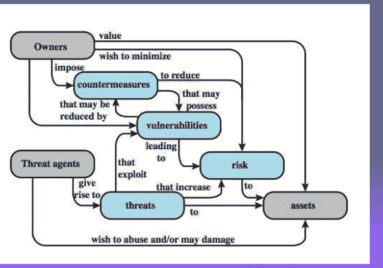

### Security Concepts and Relationships

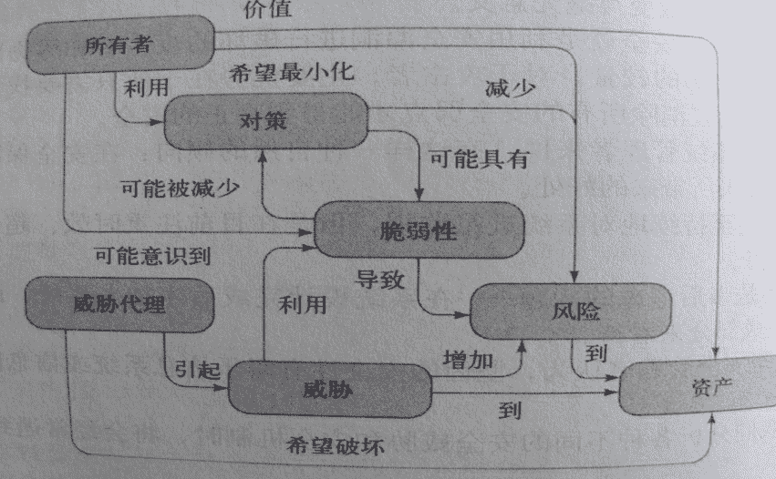

Figure 1-2 Security concepts and their relationships

### Vulnerabilities and Attacks

- Vulnerabilities of system resources may be:
  - Destroyed (lack of integrity)
  - Leaked (lack of confidentiality)
  - Unavailable (lack of availability)

- Attacks are threats that are carried out
  - Passive
  - Active
  - Internal
  - External

### Countermeasures

- Methods used to deal with attacks: prevention, detection, recovery
- May lead to new weaknesses
- May leave residual weaknesses
- The goal is to minimize risk

### Threat Consequences

> Unauthorized disclosure
  - Exposure, interception, inference, intrusion
> Deception
  - Masquerade, forgery, repudiation
> Disruption
  - Incapacitation, corruption, obstruction
> Usurpation
  - Misappropriation, misuse

### Computer and Network Security Incident Classification

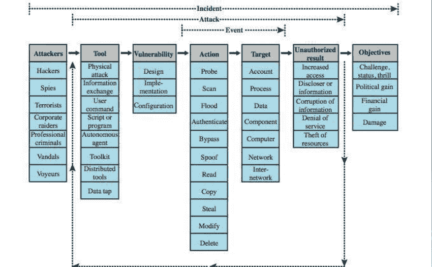

| Category | Content |
|---|---|
| Attackers | Hackers；Spies；Terrorists；Corporate raiders；Professional criminals；Vandals；Voyeurs |
| Tool | Physical attack；Information exchange；User command；Script or program；Autonomous agent；Toolkit；Distributed tools；Data tap |
| Vulnerability | Design；Implementation；Configuration |
| Action | Probe；Scan；Flood；Authenticate；Bypass；Spoof；Read；Copy；Steal；Modify；Delete |
| Target | Account；Process；Data；Component；Computer；Network；Internetwork |
| Unauthorized result | Increased access；Disclosure of information；Corruption of information；Denial of service；Theft of resources |
| Objectives | Challenge status, thrill；Political gain；Financial gain；Damage |

### Computer and Network Security Incident Classification

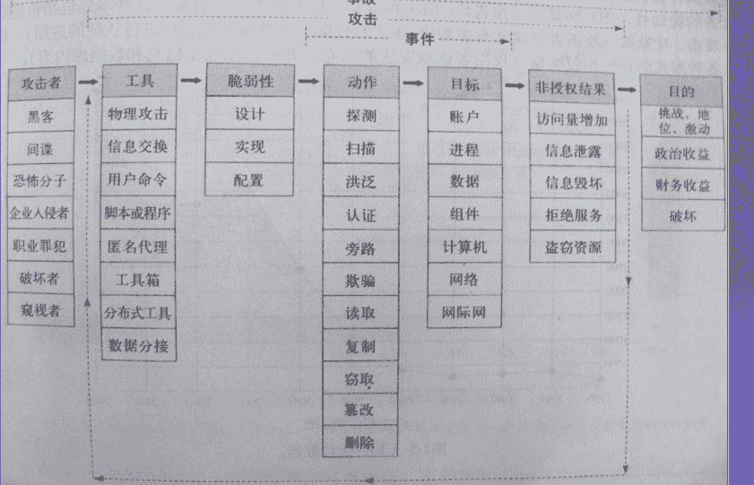

### Vulnerability Reports

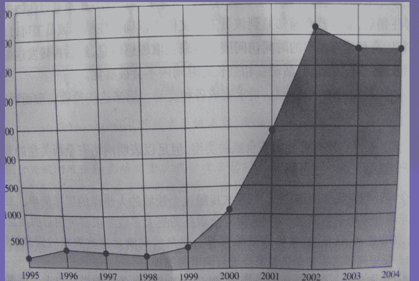

### Incident Reports

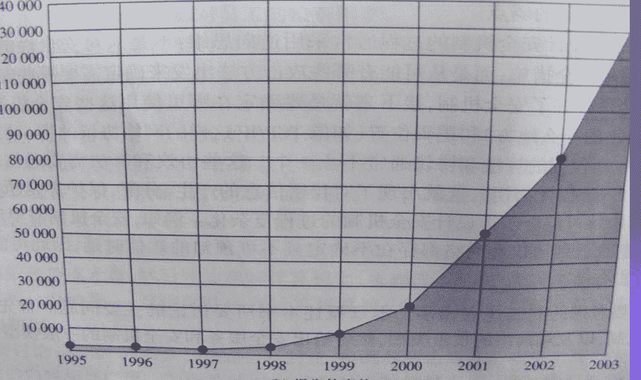

(b) Reported incidents

### Security Development Trends

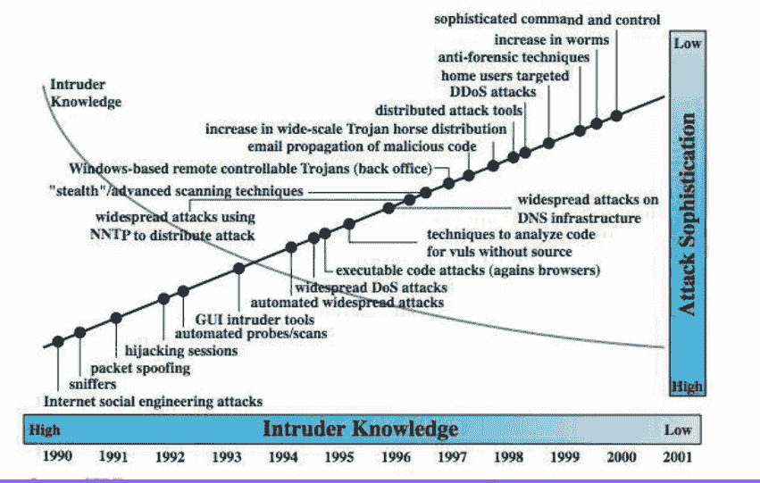

### Security Development Trends

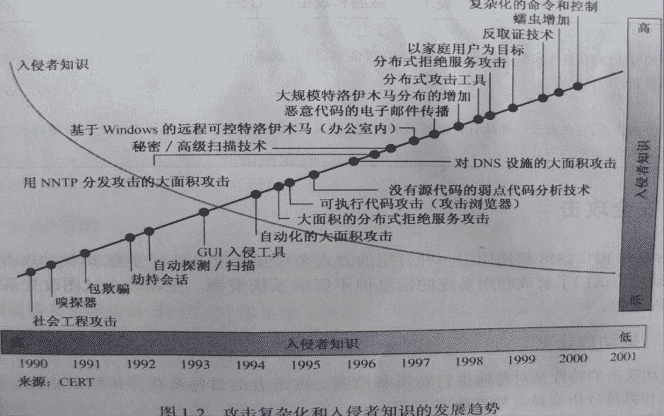

### Computer Security Losses

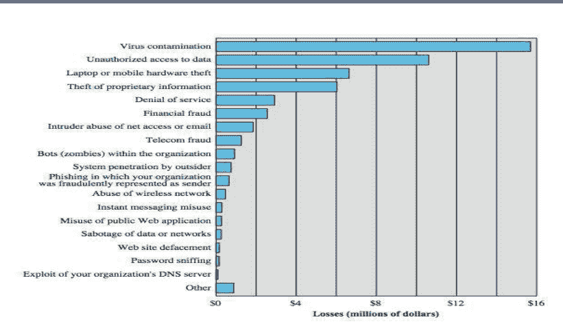

Source: Computer Security Institute/FBI 2006 Computer Crime and Security Survey

### Computer Security Losses

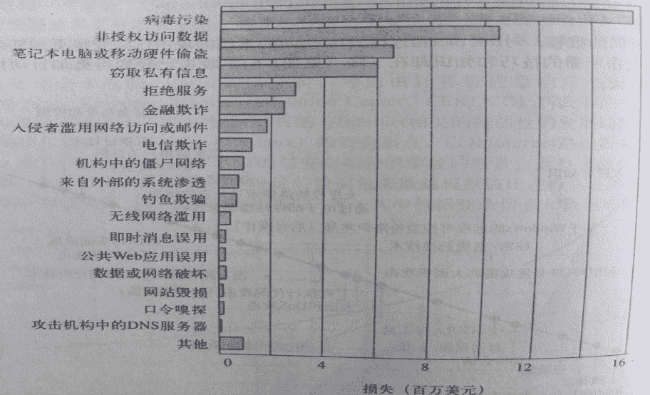

### Adopted Security Technologies

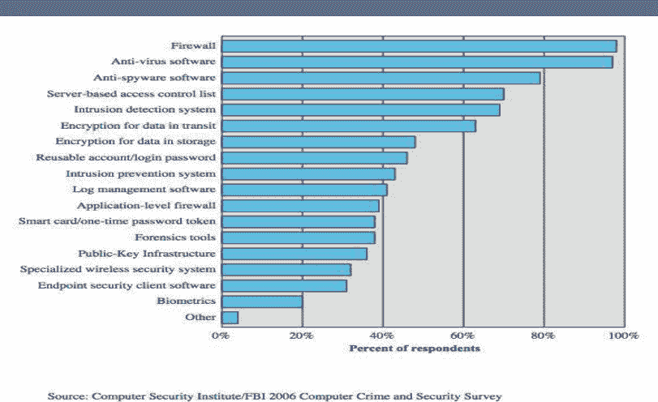

Source: Computer Security Institute/FBI 2006 Computer Crime and Security Survey

### Adopted Security Technologies

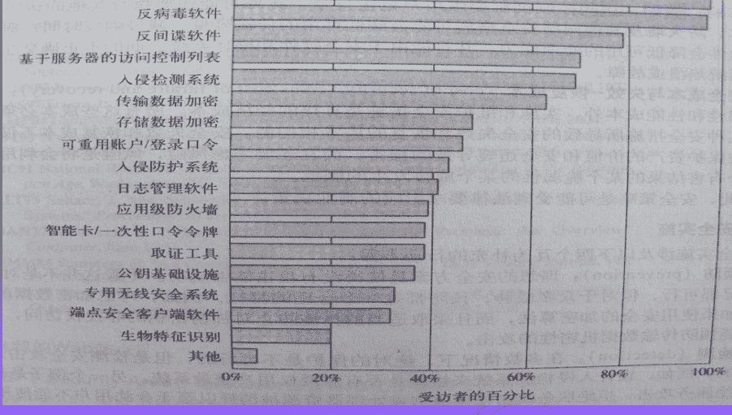

### OSI Security Framework Structure

- ITU-T: X.800 = "OSI Security Framework"
- Defines a systematic approach that defines and provides security requirements, as well as the evaluation and selection of security products and policies.
- Theoretically, it provides a useful overview of many of the concepts involved.

### Security Content Addressed by X.800

- Security attacks
- Security mechanisms
- Security services


### Security Attacks

> Any action that compromises the security of organizational information
> Information security is about how to prevent attacks and how to detect attacks against information systems
> The concepts of threat and attack refinement are different
> There are two basic types of attacks
  - Passive attacks: disclosure of message contents, traffic analysis (prevention)
  - Active attacks: masquerade, replay, message modification, denial of service

### Passive Attacks

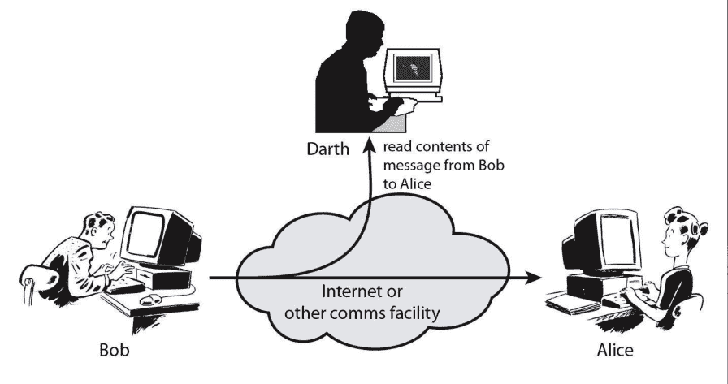

Darth

read contents of message from Bob to Alice

Internet or other comms facility

Bob

Alice

### Active Attacks

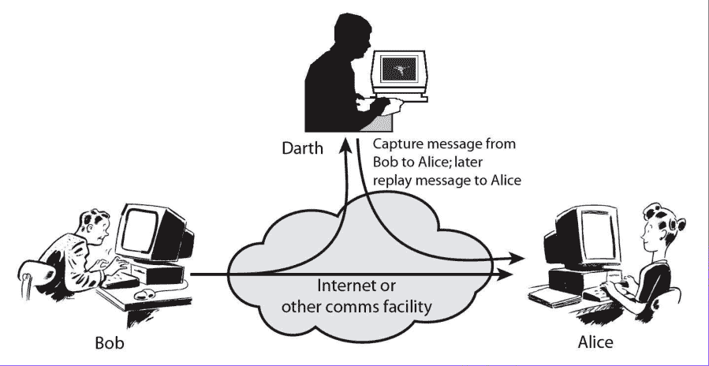

Darth

Capture message from Bob to Alice; later replay message to Alice

Internet or other comms facility

Bob

Alice

### Security Services

> X.800:
> "It is a service provided by the protocol layer of an open communication system to ensure the security of system or data transmission."

> RFC 2828:
> "A processing or communication service provided by a system to provide a specific type of protection for system resources."


### 安全服务（X.800）

- 认证-确保通信实体正是声称的那一方
  - 同等实体认证、数据源认证
- 访问控制-防止未经授权而使用资源
- 数据保密性-保护数据以免未经授权而被公开
  - 连接保密性、无连接保密性、选择域保密性、流量保密性
- 数据完整性-确保接收到的数据与可信实体发送的数据完全一致
  - 恢复的连接完整性、无恢复连接完整性、选择域连接完整性、无连接完整性、选择域无连接完整性
- 不可否认性-提供保护措施以防参与通信的一方否认传输或接收过某条消息
  - 源不可否认、宿不可否认
- 可用性服务

### 安全机制

- 为了检测、预防、或从安全攻击中恢复而设计的特征
- 没有任何一个机制会支持需要的所有服务
- 可是，一种特殊的技术成了在用的安全机制的基础：
  - 密码学技术
- 因此，该技术是我们关注的核心

### 密码机制（X.800）

- **特定的安全机制：**
  - 加密，数字签名，访问控制，数据完整性，认证交换，流量填充，路由控制，公证

- **普遍的安全机制：**
  - 可信功能，安全标签，事件检测，安全审计跟踪，安全恢复


### 网络安全模型

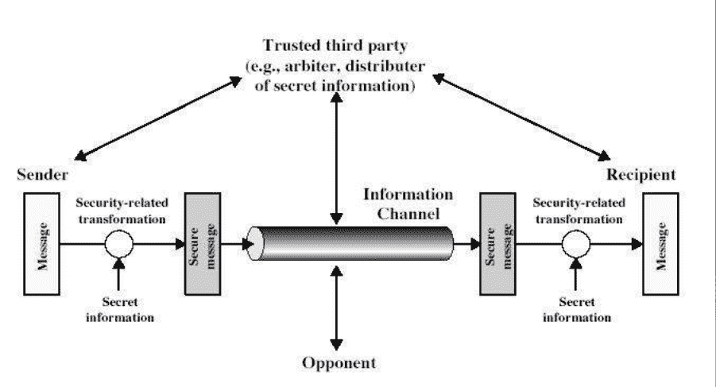

### 网络安全模型

我们使用这个模型去：

1. 为安全变换（transformation）设计合适的算法
2. 产生算法所使用的秘密信息
3. 设计分配和共享秘密信息的方法
4. 指明通信双方使用的协议，该协议利用安全算法和秘密信息实现安全服务

### 网络访问安全模型

对手
– 人类（例如，黑客）
– 软件
  （例如，病毒，蠕虫）

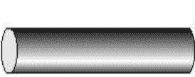

访问通道


门卫功能

| Information System |
|---|
| Computing resources (processor, memory, I/O) |
| Data |
| Processes |
| Software |
| Internal security controls |

### 总结

- 定义：
  - 计算机,网络, internet安全
- X.800 标准
- 安全攻击，安全服务，安全机制
- 网络（访问）安全模型


## 第2章－古典加密技术

- 对称密码是相同，传统密码算法
- 密码学术语
- 攻击方法：算法性质的密码分析、穷举密钥
- 代换技术、置换技术
- 转轮机
- 隐写术


### 基本术语

- 明文-原始消息
- 密文-加密后的消息
- 加密算法-把明文转换成绩密文的算法
- 密钥-在密码技术中使用的只有发送者接收者知道的信息
- 译成密码-将明文转换成绩密文
- 解释密码-把密文恢复成明文
- 密码编码学-有关加密原理/方法的研究领域
- 密码分析学-在不知道密钥的情况下，解密密文的原理/方法的研究领域
- 密码学-包括密码编码学和密码分析学的研究领域

### 对称密码模型

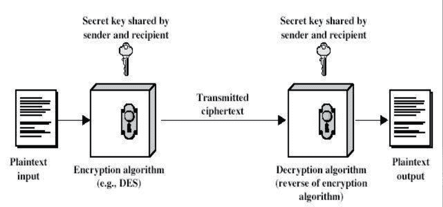

对称加密方案有五个基本成分：明文、加密算法、密钥、密文、解密算法

### 要求

- 对称密码的安全使用有两方面要求:
  - 加密算法足够强
  - 只有发送者/接收者知道的密钥

- 数学公式表示:
  Y = Eₖ(X)
  X = Dₖ(Y)

假设加密算法是已知的

暗示存在一个分配密钥的安全通道

### 密码编码学特征

- 使用的加密运算类型
  - 代换密码 / 置换密码 / 乘积密码（多代换/置换）
- 使用的密钥数
  - 单钥或私钥 / 双钥或公钥
- 处理明文的方式
  - 分组密码/流密码

### 密码学攻击

> 攻击目标是恢复密钥而不仅仅是消息
> 常见的攻击方法：
  - 密码分析学攻击：假定已知加密算法
  - 穷举攻击

### 密码分析学攻击

> 惟密文攻击
  - 已知解密密文
> 已知明文攻击
  - 知道多个明文/密文对
> 选择明文攻击
  - 任意选择明文，可得到密文
> 选择密文攻击
  - 有意选择密文，可得到明文
> 选择文本攻击
  - 任意选择明文/有意选择密文

### 更多概念

- 无条件安全
  - 不管计算机计算能力有多强或者有多少时间可以利用，密码都不能被攻破，因为密文不能提供足够的信息去确定对应的明文
- 计算上的安全
  - 在计算方法有限（代价太大，时间超时）的情况下，无法破译密码
- 分析方法有效性原因
  - 明文的结构和模式有保留（对称密码体制）
  - 密钥对的性质（数论、公钥体制）

### 穷举搜索

> 简单地遍历所有密钥总是可能的
> 最基本的攻击方法，和密钥规模是成比例的
> 假定能分辨/识别出明文

| Key Size (bits) | Number of Alternative Keys | Time required at 1 decryption/μs | Time required at 10⁶ decryptions/μs |
|---|---|---|---|
| 32 | 2³² = 4.3 × 10⁹ | 2³¹ μs ≈ 35.8 minutes | 2.15 milliseconds |
| 56 | 2⁵⁶ = 7.2 × 10¹⁶ | 2⁵⁵ μs ≈ 1142 years | 10.01 hours |
| 128 | 2¹²⁸ = 3.4 × 10³⁸ | 2¹²⁷ μs ≈ 5.4 × 10²⁴ years | 5.4 × 10¹⁸ years |
| 168 | 2¹⁶⁸ = 3.7 × 10⁵⁰ | 2¹⁶⁷ μs ≈ 5.9 × 10³⁶ years | 5.9 × 10³⁰ years |
| 26 characters (permutation) | 26! = 4 × 10²⁶ | 2 × 10²⁶ μs ≈ 6.4 × 10¹² years | 6.4 × 10⁶ years |

### 古典代换密码

- 明文字符被其他字符、数字或者符号替换

- 如果明文被看成是一个位序列，那么代换就是关于用密文代换明文位串

- 单表代换密码（Caesar 凯撒密码），Playfair 普莱费尔密码，Vigenère 维吉尼亚密码，一次一密

### Caesar 密码（凯撒）

> 已知最早的代换密码
> 由 Julius Caesar（尤利乌斯·凯撒）发明
> 首先在军事中被检验和使用
> 明文中每个字母由该字母之后的第3个字母代替
>   - 例如:
>     meet me after the toga party
>     PHHW PH DIWHU WKH WRJD SDUWB

### Caesar 密码

➢ 可把变换定义成：

```text
a b c d e f g h i j k l m n o p q r s t u v w x y z
D E F G H I J K L M N O P Q R S T U V W X Y Z A B C
```

➢ 每个字母用数字替换

```text
a b c d e f g h i j k l m n o p q r s t u v w x y z
0 1 2 3 4 5 6 7 8 9 10 11 12 13 14 15 16 17 18 19 20 21 22 23 24 25
```

➢ Caesar密码的数学表示：

\[
c = E(p) = (p + k) \bmod 26
\]

\[
p = D(c) = (c - k) \bmod 26
\]


### Caesar密码分析

- > 已知加密/解密算法
- > 只有25种可能的密码（对应于 A,B,..Z=0,..,25）
- > 只能依次去尝试，是一种穷举搜索
- > 对给定密文，要试遍所有字母的移位情形，明文元素已知
  - 密文"GCUA VQ DTGCM"，英语
  - 明文 "easy to break" ，密钥 C = 2
- 明文元素未知或压缩，需要识别很难

### 乘法密码/采样密码

- 乘法密码也是一种简单的代换，与凯撒密码相似，凯撒密码用的是加法，而乘法密码用的自然是乘法。这种方法形成的加密信息保密性比较低。

- 乘数密码的数字表示：
  $$c = E(p) = (p\,k) \bmod 26$$

- 乘数密码的密钥个数 ψ（q）-1（欧拉函数），对于乘数密码，只有当乘数与26互质时，加密之后才会有唯一的解，因此乘数只可能有如下11种的选择：

乘数 = 3,5,7,9,11,15,17,19,21,23,25

- 仿射密码和希尔密码因为都用到了乘法，所以乘数也受到相同的局限。


### 仿射密码

➢ 仿射密码就是凯撒密码和乘法密码的结合。

➢ 加密公式：

• 密文 = (明文 * 乘数 + 位移数) Mod 26

### 语言冗余和密码分析

- 人类语言是冗余的

- 字母出现的频率是不同的
  - 英语里，E是最常用的字母
  - 接着是 T,R,N,I,O,A,S
  - 其他字母如 Z,J,K,Q,X 是较少使用的

- 各种语言都存在单、双和三字母使用频率表


### 英文字母使用频率

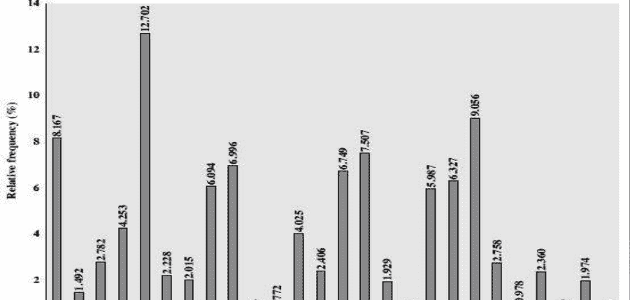

### 在密码分析学中的使用

- > 关键概念-单表代换密码不改变相关字母的出现频率

- > 由阿拉伯科学家在第9世纪发现，要对密文统计出字母的出现频率

- > 把出现的频率值与已知字母出现频率值相比较

  - 多频的: A-E-I 三元, NO 对, RST 三元

  - 低频的: JK, X-Z

- > 单表代换密码必须鉴别每一个字母

  - 使用共同的双/三字母表的帮助

### 密码分析举例

- 给定密文:
  UZQSOVUOHXMOPVGPOZPEVSGZWSZOPFPESXUDBMETSXAIZ
  VUEPHZHMDZSHZOWSFPAPPDTSVPQUZWYMXUZUHSX
  EPYEPOPDZSZUFFPOMBZWP FUPZHMDJUDTMOHMQ
- 计算字母出现的频率 (见上文)
- 猜测 P 和 Z 是 e 和 t
- 猜测 ZW 是 th ,因此 ZWP 是 the
- 通过试验和纠错,最后得到
  it was disclosed yesterday that several informal but direct contacts have been made with political representatives of the viet cong in moscow

### Playfair（普莱费尔）密码

- 单表代换密码不是依靠**长密钥**来提供安全的

- 提高安全性的一个途径是去**加密双字母，多字母表代换密码**

- 其中一个例子是Playfair密码，Playfair将明文中的双字母组合看作一个单元对待，并将这些单元转换为双字母组合。加密后的字符出现的频率在一定程度上被均匀化。

- Wheatstone（惠特斯通）于1854年发明，却以他朋友Playfair的名字命名

### 字母出现频率比较

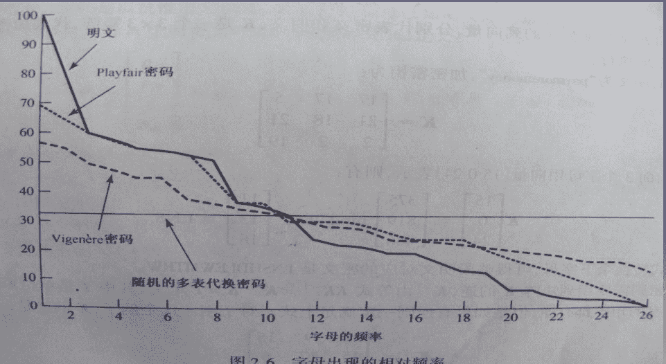

明文
Playfair密码
Vigenère密码
随机的多表代替密码
字母的频率
图 2.6 字母出现的相对频率

### Playfair 密钥矩阵

- 基于密钥词构成的5X5字母矩阵

- 用关键字字母填充(没有重复字母)

- 矩阵的其余部分用其他字母填充

- 例如,使用关键字MONARCHY

| M | O | N | A | R |
| C | H | Y | B | D |
| E | F | G | I/J | K |
| L | P | Q | S | T |
| U | V | W | X | Z |

### 字母对加密和解密

- 如果有一对字母是相同的,则插入填充字符,如'X'

- 如果两个字母落在了同一行,则把每个字母用右边的字母替换(如果是最右位,则用该行最左边的字母替换)

- 如果两个字母落在同一列,则每个字母用它下面的一个字母替换(如是最下位,则用该列最上面的字母替换)

- 否则,明文字母对中的字母按如下方式代换:该字母所在行为密文所在行,另一字母所在列为密文所在列。(先行后列, HS--BP)

### Playfair 密码的安全

- > 安全性比单表代换密码更高
- > 因为有 26 x 26 = 676种字母对组合
- > 需要一张有676个条目的频率表去分析(相对于单表代换密码的26个)
- > 相对更多的密文
- > 在很多年里被广泛使用
  - 例如,在一战时期美国&英国军事上的运用
- > 只有不多的几百个字母,则是能够破解的
- > 因为它依然保留了相当的明文结构信息

### 希尔密码(Hill Cipher)

- 希尔密码就是矩阵乘法密码。运用基本矩阵论原理的替换密码。

- 每个字母当作26进制数字：A=0，B=1，C=2……一串字母当成n维向量，跟一个n×n的密钥矩阵相乘，再将得出的结果模26。

- 希尔密码的优点是完全隐藏了字符的频率信息，弱点是容易被已知明文攻击击破。

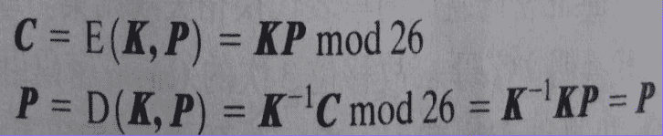

### 多表代换密码

- > 使用多张密码字母表来改进安全性
- > 使用更多的字母表使得通过猜测和对比频率分布的方法进行密码分析变得更加困难
- > 通过密钥去选择哪张字母表是对应于消息的每个字母的
- > 依次使用每张字母表
- > 当密钥选择最后一张字母表后,又重新从第一张表开始选择

### Vigenère维吉尼亚密码

- 最简单的多表代换密码
- 有效的多重caesar密码
- 密钥是多字母长度K = k₁, k₂ ... k_d
  - 第i个字母使用第i张字母表
  - 轮流使用每张字母表
- 消息中，每隔d位字母重复处理一次
- 解密是一个逆过程

### 维吉尼亚密码代换表

| 维吉尼亚密码代换表 |
|---|
| 由字母表按行循环移位组成的密码代换表。 |

### Vigenère密码的安全

- 每个明文字母对应多个密文字母
- 字母出现的频率信息被隐藏了
- 但也不是完全被隐藏


### 维吉尼亚密码的攻击

- 首先根据字母频率分析是单表代换还是维吉尼亚密码
- 如果是维吉尼亚密码，判定密钥词的长度N
- 根据密钥词长度确定包含的N个单表代换

### 维吉尼亚密码的改进

- 从理想化的角度,希望密钥和消息长度一样
- 密码自动生成技术
- 密钥字作为消息的前缀组成密钥
- 知道密钥字就能恢复前面几位字母
- 然后使用恢复的字母做后续的密钥字
- 但是仍然具有频率特征,容易受到攻击

### 一次一密乱码本

- > 如果使用的随机密钥与消息长度一样,则密码是安全的,称为一次一密乱码本
- > - Gilbert Vernham， Joseph Mauborgne
- > 它是破解不了的,因为密文与明文不具有统计关系
- > 因为对所有明文/密文,存在一个密钥把明文映射到密文上，密钥只能使用一次
- > 在密钥的产生/安全分配上容易出现问题

### 置换密码

- > 通过重新对字母排序来隐藏消息
- > 不改变实际使用的字母
- > 由于密文字母和原始明文字母有相同的频率分布，所以比较容易的分析出秘密信息


### 栅栏密码

- 把明文消息按对角方式写成几行
- 一行一行地读出密文

- 例如，明文消息：”meet me after the toga party”
- 深度为2的栅栏密码消息：
```
m e m a t r h t g p r y
  e t e f e t e o a a t
```
- 得到密文
```
MEMATRHTGPRY ETEFETEOAAT
```

### 行置换密码

更复杂的置换是矩阵块方法

- 把消息字母按行写出,把它们写在确定数目的列上
  - Attack postponed until two am xyz
- 然后,在读取这些行之前,根据密钥对这些列重新排序
  密钥: 4 3 1 2 5 6 7
  明文: a t t a c k p
        o s t p o n e
        d u n t i l t
        w o a m z y z
  密文: TTNA APTM TSUO AODW COIX KNLY PETZ

更安全的考虑是多次置换

### 乘积(product)密码

由于语言的特征,使用代换或置换密码是不安全的

因此,考虑在序列中使用若干密码使它更加攻不可破:

- 两个代换会产生一个更复杂的代换
- 两个置换会产生更复杂的置换
- 但一个代换紧接一个置换会产生一个新的更坚固的密码

这是从古典密码学到现代密码学的桥梁, DES

### 转轮机

- 在现代密码之前,转轮机产生的是最复杂的密码
- 在二战中广泛使用
  - German Enigma, Allied Hagelin, Japanese Purple
- 产生一种非常复杂,有多种形式的代换密码
- 使用一组圆筒,每个圆筒给出一种代换,圆筒会旋转并且每加密一个字母其转速会改变
- 3个圆筒使用 $26^3=17576$ 个字母表

### 三轮转轮机密码

慢速转子
中速转子
快速转子
(a) 初始情况

慢速转子
中速转子
快速转子
(b) 经过一次按键后的情况

### Hagelin 转轮机

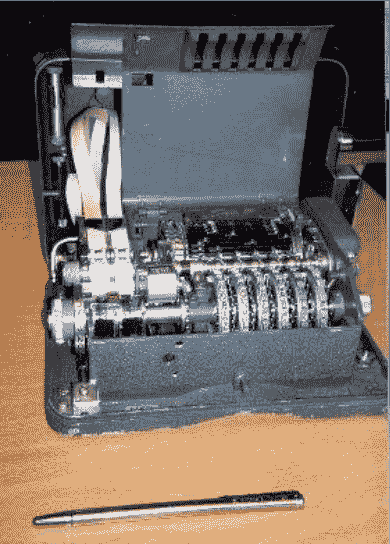

### 隐写术

一种可选方式的加密方法：信息隐藏，数字水印

隐藏消息的存在

- 在用某种方式表示的较长的消息里,仅使用字母/语句的一个子集
- 使用隐形墨水，字符标记，针刺等
- 在图形或声音文件里,隐藏在最低有效位中

缺点

- 用较大的开销去隐藏相对少的信息位

### 总结

- 古典密码技术和相关术语
- 单表代换密码
- 用字母出现频率进行密码分析
- Playfair 密码
- 多表代换密码
- 置换密码
- 乘积(product)密码和转轮机
- 隐写术


## 第3章 分组加密和数据加密标准

- 分组密码是一种加/解密算法，明文分组处理，输出等长密文
- 采用Feistel费斯特结构，由多个轮函数组成。该结构每一轮对输入数据的一半进行代换，接着用置换来交换数据的两部分，扩展初始密钥使得每轮使用不同的子密钥。
- DES 扩展了Feistel结构，64位分组，56位密钥
- 差分分析与线性分析是两种重要的密码分析方法，DES对两类攻击具有免疫性

### 分组密码与流密码比较

- 分组密码用分组的方式处理消息，以分组为单位加密和解密

- 分组大小64位或128位

- 流密码在加密和解密时，每次处理一位或一字节的消息

- 维吉尼亚密码，Vernam密码

- 当前许多密码算法都是分组密码，应用范围广阔

### 理想的分组密码

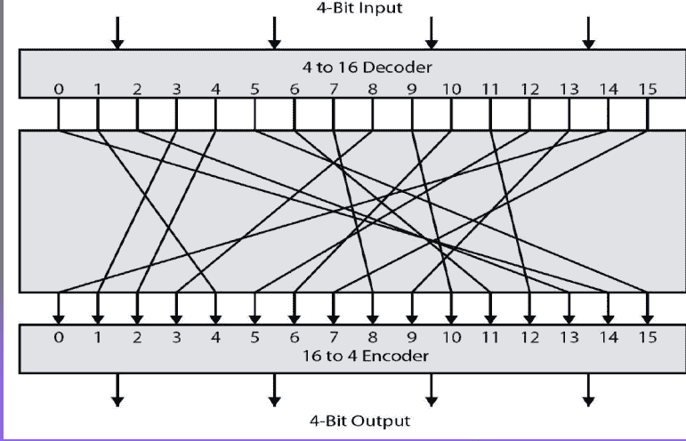

### 代换密码加/解密码表

表 3.1 图 3.4 所示代换密码的加密与解密表

| 明 文 | 密 文 |
| --- | --- |
| 0000 | 1110 |
| 0001 | 0100 |
| 0010 | 1101 |
| 0011 | 0001 |
| 0100 | 0010 |
| 0101 | 1111 |
| 0110 | 1011 |
| 0111 | 1000 |
| 1000 | 0011 |
| 1001 | 1010 |
| 1010 | 0110 |
| 1011 | 1100 |
| 1100 | 0101 |
| 1101 | 1001 |
| 1110 | 0000 |
| 1111 | 0111 |

| 密 文 | 明 文 |
| --- | --- |
| 0000 | 1110 |
| 0001 | 0011 |
| 0010 | 0100 |
| 0011 | 1000 |
| 0100 | 0001 |
| 0101 | 1100 |
| 0110 | 1010 |
| 0111 | 1111 |
| 1000 | 0111 |
| 1001 | 1101 |
| 1010 | 1001 |
| 1011 | 0110 |
| 1100 | 1011 |
| 1101 | 0010 |
| 1110 | 0000 |
| 1111 | 0101 |

### 分组密码原理

- 对称的分组密码基于Feistel密码结构
- 可逆变换（非奇异变换）确保唯一对应
- 原理上分组密码是规模巨大的代换，不实际
  - n为分组，有2^n个明文信息组，可逆变换，则为2^n!个变换
  - 对于64位的分组，需要2^64个条目的表
  - 密钥的规模为64 × 2^64 = 2^70 = 10^21 bits
- 理想体制的近似体制，通过小的容易实现的部件上逐步完成，例如密钥长度为2k，小于n。
- 使用乘积(product)密码的思想，交替使用代换和置换

### Claude Shannon 克劳德·香农 和 代替-置换密码

- Claude Shannon，1949年，思想是混淆和扩散
- 现代分组密码的基础：代换-置换(S-P)网络是混淆和扩散的实际应用
- S-P网络基于两个简单的密码操作，即
  - 代换(S盒)
  - 置换(P盒)
- 提供消息和密钥的混乱和扩散

### 混淆和扩散

- 如何防止基于统计方法的密码分析
- 密码算法需要原始消息统计特征变得完全不明显
- 一次一密也是如此
- Shannon建议S&P元素结合获得：

- 扩散-去掉密文上有关明文的统计结构，明文置换+函数
- 混乱-使得密文和密钥之间的关系尽可能复杂

### Feistel 密码结构

- Horst Feistel 设计了 **feistel 密码**
  - 基于可求逆的乘积(product)密码思想

- 把输入块分割为两个等份
  - 要经过多轮相同结构的迭代
  - 对左半边的数据执行代换操作
    - 基于右半部分和子密钥的轮函数处理后做异或
  - 然后左右部分进行交换，即置换操作

- 实现Shannon的S-P网络思想

### Feistel 密码结构

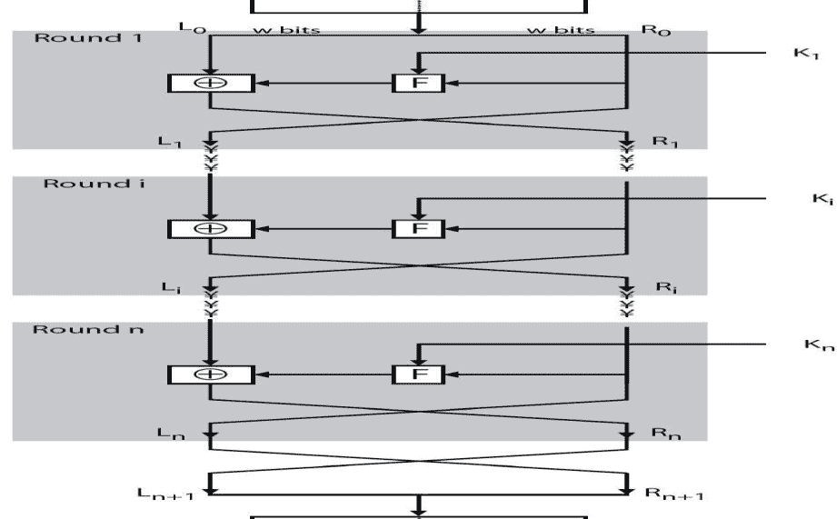

### Feistel 密码设计元素

- 分组长度：安全性与速度的平衡。64或128位，扩散性
- 密钥长度：安全性与速度的平衡。抗穷举，混淆性
- 迭代轮数：16轮，高安全性
- 子密钥产生算法：密码分析困难
- 轮函数：抗攻击能力
- 快速软件加/解密：更多的应用领域
- 简化分析难度，容易发现缺陷

### Feistel 密码解密

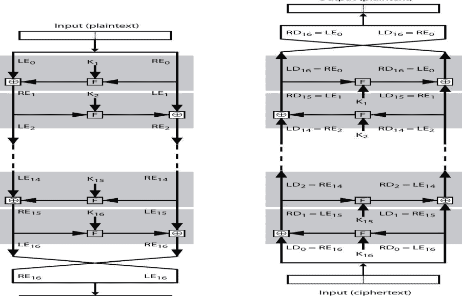

### Feistel 密码解密

加密过程：
LE₁₆ = RE₁₅
RE₁₆ = LE₁₅ ⊕ F(RE15, K₁₆)

解密过程：
LD₁ = RD₀ = LE₁₆ = RE₁₅
RD₁ = LD₀ ⊕ F(RD₀, K₁₆)
= RE₁₆ ⊕ F(RE₁₅, K₁₆)
= [LE₁₅ ⊕ F(RE₁₅, K₁₆)] ⊕ F(RE₁₅, K₁₆)
= LE₁₅

XOR运算：
[A ⊕ B] ⊕ C = A ⊕ [B ⊕ C]
D ⊕ D = 0
E ⊕ 0 = E


### 数据加密标准 (DES/DEA)

- > 世界使用最广泛的分组密码
- > 1977， NBS(现在的NIST)采用
  - 即 FIPS PUB 46
- > 56位密钥加密64位数据
- > 已被普遍采用，对其安全性的争论很多

### DES 设计争议

- > DES标准是公开的
- > 设计争议相当大
  - 56位密钥，Lucifer128位
  - S盒设计标准保密
- > 事实和公开分析表明设计是合理的
- > DES的使用已经相当普遍
  - 尤其在金融领域的应用上
  - 仍然是(历史)遗留系统使用的标准

### DES 加密

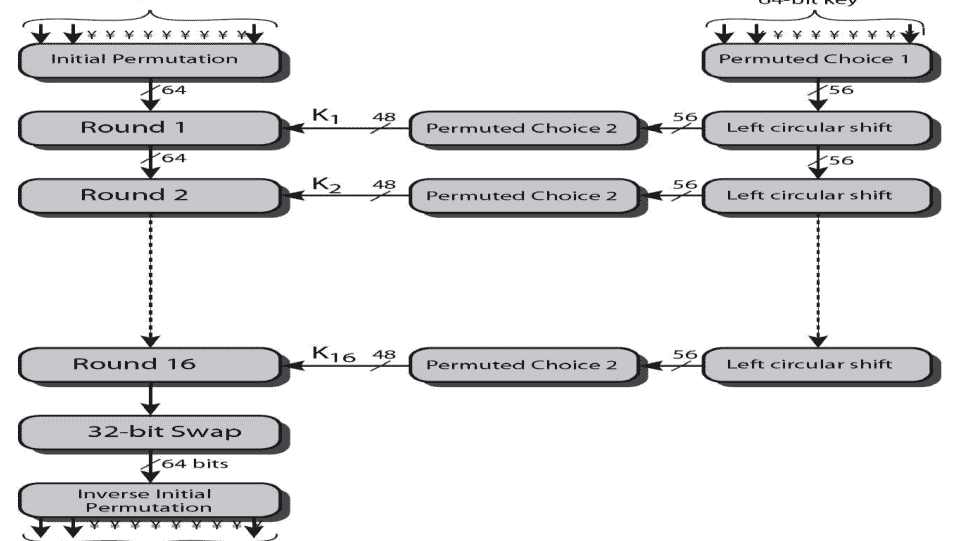

### 置换 IP

#### (a)初始置换 (IP)

| 58 | 50 | 42 | 34 | 26 | 18 | 10 | 2 |
| 60 | 52 | 44 | 36 | 28 | 20 | 12 | 4 |
| 62 | 54 | 46 | 38 | 30 | 22 | 14 | 6 |
| 64 | 56 | 48 | 40 | 32 | 24 | 16 | 8 |
| 57 | 49 | 41 | 33 | 25 | 17 | 9 | 1 |
| 59 | 51 | 43 | 35 | 27 | 19 | 11 | 3 |
| 61 | 53 | 45 | 37 | 29 | 21 | 13 | 5 |
| 63 | 55 | 47 | 39 | 31 | 23 | 15 | 7 |

#### (b) 逆初始置换 (IP⁻¹)

| 40 | 8 | 48 | 16 | 56 | 24 | 64 | 32 |
| 39 | 7 | 47 | 15 | 55 | 23 | 63 | 31 |
| 38 | 6 | 46 | 14 | 54 | 22 | 62 | 30 |
| 37 | 5 | 45 | 13 | 53 | 21 | 61 | 29 |
| 36 | 4 | 44 | 12 | 52 | 20 | 60 | 28 |
| 35 | 3 | 43 | 11 | 51 | 19 | 59 | 27 |
| 34 | 2 | 42 | 10 | 50 | 18 | 58 | 26 |
| 33 | 1 | 41 | 9 | 49 | 17 | 57 | 25 |

### 初始置换 IP

- > 数据处理第一步
- > IP 对输入数据位重新排序
- > 偶数位放在左半部分,奇数位放在右半部分
- > 结构上十分规则(easy in h/w)
  - 例如： IP(675a6967 5e5a6b5a) = (ffb2194d 004dE6Fb)

### DES 迭代过程

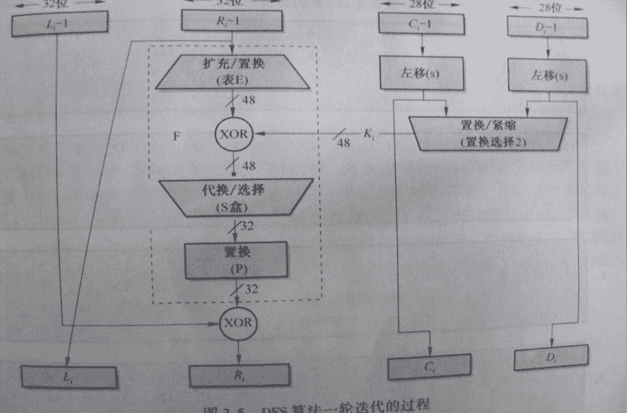

### DES 轮结构

- > 两个32位的左/右等份
- > 所有Feistel密码都能描述成:
- >   L_i = R_{i-1}
- >   R_i = L_{i-1} ⊕ F(R_{i-1}, K_i)
- > F函数使用32位右半部分和48位子密钥

- 用扩展转换把右半部分扩展成48位
- 用异或操作与子密钥结合
- 经过8个S盒代替产生32位输出
- 最后,使用32位P盒置换

### 扩展转换/P盒置换

**(c) 扩充置换（E）**

| 32 | 1 | 2 | 3 | 4 | 5 |
|---:|---:|---:|---:|---:|---:|
| 4 | 5 | 6 | 7 | 8 | 9 |
| 8 | 9 | 10 | 11 | 12 | 13 |
| 12 | 13 | 14 | 15 | 16 | 17 |
| 16 | 17 | 18 | 19 | 20 | 21 |
| 20 | 21 | 22 | 23 | 24 | 25 |
| 24 | 25 | 26 | 27 | 28 | 29 |
| 28 | 29 | 30 | 31 | 32 | 1 |

**(d) 置换函数（P）**

| 16 | 7 | 20 | 21 | 29 | 12 | 28 | 17 |
|---:|---:|---:|---:|---:|---:|---:|---:|
| 1 | 15 | 23 | 26 | 5 | 18 | 31 | 10 |
| 2 | 8 | 24 | 14 | 32 | 27 | 3 | 9 |
| 19 | 13 | 30 | 6 | 22 | 11 | 4 | 25 |

### DES 轮结构/S盒

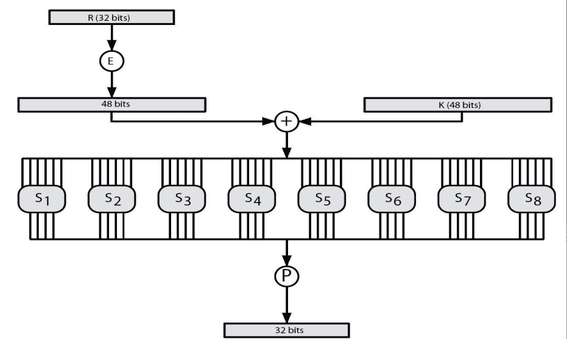

### S盒代换

- - 有8个S盒，每个S盒把6位输入映射到4位输出
- - 每个S盒实际上是实际上被4位-4位的划分
  - 外部位1&6(行位)确定从4行里选择某1行
  - 内部位2-5(列位)是构成的4位数从16列中对应1列
  - 十进制数变为二进制，结果是8个4位的输出
- - 每行定义可逆代换，选择依赖数据、密钥
  - 例如：S(18 09 12 3d 11 17 38 39) = 5fd25e03

### DES 密钥方案

- > 每轮都要产生子密钥
  - 密钥的初始转换(PC1)即在两个28位的密钥等份中选取48位
  - 16 轮的组成如下:
    - 根据密钥移位表K,分别使这两等份循环左移1位或2位
    - 从这两部分中分别选择24位，在轮函数F中,使用 PC2对它们进行置换

### DES 解密

- - 解密必须按数据加密运算的相反步骤进行
- - 用Feistel设计,再执行一次加密步骤,但子密钥按相反顺序使用(SK₁₆...SK₁)
  - IP 使用最后的 FP 加密步骤
  - 第1轮使用SK₁₆,使用第16轮加密步骤
  - ....
  - 第16轮使用SK₁,使用第1轮的加密步骤
  - 最后的FP使用开始加密时使用的IP
  - 最后恢复出原始数据值

### 雪崩效应

- - 一个输入或密钥位的改变将导致大约一半的输出位的改变
- - 试图通过猜测密钥去"home-in"是不可能的
- - DES表现出很强的雪崩效应

### DES的强度 — 密钥大小

- > 56位密钥有2⁵⁶ = 7.2 x 10¹⁶ 个值，强暴搜索是很困难的
- > 近来的进展已经表明攻破它是可能的
  - 1997年,在因特网上用了几个月时间
  - 1998年,专用的h/w(EFF)用了几天
  - 1999年,上面两种结合起来用了22小时
- > 仍然必须能够识别明文
- > 必须考虑DES的替代方案

### DES 的强度－基于分析的攻击

- - 对DES有很多种分析攻击方法
- - 它们使用一些很深奥的密码结构
  - 通过收集加密信息
  - 最终恢复一些/所有的子密钥位
  - 如果需要,则可以对剩余部分进行穷尽搜索
- - 一般这些都上统计上的攻击方法，包括
  - 差分密码分析
  - 线性密码分析
  - 相关的密钥攻击

### DES的强度 – 时序攻击法

- - 攻击密码的实际执行过程
- - 从执行序列消息中导出一些/所有的子密钥位信息
- - 具体的使用情况是其计算要花费不同的时间,主要取决于它的输入值

### 差分密码分析

- - 针对Feistel密码的一种统计的攻击方法
- - 使用前面没有使用过的密码结构
- - S-P网络的设计有函数$f$的输出, $f$会受输入&密钥的影响
- - 因此,不知道密钥值就不能通过密码回溯出(明文)值
- - 差分密码分析比较两个相关的密文对

### 差分密码分析比较加密对

- - 在输入中使用一种已知的差分
- - 在输出中寻找一种已知的差分
- - 当使用相同的子密钥时

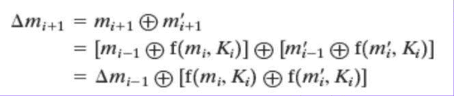

### 差分密码分析

- > 对一定的输入差分会有一定输出差分的概率是 P
- > 如果发现一些具有更高概率的输入/输出差分对的情况
- > 可以推断出子密钥是按轮使用的
- > 然后必须重复进行很多轮(随着不断减小的概率)

### 差分密码分析

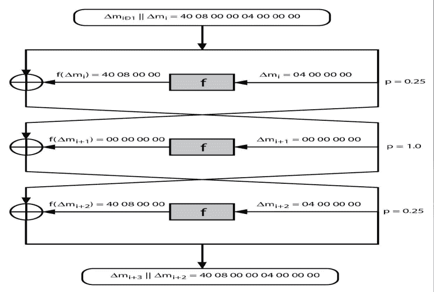


### 差分密码分析

> 这种攻击是通过利用已知的输入异或反复加密明文对,直到获得理想的输出异或
> 当发现
- 如果异或的中间轮有一个正确对
- 如果没有,则有一个错误对,攻击的相对比值是S/N
- 然后可以为这轮推导出密钥值
- 正确对是相同的密钥位
- 错误对给出一个随机值
轮数很多时,概率值是相当低的,以至于需要比现有的64位输入还要多的对
Biham和Shamir已经展示了13轮的重复是怎样攻破完整的16轮DES的

### 线性密码分析

> 另一个最新的发展成果，是一种统计方法
> 随着概率的减小,必须进行多轮重复
> 由Matsui et al在90年代早期提出
> 基于发现线性近似值,用2^43 个已知明文就能攻击 DES,看似更容易,但实际上是不可行的

### 线性密码分析

找到线性近似值的概率 \(p \ne \frac{1}{2}\)

\(P[i_1,i_2,\ldots,i_a] \oplus C[j_1,j_2,\ldots,j_b] = K[k_1,k_2,\ldots,k_c]\)

这里 \(i_a,j_b,k_c\) 是其在 \(P,C,K\) 中的位置值

为密钥位给出线性等式，使用最大可能取得一个密钥位，使用大量的加密试验

有效性由式子：\(|p-\frac{1}{2}|\) 得到

### DES 设计准则

S盒设计的7个标准规定

- 非线性
- 抵抗差分分析
- 很强的混乱效果

P置换的3个准则规定

- 增加扩散效果

### 总结

- 分组密码与流密码的比较
- Feistel 密码的设计与结构
- DES密码算法：细节与强度
- 差分和线性密码分析
- 分组密码设计准则

### 信息安全理论与实践

冯 涛

兰州理工大学计算机与通信学院

## 第4章 有限域

- 域是元素的集合，定义了加法和乘法运算，算数性质：封闭性、结合律、交换律、分配律、加法和乘法逆
- 模算术是整数算术，集合大小为n，其他整数通过余数表达
- 有限域在密码学中应用广泛，有限域的阶可以用素数幂表达$p^r$
- 阶为$p$的有限域可以用模算术定义
- 阶为$p^r$的有限域可以用多项式算术定义

### 引言

> 有限域在密码学日显重要
> - AES, Elliptic Curve, IDEA, Public Key
> 
> 抽象代数: 群、环、域
> 
> 模算术、欧几里得算法、GF (p)、多项式运算、GF(2ⁿ)

### 群辛例

➢ $N_n$ 表示$n$个不同符号的集合，\{1,2,...,n\}，$S_n$是所有置换的集合，那么$S_n$是个群。

运算规则：

- 封闭性：$a、b$ 属于 $S_n$，那么 $a·b$ 属于 $G$，例如 $\{3,2,1\}·\{1,3,2\}=\{2,3,1\}$，置换 $a$ 改变 $b$
- 结合律：$(a·b)·c=a·(b·c)$
- 单位元：$e·e·a=a·e=a$，例如，单位元 $\{1,2,...,n\}$
- 逆元 $a^{-1}$：$a·a^{-1}=e$，例如 $\{2,3,1\}\{3,1,2\}=\{1,2,3\}$
- 当大于2，不是交换群

### 循环群

- 重复运用群运算定义为幂运算
  - 例如：\(a^3=a\cdot a\cdot a\)

- 单位元是：\(e=a^0\)

- 如果群中的每个元素都是某个固定元素的幂，则该群是循环群
  - 例如 \(b=a^k\)，对某个元素 \(a\) 和群中的每个元素 \(b\)

- \(a\) 被称为是群的生成元

- 循环群总是交换群。整数的加法群是无限循环群，生成元是1，幂被解释为加法合成的，\(n\) 是1的 \(n\) 次幂。

### 环

- 两个二元运算的集合，{R，+，×}，加法和乘法

- R 对加法构成阿贝尔群，满足五个公理。单位元 0，逆元 a+(-a)=0

- R 对乘法满足：
  - 封闭性，a、b 属于 G，那么 a×b 属于 G
  - 满足结合律，(a×b)×c = a×(b×c)
  - 满足对加法的分配律：
    - a×(b+c) = a×b + a×c
    - (a+b)×c = a×c + b×c

- 如果乘法运算是可交换的，它构成一个交换环

- 如果乘法有单位元和无零因子，那么构成一个整环
  - 单位元为1，无零因子 ab=0，则必有 a=0 或 b=0

### 域

> 两个二元运算的集合，{F , +, ×}, 加法和乘法
> F 是一个整环
> F 对乘法满足:
>   - 乘法逆元 a · a⁻¹ = 1
> 逐渐多的规则
>   - 从群 -> 环 -> 域

### 群 -> 环 ->域

(A1) 加法的封闭性: 如果a和b属于S, 则a+b也属于S
(A2) 加法结合律: 对S中的任意元素a,b,c, a+(b+c)=(a+b)+c
(A3) 加法单位元: R中存在一个元素0, 使得对于S中的任意元素a, 有a+0=0+a=a
(A4) 加法逆元: 对于S中的任意元素a, S中一定存在一个元素-a, 使得a+(-a)=(-a)+a=0
(A5) 加法交换律: 对于S中的任意元素a和b, 有a+b=b+a
(M1) 乘法的封闭性: 如果a和b属于S, 则ab也属于S
(M2) 乘法结合律: 对于S中的任意元素a,b,c, 有a(bc)=(ab)c
(M3) 分配律: 对于S中的任意元素a,b,c, 有(a+b)c=ab+ac 和 a(b+c)=ac+bc
(M4) 乘法交换律: 对于S中的任意元素a和b, ab=ba
(M5) 乘法单位元: 对于S中的任意元素a, 在S中存在一个元素1, 使得a1=1a=a
(M6) 无零因子: 对于S中的元素a,b, 若ab=0, 则必有a=0或b=0
(M7) 乘法逆元: 如果a属于S, 且a不为0, 则S中存在一个元素a⁻¹, 使得aa⁻¹=a⁻¹a=1

图4.1 群,环和域

### 因子

> 如果存在某个 m 使得 a = mb（a，b，m 都是整数，且 b 不为 0），则称 b 整除 a，即 b 除 a 没有余数

> 用 b | a 表示，称 b 是 a 的一个因子

- 所有 1,2,3,4,6,8,12,24 整除 24
- 如果 a | 1，那么 a = 1 或 a = -1
- 如果 a | b，b | a，那么 a = b
- 如果 b | g，b | h，那么有 b | (mg + nh)，如何证明？
- 如果 a = 0 mod n，那么 n | a，14 = 0 mod 7

### 同余的性质：如何证明？

- 如果 n | (a-b)，那么 a ≡ b mod n
  - a-b=kn , a=kn+b, a mod n = b mod n
- 如果 a ≡ b mod n，那么 b ≡ a mod n
  - a ≡ b mod n，则 n | (a-b) 或 n | (b-a)
- 如果 a ≡ b mod n, b ≡ c mod n 那么 a ≡ c mod n

### 模算术运算

对任何整数群能够做模算术：

- Zₙ = {0, 1, ... , n-1}
- [(a mod n) + (b mod n)] = (a+b) mod n
- [(a mod n) − (b mod n)] = (a−b) mod n
- [(a mod n) × (b mod n)] = (a×b) mod n

证明性质：

- a+b mod n = (r1+j n+r2+k n) mod n
  = (r1+r2+(k+j)n) mod n
  = (r1+r2) mod n
  = (a mod n + b mod n) mod n

### 模8加法，乘法例子

| + | 0 | 1 | 2 | 3 | 4 | 5 | 6 | 7 |
|---|---|---|---|---|---|---|---|---|
| 0 | 0 | 1 | 2 | 3 | 4 | 5 | 6 | 7 |
| 1 | 1 | 2 | 3 | 4 | 5 | 6 | 7 | 0 |
| 2 | 2 | 3 | 4 | 5 | 6 | 7 | 0 | 1 |
| 3 | 3 | 4 | 5 | 6 | 7 | 0 | 1 | 2 |
| 4 | 4 | 5 | 6 | 7 | 0 | 1 | 2 | 3 |
| 5 | 5 | 6 | 7 | 0 | 1 | 2 | 3 | 4 |
| 6 | 6 | 7 | 0 | 1 | 2 | 3 | 4 | 5 |
| 7 | 7 | 0 | 1 | 2 | 3 | 4 | 5 | 6 |

| × | 0 | 1 | 2 | 3 | 4 | 5 | 6 | 7 |
|---|---|---|---|---|---|---|---|---|
| 0 | 0 | 0 | 0 | 0 | 0 | 0 | 0 | 0 |
| 1 | 0 | 1 | 2 | 3 | 4 | 5 | 6 | 7 |
| 2 | 0 | 2 | 4 | 6 | 0 | 2 | 4 | 6 |
| 3 | 0 | 3 | 6 | 1 | 4 | 7 | 2 | 5 |
| 4 | 0 | 4 | 0 | 4 | 0 | 4 | 0 | 4 |
| 5 | 0 | 5 | 2 | 7 | 4 | 1 | 6 | 3 |
| 6 | 0 | 6 | 4 | 2 | 0 | 6 | 4 | 2 |
| 7 | 0 | 7 | 6 | 5 | 4 | 3 | 2 | 1 |


### 模算术性质

Zₙ = {0, 1, …, n-1}，模 n 的剩余类，最小非负整数，模n 的 k 约化，模4剩余类如下

- [0]={16, 12, 8, 4, 0, -4, …}
- [1]={17, 13, 9, 5, 1, -3, …}
- [2]={18, 14, 10, 6, 2, -2, …}
- [3]={19, 15, 11, 7, 3, -1, …}

Zₙ对加法有加法逆元，存在乘法逆元

性质：

- 如果 (a+b)=(a+c) mod n ，那么 b=c mod n
- 而且如果 (a·b)=(a·c) mod n ，那么 b=c mod n 仅当 a 与n互素，否则没有完整剩余类

### 欧几里得算法

- 求 GCD(a,b) 的一个有效算法
- 使用定理：`GCD(a,b) = GCD(b, a mod b)`

计算GCD(a,b)的算法是：

```
EUCLID(a,b)
1. A = a; B = b
2. if B = 0 return A = gcd(a, b)
3. R = A mod B
4. A = B
5. B = R
6. goto 2
```

Ai=Bi×Qi+Ri


### 例求 GCD(1970,1066)

1970 = 1 x 1066 + 904      gcd(1066, 904)
1066 = 1 x 904 + 162      gcd(904, 162)
904 = 5 x 162 + 94      gcd(162, 94)
162 = 1 x 94 + 68      gcd(94, 68)
94 = 1 x 68 + 26      gcd(68, 26)
68 = 2 x 26 + 16      gcd(26, 16)
26 = 1 x 16 + 10      gcd(16, 10)
16 = 1 x 10 + 6      gcd(10, 6)
10 = 1 x 6 + 4      gcd(6, 4)
6 = 1 x 4 + 2      gcd(4, 2)
4 = 2 x 2 + 0      gcd(2, 0)

### 伽罗瓦域（Galois Fields）

- 有限域在密码学中具有重要的作用,能够证明有限域中元素的个数是一个素数的幂pⁿ
- 著名的有限域 Galois fields,用GF(pⁿ)表示
- 两种情况的域:
  - GF(p)
  - GF(2ⁿ)

### Galois Fields GF(p)

- GF(p) 整数的集合 {0,1, ..., p-1}, 其运算为模素数 p 的算术运算
- 因为有乘法逆元, 它构成一个有限域
  - 如果 (a·b)=(a·c) mod p , 那么 b=c mod p
- 因此运算有好的性质并且加、减、乘、除的结果任在 GF(p) 中

### 求逆元

```
EXTENDED EUCLID(m, b)
1. (A1, A2, A3)=(1, 0, m);
   (B1, B2, B3)=(0, 1, b)
2. if B3 = 0
   return A3 = gcd(m, b); no inverse
3. if B3 = 1
   return B3 = gcd(m, b); B2 = b⁻¹ mod m
4. Q = A3 div B3
5. (T1, T2, T3)=(A1 - Q B1, A2 - Q B2, A3 - Q B3)
6. (A1, A2, A3)=(B1, B2, B3)
7. (B1, B2, B3)=(T1, T2, T3)
8. goto 2
```

注意：
m T1+ b T2 = T3 ;  m A1+ b A2 = A3 ; m B1+ b B2 = B3

### GF(1759) 中550的逆元

| Q | A1 | A2 | A3 | B1 | B2 | B3 |
|---|---|---|---|---|---|---|
| — | 1 | 0 | 1759 | 0 | 1 | 550 |
| 3 | 0 | 1 | 550 | 1 | -3 | 109 |
| 5 | 1 | -3 | 109 | -5 | 16 | 5 |
| 21 | -5 | 16 | 5 | 106 | -339 | 4 |
| 1 | 106 | -339 | 4 | -111 | 355 | 1 |

### 多项式运算

#### n次多项式形式

$f(x)=a_nx^n+a_{n-1}x^{n-1}+\ldots+a_1x+a_0=\sum a_ix^i$

- 对 x 的任何特定值没有兴趣，x 被称为不定元
- 如果 $a_n=1$，首 1 多项式

#### 三种多项式运算

- 使用代数基本规则的普通多项式运算
- 系数运算是模 $p$ 的多项式运算，GF（$p$）
- 多项式被定义为模一个多项式 $m(x)$ 的多项式运算

### 普通多项式运算

加法或减法是对相应的系数，乘法是相互乘所有的项，除法要求系数集S是域

- 如 $f(x)=x^3+x^2+2$，$g(x)=x^2-x+1$
  - 加法：$f(x)+g(x)=x^3+2x^2-x+3$
  - 减法：$f(x)-g(x)=x^3+x+1$

- 乘法：$f(x)\times g(x)=x^5+3x^2-2x+2$
- $c_k=a_0b_k+a_1b_{k-1}+...+a_{k-1}b_1+a_kb_0$
- $c_0=a_0b_0=2$
- $c_1=a_0b_1+a_1b_0=-2$
- $c_2=a_0b_2+a_1b_1+a_2b_0=2+0+1=3$
- $c_5=a_0b_5+a_1b_4+a_2b_3+a_3b_2+a_4b_1+a_5b_0=1$

### 系数在Zₚ中的多项式运算

- 当计算每个系数时，做模某个值的计算
  - 构成一个多项式环
- 可模任意素数
- 但最感兴趣的是模2运算
  - 如所有系数是 0 或 1
  - 如. 令 f(x) = x³ + x² 和 g(x) = x² + x + 1
    f(x) + g(x) = x³ + x + 1
    f(x) x g(x) = x⁵ + x²

### 多项式除法

任何多项式可以写成形如：

- f(x) = q(x) g(x) + r(x)
- r(x)可被解释为剩余
- r(x) = f(x) mod g(x)

如果没有剩余称 g(x) 整除 f(x)

如果 g(x) 除本身和 1 之外没有因子称它是不
可约（或素）多项式

模不可约多项式的运算构成一个域

### 求多项式的 GCD

- 可以求多项式的最大公因子
  - c(x) = GCD(a(x), b(x)) 如果c(x)是能够整除 a(x), b(x) 的次数最大的多项式
- 可使用欧几里得算法求GCD:
  - EUCLID[a(x), b(x)]
  - 1. A(x) = a(x); B(x) = b(x)
  - 2. if B(x) = 0 return A(x) = gcd[a(x), b(x)]
  - 3. R(x) = A(x) mod B(x)
  - 4. A(x) ← B(x)
  - 5. B(x) ← R(x)
  - 6. goto 2

### GF(2ⁿ) -- 动机

- GF(2ⁿ) 模整数运算不构成有限域
- GF(2ⁿ) 模素数运算构成有限域，但资源浪费
- GF(2ⁿ) 模整数运算非零元素不均匀

### 模8乘法

| × | 0 | 1 | 2 | 3 | 4 | 5 | 6 | 7 |
|---|---|---|---|---|---|---|---|---|
| 0 | 0 | 0 | 0 | 0 | 0 | 0 | 0 | 0 |
| 1 | 0 | 1 | 2 | 3 | 4 | 5 | 6 | 7 |
| 2 | 0 | 2 | 4 | 6 | 0 | 2 | 4 | 6 |
| 3 | 0 | 3 | 6 | 1 | 4 | 7 | 2 | 5 |
| 4 | 0 | 4 | 0 | 4 | 0 | 4 | 0 | 4 |
| 5 | 0 | 5 | 2 | 7 | 4 | 1 | 6 | 3 |
| 6 | 0 | 6 | 4 | 2 | 0 | 6 | 4 | 2 |
| 7 | 0 | 7 | 6 | 5 | 4 | 3 | 2 | 1 |

•1-4, 2-8, 3-4, 4-12, 5-4, 6-8, 7-4


### GF(2ⁿ) 多项式模运算

- 在 GF(2ⁿ) 中能够计算
  - 系数模 2 的多项式
  - 次数小于 n
  - 乘法操作必须模一个次数为 n 的不可约多项式

- 构成一个有限域

- 总能求出乘法逆元
  - 可用扩展的欧几里得算法求逆元


### GF(2³) 中的例子

表 4.6 多项式模运算（x³ + x + 1）

|   | 000 | 001 | 010 | 011 | 100 | 101 | 110 | 111 |
|---|---|---|---|---|---|---|---|---|
| 000 0 | 0 | 1 | x | x+1 | x² | x²+1 | x²+x | x²+x+1 |
| 001 1 | 1 | 0 | x+1 | x | x²+1 | x² | x²+x+1 | x²+x |
| 010 x | x | x+1 | 0 | 1 | x²+x | x²+x+1 | x² | x²+1 |
| 011 x+1 | x+1 | x | 1 | 0 | x²+x+1 | x²+x | x²+1 | x² |
| 100 x² | x² | x²+1 | x²+x | x²+x+1 | 0 | 1 | x | x+1 |
| 101 x²+1 | x²+1 | x² | x²+x+1 | x²+x | 1 | 0 | x+1 | x |
| 110 x²+x | x²+x | x²+x+1 | x² | x²+1 | x | x+1 | 0 | 1 |
| 111 x²+x+1 | x²+x+1 | x²+x | x²+1 | x² | x+1 | x | 1 | 0 |

（a）加法

|   | 000 | 001 | 010 | 011 | 100 | 101 | 110 | 111 |
|---|---|---|---|---|---|---|---|---|
| 000 0 | 0 | 0 | 0 | 0 | 0 | 0 | 0 | 0 |
| 001 1 | 0 | 1 | x | x+1 | x² | x²+1 | x²+x | x²+x+1 |
| 010 x | 0 | x | x² | x²+x | x+1 | 1 | x²+x+1 | x²+1 |
| 011 x+1 | 0 | x+1 | x²+x | x²+1 | x²+x+1 | x² | 1 | x |
| 100 x² | 0 | x² | x+1 | x²+x+1 | x²+x | x | x²+1 | 1 |
| 101 x²+1 | 0 | x²+1 | 1 | x² | x | x²+x+1 | x²+1 | x²+x |
| 110 x²+x | 0 | x²+x | x²+x+1 | 1 | x²+1 | x+1 | x | x² |
| 111 x²+x+1 | 0 | x²+x+1 | x²+1 | x | 1 | x²+x | x² | x+1 |

（b）乘法

### 示例

- 在 GF(2³) 中，(x²+1) 是 101₂，(x²+x+1) 是 111₂

- 加法是
  - (x²+1) + (x²+x+1) = x
  - 101 ⊕ 111 = 010₂

- 乘法是
  - (x+1) × (x²+1) = x × (x²+1) + 1 × (x²+1) = x³+x+x²+1 = x³+x²+x+1
  - 011 × 101 = (101)<<1 ⊕ (101)<<0 = 1010 ⊕ 101 = 1111₂

- 多项式模约减（获得 q(x) 和 r(x)）
  - (x³+x²+x+1) mod (x³+x+1) = 1 × (x³+x+1) + (x²) = x²
  - 1111 mod 1011 = 1111 ⊕ 1011 = 0100₂

### 计算上的考虑

- 因为系数是 0 或 1，任何多项式都可以表示成一个二进制串
- 加法是二进制串的异或运算
- 乘法是异或和移位运算

### 乘法异或和移位运算

假设 GF(2⁸)，模多项式 m(x)=x⁸+ x⁴+ x³+ x+1。

- x⁸ mod m(x) = m(x) - x⁸ = x⁴+ x³+ x+1
- xⁿ mod p(x) = p(x) − xⁿ

假设 f(x)= b₇x⁷ + b₆x⁶ + ... + b₁x + b₀，那么 x × f(x)= ( a₇x⁸ + a₆x⁷ + ... + a₁x ) mod m(x)

- 如果 a₇=0，则 b₆ b₅ b₄ b₃ b₂ b₁ b₀ 0
- 如果 a₇=1，则 b₆ b₅ b₄ b₃ b₂ b₁ b₀ 0 ⊕ (00011011)

### 示例

> 计算 01010111 × 10000011  
> 首先
- 01010111 × 00000010 = 10101110  移位
- 01010111 × 00000100 = 01011100 ⊕ (00011011) = 01000111
- 01010111 × 0001000 = 10001110
- 01010111 × 00010000 = 00011100 ⊕ (00011011) = 00000111
- 01010111 × 00100000 = 00001110
- 01010111 × 01000000 = 00011100
- 01010111 × 10000000 = 00111000
> 其次 01010111 × 10000011 =
- 01010111 ⊕ 0 ⊕ 10101110 ⊕ 00111000 = 11000001

### 使用生成元

> 有限域的等价定义（第 90 页）  
> 能够生成所有非零元素的元素 g 称为生成元
>   - 在 F 中有 0, g⁰, g¹, ..., g^{q-2}
> 可以从不可约多项式的根计算生成元
> 将生成元的指数相加可以实现多项式乘法

### 使用生成元

可以从不可约多项式的根计算生成元。

例如，不可约多项式 x³ + x + 1，GF(2³)

- g³ + g + 1 = 0，{0}
- g³ = g + 1，{3}
- g⁴ = g³g = g² + g，{6}
- g⁵ = g⁴g = g² + g + 1，{7}
- g⁶ = g⁵g = g² + 1，{5}
- g⁷ = g⁶g = g⁰ = 1，{1}
- g²，{4}
- g，{2}

将生成元的指数相加可以实现多项式乘法。

### 总结

- 群、环、域的概念
- 整数的模运算
- 求 GCD 的欧几里得算法
- 有限域 GF(p)
- GF(2ⁿ) 中的多项式运算

### 信息安全理论与实践

冯涛

兰州理工大学计算机与通信学院

## 第 5 章 高级加密标准

AES 是一种分组密码，用于取代 DES，分组长度为 128 位，密钥长度为 128 位或更长。

AES 没有使用 Feistel 结构，每轮包含四个独立的运算：

- 字节代换
- 置换
- 有限域上的算术运算
- 密钥异或运算

### 动机及历史

> 替换 DES 是必要的
> - 存在能够攻破 DES 的理论攻击（？你忘记了吗）
> - 已经证明可以对 DES 实施穷举攻击

> 3-DES 的优缺点
> - 密钥长度为 168 位，能够抵抗穷举攻击
> - 抗密码分析能力强
> - 软件实现速度慢
> - 处理的分组长度为 64 位，效率低

> AES（美国 NIST）
> - 1997 年提出征集新的密码算法
> - 1998 年 6 月收到 15 个候选算法
> - 1999 年 8 月筛选出 5 个算法
> - 2000 年 10 月选择 Rijndael 作为新的数据加密标准 AES
> - 2001 年 11 月公布为 FIPS PUB 197 标准

### 征集 AES 的要求

- 对称密钥分组密码算法
- 数据分组长度为 128 比特，密钥长度为 128/192/256 比特
- 相比 3-DES 更快、更安全
- 使用寿命为 20～30 年
- 提供完整的说明资料和设计细节
- 使用 C 和 Java 两种语言实现
- NIST 公开所有提交的算法以及对它们的分析


### 筛选AES算法

1999年8月筛选出的算法：测试和评价

- MARS (IBM) – 复杂、速度快、安全性高
- RC6 (USA) – 简单、速度快、安全性不高
- Rijndael (Belgium) – 清晰,速度快,安全性好
- Serpent (Euro) – 速度慢、清晰、安全性高
- Twofish (USA) – 复杂、速度快、安全性高

算法之间比较的主要因素

- 少轮复杂计算与多轮简单计算
- 经典密码算法结构与新的密码算法结构

### Rijndael-数据加密标准（AES）

- 由比利时的Rijmen-Daemen设计
- 密钥长度128/192/256位,数据分组的长度 128位，轮数10/12/14轮，扩展密钥176/208/240
- AES特点
  - 能够防止已知攻击
  - 在大多数处理器上运行速度快并且代码简洁
  - 设计简单

### Rijndael

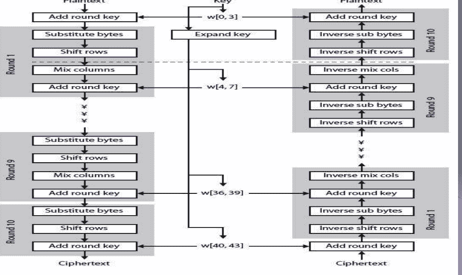

(a) Encryption

(b) Decryption

AES结构：不是 Feistel 密码结构，代替和混淆并行处理分组

数据按4列4个字节的分组处理，四列四个字节的数据分组称为状态数组，4个32位列，每列分4个8位（1个字节），共有16个字节

有9/11/13轮，每轮中状态经历四个阶：

- 字节代替（每个字节进行一次S盒代替）
- 行移位（列之间字节置换）
- 列混合（有限域的矩阵乘法代替，有限域不可约多项式）
- 轮密钥加（密钥和状态异或，Vernam密码形式）
- 每轮在完整的数据分组上运算，通过密钥和轮状态异或

初始异或密钥可以扩展，扩展密钥存储在元素类型为字的数组结构中

最后一轮是三部分，是不完备的

使用快速的 XOR 和表查询实现算法

### AES 轮

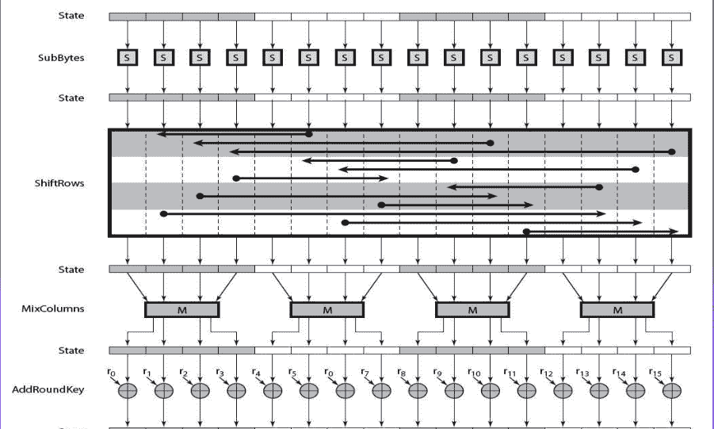

#### 字节代替变换

- 对每个字节的一个简单代替
- 使用16x16字节的表作查询，该表包含所有256个8位可能值的变换
- 状态的每个字节用按行（左4-bits）、列（右4位）查表所得到的值代替，字节{95}被第9行第5列的值代替，其值为{2A}
- S-box 使用GF(2^8)域上定义的变换构造，主要是求逆元
- 设计成能够防止已知的攻击

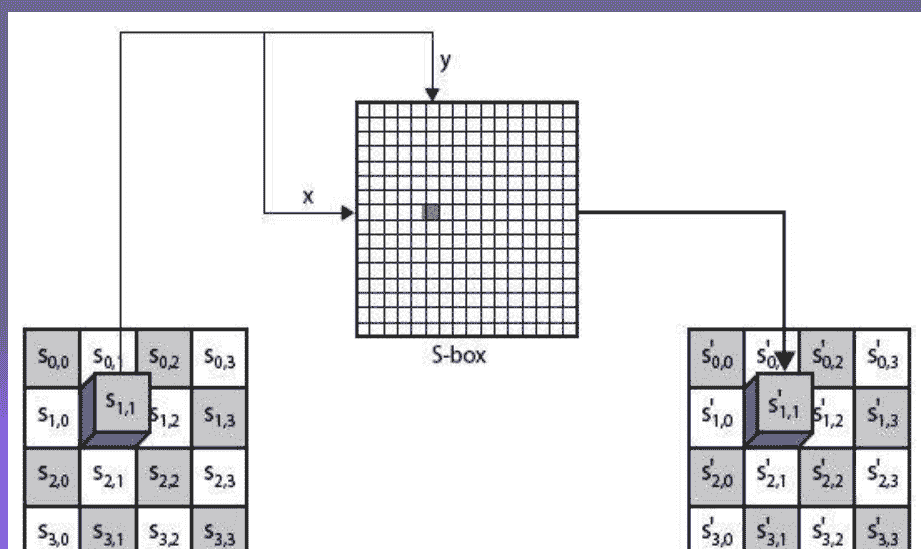

#### 字节正代替换

|   | 0 | 1 | 2 | 3 | 4 | 5 | 6 | 7 | 8 | 9 | A | B | C | D | E |
|---|---|---|---|---|---|---|---|---|---|---|---|---|---|---|---|
| 0 | 63 | 7C | 77 | 7B | F2 | 6B | 6F | C5 | 30 | 01 | 67 | 2B | FE | D7 | AB |
| 1 | CA | 82 | C9 | 7D | FA | 59 | 47 | F0 | AD | D4 | A2 | AF | 9C | A4 | 72 |
| 2 | B7 | FD | 93 | 26 | 36 | 3F | F7 | CC | 34 | A5 | E5 | F1 | 71 | D8 | 31 |
| 3 | 04 | C7 | 23 | C3 | 18 | 96 | 05 | 9A | 07 | 12 | 80 | E2 | EB | 27 | B3 |
| 4 | 09 | 83 | 2C | 1A | 1B | 6E | 5A | A0 | 52 | 3B | D6 | B3 | 29 | E3 | 2F |
| 5 | 53 | D1 | 00 | ED | 20 | FC | B1 | 5B | 6A | CB | BE | 39 | 4A | 4C | 58 |
| 6 | D0 | EF | AA | FB | 43 | 4D | 33 | 85 | 45 | F9 | 02 | 7F | 50 | 3C | 9F |
| 7 | 51 | A3 | 40 | 8F | 92 | 9D | 38 | F5 | BC | B6 | DA | 21 | 10 | FF | F3 |
| 8 | CD | 0C | 13 | EC | 5F | 97 | 44 | 17 | C4 | A7 | 7E | 3D | 64 | 5D | 19 |
| 9 | 60 | 81 | 4F | DC | 22 | 2A | 90 | 88 | 46 | EE | B8 | 14 | DE | 5E | 0B |
| A | F0 | 32 | 3A | 0A | 49 | 06 | 24 | 5C | C2 | D3 | AC | 62 | 91 | 95 | E4 |
| B | E7 | C8 | 37 | 6D | 8D | D5 | 4E | A9 | 6C | 56 | F4 | EA | 65 | 7A | AE |
| C | BA | 78 | 25 | 2E | 1C | A6 | B4 | C6 | E8 | DD | 74 | 1F | 4B | BD | 8B |
| D | 70 | 3E | B5 | 66 | 48 | 03 | F6 | 0E | 61 | 35 | 57 | B9 | 86 | C1 | 1D |
| E | E1 | F8 | 98 | 11 | 69 | D9 | 8E | 94 | 9B | 1E | 87 | E9 | CE | 55 | 28 |
| F | 8C | A1 | 89 | 0D | BF | E6 | 42 | 68 | 41 | 99 | 2D | 0F | B0 | 54 | BB |

#### 字节逆代替变换

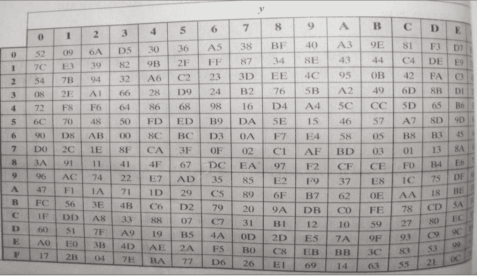

#### S盒的数学含义：GF(2^8)域

$b'_i=b_i\oplus b_{(i+4)\bmod 8}\oplus b_{(i+5)\bmod 8}\oplus b_{(i+6)\bmod 8}\oplus b_{(i+7)\bmod 8}\oplus c_i$

$\begin{bmatrix}b'_0\\b'_1\\b'_2\\b'_3\\b'_4\\b'_5\\b'_6\\b'_7\end{bmatrix}=\begin{bmatrix}1&0&0&0&1&1&1&1\\1&1&0&0&0&1&1&1\\1&1&1&0&0&0&1&1\\1&1&1&1&0&0&0&1\\1&1&1&1&1&0&0&0\\0&1&1&1&1&1&0&0\\0&0&1&1&1&1&1&0\\0&0&0&1&1&1&1&1\end{bmatrix}\begin{bmatrix}b_0\\b_1\\b_2\\b_3\\b_4\\b_5\\b_6\\b_7\end{bmatrix}\oplus\begin{bmatrix}1\\1\\0\\0\\0\\1\\1\\0\end{bmatrix}$

- $B'=XB\oplus C$，逆运算 $Y(XB\oplus C)\oplus D=B$，$XY$ 单位矩阵，$YC=D$
- $C=63$，$D=05$，$0110=6$，$0011=3$

#### 求逆元（X）

```
EXTENDED EUCLID(m, b)
1. (A1, A2, A3)=(1, 0, m);
   (B1, B2, B3)=(0, 1, b)
2. if B3 = 0
   return A3 = gcd(m, b); no inverse
3. if B3 = 1
   return B3 = gcd(m, b); B2 = b⁻¹ mod m
4. Q = A3 div B3
5. (T1, T2, T3)=(A1 - Q B1, A2 - Q B2, A3 - Q B3)
6. (A1, A2, A3)=(B1, B2, B3)
7. (B1, B2, B3)=(T1, T2, T3)
8. goto 2
```

注意：
m T1+ b T2 = T3 ； m A1+ b A2 = A3 ； m B1+ b B2 = B3

### 乘法异或和移位运算

假定 GF(2⁸)，模多项式 m(x)=x⁸+ x⁴+ x³+ x+1 。

- x⁸ mod m(x) = m(x) - x⁸ = x⁴+ x³+ x+1
- xⁿ mod p(x) = p(x) − xⁿ

假定 f(x)= b₇x⁷ + b₆x⁶ + ... + b₁x + b₀ ,那么 x × f(x)= ( a₇x⁸ + a₆x⁷ + ... + a₁x ) mod m(x)

- 如果 a₇=0, 则 b₆ b₅ b₄ b₃ b₂ b₁ b₀ 0
- 如果 a₇=1, 则 b₆ b₅ b₄ b₃ b₂ b₁ b₀ 0 ⊕ (00011011)


### 例

> 计算 01010111 × 10000011
> 首先
- 01010111 × 00000010 = 10101110 移位
- 01010111 × 00000100 = 01011100 ⊕ (00011011) = 01000111
- 01010111 × 00001000 = 10001110
- 01010111 × 00010000 = 00011100 ⊕ (00011011) = 00000111
- 01010111 × 00100000 = 00001110
- 01010111 × 01000000 = 00011100
- 01010111 × 10000000 = 00111000
> 其次 01010111 × 10000011 =
- 01010111 ⊕ 0 ⊕ 10101110 ⊕ 00111000 = 11000001

### 行移位变换

- 每行中的循环字节移位
  - 第一行不变
  - 第二行循环左移一个字节
  - 第三行循环左移2个字节
  - 第四行循环左移3个字节
- 解密是使用右移位的逆运算
- 因为状态基于列处理，该步是列之间的字节变换

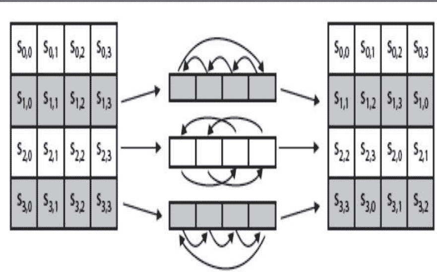

### 列混淆变换

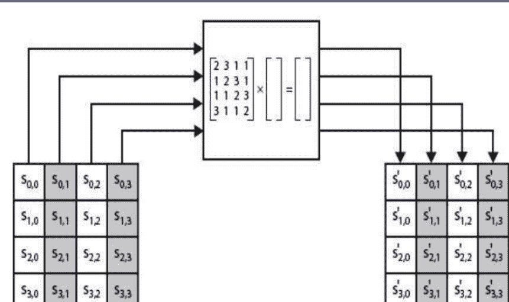

### 乘法异或和移位运算

假设 GF(2⁸)，模多项式 m(x)=x⁸+ x⁴+ x³+ x+1 。

- x⁸ mod m(x) = m(x) - x⁸ = x⁴+ x³+ x+1
- xⁿ mod p(x) = p(x) − xⁿ

假设 f(x)= b₇x⁷ + b₆x⁶ + ... + b₁x + b₀，那么 x× f(x)= ( a₇x⁸ + a₆x⁷ + ... + a₁x ) mod m(x)

- 如果 a₇=0，则 b₆ b₅ b₄ b₃ b₂ b₁ b₀ 0
- 如果 a₇=1，则 b₆ b₅ b₄ b₃ b₂ b₁ b₀ 0 ⊕ (00011011)

### 例

> 计算 01010111 × 10000011
> 首先
- 01010111 × 00000010 = 10101110 移位
- 01010111 × 00000100 = 01011100 ⊕ (00011011) = 01000111
- 01010111 × 00001000 = 10001110
- 01010111 × 00010000 = 00011100 ⊕ (00011011) = 00000111
- 01010111 × 00100000 = 00001110
- 01010111 × 01000000 = 00011100
- 01010111 × 10000000 = 00111000
> 其次 01010111 × 10000011 =
- 01010111 ⊕ 0 ⊕ 10101110 ⊕ 00111000 = 11000001

### 列混淆变换

- 每列能被表达成4个等式
  - 为获得列中每个新的字节

- 解密需要使用逆矩阵
  - 系数更大，因此实现困难

- 可选方法
  - 每列是一个4项的多项式
  - 系数在 GF(2^8)中
  - 多项式乘后模 (x^4+1)
    - a(x) = {03} x^3 + {01} x^2 + {01} x^1 + {02}
    - b(x) = {0B} x^3 + {0D} x^2 + {09} x^1 + {0E}
    - 加密简单，解密复杂

### 轮密钥加变换

- 128位的状态按位与128位的密钥XOR
- 基于列的操作
- 与解密的逆运算相同，异或操作是其本身的逆
- 设计尽可能简单
  - 扩展密钥，Vernam密码的一种形式
  - 要求其他阶段复杂/安全

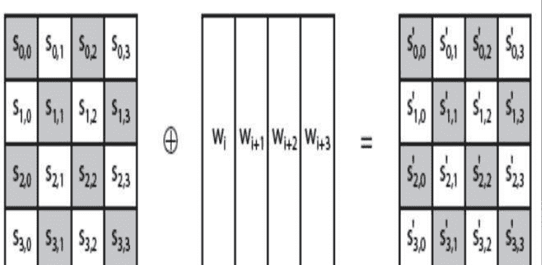

### AES 轮

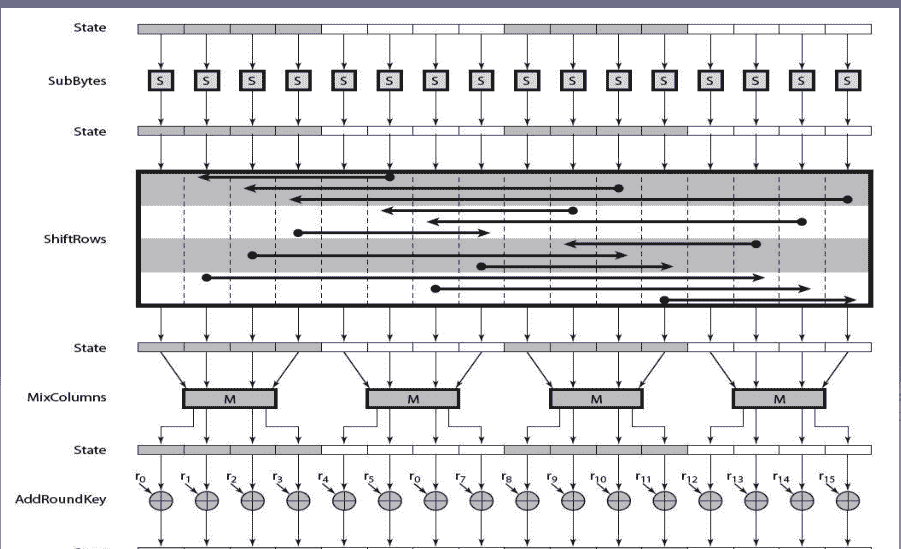

### AES密钥扩展

| k₀ | k₄ | k₈ | k₁₂ |
|---|---|---|---|
| k₁ | k₅ | k₉ | k₁₃ |
| k₂ | k₆ | k₁₀ | k₁₄ |
| k₃ | k₇ | k₁₁ | k₁₅ |

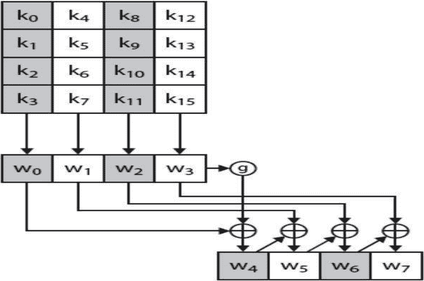

### AES密钥扩展

- 把128-bit (16-byte)的密钥扩展成由44/52/60个32-bit字组成的数组，即

- 首先，输入密钥复制到扩展密钥数组的前4个字

- 其次，依赖以前的字和复杂函数g循环产生扩展密钥字
  - 在三个场景中使用异或 XOR 计算
  - 1st 字的规则为
    - 四个字节循环左移1个字节
    - 利用S盒代换
    - 与轮常量异或 XOR

### AES密钥扩展

| j | 1 | 2 | 3 | 4 | 5 | 6 | 7 | 8 | 9 | 10 |
|---|---|---|---|---|---|---|---|---|---|---|
| RC[j] | 01 | 02 | 04 | 08 | 10 | 20 | 40 | 80 | 1B | 36 |

例如,假设第 8 轮的轮密钥为：

```
EA D2 73 21 B5 8D BA D2 31 2B F5 60 7F 8D 29 2F
```

那么第 9 轮的轮密钥的前 4 个字节(第 1 列)能按如下的方式计算：

| i(十进制) | temp | RotWord 后 | SubWord 后 | Rcon (9) | 与 Rcon 异或后 | w[i - 4] | w[i] = temp ⊕ w[i - 4] |
|---|---|---|---|---|---|---|---|
| 36 | 7F8D292F | 8D292F7F | 5DA515D2 | 1B000000 | 46A515D2 | EAD27321 | AC766F3 |

### AES 解密

AES 的解密算法不同于加密算法，因为各步是可逆操作

但可以定义一个等价的逆加密算法

- 各步使用逆运算
- 使用不同的密钥方案

运算结果不变，当

- 交换逆字节代换和逆行移位
- 交换逆列混淆和轮密钥加

### AES的实现

能够在 8-bit CPU上高效的实现

- 字节代换是使用256个字节的表的字节级上的操作
- 行移位是简单的字节移位
- 轮密钥加是按位异或操作
- 列混合是基于字节的操作的GF(2⁸)上的乘法运算，可使用表查询和字节异或来简化

### AES的实现

> 能够有效的运行在32-bit CPU
  - 使用32位字定义各个阶段
  - 能够提出计算256个字的4张表
  - 每轮中的每列能够使用4个表查询和4次异或计算
  - 存储表需4kb的空间

设计者认为高效的实现是AES算法选择的一个关键因素

### 总结

- AES的选择过程
- Rijndael 的细节–AES
- 每轮中的四个阶段
- 密钥扩展
- 实现

### 信息安全理论与实践

冯 涛

兰州理工大学计算机与通信学院

## 第6章　对称密码其他内容

- 多重密码技术：二重DES密码，使用两组或三组密钥。
- 工作模式技术：增强密码算法，适应具体应用，具体有五种推荐模式。
- 流密码：逐位和逐字节产生密文，RC4是一个实例。

### 多重加密和 三重DES

- 替换DES是必要的
  - 存在能够破译它的理论攻击
  - 存在穷举攻击

- AES 是一种新的可选算法，已讨论

- 保护投资的可选算法是多重DES加密算法，3-DES 是可选方案

### 双重-DES讨论

- 在每个分组上使用2次DES加密算法，两组密钥
  - C = Eₖ₂(Eₖ₁(P))， P = Dₖ₁(Dₖ₂(C))

- 对单次加密进行推导的问题
  - Eₖ₂(Eₖ₁(P)) = Eₖ₁(P)？
  - ----对应，如果上式成立，则解密无法完成
  - 64位明文的----对应是（2⁶⁴）！，密钥映射 2⁵⁶，所以 2-DES 的映射定义与DES 的映射定义不同，可以正常使用2-DES。

- 存在中间相遇攻击（已知明文/密文对）
  - 使用两次算法操作 C = Eₖ₂(Eₖ₁(P))，则 X = Eₖ₁(P) = Dₖ₂(C)
  - 攻击者用所有的密钥K1加密P并存储加密结果
  - 然后用所有的密钥K2解密C并且与存储的加密值作比较
  - 如果相等，则可以找到K1，K2
  - 能够证明复杂度是 O(2⁵⁶)，而DES为O(2⁵⁵)


### 多重-DES

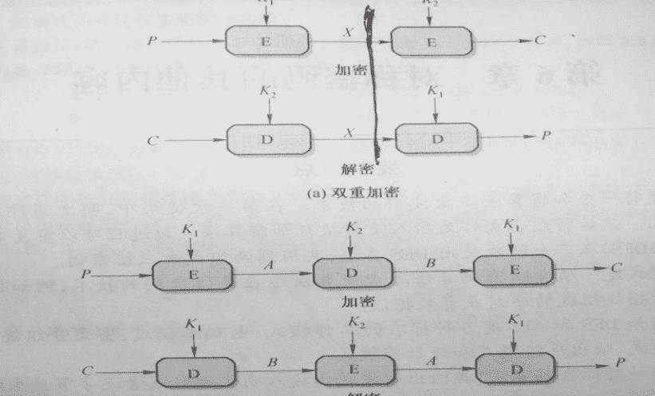

(a) 双重加密

(b) 三重加密

### 两个密钥的三重-DES攻击

- 如果A=0，则使用中间相遇攻击
- C = E_K1(D_K2(0)) ，但需要2^56个明密文对
- 如果已知 A，C，那么相当于2-DES，但是如何获得A？

### 两个密钥的三重-DES攻击

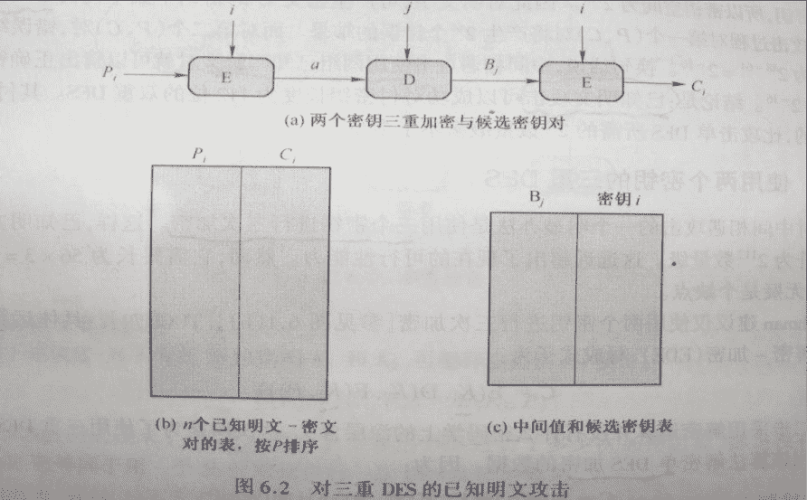

图 6.2　对三重 DES 的已知明文攻击

### 三个密钥的三重-DES

- 尽管没有对双密钥的三重-DES的实际攻击，但对其还是有疑虑
- 为避免攻击可以使用三密钥的三重-DES
- C = E_{K3}(D_{K2}(E_{K1}(P)))
- 一些基于Internet的应用已经采用三重-DES，如 PGP、S/MIME

### 工作模式

- 分组密码加密固定的分组长度
- 如. DES 加密64-bit的数据分组，密钥长度为56-bit
- 实际中需要加密/解密任意长度数据的方法
- 使用ANSI X3.106-1983 模式 (FIPS 81)定义了4种工作模式
- 为 AES 和 DES扩展为5种模式
- 有分组密码模式和序列密码模式

### 工作模式

### 表 6.1 分组密码的工作模式

| 模式 | 描述 | 典型应用 |
|---|---|---|
| 电码本(ECB) | 用相同的密钥分别对明文组加密 | • 单个数据的安全传输(如一个加密密钥) |
| 密文分组链接(CBC) | 加密算法的输入是上一个密文组和下一个明文组的异或 | • 普通目的的面向分组的传输<br>• 认证 |
| 密文反馈(CFB) | 一次处理 j 位,上一块密文作为加密算法的输入,用产生一个伪随机数输出与明文异或作为下一块的输入 | • 普通目的的面向分组的传输<br>• 认证 |
| 输出反馈(OFB) | 与 CFB 基本相同,只是加密算法的输入是上一次 DES 的输出 | • 噪声频道上的数据流的传输(如卫星通信) |
| 计数器(CTR) | 每个明文分组都与一个加密计数器相异或。对每个后续分组计数器递增 | • 普通目的的面向分组的传输<br>• 用于高速需求 |

### 电码本模式 (ECB)

- 消息被分成要加密的独立分组
- 每个分组被替换为一个新值，明文与密文唯一对应，类似密码本，因此得名
- 每个分组独立于其它分组加密
- C_i = DES_K1 (P_i)
- 用途: 单个数据的安全传输

### ECB的优缺点

- 主要用于发送只有几个分组的数据
- 缺陷是由于要加密的消息互相独立
- 重复的消息可能出现在密文中
- 如果消息是结构化的
- 尤其是图像数据
- 或者是有重复的消息，会成为密码本模式分析的问题

### 密文分组链接模式 (CBC)

- 消息被分成几个分组
- 加密操作链接在一起，前面的密文分组和当前的明文分组链接，因此得名
- 使用初始化向量(IV)开始加密
- Cᵢ = DESₖ₁(Pᵢ XOR Cᵢ₋₁)
- C₋₁ = IV
- 用途:大量的数据加密,认证

### 密文分组链接模式 (CBC)

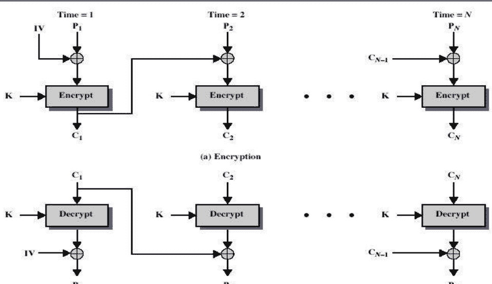

### 消息填充

- 消息的末尾可能要处理一个较短的数据分组
- 该分组小于密码算法分组的长度
- 用已知的非数据符号填充 (如 nulls)
- 或者用填充字符的个数填充最后分组
- 如. [b1 b2 b3 0 0 0 0 5]
- 表示有3个数据字节,后面5个字节填充+计数
- 消息中或许需要一个特殊的完整分组
- 有其它深奥的模式，这些模式避免了特殊分组的使用

### CBC的优缺点

- 密文分组依赖于前面的所有分组
- 一个分组的任何变化影响后续的密文分组
- 需要初始化矢量 (IV)
- 对发送者和接收者是已知的
- 如果不加密发送，攻击者可能改变第一分组的前几位，进而获得秘密信息
- 因此 IV 必须是一个固定值 (如电子转账应用中) 或者必须在发送其它消息之前，用ECB模式加密后发送

### 密文反馈模式（CFB）

- 消息按照流密码（字符序列）处理
- 分组密码的输出与明文异或
- 密文的结果反馈为下一阶段的输入
- 标准允许反馈任意位数（1, 8, 64 or 128 etc）
- 表示成 CFB-1, CFB-8, CFB-64, CFB-128 等
- 使用分组中的所有位（64 or 128）最有效
```
C_i = P_i XOR DES_{K}(C_{i-1})
C_{-1} = IV
```
- 用途：流数据加密、认证

### 密文反馈模式 (CFB)

(a) Encryption

(b) Decryption

### CFB的优缺点

- 适用于数据以 bits/bytes 到达
- 最常用的序列（流）密码模式
- 缺点是每n-bits后要做分组加密时需停止
- 在加解密的两端，分组算法用于其加密模式中出现错误后错误扩散到后续分组

### 输出反馈模式 (OFB)

- 消息按照位序列处理
- 加密算法的输出被加到消息上
- 输出被反馈为下一阶段的输入 (因此得名)
- 反馈机制与明文密文相互独立
- 能被预处理
- Cᵢ = Pᵢ XOR Oᵢ
- Oᵢ = DESₖ₁(Oᵢ₋₁)
- O₋₁ = IV
- 用途: 对噪音信道的序列加密

### 输出反馈模式 (OFB)

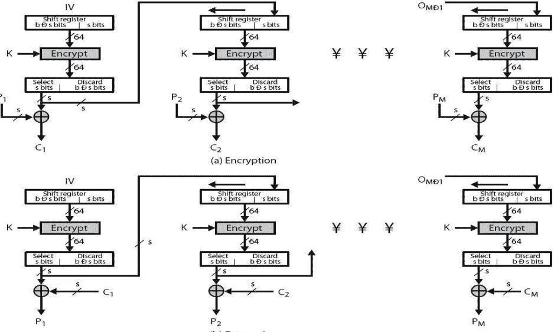

### OFB的优缺点

- 位错误不扩散
- 更易受消息篡改攻击
- Vernam 密码的一种形式，因此从不重复使用相同的（key+IV）序列
- 发送者和接收者必须保持同步，前m-bit反馈
- 研究表明只有完整的分组反馈（例如 CFB-64 和 CFB-128）模式被使用

### 计数器模式 (CTR)

- 尽管类似于OFB，是一种新的反馈模式
- 加密的是计数值而不是反馈值
- 对每个明文分组必须有一个不同的密钥和计数值
- (从不重复使用)
- Cᵢ = Pᵢ XOR Oᵢ
- Oᵢ = DESₖ₁(i)
- 用途:高速的网络加密

### CTR优缺点

- 效率
- 在硬件或软件中能够进行并行加密
- 预处理
- 适用于高速链路
- 能够随机访问加密的数据分组
- 可证明安全性 (和其它模式一样安全)
- 但必须确保从不重复使用密钥/计数值,否则可能破译 (如同 OFB)

### 流（序列）密码

- 逐位处理消息 (一个序列或流)
- 使用伪随机密钥流
- 密钥流与明文按位异或
- 密钥流的随机性完全破坏了消息中的统计属性
- C₁ = M₁ XOR StreamKey₁
- 但不能重复使用序列密钥
- 否则可能恢复消息 (如同密码本)

### 序列密码结构

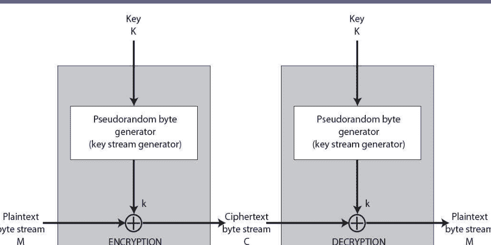

### RC4

- 由RSA数据安全公司拥有的 一种序列密码
- 由Ron Rivest等设计的,简单而且有效
- 可变密钥长度,面向字节操作的序列密码
- 广泛使用(web SSL/TLS, wireless WEP)
- 密钥构成所有8-bit值的随机变换
- 使用该变换搅乱一次处理一个字节的输入信息

### RC4 密钥方案

- 用 0，…，255 初始化一个数组 S
- 使用密钥去实现混淆
- S 构成了密码的内部状态

```
for i = 0 to 255 do
    S[i] = i
    T[i] = K[i mod keylen]

j = 0
for i = 0 to 255 do
    j = (j + S[i] + T[i]) (mod 256)
    swap (S[i], S[j])
```


### RC4 加密

- 连续混淆数组值加密
- 流密钥是从置换中获得的混淆对的和
- 为加密和解密消息的后续字节与 S[t] 异或

```
i = j = 0
for each message byte M_i
i = (i + 1) (mod 256)
j = (j + S[i]) (mod 256)
swap(S[i], S[j])
t = (S[i] + S[j]) (mod 256)
K = S[t]

C_i = M_i XOR S[t]
```

### RC4 安全

- 对已知攻击是安全的，有一些分析，没有实际攻击
- 结果是非线性的
- RC4是序列密码，不能重复使用密钥
- 对WEP有关注,但密钥的处理不是RC4本身

### 总结

- 三重-DES
- 运算模式：ECB, CBC, CFB, OFB, CTR
- 序列密码: RC4

### 信息安全理论与实践

冯 涛

兰州理工大学计算机与通信学院

## 第7章-用对称加密实现保密性

- 链路加密、端对端加密。
- 传输保密性：对传输数据进行填充可以防御流量分析。
- 密钥分配需要相关机制和协议保障安全。
- 实际的密钥管理需要分类管理
- 随机或伪随机发生器是安全密码机制或服务的重要基础

### 使用对称加密的机密性

传统对称加密用来提供消息的机密性

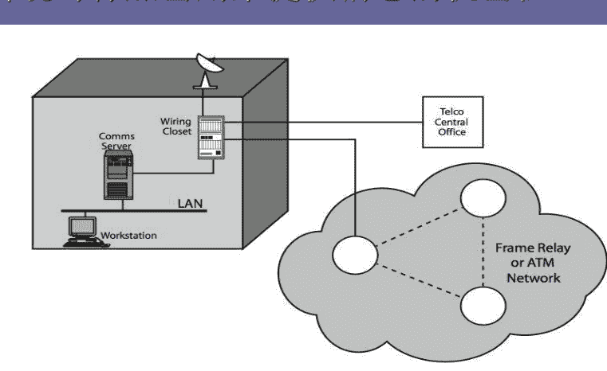

### 加密功能设置

- 主要有两种设置
- 链路加密
  - 加密在每条链路上独立地进行
  - 暗示着链路之间的每次分组交换都要将消息解密
  - 需要很多加密设备,但只要一对密钥
- 端对端加密
  - 由源主机和终端加密数据
  - 各终端共享密钥并且都需要有加密设备

分组交换网络

● = 端到端加密设备

○ = 链路加密设备

PSN = 分组交换节点

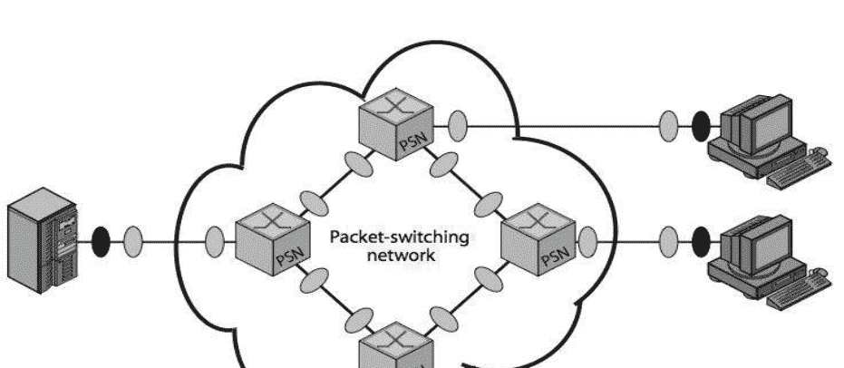

### 加密功能设置

- 当使用端对端加密时,必须让信息头保持明文
  - 这样网络就能正确实现信息的路由
- 因此,尽管信息内容得到了保护,路由信息却没得到保护
- 希望将两者结合起来
  - 端对端加密在整个传输路径上保护数据内容和提供认证
  - 链路加密保护路由信息免受监测

### 加密功能设置

- 能为OSI参考模型的各层设置加密功能
  - 链路加密用于第1层或第2层
  - 端对端加密用于第3,4,6,7层
  - 我们要是往通信层次上边走,那么要加密的信息少了,尽管要用到更多的设备和密钥,但是其安全性却更高了

### 流量分析

- 监测通信双方之间的通信信息流
  - 在军事&商业领域是很有用的
  - 也可以被用来创建隐通道
- 链路加密可以隐藏信息头的具体内容
  - 但网络和端点的通信总量仍然可以被观察到
- 传输填充能进一步隐藏信息流
  - 但却要以连续不断的数据传输为代价

### 密钥分配

- 对称加密机制要求通信双方共享密钥
- 如何安全地分配密钥
- 因密钥分配机制的不完善导致安全系统出错

### 密钥分配

- 对于通信参与者A和B, 密钥分配有多种方法：

1. A选择密钥并亲自交给B
2. 第三方选择&交付密钥给A&B
3. 如果A&B以前使用过某密钥进行通信, 其中一方就可以用它加密一个新密钥后再发送给另一方
4. 如果A&B与第三方C均有秘密通道, 则C可以将密钥分别秘密发送给A&B

### 密钥层次

- 典型的密钥层次
会话密钥
  - 临时密钥
  - 用作用户之间的数据加密
  - 在一次逻辑会话中使用,用完后抛弃
主密钥
  - 用来加密会话密钥
  - 由用户&密钥分配中心共享

- 当网络规模很大时,可以使用层次式KDC,但它们之间必须得相互信任
- 为得取得更好的安全性,会话密钥的生命周期应当是有限的
- KDC可以代表用户进行自动密钥分配,但必须保证KDC是可信任的
- 分散式密钥分配的使用
- 控制密钥的使用

### 伪随机数发生器 (PRNGs)

- 通常使用确定的算法去产生“随机数”
  - 尽管不是真正的随机
  - 能经受“随机性”检测
  - 称为 “伪随机数”
  - 由 “伪随机数发生器 (PRNGs)”产生

### 线性拟合发生器

- 使用迭代方法:
  $X_{n+1} = (a X_n + c) \mod m$
  - 对于合适的参数值能产生一个长的伪随机序列
  - 适当的标准有:
    - 生成函数是全周期的
    - 产生序列应显得随机
    - 可以用32位算法高效地实现
  - 注意,对于一个较小的数值,攻击者能重构随机序列
  - 存在使重构序列变得更加困难的可能性

### 使用块密码作为PRNGs

- 为满足在密码学上的使用,可以使用块密码产生随机数

- 用主密钥来生成会话密钥作为最终的随机数

- 计数器模式
  X_i = E_{Km}[i]

- 输出反馈模式
  X_i = E_{Km}[X_{i-1}]

### ANSI X9.17 伪随机数发生器

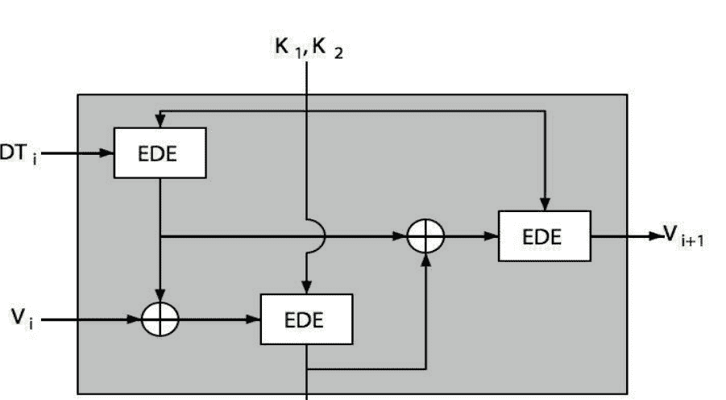

### Blum Blum Shub 发生器

- 基于公钥算法
  使用迭代方程的最低有效位：
    - x_i = x_{i-1}^2 mod n
    - 其中,n=p.q,并且素数 p,q=3 mod 4
  - 是不可预测的,可通过续位测试
  - 安全性基于N的因子分解困难性
  - 即使已知任意一段输出位，也无法预测后续输出
  - 会很慢,因为必须使用非常大的数
  - 用来加密显得太慢,用来产生密钥是很好的选择

### 自然随机噪声

- 最好的随机源来自真实世界中的自然随机噪声
- 寻找一种规则但却随机的事件和监听器
- 通常需要特定的硬件
- 通常确实需要特殊硬件来实现
  - 例如，辐射计数器、无线电噪声、音频噪声、二级管热噪声、漏电容、泵放电二级管等
- 在最新的 CPU 相关资料中去查硬件
- 信号中的偏差或不均匀分布问题
  - 当采样本并使用时，必须得想办法消除偏差
  - 最好在取得的样本中仅使用噪声最强的那些位

### 公布的随机数源

- 有很多公开的随机数集合
- 1955年,Rand Co公布了1百万个随机数
  - 使用一个电子轮盘来产生随机数
  - 已经在Khafre的一些密码设计中使用
- 1927年早期Tippett公布了一个随机数集合
- 问题在于：
  - 这些随机数还是非常有限
  - 过于公开地被广泛使用

### 总结

- 对称加密保护机密性的使用和功能设置
- 安全的密钥分配方法
- 可信任第三方KDC的使用
- 随机数发生器

### 信息安全理论与实践

冯 涛

兰州理工大学计算机与通信学院

## 第8章-数论入门

- 素数是一种整数，在密码学研究和应用领域非常重要。
- 公钥密码学的重要定理：费马定理和欧拉定理。
- 如何选定大素数是密码学算法的基础。
- 中国剩余定理有助于简化模计算
- 离散对数是在模算术上的对数运算


### 素数

- 素数是仅有因子 1 和它本身的数
  - 素数不能被写成其他数的乘积
  - 注意：1 不是素数，但没有实际意义
  - 2、3、5、7 是素数；4、6、8、9、10 不是素数

- 素数是数论的核心内容
  - 小于 200 的素数有：
    2 3 5 7 11 13 17 19 23 29 31 37 41 43 47 53
    59 61 67 71 73 79 83 89 97 101 103 107 109
    113 127 131 137 139 149 151 157 163 167 173
    179 181 191 193 197 199

### 素数因子

- 分解数 \(n\)：写成其他数的乘积的形式 \(n = a \times b \times c\)
- 分解一个数比它的因子相乘生成该数困难
- 当把一个数写成素数的乘积的形式时，称为该数的素数分解
  - 例如：\(91 = 7 \times 13\)；\(3600 = 2^4 \times 3^2 \times 5^2\)

\[a = \prod_{p \in P} p^{a_p}\]

### 互素和 GCD

- 如果两个数 \(a\)、\(b\) 除 1 外没有公因子，则 \(a\)、\(b\) 互素
  - 如：8 和 15 是互素的，因为 8 的因子 1、2、4、8，15 的因子 1、3、5、15，那么只有公因子 1
- 通过比较两个数的素数因子以及它们的最低次数计算最大公约数
  - \(300 = 2^1 \times 3^1 \times 5^2\)；\(18 = 2^1 \times 3^2\)
  - \(\gcd(18,300) = 2^1 \times 3^1 \times 5^0 = 6\)

### 费马定理

- \(a^{p-1} \equiv 1 \pmod p\)
  - 其中 \(p\) 是素数，并且 \(\gcd(a, p) = 1\)
- 也称为费马小定理（Fermat's Little Theorem）
- 另一种表示：\(a^p \equiv a \pmod p\)
- 在公钥密码和素性检测中非常有用

### 欧拉函数 φ(n)

- 在模 \(n\) 运算中，完全剩余系是：\(\{0, \ldots, n-1\}\)
- 缩剩余系是与 \(n\) 互素的数构成的集合
  - \(n = 10\)，完全剩余系 \(\{0,1,2,3,4,5,6,7,8,9\}\)，缩剩余系 \(\{1,3,7,9\}\)
- 缩剩余系中的元素个数称为欧拉函数（Euler Totient Function）\(\varphi(n)\)
- 计算 \(\varphi(n)\) 需要统计与 \(n\) 互素的模 \(n\) 余数的个数
- 需要素数分解
- 对 \(p\)（\(p\) 是素数）：
  - \(\varphi(p) = p - 1\)
  - \(\varphi(37) = 36\)
- 对 \(p \times q\)（\(p\)、\(q\) 是素数）：
  - \(\varphi(pq) = (p - 1) \times (q - 1)\)
  - \(\varphi(21) = (3 - 1) \times (7 - 1) = 2 \times 6 = 12\)

### 欧拉定理

- \(a^{\varphi(n)} \equiv 1 \pmod n\)
- 对任意 \(a, n\)，其中 \(\gcd(a,n) = 1\)
- 例如：
  - \(a = 3, n = 10, \varphi(10) = 4\)
  - 因此 \(3^4 = 81 \equiv 1 \pmod{10}\)
  - \(a = 2, n = 11, \varphi(11) = 10\)
  - 因此 \(2^{10} = 1024 \equiv 1 \pmod{11}\)

另一种表示：\(a^{\varphi(n)+1} \equiv a \pmod n\)

### 素性测试

- 传统的方法是使用筛选法（寻找小于 \(n\) 的素数），但是通常需要判定随机大整数是否素数
- 定义检测法：根据素数定义：若 \(A = n^2 + b = (n-x)(n+y)\)，除 \(n-x=1\) 以外无正整数解，则 \(A\) 为素数
  - 设 \(A\) 为待验证数，求 \(b = A - n^2\)（\(b \le 2n\)）
  - 代入：\(y = (b + nx) / (n - x)\)（\(x < n - 1\)）
  - 若 \(y\) 无正整数解，则 \(A\) 为素数
  - 例：\(109 = 10 \times 10 + 9\)，\(y = (9 + 10x) / (10 - x)\)；只要计算当 \(x = 1, 3, 5, 7\) 时，\(y\) 为正整数即可；经计算 109 是素数
- 代替的方法是使用基于素数属性的统计素性测试
  - 满足该属性的所有素数
  - 某些称为伪素数的合数也满足该属性
- 可以使用更慢的确定性素性测试 AKS

### Miller-Rabin 算法

- 基于费马定理的素性测试算法
- 算法是：

```
TEST (n) is:
1. 找出整数 k, q, k > 0, q 是奇数, 使 (n-1) = 2^k q
2. 随机选取整数 a, 1 < a < n-1
3. if a^q mod n = 1 then 返回("不确定");
4. for j = 0 to k - 1 do
5.   if (a^(2^j q) mod n = n-1)
       then 返回("不确定")
6. return ("合数")
```

### 概率考虑

- 如果 Miller-Rabin 算法返回“合数”，那么测试的数一定不是素数；否则它是一个素数或是伪素数，它是伪素数的概率 \(< 1/4\)
- 如果用不同的随机数重复测试，那么 \(t\) 次测试后 \(n\) 是素数的概率是：
  - Pr(\(t\) 次测试后 \(n\) 是素数) \(= 1 - 4^{-t}\)
  - 对 \(t = 10\)，概率 \(> 0.99999\)

### 素数分布

- 素数定理证明大约每 \(\ln n\) 个整数中有一个素数，而且偶数可以直接忽略
- 因此实际中为了找 \(n\) 附近的素数，仅需要测试 \(0.5 \ln(n)\) 次
- 注意这只是平均值
- 数轴上的某些位置，素数非常密集
- 而在其他位置，素数非常稀疏

### 中国剩余定理

- 用于实现快速模运算
- 如果模是几个数的乘积
  - 例如：模 \(M = m_1 m_2 \cdots m_k\)
- 根据中国剩余定理分别计算模 \(m_i\)
- 因为计算成本与模数的大小成正比，这比计算模 \(M\) 更快
- 能够用多种方法实现中国剩余定理
- 为计算 \(A \pmod M\)：
  - 首先分别计算所有的 \(a_i = A \bmod m_i\)
  - 确定下面的常量 \(c_i\)，其中 \(M_i = M / m_i\)
  - 然后合并结果得到答案：

\[
A \equiv \left(\sum_{i=1}^{k} a_i c_i\right) \pmod M
\]

\[
c_i = M_i \times (M_i^{-1} \bmod m_i) \quad (1 \le i \le k)
\]

### 本原根

- 由欧拉定理有 \(a^{\varphi(n)} \equiv 1 \pmod n\)
- 考虑 \(a^m = 1 \pmod n\)，\(\gcd(a,n) = 1\)
  - 一定存在 \(m = \varphi(n)\)，而且或许更小
  - 一旦指数达到 \(m\)，循环将重复
- 如果最小的 \(m\) 是 \(\varphi(n)\)，那么 \(a\) 被称为是本原根
- 如果 \(p\) 是素数，那么 \(a\) 的连续次方生成群（模 \(p\)）
- 这样的 \(a\) 是有用的，但找 \(a\) 相对困难

### 离散对数

- 一个数的模 \(p\) 指数运算的逆是找该数的离散对数
- 也就是找 \(x\) 以使 \(y = g^x \pmod p\)
- 写成 \(x = \log_g y \pmod p\) 的形式
- 如果 \(g\) 是本原根，那么 \(x\) 总存在；否则 \(x\) 或许不存在，如：
  - \(x = \log_3 4 \bmod 13\) 没有答案
  - \(x = \log_2 3 \bmod 13 = 4\)，通过尝试连续的次方得到
- 尽管幂运算是相对容易的，但找离散对数一般是困难问题

### 总结

- 素数
- 费马定理、\(\varphi(n)\)、欧拉定理
- 素性测试
- 中国剩余定理
- 离散对数

### 信息安全理论与实践

冯涛

兰州理工大学计算机与通信学院

## 第8章 公钥密码学与RSA

- 非对称密码体制，两个密钥
- 完成加密和认证
- 广泛应用的是 RSA，基于寻找大合数的素因子

### 私钥密码学

- 传统的私钥/秘密钥/单密钥密码学使用一个密钥，发送方和接收方共享密钥；如果密钥泄露，那么通信被攻陷
- 是对称密码体制，参与方是平等的
- 不能阻止伪造的消息发送给接收方，也不能阻止谎称自己是合法发送方的发送者发送消息

### 公钥密码学

- 密码学历史发展历程中最伟大的一次革命
- 使用两个密钥——一个是公钥，一个是私钥
- 因为参与方不等价，因此是非对称密码体制
- 数论概念到函数的灵活应用，补充而不是代替私钥密码学


### 公钥密码学产生的原因

为解决两个关键问题而设计：

- 密钥分配 –没有可信的密钥分配中心，怎样实现安全通信
- 数字签名 –怎样验证声称自己是发送者发送的消息的完整性

1976年 斯坦福大学的Whitfield Diffie和Martin Hellman提出了公钥密码体制的概念

- 在安全机构中知道的更早（1970的报告）

### 公钥密码学

- 公钥/两个密钥/非对称密码学使用两个密钥
- 公钥：或许任何人都知道，可被用于加密消息和验证签名
- 私钥：只有接收方知道，可被用于解密消息和生成签名

- 非对称的，因为
- 能够加密或验证签名的一方不能够解密或生成签名

### 公钥密码学

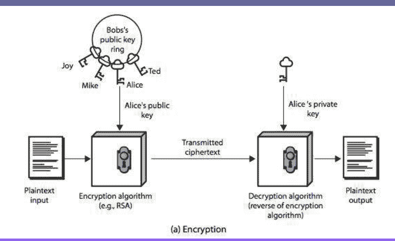

### 公钥密码学的特征

公钥密码算法依赖于两个密钥：

- 仅仅知道密码算法和加密密钥，要找出解密密钥是计算上不可行的
- 知道相关的加密/解密密钥，要加密/解密消息是容易的
- 对某些算法，相关的密钥可被用于加密消息也可被用于解密消息

### 公钥密码系统

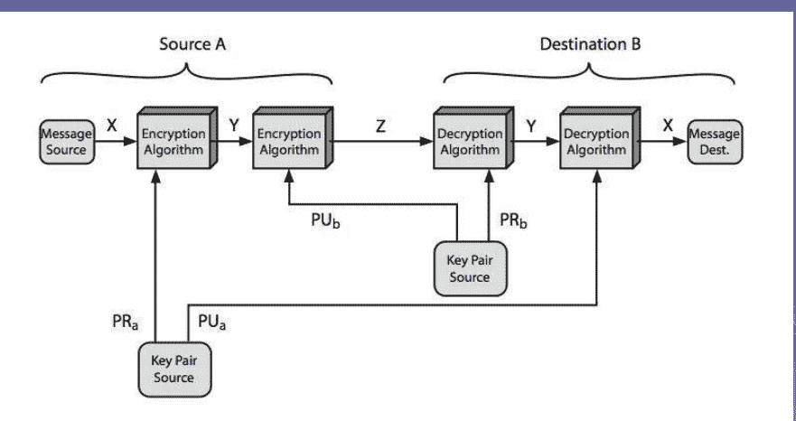

### 公钥密码体制的应用

可以分为三类：

- 加密/解密 (提供保密)
- 数字签名(提供认证)
- 密钥交换(提供会话密钥)

某些算法适合于这三类应用，而一些算法仅适合于某一类应用

### 公钥密码机制的安全

- 类似私钥密码机制，穷举攻击理论上总是可行的
- 使用的密钥过大 (>512bits)
- 安全依赖于容易（加密/解密）和困难（密码破译分析）之间具有的足够大的差别
- 困难问题是已知的，但要使其足够困难以使破译不可能。
- 要求使用非常大的数
- 和私钥密码机制相比较其速度慢

### RSA 密钥的建立

- 每个用户生成公钥/私钥对，
- 通过随机的选择两个大素数 p， q
- 计算他们的系统模数 n=p.q
  - 注： ø(n)=(p-1)(q-1)
- 随机选择加密密钥 e，其中
  - 1<e<ø(n)， gcd(e, ø(n))=1
- 通过解下面的方程求解解密密钥 d
  - e.d=1 mod ø(n) 且 0≤d≤n
- 公开他们的加密密钥: PU={e,n}
- 保存解密密钥: PR={d,n}

### RSA 的使用

为了加密消息 M 发送方：

- 获取接收方的公钥 PU={e, n}
- 计算: C = M^e mod n, 其中 0≤M<n

为了解密密文 C 接收方：

- 使用他们的私钥 PR={d, n}
- 计算: M = C^d mod n

要注意的是消息 M 比模 n 更小 (如果需要的话可以分组)

### RSA的原理

- 由欧拉定理:
- a^φ(n) mod n = 1 其中 gcd(a, n)=1

- 在RSA中有:
- n=p·q
- φ(n)=(p-1)(q-1)
- 选择适当的 e 和 d，对 mod φ(n) 可逆
- 因此对某个 k， e·d=1+k·φ(n)

- 因此:
C^d = M^{e·d} = M^{1+k·φ(n)} = M^1·(M^{φ(n)})^k
= M^1·(1)^k = M^1 = M mod n

### RSA 例－密钥建立

- 1. 选择素数：$p=17$ 和 $q=11$
- 2. 计算 $n=pq=17\times11=187$
- 3. 计算 $\varphi(n)=(p-1)(q-1)=16\times10=160$
- 4. 选择 $e$：$\gcd(e,160)=1$；选择 $e=7$
- 5. 确定 $d$：$de=1\pmod{160}$ 并且 $d<160$ 的值是 $d=23$，因为 $23\times7=161=10\times160+1$
- 6. 公开公钥 $PU=\{7,187\}$
- 7. 保存私钥 $PR=\{23,187\}$

### RSA 例 - 加密/解密

- 给出RSA加密/解密的例子：
- 给定消息 M = 88 (注意：88<187)
- 加密：
  C = 88⁷ mod 187 = 11
- 解密：
  M = 11²³ mod 187 = 88

### 求幂运算

- 可以使用平方并相乘的算法
- 对幂运算一个快的，有效的算法是基数的重复平方再相乘得到结果
- 指数的二进制表示
- 对数n仅需要O(log₂ n)次乘法
  - 如. 7⁵ = 7⁴·7¹ = 3·7 = 10 mod 11
  - 如. 3¹²⁹ = 3¹²⁸·3¹ = 5·3 = 4 mod 11

### 计算aᵇ mod n的算法

```
c = 0; f = 1
for i = k downto 0
    do c = 2 x c
        f = (f x f) mod n
    if bᵢ == 1 then
        c = c + 1
        f = (f x a) mod n
return f
```

### 有效的加密运算

- 加密使用 e 次方的求幂运算
- 如果 e 是小的，那么运算速度更快
- 通常选择 e=65537 (2¹⁶-1)
- 也可选择 e=3 或者 e=17
- 但如果 e 太小 (例如 e=3)，则易受攻击
- 使用中国剩余定理，不同模数的 3 个用户消息
- 如果 e 固定，那么必须确定
gcd(e, φ(n)) = 1
- 例如拒绝与 e 不互素的任何 p 和 q

### 有效的解密运算

- 解密运算使用d次方的幂运算
  - D可能是大的，否则不安全
- 可以运用中国剩余定理 (CRT)分别计算 mod p 和 q 的运算.然后合并得到期望的答案
  - 比直接做大约快4倍
- 只有知道p和q的私钥的拥有者能够使用该技术

### RSA 密钥生成

- RSA的用户必须:
  - 随机确定两个素数p，q
  - 选择e或d计算另一个
- 素数 p, q无法从模n=p·q计算得到
  - 意思是必须充分大
  - 素性测试使用概率测试方法
- 指数 e, d 是可逆的,因此使用求逆算法可计算另一个

### RSA 的安全

对RSA的可能攻击方法有：

- 穷举攻击（给定数字大小的情况下不可行）
- 数学攻击 (基于通过分解模n计算 φ(n)的困难性)
- 定时攻击 (依赖于解密算法的运行时间)
- 选择密文攻击 (利用了RSA算法的性质)

### 因子分解问题

- 数学方法攻击RSA有三种形式:
- 分解n=p·q, 这样就可先计算 φ(n) 然后计算 d
- 直接确定 φ(n) 并且计算 d
- 直接确定d
- 目前相信以上形式都等价于因子分解
- 这些年来因子分解进展缓慢
  - 05年5月用格筛法分解的最大整数的位数是200位（663二进制位）
- 最大的改进来自算法的改进
  - 从二次筛法到一般数域筛法到格筛法
- 目前假定1024-2048位 RSA 是安全的
  - 除确保 p, q 的大小外还要和其他约束条件相匹配

### 计时攻击

- 20世纪90年代由Paul Kocher提出
- 利用运算的时间差异
  - 例如. 小数相乘与大数相乘
  - 或者是执行 IF指令的时间变化
- 推断操作的大小基于所花费的时间
- RSA 利用幂运算所花费的时间
- 预防措施
  - 使用不变的幂运算时间
  - 随机延时
  - 隐藏

### 选择密文攻击

- RSA易受选择密文攻击 (CCA)
- 攻击者选择密文并获得相应的明文
- 利用RSA的属性选择有利于给密码分析提供有用信息的密文。
- 对明文进行随机填充，或使用最优非对称加密填充（OAEP）可防止CCA

### 总结

- 公钥密码体制的原理
- RSA 算法,实现,安全


### 信息安全理论与实践

冯 涛

兰州理工大学计算机与通信学院

## 第10章-公钥体制密钥管理

- 如何保证公钥的真实性。
- 公钥证书是如何实现的。
- 公钥密码用于传统密码体制的密钥分配。
- 如何实现会话密钥的建立

### 公钥体制的动机之一

- 公钥密码有助于解决密钥分配问题
- 公钥密码可用于两个方面:
  - 公钥的分配
  - 公钥密码用于传统密码体制的密钥分配。

### 公钥的分配

几种分配方法:
- 公开发布
- 公开可访问目录
- 公钥授权
- 公钥证书

### 公开发布

> 用户将公钥分配给接收者或者广播给通信各方
> - PGP密钥附加到邮件消息后面或者将其公布在新闻组或邮件列表后面
> 主要的缺点是可伪造的
> - 任何人都可以产生一个密钥并声称它是 A,并将该密钥公布
> - 直到被发现为止，伪造者可以假冒成合法用户 A,例如，可以进行认证，阅读发给A的信息（为何？）

### 公开可访问的目录

> 可通过公开目录注册密钥来获得更好的安全性

> 目录管理员必须是可信的,且具有以下特点:
  - 包含{姓名,公钥}目录项
  - 通信方通过目录管理员安全认证注册
  - 通信方能在任何时候替换密钥
  - 目录定时发布
  - 可电子访问目录

> 仍然容易受到篡改或伪造攻击

### 公钥授权

> 通过严格控制目录中的公钥分配,可使公钥分配更安全
> 有目录管理员
> 要求用户知道目录管理员的公钥
> 然后用户通过与目录管理员接触可以安全地获得任何想要的公钥
>   - 当用户要使用通信对方公钥时,应当实时地向目录管理员申请对方的当前公钥

### 公钥授权

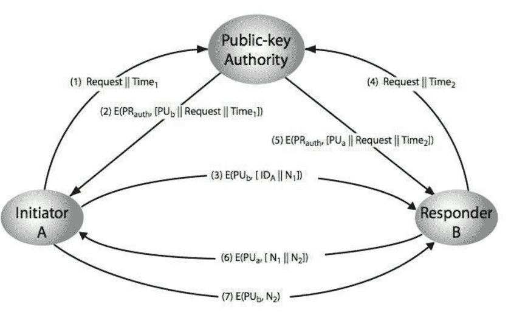

### 公钥证书

> 通信各方通过公钥证书交换密钥,而不是实时地通过公钥管理员获得公钥
>   - 常需要其他信息,比如有效期,使用权限等
> 整个证书内容由可信任的公钥管理员和证书管理员签名
> 任何知道公钥管理员公钥的人都能验证公钥证书

### 公钥证书（X.509）

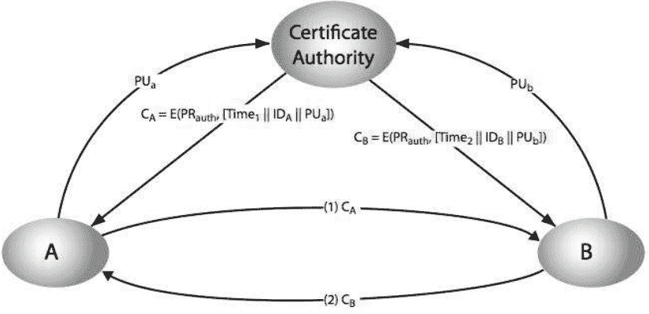

### 公钥密码分配密钥

- 使用前面的方法获取公钥,能用来保密或认证
- 公钥算法速度很慢,通常使用 "秘密钥" 加密去保护消息内容
- 因此需要会话密钥,经过协商获得合适的会话密钥

### 简单密钥分配

Merkle 于 1979年提出

- A产生一个新的临时公/私钥对
- A将该公钥和其标识发送给B
- B产生会话密钥K,并用A的公钥加密后发送给A
- A解出 B 的会话密钥并且只有A和B才可以使用该会话密钥

问题在于,攻击者可以截获消息,并且在协议中模仿通信的一方与另一方通信(中间人攻击？如何做---截获信息)

### 公钥密码分配密钥

如果有安全交换的公钥：


### 混合密钥分配

> 保留了私钥的KDC
> KDC与每个用户共享一个秘密的主密钥
> 使用主密钥分配会话密钥
> 使用公钥分配主密钥
>   - 当用户分布广泛时尤其有用
> 依据
>   - 性能
>   - 向后兼容性

### Diffie-Hellman 密钥交换

> 提出的第 一种公钥机制
> 由Diffie & Hellman 于1976年的公钥概念说明会上提出
>   - 注意,现在已知道, Williamson (UK CESG) 于1970年就已经秘密地提出了这个概念
> 它是一种实用的密钥交换方法
> 许多商业产品都使用了这种密钥交换技术

### Diffie-Hellman 密钥交换

> 一种公钥分配方案
  - 不能用来交换任何消息
  - 它能建立一个共同的密钥
  - 只有参与双方知道协商的密钥

密钥值依赖于参与双方(和他们的私钥和公钥信息)

> 基于有限域(Galois)里的幂运算(模一个素数或一个多项式)
  - 容易

安全性依赖于离散对数计算上的困难问题(类似于因式分解) – 困难

### Diffie-Hellman 设置

> 用户协商全局参数:
- 大素整数或多项式 q
- a是模q的素根

> 每个用户(例如A)产生他们各自的密钥
- 选择一个密钥(整数): x_A < q
- 计算他们各自的公钥: y_A = a^xA mod q

> 每个用户公开他们的公钥 y_A

### Diffie-Hellman 密钥交换

> 用户A&B共享的会话密钥是K_AB:
> K_AB = a^{x_A·x_B} mod q
> = y_A^{x_B} mod q （由B计算）
> = y_B^{x_A} mod q （由A计算）

> 在Alice和Bob的私钥加密机制中, K_AB 被作为会话密钥使用

> 在选择新的公钥以前,Alice和Bob将一直使用同样的会话密钥进行通信

> 攻击者要得到x,必须得求解离散对数

### Diffie-Hellman 举例

> 用户Alice&Bob想要交换密钥:
> 协商素数q=353 以及 a=3
> 选择随机密钥:
> - A选择x_A=97, B选择x_B=233
> 计算各自的公钥:
> - y_A=3^97 mod 353 = 40 (Alice)
> - y_B=3^233 mod 353 = 248 (Bob)
> 计算共享的会话密钥:
> - K_AB= y_B^x_A mod 353 = 248^97 = 160 (Alice)
> - K_AB= y_A^x_B mod 353 = 40^233 = 160 (Bob)

### 密钥交换协议

- 在每次用户通信时，他们都可以协商任意的D-H私/公钥对
- 用户能协商产生一个D-H私/公钥对，并存于某个中心目录中，然后使用它们进行协商和安全通信
- 它们都很容易受到中间人攻击
- 需要对密钥进行认证

### 总结

- 公钥分配
- 利用公钥密码分配密钥
- Diffie-Hellman密钥交换

