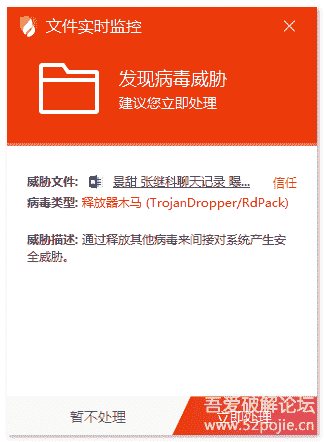
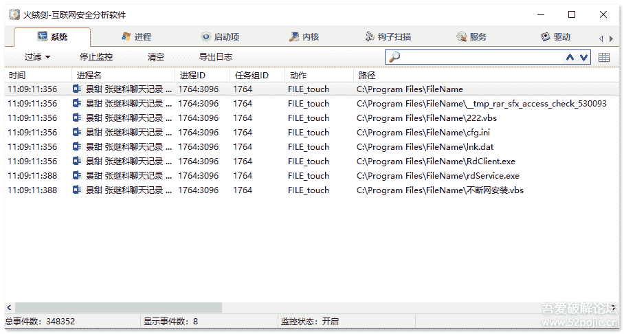
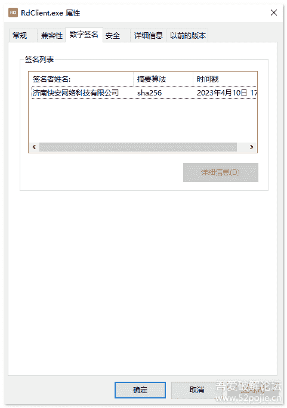
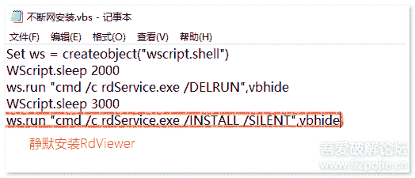
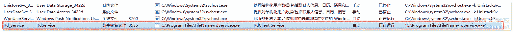
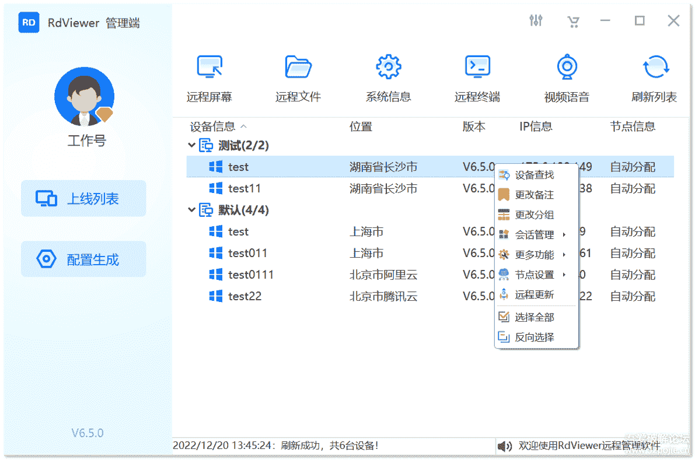

# [PC样本分析] 吃瓜要当心！黑客利用娱乐热点大肆传播病毒

- 原帖: https://www.52pojie.cn/forum.php?mod=viewthread&tid=1776922
- 抓取时间: 2026-11-01T23:49:46

近日，火绒威胁情报系统发现`RdPack`病毒正在快速传播，该病毒将文件名伪装成娱乐热点（`景甜 张继科聊天记录 曝光.exe`）的方式在微信群中大肆传播，经安全人员分析发现，运行病毒后会释放并静默安装`RdViewer`远控软件，黑客可通过`RdViewer`远控软件来操控受害者终端，并且执行恶意行为如：文件窃取、监控麦克风、摄像头等恶意功能。

据火绒威胁情报系统显示，一天内火绒已帮助数千台终端成功拦截该病毒。火绒用户无需担心，火绒安全产品可拦截、查杀该病毒。已中毒的用户，可使用火绒【全盘查杀】并重启电脑即可彻底查杀该病毒。

查杀图

## 一、详细分析

病毒文件“`景甜张继科聊天记录 曝光.exe`”运行之后，会将`RdViewer`远控软件释放到`C:\Program Files\FileName`目录下，火绒剑监控到的行为，如下图所示：

火绒剑行为监控

通过`RdClient.exe`远控签名信息，可知该程序为`RdViewer`远控软件，如下图所示：

通过执行`不断网安装.vbs`脚本来静默安装`RdViewer`，相关脚本，如下图所示：

不断网安装.vbs

并添加系统服务来进行持久化操作，服务名为`Rd_service`，当计算机启动时`RdViewer`会静默启动，相关服务信息，如下图所示：

黑客可通过`RdViewer`远控软件来操控受害者终端，并且执行恶意行为如：文件窃取、监控麦克风、摄像头等恶意功能，`RdViewer`管理端界面，如下图所示：

`RdViewer`管理端界面

## 二、附录

HASH：

