# [PC样本分析] 病毒分析小白尝鲜-GANDCRAB勒索家族分析

- 原帖: https://www.52pojie.cn/forum.php?mod=viewthread&tid=1795504
- 抓取时间: 2026-11-01T23:49:42

结合最近学习的一些东西，找了一个老家族写的分析笔记，写的比较简单，大佬勿喷

## 样本背景

GandCrab于2018年年初问世，主要利用RDP爆破、钓鱼邮件、捆绑软件、僵尸网络、CVE-2017-8570漏洞利用等方式进行攻击，此家族病毒采用Salsa20和RSA-2048算法对文件进行加密，并修改文件后为`.GDCB`、`.GRAB`、`.KRAB`或5-10位随机字母，将感染主机桌面背景替换为勒索信息图片。GandCrab5.1之前版本可尝试使用解密工具解密，最新GandCrab5.2无法解密。老勒索家族了，所以我在公开的威胁情报上找了一个最新被上传的样本做简要分析。

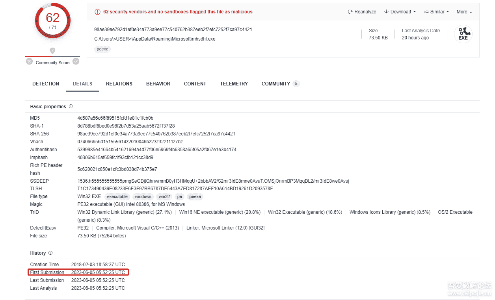

图片.png (117.81 KB, 下载次数: 1) [下载](https://www.52pojie.cn/forum.php?mod=attachment&aid=MjYyMDc2MnxjMzBiMzQ0NnwxNzkzNTc2OTc5fDE2ODA4NnwxNzk1NTA0&nothumb=yes) 2023-6-10 09:27 上传

## 加壳情况

文件未加壳

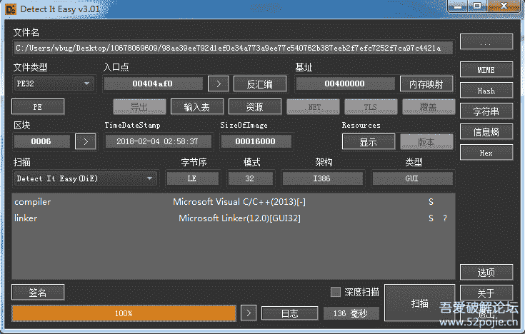

图片.png (49.38 KB, 下载次数: 1) [下载](https://www.52pojie.cn/forum.php?mod=attachment&aid=MjYyMDc2M3w4NWU0NjJlOXwxNzkzNTc2OTc5fDE2ODA4NnwxNzk1NTA0&nothumb=yes) 2023-6-10 09:28 上传

## 互斥体

互斥体名称：`Global\pc_group=WORKGROUP&ransom id=79e2d4c8a42336Gb`

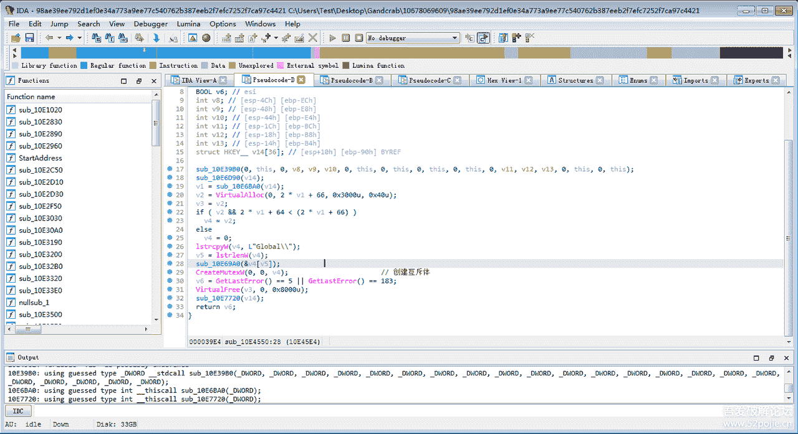

图片.png (397.84 KB, 下载次数: 0) [下载](https://www.52pojie.cn/forum.php?mod=attachment&aid=MjYyMDc2NnwzNWEyNTUwYXwxNzkzNTc2OTc5fDE2ODA4NnwxNzk1NTA0&nothumb=yes) 2023-6-10 09:39 上传

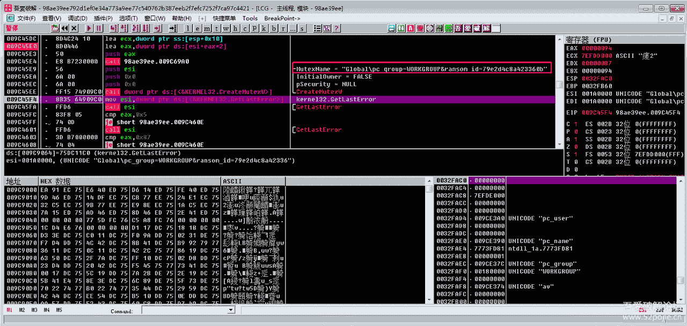

图片.png (522.67 KB, 下载次数: 0) [下载](https://www.52pojie.cn/forum.php?mod=attachment&aid=MjYyMDc2N3xhN2MyYzIyNHwxNzkzNTc2OTc5fDE2ODA4NnwxNzk1NTA0&nothumb=yes) 2023-6-10 09:39 上传

## 关进程

遍历并关闭所列举的进程，防止文件在加密过程中被占用

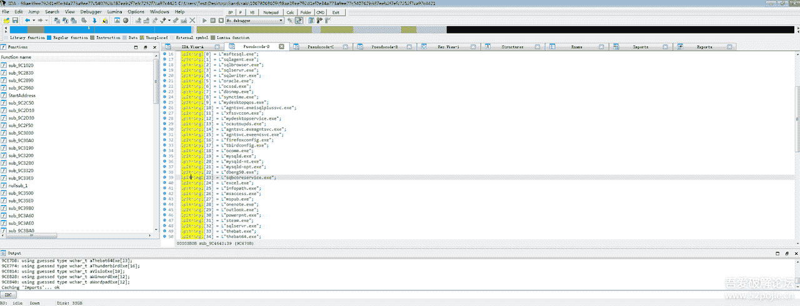

图片.png (268.87 KB, 下载次数: 0) [下载](https://www.52pojie.cn/forum.php?mod=attachment&aid=MjYyMDc2OHw1MmM2YWE5ZnwxNzkzNTc2OTc5fDE2ODA4NnwxNzk1NTA0&nothumb=yes) 2023-6-10 09:39 上传

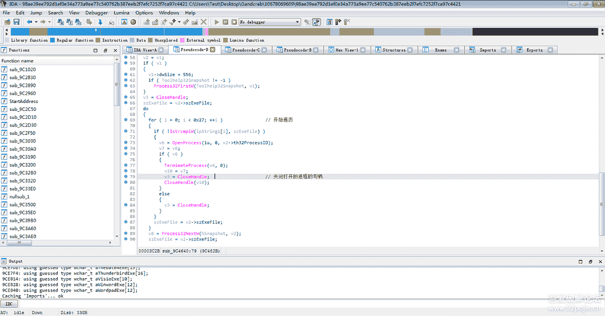

图片.png (311.21 KB, 下载次数: 0) [下载](https://www.52pojie.cn/forum.php?mod=attachment&aid=MjYyMDc2OXxmM2Y3ZGRjZXwxNzkzNTc2OTc5fDE2ODA4NnwxNzk1NTA0&nothumb=yes) 2023-6-10 09:40 上传

## 获取系统信息

通过注册表检查了当前用户组，所在地区，操作系统，系统版本号，CPU信息，以及磁盘类型和磁盘容量

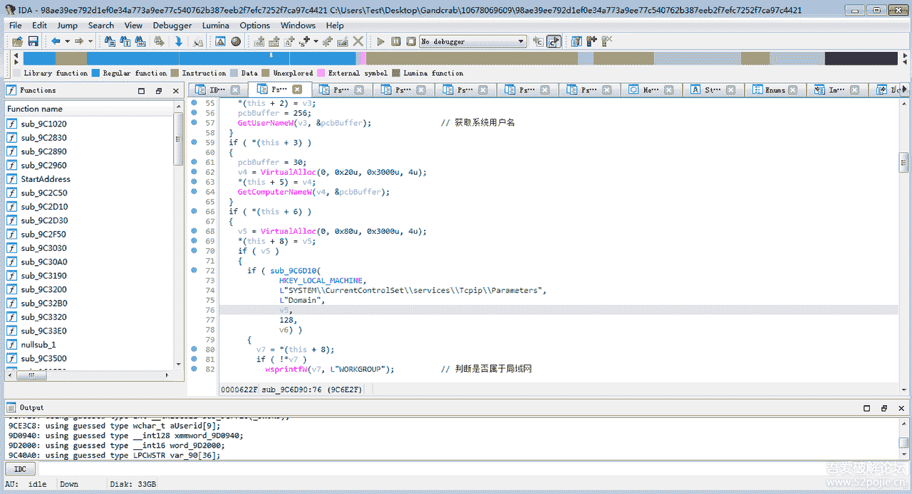

图片.png (347.94 KB, 下载次数: 0) [下载](https://www.52pojie.cn/forum.php?mod=attachment&aid=MjYyMDc3MHxmY2NkZWJkOHwxNzkzNTc2OTc5fDE2ODA4NnwxNzk1NTA0&nothumb=yes) 2023-6-10 09:42 上传

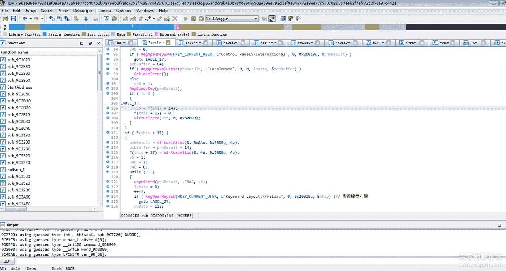

图片.png (352.96 KB, 下载次数: 1) [下载](https://www.52pojie.cn/forum.php?mod=attachment&aid=MjYyMDc3MXw4N2I2M2ExYXwxNzkzNTc2OTc5fDE2ODA4NnwxNzk1NTA0&nothumb=yes) 2023-6-10 09:42 上传

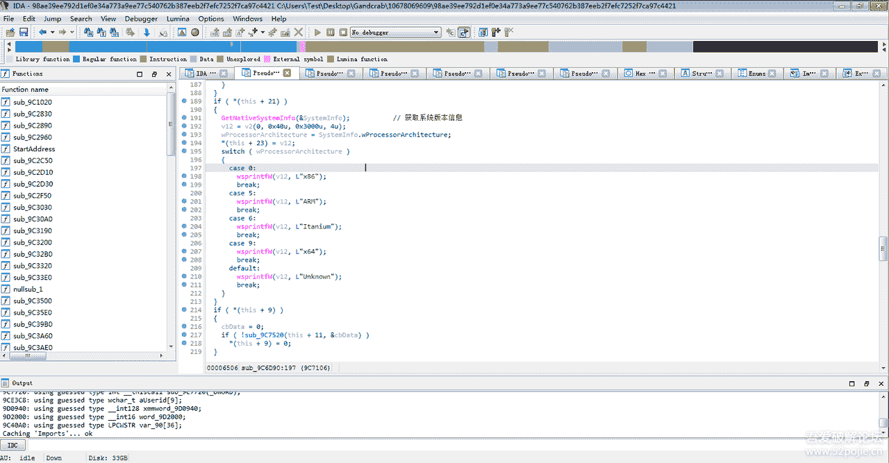

图片.png (322.5 KB, 下载次数: 0) [下载](https://www.52pojie.cn/forum.php?mod=attachment&aid=MjYyMDc3MnwzM2RmYjZmMHwxNzkzNTc2OTc5fDE2ODA4NnwxNzk1NTA0&nothumb=yes) 2023-6-10 09:42 上传

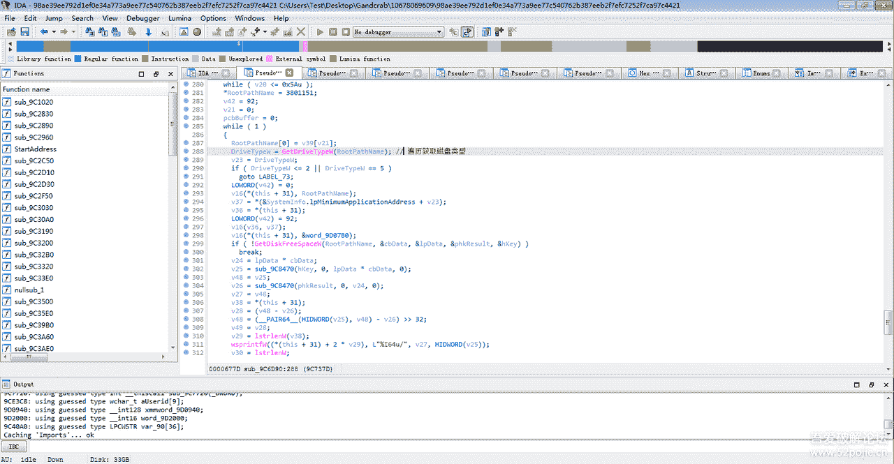

图片.png (361.51 KB, 下载次数: 0) [下载](https://www.52pojie.cn/forum.php?mod=attachment&aid=MjYyMDc3M3w3NzQ2NjdhZXwxNzkzNTc2OTc5fDE2ODA4NnwxNzk1NTA0&nothumb=yes) 2023-6-10 09:42 上传

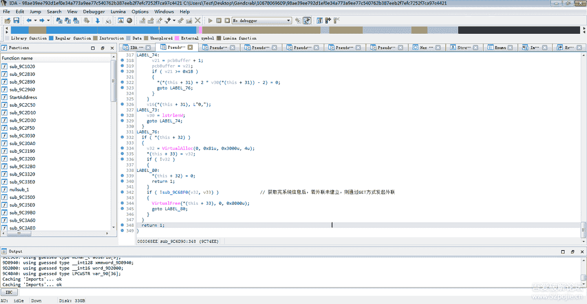

图片.png (315.23 KB, 下载次数: 0) [下载](https://www.52pojie.cn/forum.php?mod=attachment&aid=MjYyMDc3NHwzNTI1YmQ0MnwxNzkzNTc2OTc5fDE2ODA4NnwxNzk1NTA0&nothumb=yes) 2023-6-10 09:43 上传

## 恶意外联

通过GET和POST请求外联恶意域名

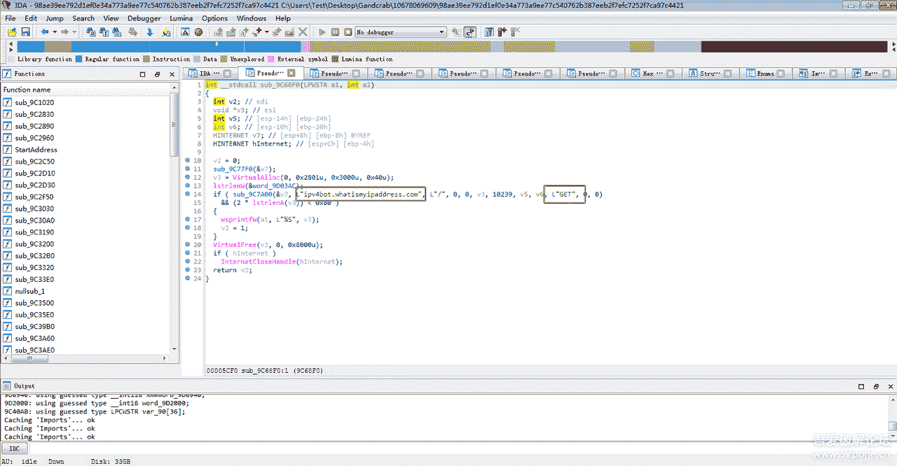

图片.png (303.03 KB, 下载次数: 0) [下载](https://www.52pojie.cn/forum.php?mod=attachment&aid=MjYyMDc3NXwyMWQ4ZWNmY3wxNzkzNTc2OTc5fDE2ODA4NnwxNzk1NTA0&nothumb=yes) 2023-6-10 09:44 上传

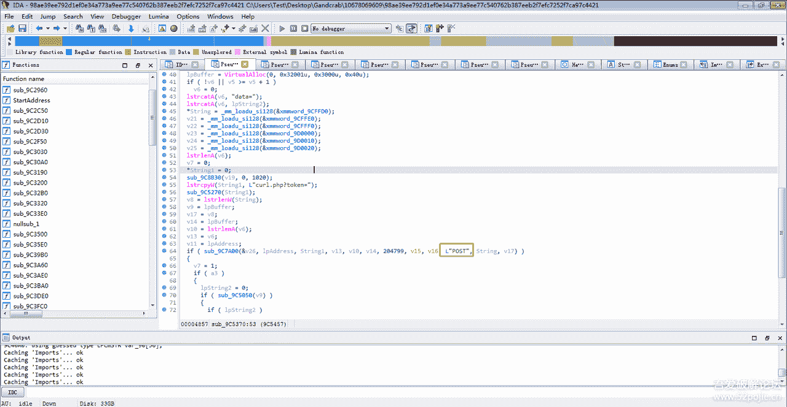

图片.png (320.72 KB, 下载次数: 0) [下载](https://www.52pojie.cn/forum.php?mod=attachment&aid=MjYyMDc3Nnw4ODUwZmZjOXwxNzkzNTc2OTc5fDE2ODA4NnwxNzk1NTA0&nothumb=yes) 2023-6-10 09:44 上传

发起一个HTTP请求操作，首先通过`HttpAddRequestHeadersW`函数添加HTTP请求头参数，然后通过`HttpSendReqst`函数发送HTTP请求，并且获取HTTP响应。如果`HttpSendRequestW`函数返回真，则继续从网络资源获取响应数据，函数`InternetReadFile`通过指定HTTP连接句柄`v15`来获取http数据，读取到的数据存放在`v16`所指的缓存区，读取的字节数为`a7 - 1`，同时返回完整的服务器名称到`lpszServerName`中。其中，函数返回的结果被用于判断HTTP请求是否成功，如果成功，就继续从网络资源获取数据，如果失败，则通过函数`GetLastError`获取错误信息。

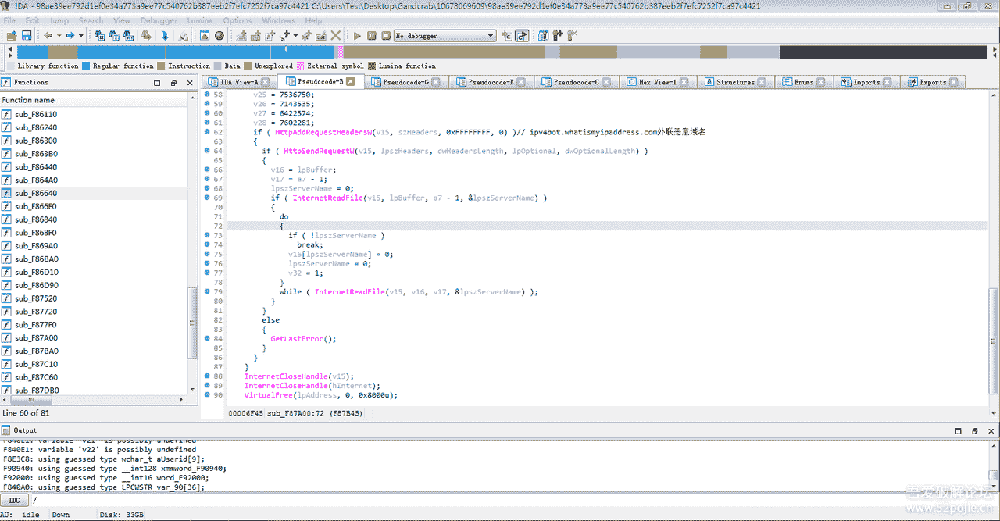

图片.png (326.66 KB, 下载次数: 0) [下载](https://www.52pojie.cn/forum.php?mod=attachment&aid=MjYyMDc3N3xlMjkwZGExOHwxNzkzNTc2OTc5fDE2ODA4NnwxNzk1NTA0&nothumb=yes) 2023-6-10 09:44 上传

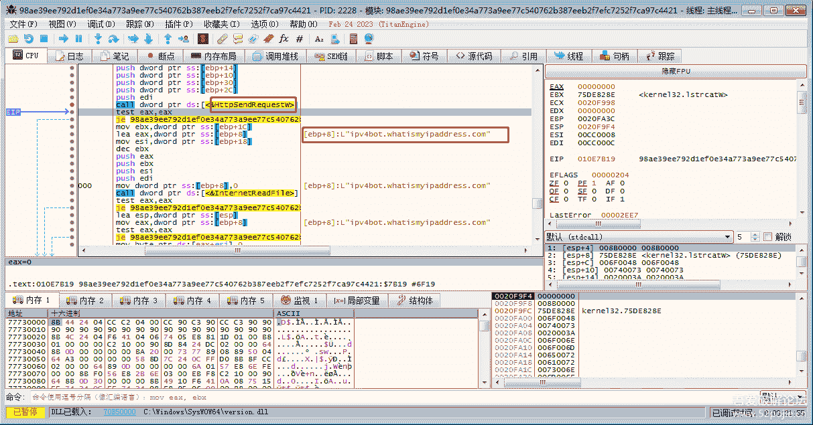

图片.png (152.01 KB, 下载次数: 1) [下载](https://www.52pojie.cn/forum.php?mod=attachment&aid=MjYyMDc3OHxiZGRkMmY4YnwxNzkzNTc2OTc5fDE2ODA4NnwxNzk1NTA0&nothumb=yes) 2023-6-10 09:45 上传

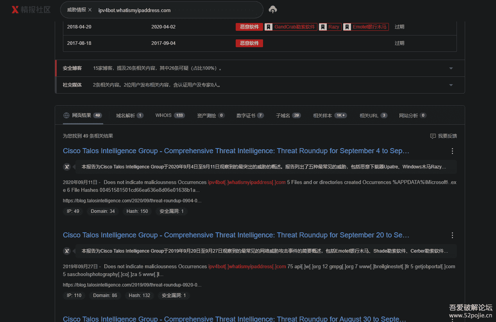

图片.png (143.04 KB, 下载次数: 1) [下载](https://www.52pojie.cn/forum.php?mod=attachment&aid=MjYyMDc3OXw5NTZlYTIwNHwxNzkzNTc2OTc5fDE2ODA4NnwxNzk1NTA0&nothumb=yes) 2023-6-10 09:45 上传

当前域名已无法访问

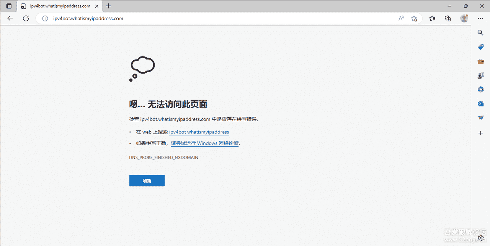

图片.png (97.27 KB, 下载次数: 0) [下载](https://www.52pojie.cn/forum.php?mod=attachment&aid=MjYyMDc4MHw0NDgxYjRjYnwxNzkzNTc2OTc5fDE2ODA4NnwxNzk1NTA0&nothumb=yes) 2023-6-10 09:45 上传

## 设置注册表信息

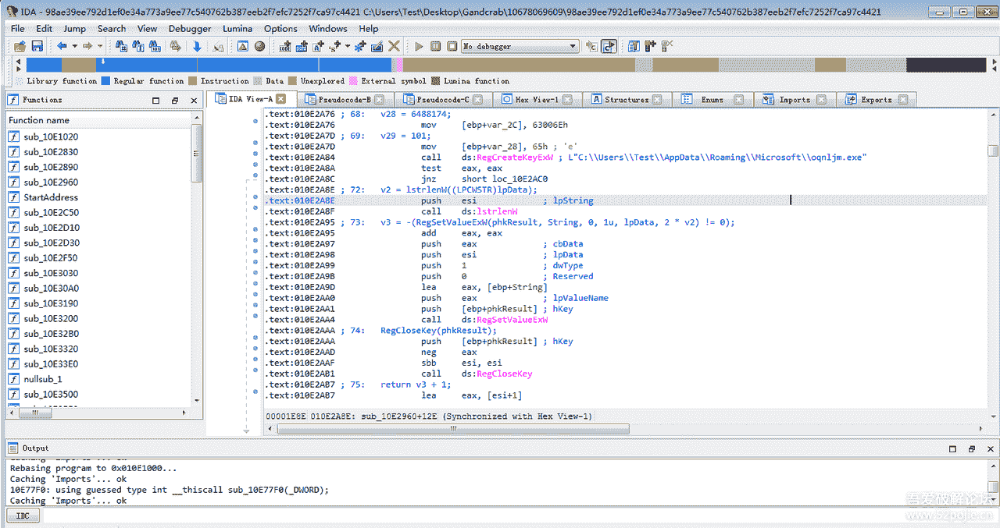

图片.png (417.86 KB, 下载次数: 0) [下载](https://www.52pojie.cn/forum.php?mod=attachment&aid=MjYyMDc4MXxmNGE1YmQ3Y3wxNzkzNTc2OTc5fDE2ODA4NnwxNzk1NTA0&nothumb=yes) 2023-6-10 09:46 上传

## 加密部分

使用`CryptGenKey`生成RSA的公私钥对，之后用`CryptExportKey`导出

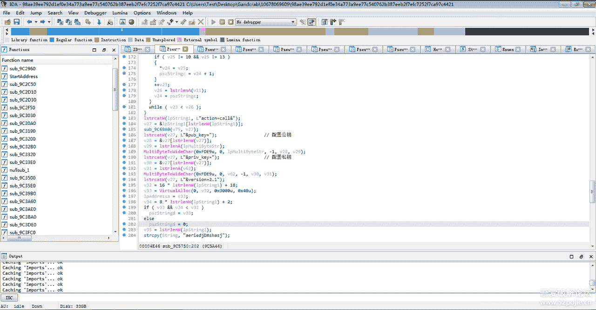

图片.png (324.81 KB, 下载次数: 0)

[href="forum.php?mod=attachment&aid=MjYyMDc4M3xjNTU5MjBjMnwxNzkzNTc2OTc5fDE2ODA4NnwxNzk1NTA0&nothumb=yes" target="_blank"](https://www.52pojie.cn/forum.php?mod=attachment&aid=MjYyMDc4M3xjNTU5MjBjMnwxNzkzNTc2OTc5fDE2ODA4NnwxNzk1NTA0&nothumb=yes)

2023-6-10 09:46 上传

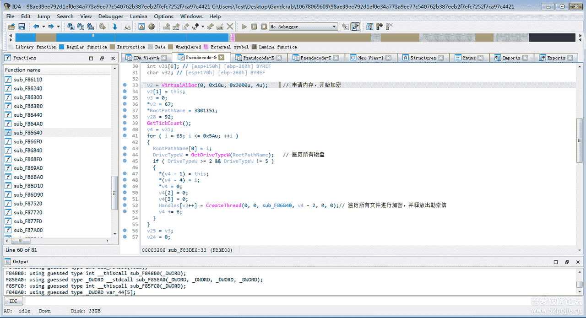

`图片.png` (371.27 KB, 下载次数: 0)

[href="forum.php?mod=attachment&aid=MjYyMDc4NHwzMDExNzEzZHwxNzkzNTc2OTc5fDE2ODA4NnwxNzk1NTA0&nothumb=yes" target="_blank"](https://www.52pojie.cn/forum.php?mod=attachment&aid=MjYyMDc4NHwzMDExNzEzZHwxNzkzNTc2OTc5fDE2ODA4NnwxNzk1NTA0&nothumb=yes)

2023-6-10 09:46 上传

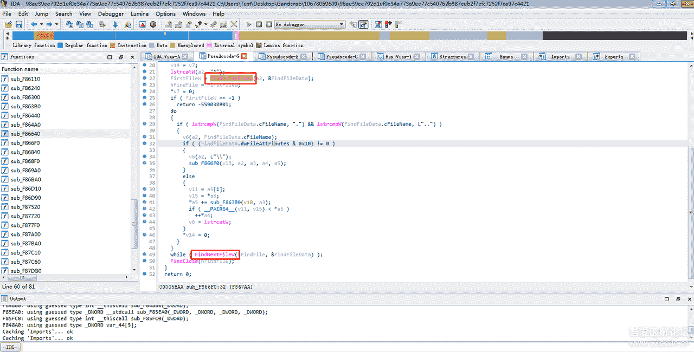

`图片.png` (317.95 KB, 下载次数: 0)

[href="forum.php?mod=attachment&aid=MjYyMDc4NXw3YmRmMGQxY3wxNzkzNTc2OTc5fDE2ODA4NnwxNzk1NTA0&nothumb=yes" target="_blank"](https://www.52pojie.cn/forum.php?mod=attachment&aid=MjYyMDc4NXw3YmRmMGQxY3wxNzkzNTc2OTc5fDE2ODA4NnwxNzk1NTA0&nothumb=yes)

2023-6-10 09:47 上传

使用`FindFirstFileW`和`FindNextFileW`接口遍历文件目录下的所有文件进行加密，并释放出勒索信

`图片.png` (317.95 KB, 下载次数: 1)

[href="forum.php?mod=attachment&aid=MjYyMDc4NnxkZjBiOGM5ZHwxNzkzNTc2OTc5fDE2ODA4NnwxNzk1NTA0&nothumb=yes" target="_blank"](https://www.52pojie.cn/forum.php?mod=attachment&aid=MjYyMDc4NnxkZjBiOGM5ZHwxNzkzNTc2OTc5fDE2ODA4NnwxNzk1NTA0&nothumb=yes)

2023-6-10 09:47 上传

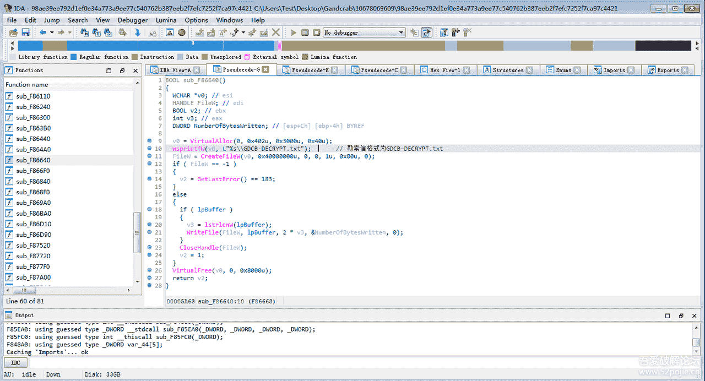

`图片.png` (355.07 KB, 下载次数: 0)

[href="forum.php?mod=attachment&aid=MjYyMDc4N3xiYjAxNWRjYnwxNzkzNTc2OTc5fDE2ODA4NnwxNzk1NTA0&nothumb=yes" target="_blank"](https://www.52pojie.cn/forum.php?mod=attachment&aid=MjYyMDc4N3xiYjAxNWRjYnwxNzkzNTc2OTc5fDE2ODA4NnwxNzk1NTA0&nothumb=yes)

2023-6-10 09:47 上传

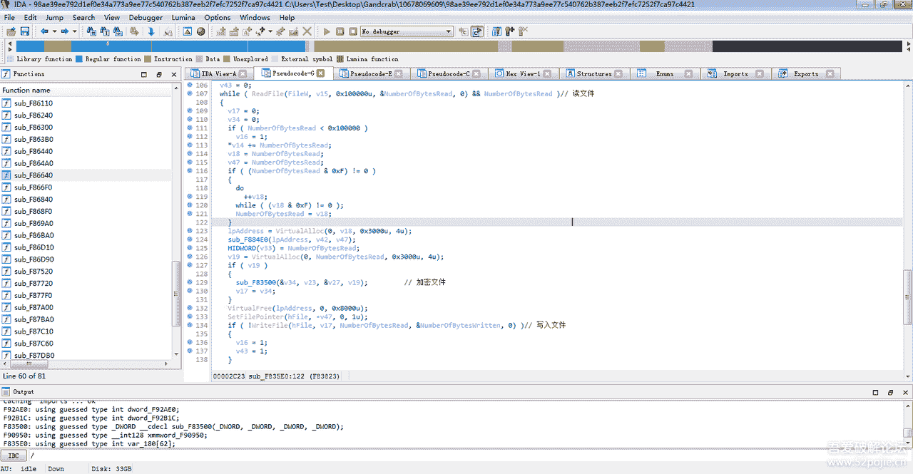

`图片.png` (349.13 KB, 下载次数: 0)

[href="forum.php?mod=attachment&aid=MjYyMDc4OHw1YTAxNGRkYXwxNzkzNTc2OTc5fDE2ODA4NnwxNzk1NTA0&nothumb=yes" target="_blank"](https://www.52pojie.cn/forum.php?mod=attachment&aid=MjYyMDc4OHw1YTAxNGRkYXwxNzkzNTc2OTc5fDE2ODA4NnwxNzk1NTA0&nothumb=yes)

2023-6-10 09:48 上传

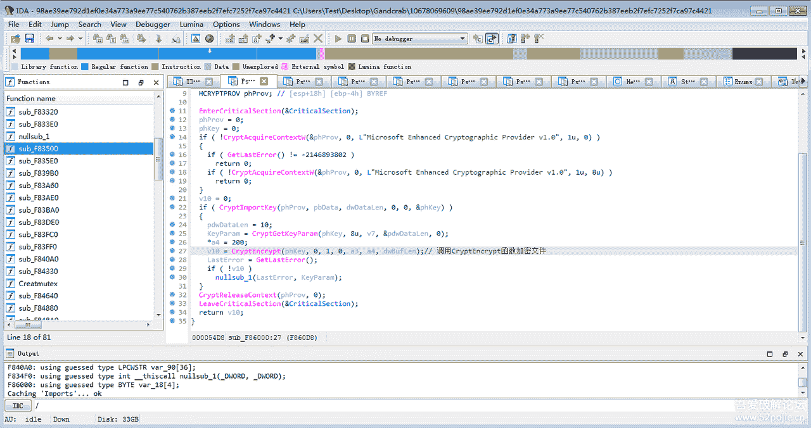

`图片.png` (372.07 KB, 下载次数: 0)

[href="forum.php?mod=attachment&aid=MjYyMDc4OXw3N2FjYWJjY3wxNzkzNTc2OTc5fDE2ODA4NnwxNzk1NTA0&nothumb=yes" target="_blank"](https://www.52pojie.cn/forum.php?mod=attachment&aid=MjYyMDc4OXw3N2FjYWJjY3wxNzkzNTc2OTc5fDE2ODA4NnwxNzk1NTA0&nothumb=yes)

2023-6-10 09:48 上传

加密过程中注入到系统`advapi32.dll`

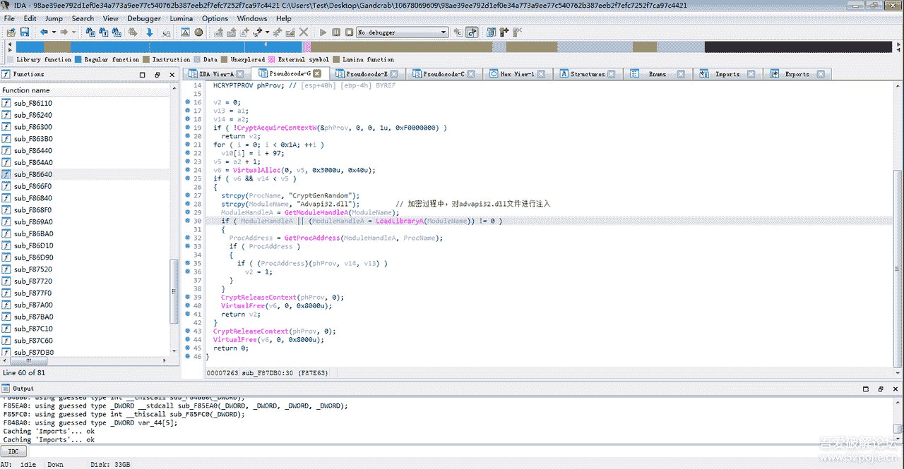

`图片.png` (341.56 KB, 下载次数: 0)

[href="forum.php?mod=attachment&aid=MjYyMDc5M3xlMzViNzEzMnwxNzkzNTc2OTc5fDE2ODA4NnwxNzk1NTA0&nothumb=yes" target="_blank"](https://www.52pojie.cn/forum.php?mod=attachment&aid=MjYyMDc5M3xlMzViNzEzMnwxNzkzNTc2OTc5fDE2ODA4NnwxNzk1NTA0&nothumb=yes)

2023-6-10 09:50 上传

删除卷影

删除卷影拷贝，防止用户恢复原文件

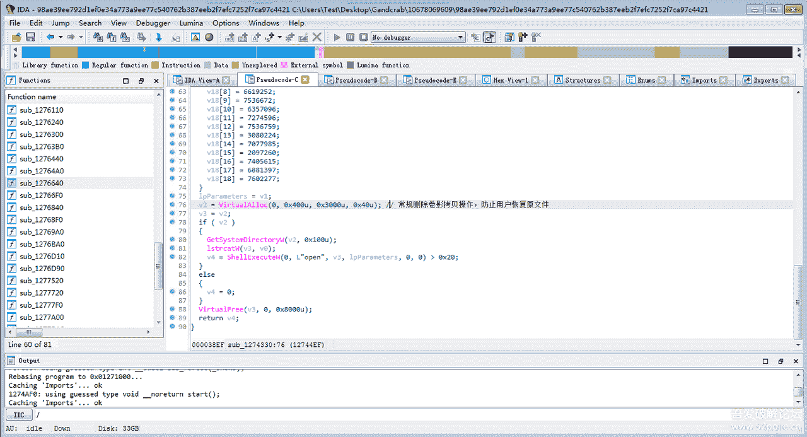

`图片.png` (362.66 KB, 下载次数: 0)

[href="forum.php?mod=attachment&aid=MjYyMDc5NHw2NjFkZmM5N3wxNzkzNTc2OTc5fDE2ODA4NnwxNzk1NTA0&nothumb=yes" target="_blank"](https://www.52pojie.cn/forum.php?mod=attachment&aid=MjYyMDc5NHw2NjFkZmM5N3wxNzkzNTc2OTc5fDE2ODA4NnwxNzk1NTA0&nothumb=yes)

2023-6-10 09:50 上传
