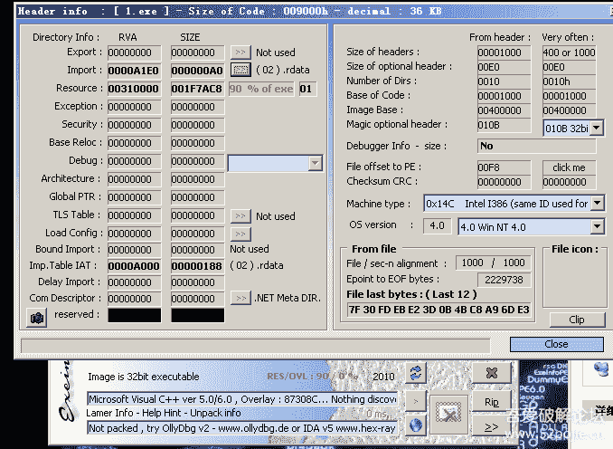
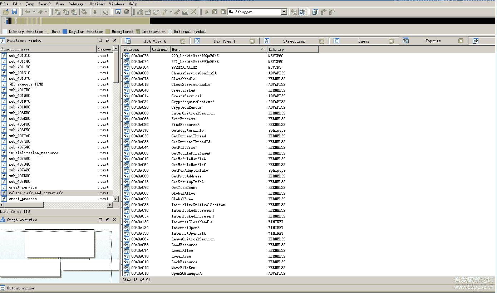
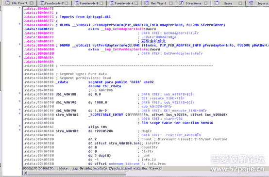
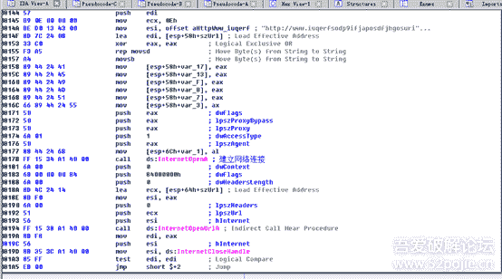
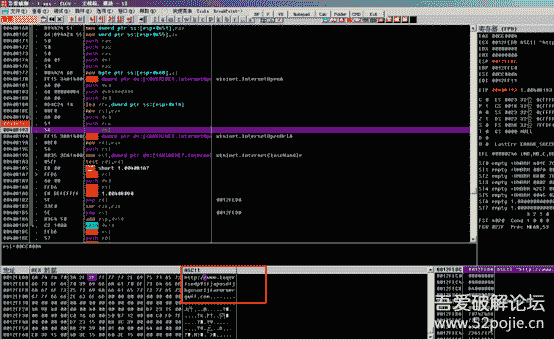
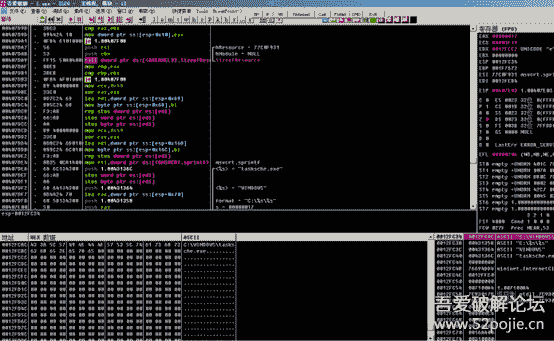
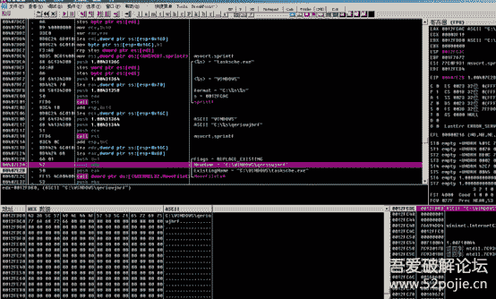

# [PC样本分析] WannaCry恶意样本的分析

- 原帖: https://www.52pojie.cn/forum.php?mod=viewthread&tid=1807422
- 抓取时间: 2026-11-01T23:49:27

今天在告警监测平台上看到一条告警，显示某源地址访问恶意域名：www.iuqerfsodp9ifjaposdfjhgosurijfaewrwergwff.com
接着就联系客户，准备上机排查一下，最终找到了相关样本，接下来就对样本进行初步分析首先用PEinfo查看一下基本信息

## PEinfo 查看基本信息

1689085969241.png (81.15 KB, 下载次数: 1)
[href="forum.php?mod=attachment&aid=MjYyNjQ3N3w5MGYxNzAyMHwxNzkzNTc2OTY1fDE2ODA4NnwxODA3NDIy&nothumb=yes" target="_blank"](https://www.52pojie.cn/forum.php?mod=attachment&aid=MjYyNjQ3N3w5MGYxNzAyMHwxNzkzNTc2OTY1fDE2ODA4NnwxODA3NDIy&nothumb=yes)
2023-7-11 22:33 上传

## PEID 收集基本信息

PEID收集基本信息：大概查看一下该恶意软件使用了哪些windowsAPI函数，方便后续分析。
将恶意软件拖进IDA后没有直接从函数入口点开始分析，而是直接从Import导出表开始，这样分析的更快一些。

1689086905386.png (101.85 KB, 下载次数: 0)
[href="forum.php?mod=attachment&aid=MjYyNjQ4MHxhZDg3MmNiMXwxNzkzNTc2OTY1fDE2ODA4NnwxODA3NDIy&nothumb=yes" target="_blank"](https://www.52pojie.cn/forum.php?mod=attachment&aid=MjYyNjQ4MHxhZDg3MmNiMXwxNzkzNTc2OTY1fDE2ODA4NnwxODA3NDIy&nothumb=yes)
2023-7-11 22:48 上传

## 去获取主机的相关信息

1689087223631.jpg (118.56 KB, 下载次数: 0)
[href="forum.php?mod=attachment&aid=MjYyNjQ4Mnw1YjQ1NTcwNnwxNzkzNTc2OTY1fDE2ODA4NnwxODA3NDIy&nothumb=yes" target="_blank"](https://www.52pojie.cn/forum.php?mod=attachment&aid=MjYyNjQ4Mnw1YjQ1NTcwNnwxNzkzNTc2OTY1fDE2ODA4NnwxODA3NDIy&nothumb=yes)
2023-7-11 22:54 上传

## 建立网络连接并访问恶意域名

建立了网络连接，并去访问域名www.iuqerfsodp9ifjaposdfjhgosurijfaewrwergwff.com

1689086787742.jpg (102.33 KB, 下载次数: 1)
[href="forum.php?mod=attachment&aid=MjYyNjQ3OXxiNmQ0MzdkM3wxNzkzNTc2OTY1fDE2ODA4NnwxODA3NDIy&nothumb=yes" target="_blank"](https://www.52pojie.cn/forum.php?mod=attachment&aid=MjYyNjQ3OXxiNmQ0MzdkM3wxNzkzNTc2OTY1fDE2ODA4NnwxODA3NDIy&nothumb=yes)
2023-7-11 22:46 上传

1689087135678.jpg (143.08 KB, 下载次数: 0)
[href="forum.php?mod=attachment&aid=MjYyNjQ4MXw0MjhiYjUxMnwxNzkzNTc2OTY1fDE2ODA4NnwxODA3NDIy&nothumb=yes" target="_blank"](https://www.52pojie.cn/forum.php?mod=attachment&aid=MjYyNjQ4MXw0MjhiYjUxMnwxNzkzNTc2OTY1fDE2ODA4NnwxODA3NDIy&nothumb=yes)
2023-7-11 22:52 上传

[href="forum.php?mod=attachment&aid=MjYyNjQ4NXw5YmYxMGIwZXwxNzkzNTc2OTY1fDE2ODA4NnwxODA3NDIy" target="_blank"](https://www.52pojie.cn/forum.php?mod=attachment&aid=MjYyNjQ4NXw5YmYxMGIwZXwxNzkzNTc2OTY1fDE2ODA4NnwxODA3NDIy)
(1.98 MB, 下载次数: 37)
2023-7-11 23:21 上传
点击文件名下载附件
相关样本
下载积分: 吾爱币 -1 CB

## 在 `C:\windows\` 下创建新进程

在`C:\windows\`下面又创建了一个新的进程`tasksche.exe`

1689087296428.jpg (161.62 KB, 下载次数: 0)
[href="forum.php?mod=attachment&aid=MjYyNjQ4M3xhNjAyMTAxYXwxNzkzNTc2OTY1fDE2ODA4NnwxODA3NDIy&nothumb=yes" target="_blank"](https://www.52pojie.cn/forum.php?mod=attachment&aid=MjYyNjQ4M3xhNjAyMTAxYXwxNzkzNTc2OTY1fDE2ODA4NnwxODA3NDIy&nothumb=yes)
2023-7-11 22:55 上传

## 进程重命名

如果`C:/Windows/tasksche.exe`存在，`mssecsvc.exe`将其更名为`C:/Windows/qeriuwjhrf`

1689087535678.jpg (162.3 KB, 下载次数: 1)
[href="forum.php?mod=attachment&aid=MjYyNjQ4NHxhZmZjZjdkZHwxNzkzNTc2OTY1fDE2ODA4NnwxODA3NDIy&nothumb=yes" target="_blank"](https://www.52pojie.cn/forum.php?mod=attachment&aid=MjYyNjQ4NHxhZmZjZjdkZHwxNzkzNTc2OTY1fDE2ODA4NnwxODA3NDIy&nothumb=yes)
2023-7-11 22:59 上传

以上就是对该恶意软件的一个简单分析。
