# [PC样本分析] 后门病毒携带蠕虫 使用多种免杀手段

- 原帖: https://www.52pojie.cn/forum.php?mod=viewthread&tid=1816444
- 抓取时间: 2026-11-01T23:49:21

近期，火绒威胁情报系统监测到一款后门病毒正在快速传播，被激活后会释放多个恶意文件并执行，使黑客可以进行信息收集，远程控制等恶意操作。值得注意的是，该病毒不但使用多种免杀手段躲避查杀，其释放的子文件中还具有`Synares`蠕虫感染特征，可在受害者电脑的文件中进行传播。火绒安全产品可对上述病毒进行拦截查杀，请用户及时更新病毒库以进行防御。

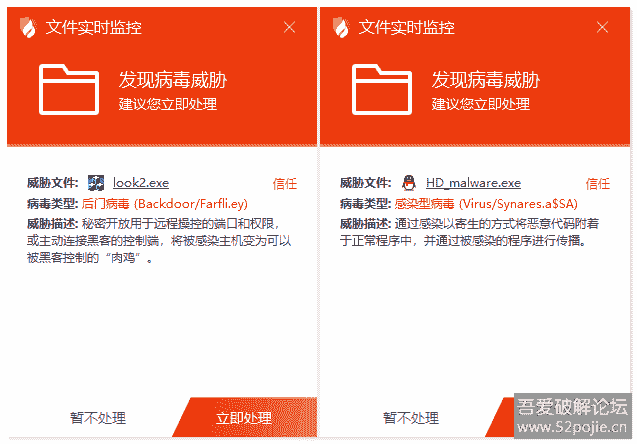

1.png (15.89 KB, 下载次数: 0)

[href="forum.php?mod=attachment&aid=MjYzMjQ2MXwyMGIzZWM1MnwxNzkzNTc2OTU4fDE2ODA4NnwxODE2NDQ0&nothumb=yes" target="_blank"](https://www.52pojie.cn/forum.php?mod=attachment&aid=MjYzMjQ2MXwyMGIzZWM1MnwxNzkzNTc2OTU4fDE2ODA4NnwxODE2NDQ0&nothumb=yes)

2023-8-2 16:29 上传

火绒查杀图

用户点击病毒程序之后，该病毒就会释放并执行恶意文件，随后黑客可以远程控制用户电脑。除此之外，该黑客团伙在开发过程中疑似主机环境被`Synares`蠕虫病毒感染或有意捆绑，致使释放的子文件中存在着蠕虫的特征，增加了破坏性。执行流程如下图所示：

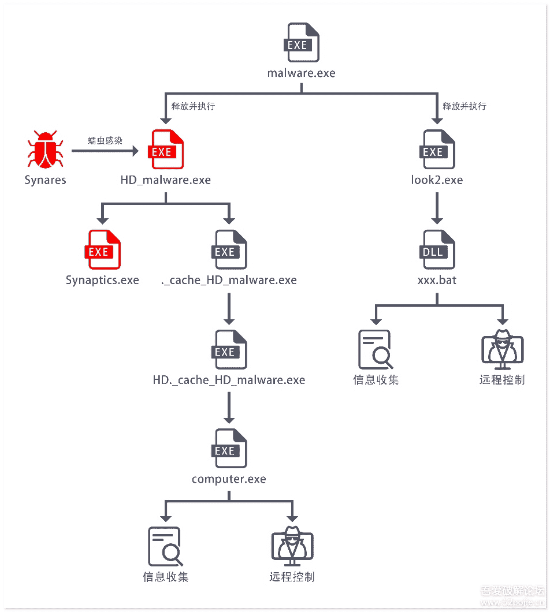

Image-2.png (203.04 KB, 下载次数: 1)

[href="forum.php?mod=attachment&aid=MjYzMjQ2MnwyNjhjODYxNHwxNzkzNTc2OTU4fDE2ODA4NnwxODE2NDQ0&nothumb=yes" target="_blank"](https://www.52pojie.cn/forum.php?mod=attachment&aid=MjYzMjQ2MnwyNjhjODYxNHwxNzkzNTc2OTU4fDE2ODA4NnwxODE2NDQ0&nothumb=yes)

2023-8-2 16:30 上传

执行流程图

在免杀层面上，该病毒文件使用了包括：多层 `PE` 流调用、`VMProtect` 和 `Safengine Shielden` 加壳保护、`DLL` 内存加载、异常反调试、流程混淆等多种技术来进行对抗。在此，火绒工程师提醒大家警惕陌生文件，先查杀再使用。

## 一、样本分析

### `malware.exe`

在分析对抗层面上，病毒对运行逻辑进行了混淆处理，并利用了包括：函数指针动态获取、函数包装调用等手段来干扰静态分析：

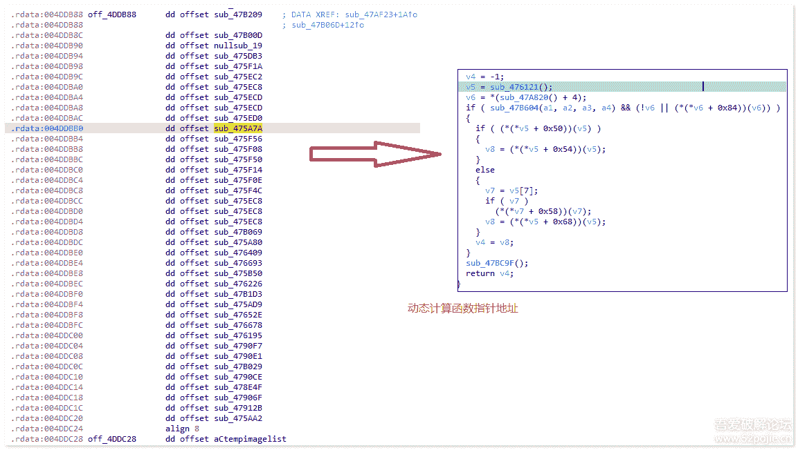

Image-3.png (98.69 KB, 下载次数: 0)

[href="forum.php?mod=attachment&aid=MjYzMjQ2M3wyOTUxMWY1M3wxNzkzNTc2OTU4fDE2ODA4NnwxODE2NDQ0&nothumb=yes" target="_blank"](https://www.52pojie.cn/forum.php?mod=attachment&aid=MjYzMjQ2M3wyOTUxMWY1M3wxNzkzNTc2OTU4fDE2ODA4NnwxODE2NDQ0&nothumb=yes)

2023-8-2 16:30 上传

函数指针动态获取

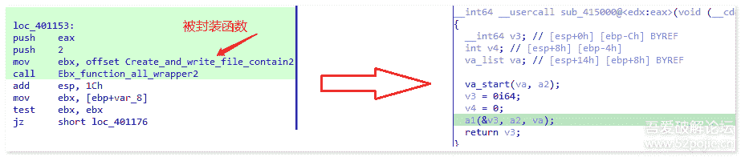

Image-4.png (29.28 KB, 下载次数: 0)

[href="forum.php?mod=attachment&aid=MjYzMjQ2NHwzMzE3YTRkNnwxNzkzNTc2OTU4fDE2ODA4NnwxODE2NDQ0&nothumb=yes" target="_blank"](https://www.52pojie.cn/forum.php?mod=attachment&aid=MjYzMjQ2NHwzMzE3YTRkNnwxNzkzNTc2OTU4fDE2ODA4NnwxODE2NDQ0&nothumb=yes)

2023-8-2 16:31 上传

函数包装调用

在关键执行层面上，病毒文件先后释放`look2.exe`和`HD_malware.exe`文件并执行。其中`look2.exe`存放于用户的`TEMP`目录中，而`HD_malware.exe`则释放到桌面下，并赋予“隐藏属性和系统保护属性”隐藏自身。

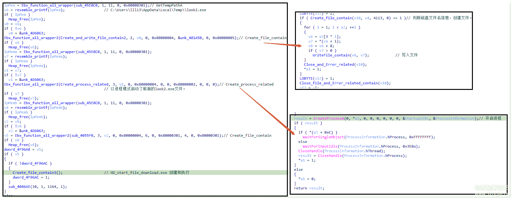

Image-5.png (95.02 KB, 下载次数: 1)

[href="forum.php?mod=attachment&aid=MjYzMjQ2NXxlMjE4YWJhN3wxNzkzNTc2OTU4fDE2ODA4NnwxODE2NDQ0&nothumb=yes" target="_blank"](https://www.52pojie.cn/forum.php?mod=attachment&aid=MjYzMjQ2NXxlMjE4YWJhN3wxNzkzNTc2OTU4fDE2ODA4NnwxODE2NDQ0&nothumb=yes)

2023-8-2 16:31 上传

执行流程图

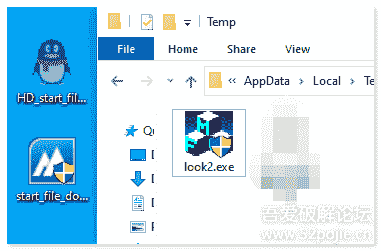

Image-6.png (27.32 KB, 下载次数: 0)

[href="forum.php?mod=attachment&aid=MjYzMjQ5Mnw2NjI0NzcwY3wxNzkzNTc2OTU4fDE2ODA4NnwxODE2NDQ0&nothumb=yes" target="_blank"](https://www.52pojie.cn/forum.php?mod=attachment&aid=MjYzMjQ5Mnw2NjI0NzcwY3wxNzkzNTc2OTU4fDE2ODA4NnwxODE2NDQ0&nothumb=yes)

2023-8-2 16:39 上传

文件示意图

### `look2.exe`

`look2.exe`是一个支持持久化和配置更新的木马程序。该病毒在执行前会解密出互斥体名称：`kinh.xmcxmr.com:442:svchcst`，通过该互斥体的成功创建与否来判断父进程`malware.exe`是否正在执行，以此决定后续操作。

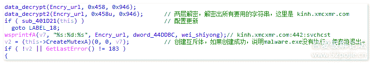

Image-7.png (22.33 KB, 下载次数: 0)

[href="forum.php?mod=attachment&aid=MjYzMjQ5M3w5MDAwYmZlZXwxNzkzNTc2OTU4fDE2ODA4NnwxODE2NDQ0&nothumb=yes" target="_blank"](https://www.52pojie.cn/forum.php?mod=attachment&aid=MjYzMjQ5M3w5MDAwYmZlZXwxNzkzNTc2OTU4fDE2ODA4NnwxODE2NDQ0&nothumb=yes)

2023-8-2 16:40 上传

父子进程交互

后续操作中，`look2.exe`会尝试获取系统目录，然后释放一个以时间戳命名的`bat`文件，该文件实则为用于加载的`DLL`文件。根据父进程写入的执行标志位来决定是直接执行`DLL`内`MainThread`导出函数还是`Install`导出函数（这两个导出函数在后面解析），执行完后还尝试删除文件，但实际上由于文件被加载占用，所以无法被移除。

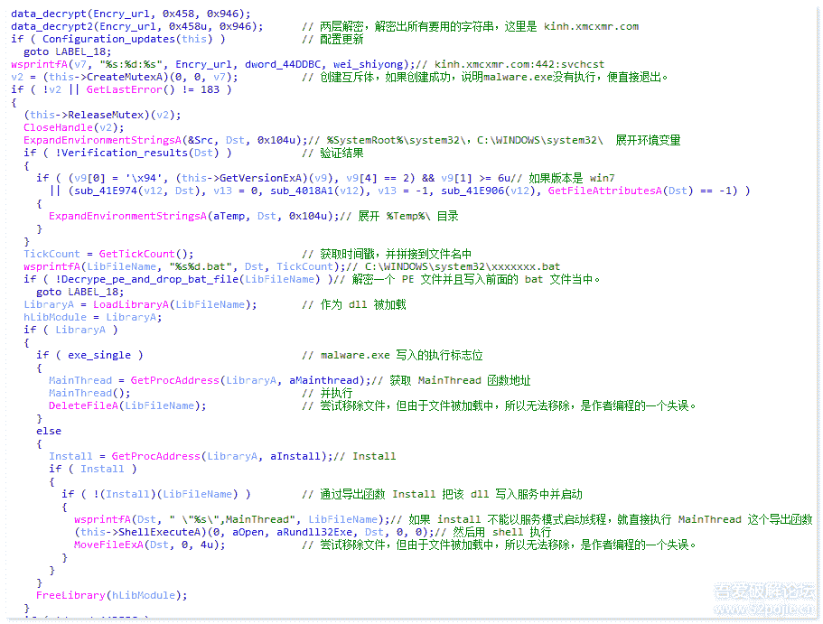

Image-8.png (79.12 KB, 下载次数: 0)

[href="forum.php?mod=attachment&aid=MjYzMjQ5NHw4YzkwYmFkM3wxNzkzNTc2OTU4fDE2ODA4NnwxODE2NDQ0&nothumb=yes" target="_blank"](https://www.52pojie.cn/forum.php?mod=attachment&aid=MjYzMjQ5NHw4YzkwYmFkM3wxNzkzNTc2OTU4fDE2ODA4NnwxODE2NDQ0&nothumb=yes)

2023-8-2 16:40 上传

`look2.exe` 执行流程

另一种情况是`look2.exe`被用于执行配置更新操作，当命令行中包含`GUpdate`和要更新的注册表项时，程序会定位到指定的位置进行配置更新：

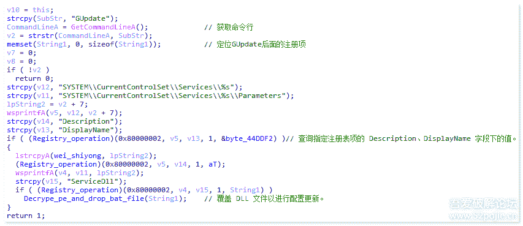

Image-9.png (42.41 KB, 下载次数: 0)

[href="forum.php?mod=attachment&aid=MjYzMjQ5NnxhYWNhYTYyY3wxNzkzNTc2OTU4fDE2ODA4NnwxODE2NDQ0&nothumb=yes" target="_blank"](https://www.52pojie.cn/forum.php?mod=attachment&aid=MjYzMjQ5NnxhYWNhYTYyY3wxNzkzNTc2OTU4fDE2ODA4NnwxODE2NDQ0&nothumb=yes)

2023-8-2 16:41 上传

配置更新操作

释放的`DLL`文件实际上是`Gh0st`后门病毒的变种，该`dll`中包括5个导出函数，但都围绕着`MainThread`展开。导出函数名代表了真实意图，包括配置更新（`DllUpdate`）、创建服务（`Install`）、卸载服务（`Uninstall`）、服务启动函数（`ServiceMain`）。

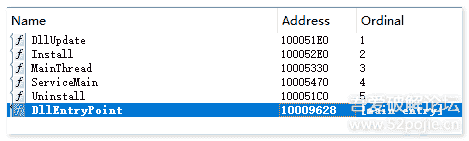

Image-10.png (11.58 KB, 下载次数: 0)

[href="forum.php?mod=attachment&aid=MjYzMjQ2NnxmZTFhMmQyMnwxNzkzNTc2OTU4fDE2ODA4NnwxODE2NDQ0&nothumb=yes" target="_blank"](https://www.52pojie.cn/forum.php?mod=attachment&aid=MjYzMjQ2NnxmZTFhMmQyMnwxNzkzNTc2OTU4fDE2ODA4NnwxODE2NDQ0&nothumb=yes)

2023-8-2 16:31 上传

导出函数列表

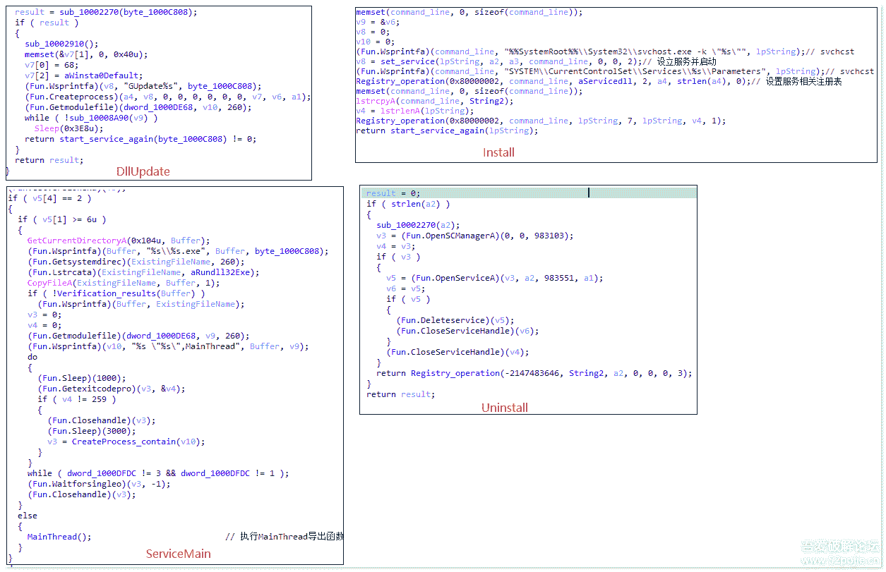

Image-11.png (107.28 KB, 下载次数: 0)

[href="forum.php?mod=attachment&aid=MjYzMjQ2N3xkNjEzYjQ0NnwxNzkzNTc2OTU4fDE2ODA4NnwxODE2NDQ0&nothumb=yes" target="_blank"](https://www.52pojie.cn/forum.php?mod=attachment&aid=MjYzMjQ2N3xkNjEzYjQ0NnwxNzkzNTc2OTU4fDE2ODA4NnwxODE2NDQ0&nothumb=yes)

2023-8-2 16:31 上传

导出函数逻辑代码

`MainThread`包含核心恶意功能，包括：终端数据收集，接收和执行控制命令、派发执行任意病毒模块等。火绒安全实验室在2019年发布的https://www.huorong.cn/info/1556281170207.html文章中披露的后门病毒在执行流程和代码逻辑上，经对比与该函数没有太大改动，故不再重复分析。

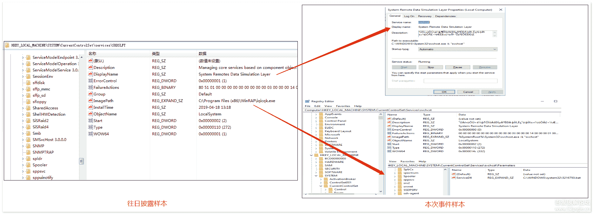

Image-12.png (272.6 KB, 下载次数: 0)

[href="forum.php?mod=attachment&aid=MjYzMjQ2OHw0YTZkNmZlYnwxNzkzNTc2OTU4fDE2ODA4NnwxODE2NDQ0&nothumb=yes" target="_blank"](https://www.52pojie.cn/forum.php?mod=attachment&aid=MjYzMjQ2OHw0YTZkNmZlYnwxNzkzNTc2OTU4fDE2ODA4NnwxODE2NDQ0&nothumb=yes)

2023-8-2 16:32 上传

注册表修改对比

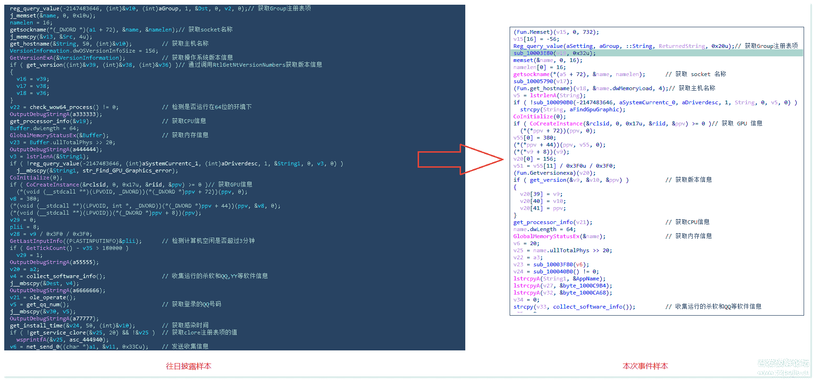

Image-13.png (190.91 KB, 下载次数: 0)

[href="forum.php?mod=attachment&aid=MjYzMjQ2OXw2OWU2MTZmOHwxNzkzNTc2OTU4fDE2ODA4NnwxODE2NDQ0&nothumb=yes" target="_blank"](https://www.52pojie.cn/forum.php?mod=attachment&aid=MjYzMjQ2OXw2OWU2MTZmOHwxNzkzNTc2OTU4fDE2ODA4NnwxODE2NDQ0&nothumb=yes)

2023-8-2 16:32 上传

信息收集对比图

### `HD_malware.exe`

`HD__malware.exe`是一个被`Synares`蠕虫病毒感染过的文件，当它执行时，会释放感染前的`.cache_malware.exe`源程序，并且执行蠕虫自身的感染操作，包括：更新自身配置、篡改注册表自启动项，感染指定位置`EXE`和`EXCEL`文件、远控，窃密等。执行流程如下所示：

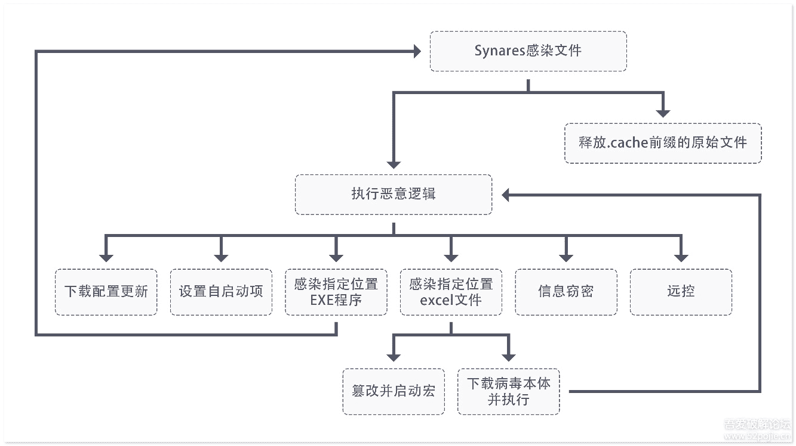

Image-14.png (241.78 KB, 下载次数: 0)

[href="forum.php?mod=attachment&aid=MjYzMjQ3MHxjNTdmMjU3MnwxNzkzNTc2OTU4fDE2ODA4NnwxODE2NDQ0&nothumb=yes" target="_blank"](https://www.52pojie.cn/forum.php?mod=attachment&aid=MjYzMjQ3MHxjNTdmMjU3MnwxNzkzNTc2OTU4fDE2ODA4NnwxODE2NDQ0&nothumb=yes)

2023-8-2 16:32 上传

执行流程图

`Synares`蠕虫病毒是一个相对较老的病毒，虽然变种极多，但本次观察到的行为与以前版本并无太大变化，包括感染的三个指定位置为：`%USERPROFILE%\Desktop`、`%USERPROFILE%\Documents`、`%USERPROFILE%\Downloads`。包括键盘记录和`usb`、目录文件信息记录，并通过邮件回传。包括基础远控功能：`CMD`命令执行、屏幕截图、打印目录、下载文件、删除文件等，故不再重复分析。

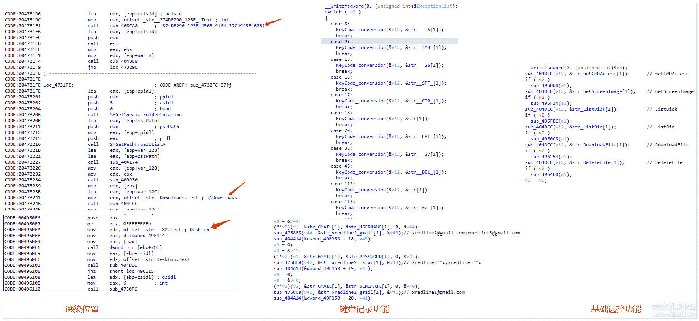

Image-15.png (175.03 KB, 下载次数: 0)

[href="forum.php?mod=attachment&aid=MjYzMjQ3MXw1NWE5OTg1YnwxNzkzNTc2OTU4fDE2ODA4NnwxODE2NDQ0&nothumb=yes" target="_blank"](https://www.52pojie.cn/forum.php?mod=attachment&aid=MjYzMjQ3MXw1NWE5OTg1YnwxNzkzNTc2OTU4fDE2ODA4NnwxODE2NDQ0&nothumb=yes)

2023-8-2 16:33 上传

代码逻辑图

### `._cache_HD_malware.exe`

释放出来的`._cache_HD_malware.exe`是被感染前的原始程序，其套用`vmp`壳来试图隐藏自身逻辑：

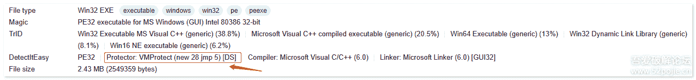

Image-16.png (31.51 KB, 下载次数: 0)

## 套用 VMP 壳

在其内部嵌入了未加密的 EXE 文件，用于释放执行，并包含核心操作：

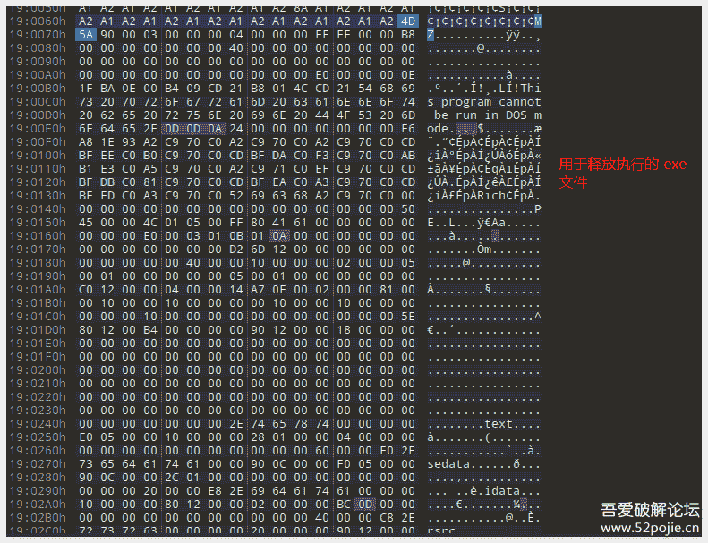
Image-17.png (84.13 KB, 下载次数: 1)

## 内嵌 EXE 文件

`HD_.cache_HD_malware.exe`

内嵌的 EXE 文件在释放时会再次以 `HD_` 做前缀，其同样被设置系统保护和隐藏属性，并且套用 SE 壳试图隐藏逻辑：

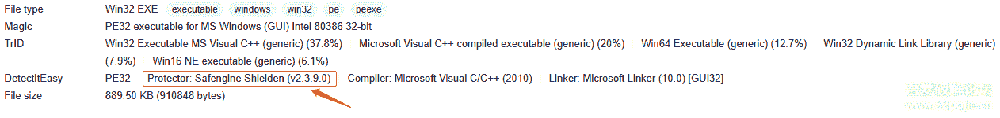
Image-18.png (31 KB, 下载次数: 0)

## 套用 SE 壳

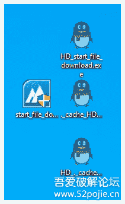
Image-19.png (28.1 KB, 下载次数: 0)

## 当前文件示意图

该病毒文件执行时，会从 C2 服务器上下载 `exploror.exe` 写入到创建的 `C:\windowss64` 目录下 `computer.exe` 文件中并启动执行。

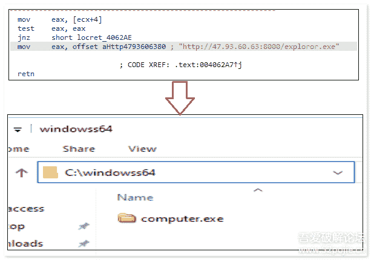
Image-20.png (40.5 KB, 下载次数: 0)

## 下载文件并执行

### Computer.exe

`Computer.exe` 是一个引导程序，用于引导内嵌的 `DLL` 加载执行。内嵌 `DLL` 是加密存储的，`Computer.exe` 在执行时会构造并利用异常来进行反调试，并且解密操作也在异常处理中定义。

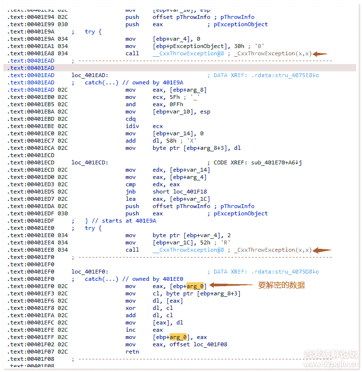
Image-21.png (89.15 KB, 下载次数: 0)

## 解密 DLL 和异常反调试

在解密内嵌 `DLL` 后，会调用指定导出函数 `fuckyou()`，剩下所有操作均由 `DLL` 内代码完成。

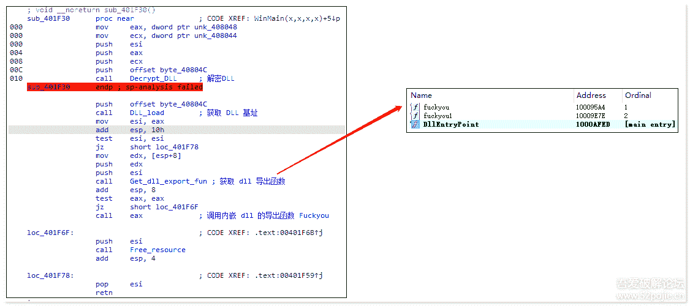
Image-22.png (46.92 KB, 下载次数: 0)

## 指定导出函数

该导出函数主体逻辑同样与火绒安全实验室在 2019 年发布的文章中提到的后门病毒，经对比并没有太大改动（DDOS 模块已移除），故不再重复分析。

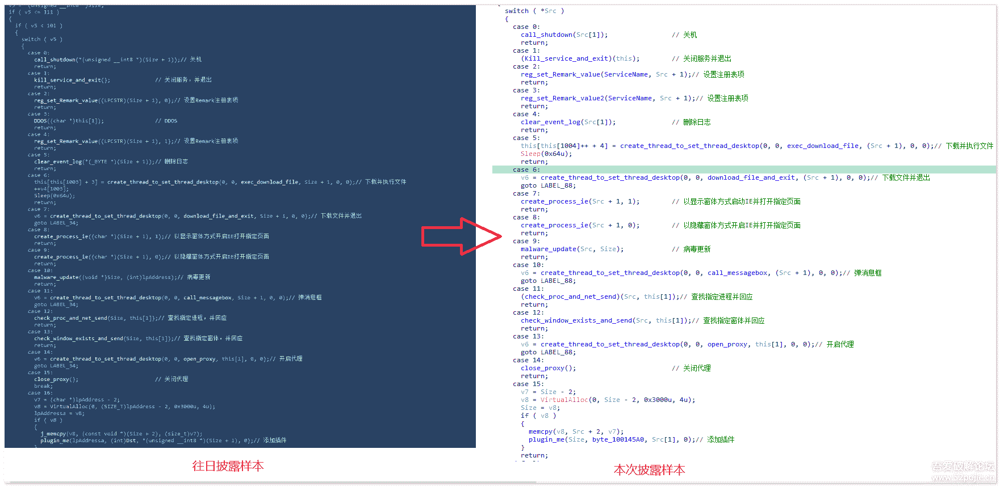
Image-23.png (242.7 KB, 下载次数: 0)

## 代码对比

## 二：附录

### HASH

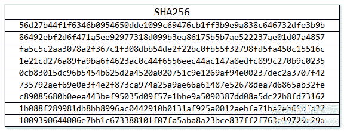
Image-24.png (27.66 KB, 下载次数: 0)
