# [PC样本分析] 回顾：后门病毒Gh0st近年变种演化

- 原帖: https://www.52pojie.cn/forum.php?mod=viewthread&tid=1823611
- 抓取时间: 2026-11-01T23:49:14

网络安全的核心本质是攻防对抗。当防病毒技术在不断完善的同时，病毒也在不断设法予以对抗，夹缝求生。Gh0st后门病毒就是其中之一。Gh0st 是一种远程访问工具（RAT），最早出现在2001 年左右，通过远程控制受感染计算机来执行各种恶意活动。其发展历史与网络攻击、渗透测试和间谍活动紧密相连，并且相关代码已经开源，致使对应变种层出不穷，对用户造成了较大的威胁。据“火绒威胁情报系统”显示，Gh0st 在国内常见的后门病毒中占比最大，超过50%。

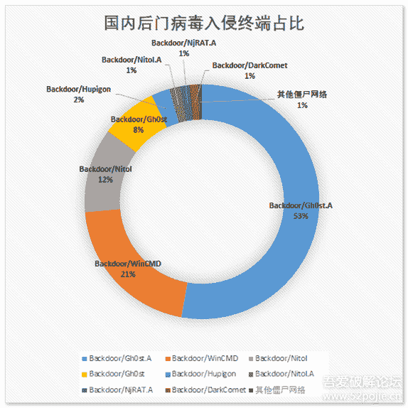

Image-0.png (204.37 KB, 下载次数: 0)

https://www.52pojie.cn/forum.php?mod=attachment&aid=MjYzNzM4M3w5YWI2MGE5ZnwxNzkzNTc2OTUxfDE2ODA4NnwxODIzNjEx&nothumb=yes

2023-8-21 09:58 上传

数据统计图

传统的 Gh0st 由控制器和服务器组成，其功能模块多以插件形式下发，包含如下功能：

- 键盘记录
- 远程终端访问
- 远程音频和视频访问
- 文件管理
- 远程文件下载和执行
- 进程资源管理器和其他系统枚举功能
- 图形用户界面交互（远程控制）
- 自我更新
- 重置 SSDT 以删除现有挂钩

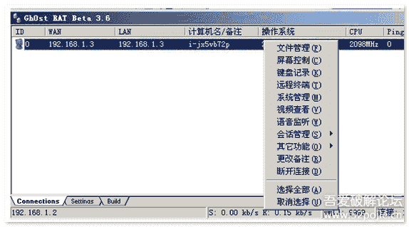

Image-1.png (99.44 KB, 下载次数: 0)

https://www.52pojie.cn/forum.php?mod=attachment&aid=MjYzNzM4NHxjNzkyNjY1N3wxNzkzNTc2OTUxfDE2ODA4NnwxODIzNjEx&nothumb=yes

2023-8-21 09:58 上传

Gh0st木马截图

火绒工程师在分析该病毒的对抗历程和变化特征时发现，该病毒不仅持续更新免杀对抗手段，而且传播途径花样百出，前后发生至少五次主要变种：

## 第一次变种

黑客通过攻击用户 SQL Server 服务器的方式，利用数据库相关进程下载并执行 Gh0st 后门病毒的早期变种—— “神农远控” ，火绒安全产品及时感知并拦截了该变种。

Image-2.png (63.42 KB, 下载次数: 0)

https://www.52pojie.cn/forum.php?mod=attachment&aid=MjYzNzM4NXxmNmM4NzMzYXwxNzkzNTc2OTUxfDE2ODA4NnwxODIzNjEx&nothumb=yes

2023-8-21 09:58 上传

火绒查杀图

不同于原始 Gh0st 的单一执行方式和注册表的简单利用，该变种除了会在不同的操作系统（`InstallTime`、`WOW64` 等）中执行不同的病毒逻辑外，还用于感染后的信息交互。

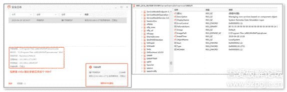

Image-3.png (54.88 KB, 下载次数: 0)

https://www.52pojie.cn/forum.php?mod=attachment&aid=MjYzNzM4NnxjNzFkN2Y4MHwxNzkzNTc2OTUxfDE2ODA4NnwxODIzNjEx&nothumb=yes

2023-8-21 09:59 上传

部分操作截图

在前期信息收集的过程中，该变种除了原有的硬件信息外，还添加了对各种杀软和敏感软件的检测，以供控制端调整执行策略。

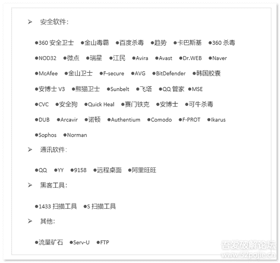

Image-4.png (78.3 KB, 下载次数: 0)

https://www.52pojie.cn/forum.php?mod=attachment&aid=MjYzNzM4N3xkY2Y3YjU3MHwxNzkzNTc2OTUxfDE2ODA4NnwxODIzNjEx&nothumb=yes

2023-8-21 09:59 上传

软件遍历

在通信方面，一改传统 5 字节 `"Gh0st"` 默认开头和 13 字节特征数据头，通过添加固定的 `HTTP[/VX/WXWork/1688854992357587/Cache/File/2023-08/WWW.NCBUG.COM` 绕开 Gh0st 的流量端的关键字匹配。对于回传的数据部分，更是直接自定义了要执行的 shellcode 代码，用于指定各种自定义操作。

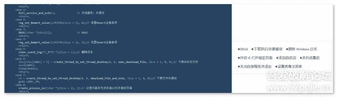

Image-5.png (45.81 KB, 下载次数: 1)

https://www.52pojie.cn/forum.php?mod=attachment&aid=MjYzNzM4OHwwN2Q3MzAzZHwxNzkzNTc2OTUxfDE2ODA4NnwxODIzNjEx&nothumb=yes

2023-8-21 09:59 上传

代码部分截图及完全功能展示

相关文章链接：

https://www.huorong.cn/info/1556281170207.html

## 第二次变种

在供应链污染问题上，“火绒威胁情报系统”同样发现了 Gh0st 变种的利用踪迹。一款名为 `HellohaoOCR_V3.1` 的图像识别程序经分析携带着后门病毒 `Scvhost.exe`（Gh0st 的变种），该程序作者由于利用了第三方的易语言导致编译环境被感染，从而导致病毒被不断扩散。

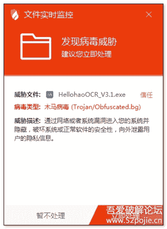

Image-6.png (107.21 KB, 下载次数: 0)

https://www.52pojie.cn/forum.php?mod=attachment&aid=MjYzNzM4OXxiY2FlNjI3OHwxNzkzNTc2OTUxfDE2ODA4NnwxODIzNjEx&nothumb=yes

2023-8-21 09:59 上传

火绒查杀图

`Scvhost.exe` 作为 Gh0st 的一个变种，除了通过传统的 C&C 服务器接收上线消息通知外，还添加了可以通过 QQ 上线的方式。其原理是通过 QQ 一个公开接口来获取加密之后的其他 C&C 服务器地址和端口，以此变换服务器地址并绕过杀软 IP 封禁。

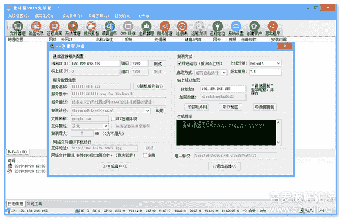

Image-7.png (136.66 KB, 下载次数: 0)

https://www.52pojie.cn/forum.php?mod=attachment&aid=MjYzNzM5MHw0OGZjMDk5ZHwxNzkzNTc2OTUxfDE2ODA4NnwxODIzNjEx&nothumb=yes

2023-8-21 09:59 上传

远控配置界面

该变种在执行层面上，继承了前面已提到过的杀软对抗，shellcode 代码执行等特点。但在通信操作上，除了前面提到的 QQ 上线外，该变种会通过第三方网站 `ip.cn` 来获取真实的 C&C 服务器地址，确保获取到的 C&C 服务器地址不会受到当前网络环境影响（比如 DNS 劫持）。

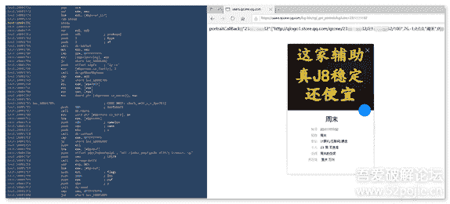

Image-8.png (92.7 KB, 下载次数: 0)

https://www.52pojie.cn/forum.php?mod=attachment&aid=MjYzNzM5MXxlNDc2ZjQwYXwxNzkzNTc2OTUxfDE2ODA4NnwxODIzNjEx&nothumb=yes

2023-8-21 10:00 上传

相关代码及功能展示

相关文章链接：

https://www.huorong.cn/info/1572352454382.html

## 第三次变种

黑灰产软件往往是病毒聚集的重灾区，Gh0st 变种也将目光瞄准了此处。火绒安全工程师根据用户反馈和“火绒威胁情报系统”监测，发现 Gh0st 的变种通过 “穿越火线” 等多款游戏外挂传播，并通过 QQ 群、网盘等渠道持续扩散。

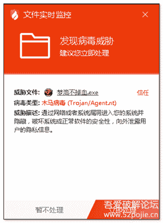

Image-9.png (65.58 KB, 下载次数: 0)

https://www.52pojie.cn/forum.php?mod=attachment&aid=MjYzNzM5MnxiMGZlMjRlNXwxNzkzNTc2OTUxfDE2ODA4NnwxODIzNjEx&nothumb=yes

2023-8-21 10:00 上传

火绒查杀图

在本次事件中 Gh0st 变种的执行依托于父文件 “白加黑” 的攻击组合，经过多层 PE 流调用和内层解密逻辑，最终通过动态库的导出函数调用内存中注入的 Gh0st 变种：

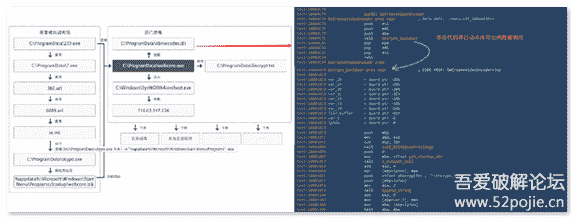

Image-10.png (95.84 KB, 下载次数: 0)

https://www.52pojie.cn/forum.php?mod=attachment&aid=MjYzNzM5M3xkMTZiOWRlNHwxNzkzNTc2OTUxfDE2ODA4NnwxODIzNjEx&nothumb=yes

2023-8-21 10:00 上传

相关代码及功能展示

与上面例子中提到的后续操作中不同的是，该变种直接下发勒索病毒进行全盘文件加密，还会在遍历检测杀毒软件的过程中，通过控制端消息弹窗功能对中毒用户进行恐吓“别杀毒了，木有用”：

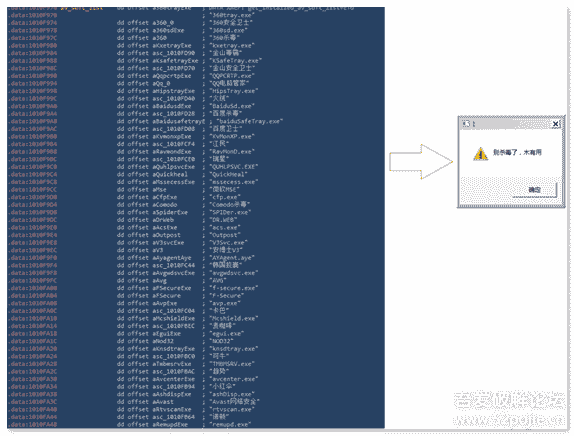

Image-11.png (187.77 KB, 下载次数: 0)

https://www.52pojie.cn/forum.php?mod=attachment&aid=MjYzNzM5NHwyYzE0NGU1ZHwxNzkzNTc2OTUxfDE2ODA4NnwxODIzNjEx&nothumb=yes

2023-8-21 10:00 上传

相关代码及功能展示

相关文章链接：

https://www.huorong.cn/info/1587129271457.html

## 第四次变种

Gh0st 变种不断在免杀对抗方面加强。火绒安全工程师在用户感染的电脑中发现了蠕虫病毒，根据相关威胁信息展开溯源分析，最终发现是以 Gh0st 变种后门为 "主"，蠕虫为 "辅" 的恶意控制行为。

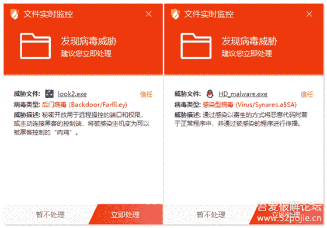

Image-12.png (130.99 KB, 下载次数: 0)

https://www.52pojie.cn/forum.php?mod=attachment&aid=MjYzNzM5NXwzZTY5ZTc4NnwxNzkzNTc2OTUxfDE2ODA4NnwxODIzNjEx&nothumb=yes

2023-8-21 10:00 上传

火绒查杀图

该 Gh0st 的变种在注册修改，杀软遍历以及自定义的后门控制功能上，与第一个例子（https://www.huorong.cn/info/1556281170207.html）文章中分析的变种相差无几，根据连接的域名的同源性以及 DDOS 模块的移除（DDOS 网站已过期），可以判断是同一样本的不断改进。

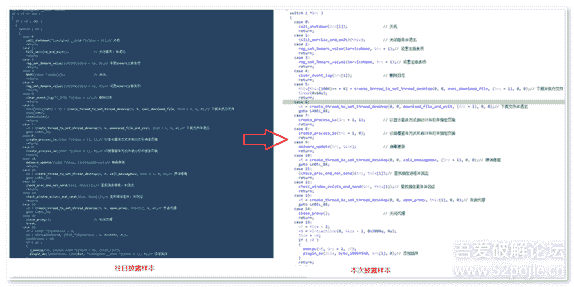

Image-13.png (91.01 KB, 下载次数: 0)

<https://www.52pojie.cn/forum.php?mod=attachment&aid=MjYzNzM5Nnw4NTUzNjkxN3wxNzkzNTc2OTUxfDE2ODA4NnwxODIzNjEx&nothumb=yes>

2023-8-21 10:00 上传

相关代码及功能展示

值得注意的是其最终落地的方式，作为嵌入最深，解密最多，最后释放的“本体”，其所依附的父文件经过多层嵌套。使用了包括多层 PE 流调用、VMProtect 和 Safengine Shielden 加壳保护、DLL 内存加载、异常反调试、流程混淆在内的多种免杀技术。被捆绑的其它家族的感染型病毒用于掩护后门执行并加大破坏性，影响恶劣。

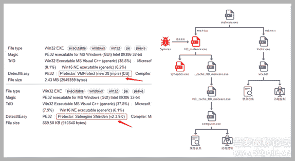

`Image-14.png` (87.56 KB, 下载次数: 0)

<https://www.52pojie.cn/forum.php?mod=attachment&aid=MjYzNzM5N3w3YzAxN2E5YXwxNzkzNTc2OTUxfDE2ODA4NnwxODIzNjEx&nothumb=yes>

2023-8-21 10:01 上传

相关代码及功能展示

相关文章链接：

<https://www.huorong.cn/info/16909627631044.html>

## 第五次变种

近期火绒安全工程师在追踪 "Xidu" 组织的过程中，捕获到的多个“Xidu”变种样本， "Xidu" 团伙所使用的后门病毒实质为 Gh0st 的新型变种。

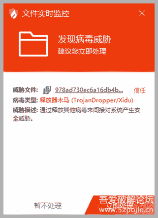

`Image-15.png` (61.51 KB, 下载次数: 0)

<https://www.52pojie.cn/forum.php?mod=attachment&aid=MjYzNzM5OHxmYzFiYTVkNnwxNzkzNTc2OTUxfDE2ODA4NnwxODIzNjEx&nothumb=yes>

2023-8-21 10:01 上传

火绒查杀图

其在逻辑上改动很大，对代理和激活命令的设置，以及上线间隔，数据包标志等大量代码都进行删改，但主体框架依旧可辨。

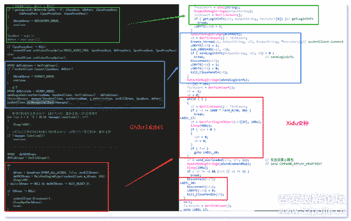

`Image-16.png` (128.68 KB, 下载次数: 0)

<https://www.52pojie.cn/forum.php?mod=attachment&aid=MjYzNzM5OXxjMTQzZGExN3wxNzkzNTc2OTUxfDE2ODA4NnwxODIzNjEx&nothumb=yes>

2023-8-21 10:01 上传

主逻辑对比图

对于一些边缘的功能函数，则没有发现太大的改动，由此更加确信其基于 Gh0st 开发的判断。

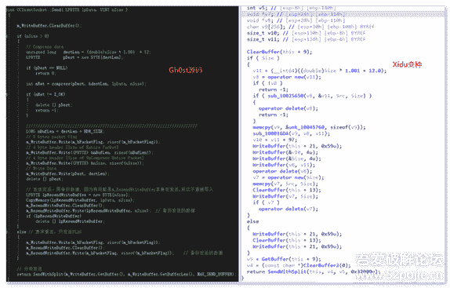

`Image-17.png` (146.19 KB, 下载次数: 1)

<https://www.52pojie.cn/forum.php?mod=attachment&aid=MjYzNzQwMHwyNjgzMTQyMnwxNzkzNTc2OTUxfDE2ODA4NnwxODIzNjEx&nothumb=yes>

2023-8-21 10:01 上传

逻辑对比

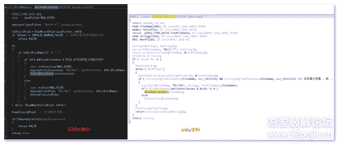

`Image-18.png` (78.36 KB, 下载次数: 0)

<https://www.52pojie.cn/forum.php?mod=attachment&aid=MjYzNzQwMXw5N2FkNzkwMnwxNzkzNTc2OTUxfDE2ODA4NnwxODIzNjEx&nothumb=yes>

2023-8-21 10:01 上传

逻辑对比

在对该变种的追踪过程中，其使用的免杀技术经过多次迭代：多层“白加黑”——>多层 PE 调用流——>加壳混淆——>DDR 绕过等，改进十分频繁。

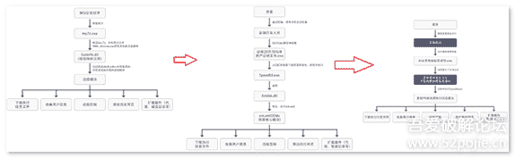

`Image-19.png` (41.75 KB, 下载次数: 0)

<https://www.52pojie.cn/forum.php?mod=attachment&aid=MjYzNzQwMnw0NWI5MDVkM3wxNzkzNTc2OTUxfDE2ODA4NnwxODIzNjEx&nothumb=yes>

2023-8-21 10:01 上传

流程迭代图

除了上述中提到过的手法外，该变种利用压缩包嵌套释放出大量落地文件，对于 C2 等配置也会存放到单独文件中，期望减少自身威胁特征值并干扰分析流程。除此之外，其还通过快捷方式来将自身添加到注册表进行持久化，一改原始服务写入的方式。关于分析细节，请转到对应文章链接中查看。

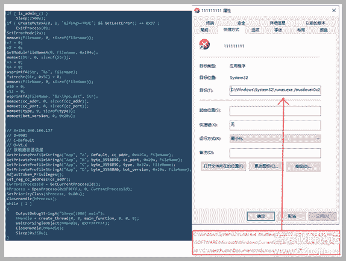

`Image-20.png` (167.65 KB, 下载次数: 0)

<https://www.52pojie.cn/forum.php?mod=attachment&aid=MjYzNzQwM3xmYzIwMDNmOHwxNzkzNTc2OTUxfDE2ODA4NnwxODIzNjEx&nothumb=yes>

2023-8-21 10:02 上传

相关代码及功能展示

相关文章链接：

<https://www.huorong.cn/info/1679311134999.html>

<https://www.huorong.cn/info/16796595861002.html>

<https://www.huorong.cn/info/16889834651032.html>

<https://www.huorong.cn/info/16889834651032.html>

对于以上变种，火绒安全工程师在深入了解其攻击原理和手法特征后，将防御策略应用到产品中，可进行拦截、查杀。该病毒团伙预计后续还会持续更新其变种，火绒安全实验室会持续跟进，保障用户的终端安全。
