# [移动样本分析] 记一次逆向分析某诈骗APP的网络行为和加解密

- 原帖: https://www.52pojie.cn/forum.php?mod=viewthread&tid=1916453
- 抓取时间: 2026-11-01T23:48:15

今天是第一次在吾爱分享技术贴，最开始是在b站看到了正己大佬发布的教学视频，后来进论坛也是抱着学习态度来的。现在对安卓逆向有了进一步理解。刚好今天拿到一个诈骗APP，进行了网络分析。我把这次分析记录下来。第一次写帖子案例比较简单，大佬勿喷。写的比较细，也有很啰嗦的地方，主要还是想把自己思路写出来。也欢迎大佬给提意见。环境：夜神模拟器`android9`+`charles`。已通过`ADB`导入证书到根目录。

## 0x01

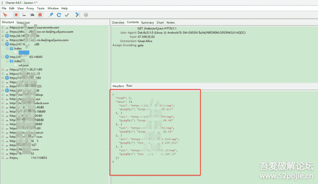

先用`charles`抓一下包看到有请求地址池的行为。初步判断APP是把自己的服务分发到大量的地址池里，之后通过请求一些节点，来获取地址池。这种方式从安全考虑可以抗DDOS攻击，从恶意软件角度来看就是为了躲避拦截。那么如果想要拦截这个恶意软件需要从他们的节点进行拦截。

## 0x02

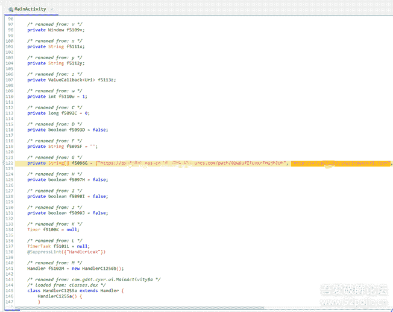

`JADX`反编译APP，搜索抓包中发现的节点地址，运气还不错，源代码里没有混淆，之前遇到的APP源代码里都把一些URL加密混淆，导致难以定位，目前来看这APP是个软柿子，可以捏。

## 0x03

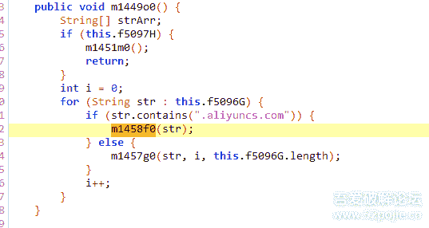

来到调用URL的方法，这里看到他做了判断，根据不同情况，分别调用`m1458f0`和`m1457g0`方法。就是把`aliyuncs.com`的域名和非`aliyuncs.com`分别处理，这里说明一下`aliyuncs.com`的域名的完整URL是用的阿里云OSS存储服务，把地址池存储到阿里云服务器，之后去阿里云获取地址池来加载到应用里进行一些接口的连接。当时看到这里时还不知道`aliyuncs.com`的作用是什么因为响应报文被加密了，直到后面经过解密后才知道。继续往下走。

## 0x04

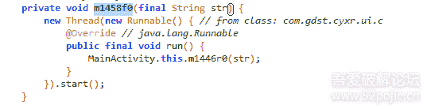

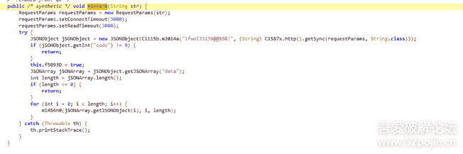

`m1458f0`调用了`m1446r0`方法传入了`aliyuncs.com`的url。`m1446r0`方法里看到，对`aliyuncs.com`的域名发起了请求并且把密钥和响应内容传到`m2014a`方法里。

## 0x05

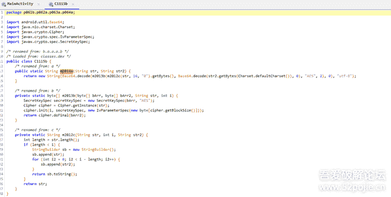

来到`m2014a`是一段解密方法。在解密的时候遇到一点小问题，主要是`IvParameterSpec`初始化操作有点蒙，没搞懂他是用的`ECB`模式还是`CBC`模式，后来问了一下某位大佬，大佬告诉我是`ECB`模式没有IV值，直接按顺序解密就行。

## 0x06

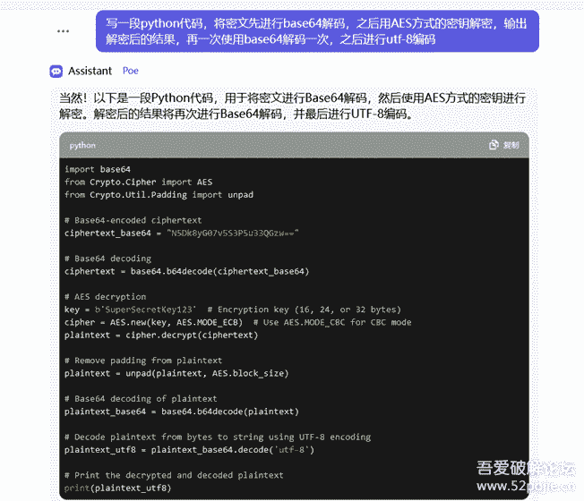

这里用`chatGPT`写了一个脚本（非常好用），也是因为没有找到可以做预处理base64解密的工具。之后在`charles`抓包里找到请求`aliyuncs.com`的响应包，把密钥和密文复制粘贴进脚本里解密。

## 0x07

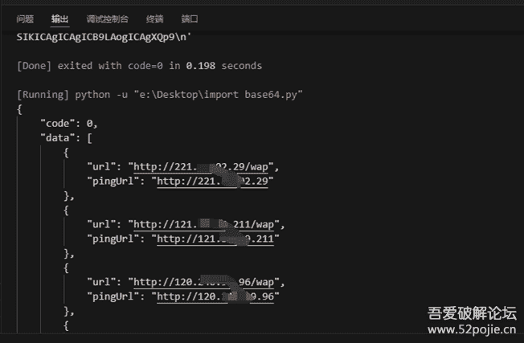

解密出来也是一堆url。这里可以确定了`aliyuncs.com`域名也是用来获取地址池的。

## 0x08

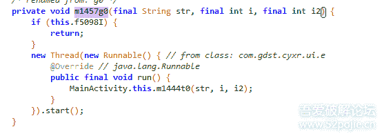

非`aliyuncs.com`域名传到`m1457g0`里，调用了`m1444t0`方法传入了url。

## 0x09

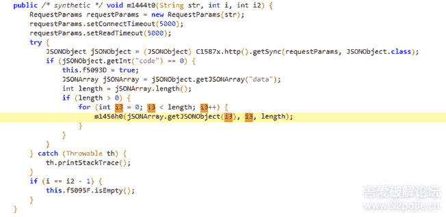

这里没有加解密过程，所以在最开始抓包里可以直接看到明文。

## 0x0a

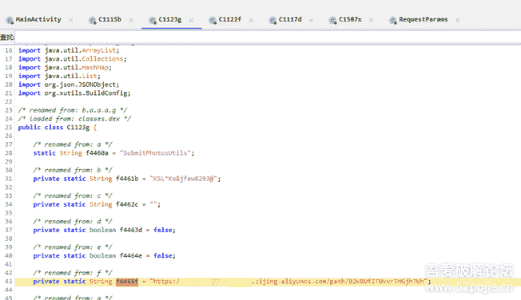

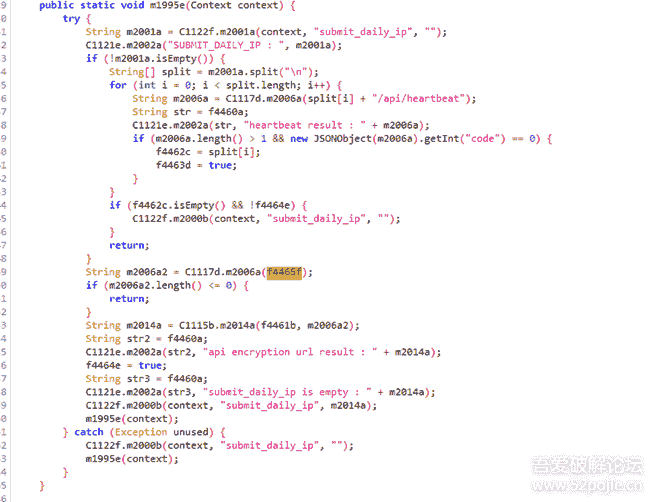

在`charles`里还发现了另外一个URL，他在`c1123`类里，这个URL的使用方法和上面提到的一样，也是获取地址池作用。后来经过分析发现这个地址池是给一个图片上传接口提供的，好了本次分析结束。
