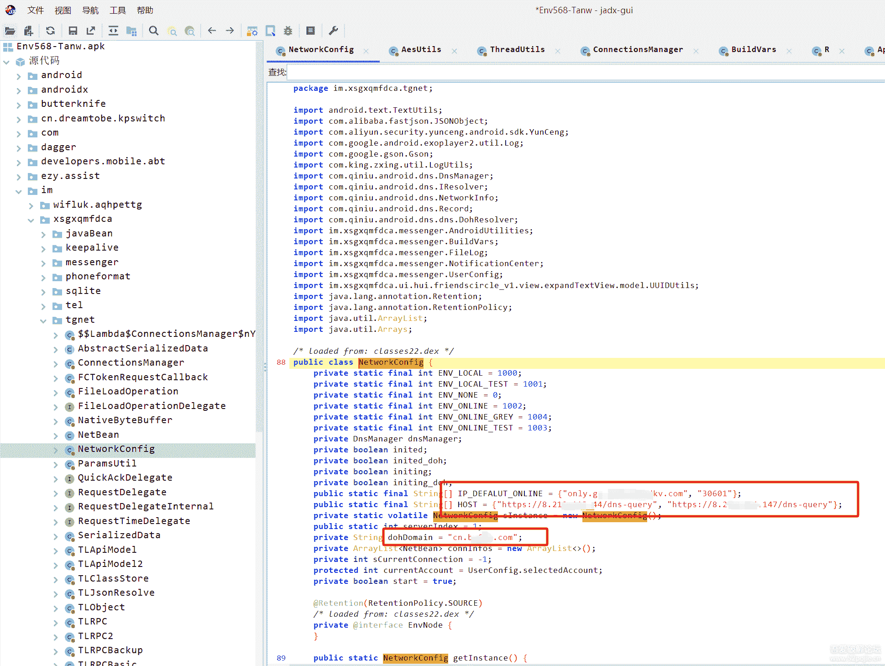
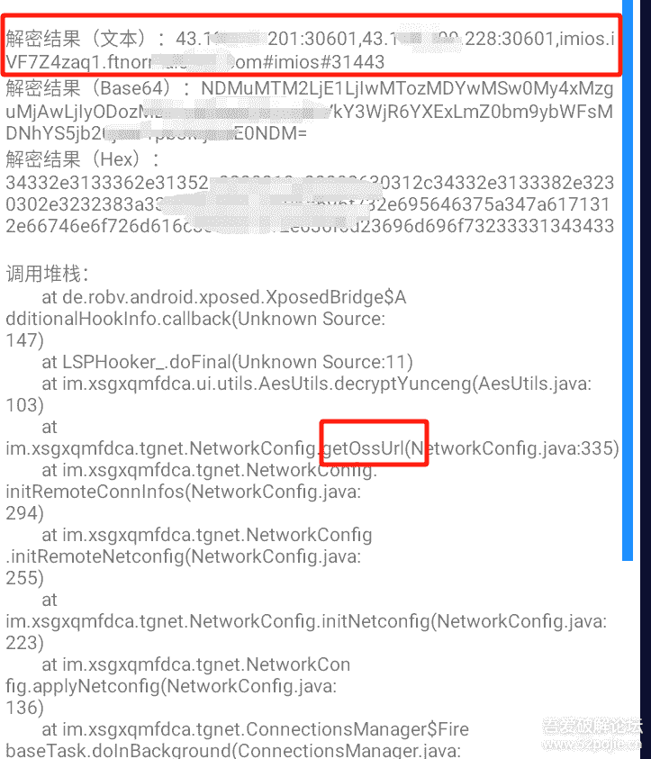
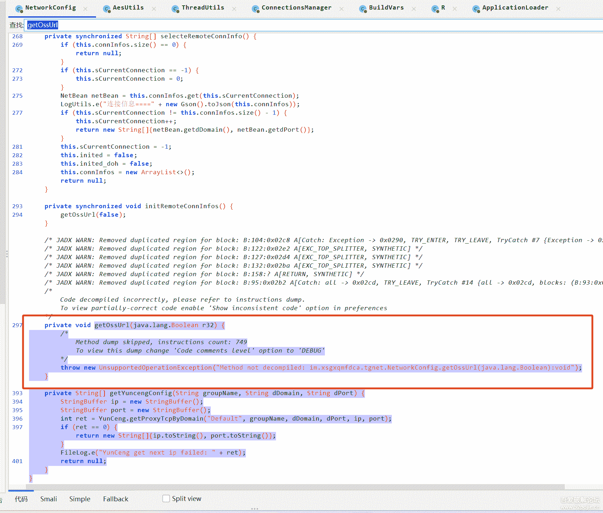
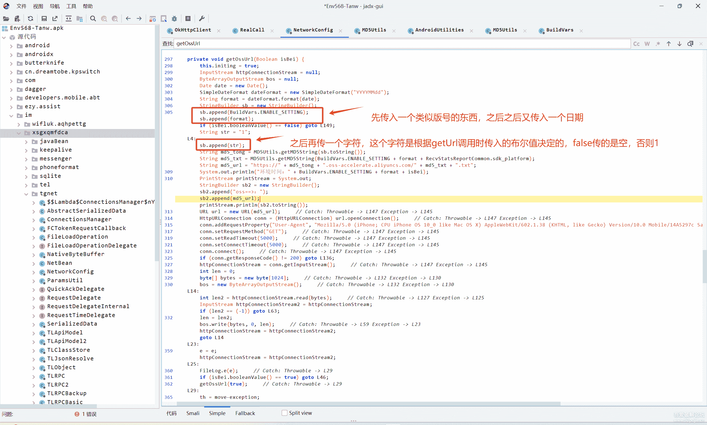
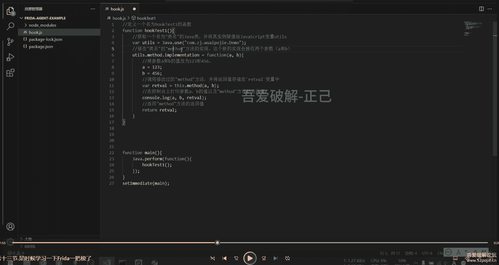
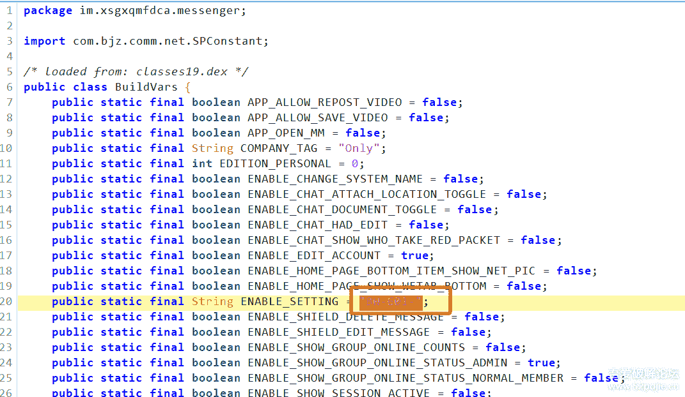
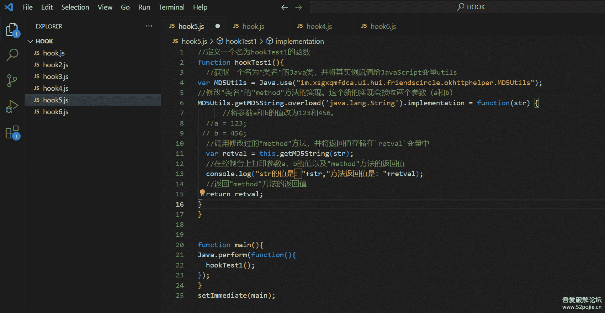
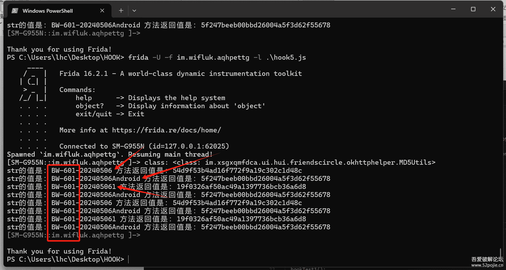

# [移动样本分析] frida HOOK实战，对移动欺诈家族逆向分析

- 原帖: https://www.52pojie.cn/forum.php?mod=viewthread&tid=1921378
- 抓取时间: 2026-11-01T23:48:12

前沿：今天拿到一个恶意软件样本，属于`BOOMSLANG`（树蚺）移动欺诈家族。引用文章：https://www.4hou.com/posts/m04A，文章里提到了这类家族使用了`TG`（电报）安卓端源代码，并且为了防止拦截在网络配置里引入 `DoH` 技术，随着时间线慢慢进化现在到我手里的已经没那么简单了。咱们今天登场的主角，我给他定为`DOH`变种+（`OSS`混淆+`server`）变种升级版。这类软件主要技术就是运用在反拦截上，所以在这里咱们只分析网络行为。还是老样子过程写的比较啰嗦，主要是分享思路和研究成果，讨论技术问题。此文章无向导，无结论。样本不传，只展示目录结构。环境及工具：夜神模拟器Android9、`frida`16.2.1、面具、LSP、算法助手、`JADX`、`charles`、`Proxifier`。


1.png (2 MB, 下载次数: 0)
[href="forum.php?mod=attachment&aid=MjY5NDM4OXxjMDZmZmNjZnwxNzkzNTc2ODg5fDE2ODA4NnwxOTIxMzc4&nothumb=yes" target="_blank"](https://www.52pojie.cn/forum.php?mod=attachment&aid=MjY5NDM4OXxjMDZmZmNjZnwxNzkzNTc2ODg5fDE2ODA4NnwxOTIxMzc4&nothumb=yes)
2024-5-7 16:42 上传
APP界面

2.png (256.02 KB, 下载次数: 0)
[href="forum.php?mod=attachment&aid=MjY5NDM5MHwxNGE3NGU1OXwxNzkzNTc2ODg5fDE2ODA4NnwxOTIxMzc4&nothumb=yes" target="_blank"](https://www.52pojie.cn/forum.php?mod=attachment&aid=MjY5NDM5MHwxNGE3NGU1OXwxNzkzNTc2ODg5fDE2ODA4NnwxOTIxMzc4&nothumb=yes)
2024-5-7 16:42 上传

看一眼目录结构。`im.xsgxqmfdca.tgnet`目录里有个`NetworkConfig`类。用来初始化网络配置，这里可以看到默认连接地址和`DOH`服务地址以及`DOH`用来解析的域名。阿里云`DOH`说明书：https://www.alibabacloud.com/help/zh/dns/dns-over-https

3.png (151.09 KB, 下载次数: 0)
[href="forum.php?mod=attachment&aid=MjY5NDM5MXw3YmE2MzNjMHwxNzkzNTc2ODg5fDE2ODA4NnwxOTIxMzc4&nothumb=yes" target="_blank"](https://www.52pojie.cn/forum.php?mod=attachment&aid=MjY5NDM5MXw3YmE2MzNjMHwxNzkzNTc2ODg5fDE2ODA4NnwxOTIxMzc4&nothumb=yes)
2024-5-7 16:42 上传

算法助手`HOOK`一下，发现解密出一堆`URL`这里就是`OSS`服务里存的`server`配置文件，看到调用堆栈是`get0ssUrl`。

4.png (177.72 KB, 下载次数: 0)
[href="forum.php?mod=attachment&aid=MjY5NDM5Mnw3MTQyOWIzNnwxNzkzNTc2ODg5fDE2ODA4NnwxOTIxMzc4&nothumb=yes" target="_blank"](https://www.52pojie.cn/forum.php?mod=attachment&aid=MjY5NDM5Mnw3MTQyOWIzNnwxNzkzNTc2ODg5fDE2ODA4NnwxOTIxMzc4&nothumb=yes)
2024-5-7 16:43 上传

定位一下方法`get0ssUrl`，发现反编译失败了。不过没关系看看其他版本反编译，`Smali`有点难就不看了，这里点击`Simple`。由于我没做过开发所以不太懂这里的原因，为什么反编译`JAVA`失败了，`Simple`里就没问题，有懂得大佬给解释一下。

5.png (352.53 KB, 下载次数: 0)
[href="forum.php?mod=attachment&aid=MjY5NDM5M3w4OTljZDdlOHwxNzkzNTc2ODg5fDE2ODA4NnwxOTIxMzc4&nothumb=yes" target="_blank"](https://www.52pojie.cn/forum.php?mod=attachment&aid=MjY5NDM5M3w4OTljZDdlOHwxNzkzNTc2ODg5fDE2ODA4NnwxOTIxMzc4&nothumb=yes)
2024-5-7 16:43 上传

回到正文看`get0Url`方法，这段代码通过构建`URL`、发起`HTTP`请求、读取和解析响应数据，来创建一个`OSS`存储服务请求解析过程。阿里云`oss`域名是经过混淆的，刚好最近在学`frida`一把梭哈今天就实战一把。

6.png (409.93 KB, 下载次数: 0)
[href="forum.php?mod=attachment&aid=MjY5NDM5NHwyNWNkMmE3YnwxNzkzNTc2ODg5fDE2ODA4NnwxOTIxMzc4&nothumb=yes" target="_blank"](https://www.52pojie.cn/forum.php?mod=attachment&aid=MjY5NDM5NHwyNWNkMmE3YnwxNzkzNTc2ODg5fDE2ODA4NnwxOTIxMzc4&nothumb=yes)
2024-5-7 16:43 上传

打开安卓逆向第十三节教学视频，定位到21分55秒这里拷贝代码。

7.png (90.38 KB, 下载次数: 1)
[href="forum.php?mod=attachment&aid=MjY5NDM5NXw1NzdhOGNlNXwxNzkzNTc2ODg5fDE2ODA4NnwxOTIxMzc4&nothumb=yes" target="_blank"](https://www.52pojie.cn/forum.php?mod=attachment&aid=MjY5NDM5NXw1NzdhOGNlNXwxNzkzNTc2ODg5fDE2ODA4NnwxOTIxMzc4&nothumb=yes)
2024-5-7 16:43 上传

插一条信息，版号固定写在这里。
```
package im.xsgxqmfdca.ui.hui.friendscircle.okhttphelper;

import java.io.File;

import java.io.FileInputStream;

import java.io.IOException;

import java.io.InputStream;

import java.io.PrintStream;

import java.nio.MappedByteBuffer;

import java.nio.channels.FileChannel;

import java.security.MessageDigest;

import java.security.NoSuchAlgorithmException;

/* loaded from: classes43.dex */

public class MD5Utils {

protected static char[ hexDigits = {'0', '1', '2', '3', '4', '5', '6', '7', '8', '9', 'a', 'b', 'c', 'd', 'e', 'f'};

protected static MessageDigest messagedigest;

static {

messagedigest = null;

try {

messagedigest = MessageDigest.getInstance("MD5");

} catch (NoSuchAlgorithmException nsaex) {

System.err.println(MD5Utils.class.getName() + "初始化失败，MessageDigest不支持MD5Util。");

nsaex.printStackTrace();

}

}

public static String getMD5String(String s) {

return getMD5String(s.getBytes());

}

public static boolean checkPassword(String password, String md5PwdStr) {

String s = getMD5String(password);

return s.equals(md5PwdStr);

}

public static String getFileMD5String(File file) throws IOException {

InputStream fis = new FileInputStream(file);

byte[ buffer = new byte[1024;

while (true) {

int numRead = fis.read(buffer);

if (numRead > 0) {

messagedigest.update(buffer, 0, numRead);

} else {

fis.close();

return bufferToHex(messagedigest.digest());

}

}

}

public static String getFileMD5String_old(File file) throws IOException {

FileInputStream in = new FileInputStream(file);

FileChannel ch = in.getChannel();

MappedByteBuffer byteBuffer = ch.map(FileChannel.MapMode.READ_ONLY, 0L, file.length());

messagedigest.update(byteBuffer);

in.close();

return bufferToHex(messagedigest.digest());

}

public static String getMD5String(byte[ bytes) {

messagedigest.update(bytes);

return bufferToHex(messagedigest.digest());

}

private static String bufferToHex(byte[ bytes) {

return bufferToHex(bytes, 0, bytes.length);

}

private static String bufferToHex(byte[ bytes, int m, int n) {

StringBuffer stringbuffer = new StringBuffer(n * 2);

int k = m + n;

for (int l = m; l k; l++) {

appendHexPair(bytes[l, stringbuffer);

}

return stringbuffer.toString();

}

private static void appendHexPair(byte bt, StringBuffer stringbuffer) {

char[ cArr = hexDigits;

char c0 = cArr[(bt & 240) >> 4;

char c1 = cArr[bt & 15;

stringbuffer.append(c0);

stringbuffer.append(c1);

}

public static void main(String[ args) throws IOException {

long begin = System.currentTimeMillis();

File file = new File("C:/test.txt");

if (!file.exists()) {

System.out.println("不存在");

}

String md5 = getFileMD5String(file);

long end = System.currentTimeMillis();

PrintStream printStream = System.out;

printStream.println("md5:" + md5 + " time:" + ((end - begin) / 1000) + "s");

System.out.println(file.getPath());

}

}
```

8.png (169.36 KB, 下载次数: 1)
[href="forum.php?mod=attachment&aid=MjY5NDM5NnwzOTU3MzA3ZHwxNzkzNTc2ODg5fDE2ODA4NnwxOTIxMzc4&nothumb=yes" target="_blank"](https://www.52pojie.cn/forum.php?mod=attachment&aid=MjY5NDM5NnwzOTU3MzA3ZHwxNzkzNTc2ODg5fDE2ODA4NnwxOTIxMzc4&nothumb=yes)
2024-5-7 16:43 上传

填好信息，注意这里有个重载，要标注我们这个方法传入的值是`String`类型。

9.png (186.03 KB, 下载次数: 1)
[href="forum.php?mod=attachment&aid=MjY5NDM5N3xlM2M4YWFjN3wxNzkzNTc2ODg5fDE2ODA4NnwxOTIxMzc4&nothumb=yes" target="_blank"](https://www.52pojie.cn/forum.php?mod=attachment&aid=MjY5NDM5N3xlM2M4YWFjN3wxNzkzNTc2ODg5fDE2ODA4NnwxOTIxMzc4&nothumb=yes)
2024-5-7 16:43 上传

输出结果看到传入的`str`值结构，版号+日期+字符1或空或`Android`。后面返回的`MD5`值是三级域名。需要注意的是子域名是由时间戳因素哈希来的所以每天请求的`OSS`域名是一直在变化的。最后通过每天及时在`OSS`更新资源的方法来维持连接。题外话：如果放到`C2`木马身上是不是对情报工作也有很大挑战。
