# [PC样本分析] 白加黑dll劫持恶意样本分析（含样本详细逻辑）

- 原帖: https://www.52pojie.cn/forum.php?mod=viewthread&tid=1922818
- 抓取时间: 2026-11-01T23:48:07

## 前言

文中图片挂了，为了更好的体验可以查看我的语雀博客：白加黑dll劫持恶意样本分析（[//www.yuque.com/berryalen02/blog/pt7mxqeoz075yloh" target="_blank" rel="noopener noreferrer nofollow"](https://www.yuque.com/berryalen02/blog/pt7mxqeoz075yloh:rel="nofollow noopener" href="https)）

一杯茶，一根烟，一个样本调一天。

这是我在学习网安路上的一条记录。

虽然样本是相对比较古老的，网上也有很多人分析过，但是他们的资料都比较宽泛，过程很跳。对我来说，我希望对这个样本行为有更深更细的掌握，因此在函数行为逻辑方面我做了更深更彻底的探讨，比如键盘记录器以及中途如何去寻找上游控制函数，几个dat文件解密出来的pe、导出函数`wow_helper`、`UserService`等更多的细节。希望能够对其他人有所帮助。

这个样本花了我好几天，是我正儿八经自己分析的第一个样本，成就感挺足的，中途还有相当多的不足以及错误，比如远控函数`sub_10002020`的具体的功能函数，白加黑的恶意DLL `Teniodl_Core.dll`中装载病毒的函数`sub_10001000`和`sub_100014DE`，以及其他我没有关注到的细节，希望大佬们多多指导。

## 样本分析

白加黑：用自己编写的恶意dll替代合法程序所需DLL，实现恶意代码注入

Windows XP SP2系统以上DLL文件加载的搜索顺序如下：

- 可执行程序加载的目录（可理解为程序安装目录比如`C:\Program Files\Internet Explorer`）
- 系统目录（即 `%windir%\system32`）
- 16位系统目录（即 `%windir%\system`）
- Windows目录（即 `%windir%`）
- 运行某文件的所在目录（比如`C:\Documents and Settings\Administrator\Desktop\test`）
- `PATH`环境变量中列出的目录

根据前面介绍的DLL加载顺序，运行程序的时候会优先到程序执行的目录下加载必须文件，这么一来，病毒作者可以伪造一个dll，包含所有被劫持dll的导出函数，放到可执行程序目录下，当exe运行时，病毒dll就理所当然被优先调用了。

### 前期文件整理分析

两个隐藏文件，一个截图.`bmp`

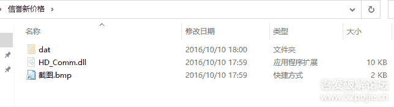

`1.png` (18.66 KB, 下载次数: 0)

[href="forum.php?mod=attachment&aid=MjY5NzE0MHw5ODY0N2U3Y3wxNzkzNTc2ODg1fDE2ODA4NnwxOTIyODE4&nothumb=yes" target="_blank"](https://www.52pojie.cn/forum.php?mod=attachment&aid=MjY5NzE0MHw5ODY0N2U3Y3wxNzkzNTc2ODg1fDE2ODA4NnwxOTIyODE4&nothumb=yes)

2024-5-21 18:18 上传

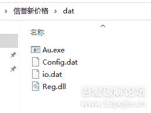

`2.png` (10.62 KB, 下载次数: 1)

[href="forum.php?mod=attachment&aid=MjY5NzE0MXxhMjczNzgxM3wxNzkzNTc2ODg1fDE2ODA4NnwxOTIyODE4&nothumb=yes" target="_blank"](https://www.52pojie.cn/forum.php?mod=attachment&aid=MjY5NzE0MXxhMjczNzgxM3wxNzkzNTc2ODg1fDE2ODA4NnwxOTIyODE4&nothumb=yes)

2024-5-21 18:18 上传

bmp是图像，这里系统解析是快捷方式，这里先不双击，`winhex`查看bmp

发现他会调用系统的`rundll32.exe`，调用样本的`dat/reg.dll`

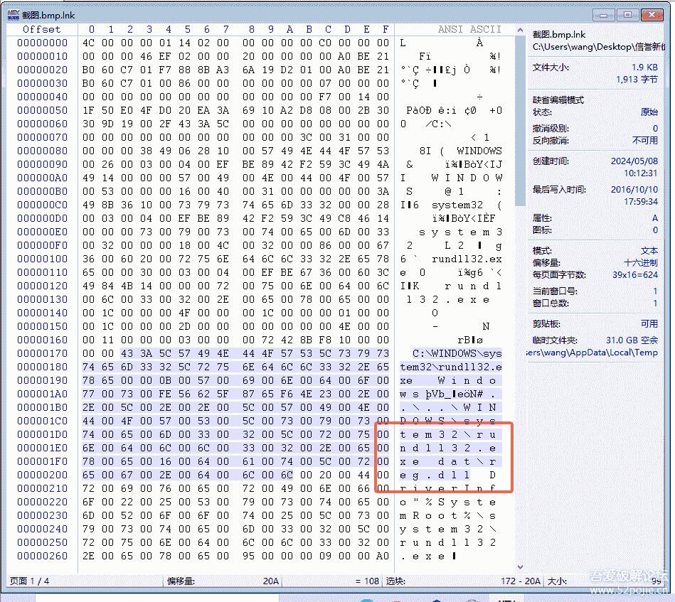

`3.png` (80.1 KB, 下载次数: 2)

[href="forum.php?mod=attachment&aid=MjY5NzE0MnwyODY5MGM5NnwxNzkzNTc2ODg1fDE2ODA4NnwxOTIyODE4&nothumb=yes" target="_blank"](https://www.52pojie.cn/forum.php?mod=attachment&aid=MjY5NzE0MnwyODY5MGM5NnwxNzkzNTc2ODg1fDE2ODA4NnwxOTIyODE4&nothumb=yes)

2024-5-21 18:18 上传

双击之后，会弹出一个腾讯游戏云加速下载引擎，然后跳出一个DNF价格表jpg图片

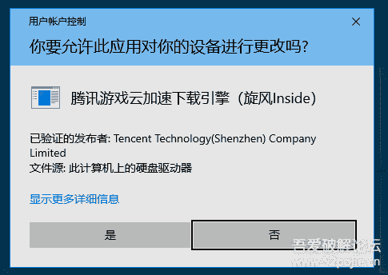

`4.png` (28.97 KB, 下载次数: 0)

[href="forum.php?mod=attachment&aid=MjY5NzE0M3w2MWFjMTQzZnwxNzkzNTc2ODg1fDE2ODA4NnwxOTIyODE4&nothumb=yes" target="_blank"](https://www.52pojie.cn/forum.php?mod=attachment&aid=MjY5NzE0M3w2MWFjMTQzZnwxNzkzNTc2ODg1fDE2ODA4NnwxOTIyODE4&nothumb=yes)

2024-5-21 18:18 上传

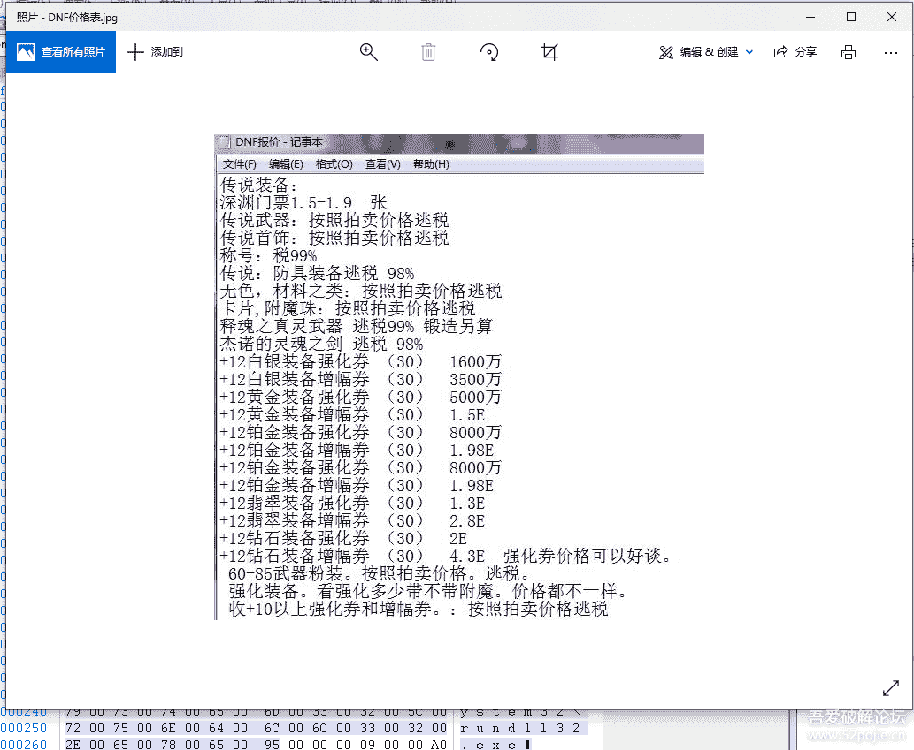

`5.png` (458.66 KB, 下载次数: 0)

[href="forum.php?mod=attachment&aid=MjY5NzE0NHwyNGE5ZjZkMHwxNzkzNTc2ODg1fDE2ODA4NnwxOTIyODE4&nothumb=yes" target="_blank"](https://www.52pojie.cn/forum.php?mod=attachment&aid=MjY5NzE0NHwyNGE5ZjZkMHwxNzkzNTc2ODg1fDE2ODA4NnwxOTIyODE4&nothumb=yes)

2024-5-21 18:18 上传

火绒剑监控`rundll32.exe`进程，过滤`rundll32.exe`进程和病毒文件夹路径

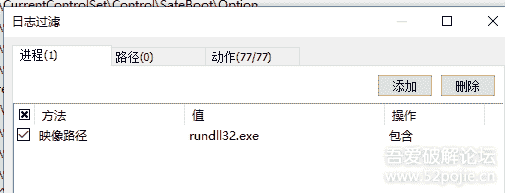

`6.png` (14.52 KB, 下载次数: 0)

[href="forum.php?mod=attachment&aid=MjY5NzE0NXxlYjQ4ZjUxNXwxNzkzNTc2ODg1fDE2ODA4NnwxOTIyODE4&nothumb=yes" target="_blank"](https://www.52pojie.cn/forum.php?mod=attachment&aid=MjY5NzE0NXxlYjQ4ZjUxNXwxNzkzNTc2ODg1fDE2ODA4NnwxOTIyODE4&nothumb=yes)

2024-5-21 18:18 上传

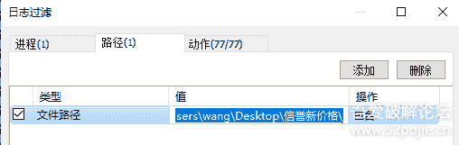

`7.png` (15.67 KB, 下载次数: 2)

[href="forum.php?mod=attachment&aid=MjY5NzE0NnxjOTk5MzAzN3wxNzkzNTc2ODg1fDE2ODA4NnwxOTIyODE4&nothumb=yes" target="_blank"](https://www.52pojie.cn/forum.php?mod=attachment&aid=MjY5NzE0NnxjOTk5MzAzN3wxNzkzNTc2ODg1fDE2ODA4NnwxOTIyODE4&nothumb=yes)

2024-5-21 18:18 上传

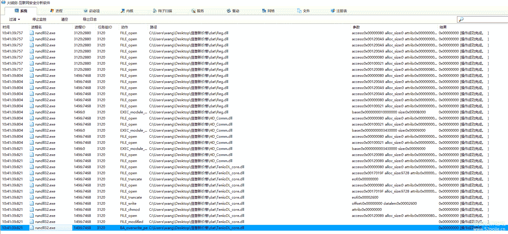

`8.png` (209.96 KB, 下载次数: 0)

[href="forum.php?mod=attachment&aid=MjY5NzE0N3w4MjI0NTcxNnwxNzkzNTc2ODg1fDE2ODA4NnwxOTIyODE4&nothumb=yes" target="_blank"](https://www.52pojie.cn/forum.php?mod=attachment&aid=MjY5NzE0N3w4MjI0NTcxNnwxNzkzNTc2ODg1fDE2ODA4NnwxOTIyODE4&nothumb=yes)

2024-5-21 18:19 上传

可以看到，调用了三种dll

- `dat/Reg.dll`
- `HD_Comm.dll`
- `dat/TenioDL_core.dll`

并且观察进程可以发现，多了`QQGame.exe`

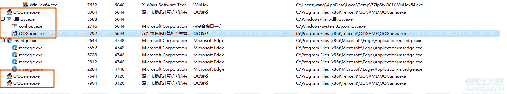

`9.png` (59.83 KB, 下载次数: 1)

[href="forum.php?mod=attachment&aid=MjY5NzE0OHw1YjQyNDc2NXwxNzkzNTc2ODg1fDE2ODA4NnwxOTIyODE4&nothumb=yes" target="_blank"](https://www.52pojie.cn/forum.php?mod=attachment&aid=MjY5NzE0OHw1YjQyNDc2NXwxNzkzNTc2ODg1fDE2ODA4NnwxOTIyODE4&nothumb=yes)

2024-5-21 18:19 上传

查看可疑进程`dllhost.exe`，可以发现dat中的`TenioDL_core.dll`

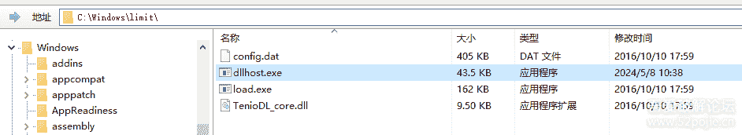

`10.png` (26.81 KB, 下载次数: 1)

[href="forum.php?mod=attachment&aid=MjY5NzE0OXw0MDA5ZjQ2ZXwxNzkzNTc2ODg1fDE2ODA4NnwxOTIyODE4&nothumb=yes" target="_blank"](https://www.52pojie.cn/forum.php?mod=attachment&aid=MjY5NzE0OXw0MDA5ZjQ2ZXwxNzkzNTc2ODg1fDE2ODA4NnwxOTIyODE4&nothumb=yes)

2024-5-21 18:19 上传

双击bmp之后还有一个可疑进程`Au.exe`，查看信息可以知道就是刚刚跳出来的下载引擎

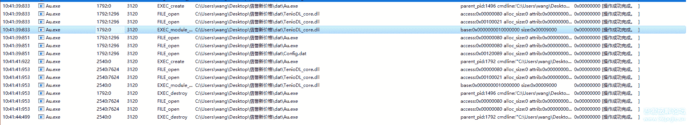

`11.png` (84.64 KB, 下载次数: 1)

[href="forum.php?mod=attachment&aid=MjY5NzE1MHxmYTRlOWE0MHwxNzkzNTc2ODg1fDE2ODA4NnwxOTIyODE4&nothumb=yes" target="_blank"](https://www.52pojie.cn/forum.php?mod=attachment&aid=MjY5NzE1MHxmYTRlOWE0MHwxNzkzNTc2ODg1fDE2ODA4NnwxOTIyODE4&nothumb=yes)

2024-5-21 18:19 上传

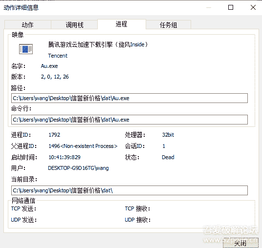

`12.png` (25.49 KB, 下载次数: 0)

[href="forum.php?mod=attachment&aid=MjY5NzE1MXw4NTllMzk5N3wxNzkzNTc2ODg1fDE2ODA4NnwxOTIyODE4&nothumb=yes" target="_blank"](https://www.52pojie.cn/forum.php?mod=attachment&aid=MjY5NzE1MXw4NTllMzk5N3wxNzkzNTc2ODg1fDE2ODA4NnwxOTIyODE4&nothumb=yes)

2024-5-21 18:20 上传

整理以上信息

文件名 |

MD5 |

是否有签名 |

`HD_Comm.dll`
