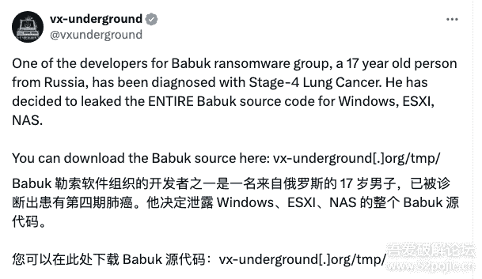
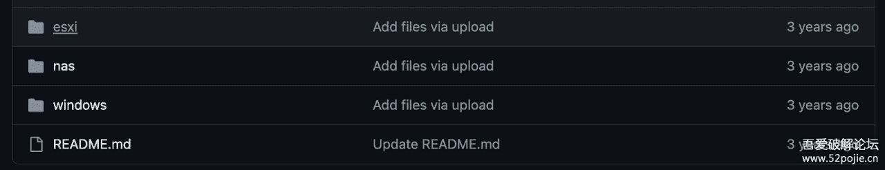
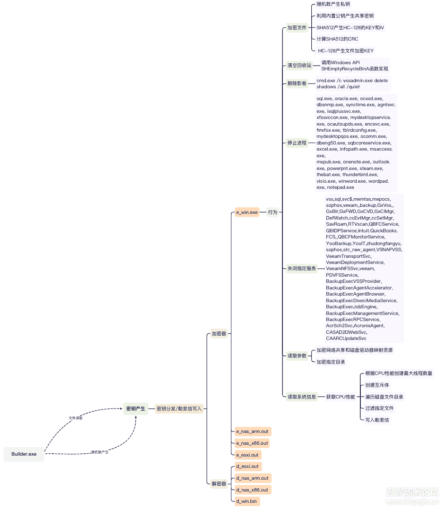
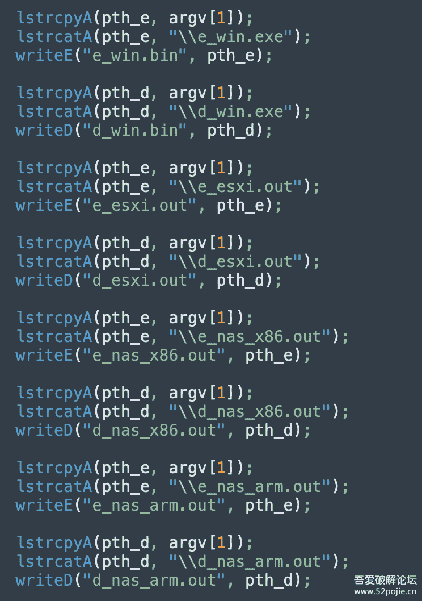

# [PC样本分析] 【病毒分析】BabyK加密器分析-Windows篇

- 原帖：`https://www.52pojie.cn/forum.php?mod=viewthread&tid=1929419`
- 抓取时间：2026-11-01T23:48:02

## 1. 背景

### 1.1 Babuk勒索家族

Babuk勒索家族最早曝光于2021年1月初，在几个月内，它就跻身于最臭名昭著的勒索软件组织之列。自回归以来，它通过在地下论坛上积极宣传自己而获得了更多的知名度。在策略方面，其加密功能与其他勒索软件组织没有太大区别。随着时间的流逝，勒索软件组织通过发布新变种并致力于改进其攻击机制，成功地制造了混乱。

该加密器使用了多种加密方式：HC-128/ChaCha8 对称加密算法、椭圆曲线 Diffie-Hellman（ECDH）、SHA256 hashing等，特征也极为特殊，会将所有被加密文件后缀修改为`.babyk`，并且在所有加密文件的加密内容末尾附加字符串`choung dong looks like hot dog!!！`，该字符串的意义是为了标注着勒索软件与 Babuk 有关。

解析Babyk行为文章链接：

```text
https://www.acronis.com/en-eu/blog/posts/babuk-ransomware/

以下是针对 Linux/UNIX 和 ESXi 或 VMware 系统的跨平台加密后提取的勒索信内容。

勒索信

What happened?

---------------------------------------------------------------

Your computers and servers have been encrypted, which is fundamentally different from normal file damages.

And you can save yourself the trouble of going to the internet to find a way to decrypt them, because unless you pay the ransom.

Even if God comes, he will not be able to help you recover them!

What guarantees?

---------------------------------------------------------------

We value our reputation. If we do not do our work and liabilities, nobody will pay us. This is not in our interests.

All our decryption software is perfectly tested and will decrypt your data. We will also provide support in case of problems.

You can contact us to test an unimportant encrypted file and we will decrypt it to prove that we have the ability to decrypt them.

How to canotact us?

---------------------------------------------------------------

Your encryption ID:7gui):

You can contact us at the email address below:

ijtg5gr@keemail.me

ag55htr@keemail.me

How to Pay?

---------------------------------------------------------------

Please pay $20000 worth of bitcoins(BTC) to the address below:

bc1qz23mpc3qdy02jzw64xw9zhe4s275un40efsd2l

We will send you the decryption program after we confirm your payment.

---------------------------------------------------------------

*****WARNING: You have up to 7 days to consider whether or not to make a payment,

              so hurry or you may lose your files and data forever,

              And, we will make all your data available to the Internet.
```

### 1.2 来源

该加密器最初的泄露是来自于一篇Twiter文章，是由其babuk的开发者泄漏的源代码。

Twiter文章：

```text
https://twitter.com/vxunderground/status/1433758742244478982?s=46&t=7D_QCICAVCcsuuaq3z_Tkw
```

[](https://www.52pojie.cn/forum.php?mod=attachment&aid=MjY5OTAyNXwzNTg5ZmQ3MXwxNzkzNTc2ODc5fDE2ODA4NnwxOTI5NDE5&nothumb=yes)

`行为展示.png`（89.84 KB，下载次数：2），上传于 2024-5-31 10:36

源码泄漏地址：

```text
https://github.com/Hildaboo/BabukRansomwareSourceCode/tree/main
```

其中存在三种针对不同系统类型（Linux系统、NAS系统、Windows系统）的病毒文件，本篇是针对Windows系统的分析。

[](https://www.52pojie.cn/forum.php?mod=attachment&aid=MjY5ODkwOXxiZDAzYWJmOXwxNzkzNTc2ODc5fDE2ODA4NnwxOTI5NDE5&nothumb=yes)

`1.2.1.png`（65.38 KB，下载次数：2），上传于 2024-5-31 10:17

## 2 总体行为

### 2.1 行为展示

[](https://www.52pojie.cn/forum.php?mod=attachment&aid=MjcwMTIzNnxmM2JjODQ2MHwxNzkzNTc2ODc5fDE2ODA4NnwxOTI5NDE5&nothumb=yes)

`2.1.png`（176.83 KB，下载次数：2），上传于 2024-6-11 14:12

### 2.2 密钥下发（Builder.exe）

这里可以通过VS生成了`Builder.exe`来实现对其Builder过程进行分析，可以看到主要是对这部分文件的处理与释放

[](https://www.52pojie.cn/forum.php?mod=attachment&aid=MjY5ODkxN3xjYTRmNDFkZXwxNzkzNTc2ODc5fDE2ODA4NnwxOTI5NDE5&nothumb=yes)

`2.2.png`（214.53 KB，下载次数：3），上传于 2024-5-31 10:17

### 2.3 文件释放

文件释放列表及作用：

| No | 替换前的二进制文件 | 替换后二进制文件 | 文件描述 |
| --- | --- | --- | --- |
| 1 |  |  |  |
