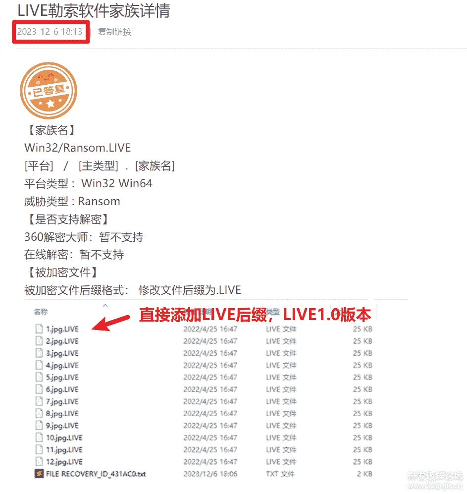
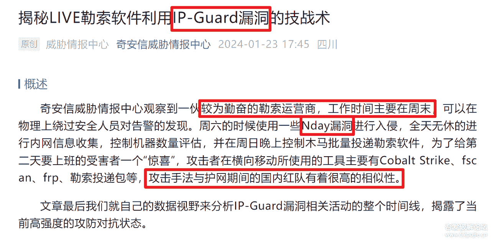
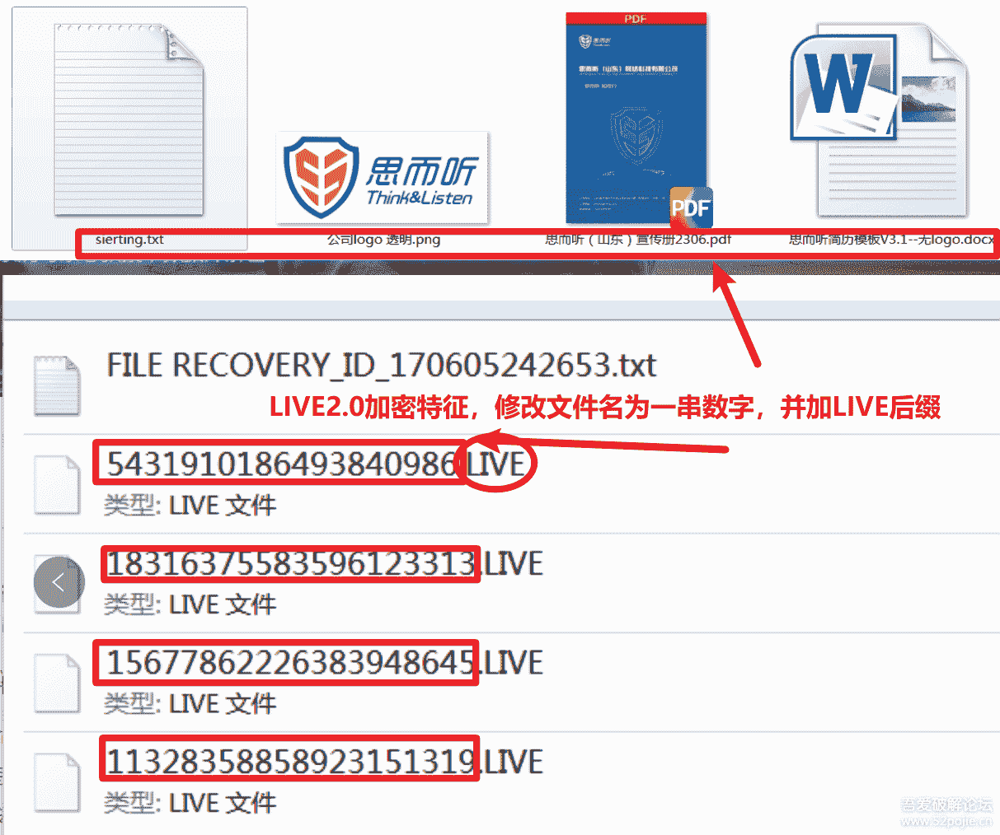
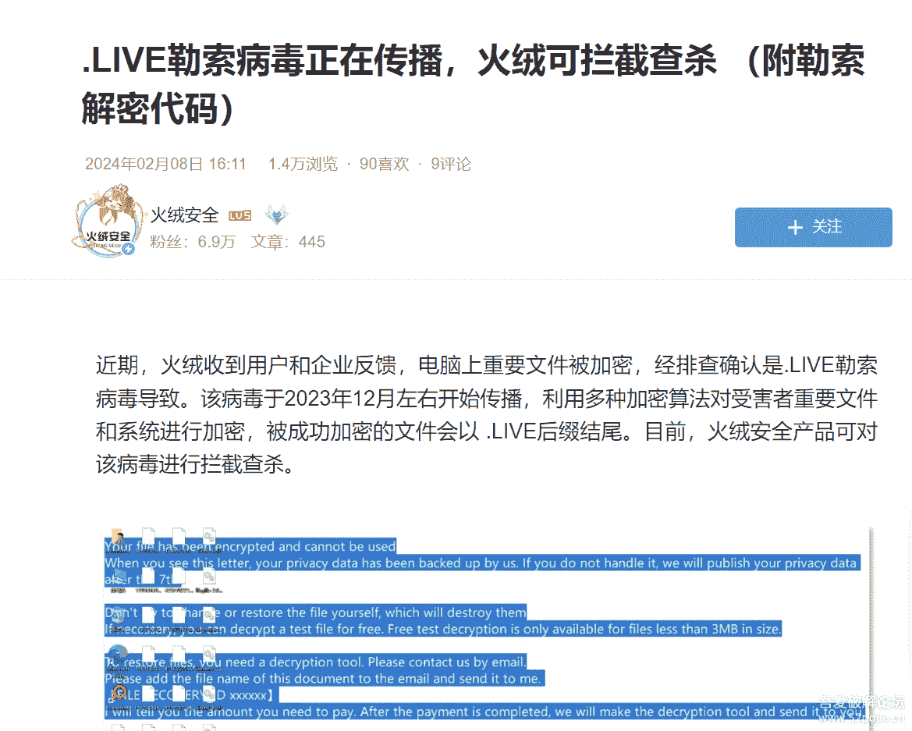
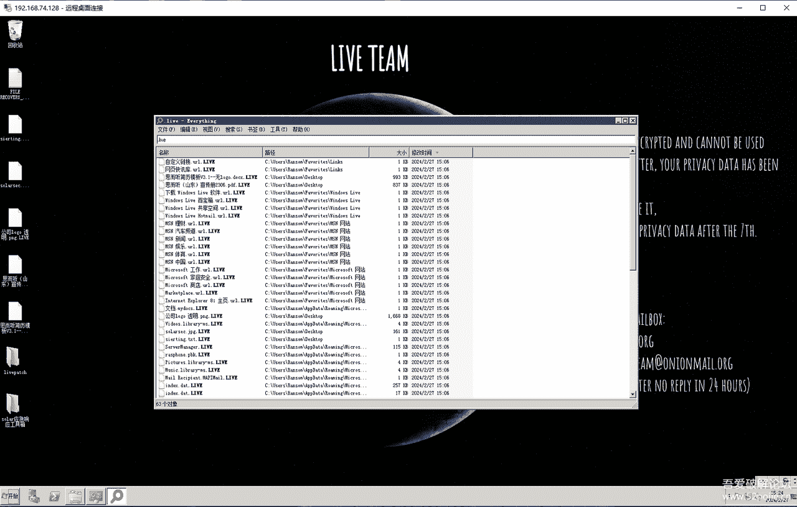
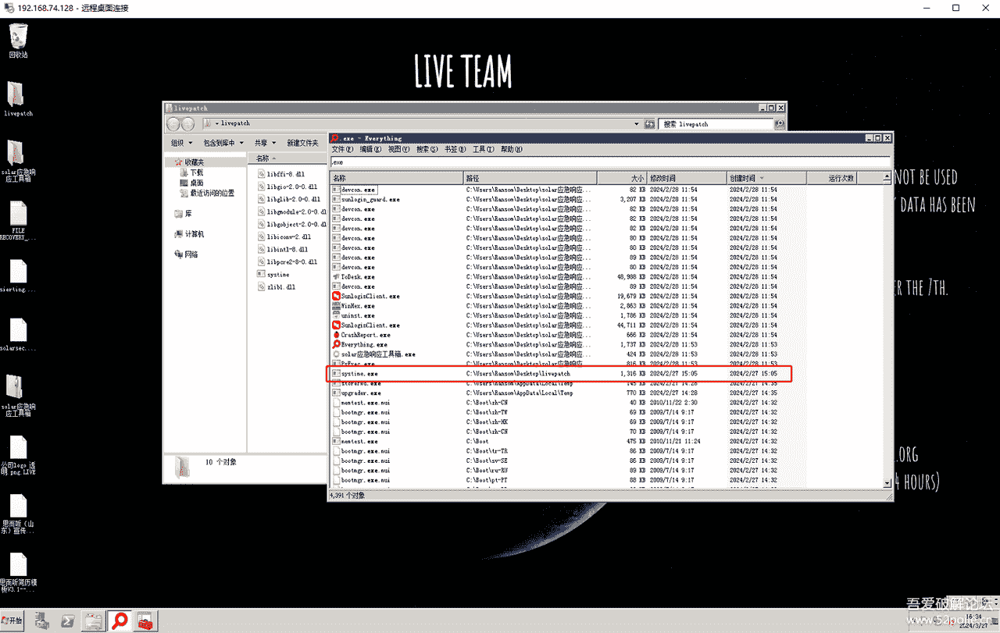
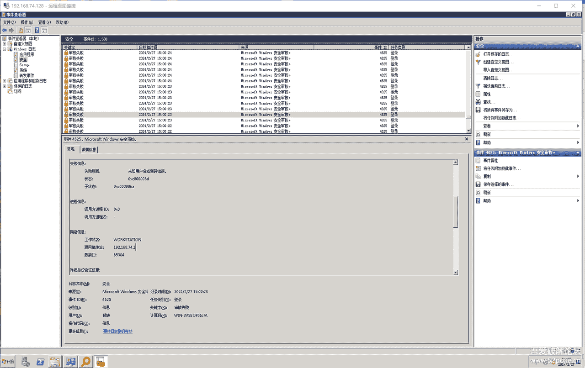
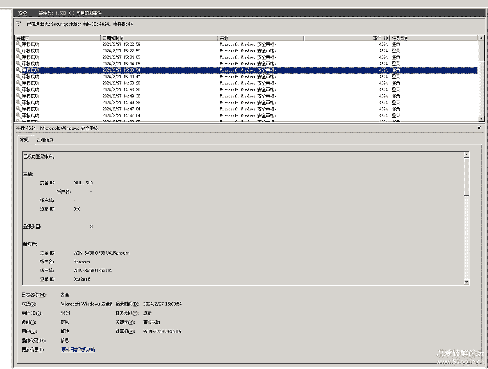
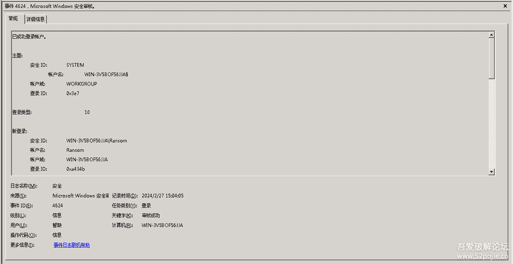
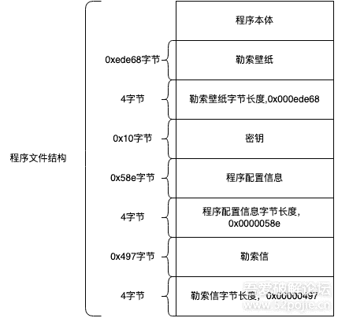

# [PC样本分析] 独家揭秘LIVE勒索病毒家族之1.0（全版本可解密）

- 原帖：https://www.52pojie.cn/forum.php?mod=viewthread&tid=1931717
- 抓取时间：2026-11-01T23:47:58

## 0. 前言

LIVE勒索病毒家族最早被曝光是在23年12月份，360的论坛发布了该家族的被加密样本，其加密特征为文件名后直接添加LIVE后缀，这时候还是该家族勒索病毒的1.0版本

[https://bbs.360.cn/thread-16111372-1-1.html](https://bbs.360.cn/thread-16111372-1-1.html)

[https://mp.weixin.qq.com/s/XV0x10YV-Wrs1ZI6tNHjLA](https://mp.weixin.qq.com/s/XV0x10YV-Wrs1ZI6tNHjLA)

随后的24年1月份，奇安信的威胁情报中心揭秘了该团队利用国内某防泄密软件的漏洞进行渗透并且投放勒索病毒的案例，这时候的LIVE家族已经进化到了2.0版本，因为此时的加密特征为把原文件名修改为一串数字，再添加LIVE后缀

再在今年的2月8日，火绒安全也发布了一篇该家族利用某某通电子文档安全管理系统的文件上传漏洞进行入侵并且投放LIVE2.0勒索病毒的案例，并且附上了解密的demo代码。

而我们团队在去年接触到LIVE家族至今，总共捕获到了该家族的三个版本加密器，根据其加密后文件特征我们命令为1.0、1.5、2.0版本，由于其加密器三个版本本身都存在一些bug，导致其家族自己提供的解密器也无法坐到全部完整的恢复文件，因此我们也根据其加密流程和bug特征，自己制作了能完整恢复的解密补丁工具，在接下来对LIVE家族的分析文章中也都会一一发布。

通过对该LIVE勒索病毒家族的详细分析，无论是其入侵行为还是加密工具的溯源，我们可以清晰地认识到，这是一支新兴的勒索团队。尽管他们拥有国内的攻防经验，但在勒索领域尚显稚嫩。与我们过去所了解的成熟勒索病毒组织相比，他们展现出了不同的攻击模式：

- 技术手段方面，与依赖弱口令爆破手段的Phobos、Mallox等老牌勒索病毒家族不同，LIVE团队借助国内最新的1day漏洞，甚至在某次攻击中，利用了一家安全厂商的安全管控平台漏洞，直接下发加密器对设备进行加密，令原本用于防护的安全设备变成了勒索的利器。
- 勒索软件制作方面，相较于老牌的Phobos家族，LIVE团队的制作手法较为粗糙，其加密的文件连自己的解密器都无法解开。然而，他们展现出的努力值得关注，短短三个月内就迭代更新了三个版本，预示着下一版可能将更难以破解。
- 勒索金额方面，LIVE团队所要求的赎金金额远高于常见的勒索病毒家族。已知的几例支付赎金的受害者，平均赎金约为10万人民币，这一高额赎金的背后是他们深入渗透、加密核心业务服务器的结果，且他们主要针对医疗、能源和大型集团企业等行业。

LIVE勒索病毒组织的出现预示着国内网络安全面临新的挑战，标志着国内勒索病毒攻击的进化进入了2.0时代。与以往主要依赖弱口令爆破和1day漏洞入侵的1.0版本相比，这一新时代的攻击采用了更为复杂的技术手段，如高级持续性威胁（APT）攻击、社会工程学以及零日漏洞利用，展现了更精细化的目标选择和攻击策略，专门针对高价值企业和组织。

本篇文章深入分析了LIVE1.0勒索病毒，我们将继续发布关于LIVE1.5和LIVE2.0勒索病毒的深度分析，并分享相应的解密工具。我们的团队专注于应急响应与勒索病毒研究。如果您或您的客户不幸成为勒索病毒的攻击目标，请随时与我们联系并提交受影响的勒索病毒样本，让我们携手合作，共同维护网络安全防线。

## 1. 背景

近期收到大量客户反馈遭到LIVE勒索病毒攻击，该病毒于2023年12月左右开始传播，并且存在多个版本。该中招客户为某医疗单位，团队工程师通过远程连接进行分析后提取到了勒索病毒的源头。

## 2. 溯源分析

以下为模拟客户系统的部分内网环境遭受该LIVE家族攻击的部分环境：

### 2.1 排查文件

发现服务器上的文件在2024/2/27 15:06被加密，排查该时段有哪些新增文件。

最终发现在该时段新建了名为`systime.exe`的文件。

### 2.2 排查日志

排查相关日志，存在大量smb爆破行为并最终在2024/2/27 15:03:54成功爆破。

并在2024/2/27 15:04:05 登录远程桌面。

实际情况攻击者是使用IP-Guard漏洞进行入侵，上述环境为模拟横向攻击的溯源。

> LIVE勒索病毒利用IP-Guard漏洞进行攻击的相关文章：[https://mp.weixin.qq.com/s/XV0x10YV-Wrs1ZI6tNHjLA](https://mp.weixin.qq.com/s/XV0x10YV-Wrs1ZI6tNHjLA)

## 3. 恶意文件基础信息

### 3.1 加密器基本信息

文件名：`admin.exe`
编译器：
