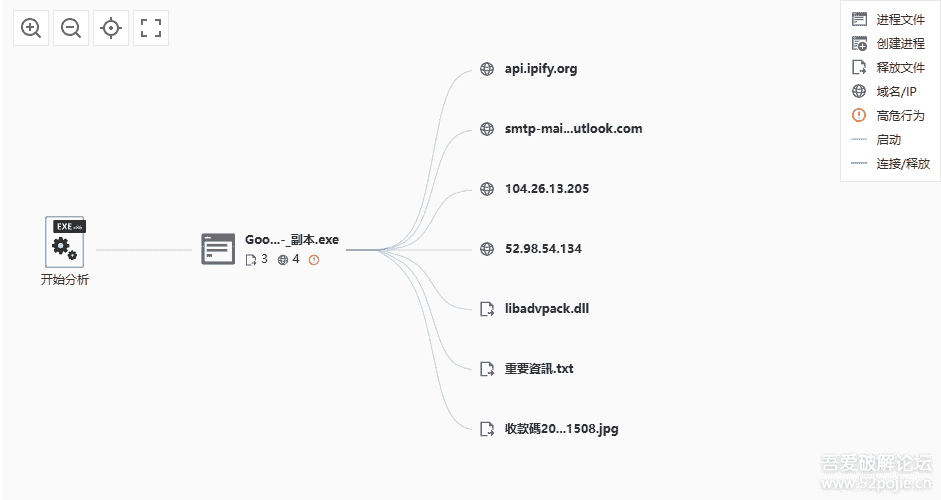
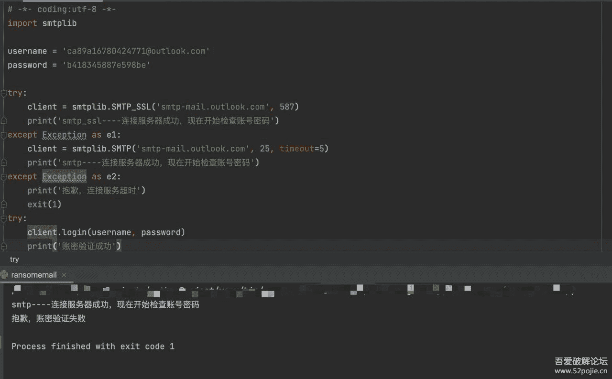
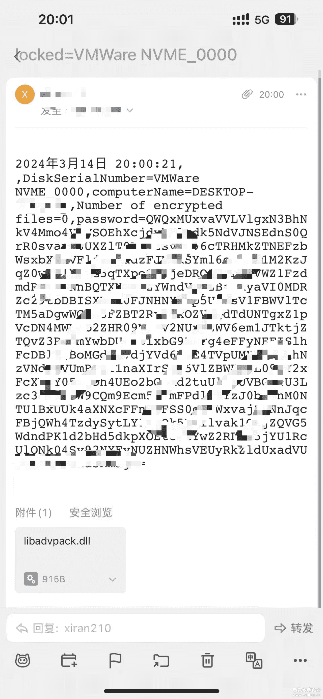

# [PC样本分析] 【病毒分析】中国人不骗中国人？_locked勒索病毒分析

- 原帖: https://www.52pojie.cn/forum.php?mod=viewthread&tid=1940185
- 抓取时间: 2026-11-01T23:47:43

## 1.背景

某医疗公司计算机服务器受到了_locked勒索病毒的侵害，所有的文件被加密并且添加了_locked后缀，并且释放了中文勒索信，留下了支付宝收款码作为勒索赎金支付通道，通过深入的溯源调查，本文暂未提供对入侵溯源的分析报告内容，仅提供该勒索病毒加密器的逆向分析报告。

## 2.溯源分析

### 2.1 恶意行为

`2.1.PNG` (44.84 KB, 下载次数: 0)

[href="forum.php?mod=attachment&aid=MjcwNDk4NHw2ZTdlMTc3MHwxNzkzNTc2ODYwfDE2ODA4NnwxOTQwMTg1&nothumb=yes" target="_blank"](https://www.52pojie.cn/forum.php?mod=attachment&aid=MjcwNDk4NHw2ZTdlMTc3MHwxNzkzNTc2ODYwfDE2ODA4NnwxOTQwMTg1&nothumb=yes)

2024-7-2 15:33 上传

执行后会释放以下三个文件：

- `libadvpack.dll`
- `重要資訊.txt`
- `收款碼.jpg`

访问外部链接：

- `api.ipify.org` #用于获取互联网IP
- `smtp-mail.outlook.com` #用于smtp发件
- `104.26.13.205` #CDN
- `52.98.54.134` #CDN

### 2.2 溯源流程

对收款码进行溯源，账号属于一位年长女性，判断应该为通过渠道购买的黑号。

`2.2.1.PNG` (26.35 KB, 下载次数: 0)

[href="forum.php?mod=attachment&aid=MjcwNDk4NXw5ZDQ5MTg5MXwxNzkzNTc2ODYwfDE2ODA4NnwxOTQwMTg1&nothumb=yes" target="_blank"](https://www.52pojie.cn/forum.php?mod=attachment&aid=MjcwNDk4NXw5ZDQ5MTg5MXwxNzkzNTc2ODYwfDE2ODA4NnwxOTQwMTg1&nothumb=yes)

2024-7-2 15:33 上传

Tips：使用支付宝付款的时候，选择四大行以外的银行卡进行转账，然后再通过该银行的APP进行转账明细查询，大部分可以看到对方的真实名字。

逆向加密器，会发现加密信息通过SMTP协议发送邮件至黑客匿名邮箱，由于SMTP协议是发件协议，因此即使能够登陆也无法查看已发邮件。

`2.2.2.png` (308.09 KB, 下载次数: 0)

[href="forum.php?mod=attachment&aid=MjcwNDk5MHwwYzI4ODQ1N3wxNzkzNTc2ODYwfDE2ODA4NnwxOTQwMTg1&nothumb=yes" target="_blank"](https://www.52pojie.cn/forum.php?mod=attachment&aid=MjcwNDk5MHwwYzI4ODQ1N3wxNzkzNTc2ODYwfDE2ODA4NnwxOTQwMTg1&nothumb=yes)

2024-7-2 15:36 上传

修改发件、收件地址后会收到以下邮件，包含计算机的基本信息、机密文件数量以及密码，由于此outlook邮箱的辅助邮箱为匿名注册邮箱，故无法通过该线索继续溯源。

`2.2.3.png` (1.2 MB, 下载次数: 0)

[href="forum.php?mod=attachment&aid=MjcwNDk4NnwzZTY0Nzc0NnwxNzkzNTc2ODYwfDE2ODA4NnwxOTQwMTg1&nothumb=yes" target="_blank"](https://www.52pojie.cn/forum.php?mod=attachment&aid=MjcwNDk4NnwzZTY0Nzc0NnwxNzkzNTc2ODYwfDE2ODA4NnwxOTQwMTg1&nothumb=yes)

2024-7-2 15:34 上传

## 3.恶意文件基础信息

### 3.1 加密器基本信息

大小 |

404480(395.00 KiB) |

操作系统
